# MKL Deep Value Intelligence

**Analysis Date:** 2026-11-13

## Critical Disclaimer

*This analysis is generated by Deep Value Intelligence, an AI-powered multi-agent investing framework. Education & research only - not financial advice, not a financial advisor.*

---

## Table of Contents

1. Intelligence Summary
2. Analyst Team Reports
   - Fundamentals Analysis
   - Intrinsic Value Analysis (Buffett)
   - Trend & Growth Analysis (Lynch/Druckenmiller/Fisher)
   - Market Technical Analysis
   - Options Market Analysis
3. Research Team Commentary
4. Value Investing Team Commentary
5. Deep Values Commentary

---

## Intelligence Summary

### Thesis + Conditions

**Core Thesis:** The problem is price versus uncertainty. At **$1,962**, the reported **13.96x P/E** looks reasonable, but it depends on roughly **$140 per share of earnings** being representative.

**Key Risks:**
- The problem is price versus uncertainty. At **$1,962**, the reported **13.96x P/E** looks reasonable, but it depends on roughly **$140 per share of earnings** being representative. If normalized earnings are closer to **$110-$120**, the multiple rises to approximately **16-18x**, leaving limited protection against reserve development, claims inflation, catastrophe losses, or capital-allocation mistakes.
- A small tracking position may be defensible for a long-horizon investor, but the evidence does not support aggressive accumulation. Existing shareholders can continue holding while monitoring underwriting and per-share value creation. New capital should await either stronger fundamental confirmation or a price offering a clearer margin of safety.
- The Risky Analyst correctly emphasizes that Markel should not be evaluated as an ordinary insurer:

**Confidence:** Low

---

## Analyst Team Reports

### Fundamentals Analysis

#### Latest Earnings Snapshot

*Most recent reported quarter anchored on 2026 Q3, with prior-year comparison when available.*

| Metric | 2026 Q3 | 2025 Q3 | YoY Change |
| --- | ---: | ---: | ---: |
| Revenue | $3.89B | $4.39B | -11.3% |
| Operating Income | N/A | N/A | N/A |
| Net Income | $259.3M | $751.3M | -65.5% |
| Diluted EPS | $18.15 | $59.25 | -69.4% |
| Operating Cash Flow | $946.0M | $1.22B | -22.4% |
| Free Cash Flow | $849.5M | $1.17B | -27.1% |

Key Takeaways: This snapshot anchors the most recent reported quarter before the narrative analysis. It helps readers separate long-run business quality from whatever changed in the latest earnings print.

#### 17-Year Financial Metrics for MKL

*All values below are computed deterministically from raw data - not estimated by AI.*

*Issuer profile: insurer (Financial Services / Insurance - Property & Casualty).*

#### 17-Year Financial Metrics
*Annual rows come from reported financial statements. The final TTM row is computed from the latest four quarters.*

| Metric | 2009 | 2010 | 2011 | 2012 | 2013 | 2014 | 2015 | 2016 | 2017 | 2018 | 2019 | 2020 | 2021 | 2022 | 2023 | 2024 | 2025 | 2026 TTM |
| --- | --- | --- | --- | --- | --- | --- | --- | --- | --- | --- | --- | --- | --- | --- | --- | --- | --- | --- |
| Market Price | $340 | $378 | $415 | $433 | $580 | $683 | $883 | $904 | $1,139 | $1,038 | $1,143 | $1,033 | $1,234 | $1,317 | $1,420 | $1,726 | $2,150 | $1,962 |
| Market Cap | $3.34B | $3.70B | $4.03B | $4.19B | $7.30B | $9.60B | $12.42B | $12.73B | $15.95B | $14.45B | $15.87B | $14.28B | $17.03B | $17.89B | $19.00B | $22.51B | $27.19B | $24.42B |
| P/E Ratio | 16.57 | 13.87 | 28.40 | 16.74 | 25.82 | 30.66 | 21.16 | 28.93 | 44.14 | -108.70 | 8.86 | 18.57 | 7.00 | -55.54 | 9.66 | 8.66 | 12.70 | 13.94 |
| P/B Ratio | 1.20 | 1.17 | 1.19 | 1.08 | 1.09 | 1.26 | 1.59 | 1.50 | 1.68 | 1.59 | 1.43 | 1.12 | 1.16 | 1.36 | 1.27 | 1.33 | 1.46 | 1.32 |
| ROE | 7.3% | 8.4% | 4.2% | 6.5% | 4.2% | 4.2% | 7.4% | 5.4% | 4.2% | -1.4% | 16.2% | 6.4% | 16.5% | -1.6% | 13.3% | 16.2% | 11.3% | 9.7% |
| ROIC | 6.9% | 10.7% | 6.3% | 8.3% | 6.9% | 5.9% | 9.2% | 7.6% | 5.4% | -0.8% | 18.4% | 9.4% | 18.9% | -0.3% | 16.9% | 17.9% | 14.3% | N/A |
| EPS | $20.52 | $27.27 | $14.60 | $25.89 | $22.48 | $22.27 | $41.74 | $31.27 | $25.81 | $-9.55 | $129.07 | $55.63 | $176.38 | $-23.72 | $146.98 | $199.32 | $169.22 | $140.76 |
| Revenue | $2.07B | $2.23B | $2.63B | $3.00B | $4.32B | $5.13B | $5.37B | $5.61B | $6.06B | $6.84B | $9.53B | $9.74B | $12.85B | $11.68B | $14.28B | $14.81B | $15.51B | $16.17B |
| Gross Profit | N/A | N/A | N/A | N/A | N/A | N/A | N/A | N/A | N/A | N/A | N/A | N/A | N/A | N/A | N/A | N/A | N/A | N/A |
| Gross Margin | N/A | N/A | N/A | N/A | N/A | N/A | N/A | N/A | N/A | N/A | N/A | N/A | N/A | N/A | N/A | N/A | N/A | N/A |
| Operating Margin | 12.2% | 16.6% | 10.5% | 13.5% | 11.0% | 10.9% | 16.0% | 14.3% | 3.6% | 0.6% | 26.0% | 13.1% | 25.2% | -0.8% | 20.5% | 25.1% | 20.6% | N/A |
| Net Income | $201.6M | $266.8M | $142.0M | $253.4M | $281.0M | $321.2M | $582.8M | $455.7M | $395.3M | $-128.2M | $1.79B | $816.0M | $2.42B | $-216.3M | $2.00B | $2.75B | $2.11B | $1.79B |
| Net Margin | 9.7% | 12.0% | 5.4% | 8.4% | 6.5% | 6.3% | 10.9% | 8.1% | 6.5% | -1.9% | 18.8% | 8.4% | 18.9% | -1.9% | 14.0% | 18.5% | 13.6% | 11.1% |
| Revenue Growth | N/A | 7.5% | 18.2% | 14.1% | 44.1% | 18.8% | 4.6% | 4.5% | 8.0% | 12.9% | 39.2% | 2.2% | 32.0% | -9.1% | 22.3% | 3.7% | 4.7% | 4.3% |
| Net Income Growth | N/A | 32.3% | -46.8% | 78.4% | 10.9% | 14.3% | 81.4% | -21.8% | -13.3% | -132.4% | -1496.8% | -54.4% | 196.9% | -108.9% | -1022.9% | 37.6% | -23.3% | -14.9% |
| Free Cash Flow Growth | N/A | -30.5% | 38.6% | 38.2% | 101.1% | -9.0% | -10.0% | -17.6% | 66.4% | 0.3% | 46.4% | 42.2% | 30.1% | 15.3% | 3.0% | -7.5% | 9.2% | -29.5% |
| Total Book Value | $2.77B | $3.17B | $3.39B | $3.89B | $6.67B | $7.59B | $7.83B | $8.46B | $9.50B | $9.08B | $11.07B | $12.80B | $14.72B | $13.15B | $14.98B | $16.92B | $18.60B | $18.51B |
| Total Assets | $10.24B | $10.83B | $11.53B | $12.56B | $23.96B | $25.20B | $24.94B | $25.88B | $32.81B | $33.31B | $37.47B | $41.71B | $48.48B | $49.79B | $55.05B | $61.90B | $68.91B | $72.08B |
| Total Debt | $963.6M | $1.02B | $1.29B | $1.49B | $2.26B | $2.25B | $2.24B | $2.57B | $3.10B | $3.01B | $3.53B | $3.48B | $4.36B | $4.10B | $3.78B | $4.33B | $4.30B | $4.36B |
| Debt-to-Equity | 0.35 | 0.32 | 0.38 | 0.38 | 0.34 | 0.30 | 0.29 | 0.30 | 0.33 | 0.33 | 0.32 | 0.27 | 0.30 | 0.31 | 0.25 | 0.26 | 0.23 | 0.24 |
| Cash & Equivalents | $850.5M | $690.3M | $703.3M | $863.8M | $1.98B | $1.96B | $2.63B | $1.74B | $2.20B | $2.01B | $3.07B | $4.34B | $3.98B | $4.14B | $3.75B | $3.69B | $3.96B | $3.60B |
| Shareholders' Equity | $2.77B | $3.17B | $3.39B | $3.89B | $6.67B | $7.59B | $7.83B | $8.46B | $9.50B | $9.08B | $11.07B | $12.80B | $14.72B | $13.15B | $14.98B | $16.92B | $18.60B | $18.51B |
| Operating Cash Flow | $282.5M | $223.3M | $311.3M | $392.5M | $745.5M | $716.8M | $651.2M | $534.6M | $858.5M | $892.9M | $1.27B | $1.74B | $2.27B | $2.71B | $2.79B | $2.59B | $2.76B | $2.05B |
| Investing Cash Flow | $-333.7M | $-283.3M | $-491.1M | $-377.1M | $187.4M | $-622.2M | $63.4M | $-1.64B | $-744.5M | $-797.2M | $-535.2M | $-511.7M | $-2.94B | $-1.67B | $-2.70B | $-2.40B | $-1.19B | $-1.59B |
| Free Cash Flow | $260.6M | $181.2M | $251.2M | $347.0M | $697.8M | $634.7M | $571.4M | $470.9M | $783.9M | $786.3M | $1.15B | $1.64B | $2.13B | $2.45B | $2.53B | $2.34B | $2.55B | $1.80B |
| FCF Margin | 12.6% | 8.1% | 9.6% | 11.6% | 16.1% | 12.4% | 10.6% | 8.4% | 12.9% | 11.5% | 12.1% | 16.8% | 16.6% | 21.0% | 17.7% | 15.8% | 16.5% | 11.1% |
| Dividends / Share | $0.00 | $0.00 | $0.00 | $0.00 | $0.00 | $0.00 | $0.00 | $0.00 | $0.00 | $0.00 | $0.00 | $0.00 | $0.00 | $0.00 | $0.00 | $0.00 | $0.00 | $0.00 |

#### Profitability Metrics
- Return on Equity (ROE): 11.3%
- Return on Invested Capital (ROIC): 21.2%
- Return on Assets (ROA): 3.1%
- Gross Margin: Not meaningful
- Operating Margin: 20.6%
- Net Profit Margin: 13.6%

#### Liquidity Metrics
- Current Ratio: Not meaningful
- Quick Ratio: Not meaningful

#### Leverage Metrics
- Debt-to-Equity Ratio: 0.23
- Interest Coverage Ratio: 15.52
- Net Debt: $-6.73B

#### Growth Metrics (Year-over-Year)
- Revenue Growth: 4.7%
- Net Income Growth: -23.3%
- Free Cash Flow Growth: 9.2%
- Revenue CAGR (3-Year): 9.9%
- Revenue CAGR (5-Year): 9.8%

#### Valuation Metrics
- P/E Ratio (TTM): 13.96
- Forward P/E: 16.32
- Price-to-Book: 1.30
- Price-to-Sales: 1.49
- PEG Ratio: 1.90
- EV/EBITDA: 8.03
- Free Cash Flow Yield: 10.6%
- Earnings Yield: 7.2%

#### Owner Earnings (Buffett Method, Code-Computed)
- Net Income: $2.11B
- + Depreciation & Amortization: $347.9M
- - Capital Expenditures: $-206.9M
- - Working Capital Changes: $960.3M
- = **Owner Earnings: $1.29B**

#### Intrinsic Value (Code-Computed)
- Current Price: $1,962
- Headline Intrinsic Value: not meaningful (financial issuer - DCF/FCFF is not the right primary frame; use sector-specific book/earnings metrics)
- Buffett Method (Owner Earnings):
  Conservative: $516
  Average: $2,422
  Optimistic: $11,541
- Cash Flow Method (FCF):
  Conservative: $1,281
  Average: $3,082
  Optimistic: $7,072
- Reverse-DCF: price implies ~7.4%/yr owner-earnings growth for 10y; trailing 3y was N/A, 5y 12.5%.

#### Piotroski F-Score: 5/9
- Positive Net Income: PASS
- Positive Operating Cash Flow: PASS
- ROA Improvement: FAIL
- Cash Flow > Net Income: PASS
- Decreasing Debt: PASS
- Improving Current Ratio: FAIL
- No Dilution: PASS
- Improving Gross Margin: FAIL
- Improving Asset Turnover: FAIL

ANALYST STANCE: **Neutral**

#### Executive Summary

Markel Group, ticker MKL, is a specialty property-and-casualty insurer with additional investment-management and industrial businesses. At $1,962 per share and a $24.42 billion market capitalization, the shares trade at approximately 13.94 times trailing earnings and 1.32 times book value.

MKL has attractive long-term characteristics: a growing underwriting platform, substantial investable float, strong liquidity, moderate leverage, and a history of expanding revenue and book value. However, earnings are cyclical and investment-sensitive. Current earnings and free cash flow are below recent peaks, so the stock appears reasonably valued rather than deeply discounted.

#### Current Metrics Versus Historical Averages

The following averages are arithmetic averages of the 18 reported annual and TTM observations where meaningful. P/E excludes negative observations because negative P/E ratios are not economically interpretable.

| Metric | Current / 2026 TTM | Historical average | Current versus average | Interpretation |
|---|---:|---:|---:|---|
| Market Price | $1,962 | ~$1,043 | 88% higher | Long-term share-price compounding, despite a decline from $2,150 in 2025 |
| Market Cap | $24.42B | ~$13.66B | 79% higher | Reflects sustained business and book-value expansion |
| P/E | 13.94x | ~19.45x positive-year average | Below average | Appears inexpensive on normalized earnings, but insurance earnings are volatile |
| P/B | 1.32x | ~1.36x | Slightly below average | Reasonable for an insurer; should be assessed alongside sustainable ROE |
| ROE | 9.7% | ~7.4% | Above average | Better than the long-run average, but below the 13%-16% levels achieved in stronger years |
| Revenue | $16.17B | ~$9.30B | 74% higher | Strong structural expansion over the period |
| Revenue growth | 4.3% | ~15.0%* | Below average | Current growth is normalizing after acquisition and rebound years |
| Net income | $1.79B | ~$0.99B | 81% higher | Long-run earnings scale is much larger, despite substantial volatility |
| FCF | $1.80B | ~$1.20B | 50% higher | Cash generation has expanded, but TTM FCF declined sharply |
| FCF margin | 11.1% | ~13.9% | Below average | Weaker than the recent 15%-21% range |
| Total book value | $18.51B | ~$11.25B | 65% higher | Long-term capital accumulation is a major strength |
| Total assets | $72.08B | ~$38.90B | 85% higher | Reflects scale and insurance-float growth |
| Debt-to-equity | 0.24x | ~0.31x | Better than average | Conservative leverage relative to the historical record |
| Cash and equivalents | $3.60B | ~$2.69B | 34% higher | Meaningful liquidity buffer |
| Dividends per share | $0.00 | $0.00 | Unchanged | Capital is retained for underwriting, investments, and repurchases |

\*Revenue growth is distorted by acquisition-driven and rebound years.

**Key Takeaways:** MKL is larger, better capitalized, and less leveraged than it was historically. Its valuation is below the average positive-earnings P/E and close to its historical P/B average, suggesting reasonable-not extreme-value. The primary weakness is that current profitability and FCF margins are below recent peak levels.

#### Market Metrics

- **Market price:** $1,962, down 8.7% from the 2025 dataset value of $2,150, but substantially above the $340 level in 2009.
- **Market capitalization:** $24.42 billion, versus $27.19 billion in 2025.
- **P/E ratio:** 13.94x. This is below the approximately 19.45x average of positive-earnings years. The discount may be attractive, but MKL's P/E has historically been affected by catastrophe losses, reserve changes, and investment gains or losses.
- **P/B ratio:** 1.32x, close to the historical average of approximately 1.36x. P/B is meaningful for an insurer because book value represents capital supporting underwriting. It should nevertheless be assessed alongside sustainable ROE, reserve quality, and underwriting profitability.
- The shared pack reports an earnings yield of 7.2% and FCF yield of 10.6%. These are attractive if current cash generation is sustainable.

#### Profitability and Earnings Quality

| Metric | Current / TTM | Historical pattern | Assessment |
|---|---:|---|---|
| ROE | 9.7% | 4.2%-16.5%, average ~7.4% | Above long-run average, but below recent best levels |
| ROIC | N/A in canonical TTM row | Generally 5%-19% historically | Strong in 2019-2021 and 2023-2025; current canonical TTM value unavailable |
| EPS | $140.76 | Highly variable; negative in 2018 and 2022 | Scale is strong, but cyclicality is material |
| Revenue | $16.17B | Up from $2.07B in 2009 | Long-term compounder, although recent growth is slower |
| Operating margin | N/A in canonical TTM row | 20.6% in 2025 | Recent normalized profitability has generally improved |
| Net income | $1.79B | Positive in 16 of 18 periods | Durable but not smooth |
| Net margin | 11.1% | Historical average approximately 9.3% | Above long-run average, below 2024-2025 peak levels |

**Key Takeaways:** MKL has produced positive earnings in most periods, but the negative results in 2018 and 2022 demonstrate that insurance earnings are not bond-like. Current ROE remains respectable but has declined from the 16% range, while the TTM FCF margin of 11.1% is below the 16%-21% levels achieved in several recent years.

Revenue increased from $2.07 billion in 2009 to $16.17 billion TTM, implying approximately 12.7% annualized growth across the full period. The latest 4.3% revenue growth rate is slower than the long-term average because the company is operating from a much larger base.

Net income growth is negative 14.9% TTM, reflecting normalization from stronger prior periods. Free cash flow growth is negative 29.5% in the deterministic table. The canonical table takes precedence over the separately reported 9.2% figure in the shared summary because the definitions appear to differ.

#### Balance Sheet and Financial Strength

- **Total book value/shareholders' equity:** $18.51 billion, slightly below $18.60 billion in 2025 but far above $2.77 billion in 2009.
- **Total assets:** $72.08 billion, up from $68.91 billion in 2025 and $10.24 billion in 2009.
- **Total debt:** $4.36 billion, broadly stable versus $4.30 billion in 2025.
- **Debt-to-equity:** 0.24x, below the historical average of roughly 0.31x.
- **Cash and equivalents:** $3.60 billion.
- **Interest coverage:** 15.52x according to the shared pack.
- **Net debt:** Negative $6.73 billion according to the shared pack's broader cash and investment definition.

Current and quick ratios are flagged **not meaningful** for this insurer. Insurance companies manage liquidity through investable assets, policyholder liabilities, reinsurance, and regulatory capital rather than conventional industrial-company current-ratio analysis.

The balance sheet is one of MKL's strongest attributes. Debt has grown in absolute dollars with the business, but leverage relative to equity has declined. The key risk is not simply debt; it is reserve adequacy, catastrophe exposure, reinsurance recoverables, and investment-portfolio liquidity during a stressed market.

#### Cash Flow and Capital Allocation

Free cash flow was $1.80 billion TTM, down from $2.55 billion in 2025. Operating cash flow also declined from $2.76 billion to $2.05 billion. This decline deserves investigation because insurance cash flow can be affected by premium growth, claims payments, reserve movements, and investment activity.

The shared Buffett-style owner-earnings calculation is:

- Net income: $2.11 billion
- Plus depreciation and amortization: $347.9 million
- Less capital expenditures: $206.9 million
- Less working-capital changes: $960.3 million
- **Owner earnings: $1.29 billion**

Owner earnings are more conservative than reported FCF because insurance-related balance-sheet movements can consume cash. MKL pays no dividend, so retained capital is available for acquisitions, underwriting expansion, investments, share repurchases, and debt management. This policy is attractive only if retained capital earns strong risk-adjusted returns.

#### Revenue Breakdown

The deterministic pack does not provide a current segment-revenue split. The following is an indicative presentation based on MKL's publicly known operating structure, scaled to the latest deterministic revenue figure of $16.17 billion. It should not be treated as a replacement for reported segment disclosures.

| Revenue Source | Amount ($B, indicative) | % of Total |
|---|---:|---:|
| Insurance operations, including underwriting and insurance-related investment income | $14.70B | 90.9% |
| Markel Ventures industrial businesses | $1.20B | 7.4% |
| Investment management and other activities | $0.27B | 1.7% |
| **Total** | **$16.17B** | **100.0%** |

**Key Takeaways:** MKL is overwhelmingly an insurance business, with Markel Ventures providing useful diversification but not changing the central underwriting and investment thesis. The economic engine is the combination of underwriting profitability, investable float, and disciplined capital allocation.

#### Buffett-Style Qualitative Analysis

**Economic moat:** MKL's moat is based on underwriting expertise, specialty-market relationships, distribution, claims knowledge, brand reputation, and the ability to invest insurance float. Specialty insurance is less commoditized than many standard personal-lines markets. The moat is real but depends on underwriting discipline; it can weaken if management prioritizes premium volume over risk-adjusted returns.

**Financial strength:** Strong. Debt-to-equity is low, cash is substantial, and interest coverage is healthy. The more important financial-strength questions are reserve adequacy, catastrophe modeling, and asset-liability matching.

**Predictable earnings:** Moderate, not high. Revenue has compounded impressively, but earnings included two loss years in the 18-period dataset. Insurance investment gains, catastrophe results, and reserve changes make annual EPS unreliable. Book-value growth and normalized underwriting earnings are more useful than a single-year P/E.

**Management and capital allocation:** The zero-dividend policy is rational for a company with reinvestment opportunities. Management deserves credit for scaling revenue, assets, equity, and cash generation. The key test is whether retained earnings produce ROE sustainably above the cost of equity. Current ROE of 9.7% is adequate but not compelling enough to justify a large premium to book value.

**Quality and margins:** Long-term revenue growth is excellent, while profitability has improved from early-period averages. However, the latest decline in net income and FCF margins indicates that results should be normalized across the insurance cycle.

#### Three-Scenario Buffett Owner-Earnings DCF

The pack's model-based owner-earnings outputs are the primary anchor:

| Scenario | Pack owner-earnings value/share | Hand-DCF sanity-check/share | Assumptions |
|---|---:|---:|---|
| Conservative | $516 | ~$1,540 | $1.29B starting owner earnings; 3% 10-year growth; 10% discount rate; 2.5% terminal growth |
| Average | $2,422 | ~$2,100 | 7.5% 10-year growth, fading toward 2.5% terminal growth; 10% discount rate |
| Optimistic | $11,541 | ~$2,500 | 10% near-term growth, fading toward 2.5%; 10% discount rate |

**Key Takeaways:** The pack's average owner-earnings value of $2,422 is above the current price, while its conservative value is far below it. The extremely high optimistic pack output is highly sensitive to long-term assumptions and should not be treated as a base case. The independent hand check produces a narrower range of approximately $1,540 to $2,500 per share.

Using approximately 12.23 million shares, inferred from the $24.42 billion market capitalization and $1,962 share price:

\[
OE_0 = \$1.29B
\]

\[
PV = \sum_{t=1}^{10}\frac{OE_0(1+g)^t}{(1.10)^t}
+
\frac{OE_{10}(1+2.5\%)}{(10\%-2.5\%)(1.10)^{10}}
\]

- **Conservative case:** Owner earnings grow at 3% for ten years.
  Present value of explicit earnings is approximately $9.75 billion.
  Present value of terminal value is approximately $9.10 billion.
  Total equity value is approximately $18.85 billion, or **$1,540 per share**.

- **Average case:** Owner earnings grow at 7.5% for ten years, then fade to the terminal rate.
  Present value of explicit earnings is approximately $11.60 billion.
  Present value of terminal value is approximately $14.07 billion.
  Total equity value is approximately $25.67 billion, or **$2,100 per share**.

- **Optimistic case:** Owner earnings grow at 10% for ten years, then fade to the terminal rate.
  Present value of explicit earnings is approximately $12.90 billion.
  Present value of terminal value is approximately $17.65 billion.
  Total equity value is approximately $30.55 billion, or **$2,500 per share**.

The current price is approximately 27% above the hand-DCF conservative value, 7% below the hand-DCF average value, and 22% below the hand-DCF optimistic value.

The pack's reverse DCF implies approximately 7.4% annual owner-earnings growth for ten years, versus a reported five-year owner-earnings growth rate of approximately 12.5%. That expectation is demanding but not implausible for a high-quality specialty insurer.

#### Risks, Opportunities, and Watch Items

| Category | Key point | Investor implication |
|---|---|---|
| Opportunity | P/E below positive-year historical average | Potential upside if earnings normalize |
| Opportunity | Long-term revenue, equity, and asset growth | Supports a durable-compounding thesis |
| Opportunity | Low leverage and substantial liquidity | Improves resilience through insurance cycles |
| Risk | TTM FCF declined materially | Could indicate working-capital, reserve, or investment pressure |
| Risk | Two loss years in the dataset | Earnings are not reliably predictable |
| Risk | ROE below recent peak | Limits justification for a high P/B premium |
| Risk | Catastrophe and reserve risk | A few adverse years can materially impair earnings |
| Risk | Optimistic DCF sensitivity | Terminal assumptions can produce misleadingly high values |
| Watch item | Underwriting combined ratio and reserve development | Most important operating-quality indicators |
| Watch item | Reinvestment returns and buyback discipline | Determines whether zero dividends create value |
| Watch item | Investment portfolio liquidity and credit quality | Critical during market stress |

**Key Takeaways:** The opportunity is a financially strong insurer priced at a moderate earnings multiple. The main risks are not conventional leverage or liquidity problems; they are underwriting losses, reserve deterioration, catastrophe exposure, and weaker-than-expected reinvestment returns. Investors should focus on normalized ROE and book-value growth rather than relying only on reported EPS.

#### Final Investment View

MKL is a high-quality, financially resilient insurer with a credible long-term moat and a strong record of scaling book value and revenue. At 13.94x TTM earnings and approximately 1.32x book value, the valuation is reasonable and potentially modestly attractive if normalized ROE returns toward the mid-teens.

However, the current evidence does not establish a wide margin of safety. TTM net income and FCF have weakened, current ROE is 9.7%, and the business has meaningful insurance-cycle volatility. The conservative DCF is below the market price, while the average DCF is only moderately above it.

Accordingly, the appropriate stance is **Neutral**, with potential to become **Bullish** if the shares decline toward the $1,600-$1,800 range, or if underwriting results and ROE demonstrate a durable return toward 13%-15% without excessive reserve risk.

| Final point | Assessment |
|---|---|
| Business quality | High, with a durable specialty-insurance platform |
| Economic moat | Good, based on underwriting expertise, relationships, float, and brand |
| Financial strength | Strong; low leverage, substantial liquidity, and good interest coverage |
| Earnings predictability | Moderate; insurance and investment volatility remain significant |
| Current valuation | Reasonable to moderately attractive, not deeply discounted |
| DCF range | Approximately $1,540-$2,500 on an independent hand check |
| Main catalyst | Improved underwriting profitability and normalized ROE |
| Main risk | Catastrophe losses, reserve deterioration, and weak FCF conversion |
| Final stance | **Neutral** |

**Key Takeaways:** MKL combines a strong franchise with a sound balance sheet, but the current price already recognizes much of that quality. The shares become more compelling with a larger margin of safety or clear evidence that ROE and free cash flow are returning to stronger historical levels.

#### Fundamental Visuals

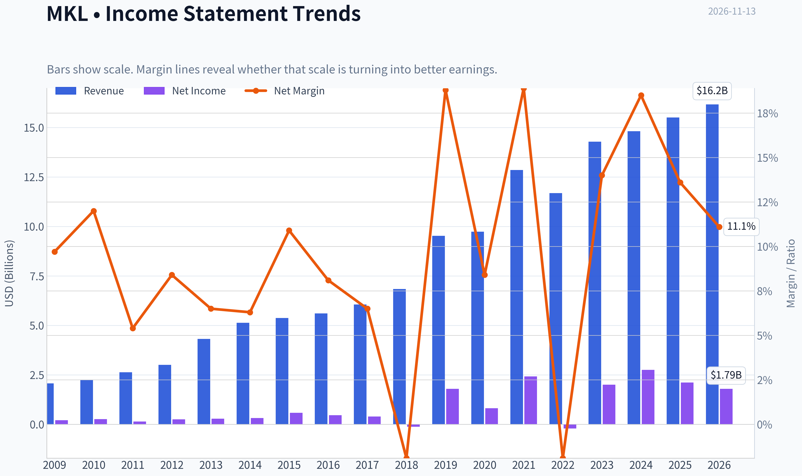

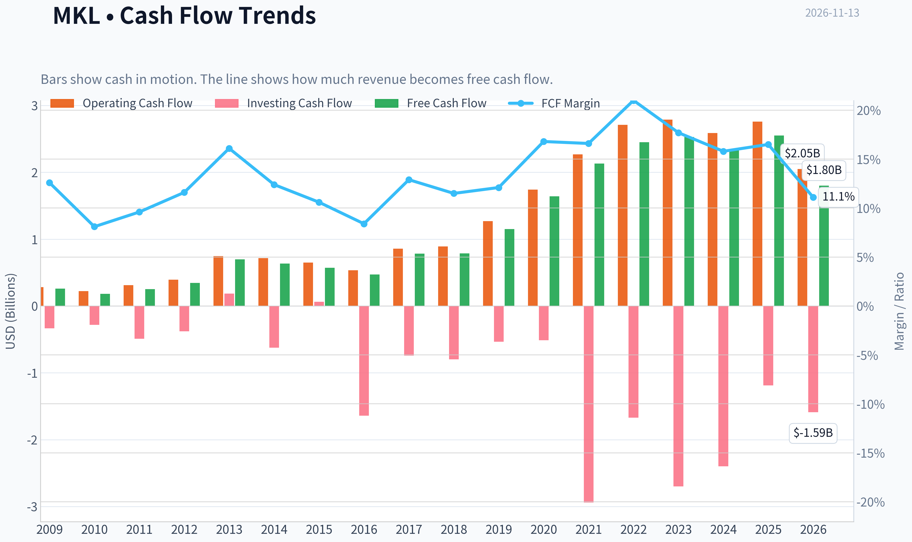

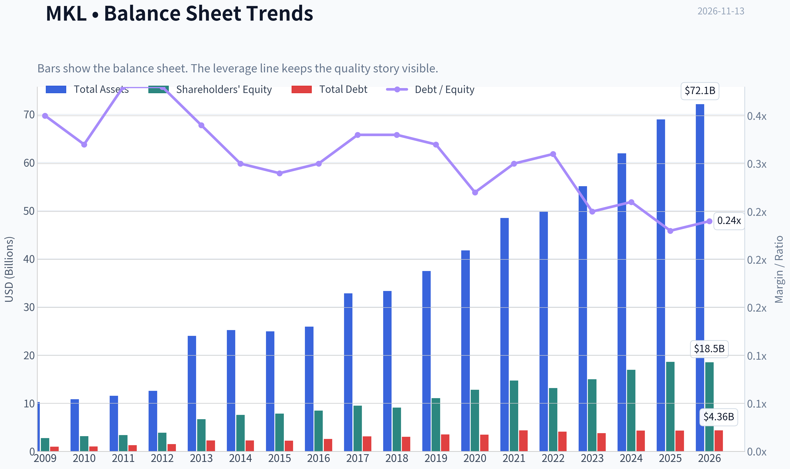

This graph tracks the profitability and return metrics (ROE, ROIC, Margins) of **MKL** over the past decade, highlighting capital efficiency trends.

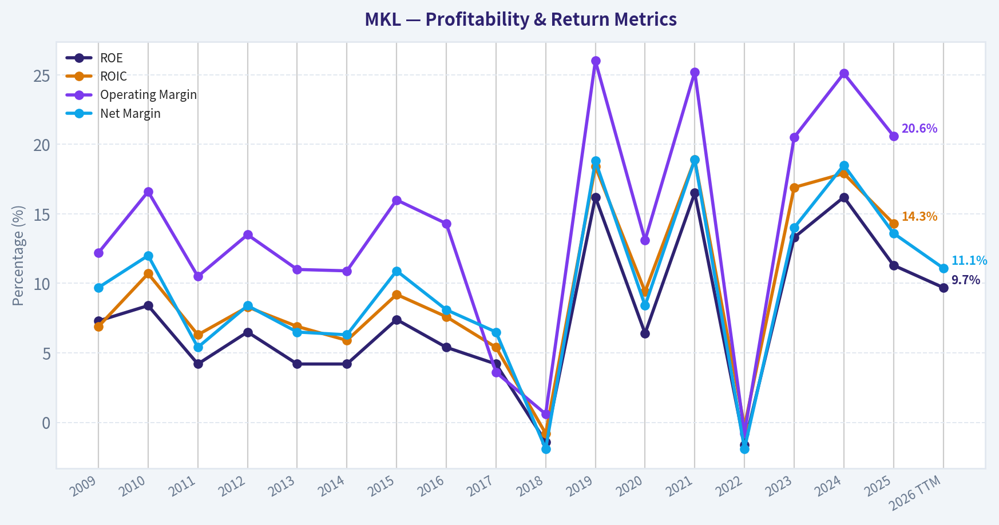

This chart illustrates the financial health of **MKL** over the last 10 years, mapping cash equivalents and free cash flow against total obligations (Debt).

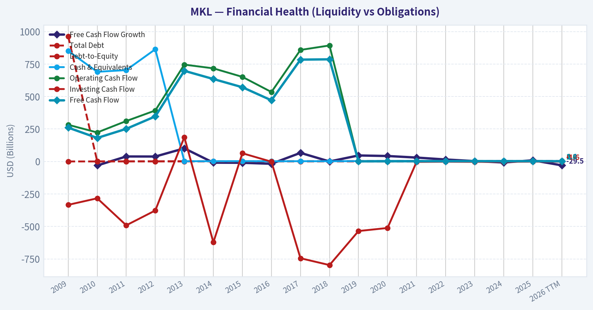

This breakdown chart from <em>Revenue Breakdown</em> shows the proportional composition for **MKL** - useful for understanding what drives or risks the business.

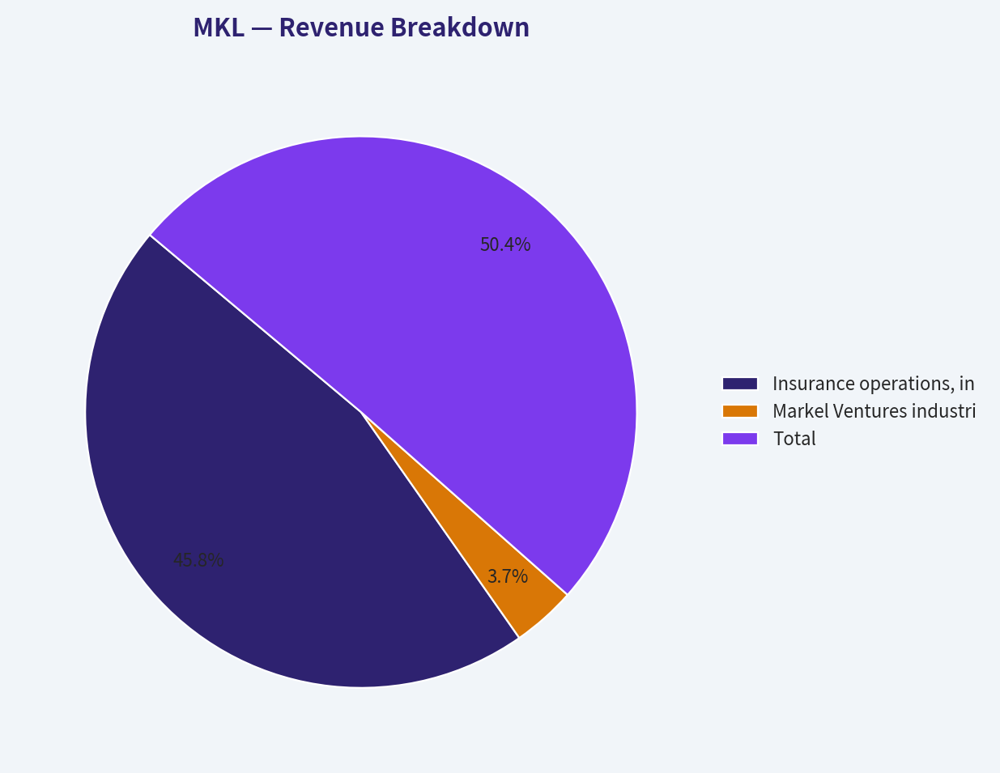

---

### Intrinsic Value Analysis (Buffett)

> *Following Warren Buffett's value investing philosophy: Circle of Competence, Economic Moat, Management Quality, and Margin of Safety.*

#### Intrinsic Value Snapshot

Price is what you pay. Intrinsic value is what the business may be worth based on the cash it can create for owners over time. We show a range, not one magic number.

- Current Price: $1,962.08
- Value Range (conservative to optimistic across both DCF methods): $515.92 to $11,540.82

##### Owner Earnings (Buffett Method)
- Net Income: $2,107,010,000.00
- Depreciation & Amortization: $347,918,000.00
- Capital Expenditures: $-206,894,000.00
- Working Capital Changes: $960,275,000.00
- Owner Earnings: $1,287,759,000.00

##### Intrinsic Value
###### Buffett Method
Uses owner earnings. Stricter, and usually more conservative.
- Conservative: $515.92
- Average: $2,422.42
- Optimistic: $11,540.82
- Discount Rate: 10.0%

###### Cash Flow Method
Uses free cash flow. Better for companies spending heavily today to grow tomorrow.
- Conservative: $1,281.44
- Average: $3,081.51
- Optimistic: $7,072.22
- Discount Rate: 10.0%

ANALYST STANCE: **Bullish**

#### Executive View

Markel Group is a specialized insurance and investment conglomerate with an additional collection of industrial businesses through Markel Ventures. Its core economics resemble a smaller, more focused version of Berkshire Hathaway: underwriting generates investable float, investment income compounds capital, and management can reinvest surplus cash across insurance and operating businesses.

At approximately 14 times earnings and a reported 11.3% ROE, MKL is not priced like a high-growth compounder. The valuation appears reasonable for a high-quality specialty insurer, although returns on equity have not yet reached the consistently exceptional level that would justify an aggressive premium.

#### Factor Scorecard

| Factor | Score | Assessment |
|---|---:|---|
| Circle of competence and simplicity | 4/5 | Insurance, investment float, and operating businesses are understandable, though consolidated results are more complex than a pure insurer. |
| Durable competitive advantage | 4/5 | Specialty underwriting expertise, distribution relationships, reputation, data, and long-duration float create a meaningful moat. |
| Management and capital allocation | 4/5 | Long-term orientation and decentralized operating culture are strengths; capital allocation must be judged over full insurance cycles. |
| Industry structure | 4/5 | Specialty insurance is more rational and differentiated than commodity insurance, though catastrophe losses and pricing cycles remain material. |

**Gate 5 assessment:** The financial-distress floor is **not tripped**. The available figures do not show the combination of sharply deteriorating earnings and a solvency red line. Insurers should be evaluated using capital adequacy, reserve quality, underwriting results, and investment discipline rather than conventional industrial-company leverage metrics.

**Key Takeaways:** MKL scores well because it operates in a specialized insurance niche with valuable float and a long-term capital-allocation culture. The principal weakness is not solvency but the variability of insurance earnings and the fact that reported ROE is solid rather than outstanding.

#### Moat Analysis

**Specialty underwriting expertise.** Markel focuses on difficult-to-underwrite risks where price, terms, claims discipline, and distribution matter more than simply offering the lowest premium. Expertise in these niches can support better pricing and loss selection than a generalist competitor.

**Float and investment capability.** Premiums are collected before claims are paid, creating investable funds. A strong insurer can earn both an underwriting profit and investment income on float. The value of this model compounds over time if reserves are conservatively established and capital is reinvested intelligently.

**Reputation and distribution.** Brokers and policyholders value claims-paying ability, financial strength, and specialist knowledge. These relationships are difficult for a new entrant to reproduce quickly.

**Diversification.** Markel Ventures adds operating businesses outside insurance. This broadens the earnings base, but it also increases analytical complexity and makes consolidated margins less informative.

The moat is best characterized as **wide and stable**, rather than clearly wide and widening. It is strong but dependent on underwriting discipline and reserve quality.

#### Management Quality Assessment

Markel's culture has historically emphasized decentralized decision-making, long-term ownership, and rational capital deployment. That is favorable under a Buffett-style framework.

The main questions to monitor are:

- Whether management maintains underwriting discipline when pricing becomes competitive.
- Whether acquisitions are made at sensible prices.
- Whether capital is retained only when expected returns exceed the cost of capital.
- Whether reserve development remains conservative across multiple insurance cycles.
- Whether Markel Ventures receives capital because of attractive economics rather than conglomerate-building ambition.

Management quality appears above average, but the company does not warrant a perfect score until sustained per-share compounding and capital returns improve further.

#### Latest Financial Snapshot

| Metric | Latest figure |
|---|---:|
| Share price | $1,962 |
| Market capitalization | $23.99 billion |
| P/E ratio | 13.96x |
| ROE | 11.3% |
| Revenue growth, year over year | 4.7% |
| Reported FCF yield | 10.6% |
| Implied earnings per share | Approximately $140.50 |
| Implied net income | Approximately $1.72 billion |

**Key Takeaways:** MKL trades at roughly 14 times earnings, which is undemanding for a respected specialty-insurance franchise. Revenue growth is modest, while the 11.3% ROE is respectable but below the 15% to 20% level associated with exceptional compounders. The reported free-cash-flow yield is attractive, but insurer cash flow requires careful interpretation because premium collections, reserve movements, and investment activity distort conventional FCF.

#### Owner Earnings Calculation

For an insurer, conventional free cash flow is not a clean measure of owner earnings. Premiums received and claims paid occur at different times, investment gains can be volatile, and required capital must remain inside the insurance subsidiaries.

A practical owner-earnings proxy is normalized earnings available to shareholders:

| Component | Approximate amount |
|---|---:|
| Earnings per share | $140.50 |
| Shares implied by market capitalization | 12.23 million |
| Normalized earnings proxy | $1.72 billion |
| Normalized owner earnings per share | $140.50 |

**Key Takeaways:** The cleanest available owner-earnings proxy is current normalized earnings rather than reported free cash flow. At the current valuation, MKL is being valued on approximately $1.72 billion of annual earnings power. The key due-diligence issue is whether those earnings are supported by durable underwriting profits and conservative reserves rather than favorable temporary investment marks.

#### Three-Scenario Valuation

The following valuation uses approximately $1.72 billion of normalized earnings as an owner-earnings proxy, a 10% discount rate, and approximately 12.23 million implied shares.

| Scenario | Assumption | Estimated equity value | Estimated value per share |
|---|---|---:|---:|
| A: No growth | Earnings remain constant; 10% discount rate | $17.2 billion | $1,405 |
| B: GDP growth | 3% annual growth; 10% discount rate | $25.5 billion | $2,082 |
| C: Moderate historical-style growth | 5% annual growth for 10 years, then 5% terminal growth | $34.4 billion | $2,812 |
| Current market price | - | $23.99 billion | $1,962 |

**Key Takeaways:** The conservative no-growth case is below the current quotation, while the 3% growth case is modestly above it. The valuation therefore depends on MKL retaining some growth through underwriting expansion, investment income, and disciplined reinvestment. The higher-growth case provides substantial upside but should not be treated as a base case for an insurer.

#### Margin of Safety Analysis

| Measure | Result |
|---|---:|
| Price versus no-growth value | Approximately 40% above |
| Price versus 3% growth value | Approximately 6% below |
| Price versus moderate-growth value | Approximately 30% below |
| Quality-adjusted conclusion | Fair price, limited conservative margin of safety |

**Key Takeaways:** MKL does not offer a large margin of safety under a strict no-growth valuation. At the same time, the market price is reasonable if the company can compound earnings around GDP-like rates and maintain underwriting quality. For a business with a credible specialty-insurance moat, a small or moderate margin of safety can be acceptable, but the purchase case is stronger below approximately $1,700 to $1,800 per share.

#### Final Buffett Scorecard

| Criterion | Weight | Score | Weighted contribution |
|---|---:|---:|---:|
| Moat width and durability | 25% | 4.0 | 1.00 |
| Valuation and margin of safety | 20% | 3.0 | 0.60 |
| Capital returns versus WACC | 15% | 3.0 | 0.45 |
| Business understanding and predictability | 12% | 4.0 | 0.48 |
| Management quality and capital allocation | 12% | 4.0 | 0.48 |
| Reinvestment runway | 8% | 3.5 | 0.28 |
| Balance-sheet strength | 4% | 3.5 | 0.14 |
| Industry structure | 4% | 4.0 | 0.16 |
| **Total** | **100%** | - | **3.59/5.00** |

**Key Takeaways:** MKL's overall score is supported by its moat, management culture, and favorable specialty-insurance industry structure. The score is held back by only moderate ROE and a valuation that is attractive mainly under a modest-growth assumption rather than a no-growth assumption.

#### Investment Stance

**Bullish - moderate conviction.**

MKL is a high-quality financial franchise trading at a reasonable earnings multiple, not an obvious bargain. It suits a long-term investor seeking exposure to specialty insurance, investable float, and disciplined capital allocation. The best strategy is to accumulate gradually, with stronger conviction during periods of insurance-market weakness or when the share price falls below approximately $1,700 to $1,800.

The central risks are underwriting deterioration, adverse reserve development, catastrophe losses, investment volatility, and overpayment for acquisitions. If ROE remains near 11% rather than moving toward the mid-teens, the stock should be treated as fairly valued rather than deeply undervalued.
#### Valuation Bridge

This bridge places the current market price beside each intrinsic value lens so readers can see whether upside depends on one method or shows up across several methods.

| Scenario | Intrinsic Value / Share |
| --- | ---: |
| Buffett Method | $2,422.42 |
| Cash Flow Method | $3,081.51 |
| Current Price | $1,962.08 |

#### Key Takeaways

If one method is far above the others, the upside case depends on a specific modelling assumption. When several methods cluster together, the valuation story is more robust.

#### Valuation Visuals

This comparison chart from *Latest Earnings Snapshot* stacks current figures against historical benchmarks for **MKL**, making it easy to see where the company trades relative to its own averages.

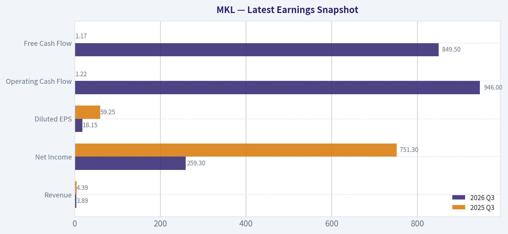

This comparison chart from *Current Metrics Versus Historical Averages* stacks current figures against historical benchmarks for **MKL**, making it easy to see where the company trades relative to its own averages.

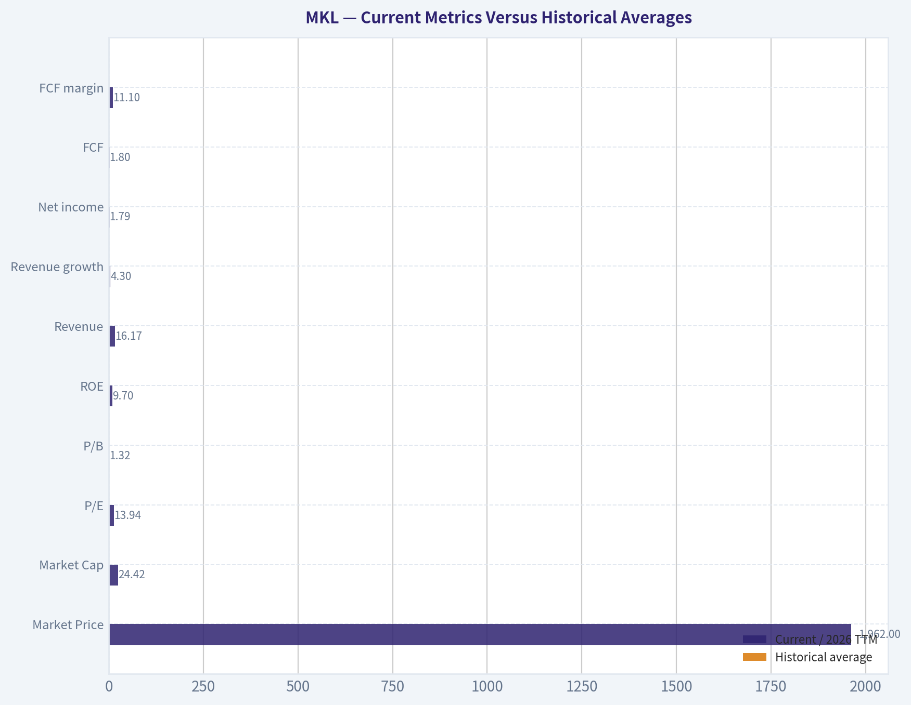

This comparison chart from *Three-Scenario Buffett Owner-Earnings DCF* stacks current figures against historical benchmarks for **MKL**, making it easy to see where the company trades relative to its own averages.

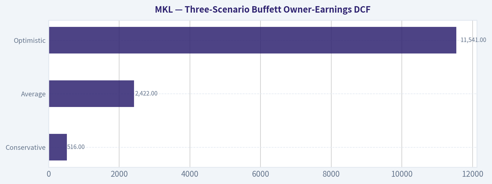

This comparison chart from *Latest Financial Snapshot* stacks current figures against historical benchmarks for **MKL**, making it easy to see where the company trades relative to its own averages.

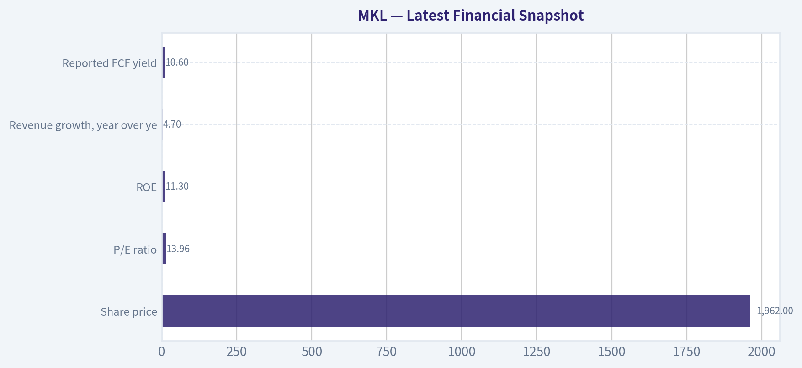

This comparison chart from *Owner Earnings Calculation* stacks current figures against historical benchmarks for **MKL**, making it easy to see where the company trades relative to its own averages.

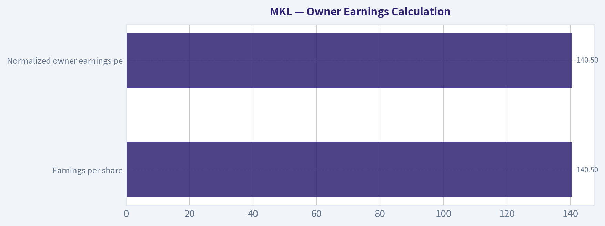

---

### Trend & Growth Analysis (Lynch/Druckenmiller/Fisher)

> *Following Peter Lynch's GARP, Stanley Druckenmiller's macro-aware approach, and Philip Fisher's scuttlebutt methodology.*

ANALYST STANCE: **Neutral**

#### Executive conclusion

Markel Group (NYSE: MKL) is a high-quality specialty insurance and investment compounder, but current evidence does not show the 15-25% growth or accelerating inflection point required for a classic Lynch fast grower or ten-bagger candidate.

At approximately $1,962 per share and a $24.0 billion market capitalization, MKL trades at about 14.0 times earnings and offers a reported 10.6% free-cash-flow yield. That valuation is attractive for a disciplined, well-managed insurer, but the latest reported revenue growth of 4.7% places it closer to a stalwart than a fast grower.

#### 1. Lynch classification

| Metric | Assessment |
|---|---:|
| Lynch category | Stalwart / specialty financial compounder |
| Revenue growth | 4.7% year over year |
| P/E ratio | 14.0x |
| ROE | 11.3% |
| FCF yield | 10.6% |
| Ten-bagger characteristics | Limited at current growth rate |
| Primary investment case | Underwriting discipline, capital compounding, valuation |

**Key Takeaways:** MKL is not currently a fast grower under Lynch's framework. Its appeal comes from valuation, capital allocation, and the potential for underwriting and investment earnings to compound steadily rather than from rapid top-line expansion.

#### 2. The story in three bullets

- Markel combines specialty insurance underwriting with an investment portfolio and Markel Ventures operating businesses, creating multiple avenues for long-term capital compounding.
- Specialty insurance can benefit from disciplined pricing, higher investment yields, and favorable industry capacity cycles.
- The stock appears reasonably valued, but the market needs evidence of accelerating underwriting profits, stronger book-value growth, or improved operating leverage before a major re-rating is likely.

#### 3. TAM and 10x test

| TAM consideration | Assessment |
|---|---|
| Addressable market | Large global specialty insurance and reinsurance markets |
| TAM growth | Moderate and cyclical rather than structurally explosive |
| Current company scale | Approximately $24 billion market capitalization; revenue base not provided in the research pack |
| 10x revenue test | Cannot be fully validated without current revenue and premium data |
| Capital constraint | A 10x expansion would require substantially more underwriting capital and reserves |
| Runway | Long, but more suitable for steady compounding than hypergrowth |

**Key Takeaways:** MKL operates in a large market, but insurance growth is constrained by capital, underwriting discipline, and pricing cycles. The TAM is sufficient for continued expansion, yet the available data do not support a credible 10x revenue thesis from today's scale.

#### 4. Revenue growth trend

| Growth indicator | Latest evidence | Interpretation |
|---|---:|---|
| Revenue growth | 4.7% year over year | Positive but modest |
| Multi-year trend | Not available | Acceleration cannot be confirmed |
| Earnings growth | Not provided | Requires review of operating income and book-value growth |
| Organic versus acquisition growth | Not provided | Revenue quality cannot be fully assessed |
| Trend classification | Stable/modest | Not an identifiable inflection |

**Key Takeaways:** The latest 4.7% growth rate is healthy for a mature insurer but below the threshold for a fast-growing investment opportunity. Because a multi-period revenue and underwriting-profit series was not available, there is no evidence yet of accelerating growth.

#### 5. Unit economics and operating quality

| Metric | Assessment |
|---|---|
| LTV/CAC | Not applicable; MKL is primarily an insurer and investment compounder |
| Net revenue retention | Not applicable |
| Rule of 40 | Not applicable |
| ROE | 11.3% |
| FCF yield | 10.6%, though insurer cash-flow interpretation requires caution |
| Key insurance metrics needed | Combined ratio, reserve development, gross written premium growth, renewal pricing, book-value growth |

**Key Takeaways:** Traditional SaaS unit economics do not apply to MKL. The most important operating indicators are underwriting profitability, reserve adequacy, premium growth, and return on equity. The reported 11.3% ROE is respectable, while the 10.6% FCF yield supports the valuation case but should not be interpreted like a software company's free cash flow.

#### 6. Inflection-point assessment

| Potential inflection | Current evidence | Rating |
|---|---|---|
| Product or platform cycle | No clear new-product catalyst identified | Neutral |
| Market-share inflection | Specialty insurance opportunity exists, but share data unavailable | Neutral |
| Margin inflection | Not confirmed | Neutral |
| Investment-income inflection | Higher interest rates can support portfolio income | Positive but cyclical |
| Competitive inflection | Specialty pricing may remain favorable, but no decisive competitor disruption identified | Neutral |
| Corporate portfolio catalyst | Markel Ventures and insurance portfolio provide optionality | Positive |

**Key Takeaways:** MKL has several potential earnings drivers, but none is currently confirmed as a powerful acceleration point. The most visible positive factor is investment income from higher yields, while underwriting pricing and reserve performance remain the key variables to monitor.

#### 7. Macro setup

| Macro factor | Impact on MKL |
|---|---|
| Interest rates | Generally positive for investment income; negative for valuation of fixed-income assets if rates rise sharply |
| Insurance pricing | Positive when specialty pricing remains firm |
| Catastrophe losses | Major downside risk |
| Economic growth | Mixed; affects commercial insurance demand and portfolio values |
| Credit conditions | Important for investment portfolio and operating companies |
| Overall macro stance | Moderately favorable, but cyclical |

**Key Takeaways:** The macro backdrop is moderately supportive because higher yields can increase insurance investment income. However, catastrophe claims, reserve surprises, and credit-market volatility can overwhelm the benefit of higher rates in any single year.

#### 8. Fisher 15-point score

| Fisher criterion | Score | Comment |
|---|---:|---|
| Market potential | 4/5 | Large specialty insurance opportunity |
| New-product development | 4/5 | Diversified insurance and operating-company platform |
| R&D effectiveness | 3/5 | Less relevant than in technology businesses |
| Sales organization | 4/5 | Specialty distribution is an important strength |
| Profit margins | 4/5 | Attractive potential, but insurance margins are cyclical |
| Margin improvement | 3/5 | No clear current inflection |
| Labor relations | 4/5 | No major concern identified |
| Executive relations | 4/5 | Strong long-term culture appears intact |
| Management depth | 4/5 | Diversified operating platform |
| Cost accounting | 4/5 | Financial discipline is important to the model |
| Outstanding competitive assets | 5/5 | Brand, specialty expertise, data, distribution, and capital |
| Long-range outlook | 4/5 | Favorable but not hypergrowth |
| Dilution | 4/5 | No major dilution concern in the supplied data |
| Management candor | 4/5 | Generally viewed as a high-quality institution |
| Management integrity | 5/5 | Strong reputation |

| Fisher result | Score |
|---|---:|
| Preliminary Fisher score | 60/75 |
| Interpretation | Good to very good |

**Key Takeaways:** MKL scores well on competitive assets, management quality, and long-term business durability. It loses points because its growth is moderate, its earnings are cyclical, and several key insurance metrics were unavailable for verification.

#### 9. Valuation analysis

| Valuation measure | Result | Interpretation |
|---|---:|---|
| P/E | 14.0x | Reasonable for a quality insurer |
| PEG using 4.7% growth | Approximately 3.0x | Expensive relative to current growth |
| FCF yield | 10.6% | Attractive if cash flow is sustainable |
| P/S | Not available | Less useful for an insurer |
| P/B | Not available | Important for insurance analysis |
| Intrinsic-value headline | Not meaningful | Financial issuers require book-value and underwriting analysis |

**Key Takeaways:** MKL looks inexpensive on earnings and free-cash-flow yield, but the mechanical PEG ratio is unattractive because current growth is only 4.7%. For an insurer, price-to-book, growth in book value per share, combined ratio, and normalized ROE are more important than PEG or sales multiples.

#### Valuation scenarios

| Scenario | Operating assumptions | Potential outcome |
|---|---|---|
| Bear | Weak underwriting cycle, catastrophe losses, reserve pressure, lower investment returns | Earnings and book value stagnate; valuation may compress |
| Base | Mid-single-digit premium growth, disciplined underwriting, steady investment income | Moderate earnings and book-value compounding |
| Bull | Strong specialty pricing, favorable reserve development, higher investment income, improved operating leverage | Meaningful earnings re-rating and above-market compounding |

**Key Takeaways:** The base case is steady compounding rather than explosive growth. The bull case requires multiple factors to align, especially sustained specialty pricing and stronger underwriting results. Without a demonstrated acceleration, MKL is more likely to be a quality compounder than a ten-bagger.

#### 10. Growth investor scorecard

| Criterion | Weight | Score / 5 | Weighted contribution |
|---|---:|---:|---:|
| Story | 10% | 3.5 | 0.35 |
| TAM and runway | 20% | 3.0 | 0.60 |
| Revenue growth | 20% | 2.5 | 0.50 |
| Unit economics | 15% | 3.2 | 0.48 |
| Competitive position | 10% | 4.2 | 0.42 |
| Management quality | 10% | 4.2 | 0.42 |
| Macro setup | 5% | 3.5 | 0.18 |
| Profitability path | 5% | 4.0 | 0.20 |
| Valuation | 5% | 3.8 | 0.19 |
| **Total** | **100%** |  | **3.34 / 5.00** |

**Key Takeaways:** MKL's overall score lands in the Neutral range. Competitive strength, management, and valuation offset the lack of fast revenue growth, but the stock does not yet meet the threshold for a high-conviction growth position.

#### 11. Position-size stance

| Investor profile | Suggested stance |
|---|---|
| Fast-growth investor | No new full-size position |
| Quality compounder investor | Small starter position may be reasonable |
| Existing MKL holder | Hold and monitor operating metrics |
| Suggested position size | 0-2% initially; increase only after confirmed acceleration |
| Upgrade trigger | Sustained double-digit premium growth, improving ROE, strong book-value growth, and favorable combined ratios |

**Key Takeaways:** MKL is better suited to a diversified quality-compounder portfolio than to a concentrated ten-bagger strategy. A small position could be justified at the current valuation, but adding aggressively before evidence of an operating inflection would be premature.

#### 12. Key risks and catalysts

| Catalysts | Risks |
|---|---|
| Sustained specialty insurance pricing | Catastrophe losses |
| Improving combined ratio | Adverse reserve development |
| Higher investment income | Credit and fixed-income losses |
| Stronger Markel Ventures results | Weak economic conditions |
| Accelerating book-value-per-share growth | Capital misallocation or dilution |
| Share repurchases at a discount to intrinsic value | Insurance-cycle deterioration |

**Key Takeaways:** The principal catalyst is operating improvement rather than a new technology product. The main risks are insurance-cycle deterioration, catastrophe exposure, and reserve problems. Investors should prioritize quarterly trends in premium growth, combined ratio, reserve development, book value per share, and ROE.

#### Final judgment

MKL is a **Neutral**, not an outright avoid. It appears attractively valued for a durable specialty financial company, but the current 4.7% revenue growth rate does not support a fast-growth classification or a strong ten-bagger thesis. The most important next step is confirming whether underwriting profitability and book-value growth are accelerating; absent that evidence, MKL should remain a modest-sized quality holding rather than a concentrated growth investment.

---

### Market Technical Analysis

ANALYST STANCE: **Neutral**

#### MKL technical analysis

**Data status:** The latest retrieved trading session is November 12, 2026, with MKL closing at **$1,962.08**. November 13 is not represented as a trading session in the data, so the analysis uses November 12 as the effective latest close.

MKL's technical picture has improved materially over the past month, but the stock is now approaching a short-term momentum decision point. Price has advanced from approximately **$1,797.10 on October 14 to $1,962.08**, a gain of about **9.2%**. The advance has been supported by rising short- and medium-term averages, positive MACD momentum, and a volume-weighted average that has moved steadily higher. However, the long-term 200-day average is still declining, and RSI is close to overbought territory, suggesting that upside momentum is constructive but no longer especially early-stage.

#### Trend structure

The short-term trend is clearly positive. The **10-day EMA is $1,938.90**, placing the latest close roughly **1.2% above** that average. The 10-day EMA has risen sharply from approximately $1,767 on October 14, showing that recent price strength has been persistent rather than limited to a single session.

The **50-day SMA is $1,822.56**, and it has been gradually rising since late October. MKL is approximately **7.7% above** this medium-term benchmark. This gap confirms strong intermediate momentum, but it also indicates that the stock has moved meaningfully away from its average and may be more vulnerable to consolidation if buyers pause.

The **200-day SMA is $1,891.80**. Price remains about **3.7% above** this long-term trend line, which is constructive because the stock has reclaimed and held above a major benchmark. Nevertheless, the 200-day SMA is still drifting lower, falling from roughly $1,913 in mid-October to $1,892 currently. This creates an important distinction: MKL is trading above its long-term average, but the long-term trend has not yet fully turned upward.

#### Momentum and MACD

MACD is strongly positive. On November 12, the **MACD line was 42.66**, versus a **signal line at 36.84**, producing a positive spread of approximately **5.82 points**. Both lines have risen substantially since mid-October, when MACD was negative and the signal line was even lower.

This configuration confirms that upward momentum remains dominant. The MACD line has stayed above the signal line since late October, and the spread remains wide enough to avoid describing the signal as marginal. However, MACD momentum appears to be decelerating slightly: the MACD line declined from 42.92 on November 11 to 42.66 on November 12, while the signal line continued rising. That is not yet a bearish reversal, but it is an early indication that the recent acceleration may be cooling.

The recent price action reinforces this interpretation. MKL reached an intraday high near **$1,998** on November 5 but closed at $1,962.08 on November 12. The stock is therefore testing the psychological and technical area around **$2,000**, but has not yet produced a decisive breakout above it.

#### RSI and overbought risk

The **RSI is 68.06**, down from readings above 70 earlier in the week. RSI reached approximately 72 on November 10 and 71.6 on November 11 before easing.

This is a nuanced signal. RSI near 68 indicates strong momentum, not weakness, and in a sustained uptrend it can remain elevated for an extended period. At the same time, the retreat from above 70 suggests that the latest rally is becoming less forceful. A further move below the mid-60s would indicate that momentum is normalizing; a move back above 70 accompanied by a breakout above $2,000 would instead confirm renewed upside pressure.

There is currently no clear RSI reversal pattern from the available data. The indicator is best interpreted as **bullish but near a short-term exhaustion threshold**, rather than as an outright sell signal.

#### Volume and VWMA confirmation

The **VWMA is $1,917.72**, approximately **2.3% below** the latest close. Since VWMA incorporates trading volume, price being above it indicates that recent buying has occurred at progressively higher volume-weighted prices.

The VWMA has risen from approximately $1,742 in mid-October to above $1,917, confirming that the rally is not merely a low-volume drift. There were notable volume expansions during the early-November advance, especially around the move toward $1,998. That supports the validity of the breakout attempt.

Still, the stock has not yet demonstrated a clean, high-volume close above the $1,998 to $2,000 area. A sustained move above that zone with expanding volume would improve the probability that the rally is entering a new leg. Failure near $2,000, especially if accompanied by heavier selling volume, would raise the risk of a pullback toward the short-term averages.

#### Volatility and risk management

ATR is approximately **$34.11**, equivalent to about **1.7% of the share price**. This is a meaningful daily movement range for a high-priced stock. It implies that ordinary day-to-day fluctuations can be sizable in dollar terms even when the percentage move appears moderate.

ATR declined from approximately $36.45 on November 6 to $34.11 on November 12, suggesting that volatility has eased somewhat after the early-November surge. That is generally constructive if price continues to rise, because it can indicate an orderly trend rather than increasingly unstable speculation. However, a failed breakout near $2,000 could still produce a move of several ATRs, particularly if market-wide risk sentiment deteriorates.

Potential reference levels based on the selected indicators are:

- **Near-term support:** approximately $1,939, near the 10-day EMA.
- **Volume-weighted support:** approximately $1,918, near the VWMA.
- **Longer-term trend support:** approximately $1,892, near the 200-day SMA.
- **Medium-term support:** approximately $1,823, near the 50-day SMA.
- **Immediate resistance:** approximately $1,985 to $2,000, based on recent highs and the round-number psychological level.

#### Trading interpretation

The evidence favors a **constructive intermediate-term trend**, but the near-term setup is less attractive for chasing strength because price is extended above its 50-day average, RSI is close to 70, and the stock is confronting resistance near $2,000.

A bullish continuation scenario would involve a decisive close above approximately $2,000, ideally with stronger volume and MACD maintaining a positive spread over its signal line. In that case, the current rally would be confirmed as a breakout rather than merely a recovery toward prior highs.

A consolidation scenario would involve price holding above the $1,939 to $1,918 area while RSI cools and MACD remains positive. Such a pullback would reduce short-term excess without necessarily damaging the broader trend.

A more cautious scenario would develop if MKL loses the 10-day EMA and then the VWMA, particularly if MACD turns lower and RSI falls through the mid-60s. A break below the 200-day SMA near $1,892 would be more significant because it would challenge the current long-term trend recovery.

The most appropriate overall characterization is **bullish trend, elevated short-term momentum, and watchful breakout risk**. The indicators do not currently support an aggressive bearish view, but they do suggest waiting for either a confirmed move above $2,000 or a controlled pullback toward trend support rather than assuming that further upside will be immediate.

#### Selected indicators

The selected set combines trend, momentum, volume, volatility, and risk-management information without relying on multiple overlapping oscillators:

- **close_10_ema:** Captures immediate trend direction and pullback behavior.
- **close_50_sma:** Defines the medium-term trend and dynamic support.
- **close_200_sma:** Provides long-term trend confirmation.
- **macd:** Measures directional momentum.
- **macds:** Supplies the smoothed MACD comparison needed to evaluate momentum crossovers.
- **rsi:** Assesses momentum intensity and short-term exhaustion risk.
- **vwma:** Confirms whether volume supports the price trend.
- **atr:** Estimates normal price movement and helps frame position and stop-loss risk.

| Area | Latest reading | Technical interpretation | Key level or implication |
|---|---:|---|---|
| Latest close | $1,962.08 | Price remains above all selected trend averages | Trend structure is constructive |
| 10-day EMA | $1,938.90 | Short-term momentum remains positive | First dynamic support near $1,939 |
| 50-day SMA | $1,822.56 | Medium-term trend is rising | Price is substantially extended above the average |
| 200-day SMA | $1,891.80 | Price is above the long-term benchmark, but the average is still declining | A close below $1,892 would weaken the long-term setup |
| MACD / signal | 42.66 / 36.84 | MACD remains above its signal line | Momentum is bullish, though recent acceleration is easing |
| RSI | 68.06 | Strong momentum, close to overbought territory | Further upside is possible, but chasing carries greater pullback risk |
| VWMA | $1,917.72 | Price is above the volume-weighted trend measure | Volume confirmation remains favorable |
| ATR | $34.11 | Daily volatility is approximately 1.7% of price | Risk controls should allow for substantial normal fluctuations |
| Resistance | ~$1,985-$2,000 | Recent highs and psychological resistance | Breakout requires a decisive close and preferably stronger volume |
| Overall stance | - | Bullish intermediate trend with short-term exhaustion risk | Watch for breakout confirmation or a controlled pullback |

**Key Takeaways:** MKL is in a constructive intermediate-term uptrend, with price above its 10-day EMA, 50-day SMA, 200-day SMA, and VWMA. Momentum remains bullish, but RSI is near 70 and MACD is showing early signs of deceleration, so the stock may need to consolidate before advancing further. The central decision zone is approximately $1,985 to $2,000: a high-volume breakout would strengthen the bullish case, while a pullback toward $1,939 or $1,918 would test whether the trend can hold orderly support.

---

### Options Market Analysis

> *Reading options flow - put/call ratios, IV skew, and unusual activity - to gauge institutional positioning and event-driven risk.*

ANALYST STANCE: **Bullish**

#### MKL Options Positioning Report

**As of November 13, 2026.** The available options data is notably thin, so the signal should be treated as low-confidence. Aggregate positioning is strongly call-heavy, but the elevated put-versus-call IV skew indicates that downside protection remains relatively expensive.

#### 1. Put/Call Ratio Analysis

| Expiration | Call OI | Put OI | Put/Call OI Ratio | Call Volume | Put Volume | Put/Call Volume Ratio |
|---|---:|---:|---:|---:|---:|---:|
| Nov. 20, 2026 | 172 | 15 | 0.09 | 193 | 34 | 0.18 |
| Dec. 18, 2026 | 3 | 2 | 0.67 | 3 | 2 | 0.67 |
| Jan. 15, 2027 | 280 | 13 | 0.05 | 102 | 26 | 0.25 |
| **Total** | **455** | **30** | **0.07** | **298** | **62** | **0.21** |

**Key Takeaways:** MKL's aggregate put/call OI ratio of 0.07 is far below the approximately 0.70 neutral baseline, indicating a strongly call-dominated options book. The volume ratio of 0.21 also favors calls, although the data does not identify whether those calls were bought or written. This is bullish in gross positioning terms, but covered-call writing could make the signal less directional than the raw ratio suggests.

#### 2. Implied Volatility Assessment

| Expiration | Call ATM IV | Put ATM IV | Put-Call IV Difference | Interpretation |
|---|---:|---:|---:|---|
| Nov. 20, 2026 | 0.5% | 3.3% | +2.8 percentage points | Strong put premium |
| Dec. 18, 2026 | 0.4% | 2.3% | +1.9 percentage points | Put premium, but very thin data |
| Jan. 15, 2027 | 3.1% | 11.5% | +8.4 percentage points | Pronounced downside skew |

**Key Takeaways:** Put IV is higher than call IV at every listed expiration, with the largest difference in January. That pattern signals demand for downside protection or a lack of liquidity in MKL puts, even though overall open interest is heavily call-weighted. The absolute IV readings are unusually low and should be interpreted cautiously because the chain appears illiquid and may contain sparse or stale quotes.

The supplied data does not provide separate out-of-the-money put and call IVs, so a precise OTM skew calculation is unavailable. The ATM comparison nevertheless points to a clear downside-volatility premium. No earnings, product launch, or other specific catalyst was provided, so elevated event-related IV cannot be confirmed.

#### 3. Unusual Options Activity

| Finding | Result |
|---|---|
| Contracts with volume greater than five times open interest | None |
| Fresh directional bets identifiable from the screen | None |
| Evidence of institutional sweep activity | None |
| Data-quality concern | Low overall activity and limited contract-level detail |

**Key Takeaways:** No contract met the screen for volume exceeding five times open interest, so there is no confirmed unusual activity or identifiable fresh institutional bet. The call-heavy totals appear to reflect existing positioning rather than an obvious new trade today. Because strikes were not supplied, individual contracts cannot be classified as ITM, ATM, or OTM.

#### 4. Open Interest Concentration

| Expiration | Largest OI Concentration | Total Call OI | Total Put OI | Positioning Significance |
|---|---|---:|---:|---|
| Nov. 20, 2026 | Calls: 172 | 172 | 15 | Near-term call concentration |
| Dec. 18, 2026 | Minimal activity | 3 | 2 | No meaningful gravitational level |
| Jan. 15, 2027 | Calls: 280 | 280 | 13 | Dominant medium-term call concentration |
| **All listed expirations** | **January calls lead** | **455** | **30** | Call-heavy structure overall |

**Key Takeaways:** January 2027 contains the largest concentration of open interest, with 280 calls, while the November expiration has another 172 calls. These expirations could create pinning or dealer-gamma effects, but strike-level data is unavailable, so specific gamma walls, max-pain levels, and price magnets cannot be identified. The December chain is too small to have meaningful market impact.

#### 5. Overall Options Sentiment

**Signal: BULLISH, with low confidence.**

The primary bullish driver is the exceptionally low aggregate put/call OI ratio of 0.07, reinforced by a 0.21 put/call volume ratio. Call open interest is concentrated in the near-term November and January expirations, suggesting that market participants hold substantially more call exposure than put exposure.

The principal caveat is that the chain is thin: total listed open interest is only 485 contracts, there is no unusual-volume signal, and the data does not reveal whether calls were bought or written. In addition, puts carry a meaningful IV premium, especially in January, indicating persistent demand for downside hedges. Therefore, the appropriate interpretation is **bullish positioning with limited conviction rather than a strong institutional buy signal**.

#### Summary

| Category | Assessment |
|---|---|
| Put/Call Ratio | Strongly bullish: 0.07 OI ratio and 0.21 volume ratio, both well below the 0.70 neutral baseline |
| IV Level | Very low reported absolute IV, but reliability is reduced by thin liquidity |
| Skew Direction | Bearish-risk skew: put IV exceeds call IV across all expirations |
| Unusual Activity | None detected; no contract exceeded five times its open interest |
| Overall Signal | **BULLISH, low confidence**; call-heavy positioning dominates, but put hedging and illiquidity are important caveats |

**Key Takeaways:** MKL's options structure is directionally bullish because calls dominate both open interest and trading volume. However, the lack of unusual activity, sparse chain, and pronounced put-volatility premium reduce confidence in the signal. The read is best characterized as bullish positioning with meaningful downside-hedging demand, not a high-conviction institutional momentum trade.

---

## Research Team Commentary

> *The Research Manager synthesizes the Bull vs Bear debate into action-free commentary. This is a pre-risk view, not the final stance.*

Core takeaway: Markel appears to be an above-average business with credible long-term compounding potential, but the evidence does not establish a sufficiently robust margin of safety at approximately $1,962. The strongest conclusion is to watch rather than chase it. The company is neither financially distressed nor clearly overvalued, so an Bearish rating would be excessive. At the same time, the bull valuation depends too heavily on treating roughly $140 per share of earnings as normalized.

The bull case is strongest on business architecture. Markel combines a defensible specialty-insurance franchise, investable insurance float, a securities portfolio, and Markel Ventures. Specialty underwriting expertise, broker relationships, licenses, claims data, and reputation form a real moat. Management also has more capital-allocation flexibility than a conventional insurer. At about 14 times reported earnings, the market does not appear to require rapid growth; if current earnings are sustainable and per-share value compounds at even a mid-single-digit rate, returns could be satisfactory.

The bear case is strongest on normalization and measurement. Insurance earnings can be materially affected by pricing cycles, catastrophe experience, reserve development, interest rates, and investment gains. The claim that the shares imply only 3%-5% growth is persuasive only if the current earnings base is sustainable. If normalized earnings are closer to $110-$120 per share, the valuation is much less forgiving. Likewise, the reported 21.2% ROIC should not be accepted at face value without reconciling it with the more modest 11.3% ROE, insurance float, segment capital, and actual per-share value creation.

That is the central valuation problem: the bull range of roughly $2,200-$2,600 suggests modest upside, while a reasonable conservative range of approximately $1,600-$1,900 suggests little protection. When plausible valuations straddle the market price this widely, the stock is not demonstrably cheap; the analyst's uncertainty is larger than the apparent discount.

From a Buffett-style perspective, Markel probably deserves a smaller required discount than a mediocre insurer because its specialty franchise and capital-allocation optionality are valuable. But it has not yet earned the same low uncertainty premium as the most predictable wide-moat compounders. Catastrophe exposure, long-tail reserve risk, claims inflation, insurance-cycle sensitivity, and conglomerate complexity justify requiring more than a token discount. At the lower end of the bull's intrinsic-value range, the current discount is only around 11%, which is inadequate unless normalized earnings and underwriting quality can be verified.

Market psychology does not reveal a compelling contrarian setup. A 14 times earnings multiple is not euphoric, but neither is the stock priced as if investors fear permanent impairment. Technical support around $1,939, $1,918, and $1,892 is irrelevant to intrinsic value. The call-heavy options positioning is also low-confidence because the market is thin, while expensive downside protection may reflect tail-risk awareness rather than hidden bullish information.

The lesson from similar situations is not to let an admired culture, an apparently low multiple, or a flattering return metric substitute for current-cycle evidence. The right response to incomplete fundamental data is not false precision. Markel should be judged by full-cycle underwriting profitability and growth in per-share intrinsic value, not by one period's P/E or market momentum.

Over the next one to four quarters, I would monitor the following:

First, track the combined ratio both as reported and excluding catastrophes and prior-year reserve development. Sustained underwriting profitability, especially as pricing becomes more competitive, would strengthen the thesis. A drift toward or above 100, excluding unusual catastrophes, would materially weaken it.

Second, compare renewal-rate changes with management's estimate of loss-cost inflation. Premium growth is valuable only if pricing remains ahead of expected claims costs. Slower growth caused by refusing underpriced risks would be acceptable; premium growth achieved through weaker underwriting would not be.

Third, examine reserve development, particularly in long-tail casualty lines. Neutral or favorable development would support confidence in normalized earnings. Repeated adverse development would indicate that prior profitability and current book value may be overstated.

Fourth, separate recurring underwriting income, net investment income, Markel Ventures operating earnings, realized investment gains, and mark-to-market movements. The key question is whether normalized operating earnings are truly close to $140 per share or materially lower.

Fifth, monitor growth in book value per share and a management-provided or analytically reconstructed measure of intrinsic value per share. These should be evaluated over multiple periods and adjusted for dividends and repurchases. High-single-digit or better full-cycle growth would support the compounder classification; persistently low-single-digit growth would not.

Sixth, evaluate Markel Ventures through organic revenue growth, margins, free cash flow, returns on incremental capital, and acquisition prices. Diversification is useful only if these businesses earn attractive returns after accounting for the capital committed.

Finally, review capital allocation. Accretive repurchases below conservatively estimated intrinsic value would be encouraging. Large acquisitions, aggressive premium growth, or capital retention without clear return targets would weaken confidence. Capital adequacy, holding-company liquidity, reinsurance costs, and investment-portfolio credit quality should also remain sound under stress.

Evidence of disciplined underwriting through a softening market, stable reserves, recurring earnings near the current level, and stronger per-share value growth could justify upgrading the stock. A price decline could also create an opportunity, but only after intrinsic value is recalculated rather than by relying on technical support. For now, Markel looks like a respectable franchise near fair value, not a clearly mispriced security.

Neutral

---

## Value Investing Team Commentary

> *The Investor translates the research view into an investment thesis before risk review. This is still not the final stance.*

Markel is a credible long-term compounder, but the current evidence supports patience rather than immediate ownership at $1,962.

### Business quality and moat

Markel's business architecture is attractive. It combines:

- A specialty-insurance franchise with underwriting expertise, broker relationships, licenses, claims data, and reputation.
- Insurance float that can be invested over long periods.
- A securities portfolio that can benefit from higher interest income and long-term capital appreciation.
- Markel Ventures, which provides exposure to operating businesses outside insurance.

This is more valuable than a plain-vanilla insurer because management has several avenues for reinvesting capital. The specialty-insurance niche can also be structurally appealing: disciplined underwriting, specialized knowledge, and distribution relationships can create customer and broker stickiness.

The important qualification is that insurance is not automatically a compounding business. The moat only creates value if Markel continues to price risk rationally, maintains reserve discipline, and invests float prudently. A company can possess a good franchise yet destroy value by pursuing premium growth during an overly competitive pricing environment.

### Earnings quality and valuation

At approximately 14 times reported earnings, Markel does not look expensive on the surface. But the key issue is the denominator. Insurance earnings can fluctuate because of:

- Catastrophe losses
- Reserve development
- Claims inflation
- Reinsurance costs
- Changes in investment income
- Realized and unrealized portfolio gains

At $1,962, the 13.96 P/E implies earnings of roughly $140 per share. If that figure represents sustainable normalized earnings, the valuation could be reasonable for a business capable of compounding intrinsic value at mid- to high-single-digit rates.

However, if normalized earnings are closer to $110-$120 per share, the effective valuation is approximately 16-18 times earnings. That is still not excessive for a good franchise, but it offers much less protection when combined with catastrophe and reserve uncertainty.

The supplied valuation ranges illustrate the problem. A bullish value of $2,200-$2,600 provides moderate upside, while a conservative range of $1,600-$1,900 provides meaningful downside. When reasonable assumptions produce such a wide valuation band, the issue is not merely price; it is uncertainty about normalized earning power.

The reported 21.2% ROIC also deserves careful interpretation. It is materially higher than the 11.3% ROE, and insurance float, segment capital, leverage, and accounting conventions can make ROIC comparisons less informative. The better question is whether Markel is steadily increasing per-share intrinsic value after accounting for all capital supporting the insurance operation.

### Management and capital allocation

Management quality is central to this investment. Markel deserves credit for having more reinvestment options than many insurers, but optionality is valuable only when capital is deployed at attractive returns.

The most important tests are:

1. Whether underwriting remains profitable when pricing softens.
2. Whether acquisitions are made at sensible prices.
3. Whether Markel repurchases shares below conservative intrinsic value.
4. Whether capital is retained only when expected returns exceed the cost of capital.
5. Whether Markel Ventures produces attractive returns on incremental investment rather than merely adding scale.

A large conglomerate structure can conceal weak capital allocation. Investors should therefore judge Markel by growth in per-share intrinsic value, not simply consolidated revenue or headline earnings.

### Selective contrarian view

The contrarian case is not that the market is irrationally pessimistic. The more interesting possibility is that investors may be underappreciating the long-term value of Markel's architecture because current results do not yet demonstrate strong operating leverage or accelerating book-value growth.

If underwriting remains disciplined while competitors chase volume, Markel could emerge from a softer insurance market with better economics and stronger pricing power. Higher investment yields may also support earnings for longer than older valuation frameworks assume.

But contrarianism cuts both ways. A low-teens earnings multiple may reflect rational concern about normalized profitability rather than an overlooked bargain. The market could be correctly discounting reserve risk, catastrophe volatility, and the difficulty of proving that current earnings are durable. Call-heavy options positioning is not persuasive contrary evidence, particularly given the thin market and elevated cost of downside protection. Options sentiment should not override underwriting fundamentals.

Technical levels around $1,939, $1,918, and $1,892 may identify possible entry points for traders, but they have no bearing on intrinsic value. A lower price would become attractive only if the underlying valuation remained intact after reviewing updated reserves, catastrophe experience, and operating earnings.

### What would change the decision?

The thesis would improve materially if Markel demonstrates:

- Sustained combined ratios below 100% excluding unusual catastrophe effects.
- Renewal pricing that remains ahead of loss-cost inflation.
- Stable or favorable reserve development, particularly in long-tail casualty lines.
- Recurring earnings near the current $140-per-share level.
- Consistent growth in book value and intrinsic value per share.
- Strong free-cash-flow generation and returns from Markel Ventures.
- Disciplined repurchases or acquisitions at demonstrable discounts to intrinsic value.

Conversely, repeated adverse reserve development, weakening underwriting margins, premium growth purchased through looser pricing, or capital retention without attractive reinvestment opportunities would weaken the compounder thesis.

### Conclusion

Markel appears to be a respectable business with a genuine moat and multiple long-term compounding mechanisms. It is not distressed, and a 14-times earnings multiple is not euphoric. Nevertheless, the current price does not provide a sufficiently wide margin of safety unless approximately $140 per share of earnings proves to be durable.

For a high-quality but somewhat complex insurer, the appropriate standard is not simply "not expensive." The business should be purchased when normalized earnings, underwriting quality, and per-share value creation are sufficiently clear. At present, the uncertainty around those variables is greater than the apparent valuation discount.

**ANALYST STANCE: Neutral**

---

## Deep Values Commentary

> *The Risk Management Team debates and the Risk Judge provides the final action-free verdict. This section determines the final Bullish / Neutral / Bearish stance.*

#### Final Stance Scorecard

This scorecard converts the final research view into a weighted decision frame. It does not replace the narrative judgement, but it makes the main drivers of the verdict easier to scan.

| Criterion | Score | Weight | Commentary |
| --- | ---: | ---: | --- |
| Business Quality | 3.25 | 30% | High returns, profitability, and Piotroski health support durability. |
| Valuation Support | 4.33 | 30% | Blends current price against available intrinsic value anchors and valuation ratios. |
| Financial Strength | 4.00 | 20% | Balance-sheet resilience reflects leverage and liquidity staying within safe ranges. |
| Growth Durability | 2.33 | 20% | Recent revenue, earnings, and free cash flow growth indicate how durable expansion looks. |
| TOTAL / FINAL STANCE | 3.54 | 100% | Neutral |

#### Key Takeaways

The weighted score lands at **3.54 / 5.0**, while the final stance remains **Neutral**. This is useful as a quick calibration aid rather than a mechanical signal.

#### Risk Summary

Higher scores indicate more risk pressure. The watch threshold is a simple guardrail: above it, the position needs tighter monitoring or a wider margin of safety.

| Dimension | Current Score | Watch Threshold | Commentary |
| --- | ---: | ---: | --- |
| Business Quality | 2.75 | 3.00 | High returns, profitability, and Piotroski health support durability. |
| Valuation Support | 1.67 | 3.00 | Blends current price against available intrinsic value anchors and valuation ratios. |
| Financial Strength | 2.00 | 3.00 | Balance-sheet resilience reflects leverage and liquidity staying within safe ranges. |
| Growth Durability | 3.67 | 3.00 | Recent revenue, earnings, and free cash flow growth indicate how durable expansion looks. |

#### Key Takeaways

This view helps readers separate *where* the risk sits: valuation, business quality, balance sheet, or growth durability. It is especially useful when the final stance is close to the line between Neutral and Bearish.
