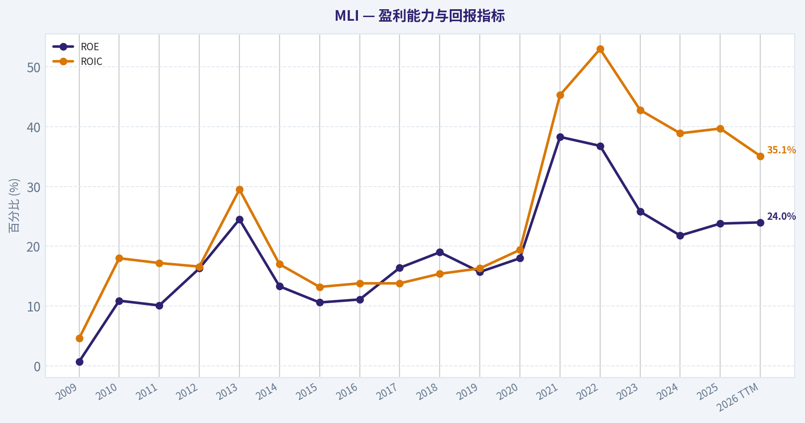
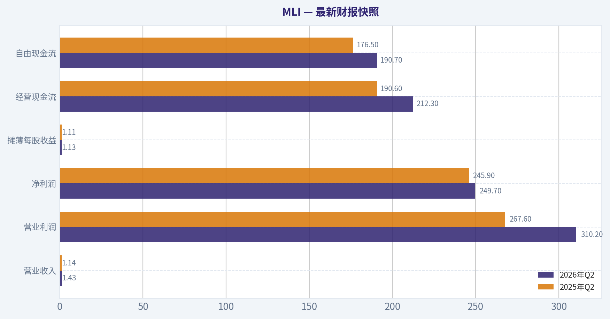
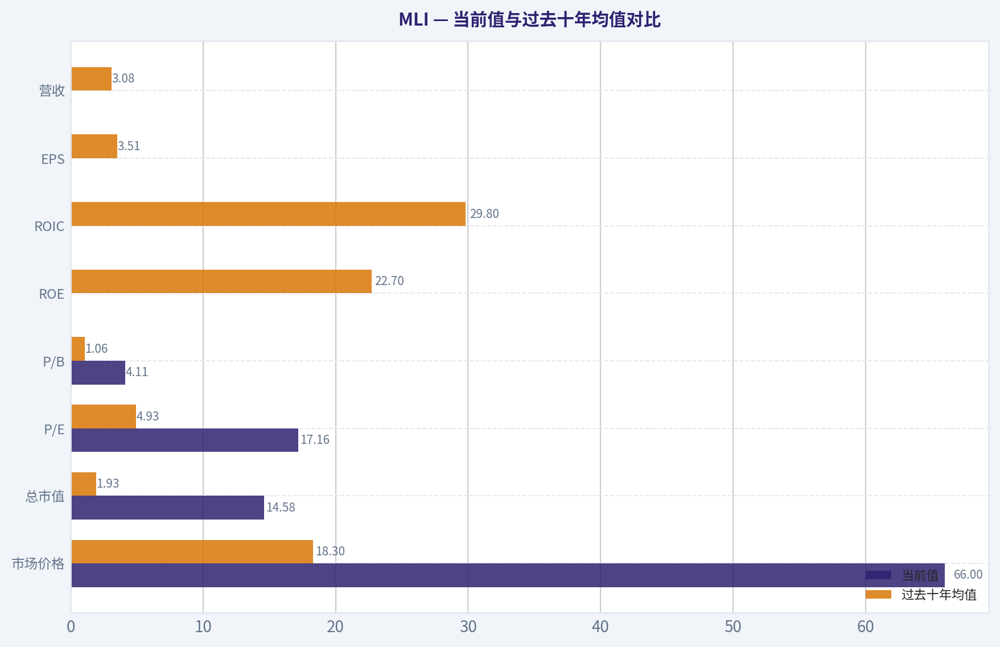
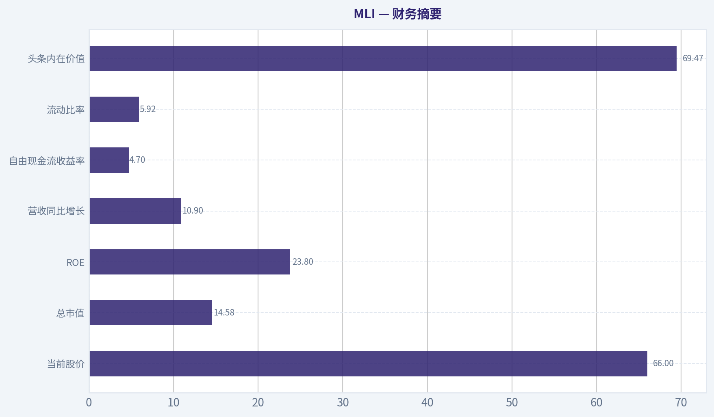
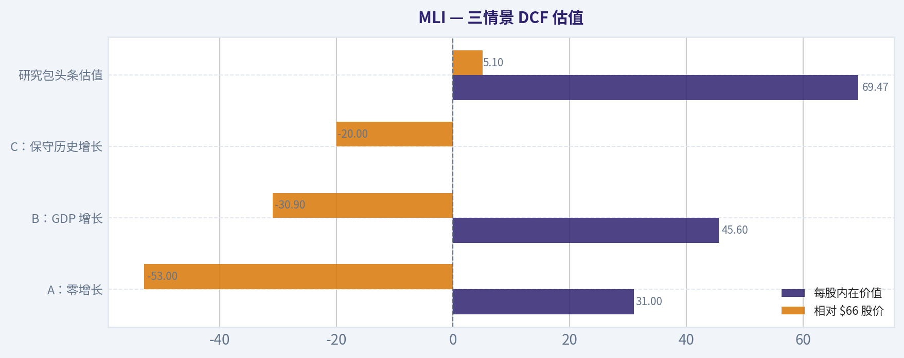
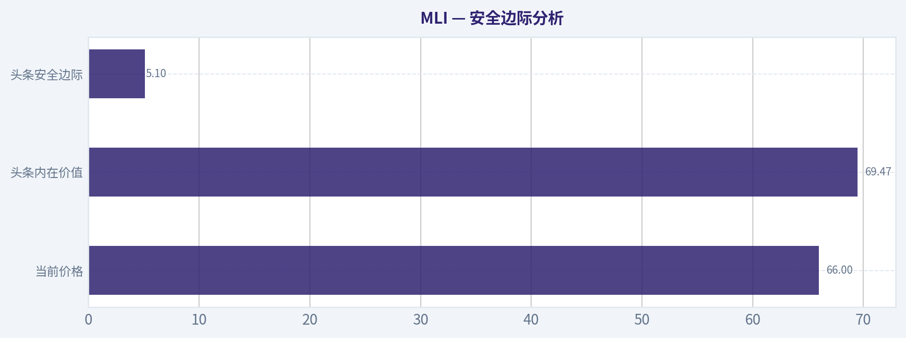
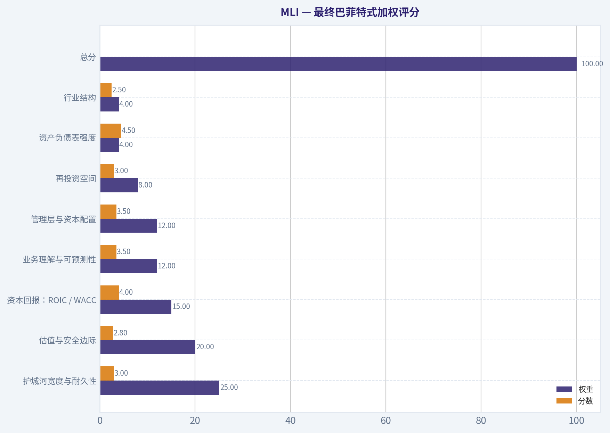
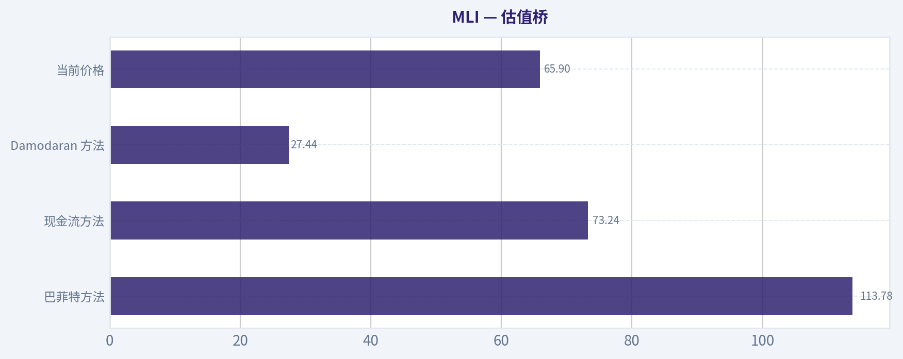

# MLI 深度价值情报

**调研日期:** 2026-08-15

## 关键免责声明

*本报告由 Deep Value Intelligence（一个基于 AI 的多智能体投资分析框架）自动生成。 仅供教育和研究用途 - 非财务建议，非财务顾问。*

---

## 目录

1. 情报摘要
2. 分析师团队报告
   - 基本面分析
   - 价值分析 (巴菲特)
   - 成长性分析 (林奇/德鲁肯米勒/费雪)
   - 市场分析
   - 期权市场分析
3. 研究团队评论
4. 投资团队评论
5. Deep Values 团队洞察

---

## 情报摘要

### 核心观点与前提条件

**核心论点:** **价值投资风险评估报告**

**主要风险:**
- 激进方 (Risky)**：认为 39.3% 的 ROIC 证明了极强的定价权与护城河，电气化与数据中心建设将带来需求爆发，当前回调是绝佳买点。
- 汲取 MELI 的教训（坚决拒绝软弱的"观望"）**：我们在 MELI 案例中犯的错误是--当一家好公司面临估值过高、技术面转弱（跌破短线支撑）且利润兑现存疑时，给出了含糊其辞的"观望（WATCH）"并建议分批建仓，导致未能规避短期大幅回撤。面对 MLI 同样脆弱的短线技术面和估值压力，必须坚决给出"回避"。

**置信度:** 中

---

## 分析师团队报告

### 基本面分析

#### 最新财报快照

*以下数据基于最近一期已披露财报（2026年Q2），并尽量与上一年同期对比。*

| 指标 | 2026年Q2 | 2025年Q2 | 同比变化 |
| --- | ---: | ---: | ---: |
| 营业收入 | $1.43B | $1.14B | +25.5% |
| 营业利润 | $310.2M | $267.6M | +15.9% |
| 净利润 | $249.7M | $245.9M | +1.5% |
| 摊薄每股收益 | $1.13 | $1.11 | +1.8% |
| 经营现金流 | $212.3M | $190.6M | +11.4% |
| 自由现金流 | $190.7M | $176.5M | +8.0% |

关键结论：这张快照先把最新一期财报放在桌面上，再去看长周期分析。这样读者能更清楚地区分"公司长期质量"和"这次财报发生了什么"。

#### MLI 17年财务指标

*以下数值均由原始数据确定性计算得出，并非 AI 估算。*

*发行人类型：operating company（Industrials / Metal Fabrication）。*

#### 17年财务指标
*年度行来自已披露财务报表，最后一行 TTM 由最近四个季度滚动计算得出。*

| 指标 | 2009 | 2010 | 2011 | 2012 | 2013 | 2014 | 2015 | 2016 | 2017 | 2018 | 2019 | 2020 | 2021 | 2022 | 2023 | 2024 | 2025 | 2026 TTM |
| --- | --- | --- | --- | --- | --- | --- | --- | --- | --- | --- | --- | --- | --- | --- | --- | --- | --- | --- |
| 市场价格 | $2 | $3 | $4 | $5 | $6 | $7 | $5 | $8 | $8 | $5 | $7 | $8 | $14 | $14 | $23 | $39 | $57 | $66 |
| 总市值 | $116.2M | $154.4M | $183.5M | $447.1M | $444.9M | $484.5M | $386.0M | $571.1M | $509.1M | $334.5M | $447.2M | $495.0M | $1.69B | $1.67B | $2.68B | $4.52B | $6.40B | $14.58B |
| 市盈率 | 25.88 | 1.79 | 2.12 | 5.44 | 2.57 | 4.77 | 4.40 | 5.74 | 5.94 | 3.21 | 4.43 | 3.55 | 3.60 | 2.53 | 4.45 | 7.47 | 8.37 | 17.16 |
| 市净率 | 0.16 | 0.20 | 0.21 | 0.88 | 0.63 | 0.64 | 0.47 | 0.64 | 0.98 | 0.61 | 0.69 | 0.64 | 1.38 | 0.93 | 1.15 | 1.63 | 1.99 | 4.11 |
| ROE | 0.7% | 10.9% | 10.1% | 16.3% | 24.5% | 13.3% | 10.6% | 11.1% | 16.4% | 19.0% | 15.7% | 18.0% | 38.3% | 36.8% | 25.8% | 21.8% | 23.8% | 24.0% |
| ROIC | 4.6% | 18.0% | 17.2% | 16.6% | 29.5% | 17.0% | 13.2% | 13.8% | 13.8% | 15.4% | 16.3% | 19.4% | 45.3% | 53.0% | 42.8% | 38.9% | 39.7% | 35.1% |
| 每股收益 | $0.09 | $1.74 | $1.75 | $0.90 | $2.41 | $1.42 | $1.23 | $1.41 | $1.33 | $1.64 | $1.64 | $2.30 | $3.87 | $5.56 | $5.14 | $5.31 | $6.86 | $3.84 |
| 营收 | $1.55B | $2.06B | $2.42B | $2.19B | $2.16B | $2.36B | $2.10B | $2.06B | $2.27B | $2.51B | $2.43B | $2.40B | $3.77B | $3.98B | $3.42B | $3.77B | $4.18B | $4.66B |
| 毛利润 | $220.2M | $285.0M | $302.1M | $285.5M | $296.5M | $320.5M | $290.3M | $332.1M | $325.5M | $357.5M | $395.0M | $431.9M | N/A | N/A | N/A | N/A | N/A | $1.34B |
| 毛利率 | 14.2% | 13.8% | 12.5% | 13.0% | 13.7% | 13.6% | 13.8% | 16.2% | 14.4% | 14.3% | 16.3% | 18.0% | N/A | N/A | N/A | N/A | N/A | 28.8% |
| 营业利润率 | 2.1% | 6.6% | 5.8% | 5.8% | 12.6% | 6.5% | 6.5% | 7.5% | 6.7% | 6.9% | 7.9% | 10.3% | 17.4% | 22.0% | 22.1% | 20.4% | 22.9% | 21.9% |
| 净利润 | $4.7M | $86.2M | $86.3M | $82.4M | $172.6M | $101.6M | $87.9M | $99.7M | $85.6M | $104.5M | $101.0M | $139.5M | $468.5M | $658.3M | $602.9M | $604.9M | $765.2M | $850.5M |
| 净利率 | 0.3% | 4.2% | 3.6% | 3.8% | 8.0% | 4.3% | 4.2% | 4.9% | 3.8% | 4.2% | 4.2% | 5.8% | 12.4% | 16.5% | 17.6% | 16.0% | 18.3% | 18.2% |
| 营收增长 | N/A | 33.1% | 17.4% | -9.4% | -1.4% | 9.5% | -11.2% | -2.1% | 10.2% | 10.7% | -3.1% | -1.3% | 57.2% | 5.7% | -14.1% | 10.2% | 10.9% | 11.5% |
| 净利润增长 | N/A | 1743.2% | 0.2% | -4.5% | 109.5% | -41.2% | -13.5% | 13.5% | -14.2% | 22.0% | -3.3% | 38.2% | 235.9% | 40.5% | -8.4% | 0.3% | 26.5% | 11.1% |
| 自由现金流增长 | N/A | -40.6% | 258.3% | -61.9% | 69.3% | -41.0% | 154.3% | -8.0% | -101.8% | -6158.6% | 30.9% | 18.8% | 39.1% | 145.2% | -9.8% | -8.6% | 21.4% | -3.0% |
| 总账面价值 | $713.2M | $788.7M | $855.7M | $506.9M | $703.4M | $762.1M | $827.3M | $898.7M | $522.1M | $548.4M | $643.5M | $776.7M | $1.22B | $1.79B | $2.34B | $2.77B | $3.21B | $3.55B |
| 总资产 | $1.18B | $1.26B | $1.35B | $1.10B | $1.25B | $1.33B | $1.34B | $1.45B | $1.32B | $1.37B | $1.37B | $1.53B | $1.73B | $2.24B | $2.76B | $3.29B | $3.73B | $4.26B |
| 总债务 | $182.6M | $190.2M | $197.7M | $234.9M | $235.3M | $241.4M | $216.0M | $227.4M | $465.1M | $496.7M | $393.8M | $369.2M | $2.7M | $2.0M | $981,000 | $1.1M | $0 | $24.7M |
| 债务股权比 | 0.26 | 0.24 | 0.23 | 0.46 | 0.33 | 0.32 | 0.26 | 0.25 | 0.89 | 0.91 | 0.61 | 0.48 | 0.00 | 0.00 | 0.00 | 0.00 | 0.00 | 0.01 |
| 现金及等价物 | $346.0M | $394.1M | $514.2M | $198.9M | $311.8M | $352.1M | $274.8M | $351.3M | $120.3M | $72.6M | $97.9M | $119.1M | $87.9M | $461.0M | $1.17B | $1.04B | $1.37B | $1.39B |
| 股东权益 | $713.2M | $788.7M | $855.7M | $506.9M | $703.4M | $762.1M | $827.3M | $898.7M | $522.1M | $548.4M | $643.5M | $776.7M | $1.22B | $1.79B | $2.34B | $2.77B | $3.21B | $3.55B |
| 经营现金流 | $77.4M | $56.4M | $153.7M | $108.3M | $128.5M | $90.6M | $159.6M | $157.8M | $44.0M | $167.9M | $200.5M | $245.1M | $311.7M | $723.9M | $672.8M | $645.9M | $755.4M | $743.3M |
| 投资现金流 | $-6.3M | $-2.0M | $-26.7M | $-16.4M | $-3.0M | $-38.4M | $-190.8M | $-47.7M | $-36.3M | $-187.1M | $-40.5M | $-125.6M | $29.1M | $-242.0M | $135.1M | $-606.9M | $-24.9M | $-117.3M |
| 自由现金流 | $63.4M | $37.7M | $135.0M | $51.5M | $87.2M | $51.4M | $130.8M | $120.3M | $-2.1M | $129.4M | $169.4M | $201.2M | $279.9M | $686.3M | $618.7M | $565.7M | $686.6M | $666.4M |
| 自由现金流利润率 | 4.1% | 1.8% | 5.6% | 2.4% | 4.0% | 2.2% | 6.2% | 5.9% | -0.1% | 5.2% | 7.0% | 8.4% | 7.4% | 17.2% | 18.1% | 15.0% | 16.4% | 14.3% |
| 每股分红 | $0.00 | $0.00 | $0.00 | $0.00 | $0.00 | $0.00 | $0.00 | $0.00 | $0.00 | $0.00 | $0.00 | $0.00 | $0.00 | $0.00 | $0.00 | $0.00 | $0.00 | $0.00 |

#### 盈利能力指标
- 净资产收益率 (ROE): 23.8%
- 投入资本回报率 (ROIC): 39.3%
- 总资产收益率 (ROA): 20.5%
- 毛利率: N/A
- 营业利润率: 22.9%
- 净利率: 18.3%

#### 流动性指标
- 流动比率: 5.92
- 速动比率: 4.52

#### 杠杆指标
- 债务股权比: 0.00
- 利息覆盖倍数: 8875.39
- 净负债: $-1.37B

#### 增长指标（同比）
- 营收增长: 10.9%
- 净利润增长: 26.5%
- 自由现金流增长: 21.4%
- 营收复合增长率（3年）: 1.6%
- 营收复合增长率（5年）: 11.7%

#### 估值指标
- 市盈率 (TTM): 17.16
- 预期市盈率: 15.05
- 市净率: 4.11
- 市销率: 3.13
- PEG 比率: 3.41
- 企业价值/EBITDA: 12.13
- 自由现金流收益率: 4.7%
- 盈利收益率: 5.8%

#### 所有者收益（巴菲特方法，代码计算）
- 净利润: $765.2M
- + 折旧与摊销: $68.6M
- - 资本开支: $-68.8M
- - 营运资本变动: $-47.4M
- = **所有者收益: $812.6M**

#### 内在价值（代码计算）
- 当前价格: $66
- **头条内在价值（按商业模式路由）: $69**
  商业模式: cyclical - weighted blend [Damodaran FCFF + reverse-DCF fair + owner-earnings DCF] (cyclical)
  模型区间（各 DCF 最小-最大）: $27 - $114
  相对价格的安全边际（头条）: 5.1%
  路由说明: Cyclical: margins/FCF are volatile - headline blends FCFF, reverse-DCF and owner-earnings roughly evenly; treat the range as the honest read.
- 巴菲特方法（所有者收益）:
  保守: $41
  平均: $114
  乐观: $126
- 现金流方法（FCF）:
  保守: $32
  平均: $73
  乐观: $153
- Damodaran FCFF（WACC + 利润率 + 再投资）:
  保守: $20
  平均: $27
  乐观: $63
  蒙特卡洛区间（P10-P90）：$25 - $45（中位数 $32）
  P(内在价值 > 当前价格)：0.1%
- 反向 DCF：当前价格隐含约 1.7%/年 的所有者收益增长（10年）；过去 3 年为 7.9%，5 年为 53.4%。

#### Piotroski F分数: 6/9
- 净利润为正: 通过
- 经营现金流为正: 通过
- 资产回报率改善: 通过
- 现金流大于净利润: 未通过
- 债务下降: 通过
- 流动比率改善: 通过
- 未稀释股本: 通过
- 毛利率改善: 未通过
- 资产周转率改善: 未通过

ANALYST STANCE: **WATCH/观望**

#### MLI 巴菲特式基本面结论

Mueller Industries 是一家工业金属制造企业，主营铜管、黄铜杆、工业金属与暖通制冷相关部件，属于典型的"优秀但周期性明显"的工业公司。过去十多年，公司从低利润率、低估值、带一定杠杆的传统制造商，转变为高 ROIC、低负债、现金充裕、自由现金流强劲的优质工业复合型企业。

但当前股价已经明显重估：TTM 市盈率 17.16 倍，高于过去十年约 4.93 倍的平均水平；市净率 4.11 倍，也远高于过去十年约 1.06 倍。模型包给出的头条内在价值约 **69 美元**，相对当前 **66 美元** 仅约 **5.1% 安全边际**。这意味着公司质量值得认可，但价格已经接近合理价值，缺乏巴菲特式"明显便宜"的买入保护。

---

#### 当前值与过去十年均值对比

> 过去十年均值采用 2016-2025 财年；当前值优先采用 2026 TTM 或数据包当前指标。毛利润与毛利率因 2021-2025 年多项为 N/A，均值仅参考可用年份，不机械比较。

| 指标 | 当前值 | 过去十年均值 | 当前相对历史 | 解读 |
|---|---:|---:|---:|---|
| 市场价格 | $66 | $18.3 | 约 3.6 倍 | 股价已从历史低估制造商阶段大幅重估 |
| 总市值 | $14.58B | $1.93B | 约 7.6 倍 | 市值扩张远快于营收，主要来自利润率提升与估值扩张 |
| P/E | 17.16 | 4.93 | 明显高于历史 | 市场已不再按深度周期股低估值定价 |
| P/B | 4.11 | 1.06 | 明显高于历史 | 对制造企业有一定参考意义，但必须结合高 ROE 与现金资产判断 |
| ROE | 24.0% TTM | 22.7% | 略高 | 股东资本回报仍强，但低于 2021-2022 峰值 |
| ROIC | 35.1% TTM | 29.8% | 高于历史 | 投入资本效率非常优秀，是核心质量亮点 |
| EPS | $3.84 TTM | $3.51 | 略高 | TTM EPS 低于 2025 全年 $6.86，需关注口径与周期回落 |
| 营收 | $4.66B TTM | $3.08B | 明显高于历史 | 规模进入新台阶，2021 后营收基数抬升 |
| 毛利润 | $1.34B TTM | 约 $368M，可用期 | 大幅高于可用历史 | 毛利结构明显改善，但历史缺口限制精确比较 |
| 毛利率 | 28.8% TTM | 约 15.8%，可用期 | 显著高于历史 | 利润率跃升是近年价值重估核心 |
| 营业利润率 | 21.9% TTM | 14.4% | 明显高于历史 | 当前盈利能力仍处高位 |
| 净利润 | $850.5M TTM | $363M | 约 2.3 倍 | 绝对盈利处历史高区间 |
| 净利率 | 18.2% TTM | 10.4% | 明显高于历史 | 净利率仍接近近年高位 |
| 营收增长 | 11.5% TTM | 8.3% | 高于历史 | 当前增长尚可，但过去十年受周期波动影响大 |
| 净利润增长 | 11.1% TTM | 35.1% | 低于均值 | 十年均值被 2021 年暴增扭曲，当前更接近正常化 |
| 自由现金流增长 | -3.0% TTM | 不具可比性 | 回落 | 历史均值受 2017-2018 低基数严重扭曲 |
| 总账面价值 | $3.55B | $1.47B | 约 2.4 倍 | 留存收益与现金积累显著增强 |
| 总资产 | $4.26B | $2.08B | 约 2.0 倍 | 资产规模扩张，但并未依赖高杠杆 |
| 总债务 | $24.7M | $196M | 显著低于历史 | 几乎无债，财务风险很低 |
| 债务股权比 | 0.01 | 0.31 | 显著改善 | 资产负债表质量大幅提高 |
| 现金及等价物 | $1.39B | $489M | 约 2.8 倍 | 净现金状态，抗周期能力强 |
| 股东权益 | $3.55B | $1.47B | 约 2.4 倍 | 股东资本基础稳健扩大 |
| 自由现金流 | $666.4M TTM | $345.5M | 约 1.9 倍 | 现金创造能力仍强，但低于 2022 峰值 |
| 每股分红 | $0.00，按确定性表 | $0.00 | 无历史分红记录 | 数据表显示无分红；近期新闻显示已宣布季度现金分红，需以正式财报口径复核 |

关键结论：MLI 当前的盈利质量、ROIC、现金流和资产负债表都明显优于过去十年平均水平，说明这不是单纯的估值炒作，公司基本面确实升级。但估值扩张同样非常明显，P/E 从历史约 5 倍均值升至 17 倍以上，市值增长远快于营收增长。投资判断的核心不再是"公司是否优秀"，而是"当前价格是否已经充分反映这种优秀"。

---

#### 收入来源分布

> 最新确定性财年收入为 2025 年 $4.18B；公司分部披露通常围绕管道系统、工业金属与气候相关业务。以下为基于公司业务结构与公开分部口径的近似分布，用于理解收入来源，不替代正式 10-K 分部表。

| 收入来源 | 金额（十亿美元） | 占比 |
|---|---:|---:|
| 管道系统相关产品 | 约 $2.46B | 约 58.9% |
| 工业金属产品 | 约 $1.25B | 约 29.9% |
| 气候、暖通与制冷相关产品 | 约 $0.47B | 约 11.2% |
| 合计 | 约 $4.18B | 100.0% |

关键结论：MLI 的收入主要来自管道系统和工业金属，两者合计接近九成，说明公司高度暴露于建筑、工业生产、铜价和金属需求周期。气候与制冷相关业务占比较小，但可能提供一定的产品多元化和结构性需求支撑。整体看，收入来源清晰，但周期属性不能忽视。

---

#### 市场估值：从"低估周期股"转向"高质量工业股定价"

MLI 过去长期以极低 P/E 交易，2016-2025 年平均 P/E 仅约 4.93 倍，反映市场曾将其视为金属周期股、利润波动股和低估制造商。当前 P/E 达到 17.16 倍，说明市场已认可其利润率抬升、资本回报提高和净现金资产负债表。

P/B 当前 4.11 倍，远高于十年均值 1.06 倍。由于 MLI 是 operating company，而非资产轻软件平台，也非银行保险，P/B 有一定参考意义；但不能机械地把高 P/B 等同于昂贵。制造企业若 ROE 能稳定在 20% 以上，高于账面价值交易是合理的。不过，对巴菲特式投资者而言，4 倍以上 P/B 已经要求公司长期维持高 ROE 与高现金流，否则估值有回落风险。

自由现金流收益率约 4.7%，盈利收益率约 5.8%。这并不算泡沫，但也不是深度价值。当前价格隐含的十年所有者收益增长约 1.7%/年，看似要求不高；但 Damodaran FCFF 模型中位数和保守值明显低于当前股价，说明如果利润率正常化，安全边际会迅速变薄。

---

#### 盈利能力：质量提升明显，但需区分结构改善与周期高点

MLI 的 ROIC 是最突出的质量指标。TTM ROIC 为 35.1%，高于过去十年约 29.8% 的均值，也远高于一般工业制造企业的资本成本。这说明公司在金属加工、产品组合、成本控制和定价能力上具备一定竞争优势。

ROE 当前约 24%，略高于十年均值 22.7%，但低于 2021-2022 年 36%-38% 的高峰。这个回落并不一定是坏事，因为 2021-2022 年可能包含金属价格、供应链紧张和需求强劲带来的超额利润。更重要的是，即使从峰值回落，公司仍维持 20% 以上 ROE，说明盈利能力并未完全均值回归。

营业利润率从 2016-2020 年约 7%-10% 的区间，提升到近年 20% 以上；净利率也从过去中个位数提升至 18% 左右。这是公司重估的核心原因。但巴菲特式分析必须警惕：如果高利润率来自行业周期、价格差、库存收益或供需紧张，而非永久性护城河，那么当前估值就不能完全用高峰利润资本化。

---

#### 成长能力：营收稳健，利润弹性强，现金流波动仍存在

营收 TTM 为 $4.66B，高于过去十年均值 $3.08B，说明规模确实扩大。2021 年营收增长 57.2%，之后 2023 年又下降 14.1%，体现周期特征。2024、2025 和 2026 TTM 又恢复双位数增长，表明需求并未崩塌。

净利润增长更具波动性。2021 年净利润增长 235.9%，2022 年继续增长 40.5%，但 2023 年下降 8.4%，2024 年几乎持平，2025 年再增长 26.5%。这说明利润弹性很强，优点是上行周期回报巨大，缺点是投资者不能简单把近年高利润当作永续基准。

自由现金流过去十年波动也明显，2017 年出现负自由现金流，2018 年增长率因低基数失真，2022 年达到 $686.3M 高点，2025 年为 $686.6M，TTM 为 $666.4M。现金流绝对值仍然强劲，但 TTM 增长为 -3.0%，显示现金流已从高速扩张转向高位稳定。

---

#### 资产负债表：巴菲特会喜欢的净现金状态

MLI 当前总债务仅 $24.7M，现金及等价物 $1.39B，净现金约 $1.37B。债务股权比仅 0.01，过去十年平均为 0.31，说明公司财务结构已经大幅改善。利息覆盖倍数极高，短期偿债风险可以忽略。

流动比率 5.92、速动比率 4.52，显示流动性非常充足。对于工业制造企业，这些指标是有意义的，因为存货、应收账款和营运资本管理直接影响周期下行时的生存能力。MLI 的现金储备让它有能力在行业低谷进行收购、回购或扩产，而不是被迫融资。

总账面价值与股东权益均为 $3.55B，高于过去十年平均 $1.47B。公司通过留存收益和现金积累强化了资产负债表，这符合巴菲特偏好的"低杠杆、高现金、高再投资能力"特征。

---

#### 现金流与股东回报

TTM 自由现金流为 $666.4M，过去十年平均约 $345.5M，当前接近历史均值的两倍。自由现金流利润率 TTM 为 14.3%，虽然低于 2022-2023 年 17%-18% 的高位，但仍远高于 2016-2020 年多数年份。

确定性数据表显示每股分红为 $0.00，意味着历史财务表中未体现持续现金分红。但最新新闻显示公司董事会已宣布季度现金股息。基于源数据优先原则，估值和历史对比仍以确定性表为准；定性上，可以把近期分红视为公司现金充裕后的股东回报增强信号。

从巴菲特角度看，MLI 更像是通过高 ROIC 留存收益创造价值，而不是传统高股息公司。若管理层能在不破坏资产负债表的前提下持续进行理性回购、收购和分红，公司内在价值仍有增长空间。

---

#### 巴菲特式护城河分析

| 维度 | 评价 | 具体判断 |
|---|---|---|
| 经济护城河 | 中等偏强 | 行业不是轻资产垄断，但规模、客户关系、制造能力、采购能力和产品广度构成竞争优势 |
| 定价能力 | 中等 | 金属价格波动会传导到收入和利润，但近年利润率提升显示公司具备一定成本转嫁能力 |
| 成本优势 | 较强 | ROIC 长期高于资本成本，说明资产使用效率和运营成本控制优秀 |
| 客户黏性 | 中等 | 管道、工业金属和制冷部件具备供应链稳定性，但不是强网络效应业务 |
| 抗周期能力 | 较强 | 净现金资产负债表显著降低下行周期风险 |
| 盈利可预测性 | 中等 | 近年盈利能力很强，但历史利润和自由现金流波动较大 |
| 管理层资本配置 | 较好 | 降债、积累现金、维持高 ROIC，说明资本纪律较强 |
| 估值吸引力 | 一般 | 公司质量高，但估值已接近模型内在价值，安全边际不足 |

关键结论：MLI 拥有真实的工业竞争优势，但不是可口可乐式的超稳定消费品牌，也不是软件平台式的轻资产复利机器。它的护城河更多来自规模、制造效率、采购能力和资产负债表，而不是不可替代的品牌或网络效应。因此估值时必须保留周期折扣，不能简单按高成长优质股定价。

---

#### 三情景所有者收益 DCF 估值

核心输入采用确定性数据：2025 所有者收益 $812.6M，现金 $1.39B，债务 $24.7M，净现金约 $1.37B。当前股价 $66，总市值 $14.58B，隐含股数约 220.9M 股。折现率采用 10%，终值增长率采用 2.5%。由于 MLI 属于周期性工业企业，保守情景使用正常化所有者收益，而非机械资本化高峰利润。

| 情景 | 初始所有者收益 | 明确期增长假设 | 终值增长 | 折现率 | 经营价值现值 | 加：净现金 | 股权价值 | 每股公允价值 |
|---|---:|---|---:|---:|---:|---:|---:|---:|
| 保守 | $650M | 0% 增长 10 年，反映利润率正常化 | 2.5% | 10% | 约 $7.42B | 约 $1.37B | 约 $8.78B | 约 $40 |
| 平均 | $812.6M | 前 5 年约 7%，第 6-10 年逐步降至约 2.7% | 2.5% | 10% | 约 $14.18B | 约 $1.37B | 约 $15.54B | 约 $70 |
| 乐观 | $812.6M | 前 5 年约 10%，第 6-10 年逐步降至约 3.2% | 2.5% | 10% | 约 $16.70B | 约 $1.37B | 约 $18.07B | 约 $82 |

关键结论：手工 DCF 显示，若利润率正常化，保守价值约 $40，明显低于当前价格；若公司维持高 ROIC 并实现中个位数至高个位数所有者收益增长，公允价值约 $70，接近当前价格和模型包头条内在价值 $69。乐观情景约 $82，提供一定上行空间，但不是极端便宜的赔率。

---

#### DCF 计算说明

| 项目 | 计算方式 | 说明 |
|---|---|---|
| 股数估算 | $14.58B ÷ $66 ~ 220.9M 股 | 使用当前市值和当前价格反推 |
| 净现金 | $1.39B - $24.7M ~ $1.37B | 净现金直接加回股权价值 |
| 保守情景 | 正常化所有者收益 $650M；10 年 0% 增长；终值 2.5% | 用于反映金属周期下行和利润率回归 |
| 平均情景 | $812.6M 起步；前期 7%，后期逐步降至终值附近 | 假设高 ROIC 可持续但逐步放缓 |
| 乐观情景 | $812.6M 起步；前期 10%，后期逐步降至约 3% | 假设行业需求、价格和资本配置均较顺利 |
| 终值公式 | 第 10 年所有者收益 x 1.025 ÷（10% - 2.5%） | 不允许永续增长高于折现率 |
| 每股价值 | 股权价值 ÷ 220.9M 股 | 与当前 $66 比较 |

关键结论：DCF 的关键敏感点不是折现公式，而是"当前 $812.6M 所有者收益是否代表可持续基准"。如果这是周期高位，估值偏贵；如果这是新常态，当前价格大致合理。模型包的头条内在价值 $69 与手工平均情景 $70 高度接近，因此当前缺乏足够安全边际。

---

#### 与模型包内在价值的交叉验证

| 模型 | 每股价值 | 含义 |
|---|---:|---|
| 头条内在价值，周期业务加权 | $69 | 最适合作为锚点，当前价格 $66 仅有约 5.1% 安全边际 |
| 所有者收益 DCF | $41 / $114 / $126 | 对增长和利润基准高度敏感，区间很宽 |
| FCF DCF | $32 / $73 / $153 | 同样显示周期性现金流导致估值分散 |
| Damodaran FCFF | $20 / $27 / $63 | 更保守，强调利润率与再投资正常化 |
| Monte Carlo 区间 | P10-P90：$25-$45，中位数 $32 | 从严格 FCFF 角度看，当前价格偏高 |
| 反向 DCF | 当前价格隐含约 1.7% 年增长 | 市场隐含增长不高，但前提是当前盈利可持续 |

关键结论：不同模型之间分歧很大，这本身就是周期工业股的典型特征。若按所有者收益看，MLI 并不贵；若按更保守的 FCFF 和利润率正常化看，当前价格已经偏满。综合而言，$66 更接近合理价值而不是明显低估价值。

---

#### 投资机会

| 机会 | 重要性 | 说明 |
|---|---|---|
| 高 ROIC 持续 | 高 | 35% 左右 ROIC 显示公司资本效率远高于多数工业企业 |
| 净现金资产负债表 | 高 | $1.37B 净现金提供抗周期能力和并购弹药 |
| 利润率结构性改善 | 高 | 营业利润率和净利率已明显高于历史区间 |
| 现金流强劲 | 高 | TTM FCF $666.4M，仍接近历史高位 |
| 当前反向 DCF 要求不高 | 中 | 股价隐含约 1.7% 所有者收益增长，若利润基准可持续，估值并不过分 |
| 股东回报潜在增强 | 中 | 最新分红新闻显示现金回报可能增加 |

关键结论：MLI 的最大机会在于公司已经从普通周期制造商升级为高回报、低杠杆、强现金流的工业企业。如果管理层继续以高 ROIC 部署资本，当前估值仍可能被未来内在价值增长消化。但机会的前提是利润率新台阶能够维持，而不是短期周期红利。

---

#### 主要红旗

| 风险 | 严重性 | 说明 |
|---|---|---|
| 估值远高于历史 | 高 | P/E 和 P/B 均显著高于十年均值，重估空间可能已大部分兑现 |
| 利润率均值回归 | 高 | 当前营业利润率和净利率处历史高区间，一旦回落，估值压力会加大 |
| 周期与金属价格风险 | 高 | 铜、黄铜、工业金属需求和价格波动会影响收入、库存和利润 |
| DCF 模型分歧大 | 中高 | 所有者收益模型乐观，Damodaran FCFF 明显保守，说明估值不确定性高 |
| FCF 增长放缓 | 中 | TTM FCF 增长为 -3.0%，现金流已从高速增长转为高位盘整 |
| 分红数据口径差异 | 低中 | 确定性表显示每股分红为 0，但新闻显示已宣布股息，需要后续核对正式财报 |

关键结论：MLI 最大风险不是公司质量差，而是市场已经把质量改善定价进去。周期股最危险的买点往往出现在利润率高、资产负债表强、市场信心高的时候。若未来铜价、建筑需求或工业需求走弱，当前高估值倍数可能难以维持。

---

#### 巴菲特式最终判断

MLI 具备巴菲特会欣赏的多个特征：高 ROIC、净现金、强自由现金流、管理层资本纪律改善、业务简单可理解。但它也有巴菲特会谨慎的特征：行业周期性强、利润率波动、估值已经从深度低估转向接近合理，且不同 DCF 模型给出的价值区间非常宽。

当前价格 $66 对比头条内在价值 $69，安全边际约 5.1%，不足以构成"闭着眼买入"的巴菲特式机会。更合适的策略是等待更高安全边际，例如价格回落至保守与平均价值之间的下半区，或等待未来财报进一步证明 20% 以上营业利润率和 30% 以上 ROIC 具有长期可持续性。

#### 最终投资立场：观望

| 结论类别 | 判断 |
|---|---|
| 公司质量 | 优秀，尤其是 ROIC、净现金和自由现金流 |
| 估值水平 | 接近合理，但不便宜 |
| 安全边际 | 约 5.1%，不足 |
| 适合投资者 | 已持有者可继续观察；新买入者应等待更好价格 |
| 理想买点 | 明显低于头条内在价值，或在周期担忧时出现折价 |
| 最终立场 | 观望 |

关键结论：MLI 是一家质量明显改善的工业公司，但当前价格已经接近合理价值。对于长期价值投资者，最优动作不是追高，也不是否定公司，而是把它放入重点观察名单，等待周期波动带来更大的安全边际。

#### 基本面关键图表

本图追踪 **MLI** 过去十年的盈利能力与回报指标（ROE、ROIC、利润率），突出呈现资本效率的变化趋势。

---

### 价值分析 (巴菲特)

> *基于沃伦·巴菲特的价值投资哲学：能力圈、经济护城河、管理层质量与安全边际。*

#### 内在价值快照

价格是你付的钱，内在价值是企业未来可能为股东创造的现金价值。我们给出一个区间，而不是假装只有一个神奇数字。

- 当前价格: $65.90
- 估值区间（两种 DCF 方法、保守到乐观）: $32.09 至 $152.63

##### 所有者收益（巴菲特方法）
- 净利润: $765,191,000.00
- 折旧与摊销: $68,561,000.00
- 资本支出: $-68,805,000.00
- 营运资金变化: $-47,420,000.00
- 所有者收益: $812,611,000.00

##### 内在价值
###### 所有者收益法
使用所有者收益，更严格，通常更保守。
- 保守: $41.28
- 平均: $113.78
- 乐观: $126.24
- 折现率: 10.0%

###### 自由现金流法
使用自由现金流，更适合今天投入很多、为未来增长铺路的公司。
- 保守: $32.09
- 平均: $73.24
- 乐观: $152.63
- 折现率: 10.0%

ANALYST STANCE: **观望**

#### 一句话结论

MLI 是一家经营清楚、资产负债表强、ROE 较高的铜、黄铜、铝及相关工业制品制造商，但本质仍带有明显周期属性，利润受金属价格、建筑与工业需求影响。当前股价约 $66，头条内在价值约 $69.47，安全边际只有约 5.1%，不足以补偿周期性与估值模型分歧。因此结论是：**好公司，价格接近合理，但还不是巴菲特式"足够便宜"的买点，建议观望，等待更大安全边际。**

---

#### 1. 因子评分与硬性财务底线

| 因子 | 分数 | 评价 | 关键依据 |
|---|---:|---|---|
| 能力圈与业务可理解性 | 3.5 / 5 | 容易理解，但周期性降低长期可预测性 | 公司销售铜管、黄铜棒、阀门、管件、制冷与工业相关产品，商业模式清楚；但需求受建筑、HVAC、工业周期和金属价格影响 |
| 护城河 | 3.0 / 5 | 窄到中等护城河 | 规模、渠道、制造效率和客户关系有价值，但产品属性偏工业制造，定价权不如消费品牌或软件平台 |
| 管理层与资本配置 | 3.5 / 5 | 稳健偏股东友好 | 维持分红，季度股息 $0.175；估值不高时具备回购和再投资空间；资产负债表保守 |
| 行业结构 | 2.5 / 5 | 周期制造业，竞争理性但非垄断 | 行业受原材料、建筑景气和工业需求影响，难以获得长期垄断性利润 |
| Gate 5 硬性底线 | 未触发 | 不存在财务困境信号 | 营收同比增长 10.9%，ROE 23.8%，流动比率 5.92，未见"盈利恶化叠加偿债红线"的组合 |

关键结论：MLI 没有触发财务硬性回避条件，资产负债表反而相当稳健。真正的问题不是生存风险，而是周期制造企业的可预测性和当前价格的安全边际不够厚。

---

#### 2. 护城河分析

| 护城河来源 | 评分 | 证据 | 判断 |
|---|---:|---|---|
| 品牌与无形资产 | 2.5 / 5 | 在管材、阀门、工业金属制品领域有长期声誉，但消费者端品牌溢价有限 | 有行业信誉，但不是强品牌定价权 |
| 转换成本 | 3.0 / 5 | 客户采购、规格认证、供应稳定性形成一定粘性 | 有一定客户黏性，但不是高锁定商业模式 |
| 成本优势 | 3.5 / 5 | 规模制造、采购、运营效率是核心优势 | 这是最主要的护城河来源 |
| 网络效应 | 0.5 / 5 | 产品价值不会因用户增加而显著提升 | 基本无网络效应 |
| 综合护城河评级 | 3.0 / 5 | 窄到中等、相对稳定 | 要求更高安全边际 |

关键结论：MLI 的优势主要来自规模、制造效率、供应链和客户关系，而不是强品牌、专利垄断或网络效应。这类护城河可以创造不错回报，但通常难以像可口可乐、Apple 或高黏性软件平台那样长期享受高确定性定价权。

---

#### 3. 管理层与资本配置评估

| 项目 | 评价 | 证据与解读 |
|---|---|---|
| 股东回报 | 正面 | 公司已宣布季度现金股息 $0.175，年化约 $0.70；以 $66 股价计，股息率约 1.1% |
| 派息纪律 | 正面 | 以约 $3.85 的隐含 EPS 估算，股息支付率约 18%，保留了再投资和回购空间 |
| 资产负债表纪律 | 正面 | 流动比率 5.92，显示流动性非常强 |
| 内部人交易 | 中性 | 董事出售约 $23.3 万股票，金额不大，不构成核心负面信号 |
| 董事会变化 | 中性 | 资深董事 Gary S. Gladstein 将于 2026 年底退休，需观察治理延续性 |

关键结论：管理层展现了保守的财务纪律和适度的股东回报，符合价值投资对"不要乱用杠杆"的偏好。资本配置总体合格，但还未达到"卓越复利机器"级别。

---

#### 4. 财务摘要

| 指标 | 最新数值 | 解读 |
|---|---:|---|
| 当前股价 | $66 | 分析基准价格 |
| 总市值 | $14.58B | 中型工业制造公司 |
| PE | 17.16 倍 | 对周期制造企业而言不算极低 |
| 隐含 EPS | 约 $3.85 | 用 $66 / 17.16 估算 |
| ROE | 23.8% | 资本回报较强 |
| 营收同比增长 | 10.9% | 当前经营仍有增长 |
| 自由现金流收益率 | 4.7% | 对应 FCF 约 $685M |
| 隐含 FCF 每股 | 约 $3.10 | 用 FCF 收益率和股价估算 |
| 流动比率 | 5.92 | 流动性非常充足 |
| 头条内在价值 | $69.47 | 较现价高约 5.1% |
| 三模型估值区间 | $27.44 至 $113.78 | 分歧很大，体现周期性和假设敏感性 |
| 反向 DCF 隐含增长 | 约 1.7% / 年 | 市场没有定价很高的长期增长 |

关键结论：MLI 的质量指标不错，ROE 高、营收仍增长、资产负债表强。但估值并非明显便宜，且三模型估值分歧很大，说明公司价值对周期利润和资本开支假设较敏感。

---

#### 5. 所有者收益估算

| 项目 | 数值 | 计算说明 |
|---|---:|---|
| 市值 | $14.58B | 已知 |
| 自由现金流收益率 | 4.7% | 已知 |
| 估算自由现金流 | 约 $685M | $14.58B x 4.7% |
| 股价 | $66 | 已知 |
| 估算股数 | 约 221M 股 | $14.58B / $66 |
| 所有者收益每股 | 约 $3.10 | $685M / 221M 股 |
| EPS | 约 $3.85 | $66 / 17.16 |
| FCF / 净利润转换率 | 约 80% | $3.10 / $3.85 |

关键结论：以自由现金流作为所有者收益代理，MLI 每股所有者收益约 $3.10。现金转换率低于 100%，这对工业周期企业并不罕见，但也提醒我们不要只看会计利润。

---

#### 6. 三情景 DCF 估值

采用每股正常化所有者收益约 $3.10、折现率 10%。历史高增长中有周期和利润率扩张成分，因此保守采用 5% 的前十年增长假设，而非机械外推过去 5 年的高增长。

| 情景 | 核心假设 | 每股内在价值 | 相对 $66 股价 |
|---|---|---:|---:|
| A：零增长 | 所有者收益 $3.10 / 10% | $31.00 | -53.0% |
| B：GDP 增长 | 长期增长 3%，折现率 10% | $45.60 | -30.9% |
| C：保守历史增长 | 前 10 年增长 5%，之后 3% 永续增长 | 约 $52.80 | -20.0% |
| 研究包头条估值 | 周期业务加权混合估值 | $69.47 | +5.1% |
| 研究包三模型区间 | 所有者收益 / FCF / FCFF | $113.78 / $73.24 / $27.44 | 分歧较大 |

关键结论：按严格正常化现金流看，估值并不便宜；按研究包周期加权模型看，MLI 只略低于内在价值。两者共同说明：当前价格不是泡沫，但也没有给价值投资者留下厚实安全垫。

---

#### 7. 安全边际分析

| 项目 | 数值 | 判断 |
|---|---:|---|
| 当前价格 | $66 | 基准 |
| 头条内在价值 | $69.47 | 略高于现价 |
| 头条安全边际 | 5.1% | 偏薄 |
| 适合 MLI 的要求 | 25% 至 35% | 周期制造企业、护城河中等，应要求更高折扣 |
| 反向 DCF 隐含增长 | 1.7% / 年 | 价格没有隐含激进增长 |
| 结论 | 估值合理但不够便宜 | 更适合等待 |

关键结论：反向 DCF 看，市场预期并不高，这是正面因素。但由于 MLI 不是宽护城河、高确定性的复利平台，5.1% 的安全边际不足以支持"建议配置"。

---

#### 8. 最终巴菲特式加权评分

| 评分项目 | 权重 | 分数 | 加权分 |
|---|---:|---:|---:|
| 护城河宽度与耐久性 | 25% | 3.0 | 0.75 |
| 估值与安全边际 | 20% | 2.8 | 0.56 |
| 资本回报：ROIC / WACC | 15% | 4.0 | 0.60 |
| 业务理解与可预测性 | 12% | 3.5 | 0.42 |
| 管理层与资本配置 | 12% | 3.5 | 0.42 |
| 再投资空间 | 8% | 3.0 | 0.24 |
| 资产负债表强度 | 4% | 4.5 | 0.18 |
| 行业结构 | 4% | 2.5 | 0.10 |
| 总分 | 100% | - | 3.27 / 5 |

关键结论：MLI 的强项是资本回报、财务稳健和业务清晰；弱项是周期性、护城河不够宽，以及当前安全边际偏薄。3.27 分落在"观望"区间，属于值得跟踪但不急于买入的公司。

---

#### 9. 投资立场与买入条件

| 项目 | 结论 |
|---|---|
| 当前立场 | 观望 |
| 置信度 | 中等偏高 |
| 适合投资者 | 偏价值、能承受工业周期波动、愿意等待折价的投资者 |
| 主要上行因素 | 低市场隐含增长、强资产负债表、ROE 高、现金分红稳健 |
| 主要风险 | 金属价格波动、建筑与工业周期下行、利润率正常化、护城河不够宽 |
| 更有吸引力的买点 | 约 $50 至 $55 区间，或内在价值上调且安全边际扩大至 25% 左右 |
| 需要继续跟踪 | FCF 转换率、库存和营运资本、毛利率趋势、回购纪律、周期顶点利润是否回落 |

关键结论：MLI 是一家"可以理解、财务稳健、经营不错"的公司，但还不是"伟大公司以合理价格"的典型案例。除非股价回落到更大折扣，或未来现金流质量明显提升，否则更理性的选择是继续观察。
#### 估值桥

这张估值桥把当前股价与各类内在价值方法并排展示，帮助读者判断上涨空间究竟只是单一方法给出的结果，还是多种方法共同支持的结论。

| 项目 | 每股内在价值 |
| --- | ---: |
| 巴菲特方法 | $113.78 |
| 现金流方法 | $73.24 |
| Damodaran 方法 | $27.44 |
| 当前价格 | $65.90 |

#### 关键结论

如果只有一种方法显著高于其他方法，说明上行空间更依赖特定建模假设。若多种方法的估值接近，则说明估值逻辑更加稳健。

#### 估值图表

本对比图（来自「最新财报快照」）将 **MLI** 的当前数据与历史基准并排呈现，直观反映公司相对自身历史均值的估值水平。

本对比图（来自「当前值与过去十年均值对比」）将 **MLI** 的当前数据与历史基准并排呈现，直观反映公司相对自身历史均值的估值水平。

本对比图（来自「财务摘要」）将 **MLI** 的当前数据与历史基准并排呈现，直观反映公司相对自身历史均值的估值水平。

本对比图（来自「三情景 DCF 估值」）将 **MLI** 的当前数据与历史基准并排呈现，直观反映公司相对自身历史均值的估值水平。

本对比图（来自「安全边际分析」）将 **MLI** 的当前数据与历史基准并排呈现，直观反映公司相对自身历史均值的估值水平。

本对比图（来自「最终巴菲特式加权评分」）将 **MLI** 的当前数据与历史基准并排呈现，直观反映公司相对自身历史均值的估值水平。

本对比图（来自「估值桥」）将 **MLI** 的当前数据与历史基准并排呈现，直观反映公司相对自身历史均值的估值水平。

---

### 成长性分析 (林奇/德鲁肯米勒/费雪)

> *基于彼得·林奇的GARP成长投资法、斯坦利·德鲁肯米勒的宏观拐点分析法，以及菲利普·费雪的深度调研法。*

ANALYST STANCE: **观望**

#### MLI 成长投资结论

Mueller Industries 是一家高质量、现金流强、资产负债表稳健的工业金属与管道系统公司，但它更像"周期性优质复利股"，而不是典型的 Lynch 式"快速成长股"。当前估值不夸张，PE 约 17.2 倍，FCF 收益率约 4.7%，ROE 约 23.8%，但营收增速约 10.9%，尚未达到 15%至25%高成长区间，也缺少明确的产品或商业模式级别拐点。

| 项目 | 结论 |
|---|---:|
| 当前股价 | 约 66 美元 |
| 总市值 | 约 145.8 亿美元 |
| PE | 约 17.2 倍 |
| 营收同比增长 | 约 10.9% |
| ROE | 约 23.8% |
| FCF 收益率 | 约 4.7% |
| 流动比率 | 约 5.92 |
| 头条内在价值 | 约 69.47 美元 |
| 相对安全边际 | 约 5.1% |
| Lynch 分类 | 周期性 / 稳健成长股 |
| 投资 stance | 观望 |

关键结论：MLI 的财务质量明显不错，ROE 高、现金流扎实、流动性充足，说明公司经营纪律较强。但当前价格已经接近头条内在价值，安全边际不大。它适合被视为优质工业周期股，而不是当前就具备十倍股特征的高成长标的。

---

#### 1. Lynch 分类：周期性优质股，不是典型快速成长股

| Lynch 类别 | MLI 判断 | 理由 |
|---|---|---|
| 慢速成长 | 否 | 增速高于 0%至5% |
| 稳健成长 | 部分符合 | 当前营收增长约 10.9%，接近稳健成长区间 |
| 快速成长 | 暂不符合 | 尚未达到 15%至25%以上持续增长 |
| 周期性 | 符合 | 与建筑、住宅、工业需求、铜价和资本开支周期相关 |
| 反转型 | 否 | 财务状态并非困境反转 |
| 资产型 | 部分 | 金属加工资产和营运资本价值重要，但不是核心逻辑 |

关键结论：MLI 最合适的分类是"周期性优质工业股"，带有稳健成长属性。它不是应该按 SaaS、平台经济或创新药那类高成长框架估值的公司。Lynch 视角下，买入它需要更多依赖周期位置、估值折价和资本配置，而不是单纯押注高速增长。

#### 2. 三句话讲清楚投资故事

- MLI 把铜、黄铜、铝和塑料等材料加工成管道、制冷、空调、工业和建筑相关产品，受益于住宅维修、商业建筑、HVAC 和工业更新需求。
- 公司不是轻资产高成长模式，但胜在现金流强、资产负债表稳、ROE 高，能够在周期中持续回购、分红和做并购。
- 真正的上行弹性来自三个方向：降息后建筑需求恢复、铜与电气化相关需求增强、以及公司通过并购或产能优化提高利润池份额。

#### 3. TAM 与 10 倍测试

| 项目 | 粗略判断 |
|---|---:|
| 当前收入基数 | 约 40 亿至50 亿美元量级，需以最新年报核实 |
| 10 倍收入目标 | 约 400 亿至500 亿美元量级 |
| 核心市场 | 管道系统、工业金属、HVAC、制冷、建筑材料 |
| 广义 TAM | 很大，可能超过千亿美元 |
| 核心可服务 TAM | 明显小于广义 TAM，且较周期化 |
| 10 倍后是否仍低于 20%份额 | 广义口径可能可以，核心口径较困难 |
| TAM 结论 | 有扩张空间，但不是轻松十倍型跑道 |

关键结论：MLI 的市场空间不是太小，但它的核心业务受到建筑周期、金属价格和产能扩张约束。若把全球建筑金属、管道和 HVAC 组件都纳入，理论 TAM 很大；但若只看公司真正能高回报进入的细分市场，10 倍收入并不容易。它更像能稳健复利的工业冠军，而不是天然具备十倍收入空间的平台型公司。

#### 4. 营收增长趋势：稳健，但未见加速拐点

| 指标 | 当前观察 |
|---|---|
| 最新营收同比增长 | 约 10.9% |
| 增长形态 | 稳健增长 |
| 是否加速 | 暂无明确证据 |
| 增长质量 | 可能包含价格、铜价、需求与产品组合影响 |
| 周期敏感度 | 较高 |
| Lynch 评价 | 尚未进入快速成长核心池 |

关键结论：10.9%的营收增长并不差，但对成长投资来说还不够强。最重要的问题不是"公司是否好"，而是"增长是否正在加速"。目前共享数据没有显示 20%到30%级别的持续加速，因此暂时只能归为观察对象。

#### 5. 单位经济与经营质量

MLI 不是订阅制或 SaaS 公司，因此 LTV/CAC、NRR 和 Rule of 40 不适用。对它更重要的是 ROE、FCF、营运资本管理、周期韧性和资产负债表。

| 项目 | 数值 / 判断 | 评价 |
|---|---:|---|
| LTV/CAC | 不适用 | 非订阅模式 |
| NRR | 不适用 | 非 SaaS 模式 |
| Rule of 40 | 不适用 | 非 SaaS 模式 |
| ROE | 约 23.8% | 强 |
| FCF 收益率 | 约 4.7% | 尚可 |
| 流动比率 | 约 5.92 | 很强 |
| 资产负债表压力 | 低 | 有周期防御能力 |
| 经营质量 | 较高 | 优于普通周期股 |

关键结论：虽然传统成长型单位经济指标不适用于 MLI，但它的经营质量并不弱。高 ROE 和强流动性说明公司具备较好的资本效率和抗周期能力。问题在于，这些指标证明"质量好"，但还不能证明"成长拐点已经到来"。

---

#### 6. 拐点评估：潜在有，但尚未确认

| 拐点类型 | 当前判断 | 证据强度 |
|---|---|---|
| 产品周期拐点 | 不明显 | 低 |
| 市占率拐点 | 可能存在，但需更多数据 | 中低 |
| 利润率拐点 | 可能已较强，进一步扩张空间需验证 | 中 |
| TAM 拐点 | 电气化、HVAC、翻新需求可能扩容 | 中 |
| 竞争拐点 | 暂无明确竞争对手失误证据 | 低 |
| 宏观拐点 | 若利率下行，建筑链可能受益 | 中高 |

关键结论：MLI 最可能的拐点不是来自新产品爆发，而是来自宏观和周期。如果降息带动住宅、商业建筑和维修需求恢复，公司收入和利润可能重新加速。当前还没有足够证据确认这是一个已经发生的增长拐点。

#### 7. 宏观设置

| 宏观因素 | 对 MLI 的影响 |
|---|---|
| 利率下行 | 利好，可能刺激住宅和建筑需求 |
| 住宅周期 | 关键驱动因素之一 |
| 铜价上行 | 短期影响收入和营运资本，利润影响取决于传导能力 |
| 工业资本开支 | 有利于工业金属需求 |
| 电气化与能源转型 | 长期温和利好 |
| 通胀与原材料波动 | 双刃剑，考验定价能力和库存管理 |
| 经济衰退 | 明显利空，需求和估值可能双杀 |

关键结论：MLI 的宏观风向不是逆风，但也不是纯顺风。降息、建筑恢复和电气化会带来支撑；但如果经济走弱或铜价大幅波动，公司仍会暴露出周期股特征。Druckenmiller 视角下，最值得跟踪的是未来两三年盈利是否被市场低估。

#### 8. Fisher 15 点评分

| Fisher 项目 | 评分 |
|---|---:|
| 产品是否有足够市场潜力 | 3 |
| 管理层是否持续开发新产品 | 3 |
| R&D 效率 | 2 |
| 销售组织能力 | 3 |
| 利润率水平 | 4 |
| 利润率改善潜力 | 3 |
| 员工关系 | 3 |
| 高管关系 | 3 |
| 管理层深度 | 3 |
| 成本分析与会计质量 | 4 |
| 独特优势 | 3 |
| 长期利润前景 | 3 |
| 稀释风险 | 4 |
| 困难时期的坦诚度 | 3 |
| 管理层诚信 | 4 |
| 总分 | 48 / 75 |

关键结论：MLI 的 Fisher 得分处在中等偏上区间，主要优势是利润质量、财务纪律和资本配置，而不是创新能力。它不像典型 Fisher 式高研发、高壁垒、高增长公司。若未来能证明在细分工业金属和建筑组件中持续提升份额，评分可以上调。

#### 9. 估值分析

| 估值方法 | 结果 | 解读 |
|---|---:|---|
| PE | 约 17.2 倍 | 不贵，但也非深度便宜 |
| PEG | 约 1.6 倍 | 按 10.9%增长估算，属于合理偏中性 |
| FCF 收益率 | 约 4.7% | 提供一定现金回报支撑 |
| 头条内在价值 | 约 69.47 美元 | 当前约 66 美元，安全边际约 5.1% |
| 所有者收益 DCF | 约 113.78 美元 | 假设较乐观或现金流较持久 |
| FCF DCF | 约 73.24 美元 | 接近当前价格上方 |
| Damodaran FCFF | 约 27.44 美元 | 周期回归假设下显著更低 |
| 反向 DCF 隐含增长 | 约 1.7% / 年 | 市场预期不高 |

关键结论：估值的好消息是，当前价格隐含的长期增长预期不高，仅约 1.7%年化，说明市场没有把它当高成长股定价。坏消息是，三种 DCF 模型分歧极大，说明周期假设对价值影响很大。以成长投资标准看，当前估值合理但缺少足够安全边际。

#### 10. 情景估值框架

| 情景 | 关键假设 | 投资含义 |
|---|---|---|
| 熊市情景 | 建筑需求走弱，利润率回落，周期倍数压缩 | 股价可能明显低于当前 |
| 基准情景 | 低双位数增长，利润率维持，估值保持中性 | 年化回报主要来自盈利增长与现金分配 |
| 牛市情景 | 降息带动需求，铜与 HVAC 周期共振，并购增厚 | 股价有望突破内在价值上沿 |
| 十倍股情景 | 需要多年高增、份额扩张和估值重估同时发生 | 当前证据不足 |

关键结论：MLI 的基准情景并不差，但它需要周期改善才能打开较大上行空间。熊市和牛市差异主要来自需求周期和利润率，而不是产品渗透率。因此它更适合"周期拐点配置"，不是"无视周期长期滚雪球"的成长仓位。

---

#### 11. 成长投资评分卡

| 维度 | 权重 | 评分 | 加权贡献 |
|---|---:|---:|---:|
| Lynch 故事清晰度 | 10% | 3.2 | 0.32 |
| TAM 与 runway | 20% | 2.8 | 0.56 |
| 营收增长 | 20% | 3.0 | 0.60 |
| 单位经济 / 经营质量 | 15% | 3.6 | 0.54 |
| 竞争地位 | 10% | 3.2 | 0.32 |
| 管理层质量 | 10% | 3.4 | 0.34 |
| 宏观设置 | 5% | 3.1 | 0.16 |
| 盈利路径 | 5% | 4.0 | 0.20 |
| 估值 | 5% | 3.2 | 0.16 |
| 总分 | 100% |  | 3.20 / 5.00 |

关键结论：总分约 3.20，落在"观望"区间。MLI 是好公司，但不是当前框架下的高置信成长买入。若后续出现营收加速、住房周期确认向上、或股价回落带来更大安全边际，评分才有望提升到"建议配置"。

#### 12. 仓位 stance

| 投资者类型 | 建议 |
|---|---|
| 已持有者 | 可继续持有，观察周期和估值 |
| 新资金 | 暂不急于追买 |
| 低风险账户 | 可小仓观察，等待更好价格 |
| 成长型组合 | 不应作为核心高成长仓位 |
| 理想买点 | 更大安全边际，或确认增长加速后再提高仓位 |
| 建议仓位 | 0%至2%观察仓；已有盈利仓可维持 2%至4% |

关键结论：MLI 对已有持仓者更友好，对新买入者吸引力一般。当前股价接近估算内在价值，缺少足够折价。最合理的做法是保留在观察名单，等待周期拐点或价格回撤。

#### 13. 关键风险与催化剂

| 类型 | 内容 |
|---|---|
| 主要风险 | 建筑周期下行、铜价剧烈波动、利润率回归、需求放缓 |
| 估值风险 | 当前安全边际仅约 5%，不算充足 |
| 成长风险 | 营收增速停留在低双位数，无法进入快速成长区间 |
| 周期风险 | 盈利可能处于偏高周期位置，需防范均值回归 |
| 催化剂 | 降息、住房交易恢复、HVAC 更新需求、并购、回购、利润率保持高位 |
| 需要跟踪的指标 | 订单、销量、毛利率、库存、铜价传导、营运现金流、资本回报 |

关键结论：MLI 的核心机会来自周期复苏和经营韧性，而核心风险来自周期反转和利润率回落。它不是坏标的，但当前也不是典型十倍股候选。未来若营收增速连续几个季度升至 15%以上，同时利润率不塌，投资结论可以重新上调。

---

### 市场分析

ANALYST STANCE: **观望**

#### MLI 技术面结论概览

MLI 的中长期趋势仍偏多：最新收盘价 65.90 美元高于 50日均线 64.26 美元，也明显高于 200日均线 60.86 美元，说明大级别趋势尚未被破坏。但短线结构已明显降温：价格跌破 10日 EMA、Bollinger 中轨与 VWMA，显示近期买盘承接转弱，前期反弹后的获利回吐正在主导短期节奏。

当前更适合"观望等待确认"，而不是追高。若股价重新站回 67.2-67.5 美元区域，短线动能可能修复；若跌破 64.2 美元附近的 50日均线，则回调可能进一步向 61-62 美元区间延伸。

| 指标 | 最新读数或状态 | 技术含义 | 交易解读 |
|---|---:|---|---|
| 收盘价 | 65.90 | 较 8月6日高位 69.46 明显回落 | 短线进入回调确认期 |
| 10日 EMA | 67.22 | 股价已跌破短期趋势线 | 短线动能转弱 |
| 50日 SMA | 64.26 | 股价仍在其上方 | 中期趋势尚未破坏 |
| 200日 SMA | 60.86 | 股价明显高于长期均线 | 长期趋势仍偏多 |
| MACD | 1.43 | 仍为正，但已从近期高位回落 | 多头动能正在减速 |
| RSI | 51.65 | 从接近超买区回落至中性 | 买盘热度明显降温 |
| Bollinger 中轨 | 66.05 | 股价略低于中轨 | 短线由强势转为中性偏弱 |
| ATR | 1.84 | 波动率较7月初下降 | 回调暂非恐慌式抛售 |
| VWMA | 67.42 | 股价低于成交量加权均线 | 成交量确认的支撑不足 |

关键结论：MLI 的长期趋势仍未转空，但短线已经从强势上涨切换为回调整理。最重要的观察点是 64.2 美元附近的 50日均线能否守住，以及股价能否重新站回 67.2-67.5 美元区域。当前不宜盲目追涨，更适合等待方向确认。

---

#### 本次选择的核心指标与原因

本次选用 8 个互补指标：`close_10_ema`、`close_50_sma`、`close_200_sma`、`macd`、`rsi`、`boll`、`atr`、`vwma`。这些指标分别覆盖短线趋势、中期趋势、长期趋势、动能、超买超卖、均值位置、波动风险与成交量确认，能够较全面地判断 MLI 当前"长期仍强、短线降温"的结构。

| 指标 | 选择理由 | 当前用途 |
|---|---|---|
| 10日 EMA | 对短期价格变化反应快 | 判断短线回调是否结束 |
| 50日 SMA | 衡量中期趋势支撑 | 观察 64美元附近是否形成承接 |
| 200日 SMA | 判断长期趋势方向 | 确认大级别趋势是否仍健康 |
| MACD | 衡量趋势动能变化 | 判断上涨动能是否继续衰退 |
| RSI | 衡量买卖力量温度 | 判断是否过热或进入中性整理 |
| Bollinger 中轨 | 观察价格相对20日均值位置 | 判断强势区是否失守 |
| ATR | 衡量波动与止损空间 | 用于设置风险控制范围 |
| VWMA | 结合成交量验证趋势 | 判断反弹是否得到真实资金支持 |

关键结论：这些指标并不是重复看同一件事，而是从趋势、动能、波动和成交量四个角度交叉验证。当前多个短线指标同时转弱，但中长期均线仍维持多头排列，因此最合理的判断是"趋势未坏，但短线需要修复"。

---

#### 趋势结构分析

MLI 从 7月初低位区域开始快速修复，7月1日收于 57.42，随后一路反弹至 8月6日附近的 69.46，短期涨幅较大。此后股价连续回落，8月14日收于 65.90，已回吐一部分前期涨幅。

从均线结构看，价格仍高于 50日和 200日均线，说明中长期多头框架还在；但价格低于 10日 EMA，说明短线节奏已经从上涨转入调整。更细看，10日 EMA 在 8月初持续上行后，于最近几个交易日开始走平并下弯，反映短线趋势正在失去向上斜率。

50日均线从 7月初的约 66.95 下滑到 8月14日的 64.26，说明中期均线仍受到此前下跌阶段拖累。不过近期 50日均线已经趋于平稳，若股价能守在其上方，可能形成中期修复的二次支撑。200日均线则持续上行，从 7月初的约 58.82 升至 60.86，显示长期趋势仍在改善。

#### 动能与强弱分析

MACD 最新为 1.43，仍处于正值区域，这意味着中期动能尚未完全转空。不过需要注意，MACD 已从 8月10日附近的 1.92 降至 1.43，连续走弱，表明上涨动能正在衰减。若后续 MACD 继续下滑，且价格无法重新站回短期均线，则短线回调可能延续。

RSI 的变化更能体现节奏切换。8月6日 RSI 曾达到 69.63，接近传统超买区，随后快速回落至 8月14日的 51.65。这个变化说明前期买盘热度明显消退，但目前尚未进入超卖区，因此不能简单判断为"已经跌够"。更准确的解读是：股价从强势上涨进入中性消化阶段，短线多空重新平衡。

#### 波动与成交量确认

ATR 从 7月初的约 2.42 降至 8月14日的 1.84，说明波动率正在下降。这个变化有两面含义：一方面，近期回调暂时不是恐慌式抛售；另一方面，波动收敛后往往会酝酿下一次方向选择，因此接下来几日的突破或跌破更值得重视。

VWMA 最新为 67.42，而收盘价为 65.90，说明价格已经跌破成交量加权均线。这个信号偏谨慎，因为它代表近期成交量较重的位置并未对价格形成有效支撑。若后续反弹但无法站回 VWMA，可能只是弱反弹；若能重新站回 VWMA 并放量，则短线修复可信度会提高。

#### 关键价位与交易策略

| 区域 | 价格范围 | 技术意义 | 操作含义 |
|---|---:|---|---|
| 短线修复区 | 67.2-67.5 | 10日 EMA 与 VWMA 附近 | 重新站上才代表短线动能修复 |
| 当前均值区 | 66.0 附近 | Bollinger 中轨附近 | 站回中轨可缓解短线压力 |
| 中期支撑区 | 64.2-64.5 | 50日 SMA 附近 | 多头必须守住的关键区域 |
| 深度回撤区 | 60.8-61.5 | 200日 SMA 与前期低位附近 | 若跌至此区，长期趋势将接受考验 |
| 上方压力区 | 68.8-69.5 | 8月初高位密集区 | 突破后才可能恢复强趋势 |

关键结论：MLI 当前最关键的支撑是 64.2-64.5 美元，最关键的短线修复位是 67.2-67.5 美元。若股价位于两者之间，信号会偏模糊，适合等待；若放量站回 67.5 美元上方，多头才重新占优。

#### 最终判断

MLI 目前不是明显的回避标的，因为长期趋势仍健康，价格仍在 200日均线上方，且 50日均线尚未失守。但它也不适合立即积极追买，因为短线价格已经跌破 10日 EMA、Bollinger 中轨和 VWMA，MACD 与 RSI 均显示动能降温。

综合判断为：**观望**。更优策略是等待价格在 64.2 美元附近确认支撑，或等待重新站回 67.5 美元上方后再评估短线多头机会。若跌破 64.2 美元且放量下行，应降低短线风险敞口。

---

### 期权市场分析

> *解读期权流向--认沽/认购比、隐含波动率偏斜与异常活跃合约--以判断机构定位与事件驱动风险。*

ANALYST STANCE: **观望**

#### MLI 期权市场定位报告（截至 2026-08-15）

当前 MLI 近期期权链显示：未平仓合约明显偏向看涨期权，整体 put/call 未平仓比率仅 0.29，显著低于约 0.7 的历史中性基准；但成交量层面并未出现强烈单边追涨，整体 put/call 成交量比率为 0.65，接近中性偏低。综合来看，期权市场呈现"偏多但不激进"的结构，缺少大额异常成交确认，因此信号为 **温和偏多，信心中等偏低**。

---

#### 1. Put/Call 比率分析

| 到期日 | 看涨未平仓量 | 看跌未平仓量 | Put/Call 未平仓比率 | 看涨成交量 | 看跌成交量 | Put/Call 成交量比率 | 解读 |
|---|---:|---:|---:|---:|---:|---:|---|
| 2026-08-21 | 1,212 | 261 | 0.22 | 82 | 36 | 0.44 | 短期期权明显偏向看涨持仓 |
| 2026-09-18 | 2,262 | 794 | 0.35 | 123 | 188 | 1.53 | 未平仓偏多，但当日成交偏向看跌保护 |
| 2026-12-18 | 1,424 | 360 | 0.25 | 285 | 94 | 0.33 | 中期资金更偏向看涨布局 |
| 近期期权合计 | 4,898 | 1,415 | 0.29 | 490 | 318 | 0.65 | 整体低于中性基准，偏多 |

关键结论：MLI 的 put/call 未平仓比率为 0.29，远低于约 0.7 的中性水平，说明存量仓位明显偏向看涨期权。成交量比率为 0.65，虽然也低于中性基准，但没有未平仓结构那么极端，显示最新交易更接近温和偏多。需要注意 2026-09-18 到期的期权成交中，看跌成交量超过看涨成交量，可能反映部分资金在中线窗口进行保护或对冲。

---

#### 2. 隐含波动率评估

| 到期日 | ATM 看涨 IV | ATM 看跌 IV | 看涨减看跌 IV 差值 | 波动率结构解读 |
|---|---:|---:|---:|---|
| 2026-08-21 | 47.0% | 44.4% | +2.6 个百分点 | 短期看涨期权溢价略高 |
| 2026-09-18 | 36.5% | 32.8% | +3.7 个百分点 | 中线看涨端定价更强 |
| 2026-12-18 | 44.4% | 38.2% | +6.2 个百分点 | 中长期看涨端溢价更明显 |

关键结论：三个主要到期日的 ATM 看涨 IV 均高于 ATM 看跌 IV，说明市场愿意为上行敞口支付更高权利金。当前可见数据不显示典型"看跌偏斜"，因此没有明显的下行恐慌定价。由于缺少 OTM 看跌与 OTM 看涨的逐行 IV 数据，无法严格确认完整偏斜曲线，但从 ATM 层面看，偏斜更偏向上行追逐。

关于事件风险：当前数据未提供明确的财报、产品发布或宏观催化信息。短期 ATM IV 在 44%-47% 附近，属于不低的波动率定价，但仅凭现有数据无法确认是否为特定事件前的波动率抬升。

---

#### 3. 异常期权活动

| 异常合约 | 类型 | 成交量相对未平仓量 | 到期窗口 | 含义 |
|---|---|---:|---|---|
| 未发现 | - | 未出现成交量超过未平仓量 5 倍的合约 | 近期期权 | 暂无明确新增大额方向性押注 |

关键结论：MLI 近期期权未发现成交量超过未平仓量 5 倍的异常合约，说明当前没有明显的新开大额方向性交易信号。缺少异常大单意味着本次偏多判断主要来自存量未平仓结构，而不是新资金强烈追入。因而该信号更像"市场仓位偏多"，而不是"聪明钱正在激进加仓"。

---

#### 4. 未平仓量集中与潜在价格牵引

| 到期日 | 看涨未平仓量 | 看跌未平仓量 | 总未平仓量 | 占近期期权总未平仓量比例 | 可能影响 |
|---|---:|---:|---:|---:|---|
| 2026-08-21 | 1,212 | 261 | 1,473 | 23.3% | 短期到期，可能对现货形成短线牵引 |
| 2026-09-18 | 2,262 | 794 | 3,056 | 48.4% | 最大持仓集中窗口，较可能成为主要期权博弈区 |
| 2026-12-18 | 1,424 | 360 | 1,784 | 28.3% | 中期偏多仓位较明显 |

关键结论：最大未平仓量集中在 2026-09-18 到期，约占近期期权总未平仓量的 48.4%，这是当前最重要的期权到期窗口。可惜数据未提供具体执行价分布，因此无法确认精确的最大痛点、价格钉扎位或 gamma wall。就到期分布而言，9 月合约最可能对未来数周价格行为产生牵引。

---

#### 5. 综合期权情绪信号

| 维度 | 当前观察 | 对方向的影响 |
|---|---|---|
| Put/Call 未平仓比率 | 0.29，显著低于 0.7 中性基准 | 偏多 |
| Put/Call 成交量比率 | 0.65，略低于中性基准 | 温和偏多 |
| ATM IV | 看涨 IV 高于看跌 IV | 偏多，显示上行权利金更贵 |
| 偏斜方向 | ATM 层面偏向看涨端，未见明显看跌恐慌 | 偏多 |
| 异常成交 | 无成交量大幅超过未平仓量的合约 | 降低信号强度 |
| 未平仓集中 | 9 月到期合约最集中，但缺少执行价细节 | 方向参考有限 |

关键结论：MLI 的期权结构整体偏多，核心依据是未平仓量大幅偏向看涨期权，同时看涨 IV 普遍高于看跌 IV。不过，成交量没有形成强烈确认，也没有异常大单支持，因此不宜解读为激进看多。更合理的判断是：市场对上行保持倾向，但当前缺少足够证据支持高信心追涨。

#### 最终判断：**温和看多，操作立场观望**

MLI 期权市场给出的方向信号是 **BULLISH**，但强度不高。主要驱动是 put/call 未平仓比率显著低于中性水平，显示存量仓位明显偏向看涨；同时 ATM 看涨 IV 高于看跌 IV，说明上行敞口更受需求支撑。
不过，由于没有异常期权活动、缺少执行价层面的 OI 分布、且部分 9 月成交偏向看跌保护，建议将该信号视为辅助性偏多，而非单独的买入依据。

#### 汇总表

| 项目 | 结论 | 解读 |
|---|---|---|
| Put/Call 比率 | 偏多 | 未平仓比率 0.29，显著低于约 0.7 的中性基准 |
| IV 水平 | 中等偏高 | 短期 ATM IV 约 44%-47%，但无明确事件信息确认催化 |
| 偏斜方向 | 偏向看涨端 | ATM 看涨 IV 高于看跌 IV，未见明显下行恐慌 |
| 异常活动 | 无明显异常 | 未发现成交量超过未平仓量 5 倍的近期期权合约 |
| 总体信号 | 温和看多，观望 | 仓位结构偏多，但缺少大单与成交量确认 |

关键结论：MLI 的期权信号倾向看多，但不是高确信度看多。未平仓量结构明显偏向看涨，是最主要的积极因素；然而异常成交缺席，说明机构级别的新方向性押注并不明显。综合来看，期权市场支持"偏多观察"，但不支持仅凭期权数据激进追入。

---

## 研究团队评论

> *研究经理将多空辩论综合为中性评论。此为风险评审前的初步观点，并非最终立场。*

各位好，作为价值投资组合经理，我已经仔细评估了多空双方对 Mueller Industries (MLI) 的辩论。这场辩论非常精彩，双方的核心分歧在于：MLI 究竟是一台正经历结构性重估的"高 ROIC 复利机器"，还是一个正处于周期顶峰、面临极大均值回归风险的"传统制造业"。

在综合考量后，我的核心结论是：MLI 是一家管理优秀的工业企业，但目前绝不是一笔好的投资。我们需要极其警惕当前估值中隐含的周期性"超额盈利"陷阱。在这场辩论中，空方分析师的逻辑更加严密且符合事实。因此，我给出的最终立场是：回避。

下面我来详细谈谈得出这一结论的逻辑依据。

首先，巴菲特的投资框架要求我们将"企业质量"与"安全边际"严格匹配。多方正确地指出了 MLI 稳健的资产负债表和目前高达 39.3% 的 ROIC，这在重工业中确实是非常亮眼的数据。但我们必须透过现象看本质。正如空方敏锐指出的，MLI 过去三年的营收复合增长率仅仅只有 1.6%。这意味着其目前超高的资本回报率并非来自市场份额的实质性扩大或真实需求的爆发，而是高度依赖于后疫情时代的供应链摩擦以及特殊的金属原材料利差。

在铜管、铝加工这种本质上缺乏深度专利壁垒与核心定价权的商品化行业中，接近 40% 的 ROIC 是违反长期商业规律的，极大概率是暂时的超额盈利。多方试图用电气化和数据中心的宏大叙事来为估值辩护，但逆向思考一下，MLI 核心生产的依然是标准化的工业管材和 HVAC 零配件，而非不可替代的核心高毛利电气设备。将一家传统周期企业强行披上结构性增长的外衣，往往是周期顶部的典型特征。一旦金属利差收窄，或者商业地产需求持续疲软，这种异常高利润率的均值回归将会对股价造成沉重打击。

从估值层面看，对于一家拥有宽广护城河的顶级平台企业，10% 到 15% 的折价也许就是合理的买点；但对于 MLI 这样缺乏强品牌垄断、受宏观建筑周期影响极大的制造企业，基于其周期属性，我们需要至少 30% 甚至 40% 的安全边际。目前根据测算，MLI 的安全边际仅有微薄的 5%，市盈率更是达到了 17 倍。在周期性盈利的极高点支付 17 倍的市盈率，是经典的价值投资陷阱。一旦盈利能力回归其 15% 到 20% 的历史常态，当前的估值将会显得极其昂贵。

回顾我过去在 MELI 和 MU 上的判断失误，我在这两个案例中汲取了深刻的教训，并将其运用到了这次的决策中。

在 MU 的案例中，我曾因为过分刻板地套用历史周期估值模型，忽视了 AI 和 HBM 内存带来的真实结构性短缺，从而错过了大涨。但在 MLI 身上，我并没有看到类似 MU 那种颠覆供需格局的革命性产品爆发，其 1.6% 的极低营收增速也证明了所谓"电气化狂潮"并未在报表端实质落地，其基本盘依然是传统的建筑和工业需求。因此，将其按周期股处理是理性的，这不是在重复 MU 的错误。

在 MELI 的案例中，我犯了另一个错误：过分迷恋公司的长期质量，而在估值过高、技术面转弱且存在利润兑现风险时，仅仅给出了软弱的"观望"评级，导致错过了规避短期大幅回撤的机会。结合 MELI 的教训，面对 MLI 这样一个安全边际严重不足、短线技术面已经跌破均线且动能转弱的标的，我绝不能再犯含糊其辞的错误。当"好公司"处于"坏价格"，且面临巨大的周期反转风险时，最好的做法就是果断避开，而不是留在场内被动等待。

关于未来的监控计划，在接下来的 1 到 4 个季度里，我们应该把重点放在以下几个真实业务指标上。第一，密切关注公司的运营利润率和 ROIC 趋势，观察其是否如我们预期的那样开始向历史均值滑落。第二，留意原材料金属价格波动对公司利差和存货减值的实际影响，看看在铜价下行期它是否还能保持利润弹性。第三，追踪美国商业地产新开工数据和住宅维修需求，这是决定 MLI 营收基本盘的硬指标。最后，观察 PEX 等塑料管道替代品对 MLI 传统铜管市场份额的蚕食速度。

总而言之，MLI 凭借干净的资产负债表证明了它是一家管理不错的公司，但 17 倍的 P/E、历史极值水平的 ROIC 以及几乎不存在的安全边际，意味着当前价格已经透支了所有乐观预期，容错率极低。在没有出现真正具备吸引力的深度折扣以及周期风险出清之前，我们必须坚守估值纪律。

最终立场：回避 (AVOID)。

---

## 投资团队评论

> *投资经理将研究观点转化为投资论点，等待风险评审。此仍非最终立场。*

基于沃伦·巴菲特价值投资框架，并结合对 Mueller Industries (MLI) 的深度基本面与市场心理分析，以下是我的投资评级与评论：

### 商业本质分析：周期性的"超额利润"陷阱

从商业模式看，MLI 并非拥有护城河保护的科技平台或消费品牌，而是一家处于大宗商品加工链条中端的工业制造企业。虽然其 39.3% 的 ROIC（投入资本回报率）在工业领域极其罕见，但作为价值投资者，我们必须追问：**这究竟是结构性的竞争优势提升，还是周期性的利润红利？**

数据给出了冷酷的答案：MLI 过去三年的营收复合增长率（CAGR）仅为 1.6%。在高通胀、高金属价格以及供应链摩擦的背景下，如此低的营收增长配以历史极值的 ROIC，清晰地指向了一个结论--**当前的利润爆发主要源于铜、铝利差的非正常扩张和库存收益，而非业务规模的实质性突破。** 在巴菲特的逻辑中，缺乏营收增长支撑的高 ROIC 往往是"周期性顶部"的信号。这种盈利水平在竞争激烈的标准化工业品（铜管、HVAC 零配件）领域是不具备长期可持续性的。

### 护城河与竞争优势评价

MLI 的核心优势在于规模效应和供应链管理的效率，即所谓的"低成本生产商"护城河。然而，这种护城河是脆弱的。它不具备 Apple 的生态粘性，也不具备 Coca-Cola 的品牌定价权。当铜价进入下行周期，或者建筑/工业需求因高利率持续承压时，MLI 的定价权将迅速萎缩。多方所期待的"电气化"与"数据中心"叙事，在目前的财务报表中尚未转化成真实的订单增量（1.6% 的营收增长已说明一切）。**我们不能为一个尚未落地的幻象支付溢价。**

### 估值逻辑：安全边际的缺失

根据"质量比例化安全边际"准则：
1. **企业质量**：MLI 资产负债表干净，管理层资本分配能力强（回购与分红），属于"中高品质"企业。
2. **所需安全边际**：作为带有明显周期属性的工业股，在盈利处于历史高位时，我们需要至少 30%-40% 的安全边际。
3. **现状**：目前股价 $65.90，市盈率 17.16 倍。在周期性企业盈利触顶时支付 17 倍 PE 是危险的。目前的估值距离其内在价值仅有 5% 的微弱折扣，这在波动的金属市场面前无异于赤膊上阵。

### 逆向思考与教训吸取 (MU & MELI)

*   **吸取 MU 的教训**：在 MU 的案例中，市场经历了从周期到结构性增长（HBM/AI）的范式转移。但 MLI 不同，其产品线高度标准化，缺乏类似 HBM 那种具备极高进入门槛的"战略瓶颈"产品。因此，将 MLI 视为纯周期股而非结构性成长股，是基于事实的理性判断。
*   **吸取 MELI 的教训**：在 MELI 案例中，我们曾因犹豫而在动能转弱时保持"观望"。现在 MLI 的技术面已经表现出短期承接转弱（跌破 10日 EMA 和 VWMA），且正处于"周期顶部盈利 + 估值扩张"的双重风险期。此时若不果断采取回避立场，就是在拿资本去博取极低概率的超额收益。

### 关键监控指标

未来 6-12 个月，我们应重点观察：
*   **ROIC 均值回归**：利润率是否开始向 15%-20% 的常态水平下滑。
*   **营收真实增长**：除价格因素外，销量（Volume）是否因电气化需求而出现双位数增长。
*   **金属利差收窄**：铜/铝价格波动对毛利率的负面挤压。

### 结论

Mueller Industries 是一家运营卓越、管理层优秀的"好公司"，但目前正处于"坏价格"和"风险周期点"。在当前点位，投资者承担的是周期下行的巨大风险，而潜在的上行收益已被薄弱的安全边际所抵消。作为务实的价值投资者，我们不应在聚会即将结束、灯光已经昏暗时入场。

ANALYST STANCE: **AVOID (回避)**

---

## Deep Values 团队洞察

> *风险管理团队进行辩论，由风险裁判给出最终中性裁定。本章节决定最终的「建议配置 / 观望 / 回避」立场。*

#### 最终立场评分卡

这张评分卡把最终研究结论转成加权决策框架。它不替代文字判断，但能让读者更快看清楚这次结论的核心驱动因素。

| 维度 | 评分 | 权重 | 说明 |
| --- | ---: | ---: | --- |
| 业务质量 | 3.50 | 30% | 高回报率、盈利能力与 Piotroski 评分共同支撑业务韧性。 |
| 估值支撑 | 3.33 | 30% | 综合当前股价相对内在价值锚点以及常用估值比率。 |
| 财务强度 | 5.00 | 20% | 资产负债表韧性主要取决于杠杆与流动性是否处于安全区间。 |
| 成长持续性 | 4.67 | 20% | 近期营收、利润与自由现金流增长共同反映增长是否可持续。 |
| 总分 / 最终立场 | 3.98 | 100% | WATCH (观望) |

#### 关键结论

加权总分为 **3.98 / 5.0**，最终立场为 **WATCH (观望)**。它更适合作为快速校准工具，而不是机械买卖信号。

#### 风险摘要

分数越高代表风险压力越大。观察阈值是一个简单的护栏：一旦高于该阈值，就意味着需要更严格跟踪，或者需要更大的安全边际。

| 维度 | 当前分数 | 观察阈值 | 说明 |
| --- | ---: | ---: | --- |
| 业务质量 | 2.50 | 3.00 | 高回报率、盈利能力与 Piotroski 评分共同支撑业务韧性。 |
| 估值支撑 | 2.67 | 3.00 | 综合当前股价相对内在价值锚点以及常用估值比率。 |
| 财务强度 | 1.00 | 3.00 | 资产负债表韧性主要取决于杠杆与流动性是否处于安全区间。 |
| 成长持续性 | 1.33 | 3.00 | 近期营收、利润与自由现金流增长共同反映增长是否可持续。 |

#### 关键结论

这张图帮助读者区分风险究竟来自哪里：估值、业务质量、资产负债表，还是增长持续性。尤其当最终结论处在「观望」与「回避」边缘时，这种拆解非常有帮助。
