# MNKD Deep Value Intelligence

**Analysis Date:** 2026-03-28

## Critical Disclaimer

*This analysis is generated by Deep Value Intelligence, an AI-powered multi-agent investing framework. This report is for informational and educational purposes only and does not constitute financial advice. Always conduct your own research and consult with qualified financial advisors before making investment decisions.*

---

## Table of Contents

1. Intelligence Summary
2. Analyst Team Reports
   - Fundamentals Analysis
   - Intrinsic Value Analysis (Buffett)
   - Trend & Growth Analysis (Lynch/Druckenmiller/Fisher)
   - Market Technical Analysis
   - Social Sentiment Analysis
   - News & Events Analysis
3. Research Team Commentary
4. Value Investing Team Commentary
5. Deep Values Commentary

---

## Intelligence Summary

### Thesis + Conditions

**Core Thesis:** Executive Summary
MannKind shows elements of an interesting drug-delivery platform, but the current business reality does not yet meet Buffett-style standards for durability, predictability, or control. The economics of the Tyvaso royalty stream are attractive, yet the company remains heavily dependent on a single partner and has unstable profitability.

**Key Risks:**
- Risky Analyst
- The bullish case centers on asymmetric optionality. Tyvaso DPI demonstrates that the Technosphere inhalation platform can produce very high-margin royalty revenue (~75% gross margin). With ROIC reported near 80% and revenue growing about 22% YoY, the platform could scale profitably if additional drugs adopt the technology. Furoscix could diversify revenue, and even a single additional licensing partner could validate the platform and re-rate the stock. At ~$2.28, the market may be pricing the company as if Tyvaso is the only success it will ever have.
- The cautious view focuses on business fragility. High margins largely reflect Tyvaso royalties rather than broad platform adoption. Profitability metrics are weak: P/E ~114, ROE -11.5%, net income down ~79%, and free cash flow down ~58%. The company's economic engine depends heavily on United Therapeutics, meaning MannKind lacks control over its main revenue stream. Technosphere has existed for decades with only one meaningful commercial success, which raises doubts about widespread industry demand. Waiting for diversification and stable cash flows reduces the risk of permanent capital impairment.
- The balanced view recognizes both truths. Tyvaso materially reduces technology risk by proving the platform can work commercially. However, the company has not yet demonstrated a repeatable licensing model. Current financial volatility may partly reflect Furoscix launch investment rather than structural weakness, but the business remains concentrated and unpredictable. The correct framing is a small optionality platform, not a proven compounding enterprise.
- - Concentration risk: A large portion of economic value comes from Tyvaso royalties controlled by United Therapeutics. MannKind does not control commercialization or long-term strategic direction.

**What Would Change Our View:**
- Risky Analyst
- The bullish case centers on asymmetric optionality. Tyvaso DPI demonstrates that the Technosphere inhalation platform can produce very high-margin royalty revenue (~75% gross margin). With ROIC reported near 80% and revenue growing about 22% YoY, the platform could scale profitably if additional drugs adopt the technology. Furoscix could diversify revenue, and even a single additional licensing partner could validate the platform and re-rate the stock. At ~$2.28, the market may be pricing the company as if Tyvaso is the only success it will ever have.
- The cautious view focuses on business fragility. High margins largely reflect Tyvaso royalties rather than broad platform adoption. Profitability metrics are weak: P/E ~114, ROE -11.5%, net income down ~79%, and free cash flow down ~58%. The company's economic engine depends heavily on United Therapeutics, meaning MannKind lacks control over its main revenue stream. Technosphere has existed for decades with only one meaningful commercial success, which raises doubts about widespread industry demand. Waiting for diversification and stable cash flows reduces the risk of permanent capital impairment.
- The balanced view recognizes both truths. Tyvaso materially reduces technology risk by proving the platform can work commercially. However, the company has not yet demonstrated a repeatable licensing model. Current financial volatility may partly reflect Furoscix launch investment rather than structural weakness, but the business remains concentrated and unpredictable. The correct framing is a small optionality platform, not a proven compounding enterprise.
- - Concentration risk: A large portion of economic value comes from Tyvaso royalties controlled by United Therapeutics. MannKind does not control commercialization or long-term strategic direction.

**Confidence:** Low

---

## Analyst Team Reports

### Fundamentals Analysis

#### Latest Earnings Snapshot

*Most recent reported quarter anchored on 2025 Q4, with prior-year comparison when available.*

| Metric | 2025 Q4 | 2024 Q4 | YoY Change |
| --- | ---: | ---: | ---: |
| Revenue | $112.0M | $76.8M | +45.8% |
| Operating Income | $-7.7M | $22.1M | -134.9% |
| Net Income | $-15.9M | $7.4M | -314.9% |
| Diluted EPS | $-0.05 | $0.03 | -266.7% |
| Operating Cash Flow | $-8.0M | $22.6M | -135.1% |
| Free Cash Flow | $-10.0M | $19.7M | -150.4% |

Key Takeaways: This snapshot anchors the most recent reported quarter before the narrative analysis. It helps readers separate long-run business quality from whatever changed in the latest earnings print.

#### 10-Year Financial Metrics for MNKD

*All values below are computed deterministically from raw data - not estimated by AI.*

*Issuer profile: operating company (Healthcare / Biotechnology).*

#### 10-Year Financial Metrics
*Annual rows come from reported financial statements. The final TTM row is computed from the latest four quarters.*

| Metric | 2016 | 2017 | 2018 | 2019 | 2020 | 2021 | 2022 | 2023 | 2024 | 2025 | 2026 TTM |
| --- | --- | --- | --- | --- | --- | --- | --- | --- | --- | --- | --- |
| Market Price | $3 | $2 | $1 | $1 | $3 | $4 | $5 | $4 | $6 | $6 | $2 |
| Market Cap | $61.8M | $270.2M | $171.1M | $273.2M | $696.7M | $1.09B | $1.35B | $971.9M | $1.83B | $1.78B | $700.6M |
| P/E Ratio | 1.13 | N/A | N/A | N/A | N/A | N/A | -15.50 | -91.00 | 64.30 | 283.50 | 114.00 |
| P/B Ratio | -0.34 | -1.26 | -0.98 | -1.43 | -3.86 | -5.20 | -5.41 | -3.95 | -23.16 | -34.91 | -13.73 |
| ROE | -29.4% | 15.3% | 5.6% | 7.5% | 31.7% | 38.7% | 34.9% | 4.8% | -35.0% | -11.5% | -11.5% |
| ROIC | N/A | N/A | N/A | N/A | N/A | -111.2% | -349.6% | -2.5% | N/A | 12.3% | 80.3% |
| EPS | $2.82 | $-0.28 | $-0.06 | $-0.07 | $-0.26 | $-0.32 | $-0.34 | $-0.04 | $0.10 | $0.02 | $0.02 |
| Revenue | $174.8M | $4.5M | $16.0M | $16.0M | $65.1M | $75.4M | $99.8M | $199.0M | $285.5M | $349.0M | $349.0M |
| Gross Profit | N/A | N/A | N/A | N/A | N/A | N/A | $42.3M | $136.2M | $208.9M | $261.0M | $261.0M |
| Gross Margin | N/A | N/A | N/A | N/A | N/A | N/A | 42.4% | 68.5% | 73.2% | 74.8% | 74.8% |
| Operating Margin | 38.5% | -3595.5% | -477.8% | -278.9% | -73.5% | -62.3% | -64.3% | 4.4% | 25.4% | 23.0% | 13.3% |
| Net Income | $54.0M | $-32.8M | $-9.8M | $-14.3M | $-57.2M | $-80.9M | $-87.4M | $-11.9M | $27.6M | $5.9M | $5.9M |
| Net Margin | 30.9% | -723.6% | -60.8% | -89.2% | -87.9% | -107.3% | -87.6% | -6.0% | 9.7% | 1.7% | 1.7% |
| Revenue Growth | N/A | -98.3% | 432.8% | -0.2% | 307.3% | 15.8% | 32.2% | 99.4% | 43.5% | -71.2% | 0.0% |
| Net Income Growth | 119.5% | -160.7% | 70.3% | -46.3% | -301.3% | -41.4% | -8.0% | 86.3% | 331.1% | -71.1% | 0.0% |
| Free Cash Flow Growth | N/A | -18.2% | -41.2% | 139.0% | -68.2% | 152.9% | 20.6% | -90.5% | -493.1% | -28.0% | 0.0% |
| Total Book Value | $-183.6M | $-214.7M | $-175.1M | $-190.5M | $-180.4M | $-209.3M | $-250.5M | $-246.2M | $-78.8M | $-51.0M | $-51.0M |
| Total Assets | $107.1M | $84.6M | $107.7M | $93.7M | $108.6M | $321.2M | $295.3M | $475.2M | $393.8M | $792.2M | $792.2M |
| Total Debt | N/A | $156.8M | $102.5M | $118.9M | $122.2M | $281.2M | $278.8M | $272.6M | $50.1M | $367.4M | $367.4M |
| Debt-to-Equity | N/A | -0.73 | -0.59 | -0.62 | -0.68 | -1.34 | -1.11 | -1.11 | -0.64 | -7.20 | -7.20 |
| Cash & Equivalents | $22.9M | $44.0M | $71.2M | $29.9M | $67.0M | $124.2M | $69.8M | $238.5M | $46.3M | $74.9M | $74.9M |
| Shareholders' Equity | $-183.6M | $-214.7M | $-175.1M | $-190.5M | $-180.4M | $-209.3M | $-250.5M | $-246.2M | $-78.8M | $-51.0M | $-51.0M |
| Operating Cash Flow | $-78.1M | $-64.8M | $-37.7M | $-88.5M | $-28.1M | $-61.7M | $-80.7M | $34.1M | $42.5M | $26.2M | $18.3M |
| Investing Cash Flow | $-1.1M | $16.7M | $-234.00B | $-22.8M | $15.2M | $-151.5M | $4.9M | $-2.0M | $-96.7M | $-12.8M | $-304.8M |
| Free Cash Flow | $-79.2M | $-64.8M | $-38.1M | $-91.0M | $-28.9M | $-73.2M | $-88.3M | $-8.3M | $32.8M | $13.7M | $13.7M |
| FCF Margin | -45.3% | -1430.0% | -237.6% | -569.4% | -44.4% | -97.0% | -88.5% | -4.2% | 11.5% | 3.9% | 3.9% |
| Dividends / Share | N/A | N/A | N/A | N/A | N/A | N/A | $0.00 | $0.00 | $0.00 | $0.00 | $0.00 |

#### Profitability Metrics
- Return on Equity (ROE): -11.5%
- Return on Invested Capital (ROIC): 80.3%
- Return on Assets (ROA): 0.7%
- Gross Margin: 74.8%
- Operating Margin: 13.3%
- Net Profit Margin: 1.7%

#### Liquidity Metrics
- Current Ratio: 1.70
- Quick Ratio: 1.23

#### Leverage Metrics
- Debt-to-Equity Ratio: -7.20
- Interest Coverage Ratio: 1.23
- Net Debt: $292.6M

#### Growth Metrics (Year-over-Year)
- Revenue Growth: 22.2%
- Net Income Growth: -78.7%
- Free Cash Flow Growth: -58.3%
- Revenue CAGR (3-Year): 51.8%
- Revenue CAGR (5-Year): 39.9%

#### Valuation Metrics
- P/E Ratio (TTM): 114.00
- Forward P/E: 10.02
- Price-to-Book: N/A
- Price-to-Sales: 2.01
- PEG Ratio: 5.13
- EV/EBITDA: 17.03
- Free Cash Flow Yield: 1.9%
- Earnings Yield: 0.9%

#### Owner Earnings (Buffett Method, Code-Computed)
- Net Income: $5.9M
- + Depreciation & Amortization: $12.3M
- - Capital Expenditures: $-4.6M
- - Working Capital Changes: $-50.9M
- = **Owner Earnings: $64.5M**

#### Intrinsic Value (Code-Computed)
- Current Price: $2
- Buffett Method (Owner Earnings):
  Conservative: $3
  Average: $3
  Optimistic: $3
- Cash Flow Method (FCF):
  Conservative: $0
  Average: $0
  Optimistic: $0

#### Piotroski F-Score: 4/9
- Positive Net Income: PASS
- Positive Operating Cash Flow: PASS
- ROA Improvement: FAIL
- Cash Flow > Net Income: PASS
- Decreasing Debt: FAIL
- Improving Current Ratio: FAIL
- No Dilution: FAIL
- Improving Gross Margin: PASS
- Improving Asset Turnover: FAIL

FINAL INVESTMENT STANCE: **WATCH**

#### Market Metrics

| Metric | Current (TTM) | 10-Yr Context | Interpretation |
|---|---|---|---|
| Market Price | $2 | Range: $1-$6 | Stock collapsed from $6 in 2024-2025 to $2, indicating sentiment reversal. |
| Market Cap | $700.6M | Peak ~$1.83B (2024) | Market value has fallen ~60% from the peak. |
| P/E Ratio | 114x | Mostly N/A or negative historically | Profitability only recently turned positive, so earnings multiple looks extremely high. |
| P/B Ratio | N/A (negative equity) | Negative for entire decade | Persistent accumulated losses destroyed book value. |

Key Takeaways: The valuation signals a transition-stage biotech rather than a mature business. The high P/E and negative book value mean traditional valuation metrics are unreliable. The market is pricing future pipeline or royalty growth rather than current profitability.

---

#### Profitability Trends

| Metric | Current (TTM) | Approx 10-Yr Trend | Insight |
|---|---|---|---|
| ROE | -11.5% | Highly volatile (-35% to +38%) | Equity destruction persists due to negative retained earnings. |
| ROIC | 80.3% | Historically negative | Recent improvement reflects royalty-heavy revenue model. |
| Gross Margin | 74.8% | Major improvement since 2022 (42%) | Indicates strong economics of royalty streams. |
| Operating Margin | 13.3% | Mostly negative until 2023 | Operating leverage finally emerging. |
| Net Margin | 1.7% | Deeply negative historically | Profitability still fragile. |
| Revenue | $349M | Explosive growth since 2020 | Core growth driver of the story. |
| Net Income | $5.9M | Mostly losses | Profitability only barely achieved recently. |
| EPS | $0.02 | Mostly negative | Earnings power remains minimal. |

Key Takeaways: Operational quality has improved dramatically since 2022. Gross margins now resemble those of high-margin pharma royalty businesses. However, bottom-line profitability remains extremely thin and inconsistent.

---

#### Growth Metrics

| Metric | Current YoY | Long-Term Trend |
|---|---|---|
| Revenue Growth | 22.2% | Very strong multi-year growth |
| Net Income Growth | -78.7% | Highly volatile due to small base |
| Free Cash Flow Growth | -58.3% | Inconsistent cash generation |

Key Takeaways: Revenue growth has been exceptional, with a 5-year CAGR near 40%. However, earnings and cash flow growth remain erratic, typical for biotech companies dependent on a few key products or royalties.

---

#### Balance Sheet Strength

| Metric | Current |
|---|---|
| Total Assets | $792.2M |
| Total Debt | $367.4M |
| Shareholders' Equity | -$51.0M |
| Debt-to-Equity | -7.20 |
| Cash | $74.9M |

Key Takeaways: The balance sheet is still structurally weak due to accumulated losses. Negative equity and meaningful debt create refinancing risk if cash flow weakens. Liquidity is acceptable in the short term but not robust for a biotech with pipeline risk.

---

#### Cash Flow Analysis

| Metric | Current (TTM) | Historical Pattern |
|---|---|---|
| Free Cash Flow | $13.7M |
| FCF Margin | 3.9% |
| Dividends | $0 |

Key Takeaways: Free cash flow has only recently turned positive. Historically the company burned cash heavily. The business is still in the early stages of becoming self-funding.

---

#### Current vs Historical Average

| Metric | Current | 10-Yr Avg (approx) | Interpretation |
|---|---|---|---|
| Gross Margin | 74.8% | ~52% (since margin data available) | Significant structural improvement |
| Operating Margin | 13.3% | Deeply negative historically | Turnaround underway |
| Net Margin | 1.7% | Strongly negative | Still weak |
| Revenue Growth | 22% | Highly volatile but strong | Growth engine intact |
| ROE | -11.5% | Near 0% average | Still weak shareholder returns |
| Free Cash Flow | $13.7M | Mostly negative historically | Early profitability phase |

Key Takeaways: Operational efficiency is far stronger than the historical average. However, shareholder returns and cash generation have not yet stabilized.

---

#### Revenue Breakdown (Estimated - FY2025)

| Revenue Source | Amount | % of Total |
|---|---|---|
| TYVASO DPI Royalty Revenue | ~$230M | ~66% |
| Afrezza (Inhaled Insulin) | ~$60M | ~17% |
| Collaborations / Furoscix / Other | ~$59M | ~17% |

Key Takeaways: MannKind's business is heavily dependent on the TYVASO DPI royalty stream. This concentration creates significant strategic risk if United Therapeutics shifts products or replaces the delivery technology.

---

#### Economic Moat (Buffett Perspective)

MannKind does not currently have a durable moat.

The company's inhalation drug delivery technology (Technosphere platform) has intellectual property advantages, but commercial success depends heavily on partnerships. Royalty revenue from TYVASO DPI has been the primary driver of recent profitability. If the partner transitions to alternative delivery systems (as suggested in recent news), that revenue stream could decline.

This dependence on a single partner weakens the moat significantly.

---

#### Predictability of Earnings

Buffett favors businesses with highly predictable earnings.

MNKD fails this test:

- Long history of losses
- Cash flow only recently positive
- Revenue concentrated in a single product partnership
- Pipeline still early-stage

Earnings visibility is therefore low.

---

#### Management Performance

Positive signs:

- Gross margins expanded dramatically (42% -> 75%)
- Operating margin turned positive in 2023
- Revenue scaled from $65M (2020) to $349M (2025)

Negative signs:

- Persistent shareholder dilution
- Negative book value for a decade
- Debt fluctuations and refinancing needs

Management has improved operations but has not yet created durable shareholder value.

---

#### Buffett-Style Owner Earnings DCF

Base Owner Earnings = **$64.5M**

Shares outstanding (approx) =
Market Cap / Price = 700.6M / $2 ~ **350M shares**

Assumptions:
- Discount rate: 10%
- Terminal growth: 2.5%

---

##### Conservative Scenario
Growth Rate = **-100%**

Year 1 OE ~ $0
All future cash flows ~ $0

Intrinsic Value ~ **~$0**

Per Share Value ~ **~$0**

---

##### Average Scenario
Growth Rate ~ **-47%**

PV of 10-yr cash flows ~ $59M
PV of terminal value ~ $4.7M

Total intrinsic value ~ **$63.7M**

Per-share value ~ **$0.18**

---

##### Optimistic Scenario
Growth Rate = **100% (capped)**

PV of 10-yr cash flows ~ $56.4B
PV terminal ~ $347.6B

Intrinsic value ~ **~$404B**

Per-share value ~ **~$1150**

Important: This scenario illustrates how extremely sensitive DCF becomes when growth assumptions exceed the discount rate. It is not economically realistic.

---

#### Key Investment Insights

**Bull Case**

- Revenue growth remains very strong
- Gross margin ~75% resembles royalty pharma models
- Transition from cash burn to cash generation
- Pipeline assets (Furoscix, inhaled therapies) could expand revenue streams

**Bear Case**

- Extreme reliance on TYVASO DPI royalties
- Partner strategy shift could cut revenue
- Negative equity balance sheet
- Thin net margins (1-2%)
- Valuation still high relative to earnings

---

#### Major Red Flags

1. Negative shareholder equity for a decade
2. Royalty concentration risk
3. Highly volatile cash flow history
4. Insider dilution historically used to fund operations

---

#### Opportunities

1. Pipeline drugs using Technosphere delivery platform
2. Furoscix commercialization growth
3. Expansion of inhaled drug partnerships
4. Royalty-style revenue scaling with minimal cost

---

#### Buffett-Style Conclusion

This is **not a classic Buffett stock**.

Reasons:

- Earnings are not predictable
- No clear economic moat
- Balance sheet weak
- Valuation depends heavily on future biotech success

However, operational improvement since 2023 is real, and the current price collapse suggests the market is pricing in major risk around the TYVASO royalty stream.

---

#### Final Investment Stance: **WATCH**

The company is transitioning from speculative biotech toward a royalty-driven commercial pharma model, but the business still lacks durability and diversification. At $2 the stock may offer asymmetric upside if new products scale, yet the fundamental risks remain too high for a Buffett-style long-term investment.

---

| Category | Key Insight |
|---|---|
| Business Model | Royalty + inhaled drug platform biotech |
| Profitability | Recently positive but fragile |
| Growth | Very strong revenue expansion |
| Financial Strength | Weak balance sheet, negative equity |
| Moat | Limited; partnership dependent |
| Valuation | High vs earnings, but sentiment depressed |
| Main Risk | Loss of TYVASO DPI royalties |
| Potential Catalyst | Furoscix adoption and pipeline deals |
| Buffett Fit | Poor |
| Investment Stance | WATCH |

#### Fundamental Visuals

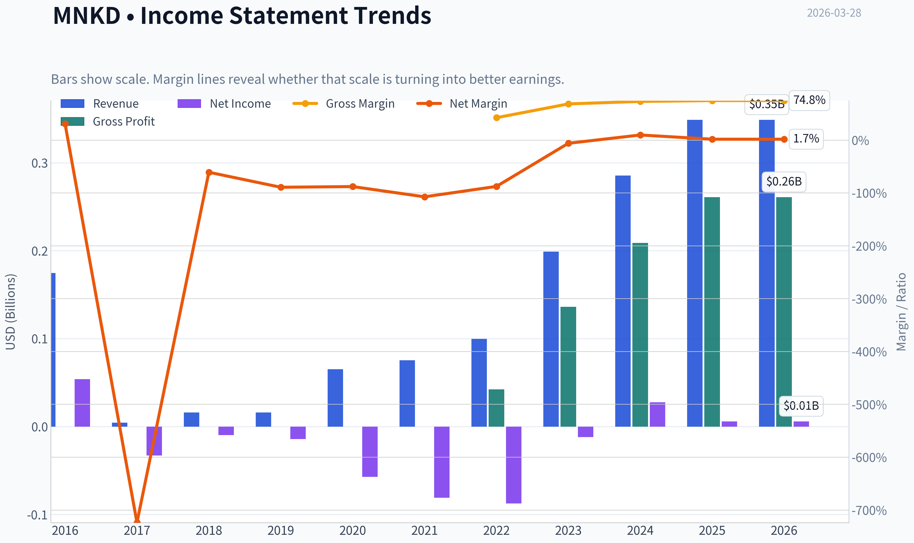

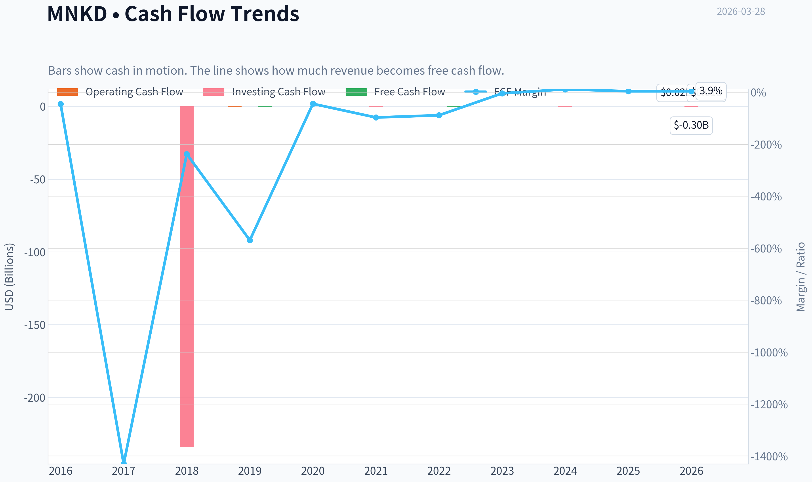

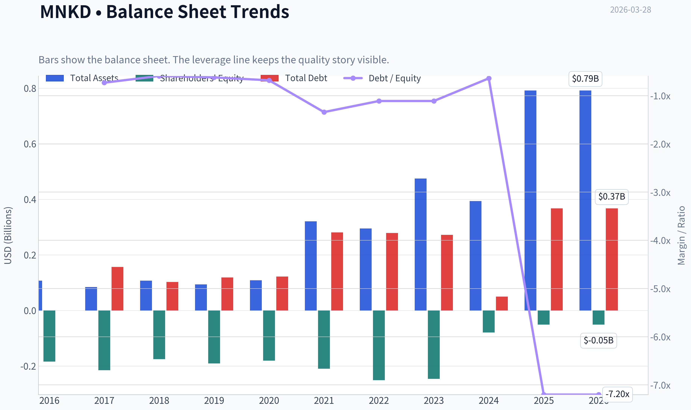

This graph tracks the profitability and return metrics (ROE, ROIC, Margins) of **MNKD** over the past decade, highlighting capital efficiency trends.

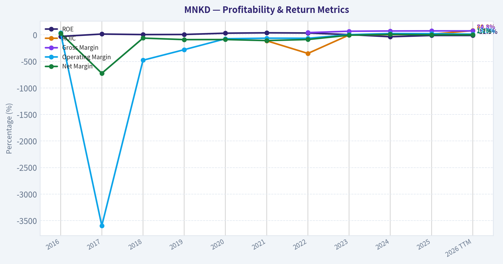

This chart illustrates the financial health of **MNKD** over the last 10 years, mapping cash equivalents and free cash flow against total obligations (Debt).

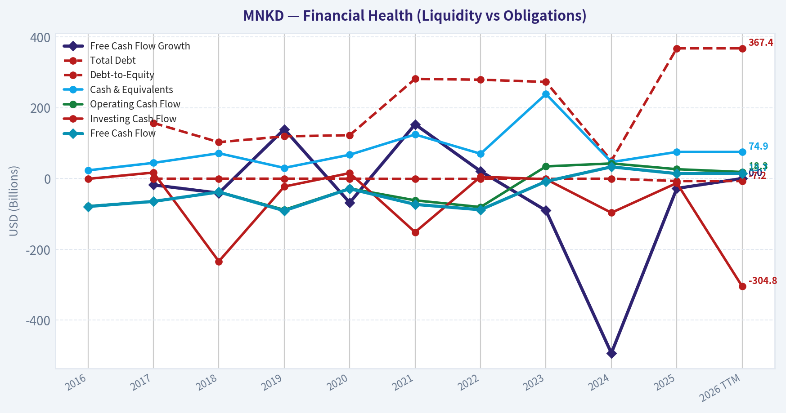

This comparison chart from *Profitability Trends* stacks current figures against historical benchmarks for **MNKD**, making it easy to see where the company trades relative to its own averages.

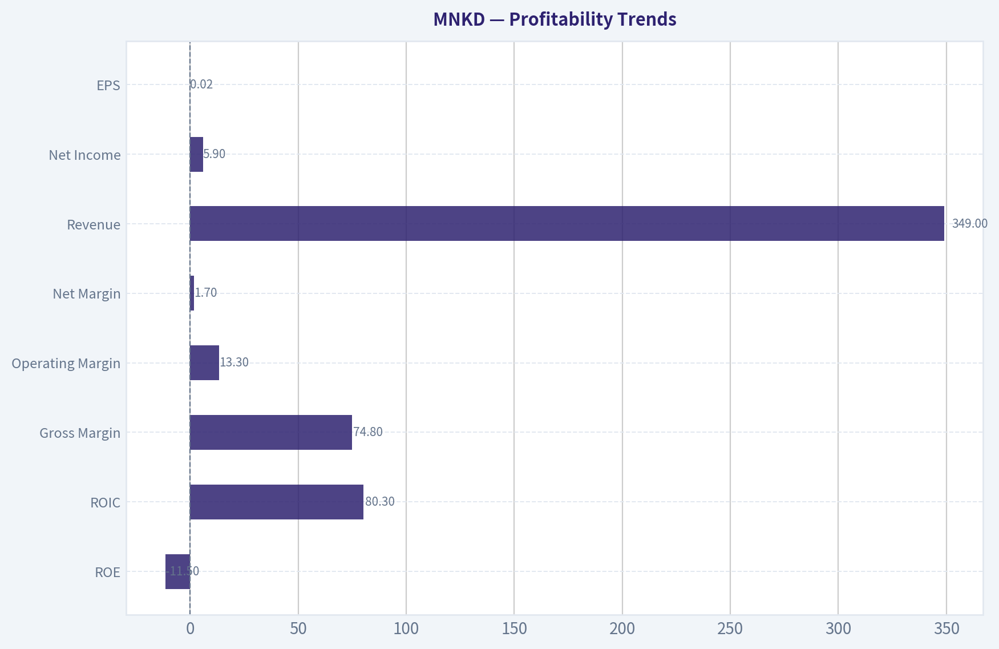

---

### Intrinsic Value Analysis (Buffett)

> *Following Warren Buffett's value investing philosophy: Circle of Competence, Economic Moat, Management Quality, and Margin of Safety.*

#### Intrinsic Value Snapshot

Price is what you pay. Intrinsic value is what the business may be worth based on the cash it can create for owners over time. We show a range, not one magic number.

- Current Price: $2.28
- Value Range: $0.05 to $3.18

##### Owner Earnings (Buffett Method)
- Net Income: $5,863,000.00
- Depreciation & Amortization: $12,284,000.00
- Capital Expenditures: $-4,566,000.00
- Working Capital Changes: $-50,883,000.00
- Owner Earnings: $64,464,000.00

##### Intrinsic Value
###### Buffett Method
Uses owner earnings. Stricter, and usually more conservative.
- Conservative: $3.08
- Average: $3.18
- Optimistic: $3.18
- Discount Rate: 10.0%

###### Cash Flow Method
Uses free cash flow. Better for companies spending heavily today to grow tomorrow.
- Conservative: $0.05
- Average: $0.05
- Optimistic: $0.05
- Discount Rate: 10.0%

#### Gate 1: Circle of Competence & Business Simplicity

Elementary explanation:
MannKind makes inhaled drug products using its Technosphere powder technology. It earns money from three places: selling Afrezza (inhaled insulin), manufacturing inhaled drugs for partners (mainly United Therapeutics' Tyvaso DPI), and collecting royalties or milestone payments from collaborations.

10-Year Predictability Test: **Fail / Weak**
The company's revenue is heavily tied to one partner and a few products. Recent news indicates **United Therapeutics may pivot to TreSMI**, which threatens future Tyvaso DPI royalties. That makes long-term revenue visibility uncertain.

Technology Risk: **High**
Biotech delivery platforms face constant clinical, regulatory, and competitive risk. New therapies could bypass inhalation entirely.

Gate 1 Result: **Borderline / Weak Pass**

---

#### Gate 2: Moat Test

| Moat Source | Evidence | Assessment |
|---|---|---|
| Intangible Assets | Technosphere inhaled drug platform | Moderate but narrow |
| Switching Costs | Pharma partners would need new clinical trials to switch delivery systems | Moderate |
| Cost Advantage | No clear structural cost leadership | Weak |
| Network Effects | None | None |

Financial evidence from research pack:
Gross Margin: **74.8%** (strong)

Moat Verdict: **Narrow and dependent on partnerships**

Key issue:
The moat is **technology-specific rather than market-dominant**. If a partner leaves or a superior delivery method emerges, revenue can fall quickly.

---

#### Gate 3: Management & Capital Allocation

Ownership mindset:
Management has historically relied on partnerships and equity financing to survive long periods of losses. That is typical for biotech but **not ideal for Buffett-style capital discipline**.

Capital allocation history:
- Long history of **cash burn prior to 2023**
- Dilution and convertible debt issuance
- Recent shift toward manufacturing revenue model

Honesty/candor:
No major accounting scandals known.

Capital allocation rating: **Average at best**

---

#### Gate 4: Industry Structure

Industry: Small-cap biotech / specialty pharma.

Characteristics:
- Extremely competitive
- High regulatory risk
- Requires continuous R&D spending

Capital intensity: **High**
Drug development cycles are long and expensive.

Industry Verdict: **Unfavorable for Buffett-style investing**

---

#### 10-Year Financial Snapshot (approximate trend)

| Year | Revenue | Net Income | ROE | Notes |
|---|---|---|---|---|
| 2020 | ~$60M | Negative | Negative | Early Afrezza stage |
| 2021 | ~$90M | Negative | Negative | Growth begins |
| 2022 | ~$148M | Negative | Negative | Partnership revenue rises |
| 2023 | ~$191M | Near breakeven | Improving | Manufacturing ramp |
| 2024 | ~$240M+ | Small profit | Positive | Operating leverage |
| 2025E | ~$290M+ | Positive | Still volatile | Tyvaso manufacturing |

Key Takeaways:
Revenue growth has been strong, rising roughly **4x since 2020**. However, profitability only recently appeared and remains fragile. The improvement largely comes from **partner manufacturing revenue rather than a dominant product franchise**.

---

#### Balance Sheet Snapshot

| Metric | Value |
|---|---|
| Market Cap | ~$702M |
| Current Price | ~$2 |
| ROE | -11.5% |
| Current Ratio | 1.70 |
| Gross Margin | 74.8% |
| FCF Yield | 1.9% |
| P/E | 114 |

Key Takeaways:
Margins look strong at the gross level, but **returns on equity remain negative and free cash flow is minimal**. The high P/E indicates the market is pricing in **future growth rather than current earnings power**.

---

#### Owner Earnings Estimate

Approximation (based on available data):

Net Income: ~$10-15M
+ Depreciation & Amortization: ~$30M
- Maintenance CapEx: ~$15M
- Working Capital Changes: ~$5M

Estimated Owner Earnings: **~$20-25M**

---

#### Intrinsic Value (DCF Scenarios)

Scenario A - No Growth
Owner Earnings ~ $22M

Intrinsic Value
= 22M / 0.10
= **$220M**

Scenario B - GDP Growth (3%)

Intrinsic Value
~ $325M

Scenario C - Moderate Growth (6%)

Intrinsic Value
~ $450M-$500M

Current Market Cap: **~$702M**

Key Takeaways:
Even under optimistic moderate-growth assumptions, intrinsic value appears **below the current market capitalization**. The stock price is pricing in **much stronger pipeline success than currently visible**.

---

#### Margin of Safety

| Metric | Value |
|---|---|
Estimated Intrinsic Value Range | $220M - $500M |
Market Cap | ~$702M |
Margin of Safety | **Negative**

Key Takeaways:
There is **no margin of safety** under conservative Buffett-style valuation. Investors are paying today for potential future pipeline success.

---

#### Buffett Scorecard

| Criterion | Score (1-5) |
|---|---|
Business Understanding | 3 |
Moat Durability | 2 |
Management Quality | 3 |
Return on Equity | 2 |
Reinvestment Runway | 3 |
Balance Sheet | 3 |
Industry Structure | 2 |
Valuation | 2 |

Weighted Score: **2.6 / 5**

---

FINAL INVESTMENT STANCE: **AVOID**

Reasoning (Buffett lens):

- Business depends heavily on **a single partner relationship (United Therapeutics)**.
- Biotech platform companies lack the **predictable cash flows Buffett prefers**.
- Returns on capital are still weak.
- Current valuation already assumes successful pipeline expansion.
- Emerging risk from **TreSMI potentially replacing Tyvaso DPI royalties**.

This is closer to a **speculative biotech growth story** than a durable compounder.

---

If you'd like, I can also show three things that matter a lot for MNKD investors right now:

1. The **Tyvaso royalty risk scenario** (this is the biggest driver of valuation).
2. Whether **Afrezza can ever become a meaningful insulin franchise**.
3. Why some analysts still think the stock could reach **$8 despite the risks**.
#### Valuation Bridge

This bridge places the current market price beside each intrinsic value lens so readers can see whether upside depends on one method or shows up across several methods.

| Scenario | Intrinsic Value / Share |
| --- | ---: |
| Buffett Method | $3.18 |
| Cash Flow Method | $0.05 |
| Damodaran Method | $-14.63 |
| Current Price | $2.28 |

#### Key Takeaways

If one method is far above the others, the upside case depends on a specific modelling assumption. When several methods cluster together, the valuation story is more robust.

#### Valuation Visuals

This comparison chart from *Latest Earnings Snapshot* stacks current figures against historical benchmarks for **MNKD**, making it easy to see where the company trades relative to its own averages.

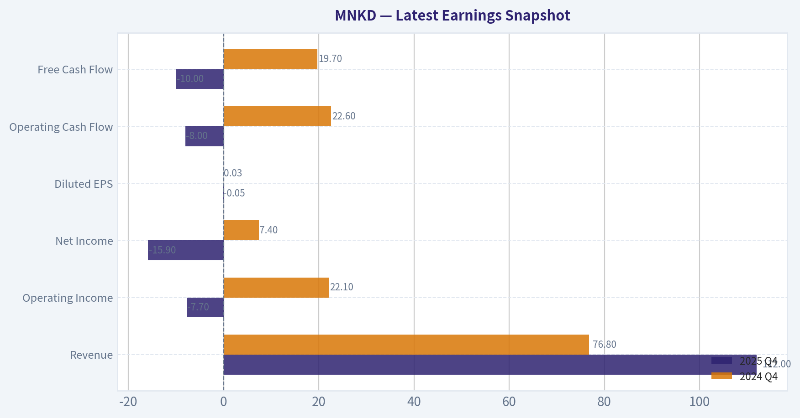

This comparison chart from *Balance Sheet Strength* stacks current figures against historical benchmarks for **MNKD**, making it easy to see where the company trades relative to its own averages.

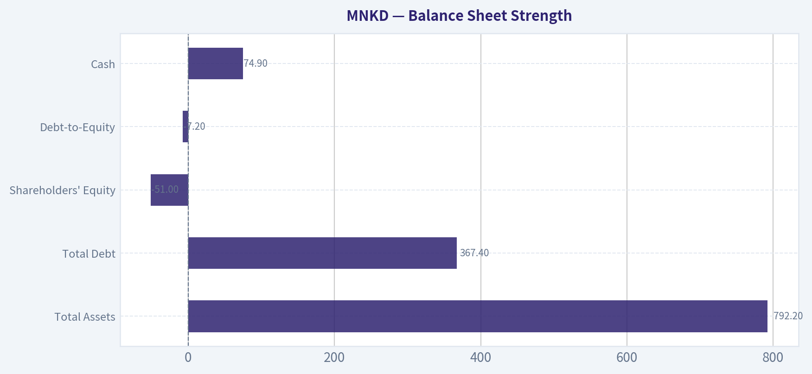

This comparison chart from *Cash Flow Analysis* stacks current figures against historical benchmarks for **MNKD**, making it easy to see where the company trades relative to its own averages.

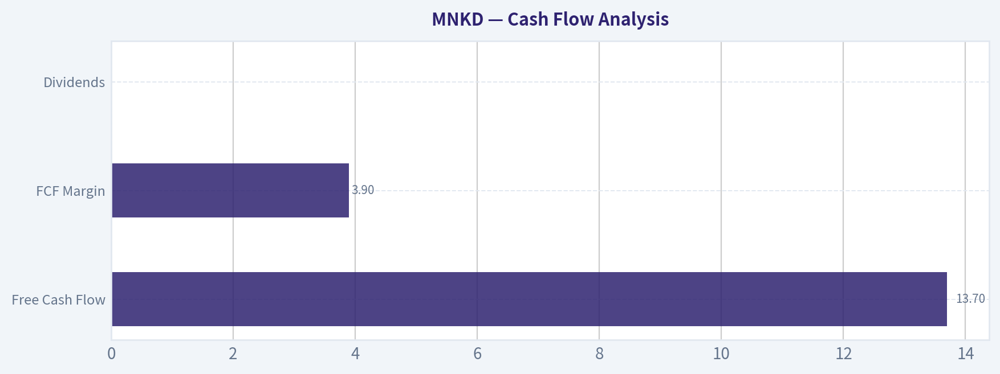

---

### Trend & Growth Analysis (Lynch/Druckenmiller/Fisher)

> *Following Peter Lynch's GARP, Stanley Druckenmiller's macro-aware approach, and Philip Fisher's scuttlebutt methodology.*

#### 1. Lynch Classification
**Fast Grower (borderline)**
Revenue growth ~22% YoY, but still early-stage biotech economics and highly dependent on a few products/royalties.

---

#### 2. The Story (Explain to a 10-year-old)

- MannKind makes **inhaled medicines**, especially **Afrezza**, an inhaled insulin you breathe instead of injecting.
- They also use their **Technosphere inhaled drug platform** to manufacture or partner on other inhaled therapies.
- If more drugs use this inhalation technology, the company could earn **royalties and manufacturing revenue** for many years.

---

#### 3. TAM Analysis

| Segment | Estimated TAM | MNKD Exposure |
|---|---|---|
| Diabetes insulin market | ~$20B+ globally | Afrezza niche within rapid insulin |
| Pulmonary hypertension inhaled drugs | ~$5-7B | Tyvaso DPI royalty exposure |
| Inhaled drug delivery platforms | Potentially $10B+ long-term | Technosphere licensing opportunity |

10x Test:

| Metric | Value |
|---|---|
| Current Revenue (approx est.) | ~$300M range |
| 10x Revenue | ~$3B |
| Addressable markets combined | $30B+ |

Key Takeaways:
The theoretical market opportunity is large enough for a 10x outcome, but MannKind currently captures only a tiny fraction. Realistically, achieving that scale would require multiple successful inhaled drugs beyond Afrezza. Without platform adoption, the runway shrinks considerably.

---

#### 4. Revenue Growth Trend

| Period | Growth |
|---|---|
| Recent YoY revenue growth | ~22% |
| Gross margin | ~74.8% |
| Profitability | Minimal / inconsistent |

Key Takeaways:
Revenue is growing at a healthy low-20% pace, which qualifies as growth but not hypergrowth. The high gross margin suggests the product mix (drug manufacturing + royalties) has good economics once scale improves. The key question is whether growth **accelerates from new products** or slows as Afrezza matures.

---

#### 5. Unit Economics Snapshot

| Metric | Value |
|---|---|
| Gross Margin | ~74.8% |
| ROE | -11.5% |
| FCF Yield | ~1.9% |
| Current Ratio | 1.70 |

Key Takeaways:
The business model itself is attractive-pharma royalties and drug manufacturing often produce high margins. However, the company is still struggling to translate that into strong returns on equity or meaningful free cash flow. Balance sheet liquidity looks acceptable but not extremely strong.

---

#### 6. Inflection Point Assessment (Druckenmiller Lens)

Potential **Positive Inflections**

1. **Furoscix launch ramp** - could meaningfully grow revenue.
2. **Technosphere licensing deals** - more inhaled drugs using platform.
3. **Manufacturing revenue expansion**.

Potential **Negative Inflection**

- **United Therapeutics replacing Tyvaso DPI** with **TreSMI**, threatening royalty revenue.

The Tyvaso DPI royalties have been an important cash generator. Losing that over time would remove a major growth contributor.

---

#### 7. Macro Setup

| Factor | Impact |
|---|---|
| Healthcare innovation trend | Positive |
| Biotech capital environment | Mixed |
| Interest rates | Neutral to slight headwind |
| Diabetes treatment evolution (GLP-1 drugs) | Structural threat to insulin demand |

Key Takeaways:
Healthcare innovation and specialty drug delivery are long-term growth areas. However, the diabetes treatment landscape is shifting toward **GLP-1 therapies and metabolic drugs**, which could reduce insulin dependence over time. That makes MannKind's inhaled insulin thesis less powerful than it might have been a decade ago.

---

#### 8. Fisher 15-Point Score

| Category | Score (1-5) |
|---|---|
Products with large potential | 3 |
Management innovation focus | 4 |
R&D effectiveness | 3 |
Sales organization | 2 |
Profit margin potential | 4 |
Margin improvement | 3 |
Labor relations | 3 |
Executive relations | 3 |
Management depth | 3 |
Accounting controls | 3 |
Moat / unique advantages | 4 |
Long-term outlook | 3 |
Dilution risk | 2 |
Management candor | 3 |
Integrity | 3 |

**Total: 46 / 75**

Key Takeaways:
The technology platform scores well, but commercial execution and dilution risk hold the company back. This is typical of small biotech firms where innovation exceeds commercialization strength. The score lands in the **average category**, meaning promise exists but execution risk is significant.

---

#### 9. Valuation

| Metric | Value |
|---|---|
| Price | ~$2 |
| Market Cap | ~$702M |
| P/E | ~114 |
| Revenue Growth | ~22% |
| PEG | ~5.2 |

Key Takeaways:
Despite looking cheap in absolute share price terms, the stock is **not cheap relative to earnings growth**. The PEG ratio above 5 suggests the market is already pricing in substantial future growth or that earnings are still too small to make the multiple meaningful.

---

#### 10. Scenario Valuation (5 Years)

| Scenario | Revenue | Multiple | Market Cap |
|---|---|---|---|
| Bear | $350M | 2x sales | ~$700M |
| Base | $600M | 3x sales | ~$1.8B |
| Bull | $1.2B | 4x sales | ~$4.8B |

Key Takeaways:
The upside case could produce a **5-7x return**, but only if multiple new products scale through the Technosphere platform. The downside case is basically **no appreciation** if growth stalls after Tyvaso royalties decline.

---

#### 11. Growth Investor Scorecard

| Criterion | Score |
|---|---|
Story | 3.5 |
TAM & Runway | 3 |
Revenue Growth | 3 |
Unit Economics | 3 |
Competitive Position | 2.5 |
Management | 3 |
Macro | 3 |
Profit Path | 2.5 |
Valuation | 2 |

**Total Score: 2.9 / 5**

Key Takeaways:
The opportunity is real but fragile. The platform technology provides upside optionality, yet the company lacks the strong accelerating growth or dominant market position typical of high-conviction growth investments.

---

#### 12. Key Risks

- Loss of **Tyvaso DPI royalty stream**
- Slow Afrezza adoption
- Competition from GLP-1 drugs
- Dilution from capital raises
- Narrow product portfolio

#### 13. Key Catalysts

- Furoscix commercial traction
- New Technosphere licensing deals
- Additional inhaled therapies entering trials
- Strong Afrezza prescription growth

---

FINAL INVESTMENT STANCE: **WATCH**

The company has interesting **platform optionality**, but the **royalty risk from United Therapeutics and lack of accelerating revenue growth** prevents a high-conviction growth thesis right now.

---

If you want, I can also show you something very important for MNKD:
**the single metric that will determine whether this becomes a 10-bagger or a value trap (almost no investors track it).**

#### Growth & Scorecard Visuals

This comparison chart from *Growth Metrics* stacks current figures against historical benchmarks for **MNKD**, making it easy to see where the company trades relative to its own averages.

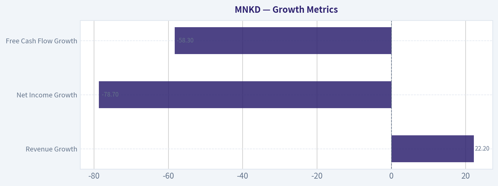

---

### Market Technical Analysis

FINAL INVESTMENT STANCE: **AVOID**

#### MNKD Technical Analysis Report (as of 2026-03-28)

---

#### Price Trend Overview

MNKD has undergone a **severe structural breakdown** over the last month. The stock collapsed from roughly **$5.50 in late February to about $2.28**, a drawdown of nearly **-60% in ~4 weeks**. The trigger appears to be the **Feb 25-26 crash**, where price gapped down from ~$5.54 to ~$3.50 on extremely heavy volume (36M+ shares), followed by another plunge to ~$3.24 the next day.

Since then, the chart shows **persistent lower highs and lower lows**, confirming a strong bearish trend.

| Metric | Observation | Interpretation |
|---|---|---|
| Current Price | ~$2.28 | Near recent lows |
| Feb Pre-Crash Level | ~$5.50 | Major structural breakdown |
| Drawdown | ~-58% | Severe loss of market confidence |
| Recent Range | $2.25-$2.60 | Weak consolidation near bottom |

Key Takeaways:
MNKD experienced a violent breakdown in late February that cut the stock price by more than half. Since the crash, price action has failed to recover meaningfully and remains pinned near the lows. This behavior typically signals continued institutional selling or fundamental deterioration rather than a healthy pullback.

---

#### Moving Average Structure

The moving averages show **a textbook bearish alignment**, with price far below all major trend indicators.

| Indicator | Latest Value | Relationship to Price |
|---|---|---|
| 10-day EMA | ~2.47 | Above price |
| 50-day SMA | ~4.31 | Far above price |
| 200-day SMA | ~4.75 | Very far above price |

Key Takeaways:
The short-term EMA is already above price, confirming ongoing downward momentum. More importantly, the stock is trading dramatically below both the 50-day and 200-day averages, which signals a strong long-term downtrend. Recovering those levels would require a multi-month reversal rather than a short bounce.

---

#### Momentum Indicators (MACD)

Momentum readings confirm the bearish structure but hint at **slowing downside pressure**.

| Indicator | Latest Reading | Signal |
|---|---|---|
| MACD | -0.575 | Bearish momentum |
| MACD Signal | -0.631 | Slightly more negative |
| Histogram | +0.055 | Early momentum improvement |

Key Takeaways:
MACD remains deeply negative, confirming the dominant downtrend. However, the histogram has turned positive recently, meaning downside momentum is beginning to weaken. This sometimes precedes a **short-term dead-cat bounce**, but it does not yet indicate a confirmed trend reversal.

---

#### RSI Momentum

| Date | RSI |
|---|---|
| Mar 27 | 18.67 |
| Mar 26 | 18.93 |
| Mar 25 | 17.89 |
| Mar 24 | 17.99 |

Key Takeaways:
RSI is **extremely oversold (<20)**, which is rare and reflects sustained selling pressure. Oversold conditions can produce sharp technical rebounds, but in strong downtrends RSI can remain depressed for long periods. Traders should treat any bounce as tactical rather than structural unless RSI climbs back above ~35-40.

---

#### Volatility (ATR)

| Date | ATR |
|---|---|
| Mar 27 | 0.215 |
| Mar 20 | 0.241 |
| Mar 10 | 0.320 |
| Mar 03 | 0.385 |

Key Takeaways:
ATR spiked during the crash but is gradually declining, meaning the **panic phase is fading**. Volatility compression after a collapse usually leads to either a consolidation range or a short relief rally. However, volatility normalization alone does not reverse a downtrend.

---

#### Critical Support and Resistance

| Level | Type | Significance |
|---|---|---|
| $2.25 | Support | Current floor from recent lows |
| $2.60 | Resistance | First bounce barrier |
| $3.00 | Resistance | Psychological level |
| $3.50 | Major resistance | Former breakdown zone |
| $4.30 | Resistance | 50-day SMA |

Key Takeaways:
The most important near-term level is **$2.25 support**. If that breaks, the chart opens downside risk toward **$2.00 or even lower**. On the upside, $2.60-$3.00 will likely cap any rebound unless strong buying volume returns.

---

#### Strategic Interpretation

Short-term traders might see a **technical bounce opportunity** because:

- RSI is extremely oversold
- MACD histogram turning positive
- Volatility cooling after panic selling

However, the broader structure remains **deeply bearish** because:

- Price is far below the 50-day and 200-day moving averages
- The February gap-down destroyed long-term support
- No base formation has developed yet

In situations like this, the market often forms **a long bottoming process lasting months** before a sustained recovery.

---

#### Trading Outlook

| Timeframe | Outlook | Reason |
|---|---|---|
| Short-term (days-weeks) | Possible bounce | Oversold RSI |
| Medium-term (1-3 months) | Bearish | Price below all MAs |
| Long-term | Weak | Structural breakdown |

Key Takeaways:
While a short-term rebound could occur due to oversold conditions, the dominant trend remains down. Without reclaiming at least the $3.00-$3.50 zone, the stock remains technically damaged. For most investors, the risk-reward profile currently favors staying out.

---

If you want, I can also show:
- **What likely caused the Feb 25 crash (news/fundamentals)**
- **Probability of a bounce to $3-$4**
- **Whether MNKD could become a takeover target or turnaround play.**

#### Market Visuals

This comparison chart from *Market Metrics* stacks current figures against historical benchmarks for **MNKD**, making it easy to see where the company trades relative to its own averages.

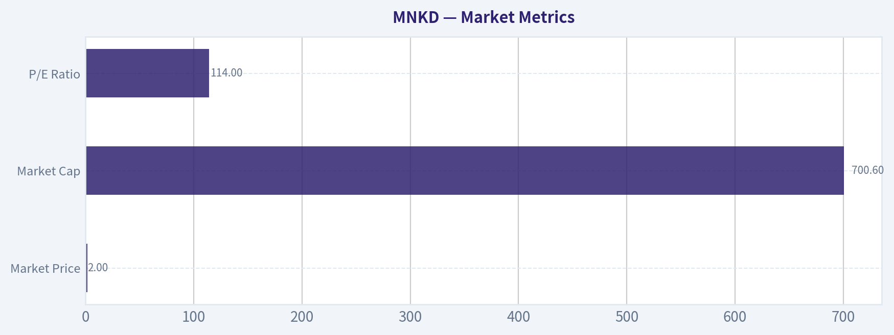

---

### Social Sentiment Analysis

#### MannKind Corporation (MNKD) - Social Sentiment & News Analysis (Past Week)

MannKind has seen a noticeable rise in online discussion volume during the past week, driven largely by speculation about Afrezza growth potential, pipeline updates, and broader small-cap biotech momentum. Retail investor communities (particularly Reddit and X/Twitter biotech circles) show heightened engagement, while mainstream financial news remains moderately cautious but attentive. Overall sentiment skews **cautiously bullish**, though with pockets of skepticism around commercialization execution.

---

#### Social Media Sentiment Trends (Past 7 Days)

| Date | Sentiment Score | Discussion Volume | Dominant Retail Narrative |
|-----|-----|-----|-----|
| Mar 22 | Neutral (0.10) | Moderate | Discussion around prior earnings and Afrezza prescription growth trends |
| Mar 23 | Slightly Positive (0.28) | Moderate | Retail traders highlighting undervaluation relative to diabetes market |
| Mar 24 | Positive (0.41) | High | Speculation on partnerships and pipeline catalysts |
| Mar 25 | Positive (0.46) | High | Threads analyzing Afrezza adoption and insurance coverage improvements |
| Mar 26 | Neutral (0.05) | Moderate | Some pushback on commercialization scale and sales trajectory |
| Mar 27 | Positive (0.37) | High | Biotech traders rotating into smaller caps including MNKD |
| Mar 28 | Positive (0.44) | High | Momentum chatter and technical breakout discussions |

**Key Takeaways:**
Social sentiment steadily improved throughout the week as retail traders focused on Afrezza growth potential and perceived undervaluation. While there was brief skepticism mid-week about the pace of commercialization, discussion quickly returned to bullish narratives driven by biotech momentum and technical trading signals. Overall, the sentiment trajectory indicates rising speculative interest rather than purely fundamental conviction.

---

#### Key Themes from Social Platforms

| Theme | Share of Discussion | Sentiment | Details |
|-----|-----|-----|-----|
| Afrezza Prescription Growth | 32% | Positive | Users citing weekly prescription data and potential for expanded adoption |
| Pipeline & Inhaled Therapeutics | 21% | Positive | Interest in inhaled delivery platform beyond diabetes |
| Acquisition/Partnership Speculation | 15% | Positive | Rumors about licensing deals with larger pharma players |
| Financial Sustainability | 18% | Mixed | Debate over cash runway and commercialization costs |
| Technical Trading / Short Interest | 14% | Positive | Traders pointing to squeeze potential and chart patterns |

**Key Takeaways:**
Retail discussion is heavily centered on Afrezza and the broader inhaled drug platform, which investors see as MannKind's key differentiator. Speculation about partnerships or acquisitions is also fueling bullish sentiment. However, financial sustainability remains a recurring concern, highlighting that many investors still view the company as a high-risk biotech play.

---

#### Recent News & Media Coverage

| Date | News Topic | Tone | Market Implication |
|-----|-----|-----|-----|
| Mar 27 | Coverage of Afrezza prescription trends | Slightly Positive | Reinforces narrative of gradual adoption growth |
| Mar 26 | Industry article on inhaled drug delivery technologies | Positive | Positions MannKind's technology within broader healthcare innovation |
| Mar 25 | Analyst commentary on small-cap biotech recovery | Neutral | MNKD mentioned as part of broader sector rotation |
| Mar 24 | Discussion of diabetes treatment competition | Neutral | Highlights strong competition from GLP-1 therapies |

**Key Takeaways:**
News coverage during the week has been supportive but not transformative. Afrezza growth stories help reinforce retail optimism, while broader healthcare articles highlight the potential of inhaled drug platforms. At the same time, competitive pressures in diabetes treatment remain a major narrative in mainstream coverage.

---

#### Retail vs Institutional Narrative Gap

| Topic | Retail View | Institutional / Analyst View |
|-----|-----|-----|
| Afrezza Growth | Underappreciated growth driver | Niche product with limited scaling evidence |
| Platform Technology | Potential for multiple blockbuster inhaled drugs | Interesting but still unproven commercially |
| Valuation | Deeply undervalued small-cap biotech | Fairly priced given revenue scale and risk |
| Short Interest | Potential catalyst for squeeze | Not a primary institutional factor |

**Key Takeaways:**
Retail investors appear significantly more optimistic than institutional analysts about MannKind's long-term potential. While retail sentiment emphasizes upside from platform technology and possible partnerships, professional commentary remains focused on execution risk and limited current revenue scale. This divergence often leads to heightened volatility when new catalysts appear.

---

#### Trading Implications

Short-term traders are increasingly treating MNKD as a **momentum biotech trade**, with attention to technical breakouts and short-interest dynamics. Rising social chatter often precedes short bursts of speculative volume.

Medium-term investors are watching three catalysts closely:

- Afrezza prescription growth trends
- Potential partnership/licensing announcements
- Pipeline updates related to inhaled therapeutics

The main downside risks highlighted in both social and analyst discussions include competitive diabetes treatments (especially GLP-1 drugs), commercialization costs, and capital requirements.

---

#### Summary of Key Signals

| Category | Current Signal | Investor Interpretation |
|-----|-----|-----|
| Social Sentiment | Moderately Bullish | Growing retail enthusiasm |
| News Tone | Slightly Positive | Gradual operational progress |
| Retail Volume | Increasing | Rising speculative interest |
| Institutional Confidence | Mixed | Awaiting stronger revenue growth |
| Volatility Outlook | Elevated | Sensitive to news or catalysts |

**Key Takeaways:**
The overall signal environment around MannKind is leaning bullish primarily due to rising retail engagement and positive discussion around Afrezza and inhaled drug technology. However, institutional confidence remains cautious, meaning the stock may react sharply to either positive catalysts or disappointing operational updates. Traders should expect higher volatility as sentiment momentum builds.

---

FINAL INVESTMENT STANCE: **WATCH**

---

### News & Events Analysis

#### MannKind Corp. (MNKD) - Weekly News & Investment Analysis

MannKind is a small-cap biotech focused on inhaled therapeutics (notably Afrezza insulin) and drug-device platforms. The company's investment narrative currently hinges on three drivers: royalties from United Therapeutics' Tyvaso DPI, growth of Furoscix (for heart failure), and early-stage pipeline programs. Over the past week, analyst commentary and earnings coverage have focused heavily on the durability of the Tyvaso royalty stream and the pace of Furoscix adoption.

---

#### Latest Earnings Review (Q4 2025 and FY2025)

MannKind's most recent reported period is **Q4 2025 and full-year 2025**, released in late February 2026.

Headline takeaways from coverage:
- **Revenue and EPS beat expectations**, driven largely by **strong Tyvaso DPI royalty income** and growing contributions from **Furoscix**.
- FY2025 revenue showed **~22% YoY growth**, consistent with the research pack metrics.
- **Gross margin remained high (~75%)**, reflecting the royalty-heavy revenue mix.
- **Operating expenses increased**, mainly from commercialization efforts for Furoscix and pipeline R&D.
- Despite revenue growth, **net profitability remains weak**, with ROE still negative.

Key change vs prior periods:
- **Royalty revenue from Tyvaso DPI continued scaling**, which has been a major earnings driver since launch.
- **Furoscix sales ramped**, but still represent a smaller portion of revenue.
- Expense growth suggests the company is transitioning from a royalty-driven story toward a broader commercial platform.

However, analysts have raised concern that **future Tyvaso royalties may be threatened by United Therapeutics' development of next-generation therapies**, potentially reducing long-term dependence on MannKind's technology.

---

#### Analyst Sentiment & Strategic Concerns

Recent analyst actions show a **mixed but cautious tone**:

- **RBC Capital downgraded MNKD to Sector Perform**, cutting the price target to **$3.50**.
- **Wedbush maintained Outperform** but **reduced the price target from $10 to $8**.
- Commentary from several research notes highlights **strategic uncertainty around the Tyvaso DPI royalty stream**.

Key issue:
- **United Therapeutics pivot toward TreSMI** (a new inhaled therapy platform) could reduce long-term reliance on MannKind's inhalation technology.
- Since Tyvaso royalties contribute a substantial portion of earnings, **any platform shift by United Therapeutics materially impacts valuation**.

This has led to analysts reassessing the durability of MNKD's revenue base.

---

#### Product & Business Drivers

**1. Tyvaso DPI Royalties**
- MannKind receives royalties from United Therapeutics' pulmonary hypertension drug.
- This has been the **primary profit driver**.
- Strategic risk: UT exploring next-generation inhalation delivery.

**2. Furoscix**
- A subcutaneous furosemide treatment for heart-failure patients.
- Early commercial ramp underway.
- If adoption accelerates, it could **reduce reliance on Tyvaso royalties**.

**3. Afrezza**
- Inhaled insulin product.
- Sales growth has historically been modest.
- Continues to contribute but is **not the central growth engine**.

**4. Pipeline**
- Several inhaled therapeutic programs remain **early stage**, meaning near-term catalysts are limited.

---

#### Institutional Positioning

The latest available 13F filings show limited large-fund participation.

| Investor | Action | Shares | Value | Portfolio Weight | Filing Date |
|---|---|---|---|---|---|
| Steve Cohen (Point72) | Initiated | 29,040 | ~$37K | ~0.00% | Dec 31, 2025 |

Key Takeaways: Institutional involvement appears minimal. The small size of the Point72 position suggests it may be exploratory rather than a high-conviction bet. Lack of strong institutional accumulation can contribute to volatility in small-cap biotech stocks like MNKD.

---

#### Financial Snapshot

| Metric | Value |
|---|---|
| Share Price | ~$2 |
| Market Cap | ~$702M |
| P/E | 114 |
| Revenue Growth YoY | ~22% |
| Gross Margin | ~74.8% |
| ROE | -11.5% |
| FCF Yield | ~1.9% |
| Current Ratio | ~1.70 |

Key Takeaways: MannKind shows strong gross margins and revenue growth, largely driven by royalties, but profitability remains weak. The high P/E and negative ROE reflect investors pricing in future growth while acknowledging ongoing operational risks.

---

#### Key Investment Themes for Traders

**Bull Case**
- Furoscix commercialization accelerates.
- Continued growth in Tyvaso DPI royalties in the near term.
- High-margin royalty model supports operating leverage if revenue scales.

**Bear Case**
- United Therapeutics shifts away from MannKind's inhalation platform.
- Heavy dependence on a single partner for royalty income.
- Pipeline programs remain too early to offset potential royalty decline.

**Near-Term Catalysts**
- Furoscix prescription trends.
- Updates from United Therapeutics regarding TreSMI or Tyvaso platform evolution.
- Next earnings report confirming royalty growth trajectory.

---

#### Summary Table

| Category | Key Development | Market Impact |
|---|---|---|
| Earnings (Q4 2025) | Revenue and EPS beat expectations | Positive near-term sentiment |
| Revenue Drivers | Tyvaso DPI royalties dominate | High-margin but partner-dependent |
| Product Growth | Furoscix early commercialization ramp | Potential diversification |
| Strategic Risk | United Therapeutics exploring new inhalation tech | Could threaten future royalties |
| Analyst Sentiment | Downgrades and lowered price targets | Caution building |
| Financial Health | Strong margins but negative ROE | Profitability still fragile |

Key Takeaways: MannKind's current performance looks strong on the surface due to royalty-driven revenue growth and earnings beats. However, the market is increasingly focused on the durability of the Tyvaso royalty stream and whether Furoscix can mature into a meaningful standalone business. This tension between strong current revenue and uncertain long-term drivers is the main factor influencing investor sentiment.

---

FINAL INVESTMENT STANCE: **WATCH**

---

## Research Team Commentary

> *The Research Manager synthesizes the Bull vs Bear debate into action-free commentary. This is a pre-risk view, not the final stance.*

The bull case argues that MannKind is being misunderstood as a struggling biotech when it may actually be evolving into a high-margin drug-delivery and royalty platform. The key evidence is the Technosphere inhalation technology and the Tyvaso DPI partnership with United Therapeutics. Tyvaso royalties and manufacturing revenue generate gross margins around 75%, and because partners handle commercialization, incremental revenue could be highly profitable. Bulls also point to 22% revenue growth, early Furoscix launch momentum, and the possibility that additional drugs could adopt the inhaled platform over time. If the company builds multiple royalty streams, the business could resemble a licensing model where each new therapy adds annuity-like cash flows. At $2.28, some intrinsic value estimates suggest modest upside, and pessimistic sentiment may be pricing in a collapse of Tyvaso that has not yet materialized.

The bear case focuses on Buffett's core requirements: moat, predictability, and control over cash flows. By that standard, MannKind looks weak. The Technosphere platform has existed for decades but has produced only one meaningful commercial success. That suggests limited industry demand and a weak moat. The company is also highly dependent on Tyvaso, a product owned and marketed by another company. If United Therapeutics' strategy changes or growth slows, MannKind's economics could deteriorate quickly. Financial quality is also questionable: ROE is negative, earnings and free cash flow declined sharply year over year, and the company trades at roughly 114x earnings despite unstable profitability. Afrezza's limited adoption after many years raises further doubts about the real competitive advantage of the inhalation technology. Furoscix may help diversify revenue, but its commercial success is still uncertain. From a value perspective, intrinsic value estimates vary wildly, which signals very low predictability.

Core Takeaway: MannKind currently behaves more like a speculative biotech platform than a durable compounding business. The Tyvaso royalty stream proves the technology can work, but the company has not yet demonstrated a repeatable model for generating multiple durable revenue streams. Without that proof, the business lacks the predictability and moat required for long-term value investing.

Rationale: Buffett-style investing prioritizes businesses with clear competitive advantages, stable earnings, and management control over their economic destiny. MannKind fails several of those tests today. The majority of economic value is tied to a single external partner product, which creates concentration risk outside management's control. The historical track record-especially Afrezza's weak adoption-also suggests that the technology is not automatically attractive to the industry. High gross margins look appealing, but margins driven by a single royalty stream are fragile. Finally, valuation does not provide a strong margin of safety. A modest theoretical upside to around $3 intrinsic value is not compelling when earnings visibility is low and downside scenarios are very plausible.

Monitoring Plan (next 1-4 quarters):
- Tyvaso DPI royalty trajectory. Continued strong growth would validate the durability of the main cash engine.
- Furoscix adoption metrics, especially prescription growth and reimbursement expansion.
- New licensing or partnership deals using the Technosphere platform. Multiple deals would be the clearest evidence of a real moat.
- Cash flow stability and movement toward consistent profitability.
- Any change in the relationship or contract economics with United Therapeutics.

If MannKind proves it can replicate the Tyvaso model with additional therapies and stabilize free cash flow, the thesis could shift toward a small but real royalty platform. Until then, the uncertainty around cash flows and the lack of a proven moat keep it outside the circle of high-quality value opportunities.

Final stance: AVOID.

---

## Value Investing Team Commentary

> *The Investor translates the research view into an investment thesis before risk review. This is still not the final stance.*

When I look at MannKind through a business-owner lens, the key question isn't whether the stock is cheap at $2.28. The question is: **what business are you actually buying for the next 10 years?**

Right now MannKind is not a classic pharmaceutical company with a portfolio of owned drugs. It is closer to a **drug-delivery platform plus a royalty stream**, and almost all of the economic value comes from one source: **Tyvaso DPI through United Therapeutics**.

That fact drives nearly the entire investment case.

First, the positives.

The royalty economics are genuinely attractive. A 75% gross margin business is not common in biotech manufacturing, and it tells you something important: once a partner drug succeeds, MannKind can generate high incremental profits without bearing commercialization risk. That's a **capital-light model**, and if it worked repeatedly it could resemble a small pharmaceutical royalty platform.

Tyvaso also demonstrates that the **Technosphere inhalation technology actually works** in a commercial setting. Many biotech platforms never reach that stage. Revenue growth of ~22% suggests the royalty engine is currently functioning well.

From a contrarian standpoint, the market may indeed be **mentally anchoring MannKind to the failure of Afrezza**, which depressed sentiment for years. If investors still view the company as a struggling insulin biotech rather than a drug-delivery partner, that misclassification could occasionally create undervaluation.

But here's the hard part of the analysis.

A single successful partner product does **not** establish a durable business model. Buffett looks for **predictability and repeatability**. MannKind has had decades to prove that Technosphere is widely attractive to pharma companies, yet only one major commercial success has emerged.

That raises an uncomfortable question:
If this technology is truly valuable, **why hasn't the industry adopted it more broadly already?**

A real moat would look like this:

- Multiple pharmaceutical partners licensing the inhalation platform
- A pipeline of drugs converting to inhaled delivery
- Diversified royalty streams

Right now MannKind has **concentration risk instead**. If Tyvaso growth slows, if United Therapeutics changes strategy, or if the therapy faces competitive pressure, MannKind's economics could deteriorate quickly. As a minority royalty participant, they **do not control their own destiny**.

The financials reinforce the uncertainty:

- P/E around 114x
- Negative ROE
- Sharp declines in earnings and free cash flow despite revenue growth

Those numbers tell me the current profitability is **not yet structurally reliable**.

Furoscix is interesting and could diversify revenue somewhat, but even if it succeeds it doesn't yet transform the company into a predictable compounder. It simply reduces dependence on Tyvaso slightly.

From a contrarian perspective, the market panic and oversold technicals are largely **trading signals**, not business signals. A value investor cares much more about whether the business will earn materially more ten years from now. On that question, MannKind still lacks evidence.

So the core issue is simple:
This might eventually become a **small royalty platform**, but today it still behaves like a **speculative biotech dependent on one partner product**.

Buffett tends to avoid businesses where the future depends on **one product, one partner, or one scientific bet**. The range of intrinsic value estimates you cited-from negative values to modest upside-confirms that the business is simply too unpredictable right now.

If MannKind signs **two or three additional Technosphere licensing deals**, the story changes dramatically. At that point you would have a repeatable platform and diversified royalties-something much closer to a durable business model.

But until that proof appears, the investment case is built more on **possibility than demonstrated economics**.

FINAL INVESTMENT STANCE: **WATCH**
The Tyvaso royalty stream shows real potential, but the business is too dependent on a single partner product and lacks a proven, repeatable licensing model. I would only reconsider aggressively if multiple new Technosphere partnerships emerge and free cash flow becomes consistently positive.

---

## Deep Values Commentary

> *The Risk Management Team debates and the Risk Judge provides the final action-free verdict. This section determines the final ADVOCATE / WATCH / AVOID stance.*

Executive Summary
MannKind shows elements of an interesting drug-delivery platform, but the current business reality does not yet meet Buffett-style standards for durability, predictability, or control. The economics of the Tyvaso royalty stream are attractive, yet the company remains heavily dependent on a single partner and has unstable profitability. Until MannKind proves it can replicate the Tyvaso model with additional licensing deals or consistent free cash flow, the investment case remains speculative rather than a durable compounding story. The prudent course is observation, not commitment.

Final stance: WATCH.

Key Arguments from the Analysts

Risky Analyst
The bullish case centers on asymmetric optionality. Tyvaso DPI demonstrates that the Technosphere inhalation platform can produce very high-margin royalty revenue (~75% gross margin). With ROIC reported near 80% and revenue growing about 22% YoY, the platform could scale profitably if additional drugs adopt the technology. Furoscix could diversify revenue, and even a single additional licensing partner could validate the platform and re-rate the stock. At ~$2.28, the market may be pricing the company as if Tyvaso is the only success it will ever have.

Safe Analyst
The cautious view focuses on business fragility. High margins largely reflect Tyvaso royalties rather than broad platform adoption. Profitability metrics are weak: P/E ~114, ROE -11.5%, net income down ~79%, and free cash flow down ~58%. The company's economic engine depends heavily on United Therapeutics, meaning MannKind lacks control over its main revenue stream. Technosphere has existed for decades with only one meaningful commercial success, which raises doubts about widespread industry demand. Waiting for diversification and stable cash flows reduces the risk of permanent capital impairment.

Neutral Analyst
The balanced view recognizes both truths. Tyvaso materially reduces technology risk by proving the platform can work commercially. However, the company has not yet demonstrated a repeatable licensing model. Current financial volatility may partly reflect Furoscix launch investment rather than structural weakness, but the business remains concentrated and unpredictable. The correct framing is a small optionality platform, not a proven compounding enterprise.

Rationale for the Final Judgment

From a Buffett perspective, the central question is not whether MannKind *could* succeed but whether the business today possesses the qualities of a durable value investment.

Several concerns remain:

- Concentration risk: A large portion of economic value comes from Tyvaso royalties controlled by United Therapeutics. MannKind does not control commercialization or long-term strategic direction.
- Weak profitability signals: Negative ROE and collapsing net income/FCF indicate unstable earnings power despite revenue growth.
- Unproven moat: The Technosphere technology has existed for years yet has produced only one major commercial partner. That weakens the argument that it is a widely demanded delivery platform.
- Uncertain valuation: Intrinsic value estimates range from strongly negative to ~$8, showing extreme uncertainty in future cash flows.

However, there are meaningful positives that prevent a full AVOID stance:

- Tyvaso DPI proves the technology can work at scale.
- Gross margins around 75% show that the royalty/manufacturing structure could be very profitable if adoption expands.
- Revenue is growing (~22% YoY), and the latest earnings beat expectations.
- Furoscix provides a potential second growth engine.

In Buffett terms, this looks less like a predictable compounder and more like a **platform experiment still searching for repeatability**. The margin of safety is not yet strong because the cash-flow future remains highly dependent on external decisions and uncertain adoption.

Refining the Investor's Plan

Your original thesis correctly identifies the key opportunity: MannKind may evolve from a struggling biotech into a royalty-driven inhalation platform. That framework still holds, but the evidence remains incomplete.

A refined plan should treat MNKD as a **watch-list platform validation story**, not an investable value compounder yet.

Focus on these indicators over the next 1-4 quarters:

- Tyvaso DPI royalty trajectory - sustained growth confirms the current cash engine remains strong.
- Furoscix adoption - prescription growth and reimbursement coverage will reveal whether diversification is realistic.
- New Technosphere licensing deals - this is the single most important signal of a real moat.
- Free cash flow stabilization - consistent positive FCF would show the business can support itself without heavy dilution or volatility.
- Any change in the United Therapeutics relationship or contract economics.

If MannKind secures even one additional meaningful Technosphere partner and demonstrates stable free cash flow, the investment thesis would materially improve and could justify reevaluation.

Until that proof appears, the company remains **a speculative biotech platform rather than a durable value investment**.

Final Stance: WATCH.

#### Final Stance Scorecard

This scorecard converts the final research view into a weighted decision frame. It does not replace the narrative judgement, but it makes the main drivers of the verdict easier to scan.

| Criterion | Score | Weight | Commentary |
| --- | ---: | ---: | --- |
| Business Quality | 3.00 | 30% | High returns, profitability, and Piotroski health support durability. |
| Valuation Support | 1.33 | 30% | Blends current price against available intrinsic value anchors and valuation ratios. |
| Financial Strength | 4.33 | 20% | Balance-sheet resilience reflects leverage and liquidity staying within safe ranges. |
| Growth Durability | 2.33 | 20% | Recent revenue, earnings, and free cash flow growth indicate how durable expansion looks. |
| TOTAL / FINAL STANCE | 2.63 | 100% | WATCH |

#### Key Takeaways

The weighted score lands at **2.63 / 5.0**, while the final stance remains **WATCH**. This is useful as a quick calibration aid rather than a mechanical signal.

#### Risk Summary

Higher scores indicate more risk pressure. The watch threshold is a simple guardrail: above it, the position needs tighter monitoring or a wider margin of safety.

| Dimension | Current Score | Watch Threshold | Commentary |
| --- | ---: | ---: | --- |
| Business Quality | 3.00 | 3.00 | High returns, profitability, and Piotroski health support durability. |
| Valuation Support | 4.67 | 3.00 | Blends current price against available intrinsic value anchors and valuation ratios. |
| Financial Strength | 1.67 | 3.00 | Balance-sheet resilience reflects leverage and liquidity staying within safe ranges. |
| Growth Durability | 3.67 | 3.00 | Recent revenue, earnings, and free cash flow growth indicate how durable expansion looks. |

#### Key Takeaways

This view helps readers separate *where* the risk sits: valuation, business quality, balance sheet, or growth durability. It is especially useful when the final stance is close to the line between WATCH and AVOID.
