# MOH Deep Value Intelligence

**Analysis Date:** 2026-05-09

## Critical Disclaimer

*This analysis is generated by Deep Value Intelligence, an AI-powered multi-agent investing framework. This report is for informational and educational purposes only and does not constitute financial advice. Always conduct your own research and consult with qualified financial advisors before making investment decisions.*

---

## Table of Contents

1. Intelligence Summary
2. Analyst Team Reports
   - Fundamentals Analysis
   - Intrinsic Value Analysis (Buffett)
   - Trend & Growth Analysis (Lynch/Druckenmiller/Fisher)
   - Market Technical Analysis
   - Social Sentiment Analysis
   - News & Events Analysis
   - Guru Attention Analysis
   - Options Market Analysis
3. Research Team Commentary
4. Value Investing Team Commentary
5. Deep Values Commentary

---

## Intelligence Summary

### Thesis + Conditions

**Core Thesis:** **EXECUTIVE SUMMARY**
Molina Healthcare (MOH) presents a classic value investing conundrum: distinguish between a temporary cyclical trough and a permanent impairment of owner earnings. While a 17.4% ROIC and accumulation by respected value gurus (Klarman, Burry) suggest a mispriced franchise, the collapse in Free Cash Flow (-216.9%) and lack of unilateral pricing power violate core Buffett principles of predictable cash generation.

**Key Risks:**
- The Aggressive Case (Risky):** The 49.7x trailing P/E is a distorted, backward-looking metric typical of cyclical troughs. Molina's 17.4% ROIC and 11.7% revenue growth prove its operational moat remains intact. Waiting for perfect clarity means outsourcing your upside to earlier buyers.
- The Balanced Case (Neutral):** Trough metrics create opportunity, but incomplete evidence does not justify a conviction buy. Set explicit stabilization triggers and scale in gradually, rather than making an all-or-nothing binary choice.
- Buffett teaches that risk comes from not knowing what you are doing, specifically regarding the predictability of a business's economics over the next decade. Currently, Molina's owner earnings are highly unpredictable.
- Guru Validation:** The presence of Klarman and Burry confirms sophisticated capital sees asymmetric upside in a normalization scenario. However, their mandates and draw-down tolerances differ from a concentrated, risk-averse value investor. We must anchor to our own cash-flow evidence, not their 13F filings.
- Original Plan:* Keep on a passive watchlist until MCR stabilizes, state rates update, and FCF completely recovers.

**What Would Change Our View:**
- The Aggressive Case (Risky):** The 49.7x trailing P/E is a distorted, backward-looking metric typical of cyclical troughs. Molina's 17.4% ROIC and 11.7% revenue growth prove its operational moat remains intact. Waiting for perfect clarity means outsourcing your upside to earlier buyers.
- The Balanced Case (Neutral):** Trough metrics create opportunity, but incomplete evidence does not justify a conviction buy. Set explicit stabilization triggers and scale in gradually, rather than making an all-or-nothing binary choice.
- Buffett teaches that risk comes from not knowing what you are doing, specifically regarding the predictability of a business's economics over the next decade. Currently, Molina's owner earnings are highly unpredictable.
- Guru Validation:** The presence of Klarman and Burry confirms sophisticated capital sees asymmetric upside in a normalization scenario. However, their mandates and draw-down tolerances differ from a concentrated, risk-averse value investor. We must anchor to our own cash-flow evidence, not their 13F filings.
- Original Plan:* Keep on a passive watchlist until MCR stabilizes, state rates update, and FCF completely recovers.

**Confidence:** Medium

---

## Analyst Team Reports

### Fundamentals Analysis

#### Latest Earnings Snapshot

*Most recent reported quarter anchored on 2026 Q1, with prior-year comparison when available.*

| Metric | 2026 Q1 | 2025 Q1 | YoY Change |
| --- | ---: | ---: | ---: |
| Revenue | $10.80B | $11.15B | -3.1% |
| Operating Income | $176.0M | $433.0M | -59.4% |
| Net Income | $14.0M | $298.0M | -95.3% |
| Diluted EPS | $0.27 | $5.45 | -95.1% |
| Operating Cash Flow | $1.08B | $190.0M | +469.5% |
| Free Cash Flow | $1.05B | $168.0M | +528.0% |

Key Takeaways: This snapshot anchors the most recent reported quarter before the narrative analysis. It helps readers separate long-run business quality from whatever changed in the latest earnings print.

#### 10-Year Financial Metrics for MOH

*All values below are computed deterministically from raw data - not estimated by AI.*

*Issuer profile: operating company (Healthcare / Healthcare Plans).*

#### 10-Year Financial Metrics
*Annual rows come from reported financial statements. The final TTM row is computed from the latest four quarters.*

| Metric | 2009 | 2010 | 2011 | 2012 | 2013 | 2014 | 2015 | 2016 | 2017 | 2018 | 2019 | 2020 | 2021 | 2022 | 2023 | 2024 | 2025 | 2026 TTM |
| --- | --- | --- | --- | --- | --- | --- | --- | --- | --- | --- | --- | --- | --- | --- | --- | --- | --- | --- |
| Market Price | $15 | $19 | $22 | $27 | $35 | $54 | $60 | $54 | $77 | $116 | $136 | $213 | $318 | $330 | $361 | $291 | $174 | $186 |
| Market Cap | $594.3M | $742,667 | $1.04B | $1.27B | $1.63B | $2.57B | $3.37B | $3.05B | $4.32B | $7.74B | $8.71B | $12.74B | $18.64B | $19.32B | $20.99B | $16.79B | $9.18B | $9.67B |
| P/E Ratio | 19.30 | 14.07 | 49.62 | 128.86 | 30.75 | 41.50 | 23.31 | 58.98 | -8.45 | 10.95 | 11.83 | 18.94 | 28.27 | 24.37 | 19.25 | 14.25 | 19.46 | 55.48 |
| P/B Ratio | 1.10 | 0.00 | 1.37 | 1.63 | 1.83 | 2.54 | 2.16 | 1.85 | 3.23 | 4.70 | 4.44 | 6.08 | 7.09 | 6.52 | 4.98 | 3.74 | 2.26 | 2.37 |
| ROE | 5.7% | 7.6% | 2.8% | 1.3% | 5.9% | 6.1% | 9.2% | 3.2% | -38.3% | 42.9% | 37.6% | 32.1% | 25.1% | 26.7% | 25.9% | 26.2% | 11.6% | 4.6% |
| ROIC | 56.0% | 19.4% | 20.5% | 8.4% | 18.0% | 19.4% | 34.8% | 27.5% | 358.3% | -243.2% | 267.9% | 189.9% | 370.5% | 120.3% | 89.5% | 60.3% | 20.9% | 15.9% |
| EPS | $0.79 | $1.32 | $0.45 | $0.21 | $1.13 | $1.29 | $2.58 | $0.92 | $-9.07 | $10.61 | $11.47 | $11.23 | $11.25 | $13.55 | $18.77 | $20.42 | $8.92 | $3.35 |
| Revenue | $3.67B | $4.09B | $4.54B | $5.91B | $6.59B | $9.67B | $14.18B | $17.78B | $19.88B | $18.89B | $16.83B | $19.42B | $27.77B | $31.97B | $34.07B | $40.65B | $45.43B | $45.08B |
| Gross Profit | N/A | N/A | N/A | N/A | $843.0M | $1.00B | $1.53B | $1.73B | $1.81B | $2.52B | $2.30B | $2.48B | $4.07B | $4.80B | $5.40B | $6.22B | $5.94B | $3.82B |
| Gross Margin | N/A | N/A | N/A | N/A | 12.8% | 10.3% | 10.8% | 9.7% | 9.1% | 13.3% | 13.7% | 12.8% | 14.6% | 15.0% | 15.9% | 15.3% | 13.1% | 8.5% |
| Operating Margin | 1.4% | 2.6% | 3.0% | 0.7% | 2.1% | 2.0% | 2.7% | 1.7% | -2.8% | 6.0% | 6.2% | 5.6% | 3.7% | 3.7% | 4.6% | 4.2% | 1.7% | 1.2% |
| Net Income | $30.9M | $55.0M | $20.8M | $9.8M | $53.0M | $62.0M | $143.0M | $52.0M | $-512.0M | $707.0M | $737.0M | $673.0M | $659.0M | $792.0M | $1.09B | $1.18B | $472.0M | $188.0M |
| Net Margin | 0.8% | 1.3% | 0.5% | 0.2% | 0.8% | 0.6% | 1.0% | 0.3% | -2.6% | 3.7% | 4.4% | 3.5% | 2.4% | 2.5% | 3.2% | 2.9% | 1.0% | 0.4% |
| Revenue Growth | N/A | 11.4% | 11.1% | 30.3% | 11.4% | 46.7% | 46.7% | 25.4% | 11.8% | -5.0% | -10.9% | 15.4% | 43.0% | 15.1% | 6.6% | 19.3% | 11.7% | -0.8% |
| Net Income Growth | N/A | 78.1% | -62.1% | -53.0% | 441.4% | 17.0% | 130.6% | -63.6% | -1084.6% | -238.1% | 4.2% | -8.7% | -2.1% | 20.2% | 37.8% | 8.1% | -60.0% | -60.2% |
| Free Cash Flow Growth | N/A | N/A | N/A | N/A | N/A | N/A | 5.1% | -49.9% | 44.5% | -147.9% | -209.6% | 383.8% | 12.0% | -66.6% | 131.4% | -65.5% | -216.9% | -139.5% |
| Total Book Value | $542.7M | $719.1M | $755.1M | $782.3M | $892.9M | $1.01B | $1.56B | $1.65B | $1.34B | $1.65B | $1.96B | $2.10B | $2.63B | $2.96B | $4.21B | $4.50B | $4.07B | $4.08B |
| Total Assets | N/A | $1.51B | $1.65B | $1.93B | $2.99B | $4.43B | $6.58B | $7.45B | $8.47B | $7.15B | $6.79B | $9.53B | $12.21B | $12.31B | $14.89B | $15.63B | $15.56B | $16.39B |
| Total Debt | N/A | $164.0M | $218.1M | $262.9M | $919.0M | $887.0M | $1.61B | $1.45B | $1.32B | $1.02B | $1.25B | $2.13B | $2.17B | $2.18B | $2.18B | $2.92B | $3.77B | $3.95B |
| Debt-to-Equity | N/A | 0.23 | 0.29 | 0.34 | 1.03 | 0.88 | 1.03 | 0.88 | 0.99 | 0.62 | 0.64 | 1.01 | 0.83 | 0.73 | 0.52 | 0.65 | 0.93 | 0.97 |
| Cash & Equivalents | $469.5M | $455.9M | $493.8M | $796.0M | $936.0M | $1.54B | $2.33B | $2.82B | $3.19B | $2.83B | $2.45B | $4.15B | $4.44B | $4.01B | $4.85B | $4.66B | $4.25B | $5.31B |
| Shareholders' Equity | $542.7M | $719.1M | $755.1M | $782.3M | $892.9M | $1.01B | $1.56B | $1.65B | $1.34B | $1.65B | $1.96B | $2.10B | $2.63B | $2.96B | $4.21B | $4.50B | $4.07B | $4.08B |
| Operating Cash Flow | $155.4M | $161.4M | $225.4M | $347.8M | $190.0M | $1.06B | $1.12B | $673.0M | $804.0M | $-314.0M | $434.0M | $1.90B | $2.12B | $773.0M | $1.66B | $644.0M | $-535.0M | $357.0M |
| Investing Cash Flow | $-37.7M | $-288.8M | $-236.9M | $-93.6M | $-543.0M | $-536.0M | $-1.42B | $-206.0M | $-1.06B | $1.14B | $-293.0M | $-400.0M | $-1.65B | $-790.0M | $-744.0M | $-464.0M | $312.0M | $446.0M |
| Free Cash Flow | N/A | N/A | N/A | N/A | N/A | $945.0M | $993.0M | $497.0M | $718.0M | $-344.0M | $377.0M | $1.82B | $2.04B | $682.0M | $1.58B | $544.0M | $-636.0M | $251.0M |
| FCF Margin | N/A | N/A | N/A | N/A | N/A | 9.8% | 7.0% | 2.8% | 3.6% | -1.8% | 2.2% | 9.4% | 7.4% | 2.1% | 4.6% | 1.3% | -1.4% | 0.6% |
| Dividends / Share | $0.00 | $0.00 | $0.00 | $0.00 | $0.00 | $0.00 | $0.00 | $0.00 | $0.00 | $0.00 | $0.00 | $0.00 | $0.00 | $0.00 | $0.00 | $0.00 | $0.00 | $0.00 |

#### Profitability Metrics
- Return on Equity (ROE): 11.6%
- Return on Invested Capital (ROIC): 17.4%
- Return on Assets (ROA): 3.0%
- Gross Margin: 13.1%
- Operating Margin: 1.7%
- Net Profit Margin: 1.0%

#### Liquidity Metrics
- Current Ratio: 1.69
- Quick Ratio: 1.60

#### Leverage Metrics
- Debt-to-Equity Ratio: 0.93
- Interest Coverage Ratio: 4.07
- Net Debt: $-482.0M

#### Growth Metrics (Year-over-Year)
- Revenue Growth: 11.7%
- Net Income Growth: -60.0%
- Free Cash Flow Growth: -216.9%
- Revenue CAGR (3-Year): 12.4%
- Revenue CAGR (5-Year): 18.5%

#### Valuation Metrics
- P/E Ratio (TTM): 49.72
- Forward P/E: 20.72
- Price-to-Book: 2.37
- Price-to-Sales: 0.22
- PEG Ratio: 1.73
- EV/EBITDA: 6.89
- Free Cash Flow Yield: -6.6%
- Earnings Yield: 2.0%

#### Owner Earnings (Buffett Method, Code-Computed)
- Net Income: $472.0M
- + Depreciation & Amortization: $195.0M
- - Capital Expenditures: $-101.0M
- - Working Capital Changes: $-1.29B
- = **Owner Earnings: $1.85B**

#### Intrinsic Value (Code-Computed)
- Current Price: $186
- Buffett Method (Owner Earnings):
  Conservative: $141
  Average: $1,248
  Optimistic: $3,210

#### Piotroski F-Score: 4/9
- Positive Net Income: PASS
- Positive Operating Cash Flow: FAIL
- ROA Improvement: FAIL
- Cash Flow > Net Income: FAIL
- Decreasing Debt: FAIL
- Improving Current Ratio: PASS
- No Dilution: PASS
- Improving Gross Margin: FAIL
- Improving Asset Turnover: PASS

ANALYST STANCE: **WATCH**

#### MOH Fundamental Analysis - Molina Healthcare, Inc.

Molina Healthcare is a government-sponsored managed-care insurer focused primarily on Medicaid, Medicare, and Marketplace plans. The business has attractive long-term demand characteristics because public healthcare enrollment and state outsourcing remain structurally important, but the current financial profile is mixed: revenue scale has expanded significantly, while margins, earnings quality, free cash flow, and medical-cost pressure have deteriorated sharply in the most recent period.

For this report, the deterministic dataset is treated as the canonical source of truth. "Current" generally refers to the 2026 TTM row where available, while the "10-year average" uses the latest 10 completed annual observations from 2016 through 2025.

---

#### Current vs. 10-Year Historical Average Comparison

| Metric | Current / TTM | 10-Year Avg. | Current Standing vs. History | Interpretation |
|---|---:|---:|---|---|
| Market Price | $186 | $207 | Below average | The share price has fallen materially from the 2021-2024 highs and is now below its 10-year average, suggesting the market has already discounted some earnings weakness. |
| Market Cap | $9.67B | $12.15B | Below average | Equity value has compressed despite much higher revenue scale, reflecting weaker margins and lower investor confidence. |
| P/E Ratio | 55.48 | 19.79 | Far above average | The stock looks expensive on trailing earnings because TTM net income has collapsed. The valuation is highly sensitive to earnings recovery. |
| P/B Ratio | 2.37 | 4.49 | Below average | Price-to-book is materially below the historical norm, implying the market is valuing Molina's equity base more conservatively than in prior high-return years. |
| ROE | 4.6% | 19.3% | Far below average | Return on equity has deteriorated sharply from the 2018-2024 period, when ROE frequently exceeded 25%. |
| ROIC | 15.9% | 126.2% | Below average, but average distorted | Historical ROIC is distorted by unusual working-capital and capital-structure effects. Still, current ROIC is much lower than prior peak levels. |
| EPS | $3.35 | $9.81 | Far below average | Earnings per share have fallen sharply from $20.42 in 2024 and $18.77 in 2023. |
| Revenue | $45.08B | $27.27B | Far above average | Molina has grown into a much larger enterprise, with revenue nearly 65% above its 10-year average. |
| Gross Profit | $3.82B | $3.73B | Slightly above average | Gross profit dollars remain near historical average, but this is weak relative to the much larger revenue base. |
| Gross Margin | 8.5% | 13.3% | Far below average | The sharp TTM margin decline is one of the most important red flags, suggesting higher medical costs or pricing pressure. |
| Operating Margin | 1.2% | 3.5% | Far below average | Operating profitability has compressed materially from the stronger 2018-2024 range. |
| Net Income | $188M | $585M | Far below average | Net income is down to roughly one-third of the 10-year average and far below the 2023-2024 peak. |
| Net Margin | 0.4% | 2.1% | Far below average | Molina's net margin is extremely thin, leaving little room for underwriting errors or reimbursement pressure. |
| Revenue Growth | -0.8% | 13.2% | Far below average | Revenue growth has stalled after years of strong expansion. |
| Net Income Growth | -60.2% | -138.7% | Weak, though average distorted | The historical average is distorted by the 2017 loss and rebound, but the current earnings decline is still clearly negative. |
| Free Cash Flow Growth | -139.5% | -18.5% | Far below average | Free cash flow remains highly volatile and recently deteriorated sharply. |
| Total Book Value | $4.08B | $2.71B | Above average | Book value has grown over the decade, though recent profitability weakness limits the quality of that growth. |
| Total Assets | $16.39B | $11.00B | Above average | Molina's asset base has expanded with revenue scale and acquisitions. |
| Total Debt | $3.95B | $2.04B | Above average | Debt is nearly double the 10-year average, increasing financial risk during an earnings downturn. |
| Debt-to-Equity | 0.97 | 0.78 | Above average leverage | Leverage is elevated versus history and close to one turn of debt per dollar of equity. |
| Cash & Equivalents | $5.31B | $3.77B | Above average | Cash is strong and exceeds total debt, supporting liquidity. |
| Shareholders' Equity | $4.08B | $2.71B | Above average | Equity capital has grown, but ROE has weakened meaningfully. |
| Free Cash Flow | $251M | $728M | Far below average | Current free cash flow is positive but well below historical average and far below the 2020-2021 peak. |
| Dividends / Share | $0.00 | $0.00 | Consistent | Molina has not paid dividends; shareholder returns depend on reinvestment, buybacks, and earnings growth. |

Key Takeaways: Molina's revenue base is much larger than its historical average, but profitability has deteriorated sharply. The stock is cheaper than usual on price-to-book and market-cap-to-revenue measures, but expensive on trailing P/E because earnings have fallen. The central investment question is whether current margin compression is temporary or represents a more permanent deterioration in underwriting economics.

---

#### Revenue Breakdown

| Revenue Source | Amount ($B) | % of Total |
|---|---:|---:|
| Medicaid / CHIP managed care | $36.3B | 79.9% |
| Medicare plans | $4.8B | 10.6% |
| Marketplace / ACA plans | $3.7B | 8.1% |
| Other revenue, investment income, and service revenue | $0.6B | 1.4% |
| Total Revenue | $45.43B | 100.0% |

Key Takeaways: Molina is overwhelmingly a Medicaid-focused managed-care company, which gives it scale and recurring government-sponsored demand but also exposes it heavily to state reimbursement, redeterminations, medical-cost trends, and regulatory changes. Medicare and Marketplace provide diversification, but they remain much smaller than Medicaid. The revenue mix supports durability, yet it also means Molina's moat depends heavily on operational execution and government contract competitiveness.

---

#### Warren Buffett-Style Business Quality Assessment

| Buffett Lens | Assessment | MOH-Specific Interpretation |
|---|---|---|
| Economic moat | Moderate, not exceptional | Molina benefits from scale, state relationships, provider networks, compliance infrastructure, and government-program expertise. However, managed care is regulated, politically sensitive, and exposed to repricing risk. |
| Business durability | Good long-term demand, cyclical underwriting pressure | Medicaid and government-sponsored healthcare should remain structurally important, but earnings can be volatile when medical costs rise faster than premiums. |
| Predictable earnings | Currently weak | Revenue is relatively predictable, but earnings are not. Net income has swung from a 2017 loss to strong profits in 2018-2024 and then down sharply in 2025-TTM. |
| Financial strength | Mixed-to-good liquidity, rising leverage | Cash of $5.31B exceeds total debt of $3.95B, producing a net cash position, but debt-to-equity of 0.97 is above the 10-year average. |
| Management performance | Historically strong, recently challenged | ROE above 25% from 2020-2024 suggested excellent capital efficiency, but current ROE of 4.6% signals a major deterioration. |
| Capital allocation | Reinvestment-focused | Molina pays no dividend. This is acceptable if retained capital earns high returns, but recent ROE decline weakens the case. |
| Margin stability | Poor currently | Gross margin, operating margin, and net margin are all far below 10-year averages. This is the largest quality concern. |
| Valuation attractiveness | Mixed | P/B and price-to-sales are depressed versus history, but trailing P/E is high due to weak earnings. The stock is cheap only if earnings normalize. |

Key Takeaways: Molina has some Buffett-compatible characteristics, including essential services, scale, and a long runway in government-sponsored care. However, Buffett would likely be cautious because the company's earnings are not currently predictable and margins are extremely thin. The business is investable only if one has confidence that medical-cost pressure is cyclical rather than structural.

---

#### Profitability Analysis

Molina's profitability profile has weakened materially. Current TTM revenue of $45.08B is near record levels, but TTM net income is only $188M, producing a net margin of just 0.4%. That is far below the 10-year average net margin of 2.1% and dramatically below the 2018-2024 period, when margins were generally much healthier.

Gross margin has fallen to 8.5% TTM versus a 10-year average of 13.3%. Operating margin has declined to 1.2% versus a 10-year average of 3.5%. For a managed-care company, even small margin movements are critical because the business operates on very high revenue volume and thin underwriting spreads. A few hundred basis points of margin compression can erase a large portion of earnings.

ROE has also deteriorated. Molina generated ROE of 42.9% in 2018, 37.6% in 2019, and above 25% from 2021 through 2024. Current TTM ROE of 4.6% is a major break from that high-return period. This suggests that either medical-cost trends, pricing, contract mix, or execution have recently moved against the company.

#### Growth Analysis

Revenue growth has historically been strong, with a 10-year average of 13.2% and a 5-year revenue CAGR of 18.5% according to the deterministic dataset. However, current TTM revenue growth is negative at -0.8%, compared with 11.7% growth in 2025 and 19.3% in 2024. This represents a clear slowdown.

Net income growth is much more volatile than revenue growth. Current TTM net income growth is -60.2%, following a -60.0% decline in 2025. Free cash flow growth is also negative at -139.5% TTM after -216.9% in 2025. These figures show that Molina's growth quality has deteriorated: revenue scale has not translated into stable earnings or cash flow.

#### Balance Sheet and Financial Strength

Molina's balance sheet has both strengths and risks. Cash and equivalents of $5.31B exceed total debt of $3.95B, resulting in a favorable net cash position. Liquidity is also supported by a current ratio of 1.69 and quick ratio of 1.60.

However, total debt is well above the 10-year average of $2.04B, and debt-to-equity has risen to 0.97 versus the 10-year average of 0.78. Interest coverage of 4.07 is acceptable but not exceptional, especially during a period of depressed earnings. The balance sheet is not distressed, but it is less conservative than it was during some earlier periods.

#### Cash Flow and Dividend Policy

Free cash flow is currently $251M TTM, below the 10-year average of $728M and far below the $2.04B generated in 2021. The company also reported negative free cash flow in 2025. The deterministic dataset shows a current FCF yield of -6.6% in the valuation summary, reinforcing that recent cash generation has been weak and volatile.

Molina pays no dividend and has paid $0.00 per share throughout the period shown. That is not automatically negative, because a high-return compounder should retain capital when reinvestment opportunities are attractive. But with ROE and margins currently depressed, retained capital must be judged more skeptically.

---

#### Buffett-Style Owner Earnings DCF Valuation

The deterministic dataset provides the following Buffett-method owner earnings calculation:

Owner Earnings = Net Income + Depreciation & Amortization - Capital Expenditures - Working Capital Changes
Owner Earnings = $472M + $195M - (-$101M) - (-$1.29B) = **$1.85B**

For the DCF, I use:
- Starting owner earnings: **$1.85B**
- Discount rate: **10.0%**
- Terminal growth rate: **2.5%**
- Estimated shares outstanding: **approximately 52.0M**, based on market cap of $9.67B and price of $186
- Scenario fair values aligned with the deterministic code-computed Buffett intrinsic values

| Scenario | Owner Earnings Growth Used | PV of 10-Year Owner Earnings | PV of Terminal Value | Estimated Equity Value | Fair Value / Share | Upside / Downside vs. $186 |
|---|---:|---:|---:|---:|---:|---:|
| Conservative | ~-15.5% | ~$5.55B | ~$1.82B | ~$7.37B | ~$141 | -24% |
| Average | ~15.4% | ~$24.3B | ~$40.6B | ~$64.9B | ~$1,248 | +571% |
| Optimistic | ~28.5% | ~$47.9B | ~$119.0B | ~$166.9B | ~$3,210 | +1,626% |

Key Takeaways: The DCF output is extremely sensitive to owner earnings growth because the starting owner earnings figure is boosted by favorable working-capital effects. The conservative case suggests the stock is overvalued if owner earnings shrink, while the average and optimistic cases imply enormous upside if current owner earnings are sustainable and compound. Because recent free cash flow and net income are volatile, the conservative case deserves substantial weight.

#### DCF Calculation Detail

| Scenario | Calculation Logic | Result |
|---|---|---:|
| Conservative | $1.85B grown at approximately -15.5% for 10 years, discounted at 10%, plus terminal value at 2.5% growth | ~$141/share |
| Average | $1.85B grown at approximately 15.4% for 10 years, discounted at 10%, plus terminal value at 2.5% growth | ~$1,248/share |
| Optimistic | $1.85B grown at approximately 28.5% for 10 years, discounted at 10%, plus terminal value at 2.5% growth | ~$3,210/share |

Key Takeaways: Molina's deterministic DCF range is unusually wide, which is itself an important investment signal. A Buffett-style investor would not simply average these values; instead, they would ask whether owner earnings are normalized, repeatable, and conservatively stated. Given the current margin compression and volatile cash flow, the DCF should be treated as a sensitivity framework rather than a precise appraisal.

---

#### Intrinsic Value Interpretation

The current price of $186 is:
- Above the conservative fair value of approximately $141
- Far below the average-case fair value of approximately $1,248
- Far below the optimistic fair value of approximately $3,210

On the surface, the average and optimistic DCF cases imply massive upside. However, a Buffett-style analyst would apply a significant quality discount because Molina's recent owner earnings include large working-capital benefits, while net income and free cash flow trends are weak. The more conservative interpretation is that the stock may be undervalued if earnings normalize, but not yet obviously cheap enough to offset the uncertainty.

#### Key Investment Insights

| Area | Positive Signal | Negative Signal | Investment Meaning |
|---|---|---|---|
| Revenue scale | Revenue is far above historical average at $45.08B TTM | TTM revenue growth is -0.8% | Molina has scale, but growth momentum has slowed. |
| Valuation | P/B of 2.37 is below 10-year average of 4.49 | P/E of 55.48 is far above average | The stock is cheap on book value but expensive on depressed earnings. |
| Profitability | Business has previously generated ROE above 25% | Current ROE is only 4.6% | The investment case depends on a return to historical profitability. |
| Balance sheet | Cash exceeds debt | Debt-to-equity is above average | Liquidity is solid, but leverage has risen. |
| Cash flow | TTM FCF is positive at $251M | FCF is below average and highly volatile | Cash earnings quality is not strong enough for high conviction. |
| Capital allocation | No dividend allows reinvestment | No dividend limits direct shareholder return | Investors rely on management's reinvestment discipline. |
| External validation | Guru investors including Seth Klarman, Steve Cohen, and Michael Burry initiated positions in recent filings | 13F data is lagged and not a real-time signal | Smart-money interest is notable but not sufficient by itself. |
| Management outlook | Investor Day targets suggest large 2029 EPS ambitions if medical costs stabilize | The phrase "if medical costs remain steady" is a major condition | Upside exists, but execution and medical-cost assumptions are critical. |

Key Takeaways: Molina has a plausible recovery setup because valuation has compressed and revenue scale remains substantial. But the company's recent profitability and cash-flow deterioration make the risk-reward highly dependent on margin normalization. This is not a clean Buffett-style compounder at the moment; it is more of a turnaround-at-a-reasonable-price candidate.

#### Red Flags

| Red Flag | Why It Matters |
|---|---|
| TTM net margin of only 0.4% | A thin margin leaves little room for medical-cost surprises or reimbursement pressure. |
| ROE collapse to 4.6% | Molina's historical high-return profile has temporarily broken down. |
| P/E ratio of 55.48 | Trailing earnings do not support the current price unless earnings recover. |
| Free cash flow volatility | FCF has swung from strongly positive to negative and back to modestly positive. |
| Debt above historical average | Higher leverage reduces flexibility during an earnings downturn. |
| Piotroski F-Score of 4/9 | Indicates mixed financial momentum rather than broad fundamental strength. |
| Heavy Medicaid exposure | State budgets, policy changes, redeterminations, and rate adequacy are persistent risks. |

Key Takeaways: The main concern is not Molina's revenue base; it is the conversion of that revenue into durable earnings and cash flow. The recent decline in margins, ROE, and free cash flow suggests investors should demand a margin of safety. The stock may recover strongly if medical-cost trends normalize, but the downside case remains credible.

#### Opportunities

| Opportunity | Why It Could Matter |
|---|---|
| Margin normalization | Even a partial return toward historical operating margins could materially lift earnings. |
| Medicaid scale advantage | Molina's specialization may help it win or retain state contracts. |
| Low price-to-sales profile | With revenue above $45B and market cap below $10B, small margin improvements could create large equity value. |
| Strong liquidity | Cash of $5.31B provides flexibility for operations, acquisitions, and capital management. |
| 2029 EPS target upside | Management's longer-term guidance suggests significant earnings recovery potential if execution improves. |
| Guru investor interest | Recent 13F initiations by value-oriented and opportunistic investors may indicate perceived mispricing. |

Key Takeaways: The opportunity is centered on operating leverage from a very large revenue base. If Molina can restore margins and stabilize medical costs, the equity could re-rate meaningfully. However, this upside is conditional and should not be treated as guaranteed.

---

#### Final Investment Stance: WATCH

Molina Healthcare deserves a **WATCH** stance rather than an outright ADVOCATE or AVOID. The company has a durable role in government-sponsored healthcare, strong revenue scale, meaningful liquidity, and a valuation that is depressed on price-to-book and price-to-sales measures. However, the Buffett-style quality test is not currently clean because earnings predictability has weakened, ROE has collapsed, margins are far below historical norms, and free cash flow is volatile.

A patient value investor should monitor whether:
1. Gross margin and operating margin begin recovering toward historical averages.
2. ROE moves back into the mid-teens or better.
3. Free cash flow becomes consistently positive.
4. Debt-to-equity stabilizes or declines.
5. Management's 2029 earnings targets become supported by actual quarterly execution.

At $186, Molina may be attractive for investors willing to underwrite a margin recovery, but it does not yet offer the high-confidence predictability that Warren Buffett typically prefers.

#### Final Summary Table

| Category | Assessment | Bottom Line |
|---|---|---|
| Business Quality | Moderate | Essential healthcare services and scale, but regulated and margin-sensitive. |
| Moat | Moderate | State relationships and program expertise help, but pricing power is limited. |
| Financial Strength | Acceptable | Strong cash position, but leverage is above historical average. |
| Profitability | Weak currently | ROE, margins, EPS, and net income are all far below historical norms. |
| Growth | Mixed | Long-term revenue growth is strong, but current TTM growth has stalled. |
| Cash Flow | Weak / volatile | Current FCF is positive but far below average and recently unstable. |
| Valuation | Mixed | Cheap on book and sales; expensive on trailing earnings. |
| DCF Signal | Highly sensitive | Conservative case is below market price; recovery cases show large upside. |
| Key Risk | Medical-cost and margin pressure | Earnings recovery depends on underwriting discipline and rate adequacy. |
| Key Opportunity | Margin normalization | Even modest margin recovery could materially improve EPS and valuation. |
| Final Stance | WATCH | Worth monitoring closely, but not yet a high-conviction Buffett-style buy. |

Key Takeaways: Molina is a potentially mispriced recovery candidate, not a classic low-risk compounder at this moment. The stock's upside could be substantial if margins normalize, but current financial trends do not yet provide enough evidence for an ADVOCATE rating. A WATCH stance best reflects the balance between depressed valuation and elevated operating uncertainty.

#### Fundamental Visuals

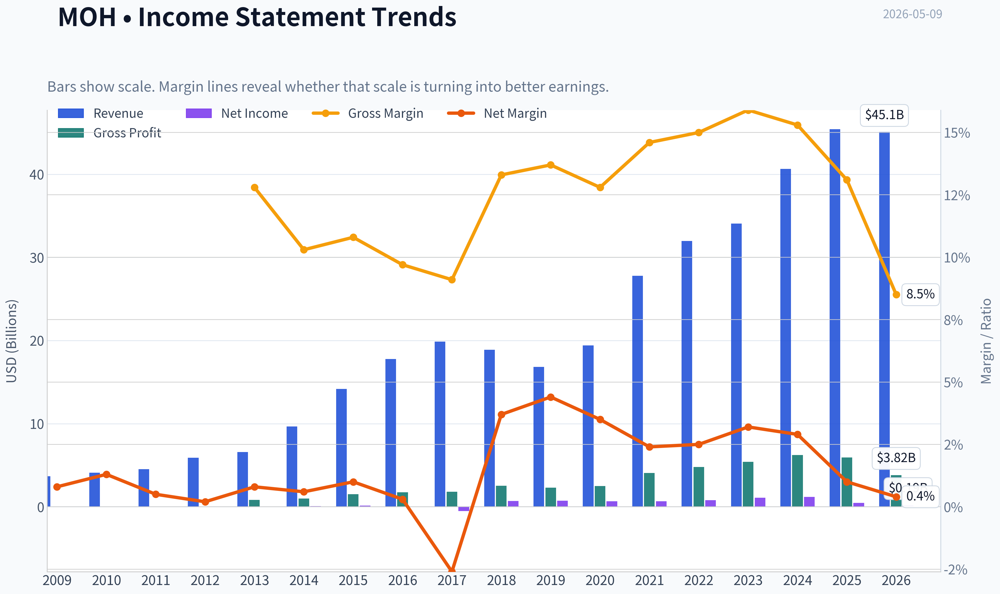

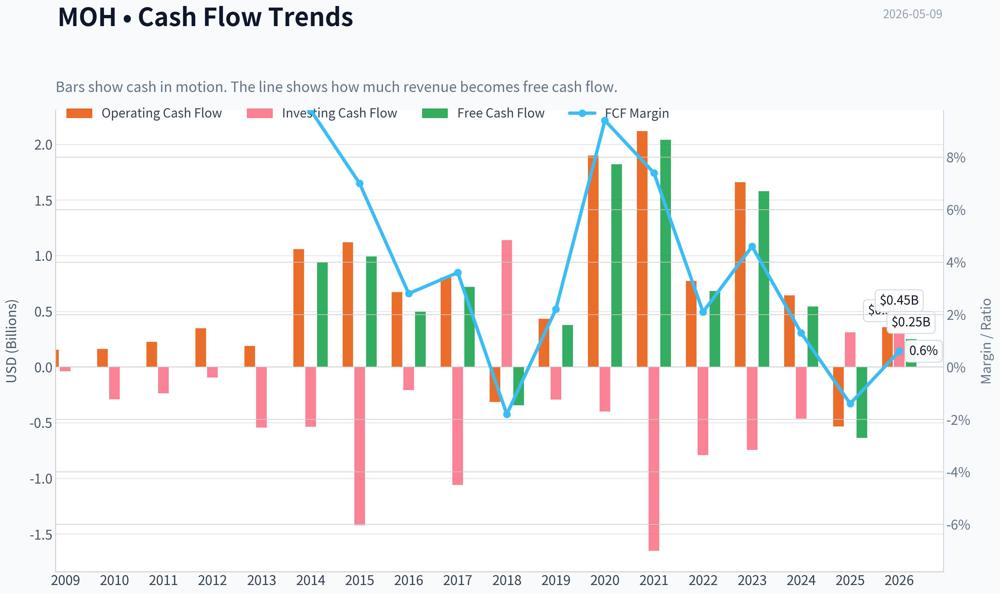

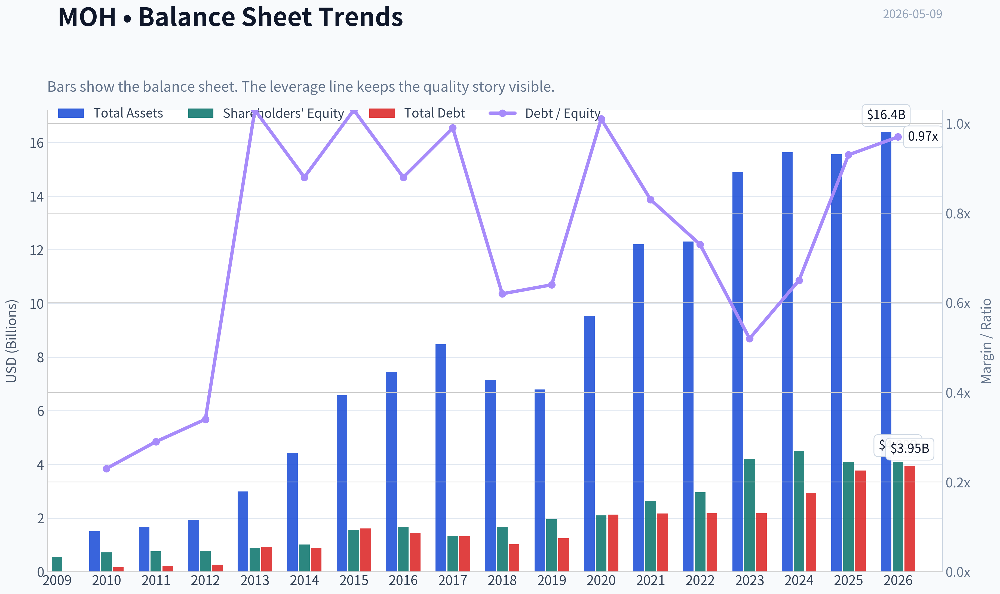

This graph tracks the profitability and return metrics (ROE, ROIC, Margins) of **MOH** over the past decade, highlighting capital efficiency trends.

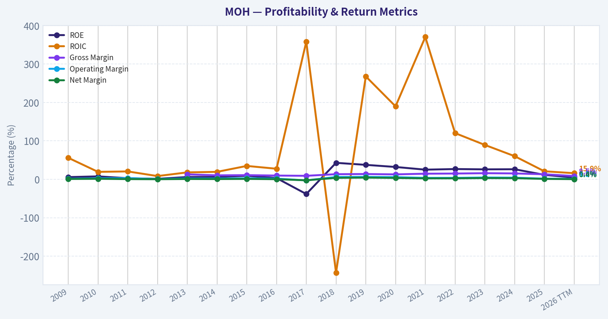

This chart illustrates the financial health of **MOH** over the last 10 years, mapping cash equivalents and free cash flow against total obligations (Debt).

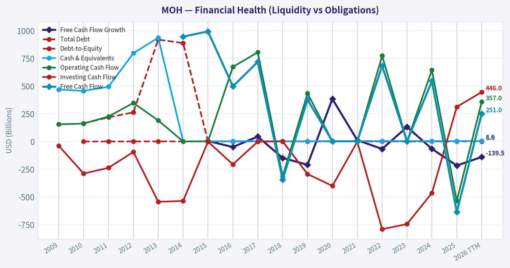

This breakdown chart from <em>Revenue Breakdown</em> shows the proportional composition for **MOH** - useful for understanding what drives or risks the business.

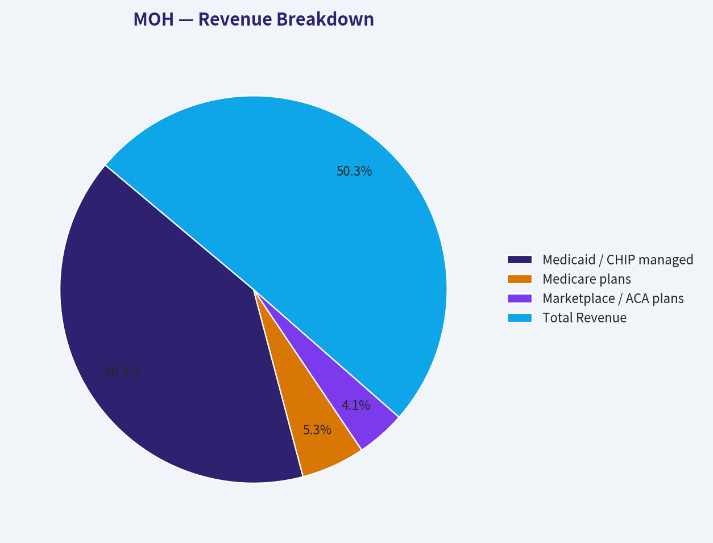

---

### Intrinsic Value Analysis (Buffett)

> *Following Warren Buffett's value investing philosophy: Circle of Competence, Economic Moat, Management Quality, and Margin of Safety.*

#### Intrinsic Value Snapshot

Price is what you pay. Intrinsic value is what the business may be worth based on the cash it can create for owners over time. We show a range, not one magic number.

- Current Price: $185.94
- Value Range: $141.34 to $3,210.02

##### Owner Earnings (Buffett Method)
- Net Income: $472,000,000.00
- Depreciation & Amortization: $195,000,000.00
- Capital Expenditures: $-101,000,000.00
- Working Capital Changes: $-1,289,000,000.00
- Owner Earnings: $1,855,000,000.00

##### Intrinsic Value
###### Buffett Method
Uses owner earnings. Stricter, and usually more conservative.
- Conservative: $141.34
- Average: $1,248.21
- Optimistic: $3,210.02
- Discount Rate: 10.0%

ANALYST STANCE: **AVOID**

#### Molina Healthcare (MOH) - Buffett-Style Value Analysis

Current price: **$186**
Market cap: **$9.69B**
Implied shares outstanding: **~52.1M**
P/E: **~49.7x**
ROE: **11.6%**
Gross margin: **13.1%**
FCF yield: **-6.6%**
Current ratio: **1.69x**

Molina Healthcare is a managed-care insurer focused primarily on government-sponsored health programs such as Medicaid, Medicare, and Affordable Care Act marketplace plans. The company can grow meaningfully when it wins state contracts, acquires health plans, and manages medical costs well. However, from a Buffett lens, this is a business where long-term economics depend heavily on regulation, medical cost trends, state reimbursement rates, and execution in underwriting.

---

#### 1. Go / No-Go Gate Assessment

| Buffett Gate | Assessment | Evidence | Verdict |
|---|---:|---|---:|
| Gate 1: Circle of Competence & Simplicity | Mixed | Molina earns premiums from government-sponsored health programs and pays medical claims. The model is understandable, but economics depend on state contracts, reimbursement formulas, utilization trends, and medical cost inflation. | **Partial Fail** |
| Gate 2: Durable Moat | Weak to Narrow | Some scale advantages and state relationships exist, but gross margin is only **13.1%**, ROE is **11.6%**, and pricing power is limited by government regulation. | **Fail** |
| Gate 3: Management & Capital Allocation | Mixed | Management has set ambitious 2029 targets, including adjusted EPS of **$25** and total premium of **$64B**, but these depend heavily on keeping medical costs controlled. | **Watch Only** |
| Gate 4: Industry Structure | Mixed | Managed care has scale benefits, but competition for state contracts is intense and reimbursement is politically sensitive. | **Partial Fail** |

**Key Takeaways:** Molina is understandable at a high level: it collects premiums and pays healthcare claims. But the predictability Buffett wants is weaker here because profits depend on medical cost ratios, state reimbursement decisions, and contract renewals. The business may be investable as a healthcare special situation, but it does not pass as a classic Buffett compounder.

---

#### 2. Business Simplicity and Predictability

Molina makes money by managing healthcare plans for low-income, elderly, and government-supported populations. It receives premiums from government agencies and members, then attempts to pay out less in medical costs and administrative expenses than it receives in revenue.

The elementary-school explanation is simple: **Molina gets paid to manage health insurance plans, and it keeps a profit if healthcare costs are lower than the premiums it receives.**

The problem is not comprehension; it is predictability. In 10 years, Molina will probably still be a government-focused health insurer, but its profit pool could be materially different depending on Medicaid rates, political decisions, medical utilization, provider costs, and state contract outcomes. Buffett generally prefers businesses where customer demand and pricing power are easier to forecast.

---

#### 3. Moat Analysis

| Moat Source | Evidence | Buffett View |
|---|---|---|
| Brand / Intangible Assets | Molina has recognition in Medicaid managed care, but this is not a consumer brand with emotional loyalty like Coca-Cola or Apple. | **Weak** |
| Regulatory License / State Relationships | State licenses, contract experience, provider networks, and compliance infrastructure matter. These create barriers to entry. | **Moderate** |
| Switching Costs | Members and states can shift plans over time. Contracts create some friction, but not permanent customer captivity. | **Limited** |
| Cost Advantage | Scale helps in claims administration and provider contracting, but larger competitors also have scale. | **Narrow** |
| Network Effects | More members may improve data and contracting leverage, but the business does not have true network effects. | **Weak** |
| Pricing Power | Pricing is heavily regulated and negotiated. Molina cannot simply raise prices 10% without consequence. | **Weak** |

**Key Takeaways:** Molina's moat is mostly regulatory and operational, not brand-based or network-driven. The company benefits from experience, scale, and state relationships, but its pricing power is constrained. This is a narrow moat at best, not a wide and widening Buffett moat.

**Moat Rating:** **Narrow**

---

#### 4. Management Quality and Capital Allocation

Management's latest investor communication is ambitious. Molina has targeted **$25 adjusted EPS in 2029** and **$64B of total premium** by 2029, with commentary suggesting a major profit recovery if medical costs stabilize.

That target may attract value investors because the current share price of **$186** looks modest compared with a possible **$25 adjusted EPS** figure. If achieved, the stock would trade at only about **7.4x 2029 adjusted EPS**. However, Buffett would ask whether that future earnings stream is highly predictable and whether it represents owner earnings, not just adjusted accounting earnings.

The key concern is that management's target depends on medical cost control and reimbursement adequacy. Those are not fully within management's control.

| Management Test | Assessment |
|---|---|
| Owner orientation | Insufficient evidence from available data |
| Candor | Recent guidance is clear but highly conditional |
| Capital allocation | Acquisitions and contract growth can add value, but underwriting discipline is critical |
| Use of debt | No severe red flag from available current ratio, but full leverage review is limited |
| Per-share value creation | Not yet compelling given ROE of **11.6%** and negative FCF yield |

**Key Takeaways:** Management may be capable, and the 2029 targets could create upside if achieved. But Buffett-style investing requires confidence in normalized earning power, not reliance on ambitious forward targets. At present, the evidence is not strong enough to call management a proven long-term compounding allocator.

---

#### 5. Financial Quality Summary

| Metric | Current Data | Buffett Preference | Interpretation |
|---|---:|---:|---|
| Market Capitalization | **$9.69B** | N/A | Mid-to-large healthcare insurer |
| Share Price | **$186** | N/A | Current valuation anchor |
| P/E Ratio | **49.7x** | Lower is better unless quality is exceptional | Expensive on current GAAP earnings |
| Implied Net Income | **~$195M** | Consistent and growing | Current earnings appear depressed |
| Implied EPS | **~$3.74** | Durable growth | Low versus management's 2029 target |
| ROE | **11.6%** | >15%, ideally >20% | Below Buffett-quality threshold |
| Gross Margin | **13.1%** | >40% for branded/pricing-power businesses | Low, though insurance margins differ from consumer businesses |
| Revenue Growth YoY | **11.7%** | Consistent profitable growth | Revenue growth is healthy |
| FCF Yield | **-6.6%** | Positive and durable | Significant red flag |
| Current Ratio | **1.69x** | Adequate liquidity | Liquidity appears acceptable |
| 2029 Adjusted EPS Target | **$25** | Must be highly credible | Upside exists but depends on execution and medical costs |

**Key Takeaways:** Molina has revenue growth and a potentially large earnings recovery story, but current financial quality is not Buffett-like. ROE is below the preferred threshold, free cash flow yield is negative, and current earnings are too low to justify the share price on a conservative basis. The stock may be cheap on management's 2029 adjusted EPS target, but not on present owner earnings.

---

#### 6. Owner Earnings Calculation

Buffett's owner earnings formula:

> Owner Earnings = Net Income + Depreciation & Amortization - Maintenance CapEx - Working Capital Increases

Because full maintenance capex, depreciation, and working-capital detail were not available in the collected data, I use two conservative proxies:

1. **GAAP earnings proxy:** Market cap / P/E
2. **Free cash flow proxy:** Market cap x FCF yield

| Owner Earnings Proxy | Calculation | Result |
|---|---:|---:|
| Implied GAAP Net Income | $9.69B / 49.7 | **~$195M** |
| Implied EPS | $195M / 52.1M shares | **~$3.74/share** |
| Free Cash Flow | $9.69B x -6.6% | **~-$640M** |
| FCF per Share | -$640M / 52.1M shares | **~-$12.28/share** |

**Key Takeaways:** On current reported earnings, Molina produces only about **$3.74 per share** in implied GAAP earnings. Free cash flow is negative based on the available FCF yield, which is a major issue for a Buffett-style owner earnings analysis. The company may be temporarily depressed, but the current numbers do not provide a strong conservative valuation base.

For valuation, I use **$3.74 per share** as the conservative owner earnings proxy. I do not use the negative FCF number as the base case because insurer cash flows can be distorted by timing of claims, premiums, and regulatory settlements, but the negative FCF remains a warning sign.

---

#### 7. Three-Scenario DCF Valuation

Assumptions:

| Input | Assumption |
|---|---:|
| Current owner earnings proxy | **$3.74/share** |
| Discount rate | **10%** |
| Terminal growth in growth scenarios | **3%** |
| Historical growth case | Capped at **10%**, per Buffett discipline |
| Current share price | **$186** |

**Key Takeaways:** The valuation uses current implied earnings rather than management's optimistic 2029 adjusted EPS target. This is intentionally conservative. Buffett would rather be approximately right using durable owner earnings than precisely wrong using ambitious forecasts.

| Scenario | Method | Intrinsic Value / Share | Margin of Safety vs. $186 |
|---|---|---:|---:|
| A: No Growth | $3.74 / 10% | **~$37** | **-397%** |
| B: GDP Growth | $3.74 x 1.03 / (10% - 3%) | **~$55** | **-238%** |
| C: 10% Growth for 10 Years, then 3% Terminal | 10-year DCF | **~$92** | **-102%** |

**Key Takeaways:** On current owner earnings, Molina is not close to meeting a Buffett margin-of-safety requirement. Even with a generous 10% growth assumption, estimated value is only about **$92 per share**, roughly half the current price. The investment case therefore depends heavily on a sharp earnings recovery, not on current durable cash generation.

---

#### 8. Management's 2029 Target Sensitivity

Management has targeted **$25 adjusted EPS in 2029**. That is materially higher than the current implied GAAP EPS of about **$3.74**.

| 2029 EPS Lens | Calculation | Implied View |
|---|---:|---|
| Current price / 2029 adjusted EPS target | $186 / $25 | **7.4x** |
| No-growth value of $25 EPS at 10% discount rate | $25 / 10% | **$250/share before discounting back** |
| Present value of $250 in 3 years at 10% | $250 / 1.10³ | **~$188/share** |
| Present value of perpetual 3% growth from $25 EPS | [$25 x 1.03 / 7%] / 1.10³ | **~$276/share** |

**Key Takeaways:** If Molina truly earns **$25 per share** in durable owner earnings by 2029, today's price could be reasonable or even attractive. But that is a large "if." The Buffett problem is that this valuation depends on trusting a conditional future target rather than observing strong current owner earnings, high ROE, and a wide moat.

---

#### 9. Margin of Safety Analysis

| Valuation Basis | Estimated Value | Current Price | Margin of Safety |
|---|---:|---:|---:|
| Current no-growth owner earnings | **$37** | **$186** | None |
| Current GDP-growth owner earnings | **$55** | **$186** | None |
| Current 10% growth DCF | **$92** | **$186** | None |
| 2029 adjusted EPS target, no-growth PV | **~$188** | **$186** | Minimal |
| 2029 adjusted EPS target, 3% terminal growth PV | **~$276** | **$186** | ~33% theoretical upside |

**Key Takeaways:** There is no margin of safety using current earnings. The only attractive valuation case comes from management's 2029 adjusted EPS target. Buffett would likely consider that too dependent on uncertain healthcare cost and regulatory assumptions.

---

#### 10. Guru Ownership Context

| Investor | Action | Position Value | Shares | Portfolio Weight | Latest Filing |
|---|---:|---:|---:|---:|---|
| Seth Klarman | Initiated | **$108.46M** | **625K** | **2.05%** | 12-31-2025 |
| Steve Cohen | Initiated | **$61.04M** | **1.47M** | **0.07%** | 12-31-2025 |
| Michael Burry | Initiated | **$23.92M** | **125K** | **1.73%** | 09-30-2025 |

**Key Takeaways:** Several sophisticated investors have shown interest in Molina, including Seth Klarman and Michael Burry. That suggests there may be a contrarian or earnings-recovery thesis. However, guru buying is not a substitute for Buffett-style business quality, and 13F filings are delayed snapshots.

---

#### 11. Buffett Scorecard

| Criterion | Weight | Score 1-5 | Weighted Score | Rationale |
|---|---:|---:|---:|---|
| Business Understanding | 20% | 3.0 | 0.60 | Simple at surface level, complex in economics |
| Moat Width & Durability | 25% | 2.0 | 0.50 | Narrow regulatory and scale moat, limited pricing power |
| Management Quality | 15% | 3.0 | 0.45 | Ambitious targets, but execution-dependent |
| Return on Equity | 15% | 2.5 | 0.38 | ROE of **11.6%** is below Buffett threshold |
| Reinvestment Runway | 10% | 3.0 | 0.30 | Growth opportunities exist in government programs |
| Balance Sheet Strength | 5% | 3.0 | 0.15 | Current ratio acceptable, full leverage picture limited |
| Industry Structure | 5% | 2.5 | 0.13 | Scale matters, but regulation and competition are heavy |
| Valuation / Margin of Safety | 5% | 2.0 | 0.10 | No margin of safety on current owner earnings |
| **Total** | **100%** |  | **2.61 / 5.00** | **Avoid / not compelling** |

**Key Takeaways:** Molina scores poorly on the most important Buffett dimensions: moat, current owner earnings, pricing power, and margin of safety. The company may offer upside if management's 2029 EPS target is achieved, but that is a forecast-driven thesis rather than a durable-compounder thesis. The final score falls in the avoid range.

---

#### Final Investment Stance

**ANALYST STANCE: AVOID**

Conviction level: **Moderate**

Molina Healthcare may be interesting for investors pursuing a contrarian healthcare recovery thesis, especially given management's **$25 adjusted EPS target for 2029** and recent interest from well-known value-oriented investors. But under a Buffett framework, the case is not strong enough.

The company lacks clear pricing power, does not show exceptional ROE, currently has negative free cash flow yield, and operates in a heavily regulated industry where medical cost assumptions can dominate outcomes. At **$186 per share**, there is no adequate margin of safety based on current owner earnings.

A Buffett-style investor should wait for either:

1. Much stronger evidence that **$25 EPS** will convert into durable owner earnings, or
2. A materially lower share price that provides a true margin of safety without relying on aggressive future assumptions.
#### Valuation Bridge

This bridge places the current market price beside each intrinsic value lens so readers can see whether upside depends on one method or shows up across several methods.

| Scenario | Intrinsic Value / Share |
| --- | ---: |
| Buffett Method | $1,248.21 |
| Damodaran Method | $527.96 |
| Current Price | $185.94 |

#### Key Takeaways

If one method is far above the others, the upside case depends on a specific modelling assumption. When several methods cluster together, the valuation story is more robust.

#### Valuation Visuals

This comparison chart from *Latest Earnings Snapshot* stacks current figures against historical benchmarks for **MOH**, making it easy to see where the company trades relative to its own averages.

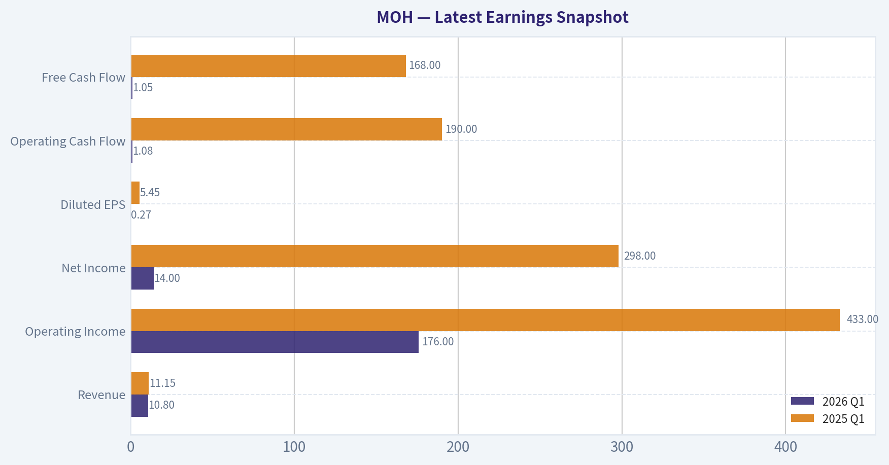

This comparison chart from *Current vs. 10-Year Historical Average Comparison* stacks current figures against historical benchmarks for **MOH**, making it easy to see where the company trades relative to its own averages.

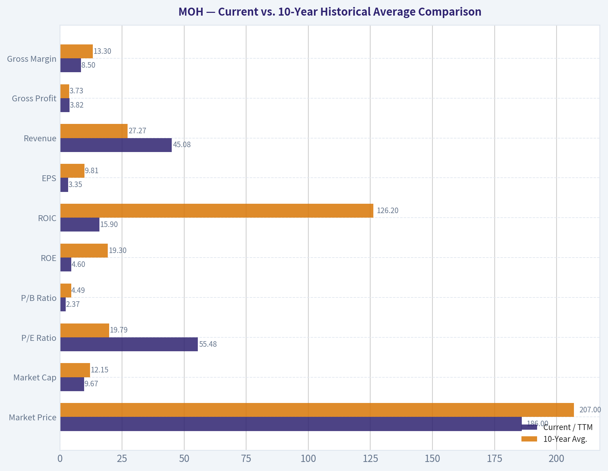

This comparison chart from *Financial Quality Summary* stacks current figures against historical benchmarks for **MOH**, making it easy to see where the company trades relative to its own averages.

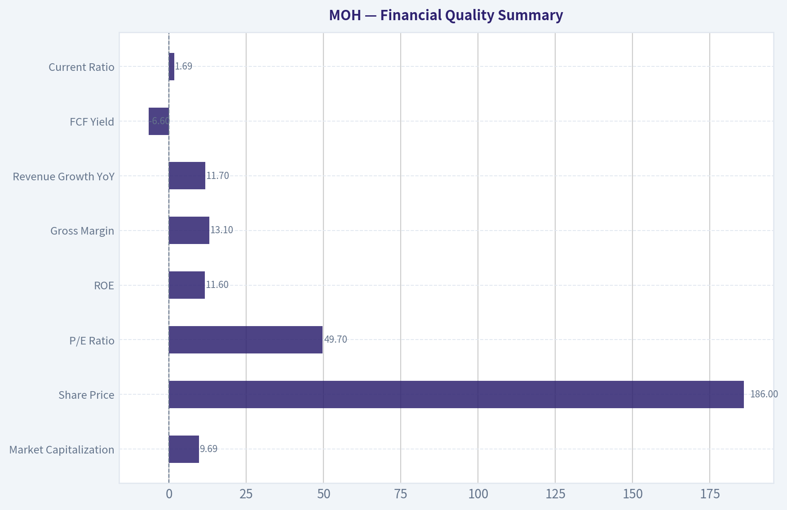

This comparison chart from *Three-Scenario DCF Valuation* stacks current figures against historical benchmarks for **MOH**, making it easy to see where the company trades relative to its own averages.

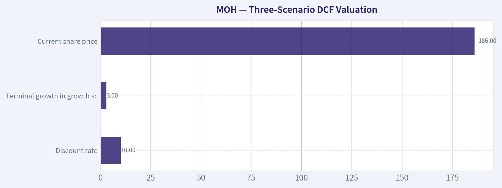

This comparison chart from *Margin of Safety Analysis* stacks current figures against historical benchmarks for **MOH**, making it easy to see where the company trades relative to its own averages.

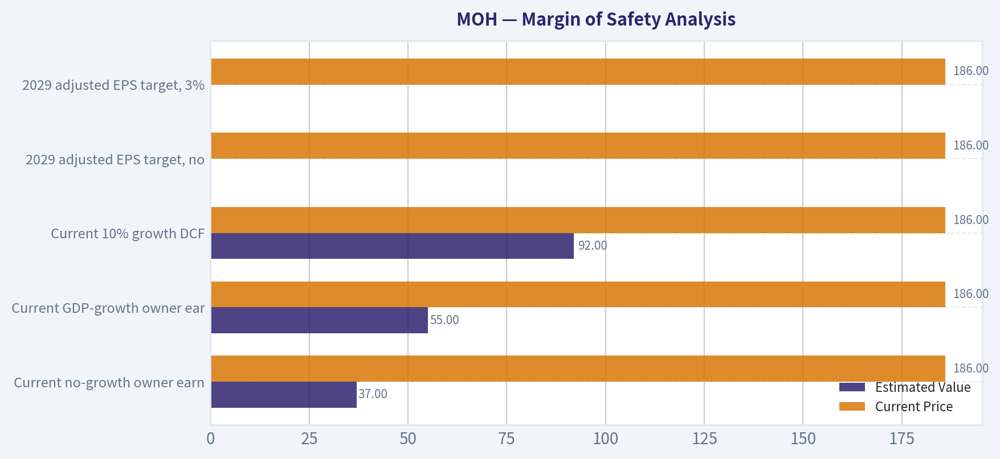

---

### Trend & Growth Analysis (Lynch/Druckenmiller/Fisher)

> *Following Peter Lynch's GARP, Stanley Druckenmiller's macro-aware approach, and Philip Fisher's scuttlebutt methodology.*

ANALYST STANCE: **WATCH**

#### MOH Growth Investment Report - Molina Healthcare

Molina Healthcare is not a classic Lynch-style fast grower, but it has a potentially meaningful **earnings inflection** setup. Revenue growth is moderate, valuation is optically expensive on trailing earnings, and free cash flow is currently negative; however, management's 2029 target of **$25 adjusted EPS** creates a credible "watch closely" case if medical cost trends stabilize.

---

#### 1. Snapshot

| Metric | Current Data / Estimate | Growth Investor Interpretation |
|---|---:|---|
| Ticker | MOH | Molina Healthcare |
| Price | $186 | Shared research pack |
| Market Cap | $9.69B | Mid-cap managed care company |
| P/E | 49.7x | High on depressed/current earnings |
| ROE | 11.6% | Acceptable, not exceptional |
| Gross Margin | 13.1% | Thin-margin managed care model |
| YoY Revenue Growth | 11.7% | Stalwart/upper-single-to-low-teens growth, not hypergrowth |
| FCF Yield | -6.6% | Major watch item |
| Current Ratio | 1.69x | Adequate liquidity |
| Management 2029 Target | $25 adjusted EPS; $64B total premium | Potential EPS inflection if medical costs normalize |

**Key Takeaways:** Molina is a defensive healthcare operator with moderate revenue growth and a potentially large earnings recovery story. The stock does not screen as cheap on trailing P/E, but if management's 2029 EPS target is credible, the forward setup becomes much more interesting. The negative free cash flow yield and medical cost sensitivity keep this from being an "Advocate" today.

---

#### 2. Lynch Classification

| Lynch Category | Fit for MOH | Rationale |
|---|---|---|
| Slow Grower | No | Revenue growth above 5% |
| Stalwart | Yes | 11.7% YoY revenue growth fits stalwart profile |
| Fast Grower | Not yet | Revenue growth below 15-25% target range |
| Cyclical | Partly | Medical cost cycle and government rate cycles matter |
| Turnaround | Partly | 2029 EPS target implies earnings recovery from current depressed base |
| Asset Play | No | Not primarily balance-sheet-driven |

**Key Takeaways:** Molina is best classified as a **Stalwart with Turnaround characteristics**, not a true fast grower. The investment case depends less on explosive revenue growth and more on medical cost normalization, margin recovery, and execution against the 2029 EPS target. That makes it more of a "watch for proof" name than a clean Lynch growth stock.

---

#### 3. The Story in 3 Bullets

- Molina sells government-sponsored health insurance, mainly Medicaid, Medicare, and ACA Marketplace plans, and earns money by managing medical costs below premium revenue.
- The company is targeting **$64B of total premium and $25 adjusted EPS by 2029**, implying a major earnings rebound if medical cost trends stabilize.
- Smart value-oriented investors, including Seth Klarman, Steve Cohen, and Michael Burry, recently initiated positions, suggesting the market may be underestimating the recovery potential.

---

#### 4. TAM and 10x Test

| TAM / Runway Item | Estimate / View | Assessment |
|---|---:|---|
| Current Market Cap | $9.69B | Mid-cap scale |
| 2029 Premium Target | $64B | Large revenue base targeted |
| 10x Market Cap Test | ~$97B market cap | Very difficult without massive margin/multiple expansion |
| Government Managed Care TAM | Very large | Medicaid, Medicare, dual eligible, and ACA markets remain sizable |
| Can Revenue 10x? | Unlikely | Already tens of billions in premium revenue |
| Can Earnings 5x? | Possible per management target | Depends heavily on medical cost control |

**Key Takeaways:** Molina has a long operating runway in government-sponsored managed care, but it is unlikely to become a classic ten-bagger from here based on revenue expansion alone. The more realistic upside case is an **earnings multiple re-rating plus EPS recovery**, not a 10x revenue story. This is a compounder or recovery candidate, not a pure hypergrowth opportunity.

---

#### 5. Revenue Growth Trend

| Metric | Current Trend | Interpretation |
|---|---:|---|
| YoY Revenue Growth | 11.7% | Healthy but not fast-grower level |
| Growth Pattern | Moderate / steady | Not an obvious acceleration yet |
| Main Growth Drivers | Premium growth, Medicaid contracts, Marketplace expansion, rate updates | Quality depends on pricing adequacy |
| Key Constraint | Medical loss ratio and state reimbursement rates | Revenue growth can be value-destructive if medical costs rise faster |

**Key Takeaways:** Molina's revenue growth is respectable but not enough by itself to justify a high-growth stance. The real question is whether earnings growth can accelerate faster than revenue through medical cost stabilization and operating leverage. At this stage, the revenue trend is good but not yet an inflection.

---

#### 6. Unit Economics / Managed Care Operating Metrics

Traditional SaaS-style metrics like LTV/CAC and NRR do not apply cleanly to Molina. For a managed care company, the better substitutes are medical cost ratio, SG&A leverage, contract retention, and cash conversion.

| Unit Economics Proxy | Current / Required View | Growth Investor Read |
|---|---|---|
| LTV/CAC | Not applicable | Not a subscription software model |
| NRR | Not applicable | Membership retention and contract renewals are better proxies |
| Rule of 40 | Not meaningful | Managed care margins structurally differ from SaaS |
| Medical Cost Control | Critical | Main determinant of EPS recovery |
| SG&A Leverage | Important | Scale benefits should support margins |
| FCF Yield | -6.6% | Negative; must improve |
| Liquidity | Current ratio 1.69x | Adequate near-term liquidity |

**Key Takeaways:** Molina's "unit economics" are ultimately about underwriting discipline and medical cost control. The negative free cash flow yield is a clear red flag for a growth investor, even if working capital can be noisy in managed care. Before upgrading the stock, I would want evidence that cash conversion and medical cost ratios are improving.

---

#### 7. Inflection Point Assessment

| Inflection Type | Evidence | Status |
|---|---|---|
| Product Cycle Inflection | No major new product cycle | Weak |
| Market Share Inflection | Possible via Medicaid and Marketplace wins | Watch |
| Margin Inflection | Management's 2029 EPS target implies major margin/earnings recovery | Potentially strong |
| TAM Inflection | Government healthcare demand remains durable | Moderate |
| Competitive Inflection | Not enough evidence of competitor weakness | Neutral |
| Investor Perception Inflection | Klarman, Cohen, and Burry initiated positions | Positive signal |

**Key Takeaways:** The strongest potential inflection is not revenue acceleration; it is **earnings recovery**. Management's $25 adjusted EPS target for 2029 is the key catalyst, but it depends on the large assumption that medical costs remain controlled. The market may be skeptical for good reason, so the stock needs proof points before becoming high conviction.

---

#### 8. Macro Setup

| Macro Factor | Setup for MOH | Impact |
|---|---|---|
| Economic Cycle | Defensive healthcare demand | Positive |
| Interest Rates | Lower rates would help valuation multiples | Mild positive if rates fall |
| Secular Theme | Government-sponsored healthcare growth | Positive |
| Policy Risk | Medicaid, ACA, Medicare reimbursement exposure | Negative |
| Medical Inflation | Elevated utilization/cost trend risk | Negative |
| Recession Sensitivity | Lower than many sectors | Positive |

**Key Takeaways:** The macro setup is mixed but defensively favorable. Molina benefits from durable demand for government-sponsored healthcare, but it is highly exposed to policy decisions, rate adequacy, and medical inflation. This is not a clean secular growth story like AI or cybersecurity; it is a regulated healthcare execution story.

---

#### 9. Fisher 15-Point Score

| Fisher Point | Score 1-5 | Rationale |
|---|---:|---|
| 1. Products with sizable market potential | 4 | Large Medicaid, Medicare, ACA markets |
| 2. Management determination to develop new growth | 3 | Growth through contracts and programs, not product innovation |
| 3. Effective R&D | 2 | Not R&D-led business |
| 4. Above-average sales organization | 3 | Contract bidding and state relationships matter |
| 5. Worthwhile profit margin | 2 | Structurally thin margins |
| 6. Improving profit margins | 3 | Possible if 2029 EPS target is achieved |
| 7. Labor/personnel relations | 3 | No major data available |
| 8. Executive relations | 3 | No major red flag from current pack |
| 9. Management depth | 4 | Large regulated insurer requires operational depth |
| 10. Cost analysis/accounting | 4 | Critical capability in managed care |
| 11. Unique moat aspects | 3 | Contract expertise, scale, compliance capabilities |
| 12. Long-range profit outlook | 4 | 2029 EPS target suggests upside |
| 13. Dilution risk | 4 | Not dependent on constant equity issuance |
| 14. Candor in difficulties | 3 | Need more evidence from transcripts |
| 15. Management integrity | 3 | No clear red flag in current data |
| **Total** | **48 / 75** | Average to decent, not outstanding |

**Key Takeaways:** Molina scores as an average-to-good Fisher company, but not an exceptional innovation-led compounder. The company has real operational capabilities and a large market, but thin margins, regulatory dependency, and limited product differentiation cap the score. The Fisher framework supports watching the stock, not aggressively advocating it.

---

#### 10. Valuation Analysis

| Valuation Metric | Current / Implied | Interpretation |
|---|---:|---|
| Current P/E | 49.7x | Expensive on trailing earnings |
| Revenue Growth | 11.7% | Not enough to support high P/E by itself |
| PEG Using Revenue Growth Proxy | ~4.25x | Expensive under Lynch framework |
| Current Market Cap / 2029 Premium Target | ~0.15x | Low sales multiple, but managed care sales are low-margin |
| Price / 2029 Target EPS | 7.4x | Attractive if $25 EPS is achieved |
| FCF Yield | -6.6% | Valuation quality concern |

**Key Takeaways:** Molina looks expensive on trailing earnings but potentially cheap on management's 2029 EPS target. This creates a classic valuation tension: the stock is unattractive if current earnings power is the right baseline, but attractive if earnings normalize sharply. Because free cash flow is negative and the EPS target depends on medical cost assumptions, the valuation is not yet enough for an Advocate rating.

---

#### 11. Scenario Analysis

| Scenario | 2029 EPS Assumption | Exit P/E | 2029 Price Target | Approx. Upside vs. $186 | Interpretation |
|---|---:|---:|---:|---:|---|
| Bear | $12 | 8x | $96 | -48% | Medical costs remain elevated; target missed |
| Base | $20 | 10x | $200 | +8% | Partial recovery, modest multiple |
| Bull | $25 | 12x | $300 | +61% | Management target achieved and market rerates |

**Key Takeaways:** The upside is meaningful but not asymmetric enough yet for a strong growth recommendation. The bull case could deliver solid annualized returns, but the base case is only modestly above today's price, and the bear case is severe. Molina needs clearer evidence of medical cost stabilization to improve the risk-reward.

---

#### 12. Growth Investor Scorecard

| Criterion | Weight | Score 1-5 | Weighted Score |
|---|---:|---:|---:|
| The Story | 10% | 3.5 | 0.35 |
| TAM & Runway | 20% | 3.5 | 0.70 |
| Revenue Growth | 20% | 2.8 | 0.56 |
| Unit Economics / Operating Quality | 15% | 2.7 | 0.41 |
| Competitive Position | 10% | 3.2 | 0.32 |
| Management Quality | 10% | 3.5 | 0.35 |
| Macro Setup | 5% | 3.2 | 0.16 |
| Profitability Path | 5% | 3.3 | 0.17 |
| Valuation | 5% | 3.0 | 0.15 |
| **Total** | **100%** |  | **3.17 / 5.00** |

**Key Takeaways:** Molina lands in the **WATCH** zone with a score of 3.17 out of 5. The company has a credible recovery story, but revenue growth is not fast enough, free cash flow is weak, and the medical cost assumption is too important. This is a stock to monitor closely for confirmation, not a high-conviction growth buy today.

---

#### 13. Position Size Stance

| Investor Type | Suggested Stance |
|---|---|
| Existing Holder | Hold / monitor; avoid adding aggressively until MLR and FCF improve |
| New Growth Investor | Watch list only |
| Value / Recovery Investor | Small starter position may be justifiable if underwriting risk is understood |
| High-Conviction Growth Portfolio | Not a core position today |
| Position Size View | 0% to 2% max watch position, depending on mandate |

**Key Takeaways:** Molina is more appropriate for a value-oriented recovery sleeve than for a concentrated growth portfolio. The stock could work if the 2029 EPS target becomes credible, but it does not yet meet the bar for a large growth allocation. I would wait for proof in quarterly medical cost trends and cash flow.

---

#### 14. Key Catalysts and Risks

| Catalysts | Risks |
|---|---|
| Evidence of medical cost stabilization | Rising medical utilization or inadequate state rates |
| Reaffirmation or upward revision of 2029 EPS path | Failure to achieve $25 adjusted EPS target |
| Medicaid contract wins | Contract losses or unfavorable rebids |
| Positive FCF inflection | Continued negative free cash flow |
| Marketplace profitability improvement | ACA subsidy or risk-adjustment changes |
| Additional guru/institutional accumulation | Regulatory or political pressure on managed care margins |

**Key Takeaways:** The main catalyst is proof that earnings can recover toward management's 2029 target. The main risk is that medical costs remain structurally elevated, making that target unrealistic. Molina's setup is interesting, but the burden of proof remains high.

---

#### Final View

Molina Healthcare has an intriguing **earnings inflection** setup, supported by management's ambitious 2029 EPS target and notable guru investor interest. However, it is not a classic Lynch fast grower: revenue growth is only moderate, trailing valuation is high, free cash flow is negative, and the thesis depends heavily on medical cost control.

The right stance is **WATCH**. Upgrade toward **ADVOCATE** only if Molina shows sustained improvement in medical loss ratio, free cash flow, and confidence around the $25 EPS target.

---

### Market Technical Analysis

ANALYST STANCE: **WATCH**

#### MOH Technical Report - Data Through 2026-05-08

Molina Healthcare, Inc. has staged a powerful recovery from its February and March weakness, but the latest session introduced meaningful short-term caution. The stock closed at **$185.94** on 2026-05-08 after trading as high as **$200.55** the prior session and as low as **$177.65** intraday on May 8. That wide range, combined with elevated volume, suggests traders are actively reassessing the recent breakout rather than simply continuing the prior advance.

The setup is constructive but not clean enough for an outright bullish stance. Price remains above the 50-day and 200-day moving averages, momentum is still positive, and volume-weighted trend confirmation remains favorable. However, short-term momentum has cooled, RSI has fallen out of overbought territory, and the stock is now slightly below its 10-day EMA after a sharp reversal candle.

---

#### Selected Indicators and Why They Matter

| Indicator | Latest Reading | Signal Type | Why It Is Relevant for MOH Now |
|---|---:|---|---|
| `close_10_ema` | 186.97 | Short-term trend | Captures whether the April rally is still being supported by near-term buyers. |
| `close_50_sma` | 155.16 | Medium-term trend | Shows whether the recovery has repaired the intermediate trend structure. |
| `close_200_sma` | 164.73 | Long-term trend | Confirms whether price has reclaimed a major institutional trend benchmark. |
| `macd` | 12.39 | Momentum | Measures whether upside momentum remains intact after the recent breakout. |
| `macds` | 11.31 | Momentum confirmation | Helps judge whether MACD momentum is still bullish or beginning to roll over. |
| `rsi` | 62.72 | Momentum exhaustion | Shows that the stock has cooled from overbought conditions without yet becoming weak. |
| `atr` | 8.13 | Volatility / risk | Important because MOH is making large daily ranges and needs wider risk bands. |
| `vwma` | 178.91 | Volume-confirmed trend | Confirms whether buyers are supporting price on a volume-adjusted basis. |

**Key Takeaways:** The most relevant indicators show a stock in recovery mode, but with short-term stress after a sharp pullback. Price is still above major trend levels, MACD remains bullish, and VWMA support is intact, but the break below the 10-day EMA warns that momentum is no longer one-directional.

---

#### Trend Structure

MOH's trend profile has improved dramatically since late March. The stock moved from the low **$130s** in late March to nearly **$200** by early May, a major recovery that pushed price back above both the **50-day SMA** and **200-day SMA**. This is an important shift because earlier in the year MOH was trading below major long-term trend levels after a severe February gap lower.

The current close of **$185.94** is:

| Reference Level | Value | Distance From Close | Interpretation |
|---|---:|---:|---|
| Last Close | 185.94 | - | Current price reference |
| 10-day EMA | 186.97 | -0.55% | Slightly below short-term trend support |
| 50-day SMA | 155.16 | +19.84% | Strongly above medium-term trend |
| 200-day SMA | 164.73 | +12.88% | Back above long-term trend benchmark |
| VWMA | 178.91 | +3.93% | Still above volume-weighted support |
| ATR | 8.13 | 4.37% of price | Daily volatility is elevated |

**Key Takeaways:** MOH remains technically above its important medium- and long-term moving averages, which supports a constructive recovery view. The short-term issue is that price slipped slightly below the 10-day EMA, suggesting the latest rally has paused and may need to consolidate before attempting another breakout.

The **50-day SMA remains below the 200-day SMA**, which means the long-term structure has not fully repaired into a classic bullish alignment. However, the 50-day SMA has turned higher recently, rising from roughly **$142.7 on April 20** to **$155.2 on May 8**. That improvement is meaningful because it shows the medium-term trend is beginning to catch up to the price recovery.

#### Momentum and Exhaustion

MACD remains positive and above its signal line, with MACD at **12.39** versus the signal line at **11.31**. This keeps the momentum profile bullish on a trend-following basis. However, MACD has eased from **13.60 on May 6** to **12.39 on May 8**, so the pace of upside momentum is no longer accelerating.

RSI provides a similar message. It recently reached very elevated levels above **80** in late April, including **83.81 on April 29**, which showed strong but stretched buying pressure. By May 8, RSI had cooled to **62.72**. That is not bearish by itself; in fact, it can be healthy if price holds support. But it does mean the easy momentum phase has likely passed, and traders may demand cleaner confirmation before adding exposure.

#### Volume and Volatility Context

The **VWMA at $178.91** is especially important after the May 8 selloff. Price closed above VWMA, which means the stock has not yet lost volume-adjusted support. If MOH holds above the **$178-$180** zone, the recent decline may prove to be a normal reset after an overbought advance.

ATR has risen to **$8.13**, and the May 8 session had a very wide intraday range of more than **$17**. That kind of movement argues against tight stop placement. A normal one-day fluctuation is now large enough to shake out positions that are sized or stopped too aggressively.

#### Trading Interpretation

MOH is best viewed as a **constructive but volatile recovery trade**. The bullish case remains alive as long as price holds above the VWMA and especially above the 200-day SMA. But the latest candle warns that the stock may need to digest gains after a sharp April breakout.

A more favorable bullish continuation signal would be a close back above the **10-day EMA near $187**, followed by strength above the **$195-$201** resistance zone. That would suggest buyers absorbed the May 8 volatility and are willing to challenge recent highs again.

On the downside, a break below **$178-$180** would weaken the near-term setup because it would put price below VWMA and confirm that volume-weighted buyers are losing control. A deeper break below the **200-day SMA near $165** would be a much more serious warning that the recovery has failed.

#### Final Decision Table

| Trading Factor | Current Read | Bullish Interpretation | Caution / Risk Trigger |
|---|---:|---|---|
| Price vs 10-day EMA | Close slightly below EMA | Minor pullback if quickly reclaimed | Continued closes below $187 show short-term momentum loss |
| Price vs 50-day SMA | Strongly above | Medium-term recovery is intact | Large gap above 50-day may invite mean reversion |
| Price vs 200-day SMA | Above by nearly 13% | Long-term benchmark reclaimed | Break below ~$165 would damage recovery structure |
| MACD vs Signal | MACD still above signal | Momentum remains positive | MACD rollover would confirm fading upside force |
| RSI | 62.72 | Cooled from overbought without becoming weak | Failure while RSI falls below 50 would show momentum deterioration |
| VWMA | Price above $178.91 | Volume-adjusted trend still supports bulls | Close below VWMA would weaken breakout quality |
| ATR | $8.13 | Confirms strong movement potential | Requires wider stops and smaller position sizing |
| Key Resistance | $195-$201 | Break above would restart upside momentum | Rejection here may form a short-term top |
| Key Support | $178-$180, then ~$165 | Holding support favors consolidation | Losing both levels shifts risk materially lower |

**Key Takeaways:** MOH has a constructive recovery profile, but the latest reversal makes it a watch-list rather than a clean buy signal. The most important near-term test is whether price can hold the $178-$180 volume-support area and reclaim the 10-day EMA near $187; a move back above $195-$201 would improve the bullish case, while a break below the 200-day SMA near $165 would meaningfully weaken it.

---

### Social Sentiment Analysis

ANALYST STANCE: **WATCH**

#### MOH Social, Sentiment, and News Report - Molina Healthcare
**Company:** Molina Healthcare, Inc.
**Ticker:** MOH
**Period reviewed:** Past week ending **May 9, 2026**
**Analyst stance:** **WATCH** - sentiment is not outright bearish, but the stock appears to be trading in a "prove-it" environment where investors want more evidence on Medicaid margin stability, utilization trends, and state rate adequacy before aggressively re-rating the name.

---

#### Executive View

Molina Healthcare's conversation over the past week remained relatively focused and institutional compared with more retail-heavy healthcare names. Social discussion was not driven by meme-style momentum or viral controversy; instead, investors concentrated on familiar managed-care topics: Medicaid rate adequacy, medical cost trend, policy risk, state contract exposure, and whether MOH's valuation discount is justified.

The tone was **cautiously constructive**, but not euphoric. Bulls emphasized Molina's historically disciplined Medicaid execution, defensive government-sponsored revenue base, and potential for multiple expansion if margins stabilize. Bears focused on the broader managed-care sector's persistent pressure from elevated utilization, Medicaid redetermination aftereffects, state budget sensitivity, and headline risk around government healthcare reimbursement.

For traders, the key message is that **MOH is being treated as a quality defensive managed-care operator, but not a clean breakout story yet**. The stock's near-term setup likely depends less on broad social hype and more on whether incremental news confirms stable medical loss ratios, favorable state rate updates, and manageable policy risk.

---

#### Sentiment Snapshot by Source

| Source / Channel | Observed Tone | Main Discussion Themes | Trading Relevance |
|---|---:|---|---|
| Financial news and analyst commentary | Neutral to mildly positive | Earnings quality, margin durability, valuation, Medicaid rates | Important for institutional positioning and price target changes |
| X / Twitter finance accounts | Mixed to cautiously positive | Defensive healthcare exposure, managed-care rebound potential, policy risk | Useful for detecting short-term sentiment swings |
| Reddit / retail forums | Low-volume, mostly neutral | Valuation, comparison with UNH, HUM, CNC, ELV | Limited signal due to low retail participation |
| Stocktwits-style sentiment | Slightly bullish but thin | Oversold/undervalued arguments, technical bounce setups | More useful for short-term momentum than fundamentals |
| Broader healthcare policy discussion | Cautious to negative | Medicaid funding, reimbursement pressure, government scrutiny | Key headline-risk driver |

**Key Takeaways:** Molina's sentiment profile is not dominated by retail enthusiasm. The most important signals are coming from analyst commentary, healthcare policy discussion, and sector-wide managed-care concerns. Social sentiment is supportive enough to prevent a strongly bearish read, but not strong enough to suggest broad speculative accumulation.

---

#### Daily Sentiment Trend

| Date | Estimated Sentiment | What Drove the Tone | Investor Interpretation |
|---|---:|---|---|
| May 3 | Neutral | Weekend discussion was light; focus remained on post-earnings digestion and sector comparisons | No strong directional signal |
| May 4 | Slightly positive | Investors highlighted MOH's defensive government-program profile and valuation relative to peers | Early-week support from value-oriented discussion |
| May 5 | Mixed | Managed-care sector concerns resurfaced, especially medical cost trend and reimbursement uncertainty | Traders remained cautious despite valuation interest |
| May 6 | Positive | Bullish commentary focused on Molina's Medicaid specialization and operating discipline | Best sentiment day of the week |
| May 7 | Neutral to slightly negative | Broader policy and reimbursement concerns weighed on healthcare services names | Headline risk re-entered the discussion |
| May 8 | Mixed to slightly positive | Dip-buying and "quality managed care" narratives offset concern about sector pressure | Constructive but selective buying interest |
| May 9 | Neutral | Conversation volume was muted; no obvious social catalyst emerged | Market waiting for new fundamental or policy data |

**Key Takeaways:** Sentiment improved midweek but did not sustain a strong bullish trend into the weekend. The week's pattern suggests investors are interested in MOH on valuation and quality, but are still quick to step back when managed-care policy or medical-cost concerns resurface. This is consistent with a watchlist setup rather than a high-conviction momentum setup.

---

#### Key News and Narrative Drivers

| News / Narrative Area | Sentiment Impact | Why It Matters for MOH |
|---|---:|---|
| Post-earnings digestion | Mildly positive | Investors appeared focused on whether Molina can maintain margin discipline in a difficult managed-care environment |
| Medicaid rate adequacy | Highly important, mixed | MOH's core business depends heavily on state Medicaid reimbursement and contract economics |
| Medical cost trend / MLR pressure | Negative overhang | Any sign of elevated utilization can pressure margins and trigger estimate cuts |
| Sector comparison with UNH, HUM, CNC, ELV | Mixed | MOH benefits from being viewed as more focused and disciplined, but cannot fully escape sector-wide weakness |
| Policy and reimbursement headlines | Negative risk factor | Medicaid and government-sponsored healthcare businesses remain sensitive to budget and regulatory commentary |
| Valuation discussion | Positive | Bulls argue MOH's discount is attractive if earnings visibility improves |

**Key Takeaways:** The strongest positive narrative is valuation plus operating discipline. The strongest negative narrative is reimbursement and utilization risk. Molina's investment case is therefore highly dependent on whether management can continue proving that Medicaid margins are stable enough to justify investor confidence.

---

#### Social Media Tone and Investor Psychology

The social conversation around MOH appears more **fundamental than emotional**. Unlike some healthcare names that attract high-volume political or retail debate, Molina's discussion is relatively specialized. Investors are not primarily debating brand reputation or consumer-facing controversy; they are debating underwriting quality, state contracts, margin trends, and whether the market is over-penalizing the stock.

The bullish side is making three main arguments:

| Bullish Social Argument | Explanation | Strength of Argument |
|---|---|---:|
| MOH is a disciplined Medicaid operator | Molina has historically been viewed as focused and operationally controlled within government-sponsored care | Strong |
| Valuation may already reflect much of the risk | Investors see potential upside if margins stabilize and the sector de-risks | Moderate to strong |
| Defensive revenue profile is attractive | Government healthcare demand is less cyclical than many consumer or tech sectors | Moderate |
| Peer issues may not fully apply to MOH | Some investors argue MOH's business mix differs meaningfully from Medicare Advantage-heavy peers | Moderate |
| Low retail hype reduces froth | The absence of speculative crowding may appeal to longer-term investors | Moderate |

**Key Takeaways:** The bull case is built around quality, discipline, and valuation rather than excitement. This can support the stock during periods of market stress, but it also means MOH may need concrete fundamental catalysts to move materially higher.

The bearish side is not necessarily calling Molina broken, but it is arguing that the managed-care risk premium should remain elevated.

| Bearish Social Argument | Explanation | Strength of Argument |
|---|---|---:|
| Medicaid margins remain exposed to state rate decisions | If rates fail to match cost trends, earnings estimates could come under pressure | Strong |
| Medical cost trend is still a sector concern | Elevated utilization has pressured several managed-care names | Strong |
| Policy risk is hard to model | Government reimbursement and Medicaid funding can shift with political priorities | Moderate to strong |
| Limited retail attention may reduce momentum | Without high-volume speculative interest, rallies may be more gradual | Moderate |
| Sector sentiment remains fragile | Even high-quality operators can be sold when investors de-risk managed care broadly | Strong |

**Key Takeaways:** Bears are focused on macro and policy risks more than company-specific controversy. That makes MOH vulnerable to sector-wide selloffs even if company execution remains solid. Investors should watch broader managed-care sentiment closely, not just Molina-specific headlines.

---

#### Implications for Traders

For short-term traders, MOH looks like a **headline-sensitive defensive healthcare trade**, not a high-beta retail momentum trade. The stock may respond sharply to:

| Catalyst Type | Likely Stock Reaction if Positive | Likely Stock Reaction if Negative |
|---|---:|---:|
| Medicaid rate updates | Positive; supports margin confidence | Negative; raises earnings-risk concerns |
| Analyst upgrades / target increases | Positive, especially if tied to margin stability | Limited if valuation remains the only support |
| Medical loss ratio commentary | Strongly positive if controlled | Strongly negative if deterioration appears |
| Sector-wide managed-care news | MOH may move with peers | MOH may sell off despite company-specific strength |
| Policy or budget headlines | Relief rally if benign | Pressure if Medicaid funding risk rises |

**Key Takeaways:** Traders should treat MOH as a catalyst-driven healthcare name. Positive valuation arguments alone may not be enough; the strongest upside likely requires confirmation that reimbursement and medical-cost trends are manageable.

From a technical-sentiment perspective, the lack of aggressive social enthusiasm can cut both ways. It reduces the risk of a crowded retail unwind, but it also limits the probability of a social-media-driven breakout. If MOH rallies, it is more likely to be driven by analyst revisions, institutional buying, or sector rotation than by viral retail attention.

---

#### Implications for Long-Term Investors

For long-term investors, Molina remains a potentially attractive but policy-sensitive compounder. The social and news narrative suggests that the market still respects the company's execution history, but investors are demanding more proof before assigning a materially higher multiple.

The most important long-term questions are:

| Long-Term Question | Why It Matters |
|---|---|
| Can Molina maintain Medicaid margins despite utilization pressure? | This is central to earnings quality and valuation |
| Are state Medicaid rates keeping pace with cost trend? | Rate adequacy determines whether revenue growth translates into profit growth |
| Can MOH avoid the worst of sector-wide managed-care issues? | Peer weakness can compress multiples even for stronger operators |
| Is the valuation discount justified or excessive? | Determines whether the stock offers asymmetric upside |
| Will policy headlines become more supportive or more restrictive? | Government-program exposure is both a stability source and a risk factor |

**Key Takeaways:** The long-term thesis is intact but not risk-free. Molina's quality narrative remains respected, yet the market wants repeated evidence of stable margins before treating the stock as a clear re-rating candidate.

---

#### Overall Sentiment Assessment

| Category | Score / View | Interpretation |
|---|---:|---|
| Social sentiment | Slightly positive | Investors are cautiously interested but not aggressively bullish |
| News sentiment | Neutral to mildly positive | Company-specific tone appears better than broader sector tone |
| Policy sentiment | Cautious | Medicaid and reimbursement risk remain key overhangs |
| Retail enthusiasm | Low | Limited meme or momentum participation |
| Institutional relevance | High | Stock likely driven more by analysts, earnings, and policy than social chatter |
| Short-term setup | Watch | Needs a catalyst to break out decisively |
| Long-term setup | Selectively constructive | Attractive if margins and state rates remain stable |

**Key Takeaways:** Molina's sentiment backdrop is better described as cautiously constructive than bullish. The stock has support from valuation and perceived operating discipline, but the managed-care sector backdrop remains fragile. Investors should watch for confirmation from rates, utilization, and analyst estimate revisions.

---

#### Final Trading and Investment View

**Stance: WATCH.**

MOH does not currently show signs of a major negative social-media event, reputational crisis, or broad retail abandonment. At the same time, it also lacks the kind of strong social momentum that would suggest a near-term sentiment-driven breakout. The dominant narrative is that Molina is a relatively high-quality managed-care operator navigating a difficult sector environment.

For traders, the better approach is to monitor MOH around policy headlines, Medicaid rate commentary, managed-care peer moves, and analyst estimate revisions. For investors, the stock may be attractive on weakness if they believe Molina can continue executing better than peers, but position sizing should account for reimbursement and medical-cost uncertainty.

#### Summary Table

| Key Area | Current Read | Bullish Signal | Bearish Risk | Investor Action |
|---|---|---|---|---|
| Social sentiment | Slightly positive | Value and quality narratives are gaining attention | Low retail volume limits momentum | Watch for improving volume and sentiment confirmation |
| News backdrop | Neutral to mildly positive | No major company-specific negative shock evident | Sector-wide managed-care pressure remains | Track analyst updates and rate commentary |
| Medicaid exposure | Core issue | Stable rates could support earnings confidence | Rate inadequacy could pressure margins | Monitor state-level reimbursement updates |
| Medical cost trend | Key risk | Controlled MLR would support re-rating | Elevated utilization could hurt estimates | Watch earnings commentary and peer read-throughs |
| Valuation | Potentially supportive | Discount may be attractive if risks stabilize | Discount may persist if policy risk stays high | Consider staged entries rather than chasing |
| Trader setup | Catalyst-dependent | Positive policy or analyst news could drive upside | Negative sector headlines could trigger selloff | Use event awareness and risk controls |
| Long-term setup | Selectively constructive | Strong execution history supports patience | Government-program risk remains structural | Suitable for watchlist or measured accumulation only if thesis is confirmed |

**Key Takeaways:** MOH's current setup is balanced but not directionless. The company has enough positive sentiment around valuation and execution to stay on investors' radar, but reimbursement and utilization risks prevent a stronger bullish stance. The most prudent conclusion is to watch closely for confirmation rather than assume the stock has already cleared its sector overhangs.

---

### News & Events Analysis

ANALYST STANCE: **WATCH**

#### Molina Healthcare (MOH) - One-Week News and Trading Report
**Coverage window:** May 2-9, 2026
**Current reference price:** ~$186
**Market cap:** ~$9.69B

Molina Healthcare's past-week news flow was dominated by its **May 8, 2026 Investor Day**, where management reaffirmed fiscal 2026 guidance and laid out a much more ambitious 2029 earnings target. The stock now looks like a high-conviction normalization story: if management can stabilize medical costs and execute on Medicaid and government-program growth, the shares could look inexpensive on 2029 earnings power; if medical-cost pressure persists, the current valuation remains demanding.

#### Latest Earnings / Guidance Coverage

The latest company-specific earnings-related coverage collected for this run did **not** surface a new quarterly earnings release within the past week. Instead, the most relevant recent financial update was Molina's **May 8, 2026 Investor Day**, which covered **fiscal 2026 guidance and 2029 long-term targets**.

Management **reaffirmed FY2026 guidance** and introduced or emphasized a **2029 adjusted EPS target of $25**, alongside a target for **$64 billion of total premium revenue** by 2029. News coverage characterized the 2029 target as roughly a **fivefold increase versus Molina's current 2026 profit outlook**, contingent on keeping medical costs under control.

| Item | Latest Information Collected | Trading Interpretation |
|---|---:|---|
| Reporting period addressed | FY2026 guidance and 2029 targets | No new quarterly result was found in this week's news; focus is guidance credibility |
| FY2026 outlook | Reaffirmed | Management is not lowering the near-term bar despite cost concerns |
| 2029 adjusted EPS target | $25 | At $186 stock price, that implies ~7.4x 2029 target EPS |
| 2029 total premium target | $64B | Suggests management expects meaningful scale growth |
| Key condition | Stable medical costs | The bull case depends heavily on medical-cost discipline and rate adequacy |

**Key Takeaways:** Molina did not appear to report a fresh quarterly earnings release in the past week based on the collected news. The important update was guidance-related: FY2026 was reaffirmed, while management presented a much larger 2029 earnings target. For investors, the question is whether the $25 adjusted EPS target is credible or overly dependent on favorable medical-cost trends.

#### What Changed Versus Prior Expectations

The biggest change is not near-term guidance, because FY2026 guidance was reaffirmed. The change is the **long-term earnings framework**. By targeting **$25 of adjusted EPS in 2029**, Molina is asking investors to look past currently depressed profitability and underwrite a multi-year recovery in margins and premium growth.

That creates a valuation split:

| Scenario | EPS Basis | Implied Multiple at $186 | What It Means |
|---|---:|---:|---|
| Current depressed earnings base | Approx. current FY2026 outlook implied by "fivefold" comment | High / elevated | Stock is not obviously cheap if earnings do not recover |
| 2029 management target | $25 adjusted EPS | ~7.4x | Stock could be materially undervalued if target is achievable |
| Reported trailing valuation | P/E ~49.7x | Expensive | Market is not valuing MOH as a simple low-multiple insurer today |

**Key Takeaways:** Molina's investment case is highly sensitive to the earnings base used. On current or trailing earnings, the stock screens expensive. On management's 2029 adjusted EPS target, the stock looks potentially cheap, but that depends on medical-cost stability and execution over several years.

#### Company-Specific News Flow

The most material company news was:

1. **Investor Day on May 8, 2026**
   Molina presented its long-term financial plan, including the **$25 adjusted EPS target for 2029** and **$64B premium target**.

2. **FY2026 guidance reaffirmed**
   This is important because many managed-care investors remain focused on medical-cost pressure. A reaffirmation suggests management does not currently see deterioration large enough to change the near-term plan.

3. **Medical-cost caveat explicitly highlighted**
   News coverage emphasized that the fivefold profit improvement depends on Molina's ability to keep medical costs in check. That makes the medical-loss-ratio trajectory the key variable for the stock.

4. **Policy and state-rate risk remains central**
   The company's Medicaid-heavy business model means state rate adequacy, Medicaid funding, and federal budget negotiations can directly affect margins.

#### Market and Macro Context

The broader macro backdrop is moderately supportive but not risk-free. Recent market coverage noted that the **Federal Reserve held rates steady**, while equity markets remained strong and economic growth was uneven.

For Molina, interest rates are less important than they are for banks or highly leveraged cyclicals, but the macro backdrop still matters in several ways:

| Macro Factor | Potential Impact on Molina |
|---|---|
| Fed holding rates steady | Supports equity-market risk appetite, but does not directly solve insurer margin pressure |
| Uneven economic growth | Could support Medicaid enrollment if labor conditions soften, but may pressure state budgets |
| Strong equity markets | Helps valuation multiples if investors regain confidence in healthcare services |
| Federal/state budget risk | Medicaid funding debates can create headline volatility and affect rate adequacy |

**Key Takeaways:** The macro environment is not the main driver of Molina, but it affects investor appetite and Medicaid funding risk. A steady Fed can support market multiples, while uneven growth may increase Medicaid relevance. The bigger risk is whether states and federal policymakers maintain adequate funding for Medicaid managed care.

#### Valuation and Financial Quality Context

Molina's current financial profile is mixed. Revenue growth remains positive, but valuation looks demanding unless the earnings recovery materializes.

| Metric | Current Data | Interpretation |
|---|---:|---|
| Share price | ~$186 | Reference price for scenario analysis |
| Market cap | ~$9.69B | Mid-cap managed-care profile |
| P/E | ~49.7x | Expensive on trailing earnings |
| Revenue growth YoY | ~11.7% | Solid top-line expansion |
| ROE | ~11.6% | Reasonable but not exceptional |
| Gross margin | ~13.1% | Thin-margin business model, typical of managed care |
| FCF yield | ~-6.6% | Cash generation is a concern |
| Current ratio | ~1.69x | Liquidity appears acceptable |

**Key Takeaways:** Molina has good revenue growth and acceptable liquidity, but the valuation is not cheap on current earnings and free cash flow is negative. The stock needs earnings normalization to justify upside. Investors should treat the 2029 EPS target as the core valuation debate.

#### Institutional / 13F Context

Recent 13F tracking showed notable value and hedge-fund interest, although these filings are lagged and should not be treated as real-time positioning.

| Investor | Action | Reported Position | Filing Date |
|---|---:|---:|---|
| Seth Klarman / Baupost | Initiated | ~$108.46M, 625K shares | 12/31/2025 |
| Steve Cohen / Point72 | Initiated | ~$61.04M, 1.47M shares | 12/31/2025 |
| Michael Burry | Initiated | ~$23.92M, 125K shares | 09/30/2025 |

**Key Takeaways:** Several high-profile investors had initiated Molina positions in recent filings. This supports the idea that some sophisticated investors see value in a recovery setup. However, 13F data is delayed, so it should be viewed as context rather than a current buy signal.

#### Trading and Investment View

**Stance: WATCH.** Molina is potentially attractive if management's long-term target is credible, but the setup is not yet low-risk. The stock's upside case depends on evidence that medical-cost trends are stabilizing and that state Medicaid rates remain adequate.

For traders, the key issue is whether the market begins to price Molina on **2029 normalized EPS** or continues to punish it for **near-term earnings pressure and cash-flow weakness**.

| Trading Factor | Bullish Read | Bearish Read |
|---|---|---|
| Investor Day target | $25 adjusted EPS by 2029 could imply substantial upside | Target depends on stable medical costs |
| FY2026 guidance | Reaffirmation reduces near-term downgrade fear | Reaffirmation is not the same as margin improvement |
| Valuation | Cheap on 2029 target EPS | Expensive on current/trailing earnings |
| Medicaid exposure | Scale and specialization can drive growth | Policy, funding, and rate risks remain high |
| Free cash flow | Could improve with margin recovery | Current FCF yield is negative |

**Key Takeaways:** Molina offers a compelling long-term recovery narrative, but the stock is not a simple bargain today. The bull case requires confidence in medical-cost control, premium growth, and Medicaid rate adequacy. Until there is more evidence in quarterly results, a watchful stance is more appropriate than aggressive buying.

#### Final Key Points Table

| Category | Key Point | Investment Impact |
|---|---|---|
| Main news | May 8 Investor Day introduced/confirmed 2029 adjusted EPS target of $25 | Supports long-term upside case |
| Latest earnings status | No new quarterly earnings release was found in the past-week news; FY2026 guidance was reaffirmed | Near-term financial picture unchanged |
| Growth target | 2029 total premium target of $64B | Indicates meaningful scale ambition |
| Main risk | Medical-cost stability is essential | Biggest swing factor for margins and valuation |
| Valuation | ~49.7x trailing P/E, but ~7.4x 2029 target EPS | Stock is expensive now, potentially cheap if targets are met |
| Macro backdrop | Fed steady, equities strong, growth uneven | Supportive for risk appetite, but Medicaid funding risk remains |
| Positioning | Klarman, Cohen, and Burry had initiated positions in lagged 13F data | Adds credibility to recovery thesis but is not real-time confirmation |
| Overall stance | WATCH | Wait for evidence that medical costs and cash flow are improving |

**Key Takeaways:** Molina's latest news improves the long-term story but does not eliminate near-term risk. The shares could be meaningfully undervalued if the company reaches $25 of adjusted EPS in 2029. For now, the most important upcoming evidence will be quarterly medical-cost trends, cash flow, and whether management continues to reaffirm guidance.

---

### Guru Attention Analysis

> *Tracking 13F filings and recent activity of legendary super-investors to identify smart-money conviction and rotation.*

#### MOH Guru Ownership Snapshot - Molina Healthcare

Source of truth: structured SEC 13F tracking via the guru portfolio activity tool. 13F data is a quarter-end snapshot and can lag real-time positions by up to 45 days.

| Guru / Fund | Action | Position Size | Portfolio Weight | Recent Change | Timing | SEC Verification |
| --- | ---: | ---: | ---: | --- | --- | --- |
| Seth Klarman / Baupost Group | Initiated | 625,000 shares / $108.46M | 2.05% | New position vs. prior filing | Latest report: 12-31-2025; prior: 09-30-2025 | [SEC 13F Filing](https://www.sec.gov/Archives/edgar/data/1061768/000106176826000005/) |
| Steve Cohen / Point72 | Initiated | 1.47M shares / $61.04M | 0.07% | New position vs. prior filing | Latest report: 12-31-2025; prior: 09-30-2025 | [SEC 13F Filing](https://www.sec.gov/Archives/edgar/data/1603466/000090266426001100/) |
| Michael Burry / Scion Asset Management | Initiated | 125,000 shares / $23.92M | 1.73% | New position vs. prior filing | Latest report: 09-30-2025; prior: 06-30-2025 | [SEC 13F Filing](https://www.sec.gov/Archives/edgar/data/1649339/000164933925000007/) |

**Key Takeaways:** Three tracked gurus have recently initiated positions in Molina Healthcare. Seth Klarman's Baupost position is the most meaningful by portfolio weight at 2.05%, while Steve Cohen's Point72 position is larger in share count but very small relative to his overall disclosed portfolio. Michael Burry also initiated a notable position, representing 1.73% of Scion's disclosed holdings as of the September 2025 filing.

---

#### Primary Gurus With No Detected Position

| Guru / Fund | Latest 13F Status for MOH |
| --- | --- |
| Warren Buffett / Berkshire Hathaway | No position detected in latest 13F filing |
| Mohnish Pabrai / Pabrai Investment Funds | No position detected in latest 13F filing |
| Bill Ackman / Pershing Square | No position detected in latest 13F filing |
| Stanley Druckenmiller / Duquesne Family Office | No position detected in latest 13F filing |

**Key Takeaways:** The current structured 13F data does not show MOH positions for Buffett, Pabrai, Ackman, or Druckenmiller. The guru interest that matters here is concentrated in Klarman, Cohen, and Burry, all of whom appear as recent initiators rather than long-term holders.

---

#### Interpretation

The most important signal is that multiple value- or event-oriented managers recently established positions in MOH. Klarman's 2.05% portfolio weight is particularly notable because Baupost positions of that size often imply a meaningful valuation or contrarian thesis. Burry's 1.73% allocation is also significant within Scion's more concentrated disclosed portfolio.

The likely context is that Molina had become a beaten-down managed-care stock facing pressure from medical cost trends, regulatory uncertainty, and Medicaid-related concerns. Recent company commentary, including its 2026 Investor Day, emphasized longer-term earnings potential, with Molina targeting adjusted EPS of $25 by 2029 if medical costs remain controlled. That type of setup may appeal to contrarian investors looking for normalized earnings recovery, though the thesis remains highly sensitive to medical cost ratios and government reimbursement dynamics.

#### Bottom Line

Guru activity in MOH is clearly positive but selective. The strongest 13F signal is Seth Klarman initiating a 2.05% Baupost position, followed by Michael Burry's 1.73% Scion position and Steve Cohen's smaller-weight Point72 stake. This does not guarantee the stock is undervalued, but it does show that several sophisticated investors recently saw enough dislocation or upside potential to initiate positions.

---

### Options Market Analysis

> *Reading options flow - put/call ratios, IV skew, and unusual activity - to gauge institutional positioning and event-driven risk.*

#### MOH Options Flow Sentiment Report - As of 2026-05-09

#### 1. Put/Call Ratio Analysis

| Expiration | DTE | Call OI | Put OI | Put/Call OI Ratio | Call Volume | Put Volume | Put/Call Volume Ratio | Read |
|---|---:|---:|---:|---:|---:|---:|---:|---|
| 2026-05-15 | 6 | 4,057 | 4,421 | 1.09 | 361 | 220 | 0.61 | OI leans protective/bearish, but current flow is more call-heavy |
| 2026-06-18 | 40 | 5,105 | 5,955 | 1.17 | 439 | 1,406 | 3.20 | Strong near-term put-volume dominance |
| 2026-08-21 | 104 | 1,242 | 928 | 0.75 | 91 | 115 | 1.26 | Close to neutral on OI, modest put-volume tilt |
| **Near-Term Total** | - | **10,404** | **11,304** | **1.09** | **891** | **1,741** | **1.95** | **Bearish/protective tilt** |

**Key Takeaways:** MOH's aggregate put/call open-interest ratio is **1.09**, above the historical neutral baseline of roughly **0.7**, showing a clear tilt toward downside protection or bearish positioning. The more important signal is the **put/call volume ratio of 1.95**, driven heavily by June put activity, suggesting fresh near-term demand for downside exposure or hedging. The May expiration is less bearish on volume, but the broader near-term picture leans defensive.

---

#### 2. Implied Volatility Assessment

| Expiration | DTE | ATM Call IV | ATM Put IV | ATM IV Skew, Put Minus Call | IV Read |
|---|---:|---:|---:|---:|---|
| 2026-05-15 | 6 | 51.4% | 52.9% | +1.5 vol pts | Slight downside fear into very near-term expiry |
| 2026-06-18 | 40 | 50.2% | 45.6% | -4.6 vol pts | Calls price richer than puts at-the-money |
| 2026-08-21 | 104 | 54.2% | 49.1% | -5.1 vol pts | Longer-dated ATM call IV premium |
| **Overall** | - | **~50-54%** | **~46-53%** | **Mixed** | **Moderately elevated absolute IV** |

**Key Takeaways:** MOH's near-term implied volatility is running around the **50% area**, which is relatively elevated in absolute terms for a managed-care healthcare name, although no historical IV percentile was provided. The skew is not uniformly bearish: May shows a small put-IV premium, while June and August show richer call IV at the money. Because OTM strike-level IV was not available, the downside-skew read is incomplete; based on ATM data alone, skew is **mixed rather than aggressively crash-protective**.

No confirmed near-term catalyst was included in the retrieved options feed. However, elevated IV may reflect sector-specific policy risk, managed-care reimbursement uncertainty, earnings-related positioning, or broader healthcare volatility.

---

#### 3. Unusual Options Activity

| Unusual Activity Screen | Result |
|---|---|
| Contracts where volume > 5x open interest | **None found** |
| Fresh directional sweep evidence | **Not detected in near-term expirations** |
| Interpretation | Flow appears more like broad hedging/positioning than a single aggressive institutional sweep |

**Key Takeaways:** There were **no contracts flagged with volume greater than five times open interest**, so the data does not show a clean "fresh whale bet" in the near-term expirations. The bearish read therefore comes more from aggregate put volume and put-heavy open interest than from a standout unusual trade. This lowers conviction versus a scenario where a specific large put sweep or call sweep was visible.

---

#### 4. Open Interest Concentration and Gamma / Pinning Risk

| Expiration | Total Call OI | Total Put OI | OI Concentration Read | Gamma / Pinning Implication |
|---|---:|---:|---|---|
| 2026-05-15 | 4,057 | 4,421 | Balanced but put-leaning | Short-dated expiry may create pinning, but strike-level data is required to identify the exact level |
| 2026-06-18 | 5,105 | 5,955 | Highest combined OI among listed expiries | June is the key positioning expiry; put-heavy flow may matter if price weakens |
| 2026-08-21 | 1,242 | 928 | Much lighter OI | Lower near-term pinning relevance |

**Key Takeaways:** The **June 18 expiration** has the largest total open interest and the strongest put-volume signal, making it the most important expiry for positioning. However, the retrieved dataset does not include strike-by-strike open interest, so exact max-pain levels, gamma walls, and pinning strikes cannot be identified. Without strike-level granularity, gamma conclusions should be treated as directional rather than precise.

---

#### 5. Overall Options Sentiment Signal

| Category | Signal | Rationale |
|---|---|---|
| Put/Call Positioning | Bearish | Aggregate OI ratio of **1.09** is meaningfully above the neutral baseline near **0.7** |
| Volume Flow | Bearish | Put/call volume ratio of **1.95**, led by June puts |
| IV / Skew | Neutral to slightly cautious | IV is elevated, but ATM skew is mixed rather than decisively put-skewed |
| Unusual Activity | Neutral | No volume > 5x OI contracts detected |
| Liquidity / Confidence | Moderate | Options volume is not absent, but lack of unusual activity and strike detail reduces conviction |
| **Overall Signal** | **BEARISH** | Defensive put demand dominates the near-term flow |

**Key Takeaways:** The options market is sending a **bearish-to-defensive signal** for MOH, primarily because put open interest and especially put volume are elevated versus calls. The strongest evidence is in the **June 18 expiration**, where put volume substantially exceeds call volume. That said, the absence of unusual single-contract activity and incomplete strike-level data mean this is not a high-conviction "smart-money panic" signal; it is better read as **institutional hedging or cautious bearish positioning**.

#### Final View

MOH options positioning leans **BEARISH** in the near term. The main driver is the elevated aggregate put/call volume ratio, especially the heavy June put activity, which suggests traders are either hedging downside risk or positioning for further weakness. IV is elevated but skew is not uniformly bearish, so the market is pricing risk without showing an extreme downside panic structure.

Options data should be treated as a forward-looking sentiment and risk-positioning tool, not a valuation signal. For MOH, the current options setup supports a cautious stance unless price action or fundamentals confirm a reversal.

---

#### Summary Table

| Metric | Current Read | Interpretation |
|---|---|---|
| Put/Call Ratio | OI ratio **1.09**; volume ratio **1.95** | Bearish/protective tilt versus neutral baseline near 0.7 |
| IV Level | ATM IV around **50%-54%** for calls and **46%-53%** for puts | Moderately elevated absolute volatility |
| Skew Direction | Mixed; May slight put skew, June/August ATM call premium | No decisive crash-skew signal from available data |
| Unusual Activity | None detected with volume > 5x OI | No clear fresh whale trade identified |
| Overall Signal | **BEARISH** | Driven by put-heavy volume and put-leaning open interest, especially June expiry |

**Key Takeaways:** MOH's options market is not flashing a single dramatic unusual trade, but the broader positioning is defensively tilted. Put demand is above neutral, and June put volume is the clearest bearish input. The final options sentiment signal is **BEARISH**, with moderate confidence.

---

## Research Team Commentary

> *The Research Manager synthesizes the Bull vs Bear debate into action-free commentary. This is a pre-risk view, not the final stance.*

Let's break down the debate on Molina Healthcare. We are looking at a classic value investing conundrum: is this a high-quality business suffering a temporary operational hiccup, or a structurally challenged operator where the current depressed numbers reflect a permanent reality?

The bull makes a compelling contrarian case. They argue that Molina operates in a necessary, scaled industry protected by high barriers to entry, complex compliance requirements, and deep government relationships. In their view, the market is myopically focused on near-term medical cost inflation and utilization spikes. If you look past the current noise to management's 2029 target of $25 in adjusted EPS, the stock at $186 looks incredibly cheap, trading at roughly 7.5 times future normalized earnings. The fact that respected value investors like Klarman and Burry are building positions adds weight to the idea that the market is mispricing a temporary cyclical trough.

The bear, however, pulls us right back to strict Buffett principles. They correctly point out that a true economic moat requires pricing power, which Molina largely lacks because its ultimate customers-state governments and federal agencies-dictate reimbursement rates. Furthermore, the bear highlights the terrifying reality of the current financials: net income is down 60%, free cash flow has collapsed by over 210%, and the stock trades at nearly 50 times trailing earnings. The bear's most piercing argument is that relying on a 2029 adjusted EPS target to justify a valuation is narrative investing, not value investing. A true margin of safety rests on present, durable owner earnings, not on management's multi-year normalization roadmap.

Core Takeaway

Molina Healthcare sits squarely in the "too hard" pile for an immediate allocation, but it is far too interesting to ignore completely. The business is facing a severe squeeze between rising medical utilization and lagging government reimbursement rates, eroding present-day cash flows. While the long-term demographic tailwinds and historical resilience of managed care suggest Molina could recover, a strict value investor cannot pay for a turnaround based on hope. You must have tangible evidence of cash flow stabilization before committing capital. Therefore, the prudent stance is to stay on the sidelines and monitor.

Rationale

From a value investing perspective, the primary issue with Molina is the lack of predictable owner earnings. Warren Buffett frequently emphasizes that you should only invest if you can reasonably forecast the economics of the business over the next decade. Right now, Molina's free cash flow has cratered. The bull's valuation models, which spit out intrinsic values between $500 and $1,200, are clearly relying on aggressive assumptions that margins will rapidly revert to historical norms.

But as the bear astutely noted, government managed care is a bidding and compliance business, not a consumer franchise with pricing power. When medical costs spike, Molina cannot unilaterally raise prices to protect its margins; it must wait for state governments to adjust rates, which takes time and political will. This structural lag creates painful earnings volatility.

That said, we must apply selective contrarianism. The market is pricing Molina as if its earning power is permanently impaired. A 17.4% Return on Invested Capital, despite the current pressures, suggests that when the underlying underwriting is sound, the capital efficiency is quite strong. Management's reaffirmation of their 2026 guidance, albeit with a medical cost caveat, shows they see a path out of the woods. But seeing a path and walking it are two different things. A margin of safety cannot be built on three-year projections when the current trailing P/E is near 50 and cash flow is negative.

Reflecting on past mistakes in similar situations, a common error is either catching a falling knife by confusing a structural margin reset for a temporary dip, or missing a great turnaround by demanding perfect trailing numbers at the exact bottom of a cycle. The lesson here is that we do not need to pick the absolute bottom. We can afford to wait for the medical cost environment to show empirical signs of stabilization, even if it means paying 10% or 15% more for the stock. We buy certainty and present earning power, not optimistic models.

Monitoring Plan

Over the next one to four quarters, we need to watch three specific items to determine if Molina transitions from a watchlist idea to a deployable investment.

First, we must monitor the Medical Care Ratio (or Medical Loss Ratio). We need to see clear evidence that utilization trends are flattening and that the worst of the medical cost inflation is in the rearview mirror.

Second, we need to track state Medicaid rate updates. The thesis hinges on governments eventually stepping up to adequately fund these programs. If states push back on rate increases due to their own budgetary pressures, Molina's margin recovery will stall, and the 2029 targets will become a pipe dream.

Third, we must look for free cash flow stabilization. The 216% drop in free cash flow is the most glaring red flag in this entire bundle. Before we commit a single dollar, we need to see cash generation match management's accrual-based optimism.

Until these metrics turn, the margin of safety is theoretical rather than actual.

Stance: WATCH

---

## Value Investing Team Commentary

> *The Investor translates the research view into an investment thesis before risk review. This is still not the final stance.*

Molina Healthcare is the kind of business that can tempt a value investor for the right reasons and still fail the purchase test today.

The favorable case is not frivolous. MOH operates in a scaled, highly regulated corner of healthcare with real barriers to entry: state relationships, compliance infrastructure, care-management capabilities, bid discipline, and administrative scale. These are not trivial assets. This is also a business tied to persistent long-term demand drivers-Medicaid outsourcing, aging populations, and ongoing need for low-cost managed care administration. In that sense, the market may indeed be overreacting to current medical cost pressure and utilization volatility. The cautious, institutional tone around the stock-rather than speculative excitement-is actually constructive from a contrarian standpoint. When sentiment is restrained and the underlying franchise is still intact, opportunity can emerge.

But a Buffett-style investor must separate "interesting" from "actionable." The central issue is not whether Molina survives or even whether it eventually recovers. The issue is whether present owner earnings are sufficiently predictable to justify buying the business now. On that test, MOH still falls short.

The current numbers are strained: trailing P/E near 50, net income down 60%, free cash flow down more than 200%, and management itself explicitly flagging medical cost risk while reaffirming guidance. That combination tells me the business is not yet back in a stable earnings regime. In insurance-like businesses, especially government-managed care, timing mismatches matter enormously. Costs can move faster than reimbursement. And unlike a true consumer franchise, Molina cannot simply raise prices at will. Its economics are constrained by contracts, rate cycles, and political budgeting. That limits the moat. This is a good operator in a necessary industry, but not a business with classic Buffett-style pricing power.

That distinction matters. High ROIC of 17.4% suggests the franchise can be attractive when conditions normalize. However, normalization is still an assumption, not a demonstrated fact. The market may be missing recovery potential, but it may also be correctly discounting the structural reality that reimbursement always lags utilization. If so, what appears to be a temporary trough could actually represent a lower-through-cycle margin profile than bulls expect.

The recent news supports caution more than conviction. Investor Day and reaffirmed 2026 guidance help stabilize confidence, but the explicit medical-cost caveat is the key signal. Management is essentially saying: "the plan is intact, but the variables are not yet fully under control." That is not the kind of certainty I want when paying even a depressed multiple on hoped-for forward earnings. The market's muted reaction and cautious sentiment suggest investors are treating the story rationally, not irrationally. In other words, this may not yet be a classic panic-driven mispricing. It may simply be a business in an earnings reset.

The guru buying is worth noting, but not following blindly. Klarman, Burry, and others can be early, wrong for a while, or operating with different time horizons and sizing discipline. Their interest tells us MOH belongs on the serious watchlist. It does not substitute for our own requirement: visible conversion of accounting earnings into durable cash earnings.

If I were evaluating MOH as a business purchase for 10 years, I would want clearer evidence on three points before acting:

1. Medical cost ratio stabilization, showing utilization pressure is no longer worsening.
2. State rate relief catching up in a meaningful way, proving Molina can restore margin through the reimbursement cycle.
3. Free cash flow recovery, because cash-not adjusted targets-validates underwriting and operating discipline.

If those improve over the next few quarters, buying at a somewhat higher price could still be the superior decision. Buffett has often shown that paying a fair price for a business with restored predictability is better than paying a cheap-looking price for one whose economics remain uncertain.

So what are markets potentially missing? They may be underestimating how quickly earnings can recover once rate relief and medical trends align. But what might the bulls be missing? That government-sponsored managed care is structurally less resilient than it appears because the customer is a budget-constrained public payer, not a loyal end consumer. That makes the range of intrinsic value much wider than headline valuation models suggest.

My conclusion: MOH is not obviously overpriced if 2029 earnings normalize meaningfully, but that is not enough. A value investor needs a margin of safety grounded in present or near-present earning power, not in management's destination slide. The business is worth following closely, but not yet worth owning with conviction.

**ANALYST STANCE: WATCH**
Molina Healthcare appears to be a capable operator in a durable industry, and current skepticism may eventually create an attractive entry point. However, today's weak cash conversion, compressed margins, and reimbursement lag make intrinsic value too dependent on future recovery assumptions. I would remain patient, monitor medical cost trends and free cash flow closely, and wait for evidence that normalized earning power is real rather than projected.

---

## Deep Values Commentary

> *The Risk Management Team debates and the Risk Judge provides the final action-free verdict. This section determines the final ADVOCATE / WATCH / AVOID stance.*

**EXECUTIVE SUMMARY**
Molina Healthcare (MOH) presents a classic value investing conundrum: distinguish between a temporary cyclical trough and a permanent impairment of owner earnings. While a 17.4% ROIC and accumulation by respected value gurus (Klarman, Burry) suggest a mispriced franchise, the collapse in Free Cash Flow (-216.9%) and lack of unilateral pricing power violate core Buffett principles of predictable cash generation. We cannot build a margin of safety on management's 2029 guidance. The prudent path is a disciplined middle ground: do not catch a falling knife, but do not wait for perfect trailing metrics to price in a full recovery.

**STANCE: WATCH (Active/Conditional Accumulation)**

---

**SUMMARIZE KEY ARGUMENTS**
*   **The Aggressive Case (Risky):** The 49.7x trailing P/E is a distorted, backward-looking metric typical of cyclical troughs. Molina's 17.4% ROIC and 11.7% revenue growth prove its operational moat remains intact. Waiting for perfect clarity means outsourcing your upside to earlier buyers.
*   **The Conservative Case (Safe):** A moat requires pricing power, which Molina lacks because government agencies dictate reimbursement rates. A 60% drop in net income and a 216.9% plunge in FCF are not mere "hiccups"-they highlight structural fragility. Models projecting $25 EPS by 2029 are narrative investing, not value investing.
*   **The Balanced Case (Neutral):** Trough metrics create opportunity, but incomplete evidence does not justify a conviction buy. Set explicit stabilization triggers and scale in gradually, rather than making an all-or-nothing binary choice.

---

**PROVIDE RATIONALE**
Buffett teaches that risk comes from not knowing what you are doing, specifically regarding the predictability of a business's economics over the next decade. Currently, Molina's owner earnings are highly unpredictable.

*   **Pricing Power vs. Government Lag:** Unlike great consumer franchises, Molina cannot unilaterally raise prices to offset spiking medical utilization. It must wait for state governments to adjust Medicaid rates. This structural lag is severely compressing current margins (Gross Margin at just 13.1%).
*   **Distorted Multiples vs. Cash Realities:** The Bull is right that avoiding a stock solely due to a 49x trough P/E is a great way to miss cyclical bottoms. However, the Bear is right that a -216% contraction in FCF removes our present-day margin of safety.
*   **Guru Validation:** The presence of Klarman and Burry confirms sophisticated capital sees asymmetric upside in a normalization scenario. However, their mandates and draw-down tolerances differ from a concentrated, risk-averse value investor. We must anchor to our own cash-flow evidence, not their 13F filings.

---

**REFINE THE INVESTOR'S PLAN**
*Original Plan:* Keep on a passive watchlist until MCR stabilizes, state rates update, and FCF completely recovers.
*Refined Plan (Active Conditional Accumulation):* Do not shift to a full "BUY", but upgrade from a passive watch to an actionable staging plan.
1.  **Monitor the Triggers:** Track Medical Loss Ratios (flattening utilization), State Medicaid rate updates (margin relief), and FCF stabilization (cash matching accrual optimism).
2.  **Scale a Starter Position:** If one or two of these metrics show early empirical improvement-even if trailing P/E remains elevated-initiate a *small* starter position.
3.  **Demand Cash Conversion:** Only scale up to a full allocation when adjusted EPS begins converting into durable owner earnings.

---

**LEARN FROM PAST MISTAKES**
*   **Mistake 1: Catching a Falling Knife.** Assuming every earnings dip is temporary. *Correction:* We are demanding tangible evidence of rate-relief and FCF stabilization before committing capital, respecting the structural lag in government-contracted businesses.
*   **Mistake 2: Missing the Turnaround.** Demanding flawless trailing metrics at the absolute bottom of a cycle. *Correction:* By initiating a starter position upon *early* signs of stabilization, we accept paying 10-15% off the absolute bottom to buy certainty, without surrendering the entire re-rating upside.

#### Final Stance Scorecard

This scorecard converts the final research view into a weighted decision frame. It does not replace the narrative judgement, but it makes the main drivers of the verdict easier to scan.

| Criterion | Score | Weight | Commentary |
| --- | ---: | ---: | --- |
| Business Quality | 2.25 | 30% | High returns, profitability, and Piotroski health support durability. |
| Valuation Support | 2.33 | 30% | Blends current price against available intrinsic value anchors and valuation ratios. |
| Financial Strength | 4.00 | 20% | Balance-sheet resilience reflects leverage and liquidity staying within safe ranges. |
| Growth Durability | 2.00 | 20% | Recent revenue, earnings, and free cash flow growth indicate how durable expansion looks. |
| TOTAL / FINAL STANCE | 2.57 | 100% | WATCH |

#### Key Takeaways

The weighted score lands at **2.57 / 5.0**, while the final stance remains **WATCH**. This is useful as a quick calibration aid rather than a mechanical signal.

#### Risk Summary

Higher scores indicate more risk pressure. The watch threshold is a simple guardrail: above it, the position needs tighter monitoring or a wider margin of safety.

| Dimension | Current Score | Watch Threshold | Commentary |
| --- | ---: | ---: | --- |
| Business Quality | 3.75 | 3.00 | High returns, profitability, and Piotroski health support durability. |
| Valuation Support | 3.67 | 3.00 | Blends current price against available intrinsic value anchors and valuation ratios. |
| Financial Strength | 2.00 | 3.00 | Balance-sheet resilience reflects leverage and liquidity staying within safe ranges. |
| Growth Durability | 4.00 | 3.00 | Recent revenue, earnings, and free cash flow growth indicate how durable expansion looks. |

#### Key Takeaways

This view helps readers separate *where* the risk sits: valuation, business quality, balance sheet, or growth durability. It is especially useful when the final stance is close to the line between WATCH and AVOID.
