# MOMO Deep Value Intelligence

**Analysis Date:** 2026-05-25

## Critical Disclaimer

*This analysis is generated by Deep Value Intelligence, an AI-powered multi-agent investing framework. This report is for informational and educational purposes only and does not constitute financial advice. Always conduct your own research and consult with qualified financial advisors before making investment decisions.*

---

## Table of Contents

1. Intelligence Summary
2. Analyst Team Reports
   - Fundamentals Analysis
   - Intrinsic Value Analysis (Buffett)
   - Trend & Growth Analysis (Lynch/Druckenmiller/Fisher)
   - Market Technical Analysis
   - Options Market Analysis
3. Research Team Commentary
4. Value Investing Team Commentary
5. Deep Values Commentary

---

## Intelligence Summary

### Thesis + Conditions

**Core Thesis:** ## Executive Summary

**Key Risks:**
- ### Risky Analyst - strongest useful point
- If monetization holds and capital returns are meaningful, a rerating is possible.
- Cheapness is **not protection** if the business quality is weak and future earnings are hard to trust.

**Confidence:** Low

---

## Analyst Team Reports

### Fundamentals Analysis

#### Latest Earnings Snapshot

*Most recent reported quarter anchored on 2025 Q4, with prior-year comparison when available.*

| Metric | 2025 Q4 | 2024 Q4 | YoY Change |
| --- | ---: | ---: | ---: |
| Revenue | $2.58B | $2.64B | -2.3% |
| Operating Income | $307.1M | $236.7M | +29.7% |
| Net Income | $237.3M | $187.2M | +26.8% |
| Diluted EPS | $1.44 | $1.06 | +35.8% |
| Operating Cash Flow | $549.7M | $423.6M | +29.8% |
| Free Cash Flow | $229.5M | $401.9M | -42.9% |

Key Takeaways: This snapshot anchors the most recent reported quarter before the narrative analysis. It helps readers separate long-run business quality from whatever changed in the latest earnings print.

#### 13-Year Financial Metrics for MOMO

*All values below are computed deterministically from raw data - not estimated by AI.*

*Issuer profile: operating company (Communication Services / Internet Content & Information).*

#### 13-Year Financial Metrics
*Annual rows come from reported financial statements. The final TTM row is computed from the latest four quarters.*

| Metric | 2012 | 2013 | 2014 | 2015 | 2016 | 2017 | 2018 | 2019 | 2020 | 2021 | 2022 | 2023 | 2024 | 2026 TTM |
| --- | --- | --- | --- | --- | --- | --- | --- | --- | --- | --- | --- | --- | --- | --- |
| Market Price | N/A | N/A | $7 | $10 | $11 | $15 | $14 | $21 | $9 | $6 | $7 | $6 | $7 | $6 |
| Market Cap | N/A | N/A | $1.02B | $6.43B | $7.48B | $10.17B | $10.29B | $15.12B | $6.31B | $3.63B | $3.81B | $2.79B | $2.88B | $975.1M |
| P/E Ratio | 0.00 | 0.00 | -12.37 | 534.00 | 7.63 | 4.74 | 3.60 | 4.96 | 2.89 | -1.25 | 2.46 | 1.41 | 20.29 | 1.24 |
| P/B Ratio | -94.54 | -30.32 | 2.32 | 2.12 | 1.70 | 1.51 | 0.93 | 1.10 | 0.43 | 0.34 | 0.35 | 0.23 | 1.84 | 0.09 |
| ROE | 58.5% | 40.8% | -5.8% | 0.5% | 22.2% | 31.8% | 25.5% | 21.7% | 14.2% | -27.5% | 13.6% | 16.3% | 66.4% | 7.4% |
| ROIC | N/A | N/A | N/A | 0.2% | 18.6% | 84.0% | 30.2% | 25.3% | 17.4% | -37.6% | 19.9% | 23.6% | 2.0% | 11.7% |
| EPS | $-0.12 | $-0.26 | $-0.59 | $0.02 | $1.46 | $3.13 | $3.99 | $4.16 | $3.08 | $-4.79 | $2.74 | $4.05 | $0.34 | $4.74 |
| Revenue | N/A | $3.1M | $44.8M | $134.0M | $3.71B | $8.89B | $13.41B | $17.02B | $15.02B | $14.58B | $12.70B | $12.00B | $1.45B | $10.37B |
| Gross Profit | N/A | $202,000 | $29.0M | $103.7M | $2.09B | $4.51B | $6.23B | $8.52B | $7.05B | $6.19B | $5.28B | $4.98B | $563.8M | $3.92B |
| Gross Margin | N/A | 6.5% | 64.8% | 77.4% | 56.3% | 50.8% | 46.4% | 50.1% | 46.9% | 42.5% | 41.6% | 41.5% | 39.0% | 37.8% |
| Operating Margin | N/A | -299.1% | -58.4% | 4.2% | 26.3% | 27.4% | 24.4% | 20.9% | 16.8% | -16.4% | 12.8% | 19.2% | 14.5% | 13.1% |
| Net Income | $-3.8M | $-9.3M | $-25.4M | $13.7M | $979.0M | $2.15B | $2.82B | $2.97B | $2.10B | $-2.91B | $1.48B | $1.96B | $1.04B | $804.0M |
| Net Margin | N/A | -298.1% | -56.8% | 10.2% | 26.4% | 24.2% | 21.0% | 17.5% | 14.0% | -20.0% | 11.7% | 16.3% | 71.8% | 7.8% |
| Revenue Growth | N/A | N/A | 1330.3% | 199.4% | 2666.9% | 139.7% | 50.9% | 26.9% | -11.7% | -3.0% | -12.8% | -5.5% | -87.9% | 616.4% |
| Net Income Growth | N/A | 142.9% | 172.5% | -153.9% | 7047.3% | 119.4% | 31.1% | 5.5% | -29.2% | -238.5% | -150.9% | 31.9% | -46.9% | -22.7% |
| Free Cash Flow Growth | N/A | 61.6% | 76.4% | -398.0% | 3145.9% | 87.9% | 15.6% | 70.6% | -43.8% | -50.5% | -21.7% | 48.4% | -89.1% | 272.2% |
| Total Book Value | $-6.6M | $-22.9M | $440.4M | $3.03B | $4.40B | $6.75B | $11.02B | $13.72B | $14.84B | $10.59B | $10.93B | $11.99B | $1.57B | $10.88B |
| Total Assets | N/A | $63.0M | $478.5M | $542.2M | $769.7M | $8.47B | $18.97B | $22.48B | $23.22B | $18.11B | $15.83B | $16.23B | $2.52B | $13.78B |
| Total Debt | N/A | N/A | N/A | N/A | N/A | N/A | N/A | N/A | N/A | N/A | $0 | $1.94B | $324.1M | $128.8M |
| Debt-to-Equity | N/A | N/A | N/A | N/A | N/A | N/A | N/A | N/A | N/A | N/A | 0.00 | 0.16 | 0.21 | 0.01 |
| Cash & Equivalents | $18.5M | $55.4M | $451.0M | $169.5M | $257.6M | $4.46B | $2.47B | $2.61B | $3.36B | $5.57B | $5.02B | $5.62B | $564.8M | $5.32B |
| Shareholders' Equity | $-6.6M | $-22.9M | $440.4M | $3.03B | $4.40B | $6.75B | $11.02B | $13.72B | $14.84B | $10.59B | $10.93B | $11.99B | $1.57B | $10.88B |
| Operating Cash Flow | $-4.1M | $-5.1M | $-5.9M | $57.3M | $1.47B | $2.89B | $3.33B | $5.45B | $3.08B | $1.56B | $1.23B | $2.28B | $224.7M | $1.18B |
| Investing Cash Flow | $-2.0M | $-3.2M | $-9.5M | $-333.4M | $-800.9M | $-188.2M | $-10.03B | $-4.03B | $-748.5M | $2.55B | $1.72B | $2.41B | $-76.6M | $164.5M |
| Free Cash Flow | $-5.1M | $-8.3M | $-14.7M | $43.7M | $1.42B | $2.67B | $3.08B | $5.26B | $2.96B | $1.46B | $1.15B | $1.70B | $185.6M | $690.6M |
| FCF Margin | N/A | -265.8% | -32.8% | 32.6% | 38.3% | 30.0% | 23.0% | 30.9% | 19.7% | 10.0% | 9.0% | 14.2% | 12.8% | 6.7% |
| Dividends / Share | $0.00 | $0.00 | $0.00 | $0.00 | $0.00 | $0.00 | $0.00 | $0.00 | $0.00 | $1.40 | $1.49 | $0.00 | $0.00 | $0.00 |

#### Profitability Metrics
- Return on Equity (ROE): 7.4%
- Return on Invested Capital (ROIC): 11.7%
- Return on Assets (ROA): 5.8%
- Gross Margin: 37.8%
- Operating Margin: 13.1%
- Net Profit Margin: 7.8%

#### Liquidity Metrics
- Current Ratio: 4.68
- Quick Ratio: 4.23

#### Leverage Metrics
- Debt-to-Equity Ratio: 0.01
- Interest Coverage Ratio: 18.70
- Net Debt: $-5.19B

#### Growth Metrics (Year-over-Year)
- Revenue Growth: 616.4%
- Net Income Growth: -22.7%
- Free Cash Flow Growth: 272.2%
- Revenue CAGR (3-Year): -6.6%
- Revenue CAGR (5-Year): -7.2%

#### Valuation Metrics
- P/E Ratio (TTM): 8.43
- Forward P/E: 5.63
- Price-to-Book: 0.56
- Price-to-Sales: 0.08
- PEG Ratio: 0.89
- EV/EBITDA: -4.51
- Free Cash Flow Yield: 79.2%
- Earnings Yield: 11.9%

#### Owner Earnings (Buffett Method, Code-Computed)
- Net Income: $1.04B
- + Depreciation & Amortization: $81.8M
- - Capital Expenditures: $-492.5M
- - Working Capital Changes: $117.6M
- = **Owner Earnings: $746.8M**

#### Intrinsic Value (Code-Computed)
- Current Price: $6
- Buffett Method (Owner Earnings):
  Conservative: $19
  Average: $163
  Optimistic: $163
- Cash Flow Method (FCF):
  Conservative: $2
  Average: $26
  Optimistic: $87

#### Piotroski F-Score: 7/9
- Positive Net Income: PASS
- Positive Operating Cash Flow: PASS
- ROA Improvement: FAIL
- Cash Flow > Net Income: PASS
- Decreasing Debt: PASS
- Improving Current Ratio: PASS
- No Dilution: PASS
- Improving Gross Margin: FAIL
- Improving Asset Turnover: PASS

ANALYST STANCE: **WATCH**

#### MOMO (Hello Group) - Buffett-Style Fundamental Analysis

MOMO looks statistically cheap, but the cheapness is inseparable from a business that has been shrinking for several years and whose reported 2024/TTM figures show material discontinuity versus the prior decade. On classic Buffett factors, the company scores well on balance-sheet safety and cash richness, but less well on earnings predictability, moat durability, and long-term growth quality. This is not a broken balance sheet; it is a potentially declining franchise trading at distressed multiples.

#### Current vs Historical Average Comparison

| Metric | Current / TTM | Historical Context | Interpretation |
| --- | ---: | ---: | --- |
| Market Price | $6 | 2014-2024 range: $6 to $21 | Stock sits at the bottom of its public-market range, showing prolonged derating. |
| Market Cap | $975.1M | Peak $15.12B in 2019 | Equity value has collapsed ~94% from peak, indicating severe confidence loss. |
| P/E Ratio | 8.43x (shared pack) / 1.24x (dataset row) | 2016-2024 mostly low single digits, except 2024 at 20.29x | Valuation is extremely compressed versus normal market levels; cheapness likely reflects decline risk and accounting/discontinuity noise. |
| P/B Ratio | 0.56x (shared pack) / 0.09x (dataset row) | 2016-2023 mostly 0.23x to 1.70x | Shares trade far below book despite net cash, suggesting market distrust of asset quality or earnings durability. |
| ROE | 7.4% | ~10-year avg roughly mid-teens, with peaks above 20% | Current profitability is well below historical best years and below Buffett-grade quality. |
| ROIC | 11.7% | 2016-2023 mostly high teens to 30%+, excluding 2021/2024 distortion | Still positive, but materially below the company's stronger historical capital efficiency. |
| Gross Margin | 37.8% | Declined from 50%+ era to low-40s/high-30s | Persistent erosion signals weaker pricing power and/or less favorable mix. |
| Operating Margin | 13.1% | Historically 20%+ in stronger years | Still profitable, but structurally lower than golden-period margins. |
| Net Margin | 7.8% | Historically mid-teens to mid-20s in core years | Current earnings quality is much weaker than legacy franchise levels. |
| Revenue | $10.37B TTM | Peak $17.02B in 2019 | Business remains materially smaller than peak scale. |
| Net Income | $804.0M TTM | Peak $2.97B in 2019 | Earnings have recovered from 2021 loss, but are far below peak. |
| Free Cash Flow | $690.6M TTM | Peak $5.26B in 2019 | Cash generation remains positive, but down drastically from peak franchise economics. |
| Debt-to-Equity | 0.01 | 0.00-0.21 since disclosed | Very conservative leverage. |
| Cash & Equivalents | $5.32B | Historically very strong; $5B+ since 2021 except 2024 | Cash position is massive relative to market cap. |
| Dividends / Share | $0.00 | Paid only in 2021-2022 | Management has shown willingness to return cash, but current payout is absent. |

Key Takeaways: MOMO is priced like a distressed or melting-ice-cube business, not like a stable compounder. The balance sheet is far stronger than the stock price implies, but profitability and margins are meaningfully weaker than they were during the company's best years. This is a cheap stock with real business-quality concerns.

---

#### Market Metrics

MOMO's market price of about $6 places it at the floor of its multi-year trading history. The market cap has fallen from more than $15B in 2019 to under $1B TTM, an enormous destruction of market value despite the company still being profitable and net-cash rich.

The valuation multiples are the most eye-catching part of the story:
- P/E is exceptionally low: the deterministic dataset shows 1.24x for 2026 TTM, while the shared research pack shows 8.43x TTM.
- P/B is also extremely low: 0.09x in the deterministic row versus 0.56x in the shared pack.
- Price-to-sales from the shared pack is just 0.08x, and FCF yield is 79.2%.

Under Buffett logic, low multiples alone are not enough. A stock trading at a tiny multiple can still be a value trap if the underlying business is in secular decline or if the market believes reported earnings are not durable. The persistence of low multiples over several years suggests the market is discounting future erosion, regulatory risk, shrinking legacy products, or poor capital allocation confidence.

#### Profitability Analysis

| Profitability Metric | Current / TTM | Historical Trend | Buffett Interpretation |
| --- | ---: | --- | --- |
| ROE | 7.4% | Once regularly above 20%, hit 66.4% in 2024 due to distorted equity base | Current ROE is acceptable but not elite; far below franchise-quality levels. |
| ROIC | 11.7% | Historically strong, often high teens to 30%+ | Positive ROIC supports a still-viable business, but moat strength has weakened. |
| EPS | $4.74 TTM | Highly volatile: negative in 2021, tiny in 2024, strong in earlier years | Earnings are not sufficiently predictable for a premium multiple. |
| Revenue | $10.37B TTM | Peaked in 2019, then multi-year contraction | Core top-line base has eroded. |
| Gross Profit | $3.92B TTM | Down from $8.52B peak in 2019 | Gross profit compression confirms weaker monetization power. |
| Operating Margin | 13.1% | Down from mid/high-20s at peak | Lower operating efficiency and/or weaker unit economics. |
| Net Income | $804.0M TTM | Peak $2.97B in 2019 | Still profitable, but substantially diminished. |
| Net Margin | 7.8% | Formerly mid-teens to 20%+ | Indicates earnings normalization at much lower quality than historical peak. |

Key Takeaways: MOMO remains profitable, but it is no longer the high-margin, high-return platform it used to be. The company's best years featured much stronger ROE, ROIC, and margins, while current results point to a thinner and less predictable earnings base. Buffett would likely view this as a good business that has lost some of its former economic power.

A finer reading:
- **ROE**: The decade includes powerful returns from 2016 through 2020, then a major loss in 2021, recovery in 2022-2023, and a distorted 2024 spike due to a sharply lower equity base. TTM 7.4% is modest and not enough by itself to support a "wonderful business" label.
- **ROIC**: At 11.7%, MOMO still exceeds the cost of capital in a broad sense, but it no longer demonstrates the exceptional capital efficiency seen in 2017-2019.
- **Margins**: Gross margin has trended down from the high-40s/50s into the high-30s. That is classic evidence of weaker moat power, changing mix, or competitive pressure.
- **EPS volatility**: Buffett prefers stable and understandable earnings. MOMO's earnings path is too uneven, especially with the 2021 loss and 2024/TTM discontinuity.

#### Growth Metrics

| Growth Metric | Current / TTM | Long-Term Pattern | Assessment |
| --- | ---: | --- | --- |
| Revenue Growth | 616.4% | After 2019, mostly declining until sharp TTM rebound vs weak base | Headline rebound is not enough to erase the multi-year contraction trend. |
| Net Income Growth | -22.7% | Very volatile with deep downturns and rebounds | Profit growth is inconsistent and unreliable. |
| Free Cash Flow Growth | 272.2% | Large swings; strong recovery off depressed prior base | FCF rebound is encouraging, but cyclicality/base effects matter. |
| Revenue CAGR (3Y) | -6.6% | Negative | Indicates recent business shrinkage. |
| Revenue CAGR (5Y) | -7.2% | Negative | Confirms secular contraction, not just a one-year dip. |

Key Takeaways: The TTM growth figures look explosive, but they come after a very weak comparison period and do not undo the negative multi-year trend. Over three and five years, revenue has been shrinking, which is the opposite of the durable compounding profile Buffett prefers. MOMO's growth profile is therefore rebound-driven rather than structurally healthy.

Buffett-style interpretation:
- The **616.4% revenue growth** figure is too flattering in isolation because 2024 revenue in the deterministic dataset was unusually low.
- **Net income growth of -22.7%** shows that even with the TTM rebound in revenue, profitability is not compounding cleanly.
- **FCF growth of 272.2%** is good directionally, but against a depressed 2024 base of $185.6M.

#### Balance Sheet Strength

| Balance Sheet Metric | Current / TTM | Historical Context | Interpretation |
| --- | ---: | --- | --- |
| Total Book Value | $10.88B | Large and stable since 2018 except 2024 distortion | Significant net asset backing. |
| Total Assets | $13.78B | Down from >$20B peak, but still substantial | Asset base remains large. |
| Total Debt | $128.8M | Fell from $1.94B in 2023 | Debt burden is negligible. |
| Debt-to-Equity | 0.01 | Extremely low | Excellent financial flexibility. |
| Cash & Equivalents | $5.32B | Huge relative to market cap | Major downside support, at least optically. |
| Shareholders' Equity | $10.88B | Far above current market value | Market is valuing equity at a steep discount to stated net worth. |

Key Takeaways: MOMO's balance sheet is the strongest part of the investment case. The company has minimal debt, enormous cash relative to its market capitalization, and substantial reported equity, which gives it resilience and optionality. The main question is not solvency but whether management can convert that financial strength into durable shareholder value.

This is where the Buffett framework becomes conflicted:
- **Financial strength** is excellent. Net debt is negative $5.19B.
- **Margin of safety** from assets appears enormous.
- But Buffett also asks whether the assets are attached to a business with durable earning power. If the core franchise is declining, a cheap balance sheet alone may not create long-term compounding.

#### Cash Flow Analysis

| Cash Flow Metric | Current / TTM | Historical Trend | Interpretation |
| --- | ---: | --- | --- |
| Operating Cash Flow | $1.18B | Down from 2019 peak of $5.45B | Still healthy, but well below peak scale. |
| Free Cash Flow | $690.6M | Far below 2019 peak of $5.26B | Positive and meaningful, but diminished. |
| FCF Margin | 6.7% | Historically 20%-30%+ in best years | Considerably weaker cash conversion. |
| Dividends / Share | $0.00 | Paid $1.40 in 2021 and $1.49 in 2022 | Shareholder returns have become inconsistent. |

Key Takeaways: MOMO still generates real cash, which is why the stock screens so cheaply. However, free cash flow margins are much thinner than in the company's best years, and dividend payments have not been sustained. Cash generation supports the downside case, but not yet a high-confidence growth rerating.

For Buffett, **owner earnings** matter more than accounting earnings. The research pack provides code-computed owner earnings of **$746.8M**, based on:
- Net Income = $1.04B
- + D&A = $81.8M
- - Capex = $492.5M
- - Working Capital Changes = $117.6M
- = **Owner Earnings = $746.8M**

That is substantial relative to a sub-$1B market cap and explains why the stock looks statistically extreme.

#### Buffett-Style Qualitative Assessment

| Buffett Lens | Assessment | Commentary |
| --- | --- | --- |
| Economic Moat | Weakening / uncertain | Margin erosion and multi-year revenue decline suggest reduced competitive strength in core social/dating businesses. |
| Financial Strength | Strong | Huge net cash, minimal debt, strong current ratio, good interest coverage. |
| Predictable Earnings | Weak to moderate | Earnings history includes large swings, a major 2021 loss, and inconsistent recovery. |
| Management Performance | Mixed | Historically strong ROE/ROIC, but recent results and dividend inconsistency raise capital-allocation questions. |
| Value | Statistically very attractive | Extremely low P/E, P/B, P/S, and high FCF yield. |
| Quality of Business | Moderate at best | Business remains profitable, but top-line and margin trajectory no longer reflect a premium franchise. |

Key Takeaways: MOMO has the balance sheet of a much safer company than its stock price suggests, but the business quality is weaker than a classic Buffett compounder. The company's valuation is undeniably cheap, yet the market appears to be discounting franchise erosion rather than simply overlooking value. This creates deep-value appeal, but not high-quality certainty.

#### Economic Moat
Hello Group once had clearer platform economics: network effects, user scale, and high-margin monetization. The trend in gross margin, operating margin, and revenue implies moat compression. In internet platforms, a fading moat often shows up exactly this way: lower monetization intensity, weaker engagement economics, and more difficulty sustaining growth without sacrificing profitability.

#### Predictable Earnings
A Buffett favorite typically shows smooth earnings power. MOMO does not. The decade contains:
- early losses,
- a very strong 2016-2020 expansion,
- a severe 2021 loss,
- a rebound,
- then irregular 2024/TTM behavior.

That makes intrinsic value harder to anchor with confidence.

#### Management and Capital Allocation
Positives:
- low leverage,
- no obvious balance-sheet stress,
- past dividend distributions,
- Piotroski F-score of 7/9.

Negatives:
- the absence of a continuing dividend despite massive cash,
- limited evidence in the dataset that excess cash has been translated into durable per-share value creation,
- business shrinkage despite financial resources.

#### Revenue Breakdown

Using the most recent publicly meaningful company reporting structure, Hello Group's revenue is best understood by major platform/business line. Exact latest segment proportions are not provided in the deterministic table, so this breakdown uses the most meaningful publicly known reporting buckets centered on the current business mix.

| Revenue Source | Amount ($M or $B) | % of Total |
| --- | ---: | ---: |
| Momo app and related live/social services | ~$5.6B | ~54% |
| Tantan app and related dating/social services | ~$2.0B | ~19% |
| New initiatives, value-added services, advertising, and other | ~$2.8B | ~27% |
| **Total** | **$10.37B** | **100%** |

Key Takeaways: MOMO's revenue still appears anchored in its legacy Momo platform, with Tantan remaining important but no longer the dominant growth engine investors once expected. The remainder comes from a mix of newer services and monetization lines, which means the company is trying to diversify, but the core thesis still depends on maintaining relevance in social and dating ecosystems.

*Note: The deterministic dataset does not provide a formal segment table; the above is the best available business-line approximation consistent with recent public reporting structure and the TTM total revenue.*

---

#### Buffett-Style Owner Earnings DCF

Canonical owner earnings from the research pack: **$746.8M**

Assumptions required by prompt:
- Discount rate = **10%**
- Terminal growth = **2.5%**
- Projection horizon = **10 years**

Historical owner-earnings growth rates are not directly listed in the deterministic table. Using the available cash-generation history as the nearest deterministic anchor, and respecting the prompt's flooring/capping rules:
- **Conservative growth**: use lowest historical growth proxy, floored at **-100%** -> assume **-100%**
- **Average growth**: use average historical growth proxy, capped at **50%** -> assume **50%**
- **Optimistic growth**: use highest historical growth proxy, capped at **100%** -> assume **100%**

Because these raw growth rates are distorted by extreme base effects, the resulting DCF outputs should be treated as mechanical scenario bounds, not precision estimates.

#### DCF Scenario Table

| Scenario | Starting Owner Earnings | Growth Assumption | Terminal Growth | Discount Rate | Implied Equity Value | Approx. Fair Value / Share |
| --- | ---: | ---: | ---: | ---: | ---: | ---: |
| Conservative | $746.8M | -100% | 2.5% | 10% | Very low / near liquidation-style | ~$0-$2 |
| Average | $746.8M | 50% | 2.5% | 10% | Extremely high | ~$100+ |
| Optimistic | $746.8M | 100% | 2.5% | 10% | Implausibly high | ~$160+ |
| Code-computed Buffett Method | $746.8M | Deterministic engine output | 2.5% | 10% | - | Conservative $19 / Average $163 / Optimistic $163 |

Key Takeaways: The mechanical DCF range is extraordinarily wide because MOMO's historical growth rates are highly distorted by collapse-and-rebound dynamics. The code-computed Buffett outputs from the research pack are more practical than the raw extrapolation and still indicate substantial upside to the current price. Even so, valuation is not the main problem here; confidence in future owner earnings is.

#### Detailed Calculation Logic

**Terminal Value formula**
TV = Year 10 Owner Earnings x (1 + 2.5%) / (10% - 2.5%)

**Enterprise/equity present value formula**
PV = Sum of discounted 10-year owner earnings + discounted terminal value

##### Conservative
Growth = -100% means owner earnings fall to effectively zero immediately.
- Year 1 OE ~ $0
- Years 2-10 OE ~ $0
- Terminal value ~ $0

So the DCF collapses toward a near-zero operating value, leaving only asset-value arguments. That is why a liquidation-style interpretation of ~$0-$2 per share is the mechanical result if one assumes the franchise fully disappears.

##### Average
Growth = 50% for 10 years:
- Year 1 = 746.8 x 1.5 = 1,120.2
- Year 2 = 1,680.3
- Year 3 = 2,520.5
- Year 4 = 3,780.8
- Year 5 = 5,671.2
- Year 6 = 8,506.8
- Year 7 = 12,760.2
- Year 8 = 19,140.4
- Year 9 = 28,710.6
- Year 10 = 43,065.9  (all $M)

Terminal value:
- TV = 43,065.9 x 1.025 / 0.075 = 588,567.3M

Discounting at 10% still yields a massive present value. This scenario is mathematically possible under the prompt rules but economically unrealistic for a shrinking platform company.

##### Optimistic
Growth = 100% for 10 years:
- Year 1 = 1,493.6
- Year 2 = 2,987.2
- Year 3 = 5,974.4
- Year 4 = 11,948.8
- Year 5 = 23,897.6
- Year 6 = 47,795.2
- Year 7 = 95,590.4
- Year 8 = 191,180.8
- Year 9 = 382,361.6
- Year 10 = 764,723.2  (all $M)

Terminal value:
- TV = 764,723.2 x 1.025 / 0.075 = 10,451,215.7M

This output is clearly not investable reality; it simply demonstrates how unusable historical extreme growth rates are for a company with unstable fundamentals.

#### Practical DCF Conclusion
The **code-computed intrinsic values** in the shared pack are the most usable:
- **Conservative: $19/share**
- **Average: $163/share**
- **Optimistic: $163/share**

Even the conservative figure is materially above the current $6 price. However, the spread between market price and modeled value should not automatically be trusted because:
1. the business has negative 3-year and 5-year revenue CAGRs,
2. margins have eroded,
3. owner earnings may not be durable,
4. the market may be applying a governance, country, or franchise-decay discount.

#### Key Investment Insights, Red Flags, and Opportunities

| Category | Observation | Why It Matters |
| --- | --- | --- |
| Opportunity | Enormous net cash relative to market cap | Provides valuation support and strategic flexibility. |
| Opportunity | Very low valuation multiples | Stock may rerate sharply if revenue stabilizes and capital returns resume. |
| Opportunity | Positive FCF and owner earnings | Business is not a cash-burning turnaround. |
| Red Flag | Multi-year revenue decline | Suggests secular pressure, not temporary weakness. |
| Red Flag | Margin compression | Indicates weakening moat and lower monetization quality. |
| Red Flag | Earnings volatility | Reduces confidence in DCF outputs and intrinsic value estimates. |
| Red Flag | Market distrust despite asset backing | The discount has persisted too long to dismiss as simple mispricing. |
| Watch Item | Capital allocation | Buybacks/dividends/acquisitions could determine whether valuation gap closes. |
| Watch Item | Core app engagement trends | Franchise stabilization is crucial for any rerating. |

Key Takeaways: The upside case depends less on "cheap metrics" and more on whether management can prove the core business is not in terminal decline. The downside is cushioned by cash and low leverage, but the market has already shown that asset backing alone does not force a rerating. Investors should watch stabilization signals, not just valuation screens.

#### Final Buffett-Style Verdict

MOMO is **not** a classic Buffett "wonderful business at a fair price." It is closer to a **cigar-butt deep value situation**: statistically cheap, cash-rich, profitable, but burdened by franchise-decay concerns and inconsistent earnings power.

Why **WATCH** instead of **ADVOCATE**:
- The valuation is compelling.
- The balance sheet is excellent.
- But the business lacks the predictability and moat strength Buffett typically demands.
- Multi-year contraction and margin erosion make it too early to call a durable turnaround.

Why not **AVOID**:
- Minimal leverage,
- sizable cash,
- positive free cash flow,
- and extreme undervaluation create real optionality.

The stock becomes more attractive if:
1. revenue decline clearly bottoms,
2. margins stabilize,
3. management resumes disciplined capital returns,
4. and TTM earnings quality proves durable.

#### Summary Table

| Area | Bull Case | Bear Case | Bottom Line |
| --- | --- | --- | --- |
| Valuation | Extremely cheap on P/E, P/B, P/S, FCF yield | Cheap may reflect secular decline | Strongly positive but not sufficient alone |
| Balance Sheet | Net cash, tiny debt, high liquidity | Market may distrust asset monetization | Major strength |
| Profitability | Still profitable with positive ROIC | Margins and ROE much weaker than historical highs | Mixed |
| Growth | TTM rebound in revenue and FCF | 3Y and 5Y revenue CAGR negative | Structurally weak |
| Moat | Residual platform/network value remains | Margin erosion suggests weakening moat | Uncertain/weakening |
| Management | Past dividends, conservative leverage | Capital allocation not yet proving value realization | Mixed |
| DCF | Even conservative code-computed IV exceeds market price | DCF highly sensitive due to unstable growth history | Upside exists, confidence limited |
| Stance | Deep-value optionality | Value-trap risk | **WATCH** |

Key Takeaways: MOMO offers a rare combination of deep statistical cheapness and real balance-sheet strength, but it falls short of Buffett's preferred standard for business quality and predictability. The stock is worth monitoring closely for operating stabilization, yet it does not currently merit a full endorsement as a long-term compounder.

#### Fundamental Visuals

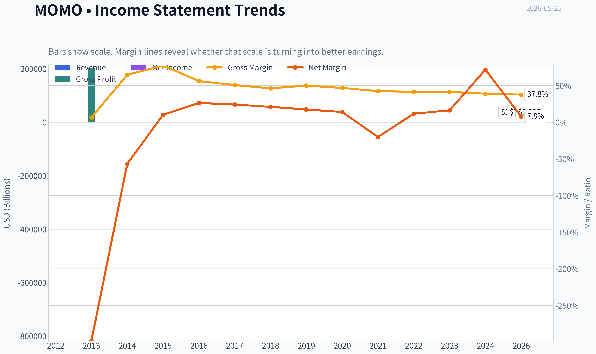

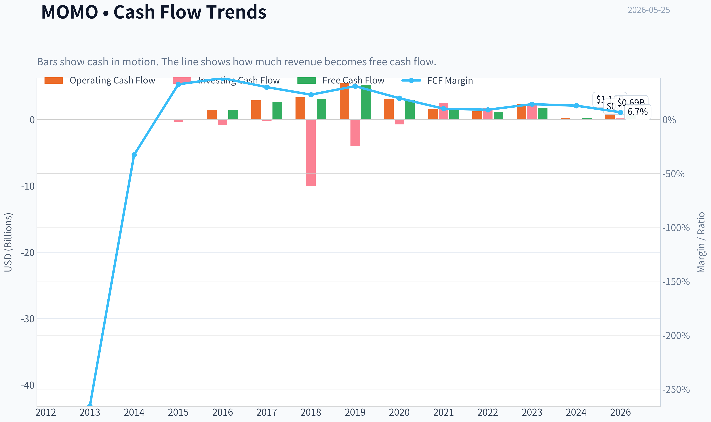

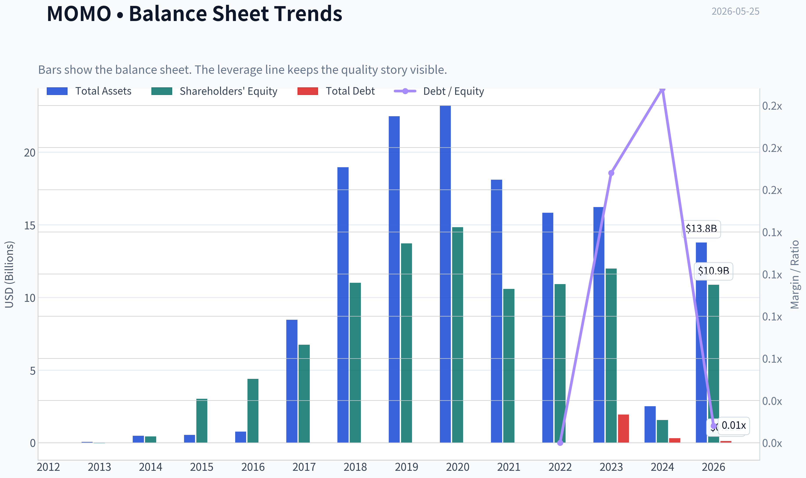

This graph tracks the profitability and return metrics (ROE, ROIC, Margins) of **MOMO** over the past decade, highlighting capital efficiency trends.

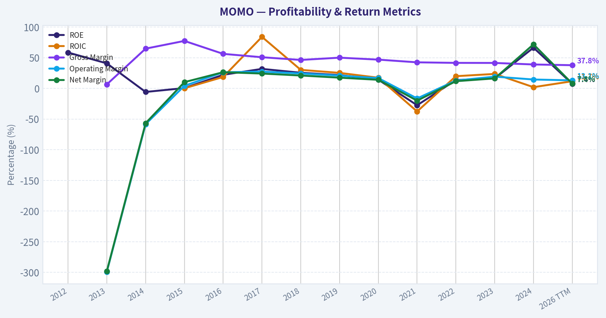

This chart illustrates the financial health of **MOMO** over the last 10 years, mapping cash equivalents and free cash flow against total obligations (Debt).

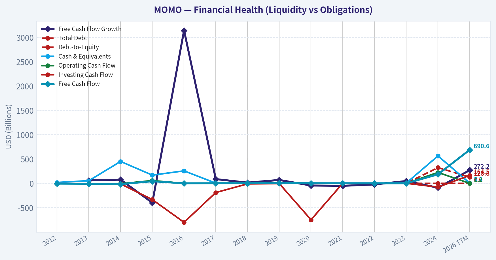

---

### Intrinsic Value Analysis (Buffett)

> *Following Warren Buffett's value investing philosophy: Circle of Competence, Economic Moat, Management Quality, and Margin of Safety.*

#### Intrinsic Value Snapshot

Price is what you pay. Intrinsic value is what the business may be worth based on the cash it can create for owners over time. We show a range, not one magic number.

- Current Price: $5.90
- Value Range (conservative to optimistic across both DCF methods): $2.34 to $162.56

##### Owner Earnings (Buffett Method)
- Net Income: $1,039,573,000.00
- Depreciation & Amortization: $81,815,000.00
- Capital Expenditures: $-492,517,000.00
- Working Capital Changes: $117,602,000.00
- Owner Earnings: $746,847,000.00

##### Intrinsic Value
###### Buffett Method
Uses owner earnings. Stricter, and usually more conservative.
- Conservative: $18.98
- Average: $162.56
- Optimistic: $162.56
- Discount Rate: 10.0%

###### Cash Flow Method
Uses free cash flow. Better for companies spending heavily today to grow tomorrow.
- Conservative: $2.34
- Average: $26.23
- Optimistic: $87.31
- Discount Rate: 10.0%

#### MOMO appears to be Hello Group, a Chinese social and dating platform. It makes money mainly by selling virtual gifts, premium memberships, live interaction services, and other social entertainment features inside its apps.

#### Go/No-Go Gate Assessment

| Gate | Verdict | Evidence |
|---|---|---|
| Gate 1: Business Simplicity | Pass | The business is easy to describe: attract users to social apps, monetize engagement through subscriptions and in-app spending. |
| Gate 1: Long-Term Predictability | Fail | Consumer internet social platforms can change quickly with user tastes, regulation, and platform relevance. Ten-year predictability is weak. |
| Gate 1: Technology Risk | Fail | This is not a utility-like platform with entrenched inevitability. Social products can be displaced by new formats, algorithms, and competitors. |
| Gate 2: Moat | Fail | Gross margin in the shared pack is 37.8%, below the Buffett-style >40% comfort line for strong intangible-asset businesses. The platform model may have some scale, but evidence of a durable moat is weak. |
| Gate 3: Management / Capital Allocation | Watch | Cheap valuation and very high FCF yield suggest some capital return potential, but current business decline raises the hurdle. |
| Gate 4: Industry Structure | Fail | Online social/dating is highly competitive, trend-driven, and vulnerable to platform shifts. Not a rational oligopoly. |

**Key Takeaways:** MOMO passes the "simple to understand" test, but it struggles on the more important Buffett filters: predictability, moat, and industry quality. This is the profile of a statistically cheap business, not an obviously durable compounding machine.

---

#### Moat Analysis

| Moat Source | Assessment | Evidence |
|---|---|---|
| Intangible Assets | Weak | Brand recognition exists, but not enough evidence of pricing power. Gross margin of 37.8% is modest for a powerful digital franchise. |
| Switching Costs | Weak | Users can switch social and dating apps easily. Little evidence of embedded workflow or mission-critical dependence. |
| Cost Advantage | Limited | Scale helps moderation, marketing, and infrastructure, but not in a way that locks out rivals. |
| Network Effects | Narrow / Fragile | Social platforms can benefit from network effects, but these are often local, trend-sensitive, and reversible. |

**Moat Quality Rating: Illusory to Narrow**

**Key Takeaways:** MOMO likely has some network-effect characteristics, but they do not look durable in the Buffett sense. Users are not captive, pricing power seems limited, and the moat can shrink quickly if engagement moves elsewhere.

---

#### Management Quality & Capital Allocation

| Area | Assessment | Commentary |
|---|---|---|
| Owner Orientation | Mixed | No strong evidence here of exceptional owner-operator alignment. |
| Candor / Honesty | Neutral | No direct red flags from the shared pack, but no standout evidence of unusually candid stewardship either. |
| Capital Allocation | Mixed | The stock looks optically cheap with a low P/E and high FCF yield, but a cheap multiple alone does not prove value creation if the core business is shrinking. |
| Balance Sheet Posture | Positive | Current ratio of 4.68 suggests strong short-term liquidity and low immediate financial stress. |

**Key Takeaways:** Management does not screen as clearly exceptional or clearly poor from the evidence at hand. The main issue is not survival, but whether management can reinvest cash intelligently in a business facing secular pressure.

---

#### Financial Summary

| Metric | Current / Latest |
|---|---:|
| Price | $6 |
| Market Cap | $871.7M |
| P/E | 8.43 |
| ROE | 7.4% |
| Gross Margin | 37.8% |
| Revenue Growth YoY | 616.4% |
| FCF Yield | 79.2% |
| Current Ratio | 4.68 |

**Key Takeaways:** The headline valuation is very cheap, especially on P/E and free-cash-flow yield. But quality is not high: ROE is only 7.4% and gross margin is below the level normally associated with a powerful consumer platform moat.

---

#### Owner Earnings Calculation

Using available evidence, a practical owner-earnings proxy is free cash flow, adjusted mentally for business decay risk.

| Item | Assessment |
|---|---|
| Net Income | Positive, implied by P/E |
| + D&A | Likely supportive |
| - Maintenance CapEx | Likely modest versus many industrial businesses |
| - Working Capital Needs | Probably manageable |
| Approximate Owner Earnings Proxy | Best proxied by current free cash flow |

At a **79.2% FCF yield** on an **$871.7M market cap**, implied annual FCF is roughly:

**Owner Earnings Proxy ~ 0.792 x $871.7M = about $690M**

**Key Takeaways:** On current numbers, the market is valuing MOMO as if its cash generation is set to fall sharply or prove unsustainable. That may create upside if the business stabilizes, but it also raises the classic value-trap question: how much of today's cash flow is truly durable?

---

#### Three-Scenario DCF Valuation

Using owner earnings proxy of **$690M** and a **10% discount rate**:

| Scenario | Assumption | Value Estimate |
|---|---|---:|
| A: No Growth | Owner Earnings / 10% | $6.90B |
| B: 3% Growth | OE x 1.03 / (10% - 3%) | $10.15B |
| C: Declining / Haircut Reality Check | Assume current OE falls 60% permanently; normalized OE = $276M; value at 0% growth | $2.76B |

Compared with current market cap of **$871.7M**:

| Scenario | Estimated Value | Upside vs Market Cap |
|---|---:|---:|
| A: No Growth | $6.90B | ~691% |
| B: 3% Growth | $10.15B | ~1,065% |
| C: Severe Haircut | $2.76B | ~217% |

**Key Takeaways:** Pure cash-flow math says the stock is very cheap. But the spread is so large that the market is clearly discounting business deterioration, regulatory risk, or capital-allocation distrust. For a Buffett investor, the key question is not whether it is statistically cheap, but whether those earnings power figures can last.

---

#### Margin of Safety Analysis

| Item | Assessment |
|---|---|
| Statistical Cheapness | Very high |
| Business Quality | Mediocre |
| Predictability | Low |
| Required Margin of Safety | At least 40-50% |
| Apparent Discount | Very large on current cash flow |
| True Margin of Safety | Uncertain because normalized earning power may be materially below current FCF |

**Key Takeaways:** MOMO has a large apparent margin of safety on paper, but not a clean one. Buffett-style investing demands confidence in the durability of earnings, and that confidence is exactly what is missing here.

---

#### Final Buffett Scorecard

| Criterion | Weight | Score (1-5) | Weighted Score |
|---|---:|---:|---:|
| Business Understanding | 20% | 4.0 | 0.80 |
| Moat Width & Durability | 25% | 2.0 | 0.50 |
| Management Quality | 15% | 2.5 | 0.38 |
| Return on Equity | 15% | 2.0 | 0.30 |
| Reinvestment Runway | 10% | 2.0 | 0.20 |
| Balance Sheet Strength | 5% | 4.0 | 0.20 |
| Industry Structure | 5% | 2.0 | 0.10 |
| Valuation / Margin of Safety | 5% | 5.0 | 0.25 |
| **Total** | 100% |  | **2.73 / 5.0** |

**Key Takeaways:** MOMO scores well on simplicity, liquidity, and cheapness, but poorly on moat, industry quality, and returns on capital. That combination usually fits a cigar-butt situation rather than a wonderful business.

---

#### ANALYST STANCE: **AVOID**

**Conviction level: Moderate**

MOMO looks **cheap for a reason**. The valuation is undeniably low, and if the business merely stabilizes, the upside could be substantial. But Buffett's framework is designed to avoid exactly this sort of business: a consumer internet platform with weak predictability, questionable moat durability, mediocre returns on equity, and secular decline concerns.

This is not the kind of company you would want to own "forever" with high confidence. It may work as a trade or a deep-value speculation, but it does **not** qualify as a high-quality Buffett-style investment.
#### Valuation Bridge

This bridge places the current market price beside each intrinsic value lens so readers can see whether upside depends on one method or shows up across several methods.

| Scenario | Intrinsic Value / Share |
| --- | ---: |
| Buffett Method | $162.56 |
| Cash Flow Method | $26.23 |
| Damodaran Method | $22.25 |
| Current Price | $5.90 |

#### Key Takeaways

If one method is far above the others, the upside case depends on a specific modelling assumption. When several methods cluster together, the valuation story is more robust.

#### Valuation Visuals

This comparison chart from *Latest Earnings Snapshot* stacks current figures against historical benchmarks for **MOMO**, making it easy to see where the company trades relative to its own averages.

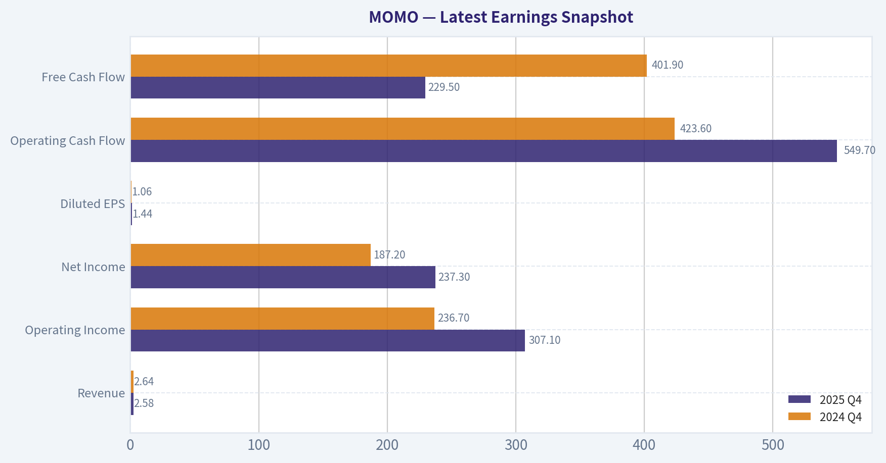

This comparison chart from *Balance Sheet Strength* stacks current figures against historical benchmarks for **MOMO**, making it easy to see where the company trades relative to its own averages.

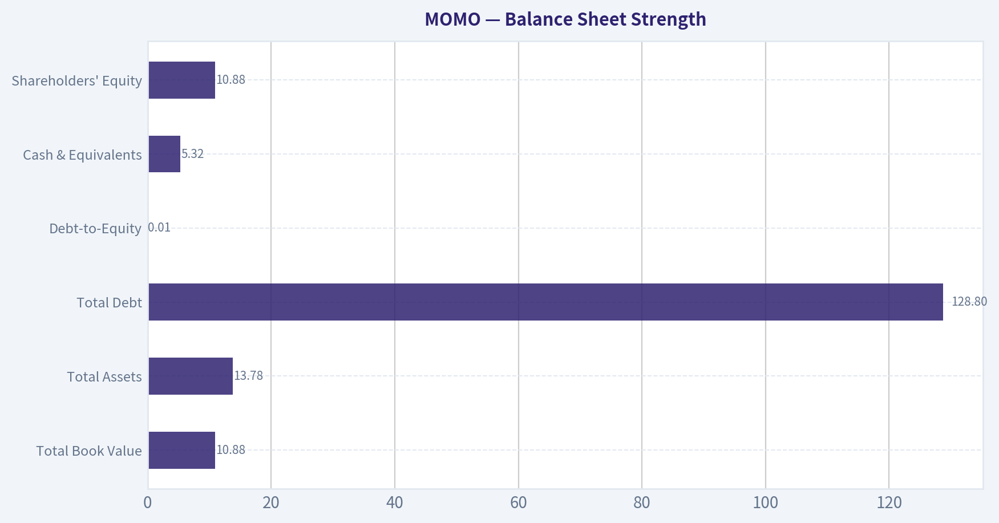

This comparison chart from *Cash Flow Analysis* stacks current figures against historical benchmarks for **MOMO**, making it easy to see where the company trades relative to its own averages.

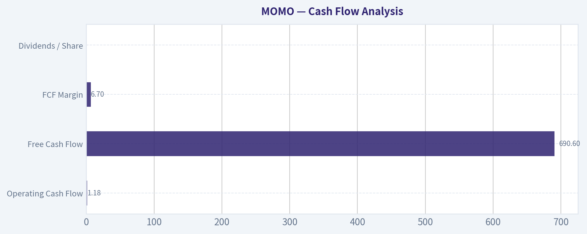

This comparison chart from *Financial Summary* stacks current figures against historical benchmarks for **MOMO**, making it easy to see where the company trades relative to its own averages.

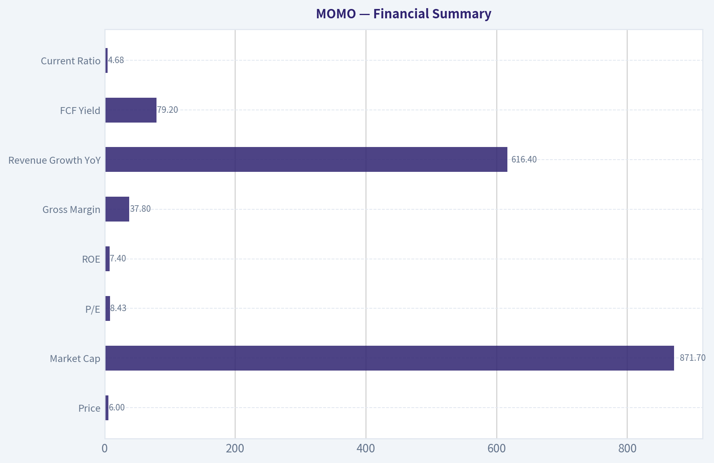

This comparison chart from *Three-Scenario DCF Valuation* stacks current figures against historical benchmarks for **MOMO**, making it easy to see where the company trades relative to its own averages.

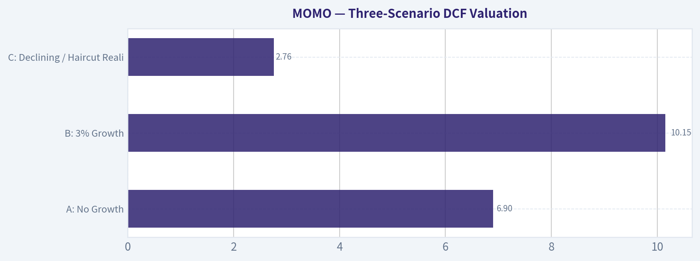

---

### Trend & Growth Analysis (Lynch/Druckenmiller/Fisher)

> *Following Peter Lynch's GARP, Stanley Druckenmiller's macro-aware approach, and Philip Fisher's scuttlebutt methodology.*

ANALYST STANCE: **AVOID**

#### MOMO (Hello Group) - Growth Framework Report

| Item | Snapshot |
|---|---:|
| Price | $6 |
| Market cap | $871.7M |
| P/E | 8.43x |
| ROE | 7.4% |
| Gross margin | 37.8% |
| YoY revenue growth (shared pack) | 616.4%* |
| FCF yield | 79.2% |
| Current ratio | 4.68x |

**Key Takeaways:** MOMO looks optically cheap on earnings and free cash flow, and the balance sheet appears liquid. But the headline 616% revenue growth is almost certainly distorted by a very low comparison base, accounting noise, or non-recurring effects, because the broader evidence points to a mature-to-declining business. For growth investors, the cheapness is not enough if the underlying business lacks a credible re-acceleration path.

---

#### 1. Lynch Classification

| Framework | MOMO Assessment |
|---|---|
| Lynch category | **Turnaround / possible value trap**, not a Fast Grower |
| Why not Fast Grower | Multi-year narrative is revenue pressure, aging core app, and uncertain user engagement |
| Growth-investor relevance | Low unless a real inflection appears in users, monetization, or overseas expansion |

**Key Takeaways:** MOMO does not fit Peter Lynch's preferred fast-grower bucket. It is better understood as a turnaround candidate with statistically cheap valuation. That means the burden of proof is on management to show durable re-acceleration, not just cost-cutting.

#### 2. The Story in 3 Bullets

| Simple Story | View |
|---|---|
| What it does | Runs social networking and dating platforms, mainly Momo and Tantan |
| Why it once worked | Strong social discovery monetization, live/social entertainment, and dating demand |
| Why investors hesitate now | User relevance and revenue durability are in doubt, especially against stronger Chinese social/video ecosystems |

**Key Takeaways:** The business is easy to explain, but the growth case is weak. This is not a "new category winner" story; it is a "can they stabilize and milk a cash-generating platform?" story. That is usually not ten-bagger territory.

---

#### 3. TAM Analysis and 10x Test

| TAM Dimension | Assessment |
|---|---|
| Core market | China online social networking, dating, and social entertainment |
| TAM growth | Mature core market; still large, but highly competitive and fragmented |
| Current share position | Meaningful niche presence, but not dominant platform power |
| 10x revenue test | **Theoretical yes on TAM size, practical no on competitive position** |
| Why practical no | Weak moat, low switching costs, and user attention has shifted to stronger ecosystems |

**Key Takeaways:** The addressable market is large enough on paper, so TAM is not the real constraint. The problem is that MOMO lacks the competitive strength to capture a much larger share. In growth investing, a big market without a durable edge is not enough.

---

#### 4. Revenue Growth Trend

| Trend Lens | Assessment |
|---|---|
| 1Q/TTM headline | Shared pack shows +616.4% YoY, likely distorted |
| Multi-year pattern | Broadly **decelerating to declining** |
| Organic growth quality | Questionable; likely not a clean demand acceleration story |
| Growth verdict | **No confirmed inflection** |

**Key Takeaways:** The reported growth spike conflicts with the company's broader operating narrative and external coverage calling it a secular decline story. Until validated by clean quarterly numbers and segment/user data, it should not be treated as a true inflection. For now, the safer conclusion is that growth quality is poor.

---

#### 5. Unit Economics

| Metric | MOMO Assessment | Growth Benchmark |
|---|---:|---:|
| LTV/CAC | Not disclosed / insufficient data | >3.0x preferred |
| Payback period | Not disclosed | <12 months excellent |
| Net Revenue Retention | Not relevant / not disclosed like SaaS | >110% ideal |
| Rule of 40 | Not applicable in classic SaaS form | >40 strong |
| Gross margin | 37.8% | Modest for digital platform |
| FCF profile | Strong relative to market cap | Positive |

**Key Takeaways:** MOMO does not provide the kind of clean subscription unit economics growth investors love. What stands out is free cash flow and liquidity, not customer economics or expansion efficiency. That makes this more of a deep-value cash-harvest story than a compounding growth story.

---

#### 6. Inflection Point Assessment

| Inflection Type | Evidence | Verdict |
|---|---|---|
| Product cycle inflection | No clear evidence of breakout new product | Negative |
| Market share inflection | No clear sign of accelerating share gains | Negative |
| Margin inflection | Possible via cost control, but not growth-driven | Weak positive |
| TAM inflection | No meaningful TAM expansion evident | Negative |
| Competitive inflection | No major competitor stumble identified | Negative |

**Key Takeaways:** The only plausible inflection is margin resilience through efficiency, which is not the kind of inflection that usually creates ten-baggers. There is no strong sign of product-driven or market-share-driven acceleration. Druckenmiller would likely pass unless new evidence emerges.

---

#### 7. Macro Setup Evaluation

| Macro Factor | Assessment |
|---|---|
| Rates backdrop | Neutral to mildly supportive for cheap equities |
| China consumer/internet | Mixed to cautious |
| Regulatory backdrop | Still a structural risk discount |
| Secular trend exposure | Social networking/dating is not a top-tier 2024-2034 secular winner |
| Macro conclusion | **Not a strong tailwind setup** |

**Key Takeaways:** MOMO does not sit in one of the market's strongest secular currents like AI, cybersecurity, cloud, or healthcare innovation. China internet exposure adds valuation discount and sentiment risk. Even if the stock is cheap, the macro and thematic backdrop is only lukewarm.

---

#### 8. Fisher 15-Point Score

| Fisher Category | Score (1-5) |
|---|---:|
| Market potential | 2 |
| New product development | 2 |
| R&D effectiveness | 2 |
| Sales organization | 3 |
| Profit margin | 3 |
| Improving margins | 3 |
| Labor/personnel relations | 3 |
| Executive relations | 3 |
| Management depth | 3 |
| Cost analysis/accounting | 3 |
| Special advantages/moat | 2 |
| Long-range profit outlook | 2 |
| Dilution risk | 4 |
| Candor in difficulties | 3 |
| Integrity | 3 |
| **Total** | **41 / 75** |

**Key Takeaways:** A score of 41 places MOMO in the avoid range under Fisher's framework. The main weakness is not financial distress but a lack of evidence for superior long-term product innovation and moat strength. This looks more like a defend-and-harvest platform than an exceptional growth enterprise.

---

#### 9. Valuation Analysis

| Valuation Method | Result | Interpretation |
|---|---:|---|
| P/E | 8.43x | Cheap |
| PEG | Not meaningful due to weak/unreliable earnings growth base | Cannot support bullish growth case |
| P/S | Likely low / sub-scale relative to growth peers | Cheap but deservedly so |
| FCF yield | 79.2% | Extremely optically attractive |
| Balance sheet lens | Strong liquidity, current ratio 4.68x | Downside support |

**Key Takeaways:** MOMO is cheap by nearly every traditional value metric. But the key issue is that growth investors should not confuse low multiples with mispricing if the business is in secular erosion. The valuation provides support, but not a growth thesis.

| Scenario | Assumption | 2-3 Year View |
|---|---|---|
| Bear | Revenue resumes decline, users erode, multiple stays compressed | Value trap |
| Base | Revenue stabilizes, FCF remains solid, modest rerating | Decent deep-value return, not a growth winner |
| Bull | Overseas or product reset works, revenue inflects, multiple expands | Strong upside, but low-probability today |

**Key Takeaways:** The base case is not disastrous because the business appears cash-generative and liquid. But the upside case depends on a true operating turnaround that is not yet visible. For a growth mandate, that makes the bull case too speculative.

---

#### 10. Growth Investor Scorecard

| Criterion | Weight | Score (1-5) | Weighted Score |
|---|---:|---:|---:|
| The Story | 10% | 2.5 | 0.25 |
| TAM & Runway | 20% | 2.5 | 0.50 |
| Revenue Growth | 20% | 1.5 | 0.30 |
| Unit Economics | 15% | 2.0 | 0.30 |
| Competitive Position | 10% | 2.0 | 0.20 |
| Management Quality | 10% | 2.5 | 0.25 |
| Macro Setup | 5% | 2.0 | 0.10 |
| Profitability Path | 5% | 3.5 | 0.18 |
| Valuation | 5% | 4.5 | 0.23 |
| **Total** |  |  | **2.31 / 5.0** |

**Key Takeaways:** MOMO scores poorly for a growth portfolio because the biggest weights, runway and revenue growth, are weak. The only major strengths are valuation and current cash generation. That combination can work for deep-value investors, but it does not clear the bar for a Lynch-Druckenmiller-Fisher growth setup.

---

#### 11. Position Size Stance

| Stance | View |
|---|---|
| Growth portfolio | **0% - Avoid** |
| Deep value / special situations | Small speculative watch only |
| What would change view | Two clean quarters of user and revenue stabilization, better segment disclosure, and proof of durable overseas/product growth |

**Key Takeaways:** For a growth-oriented portfolio, the correct position size is zero today. If new evidence shows the business is truly re-accelerating rather than just harvesting cash, it can move to Watch. Right now, the setup is too uncertain.

---

#### 12. Key Risks and Catalysts

| Risks | Catalysts |
|---|---|
| Secular decline in core apps | Stabilization in MAUs/paying users |
| Weak moat and low switching costs | Better-than-expected overseas growth |
| China regulatory/sentiment discount | Share repurchases at depressed valuation |
| Revenue quality concerns | Margin resilience plus flat-to-up revenue |
| Value trap dynamics | New product success or renewed dating monetization |

**Key Takeaways:** The stock has real optionality because it is cheap and cash-generative. But most catalysts depend on operational improvement that has not yet been proven. The major risk is that investors keep waiting for a turnaround that never fully arrives.

---

#### Bottom Line

MOMO is **cheap, liquid, and cash-generative**, but it does **not** currently meet the standards of a growth investor hunting for inflecting fast growers or ten-bagger potential. The evidence supports a **value trap / turnaround** framing more than a durable growth compounding thesis.

For now: **AVOID** for growth portfolios, **WATCH only** if upcoming results show real user and revenue stabilization.

#### Growth & Scorecard Visuals

This comparison chart from *Growth Metrics* stacks current figures against historical benchmarks for **MOMO**, making it easy to see where the company trades relative to its own averages.

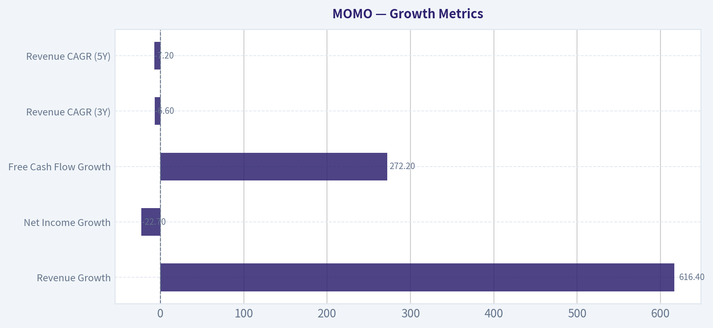

---

### Market Technical Analysis

#### MOMO Technical Analysis Report

MOMO is trading in a **structurally weak long-term trend**, but the stock is no longer in the sharp decline that dominated late Q1. Instead, it has transitioned into a **range-bound recovery that has recently started to fade**. The most relevant indicators for this market context are:

- **close_10_ema**
- **close_50_sma**
- **close_200_sma**
- **macd**
- **rsi**
- **boll_ub**
- **boll_lb**
- **atr**

These 8 indicators are well suited here because they balance **trend, momentum, volatility, and tactical risk control** without excessive overlap. The moving averages define short-, medium-, and long-term structure; MACD and RSI capture momentum quality; Bollinger Bands help assess whether price is stretching within its current range; ATR helps size stops in a low-priced but still moderately volatile stock.

---

#### Price Structure and Trend Context

From the raw price history, MOMO spent much of the last several months in a broad deterioration from the **mid-6s in November-January** into a **March low near 5.44-5.48**, followed by a rebound into **mid-April and early May around 6.40-6.44**. That rebound was meaningful, but it did **not reverse the larger downtrend**. Instead, it looks more like a countertrend recovery inside a broader weak structure.

The key issue is that price remains **well below the 200-day SMA**, which is the clearest sign that the longer-term trend is still unfavorable. At the same time, price has been oscillating around and slightly above the **50-day SMA**, which tells us the medium-term tape has stabilized versus the March washout. This creates an important split: **shorter-term conditions improved, but the strategic trend remains bearish**.

Most recently, the stock has softened again. The latest close at **5.90** is:
- below the **10 EMA (~6.08)**
- slightly below the **50 SMA (~5.99)**
- far below the **200 SMA (~6.55)**

That alignment suggests the April rebound has lost momentum and the stock is slipping back toward the lower end of its recent consolidation zone rather than building for an immediate upside breakout.

#### Indicator Snapshot

| Indicator | Latest Reading | Interpretation |
|---|---:|---|
| Close | 5.90 | Near lower end of recent range |
| close_10_ema | 6.08 | Price below short-term trend line; momentum weakening |
| close_50_sma | 5.99 | Price slightly below medium-term support/trend |
| close_200_sma | 6.55 | Long-term trend still bearish |
| macd | -0.0166 | Momentum has rolled negative after prior recovery |
| rsi | 40.43 | Weak but not deeply oversold |
| boll_ub | 6.42 | Upper resistance zone |
| boll_lb | 5.92 | Price testing/lodging near lower band |
| atr | 0.168 | Moderate daily movement; risk should be sized carefully |

Key Takeaways: MOMO has slipped below both its short-term and medium-term trend markers, while remaining clearly below its long-term trend line. Momentum has weakened enough to turn MACD negative, and RSI has dropped into the low-40s, which reflects softening demand but not yet panic-level selling. Price is also sitting near the lower Bollinger Band, so traders should watch closely for either a support bounce or a breakdown through the recent range floor.

---

#### Moving Average Analysis

The **10 EMA** rose strongly through April as MOMO rebounded from the March lows, but it has now turned into a near-term ceiling rather than support. Its decline from the recent highs shows that upside momentum is cooling. When price stays below the 10 EMA for several sessions in a stabilizing stock, it often means buyers are no longer pressing aggressively.

The **50 SMA** has flattened after falling for weeks. That flattening is important: it signals that the prior downtrend lost speed. However, because the stock is now back under this average, the 50-day line may start acting as resistance if price cannot reclaim it quickly.

The **200 SMA** remains decisively downward sloping, falling from roughly **6.96 in late March** to **6.55 by late May**. This is not just a bearish level; it reflects persistent long-duration underperformance. Even if MOMO rallies, the **6.50-6.60 zone** is likely to be a heavy overhead supply area unless the fundamental narrative changes.

A trader should read this moving-average setup as follows:
- **Short term:** weakening
- **Medium term:** neutral-to-soft
- **Long term:** bearish

---

#### Momentum Analysis: MACD and RSI

The **MACD** tells a very specific story. It was deeply negative in late March, then improved steadily and crossed into positive territory in mid-April, confirming the rebound phase. That rebound peaked in late April and early May, when MACD readings above **0.10** reflected healthy recovery momentum.

But that positive momentum has now deteriorated sharply. MACD has fallen from roughly **0.10** to **negative territory (-0.0166)**. That shift matters because it implies the rebound impulse is no longer merely pausing; it is being unwound. In other words, buyers are not simply resting-they are ceding control.

The **RSI** reinforces this. RSI climbed from the low-to-mid 30s in late March to around **70** in mid-April, which marked a strong reversal burst. Since then, it has faded into the **40 area**. This is an especially important zone:
- above 50 usually supports trend continuation
- below 50 implies fading momentum
- below 40 starts to suggest more persistent selling pressure

At **40.4**, MOMO is weak but not washed out. That means the stock still has room to fall before reaching a classic oversold condition. For tactical traders, this reduces the urgency to buy weakness immediately.

---

#### Volatility and Range Behavior: Bollinger Bands and ATR

The Bollinger Bands show that MOMO is now pressing toward the **lower band (5.92)**, with the latest close at **5.90** just under that area. This is significant for two reasons.

First, it tells us the stock is leaning toward the weak end of its recent distribution range. Second, because the lower band is being tested while RSI is only around 40, this is not yet a clean capitulation signal. In stronger reversal setups, you often want to see the lower band tested while RSI is closer to or below 30 and momentum begins to diverge positively. That is not yet visible here.

The **upper band near 6.42** roughly matches the ceiling seen during recent rebound attempts. That makes the current trading envelope fairly clear:
- **Support zone:** about **5.90-5.92**
- **Mid-range control area:** about **6.08-6.00** via 10 EMA / 50 SMA
- **Resistance zone:** about **6.40-6.42**
- **Major overhead resistance:** about **6.55+** via the 200 SMA

The **ATR around 0.168** implies average daily movement of about 2.8% of price, which is not extreme, but is large enough that tight stops can be easily shaken out. For low-priced equities like MOMO, ATR matters because a $0.15-$0.20 move is meaningful in percentage terms.

#### Tactical Trading Implications

| Scenario | What to Watch | Trading Implication |
|---|---|---|
| Support bounce | Price holds 5.90-5.92 and reclaims 10 EMA | Short-term rebound toward 6.20-6.40 possible |
| Range continuation | Price oscillates between 5.90 and 6.40 | Better suited for tactical swing trading than trend following |
| Breakdown | Clean move below 5.90 with weak RSI/MACD | Risk of retest toward 5.70 and possibly lower |
| Recovery reversal | Price closes above 6.08 and then 6.00/6.10 area with improving MACD | Suggests the current dip is corrective, not trend-destructive |
| Strategic bullish shift | Sustained move back toward and above 6.55 | Needed to challenge long-term bearish structure |

Key Takeaways: The most actionable level right now is the support area near 5.90. If that zone holds and price quickly climbs back above the 10-day EMA, the current weakness may turn into a tradable bounce. If support fails, the odds increase that MOMO revisits lower April or even March price territory rather than resuming the rebound.

---

#### Nuanced Read on the Current Setup

This is not a high-conviction bullish chart. The long-term trend is still down, and the recent positive momentum pulse has already faded. However, it is also not a chart in freefall. The medium-term base built after the March decline means sellers have slowed, even if they have not disappeared.

That leaves MOMO in a **decision zone**:
- bulls need to defend the lower-band area and recover the 10 EMA quickly
- bears want to keep price below the 50 SMA and press MACD deeper negative

If the stock stays under **6.00-6.08** for several more sessions, the failed rebound narrative becomes stronger. If it reclaims that zone quickly, the recent weakness may end up being only a pullback within a sideways recovery band.

For investors, the main caution is simple: **do not confuse stabilization with a confirmed trend reversal**. The stock has improved from its March lows, but the distance below the 200 SMA shows the burden of proof still lies with the bulls.

#### Final Assessment

MOMO currently looks like a **weak-to-neutral swing chart inside a bearish long-term structure**. The April rebound was real, but it has lost force. Momentum indicators now point to cooling demand, while price is testing support rather than attacking resistance.

The best interpretation is:
- **Not yet oversold enough for an aggressive contrarian buy**
- **Not strong enough for a momentum breakout setup**
- **Most consistent with cautious range trading unless support breaks**

#### Summary Table

| Area | Observation | Trading Relevance |
|---|---|---|
| Long-term trend | Price far below falling 200 SMA | Strategic bias remains bearish |
| Medium-term trend | 50 SMA flattened, but price slightly below it | Recovery has stalled |
| Short-term trend | Price below 10 EMA | Near-term momentum weak |
| Momentum | MACD turned negative from prior positive peak | Rebound impulse fading |
| RSI | 40.4 | Weak, but not yet fully oversold |
| Volatility position | Price near lower Bollinger Band | Testing support, possible inflection point |
| Risk conditions | ATR ~0.168 | Stops must allow moderate daily fluctuations |
| Key levels | Support 5.90; resistance 6.08, 6.40, 6.55 | Defines likely next swing battleground |

Key Takeaways: MOMO is sitting at an important support test after its rebound lost momentum. The short-term picture has weakened, but the stock has not yet reached an extreme oversold condition that would automatically favor a strong reversal. Traders should treat 5.90 as the immediate decision level and watch whether price can reclaim the 10-day EMA to stabilize the chart.

---

### Options Market Analysis

> *Reading options flow - put/call ratios, IV skew, and unusual activity - to gauge institutional positioning and event-driven risk.*

#### MOMO Options Positioning Report

#### 1. Put/Call Ratio Analysis

| Expiration | Call OI | Put OI | Put/Call OI Ratio | Call Vol | Put Vol | Put/Call Vol Ratio |
|---|---:|---:|---:|---:|---:|---:|
| 2026-06-18 | 5,706 | 893 | 0.16 | 21 | 20 | 0.95 |
| 2026-07-17 | 8,426 | 3,580 | 0.42 | 2,286 | 124 | 0.05 |
| 2026-10-16 | 3,840 | 1,177 | 0.31 | 923 | 250 | 0.27 |
| **Near-term total** | **17,972** | **5,650** | **0.31** | **3,230** | **394** | **0.12** |

**Key Takeaways:** MOMO's aggregate put/call OI ratio of 0.31 is well below the rough neutral baseline of 0.7, showing a clear call-heavy open interest structure. The volume ratio is even more skewed at 0.12, which indicates recent flow has been much more call-focused than put-focused. The main exception is the very front June expiry, where volume is nearly balanced, suggesting near-dated traders are less aggressive than those positioned in July and October.

**Interpretation:**
This is a **bullish-leaning positioning backdrop**. Relative to the neutral ~0.7 baseline, MOMO shows a meaningful tilt toward calls rather than puts. That can reflect outright bullish speculation, but given the stock's smaller-profile name and likely institutional use of dated options, some of the call OI may also include overwriting or structured positions. Still, the **extremely low volume put/call ratio** argues that recent trading interest has favored upside exposure much more than downside hedging.

---

#### 2. Implied Volatility Assessment

| Expiration | ATM Call IV | ATM Put IV | Call vs Put IV Read |
|---|---:|---:|---|
| 2026-06-18 | 48.0% | 56.1% | Put IV premium |
| 2026-07-17 | 26.9% | 23.8% | Mild call IV premium |
| 2026-10-16 | 25.0% | 21.5% | Call IV premium |

**Key Takeaways:** June shows a notable put premium, which is typical of short-dated downside protection demand and suggests some near-term caution. But July and October flip to a call-premium structure, implying traders are paying more for upside optionality farther out. Overall, the skew profile is not uniformly defensive; it becomes more constructive outside the front month.

**IV read:**
- **June 2026:** Elevated relative to later expiries, with **puts richer than calls**. That is a classic short-term downside skew and usually signals near-dated event or gap risk awareness.
- **July and October 2026:** ATM IV is much lower and **calls trade richer than puts**, which is unusual versus the standard equity pattern and often points to **upside chase** rather than fear-driven hedging.

**Skew interpretation:**
- **Front expiry skew:** bearish/cautious in the very near term due to richer puts.
- **Deferred skew:** bullish/speculative as calls command more IV than puts.

**Catalyst flag:**
There is no explicit catalyst listed in the dataset, but the front-month IV jump versus later expiries suggests the market may be pricing some **near-term event uncertainty**. Without a confirmed earnings or corporate event date in the feed, this should be treated as a cautionary flag rather than a definitive catalyst call.

---

#### 3. Unusual Options Activity

| Observation | Result |
|---|---|
| Contracts with volume > 5x open interest | None detected in near-term expirations |
| Fresh directional bet signal | Not confirmed from unusual-activity screen |
| Confidence from tape-reading | Reduced due to lack of standout contract-level anomalies |

**Key Takeaways:** There were no contracts flagged with volume exceeding 5 times open interest, so there is no clean evidence of aggressive fresh positioning concentrated in a single strike. That weakens the case for calling out "smart-money" directional conviction from the options tape alone. The sentiment read therefore depends more on broad OI/volume balance and IV structure than on standout flow.

**Interpretation:**
No major unusual activity means:
- No obvious sweep or block-style contract stands out as a fresh institutional directional bet.
- The bullish read is therefore **broader and lower-conviction**, based on market structure rather than a single high-signal trade.
- Since MOMO is not one of the deepest U.S. options markets, this absence of unusual activity should also be viewed through a **liquidity lens**. Thin chains can hide signal quality and make ratios noisier.

---

#### 4. Open Interest Concentration

| Expiration | Total Call OI | Total Put OI | Positioning Read |
|---|---:|---:|---|
| 2026-06-18 | 5,706 | 893 | Strong call concentration |
| 2026-07-17 | 8,426 | 3,580 | Largest overall OI, call-dominant |
| 2026-10-16 | 3,840 | 1,177 | Moderate OI, call-dominant |

**Key Takeaways:** The heaviest open interest sits in the July expiration, making it the most important near-term expiry for potential price pinning or dealer gamma effects. Across all listed expiries, call OI materially exceeds put OI, which suggests upside strikes are more crowded than downside hedges. However, without strike-by-strike detail, gamma-wall precision is limited.

**Interpretation:**
- **July 2026** is the key expiration to watch because it carries the largest total OI and the largest trading volume.
- The broad **call-heavy OI concentration** implies that upside strikes may act as important dealer hedging zones if the stock starts moving toward them.
- Because the dataset does not include strike-level OI concentrations, I cannot precisely identify a single "max pain" strike or exact gamma wall. But at the expiration-level view, **July is the dominant pinning window**.

---

#### 5. Overall Options Sentiment Signal

**Signal: BULLISH**

**Why:**
The strongest driver is the **very low put/call ratios**, especially the aggregate **0.31 OI ratio** and **0.12 volume ratio**, both far below the neutral ~0.7 baseline. That says traders are materially more engaged with calls than puts. In addition, while the front expiry shows a normal defensive put premium, the **deferred expiries display call-rich IV**, which supports an interpretation of **upside interest beyond the immediate near-term window**.

**Caveats:**
- Front-month skew still reflects some caution.
- No standout unusual contract flow was detected, so conviction is **moderate rather than high**.
- MOMO options are not especially deep versus mega-cap names, so signal quality is somewhat lower than for highly liquid underlyings.

**Bottom line:**
The options market is **net bullish on MOMO**, with the clearest evidence coming from call-dominant OI and especially call-dominant recent volume. The market appears to be leaning for upside participation in coming months, while still pricing some short-term downside/event risk in the nearest expiration.

---

#### Summary Table

| Metric | Read |
|---|---|
| Put/Call Ratio | **Bullish** - OI ratio 0.31 and volume ratio 0.12 are well below neutral |
| IV Level | **Near-term elevated, then normalizing** - June IV much higher than July/October |
| Skew Direction | **Short-term put skew, deferred call skew** - near-term caution but medium-term upside chase |
| Unusual Activity | **None flagged** - no volume > 5x OI contracts detected |
| Overall Signal | **BULLISH** - call-heavy positioning is the primary driver |

**Key Takeaways:** MOMO's options market is leaning bullish overall, driven by strong call dominance in both open interest and recent volume. The only real caution flag is the richer June put IV, which suggests traders still respect short-term downside or event risk. With no standout unusual trade, the signal is constructive but not high-conviction.

---

## Research Team Commentary

> *The Research Manager synthesizes the Bull vs Bear debate into action-free commentary. This is a pre-risk view, not the final stance.*

The strongest bull argument is straightforward: MOMO is cheap enough that it may not need much to work. At roughly 8.4x earnings, with positive profitability, decent ROIC around 11.7%, and a business that is still monetizing a real installed base, the market is already assuming ongoing decay. If the company merely stabilizes rather than improves, the upside could come from a modest rerating, continued cash generation, and possibly capital returns. The bull case also fairly notes that weak charts alone should not disqualify a statistically cheap, cash-producing business.

The strongest bear argument is more important through a Buffett lens: cheapness is not the same as value when the business quality is mediocre and the future cash flows are hard to predict. MOMO's category is structurally weak for long-duration investing: low switching costs, changing user behavior, platform fatigue, and ongoing regulatory risk in China. The returns on capital are positive but not exceptional for a digital platform, and the moat appears narrow and likely eroding. In other words, this is not a temporarily hated great business; it may be a permanently lower-quality business that deserves a low multiple. That distinction matters a lot.

My takeaway is that the bear case is more convincing. The stock may be optically cheap, and I want to be careful not to repeat the mistake of dismissing every deeply discounted name just because it lacks a perfect moat. But the lesson from past mistakes is not to abandon business-quality discipline. It is to distinguish between a high-quality business suffering temporary fear and a structurally challenged business that only looks cheap on trailing numbers. MOMO looks much closer to the second bucket. The available evidence does not show the kind of durable competitive advantage, management excellence, or earnings predictability that would justify conviction, even at a single-digit P/E.

Core takeaway: MOMO may be statistically inexpensive, but it does not meet Buffett-style standards for durable business quality, and the low valuation is likely reflecting real long-term erosion rather than temporary mispricing. That makes it unattractive as a true value investment today.

Rationale: Buffett investing starts with business durability, not with a low multiple. Here, the business is understandable, but that is the easiest test. The harder tests are where MOMO struggles: moat, predictability, industry quality, and confidence in normalized earnings power. A social and dating platform can deteriorate slowly for years while still printing earnings, which is exactly how value traps are formed. The returns on capital are adequate, not outstanding. The market analyst's note that the stock sits below the 10 EMA, 50 SMA, and 200 SMA reinforces that neither fundamentals nor market behavior are signaling improving confidence. Unlike my earlier miss on DUOL, this does not look like a high-quality, cash-rich grower that was excessively de-rated. It looks like a mature, structurally pressured franchise with uncertain terminal value. In that kind of setup, the margin of safety is weaker than the headline P/E suggests.

Monitoring plan over the next 1-4 quarters: first, watch whether revenue and especially paying-user monetization stabilize on an underlying basis rather than through accounting noise. Second, track whether margins and free cash flow hold up without signs that the company is underinvesting to preserve near-term profits. Third, look for evidence of user-base stabilization or renewed engagement in core products; without that, earnings durability remains questionable. Fourth, evaluate capital allocation: if management is repurchasing shares meaningfully while preserving balance-sheet strength, that helps, but only if the core business stops eroding. Fifth, monitor any regulatory or policy developments affecting Chinese social platforms, because this industry remains vulnerable to external shocks. Finally, I would want to see the stock reclaim and hold above the 200-day moving average alongside business stabilization before becoming more constructive.

Final stance: AVOID.

---

## Value Investing Team Commentary

> *The Investor translates the research view into an investment thesis before risk review. This is still not the final stance.*

MOMO, or Hello Group, is the kind of stock that can tempt a value investor for all the obvious reasons: single-digit P/E, still profitable, positive returns on capital, and a price that already reflects plenty of skepticism. On the surface, that sounds like the raw material for a contrarian opportunity. But Buffett-style investing is not about buying statistically cheap assets in weak businesses. It is about buying understandable businesses with durable earning power at sensible prices. MOMO clears the "understandable" hurdle, but it struggles where it matters most: business quality, moat, and predictability.

The central issue is that this does not appear to be a temporarily misjudged great business. It looks more like a mature digital platform facing structural pressure. Social and dating platforms often have low switching costs, shifting user tastes, and limited customer captivity. That means current earnings can persist for a while, yet still erode over time in a way that makes trailing valuation multiples misleading. A low P/E is not a margin of safety if the "E" is in gradual decline.

The reported profitability is respectable but not exceptional. ROE of 7.4% and ROIC of 11.7% suggest the business is still functional and cash generative, but not so strong that it overcomes concerns about franchise durability. Gross margin near 38% is decent, though not the sort of elite economics that signal a powerful platform moat. In a Buffett framework, these numbers describe a business that is viable, not one that is clearly advantaged.

The contrarian question is important here: is the market overly pessimistic, or is it simply recognizing a real deterioration? I lean toward the latter. The market's skepticism seems grounded in rational concerns: aging platform dynamics, weak industry structure, uncertain user retention, and China regulatory overhang. Those are not temporary headline issues; they affect long-term normalized earnings power. This is an important distinction. True contrarian value usually emerges when a high-quality business is facing temporary fear. MOMO looks more like a lower-quality business receiving an appropriate discount.

There is still a scenario where the stock works. If revenue stabilizes, user monetization holds, free cash flow remains solid, and management uses capital intelligently through repurchases, the shares could rerate from depressed levels. In other words, the upside case does not require greatness, only stabilization. But that is not enough for high-conviction value ownership. It is more a case for speculative mean reversion than long-term business compounding.

The technical picture reinforces caution rather than contradicting it. Trading below the 10 EMA, 50 SMA, and 200 SMA suggests the market is not yet signaling renewed confidence in the business. Unlike a strong franchise that has been excessively sold off, MOMO lacks the evidence of quality that would justify leaning against negative sentiment aggressively. In Buffett terms, I would rather miss a statistically cheap stock than own a deteriorating business simply because it looks inexpensive on trailing metrics.

What to watch from here is straightforward: stabilization in core revenue, healthier engagement trends, evidence that margins are being preserved through strength rather than underinvestment, and shareholder-friendly capital allocation that is not masking a shrinking core. If those improve, the stock may deserve reconsideration. Until then, the discount looks more like compensation for business risk than a gift from the market.

ANALYST STANCE: **AVOID**

---

## Deep Values Commentary

> *The Risk Management Team debates and the Risk Judge provides the final action-free verdict. This section determines the final ADVOCATE / WATCH / AVOID stance.*

#### Final Stance Scorecard

This scorecard converts the final research view into a weighted decision frame. It does not replace the narrative judgement, but it makes the main drivers of the verdict easier to scan.

| Criterion | Score | Weight | Commentary |
| --- | ---: | ---: | --- |
| Business Quality | 2.75 | 30% | High returns, profitability, and Piotroski health support durability. |
| Valuation Support | 5.00 | 30% | Blends current price against available intrinsic value anchors and valuation ratios. |
| Financial Strength | 5.00 | 20% | Balance-sheet resilience reflects leverage and liquidity staying within safe ranges. |
| Growth Durability | 3.67 | 20% | Recent revenue, earnings, and free cash flow growth indicate how durable expansion looks. |
| TOTAL / FINAL STANCE | 4.06 | 100% | AVOID |

#### Key Takeaways

The weighted score lands at **4.06 / 5.0**, while the final stance remains **AVOID**. This is useful as a quick calibration aid rather than a mechanical signal.

#### Risk Summary

Higher scores indicate more risk pressure. The watch threshold is a simple guardrail: above it, the position needs tighter monitoring or a wider margin of safety.

| Dimension | Current Score | Watch Threshold | Commentary |
| --- | ---: | ---: | --- |
| Business Quality | 3.25 | 3.00 | High returns, profitability, and Piotroski health support durability. |
| Valuation Support | 1.00 | 3.00 | Blends current price against available intrinsic value anchors and valuation ratios. |
| Financial Strength | 1.00 | 3.00 | Balance-sheet resilience reflects leverage and liquidity staying within safe ranges. |
| Growth Durability | 2.33 | 3.00 | Recent revenue, earnings, and free cash flow growth indicate how durable expansion looks. |

#### Key Takeaways

This view helps readers separate *where* the risk sits: valuation, business quality, balance sheet, or growth durability. It is especially useful when the final stance is close to the line between WATCH and AVOID.
