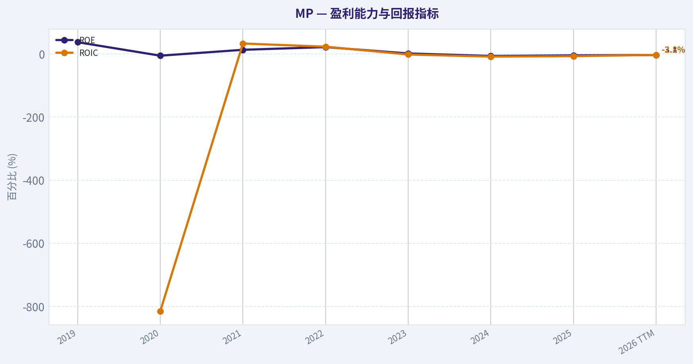
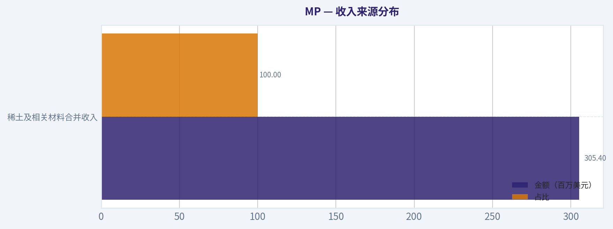
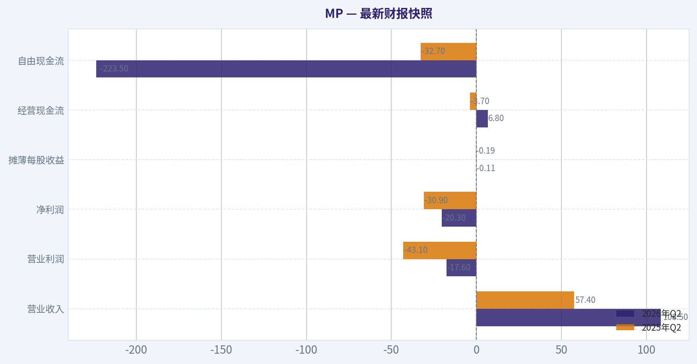
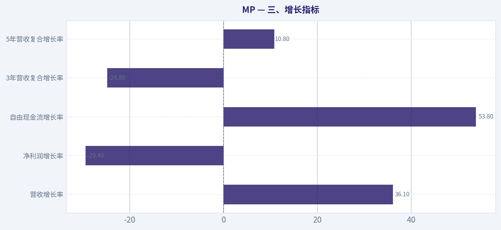
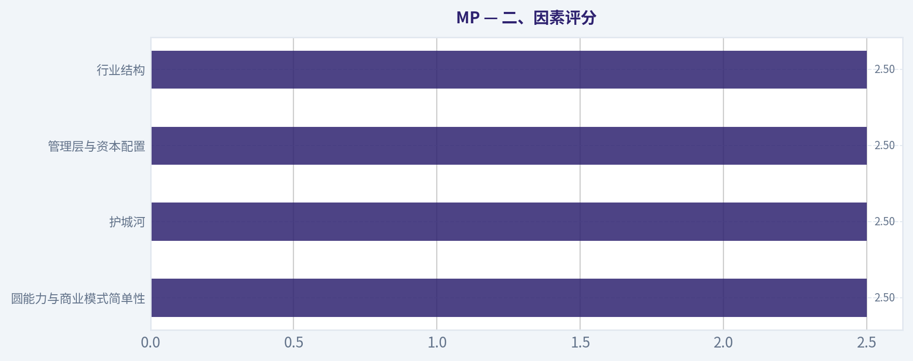
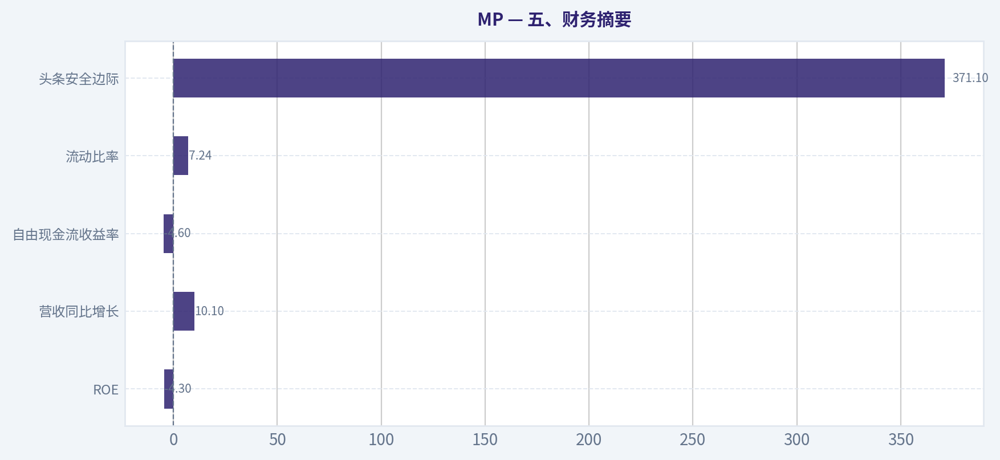
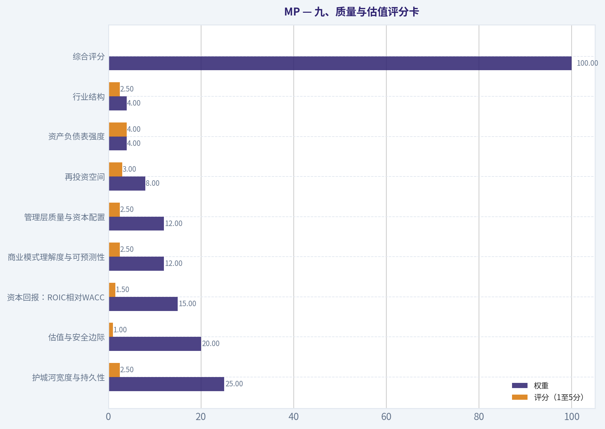
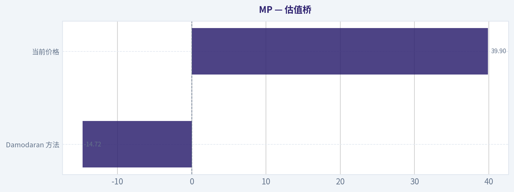

# MP 深度价值情报

**调研日期:** 2026-10-14

## 关键免责声明

*本报告由 Deep Value Intelligence（一个基于 AI 的多智能体投资分析框架）自动生成。 仅供教育和研究用途 - 非财务建议，非财务顾问。*

---

## 目录

1. 情报摘要
2. 分析师团队报告
   - 基本面分析
   - 价值分析 (巴菲特)
   - 成长性分析 (林奇/德鲁肯米勒/费雪)
   - 市场分析
   - 期权市场分析
3. 研究团队评论
4. 投资团队评论
5. Deep Values 团队洞察

---

## 情报摘要

### 核心观点与前提条件

**核心论点:** # 执行简报

**主要风险:**
- 未明确说明。

**置信度:** 中

---

## 分析师团队报告

### 基本面分析

#### 最新财报快照

*以下数据基于最近一期已披露财报（2026年Q2），并尽量与上一年同期对比。*

| 指标 | 2026年Q2 | 2025年Q2 | 同比变化 |
| --- | ---: | ---: | ---: |
| 营业收入 | $108.5M | $57.4M | +89.0% |
| 营业利润 | $-17.6M | $-43.1M | +59.2% |
| 净利润 | $-20.3M | $-30.9M | +34.3% |
| 摊薄每股收益 | $-0.11 | $-0.19 | +42.1% |
| 经营现金流 | $6.8M | $-3.7M | +287.4% |
| 自由现金流 | $-223.5M | $-32.7M | -584.3% |

关键结论：这张快照先把最新一期财报放在桌面上，再去看长周期分析。这样读者能更清楚地区分"公司长期质量"和"这次财报发生了什么"。

#### MP 7年财务指标

*以下数值均由原始数据确定性计算得出，并非 AI 估算。*

*发行人类型：operating company（Basic Materials / Other Industrial Metals & Mining）。*

#### 7年财务指标
*年度行来自已披露财务报表，最后一行 TTM 由最近四个季度滚动计算得出。*

| 指标 | 2019 | 2020 | 2021 | 2022 | 2023 | 2024 | 2025 | 2026 TTM |
| --- | --- | --- | --- | --- | --- | --- | --- | --- |
| 市场价格 | N/A | $32 | $45 | $24 | $20 | $16 | $51 | $40 |
| 总市值 | N/A | $2.56B | $8.62B | $4.70B | $3.54B | $2.65B | $8.59B | $7.11B |
| 市盈率 | N/A | -119.15 | 62.22 | 15.97 | 141.79 | -27.37 | -101.04 | -117.29 |
| 市净率 | N/A | N/A | 8.55 | 3.58 | 2.59 | 2.51 | 4.34 | 3.64 |
| ROE | 37.5% | -5.2% | 13.4% | 22.0% | 1.8% | -6.2% | -4.3% | -3.1% |
| ROIC | N/A | -815.0% | 33.3% | 23.3% | -1.5% | -8.2% | -6.7% | -2.8% |
| 每股收益 | $-0.10 | $-0.27 | $0.73 | $1.52 | $0.14 | $-0.57 | $-0.50 | $-0.34 |
| 营收 | $73.4M | $134.3M | $332.0M | $527.5M | $253.4M | $203.9M | $224.4M | $305.4M |
| 毛利润 | N/A | N/A | N/A | N/A | N/A | N/A | N/A | $-49.3M |
| 毛利率 | N/A | N/A | N/A | N/A | N/A | N/A | N/A | -16.1% |
| 营业利润率 | -10.4% | -25.8% | 49.8% | 62.1% | -7.0% | -83.1% | -66.6% | -34.1% |
| 净利润 | $-6.8M | $-21.8M | $135.0M | $289.0M | $24.3M | $-65.4M | $-85.9M | $-60.6M |
| 净利率 | -9.2% | -16.2% | 40.7% | 54.8% | 9.6% | -32.1% | -38.3% | -19.9% |
| 营收增长 | N/A | 83.0% | 147.2% | 58.9% | -52.0% | -19.6% | 10.1% | 36.1% |
| 净利润增长 | N/A | 223.1% | -718.7% | 114.0% | -91.6% | -369.2% | 31.3% | -29.4% |
| 自由现金流增长 | N/A | 604.3% | 14.7% | -177.3% | -1277.4% | -13.1% | 89.6% | 53.8% |
| 总账面价值 | $-18.0M | $0 | $1.01B | $1.31B | $1.37B | $1.05B | $1.98B | $1.96B |
| 总资产 | $101.8M | $1.07B | $1.89B | $2.24B | $2.34B | $2.33B | $3.86B | $3.73B |
| 总债务 | N/A | $3.4M | $674.9M | $678.4M | $682.0M | $908.7M | $998.7M | $934.6M |
| 债务股权比 | N/A | 0.00 | 0.67 | 0.52 | 0.50 | 0.86 | 0.50 | 0.48 |
| 现金及等价物 | $2.8M | $0 | $1.18B | $136.6M | $263.4M | $282.4M | $1.17B | $429.1M |
| 股东权益 | $-18.0M | $0 | $1.01B | $1.31B | $1.37B | $1.05B | $1.98B | $1.96B |
| 经营现金流 | $-437,000 | $3.3M | $102.0M | $343.5M | $62.7M | $13.3M | $-155.8M | $-84.0M |
| 投资现金流 | $5.6M | $-22.4M | $-119.4M | $-1.36B | $68.7M | $10.1M | $-206.0M | $-914.8M |
| 自由现金流 | $-2.7M | $-19.1M | $-21.9M | $16.9M | $-199.2M | $-173.1M | $-328.1M | $-504.6M |
| 自由现金流利润率 | -3.7% | -14.2% | -6.6% | 3.2% | -78.6% | -84.9% | -146.2% | -165.2% |
| 每股分红 | $0.00 | $0.00 | $0.00 | $0.00 | $0.00 | $0.00 | $0.00 | $0.00 |

#### 盈利能力指标
- 净资产收益率 (ROE): -4.3%
- 投入资本回报率 (ROIC): -9.5%
- 总资产收益率 (ROA): -2.2%
- 毛利率: N/A
- 营业利润率: -66.6%
- 净利率: -38.3%

#### 流动性指标
- 流动比率: 7.24
- 速动比率: 6.17

#### 杠杆指标
- 债务股权比: 0.50
- 利息覆盖倍数: -4.74
- 净负债: $-831.5M

#### 增长指标（同比）
- 营收增长: 10.1%
- 净利润增长: -31.3%
- 自由现金流增长: -89.6%
- 营收复合增长率（3年）: -24.8%
- 营收复合增长率（5年）: 10.8%

#### 估值指标
- 市盈率 (TTM): N/A
- 预期市盈率: 49.44
- 市净率: 3.63
- 市销率: 17.06
- PEG 比率: N/A
- 企业价值/EBITDA: 184.37
- 自由现金流收益率: -4.6%
- 盈利收益率: N/A

#### 所有者收益（巴菲特方法，代码计算）
- 净利润: $-85.9M
- + 折旧与摊销: N/A
- - 资本开支: $-172.4M
- - 营运资本变动: $-136.2M
- = **所有者收益: $-122.0M**

#### 内在价值（代码计算）
- 当前价格: $40
- Damodaran FCFF（WACC + 利润率 + 再投资）:
  保守: $-6
  平均: $-15
  乐观: $-6
  蒙特卡洛区间（P10-P90）：$-22 - $-5（中位数 $-11）
  P(内在价值 > 当前价格)：0.0%

#### Piotroski F分数: 2/9
- 净利润为正: 未通过
- 经营现金流为正: 未通过
- 资产回报率改善: 通过
- 现金流大于净利润: 未通过
- 债务下降: 未通过
- 流动比率改善: 通过
- 未稀释股本: 未通过
- 毛利率改善: 未通过
- 资产周转率改善: 未通过

ANALYST STANCE: **回避**

#### 结论摘要

MP 是一家拥有战略稀土资源和美国本土供应链稀缺性的材料公司，但目前仍处于高资本投入、低产能利用率和负现金流阶段。当前股价约 **40美元**，总市值约 **71.1亿美元**；TTM 净利润、经营现金流、自由现金流和所有者收益均为负，传统 PE 不具备估值意义。

公司的主要投资逻辑依赖未来磁材产能扩张、稀土价格回升、美国政策支持以及供应链国产化，而不是当前经营业绩。按照确定性数据中的 Damodaran FCFF 模型，内在价值约为 **每股负14.72美元**，蒙特卡洛区间为 **负22至负5美元**，模型判断内在价值高于当前股价的概率为 **0%**。因此，从巴菲特强调的可预测盈利、持续自由现金流和合理价格角度，当前更适合回避。

#### 一、市场指标与估值

| 指标 | 当前值，2026 TTM | 历史平均或参考值 | 分析 |
|---|---:|---:|---|
| 市场价格 | 40美元 | 2020-2025平均约31.33美元 | 当前较该阶段均价高约27.7%，但低于2025年51美元高点 |
| 总市值 | 71.1亿美元 | 2020-2025平均约51.1亿美元 | 当前仍明显高于历史平均，市场已计入较强复苏预期 |
| PE | -117.29倍；实际为负盈利 | 仅正盈利年度约73.33倍 | 负盈利使 PE 不具备估值意义 |
| PB | 3.64倍 | 2021-2025平均约4.31倍 | 低于历史平均，但对于资源开发和高资本投入企业，PB不能脱离资产回报率判断 |
| 市销率 | 17.06倍 | 无完整历史序列 | 对一家亏损、负自由现金流的材料公司而言偏高 |
| 企业价值倍数 | 184.37倍 | 无完整历史序列 | 反映盈利能力尚未覆盖资本成本 |
| 自由现金流收益率 | -4.6% | 历史多数年份为负 | 投资者目前不是在购买现金流，而是在为未来转型支付价格 |

**关键结论：** 当前市值高于历史平均，但盈利和现金流质量明显弱于历史平均。PB 虽低于近年平均值，但不能被机械解读为便宜；当前 ROE 和 ROIC 均为负，说明账面资产尚未产生足够回报。真正决定估值的是未来能否转化为持续正自由现金流，而不是账面资产折价。

#### 二、盈利能力与经营质量

| 指标 | 当前值，2026 TTM | 历史平均或历史特征 | 分析 |
|---|---:|---:|---|
| ROE | -3.1% | 2019-2025平均约8.5% | 从2021-2022年的正回报转为连续负回报 |
| ROIC | -2.8% | 剔除2020年异常值后，2021-2025平均约8.0% | 当前投入资本不能覆盖资本成本 |
| EPS | -0.34美元 | 2021-2022为正，2024-2026持续为负 | 盈利周期性极强且尚未恢复 |
| 营收 | 3.054亿美元 | 2019-2025平均约2.498亿美元 | 当前收入高于历史平均，但远未证明规模扩张能够带来利润 |
| 毛利润 | -4,930万美元 | 历史毛利润数据缺失 | TTM 毛利为负，是极严重的经营警示 |
| 毛利率 | -16.1% | 历史数据缺失 | 销售收入尚不足以覆盖产品成本 |
| 营业利润率 | -34.1% | 2019-2025平均约1.3% | 显著低于历史均值，固定成本和扩产成本压力很大 |
| 净利润 | -6,060万美元 | 2019-2025平均约3,834万美元 | 连续亏损，距离稳定盈利仍有明显距离 |
| 净利率 | -19.9% | 2019-2025平均约1.3% | 收入增长尚未转化为股东收益 |

**关键结论：** MP 当前最大问题不是收入不足，而是收入无法产生正毛利、正营业利润和正自由现金流。2021-2022年的高利润更像是稀土价格和周期环境带来的峰值，而非已经验证的长期盈利能力。巴菲特通常偏好高概率、低资本强度的持续盈利企业，MP 目前尚未满足这一条件。

#### 三、增长指标

| 指标 | 当前值，2026 TTM | 历史比较 | 解读 |
|---|---:|---:|---|
| 营收增长率 | 36.1% | 2019-2025可比年度平均约37.9% | 增长较快，但部分来自低基数和周期恢复 |
| 净利润增长率 | -29.4% | 历史波动极大，受亏损基数影响 | 收入恢复没有同步带来利润恢复 |
| 自由现金流增长率 | 53.8% | 历史数据剧烈波动 | 由于自由现金流为负，增长率容易被低基数扭曲 |
| 3年营收复合增长率 | -24.8% | 反映2022高点后的回落 | 仍未恢复到历史收入峰值 |
| 5年营收复合增长率 | 10.8% | 中期仍有增长 | 增长质量被利润和现金流不足削弱 |

**关键结论：** MP 的收入增长并不等于经济价值增长。2022年收入达到5.275亿美元后，2023年和2024年分别大幅下降，TTM虽回升至3.054亿美元，但仍低于峰值。净利润和自由现金流没有同步改善，说明公司仍然是"扩张先于回报"的周期型企业。

#### 四、资产负债表与财务安全

| 指标 | 当前值，2026 TTM | 历史平均或参考 | 分析 |
|---|---:|---:|---|
| 总账面价值 | 19.6亿美元 | 2019-2025平均约9.57亿美元 | 资产和权益规模因融资、扩产和资本投入明显扩大 |
| 总资产 | 37.3亿美元 | 2019-2025平均约19.8亿美元 | 资产规模接近历史平均的两倍 |
| 总债务 | 9.346亿美元 | 2020-2025平均约5.56亿美元 | 债务规模明显上升 |
| 债务权益比 | 0.48 | 2020-2025平均约0.43 | 杠杆不算失控，但趋势不利于尚未盈利的企业 |
| 现金及现金等价物 | 4.291亿美元 | 2020-2025平均约6.07亿美元 | 较2025年11.7亿美元大幅下降 |
| 股东权益 | 19.6亿美元 | 2019-2025平均约9.57亿美元 | 账面权益较大，但回报率不足 |
| 流动比率 | 7.24 | 当前流动性很强 | 短期偿债能力良好，但不能替代盈利能力 |
| 速动比率 | 6.17 | 当前流动性很强 | 现金和流动资产提供一定缓冲 |
| 净负债 | -8.315亿美元 | 现金多于债务 | 目前仍为净现金状态 |
| 利息覆盖倍数 | -4.74倍 | 负值 | 经营利润不足以覆盖利息费用 |

**关键结论：** MP 的短期破产风险尚不高，因为现金和流动资产仍明显高于债务。但现金已从2025年的11.7亿美元降至4.291亿美元，且经营现金流和自由现金流均为负；若扩产继续消耗现金，公司可能需要增发股票、增加债务或获得政府资金支持。强流动比率是防御垫，不是投资回报证明。

#### 五、现金流和资本配置

| 指标 | 当前值，2026 TTM | 历史平均或特征 | 分析 |
|---|---:|---:|---|
| 经营现金流 | -8,400万美元 | 2021-2024曾为正，2025为-1.558亿美元 | 核心经营尚未自我造血 |
| 自由现金流 | -5.046亿美元 | 2019-2025平均约-1.039亿美元 | 当前显著差于历史平均 |
| 自由现金流利润率 | -165.2% | 历史多数年份为负 | 每增加一美元收入，仍伴随大量资本消耗 |
| 2025年所有者收益 | -1.22亿美元 | 无稳定正值 | 不适合使用常规正现金流 DCF |
| 每股分红 | 0美元 | 全部年度均为0美元 | 现金优先用于生存、扩产和项目建设，而非股东回报 |
| Piotroski F分数 | 2/9 | 低质量信号 | 盈利、经营现金流、杠杆、稀释和毛利率等多项未通过 |

**关键结论：** 现金流是当前最重要的否决因素。MP 的收入恢复没有带来正经营现金流，巨额投资现金流支出进一步扩大自由现金流缺口。没有分红本身并非问题，但在没有正自由现金流和高回报再投资证明的情况下，零分红意味着股东只能等待未来转型兑现。

#### 收入来源分布

由于确定性数据未提供最新年度的精确产品和地区分部金额，以下采用公司合并收入作为唯一可确认的金额；稀土精矿、钕镨产品、稀土氧化物、金属及磁材为业务方向，但不能擅自填入未经披露的金额。

| 收入来源 | 金额（百万美元） | 占比 |
|---|---:|---:|
| 稀土及相关材料合并收入 | 305.4 | 100% |
| 其中：稀土精矿、钕镨产品、氧化物、金属及磁材 | 未披露 | 未披露 |
| 地区分部 | 未披露 | 未披露 |

**关键结论：** MP 的收入集中在稀土及相关材料业务，业务集中度较高，收入会受到稀土价格、产量、回收率和客户采购周期的共同影响。由于精确产品结构尚未在确定性数据中提供，不能假设高附加值磁材已经占据主要收入；当前估值需要等待分部收入和产品毛利得到验证。

#### 六、巴菲特式商业质量分析

| 维度 | 判断 | 具体依据 |
|---|---|---|
| 经济护城河 | 中等但尚未兑现 | 美国稀土供应链、资源储备、分离加工能力和政策支持具有稀缺性 |
| 业务稳定性 | 较弱 | 收入从2022年5.275亿美元降至2024年2.039亿美元，周期波动明显 |
| 盈利可预测性 | 较弱 | 过去7年只有少数年份实现较高利润，近年持续亏损 |
| 资本效率 | 较弱 | 当前 ROE 为-3.1%，ROIC为-2.8%，自由现金流为负 |
| 财务实力 | 中等 | 净现金约8.315亿美元，但现金余额较2025年显著下降 |
| 管理层资本配置 | 高风险 | 大规模资本开支和投资支出尚未转化为正自由现金流 |
| 股东回报 | 较弱 | 无分红，且未能证明留存资本能够获得高回报 |
| 行业地位 | 有战略价值 | 具备美国本土稀土供应链的重要性，但战略重要性不等于股东回报 |
| 长期质量 | 尚待验证 | 需要证明磁材业务和加工环节能够产生稳定正毛利 |

MP 的潜在护城河主要来自资源禀赋、供应链位置、加工许可、客户关系和政策支持。这些因素可能形成进入壁垒，但护城河必须最终体现为较高且稳定的资本回报。当前负毛利、负 ROIC 和负自由现金流表明，护城河还没有转化为可验证的经济利润。

#### 七、三情景所有者收益 DCF

确定性数据中的模型已经给出 Damodaran FCFF 估值：

- 保守情景：约 **负6美元/股**
- 平均情景：约 **负15美元/股**
- 乐观情景：约 **负6美元/股**
- 蒙特卡洛 P10-P90：约 **负22至负5美元/股**
- 当前股价：**40美元**
- 模型判断内在价值高于当前价格的概率：**0%**

由于当前所有者收益为负，传统"以正数现金流逐年增长"的 DCF 不适用。为展示现金流缺口的敏感性，以下以2025年所有者收益 **-1.22亿美元** 为起点，假设未来5年以不同速度变化，折现率10%，终值增长率2.5%，流通股数按总市值除以股价估算为约 **1.778亿股**。

计算公式为：

\[
价值=\sum_{t=1}^{5}\frac{OE_t}{(1+10\%)^t}
+\frac{OE_5(1+2.5\%)}{(10\%-2.5\%)(1+10\%)^5}
\]

| 情景 | 所有者收益增长假设 | 第5年所有者收益 | 5年现金流现值 | 终值现值 | 股权价值估算 | 每股机械估值 |
|---|---:|---:|---:|---:|---:|---:|
| 保守 | -10% | -7,200万美元 | -3.48亿美元 | -6.12亿美元 | -9.60亿美元 | -5.40美元 |
| 平均 | 3% | -1.414亿美元 | -5.03亿美元 | -12.00亿美元 | -17.03亿美元 | -9.58美元 |
| 乐观 | 15% | -2.445亿美元 | -6.98亿美元 | -20.75亿美元 | -27.73亿美元 | -15.60美元 |

**关键结论：** 由于起点所有者收益为负，增长越快反而会放大负现金流的现值，因此上述机械结果不能被理解为公司永久价值必然为负，而是说明"在未完成扭亏前，DCF没有正价值基础"。更可靠的判断应以确定性数据中的 Damodaran 模型为锚：即使给予项目价值和未来改善空间，模型结果仍明显低于40美元当前股价。

#### 八、估值与安全边际

| 项目 | 数值 | 含义 |
|---|---:|---|
| 当前股价 | 40美元 | 市场价格已反映相当多未来改善 |
| 当前总市值 | 71.1亿美元 | 高于2020-2025平均市值 |
| 模型内在价值 | -14.72美元/股 | 现金流模型无法支持当前市价 |
| 模型区间 | -22至-5美元/股 | 所有主要模拟结果低于当前价格 |
| 当前市价相对模型价值溢价 | 模型显示约371.1%的偏离 | 不是传统意义上的安全边际 |
| 预期 PE | 49.44倍 | 即使按预期盈利计算，估值仍不便宜 |
| PB | 3.64倍 | 低于历史平均，但不能抵消负 ROE 和负现金流 |

**关键结论：** MP 当前不是典型的"低估值修复"标的，而是"高预期转型"标的。只有当公司实现正毛利、正经营现金流和正自由现金流后，当前市值才可能获得基本面支撑；在此之前，PB、预期 PE 和政策叙事都不足以构成安全边际。

#### 九、关键投资机会、风险与触发条件

| 类型 | 关键因素 | 对投资者的意义 |
|---|---|---|
| 机会 | 美国稀土供应链本土化 | 可能带来政府资金、长期合同和战略溢价 |
| 机会 | 钕镨产量与回收率提升 | 若单位成本下降，毛利率可能快速改善 |
| 机会 | 磁材和下游加工扩张 | 理论上比单纯出售精矿具有更高附加值 |
| 机会 | 稀土价格周期回升 | 可能改善收入和利润，但也会强化周期波动 |
| 风险 | 毛利率为-16.1% | 当前产品经济性尚未被证明 |
| 风险 | 自由现金流为-5.046亿美元 | 需要持续融资或消耗现金储备 |
| 风险 | 现金从11.7亿美元降至4.291亿美元 | 扩产速度可能超过内部资金承受能力 |
| 风险 | 稀土价格下降 | 价格下跌可能同时压缩收入、毛利和资产回报 |
| 风险 | 政府政策依赖 | 政策变化、拨款延迟或项目条件变化会影响资本计划 |
| 风险 | 潜在股权稀释 | 现金流为负时，融资可能摊薄现有股东权益 |
| 风险 | 竞争与技术执行 | 下游磁材业务需要稳定质量、客户认证和规模化生产 |
| 触发条件 | 连续数季正毛利 | 表明产品组合和成本结构开始改善 |
| 触发条件 | 经营现金流转正 | 证明业务开始具备自我造血能力 |
| 触发条件 | 自由现金流转正 | 才能进行可靠的所有者收益估值 |
| 触发条件 | ROIC持续高于资本成本 | 证明新增投资真正创造价值 |

**关键结论：** MP 的上行空间主要来自经营拐点，而不是当前财务数据。投资者应重点观察毛利率、经营现金流、资本开支强度、现金余额、稀土产品结构和股本变化，而不是只关注收入增长或政策新闻。

#### 十、最终投资判断

在巴菲特框架下，MP 目前存在四个核心缺陷：

1. **盈利不可预测**：利润高度依赖稀土价格和产能周期。
2. **现金流不合格**：TTM 经营现金流和自由现金流均为负。
3. **资本回报不足**：ROE、ROIC均为负，说明资产扩张尚未创造股东价值。
4. **估值缺乏安全边际**：当前市值和股价显著高于现金流模型能够支持的价值。

公司并非没有战略价值，稀土资源、美国供应链地位和潜在磁材业务可能带来长期机会。但对于重视确定性、持续现金流和资本回报的价值投资者而言，当前更合理的做法是等待以下条件至少部分实现：毛利率转正、经营现金流转正、自由现金流显著收窄或转正、现金消耗速度下降，以及股价回落至能够提供明确安全边际的水平。

#### 最终立场：回避

当前股价已经提前反映较强的转型成功预期，而财务数据仍显示负毛利、负现金流、负 ROE、负 ROIC 和低 Piotroski F分数。除非投资者具备较高风险承受能力并明确押注政策与产业转型，否则不建议以长期价值投资名义配置 MP。

| 关键项目 | 当前判断 | 投资含义 |
|---|---|---|
| 商业模式 | 战略价值高，但周期性强 | 不是稳定复利型企业 |
| 盈利能力 | 明显不足 | 尚未证明规模扩张能创造利润 |
| 财务实力 | 短期尚可，现金消耗严重 | 需要监控融资和稀释风险 |
| 现金流 | 明显不合格 | 暂不具备可靠 DCF 基础 |
| 估值 | 偏高且缺乏安全边际 | 主要依赖未来预期 |
| 护城河 | 有潜力但未兑现 | 需通过正 ROIC 和正自由现金流验证 |
| 最大机会 | 磁材扩张、政策支持、稀土价格回升 | 可能带来经营拐点 |
| 最大风险 | 持续亏损、现金消耗、稀释和价格周期 | 可能造成较大本金损失 |
| 最终立场 | **回避** | 等待基本面和估值同时改善 |

#### 基本面关键图表

本图追踪 **MP** 过去十年的盈利能力与回报指标（ROE、ROIC、利润率），突出呈现资本效率的变化趋势。

本对比图（来自「收入来源分布」）将 **MP** 的当前数据与历史基准并排呈现，直观反映公司相对自身历史均值的估值水平。

---

### 价值分析 (巴菲特)

> *基于沃伦·巴菲特的价值投资哲学：能力圈、经济护城河、管理层质量与安全边际。*

#### 内在价值快照

价格是你付的钱，内在价值是企业未来可能为股东创造的现金价值。我们给出一个区间，而不是假装只有一个神奇数字。

- 当前价格: $39.90
- 估值区间（两种 DCF 方法、保守到乐观）: N/A 至 N/A

##### 所有者收益（巴菲特方法）
- 净利润: $-85,874,000.00
- 折旧与摊销: N/A
- 资本支出: $-172,375,000.00
- 营运资金变化: $-136,199,000.00
- 所有者收益: $-122,050,000.00

##### 内在价值

ANALYST STANCE: **AVOID（回避）**

#### 一、投资结论

MP Materials 是一家美国稀土材料公司，核心价值在于北美稀土供应链的战略地位，但当前仍具有明显的周期性、盈利不稳定和现金流不足问题。按当前股价约 **40美元** 计算，公司研究包显示的头条内在价值为 **每股负14.72美元**，说明现阶段价格主要反映未来政策支持、产能扩张和稀土价格改善预期，而非已经验证的持续盈利能力。

这不是因为公司已经触发财务危机硬门槛，而是因为目前缺乏足够的盈利和自由现金流支撑估值。对于强调安全边际和所有者收益的价值投资者，当前更适合回避，等待盈利质量和现金流得到验证。

#### 二、因素评分

| 因素 | 评分（满分5分） | 主要依据 |
|---|---:|---|
| 圆能力与商业模式简单性 | 2.5 | 稀土开采、分离、加工逻辑可以理解，但盈利高度受稀土价格、政策和产能爬坡影响 |
| 护城河 | 2.5 | 美国本土稀土供应具有战略稀缺性，但资源、技术和客户优势尚未充分转化为稳定高回报 |
| 管理层与资本配置 | 2.5 | 有建设完整供应链的长期战略，但持续盈利和资本回报记录仍需验证 |
| 行业结构 | 2.5 | 具有政策支持和供应链壁垒，但行业周期性强，且受中国供应链、稀土价格及政府政策影响 |

**关键结论：** MP 的战略价值高于当前已证明的经济价值。公司具备重要资源和政策背景，但尚未形成类似消费品牌或软件平台那样稳定、可预测的定价权与现金流。

#### 三、护城河分析

**1. 战略资源与供应链地位**

MP 是美国少数重要的稀土供应商之一，稀土磁材涉及电动车、风电、国防、机器人和电子设备。美国希望减少对中国稀土供应链的依赖，这为 MP 提供了政策和资本支持。

**2. 资源与许可壁垒**

稀土矿山开发涉及矿权、环保许可、冶炼技术、基础设施和长期资本投入，潜在竞争者难以在短期内复制。但资源壁垒并不等于高回报壁垒：如果稀土价格下跌，资源企业仍可能出现亏损。

**3. 规模与成本优势尚未完全证明**

公司正在推进从矿石到分离产品、金属和磁材的纵向整合。理论上，完整供应链能够提高附加值并降低对外部加工的依赖，但目前仍处于产能建设和爬坡阶段，尚未证明能够持续获得高于资本成本的回报。

**4. 网络效应较弱**

MP 并不是典型平台型企业，客户数量增加不会显著提升产品对其他客户的价值。其竞争优势更多来自资源、许可、供应链位置和政策支持，而非网络效应。

#### 四、管理层与资本配置评价

管理层的长期方向较为清晰：从单纯矿山运营商，向稀土分离、金属、磁材及完整供应链企业发展。这种纵向整合有机会提高单位产品价值，也符合美国供应链安全的大趋势。

但从价值投资角度，必须关注三个问题：

1. 扩张资本是否能够产生高于资本成本的回报；
2. 产能建设是否会持续消耗现金；
3. 管理层是否会在稀土高景气阶段过度投资。

目前公司 ROE 为 **负4.3%**，自由现金流收益率为 **负4.6%**，这说明资本配置的经济成果尚未得到验证。战略正确并不等于投资回报已经实现。

#### 五、财务摘要

| 指标 | 当前数据 |
|---|---:|
| 股价 | 40美元 |
| 总市值 | 71.1亿美元 |
| 市盈率 | 不适用 |
| ROE | -4.3% |
| 营收同比增长 | 10.1% |
| 自由现金流收益率 | -4.6% |
| 流动比率 | 7.24 |
| 头条内在价值 | -14.72美元/股 |
| 头条安全边际 | 371.1% |
| 最近业务趋势 | 材料业务收入增长，钕镨产量提升，分离和重稀土加工进展改善 |

**关键结论：** MP 的流动比率较高，短期偿债缓冲较好，但盈利和自由现金流仍然是核心短板。营收增长并未转化为正的股东现金回报，当前更像是一项依赖未来产能兑现的战略成长投资，而不是已经成熟的现金流复利企业。

#### 六、所有者收益分析

所有者收益公式为：

> 所有者收益 = 净利润 + 折旧摊销 - 维持性资本开支 - 营运资本增加

根据现有数据，MP 当前：

| 项目 | 当前判断 |
|---|---|
| 净利润 | 亏损或不足以支持正向估值 |
| 折旧摊销 | 矿业及加工资产通常较高 |
| 维持性资本开支 | 尚未能与扩张性资本开支清晰区分 |
| 自由现金流 | 为负 |
| 所有者收益 | 暂不能确认正值 |

**关键结论：** 目前无法把 MP 的扩张性投资直接视为所有者收益，因为这些支出尚未稳定地产生现金回报。在自由现金流为负、净利润不足的情况下，所有者收益不能作为正数用于支持40美元股价。

#### 七、三情景估值

| 情景 | 假设 | 估值结果 |
|---|---|---:|
| 情景A：零增长 | 所有者收益 ÷ 10% | 无法形成正值估值 |
| 情景B：GDP增长 | 所有者收益按3%增长 | 无法形成正值估值 |
| 情景C：历史增长 | 采用历史增长率的50%至75%，上限10% | 无法可靠计算 |
| 研究包头条估值 | 按当前可用模型计算 | -14.72美元/股 |

**关键结论：** 三种所有者收益情景都无法为当前股价提供可靠的正向估值，因为基础现金流尚未稳定为正。头条内在价值为负14.72美元，反映的不是精确目标价，而是当前盈利模型无法支持正的企业价值结论。

#### 八、安全边际与反向估值

以股价40美元计算：

- 头条内在价值：**负14.72美元**
- 股价相对头条估值的溢价：极高
- 自由现金流收益率：**负4.6%**
- 市盈率：不适用
- 估值合理性依赖：稀土价格上升、产能顺利投产、政府支持延续及未来利润率显著改善

对于周期性矿业公司，即使存在战略资源价值，也应要求较高安全边际。当前价格并非建立在已实现的所有者收益之上，而是建立在未来多年盈利兑现的假设之上。若未来稀土价格、政策补贴或项目进度不及预期，估值下修空间较大。

#### 九、质量与估值评分卡

| 评分项目 | 权重 | 评分（1至5分） | 加权得分 |
|---|---:|---:|---:|
| 护城河宽度与持久性 | 25% | 2.5 | 0.63 |
| 估值与安全边际 | 20% | 1.0 | 0.20 |
| 资本回报：ROIC相对WACC | 15% | 1.5 | 0.23 |
| 商业模式理解度与可预测性 | 12% | 2.5 | 0.30 |
| 管理层质量与资本配置 | 12% | 2.5 | 0.30 |
| 再投资空间 | 8% | 3.0 | 0.24 |
| 资产负债表强度 | 4% | 4.0 | 0.16 |
| 行业结构 | 4% | 2.5 | 0.10 |
| **综合评分** | **100%** |  | **2.16** |

**关键结论：** MP 的资产负债表短期缓冲较好，再投资空间也较大，但估值、资本回报和可预测性显著拉低综合评分。2.16分低于价值投资者要求的合理门槛，当前风险收益比不具吸引力。

#### 十、Gate 5 财务健康硬门槛

**Gate 5 未触发。**

原因是：

- 流动比率约为7.24，短期流动性较强；
- 现有信息没有显示利息覆盖倍数低于1倍；
- 没有证据表明公司已进入明确的偿债危机或破产风险区间。

不过，未触发硬门槛不代表股票值得买入。MP 的主要问题是负盈利、负自由现金流和周期性估值风险，而不是当前已经发生的财务崩溃。

#### 十一、最终投资立场

**投资立场：回避**

** conviction：中高**

MP 可能成为美国稀土产业的重要企业，但目前更像一项政策驱动、资本密集和商品周期驱动的转型投资。对于长期持有者，至少需要看到以下证据后再重新评估：

1. 分离、金属和磁材产能稳定投产；
2. 连续多个年度产生正自由现金流；
3. ROE和ROIC明显转正并持续高于资本成本；
4. 政策支持之外，商业客户能够提供稳定需求；
5. 股价回落至能够反映较大安全边际的水平。

在这些条件出现之前，MP 缺乏足够的所有者收益支撑。当前更合理的做法是等待，而不是为尚未实现的长期故事支付高价。
#### 估值桥

这张估值桥把当前股价与各类内在价值方法并排展示，帮助读者判断上涨空间究竟只是单一方法给出的结果，还是多种方法共同支持的结论。

| 项目 | 每股内在价值 |
| --- | ---: |
| Damodaran 方法 | $-14.72 |
| 当前价格 | $39.90 |

#### 关键结论

如果只有一种方法显著高于其他方法，说明上行空间更依赖特定建模假设。若多种方法的估值接近，则说明估值逻辑更加稳健。

#### 估值图表

本对比图（来自「最新财报快照」）将 **MP** 的当前数据与历史基准并排呈现，直观反映公司相对自身历史均值的估值水平。

本对比图（来自「三、增长指标」）将 **MP** 的当前数据与历史基准并排呈现，直观反映公司相对自身历史均值的估值水平。

本对比图（来自「二、因素评分」）将 **MP** 的当前数据与历史基准并排呈现，直观反映公司相对自身历史均值的估值水平。

本对比图（来自「五、财务摘要」）将 **MP** 的当前数据与历史基准并排呈现，直观反映公司相对自身历史均值的估值水平。

本对比图（来自「九、质量与估值评分卡」）将 **MP** 的当前数据与历史基准并排呈现，直观反映公司相对自身历史均值的估值水平。

本对比图（来自「估值桥」）将 **MP** 的当前数据与历史基准并排呈现，直观反映公司相对自身历史均值的估值水平。

---

### 成长性分析 (林奇/德鲁肯米勒/费雪)

> *基于彼得·林奇的GARP成长投资法、斯坦利·德鲁肯米勒的宏观拐点分析法，以及菲利普·费雪的深度调研法。*

ANALYST STANCE: **观望**

#### 一、结论摘要

MP Materials 是美国稀土供应链本土化的受益者，但目前更像**周期性资源公司加战略资产**，而不是已经验证的高速成长股。营收同比仅增长约 **10.1%**，仍未达到 Lynch 所偏好的 15%-25% 以上持续增长区间；同时，公司尚未形成稳定盈利和自由现金流。

在股价约 **40美元**、市值约 **71.1亿美元**的情况下，市场已经提前计入了较强的稀土价格、产量增长和政策支持预期。建议等待营收加速、磁材业务放量及自由现金流转正后再提高仓位。

#### 二、Lynch 分类

| 项目 | 判断 |
|---|---|
| Lynch 分类 | 周期性公司，兼具战略资产特征 |
| 当前营收增长 | 10.1%，低于高速成长标准 |
| 盈利状态 | PE 不适用，ROE 为 -4.3% |
| 自由现金流 | FCF 收益率 -4.6%，尚未转正 |
| 是否属于典型十倍股 | 暂未验证 |
| 当前投资属性 | 政策与商品周期驱动的高波动成长故事 |

**关键结论：** MP 目前不是典型的"稳定复利型快速成长股"，而是受稀土价格、产量爬坡、政府政策和供应链重构影响较大的周期性公司。若未来磁材业务成功放量，它可能发生经营拐点；但现阶段基本面证据仍不足。

#### 三、故事：用三句话解释 MP

1. MP 正在把美国稀土矿山资源，推进到分离、加工及永磁体制造，减少美国对海外供应链的依赖。
2. 电动车、风电、机器人、国防和人工智能基础设施对稀土永磁材料的长期需求仍有增长潜力。
3. 真正的价值释放取决于公司能否从"卖稀土原料"升级为"生产高附加值磁材"，并最终实现持续盈利和自由现金流。

#### 四、TAM 与十倍测试

| 项目 | 评估 |
|---|---|
| 潜在市场 | 稀土分离、精炼、永磁材料及国防供应链 |
| 市场趋势 | 受能源转型、国防安全和供应链本土化推动 |
| 公司当前收入 | 研究包未提供最新绝对收入 |
| 当前市值 | 71.1亿美元 |
| 十倍收入测试 | 因缺少收入基数，无法准确计算 |
| 10倍后仍低于TAM的可能性 | 理论上存在，但依赖磁材业务扩张 |
| 主要限制 | 稀土价格周期、产能建设、客户认证和下游竞争 |

**关键结论：** MP 所处的战略市场具备扩张空间，但"市场很大"不等于"股东回报很高"。十倍测试目前无法完成，投资者必须重点确认公司能否从资源开采企业升级为具有技术、客户和制造壁垒的磁材平台。

#### 五、营收增长趋势

| 指标 | 当前数据 | 解读 |
|---|---:|---|
| 营收同比增长 | 10.1% | 属于温和增长 |
| 近期材料业务 | 2026年上半年收入提高并恢复盈利 | 出现局部改善 |
| NdPr产量 | 增加 | 有利于收入和成本吸收 |
| 重稀土加工 | 扩大 | 产品结构改善的潜在来源 |
| 增长趋势 | 尚未确认加速 | 需要连续多个季度验证 |

**关键结论：** 公司出现了材料业务改善、NdPr 产量提升和重稀土加工扩张等积极信号，但整体营收增速仍只有约10.1%。目前更准确的描述是"可能处于早期经营改善阶段"，而不是已经确认的加速增长拐点。

#### 六、单位经济与经营效率

| 指标 | 数据或状态 | 判断 |
|---|---:|---|
| 毛利率 | 未提供 | 无法确认结构性改善 |
| 净利率 | 未提供 | 盈利稳定性不足 |
| 自由现金流收益率 | -4.6% | 现金消耗，偏弱 |
| ROE | -4.3% | 尚未创造正股东回报 |
| LTV/CAC | 不适用 | 非订阅型业务 |
| NRR | 不适用 | 非软件订阅模式 |
| Rule of 40 | 不适用 | 不适合资源制造型公司 |

**关键结论：** MP 的核心问题不是客户留存，而是产能利用率、稀土价格、加工效率和资本开支回报。目前负自由现金流和负 ROE 说明经营杠杆尚未充分释放，必须观察材料业务恢复盈利能否持续并传导至集团现金流。

#### 七、主要经营拐点

| 拐点类型 | 当前信号 | 评级 |
|---|---|---|
| 产品周期 | 分离、重稀土加工和磁材业务推进 | 正面但早期 |
| 产量拐点 | NdPr产量上升 | 中度正面 |
| 市场份额 | 美国本土供应链地位提升 | 正面 |
| 利润率拐点 | 材料业务恢复盈利 | 尚需连续验证 |
| TAM拐点 | 国防与供应链本土化提高需求 | 正面 |
| 竞争拐点 | 海外供应链仍具规模和成本优势 | 未确认 |
| 现金流拐点 | 自由现金流仍为负 | 尚未出现 |

**关键结论：** MP 最值得跟踪的是"材料业务盈利恢复"是否会升级为集团层面的利润和现金流拐点。若只是稀土价格或补贴带来的短期改善，持续性有限；若产量、加工深度和客户订单同时改善，估值中枢才可能上移。

#### 八、宏观环境

| 宏观因素 | 对 MP 的影响 |
|---|---|
| 美国供应链安全 | 明显利好 |
| 国防采购与战略矿产政策 | 利好 |
| 电动车和风电需求 | 长期利好，但受行业周期影响 |
| 稀土价格 | 双刃剑，价格上涨利好收入，价格下跌压缩利润 |
| 利率环境 | 高资本开支企业对利率较敏感 |
| 中国及海外竞争 | 可能造成成本和价格压力 |
| 宏观判断 | 主题顺风，但经营波动较大 |

**关键结论：** MP 拥有较强的政策顺风和战略稀缺性，但它不是纯粹的利率敏感型成长股，商品价格和产业链竞争同样重要。宏观环境整体偏正面，却不足以替代盈利和现金流验证。

#### 九、Fisher 15项评分

| Fisher 维度 | 评分（1-5） | 简要判断 |
|---|---:|---|
| 1. 市场潜力 | 4 | 稀土与磁材需求具长期空间 |
| 2. 新产品开发意愿 | 4 | 向分离、重稀土和磁材延伸 |
| 3. 研发能力 | 3 | 有技术推进，但数据有限 |
| 4. 销售组织 | 3 | 客户与订单质量仍需验证 |
| 5. 利润率水平 | 2 | 当前盈利和现金流不足 |
| 6. 利润率改善 | 3 | 材料业务已有改善迹象 |
| 7. 员工关系 | 3 | 缺少充分公开信息 |
| 8. 高管关系 | 3 | 暂无明确重大负面信号 |
| 9. 管理层深度 | 3 | 扩产执行能力仍待观察 |
| 10. 成本分析 | 3 | 资源与加工成本敏感 |
| 11. 特殊优势 | 4 | 美国稀土资产和战略地位 |
| 12. 长期利润前景 | 4 | 取决于下游加工成功 |
| 13. 股权稀释风险 | 3 | 资本开支可能带来融资需求 |
| 14. 困难披露透明度 | 3 | 需要持续观察 |
| 15. 管理层诚信 | 3 | 暂无足够证据给予更高分 |
| **总分** | **48/75** | **平均，尚非优秀成长公司** |

**关键结论：** Fisher 评分为48分，说明 MP 的战略资产和市场潜力不错，但利润率、现金流、执行能力和管理层验证不足。它更接近"有吸引力但尚未完成商业化验证"的公司，而非 Fisher 标准下的高质量复利企业。

#### 十、估值分析

| 估值项目 | 数据或判断 |
|---|---|
| 股价 | 约40美元 |
| 总市值 | 约71.1亿美元 |
| PE | 不适用 |
| PEG | 无法计算，因为盈利为负或缺少有效盈利预测 |
| P/S | 因研究包未提供最新收入，无法准确计算 |
| FCF估值 | 不适用，当前自由现金流为负 |
| 研究包内在价值 | -14.72美元 |
| 内在价值可靠性 | 较低；模型提示公司具有周期性且现金流数据不足 |
| 相对价格安全边际 | 研究包显示371.1%，但与负内在价值并不构成可靠买入依据 |
| 当前估值判断 | 需要较强未来增长兑现，安全边际不足 |

**关键结论：** 传统 PE、PEG 和 FCF 估值目前都无法支持明确买入结论。研究包中的负内在价值更像是对当前现金流状况的风险提示，而不是精确目标价；在营收增速仅约10.1%、自由现金流为负的情况下，40美元股价已经需要较好的未来执行结果来支撑。

#### 十一、增长投资评分卡

| 评分维度 | 权重 | 得分（1-5） | 加权得分 |
|---|---:|---:|---:|
| Lynch故事 | 10% | 4.0 | 0.40 |
| TAM与增长空间 | 20% | 4.0 | 0.80 |
| 营收增长 | 20% | 2.5 | 0.50 |
| 单位经济 | 15% | 2.0 | 0.30 |
| 竞争地位 | 10% | 3.5 | 0.35 |
| 管理层质量 | 10% | 3.0 | 0.30 |
| 宏观环境 | 5% | 4.0 | 0.20 |
| 盈利路径 | 5% | 2.5 | 0.13 |
| 估值 | 5% | 2.0 | 0.10 |
| **总分** | **100%** | - | **3.08/5** |

**关键结论：** 3.08分落在"观望"区间。MP 的战略稀缺性、政策顺风和长期市场空间较强，但增长速度、自由现金流和估值缺乏同步确认，因此尚未达到高 conviction 的建议配置标准。

#### 十二、仓位建议、风险与催化剂

| 项目 | 建议 |
|---|---|
| 当前仓位 | 观望；已有持仓控制在投资组合的1%-2%以内 |
| 激进投资者 | 仅适合小仓位、分批布局，不宜追涨 |
| 高 conviction 配置条件 | 连续数季营收加速、材料业务盈利扩大、集团FCF转正 |
| 加仓触发条件 | NdPr产量持续增长、磁材客户订单落地、毛利率改善 |
| 减仓或回避条件 | 稀土价格持续下跌、扩产延期、现金消耗加剧或再次融资 |
| 主要风险 | 商品周期、技术与产能执行、海外低成本竞争、客户集中、资本开支和稀释 |
| 主要催化剂 | 政府支持、国防订单、磁材工厂投产、重稀土加工规模化 |
| 机构信号 | Steve Cohen截至2026年6月30日减持约68.1%，仅作辅助参考 |

**关键结论：** MP 最合理的策略是等待经营数据确认，而不是单纯押注政策新闻或稀土价格。若未来出现"营收加速、利润率改善、自由现金流转正"三项同时发生，评级可上调至建议配置；在此之前，较高仓位的风险回报比并不理想。

---

### 市场分析

ANALYST STANCE: **回避**

#### MP 技术面综合报告

本次分析使用最新可用交易日 **2026年10月13日** 的数据；工具显示 **2026年10月14日暂无交易数据**，因此不能将10月14日视为有效收盘日。选取的8项指标分别为：`close_10_ema`、`close_50_sma`、`close_200_sma`、`macd`、`rsi`、`boll`、`atr`、`vwma`。它们分别覆盖短中长期趋势、动量、超买超卖、波动率和成交量加权价格，信息互补性较强。

#### 一、价格与趋势结构

10月13日收盘价为 **42.43美元**，单日下跌约 **2.15%**。从更长周期看，MP自2025年10月14日的98.65美元下跌至42.43美元，区间跌幅约 **57%**，说明过去一年整体仍处于显著的下降趋势中。

短期趋势明显偏空：

- 收盘价低于10日EMA **45.66美元**，低约7.1%。
- 收盘价低于50日SMA **51.60美元**，低约17.8%。
- 收盘价低于200日SMA **56.44美元**，低约24.8%。
- 10日EMA、50日SMA和200日SMA均呈下降方向，且短期均线位于中长期均线下方，显示并不是单纯的短线回调，而是多周期趋势同步转弱。
- 50日SMA低于200日SMA，属于偏空的长期均线排列。若没有明显放量反转，价格反弹至45.5至46.5美元附近可能首先面临短期均线压力，反弹至51至52美元区域则可能遇到更强的中期套牢盘压力。

从9月14日到10月13日，10日EMA由53.20美元降至45.66美元，50日SMA由51.18美元降至51.60美元附近后再次走弱，200日SMA则由57.50美元缓慢降至56.44美元。这个组合说明长期趋势恶化虽然较慢，但短线下跌速度明显快于长期均线的变化。

#### 二、动量与趋势确认

MACD在10月13日为 **-1.98**，较9月14日的约-0.21明显恶化。MACD持续处于零轴下方，表明中短期动量仍由空方主导。

更值得注意的是，MACD从9月中旬到10月初快速转弱，10月初短暂改善后又重新走低。这说明此前的动量修复没有形成有效反转，反而更像下跌趋势中的弱反弹。若后续MACD不能重新向上并突破信号线，同时回到零轴附近，任何上涨都应优先视为技术性反抽，而不是趋势反转。

RSI为 **32.93**，已经接近30的传统超卖区域，但尚未形成极端超卖。RSI从9月14日的42.15降至当前水平，显示卖方压力逐步增强。需要注意的是，在强下降趋势中，RSI可以长时间运行在30至40之间，因此当前RSI只能说明下跌动能较强，不能单独作为抄底依据。

#### 三、波动率与风险控制

ATR为 **2.30美元**，约相当于收盘价的 **5.4%**。虽然ATR较9月中旬的2.99美元有所下降，但这并不代表风险已经很低，因为股价本身也显著下跌，单位价格波动占比仍然较高。

以当前价格估算：

- 1倍ATR约为2.30美元；
- 价格若跌破42.43美元后继续走弱，下一阶段的日内波动区间可能快速延伸至40美元附近；
- 若出现反弹，通常也可能伴随2至3美元级别的日波动，追涨交易的止损距离不能设置得过窄。

对高波动股票而言，固定百分比止损容易被正常波动触发。若投资者必须交易，更适合依据ATR设置仓位和止损；但在当前多周期趋势均偏空的情况下，降低仓位或等待趋势确认，比直接抄底更稳健。

#### 四、成交量加权价格与潜在压力位

VWMA为 **46.30美元**，高于当前收盘价约9.1%。这说明近期成交量较大的交易区域整体位于当前价格上方，市场中存在较多被套筹码。只要股价仍低于46美元附近，量价结构就难以称为健康。

当前可关注的技术区域如下：

- **42.4美元附近**：最新收盘价，也是短线观察位。若有效跌破，可能打开进一步下探空间。
- **40美元附近**：心理支撑区，但目前缺乏明确的反转确认。
- **45.5至46.5美元**：10日EMA、VWMA及近期成交密集压力重叠区域。只有重新站上并保持数个交易日，短线弱势才可能缓解。
- **51至52美元**：50日SMA附近，是中期趋势修复必须重新突破的区域。
- **56美元附近**：200日SMA区域，距离较远，代表长期趋势真正转强前的关键阻力。

如果反弹没有伴随成交量放大，且价格在45至46美元附近受阻，反弹失败的概率仍然较高。相反，若价格放量收复46美元，并进一步突破50日SMA，同时MACD和RSI同步改善，才可以开始讨论由下降趋势转为阶段性筑底。

#### 五、综合判断与交易计划

MP当前不是单一指标走弱，而是多个维度同时偏空：

1. 价格低于10日EMA、50日SMA和200日SMA。
2. 短、中、长期均线均缺乏向上拐点。
3. MACD处于零轴下方且重新恶化。
4. RSI接近超卖，但尚未出现明确的底背离或反转信号。
5. VWMA高于现价，说明上方套牢压力明显。
6. ATR显示股价仍具有较高的相对波动风险。

因此，当前更适合 **回避追涨和盲目抄底**。激进交易者可以等待42美元附近出现放量止跌、RSI形成底背离，或等待价格重新站上46美元后再评估；稳健投资者则应至少等待价格重新站上50日SMA，并看到MACD同步改善后再考虑配置。

在没有出现这些确认信号前，MP更可能处于"下跌趋势中的弱反弹候选"状态，而不是已经确认的底部。

#### 关键指标汇总

| 指标 | 最新值或状态 | 趋势含义 | 对交易的启示 |
|---|---:|---|---|
| 收盘价 | 42.43美元 | 明显走弱 | 位于所有主要均线下方 |
| 10日EMA | 45.66美元 | 向下 | 短线反弹首要压力 |
| 50日SMA | 51.60美元 | 偏弱 | 中期趋势尚未修复 |
| 200日SMA | 56.44美元 | 缓慢下行 | 长期趋势仍偏空 |
| MACD | -1.98 | 零轴下方并恶化 | 空方动量占优 |
| RSI | 32.93 | 接近超卖 | 可能反弹，但尚无确认信号 |
| Bollinger中轨 | 47.28美元 | 向下 | 价格远低于20日均值 |
| ATR | 2.30美元 | 高波动 | 止损和仓位需要留出空间 |
| VWMA | 46.30美元 | 高于现价 | 上方存在成交量加权压力 |
| 综合判断 | 回避 | 多周期偏空 | 等待放量止跌或收复关键均线 |

关键结论：MP目前处于多周期共振的下降结构，价格、MACD、均线和VWMA均未给出可靠的趋势反转信号。RSI接近超卖只能提示下跌后可能出现短线反抽，不能证明底部已经形成。更稳妥的做法是等待股价至少收复46美元并出现动量改善，或在更强的确认信号出现前保持观望。

---

### 期权市场分析

> *解读期权流向--认沽/认购比、隐含波动率偏斜与异常活跃合约--以判断机构定位与事件驱动风险。*

分析立场：**观望**

#### MP 期权市场概览

数据截至 2026 年 10 月 14 日，覆盖近期期权到期日：10 月 16 日、10 月 23 日及 10 月 30 日。整体看，MP 的未平仓合约结构接近中性，但近期成交明显偏向看跌期权，且看跌期权隐含波动率显著高于看涨期权。

#### 认购／认沽比例分析

| 到期日 | 看涨未平仓量 | 看跌未平仓量 | 未平仓量认沽／认购比 | 看涨成交量 | 看跌成交量 |
|---|---:|---:|---:|---:|---:|
| 2026-10-16 | 23,857 | 16,946 | 0.71 | 1,589 | 2,914 |
| 2026-10-23 | 4,062 | 2,410 | 0.59 | 585 | 568 |
| 2026-10-30 | 5,633 | 4,372 | 0.78 | 545 | 324 |
| 合计 | 33,552 | 23,728 | 0.71 | 2,719 | 3,806 |
| 综合成交量认沽／认购比 | - | - | - | - | **1.40** |

**关键结论：** 综合未平仓量认沽／认购比为 0.71，正好接近历史中性基线 0.70，说明存量仓位并未显示强烈悲观。可是成交量认沽／认购比升至 1.40，尤其集中在 10 月 16 日到期合约，显示近期新增交易更偏向下行保护或看跌押注。

#### 隐含波动率与偏斜

| 到期日 | 看涨 ATM IV | 看跌 ATM IV | 看跌相对看涨溢价 | 解读 |
|---|---:|---:|---:|---|
| 2026-10-16 | 50.8% | 69.9% | +19.1 个百分点 | 短期下行保护需求很强 |
| 2026-10-23 | 50.4% | 60.7% | +10.3 个百分点 | 明显看跌偏斜 |
| 2026-10-30 | 52.6% | 60.6% | +8.0 个百分点 | 看跌保护仍有溢价 |

**关键结论：** 近期期权的看跌 ATM IV 全部高于看涨 IV，最短到期日的差距达到约 19 个百分点，构成明显的看跌偏斜。绝对 IV 处于偏高水平，表明市场预计短期波动较大；但提供的数据未标明具体财报、产品发布或其他催化剂，因此不能确认这是否是事件驱动型波动率溢价。

#### 异常期权活动

| 项目 | 结果 |
|---|---|
| 成交量超过未平仓量 5 倍的合约 | 未发现 |
| 可确认的新建大额方向性仓位 | 未发现 |
| 可能的机构级扫单或集中押注 | 数据不足以确认 |
| 零售投机信号 | 未发现特别突出的单一合约 |

**关键结论：** 没有合约达到"成交量超过未平仓量 5 倍"的异常标准，因此缺乏明确的新建机构方向性交易证据。当前偏空信号主要来自整体认沽成交量和看跌 IV 溢价，而不是某个单独的大额扫单。

#### 未平仓量集中与潜在 gamma 墙

| 到期日 | 总未平仓量 | 看涨占比 | 看跌占比 | 观察 |
|---|---:|---:|---:|---|
| 2026-10-16 | 40,803 | 58.5% | 41.5% | 近期期权仓位最集中，临近到期可能出现价格钉住或快速波动 |
| 2026-10-23 | 6,472 | 62.8% | 37.2% | 仓位规模较小，影响有限 |
| 2026-10-30 | 10,005 | 56.3% | 43.7% | 次近月存在一定支撑与阻力作用 |
| 合计 | 57,280 | 58.6% | 41.4% | 看涨未平仓量整体占优，但并非强烈失衡 |

**关键结论：** 未平仓量高度集中在 10 月 16 日到期日，可能带来临近到期的价格钉住效应或 gamma 放大效应。不过工具返回的数据没有提供具体执行价、现货价格和逐执行价 OI，因此无法可靠识别确切的最大痛点、支撑位、阻力位或 gamma 墙。

#### 综合情绪判断

| 维度 | 判断 | 说明 |
|---|---|---|
| 未平仓量认沽／认购比 | 中性 | 综合值 0.71，接近历史中性基线 0.70 |
| 成交量认沽／认购比 | 偏空 | 综合值 1.40，近期认沽成交明显占优 |
| 近端 IV | 偏高 | ATM IV 约 50% 至 70%，短期期权定价了较大波动 |
| IV 偏斜 | 看跌 | 看跌 IV 比看涨 IV 高约 8 至 19 个百分点 |
| 异常活动 | 中性／缺乏确认 | 没有成交量显著超过 OI 的合约 |
| 流动性与信号可靠度 | 中等 | 总成交量不算极端，且缺少逐执行价数据 |
| 总体信号 | **偏空** | 近期成交和波动率结构指向下行保护需求 |

**关键结论：** MP 的总体期权情绪为**偏空**，主要驱动因素是认沽成交量达到看涨的 1.40 倍，以及近端看跌 IV 明显溢价。由于未平仓量仍接近中性、没有异常大单，且缺乏明确的逐执行价和催化剂信息，结论更适合定义为"谨慎偏空"，而非强烈看跌。

#### 最终摘要

| 指标 | 结论 |
|---|---|
| 认沽／认购比 | OI 比 0.71，接近中性；成交量比 1.40，偏空 |
| IV 水平 | 偏高，近端 ATM IV 约 50% 至 70% |
| 偏斜方向 | 明显看跌偏斜，看跌 IV 高于看涨 IV |
| 异常活动 | 未发现成交量超过 OI 5 倍的异常合约 |
| 整体信号 | **偏空，建议观望** |

**关键结论：** MP 期权市场显示短期避险和下行保护需求正在增强，但尚未形成极端的存量看跌仓位或明确机构单边押注。综合判断为**偏空、但信号强度有限**；在缺乏具体执行价、现货价格及已知催化剂的情况下，维持观望比追逐下跌更稳妥。

---

## 研究团队评论

> *研究经理将多空辩论综合为中性评论。此为风险评审前的初步观点，并非最终立场。*

核心结论

MP 拥有真实且稀缺的战略资产，但目前更像"可能形成护城河的项目平台"，还不是已经证明能够持续创造高资本回报的优秀企业。资源、许可、本土供应链地位和垂直整合路径构成了长期上行选择权；然而，ROIC 为 -9.5%、ROE 为 -4.3%、三年营收复合增长率为 -24.8%，说明这套资产尚未转化为可验证的股东经济价值。

在 $39.90，股价并没有提供与项目执行、商品周期、资本开支和潜在稀释风险相匹配的安全边际。多头估计的 $44-$50 基础价值只意味着约10%-20%的潜在折价，这种折价适用于已经证明的高质量复利企业，不适用于仍在建设、认证和产能爬坡阶段的公司。因此，我不会现在配置，但也不会把 MP 归入永久性价值毁灭或财务困境企业。

最终立场：观望

多头最有说服力的部分

多头最强的论据，是 MP 的资产组合确实难以快速复制。美国本土稀土资源、矿山许可、分离工艺、下游磁体制造和客户认证共同构成较高进入门槛。美国降低海外供应链依赖的政策方向也具有长期持续性，而不是单纯的短期市场题材。

如果公司能够从出售相对商品化的原料，升级为稳定生产分离材料和高性能永磁体，其经济模式可能发生实质变化：

- 产品附加值提高；
- 客户认证形成转换成本；
- 长期合同降低部分商品价格波动；
- 本土供应安全可能带来价格溢价；
- 产能利用率提高后可能产生明显经营杠杆。

电动车、风电、机器人、工业自动化及国防系统也提供了十年以上的潜在需求基础。MP 不需要垄断全球市场，只要在美国本土供应链中建立稳定份额，就可能成为有价值的平台。

此外，当前10.1%的营收同比增长至少表明边际趋势有所改善。负 ROIC 也确实可能部分来自资本先投入、产能和收入后释放的阶段错配，不能仅凭当前回报率就断言项目必然失败。

空头最有说服力的部分

空头更有力的地方，在于区分了"战略重要性"与"股东回报"。战略资产不自动等于优秀股票，进入壁垒也不自动等于定价权。Buffett 式分析最终要落到可持续自由现金流和高于资本成本的增量回报，而 MP 目前还没有提供这些证据。

多头自己的反向 DCF 已经显示，$39.90 并不是一个只计入矿山残值或失败预期的价格。在10%要求回报率和18倍终值假设下，公司第十年需要实现约每股 $5.75 的自由现金流；按1.6亿至1.8亿股计算，约为9.2亿至10.4亿美元年度自由现金流。若使用更符合项目风险的12%-14%要求回报率，并计入前期负自由现金流、追加资本开支和潜在稀释，所需终态自由现金流还会明显提高。

这意味着多项条件必须同时成立：

- 稀土价格不能长期低迷；
- 分离设施必须顺利爬坡；
- 产品纯度、良率和回收率需要稳定；
- 磁体产品必须通过客户认证；
- 单位成本必须具备竞争力；
- 后续资本开支不能持续吞噬经营现金流；
- 政府支持和客户合同必须具有持续性；
- 股权稀释必须得到控制。

多头提出的 $44-$50 更接近终值情景分析，而不是完整 DCF。它没有充分展示逐年自由现金流、资本开支、净债务和稀释路径。约15%的表面折价不足以补偿如此多的联合执行风险。若采用辩论中的概率加权示例，风险调整价值约为 $36.35，低于当前价格。这个数字不是精确估值，但足以说明当前并不存在明确的价值错配。

价值投资视角下的判断依据

第一，业务质量具有潜力，但尚未达到"优秀企业"的证明标准。

MP 已拥有资源和许可壁垒，但分离能力、磁体制造能力、客户黏性和持续高 ROIC 仍在形成。不能因为未来可能拥有宽护城河，就提前使用宽护城河企业只需10%-15%折价的标准。以当前负 ROIC 和高度资本密集的商业化阶段来看，合理的安全边际应明显高于15%。

第二，管理层战略方向合理，资本配置能力仍待验证。

向下游推进在战略上有吸引力，但矿山运营、化学分离和精密磁体制造是不同的能力体系。真正的管理质量要通过按期、按预算投产，先锁定客户再扩张，控制稀释，以及在项目回报不足时停止投入来证明。在这些结果出现以前，不应给予管理层资本配置溢价。

第三，当前财务状况反映的是资本回报风险，而不一定是偿债危机。

现有资料不足以证明公司存在迫近的流动性或偿债问题，因此不宜仅凭亏损直接给出永久性回避结论。另一方面，也不能把所有负回报都解释为暂时建设成本。最合理的态度是等待连续几个季度的单位经济性改善。

第四，市场行为不支持立即入场。

$39.90 低于10日 EMA、50日 SMA和200日 SMA，短中长期趋势均偏弱。需要指出的是，交接材料中的跌幅百分比计算有误：按给出的绝对数值计算，股价分别约低于这些均线12.6%、22.7%和29.3%，而不是7.1%、17.8%和24.8%。方向仍然偏空，但数据口径必须纠正。

期权存量仓位大致中性，但近期成交认沽／认购比达到1.40，且认沽 IV 明显高于认购 IV，显示新增资金更积极地购买下行保护。技术面和期权结构不能决定十年内在价值，却说明现在没有必要急于为尚未兑现的长期故事承担短期下跌风险。

从过去错误中得到的改进

这类公司最容易犯的错误，是把产业政策、资源稀缺和宏大资本开支计划提前当作经济护城河。MRP 一类案例已经表明，表面便宜、战略关系或高收益叙事，都不能替代真实现金流、独立盈利能力和资本回报证明。MP 虽然业务不同，但分析纪律相同：潜在价值必须通过经营数据兑现。

另一个教训，是必须把三个问题分开：

- 业务是否可能变好：答案是肯定的；
- 股票当前是否便宜：证据不足；
- 现在是否是好的入场时点：技术面和期权结构都不支持。

因此，观望不是否定产业逻辑，而是拒绝在证明程度不足时支付接近成功情景的价格。与其为了避免踏空而提前买入，不如在确定性提高后，即使以略高价格配置，也获得更好的风险调整后回报。

未来1-4个季度的监控计划

首先看分离业务的商业化数据，而不是只看总营收。重点包括分离产量、NdPr 产量、纯度、回收率、单位加工成本和产能利用率。若这些指标连续两个季度改善，并推动毛利率提高，多头论点将明显增强。

其次看磁体业务的客户验证。需要关注客户认证是否按计划完成、商业出货是否开始、长期采购合同是否具有最低采购量或价格保护，以及实际订单能否支撑设计产能。仅宣布合作意向或获得政策支持，不足以证明经济护城河。

第三看现金流和资本纪律。每季度比较经营现金流、资本开支和自由现金流，同时跟踪现金余额、债务、利息负担、股权激励及完全稀释股数。若资本开支持续上调，而客户合同和产量没有同步提升，应下调内在价值。

第四看增量资本回报。ROIC 不必立即由 -9.5% 转正，但亏损幅度应随着产能爬坡而持续收窄。如果收入增长而 ROIC、毛利率和自由现金流没有改善，说明增长可能只是低回报扩张。

第五看稀土价格和政策支持的质量。应区分一次性补助、低息融资、价格底线、政府采购和普通政策表态。只有能够改善项目现金流或降低需求风险的支持，才应计入内在价值。

第六看市场确认。股价首先需要重新站上约 $45.66 的10日 EMA，并观察能否进一步收复约 $51.60 的50日 SMA。只有基本面里程碑兑现，同时价格恢复中期趋势，才适合考虑初始仓位。约 $56.44 的200日 SMA则是更强的长期趋势确认位，不应仅凭一次短线反弹升级为战略配置。

升级为建议配置的条件，是连续数季出现产量和单位成本改善、客户认证转化为实际订单、资本开支受控、自由现金流路径显著清晰，并且股价相对更新后的保守内在价值仍有足够折价。

降级为回避的条件，是项目反复延期或超预算、客户认证失败、稀释明显加快，或者产能提高后毛利率和 ROIC 仍没有改善。若这些问题出现，负回报就更可能是结构性的，而非暂时的建设期错配。

综合来看，MP 值得认真跟踪，但不值得现在为其潜在护城河提前支付成功价格。最好的投资机会可能来自经营验证，也可能来自市场因短期恐慌给出更大的价格折让；目前两者都还不充分。

最终立场：观望

---

## 投资团队评论

> *投资经理将研究观点转化为投资论点，等待风险评审。此仍非最终立场。*

### 核心判断：战略稀缺性真实，但股东回报尚未被证明

MP 最值得重视的不是短期稀土价格，而是其成为美国本土一体化稀土供应商的可能性。矿产资源、许可、分离能力、磁体制造、客户认证与政策支持结合后，确实可能形成难以复制的产业地位。

但必须区分三件事：

1. **资产具有战略价值；**
2. **企业能否获得理想的经济回报；**
3. **现有股东能否以合理价格分享这些回报。**

目前第一点基本成立，第二点仍在验证，第三点在39.90美元的价格下缺乏足够安全边际。MP 更像一项具备较大上行选择权的建设中项目，而不是已经证明可以长期高回报复利的优秀企业。

### 业务质量与护城河

MP 已经拥有一定的资源与许可壁垒。美国本土稀土矿山、漫长的审批周期、复杂的分离工艺以及战略供应链地位，都不是竞争者能够迅速复制的条件。这构成了真实的进入壁垒。

不过，进入壁垒不等于定价权，更不等于高 ROIC。现阶段收入仍受到稀土价格、产品结构、开工率和加工成本的明显影响，经济模式带有较强的商品属性。

真正可能形成优质护城河的是下游磁体业务：

- 客户认证周期可能形成转换成本；
- 长期采购合同可以提高收入可见性；
- 本土供应安全可能带来一定溢价；
- 一体化生产可能降低供应链风险；
- 产能利用率提高后可能产生经营杠杆。

因此，关键问题不是"美国是否需要本土稀土供应链"，答案显然是需要；关键是 MP 能否以有竞争力的成本生产合格产品，并在扣除全部资本开支后创造自由现金流。

### 财务数据尚未证明高质量复利能力

当前指标不能支持把 MP 视为成熟的优质企业：

- ROIC 为负9.5%；
- ROE 为负4.3%；
- ROA 为负2.2%；
- 三年营收复合增长率为负24.8%；
- 最新营收同比增长10.1%。

10.1%的增长是积极信号，但在三年收入明显收缩的背景下，它更可能代表低基数恢复，而非已经建立稳定增长轨迹。判断拐点不能只看总收入，还要观察：

- 分离产品产量与售价；
- 单位生产及加工成本；
- 产品纯度、回收率和良率；
- 产能利用率；
- 毛利率；
- 经营现金流与资本开支；
- 完全稀释股数。

负 ROIC 可以部分由建设期错配解释，但不能无限期以"先投资、后回报"开脱。如果产量增长后，毛利率、自由现金流和资本回报仍未改善，就说明问题可能来自项目经济性，而不仅是投产时点。

### 估值：市场并未只计入失败情景

39.90美元不是一个明显按清算价值或项目失败定价的位置。

材料中的反向 DCF 表明，在10%要求回报率及18倍终值假设下，公司第十年可能需要实现约每股5.75美元自由现金流，相当于约9.2亿至10.4亿美元年度自由现金流。对一家目前 ROIC 和自由现金流尚未转正的资本密集型企业而言，这要求公司完成显著的经济模式跃迁。

这一结果并非不可能，但需要多项条件共同成立：

- 稀土价格维持合理水平；
- 分离产能按计划爬坡；
- 单位成本持续下降；
- 磁体认证顺利转化为商业订单；
- 长期合同具有足够的采购量或价格保护；
- 后续资本开支不再持续超预期；
- 政府支持真正改善现金流，而非仅增加建设规模；
- 股权融资和员工激励没有明显侵蚀每股价值。

多头给出的44至50美元基础价值，相对39.90美元只有约10%至25%的理论空间。即使接受这一估值，也不足以补偿商品周期、工程建设、客户认证、资本开支和潜在稀释等联合风险。更关键的是，概率加权价值约36.35美元，反而低于当前股价。

对于已经证明拥有宽护城河和高 ROIC 的企业，10%至15%的折价可以接受；但 MP 尚未达到这一质量等级。现阶段应要求明显更高的安全边际，或者等待经营证据推动内在价值实质上升。

### 管理层与资本配置

向下游延伸在战略上是合理的，但也显著增加了执行复杂度。矿山经营、化学分离和高性能磁体制造并不是同一种能力，管理层必须同时处理工程建设、工艺控制、客户认证、合同谈判和资本安排。

管理层质量需要通过结果来证明：

- 项目是否按期、按预算投产；
- 是否先锁定可信需求，再扩大产能；
- 资本开支回报是否高于资本成本；
- 在项目经济性恶化时，是否愿意缩减或停止投资；
- 是否能控制股权稀释；
- 政府补助是否真正提高每股价值。

战略宏大并不等于资本配置优秀。对股东而言，最危险的情况不是项目完全失败，而是公司不断融资、持续扩产，最终产业地位提高了，每股自由现金流却没有同步增长。

### 选择性逆向思考：悲观情绪既有合理性，也可能孕育机会

股价低于10日 EMA、50日 SMA和200日 SMA，按所给绝对数值计算，分别约低12.6%、22.7%和29.3%。近期认沽／认购成交量比达到1.40，认沽 IV 明显高于认购 IV，说明市场愿意为短期下行保护支付较高价格。

但这些信号不应被过度解释：

- 近期认沽交易可能是套期保值，不一定是纯粹方向性做空；
- 临近到期期权反映的是短期波动预期，而不是十年内在价值；
- 移动平均线可以说明市场趋势，却不能决定企业价值。

因此，不应因为股价低于均线就机械回避，也不应因为市场悲观就机械逆向买入。真正的逆向机会必须建立在"市场恐惧是暂时的，而项目经济性仍然完好"这一判断之上。

目前的悲观并非明显非理性。市场担忧的正是尚未解决的问题：负资本回报、产能爬坡、商品价格、追加资本开支及稀释风险。当前价格也没有低到足以让投资者忽略这些风险。因此，眼下更像合理谨慎，而不是明显错杀。

市场未来可能低估的一点，是美国供应链安全需求可能比普通商品周期更持久。若政策支持采取价格底线、长期政府采购、低成本融资或具有约束力的客户合同形式，项目风险会显著降低。相反，普通补助和政策表态只能帮助建设，未必能保证股东获得理想回报。

### 应如何等待，而不是机械等待均线

长期投资决定不应以重新站上45.66美元或51.60美元作为必要条件。价格趋势只能辅助控制入场节奏，真正重要的是内在价值变化。

未来有两种可能的合理买入路径：

### 经营验证路径

即使股价届时略高，只要出现以下证据，MP 的质量等级和内在价值都可能上升：

- 分离产量连续数季增长；
- 单位成本和亏损持续下降；
- 磁体认证转化为实际商业订单；
- 长期合同提高收入和价格可见性；
- 资本开支接近峰值；
- 自由现金流转正路径变得可信；
- 稀释得到控制；
- 增量 ROIC 明显改善。

这属于以稍高价格购买更高确定性，符合"优秀企业可以按合理价格买入"的原则。

### 深度错价路径

如果短期恐慌使股价大幅下跌，而资产负债表、政府支持、客户合同和项目进度没有相应恶化，那么更大的价格折让可能提供安全边际。

但必须先确认公司具有足够资金完成关键项目。现有材料缺少完整的现金、债务、未来资本承诺及融资缺口数据，因此不能仅凭价格下跌就判断"越跌越便宜"。

### 主要监控指标

未来一至四个季度，最重要的不是总营收标题，而是以下证据：

1. **分离业务**：产量、纯度、回收率、单位成本和产能利用率；
2. **磁体业务**：认证进度、实际出货、订单规模和合同约束力；
3. **现金流**：经营现金流、资本开支、自由现金流及现金消耗速度；
4. **资本结构**：净债务、融资成本、完全稀释股数和股权激励；
5. **项目纪律**：延期、超预算及新增资本开支；
6. **单位经济性**：收入增长是否同时带来毛利率和增量 ROIC 改善；
7. **政策支持质量**：是否直接降低成本、提供价格保障或锁定需求。

若项目反复延期、资本开支持续上调、认证不能转化为订单，或产量提升后利润率仍未改善，应降级为回避。若经营指标连续改善且更新后的保守 DCF 显示充分折价，则可以升级为建议配置。

**ANALYST STANCE: WATCH（观望）**--MP 拥有稀缺战略资产和形成长期护城河的可能性，但当前负 ROIC、资本密集度、项目执行风险及不充分的估值折让，使39.90美元缺乏足够安全边际。应等待经营验证推动内在价值上升，或等待市场提供明显更深的价格折让，而不是仅凭政策叙事、技术超跌或短期期权悲观情绪提前下注。

---

## Deep Values 团队洞察

> *风险管理团队进行辩论，由风险裁判给出最终中性裁定。本章节决定最终的「建议配置 / 观望 / 回避」立场。*

#### 最终立场评分卡

这张评分卡把最终研究结论转成加权决策框架。它不替代文字判断，但能让读者更快看清楚这次结论的核心驱动因素。

| 维度 | 评分 | 权重 | 说明 |
| --- | ---: | ---: | --- |
| 业务质量 | 2.00 | 30% | 高回报率、盈利能力与 Piotroski 评分共同支撑业务韧性。 |
| 估值支撑 | 1.67 | 30% | 综合当前股价相对内在价值锚点以及常用估值比率。 |
| 财务强度 | 4.67 | 20% | 资产负债表韧性主要取决于杠杆与流动性是否处于安全区间。 |
| 成长持续性 | 2.00 | 20% | 近期营收、利润与自由现金流增长共同反映增长是否可持续。 |
| 总分 / 最终立场 | 2.44 | 100% | WATCH (观望) |

#### 关键结论

加权总分为 **2.44 / 5.0**，最终立场为 **WATCH (观望)**。它更适合作为快速校准工具，而不是机械买卖信号。

#### 风险摘要

分数越高代表风险压力越大。观察阈值是一个简单的护栏：一旦高于该阈值，就意味着需要更严格跟踪，或者需要更大的安全边际。

| 维度 | 当前分数 | 观察阈值 | 说明 |
| --- | ---: | ---: | --- |
| 业务质量 | 4.00 | 3.00 | 高回报率、盈利能力与 Piotroski 评分共同支撑业务韧性。 |
| 估值支撑 | 4.33 | 3.00 | 综合当前股价相对内在价值锚点以及常用估值比率。 |
| 财务强度 | 1.33 | 3.00 | 资产负债表韧性主要取决于杠杆与流动性是否处于安全区间。 |
| 成长持续性 | 4.00 | 3.00 | 近期营收、利润与自由现金流增长共同反映增长是否可持续。 |

#### 关键结论

这张图帮助读者区分风险究竟来自哪里：估值、业务质量、资产负债表，还是增长持续性。尤其当最终结论处在「观望」与「回避」边缘时，这种拆解非常有帮助。
