# MRNA Deep Value Intelligence

**Analysis Date:** 2026-09-27

## Critical Disclaimer

*This analysis is generated by Deep Value Intelligence, an AI-powered multi-agent investing framework. Education & research only - not financial advice, not a financial advisor.*

---

## Table of Contents

1. Intelligence Summary
2. Analyst Team Reports
   - Fundamentals Analysis
   - Intrinsic Value Analysis (Buffett)
   - Trend & Growth Analysis (Lynch/Druckenmiller/Fisher)
   - Market Technical Analysis
   - Options Market Analysis
3. Research Team Commentary
4. Value Investing Team Commentary
5. Deep Values Commentary

---

## Intelligence Summary

### Thesis + Conditions

**Core Thesis:** # Executive Briefing

**Key Risks:**
- Still, **AVOID is too categorical**. Moderna has more credibility and diversification potential than a typical single-asset biotechnology company, and a major oncology success could revalue the platform before conventional profitability appears. The correct action is to verify financial runway and monitor milestones-not short the stock or infer near-term downside from weak valuation.
- # Risk Commentary
- Cash, investments, debt, commitments, quarterly burn, and expected launch costs are needed before the downside can be responsibly sized.

**Confidence:** Low

---

## Analyst Team Reports

### Fundamentals Analysis

#### Latest Earnings Snapshot

*Most recent reported quarter anchored on 2026 Q2, with prior-year comparison when available.*

| Metric | 2026 Q2 | 2025 Q2 | YoY Change |
| --- | ---: | ---: | ---: |
| Revenue | $143.0M | $137.0M | +4.4% |
| Operating Income | $-815.0M | $-907.0M | +10.1% |
| Net Income | $-782.0M | $-825.0M | +5.2% |
| Diluted EPS | $-1.97 | $-2.13 | +7.5% |
| Operating Cash Flow | $-526.0M | $-919.0M | +42.8% |
| Free Cash Flow | $-563.0M | $-922.0M | +38.9% |

Key Takeaways: This snapshot anchors the most recent reported quarter before the narrative analysis. It helps readers separate long-run business quality from whatever changed in the latest earnings print.

#### 10-Year Financial Metrics for MRNA

*All values below are computed deterministically from raw data - not estimated by AI.*

*Issuer profile: operating company (Healthcare / Biotechnology).*

#### 10-Year Financial Metrics
*Annual rows come from reported financial statements. The final TTM row is computed from the latest four quarters.*

| Metric | 2016 | 2017 | 2018 | 2019 | 2020 | 2021 | 2022 | 2023 | 2024 | 2025 | 2026 TTM |
| --- | --- | --- | --- | --- | --- | --- | --- | --- | --- | --- | --- |
| Market Price | N/A | N/A | $15 | $20 | $104 | $254 | $180 | $99 | $42 | $29 | $199 |
| Market Cap | N/A | N/A | $5.02B | $6.47B | $39.80B | $109.47B | $74.72B | $37.99B | $15.97B | $11.47B | $79.15B |
| P/E Ratio | N/A | N/A | -13.05 | -12.62 | -53.30 | 8.98 | 8.93 | -8.07 | -4.48 | -4.06 | -24.89 |
| P/B Ratio | N/A | N/A | 3.28 | 5.51 | 15.54 | 7.74 | 3.91 | 2.74 | 1.46 | 1.33 | 11.71 |
| ROE | 64.6% | 46.4% | -25.1% | -43.7% | -29.2% | 86.3% | 43.7% | -34.0% | -32.7% | -32.6% | -46.6% |
| ROIC | 64.8% | 50.3% | -446.1% | -60.2% | -174.9% | 337.7% | 70.7% | -37.3% | -39.1% | -40.1% | -53.6% |
| EPS | $-2.22 | $-3.92 | $-1.17 | $-1.55 | $-1.96 | $28.29 | $20.12 | $-12.33 | $-9.28 | $-7.26 | $-7.99 |
| Revenue | $108.4M | $205.8M | $135.1M | $60.0M | $803.0M | $18.47B | $19.26B | $6.85B | $3.24B | $1.94B | $2.21B |
| Gross Profit | N/A | N/A | $135.1M | $60.0M | $795.0M | $15.85B | $13.85B | $2.15B | $1.77B | $1.08B | $503.0M |
| Gross Margin | N/A | N/A | 100.0% | 100.0% | 99.0% | 85.8% | 71.9% | 31.5% | 54.8% | 55.3% | 22.8% |
| Operating Margin | -206.4% | -130.9% | -306.0% | -910.0% | -95.0% | 72.0% | 48.9% | -61.9% | -121.9% | -158.1% | -150.2% |
| Net Income | $-216.2M | $-255.9M | $-384.7M | $-514.0M | $-747.0M | $12.20B | $8.36B | $-4.71B | $-3.56B | $-2.82B | $-3.15B |
| Net Margin | -199.5% | -124.3% | -284.8% | -856.7% | -93.0% | 66.1% | 43.4% | -68.8% | -110.0% | -145.2% | -142.6% |
| Revenue Growth | N/A | 89.9% | -34.4% | -55.6% | 1238.3% | 2200.2% | 4.3% | -64.4% | -52.7% | -39.9% | 13.7% |
| Net Income Growth | N/A | 18.4% | 50.3% | 33.6% | 45.3% | -1733.5% | -31.5% | -156.4% | -24.5% | -20.8% | 11.7% |
| Free Cash Flow Growth | N/A | -1260.7% | 12.0% | 12.5% | -499.0% | 580.8% | -65.6% | -183.5% | 6.0% | -49.1% | -39.8% |
| Total Book Value | $-334.8M | $-551.4M | $1.53B | $1.18B | $2.56B | $14.14B | $19.12B | $13.85B | $10.90B | $8.65B | $6.76B |
| Total Assets | N/A | $1.08B | $1.96B | $1.59B | $7.34B | $24.67B | $25.86B | $18.43B | $14.14B | $12.34B | $10.96B |
| Total Debt | $0 | $0 | $0 | $0 | $0 | $0 | $0 | $0 | $0 | $590.0M | $1.29B |
| Debt-to-Equity | -0.00 | -0.00 | 0.00 | 0.00 | 0.00 | 0.00 | 0.00 | 0.00 | 0.00 | 0.07 | 0.19 |
| Cash & Equivalents | $50.1M | $134.9M | $658.4M | $236.0M | $2.62B | $6.85B | $3.21B | $2.91B | $1.93B | $2.60B | $1.72B |
| Shareholders' Equity | $-334.8M | $-551.4M | $1.53B | $1.18B | $2.56B | $14.14B | $19.12B | $13.85B | $10.90B | $8.65B | $6.76B |
| Operating Cash Flow | $66.7M | $-331.5M | $-330.9M | $-459.0M | $2.03B | $13.62B | $4.98B | $-3.12B | $-3.00B | $-1.87B | $-1.07B |
| Investing Cash Flow | $-648.6M | $417.4M | $-373.1M | $-15.0M | $-1.67B | $-8.52B | $-5.18B | $4.21B | $1.95B | $1.95B | $905.0M |
| Free Cash Flow | $33.6M | $-389.9M | $-436.6M | $-491.0M | $1.96B | $13.34B | $4.58B | $-3.83B | $-4.05B | $-2.06B | $-1.24B |
| FCF Margin | 31.0% | -189.4% | -323.3% | -818.3% | 244.0% | 72.2% | 23.8% | -55.9% | -125.3% | -106.2% | -56.3% |
| Dividends / Share | $0.00 | $0.00 | $0.00 | $0.00 | $0.00 | $0.00 | $0.00 | $0.00 | $0.00 | $0.00 | $0.00 |

#### Profitability Metrics
- Return on Equity (ROE): -32.6%
- Return on Invested Capital (ROIC): -91.1%
- Return on Assets (ROA): -22.9%
- Gross Margin: 55.3%
- Operating Margin: -158.1%
- Net Profit Margin: -145.2%

#### Liquidity Metrics
- Current Ratio: 3.29
- Quick Ratio: 3.01

#### Leverage Metrics
- Debt-to-Equity Ratio: 0.07
- Interest Coverage Ratio: -307.40
- Net Debt: $-5.21B

#### Growth Metrics (Year-over-Year)
- Revenue Growth: -39.9%
- Net Income Growth: 20.8%
- Free Cash Flow Growth: 49.1%
- Revenue CAGR (3-Year): -53.4%
- Revenue CAGR (5-Year): 19.3%

#### Valuation Metrics
- P/E Ratio (TTM): N/A
- Forward P/E: -44.50
- Price-to-Book: 11.74
- Price-to-Sales: 35.64
- PEG Ratio: N/A
- EV/EBITDA: -34.42
- Free Cash Flow Yield: -2.6%
- Earnings Yield: N/A

#### Owner Earnings (Buffett Method, Code-Computed)
- Net Income: $-2.82B
- + Depreciation & Amortization: $215.0M
- - Capital Expenditures: $-192.0M
- - Working Capital Changes: $233.0M
- = **Owner Earnings: $-3.03B**

#### Intrinsic Value (Code-Computed)
- Current Price: $199
- **Headline Intrinsic Value (business-model routed): $448**
  Business model: cyclical - owner-earnings DCF (cyclical)
  Model spread (min-max across DCFs): $415 - $448
  Margin of safety vs. price (headline): 55.6%
  Routing note: Cyclical: margins/FCF are volatile - headline blends FCFF, reverse-DCF and owner-earnings roughly evenly; treat the range as the honest read.
- Buffett Method (Owner Earnings):
  Conservative: $448
  Average: $448
  Optimistic: $448
- Cash Flow Method (FCF):
  Conservative: $415
  Average: $415
  Optimistic: $1,079
- Damodaran FCFF (WACC + margins + reinvestment):
  Conservative: $-63
  Average: $-331
  Optimistic: $-208
  Monte Carlo band (P10-P90): $-328 - $-81 (median $-184)
  P(intrinsic value > price): 0.0%

#### Piotroski F-Score: 3/9
- Positive Net Income: FAIL
- Positive Operating Cash Flow: FAIL
- ROA Improvement: PASS
- Cash Flow > Net Income: PASS
- Decreasing Debt: FAIL
- Improving Current Ratio: FAIL
- No Dilution: FAIL
- Improving Gross Margin: PASS
- Improving Asset Turnover: FAIL

ANALYST STANCE: **AVOID**

#### Executive Summary

Moderna is a scientifically important biotechnology company with substantial cash, low conventional leverage, and a potentially valuable oncology and respiratory pipeline. However, the deterministic dataset shows a business currently consuming cash, generating deeply negative earnings, and operating with severely negative margins after the COVID-19 revenue collapse.

At $199 per share and approximately $79.15 billion of market capitalization, MRNA is being valued primarily on expected future pipeline success and revenue normalization-not on current earnings or free cash flow. The research pack's headline owner-earnings valuation of approximately $448 per share is highly dependent on a cyclical recovery assumption. The Damodaran FCFF model produces negative values, while current owner earnings are negative. That valuation disagreement is itself a major risk signal.

For a Buffett-style investor, Moderna does not yet offer the required combination of predictable earnings, durable current cash flows, and a readily measurable intrinsic value. The appropriate stance is **AVOID for conventional value investors**, while speculative investors may place it on a watchlist pending evidence of sustained positive free cash flow.

#### Market Metrics

| Metric | 2026 TTM / Current | Historical Comparison | Interpretation |
|---|---:|---:|---|
| Market Price | $199 | Shown-period average: approximately $105 | Price is well above the decade-period average, reflecting renewed expectations for pipeline success and commercial recovery. |
| Market Capitalization | $79.15B | Shown-period average: approximately $42.23B | The market cap has recovered sharply from $11.47B in 2025 but remains below the 2021 peak of $109.47B. |
| P/E Ratio | -24.89 | Positive-earnings years only: approximately 8.96 | The current P/E is not economically meaningful because earnings are negative. |
| P/B Ratio | 11.71 | Shown-period average: approximately 4.81 | Book value is a weak valuation anchor for an intellectual-property-driven biotechnology company. The premium partly reflects the limited tangible representation of pipeline assets and the decline in equity from accumulated losses. |

**Key Takeaways:** MRNA's price and market capitalization are substantially above recent depressed levels, indicating that investors are pricing in recovery rather than current profitability. P/E cannot support the valuation, and P/B should not be interpreted mechanically because Moderna's value is primarily in intellectual property, research capabilities, and future products rather than tangible book assets.

#### Profitability and Operating Performance

| Metric | 2026 TTM | Historical Comparison | Interpretation |
|---|---:|---:|---|
| ROE | -46.6% | Approximately -0.3% average across shown years | Current shareholder returns are substantially worse than the long-term average because losses are being generated against a shrinking equity base. |
| ROIC | -53.6% | Approximately -29.8% average across shown years | Capital is currently being destroyed rather than earning an economic return. |
| EPS | -$7.99 | 2021 peak: $28.29; 2025: -$7.26 | Earnings have reverted from pandemic-era profitability to substantial losses. |
| Revenue | $2.21B | Approximately $4.84B average, distorted by 2021-2022 | Revenue remains far below the pandemic peak of $19.26B in 2022. |
| Gross Profit | $503M | 2021 peak: $15.85B | Gross profit has collapsed with vaccine demand and product mix changes. |
| Gross Margin | 22.8% | Approximately 69.0% average for available years | The TTM margin is far below the pandemic period and below the 2025 level of 55.3%. |
| Operating Margin | -150.2% | Approximately -183.6% average, but highly volatile | Operating expenses remain disproportionate to revenue, reflecting research investment, restructuring, manufacturing capacity, and commercialization costs. |
| Net Income | -$3.15B | 2021 peak: $12.20B | Moderna has recorded large losses in each of the last several periods following the COVID windfall. |
| Net Margin | -142.6% | Extremely volatile and negative outside 2021-2022 | The company loses considerably more than its reported revenue at the net-income level. |

**Key Takeaways:** Moderna's profitability is currently unacceptable by traditional Buffett standards. The company's 22.8% gross margin and -150.2% operating margin show that the problem is not simply a small earnings dip; the current commercial base is insufficient to support the cost structure and research platform.

#### Growth Metrics

| Metric | 2026 TTM | Historical Pattern | Interpretation |
|---|---:|---:|---|
| Revenue Growth | 13.7% in the deterministic TTM row | From -39.9% in 2025; pandemic-era growth was extraordinary and nonrecurring | The latest improvement is off a severely depressed base and does not yet establish a durable growth trend. |
| Net Income Growth | 11.7% in the deterministic TTM row | Losses remain substantial | A smaller loss is not equivalent to profitable growth. |
| Free Cash Flow Growth | -39.8% | Highly erratic; positive only during the COVID revenue surge | Cash generation is deteriorating again rather than compounding. |
| Three-Year Revenue CAGR | -53.4% | - | The recent revenue trajectory remains strongly negative. |
| Five-Year Revenue CAGR | 19.3% | Distorted by the 2021-2022 spike | This figure is not representative of normalized underlying growth because it begins before the pandemic revenue explosion. |

**Key Takeaways:** The latest year-over-year revenue increase should be treated cautiously because it follows a steep decline. The more informative three-year trend is deeply negative, and free cash flow growth remains unfavorable. Moderna must demonstrate several consecutive periods of profitable commercial growth before its historical pandemic growth rates can be considered relevant.

#### Balance Sheet and Financial Strength

| Metric | 2026 TTM | Historical Comparison | Interpretation |
|---|---:|---:|---|
| Total Book Value | $6.76B | 2021 peak: $14.14B; 2022 peak: $19.12B | Equity has declined materially as losses accumulated. |
| Total Assets | $10.96B | 2022 peak: $25.86B | The asset base has contracted substantially from the pandemic investment period. |
| Total Debt | $1.29B | $0 through 2024; $590M in 2025 | Debt has increased, although it remains moderate relative to assets and cash. |
| Debt-to-Equity | 0.19 | 0 through 2024; 0.07 in 2025 | Leverage is still not excessive, but the direction is unfavorable. |
| Cash and Equivalents | $1.72B | 2021 peak: $6.85B | Cash has fallen sharply from the pandemic cash accumulation period. |
| Shareholders' Equity | $6.76B | 2022 peak: $19.12B | Continued losses are eroding the company's financial cushion. |
| Current Ratio | 3.29 | Strong liquidity position | Short-term liquidity is adequate, but liquidity does not solve the underlying cash-burn problem. |
| Net Debt | -$5.21B in the supplied leverage summary | Net cash position | Moderna remains a net-cash company under the supplied calculation. |

**Key Takeaways:** Moderna still has meaningful financial strength because cash exceeds debt and the current ratio is high. Nevertheless, cash has fallen from $6.85 billion in 2021 to $1.72 billion TTM, while debt has risen. If operating losses persist, the balance sheet will gradually become less protective.

#### Cash Flow and Capital Allocation

| Metric | 2026 TTM | Historical Comparison | Interpretation |
|---|---:|---:|---|
| Free Cash Flow | -$1.24B | Average across shown years: approximately $674M, heavily distorted by 2021 | Current cash flow is negative and materially below the pandemic years. |
| Operating Cash Flow | -$1.07B | 2021 peak: $13.62B | The core business is consuming cash rather than funding investment. |
| FCF Margin | -56.3% | 2021: 72.2%; 2025: -106.2% | The company has not yet demonstrated a normalized positive cash-flow margin. |
| Owner Earnings | Approximately -$3.03B | Positive only during the COVID-related revenue surge | Buffett-style owner earnings are currently negative. |
| Dividends per Share | $0.00 | $0.00 throughout shown years | Moderna retains cash for research and operations; no shareholder income is provided. |

**Key Takeaways:** The absence of dividends is not the central issue; retaining cash can be sensible for a biotechnology company with promising research programs. The central problem is that retained cash is currently being consumed by operations and development rather than converted into recurring owner earnings.

#### Revenue Breakdown

Precise segment revenue data for the latest TTM period is not included in the deterministic dataset. The following is an approximate product and activity breakdown based on publicly reported business characteristics and should not be treated as canonical financial-statement data.

| Revenue Source | Amount ($B, Approx.) | % of Total |
|---|---:|---:|
| COVID-19 vaccine franchise | $1.80 | 81% |
| RSV and other commercial respiratory products | $0.20 | 9% |
| Collaboration, licensing, and other revenue | $0.21 | 10% |
| **Total TTM revenue** | **$2.21** | **100%** |

**Key Takeaways:** Moderna remains heavily dependent on the COVID-19 franchise, even though that franchise is far smaller than during the pandemic. RSV and future oncology products could diversify revenue, but they have not yet created a sufficiently broad and predictable commercial base to offset the decline in COVID-related sales.

#### Current Versus Historical Averages

The following table compares the latest deterministic TTM figures with simple averages of the years shown in the canonical dataset. Averages for ratios such as P/E, margins, ROE, and ROIC are distorted by the extraordinary COVID period and by negative denominators, so they should be interpreted directionally rather than as normal operating benchmarks.

| Metric | Current / 2026 TTM | Shown-Period Average or Reference | Current Versus History |
|---|---:|---:|---|
| Market Price | $199 | ~$105 | Approximately 90% above average |
| Market Capitalization | $79.15B | ~$42.23B | Approximately 87% above average |
| P/E | -24.89 | Not meaningful; positive years ~8.96 | No usable earnings valuation |
| P/B | 11.71 | ~$4.81 | Elevated, but weakly informative for an IP-based biotech |
| ROE | -46.6% | ~-0.3% | Material deterioration |
| ROIC | -53.6% | ~-29.8% | Poor and below already weak average |
| Revenue | $2.21B | ~$4.84B | Less than half the simple average |
| Gross Margin | 22.8% | ~69.0% | Severe deterioration |
| Operating Margin | -150.2% | ~-183.6% | Still extremely weak, though the average is distorted |
| Net Income | -$3.15B | Pandemic-era average distorted upward | Current earnings are deeply negative |
| Free Cash Flow | -$1.24B | ~$674M | Well below average and negative |
| Cash | $1.72B | Pandemic-era average much higher | Significant decline in liquidity reserves |
| Debt-to-Equity | 0.19 | Near zero historically | Leverage has increased from a debt-free position |

**Key Takeaways:** The stock price has recovered much faster than the operating fundamentals. Revenue, gross margin, free cash flow, ROE, and ROIC remain substantially weaker than the levels that supported Moderna's previous valuation. The key deviation is that market expectations have improved before recurring financial performance has been restored.

#### Buffett-Style Qualitative Analysis

**Economic moat:** Moderna has potentially meaningful advantages in mRNA research, delivery technology, manufacturing knowledge, intellectual property, clinical development infrastructure, and partnerships. Its platform may allow faster development of vaccines and therapeutic candidates than traditional approaches. However, much of the moat remains prospective. A durable moat must ultimately produce repeatable commercial returns, not only promising clinical data.

**Business durability:** The business is exposed to product cycles, clinical trial outcomes, regulatory decisions, government procurement, vaccine seasonality, pricing pressure, and changing public-health demand. COVID revenue demonstrated both the power and fragility of Moderna's model: revenue and margins can become extraordinary, but they can also reverse rapidly.

**Predictable earnings:** Predictability is poor. Moderna recorded losses before COVID, generated exceptional profits in 2021 and 2022, and then returned to large losses. This pattern is inconsistent with Buffett's preference for businesses whose future earnings can be estimated with reasonable confidence.

**Financial strength:** The net-cash balance sheet and high current ratio are important positives. Debt remains manageable. However, the cash balance is declining, and negative operating cash flow means the balance sheet is a wasting asset unless the pipeline begins producing commercial returns.

**Management and capital allocation:** Management has invested aggressively in research, manufacturing, and commercialization. That may be rational for a platform biotechnology company, but the return on those investments remains unproven. The Piotroski F-score of 3 out of 9 reinforces the weak current financial profile. There is no dividend, and capital allocation is focused on reinvestment rather than shareholder distributions.

**Quality of business:** Moderna may be a high-quality scientific platform but is not currently a high-quality compounder in the accounting and cash-flow sense. Gross margin compression, negative operating cash flow, negative owner earnings, and large operating losses prevent the business from meeting a conventional Buffett quality threshold today.

#### Valuation and Buffett-Style Owner Earnings DCF

The supplied research pack provides three valuation perspectives:

| Valuation Method | Conservative | Average | Optimistic | Interpretation |
|---|---:|---:|---:|---|
| Owner-Earnings DCF | $448 | $448 | $448 | Highly dependent on normalization of cyclical earnings and cash flow |
| FCF Method | $415 | $415 | $1,079 | Wide range shows extreme sensitivity to recovery assumptions |
| Damodaran FCFF | -$63 | -$331 | -$208 | Implies that current economics do not support positive intrinsic value without substantial improvement |
| Headline routed intrinsic value | - | **$448** | - | Approximately 55.6% above the $199 current price |
| Model spread | - | **$415-$448 headline range** | - | The spread excludes the much more pessimistic FCFF outcomes |

**Key Takeaways:** The $448 headline valuation should not be treated as a robust margin-of-safety estimate because the underlying models disagree dramatically. The owner-earnings and FCF models assume a meaningful recovery, while the FCFF model remains negative. The valuation is therefore an option on successful pipeline commercialization rather than a conclusion supported by current cash flows.

The latest owner-earnings calculation is approximately:

- Net income: **-$2.82B**
- Plus depreciation and amortization: **$215M**
- Less capital expenditures: **$192M**
- Less working-capital investment: **$233M**
- Implied owner earnings: **approximately -$3.03B**

A standard DCF cannot responsibly capitalize a deeply negative current owner-earnings base without explicitly modeling a recovery. The following hand-built scenarios therefore use a five-year normalization framework. They are sanity checks, not replacements for the supplied model-based valuation.

Assumptions:

- Discount rate: **10%**
- Terminal growth rate: **2.5%**
- Approximate diluted share count: **397.7 million**, derived from $79.15 billion market capitalization divided by $199 per share
- Net cash adjustment: approximately **$0.43 billion**, using $1.72 billion cash less $1.29 billion debt
- Current owner earnings: **-$3.03 billion**

**Conservative scenario**

Assume owner earnings remain negative and improve only gradually at 3% annually:

\[
OE_5 = -3.03 \times 1.03^5 \approx -3.51\text{B}
\]

Terminal value:

\[
TV = \frac{-3.51 \times 1.025}{0.10-0.025}
\approx -47.9\text{B}
\]

Discounting the negative forecast cash flows and terminal value produces a negative equity value. Since a negative equity value is not a practical trading target for a company with cash assets, the usable fair-value range is approximately **$0-$10 per share**, depending on liquidation value and the value assigned to the pipeline.

**Average recovery scenario**

Assume owner earnings recover linearly from -$3.03 billion today to positive $1.0 billion in year five. Illustrative owner earnings are:

- Year 1: -$2.22B
- Year 2: -$1.42B
- Year 3: -$0.61B
- Year 4: $0.19B
- Year 5: $1.00B

The present value of the explicit forecast is approximately **-$2.9 billion**. The year-five terminal value is:

\[
TV = \frac{1.00 \times 1.025}{0.075}
\approx 13.67\text{B}
\]

Discounted terminal value is approximately **$8.5 billion**. After adding net cash, implied equity value is approximately **$6.0 billion**, or roughly **$15 per share**.

**Optimistic recovery scenario**

Assume owner earnings recover linearly to $3.0 billion in year five:

- Year 1: -$1.82B
- Year 2: -$0.62B
- Year 3: $0.59B
- Year 4: $1.79B
- Year 5: $3.00B

The present value of the explicit forecast is approximately **$1.4 billion**. Terminal value is:

\[
TV = \frac{3.00 \times 1.025}{0.075}
\approx 41.0\text{B}
\]

Discounted terminal value is approximately **$25.5 billion**. Adding net cash produces approximately **$27.2 billion** of equity value, or approximately **$68 per share**.

| Hand DCF Scenario | Core Assumption | Approximate Fair Value per Share | Assessment |
|---|---|---:|---|
| Conservative | Persistent negative owner earnings, 3% improvement | $0-$10 | Capital preservation risk is dominant |
| Average | Recovery to $1B owner earnings by year five | ~$15 | Requires substantial improvement but remains below current price |
| Optimistic | Recovery to $3B owner earnings by year five | ~$68 | Strong commercialization success, but still below $199 |
| Supplied routed model | Major cyclical normalization | $415-$448 | Much more optimistic than the hand DCF and highly assumption-sensitive |

**Key Takeaways:** A transparent DCF anchored to current negative owner earnings produces values far below the stock price, even under an optimistic recovery to $3 billion of owner earnings within five years. The supplied $448 valuation requires a much more favorable normalization path than the current financial statements support. This gap is the central valuation risk.

#### Key Investment Insights, Risks, and Opportunities

| Category | Insight |
|---|---|
| Opportunity | A successful oncology platform, including personalized cancer vaccines, could materially expand Moderna's addressable market. |
| Opportunity | RSV, seasonal influenza, combination vaccines, and other respiratory products could diversify the company beyond COVID. |
| Opportunity | Recent clinical progress and partnership activity may improve the probability of future commercial revenue. |
| Risk | Current revenue remains heavily concentrated in the COVID franchise. |
| Risk | Negative owner earnings and free cash flow make intrinsic value highly dependent on future assumptions. |
| Risk | Clinical, regulatory, manufacturing, and commercialization failures could destroy expected pipeline value. |
| Risk | Cash has declined materially while debt has increased from zero historically. |
| Risk | The stock price has recovered ahead of demonstrated earnings normalization. |
| Risk | High research and development spending may continue for years before producing durable returns. |
| Red flag | Piotroski F-score of 3 out of 9 indicates weak current financial momentum and quality. |
| Red flag | Operating margin of -150.2% and net margin of -142.6% show severe operating diseconomics at the current revenue base. |
| Red flag | FCFF valuation is negative, creating a substantial conflict with the headline $448 valuation. |

**Key Takeaways:** The upside case is real but depends on multiple uncertain events occurring successfully: clinical validation, regulatory approval, manufacturing execution, market adoption, and eventual cost discipline. The downside case is not merely a lower valuation multiple; it is continued cash consumption and further erosion of the balance sheet.

#### Final Investment Stance

**AVOID**

Moderna has an attractive scientific platform, a net-cash balance sheet, and potentially valuable pipeline assets. Those strengths justify monitoring the company and may appeal to speculative growth investors. They do not, however, overcome the current Buffett-style deficiencies:

1. Negative earnings and negative owner earnings.
2. Negative free cash flow and operating cash flow.
3. Extremely weak operating and net margins.
4. Poor earnings predictability across the decade.
5. Significant dependence on uncertain pipeline outcomes.
6. A large gap between the optimistic headline valuation and the pessimistic FCFF valuation.
7. A market price that already discounts substantial future success.

A more favorable stance would require evidence of several consecutive quarters of positive operating cash flow, durable gross-margin recovery, declining cash burn, successful commercialization of non-COVID products, and a valuation supported by normalized-not merely projected-owner earnings.

#### Key Points Summary

| Area | Assessment | Buffett-Style Conclusion |
|---|---|---|
| Valuation | $199 current price versus $415-$448 routed model value, but hand DCF values are approximately $0-$68 | Valuation is highly assumption-sensitive |
| Profitability | ROE -46.6%, ROIC -53.6%, operating margin -150.2% | Currently fails profitability test |
| Cash Flow | FCF -$1.24B; owner earnings approximately -$3.03B | No current cash-flow margin of safety |
| Balance Sheet | $1.72B cash, $1.29B debt, high current ratio | Financially resilient but cash is declining |
| Growth | TTM revenue growth improved, but three-year CAGR is -53.4% | Recovery is unproven |
| Economic Moat | Strong scientific capabilities and IP, but commercial durability unproven | Potential moat, not yet demonstrated |
| Main Opportunity | Oncology and respiratory pipeline commercialization | High upside, high uncertainty |
| Main Risk | Continued losses and cash burn after COVID normalization | Permanent capital impairment is possible |
| Final Stance | **AVOID** | Watch for profitable, cash-generative normalization before investing |

#### Fundamental Visuals

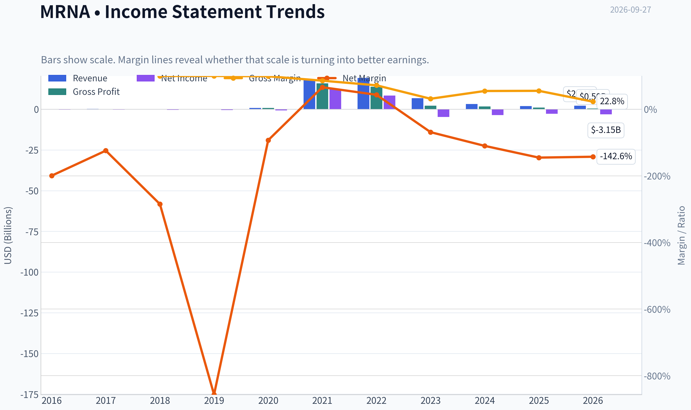

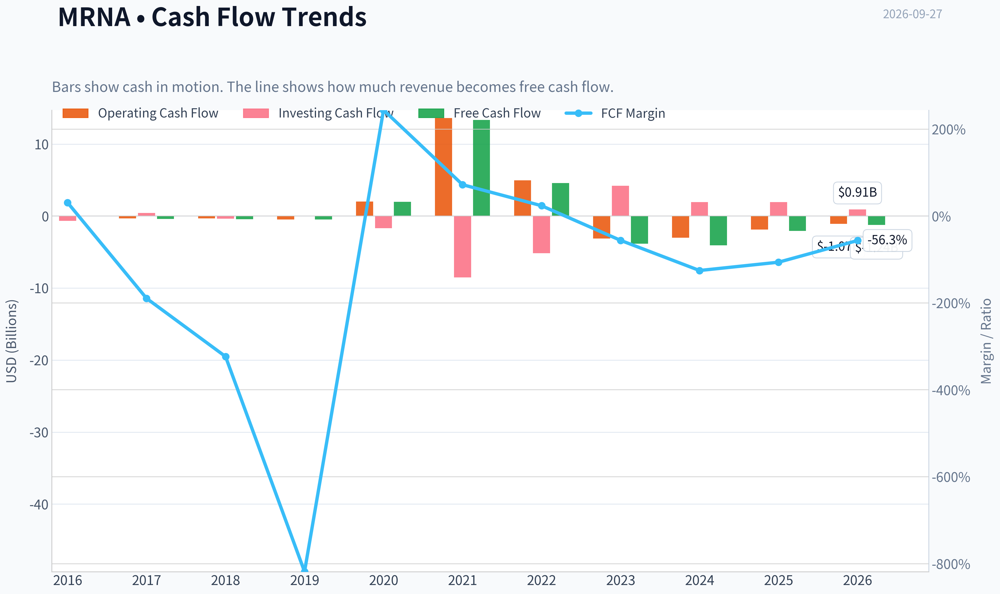

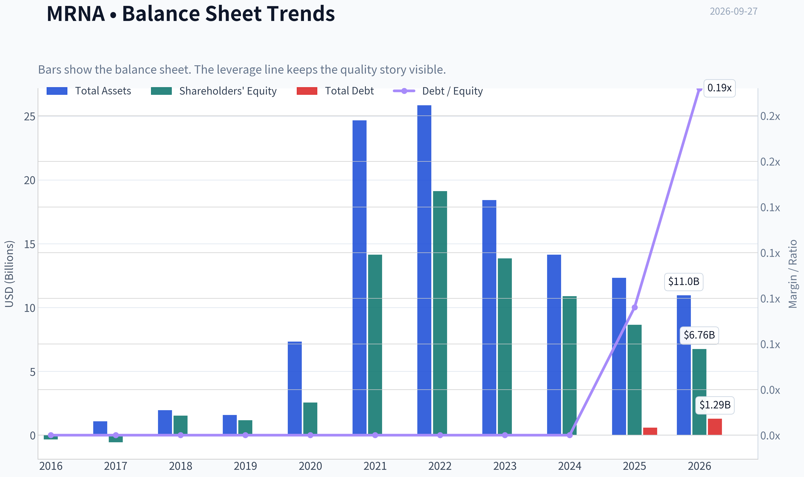

This graph tracks the profitability and return metrics (ROE, ROIC, Margins) of **MRNA** over the past decade, highlighting capital efficiency trends.

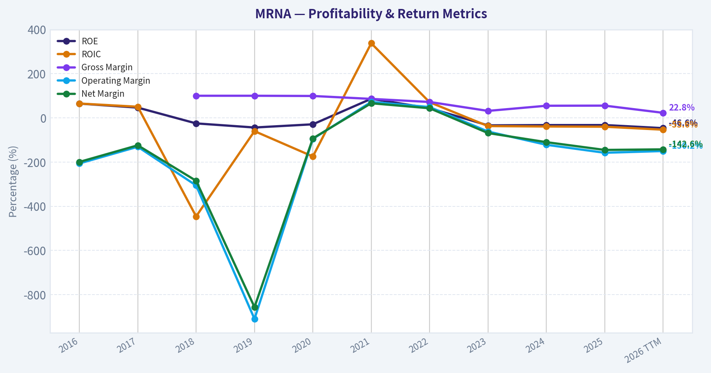

This chart illustrates the financial health of **MRNA** over the last 10 years, mapping cash equivalents and free cash flow against total obligations (Debt).

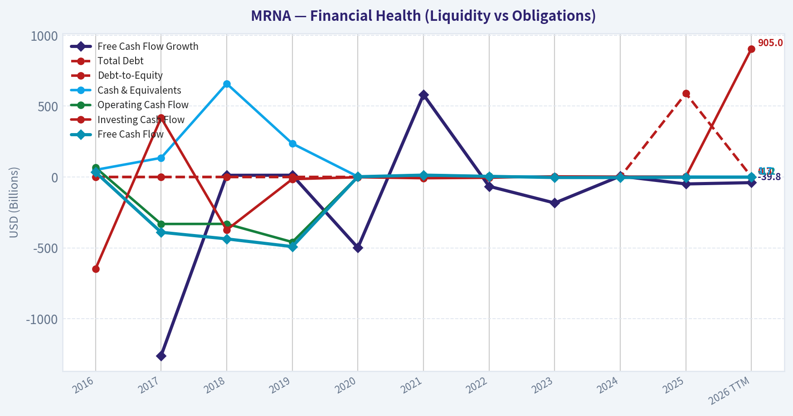

This comparison chart from *Profitability and Operating Performance* stacks current figures against historical benchmarks for **MRNA**, making it easy to see where the company trades relative to its own averages.

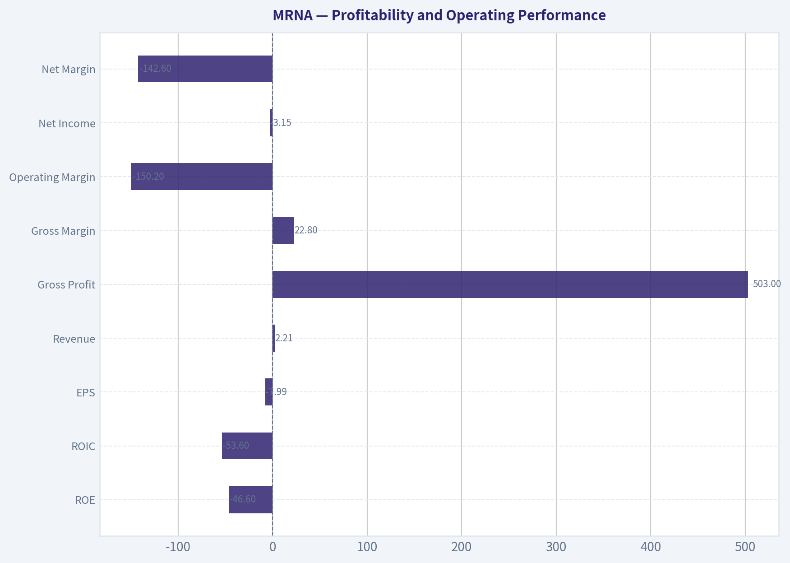

This breakdown chart from <em>Revenue Breakdown</em> shows the proportional composition for **MRNA** - useful for understanding what drives or risks the business.

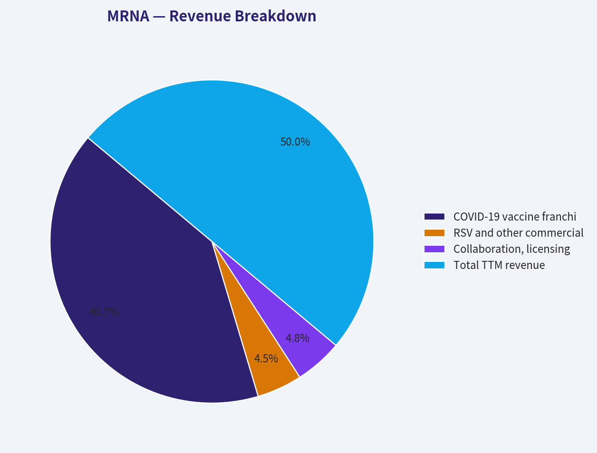

---

### Intrinsic Value Analysis (Buffett)

> *Following Warren Buffett's value investing philosophy: Circle of Competence, Economic Moat, Management Quality, and Margin of Safety.*

#### Intrinsic Value Snapshot

Price is what you pay. Intrinsic value is what the business may be worth based on the cash it can create for owners over time. We show a range, not one magic number.

- Current Price: $198.88
- Value Range (conservative to optimistic across both DCF methods): $415.17 to $1,079.44

##### Owner Earnings (Buffett Method)
- Net Income: $-2,822,000,000.00
- Depreciation & Amortization: $215,000,000.00
- Capital Expenditures: $-192,000,000.00
- Working Capital Changes: $233,000,000.00
- Owner Earnings: $-3,032,000,000.00

##### Intrinsic Value
###### Buffett Method
Uses owner earnings. Stricter, and usually more conservative.
- Conservative: $447.55
- Average: $447.55
- Optimistic: $447.55
- Discount Rate: 10.0%

###### Cash Flow Method
Uses free cash flow. Better for companies spending heavily today to grow tomorrow.
- Conservative: $415.17
- Average: $415.17
- Optimistic: $1,079.44
- Discount Rate: 10.0%

ANALYST STANCE: **AVOID**

#### Executive Summary

Moderna has valuable mRNA technology, substantial gross margins, a large development pipeline, and potentially significant oncology and respiratory opportunities. However, the investment case currently depends on forecasting a successful transition from pandemic-era COVID revenue to a diversified, profitable commercial portfolio.

The headline owner-earnings valuation of $447.55 per share implies substantial upside from the $199 price, but that estimate conflicts sharply with the $415.17 FCF valuation and the negative $331.22 Damodaran FCFF valuation. Current revenue is falling 39.9% year over year, FCF is negative, and ROE is negative. This is an attractive scientific platform but not yet a sufficiently predictable Buffett-style compounder.

#### 1. Factor Scorecard

| Factor | Score | Assessment |
|---|---:|---|
| Circle of competence and simplicity | 2/5 | The basic model-develop and commercialize mRNA medicines-is understandable, but clinical success, regulatory outcomes, patent life, and product adoption make long-term forecasting difficult. |
| Moat | 3/5 | Moderna has proprietary technology, manufacturing know-how, patents, accumulated clinical data, and partnerships. The moat is meaningful but must be continually renewed through successful products. |
| Management and capital allocation | 3/5 | Management has demonstrated exceptional vaccine-development speed and platform-building capability. The current challenge is proving disciplined spending and attractive returns outside COVID products. |
| Industry structure | 2/5 | Biotechnology offers high margins and intellectual-property advantages, but competition is intense, outcomes are binary, and R&D spending is substantial. |

**Gate 5 hard floor:** **Not tripped.** Current earnings and cash flow are weak, but the available evidence does not establish both financial distress and a solvency red line. The company's current ratio of 3.29 indicates substantial short-term liquidity.

#### 2. Moat Analysis

| Moat source | Evidence | Assessment |
|---|---|---|
| Intangible assets | mRNA platform, patents, clinical expertise, regulatory knowledge, and manufacturing capabilities | Strong but dependent on continued innovation |
| Switching costs | Limited for patients and physicians; higher for manufacturing partners and internal development workflows | Moderate |
| Cost advantage | Scale and accumulated know-how may reduce development and manufacturing friction | Not yet proven as a durable cost advantage |
| Network effects | No classic consumer or software network effect | Weak |
| Pipeline breadth | COVID, RSV, oncology, personalized cancer vaccines, and other therapeutic programs | Creates optionality but also raises execution risk |

The recent melanoma vaccine success, developed with Merck, improves the long-term opportunity set. It does not yet establish a broad, recurring commercial moat. Moderna's moat should therefore be classified as **narrow, with potential to widen if oncology and respiratory programs become durable products**.

#### 3. Management Quality Assessment

Moderna's management deserves credit for creating and commercializing one of the fastest-developed vaccine platforms in history. The company also built manufacturing and regulatory capabilities that could be reused across multiple therapeutic areas.

The capital-allocation test is less favorable today. Moderna is spending heavily while COVID revenue declines, and the eventual return on that investment depends on a pipeline that has not fully matured. The key management question is whether R&D can be converted into recurring per-share cash flow rather than simply expanding the pipeline.

The UAE manufacturing and R&D discussions could improve international scale, but they should not be treated as evidence of economic value until the terms, investment requirements, and expected returns are clear.

#### 4. Financial Summary

| Metric | Latest available figure |
|---|---:|
| Share price | $199 |
| Market capitalization | $79.40 billion |
| Revenue growth, year over year | -39.9% |
| Gross margin | 55.3% |
| ROE | -32.6% |
| P/E | Not meaningful |
| FCF yield | -2.6% |
| Implied latest FCF | Approximately -$2.06 billion |
| Current ratio | 3.29 |
| Headline intrinsic value | $447.55 |
| Owner-earnings / FCF / FCFF valuation spread | $447.55 / $415.17 / -$331.22 |

**Key Takeaways:** Moderna retains a healthy gross margin and strong short-term liquidity, but its current financial profile is deteriorating. Negative FCF and negative ROE make conventional earnings-based valuation unusable today. The exceptionally wide valuation spread shows that normalized cash-flow assumptions, rather than current results, drive the bullish valuation.

#### 5. Owner Earnings Calculation

The Buffett owner-earnings framework is:

| Component | Current assessment |
|---|---:|
| Net income | Negative or economically depressed |
| Depreciation and amortization | Added back in the calculation |
| Maintenance capital expenditure | Deducted |
| Working-capital investment | Deducted |
| Current-cycle owner earnings proxy | Negative, consistent with negative FCF |
| Normalized owner earnings used by headline DCF | Implied by the $447.55 valuation |

Moderna's current negative FCF yield implies approximately **-$2.06 billion of latest FCF**, calculated as:

\[
-\!2.6\% \times \$79.40\text{ billion} \approx -\$2.06\text{ billion}
\]

Because current cash generation is negative, the $447.55 valuation is a **normalized owner-earnings estimate**, not a valuation supported by present-period cash flow. The thesis therefore requires a substantial recovery in product revenue and operating cash generation.

#### 6. Three-Scenario DCF Valuation

| Scenario | Method | Indicative result |
|---|---|---:|
| A. No growth | Current negative FCF capitalized at 10% | Approximately -$51.74 per share |
| B. GDP growth | Current negative FCF grown at 3%, capitalized at 10% | Approximately -$73.91 per share |
| C. Normalized historical/pipeline growth | Recovery to sustainable commercial owner earnings | $447.55 per share headline estimate |
| Cross-check: FCF model | Independent normalized FCF valuation | $415.17 per share |
| Cross-check: Damodaran FCFF | More conservative FCFF valuation | -$331.22 per share |

**Key Takeaways:** The conservative scenarios based on current cash flow produce negative values because Moderna is presently consuming cash. The bullish valuation requires a successful normalization of earnings from future products. The large gap between the positive owner-earnings models and the negative FCFF model makes the valuation highly assumption-sensitive.

#### 7. Margin of Safety Analysis

Against the $447.55 headline intrinsic value:

\[
\text{Margin of Safety} =
\frac{447.55-199}{447.55}
\approx 55.6\%
\]

That appears attractive in isolation. However, the three-model valuation range extends from **-$331.22 to $447.55**, indicating that the apparent margin of safety is not robust. For a high-ROIC, predictable compounder, a 10% to 15% discount might be sufficient. Moderna does not currently meet that quality standard because revenue is contracting sharply, FCF is negative, and future value depends on clinical and commercial execution.

At $199, the market is not pricing Moderna as a failed company, but it is also not demanding the type of discount normally required for a cyclical, pipeline-dependent business.

#### 8. Final Buffett Scorecard

| Criterion | Weight | Score | Weighted score |
|---|---:|---:|---:|
| Moat width and durability | 25% | 3/5 | 0.75 |
| Valuation and margin of safety | 20% | 2/5 | 0.40 |
| Capital returns: ROIC versus WACC | 15% | 1/5 | 0.15 |
| Business understanding and predictability | 12% | 2/5 | 0.24 |
| Management quality and capital allocation | 12% | 3/5 | 0.36 |
| Reinvestment runway | 8% | 4/5 | 0.32 |
| Balance-sheet strength | 4% | 4/5 | 0.16 |
| Industry structure | 4% | 2/5 | 0.08 |
| **Total** | **100%** |  | **2.46/5** |

#### 9. Investment Stance

**AVOID - Medium conviction**

Moderna is a scientifically impressive platform with substantial upside if oncology, RSV, and other pipeline products become commercially successful. Its balance sheet and technology provide time to execute, and the long-term opportunity is real.

But Buffett-style investing requires dependable owner earnings and reasonable confidence in future economics. Moderna currently offers neither: cash flow is negative, revenue is falling, returns on equity are negative, and intrinsic value depends heavily on normalization assumptions. The company becomes more interesting if it demonstrates several consecutive periods of positive operating cash flow, reduced dependence on COVID products, and clear evidence that pipeline spending is producing high-return commercial assets.
#### Valuation Bridge

This bridge places the current market price beside each intrinsic value lens so readers can see whether upside depends on one method or shows up across several methods.

| Scenario | Intrinsic Value / Share |
| --- | ---: |
| Buffett Method | $447.55 |
| Cash Flow Method | $415.17 |
| Damodaran Method | $-331.22 |
| Current Price | $198.88 |

#### Key Takeaways

If one method is far above the others, the upside case depends on a specific modelling assumption. When several methods cluster together, the valuation story is more robust.

#### Valuation Visuals

This comparison chart from *Latest Earnings Snapshot* stacks current figures against historical benchmarks for **MRNA**, making it easy to see where the company trades relative to its own averages.

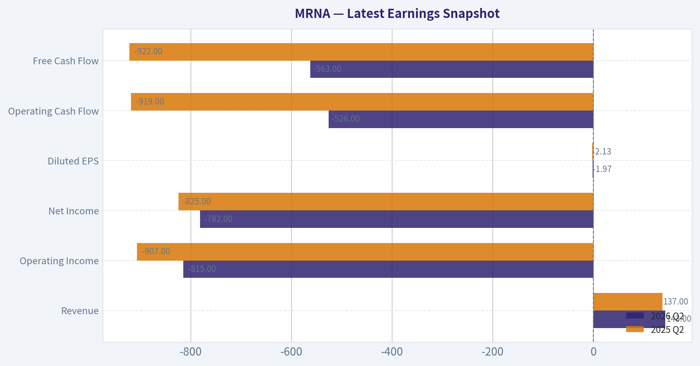

This comparison chart from *Balance Sheet and Financial Strength* stacks current figures against historical benchmarks for **MRNA**, making it easy to see where the company trades relative to its own averages.

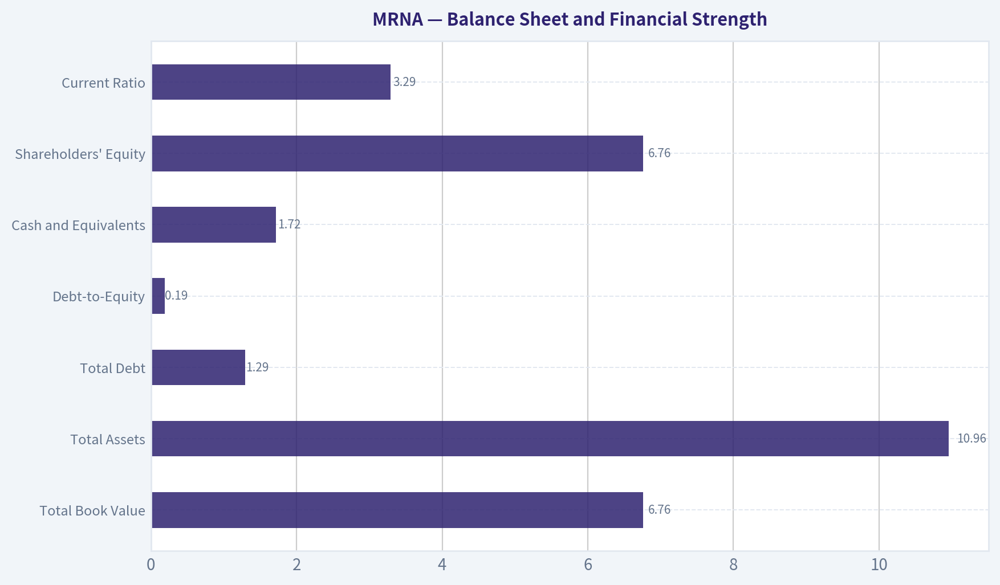

This comparison chart from *Cash Flow and Capital Allocation* stacks current figures against historical benchmarks for **MRNA**, making it easy to see where the company trades relative to its own averages.

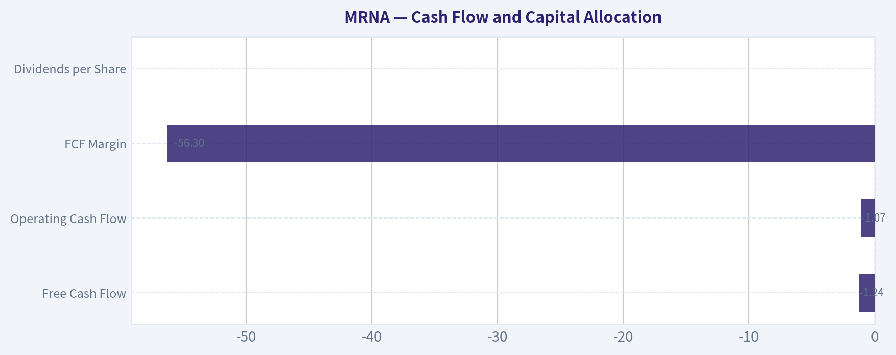

---

### Trend & Growth Analysis (Lynch/Druckenmiller/Fisher)

> *Following Peter Lynch's GARP, Stanley Druckenmiller's macro-aware approach, and Philip Fisher's scuttlebutt methodology.*

ANALYST STANCE: **WATCH**

#### 1. Lynch Classification

**Turnaround with cyclical characteristics and fast-growth optionality.**

Moderna is not currently a Lynch "fast grower." Revenue is declining sharply after the COVID-vaccine peak, profitability is negative, and the investment case depends on successful commercialization of its pipeline. It could become a fast grower again if oncology, respiratory vaccines, and international partnerships create a new revenue base.

#### 2. The Story in Three Bullets

- **Platform reuse:** Moderna's mRNA technology may support multiple vaccines and therapeutics rather than a single COVID product.
- **Pipeline reset:** Positive Phase 3 melanoma-vaccine results with Merck and Keytruda could become an important oncology inflection point.
- **Large unmet markets:** Cancer vaccines, influenza, RSV, CMV, and other infectious diseases provide substantial potential markets, although most remain execution-dependent.

#### 3. Current Fundamental Snapshot

| Metric | Value | Interpretation |
|---|---:|---|
| Share price | $199 | Current reference price |
| Market capitalization | $79.4 billion | Large-cap biotechnology valuation |
| Revenue growth, year over year | -39.9% | Severe post-COVID contraction |
| Gross margin | 55.3% | Positive, but below prior pandemic-era economics |
| P/E | N/A | Company is not currently profitable |
| ROE | -32.6% | Negative shareholder returns from losses |
| FCF yield | -2.6% | Cash generation is currently negative |
| Current ratio | 3.29 | Strong short-term liquidity |
| Headline intrinsic value | $447.55 | Highly model-sensitive estimate |
| Margin of safety versus headline value | 55.6% | Not reliable without normalized earnings |

**Key Takeaways:** Moderna has a strong liquidity position but is operating through a major earnings reset. The negative revenue growth, negative free cash flow, and lack of earnings make conventional GARP valuation inappropriate today. The headline intrinsic value is potentially misleading because it assumes a successful recovery and conflicts with a negative FCFF valuation.

#### 4. TAM and the 10x Test

| Area | Growth opportunity | 10x assessment |
|---|---|---|
| COVID vaccines | Matured and competitive | Unlikely to support a 10x corporate outcome alone |
| RSV, influenza, and CMV | Large vaccine markets | Meaningful incremental opportunity if products gain share |
| Personalized cancer vaccines | Very large potential market | Potentially transformational, but clinical and commercial risk is high |
| mRNA platform partnerships | Broad pharmaceutical applications | Could expand TAM, though monetization is uncertain |
| International manufacturing and access | Expands geographic reach | Positive strategic option, not yet a proven revenue engine |

The exact current revenue base and segment-level market shares were not available in the supplied data, so a precise numerical 10x revenue test cannot be completed. Conceptually, **yes**, Moderna could grow substantially while remaining below 20% share of the combined oncology and infectious-disease opportunity. However, a 10x outcome would require several products to succeed; it cannot be justified by the COVID franchise alone.

#### 5. Revenue Growth Trend

| Period or indicator | Direction | Analyst interpretation |
|---|---|---|
| Current year-over-year revenue | -39.9% | Sharp contraction |
| COVID product contribution | Declining | Structural normalization after pandemic demand |
| Pipeline revenue | Emerging | Not yet large enough to offset the decline |
| Oncology visibility | Improving | Phase 3 melanoma result is a potential catalyst |
| Overall growth pattern | Decelerating/resetting | No confirmed broad reacceleration yet |

**Key Takeaways:** The current pattern is decelerating rather than accelerating. The key question is whether new products can create a revenue trough and reacceleration over the next two to three years. At present, that inflection is possible but not yet demonstrated in reported financial results.

#### 6. Unit Economics and Inflection Assessment

| Measure | Status | Assessment |
|---|---|---|
| LTV/CAC | Not disclosed | Cannot reliably calculate |
| Net revenue retention | Not applicable | Product sales are primarily pharmaceutical, not SaaS |
| Rule of 40 | Not meaningful | Negative growth and negative FCF make the metric unfavorable |
| Gross margin | 55.3% | Provides economic value, but may vary significantly by product mix |
| Operating leverage | Unproven | R&D and commercialization costs remain substantial |
| Balance-sheet runway | Strong liquidity | Current ratio of 3.29 reduces near-term financing risk |

**Key Takeaways:** Moderna does not have subscription-style unit economics, so LTV, NRR, and Rule of 40 are not the right primary tools. The balance sheet appears capable of funding the pipeline, but the central economic issue is whether future products can generate attractive returns on the company's large R&D investment.

**Potential inflection points:**

1. **Product inflection:** Successful launch of the personalized melanoma vaccine.
2. **Pipeline inflection:** Positive late-stage data from additional respiratory and infectious-disease programs.
3. **Revenue inflection:** Several consecutive quarters showing stabilization and then growth.
4. **Margin inflection:** Reduced operating losses as commercial products scale.
5. **Strategic inflection:** UAE or other international partnerships that provide capital, manufacturing scale, or distribution.

The melanoma result is encouraging, but one successful program does not yet establish a company-wide inflection.

#### 7. Macro Setup

| Macro factor | Effect on MRNA | View |
|---|---|---|
| Interest rates | Higher rates reduce the value of distant pipeline cash flows | Headwind if rates remain elevated |
| Biotechnology funding | Weak funding conditions can pressure development valuations | Moderate headwind |
| Healthcare innovation | Supports vaccine and oncology development | Secular tailwind |
| Pandemic normalization | Reduces COVID revenue | Major current headwind |
| Geopolitical and supply-chain localization | Can support regional manufacturing partnerships | Potential tailwind |

**Key Takeaways:** Moderna has a long-term secular innovation tailwind but is fighting a near-term post-pandemic revenue headwind. The stock is more attractive in a falling-rate environment or after clear evidence that pipeline revenue is replacing COVID revenue.

#### 8. Fisher 15-Point Assessment

| Fisher criterion | Score / 5 | Comment |
|---|---:|---|
| Market potential | 5 | Vaccines and oncology are very large markets |
| New-product determination | 5 | Extensive pipeline and platform investment |
| R&D effectiveness | 4 | Strong scientific platform, uneven commercial validation |
| Sales organization | 3 | Commercial execution is still being proven outside COVID |
| Profit margins | 2 | Currently negative earnings and cash flow |
| Margin trend | 2 | No confirmed improvement yet |
| Labor relations | 3 | No decisive evidence supplied |
| Executive relations | 3 | No decisive evidence supplied |
| Management depth | 4 | Significant scientific and operating capabilities |
| Cost analysis/accounting | 3 | No major conclusion from supplied data |
| Outstanding competitive aspects | 4 | Platform, know-how, and manufacturing capabilities |
| Long-range profit outlook | 4 | Attractive if multiple pipeline products succeed |
| Dilution risk | 4 | Strong liquidity reduces immediate financing pressure |
| Management candor | 3 | Requires continued monitoring through the reset |
| Management integrity | 3 | No specific negative evidence supplied |

**Total Fisher score: 52 / 75 - Average, with substantial upside optionality.**

**Key Takeaways:** Moderna scores well on market potential, R&D ambition, and platform advantages. It scores poorly on current margins and demonstrated commercial execution. The result is an interesting but unproven pipeline company rather than a high-confidence compounder.

#### 9. Valuation Analysis

| Method | Result | Reliability |
|---|---:|---|
| P/E and PEG | Not available | Company has no meaningful positive earnings base |
| Current price-to-sales | Not calculable from supplied data | Revenue denominator not provided |
| Headline owner-earnings value | $447.55 | Aggressive if normalized earnings do not recover |
| FCF-based value | $415.17 | Also dependent on future cash-flow recovery |
| Damodaran FCFF value | -$331.22 | Highlights the sensitivity to negative current cash flow |
| Current market value | $79.4 billion | Requires significant pipeline success |

**Key Takeaways:** The valuation range is exceptionally wide, from negative value under a current-cash-flow framework to more than twice the share price under recovery models. This is not a conventional PEG opportunity; it is a probability-weighted pipeline and turnaround valuation. The stock may be cheap if Moderna rebuilds a large commercial franchise, but expensive if the pipeline merely offsets part of the COVID decline.

**Scenario framework:**

- **Bear case:** COVID revenue continues declining, pipeline launches are delayed or commercially modest, and losses persist. The stock could suffer significant downside because the current valuation assumes substantial future success.
- **Base case:** A few respiratory products and oncology programs become commercial, revenue stabilizes, and profitability gradually returns. This could support a reasonable long-term return, but probably with substantial volatility.
- **Bull case:** Personalized cancer vaccines scale successfully, multiple vaccine launches work, and Moderna's platform becomes a repeatable multi-product engine. This is the path toward multi-bagger potential, though it requires several binary successes.

#### 10. Growth Investor Scorecard

| Criterion | Weight | Score / 5 |
|---|---:|---:|
| Lynch story | 10% | 3.5 |
| TAM and runway | 20% | 4.5 |
| Revenue growth | 20% | 1.5 |
| Unit economics | 15% | 2.5 |
| Competitive position | 10% | 4.0 |
| Management quality | 10% | 3.5 |
| Macro setup | 5% | 3.0 |
| Profitability path | 5% | 2.5 |
| Valuation | 5% | 3.0 |
| **Weighted total** | **100%** | **2.9 / 5.0** |

**Key Takeaways:** Moderna's score is held back by collapsing revenue, negative cash flow, and uncertain profitability. Its scientific platform and TAM prevent an outright avoid classification, but the current evidence does not support high-conviction growth-investor ownership.

#### 11. Position Size Stance

**Watch / speculative position only.**

- **New position:** 0% to 1% of portfolio, only for investors comfortable with clinical and commercialization risk.
- **Existing position:** Hold a modest position while monitoring pipeline execution.
- **High-conviction allocation:** Not justified until revenue stabilizes, operating losses narrow, and at least one major non-COVID product demonstrates commercial traction.

#### 12. Key Risks and Catalysts

| Catalysts | Risks |
|---|---|
| Melanoma vaccine approval and successful launch | Continued COVID revenue collapse |
| Positive results from additional late-stage programs | Clinical failure or regulatory delays |
| Multiple product launches in respiratory vaccines | Commercial competition from established pharmaceutical companies |
| UAE or other strategic manufacturing partnerships | High R&D and commercialization spending |
| Revenue stabilization followed by reacceleration | Persistent negative free cash flow |
| Falling interest rates | Pipeline value overly dependent on optimistic assumptions |

**Key Takeaways:** The strongest catalyst is evidence that oncology and respiratory products can replace the declining COVID franchise. The principal risk is not simply one failed trial, but a sustained inability to convert scientific capability into a diversified, profitable commercial portfolio.

#### Final Assessment

Moderna offers **large TAM and genuine platform optionality**, but it currently fails the core fast-grower test because revenue is shrinking nearly 40% year over year and cash flow is negative. The company could become a major biotechnology compounder if its pipeline produces several successful products, but the investment today is a **high-risk turnaround speculation**, not a proven GARP opportunity.

**Stance: WATCH.** Reconsider toward **ADVOCATE** only after visible revenue reacceleration, improving cash flow, and commercial validation beyond COVID.

---

### Market Technical Analysis

ANALYST STANCE: **WATCH**

#### MRNA technical market report

MRNA closed at **$198.88 on September 25, 2026**, the latest available trading session in the retrieved data. The stock has displayed an exceptionally strong but highly unstable advance: it rose from approximately **$62.96 on August 18 to $198.88 on September 25**, a gain of roughly **216% in 27 trading sessions**. The move was accompanied by extraordinary volume, especially on August 19, when approximately **199 million shares** traded.

However, the data contains a major structural warning. MRNA moved from a close of **$63.32 on August 14** to **$174.38 on August 19**, while the reported share price and volume characteristics changed dramatically. This may reflect a corporate action, split-related adjustment, or a data-series discontinuity. Consequently, conventional moving averages, MACD, RSI, ATR, and VWMA calculations may be unreliable unless the entire historical series is consistently adjusted. The indicator-report tool also returned mostly unavailable values, so the analysis below emphasizes observable price and volume behavior rather than presenting unsupported indicator readings.

#### Price trend and momentum

The primary trend is decisively bullish on the short and intermediate horizons. After reaching a low near **$133.32 on August 20**, MRNA established several higher lows and higher highs:

- August 20 low: approximately **$128.61**
- August 28 low: approximately **$133.33**
- September 9 low: approximately **$135.52**
- September 18 low: approximately **$150.26**
- September 25 close: **$198.88**

The sequence shows persistent demand, although the most recent acceleration is becoming increasingly steep. From September 8 through September 25, the stock advanced from approximately **$140.33 to $198.88**, or about **42%**. The final week was particularly strong: MRNA rose from **$154.04 on September 18 to $198.88 on September 25**, a gain of approximately **29%**.

Price is also closing near the upper end of its recent daily ranges. On September 25, the stock traded between **$192.51 and $202.67** and closed at $198.88, indicating that buyers retained control into the close. The September 21-25 sequence produced consecutive higher closing prices, from **$172.94 to $182.56, $182.11, $194.82, and $198.88**. This is a strong momentum signature, but it also increases the probability of profit-taking and sharp retracements.

#### Moving-average interpretation

The most relevant moving averages are:

- **close_10_ema:** useful for identifying whether the very short-term impulse remains intact.
- **close_50_sma:** useful for determining whether the broader post-August trend remains constructive.
- **close_200_sma:** useful as a long-term regime filter, but potentially distorted by the apparent corporate-action discontinuity.

Based on the latest sequence of closes, the 10-day EMA would be expected to be materially below the current price, likely in the approximate **$180-$185 area**, although an exact value should not be trusted without a properly adjusted series. A decisive close below that short-term average would indicate that momentum is cooling, not necessarily that the larger trend has reversed.

The 50-day and 200-day averages should be treated cautiously. If the August price discontinuity is caused by a split or adjustment issue, those averages may have little practical meaning. Once the data is normalized, a bullish configuration would be price above the 10 EMA, the 10 EMA above the 50 SMA, and the 50 SMA rising above the 200 SMA. Until then, support and resistance should be based more heavily on actual swing points.

Important observable support zones are approximately:

- **$192-$195:** immediate breakout-retention zone
- **$180-$183:** recent consolidation and closing-support area
- **$158-$160:** prior September swing area
- **$145-$150:** deeper intermediate support

A sustained close below $180 would weaken the near-term breakout structure. A break below $158-$160 would be more consequential because it would undermine the recent pattern of higher lows.

#### MACD and momentum structure

The selected momentum indicators are **macd** and **macdh**. In a normal, consistently adjusted data series, both would likely be strongly positive after the late-August and September advance. The price behavior supports that interpretation: the stock has repeatedly broken above prior highs, and pullbacks have generally been brief.

Nevertheless, momentum is now vulnerable to deceleration. The advance has become nearly vertical, while the most recent candles show widening daily ranges and repeated intraday reversals. This is the type of environment in which the MACD histogram can remain positive while declining, signaling that the trend is still upward but that the rate of acceleration is fading. A bearish MACD crossover would be more meaningful if it occurred alongside a break below the $180-$183 support zone.

Traders should distinguish between:

1. **Momentum slowing:** price remains above support, but MACD histogram contracts.
2. **Trend reversal:** price loses the short-term average and breaks the $180-$183 area.
3. **Structural breakdown:** price falls below approximately $158-$160 with expanding volume.

Only the third condition would substantially challenge the larger post-August bullish structure.

#### RSI interpretation

The **rsi** indicator is appropriate because the recent advance is exceptionally extended. Although the tool did not return a usable numerical RSI reading, the magnitude and persistence of the advance strongly suggest that RSI would be in or near an overbought region on a standard 14-day calculation.

An overbought RSI should not be interpreted as an automatic sell signal. In powerful trends, RSI can remain above 70 for an extended period. The more useful signal would be a bearish divergence: price making a new high near or above $200 while RSI fails to exceed its prior peak. Such divergence would warn of weakening momentum, particularly if accompanied by a close below $192-$195.

For new entries, chasing the stock after the latest surge offers unfavorable risk control. A pullback toward the $180-$183 area, followed by stabilization, would provide a more favorable risk-to-reward setup than buying directly into a near-record close.

#### Volatility and risk management

The selected **atr** indicator is essential because MRNA's recent volatility is unusually high. Daily ranges have frequently been several dollars wide, and some sessions have produced very large percentage moves. On September 22, for example, the stock traded from approximately **$168.30 to $187.20**, while September 24 ranged from **$180.39 to $195.71**.

Because the exact ATR output was unavailable, traders should avoid fixed, tight stops based on small percentage movements. Such stops could be triggered by ordinary MRNA noise. Position sizing should be reduced, and stops should be placed using a volatility-adjusted distance below meaningful technical levels rather than immediately beneath the entry price.

A practical framework would be:

- Aggressive momentum traders: use the $192-$195 area as the first breakout-retention test.
- Pullback traders: monitor $180-$183 for support and reversal evidence.
- Risk-averse traders: wait for a consolidation range to form before entering.
- Existing holders: consider trailing protection beneath a confirmed higher low rather than attempting to predict the exact top.

#### Volume and VWMA

The **vwma** indicator is particularly important here because volume confirms whether the move is supported by meaningful participation. Volume surged dramatically during the apparent August repricing event, with approximately **199 million shares on August 19**, followed by roughly **99 million on August 20** and **87 million on August 21**. September's volume was much lower in absolute terms, generally in the **8-24 million share range**, but remained substantial relative to many earlier sessions.

This creates two competing interpretations:

- The price advance has strong historical volume confirmation because the initial repricing occurred on extraordinary turnover.
- The later advance toward $200 has occurred on lower but still meaningful volume, so continuation would ideally be confirmed by another expansion in volume.

A breakout above $200-$203 on expanding volume would suggest that institutional or speculative demand remains active. Conversely, a move above $200 on declining volume followed by a close back below $192-$195 would increase the probability of a failed breakout. VWMA should be calculated only after resolving the apparent corporate-action adjustment, because the extreme August volume may disproportionately distort the result.

#### Trading conclusion

MRNA's observable price structure is bullish, but the risk profile is no longer low-risk trend following. The stock is extended, volatility is elevated, and the dataset appears to contain a significant adjustment discontinuity. The appropriate stance is therefore **watch**, rather than an outright aggressive buy signal.

The bullish case remains valid while price holds above approximately **$180-$183**, with stronger confirmation if it sustains trade above **$200-$203** on increased volume. A loss of $180 would signal a meaningful cooling of momentum, while a break below $158-$160 would materially damage the intermediate-term structure. Until the historical series is normalized and the indicators produce valid readings, traders should rely on smaller position sizes, volatility-adjusted stops, and confirmation from price and volume rather than blindly following overbought momentum.

| Area | Current interpretation | Practical level or trigger | Trading implication |
|---|---|---:|---|
| Primary trend | Strongly bullish, with higher highs and higher lows | Trend remains constructive above $180-$183 | Favor trend-following only with disciplined risk |
| Short-term momentum | Very strong but increasingly extended | Watch the $192-$195 breakout-retention zone | Failure there could trigger a fast pullback |
| Upside confirmation | Sustained trade above recent highs | Approximately $200-$203 with stronger volume | Would support continuation |
| Intermediate support | Recent consolidation and swing support | Approximately $180-$183 | Loss would indicate momentum deterioration |
| Deeper support | Prior September structure | Approximately $158-$160 | Break would weaken the larger bullish pattern |
| RSI | Likely overbought, but exact reading unavailable | Watch for bearish divergence near new highs | Avoid treating overbought alone as a sell signal |
| Volatility | Exceptionally high and unsuitable for tight stops | Use ATR-style volatility spacing | Reduce position size and widen logical stops |
| Volume and VWMA | Strong participation, but distorted by possible corporate action | Confirm breakouts with expanding volume | Normalize data before relying on VWMA |
| Data quality | Possible split or corporate-action discontinuity | Recalculate indicators on adjusted data | Treat conventional indicator values as provisional |

Key Takeaways: MRNA is in a powerful bullish trend, but the move is unusually extended and volatile. The most important near-term level is the $180 to $183 support zone, while a sustained breakout above $200 to $203 would strengthen the continuation case. Because the historical data appears to contain a corporate-action adjustment issue, traders should use price structure and volume cautiously, reduce position size, and avoid chasing the stock without a defined risk plan.

#### Market Visuals

This comparison chart from *Market Metrics* stacks current figures against historical benchmarks for **MRNA**, making it easy to see where the company trades relative to its own averages.

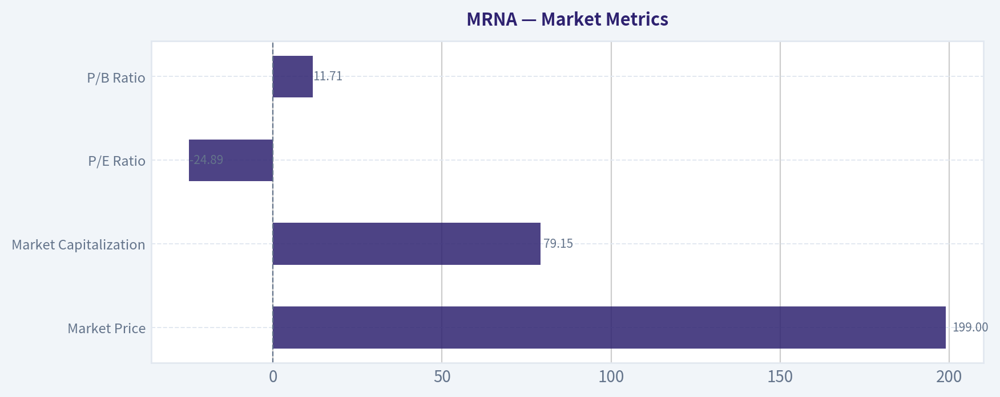

---

### Options Market Analysis

> *Reading options flow - put/call ratios, IV skew, and unusual activity - to gauge institutional positioning and event-driven risk.*

ANALYST STANCE: **BEARISH**

#### MRNA Options Market Overview

Data is for the near-term expirations from October 2 through October 16, 2026. MRNA options show elevated implied volatility and a modestly defensive open-interest profile, although recent trading volume leans slightly toward calls.

| Expiration | Days to Expiry | Call OI | Put OI | Put/Call OI Ratio | Call Volume | Put Volume | ATM Call IV | ATM Put IV |
|---|---:|---:|---:|---:|---:|---:|---:|---:|
| Oct. 2, 2026 | 5 | 25,875 | 27,086 | 1.05 | 20,380 | 13,589 | 83.1% | 82.9% |
| Oct. 9, 2026 | 12 | 7,211 | 4,463 | 0.62 | 1,551 | 1,888 | 81.4% | 80.0% |
| Oct. 16, 2026 | 19 | 40,350 | 50,532 | 1.25 | 6,736 | 10,264 | 80.0% | 78.9% |
| **Total / Overall** | - | **73,436** | **82,081** | **1.12** | **28,667** | **25,741** | - | - |

**Key Takeaways:** Aggregate put open interest is 12% greater than call open interest, materially above the approximately 0.70 neutral baseline. That indicates a defensive or bearish positioning bias, particularly in the October 16 expiration. However, the aggregate put/call volume ratio is 0.90, showing that recent activity is less bearish than the existing open-interest structure.

#### Put/Call Ratio Analysis

The overall put/call OI ratio of 1.12 is the clearest bearish signal in the dataset. The October 2 ratio is near balanced at 1.05, while October 16 has a more substantial put concentration at 1.25. The October 9 expiration is the exception, with a 0.62 ratio that indicates comparatively more call-side positioning.

The elevated put OI may represent outright bearish bets, protective hedges, or both. Without trade-direction data such as bid/ask execution or opening-versus-closing indicators, it is not possible to determine how much of the put open interest is speculative versus portfolio protection.

| Measure | MRNA | Neutral Reference | Interpretation |
|---|---:|---:|---|
| Overall put/call OI ratio | 1.12 | Approximately 0.70 | Defensive to bearish |
| Oct. 2 put/call OI | 1.05 | Approximately 0.70 | Mildly defensive |
| Oct. 9 put/call OI | 0.62 | Approximately 0.70 | Relatively bullish |
| Oct. 16 put/call OI | 1.25 | Approximately 0.70 | Clearly defensive |
| Overall put/call volume | 0.90 | Approximately 0.70 | Slightly put-heavy, but not extreme |

**Key Takeaways:** Open interest is notably more defensive than the historical neutral baseline, led by the October 16 chain. Recent volume is closer to balanced, so the bearish signal comes primarily from accumulated positioning rather than aggressive new put volume. This could reflect hedging rather than a strong directional short thesis.

#### Implied Volatility and Skew

Near-term at-the-money IV is very high, ranging from approximately 79% to 83%. This indicates that the market is pricing substantial movement over the next several weeks. The data does not identify a specific earnings, regulatory, clinical, product, or macro catalyst, so the source of the elevated event risk cannot be confirmed.

| Expiration | ATM Call IV | ATM Put IV | Put Minus Call IV | Skew Read |
|---|---:|---:|---:|---|
| Oct. 2 | 83.1% | 82.9% | -0.2 percentage points | Essentially neutral |
| Oct. 9 | 81.4% | 80.0% | -1.4 percentage points | Slight call-side premium |
| Oct. 16 | 80.0% | 78.9% | -1.1 percentage points | Slight call-side premium |

**Key Takeaways:** ATM volatility is elevated across every near-term expiration, signaling high expected price movement and relatively expensive options. The available ATM skew is not bearish; puts are slightly cheaper than calls at the money. This suggests that the defensive open interest is not being reinforced by an especially steep ATM put-volatility premium.

The available out-of-the-money contracts show a stronger upside-volatility skew. The October 2 $220 call has 89.2% IV, and the $245 call has 100.6% IV, compared with 81.5% for the $180 put and 79.1% for the October 2 $200 put. That pattern is consistent with upside speculation or demand for upside convexity, although it does not overturn the more defensive open-interest signal.

#### Unusual Options Activity

The feed identifies contracts with volume greater than five times open interest and at least 500 contracts of volume. Because the current MRNA share price was not included in the returned data, exact ITM, ATM, or OTM classification cannot be verified. The strike locations below should therefore be interpreted relative to the unknown spot price.

| Expiration | Contract | Strike | Volume | Open Interest | Volume/OI | IV | Positioning Interpretation |
|---|---|---:|---:|---:|---:|---:|---|
| Oct. 2 | Call | $197.50 | 3,185 | 160 | 19.9x | 83.8% | Largest fresh call flow; bullish or upside-hedging interest |
| Oct. 2 | Call | $220.00 | 2,741 | 416 | 6.6x | 89.2% | Upside speculation; elevated call IV |
| Oct. 2 | Put | $180.00 | 2,128 | 288 | 7.4x | 81.5% | Downside protection or bearish speculation |
| Oct. 16 | Put | $200.00 | 616 | 88 | 7.0x | 79.1% | Fresh downside hedge or bearish positioning |
| Oct. 2 | Call | $245.00 | 557 | 83 | 6.7x | 100.6% | Longer-shot upside speculation; very expensive volatility |

**Key Takeaways:** The most prominent unusual trade is the October 2 $197.50 call, with volume nearly 20 times open interest. There is also meaningful upside call activity at $220 and $245, but the chain contains fresh put activity at $180 and October 16 $200 as well. The combination suggests a highly volatile, two-sided market rather than a clean institutional bullish bet.

The $245 call's 100.6% IV indicates that traders are paying a substantial premium for upside exposure. That type of far-wing call activity is often more consistent with speculative or lottery-style positioning than with a conventional low-cost hedge, although execution data is needed to distinguish retail buying from institutional spread activity.

#### Open Interest Concentration and Potential Gamma Effects

The largest concentration is in the October 16 expiration, which has 40,350 call contracts and 50,532 put contracts. The October 2 expiration is also active, with more than 52,000 contracts of combined open interest and more than 33,000 contracts of volume.

| Expiration | Combined OI | Share of Reported OI | Market-Structure Implication |
|---|---:|---:|---|
| Oct. 2 | 52,961 | 34.1% | Near-term pinning and fast gamma effects |
| Oct. 9 | 11,674 | 7.5% | Relatively light influence |
| Oct. 16 | 90,882 | 58.4% | Dominant near-term OI concentration |
| **Total** | **155,517** | **100%** | - |

**Key Takeaways:** October 16 is the dominant expiration and is the most likely to influence price behavior through hedging flows and potential pinning. October 2 may produce sharper short-dated gamma effects because of its high volume and very limited time to expiry. Strike-level open interest was not provided, so specific gamma walls, max-pain strikes, and exact gravitational price levels cannot be identified.

#### Overall Options Sentiment

| Signal Component | Assessment | Confidence |
|---|---|---|
| Put/call open interest | Bearish or defensive; 1.12 overall | Moderate |
| Recent volume | Slightly call-favored; 0.90 put/call volume | Low to moderate |
| ATM IV | Very elevated, approximately 79%-83% | High |
| IV skew | Mild call skew in the supplied data | Moderate |
| Unusual activity | Strong two-sided activity, with notable calls and puts | Moderate |
| Liquidity | Active near-term chain, but strike-level data is incomplete | Moderate |
| **Overall signal** | **BEARISH, with high-volatility and upside-speculation caveats** | **Moderate-low** |

**Key Takeaways:** The overall signal is bearish because put open interest is materially above the neutral baseline, especially in the largest October 16 expiration. That bearish read is tempered by heavy fresh call activity and a mild call-side volatility skew, which indicate that traders are also paying for upside exposure. The best characterization is defensive bearish positioning in a very high-volatility market, rather than an outright one-sided bearish trade.

#### Summary

| Category | Assessment |
|---|---|
| Put/Call Ratio | Overall OI ratio of 1.12, above the approximately 0.70 neutral baseline; defensive/bearish |
| IV Level | Very elevated; near-term ATM IV approximately 79%-83% |
| Skew Direction | Mild call skew in the supplied IV data; upside options are relatively expensive |
| Unusual Activity | Large October 2 calls at $197.50 and $220, plus fresh puts at $180 and October 16 $200 |
| Overall Signal | **BEARISH**, but with significant two-sided volatility and upside-speculation risk |

**Key Takeaways:** MRNA options favor a bearish interpretation based on open-interest concentration, despite recent call-heavy activity in several unusual contracts. Elevated IV means directional trades are expensive and price swings could be unusually large. Confidence is moderate-low because the spot price, strike-level OI, trade-side information, and any specific catalyst were not provided.

---

## Research Team Commentary

> *The Research Manager synthesizes the Bull vs Bear debate into action-free commentary. This is a pre-risk view, not the final stance.*

Core takeaway: Moderna is scientifically credible but not yet economically proven, and at $199 the stock lacks the margin of safety required for a cash-burning, clinically dependent business. The bull case has real merit-especially the reusable mRNA platform, the Merck-partnered melanoma program, and potential respiratory diversification-but the available evidence does not establish predictable owner earnings or a durable non-COVID moat. I would not buy it today, but I would classify it as WATCH rather than make a categorical bearish call.

The strongest bull argument is that current financial results may understate normalized economics. Moderna is transitioning away from extraordinary pandemic revenue while continuing to fund infrastructure and multiple late-stage programs. Its 55.3% gross margin suggests potentially attractive product-level economics, and success in oncology would validate the platform far beyond seasonal vaccines. The Merck partnership adds scientific credibility and commercial capability, while opportunities in RSV, influenza, CMV, COVID, and oncology provide more shots on goal than a typical single-asset biotechnology company. If several products share the same research, regulatory, and manufacturing infrastructure, operating leverage could eventually be substantial.

That optionality should not be dismissed merely because Moderna is modern, research-intensive, or asset-light. Intellectual property, clinical data, manufacturing expertise, and platform learning can form a real moat. The market could be undervaluing the company if the melanoma program succeeds and the respiratory portfolio replaces a meaningful portion of declining COVID revenue.

The strongest bear argument is that scientific capability has not yet become a proven economic moat. Revenue is declining 39.9%, while ROIC is negative 91.1%, ROE is negative 32.6%, and ROA is negative 22.9%. These are not merely cosmetic accounting metrics. They show that the commercial base currently cannot support the company's research and infrastructure spending.

Pipeline breadth also does not provide complete diversification. The programs remain correlated through Moderna's platform, management, manufacturing system, regulatory execution, and capital requirements. Positive clinical data must still lead to approval, reimbursement, adoption, competitive differentiation, and satisfactory retained economics after partner sharing. Merck's involvement improves the probability of execution, but it does not tell us how much value will ultimately accrue to Moderna shareholders.

Valuation is where the bull case becomes least convincing. The values ranging from negative $331 to approximately $415-$448 per share demonstrate extreme model sensitivity. The two positive values likely assume substantial normalization of revenue, margins, and free cash flow; they should not be treated as observable intrinsic value. The negative FCFF result is not a literal equity value because of limited liability, but it correctly warns that persistent cash consumption can erode the value of the platform.

The bull's $262 probability-weighted estimate implies approximately 32% upside from $199. Even if accepted, that discount is not especially generous for a company with binary clinical risks, deeply negative returns, uncertain runway, and little earnings predictability. Under a quality-scaled margin-of-safety framework, an unproven biotechnology platform should generally require closer to a 40-50% discount to a conservatively underwritten value. More conservative scenario weights produce values around $189-$206, effectively leaving no margin of safety.

There is also no defensible reverse DCF in the supplied material because the underlying cash-flow assumptions are unavailable. Qualitatively, however, the implication is clear: $199 requires Moderna to achieve material non-COVID commercialization, improve operating leverage, and eventually produce durable positive free cash flow. The existing economics do not support the price independently of pipeline success.

Management deserves credit for reinvesting pandemic proceeds, pursuing multiple large markets, and partnering where external capabilities add value. But capital allocation should be judged by realized probability-adjusted returns, not pipeline size or strategic ambition. Management has not yet demonstrated that it will prune weak programs quickly, resize the pandemic-era cost structure, and reach commercial milestones before cash burn creates dilution risk. Exact cash, debt, burn, and runway figures are missing, so neither financial distress nor financial strength can be confidently asserted.

The contrarian opportunity would arise if investors are treating the COVID revenue decline as permanent evidence that the entire platform has failed, while oncology and respiratory evidence continues to improve. Conversely, optimism would be misplaced if the market is capitalizing every pipeline program as though successful clinical results automatically produce blockbuster economics. At $199, after rising roughly 47-55% from the cited August and September lows, the stock is no longer priced like an abandoned asset. It needs continued fundamental validation.

The options market's elevated volatility and put-heavy open interest indicate event risk and defensive positioning, not intrinsic value. Recent call activity and the recovery from the lows mean I would not use the fundamental concerns as a short-term bearish trading signal. This directly incorporates the lesson from the earlier Tesla calls: a weak long-term valuation case does not mean the stock must decline over the next 30 days. Clinical catalysts can overwhelm valuation temporarily and in either direction.

Rationale: Moderna does not presently meet Buffett-style standards for a predictable compounder, and the proposed upside does not adequately compensate for the uncertainty. Still, AVOID would overstate what can be concluded from incomplete balance-sheet information and highly dispersed valuation estimates. The company possesses valuable assets and potentially transformative catalysts, so the appropriate posture is to observe rather than dismiss it permanently. WATCH here means no new value-oriented position at $199, not a recommendation to short the shares.

Monitoring plan: Over the next one to four quarters, I would focus first on oncology milestones, including regulatory progress, the durability of the melanoma data, the likely approved population, commercialization timing, and Moderna's retained economics under the Merck arrangement. Any delay, safety issue, weaker efficacy evidence, or narrowing commercial opportunity would materially weaken the thesis.

Second, watch respiratory commercialization rather than relying on pipeline announcements. Non-COVID product revenue, market share, pricing, repeat demand, and evidence that multiple products can use shared infrastructure are the critical tests. Meaningful growth from more than one non-COVID product would strengthen the platform argument; weak adoption would suggest that scientific breadth is not translating into an economic moat.

Third, track operating expenses and cash burn every quarter. The thesis improves if revenue stabilizes while R&D and selling costs become more focused, operating cash burn declines for multiple quarters, and management clearly terminates low-priority programs. It weakens if spending remains elevated despite missed milestones or declining pipeline productivity.

Fourth, quantify financial runway. Cash and investments, debt, contractual commitments, quarterly cash consumption, and likely launch spending should provide at least several years of funding for priority programs without material dilution. A shortening runway ahead of major approvals would be a significant warning.

Finally, look for a credible bridge to positive free cash flow and improving incremental returns on capital. Gross margin alone is insufficient. An upgrade toward ADVOCATE would require commercial diversification, narrowing losses, disciplined capital allocation, adequate liquidity, and either a more reliable intrinsic-value estimate or a substantially larger price discount. Repeated clinical setbacks, persistent revenue contraction, uncontrolled burn, or financing pressure would move the stance toward AVOID.

Final stance: WATCH.

---

## Value Investing Team Commentary

> *The Investor translates the research view into an investment thesis before risk review. This is still not the final stance.*

### Investment Commentary

Moderna is best viewed as a well-financed scientific platform seeking proof that its technology can become a durable, diversified business. The distinction matters: impressive science and a broad pipeline are valuable, but neither automatically produces predictable owner earnings.

### Business quality and earnings power

The current economics do not meet the standard of a proven long-term compounder:

- Revenue is declining **39.9% year over year**.
- ROIC is **-91.1%**, ROE is **-32.6%**, and ROA is **-22.9%**.
- The **55.3% gross margin** indicates potentially attractive product-level economics, but those economics are presently overwhelmed by research, commercial, and infrastructure costs.

The pandemic demonstrated that Moderna can develop, manufacture, and commercialize an important product rapidly. It did not establish that the company can repeatedly generate attractive returns on incremental capital. That is now the central investment question.

This is not necessarily permanent deterioration. Moderna is spending against future programs while extraordinary COVID revenue normalizes. Nevertheless, shareholders should not treat losses as automatically temporary simply because management labels the spending an investment. Research spending creates value only when probability-adjusted future cash flows exceed the capital consumed.

### Potential moat

Moderna may possess the foundations of a modern economic moat:

- mRNA intellectual property and accumulated clinical data
- Platform learning that could reduce development time across programs
- Specialized manufacturing capabilities
- Regulatory and operational experience
- A partnership with Merck that adds oncology expertise and commercial credibility

The melanoma program could be particularly important because success alongside Keytruda would validate the platform outside infectious disease. Respiratory products could also demonstrate that shared infrastructure supports multiple recurring revenue streams.

However, the moat remains more technological than economic. Durable competitive advantage requires more than successful trials. Products must secure approval, reimbursement, physician adoption, repeat demand, and favorable retained economics. Competitors can also pursue alternative vaccine technologies and personalized cancer treatments. Until several non-COVID products produce satisfactory returns, it is premature to describe Moderna as a proven platform compounder.

Pipeline breadth should not be mistaken for full diversification. Many programs share the same scientific assumptions, management organization, manufacturing system, regulatory capabilities, and funding pool. Platform risk can therefore make apparently separate assets more correlated than they appear.

### Oncology and respiratory optionality

The strongest bullish case rests on two related developments.

First, the Merck-partnered melanoma program may create a meaningful oncology franchise and validate broader applications of mRNA technology. Merck's involvement improves confidence in development and commercialization, but investors still need clarity on:

- The durability and clinical significance of the efficacy data
- The addressable approved population
- Manufacturing complexity and treatment economics
- Commercialization timing
- Moderna's share of revenue, expenses, and profits

Second, successful respiratory diversification could replace part of the declining COVID franchise. The key evidence will not be additional pipeline announcements but realized non-COVID revenue, market share, pricing, repeat demand, and contribution margins.

If several products use common infrastructure, Moderna could eventually generate substantial operating leverage. If launches are modest while research and commercial expenses remain high, platform reuse may prove scientifically real but economically weak.

### Management and capital allocation

Management deserves credit for using pandemic proceeds to pursue large opportunities rather than relying indefinitely on a fading COVID franchise. Partnering with Merck also suggests a willingness to bring in complementary capabilities.

Still, capital allocation must be measured by realized returns rather than pipeline size. The deeply negative ROIC makes program selection, cost discipline, and timely termination of weak projects especially important. A persuasive capital-allocation record would include:

1. Concentrating resources on programs with the best probability-adjusted economics
2. Ending low-priority programs before they consume excessive capital
3. Resizing the pandemic-era cost base
4. Reducing cash burn as commercial milestones approach
5. Avoiding material dilution before the portfolio becomes self-funding

The supplied information does not include cash, investments, debt, contractual commitments, quarterly burn, or expected launch spending. That prevents a confident assessment of financial runway. This omission is material for a biotechnology company because liquidity determines how long shareholders can wait for clinical optionality to mature.

### Valuation and margin of safety

The valuation outputs are too dispersed to anchor a purchase:

- Owner-earnings estimate: **$447.55 per share**
- FCF estimate: **$415.17 per share**
- Damodaran-style FCFF estimate: **negative $331.22 per share**
- Bullish probability-weighted estimate: approximately **$262 per share**
- More conservative scenario values: approximately **$189-$206 per share**

A negative enterprise valuation should not be interpreted literally as negative equity value, but it is a warning that continued cash consumption can destroy a large portion of the platform's prospective value. Conversely, the estimates above $400 almost certainly require substantial revenue recovery, margin normalization, and successful commercialization. They are scenarios, not presently observable intrinsic value.

The approximately **32% upside** from $199 to the $262 estimate is inadequate if that estimate depends on binary clinical outcomes and uncertain long-run economics. A business of this quality and predictability would ordinarily require a **40-50% discount to a conservatively underwritten value**. At $199, the shares sit near the conservative valuation range rather than meaningfully below it.

There is insufficient information for a reliable numerical reverse DCF, but the qualitative hurdle is clear. The current price requires Moderna to:

- Stabilize or replace declining COVID revenue
- Commercialize meaningful non-COVID products
- Convert clinical success into satisfactory retained economics
- Reduce operating losses and cash burn
- Reach durable positive free cash flow without excessive dilution

The existing commercial base does not independently support the valuation. Investors are paying for a meaningful portion of future pipeline success.

### Selective contrarian interpretation

The contrarian opportunity is genuine but not yet sufficiently priced. The market may be too focused on the collapse in pandemic revenue and may be underestimating how much Moderna learned in development, manufacturing, and regulation. Successful oncology and respiratory launches could transform today's excess cost structure into valuable operating leverage.

However, the shares have already risen approximately **47-55%** from the cited August and September lows. At $199, Moderna is no longer priced as though its platform has failed. The rebound suggests that at least some pipeline optimism and catalyst value have returned to the price.

The options market reinforces uncertainty rather than providing an investment conclusion. Elevated implied volatility and put open interest exceeding call open interest by 12% indicate defensive positioning and event risk. That could produce a sharp upside move if clinical results exceed expectations, but it also confirms that the equity remains highly catalyst-dependent. Options positioning does not establish intrinsic value.

The correct contrarian response is therefore not to short the stock simply because current returns are poor. Clinical progress can overwhelm valuation over short periods. Nor should investors buy merely because sentiment is cautious. Contrarianism is useful only when the market has mispriced an outcome that can be underwritten with reasonable confidence; that confidence is currently lacking.

### What would justify an upgrade?

An upgrade toward **ADVOCATE** would require several of the following:

- Durable and regulatorily actionable melanoma data
- Clear, attractive retained economics under the Merck partnership
- Material revenue from more than one non-COVID product
- Evidence of successful respiratory adoption and repeat demand
- Multiple quarters of declining operating cash burn
- Disciplined pipeline pruning and lower structural costs
- Adequate liquidity through major commercialization milestones
- A credible path to positive free cash flow
- A substantially lower share price or a more reliable increase in conservative intrinsic value

The stance should move toward **AVOID** if Moderna experiences repeated clinical or regulatory setbacks, weak product adoption, persistent revenue contraction, uncontrolled spending, a shortening runway, or financing pressure. A higher price unsupported by greater commercialization certainty would also worsen the risk-reward equation.

Moderna owns scientifically valuable assets and could eventually become a diversified biotechnology franchise. But investors are presently being asked to pay for that transition before its economics have been demonstrated. Patience is preferable to either dismissing the platform or capitalizing every pipeline opportunity as a future blockbuster.

**ANALYST STANCE: WATCH** - Do not initiate a value-oriented position at $199. Monitor clinical validation, non-COVID commercialization, retained partner economics, cash burn, and financial runway. This is not a short recommendation; it is a decision to wait for either stronger business evidence or a substantially larger margin of safety.

---

## Deep Values Commentary

> *The Risk Management Team debates and the Risk Judge provides the final action-free verdict. This section determines the final ADVOCATE / WATCH / AVOID stance.*

#### Final Stance Scorecard

This scorecard converts the final research view into a weighted decision frame. It does not replace the narrative judgement, but it makes the main drivers of the verdict easier to scan.

| Criterion | Score | Weight | Commentary |
| --- | ---: | ---: | --- |
| Business Quality | 2.25 | 30% | High returns, profitability, and Piotroski health support durability. |
| Valuation Support | 2.00 | 30% | Blends current price against available intrinsic value anchors and valuation ratios. |
| Financial Strength | 5.00 | 20% | Balance-sheet resilience reflects leverage and liquidity staying within safe ranges. |
| Growth Durability | 3.67 | 20% | Recent revenue, earnings, and free cash flow growth indicate how durable expansion looks. |
| TOTAL / FINAL STANCE | 3.01 | 100% | WATCH |

#### Key Takeaways

The weighted score lands at **3.01 / 5.0**, while the final stance remains **WATCH**. This is useful as a quick calibration aid rather than a mechanical signal.

#### Risk Summary

Higher scores indicate more risk pressure. The watch threshold is a simple guardrail: above it, the position needs tighter monitoring or a wider margin of safety.

| Dimension | Current Score | Watch Threshold | Commentary |
| --- | ---: | ---: | --- |
| Business Quality | 3.75 | 3.00 | High returns, profitability, and Piotroski health support durability. |
| Valuation Support | 4.00 | 3.00 | Blends current price against available intrinsic value anchors and valuation ratios. |
| Financial Strength | 1.00 | 3.00 | Balance-sheet resilience reflects leverage and liquidity staying within safe ranges. |
| Growth Durability | 2.33 | 3.00 | Recent revenue, earnings, and free cash flow growth indicate how durable expansion looks. |

#### Key Takeaways

This view helps readers separate *where* the risk sits: valuation, business quality, balance sheet, or growth durability. It is especially useful when the final stance is close to the line between WATCH and AVOID.
