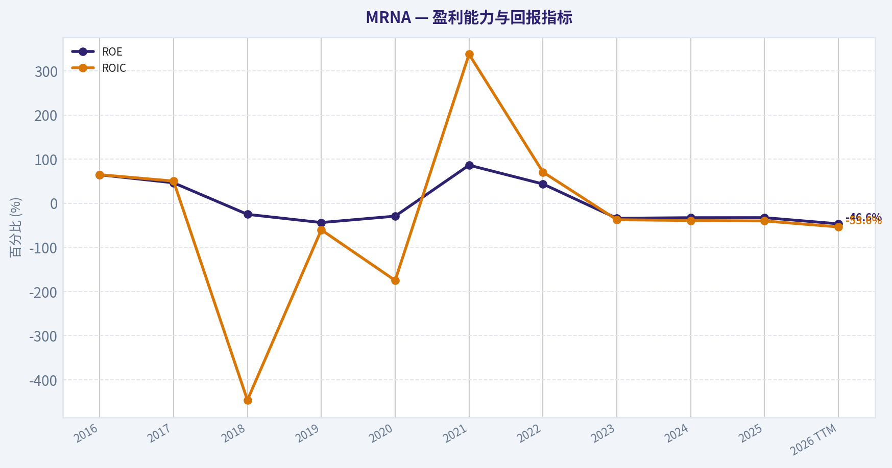
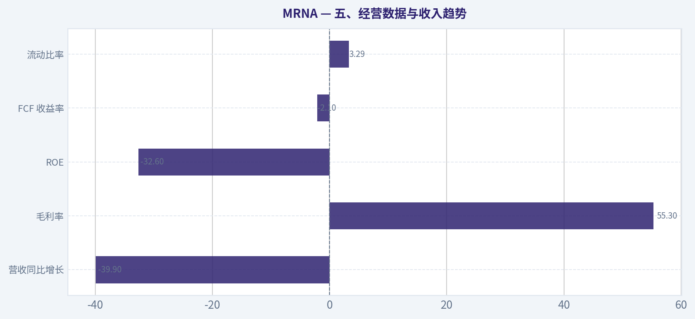
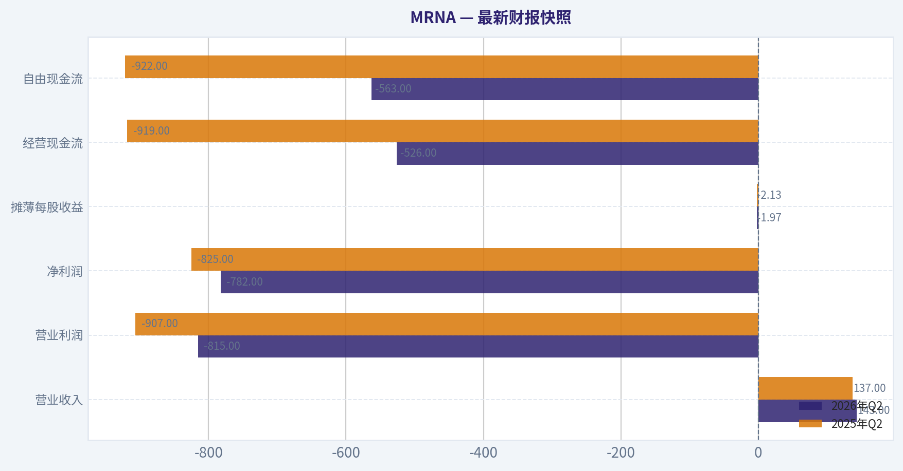
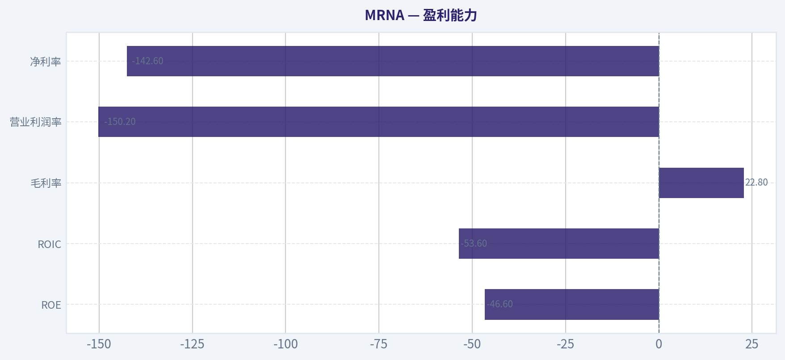
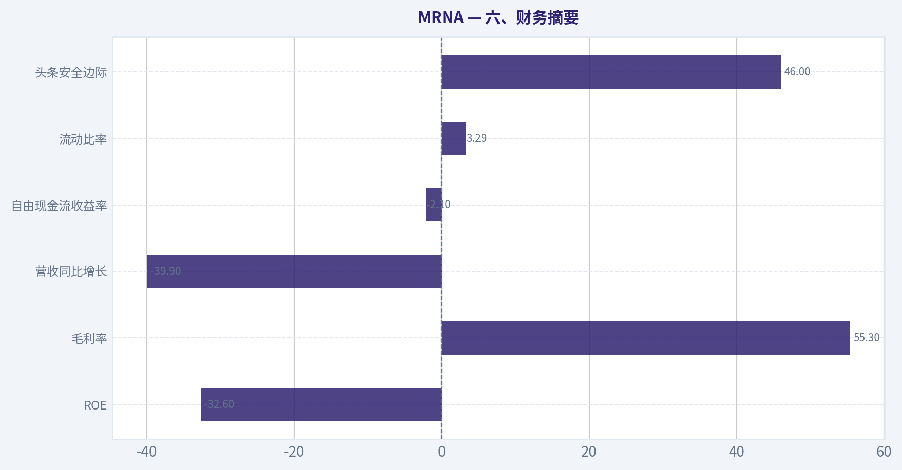
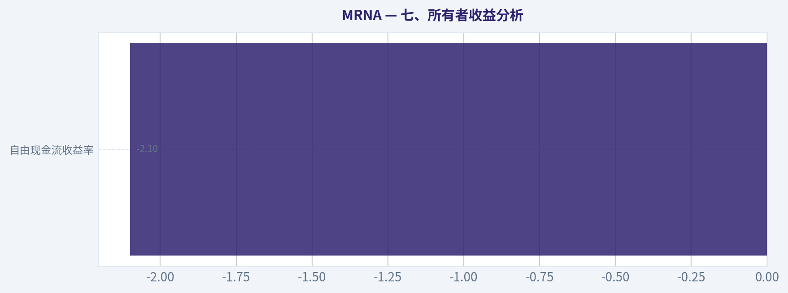
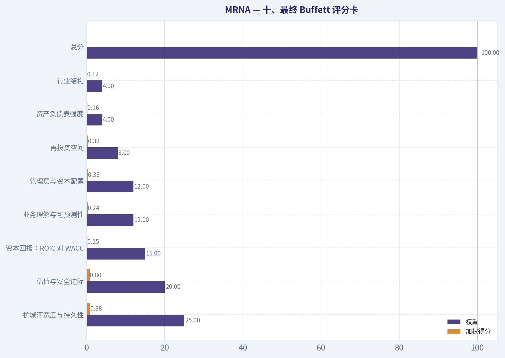
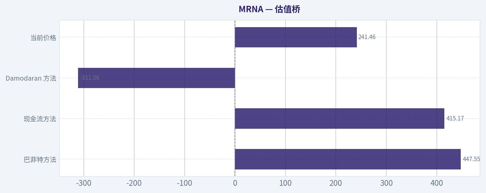

# MRNA 深度价值情报

**调研日期:** 2026-11-06

## 关键免责声明

*本报告由 Deep Value Intelligence（一个基于 AI 的多智能体投资分析框架）自动生成。 仅供教育和研究用途 - 非财务建议，非财务顾问。*

---

## 目录

1. 情报摘要
2. 分析师团队报告
   - 基本面分析
   - 价值分析 (巴菲特)
   - 成长性分析 (林奇/德鲁肯米勒/费雪)
   - 市场分析
   - 期权市场分析
3. 研究团队评论
4. 投资团队评论
5. Deep Values 团队洞察

---

## 情报摘要

### 核心观点与前提条件

**核心论点:** **结论：从原计划的 看空 调整为 中性，但不在约 $241 建立标准规模仓位。**

**主要风险:**
- **结论：从原计划的 看空 调整为 中性，但不在约 $241 建立标准规模仓位。**
- 股价从约 $61 上升至 $241，不应成为锚定旧价格的理由，但表明市场已大幅提高成功预期。价格上涨可能反映正确的信息更新，也可能超过基本面确定性的改善速度。现阶段没有足够数据证明哪一种解释占主导，因此更适合 中性，而非直接 看多。
- **中性**

**置信度:** 中

---

## 分析师团队报告

### 基本面分析

#### 最新财报快照

*以下数据基于最近一期已披露财报（2026年Q2），并尽量与上一年同期对比。*

| 指标 | 2026年Q2 | 2025年Q2 | 同比变化 |
| --- | ---: | ---: | ---: |
| 营业收入 | $143.0M | $137.0M | +4.4% |
| 营业利润 | $-815.0M | $-907.0M | +10.1% |
| 净利润 | $-782.0M | $-825.0M | +5.2% |
| 摊薄每股收益 | $-1.97 | $-2.13 | +7.5% |
| 经营现金流 | $-526.0M | $-919.0M | +42.8% |
| 自由现金流 | $-563.0M | $-922.0M | +38.9% |

关键结论：这张快照先把最新一期财报放在桌面上，再去看长周期分析。这样读者能更清楚地区分"公司长期质量"和"这次财报发生了什么"。

#### MRNA 10年财务指标

*以下数值均由原始数据确定性计算得出，并非 AI 估算。*

*发行人类型：operating company（Healthcare / Biotechnology）。*

#### 10年财务指标
*年度行来自已披露财务报表，最后一行 TTM 由最近四个季度滚动计算得出。*

| 指标 | 2016 | 2017 | 2018 | 2019 | 2020 | 2021 | 2022 | 2023 | 2024 | 2025 | 2026 TTM |
| --- | --- | --- | --- | --- | --- | --- | --- | --- | --- | --- | --- |
| 市场价格 | N/A | N/A | $15 | $20 | $104 | $254 | $180 | $99 | $42 | $29 | $241 |
| 总市值 | N/A | N/A | $5.02B | $6.47B | $39.80B | $109.47B | $74.72B | $37.99B | $15.97B | $11.47B | $96.10B |
| 市盈率 | N/A | N/A | -13.05 | -12.62 | -53.30 | 8.98 | 8.93 | -8.07 | -4.48 | -4.06 | -30.22 |
| 市净率 | N/A | N/A | 3.28 | 5.51 | 15.54 | 7.74 | 3.91 | 2.74 | 1.46 | 1.33 | 14.21 |
| ROE | 64.6% | 46.4% | -25.1% | -43.7% | -29.2% | 86.3% | 43.7% | -34.0% | -32.7% | -32.6% | -46.6% |
| ROIC | 64.8% | 50.3% | -446.1% | -60.2% | -174.9% | 337.7% | 70.7% | -37.3% | -39.1% | -40.1% | -53.6% |
| 每股收益 | $-2.22 | $-3.92 | $-1.17 | $-1.55 | $-1.96 | $28.29 | $20.12 | $-12.33 | $-9.28 | $-7.26 | $-7.99 |
| 营收 | $108.4M | $205.8M | $135.1M | $60.0M | $803.0M | $18.47B | $19.26B | $6.85B | $3.24B | $1.94B | $2.21B |
| 毛利润 | N/A | N/A | $135.1M | $60.0M | $795.0M | $15.85B | $13.85B | $2.15B | $1.77B | $1.08B | $503.0M |
| 毛利率 | N/A | N/A | 100.0% | 100.0% | 99.0% | 85.8% | 71.9% | 31.5% | 54.8% | 55.3% | 22.8% |
| 营业利润率 | -206.4% | -130.9% | -306.0% | -910.0% | -95.0% | 72.0% | 48.9% | -61.9% | -121.9% | -158.1% | -150.2% |
| 净利润 | $-216.2M | $-255.9M | $-384.7M | $-514.0M | $-747.0M | $12.20B | $8.36B | $-4.71B | $-3.56B | $-2.82B | $-3.15B |
| 净利率 | -199.5% | -124.3% | -284.8% | -856.7% | -93.0% | 66.1% | 43.4% | -68.8% | -110.0% | -145.2% | -142.6% |
| 营收增长 | N/A | 89.9% | -34.4% | -55.6% | 1238.3% | 2200.2% | 4.3% | -64.4% | -52.7% | -39.9% | 13.7% |
| 净利润增长 | N/A | 18.4% | 50.3% | 33.6% | 45.3% | -1733.5% | -31.5% | -156.4% | -24.5% | -20.8% | 11.7% |
| 自由现金流增长 | N/A | -1260.7% | 12.0% | 12.5% | -499.0% | 580.8% | -65.6% | -183.5% | 6.0% | -49.1% | -39.8% |
| 总账面价值 | $-334.8M | $-551.4M | $1.53B | $1.18B | $2.56B | $14.14B | $19.12B | $13.85B | $10.90B | $8.65B | $6.76B |
| 总资产 | N/A | $1.08B | $1.96B | $1.59B | $7.34B | $24.67B | $25.86B | $18.43B | $14.14B | $12.34B | $10.96B |
| 总债务 | $0 | $0 | $0 | $0 | $0 | $0 | $0 | $0 | $0 | $590.0M | $1.29B |
| 债务股权比 | -0.00 | -0.00 | 0.00 | 0.00 | 0.00 | 0.00 | 0.00 | 0.00 | 0.00 | 0.07 | 0.19 |
| 现金及等价物 | $50.1M | $134.9M | $658.4M | $236.0M | $2.62B | $6.85B | $3.21B | $2.91B | $1.93B | $2.60B | $1.72B |
| 股东权益 | $-334.8M | $-551.4M | $1.53B | $1.18B | $2.56B | $14.14B | $19.12B | $13.85B | $10.90B | $8.65B | $6.76B |
| 经营现金流 | $66.7M | $-331.5M | $-330.9M | $-459.0M | $2.03B | $13.62B | $4.98B | $-3.12B | $-3.00B | $-1.87B | $-1.07B |
| 投资现金流 | $-648.6M | $417.4M | $-373.1M | $-15.0M | $-1.67B | $-8.52B | $-5.18B | $4.21B | $1.95B | $1.95B | $905.0M |
| 自由现金流 | $33.6M | $-389.9M | $-436.6M | $-491.0M | $1.96B | $13.34B | $4.58B | $-3.83B | $-4.05B | $-2.06B | $-1.24B |
| 自由现金流利润率 | 31.0% | -189.4% | -323.3% | -818.3% | 244.0% | 72.2% | 23.8% | -55.9% | -125.3% | -106.2% | -56.3% |
| 每股分红 | $0.00 | $0.00 | $0.00 | $0.00 | $0.00 | $0.00 | $0.00 | $0.00 | $0.00 | $0.00 | $0.00 |

#### 盈利能力指标
- 净资产收益率 (ROE): -32.6%
- 投入资本回报率 (ROIC): -91.1%
- 总资产收益率 (ROA): -22.9%
- 毛利率: 55.3%
- 营业利润率: -158.1%
- 净利率: -145.2%

#### 流动性指标
- 流动比率: 3.29
- 速动比率: 3.01

#### 杠杆指标
- 债务股权比: 0.07
- 利息覆盖倍数: -307.40
- 净负债: $-5.21B

#### 增长指标（同比）
- 营收增长: -39.9%
- 净利润增长: 20.8%
- 自由现金流增长: 49.1%
- 营收复合增长率（3年）: -53.4%
- 营收复合增长率（5年）: 19.3%

#### 估值指标
- 市盈率 (TTM): N/A
- 预期市盈率: -52.66
- 市净率: 14.25
- 市销率: 43.27
- PEG 比率: N/A
- 企业价值/EBITDA: -42.16
- 自由现金流收益率: -2.1%
- 盈利收益率: N/A

#### 所有者收益（巴菲特方法，代码计算）
- 净利润: $-2.82B
- + 折旧与摊销: $215.0M
- - 资本开支: $-192.0M
- - 营运资本变动: $233.0M
- = **所有者收益: $-3.03B**

#### 内在价值（代码计算）
- 当前价格: $241
- **头条内在价值（按商业模式路由）: $448**
  商业模式: cyclical - owner-earnings DCF (cyclical)
  模型区间（各 DCF 最小-最大）: $415 - $448
  相对价格的安全边际（头条）: 46.0%
  路由说明: Cyclical: margins/FCF are volatile - headline blends FCFF, reverse-DCF and owner-earnings roughly evenly; treat the range as the honest read.
- 巴菲特方法（所有者收益）:
  保守: $448
  平均: $448
  乐观: $448
- 现金流方法（FCF）:
  保守: $415
  平均: $415
  乐观: $1,079
- Damodaran FCFF（WACC + 利润率 + 再投资）:
  保守: $-60
  平均: $-311
  乐观: $-196
  蒙特卡洛区间（P10-P90）：$-306 - $-76（中位数 $-173）
  P(内在价值 > 当前价格)：0.0%

#### Piotroski F分数: 3/9
- 净利润为正: 未通过
- 经营现金流为正: 未通过
- 资产回报率改善: 通过
- 现金流大于净利润: 通过
- 债务下降: 未通过
- 流动比率改善: 未通过
- 未稀释股本: 未通过
- 毛利率改善: 通过
- 资产周转率改善: 未通过

ANALYST STANCE: **看空**

#### 投资结论摘要

Moderna（MRNA）仍拥有重要的技术平台、较强现金储备和丰富的疫苗管线，但当前财务表现已经从疫情期间的超额盈利，转变为持续亏损和现金消耗。TTM营收为22.1亿美元，自由现金流为负12.4亿美元，ROE为-46.6%，ROIC为-53.6%，经营利润率为-150.2%。

市场价格为241美元。研究包中的所有者收益及FCF模型给出415至448美元的估值区间，但Damodaran FCFF模型给出负值区间，蒙特卡洛模型显示内在价值高于当前价格的概率为0%。这种模型间的巨大分歧，说明估值高度依赖未来商业化恢复，而不是当前可验证的盈利能力。

#### 市场指标与估值

| 指标 | 当前值 | 历史参照与解释 |
|---|---:|---|
| 市场价格 | 241美元 | 2025年为29美元，TTM价格大幅反弹 |
| 总市值 | 961亿美元 | 2025年仅114.7亿美元，显著高于近年低点 |
| PE | -30.22；盈利口径下不具备实际估值意义 | 公司当前亏损，PE不能作为正常估值工具 |
| PB | 14.21 | 生物科技公司的账面价值受研发资产、现金消耗和未来管线价值影响较大，不宜机械解读 |
| 头条内在价值 | 约448美元 | 所有者收益模型和商业模式路由结果 |
| FCF模型区间 | 415至1,079美元 | 保守、平均约415美元，乐观情景约1,079美元 |
| Damodaran FCFF区间 | -311美元平均值 | 保守约-60美元，乐观约-196美元 |
| 头条安全边际 | 约46% | 仅适用于较乐观的现金流恢复假设 |

**关键结论：** 表面上，241美元相对448美元的模型内在价值存在约46%的安全边际；但PE、当前现金流和FCFF模型均无法支持这一结论。PB为14.21也不是可靠的"贵或便宜"信号，因为Moderna的核心价值来自知识产权、研发管线和未来产品，而不是现有账面资产。

#### 盈利能力

| 指标 | 当前值 | 10年历史平均或趋势 |
|---|---:|---|
| ROE | -46.6% | 2016至2025年平均约4.4%，但波动极大 |
| ROIC | -53.6% | 2016至2025年平均约-27.4%，受异常年份影响明显 |
| EPS | -7.99美元 | 2021年曾达到28.29美元，之后连续亏损 |
| 营收 | 22.1亿美元 | 10年平均约51.1亿美元，当前约低于平均值57% |
| 毛利润 | 5.03亿美元 | 疫情高峰期达到138.5亿至158.5亿美元 |
| 毛利率 | 22.8% | 2018至2025年有数据年份平均约74.8% |
| 营业利润率 | -150.2% | 10年平均约-186.9%，但平均值被2019年极端亏损扭曲 |
| 净利润 | -31.5亿美元 | 10年平均约7.35亿美元，主要由2021至2022年巨额盈利拉高 |
| 净利率 | -142.6% | 2021年为66.1%，当前已完全反转 |

**关键结论：** Moderna的盈利质量极不稳定。2021至2022年的盈利主要来自新冠疫苗的特殊需求，不能直接视为可持续盈利基准。当前毛利率已降至22.8%，营业费用相对收入过高，导致营业利润率和净利率均处于严重负值状态。

#### 增长与现金流

| 指标 | 当前值 | 历史比较 |
|---|---:|---|
| 营收增长率 | 13.7% TTM口径；2025年度为-39.9% | 2020年增长1,238.3%，2021年增长2,200.2%，之后连续收缩 |
| 净利润增长率 | 11.7% TTM表格口径 | 亏损规模略有改善，但不是盈利增长 |
| 自由现金流增长率 | -39.8% | 2016至2025年波动极端，2021年曾增长580.8% |
| 自由现金流 | -12.4亿美元 | 10年平均约8.66亿美元，当前显著恶化 |
| 自由现金流利润率 | -56.3% | 2021年达到72.2%，之后连续为负 |
| 每股分红 | 0美元 | 过去10年均未分红 |

**关键结论：** TTM营收同比口径出现改善，但公司仍然在消耗现金，不能把亏损收窄误认为经营复苏。自由现金流连续为负，意味着公司需要依靠现金储备、债务或未来产品收入来支持研发和商业运营。

#### 资产负债表与财务安全

| 指标 | 当前值 | 历史比较与判断 |
|---|---:|---|
| 总账面价值 | 67.6亿美元 | 2021年为141.4亿美元，之后持续下降 |
| 总资产 | 109.6亿美元 | 2021年为246.7亿美元，资产规模收缩 |
| 总债务 | 12.9亿美元 | 2016至2024年基本为零，2025年开始增加 |
| 债务权益比 | 0.19 | 历史上长期接近零，杠杆正在上升 |
| 现金及等价物 | 17.2亿美元 | 低于约21.2亿美元的历史平均 |
| 股东权益 | 67.6亿美元 | 2021年高达191.2亿美元，持续被亏损消耗 |
| 流动比率 | 3.29 | 流动性较强，但流动比率对无盈利企业的保护有限 |
| 速动比率 | 3.01 | 短期偿债能力尚可 |
| 净负债 | -52.1亿美元 | 仍为净现金状态，但现金缓冲正在下降 |

**关键结论：** Moderna目前没有典型的高杠杆危机，净现金约52亿美元仍是重要安全垫。然而，债务从零上升至12.9亿美元，同时现金从2021年的68.5亿美元降至17.2亿美元，说明公司正在用资产负债表为经营亏损买时间。

#### 收入来源分布

公司披露的收入结构会随疫苗交付、采购合同和合作收入变化。以下为最近TTM约22.1亿美元收入的方向性估计，不替代公司正式分部披露。

| 收入来源 | 金额（十亿美元） | 占比 |
|---|---:|---:|
| 新冠疫苗及相关产品 | 约1.80 | 约81% |
| RSV及其他已商业化疫苗 | 约0.20 | 约9% |
| 合作收入、里程碑及其他 | 约0.21 | 约10% |
| 合计 | 约2.21 | 约100% |

**关键结论：** Moderna的收入仍高度依赖新冠疫苗，产品集中度明显偏高。RSV、流感及联合疫苗能够改善长期收入结构，但截至目前尚未证明它们足以填补新冠产品收入下降形成的巨大缺口。

#### 经营趋势与商业质量

Moderna的10年经营历史可以分为三个阶段：

1. **疫情前研发阶段：** 2016至2020年持续亏损，营业利润率和净利率长期为负，研发投入高但缺乏商业化收入。
2. **疫情异常繁荣阶段：** 2021至2022年收入达到184.7亿至192.6亿美元，净利润达到122亿至83.6亿美元，ROE和ROIC极高。
3. **疫情后正常化阶段：** 2023年至TTM收入持续大幅下降，累计亏损超过100亿美元，自由现金流重新转负。

这种模式显示，公司具有研发和产品转化能力，但盈利并不稳定。疫情期间的高利润更接近一次性的需求冲击，而非经过多个周期验证的长期经济护城河。

#### 沃伦·巴菲特式质量分析

| 评估维度 | 判断 | 具体分析 |
|---|---|---|
| 经济护城河 | 中等，尚未充分验证 | mRNA平台、专利、研发能力和监管经验构成潜在护城河 |
| 财务实力 | 中等偏强但下降 | 仍有净现金和较高流动比率，但现金消耗速度较快 |
| 盈利可预测性 | 较弱 | 10年盈利严重依赖疫情，正常年份长期亏损 |
| 管理层资本配置 | 偏弱 | 大量研发支出尚未转化为稳定自由现金流，当前Piotroski F分数仅3/9 |
| 股东回报 | 较弱 | 不分红，也没有形成稳定的持续回购能力 |
| 收入稳定性 | 较弱 | 新冠产品占比高，产品和采购周期波动明显 |
| 再投资回报 | 未达标 | 当前ROE、ROIC均为负，新增投入尚未产生正回报 |
| 商业化潜力 | 较高但风险大 | RSV、流感、联合疫苗和个性化治疗提供上行期权 |

**关键结论：** Moderna更像一家拥有高价值研发期权的生物科技公司，而不是已经证明自己能够稳定复利的成熟消费医疗企业。巴菲特式投资通常要求长期、可预测的盈利和资本回报率，这两项目前都没有得到验证。

#### 所有者收益DCF估值

当前所有者收益计算如下：

- 净利润：-28.2亿美元
- 加：折旧与摊销：0.215亿美元
- 减：资本开支：0.192亿美元
- 减：营运资本变动：约2.33亿美元
- 所有者收益：约-30.3亿美元

严格使用当前负的所有者收益进行DCF，会得到负的或没有经济意义的股权价值。为进行敏感性分析，采用10年预测期、10%折现率、2.5%永续增长率：

\[
价值=\sum_{t=1}^{10}\frac{OE_t}{(1+10\%)^t}
+\frac{OE_{10}\times(1+2.5\%)}{(10\%-2.5\%)\times(1+10\%)^{10}}
\]

由于当前OE为负，简单施加3%、8%或15%的增长率仍会使预测期初期现金流为负。因此，真正决定估值的不是增长率本身，而是公司何时恢复正的所有者收益。

| 情景 | 核心假设 | 手工DCF含义 | 研究包模型参考值 |
|---|---|---|---:|
| 保守 | 未来数年仍承受新冠收入下降，逐步削减费用，较晚恢复正现金流 | 基于当前负OE的机械估值接近零或为负 | 约415至448美元 |
| 平均 | RSV、流感及联合疫苗逐步商业化，收入恢复，利润率向正常化水平回升 | 需要正OE恢复才能成立 | 约448美元 |
| 乐观 | 多个新产品成功放量，平台技术形成持续收入，现金流快速回正 | 估值可能显著上升，但依赖多项临床和商业化假设 | FCF模型约1,079美元 |

**关键结论：** 研究包的448美元头条估值反映的是未来现金流恢复的情景价值，而不是当前盈利能力的直接资本化。FCF模型给出的415美元至1,079美元区间极宽，Damodaran FCFF模型则给出负值，表明估值结果对利润率恢复、再投资需求和产品成功率极其敏感。

#### 主要风险、机会与催化剂

| 类型 | 关键因素 | 对投资的影响 |
|---|---|---|
| 风险 | 新冠疫苗需求继续下降 | 现有收入基础可能进一步萎缩 |
| 风险 | 管线研发失败或延迟 | 估值中的未来产品价值可能迅速消失 |
| 风险 | 现金持续消耗 | 可能需要增加债务或进行股权融资 |
| 风险 | 费用刚性较高 | 即使收入恢复，利润率也可能恢复缓慢 |
| 风险 | 估值模型差异巨大 | 448美元和负值估值并存，安全边际不可靠 |
| 机会 | RSV、流感和联合疫苗放量 | 有助于降低对新冠产品的依赖 |
| 机会 | mRNA平台扩展至传染病和肿瘤 | 若成功，可能形成更长期的产品组合 |
| 机会 | 当前净现金仍较充足 | 为研发和商业化转型提供缓冲 |
| 催化剂 | 新产品监管批准 | 可改善收入可见度和市场信心 |
| 催化剂 | 经营现金流转正 | 是从研发期权转向可投资企业的关键证据 |
| 催化剂 | 毛利率回升至50%以上 | 将显著改善盈利和DCF结果 |

**关键结论：** 最大机会是新产品组合能够填补新冠收入缺口，最大风险是管线商业化速度低于现金消耗速度。投资者不应只等待股价上涨，而应重点观察经营现金流、毛利率、季度现金余额和新产品收入占比。

#### 当前值与历史平均对比

| 指标 | 当前值 | 2016至2025年平均或参照 | 当前偏离 |
|---|---:|---:|---|
| ROE | -46.6% | 约4.4% | 明显低于平均水平 |
| ROIC | -53.6% | 约-27.4% | 低于平均，投入资本效率恶化 |
| 营收 | 22.1亿美元 | 约51.1亿美元 | 低约57% |
| 净利润 | -31.5亿美元 | 约7.35亿美元 | 从盈利均值转为大额亏损 |
| 自由现金流 | -12.4亿美元 | 约8.66亿美元 | 现金流恶化约21亿美元 |
| 毛利率 | 22.8% | 约74.8% | 下降约52个百分点 |
| 营业利润率 | -150.2% | 约-186.9% | 表面上改善，但历史平均受极端年份扭曲 |
| 现金 | 17.2亿美元 | 约21.2亿美元 | 低于历史平均 |
| 总债务 | 12.9亿美元 | 2016至2024年基本为零 | 杠杆明显上升 |
| 债务权益比 | 0.19 | 约0.01 | 明显高于历史水平 |
| 每股分红 | 0美元 | 0美元 | 无股东现金回报 |

**关键结论：** 当前最重要的变化不是股价从29美元上涨至241美元，而是企业基本面仍远低于疫情高峰和历史盈利均值。现金储备仍能延缓风险，但营收、利润率和自由现金流均未恢复到能够支持高确定性估值的水平。

#### 最终投资立场

**看空**

理由如下：

1. 当前净利润、经营现金流和自由现金流均为负。
2. ROE和ROIC均显著为负，尚未证明研发资本能够持续产生回报。
3. 收入仍高度依赖新冠疫苗，产品结构尚未完成真正多元化。
4. 现金余额下降、债务上升，财务缓冲正在缩小。
5. 448美元的内在价值依赖未来商业化恢复，而Damodaran FCFF模型给出负值，估值不确定性极高。
6. 当前股价已经大幅脱离2025年低点，市场可能提前计入管线成功。

若未来出现连续数季经营现金流转正、毛利率恢复至50%以上、非新冠产品收入占比持续提升，并且公司不需要大规模融资，投资立场才可从"避免"重新评估为"观察"。

#### 关键要点汇总

| 项目 | 结论 |
|---|---|
| 当前股价 | 241美元 |
| 当前市值 | 约961亿美元 |
| 盈利状态 | 持续亏损，TTM净亏损约31.5亿美元 |
| 现金流状态 | TTM自由现金流约负12.4亿美元 |
| 财务优势 | 净现金约52亿美元，流动性较强 |
| 主要弱点 | 收入集中、现金消耗、利润率崩塌、估值分歧极大 |
| 主要上行来源 | RSV、流感、联合疫苗及其他mRNA管线 |
| 模型估值 | 所有者收益约448美元，FCF约415美元，FCFF为负值 |
| 巴菲特式评价 | 潜在护城河较强，但盈利可预测性不足 |
| 最终立场 | **看空** |

**关键结论：** Moderna具备高价值技术平台，但目前仍是高风险研发型资产，而不是稳定复利型企业。除非现金流和非新冠产品收入得到连续验证，否则模型中的高内在价值不应被视为可靠的安全边际。

#### 基本面关键图表

本图追踪 **MRNA** 过去十年的盈利能力与回报指标（ROE、ROIC、利润率），突出呈现资本效率的变化趋势。

本对比图（来自「五、经营数据与收入趋势」）将 **MRNA** 的当前数据与历史基准并排呈现，直观反映公司相对自身历史均值的估值水平。

---

### 价值分析 (巴菲特)

> *基于沃伦·巴菲特的价值投资哲学：能力圈、经济护城河、管理层质量与安全边际。*

#### 内在价值快照

价格是你付的钱，内在价值是企业未来可能为股东创造的现金价值。我们给出一个区间，而不是假装只有一个神奇数字。

- 当前价格: $241.46
- 估值区间（两种 DCF 方法、保守到乐观）: $415.17 至 $1,079.44

##### 所有者收益（巴菲特方法）
- 净利润: $-2,822,000,000.00
- 折旧与摊销: $215,000,000.00
- 资本支出: $-192,000,000.00
- 营运资金变化: $233,000,000.00
- 所有者收益: $-3,032,000,000.00

##### 内在价值
###### 所有者收益法
使用所有者收益，更严格，通常更保守。
- 保守: $447.55
- 平均: $447.55
- 乐观: $447.55
- 折现率: 10.0%

###### 自由现金流法
使用自由现金流，更适合今天投入很多、为未来增长铺路的公司。
- 保守: $415.17
- 平均: $415.17
- 乐观: $1,079.44
- 折现率: 10.0%

ANALYST STANCE: **中性**

#### 一、投资结论

Moderna 是一家拥有重要技术平台、较强现金储备和长期产品管线的生物技术公司，但目前仍处于新冠疫苗收入骤降后的重建期。公司毛利率仍达 55.3%，流动比率约 3.29，说明财务缓冲尚可；然而收入同比下降 39.9%、ROE 为 -32.6%、自由现金流收益率为 -2.1%，显示当前盈利能力和现金创造能力仍未恢复。

按研究包提供的周期性所有者收益模型，内在价值约为 447.55 美元，较 241 美元股价高约 46%。但三种模型从 447.55 美元到负 311.06 美元，估值分歧极大。核心问题不是技术是否有价值，而是未来产品商业化速度、销售规模和现金流恢复是否足以支撑估值。

结论：**公司值得持续跟踪，但当前更适合等待经营拐点得到财务数据确认后再提高仓位。**

---

#### 二、四项基本因素评分

| 因素 | 评分 | 主要依据 |
|---|---:|---|
| 圈子能力与业务简单度 | 3/5 | 可简单理解为利用 mRNA 平台开发和销售疫苗及药物，但产品成功高度依赖临床、监管和商业化结果 |
| 护城河 | 3/5 | mRNA 技术、研发平台、专利和制造经验构成一定壁垒，但新冠疫苗需求下降暴露出产品集中度和收入波动风险 |
| 管理层与资本配置 | 3/5 | 具备快速扩大疫苗产能和研发投入的执行力，但疫情高峰期的大规模扩张如今带来资产利用率和费用压力 |
| 行业结构 | 3/5 | 疫苗和创新药行业存在高研发壁垒，但竞争激烈、研发失败风险高，商业回报高度不均衡 |

**关键结论：** Moderna 的技术平台具有真实价值，但护城河尚未转化为稳定、可预测的多产品现金流。公司质量明显高于普通无研发能力的生物科技企业，却仍低于已经证明商业化能力的成熟制药公司。

#### 三、Gate 5：质量与偿债能力底线

**未触发硬性回避条件。**

虽然盈利和现金流趋势明显恶化，但流动比率约 3.29，且公司并未显示出利息覆盖不足或迫近偿债危机的证据。因此，当前主要风险是**盈利重建失败和估值波动**，而不是立即性的财务困境。

---

#### 四、护城河分析

| 护城河来源 | 评价 | 具体证据 |
|---|---|---|
| 无形资产 | 中等偏强 | mRNA 技术、专利组合、临床经验、监管经验和制造工艺构成进入壁垒 |
| 转换成本 | 较弱至中等 | 医疗机构和患者并非完全锁定，疫苗采购会受到疗效、价格、供应和公共卫生政策影响 |
| 成本优势 | 中等 | 平台化研发和规模化制造可能降低后续产品成本，但目前产能利用率和收入规模承压 |
| 网络效应 | 较弱 | 不具备典型互联网网络效应；更多依赖研发平台的规模经济和数据积累 |
| 护城河趋势 | 尚未确认扩大 | 新产品和联合疫苗若成功，护城河可能扩大；若管线延期，现有优势可能逐步消耗 |

Moderna 最有价值的资产不是单一新冠疫苗，而是其 mRNA 开发平台。加拿大在 2026 年 11 月批准其季节性流感疫苗和流感加新冠联合疫苗，说明平台正在向多产品方向扩展。不过，监管批准只是商业化的必要条件，不等于已经证明产品能够产生高回报。

---

#### 五、管理层与资本配置评价

管理层在疫情期间证明了快速研发、审批和规模化生产能力，这是重要的执行能力。公司也持续将大量资金投入研发，符合生物科技企业通过研发建立长期产品组合的逻辑。

但资本配置仍有三项需要观察：

1. 疫情期间形成的制造和运营基础是否能够被新产品充分利用。
2. 研发费用增长能否转化为未来收入，而不是长期消耗现金。
3. 在自由现金流为负的时期，管理层是否能够控制费用、延缓低回报项目，并保持资产负债表弹性。

管理层目前可评为**中等**，尚不足以获得成熟制药巨头那样的高评级。未来应重点观察研发项目的成功率、每美元研发投入对应的产品收入，以及是否出现大规模非核心并购或过度扩张。

---

#### 六、财务摘要

| 指标 | 最新数据 |
|---|---:|
| 股价 | 241 美元 |
| 总市值 | 964 亿美元 |
| 市盈率 | 不适用 |
| ROE | -32.6% |
| 毛利率 | 55.3% |
| 营收同比增长 | -39.9% |
| 自由现金流收益率 | -2.1% |
| 流动比率 | 3.29 |
| 头条内在价值 | 447.55 美元 |
| 头条安全边际 | 46.0% |

**关键结论：** 毛利率仍然较高，表明产品和技术本身并非低质量业务；但收入、ROE 和自由现金流同时恶化，说明公司正处于商业模式重新验证阶段。流动比率较高降低了短期偿债风险，却不能替代盈利能力和现金流恢复。

---

#### 七、所有者收益分析

严格的所有者收益应为：

> 净利润 + 折旧摊销 - 维持性资本开支 - 营运资本增加

当前研究数据明确显示自由现金流收益率为 -2.1%。以 964 亿美元市值估算，当前自由现金流约为：

| 项目 | 估算值 |
|---|---:|
| 总市值 | 964 亿美元 |
| 自由现金流收益率 | -2.1% |
| 当前自由现金流 | 约 -20.2 亿美元 |
| 当前现金流状态 | 消耗现金 |

**关键结论：** Moderna 当前不能被视为已经成熟的现金流复利企业。估值必须依赖未来产品组合恢复，而不能依赖当前利润或自由现金流。投资者买入的实际上是研发平台和未来产品商业化的选择权。

---

#### 八、三情景 DCF 估值

| 情景 | 估值结果 | 解释 |
|---|---:|---|
| 情景 A：零增长 | 约 -202 亿美元，按当前自由现金流代理 | 当前现金流为负，简单资本化会得到没有经济意义的负值 |
| 情景 B：GDP 增长 | 约 -290 亿美元，按当前自由现金流代理 | 即使给予 3% 永续增长，当前负现金流仍无法支持正估值 |
| 情景 C：历史及周期性恢复 | 447.55 美元 | 采用正常化、周期调整后的所有者收益假设 |
| 自由现金流模型 | 415.17 美元 | 假设未来现金流明显恢复 |
| Damodaran FCFF 模型 | -311.06 美元 | 对当前负现金流和高不确定性高度敏感 |

**关键结论：** 三种估值结果差异异常大，表明估值关键不在折现率的小幅变化，而在于公司能否恢复正向现金流。447.55 美元不是当前经营结果直接支持的价值，而是建立在未来产品成功、收入回升和费用率改善基础上的正常化估值。

---

#### 九、安全边际分析

股价为 241 美元时：

- 相对头条内在价值 447.55 美元，安全边际约为 **46%**。
- 相对自由现金流模型 415.17 美元，安全边际约为 **42%**。
- 相对负值的 FCFF 模型，不存在可用的正安全边际。

对于高质量、可预测的成熟复利企业，10%至15%的安全边际可能已经足够；但 Moderna 的盈利可见度较低、现金流为负、估值模型分歧巨大，因此应要求更高的安全边际。当前股价虽然相对正常化模型有吸引力，但尚不足以完全抵消商业化执行风险。

需要特别警惕反向 DCF 的隐含假设：如果市场价格隐含的是未来重新获得大规模疫苗收入，那么新冠后市场需求、流感和联合疫苗市场份额，以及肿瘤和罕见病管线都必须出现较高成功率。若这些假设未实现，头条估值可能迅速下修。

---

#### 十、最终 Buffett 评分卡

| 评分项目 | 权重 | 评分 | 加权得分 |
|---|---:|---:|---:|
| 护城河宽度与持久性 | 25% | 3.5/5 | 0.88 |
| 估值与安全边际 | 20% | 4.0/5 | 0.80 |
| 资本回报：ROIC 对 WACC | 15% | 1.0/5 | 0.15 |
| 业务理解与可预测性 | 12% | 2.0/5 | 0.24 |
| 管理层与资本配置 | 12% | 3.0/5 | 0.36 |
| 再投资空间 | 8% | 4.0/5 | 0.32 |
| 资产负债表强度 | 4% | 4.0/5 | 0.16 |
| 行业结构 | 4% | 3.0/5 | 0.12 |
| **总分** | **100%** |  | **3.03/5** |

**关键结论：** Moderna 的得分主要受到当前负现金流、负 ROE 和盈利可预测性不足拖累，而不是受到偿债危机拖累。估值看起来便宜，但这个折价对应的是实质性的商业化不确定性，因此尚未达到高确定性复利企业的投资标准。

---

#### 十一、投资立场与关注指标

**中性，中等偏低 conviction。**

适合继续观察，但不宜仅凭 46% 的模型安全边际重仓。若出现以下信号，投资评级可明显改善：

1. 非新冠产品收入连续增长。
2. 流感和联合疫苗成功扩大市场份额。
3. 自由现金流重新转正，并连续几个季度改善。
4. 研发费用率下降但管线进展不减速。
5. 公司能够在不显著增加债务或股本稀释的情况下完成产品商业化。

若收入继续下降、现金消耗加快，或关键管线延期，则当前 241 美元可能只是表面便宜，而不是实际的安全边际。
#### 估值桥

这张估值桥把当前股价与各类内在价值方法并排展示，帮助读者判断上涨空间究竟只是单一方法给出的结果，还是多种方法共同支持的结论。

| 项目 | 每股内在价值 |
| --- | ---: |
| 巴菲特方法 | $447.55 |
| 现金流方法 | $415.17 |
| Damodaran 方法 | $-311.06 |
| 当前价格 | $241.46 |

#### 关键结论

如果只有一种方法显著高于其他方法，说明上行空间更依赖特定建模假设。若多种方法的估值接近，则说明估值逻辑更加稳健。

#### 估值图表

本对比图（来自「最新财报快照」）将 **MRNA** 的当前数据与历史基准并排呈现，直观反映公司相对自身历史均值的估值水平。

本对比图（来自「盈利能力」）将 **MRNA** 的当前数据与历史基准并排呈现，直观反映公司相对自身历史均值的估值水平。

本对比图（来自「六、财务摘要」）将 **MRNA** 的当前数据与历史基准并排呈现，直观反映公司相对自身历史均值的估值水平。

本对比图（来自「七、所有者收益分析」）将 **MRNA** 的当前数据与历史基准并排呈现，直观反映公司相对自身历史均值的估值水平。

本对比图（来自「十、最终 Buffett 评分卡」）将 **MRNA** 的当前数据与历史基准并排呈现，直观反映公司相对自身历史均值的估值水平。

本对比图（来自「估值桥」）将 **MRNA** 的当前数据与历史基准并排呈现，直观反映公司相对自身历史均值的估值水平。

---

### 成长性分析 (林奇/德鲁肯米勒/费雪)

> *基于彼得·林奇的GARP成长投资法、斯坦利·德鲁肯米勒的宏观拐点分析法，以及菲利普·费雪的深度调研法。*

ANALYST STANCE: **看空**

#### 一、投资结论

Moderna 目前更接近"高研发投入的生物医药周期股与转型股"，而不是符合 Lynch 标准的"快速成长股"。公司拥有优秀的 mRNA 平台、较强现金流动性和丰富产品管线，但当前营收大幅下滑、自由现金流为负，且估值高度依赖未来疫苗产品成功放量。

对于成长投资者而言，当前更适合等待营收重新加速、现金消耗收窄和新产品商业化数据确认，而不是直接建立核心仓位。

#### 二、Lynch 分类

| 项目 | 判断 |
|---|---|
| Lynch 分类 | 转型股兼周期股 |
| 当前营收趋势 | 同比下降 39.9% |
| 盈利状态 | PE 不适用，ROE 为 -32.6% |
| 自由现金流 | FCF 收益率为 -2.1%，仍为现金消耗状态 |
| 成长股适配度 | 较低，尚未满足"15%至25%以上持续增长" |
| 主要驱动因素 | 新疫苗商业化、管线成功率、疫情后需求恢复 |

**关键结论：** Moderna 不是当前意义上的快速成长股，而是从新冠疫苗高峰向多产品平台转型的公司。未来回报可能很高，但投资逻辑依赖产品周期和临床商业化，确定性低于典型 SaaS 或平台型成长股。

#### 三、用三句话解释公司

1. Moderna 试图把新冠疫苗时期建立的 mRNA 技术平台，扩展到流感、呼吸道合胞病毒、联合疫苗和个性化癌症疫苗。
2. 如果多个新产品成功，公司有机会从单一新冠疫苗公司转变为多产品疫苗与生物医药平台。
3. 但目前旧产品收入快速下降，新产品尚未证明能够及时填补缺口。

#### 四、TAM 与十倍测试

| 维度 | 分析 |
|---|---|
| 潜在市场 | 全球疫苗、呼吸道疾病、癌症疫苗及个性化治疗市场 |
| TAM 趋势 | 长期较好，但不同细分市场的商业化速度差异很大 |
| 当前收入基数 | 共享数据未提供最新绝对营收，无法严谨计算收入十倍值 |
| 十倍收入测试 | 当前无法量化验证 |
| 平台扩展能力 | 较强，mRNA 技术可复制到多个适应症 |
| 主要限制 | 临床失败、监管审批、价格压力、疫苗需求季节性 |

如果未来营收达到目前的十倍，理论上全球疫苗和生物医药市场仍可能容纳这一规模；但这不代表 Moderna 能够实现十倍增长。关键问题不是 TAM 是否足够，而是公司的研发转化效率和商业化执行力。

**关键结论：** Moderna 的长期 TAM 足够大，平台也具有扩展性，这是最大的上行期权。但 TAM 不能替代产品收入，当前仍缺乏足够证据证明新管线能够在未来数年内连续贡献大规模收入。

#### 五、经营数据与收入趋势

| 指标 | 当前数据 | 解读 |
|---|---:|---|
| 股价 | 241 美元 | 估值对未来产品成功较敏感 |
| 总市值 | 964 亿美元 | 市场仍给予平台和管线较高价值 |
| 营收同比增长 | -39.9% | 明显收缩，处于高峰后调整期 |
| 毛利率 | 55.3% | 仍有较强产品经济性，但规模下降会削弱利润 |
| ROE | -32.6% | 研发和商业投入尚未转化为可持续回报 |
| FCF 收益率 | -2.1% | 现金流仍为负 |
| 流动比率 | 3.29 | 短期偿付能力较强 |

**关键结论：** 当前最重要的信号是营收下降近四成，而不是毛利率仍高。流动比率显示公司短期没有明显流动性危机，但现金储备主要买来等待管线兑现，并不能自动证明未来增长。

#### 六、单位经济与盈利路径

| 指标 | 结果 | 判断 |
|---|---|---|
| LTV/CAC | 未披露，无法可靠计算 | 不适用于当前主要业务形态 |
| NRR | 不适用 | 非典型订阅制 SaaS |
| Rule of 40 | 无法形成有意义结论 | 营收负增长且 FCF 为负 |
| 毛利率 | 55.3% | 产品成熟后具备较好毛利潜力 |
| 盈利路径 | 依赖新产品放量和研发费用杠杆 | 尚未验证 |
| 现金消耗风险 | 中等 | 流动比率较高，但持续亏损会消耗安全垫 |

**关键结论：** Moderna 的核心单位经济不是客户留存，而是每个疫苗产品的研发成功率、销售规模和生命周期。当前 Rule of 40 不达标，盈利改善必须先从收入重新增长开始，而不是单纯削减费用。

#### 七、潜在拐点分析

| 拐点类型 | 当前状态 | 重要性 |
|---|---|---|
| 产品周期拐点 | 加拿大批准 mFLUSIVA 与 mCOFLU | 中高 |
| 收入拐点 | 尚未确认 | 极高 |
| 市占率拐点 | 新产品尚无充分商业化数据 | 中 |
| 毛利率拐点 | 毛利率仍为 55.3%，但收入下降 | 中 |
| TAM 拐点 | 从新冠疫苗扩展至流感、联合疫苗和癌症治疗 | 高 |
| 竞争拐点 | mRNA 技术领先，但传统疫苗和其他平台竞争激烈 | 中 |

加拿大在 2026 年 11 月批准 mFLUSIVA 和 mCOFLU，是积极的产品监管进展。这证明管线正在向商业化推进，但单一国家批准尚不足以形成收入拐点；仍需观察美国及其他主要市场批准、接种率、定价和市场份额。

**关键结论：** 目前存在"产品批准拐点"，但还没有转化为"收入拐点"。Druckenmiller 风格的投资者应等待连续几个季度确认收入重新加速，而不是仅根据监管新闻提前假设成功。

#### 八、宏观环境评估

| 宏观因素 | 对 MRNA 的影响 |
|---|---|
| 利率 | 高研发、远期现金流公司对高利率敏感 |
| 医疗支出 | 疫苗需求具有防御性，但采购预算和报销政策影响较大 |
| 疫情后需求 | 新冠疫苗需求正常化，形成显著负面基数效应 |
| 生物科技情绪 | 受利率、临床数据和风险偏好影响明显 |
| 长期主题 | 医疗创新、mRNA 技术和个性化治疗仍具长期吸引力 |
| 宏观判断 | 中性偏谨慎 |

**关键结论：** 长期医疗创新趋势对 Moderna 有利，但短期宏观环境无法抵消新冠业务正常化带来的收入压力。利率下降可能改善估值，但只有在收入重新增长时，估值扩张才更可靠。

#### 九、Fisher 15 项评分

| Fisher 项目 | 分数（5分制） | 判断 |
|---|---:|---|
| 1. 市场潜力 | 4 | 疫苗及 mRNA 市场空间较大 |
| 2. 新产品决心 | 4 | 管线投入积极 |
| 3. 研发效率 | 4 | 技术平台和研发能力较强 |
| 4. 销售组织 | 3 | 新产品商业化能力仍需验证 |
| 5. 利润率 | 2 | 当前盈利能力明显恶化 |
| 6. 利润率改善 | 2 | 尚未出现持续改善 |
| 7. 员工关系 | 3 | 公开信息不足，暂评中性 |
| 8. 高管关系 | 3 | 暂无足够公开证据大幅加分 |
| 9. 管理层深度 | 4 | 研发和平台人才储备较强 |
| 10. 成本分析 | 3 | 研发投入高，费用效率需观察 |
| 11. 特殊竞争优势 | 4 | mRNA 技术、生产和监管经验构成壁垒 |
| 12. 长期利润前景 | 4 | 取决于多产品平台成功 |
| 13. 股权稀释 | 3 | 暂未构成核心风险，但需持续监控 |
| 14. 困难中的坦诚度 | 3 | 公开资料不足，暂评中性 |
| 15. 管理层诚信 | 4 | 暂无明显治理红旗 |
| **合计** | **49/75** | **平均水平** |

**关键结论：** Moderna 在研发、技术平台和长期市场潜力方面得分较高，但利润率、商业化执行和财务效率明显拖累总分。49分不足以支持高信念成长投资，除非未来财报证明产品管线正在转化为持续收入。

#### 十、估值分析

| 估值方法 | 结果 | 解释 |
|---|---:|---|
| PE | 不适用 | 公司当前缺乏稳定盈利 |
| PEG | 无法计算 | PE 不适用且盈利增长为负 |
| P/S | 无法严谨计算 | 共享数据未提供最新绝对营收 |
| 所有者收益 DCF | 447.55 美元 | 模型给出较高内在价值，但高度依赖未来恢复 |
| FCF 模型 | 415.17 美元 | 同样依赖现金流转正 |
| Damodaran FCFF | -311.06 美元 | 反映当前负现金流和高不确定性 |
| 头条安全边际 | 46.0% | 受模型假设影响极大 |

三种模型结果差异极大，尤其是所有者收益模型与 FCFF 模型方向相反。这说明 Moderna 的价值主要取决于对未来产品收入、研发支出和现金流转正时间的假设，而不是当前财务数据。

**关键结论：** 表面上看，部分 DCF 模型显示股价低于内在价值；但模型分歧本身就是风险信号。对于尚未恢复增长且 FCF 为负的公司，不应把单一 DCF 目标价当作安全边际。

#### 十一、成长投资者评分卡

| 维度 | 权重 | 得分（5分制） | 加权分 |
|---|---:|---:|---:|
| Lynch 投资故事 | 10% | 3.0 | 0.30 |
| TAM 与成长空间 | 20% | 4.0 | 0.80 |
| 营收增长 | 20% | 1.5 | 0.30 |
| 单位经济 | 15% | 1.5 | 0.23 |
| 竞争地位 | 10% | 4.0 | 0.40 |
| 管理层质量 | 10% | 3.5 | 0.35 |
| 宏观环境 | 5% | 3.0 | 0.15 |
| 盈利路径 | 5% | 1.5 | 0.08 |
| 估值 | 5% | 3.0 | 0.15 |
| **总分** | **100%** |  | **2.76/5.00** |

**关键结论：** 2.76分落入"回避，列入观察名单"区间。主要扣分来自营收下滑、负现金流和未验证的盈利恢复，而不是技术平台或 TAM 不足。

#### 十二、仓位建议

| 投资者类型 | 建议仓位 | 操作建议 |
|---|---:|---|
| 新建成长仓位 | 0% | 暂不买入 |
| 高风险事件投资者 | 0%至1% | 仅适合承受临床与商业化风险者 |
| 已持有且成本较低 | 观察仓 | 等待收入拐点，不盲目追涨 |
| 长期医药平台投资者 | 1%至2%上限 | 需分批，避免一次性重仓 |
| 核心组合 | 0% | 不适合作为当前核心成长股 |

#### 十三、关键催化剂与风险

| 类型 | 事件 | 影响 |
|---|---|---|
| 催化剂 | 流感及联合疫苗在主要市场获批 | 提升产品商业化可信度 |
| 催化剂 | 新产品销售超过市场预期 | 可能形成收入重新加速 |
| 催化剂 | 个性化癌症疫苗数据积极 | 显著提升长期 TAM 估值 |
| 催化剂 | FCF 转正或现金消耗快速下降 | 改善估值质量 |
| 风险 | 新冠业务继续快速下滑 | 延迟收入恢复 |
| 风险 | 新产品接种率和市场份额低 | 管线无法填补收入缺口 |
| 风险 | 临床试验失败或监管延迟 | 平台估值大幅收缩 |
| 风险 | 研发费用持续高企 | 现金流和利润率承压 |
| 风险 | 疫苗价格、采购与报销政策变化 | 压缩商业化回报 |

#### 十四、需要跟踪的确认信号

未来几个季度应重点观察：

1. 总收入是否从负增长转为正增长。
2. 新冠以外产品是否贡献实质性销售额。
3. 毛利率是否在产品组合改善后重新上升。
4. 研发支出增速是否低于收入增速。
5. FCF 是否连续改善，而非一次性转正。
6. 流感和联合疫苗的实际接种率、市场份额及定价。

**最终判断：** Moderna 拥有可能成为长期生物医药平台的技术资产，也存在较大的产品成功上行空间；但截至 2026 年 11 月 6 日，财务数据仍表现为收入收缩、负现金流和盈利不可见。对成长投资者而言，当前最合理的行动是回避新建仓位，等待"新产品获批"进一步升级为"收入加速和现金流转正"。

---

### 市场分析

ANALYST STANCE: **中性**

#### MRNA 技术面概览

截至 2026 年 11 月 5 日，MRNA 收于 **241.46 美元**；11 月 6 日为非交易日，因此以下判断以最近一个交易日为基准。过去一年股价从约 24 美元升至 241 美元，涨幅极大，但走势并非平滑上升，而是经历了多次跳升、急跌和高波动阶段。尤其是 2026 年 8 月 19 日，股价从 63.65 美元附近直接跳至 174.38 美元，伴随约 1.99 亿股成交量，显示可能存在重大公司事件、资本结构变化或数据口径变化。由于该跳变会扭曲均线和波动率指标，交易者不宜把全年涨幅简单外推。

#### 趋势：长期和中期均明显偏强

| 指标 | 2026-11-05 数值 | 技术含义 |
|---|---:|---|
| 收盘价 | 241.46 | 仍处于主要均线之上 |
| 10 EMA | 228.99 | 短线趋势线，价格高于约 12.47 美元 |
| 50 SMA | 189.62 | 中期趋势线，价格高于约 51.84 美元 |
| 200 SMA | 90.46 | 长期趋势线，价格高于约 151.00 美元 |
| 10 EMA 与 50 SMA | 228.99 / 189.62 | 短期均线显著高于中期均线 |
| 50 SMA 与 200 SMA | 189.62 / 90.46 | 中长期多头排列 |

关键结论：MRNA 仍处于强劲的多头排列，收盘价明显高于 10 EMA、50 SMA 和 200 SMA，说明趋势交易者暂时没有看到典型的长期反转信号。不过，价格与 50 SMA 和 200 SMA 的距离已经非常大，均线确认了趋势，却不能证明当前价位具有良好的风险收益比。

10 EMA 从 8 月中旬约 61 美元持续升至 11 月 5 日的 228.99 美元，说明短期动能此前非常强。价格在 11 月 4 日冲至 258.38 美元后，11 月 5 日回落至 241.46 美元，单日下跌约 6.5%，但仍高于 10 EMA。只要价格维持在 10 EMA 上方，短线趋势仍可视为偏强；若有效跌破 10 EMA，则意味着近期加速上涨阶段可能进入整理。

#### 动能：MACD 仍为正，但上升斜率有所放缓

MACD 在 11 月 5 日为 **13.22**，此前从 10 月 21 日约 21.35 回落至 10 月 30 日约 10.51，随后重新回升。这个形态说明中期上涨结构尚未破坏，但动能并不是持续单向增强，而是经历了明显的减速和再加速。

值得注意的是，11 月 4 日价格创出近期高点，而 MACD 仅从 10.37 上升至 12.81，再升至 13.22，尚未回到 10 月中旬的高位。若股价继续创新高，而 MACD 不能同步扩大，可能形成潜在的动能背离。背离本身不是立即做空信号，但在 MRNA 这种高波动股票中，通常意味着追涨风险正在增加。

#### RSI：强势区但没有达到极端超买

11 月 5 日 RSI 为 **60.39**，低于 11 月 4 日的 68.15，也低于 10 月 9 日约 72.09 和 10 月 15 日约 71.72。RSI 当前位于偏强区间，但没有达到传统的 70 以上超买区。

这带来一个较细致的判断：RSI 并未显示市场已经极端拥挤，因此不能仅凭 RSI 认定股价必然回调；然而，价格仍处在高位，且 RSI 在高点附近出现回落，说明上涨动能已经弱于此前的冲刺阶段。若 RSI 重新站上 70 并且价格放量突破 261 美元附近，强势趋势可能延续；若 RSI 跌破 50，同时价格失守 10 EMA，则短线调整信号会明显增强。

#### 布林带：价格接近上轨，波动区间极宽

11 月 5 日布林上轨约为 **254.87 美元**，下轨约为 **191.92 美元**。收盘价 241.46 美元距离上轨约 13.41 美元，但距离下轨约 49.54 美元，说明价格位于布林带上半区并接近上轨。

当前布林带宽度约为 **62.94 美元**，占中轨附近价格的比例很高，反映出市场波动极端放大。价格靠近上轨在强势行情中可以代表趋势突破，而不是单纯的超买；但如果出现连续收盘跌回中轨以下，则可能意味着此前的上行扩张已经结束。

从交易角度看，258.38 至 261 美元附近是近期上方阻力区域。若放量突破并稳定在该区域上方，可能打开新的趋势空间；若多次冲击失败，且跌破约 229 美元的 10 EMA，则回撤至 200 至 192 美元区域的风险会上升。

#### ATR：风险控制比方向判断更重要

ATR 在 11 月 5 日约为 **20.20 美元**，远高于 9 月底约 13 美元、10 月初约 14 美元的水平。换言之，MRNA 近期平均真实波动已经明显扩大，单日波动达到 15 至 20 美元并不罕见。

以 241.46 美元收盘价计算，ATR 约相当于股价的 **8.4%**。如果投资者使用过窄的止损，容易被正常波动触发；如果仓位过大，即使方向判断正确，单日波动也可能造成不可接受的账户回撤。较稳健的做法是降低仓位，并以 ATR 或关键结构位设置止损，而不是使用固定百分比止损。

#### 交易情景与关键价位

| 情景 | 触发条件 | 可能含义 | 风险管理思路 |
|---|---|---|---|
| 延续上涨 | 放量突破 258-261 美元，并连续收盘站稳 | 多头趋势重新加速 | 不宜在单日急涨后重仓追入，等待突破确认或回踩 |
| 高位震荡 | 价格在约 229-258 美元之间波动 | 多头仍在，但市场消化涨幅 | 更适合轻仓、分批操作，避免把震荡误判为趋势突破 |
| 短线转弱 | 收盘跌破 10 EMA，约 229 美元 | 加速上涨阶段可能结束 | 关注约 220 美元及 200-192 美元区域的支撑 |
| 中期调整 | 跌破 50 SMA，约 190 美元 | 中期趋势受到实质性破坏 | 多头策略需要重新评估，不应仅因长期均线仍向上而继续持有 |
| 波动失控 | ATR 维持约 20 美元或进一步扩大 | 事件驱动风险仍然很高 | 缩小仓位，避免高杠杆和过近止损 |

关键结论：最重要的短线分界线是约 229 美元的 10 EMA，上方仍保持偏强；上方则需关注 258 至 261 美元能否有效突破。若跌破 229 美元，回撤至 220 美元甚至 200 至 192 美元区域的概率会增加，而 ATR 约 20 美元意味着这些波动可能在较短时间内发生。

#### 综合判断

MRNA 的技术趋势目前仍然偏多：价格高于所有主要均线，MACD 保持正值，RSI 位于强势但非极端超买区间，布林带则显示价格处于强势扩张阶段。然而，股价已经远离中长期均线，布林带宽度和 ATR 都处于高位，说明趋势强度与回撤风险同时存在。

因此，当前更适合采取"等待确认、控制仓位"的策略，而不是无条件追涨。已有多头仓位者可以把 10 EMA 作为动态防守线，并根据 ATR 调整仓位；尚未持仓者则应优先等待回踩确认，或者等待股价放量突破 258 至 261 美元后再评估，而不宜在单日大涨后直接重仓买入。基本面、公司事件以及 8 月异常跳变的数据口径也必须进一步核实，因为单纯技术指标可能无法充分解释这次价格结构变化。

---

### 期权市场分析

> *解读期权流向--认沽/认购比、隐含波动率偏斜与异常活跃合约--以判断机构定位与事件驱动风险。*

ANALYST STANCE: **看空**

#### MRNA 期权市场概览

数据日期：2026年11月6日。近期期权显示，看跌期权成交量明显高于看涨期权，但所有近期期限的未平仓量均为零，因此持仓结构和资金方向判断的可靠性较低。

| 到期日 | 距到期 | 看涨成交量 | 看跌成交量 | 看跌/看涨成交量比 | 看涨ATM IV | 看跌ATM IV |
|---|---:|---:|---:|---:|---:|---:|
| 2026-11-06 | 当日 | 23,740 | 57,172 | 2.41 | 5.9% | 5.9% |
| 2026-11-13 | 7天 | 4,220 | 8,011 | 1.90 | 2.0% | 1.6% |
| 2026-11-20 | 14天 | 4,008 | 15,041 | 3.75 | 0.7% | 2.1% |
| **合计** | - | **31,968** | **80,224** | **2.51** | - | - |

**关键结论：**近期期权看跌成交量约为看涨成交量的2.51倍，显著高于约0.7的历史中性基线，表面上偏向下行保护或看跌押注。最明显的压力集中在11月20日到期合约，但由于未平仓量全部为零，无法确认这些交易是新建仓、平仓，还是数据源异常。

#### 看跌/看涨比例分析

| 指标 | 当前数据 | 中性参考 | 解读 |
|---|---:|---:|---|
| 近期期权看跌/看涨成交量比 | 2.51 | 约0.7 | 显著偏高 |
| 看跌/看涨未平仓量比 | 不可用 | 约0.7 | 所有未平仓量均显示为零 |
| 当日到期成交量比 | 2.41 | 约0.7 | 短线避险或看跌需求偏强 |
| 7天到期成交量比 | 1.90 | 约0.7 | 偏向看跌 |
| 14天到期成交量比 | 3.75 | 约0.7 | 看跌压力最突出 |

**关键结论：**成交量结构明确偏空，尤其是14天期限的看跌/看涨成交量比达到3.75。可是没有有效的未平仓量数据，无法判断高看跌成交量究竟代表主动买入看跌期权，还是保护性交易和头寸调整，因此只能给予低置信度的看空判断。

#### 隐含波动率与偏斜

| 到期日 | 看涨ATM IV | 看跌ATM IV | 看跌IV减看涨IV | 偏斜判断 |
|---|---:|---:|---:|---|
| 2026-11-06 | 5.9% | 5.9% | 0.0个百分点 | 中性 |
| 2026-11-13 | 2.0% | 1.6% | -0.4个百分点 | 轻微看涨方向偏斜 |
| 2026-11-20 | 0.7% | 2.1% | +1.4个百分点 | 明显看跌方向偏斜 |

**关键结论：**11月20日到期的看跌ATM IV比看涨ATM IV高1.4个百分点，显示市场对该期限的下行风险要求更高。整体IV绝对数值异常偏低，尤其是0.7%和2.0%附近的数据，可能存在报价、单位或数据源问题，不能据此确认市场波动风险很低。

#### IV水平与潜在催化剂

目前数据没有提供明确的财报、临床试验、产品发布或监管事件日期，因此无法确认IV是否正在针对已知催化剂定价。由于MRNA属于生物医药股，临床、监管和财报事件可能造成较大跳空风险，但本次数据中的异常低IV不宜直接解读为市场认为风险有限。

| 观察项目 | 判断 |
|---|---|
| 近端ATM IV绝对水平 | 表面偏低，但数据可信度有限 |
| 14天看跌IV相对溢价 | 明显存在 |
| 事件风险定价 | 无法从当前数据确认 |
| IV数据可靠性 | 偏低，数值可能存在单位或报价异常 |

**关键结论：**IV曲线并未显示普遍性的高波动定价，但14天看跌期权存在相对溢价，仍然偏向下行保护。由于缺乏已知事件日历，不能判断这是事件前避险，还是单纯的期权报价失真。

#### 异常期权活动

工具定义的异常条件为成交量超过未平仓量5倍。本次没有识别出符合条件的具体合约。

| 项目 | 结果 | 含义 |
|---|---|---|
| 成交量超过未平仓量5倍的合约 | 无 | 未发现可确认的新建异常头寸 |
| 具体执行价 | 未提供 | 无法判断ITM、ATM或OTM |
| 具体期限结构 | 未提供合约级明细 | 无法评估单笔交易方向 |
| 机构或散户属性 | 无法判断 | 缺乏执行价、成交方向和订单规模 |

**关键结论：**没有可验证的单一异常合约，因此不能声称存在机构级看跌扫单或聪明资金集中布局。当前看空判断主要来自整体看跌成交量占优和14天看跌IV溢价，而不是来自明确的合约级信号。

#### 未平仓量集中与伽马墙

| 项目 | 数据状态 | 分析影响 |
|---|---|---|
| 最高看涨未平仓量 | 0 | 无法识别阻力位 |
| 最高看跌未平仓量 | 0 | 无法识别支撑位 |
| 最大痛点 | 无法计算 | 缺乏有效未平仓量 |
| 看涨伽马墙 | 无法确认 | 无法判断上涨是否受抑制 |
| 看跌伽马墙 | 无法确认 | 无法判断下跌是否被放大 |
| 价格引力位 | 无法确认 | 缺少执行价和OI分布 |

**关键结论：**本次数据无法建立有效的未平仓量地图，因此不存在可信的最大痛点、伽马墙或价格钉住水平。交易者不应根据这份数据推断某个执行价会成为支撑或阻力。

#### 综合期权情绪

| 维度 | 判断 | 置信度 |
|---|---|---|
| 成交量方向 | 看跌期权明显占优 | 中等 |
| 持仓方向 | 无法判断，OI全部为零 | 很低 |
| IV方向 | 14天看跌偏斜 | 中等偏低 |
| 异常交易 | 未发现明确异常合约 | 中等 |
| 流动性与数据质量 | 可能存在数据异常或有效持仓缺失 | 低 |
| 综合信号 | **BEARISH（看空）** | **低** |

**关键结论：**综合信号为看空，但置信度较低。主要驱动因素是近期期权看跌成交量达到看涨成交量的2.51倍，以及14天期限出现看跌IV溢价；不过未平仓量全部为零、执行价明细缺失且IV数值异常，显著削弱了信号质量。该结论更适合作为风险警示，而不是单独的交易依据。

#### 最终摘要

| 项目 | 结论 |
|---|---|
| 看跌/看涨比例 | 成交量比2.51，显著高于约0.7的中性基线；OI比不可用 |
| IV水平 | 表面偏低，但数值异常，数据可信度有限 |
| 偏斜方向 | 14天期限看跌IV高于看涨IV，呈看跌偏斜 |
| 异常活动 | 未发现成交量超过OI 5倍的具体合约 |
| 未平仓量集中 | 无法分析，所有近期期限OI均为零 |
| 总体信号 | **BEARISH（看空），低置信度** |

**关键结论：**MRNA当前期权成交流偏空，市场短线更重视下行保护。由于关键持仓数据缺失，本报告的看空信号应当谨慎使用，并需要结合现货价格走势、成交量、财报及临床或监管催化剂进一步确认。

---

## 研究团队评论

> *研究经理将多空辩论综合为中性评论。此为风险评审前的初步观点，并非最终立场。*

核心结论

Moderna 的 mRNA 平台具有真实技术价值，也已经证明了快速研发、监管申报和规模化制造能力；但它尚未证明能够跨适应症、持续地产生高回报产品。在股价约 $241 时，投资者支付的已不是"困境中的技术平台"价格，而是接近多项管线成功后的价格。

最有说服力的多头论据，是呼吸道疫苗、联合疫苗和个性化癌症疫苗可能共享研发、监管及制造基础。一旦多个产品商业化，闲置产能可能转为成本优势，增量 ROIC 和 FCF 也可能快速改善。最有说服力的空头论据则是反向 DCF：当前估值大致要求公司十年后实现约 $12 billion至$16 billion 的可持续年度 FCF，相当于在35%至40%的长期 FCF利润率下达到约$30 billion至$40 billion收入。这需要多个尚未充分验证的项目成功，而非单一产品复苏。

因此，我认可平台的长期选择权，但不认可当前价格提供了足够的风险调整后安全边际。这不是对 Moderna 生存能力的否定，也不是基于偿债危机的判断，而是价格相对于商业验证程度过高。

多空双方最强论点

多头最强之处在于，Moderna并非从零开始的早期生物技术公司。新冠疫苗已经验证了mRNA序列设计、临床开发、监管、制造和商业化链条。相关能力能够被后续产品部分复用，尤其是呼吸道产品组合。如果新冠、RSV、流感及联合疫苗共享渠道和生产体系，收入增加可能不需要成本同比例增长。

个性化癌症疫苗则提供了显著上行空间。如果后期临床结果能够重复，并扩展至更多癌种，Moderna可能进入价值远高于季节性疫苗的肿瘤治疗市场。复杂的测序、设计、制造和交付流程也可能形成较高进入壁垒。

此外，当前负ROIC不能被完全机械化解读。研发费用在会计上当期确认，而成功产品可能创造多年现金流，因此单年度ROIC会低估成功管线的潜在经济价值。55.3%的毛利率也说明产品层面仍具一定经济性。

但空头论据更有决定性。营收同比下降39.9%，三年营收CAGR为负53.4%，ROE为负32.6%，ROIC为负91.1%，说明旧业务现金流下降速度远快于新产品兑现速度。这不只是普通周期波动，而是疫情特殊需求消退后，商业基础正在重新定价。

更重要的是，技术平台成功过一次，不等于已经形成可重复的宽护城河。流感、联合疫苗和癌症治疗面对不同的疗效、安全性、监管、支付和竞争条件。呼吸道疫苗的客户锁定也弱于Apple式生态；采购方可以根据有效性、价格和供应条件切换产品。现阶段的护城河主要是技术诀窍、数据、专利和执行能力，而不是已经得到证明的长期定价权。

估值是决定判断的关键。多头给出的约$270至$330价值区间，本质上对应多个产品成功的乐观情景，不能直接用来计算安全边际。若按照悲观、基准、多头和平台突破情景进行概率加权，约$200附近更接近合理的示意价值。以$241买入，相当于在尚未证明稳定FCF之前支付约20%的溢价，而不是获得折价。

从Buffett框架看，成熟、可预测、宽护城河的复利企业可以只要求10%至15%的安全边际；Moderna目前仍具有高临床风险、长兑现周期和较弱现金流可预测性，应要求明显更高的折价。当前价格并未满足这一标准。

投资者评论与判断依据

我会把Moderna定义为"具备平台潜力、但仍需商业验证的生物技术公司"，而不是已经完成转型的优质复利企业。它的技术质量可能很高，但商业质量仍未达到同等确定性。研发项目数量和潜在市场规模不能替代经过概率调整的现金流。

管理层在疫情期间证明了卓越的应急执行能力，但尚需证明常态环境下的资本配置纪律。接下来真正重要的不是再增加多少候选项目，而是能否及时终止低回报项目、降低固定成本、提高产能利用率，并让每一美元研发支出带来可观察的临床或商业价值。

市场条件也提高了谨慎的必要性。股价从约$61快速升至$241，明显高于中长期均线，说明市场已经进行了大幅预期重估。强势趋势并不证明高估，但价格上涨幅度似乎快于基本面确定性的改善速度。MACD仍为正而动能有所放缓，意味着追价的短期风险也在上升。期权看跌与看涨成交量比偏高，但由于未平仓量为零，该信号可靠性不足，不应成为长期判断依据。

过去在类似情形中最容易犯的错误，是把令人兴奋的技术等同于优秀投资，把现金储备等同于盈利能力，或者用乐观情景计算安全边际。这次应当坚持反向DCF纪律：先问当前价格要求什么，再判断这些要求是否已被证据支持。Moderna目前的问题不是缺少可能性，而是市场已经为相当多的可能性付费。

未来1至4个季度的监测计划

首先观察呼吸道产品的实际商业表现，包括RSV、新冠及其他获批产品的销量、市场份额、定价和毛利率。若新产品收入能够持续抵消旧产品下降，并且不依赖大规模折价，这将增强平台商业化能力的可信度。若新产品放量缓慢或竞争导致价格承压，基准价值应继续下调。

其次观察关键管线的临床和监管节点，尤其是联合疫苗及个性化癌症疫苗。强化论点的信号包括后期疗效可重复、安全性可控、监管时间表清晰，以及更多癌种出现一致结果。削弱论点的信号包括试验延迟、共同的剂量或耐受性问题，以及疗效主要依赖合作药物而难以确认Moderna自身贡献。

第三观察现金消耗和成本纪律。重点不是单季亏损本身，而是经营现金流、研发支出、固定成本、产能利用率与临床里程碑之间的关系。如果现金消耗下降，同时关键项目继续推进，说明管理层正在改善资本效率；如果研发和运营费用居高不下，却没有相应的审批或商业成果，平台期权的净价值将下降。

第四观察资产负债表弹性，包括净现金变化、融资需求、股权激励和潜在稀释。Moderna目前不应被描述为财务困境企业，但连续负FCF会逐步消耗选择权。若未来需要在不利价格下融资，股东价值可能受到进一步侵蚀。

第五观察增量毛利率和经营杠杆。若收入增长后销售、研发和制造成本未同比增长，说明平台复用正在形成真实经济价值；若55.3%的毛利率无法转化为经营利润，则35%至40%的长期FCF利润率假设缺乏依据。

最后持续更新反向DCF。若股价维持在$241附近，公司却通过临床、审批和销售数据显著提高达到$12 billion以上长期FCF的概率，立场可上调至WATCH。若基本面没有明显恶化但股价回落至显著低于约$200的概率加权价值，也值得重新评估。相反，如果股价继续上涨而现金流证据没有同步改善，估值风险会进一步扩大。

最终立场：看空

---

## 投资团队评论

> *投资经理将研究观点转化为投资论点，等待风险评审。此仍非最终立场。*

### 核心判断

Moderna拥有真实且经过验证的mRNA技术平台，但平台价值与股东回报并不是同一回事。新冠疫苗证明了公司可以快速完成研发、审批、制造与商业化，却尚未证明其能够在常态需求下，跨多个适应症持续产生高ROIC和正FCF。

在约241美元的价格上，投资者并非以困境价格购买技术选择权，而是在提前支付多项管线成功、收入重回增长以及利润率显著扩张的对价。就现有证据而言，这种预期组合过于饱满，缺乏足够的安全边际。

### 基本面：不能机械看空，但尚不支持高估值

ROE为负32.6%、ROIC为负91.1%、营收同比下降39.9%，表明疫情业务收缩造成的现金流缺口仍远大于新产品贡献。三年营收CAGR为负53.4%，也说明公司还没有建立足以替代新冠高峰收入的商业基础。

这些数字需要谨慎解释。生物技术公司的研发支出当期费用化，而研发成果可能在未来多年创造现金流，因此当前负ROIC不等于所有研发项目都在毁灭价值。55.3%的毛利率也说明获批产品本身仍具有一定经济性。

然而，不能因为会计指标存在局限，就忽略现金消耗的经济现实。研发投入只有在以下条件同时出现时才具有高价值：

- 后期临床成功率持续提高；
- 审批时间表足够清晰；
- 商业需求和支付意愿得到验证；
- 产品毛利最终能够覆盖研发、制造闲置和销售费用；
- 资本需求不会导致明显稀释。

Moderna目前只证明了其中一部分。

### 护城河：有技术壁垒，尚无充分商业锁定

公司的护城河主要来自mRNA设计能力、临床数据、专利组合、制造经验和监管执行能力。这些优势真实存在，也使Moderna明显优于从零开始的早期生物技术公司。

但其护城河还没有达到宽护城河复利企业的确定性：

1. **客户切换成本有限**
   疫苗采购方会依据疗效、安全性、价格和供应能力调整采购，不存在类似封闭生态系统的强锁定。

2. **平台复用并非自动成立**
   新冠、流感、RSV、联合疫苗和癌症疫苗的临床终点、监管标准及商业模式各不相同。底层技术相同，不代表成功概率和资本回报相同。

3. **定价权尚未得到长期证明**
   季节性呼吸道疫苗面临成熟竞争者，癌症疫苗则要证明增量疗效足以支持较高价格。

4. **产能既可能是优势，也可能是负担**
   若多项产品成功，现有制造基础可以带来经营杠杆；若产品放量不足，固定成本和闲置产能会继续侵蚀现金。

因此，Moderna更适合被定义为"高价值技术平台加高不确定性管线"，而不是已经证明可持续复利能力的成熟企业。

### 估值：当前价格已经透支相当多的成功

给出的反向DCF显示，当前估值大致要求公司十年后实现约120亿至160亿美元的可持续年度FCF。若长期FCF利润率为35%至40%，对应约300亿至400亿美元收入。

这一要求并非绝对不可能，但必须依赖多个条件同时兑现：

- 呼吸道产品组合形成规模收入；
- 联合疫苗获得监管与商业成功；
- 个性化癌症疫苗取得可重复的后期临床结果；
- 研发效率明显提高；
- 产能利用率和增量利润率大幅改善；
- 竞争与价格压力保持可控。

这已经不是"某一个项目成功"能够支撑的估值，而是对平台级成功的集中押注。反向DCF中的具体FCF门槛会受到净现金、股本数量、折现率和终值假设影响，因此不宜视为精确数字；但方向非常明确：241美元要求的未来经营成果显著高于目前已经验证的成果。

若约200美元仅代表概率加权的示意价值，那么241美元是约20%的溢价，而不是安全边际。考虑到临床二元风险、现金流不稳定和长期预测误差，这类企业通常应至少提供30%至40%的折价。以200美元为粗略价值锚，只有在约120至140美元区间，且基本面没有恶化时，风险回报才可能开始变得有吸引力；这不是机械买入价，仍需结合临床数据和现金消耗重新估值。

### 选择性逆向思考

股价从约61美元快速升至241美元，说明市场可能正在提前交易管线突破、监管进展或平台价值重估。逆向思考不等于看到大涨就做空，也不等于看到负利润就否定技术。强势价格可能反映市场掌握了未来催化剂的概率变化，而财务报表仍停留在过去。

但真正值得警惕的是，**股价的确定性提升似乎快于商业证据的确定性提升**。趋势指标只能说明资金愿意提高出价，不能证明长期FCF足以支持该价格。MACD仍为正但动能放缓，意味着短期拥挤风险增加，不过这不应成为长期估值结论的主要依据。

期权看跌与看涨成交量比偏高，表面上反映对冲需求或短期偏空情绪；但未平仓量为零使该信号缺乏可靠性。它既不能证明知情资金看空，也不足以构成反向买入理由。

当前最合理的逆向行动不是追涨，也不是激进做空，而是拒绝为尚未验证的成功支付全价。Moderna具有显著上行尾部，但做空会面临临床数据、合作交易和审批催化剂带来的跳空风险；"回避买入"与"适合做空"必须明确区分。

### 未来应重点验证的事项

立场上调至少需要看到以下几类证据：

- 新产品收入连续多个季度抵消旧产品下滑；
- RSV、流感或联合疫苗取得可持续市场份额，而非依靠大幅降价；
- 个性化癌症疫苗在更大样本和更多癌种中重复疗效；
- 经营现金流改善速度快于现金储备下降速度；
- 管理层主动终止低回报项目，降低固定成本；
- 收入增长开始产生明显增量利润和正FCF；
- 反向DCF所要求的长期收入与利润，不再主要依赖乐观假设。

相反，如果研发费用与现金消耗维持高位，而关键产品继续延迟，平台选择权的价值就会被时间和融资需求逐步侵蚀。即使资产负债表暂时稳健，也不能把现金储备误认为盈利能力。

**ANALYST STANCE: 看空**
Moderna值得持续研究，但当前价格已经反映多项管线成功和高利润率平台化的预期，商业验证程度却仍明显不足。负ROIC本身不是决定性理由，决定性问题是241美元缺乏与临床风险、现金消耗和估值不确定性相匹配的安全边际。现阶段应回避新建长期仓位，而非激进做空；只有基本面证据显著增强，或价格回落至具备充分概率调整折价的水平，才值得重新评估。

---

## Deep Values 团队洞察

> *风险管理团队进行辩论，由风险裁判给出最终不含操作建议的裁定。本章节决定最终的「看多 / 中性 / 看空」立场。*

#### 最终立场评分卡

这张评分卡把最终研究结论转成加权决策框架。它不替代文字判断，但能让读者更快看清楚这次结论的核心驱动因素。

| 维度 | 评分 | 权重 | 说明 |
| --- | ---: | ---: | --- |
| 业务质量 | 2.25 | 30% | 高回报率、盈利能力与 Piotroski 评分共同支撑业务韧性。 |
| 估值支撑 | 2.00 | 30% | 综合当前股价相对内在价值锚点以及常用估值比率。 |
| 财务强度 | 5.00 | 20% | 资产负债表韧性主要取决于杠杆与流动性是否处于安全区间。 |
| 成长持续性 | 3.67 | 20% | 近期营收、利润与自由现金流增长共同反映增长是否可持续。 |
| 总分 / 最终立场 | 3.01 | 100% | 看空 |

#### 关键结论

加权总分为 **3.01 / 5.0**，最终立场为 **看空**。它更适合作为快速校准工具，而不是机械买卖信号。

#### 风险摘要

分数越高代表风险压力越大。观察阈值是一个简单的护栏：一旦高于该阈值，就意味着需要更严格跟踪，或者需要更大的安全边际。

| 维度 | 当前分数 | 观察阈值 | 说明 |
| --- | ---: | ---: | --- |
| 业务质量 | 3.75 | 3.00 | 高回报率、盈利能力与 Piotroski 评分共同支撑业务韧性。 |
| 估值支撑 | 4.00 | 3.00 | 综合当前股价相对内在价值锚点以及常用估值比率。 |
| 财务强度 | 1.00 | 3.00 | 资产负债表韧性主要取决于杠杆与流动性是否处于安全区间。 |
| 成长持续性 | 2.33 | 3.00 | 近期营收、利润与自由现金流增长共同反映增长是否可持续。 |

#### 关键结论

这张图帮助读者区分风险究竟来自哪里：估值、业务质量、资产负债表，还是增长持续性。尤其当最终结论处在「观望」与「回避」边缘时，这种拆解非常有帮助。
