# MRNA Deep Value Intelligence

**Analysis Date:** 2026-11-06

## Critical Disclaimer

*This analysis is generated by Deep Value Intelligence, an AI-powered multi-agent investing framework. Education & research only - not financial advice, not a financial advisor.*

---

## Table of Contents

1. Intelligence Summary
2. Analyst Team Reports
   - Fundamentals Analysis
   - Intrinsic Value Analysis (Buffett)
   - Trend & Growth Analysis (Lynch/Druckenmiller/Fisher)
   - Market Technical Analysis
   - Options Market Analysis
3. Research Team Commentary
4. Value Investing Team Commentary
5. Deep Values Commentary

---

## Intelligence Summary

### Thesis + Conditions

**Core Thesis:** **Decision: Do not initiate or add at $241. Keep Moderna on a monitored watchlist.**

**Key Risks:**
- **Decision: Do not initiate or add at $241. Keep Moderna on a monitored watchlist.**
- The central risk is not stock volatility or biotechnology exposure-it is **permanent capital loss from paying today for a successful platform transition that has not yet occurred**. The supplied reverse DCF suggests $241 requires substantial sustainable free cash flow within roughly six years. Missing balance-sheet and pipeline details prevent a precise intrinsic-value estimate, but uncertainty is not a margin of safety.
- A speculative position could benefit from early commercialization success, as the Risky Analyst argues. However, Buffett-style investing does not require capturing the first part of every revaluation. At this price, waiting for better commercial evidence or a materially lower valuation is the more disciplined choice.

**Confidence:** Low

---

## Analyst Team Reports

### Fundamentals Analysis

#### Latest Earnings Snapshot

*Most recent reported quarter anchored on 2026 Q2, with prior-year comparison when available.*

| Metric | 2026 Q2 | 2025 Q2 | YoY Change |
| --- | ---: | ---: | ---: |
| Revenue | $143.0M | $137.0M | +4.4% |
| Operating Income | $-815.0M | $-907.0M | +10.1% |
| Net Income | $-782.0M | $-825.0M | +5.2% |
| Diluted EPS | $-1.97 | $-2.13 | +7.5% |
| Operating Cash Flow | $-526.0M | $-919.0M | +42.8% |
| Free Cash Flow | $-563.0M | $-922.0M | +38.9% |

Key Takeaways: This snapshot anchors the most recent reported quarter before the narrative analysis. It helps readers separate long-run business quality from whatever changed in the latest earnings print.

#### 10-Year Financial Metrics for MRNA

*All values below are computed deterministically from raw data - not estimated by AI.*

*Issuer profile: operating company (Healthcare / Biotechnology).*

#### 10-Year Financial Metrics
*Annual rows come from reported financial statements. The final TTM row is computed from the latest four quarters.*

| Metric | 2016 | 2017 | 2018 | 2019 | 2020 | 2021 | 2022 | 2023 | 2024 | 2025 | 2026 TTM |
| --- | --- | --- | --- | --- | --- | --- | --- | --- | --- | --- | --- |
| Market Price | N/A | N/A | $15 | $20 | $104 | $254 | $180 | $99 | $42 | $29 | $241 |
| Market Cap | N/A | N/A | $5.02B | $6.47B | $39.80B | $109.47B | $74.72B | $37.99B | $15.97B | $11.47B | $96.10B |
| P/E Ratio | N/A | N/A | -13.05 | -12.62 | -53.30 | 8.98 | 8.93 | -8.07 | -4.48 | -4.06 | -30.22 |
| P/B Ratio | N/A | N/A | 3.28 | 5.51 | 15.54 | 7.74 | 3.91 | 2.74 | 1.46 | 1.33 | 14.21 |
| ROE | 64.6% | 46.4% | -25.1% | -43.7% | -29.2% | 86.3% | 43.7% | -34.0% | -32.7% | -32.6% | -46.6% |
| ROIC | 64.8% | 50.3% | -446.1% | -60.2% | -174.9% | 337.7% | 70.7% | -37.3% | -39.1% | -40.1% | -53.6% |
| EPS | $-2.22 | $-3.92 | $-1.17 | $-1.55 | $-1.96 | $28.29 | $20.12 | $-12.33 | $-9.28 | $-7.26 | $-7.99 |
| Revenue | $108.4M | $205.8M | $135.1M | $60.0M | $803.0M | $18.47B | $19.26B | $6.85B | $3.24B | $1.94B | $2.21B |
| Gross Profit | N/A | N/A | $135.1M | $60.0M | $795.0M | $15.85B | $13.85B | $2.15B | $1.77B | $1.08B | $503.0M |
| Gross Margin | N/A | N/A | 100.0% | 100.0% | 99.0% | 85.8% | 71.9% | 31.5% | 54.8% | 55.3% | 22.8% |
| Operating Margin | -206.4% | -130.9% | -306.0% | -910.0% | -95.0% | 72.0% | 48.9% | -61.9% | -121.9% | -158.1% | -150.2% |
| Net Income | $-216.2M | $-255.9M | $-384.7M | $-514.0M | $-747.0M | $12.20B | $8.36B | $-4.71B | $-3.56B | $-2.82B | $-3.15B |
| Net Margin | -199.5% | -124.3% | -284.8% | -856.7% | -93.0% | 66.1% | 43.4% | -68.8% | -110.0% | -145.2% | -142.6% |
| Revenue Growth | N/A | 89.9% | -34.4% | -55.6% | 1238.3% | 2200.2% | 4.3% | -64.4% | -52.7% | -39.9% | 13.7% |
| Net Income Growth | N/A | 18.4% | 50.3% | 33.6% | 45.3% | -1733.5% | -31.5% | -156.4% | -24.5% | -20.8% | 11.7% |
| Free Cash Flow Growth | N/A | -1260.7% | 12.0% | 12.5% | -499.0% | 580.8% | -65.6% | -183.5% | 6.0% | -49.1% | -39.8% |
| Total Book Value | $-334.8M | $-551.4M | $1.53B | $1.18B | $2.56B | $14.14B | $19.12B | $13.85B | $10.90B | $8.65B | $6.76B |
| Total Assets | N/A | $1.08B | $1.96B | $1.59B | $7.34B | $24.67B | $25.86B | $18.43B | $14.14B | $12.34B | $10.96B |
| Total Debt | $0 | $0 | $0 | $0 | $0 | $0 | $0 | $0 | $0 | $590.0M | $1.29B |
| Debt-to-Equity | -0.00 | -0.00 | 0.00 | 0.00 | 0.00 | 0.00 | 0.00 | 0.00 | 0.00 | 0.07 | 0.19 |
| Cash & Equivalents | $50.1M | $134.9M | $658.4M | $236.0M | $2.62B | $6.85B | $3.21B | $2.91B | $1.93B | $2.60B | $1.72B |
| Shareholders' Equity | $-334.8M | $-551.4M | $1.53B | $1.18B | $2.56B | $14.14B | $19.12B | $13.85B | $10.90B | $8.65B | $6.76B |
| Operating Cash Flow | $66.7M | $-331.5M | $-330.9M | $-459.0M | $2.03B | $13.62B | $4.98B | $-3.12B | $-3.00B | $-1.87B | $-1.07B |
| Investing Cash Flow | $-648.6M | $417.4M | $-373.1M | $-15.0M | $-1.67B | $-8.52B | $-5.18B | $4.21B | $1.95B | $1.95B | $905.0M |
| Free Cash Flow | $33.6M | $-389.9M | $-436.6M | $-491.0M | $1.96B | $13.34B | $4.58B | $-3.83B | $-4.05B | $-2.06B | $-1.24B |
| FCF Margin | 31.0% | -189.4% | -323.3% | -818.3% | 244.0% | 72.2% | 23.8% | -55.9% | -125.3% | -106.2% | -56.3% |
| Dividends / Share | $0.00 | $0.00 | $0.00 | $0.00 | $0.00 | $0.00 | $0.00 | $0.00 | $0.00 | $0.00 | $0.00 |

#### Profitability Metrics
- Return on Equity (ROE): -32.6%
- Return on Invested Capital (ROIC): -91.1%
- Return on Assets (ROA): -22.9%
- Gross Margin: 55.3%
- Operating Margin: -158.1%
- Net Profit Margin: -145.2%

#### Liquidity Metrics
- Current Ratio: 3.29
- Quick Ratio: 3.01

#### Leverage Metrics
- Debt-to-Equity Ratio: 0.07
- Interest Coverage Ratio: -307.40
- Net Debt: $-5.21B

#### Growth Metrics (Year-over-Year)
- Revenue Growth: -39.9%
- Net Income Growth: 20.8%
- Free Cash Flow Growth: 49.1%
- Revenue CAGR (3-Year): -53.4%
- Revenue CAGR (5-Year): 19.3%

#### Valuation Metrics
- P/E Ratio (TTM): N/A
- Forward P/E: -52.66
- Price-to-Book: 14.25
- Price-to-Sales: 43.27
- PEG Ratio: N/A
- EV/EBITDA: -42.16
- Free Cash Flow Yield: -2.1%
- Earnings Yield: N/A

#### Owner Earnings (Buffett Method, Code-Computed)
- Net Income: $-2.82B
- + Depreciation & Amortization: $215.0M
- - Capital Expenditures: $-192.0M
- - Working Capital Changes: $233.0M
- = **Owner Earnings: $-3.03B**

#### Intrinsic Value (Code-Computed)
- Current Price: $241
- **Headline Intrinsic Value (business-model routed): $448**
  Business model: cyclical - owner-earnings DCF (cyclical)
  Model spread (min-max across DCFs): $415 - $448
  Margin of safety vs. price (headline): 46.0%
  Routing note: Cyclical: margins/FCF are volatile - headline blends FCFF, reverse-DCF and owner-earnings roughly evenly; treat the range as the honest read.
- Buffett Method (Owner Earnings):
  Conservative: $448
  Average: $448
  Optimistic: $448
- Cash Flow Method (FCF):
  Conservative: $415
  Average: $415
  Optimistic: $1,079
- Damodaran FCFF (WACC + margins + reinvestment):
  Conservative: $-60
  Average: $-311
  Optimistic: $-196
  Monte Carlo band (P10-P90): $-306 - $-76 (median $-173)
  P(intrinsic value > price): 0.0%

#### Piotroski F-Score: 3/9
- Positive Net Income: FAIL
- Positive Operating Cash Flow: FAIL
- ROA Improvement: PASS
- Cash Flow > Net Income: PASS
- Decreasing Debt: FAIL
- Improving Current Ratio: FAIL
- No Dilution: FAIL
- Improving Gross Margin: PASS
- Improving Asset Turnover: FAIL

ANALYST STANCE: **Bearish**

#### Executive Summary

Moderna, Inc. (MRNA) has valuable mRNA technology, substantial scientific know-how, and a potentially attractive pipeline. However, the canonical dataset shows a business still transitioning from exceptional COVID-era profitability to a loss-making commercial model.

The latest TTM figures show revenue of **$2.21 billion**, net income of **-$3.15 billion**, free cash flow of **-$1.24 billion**, operating margin of **-150.2%**, ROE of **-46.6%**, and ROIC of **-53.6%**. Although the balance sheet remains liquid, cash has declined from its 2021 peak while debt has increased.

The headline owner-earnings valuation of approximately **$448 per share** is highly dependent on a cyclical recovery assumption. It conflicts sharply with the current negative owner earnings, negative FCF, and Damodaran FCFF valuation range of approximately **-$306 to -$76 per share**. Until sustainable positive earnings and cash flow are demonstrated, the stock is better classified as a speculative turnaround than a Buffett-style compounder.

#### Market Metrics

| Metric | Current / 2026 TTM | Historical comparison | Interpretation |
|---|---:|---:|---|
| Market Price | $241 | 2018-2025 average approximately $93 | The stock has recovered dramatically from its $29 2025 level but remains below the $254 2021 peak. |
| Market Capitalization | $96.10B | 2018-2025 average approximately $37.6B | The market is again assigning substantial value to pipeline recovery and future products. |
| P/E Ratio | -30.22 / not economically meaningful | Positive only in 2021-2022 | Negative earnings make P/E unusable as a valuation anchor. |
| P/B Ratio | 14.21 | 2018-2025 average approximately 5.19 | P/B is not a reliable primary metric for an IP-heavy biotechnology company. |
| Price-to-Sales | 43.27 | Not directly comparable across the COVID cycle | The multiple looks extremely high against depressed current revenue. |
| FCF Yield | -2.1% | Negative in 2017-2019 and 2023-2026 TTM | Investors are currently paying for future cash flows rather than receiving cash-flow yield. |

**Key Takeaways:** MRNA's market value has rebounded much faster than its current fundamentals. P/E and FCF yield are unusable or negative, while the high P/B ratio should not be mechanically interpreted because biotechnology value is primarily tied to intellectual property, pipeline probability, and future cash generation rather than tangible book value. Valuation therefore depends on whether the pipeline can restore durable profitability.

#### Profitability and Operating Performance

| Metric | Current / 2026 TTM | Approximate historical average | Assessment |
|---|---:|---:|---|
| ROE | -46.6% | 4.4% for 2016-2025, distorted by COVID profits | Current returns are deeply value-destructive. |
| ROIC | -53.6% | Highly volatile and distorted by early losses and 2021-2022 profits | Capital is currently being deployed without adequate economic returns. |
| Revenue | $2.21B | $5.11B for 2016-2025 | Revenue is less than half the decade average, which was heavily inflated by COVID vaccine sales. |
| Gross Profit | $503M | Not economically representative because margins changed sharply | Gross profit has fallen substantially from $15.85B in 2021. |
| Gross Margin | 22.8% | Approximately 74.8% for years with available data | The latest margin is far below the COVID period and below the 2025 level of 55.3%. |
| Operating Margin | -150.2% | Approximately -186.9% for 2016-2025 | The current figure is better than the early development years but remains severely negative. |
| Net Income | -$3.15B | Approximately +$735M for 2016-2025 | The historical average is misleading because two COVID years generated $20.56B of combined net income. |
| Net Margin | -142.6% | Highly negative over the full decade excluding 2021-2022 | Revenue is currently insufficient to cover research, development, commercial, and operating costs. |
| EPS | -$7.99 | Positive only in 2021-2022 | Current losses provide no earnings support for the share price. |

**Key Takeaways:** Moderna's profitability is not merely below peak levels; it is currently negative across gross-profit conversion, operating income, net income, ROE, and ROIC. The 2021-2022 earnings surge should be treated as an exceptional windfall rather than evidence of a stable long-term earnings base.

#### Growth and Cash-Flow Trends

| Metric | Current / 2026 TTM | Historical comparison | Interpretation |
|---|---:|---:|---|
| Revenue Growth | +13.7% TTM dataset figure; latest reported growth metric also shows -39.9% on the comparison basis | 2016-2025 average is distorted by 2020-2021 surge | A small sequential or TTM recovery does not yet establish a durable growth trend. |
| Net Income Growth | +11.7% in the canonical annual table | Growth rates are distorted by transitions from large losses | A smaller loss is not equivalent to profitable growth. |
| Free Cash Flow Growth | -39.8% | Highly volatile; major positive spike in 2021 | Cash generation continues to deteriorate from the COVID peak. |
| Free Cash Flow | -$1.24B | Approximately +$866M average for 2016-2025 | Current FCF is below the historical average and negative despite the company's large revenue base. |
| FCF Margin | -56.3% | 72.2% in 2021 and negative in most other recent years | The company currently consumes substantial cash relative to sales. |
| Dividends per Share | $0.00 | $0.00 throughout the period | No dividend supports the valuation; shareholder returns depend entirely on future appreciation. |

**Key Takeaways:** The apparent improvement in some growth percentages is largely a function of comparing current results with very weak prior periods. The more important fact is that free cash flow remains negative, meaning Moderna has not yet demonstrated self-funded, repeatable economics after the COVID windfall.

#### Balance Sheet and Financial Strength

| Metric | Current / 2026 TTM | Historical comparison | Assessment |
|---|---:|---:|---|
| Total Book Value | $6.76B | $8.65B in 2025; $19.12B peak in 2022 | Book value has declined materially as losses consumed equity. |
| Total Assets | $10.96B | $12.34B in 2025; $25.86B peak in 2022 | The asset base has contracted substantially from the post-COVID peak. |
| Total Debt | $1.29B | Zero through 2024; $590M in 2025 | Debt is rising while earnings and cash flow are negative. |
| Debt-to-Equity | 0.19 | 0.07 in 2025 and zero before then | Still moderate in absolute terms, but direction is unfavorable. |
| Cash and Equivalents | $1.72B | Approximately $2.12B 2016-2025 average; $6.85B in 2021 | Cash remains meaningful but has fallen sharply from the peak. |
| Shareholders' Equity | $6.76B | $8.65B in 2025; $19.12B in 2022 | Continued losses are eroding the equity cushion. |
| Current Ratio | 3.29 | Strong liquidity | The company can meet near-term obligations, but liquidity does not solve the profitability problem. |
| Net Debt | -$5.21B | Net cash position | Moderna remains net cash positive, which reduces solvency risk. |

**Key Takeaways:** Moderna is not currently a balance-sheet distress story. Its liquidity and net cash position provide time to develop the pipeline. Nevertheless, the combination of falling cash, rising debt, and continuing operating losses creates a steadily shrinking margin for error.

#### Revenue Breakdown

The deterministic dataset provides total revenue but does not provide a product-level or geographic revenue split. Moderna's current commercial revenue is still heavily associated with COVID-related products, while influenza, combination vaccines, RSV, oncology, and other pipeline programs represent future opportunities rather than separately quantified revenue streams in the supplied dataset.

| Revenue Source | Amount ($M) | % of Total |
|---|---:|---:|
| Reported total revenue, 2026 TTM | $2,210M | 100.0% |
| COVID-related commercial products | Not separately disclosed in dataset | Not determinable |
| Influenza and combination vaccines | Not separately disclosed in dataset | Not determinable |
| RSV, oncology, and other pipeline products | Not separately disclosed in dataset | Not determinable |
| Geographic revenue split | Not provided | Not determinable |

**Key Takeaways:** The dataset confirms total TTM revenue of approximately $2.21 billion but does not support a precise product mix calculation. The central investment question is whether new products can diversify Moderna away from COVID-related revenue before the existing cash reserve is materially depleted.

#### Current Versus Historical Position

| Indicator | Current / TTM | Historical reference | Significance |
|---|---:|---:|---|
| Market Price | $241 | 2021 peak $254; 2025 $29 | The share price has nearly recovered to the COVID-era peak despite much weaker current earnings. |
| Revenue | $2.21B | 2021 peak $18.47B; 2022 $19.26B | Current revenue is approximately 88% below the 2022 peak. |
| Net Income | -$3.15B | 2021 $12.20B; 2022 $8.36B | The company has moved from exceptional profits to substantial losses. |
| Free Cash Flow | -$1.24B | 2021 $13.34B; 2022 $4.58B | Current cash flow is approximately $5.8B below the 2021-2022 average. |
| ROE | -46.6% | 2021 86.3%; 2022 43.7% | Capital efficiency has reversed completely. |
| Gross Margin | 22.8% | 2021 85.8%; 2022 71.9% | Product economics have deteriorated sharply. |
| Cash | $1.72B | 2021 $6.85B; 2022 $3.21B | Cash is down approximately 75% from 2021. |
| Debt | $1.29B | Zero through 2024 | Leverage has appeared during the downturn. |

**Key Takeaways:** The current stock price resembles the historical peak, but the operating profile resembles a post-boom restructuring period. Revenue, margins, free cash flow, and cash balances are all far below their COVID-era levels, making the current valuation dependent on successful future products rather than present financial performance.

#### Economic Moat and Business Quality

Moderna possesses several potential sources of competitive advantage:

- **Proprietary mRNA platform:** The company has accumulated manufacturing, regulatory, clinical, and delivery expertise that may be difficult for new entrants to replicate quickly.
- **Platform optionality:** The same scientific platform can potentially be applied to respiratory vaccines, oncology, infectious disease, and personalized medicine.
- **Regulatory and manufacturing infrastructure:** Experience commercializing a global vaccine can shorten development and launch cycles.
- **Intellectual-property portfolio:** Patents and technical know-how may create barriers to direct imitation.

However, the moat is not yet proven in Buffett's preferred sense of durable, high-return economics. The current evidence shows:

- Revenue concentration and cyclicality.
- Large research and development commitments.
- Rapid margin compression after COVID demand normalized.
- Negative free cash flow.
- Dependence on successful clinical development and regulatory approvals.
- Significant uncertainty regarding product adoption and reimbursement.

The company may have a **technological moat**, but it has not yet demonstrated a durable **economic moat** that produces consistent high returns on invested capital.

#### Management and Capital Allocation

Management deserves credit for rapidly scaling Moderna during the pandemic and converting its platform into billions of dollars of cash. The company also retains a meaningful net cash position and continues investing in pipeline programs.

The negative evidence is more important for a value investor today:

- ROE and ROIC have deteriorated sharply.
- Cash has declined significantly from its peak.
- Debt has increased from zero to $1.29 billion.
- The Piotroski F-score is only **3 out of 9**, indicating weak current financial momentum.
- There is no dividend and no current free-cash-flow return to shareholders.
- The company must spend heavily before the pipeline's commercial durability is established.

Management performance should therefore be judged on whether it can convert the remaining cash into multiple profitable, durable products-not merely on the exceptional COVID-era results.

#### Buffett-Style Owner Earnings DCF

The canonical owner-earnings calculation is:

| Owner-Earnings Component | Amount |
|---|---:|
| Net income | -$2.82B |
| Depreciation and amortization | +$215M |
| Capital expenditures | -$192M |
| Working-capital adjustment | -$233M |
| Calculated owner earnings | **-$3.03B** |

**Key Takeaways:** Current owner earnings are substantially negative. A conventional DCF based directly on the latest owner earnings would produce a negative or economically meaningless value because the business is consuming cash rather than distributing cash to owners.

Because Moderna is cyclical and the supplied valuation model explicitly uses normalized owner earnings, the following is a **sanity-check DCF**, not a replacement for the dataset's model-based valuation. It assumes normalized owner earnings of **$3.0 billion**, approximately $7.51 per share using roughly 400 million shares implied by the market capitalization and share price. This normalization is aggressive relative to current results and should be viewed as a recovery assumption.

Assumptions:

- Five-year explicit forecast.
- Discount rate: 10%.
- Terminal growth: 2.5%.
- Owner earnings fade toward terminal growth.
- Approximate shares outstanding: 400 million.
- No value assigned to unproven pipeline products beyond their contribution to the normalized cash-flow scenarios.

| Scenario | Initial Growth Assumption | Approximate PV of Explicit Cash Flows | Approximate PV of Terminal Value | Equity Value | Implied Value per Share |
|---|---:|---:|---:|---:|---:|
| Conservative | 3%, fading toward 2.5% | $12.5B | $30.3B | $42.8B | $107 |
| Average | 8%, fading toward 2.5% | $13.7B | $36.5B | $50.2B | $126 |
| Optimistic | 15%, fading toward 2.5% | $15.1B | $38.7B | $53.8B | $135 |

Illustrative calculation for the average case:

- Starting normalized owner earnings: **$3.0B**
- Year 1 owner earnings: $3.0B x 1.08 = **$3.24B**
- Year 2 owner earnings: approximately **$3.50B**
- Year 3 owner earnings: approximately **$3.77B**
- Year 4 owner earnings: approximately **$4.04B**
- Year 5 owner earnings: approximately **$4.30B**
- Terminal value: $4.30B x 1.025 ÷ (10% - 2.5%) = approximately **$58.8B**
- Discounted terminal value: approximately **$36.5B**
- Discounted explicit forecast: approximately **$13.7B**
- Total equity value: approximately **$50.2B**
- Implied value: approximately **$126 per share**

The dataset's headline owner-earnings value is **$447.55 per share**, with an Owner Earnings/FCF model range of approximately **$415-$448**. That figure implies a much more favorable recovery than the hand DCF above. The Damodaran FCFF model, by contrast, produces values from approximately **-$311 to -$60 per share**, with a zero percent estimated probability of intrinsic value exceeding the current market price.

The large model spread is itself an investment risk. It indicates that valuation depends primarily on assumptions about normalized margins, future products, and the speed of cash-flow recovery. At $241, the stock is not supported by current owner earnings; it requires substantial pipeline success.

#### Key Investment Insights

| Category | Positive factors | Negative factors |
|---|---|---|
| Balance sheet | $1.72B cash and approximately $5.21B net cash | Cash is falling and debt has increased |
| Technology | Strong mRNA platform and accumulated know-how | Technology has not yet produced stable post-COVID economics |
| Pipeline | Influenza and combination vaccines could diversify revenue | Clinical, regulatory, manufacturing, and adoption risk remain high |
| Valuation | Headline model indicates substantial upside | Current earnings-based metrics are negative and model outputs are extremely dispersed |
| Financial quality | Current ratio of 3.29 provides liquidity | Negative FCF, negative ROIC, negative margins, and F-score of 3/9 |
| Shareholder returns | Potential capital appreciation if the turnaround succeeds | No dividend and no current cash-flow yield |

**Key Takeaways:** The opportunity is a potentially valuable platform purchased before commercial recovery. The principal risk is that investors are paying today for a recovery that may be delayed, smaller than expected, or uneconomic after development and commercialization costs.

#### Red Flags and Opportunities

**Red flags**

- TTM net loss of $3.15 billion.
- TTM free cash flow of negative $1.24 billion.
- Operating margin of negative 150.2%.
- ROE and ROIC both deeply negative.
- Revenue remains approximately 88% below the 2022 peak.
- Gross margin has fallen to 22.8%.
- Cash has declined while debt has increased.
- No dividend and negative FCF yield.
- Valuation models disagree radically.
- Current price recovery has outpaced fundamental recovery.

**Opportunities**

- Successful commercialization of influenza or combination vaccines.
- A broader respiratory vaccine franchise.
- Oncology or personalized medicine breakthroughs.
- Better-than-expected recurring COVID demand.
- Cost reductions that lower the breakeven revenue level.
- Use of the cash reserve to fund a pipeline with attractive risk-adjusted returns.

#### Final Investment Stance

**Bearish for Buffett-style value investors; Neutral for high-risk biotechnology investors.**

At $241 per share, Moderna is not presently a conventional value investment. The company has a potentially powerful platform and a strong, though shrinking, balance sheet, but current operations do not generate owner earnings. The headline intrinsic value of $447.55 depends on a successful normalization of the business, while the hand DCF and FCFF outputs show that reasonable assumptions can produce values far below the market price.

A more attractive entry point would require at least several of the following:

1. Sustained positive operating cash flow.
2. Positive free cash flow over multiple quarters.
3. Stabilization or recovery in gross margin.
4. Evidence that non-COVID products are generating meaningful commercial revenue.
5. Falling operating expenses relative to revenue.
6. Reduced dependence on pipeline probability assumptions.

Until those conditions appear, the stock should be treated as a speculative pipeline recovery rather than a predictable, high-return compounder.

| Key Point | Current Evidence | Investor Interpretation |
|---|---|---|
| Earnings | -$3.15B TTM net income | No current earnings support |
| Cash flow | -$1.24B TTM FCF | Business is consuming cash |
| Balance sheet | $1.72B cash; $1.29B debt | Solvent, but financial cushion is shrinking |
| Valuation | $241 market price | Requires successful future recovery |
| Headline DCF | Approximately $448 per share | Highly assumption-sensitive |
| Hand DCF sanity check | Approximately $107-$135 per share | More conservative recovery framework |
| FCFF model | Approximately -$311 to -$60 per share | Highlights downside if recovery fails |
| Competitive position | Strong mRNA platform | Potential moat, not yet proven economic moat |
| Overall quality | High technology value, weak current economics | Speculative turnaround, not a Buffett compounder |
| Final stance | **Bearish / Neutral** | Wait for durable positive cash flow and product diversification |

#### Fundamental Visuals

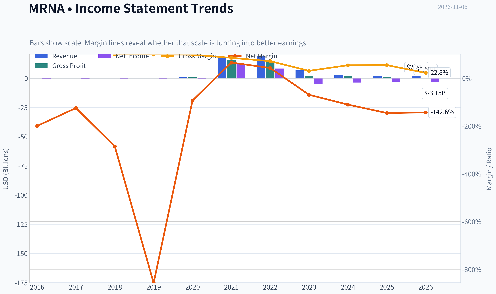

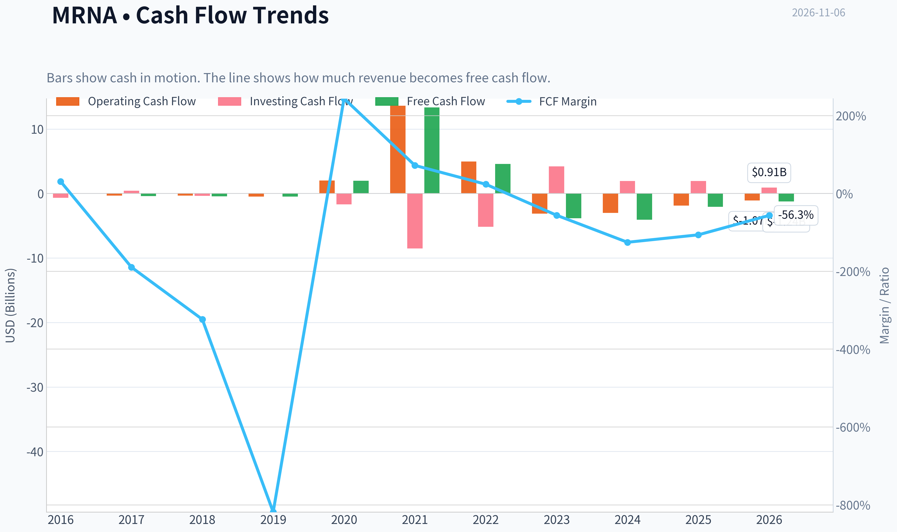

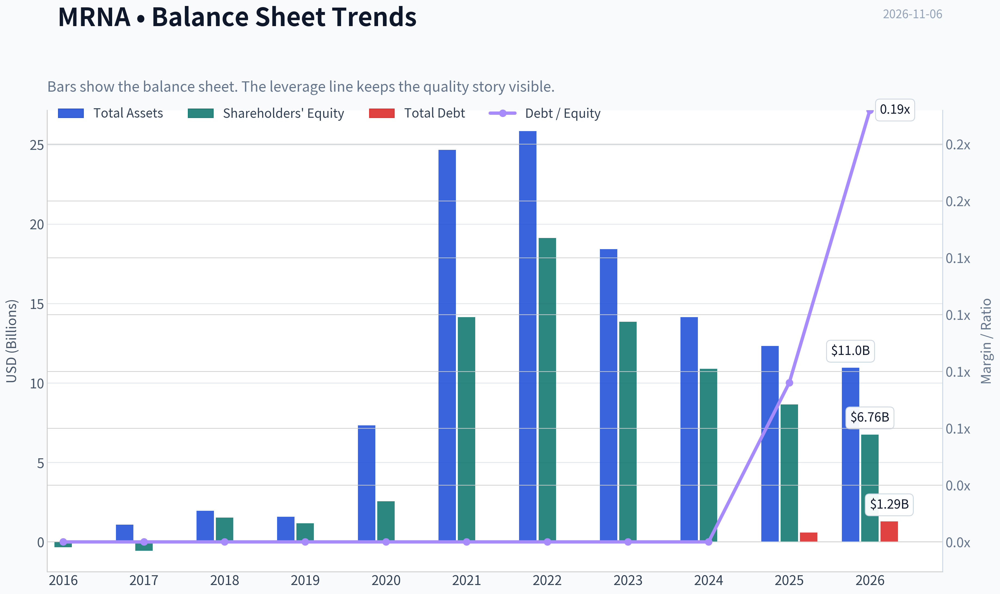

This graph tracks the profitability and return metrics (ROE, ROIC, Margins) of **MRNA** over the past decade, highlighting capital efficiency trends.

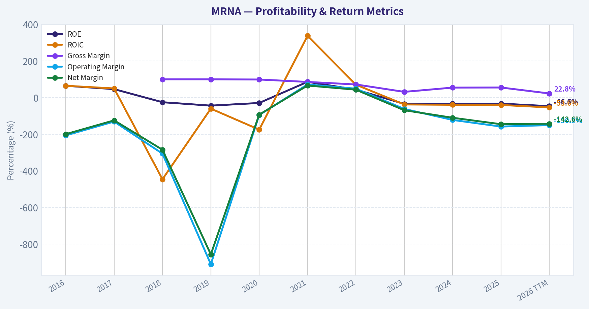

This chart illustrates the financial health of **MRNA** over the last 10 years, mapping cash equivalents and free cash flow against total obligations (Debt).

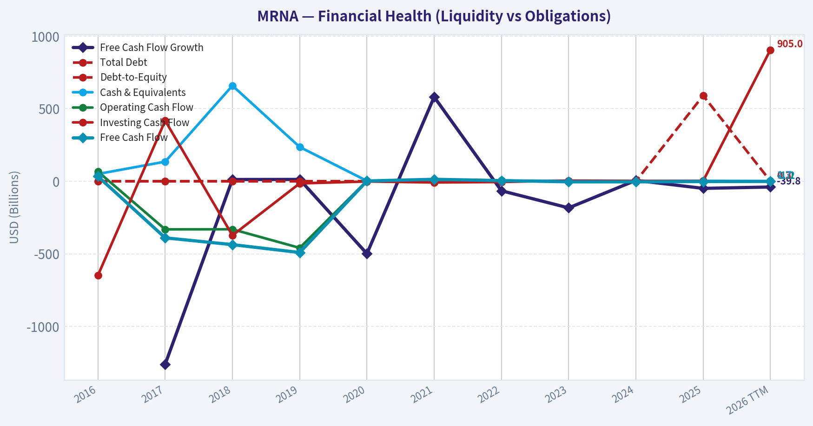

This comparison chart from *Profitability and Operating Performance* stacks current figures against historical benchmarks for **MRNA**, making it easy to see where the company trades relative to its own averages.

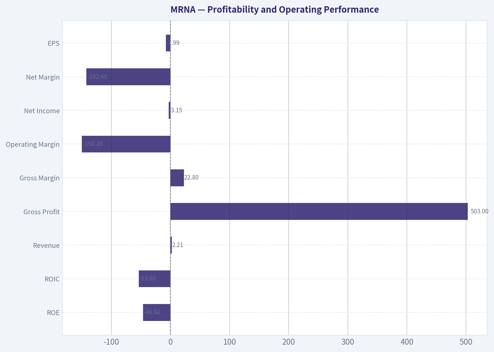

---

### Intrinsic Value Analysis (Buffett)

> *Following Warren Buffett's value investing philosophy: Circle of Competence, Economic Moat, Management Quality, and Margin of Safety.*

#### Intrinsic Value Snapshot

Price is what you pay. Intrinsic value is what the business may be worth based on the cash it can create for owners over time. We show a range, not one magic number.

- Current Price: $241.46
- Value Range (conservative to optimistic across both DCF methods): $415.17 to $1,079.44

##### Owner Earnings (Buffett Method)
- Net Income: $-2,822,000,000.00
- Depreciation & Amortization: $215,000,000.00
- Capital Expenditures: $-192,000,000.00
- Working Capital Changes: $233,000,000.00
- Owner Earnings: $-3,032,000,000.00

##### Intrinsic Value
###### Buffett Method
Uses owner earnings. Stricter, and usually more conservative.
- Conservative: $447.55
- Average: $447.55
- Optimistic: $447.55
- Discount Rate: 10.0%

###### Cash Flow Method
Uses free cash flow. Better for companies spending heavily today to grow tomorrow.
- Conservative: $415.17
- Average: $415.17
- Optimistic: $1,079.44
- Discount Rate: 10.0%

ANALYST STANCE: **Bearish**

#### Executive Summary

Moderna has a valuable mRNA platform, meaningful intellectual property, regulatory know-how, and a large cash-generating opportunity if its respiratory and oncology pipeline succeeds. However, the current business is undergoing a severe post-pandemic revenue reset: revenue is down 39.9% year over year, ROE is negative, and free cash flow is negative.

The headline owner-earnings valuation of $447.55 per share implies substantial upside from the $241 share price, but that valuation conflicts sharply with the negative current cash flow and a Damodaran FCFF value of negative $311.06 per share. The valuation therefore depends heavily on a successful return to normalized earnings. That is too speculative for a Buffett-style purchase today.

#### Factor Scorecard

| Factor | Score | Assessment |
|---|---:|---|
| 1. Circle of competence and simplicity | 2.5/5 | The business can be explained simply as a biotechnology company using mRNA to develop vaccines and medicines. However, outcomes depend on clinical trials, regulatory approvals, product adoption, and uncertain pipeline timing. |
| 2. Moat and competitive advantage | 3.5/5 | Strong mRNA platform expertise, patents, manufacturing capabilities, regulatory experience, and a large development pipeline. The moat is meaningful but not yet proven across multiple commercial products. |
| 3. Management and capital allocation | 3.0/5 | Founder-led management has built a valuable platform and funded substantial research. The main concern is whether spending and acquisitions will generate attractive per-share returns during the revenue downturn. |
| 4. Industry structure | 2.5/5 | Biotechnology has attractive intellectual-property economics but intense competition, binary clinical risk, regulatory dependence, and heavy research spending. |

**Gate 5 - Quality and solvency floor:** **Not tripped.** The earnings and cash-flow trajectory is worsening, but the available evidence does not indicate a solvency red line. The current ratio is approximately 3.3, which indicates substantial short-term liquidity.

**Key Takeaways:** Moderna scores well for technology and intellectual property but poorly for predictability and current earnings quality. Its balance sheet does not appear distressed, so this is not a solvency-driven avoidance. The central issue is that the investment thesis depends on future products replacing a rapidly shrinking COVID franchise.

#### Moat Analysis

| Moat source | Evidence | Durability assessment |
|---|---|---|
| Intangible assets | Proprietary mRNA technology, patent portfolio, clinical data, manufacturing expertise, and regulatory experience | Meaningful, but patents alone do not guarantee commercial success |
| Switching costs | Limited at the end-consumer level; governments, healthcare providers, and distributors can use competing vaccines | Moderate to weak |
| Cost advantages | Scale and specialized manufacturing may lower development and production costs | Potential advantage, but currently underutilized capacity is a concern |
| Network effects | Limited traditional network effects | Not a major source of advantage |
| Pipeline optionality | Respiratory vaccines, combination products, oncology, and other therapeutic programs | Valuable upside, but dependent on clinical and regulatory execution |

Gross margin is 55.3%, supporting the existence of valuable intellectual property and product economics. However, gross margin is not enough by itself to establish a durable moat when revenue is falling sharply and the commercial portfolio remains concentrated.

**Key Takeaways:** Moderna's strongest moat is its accumulated scientific, manufacturing, and regulatory capability. Its weakest areas are customer captivity and network effects. The moat could widen if multiple new products succeed, but it could narrow materially if competing vaccine technologies gain share or the pipeline fails.

#### Management Quality Assessment

Management deserves credit for building one of the world's leading mRNA platforms and converting the technology into a commercially important vaccine franchise. The company has also continued investing heavily in research rather than harvesting short-term profits.

The more difficult question is capital allocation. Moderna is spending against a future product portfolio while current revenue contracts sharply. That strategy can create substantial value if the pipeline succeeds, but it also creates a high risk of spending several billion dollars before the company establishes a durable earnings base.

The available evidence supports competent, ambitious management, but not yet the unusually high certainty required for an owner-oriented compounder. Capital allocation should be judged by future per-share cash generation, not by the size of the pipeline alone.

#### Financial Summary

| Metric | Latest available figure | Interpretation |
|---|---:|---|
| Share price | $241 | Current market price |
| Market capitalization | $96.40 billion | Large biotechnology valuation |
| Revenue growth | -39.9% year over year | Severe contraction |
| Gross margin | 55.3% | Strong product-level economics |
| ROE | -32.6% | Current losses are destroying accounting equity returns |
| FCF yield | -2.1% | Free cash flow is negative |
| Current ratio | 3.29 | Strong short-term liquidity |
| P/E | N/A | Earnings are negative or not meaningful |
| Headline intrinsic value | $447.55 | Owner-earnings DCF estimate |
| FCF-based intrinsic value | $415.17 | Still implies substantial upside |
| Damodaran FCFF value | -$311.06 | Signals severe valuation-model sensitivity |

**Key Takeaways:** Moderna has a strong gross margin and liquid balance sheet, but the current financial trend is unfavorable. Negative ROE, negative free cash flow, and nearly 40% revenue contraction are inconsistent with a high-confidence compounder. The wide gap between valuation models shows that the investment case is highly dependent on assumptions about future normalization.

#### Owner Earnings Calculation

Buffett-style owner earnings are calculated as:

**Owner Earnings = Net income + depreciation and amortization - maintenance capital expenditures - working-capital investment**

| Component | Available evidence | Assessment |
|---|---:|---|
| Net income | Negative or not meaningful at the latest snapshot | Current profitability is insufficient |
| Depreciation and amortization | Not provided in the research snapshot | Cannot be reliably added |
| Maintenance capital expenditure | Not separately provided | Cannot be separated from growth investment |
| Working-capital investment | Not separately provided | Cannot be reliably estimated |
| Free cash flow proxy | Approximately **-$2.0 billion**, based on a -2.1% yield on $96.4 billion market capitalization | Confirms negative current cash generation |

The headline $447.55 valuation appears to use normalized or cyclical owner earnings rather than current owner earnings. At the current run rate, Moderna does not provide a dependable positive owner-earnings base.

**Key Takeaways:** Current owner earnings are negative, so a conventional no-growth valuation based on present cash generation is not attractive. The positive intrinsic-value estimate requires a successful normalization of revenue, margins, and pipeline economics. That makes the valuation more speculative than the headline upside suggests.

#### Three-Scenario DCF Valuation

The research pack provides a cyclical owner-earnings valuation of $447.55 per share. To illustrate the assumptions embedded in that figure, the implied normalized owner earnings are approximately $44.76 per share under a 10% discount rate.

| Scenario | Core assumption | Implied value per share | Comment |
|---|---|---:|---|
| A. No growth | Normalized owner earnings of approximately $44.76 per share, discounted at 10% | $447.55 | Depends on normalization, not current earnings |
| B. GDP growth | Normalized owner earnings growing at 3% perpetually | Approximately $658 | Highly sensitive to the assumption that normalized earnings are durable |
| C. Cyclical/historical normalization | Owner-earnings DCF using a cyclical recovery framework | $447.55 | Headline research-pack estimate |
| Cross-check: FCF model | Cash-flow-based model | $415.17 | Also assumes meaningful future recovery |
| Cross-check: FCFF model | Damodaran FCFF valuation | **-$311.06** | Indicates extreme model and assumption risk |

**Key Takeaways:** The optimistic models show significant upside, but all positive values depend on future normalized earnings. The negative FCFF result is a serious warning that current cash economics do not support the headline valuation. The valuation range is too wide to justify treating $447.55 as a reliable estimate of intrinsic value.

#### Margin of Safety Analysis

At $241 per share, the headline $447.55 estimate implies a 46.0% margin of safety. That would normally be attractive even for an average-quality business. However, the margin of safety is only meaningful if the normalized earnings assumption is credible.

| Valuation consideration | Assessment |
|---|---|
| Headline DCF margin of safety | 46.0% |
| Quality-adjusted requirement | Approximately 40%-50% for a low-visibility, cyclical biotechnology business |
| Current cash-flow support | Weak; FCF yield is negative |
| Reverse-DCF implication | The price requires a substantial future earnings recovery, but not necessarily impossible pipeline success |
| Model reliability | Low, due to the $447.55 owner-earnings value versus negative FCFF cross-check |

The price is not obviously irrational if Moderna successfully commercializes several pipeline products. But the market price does not provide a sufficiently clear margin of safety against pipeline failure, continued COVID decline, or prolonged cash burn.

#### Final Buffett Scorecard

| Criterion | Weight | Score | Weighted contribution |
|---|---:|---:|---:|
| Moat width and durability | 25% | 3.5/5 | 0.88 |
| Valuation and margin of safety | 20% | 2.0/5 | 0.40 |
| Capital returns: ROIC versus WACC | 15% | 1.5/5 | 0.23 |
| Business understanding and predictability | 12% | 2.5/5 | 0.30 |
| Management and capital allocation | 12% | 3.0/5 | 0.36 |
| Reinvestment runway | 8% | 4.0/5 | 0.32 |
| Balance-sheet strength | 4% | 4.0/5 | 0.16 |
| Industry structure | 4% | 2.5/5 | 0.10 |
| **Total** | **100%** |  | **2.75/5** |

**Key Takeaways:** Moderna's platform and reinvestment runway prevent it from being a low-quality company, but current returns on capital and cash generation are weak. The valuation score is reduced because the bullish DCF depends on uncertain normalization and conflicts with a negative FCFF valuation. The total score falls in the avoid range.

#### Investment Stance

**Bearish - Moderate conviction**

Moderna is a scientifically important company with genuine long-term optionality, but it is not currently a Buffett-style high-confidence compounder. The company must prove that its pipeline can replace declining COVID revenue, restore positive free cash flow, and earn attractive returns on the large research investments being made today.

A more compelling entry would require either:

1. Clear evidence of successful commercial launches and recurring positive owner earnings; or
2. A materially lower share price that compensates investors for clinical, regulatory, competitive, and cash-flow uncertainty.

The balance sheet prevents a distress-level conclusion, but the current combination of falling revenue, negative ROE, negative free cash flow, and highly divergent valuation models makes the stock unsuitable for purchase today.
#### Valuation Bridge

This bridge places the current market price beside each intrinsic value lens so readers can see whether upside depends on one method or shows up across several methods.

| Scenario | Intrinsic Value / Share |
| --- | ---: |
| Buffett Method | $447.55 |
| Cash Flow Method | $415.17 |
| Damodaran Method | $-311.06 |
| Current Price | $241.46 |

#### Key Takeaways

If one method is far above the others, the upside case depends on a specific modelling assumption. When several methods cluster together, the valuation story is more robust.

#### Valuation Visuals

This comparison chart from *Latest Earnings Snapshot* stacks current figures against historical benchmarks for **MRNA**, making it easy to see where the company trades relative to its own averages.

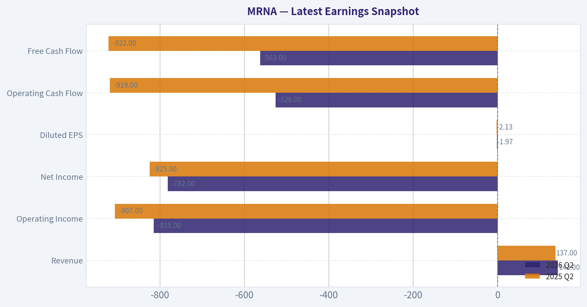

This comparison chart from *Balance Sheet and Financial Strength* stacks current figures against historical benchmarks for **MRNA**, making it easy to see where the company trades relative to its own averages.

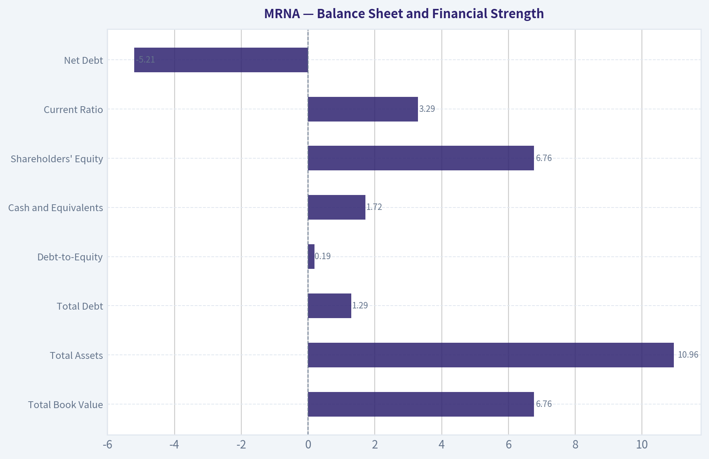

This comparison chart from *Current Versus Historical Position* stacks current figures against historical benchmarks for **MRNA**, making it easy to see where the company trades relative to its own averages.

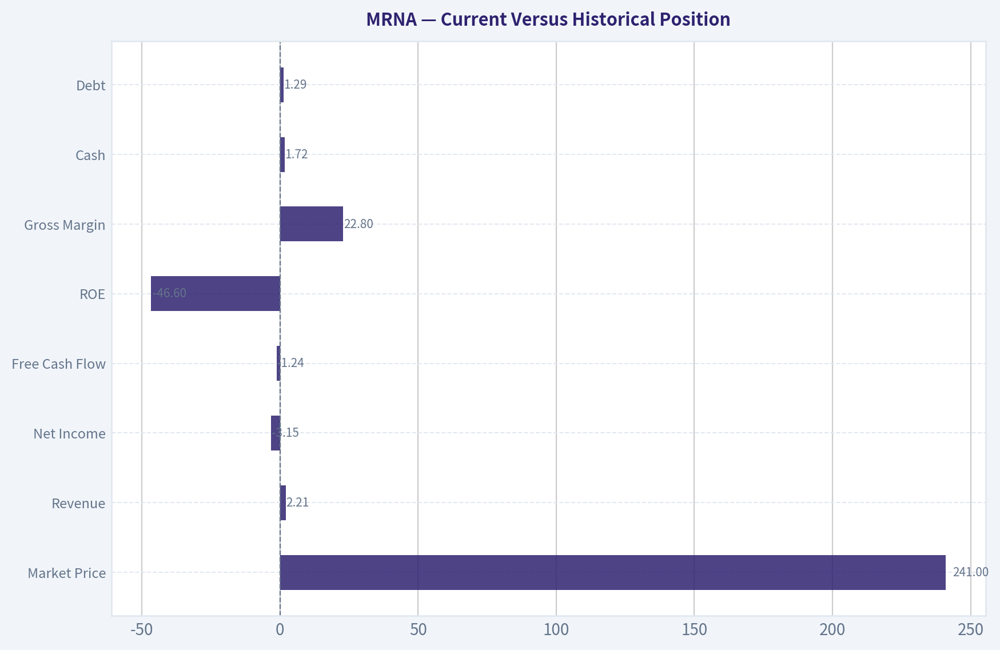

This comparison chart from *Buffett-Style Owner Earnings DCF* stacks current figures against historical benchmarks for **MRNA**, making it easy to see where the company trades relative to its own averages.

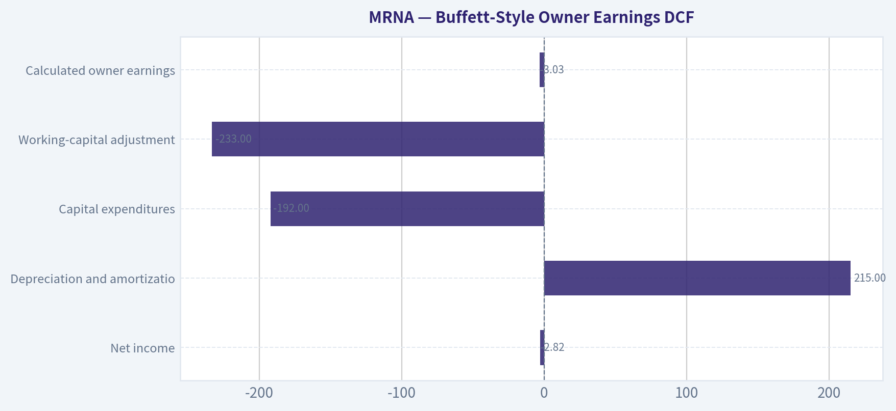

---

### Trend & Growth Analysis (Lynch/Druckenmiller/Fisher)

> *Following Peter Lynch's GARP, Stanley Druckenmiller's macro-aware approach, and Philip Fisher's scuttlebutt methodology.*

ANALYST STANCE: **Neutral**

#### 1. Lynch Classification

**Turnaround / potential fast grower, but currently a cyclical biotech.**

Moderna is not presently a conventional fast grower: revenue is declining sharply, earnings are negative, and COVID-related demand has normalized. The investment case depends on a successful product-cycle turnaround across influenza, combination vaccines, RSV, oncology, and other mRNA programs.

#### 2. The Story in Three Bullets

- Moderna is transitioning from a COVID-vaccine company into a broader mRNA vaccine and therapeutics platform.
- New products, including influenza and combination influenza/COVID vaccines, could create a second commercial growth leg; Health Canada authorized both mFLUSIVA and mCOFLU in November 2026.
- The stock offers substantial upside if the pipeline commercializes successfully, but the market is correctly demanding proof that non-COVID products can replace lost COVID revenue.

#### 3. TAM and Runway

| Area | Growth opportunity | MRNA position | Assessment |
|---|---:|---|---|
| Seasonal influenza vaccines | Large, recurring global market | Early commercial entrant in mRNA influenza | Attractive but competitive |
| Combination respiratory vaccines | Expanding convenience and adherence opportunity | Product authorization progress | Potential inflection |
| RSV and other respiratory vaccines | Large established markets | Development/commercialization dependent | Meaningful runway |
| Personalized cancer vaccines | Very large long-term opportunity | High clinical and regulatory risk | Option value, not current revenue |
| mRNA therapeutics platform | Broad potential across infectious disease and oncology | Technology platform with substantial R&D | High upside, uncertain timing |

**10x test:** Using approximately **$5 billion of current annualized revenue as a rough scale reference**, 10x revenue would be approximately **$50 billion**. A $50 billion revenue outcome could remain below 20% of the combined global vaccine and mRNA therapeutics opportunity, so the theoretical runway is sufficient. However, achieving that outcome requires several products to succeed; the current pipeline does not yet justify treating the TAM as revenue.

**Key Takeaways:** Moderna has a very large theoretical market and can pass the 10x runway test. The constraint is not TAM but execution: the company must replace declining COVID sales with multiple successful products rather than one blockbuster.

#### 4. Revenue Growth Trend

| Metric | Latest indication | Interpretation |
|---|---:|---|
| Revenue growth year over year | **-39.9%** | Severe contraction |
| COVID revenue | Declining materially | Structural normalization |
| New product contribution | Emerging | Not yet sufficient to offset COVID decline |
| Growth pattern | Decelerating/turnaround phase | No confirmed acceleration |
| Gross margin | **55.3%** | Still meaningful, but below peak pandemic economics |

**Key Takeaways:** Revenue is currently contracting rather than accelerating, which fails the primary Druckenmiller inflection test. The key question is whether new respiratory products can produce sequential revenue acceleration during the next few reporting periods.

#### 5. Unit Economics and Operating Efficiency

| Measure | Data status / result | Assessment |
|---|---:|---|
| LTV/CAC | Not disclosed in a standard SaaS format | Not applicable |
| Net revenue retention | Not applicable | Product-sales model |
| Rule of 40 | Not meaningful while revenue and FCF are negative | Fails currently |
| Free-cash-flow yield | **-2.1%** | Cash consumption |
| Current ratio | **3.29** | Strong near-term liquidity |
| ROE | **-32.6%** | Negative profitability |
| Dilution/runway | No acute liquidity warning from current ratio; cash burn remains important | Monitor closely |

**Key Takeaways:** Moderna's balance sheet appears capable of supporting continued development in the near term, but liquidity is not the same as economic success. Negative free cash flow, negative ROE, and declining revenue mean the company has not yet demonstrated attractive operating economics.

#### 6. Inflection Point Assessment

| Potential inflection | Current evidence | Status |
|---|---|---|
| Product-cycle inflection | Authorizations for mFLUSIVA and mCOFLU in Canada | Early positive |
| Market-share inflection | Not yet demonstrated | Unproven |
| Margin inflection | Gross margin remains positive, but revenue mix is changing | Unconfirmed |
| TAM inflection | Combination vaccines and mRNA therapeutics expand the opportunity | Positive long term |
| Competitive inflection | No clear major competitor failure | Neutral |
| Earnings inflection | Losses and negative FCF remain | Not yet visible |

The November 2026 Canadian authorizations are a constructive catalyst, but authorization is not equivalent to commercial adoption. The real inflection would be visible through growing launch revenue, improving guidance, better manufacturing utilization, and a narrowing cash burn.

#### 7. Macro Setup

| Macro factor | Effect on MRNA |
|---|---|
| Interest rates | Higher rates pressure long-duration pipeline valuations; falling rates would help |
| Healthcare spending | Generally defensive, but vaccine demand is policy- and season-sensitive |
| Government procurement | Can materially affect COVID and respiratory vaccine volumes |
| Biotech risk appetite | Important for valuation and financing conditions |
| Regulatory environment | A major determinant of pipeline value |

**Key Takeaways:** Moderna has mixed macro exposure. Healthcare demand is relatively defensive, but biotech valuations and long-duration pipeline assets are sensitive to interest rates and investor risk appetite. Macro conditions are not currently strong enough to override company-specific execution risk.

#### 8. Fisher's 15-Point Score

| Fisher criterion | Score / 5 | Commentary |
|---|---:|---|
| Market potential | 5 | Large vaccine and therapeutics opportunities |
| New-product determination | 5 | Broad and active pipeline |
| R&D effectiveness | 4 | Proven COVID platform; broader success still pending |
| Sales organization | 3 | Commercial execution outside COVID remains to be proven |
| Profit margins | 2 | Current profitability is weak or negative |
| Margin trend | 2 | No confirmed operating leverage |
| Labor relations | 3 | Insufficient public evidence |
| Executive relations | 3 | Insufficient public evidence |
| Management depth | 4 | Substantial scientific and operating capabilities |
| Cost analysis/accounting | 3 | No clear edge established |
| Special competitive advantages | 4 | mRNA know-how, manufacturing, data, and platform capability |
| Long-range profit outlook | 4 | High upside, but highly uncertain |
| Dilution risk | 3 | Monitor cash burn and future funding needs |
| Management candor | 3 | Mixed/insufficient evidence in available data |
| Management integrity | 4 | No major integrity issue identified |

**Fisher score: 52/75 - Average, with high optionality.**

**Key Takeaways:** Moderna scores well on market opportunity, R&D ambition, and platform advantages. It scores poorly on current margins and operating proof, keeping the overall Fisher assessment in the average range rather than outstanding.

#### 9. Valuation Analysis

| Method | Result | Interpretation |
|---|---:|---|
| P/E and PEG | Not meaningful; earnings are negative | Cannot apply Lynch's standard PEG |
| Current market capitalization | **$96.4 billion** | Requires substantial future product success |
| Price | **$241** | High expectations remain despite revenue decline |
| Headline owner-earnings intrinsic value | **$447.55** | Very bullish cyclical DCF outcome |
| FCF-based value | **$415.17** | Also bullish, but dependent on recovery |
| Damodaran FCFF value | **Negative $311.06** | Highlights sensitivity to current cash-flow assumptions |
| Headline margin of safety | **46%** | Model-dependent and not reliable without earnings normalization |

**Key Takeaways:** The valuation range is extremely wide, from negative value under a stressed FCFF model to more than $400 per share under recovery-oriented models. This dispersion signals that valuation is primarily a bet on future product commercialization, not a stable current earnings stream.

#### Revenue-Multiple Scenario Framework

| Scenario | Assumption | Indicative outcome |
|---|---|---|
| Bear | COVID decline persists; pipeline launches underwhelm; cash burn continues | Significant downside risk |
| Base | Respiratory products gain adoption and revenue stabilizes within several years | Potentially acceptable return, but dependent on execution |
| Bull | Multiple vaccines and therapeutics succeed; revenue reaccelerates materially | Multi-bagger potential |

A conventional P/S valuation is difficult because current revenue is falling and future revenue composition is uncertain. At approximately a **$96 billion market capitalization**, Moderna requires a credible path toward much higher and more durable revenue than today.

#### 10. Growth Investor Scorecard

| Criterion | Weight | Score / 5 | Weighted contribution |
|---|---:|---:|---:|
| Lynch story | 10% | 4.0 | 0.40 |
| TAM and runway | 20% | 4.5 | 0.90 |
| Revenue growth | 20% | 1.5 | 0.30 |
| Unit economics | 15% | 2.0 | 0.30 |
| Competitive position | 10% | 4.0 | 0.40 |
| Management quality | 10% | 3.5 | 0.35 |
| Macro setup | 5% | 3.0 | 0.15 |
| Profitability path | 5% | 2.5 | 0.13 |
| Valuation | 5% | 2.5 | 0.13 |
| **Total** | **100%** | - | **3.06 / 5.00** |

**Key Takeaways:** Moderna's score of approximately **3.1 out of 5** places it in the Neutral category. The company has an exceptional runway and meaningful platform advantages, but current revenue contraction and uncertain profitability prevent a high-conviction growth-investor rating.

#### 11. Position Size Stance

**Suggested stance: Watch position only; approximately 0% to 1% for a diversified growth portfolio until revenue reaccelerates.**

A larger position would require evidence of:

1. Commercial uptake of influenza and combination vaccines.
2. Sequential revenue growth rather than merely easier comparisons.
3. Reduced operating losses and cash burn.
4. Positive clinical or regulatory progress across additional pipeline programs.
5. No material equity dilution.

The stock could have significant upside in a successful turnaround, but its binary pipeline exposure makes it unsuitable as a core fast-growth holding today.

#### 12. Key Risks and Catalysts

| Catalysts | Risks |
|---|---|
| Commercial launch of mFLUSIVA and mCOFLU | New products fail to offset COVID decline |
| Positive RSV, oncology, or combination-vaccine data | Clinical or regulatory failures |
| Revenue reacceleration | Persistent negative free cash flow |
| Improving manufacturing utilization and margins | Government procurement volatility |
| Falling interest rates and renewed biotech appetite | Competitive pressure from established vaccine makers |
| Successful personalized cancer-vaccine commercialization | Future dilution if cash burn remains high |

**Bottom line:** Moderna has genuine ten-bagger-style optionality because its platform could address several large markets, but the current evidence shows a turnaround story rather than a confirmed growth inflection. I would wait for commercial proof-especially accelerating revenue and falling cash burn-before upgrading from **Neutral** to **Bullish**.

---

### Market Technical Analysis

ANALYST STANCE: **Neutral**

#### MRNA technical overview

MRNA closed at **$241.46 on November 5, 2026**, after reaching an intraday high of **$261.00**. The broader technical structure remains strongly bullish: price is above its short-, medium-, and long-term moving averages, while volume-weighted price measures also remain supportive. However, the stock is experiencing unusually large daily ranges, and the recent reversal from above $258 introduces meaningful short-term downside risk.

The selected indicators are:

- **10 EMA** - short-term momentum and dynamic support.
- **50 SMA** - intermediate trend confirmation.
- **200 SMA** - long-term regime identification.
- **MACD** - directional momentum and trend acceleration.
- **RSI** - momentum strength and overextension risk.
- **ATR** - volatility and position-sizing risk.
- **VWMA** - price trend confirmed by trading volume.
- **Bollinger Upper Band** - breakout and near-term extension assessment.

#### Trend structure

MRNA's closing price is substantially above all three moving averages:

- The **10 EMA is $228.99**, placing price approximately **5.4% above** its short-term trend line.
- The **50 SMA is $189.62**, with price approximately **27.3% higher**.
- The **200 SMA is $90.46**, leaving price approximately **166.9% above** the long-term average.

This is a strong bullish alignment. The 10 EMA, 50 SMA, and 200 SMA are all rising, and the shorter averages are positioned above the longer averages. That configuration generally indicates sustained upward momentum rather than a merely brief rebound.

The distance from the 200 SMA is particularly large, though. It confirms a powerful long-term trend, but it also shows that MRNA is significantly extended relative to its historical baseline. The 200 SMA should therefore be treated as a regime indicator rather than an actionable nearby support level.

#### Recent price action and momentum

MRNA advanced from approximately **$199 in late October to $258.38 on November 4**, before retreating to $241.46 on November 5. The latest decline was substantial, but it followed a rapid advance and did not yet break the rising 10 EMA.

The short-term trend remains constructive while price holds above roughly **$229**, the current 10 EMA. A close below that level would not automatically invalidate the larger bullish trend, but it would indicate that the recent acceleration is losing strength. The next more important trend reference is the VWMA near **$218.62**, followed by the 50 SMA near **$189.62**.

The **VWMA is below the current price but rising**, which means the volume-weighted average participant remains profitable on a broad recent basis. Price above VWMA is supportive, although the gap is now large enough that a pullback toward VWMA would be technically normal rather than necessarily bearish.

#### MACD interpretation

The MACD reading was **13.22 on November 5**, remaining clearly positive. This confirms that the intermediate trend still has bullish momentum. However, MACD has declined from approximately **21.35 on October 21** to below **11 during late October**, before recovering.

That pattern suggests two distinct phases:

1. Momentum weakened materially during the late-October consolidation and selloff.
2. Momentum has since reaccelerated, but the current MACD level has not fully exceeded its earlier peak.

This is bullish but not unequivocally explosive. If MRNA breaks above the recent $261 high while MACD also rises decisively above its prior peak, that would provide stronger confirmation of renewed acceleration. Conversely, a price breakout accompanied by a declining MACD would create a potential bearish divergence.

#### RSI interpretation

The RSI was **60.39 on November 5**, down from **68.15 on November 4**. This is an important moderation.

RSI is no longer near the conventional overbought threshold of 70, so the indicator does not currently signal a fully exhausted market. At the same time, the sharp one-day decline from 68 to 60 shows that momentum cooled quickly after the stock approached its recent high.

The RSI profile is therefore best described as **bullish but no longer aggressively overbought**. A sustained RSI reading above 60 would support trend continuation. A decline below 50, especially alongside a close beneath the 10 EMA, would indicate that the recent rally is transitioning into a deeper correction.

#### Volatility and risk management

The ATR is approximately **$20.20**, meaning MRNA's recent average daily trading range is roughly **8.4% of the latest closing price**. This is exceptionally high for position-management purposes.

With ATR at this level, conventional tight stop-loss orders are vulnerable to being triggered by normal intraday fluctuations. Traders should account for:

- Smaller position sizes.
- Wider, volatility-adjusted stops.
- Greater slippage risk during gap moves.
- The possibility that technical levels are breached temporarily before price reverses.

The recent session also illustrates this risk: MRNA traded from **$237.65 to $261.00** on November 5, a range of more than $23. Such movement makes directional conviction less important than controlling exposure.

#### Bollinger Band and resistance assessment

The Bollinger Upper Band was approximately **$254.87** on November 5. MRNA closed below that level after trading above it intraday, which suggests that the stock tested a statistically extended zone but failed to sustain the breakout through the close.

The area from approximately **$255 to $261** is therefore the immediate resistance and confirmation zone. A strong close above that region, ideally with expanding volume and a rising MACD, would support continuation. Failure near that zone could encourage mean reversion toward the 10 EMA around $229 or the VWMA around $219.

Because the upper band is rising, an upper-band test is not automatically bearish. In a strong trend, price can remain near or above the upper band for several sessions. The bearish signal would be a rejection followed by a close beneath the middle Bollinger region and the 10 EMA.

#### Volume considerations and data caveat

Recent volume has remained elevated, particularly during large price movements. The November 4 advance occurred on approximately **14.8 million shares**, while November 5 traded approximately **11.9 million shares** during the pullback. The decline therefore occurred on lower volume than the prior upside surge, which is mildly constructive, although not enough to eliminate reversal risk.

The historical dataset contains a very large discontinuity around **August 19, 2026**, when the reported price moved from the low-$60s to the $170s. This may reflect a corporate action, a data-adjustment issue, or another exceptional event. Because moving averages and momentum calculations incorporate that history, longer-term indicator levels should be interpreted with caution. The current short- and intermediate-term readings are more useful for decision-making than mechanically comparing today's price with the pre-August series.

#### Trading implications

The technical evidence favors a **bullish trend-following bias**, but not an aggressive chase at current volatility levels.

A continuation setup would become more credible if MRNA:

- Holds above the 10 EMA near **$229**.
- Reclaims and closes above **$255-$261**.
- Shows rising MACD rather than momentum divergence.
- Maintains RSI above approximately 55-60.
- Produces a breakout with expanding volume.

A pullback setup would become more attractive if price retreats toward **$229-$219** and stabilizes while RSI resets without collapsing below 50. A close below the VWMA near $219 would weaken the short-term structure, while a sustained break below the rising 50 SMA near $190 would represent a much more consequential trend deterioration.

Overall, MRNA is technically bullish but highly extended and unusually volatile. The most balanced approach is to **watch for confirmation or a controlled pullback**, rather than treating the recent rally as a low-risk entry.

| Indicator | Latest reading | Interpretation | Important levels or trigger |
|---|---:|---|---|
| Price | $241.46 | Strongly above major trend averages; recent rejection from $261 | Resistance: $255-$261 |
| 10 EMA | $228.99 | Short-term trend remains bullish | Holding above $229 supports continuation |
| 50 SMA | $189.62 | Intermediate trend is strongly positive | Major medium-term reference near $190 |
| 200 SMA | $90.46 | Long-term trend regime is bullish, but price is very extended | Strategic trend reference, not nearby support |
| MACD | 13.22 | Positive momentum, recovering after late-October weakness | Stronger confirmation above prior MACD peak |
| RSI | 60.39 | Bullish momentum without current overbought conditions | Below 50 would weaken momentum materially |
| ATR | $20.20 | Extremely high volatility; approximately 8.4% of price | Use smaller sizing and wider volatility-based stops |
| VWMA | $218.62 | Volume-weighted trend remains supportive | Loss of $219 would weaken the short-term setup |
| Bollinger Upper Band | $254.87 | Price tested an extended zone but closed below it | Sustained close above $255-$261 favors breakout |

**Key Takeaways:** MRNA remains in a powerful bullish trend, with price above every major moving average and a positive MACD. However, volatility is exceptionally high, and the failed hold above the $255-$261 area creates short-term reversal risk. The key levels are approximately $229 for short-term trend support, $219 for volume-weighted support, and $255-$261 for breakout confirmation.

#### Market Visuals

This comparison chart from *Market Metrics* stacks current figures against historical benchmarks for **MRNA**, making it easy to see where the company trades relative to its own averages.

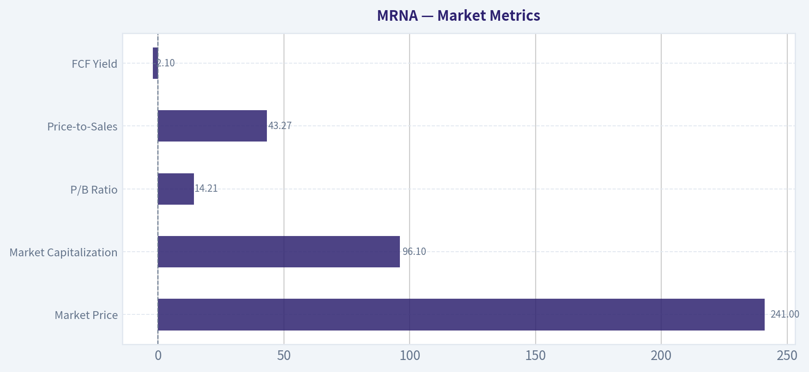

---

### Options Market Analysis

> *Reading options flow - put/call ratios, IV skew, and unusual activity - to gauge institutional positioning and event-driven risk.*

ANALYST STANCE: **Neutral**

#### MRNA Options Flow Report

**Data date:** November 6, 2026
**Near-term expirations analyzed:** November 6, November 13, and November 20, 2026

#### 1. Put/Call Ratio Analysis

| Expiration | Call Volume | Put Volume | Volume Put/Call Ratio | Call OI | Put OI | OI Put/Call Ratio |
|---|---:|---:|---:|---:|---:|---:|
| Nov. 6, 2026 | 23,740 | 57,172 | 2.41 | 0 | 0 | N/A |
| Nov. 13, 2026 | 4,220 | 8,011 | 1.90 | 0 | 0 | N/A |
| Nov. 20, 2026 | 4,008 | 15,041 | 3.75 | 0 | 0 | N/A |
| **Total** | **31,968** | **80,224** | **2.51** | **0** | **0** | **N/A** |

**Key Takeaways:** MRNA's near-term put volume is approximately 2.5 times call volume, substantially above the roughly 0.7 historical neutral baseline. That indicates defensive hedging or bearish speculation, with the strongest imbalance in the November 20 expiration. However, reported open interest is zero across all expirations, making the ratio impossible to validate as an established-position signal.

#### 2. Implied Volatility Assessment

| Expiration | Call ATM IV | Put ATM IV | Relative IV Signal |
|---|---:|---:|---|
| Nov. 6, 2026 | 5.9% | 5.9% | Balanced |
| Nov. 13, 2026 | 2.0% | 1.6% | Slight call premium |
| Nov. 20, 2026 | 0.7% | 2.1% | Strong put premium |
| **Near-term pattern** | - | - | Put-side premium in later expiry |

**Key Takeaways:** The November 20 chain shows a notable put IV premium, consistent with greater demand for downside protection over the next two weeks. Absolute IV readings are extraordinarily low for a biotech stock and may reflect incomplete, stale, or malformed market data rather than genuinely minimal event risk. No reliable out-of-the-money strike-level skew was supplied, so the put-skew conclusion is based on the available ATM IV comparison only.

The data does not identify an upcoming catalyst. Therefore, the elevated relative put IV in the November 20 expiry cannot be confidently attributed to earnings, regulatory news, clinical data, or another specific event.

#### 3. Unusual Options Activity

| Finding | Result |
|---|---|
| Contracts with volume greater than 5x open interest | None identified |
| Fresh directional bets | Cannot confirm |
| Smart-money versus retail activity | Cannot determine |
| Strike-level analysis | Not available from the supplied data |

**Key Takeaways:** No individual contract met the tool's unusual-activity threshold. Because open interest is reported as zero, the absence of flagged contracts should not be interpreted as an absence of institutional activity; it may instead indicate incomplete chain data. There is insufficient information to identify strikes, moneyness, or whether trades were opening purchases versus closing transactions.

#### 4. Open Interest Concentration and Gamma Levels

| Metric | Observation |
|---|---|
| Highest call OI strikes | Not available; total call OI reported as zero |
| Highest put OI strikes | Not available; total put OI reported as zero |
| Major expiration concentration | Not measurable |
| Gamma walls or pinning levels | Cannot identify |
| Max-pain analysis | Not possible |

**Key Takeaways:** The reported zero open interest prevents meaningful analysis of gravitational strikes, max pain, or gamma walls. There is no evidence from this dataset that options positioning will pin MRNA near a particular price level or amplify a move through dealer hedging.

#### 5. Overall Options Sentiment

| Signal Component | Assessment |
|---|---|
| Put/call volume | Bearish; 2.51 aggregate ratio |
| Put/call open interest | Unavailable |
| IV skew | Mild-to-strong downside bias in the November 20 data |
| Unusual activity | None confirmed |
| Confidence | Low, due to data-quality limitations |
| **Overall signal** | **BEARISH, low conviction** |

**Key Takeaways:** The directional read is bearish because put volume materially exceeds call volume and the later near-term expiry carries a meaningful put IV premium. Nevertheless, zero reported open interest, extremely low IV values, and the lack of strike-level data substantially reduce confidence. This should be treated as a defensive-risk signal rather than proof of aggressive institutional shorting.

#### Summary

| Category | Assessment |
|---|---|
| Put/Call Ratio | 2.51 by volume, well above the approximately 0.7 neutral baseline; bearish or defensive |
| IV Level | Reported IV is unusually low and may be unreliable |
| Skew Direction | Downside/put skew, especially for November 20 |
| Unusual Activity | No contracts exceeded 5x open interest; no fresh bets confirmed |
| Overall Signal | **BEARISH, low conviction** |

MRNA options flow currently points to **bearish near-term sentiment**, driven primarily by heavy put volume and relatively expensive puts in the November 20 expiry. The **Neutral** stance reflects significant data-quality issues: zero open interest across the chain, unavailable strike details, and implausibly low IV readings.

---

## Research Team Commentary

> *The Research Manager synthesizes the Bull vs Bear debate into action-free commentary. This is a pre-risk view, not the final stance.*

Core Takeaway: Moderna may own a valuable mRNA development platform, but at $241 the stock is priced more like a proven compounder than a company still trying to replace a rapidly shrinking COVID franchise. The Canadian authorizations for mFLUSIVA and mCOFLU strengthen the scientific and regulatory case, but they do not yet establish adoption, pricing power, or recurring owner earnings. Given the demanding implied cash-flow expectations and absence of a demonstrated margin of safety, I would avoid initiating or adding to a position at this price.

The strongest bull argument is that Moderna should not be analyzed as a single-product COVID company. Its intellectual property, delivery expertise, manufacturing infrastructure, clinical data, and regulatory experience could form a reusable platform. If multiple products can share that infrastructure, incremental economics may eventually become much better than the current company-level results suggest. Annual respiratory vaccination could provide recurring demand, while combination vaccines offer tangible convenience to patients and providers. The 55.3% gross margin also suggests potentially attractive product economics before R&D and corporate costs.

The Health Canada authorizations are meaningful evidence. They reduce the probability that Moderna's pandemic success was entirely a one-product accident and show that the platform can generate additional approvable products. Therapeutic programs provide further upside, although they should be treated as probability-weighted optionality rather than included at full value.

The bear case is nevertheless more persuasive at the current price. Revenue is declining 39.9%, while ROIC of -91.1%, ROE of -32.6%, and ROA of -22.9% show that the platform is not presently producing satisfactory economic returns. Some of this reflects deliberate investment during a transition, but negative returns cannot be dismissed indefinitely as temporary. In biotechnology, a meaningful portion of R&D is an ongoing cost of sustaining the franchise, not simply discretionary growth investment.

More importantly, authorization is not commercial validation. Moderna must still demonstrate meaningful market share, repeat seasonal demand, broad reimbursement, durable net pricing, efficient manufacturing, and attractive contribution margins. Vaccine buyers have alternatives, provider switching costs are limited, and public-health recommendations can materially affect demand. A reusable platform may reduce development time, but it does not eliminate product-specific clinical and commercial risk.

Valuation is the decisive issue. The simplified reverse DCF indicates that $241 requires approximately $27 per share of sustainable free cash flow by year six using a 10% required return and 3% perpetual growth. Using an 11%-12% required return, which is more defensible for a pipeline-dependent company with negative current returns, raises the hurdle toward roughly $33-$43 per share.

Those estimates are not a complete valuation. The analysis lacks net cash, debt, share count, expected cash burn, dilution, and interim cash flows. Excess cash could materially reduce the burden placed on the operating business. Conversely, cumulative losses and dilution could increase it. This limitation argues against false precision, but it does not create a margin of safety. With the available evidence, investors are still being asked to underwrite a rapid transition from deeply negative returns to substantial and durable free cash flow.

A 10%-15% margin of safety would be appropriate for a predictable, wide-moat compounder. Moderna has not yet earned that classification. Its cash flows remain exposed to clinical outcomes, reimbursement, seasonal uptake, competition, public sentiment, and management's pipeline allocation. It therefore warrants a materially wider discount than a company such as an established consumer franchise or mature asset-light platform.

Management deserves credit for extraordinary scientific and operational execution during the pandemic and for securing additional authorizations. Capital allocation remains less proven. The next test is whether management can prioritize the highest-return programs, terminate weak projects, align operating expenses with realistic demand, protect liquidity, and avoid dilution or acquisitions designed merely to replace lost revenue. Scientific accomplishment and shareholder-value creation are related, but they are not identical.

The elevated near-term put/call ratio-put volume around 2.5 times call volume-shows defensive or bearish positioning, but it should not drive a ten-year investment decision. It may foreshadow volatility around launches or earnings, not intrinsic value. If anything, it becomes relevant only if short-term pessimism eventually produces a price far below a conservatively calculated value.

Rationale: The lesson from similar situations is not to confuse technological importance with an attractive investment at any price. Pandemic earnings were a windfall rather than a reliable baseline, pipeline assets cannot be valued like contracted revenue, and approval headlines cannot substitute for cash conversion. Moderna could ultimately become a strong platform business, but the current price requires investors to pay for much of that transformation before its economics are visible. Present fundamentals and the valuation hurdle do not provide sufficient protection against execution failure or delay.

Monitoring Plan: Over the next one to four quarters, I would focus on the following:

First, track launch performance for mFLUSIVA and mCOFLU, including prescriptions or doses, market share, reimbursement coverage, net pricing, repeat orders, and management's guidance relative to actual results. Initial channel stocking should not be confused with sustainable end demand.

Second, separate non-COVID product revenue from the legacy COVID franchise. The thesis strengthens if new-product growth begins to offset COVID contraction rather than merely reducing the rate of decline.

Third, monitor gross margin and cash contribution by product where disclosed. A stable 55% gross margin is useful, but the more important question is whether launches generate positive cash returns after manufacturing, selling, and ongoing R&D costs.

Fourth, watch operating expenses, free cash flow, cash burn, and net cash per share. Evidence that losses are narrowing without sacrificing the highest-value programs would improve the capital-allocation assessment. Accelerating burn, dilution, or persistently poor returns would reinforce the bear case.

Fifth, follow regulatory decisions and pivotal data, but distinguish platform validation from economic value. Approvals matter most when paired with competitive efficacy, tolerability, convenient administration, and commercially viable labeling.

Finally, update the reverse DCF each quarter using actual net cash, diluted shares, launch economics, and management's spending trajectory. The stance could improve to Neutral if commercial evidence becomes encouraging or the valuation falls substantially. It would merit Bullish only when plausible, probability-weighted owner earnings exceed the market's embedded expectations with an appropriately wide margin of safety.

Final stance: Bearish.

---

## Value Investing Team Commentary

> *The Investor translates the research view into an investment thesis before risk review. This is still not the final stance.*

### Investment Commentary

Moderna is scientifically impressive, but scientific importance and investment value are not synonymous. At approximately **$241 per share**, investors are being asked to pay today for a commercial transformation that remains largely unproven.

### Business quality: promising platform, unproven franchise

The strongest long-term argument is that Moderna is no longer merely a COVID-19 vaccine company. Its mRNA expertise, lipid-delivery technology, manufacturing infrastructure, clinical database, and regulatory experience could support multiple products using a shared platform. The Canadian authorizations for **mFLUSIVA** and **mCOFLU** provide meaningful evidence that the platform can produce additional approvable products.

Combination respiratory vaccines could also offer real convenience, potentially improving uptake and lowering distribution complexity. If several products can share manufacturing, regulatory, and commercial infrastructure, incremental returns could eventually become attractive.

However, approvals establish regulatory validity-not durable economics. Moderna still must prove:

- Meaningful and repeatable market share
- Broad reimbursement and competitive net pricing
- Recurring seasonal demand
- Efficient manufacturing at normalized volumes
- Positive contribution after selling expenses and continuing R&D
- The ability to replace declining COVID revenue without persistent dilution

The company's moat is therefore incomplete. Moderna possesses valuable intellectual property and specialized know-how, but vaccine customers have alternatives, provider switching costs are modest, and demand is influenced by public-health recommendations and seasonal behavior. A reusable development platform can improve the odds and speed of product development, but it does not eliminate product-specific clinical and commercial risk.

### Current economics remain poor

The reported figures describe a business in a difficult transition:

- Revenue growth: **-39.9%**
- ROIC: **-91.1%**
- ROE: **-32.6%**
- ROA: **-22.9%**
- Gross margin: **55.3%**

The gross margin indicates potentially attractive product-level economics. Yet shareholders ultimately receive value from sustainable free cash flow, not gross profit before R&D, selling costs, and corporate overhead.

The deeply negative returns cannot be treated automatically as temporary growth investment. Some R&D creates future assets, but biotechnology companies also require continuing R&D simply to maintain and replenish their franchises. Management must demonstrate that the portfolio can generate returns exceeding its cost of capital after failed programs and continuing platform investment are included.

### Valuation offers little room for error

The reverse-DCF analysis is the decisive issue. On the assumptions provided, the current price requires approximately **$27 per share of sustainable free cash flow by year six** under a 10% required return and 3% perpetual growth rate. At an 11%-12% required return-more appropriate for a company with pipeline, launch, and cash-flow risk-the hurdle rises toward roughly **$33-$43 per share**.

Those are demanding expectations for a company currently producing deeply negative returns and suffering substantial revenue contraction. They effectively require Moderna to become a large and highly profitable multi-product franchise within several years.

This conclusion is provisional because the analysis lacks current net cash, debt, diluted shares, expected cumulative cash burn, and interim cash flows. A substantial net-cash balance could support intrinsic value, while continued burn and dilution would diminish it. These omissions require a complete enterprise-value DCF before assigning a precise fair value. They do not, however, supply a margin of safety by themselves.

Moderna should not receive the narrow 10%-15% discount appropriate for a predictable, wide-moat compounder. Given the binary and execution-dependent characteristics of its pipeline, a considerably wider discount is warranted. At $241, that protection is not evident.

### Management and capital allocation

Management deserves considerable credit for pandemic-era execution and subsequent regulatory progress. The more difficult capital-allocation test lies ahead.

Management must now:

1. Concentrate spending on programs with the highest probability-weighted returns.
2. Terminate weak projects rather than defend sunk costs.
3. Reduce expenses as legacy revenue contracts.
4. Preserve liquidity and limit shareholder dilution.
5. Avoid low-return acquisitions intended merely to replace lost revenue.
6. Show that new approvals translate into recurring owner earnings.

A broad pipeline may increase scientific opportunity while simultaneously reducing capital discipline. Program count is not a proxy for intrinsic value.

### Selective contrarian assessment

Near-term put volume of approximately 2.5 times call volume shows bearish positioning, but it provides little insight into ten-year business value. Crowded pessimism could create an opportunity if investors indiscriminately value Moderna as a fading COVID franchise despite evidence of broader platform success.

The Canadian authorizations may therefore be underappreciated as **platform validation**. That is the legitimate contrarian bull point.

But the stronger contrarian move is not necessarily to buy against bearish sentiment. The market may rationally distinguish between approval and profitable commercialization. At $241, the apparent pessimism in options markets is not matched by an obviously pessimistic valuation. The equity price already appears to anticipate substantial pipeline success.

Accordingly, negative sentiment should matter only if it eventually pushes the price below a conservative, probability-weighted valuation. Bearish positioning without a sufficiently cheap purchase price is not a margin of safety.

### What could change the conclusion?

The thesis would improve if Moderna demonstrates:

- Strong end-user demand rather than initial channel stocking
- Non-COVID revenue sufficient to offset legacy COVID declines
- Durable pricing and reimbursement
- Improving operating leverage and narrowing cash burn
- Positive product-level cash contribution after ongoing R&D
- Disciplined pipeline prioritization and limited dilution
- A substantially lower valuation relative to conservative owner earnings

Quarterly revenue alone will not be enough. The essential question is whether the new products create durable free cash flow after all costs required to sustain the platform.

**ANALYST STANCE: Bearish** - Moderna may ultimately become a valuable multi-product mRNA franchise, and the new authorizations strengthen that possibility. Nevertheless, at approximately $241, investors appear to be paying in advance for commercial success that has not yet been demonstrated. With collapsing legacy revenue, deeply negative returns, uncertain cash conversion, and no visible quality-adjusted margin of safety, the prudent course is to avoid initiating or adding to a position until either recurring owner earnings emerge or the valuation falls materially.

---

## Deep Values Commentary

> *The Risk Management Team debates and the Risk Judge provides the final action-free verdict. This section determines the final Bullish / Neutral / Bearish stance.*

#### Final Stance Scorecard

This scorecard converts the final research view into a weighted decision frame. It does not replace the narrative judgement, but it makes the main drivers of the verdict easier to scan.

| Criterion | Score | Weight | Commentary |
| --- | ---: | ---: | --- |
| Business Quality | 2.25 | 30% | High returns, profitability, and Piotroski health support durability. |
| Valuation Support | 2.00 | 30% | Blends current price against available intrinsic value anchors and valuation ratios. |
| Financial Strength | 5.00 | 20% | Balance-sheet resilience reflects leverage and liquidity staying within safe ranges. |
| Growth Durability | 3.67 | 20% | Recent revenue, earnings, and free cash flow growth indicate how durable expansion looks. |
| TOTAL / FINAL STANCE | 3.01 | 100% | Neutral |

#### Key Takeaways

The weighted score lands at **3.01 / 5.0**, while the final stance remains **Neutral**. This is useful as a quick calibration aid rather than a mechanical signal.

#### Risk Summary

Higher scores indicate more risk pressure. The watch threshold is a simple guardrail: above it, the position needs tighter monitoring or a wider margin of safety.

| Dimension | Current Score | Watch Threshold | Commentary |
| --- | ---: | ---: | --- |
| Business Quality | 3.75 | 3.00 | High returns, profitability, and Piotroski health support durability. |
| Valuation Support | 4.00 | 3.00 | Blends current price against available intrinsic value anchors and valuation ratios. |
| Financial Strength | 1.00 | 3.00 | Balance-sheet resilience reflects leverage and liquidity staying within safe ranges. |
| Growth Durability | 2.33 | 3.00 | Recent revenue, earnings, and free cash flow growth indicate how durable expansion looks. |

#### Key Takeaways

This view helps readers separate *where* the risk sits: valuation, business quality, balance sheet, or growth durability. It is especially useful when the final stance is close to the line between Neutral and Bearish.
