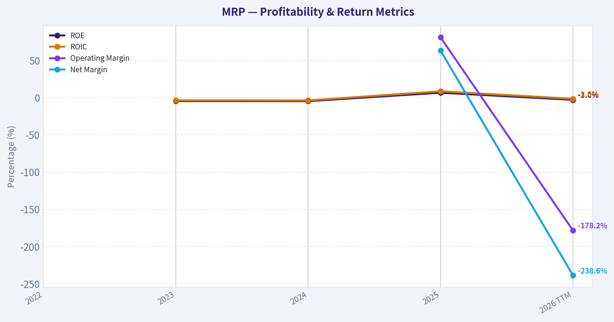
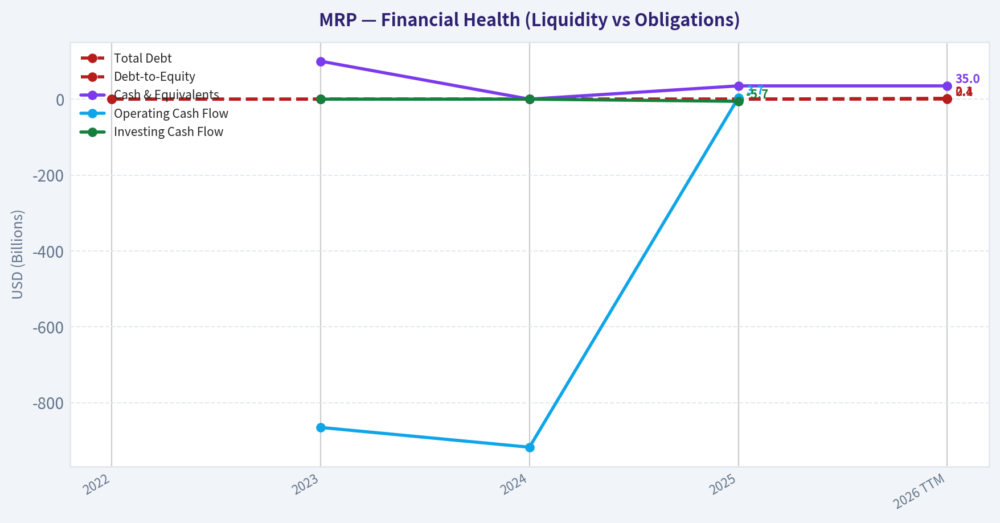
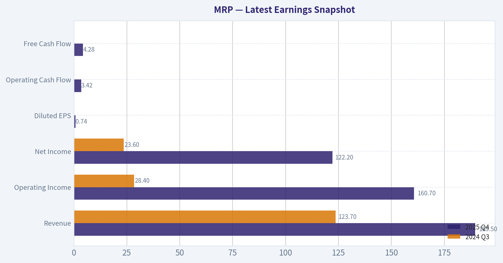
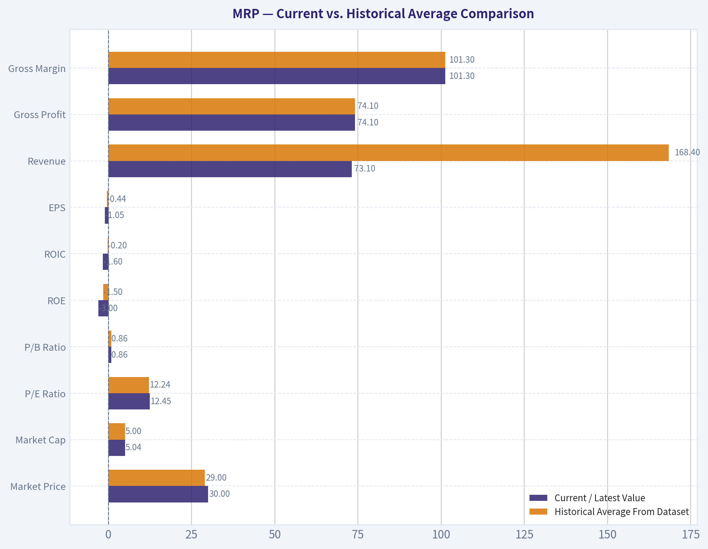
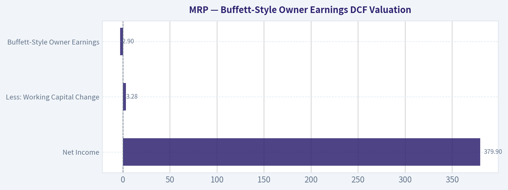
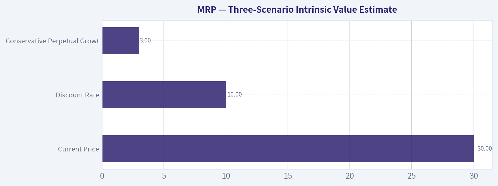

# MRP Deep Value Intelligence

**Analysis Date:** 2026-05-01

## Critical Disclaimer

*This analysis is generated by Deep Value Intelligence, an AI-powered multi-agent investing framework. This report is for informational and educational purposes only and does not constitute financial advice. Always conduct your own research and consult with qualified financial advisors before making investment decisions.*

---

## Table of Contents

1. Intelligence Summary
2. Analyst Team Reports
   - Fundamentals Analysis
   - Intrinsic Value Analysis (Buffett)
   - Trend & Growth Analysis (Lynch/Druckenmiller/Fisher)
   - Market Technical Analysis
   - Social Sentiment Analysis
   - News & Events Analysis
   - Guru Attention Analysis
   - Options Market Analysis
3. Research Team Commentary
4. Value Investing Team Commentary
5. Deep Values Commentary

---

## Intelligence Summary

### Thesis + Conditions

**Core Thesis:** **EXECUTIVE SUMMARY**
Millrose Properties (MRP) fails the Buffett test for fundamental business quality. Despite a tantalizing spin-off narrative and a ~10% forward yield, its 6.5% Return on Equity (ROE) and heavy reliance on its former parent, Lennar, expose deep customer concentration and capital intensity in a highly cyclical sector.

**Key Risks:**
- The Bull (Risky Analyst)**: Argues MRP is a classic, misunderstood spin-off. Views the 6.5% ROE as a lagging indicator and points to 254% YoY net income growth as proof of operating leverage. Believes the 12.45x P/E and 10% yield provide a "cushion" while the market discovers its value as an asset-light land platform for builders.
- The Bear (Safe Analyst)**: Argues that current low ROIC (7.9%) and ROE are hard facts pointing to a mediocre, capital-heavy business. Warns that the 10% yield and low multiple in a cyclical industry signal fragility, not safety. Views the Lennar dependency as severe concentration risk rather than a launchpad.
- The Moderator (Neutral Analyst)**: Suggests a middle ground, noting that while the Safe Analyst is too binary, the Risky Analyst is underwriting unproven upside. Recommends a strict "WATCH" to monitor post-spin normalization, dividend coverage, and diversification before deploying capital.
- The bear, however, brilliantly cuts through this narrative with the cold, hard numbers. Warren Buffett does not pay for hypothetical moats or the mere promise of normalized returns. With an ROE of just 6.5% and an ROIC of 7.9%, Millrose is currently demonstrating the economics of a capital-intensive business. What the bull calls a moat-the Lennar adjacency-is actually severe customer concentration risk.
- Adjusting based on the analysts' insights:** While I agree with the Neutral Analyst that spin-offs can create mispriced opportunities and deserve a spot on a watchlist, I firmly side with the Safe Analyst regarding actual capital deployment. I will not soften my stance to accommodate unproven potential. Millrose Properties does not currently meet the strict criteria for a Buffett-style compounder because it lacks predictable long-term earnings and demonstrated high returns on capital.

**What Would Change Our View:**
- The Bull (Risky Analyst)**: Argues MRP is a classic, misunderstood spin-off. Views the 6.5% ROE as a lagging indicator and points to 254% YoY net income growth as proof of operating leverage. Believes the 12.45x P/E and 10% yield provide a "cushion" while the market discovers its value as an asset-light land platform for builders.
- The Bear (Safe Analyst)**: Argues that current low ROIC (7.9%) and ROE are hard facts pointing to a mediocre, capital-heavy business. Warns that the 10% yield and low multiple in a cyclical industry signal fragility, not safety. Views the Lennar dependency as severe concentration risk rather than a launchpad.
- The Moderator (Neutral Analyst)**: Suggests a middle ground, noting that while the Safe Analyst is too binary, the Risky Analyst is underwriting unproven upside. Recommends a strict "WATCH" to monitor post-spin normalization, dividend coverage, and diversification before deploying capital.
- The bear, however, brilliantly cuts through this narrative with the cold, hard numbers. Warren Buffett does not pay for hypothetical moats or the mere promise of normalized returns. With an ROE of just 6.5% and an ROIC of 7.9%, Millrose is currently demonstrating the economics of a capital-intensive business. What the bull calls a moat-the Lennar adjacency-is actually severe customer concentration risk.
- Adjusting based on the analysts' insights:** While I agree with the Neutral Analyst that spin-offs can create mispriced opportunities and deserve a spot on a watchlist, I firmly side with the Safe Analyst regarding actual capital deployment. I will not soften my stance to accommodate unproven potential. Millrose Properties does not currently meet the strict criteria for a Buffett-style compounder because it lacks predictable long-term earnings and demonstrated high returns on capital.

**Confidence:** Low

---

## Analyst Team Reports

### Fundamentals Analysis

#### Latest Earnings Snapshot

*Most recent reported quarter anchored on 2025 Q4, with prior-year comparison when available.*

| Metric | 2025 Q4 | 2024 Q3 | YoY Change |
| --- | ---: | ---: | ---: |
| Revenue | $189.5M | $123.7M | +53.2% |
| Operating Income | $160.7M | $28.4M | +466.3% |
| Net Income | $122.2M | $23.6M | +418.6% |
| Diluted EPS | $0.74 | N/A | N/A |
| Operating Cash Flow | $3.42B | N/A | N/A |
| Free Cash Flow | $4.28B | N/A | N/A |

Key Takeaways: This snapshot anchors the most recent reported quarter before the narrative analysis. It helps readers separate long-run business quality from whatever changed in the latest earnings print.

#### 10-Year Financial Metrics for MRP

*All values below are computed deterministically from raw data - not estimated by AI.*

*Issuer profile: reit (Real Estate / REIT - Residential).*

#### 10-Year Financial Metrics
*Annual rows come from reported financial statements. The final TTM row is computed from the latest four quarters.*

| Metric | 2022 | 2023 | 2024 | 2025 | 2026 TTM |
| --- | --- | --- | --- | --- | --- |
| Market Price | N/A | N/A | N/A | $28 | $30 |
| Market Cap | N/A | N/A | N/A | $4.96B | $5.04B |
| P/E Ratio | N/A | N/A | N/A | 12.24 | N/A |
| P/B Ratio | N/A | N/A | N/A | 0.85 | 0.86 |
| ROE | N/A | -4.7% | -4.8% | 6.5% | -3.0% |
| ROIC | N/A | -3.7% | -3.8% | 8.5% | -1.6% |
| EPS | N/A | $-1.55 | $-1.48 | $2.32 | $-1.05 |
| Revenue | N/A | $0 | $0 | $600.5M | $73.1M |
| Gross Profit | N/A | N/A | N/A | N/A | $74.1M |
| Gross Margin | N/A | N/A | N/A | N/A | 101.3% |
| Operating Margin | N/A | N/A | N/A | 80.9% | -178.2% |
| Net Income | N/A | $-209.8M | $-246.2M | $379.9M | $-174.5M |
| Net Margin | N/A | N/A | N/A | 63.3% | -238.6% |
| Revenue Growth | N/A | N/A | N/A | N/A | -87.8% |
| Net Income Growth | N/A | N/A | 17.4% | -254.3% | -145.9% |
| Free Cash Flow Growth | N/A | N/A | N/A | N/A | N/A |
| Total Book Value | $3.77B | $4.46B | $5.16B | $5.86B | $5.86B |
| Total Assets | N/A | N/A | $5.47B | $9.26B | $9.26B |
| Total Debt | $0 | $0 | $0 | $0 | $2.11B |
| Debt-to-Equity | 0.00 | 0.00 | 0.00 | 0.00 | 0.36 |
| Cash & Equivalents | N/A | $100 | $0 | $35.0M | $35.0M |
| Shareholders' Equity | $3.77B | $4.46B | $5.16B | $5.86B | $5.86B |
| Operating Cash Flow | N/A | $-865.1M | $-917.2M | $3.67B | N/A |
| Investing Cash Flow | N/A | $0 | $0 | $-5.72B | N/A |
| Free Cash Flow | N/A | N/A | N/A | N/A | N/A |
| FCF Margin | N/A | N/A | N/A | N/A | N/A |
| Dividends / Share | N/A | $0.00 | $0.00 | $1.71 | $0.00 |

#### Profitability Metrics
- Return on Equity (ROE): 6.5%
- Return on Invested Capital (ROIC): 7.9%
- Return on Assets (ROA): 4.1%
- Gross Margin: Not meaningful
- Operating Margin: 80.9%
- Net Profit Margin: 63.3%

#### Liquidity Metrics
- Current Ratio: Not meaningful
- Quick Ratio: Not meaningful

#### Leverage Metrics
- Debt-to-Equity Ratio: 0.00
- Interest Coverage Ratio: 5.30
- Net Debt: $-35.0M

#### Growth Metrics (Year-over-Year)
- Revenue Growth: N/A
- Net Income Growth: 254.3%
- Free Cash Flow Growth: N/A
- Revenue CAGR (3-Year): N/A
- Revenue CAGR (5-Year): N/A

#### Valuation Metrics
- P/E Ratio (TTM): 12.45
- Forward P/E: 9.61
- Price-to-Book: 0.86
- Price-to-Sales: 8.40
- PEG Ratio: 0.05
- EV/EBITDA: Not meaningful
- Free Cash Flow Yield: N/A
- Earnings Yield: 8.0%

#### Owner Earnings (Buffett Method, Code-Computed)
- Net Income: $379.9M
- + Depreciation & Amortization: N/A
- - Capital Expenditures: N/A
- - Working Capital Changes: $3.28B
- = **Owner Earnings: $-2.90B**

#### Piotroski F-Score: 4/9
- Positive Net Income: PASS
- Positive Operating Cash Flow: PASS
- ROA Improvement: PASS
- Cash Flow > Net Income: PASS
- Decreasing Debt: FAIL
- Improving Current Ratio: FAIL
- No Dilution: FAIL
- Improving Gross Margin: FAIL
- Improving Asset Turnover: FAIL

FINAL INVESTMENT STANCE: **WATCH**

#### MRP Fundamental Analysis - Buffett-Style Value Review

Millrose Properties, Inc. is a newly public, land-focused residential REIT / homesite option platform spun out of Lennar. The company is asset-heavy, book-value-oriented, and potentially income-oriented, but the deterministic dataset shows a very short operating history, volatile profitability, negative TTM earnings, and negative Buffett-style Owner Earnings. From a Warren Buffett perspective, MRP currently looks more like a special-situation asset play than a predictable compounding business.

---

#### Current vs. Historical Average Comparison

| Metric | Current / Latest Value | Historical Average From Dataset | Current vs. Average | Buffett-Style Interpretation |
|---|---:|---:|---:|---|
| Market Price | $30 | $29 | Slightly above average | Price has moved modestly above the limited trading history. Not enough history to define a durable valuation range. |
| Market Cap | $5.04B | $5.00B | Slightly above average | Market value is broadly stable versus the short observed public period. |
| P/E Ratio | 12.45 | 12.24 | Slightly above average | Appears inexpensive on reported profitable-year earnings, but TTM earnings are negative, reducing reliability. |
| P/B Ratio | 0.86 | 0.86 | In line | Stock trades below book value, suggesting asset-value support, but book quality and monetization are key. |
| ROE | -3.0% | -1.5% | Worse than average | Profitability remains weak and inconsistent. FY2025 was profitable, but TTM reverted negative. |
| ROIC | -1.6% | -0.2% | Worse than average | Capital productivity is not yet proven; FY2025 strength did not persist into TTM. |
| EPS | -$1.05 | -$0.44 | Worse than average | Earnings are volatile and currently negative. This fails Buffett's predictability test. |
| Revenue | $73.1M | $168.4M | Below average | Revenue collapsed versus FY2025, showing the business model is still stabilizing post-spin. |
| Gross Profit | $74.1M | $74.1M | In line | Only one usable gross profit observation exists, limiting trend analysis. |
| Gross Margin | 101.3% | 101.3% | In line | Margin is not economically meaningful for a REIT / land platform in the same way it is for industrial companies. |
| Operating Margin | -178.2% | -48.7% | Much worse | TTM operating losses are severe relative to revenue. |
| Net Income | -$174.5M | -$62.7M | Worse than average | FY2025 profitability was not sustained. |
| Net Margin | -238.6% | -87.7% | Much worse | Negative margin indicates expenses and non-cash / transaction effects overwhelm current revenue. |
| Revenue Growth | -87.8% | -87.8% | Weak | Only one revenue growth datapoint exists, and it is sharply negative. |
| Net Income Growth | -145.9% | -127.6% | Worse than average | Earnings swung from profit to loss, indicating poor near-term predictability. |
| Free Cash Flow Growth | N/A | N/A | N/A | Free cash flow is unavailable, a major limitation for Buffett-style valuation. |
| Total Book Value | $5.86B | $5.02B | Above average | Book value has grown meaningfully, supporting the asset-backed case. |
| Total Assets | $9.26B | $8.00B | Above average | Asset base expanded materially, consistent with a land-banking platform. |
| Total Debt | $2.11B | $0.42B | Much higher | Debt was introduced recently; leverage risk has increased. |
| Debt-to-Equity | 0.36 | 0.07 | Much higher | Still moderate in absolute terms, but a clear deterioration from prior debt-free status. |
| Cash & Equivalents | $35.0M | ~$17.5M | Above average | Cash is higher than the short average but small relative to debt and assets. |
| Shareholders' Equity | $5.86B | $5.02B | Above average | Equity base remains strong and supports the discount-to-book valuation argument. |
| Operating Cash Flow | N/A | $629.2M | N/A | No TTM operating cash flow is provided; historical operating cash flow has been highly volatile. |
| Free Cash Flow | N/A | N/A | N/A | Cannot assess recurring cash generation from the dataset. |
| Dividends / Share | $0.00 | $0.43 | Below average | FY2025 dividend was $1.71, but TTM dividend is shown as zero in the canonical dataset. |

Key Takeaways: MRP trades below book value, which gives it some asset-backed appeal, but most operating metrics are weak or unstable. Profitability swung from strong FY2025 earnings to negative TTM earnings, and debt has increased from zero to $2.11 billion. The stock may be statistically cheap, but it does not yet demonstrate the consistent earnings power Buffett typically requires.

---

#### Revenue Breakdown

| Revenue Source | Amount ($M or $B) | % of Total |
|---|---:|---:|
| Homesite option purchase platform / land-related real estate revenue | $600.5M | 100.0% |
| Other separately disclosed revenue sources | Not separately disclosed | N/A |

Key Takeaways: The available deterministic dataset supports treating MRP as a single-segment, land-focused homesite option platform. Revenue concentration is high because the business depends on demand from residential homebuilders and the monetization of land / homesite option arrangements. This concentration can be attractive if housing demand is strong, but it also increases cyclicality and customer dependence risk.

---

#### Market Metrics Interpretation

MRP's current market price of **$30** and market capitalization of **$5.04B** place the company close to its short observed public trading range. The stock trades at a **P/B ratio of 0.86**, meaning the market values the company below stated book equity of **$5.86B**. For an asset-heavy REIT, this is important: investors are paying roughly **86 cents per dollar of book value**.

The reported **P/E ratio of 12.45** appears inexpensive at first glance, but this valuation is less reliable because the TTM EPS in the deterministic table is negative at **-$1.05**. In Buffett terms, a low P/E is not automatically cheap if earnings are not normalized, recurring, and predictable. The stronger valuation argument for MRP is therefore the discount to book value, not the earnings multiple.

---

#### Profitability Review

MRP's profitability profile is highly volatile. FY2025 showed strong reported profitability, with **$379.9M of net income**, **80.9% operating margin**, and **63.3% net margin**. However, the 2026 TTM period reversed sharply to **-$174.5M of net income**, **-178.2% operating margin**, and **-238.6% net margin**.

From a Buffett perspective, this is a major issue. Buffett prefers businesses with durable, recurring earnings that can be reasonably forecast 5 to 10 years into the future. MRP's short dataset shows losses in 2023, losses in 2024, a strong profit in 2025, and another TTM loss. That pattern suggests either a business still in transition or a model whose accounting earnings are highly transaction-driven.

---

#### Growth Metrics Review

Revenue growth is currently shown at **-87.8%**, reflecting a sharp decline from **$600.5M in FY2025** to **$73.1M in TTM revenue**. Net income growth is also deeply negative at **-145.9%**, following a swing from FY2025 profit to TTM loss. Free cash flow growth is unavailable, which is especially important because Buffett-style analysis places heavy weight on durable cash generation.

The lack of reliable revenue growth, free cash flow growth, and owner earnings growth makes it difficult to underwrite MRP as a compounding investment today. The company may ultimately prove to have valuable land assets and attractive option economics, but the current dataset does not yet show a stable compounding pattern.

---

#### Balance Sheet and Financial Strength

MRP's balance sheet is the strongest part of the investment case. Shareholders' equity and total book value are both **$5.86B**, compared with a current market cap of **$5.04B**. That implies the market is valuing the company at a discount to accounting book value.

However, leverage has increased. Total debt moved from **$0** in prior years to **$2.11B** in the TTM period, pushing debt-to-equity to **0.36**. That is not excessive for a real estate company, but the direction matters. Cash is only **$35.0M**, which is small relative to total debt and total assets. The company is therefore not balance-sheet distressed based on debt-to-equity, but it also does not have a large cash cushion.

---

#### Cash Flow and Dividend Review

The dataset does not provide usable free cash flow or free cash flow margin figures. Operating cash flow has been volatile, moving from large negatives in 2023 and 2024 to **$3.67B in FY2025**, with no TTM value provided. Buffett-style Owner Earnings are code-computed at **-$2.90B**, driven by large working capital changes.

Dividends per share were **$1.71 in FY2025**, but the TTM dividend in the deterministic dataset is **$0.00**. External coverage references a high forward yield, but the canonical dataset does not yet confirm a stable recurring dividend stream. For income investors, this means the dividend thesis requires close monitoring of future reported distributions and cash coverage.

---

#### Buffett-Style Owner Earnings DCF Valuation

Canonical Owner Earnings calculation provided in the deterministic dataset:

| Owner Earnings Component | Amount |
|---|---:|
| Net Income | $379.9M |
| Plus: Depreciation & Amortization | N/A |
| Less: Capital Expenditures | N/A |
| Less: Working Capital Changes | $3.28B |
| Buffett-Style Owner Earnings | **-$2.90B** |

Key Takeaways: The deterministic Owner Earnings figure is deeply negative, which makes a traditional Buffett-style DCF unfavorable. This does not necessarily mean the assets are worthless, but it does mean the current cash economics are not yet proven. For Buffett-style investors, negative owner earnings are a significant warning sign.

Because the canonical dataset provides only one Owner Earnings observation and no historical Owner Earnings growth series, the lowest, average, and highest available Owner Earnings growth rates cannot be directly calculated from historical Owner Earnings. To avoid inventing unavailable data, the DCF below uses a **0% interim growth assumption** for all three scenarios and treats the result as a mechanical stress test rather than a precise intrinsic value estimate.

Assumptions used:
- Base Owner Earnings: **-$2.90B**
- Discount rate: **10.0%**
- Terminal growth rate: **2.5%**
- Forecast period: **10 years**
- Estimated shares outstanding: **168.0M**, calculated as $5.04B market cap / $30 share price

| Scenario | Historical Owner Earnings Growth Input | Year 1 Owner Earnings | PV of 10-Year Owner Earnings | Terminal Value at Year 10 | PV of Terminal Value | Implied Equity Value | Implied Value / Share |
|---|---:|---:|---:|---:|---:|---:|---:|
| Conservative | N/A; no historical OE growth available, 0% used | -$2.90B | -$17.82B | -$39.63B | -$15.28B | -$33.10B | -$197 |
| Average | N/A; no historical OE growth available, 0% used | -$2.90B | -$17.82B | -$39.63B | -$15.28B | -$33.10B | -$197 |
| Optimistic | N/A; no historical OE growth available, 0% used | -$2.90B | -$17.82B | -$39.63B | -$15.28B | -$33.10B | -$197 |

Key Takeaways: The mechanical Owner Earnings DCF produces a negative value because the base Owner Earnings figure is negative. In practical investment terms, this means MRP cannot currently be justified using a classic Buffett cash-flow valuation. The bullish case must instead rest on normalized future cash generation, asset value realization, and book value monetization.

---

#### Economic Moat Assessment

MRP may have a developing niche moat through its homesite option purchase platform, scale in residential land assets, and relationship-driven role with homebuilders. The business can potentially offer builders capital-efficient access to land while MRP earns returns from land ownership, option arrangements, and related real estate economics.

However, the moat is not yet proven in the dataset. A Buffett-quality moat would typically show durable pricing power, stable margins, recurring cash flow, and consistently high returns on equity or invested capital. MRP currently shows the opposite: unstable earnings, negative TTM profitability, unavailable free cash flow, and only a short post-spin operating record.

---

#### Management Performance and Capital Allocation

Management's capital allocation will be crucial because MRP is an asset-heavy REIT. The key questions are whether management can:
1. Acquire and hold land at attractive prices.
2. Structure option agreements with favorable risk-adjusted returns.
3. Manage leverage conservatively through housing cycles.
4. Convert book value into recurring cash earnings.
5. Support dividends from cash flow rather than asset monetization or financing.

The current evidence is mixed. Book value has grown, and the company trades below book, but debt has increased materially and profitability is inconsistent. The **Piotroski F-Score of 4/9** reinforces the view that financial quality is not yet strong.

---

#### Key Investment Insights, Red Flags, and Opportunities

| Category | Key Point | Investment Implication |
|---|---|---|
| Opportunity | Trades at **0.86x book value** | Potential upside if book value is credible and assets can be monetized near carrying value. |
| Opportunity | Asset base of **$9.26B** | Large real estate platform could benefit from housing demand and builder land-light strategies. |
| Opportunity | FY2025 showed strong profitability | Demonstrates the business can produce earnings in favorable conditions. |
| Red Flag | TTM net income is **-$174.5M** | Earnings are not yet predictable or durable. |
| Red Flag | Owner Earnings are **-$2.90B** | Buffett-style cash-flow valuation is currently unfavorable. |
| Red Flag | Revenue declined **87.8%** | Revenue stream appears volatile or transaction-driven. |
| Red Flag | Debt increased to **$2.11B** | Leverage risk has risen, especially with limited cash of **$35M**. |
| Red Flag | Free cash flow unavailable | Cannot verify dividend safety or recurring cash economics. |
| Watch Item | Dividend policy | FY2025 dividend was meaningful, but TTM dividend is shown as zero in the canonical dataset. |
| Watch Item | Post-spin operating history | More quarters are needed to judge normalized earnings power. |

Key Takeaways: MRP offers a potentially attractive asset-value setup, but the current operating record is too short and volatile for a high-conviction Buffett-style investment. The most important future data points are normalized revenue, recurring cash flow, debt discipline, and dividend coverage. Until those improve, the stock is better treated as a watchlist candidate than a core compounder.

---

#### Final Buffett-Style Investment View

MRP is not yet a classic Warren Buffett investment. It lacks a long record of predictable earnings, free cash flow visibility, and consistently high returns on capital. The strongest bullish argument is that the stock trades below book value, giving investors exposure to a sizeable real estate asset base at a discount.

However, the current dataset shows negative TTM earnings, negative Owner Earnings, volatile revenue, higher leverage, and limited evidence of durable cash generation. A Buffett-style investor would likely wait for several more quarters of public results before assigning meaningful intrinsic value based on normalized owner earnings.

**Final stance: WATCH.** MRP may become attractive if management proves the platform can generate recurring cash returns and support dividends through cycles, but based on the canonical data today, the stock is an asset-backed special situation rather than a proven long-term compounder.

| Final Summary Item | Assessment |
|---|---|
| Valuation | Appears inexpensive on P/B at **0.86x**, but cash-flow valuation is unfavorable. |
| Business Quality | Promising niche platform, but not yet proven. |
| Profitability | Highly volatile; TTM results are negative. |
| Balance Sheet | Solid book equity, but debt has recently increased to **$2.11B**. |
| Cash Flow | Free cash flow unavailable; Owner Earnings negative. |
| Dividend Appeal | Potential income story, but canonical TTM dividend is **$0.00**. |
| Buffett Fit | Weak today due to poor predictability and negative owner earnings. |
| Investment Stance | **WATCH** - monitor for normalized earnings, recurring cash flow, and leverage discipline. |

Key Takeaways: MRP's below-book valuation gives it potential, but the business has not yet demonstrated the consistency required for a Buffett-style purchase. The stock belongs on a watchlist for investors who understand real estate cycles and post-spin complexity. A stronger stance would require evidence that book value can be converted into durable, recurring owner earnings.

#### Fundamental Visuals

This graph tracks the profitability and return metrics (ROE, ROIC, Margins) of **MRP** over the past decade, highlighting capital efficiency trends.

This chart illustrates the financial health of **MRP** over the last 10 years, mapping cash equivalents and free cash flow against total obligations (Debt).

---

### Intrinsic Value Analysis (Buffett)

> *Following Warren Buffett's value investing philosophy: Circle of Competence, Economic Moat, Management Quality, and Margin of Safety.*

#### Intrinsic Value Snapshot

Price is what you pay. Intrinsic value is what the business may be worth based on the cash it can create for owners over time. We show a range, not one magic number.

- Current Price: $30.37
- Value Range: N/A to N/A

##### Owner Earnings (Buffett Method)
- Net Income: $379,864,000.00
- Depreciation & Amortization: N/A
- Capital Expenditures: N/A
- Working Capital Changes: $3,275,546,000.00
- Owner Earnings: $-2,895,682,000.00

##### Intrinsic Value

FINAL INVESTMENT STANCE: **AVOID**

#### Buffett-Style Investment Report: Millrose Properties - MRP

Millrose Properties is a recent Lennar spin-off operating as a land-focused REIT and "homesite option purchase platform" for residential homebuilders. The business may offer income appeal, with market commentary citing a roughly 10% forward yield, but it does **not yet meet Buffett-style standards** for predictability, long operating history, high returns on equity, or easily underwritten intrinsic value.

Current price used: **$30**
Market cap: **$5.04 billion**
Implied shares outstanding: **~168 million**
P/E: **~12.45x**
Reported ROE: **6.5%**

---

#### 1. Go / No-Go Gate Assessment

| Buffett Gate | Result | Evidence | Buffett Interpretation |
|---|---:|---|---|
| Gate 1: Circle of Competence & Simplicity | Mixed / Fail | Business model is understandable: owns or finances residential land / homesites and provides option structures to homebuilders. However, economics depend on housing cycles, land values, rates, and builder demand. | Simple enough to describe, but not simple enough to confidently forecast through cycles yet. |
| Gate 2: Moat Test | Fail / Unproven | No long public operating history. Possible relationship advantage with Lennar, but customer concentration and related-party origin are risks, not necessarily moat. | Moat is not yet demonstrated by long-term margins, retention, or high returns. |
| Gate 3: Management & Capital Allocation | Incomplete / Fail | Recent spin-off; no decade-long capital allocation record as an independent public company. REIT dividend policy may limit retained reinvestment flexibility. | Buffett would require years of evidence before trusting capital allocation. |
| Gate 4: Industry Structure | Fail | Residential land and homebuilding supply chains are cyclical, capital-intensive, and exposed to interest rates. | Not a classic capital-light, predictable compounding machine. |

**Key Takeaways:** Millrose passes the basic "can I explain it?" test, but it fails the more important Buffett tests around durability, predictability, and proven capital allocation. A recent spin-off in a cyclical, interest-rate-sensitive real estate niche requires a higher burden of proof than the available record currently supports.

---

#### 2. Business Understanding

| Question | Assessment |
|---|---|
| Elementary School Test | Millrose helps homebuilders get access to land and homesites without builders owning all the land upfront. It earns returns from land ownership, options, fees, and related real estate economics. |
| 10-Year Predictability Test | Weak. Demand depends on mortgage rates, housing affordability, homebuilder activity, land prices, and capital market conditions. |
| Technology Risk | Low direct technology disruption risk, but high macro and financing risk. |
| Complexity Risk | Moderate. REIT structures, land banking, option agreements, related-party history, and financing needs make the economics less transparent than a consumer brand or software subscription business. |

**Key Takeaways:** The business can be explained in plain language, but the cash flows are not as predictable as those of Buffett's preferred companies. The main risk is not technology disruption; it is cyclicality, financing conditions, and uncertainty around how the stand-alone business performs over a full housing cycle.

---

#### 3. Moat Analysis

| Moat Source | Evidence | Rating |
|---|---|---:|
| Intangible Assets / Brand | No clear consumer brand. Possible industry relationships, especially from Lennar spin-off, but not enough evidence of pricing power. | Weak |
| Switching Costs | Builders may value reliable land access, but option-platform switching costs are not yet proven to be high. | Unproven |
| Cost Advantage | Scale could help with sourcing and financing land, but land markets are local and competitive. | Unproven |
| Network Effects | No obvious network effect. More builders or landowners may help sourcing, but this is not a marketplace with self-reinforcing dominance yet. | Weak |
| Regulatory / License Advantage | Land entitlement expertise may matter, but this is execution skill, not necessarily a durable moat. | Narrow / Unproven |

**Key Takeaways:** Millrose may have useful relationships and specialized real estate capabilities, but those are not yet the same as a durable moat. There is no clear evidence of brand pricing power, structural switching costs, or network effects strong enough to classify this as a Buffett-style wide-moat company.

---

#### 4. Management Quality & Capital Allocation

| Buffett Question | Current View | Concern |
|---|---|---|
| Do they think like owners? | Insufficient evidence. | Recent spin-off means limited stand-alone track record. |
| Are they candid and conservative? | Not yet underwritable. | Need several annual reports and calls to assess tone, accounting, and disclosure quality. |
| Are they rational capital allocators? | Unproven. | REIT status and high dividend expectations may constrain reinvestment. |
| Debt discipline | Unknown / needs monitoring. | Land REITs can become vulnerable if leverage rises into a housing downturn. |
| Buybacks / dividends | High yield appears central to the story. | A high dividend is attractive only if covered by durable cash earnings. |

**Key Takeaways:** Management may eventually prove capable, but Buffett investing requires evidence, not hope. At this stage, Millrose lacks the independent public-company record needed to judge whether management can allocate capital rationally across cycles.

---

#### 5. Available Financial Snapshot

| Metric | Current / Available Data |
|---|---:|
| Share Price | $30 |
| Market Capitalization | $5.04 billion |
| Implied Shares Outstanding | ~168 million |
| P/E Ratio | ~12.45x |
| Implied Net Income | ~$405 million |
| Implied EPS | ~$2.41 |
| ROE | 6.5% |
| Price / Book | Not available |
| Gross Margin | Not available |
| Free Cash Flow Yield | Not available |
| Current Ratio | Not available |
| Forward Yield Mentioned in Coverage | ~9.9% |
| Guru 13F Tracking | No recent structured match found |

**Key Takeaways:** The stock does not look optically expensive on earnings, trading around 12.5 times implied earnings. However, the reported ROE of 6.5% is low for a Buffett-quality compounder, and the lack of full cash flow, balance sheet, and long-term margin data prevents a high-confidence valuation.

---

#### 6. 10-Year Financial Summary

| Year | Revenue | Net Income | Free Cash Flow | ROE | ROIC | Debt Metrics | Comment |
|---|---:|---:|---:|---:|---:|---:|---|
| 2016 | N/A | N/A | N/A | N/A | N/A | N/A | No independent public record available |
| 2017 | N/A | N/A | N/A | N/A | N/A | N/A | No independent public record available |
| 2018 | N/A | N/A | N/A | N/A | N/A | N/A | No independent public record available |
| 2019 | N/A | N/A | N/A | N/A | N/A | N/A | No independent public record available |
| 2020 | N/A | N/A | N/A | N/A | N/A | N/A | No independent public record available |
| 2021 | N/A | N/A | N/A | N/A | N/A | N/A | No independent public record available |
| 2022 | N/A | N/A | N/A | N/A | N/A | N/A | No independent public record available |
| 2023 | N/A | N/A | N/A | N/A | N/A | N/A | No independent public record available |
| 2024 | N/A | N/A | N/A | N/A | N/A | N/A | Recent spin-off context |
| 2025 / Current | N/A | Implied ~$405M | N/A | 6.5% | N/A | N/A | Based on market cap and P/E |

**Key Takeaways:** The most important fact in this table is the absence of a 10-year independent financial record. Buffett typically wants a long trail of evidence showing stable earnings, high returns on capital, and conservative financing; Millrose does not yet provide that evidence.

---

#### 7. Owner Earnings Calculation

Buffett's owner earnings formula:

> Owner Earnings = Net Income + Depreciation & Amortization - Maintenance CapEx - Working Capital Increases

Because detailed cash flow data is not available, the calculation below uses **implied net income as a rough proxy**, not a fully reliable owner earnings figure.

| Component | Amount |
|---|---:|
| Implied Net Income | ~$405 million |
| Plus: Depreciation & Amortization | N/A |
| Less: Maintenance CapEx | N/A |
| Less: Working Capital / Land Investment Needs | N/A |
| Estimated Owner Earnings Proxy | ~$405 million |
| Confidence Level | Low |

**Key Takeaways:** The owner earnings estimate is low confidence because land-focused REIT cash flow can differ significantly from accounting earnings. For a land platform, reinvestment into land inventory, options, and development can consume cash, so net income may overstate freely distributable owner earnings.

---

#### 8. Three-Scenario Intrinsic Value Estimate

Assumptions:

| Input | Assumption |
|---|---:|
| Current Price | $30 |
| Market Cap | $5.04 billion |
| Shares Outstanding | ~168 million |
| Owner Earnings Proxy | ~$405 million |
| Discount Rate | 10% |
| Conservative Perpetual Growth | 3% |
| Illustrative Higher Growth Case | 5% for 10 years, then 3% terminal growth |

**Key Takeaways:** These assumptions are intentionally conservative, but the biggest weakness is the owner earnings proxy. Without audited, multi-year cash flow data, the valuation should be viewed as a rough boundary exercise rather than a dependable estimate of intrinsic value.

| Valuation Scenario | Method | Equity Value | Value / Share | Margin vs. $30 Price |
|---|---|---:|---:|---:|
| A: No Growth | $405M / 10% | ~$4.05B | ~$24.10 | Price is ~24% above value |
| B: GDP Growth | $405M x 1.03 / (10% - 3%) | ~$5.96B | ~$35.50 | ~18% upside |
| C: Illustrative 5% Growth | 10-year DCF, then 3% terminal | ~$6.90B | ~$41.10 | ~37% upside |

**Key Takeaways:** The no-growth case suggests the stock is not cheap enough for a highly conservative investor. The GDP-growth and higher-growth cases show upside, but they rely on growth and cash flow durability that Millrose has not yet proven as an independent public company.

---

#### 9. Margin of Safety Analysis

| Scenario | Intrinsic Value / Share | Required Buffett-Style Margin of Safety | Attractive Buy Price | Current Price Status |
|---|---:|---:|---:|---|
| No Growth | ~$24.10 | 25% | ~$18.10 | Too expensive |
| GDP Growth | ~$35.50 | 25% | ~$26.60 | Not enough margin |
| Illustrative 5% Growth | ~$41.10 | 25% | ~$30.80 | Barely acceptable, but low confidence |
| Higher-Risk Business Standard | N/A | 40% to 50% | Meaningfully below current price | Not satisfied |

**Key Takeaways:** At $30, Millrose does not provide a convincing margin of safety under conservative assumptions. The stock only appears attractive if one accepts a growth case that is not yet supported by a long independent operating record.

---

#### 10. Buffett Scorecard

| Criterion | Weight | Score | Weighted Score | Rationale |
|---|---:|---:|---:|---|
| Business Understanding | 20% | 3.0 | 0.60 | Understandable, but housing-cycle economics reduce predictability. |
| Moat Width & Durability | 25% | 2.0 | 0.50 | Possible relationship advantages, but no proven wide moat. |
| Management Quality | 15% | 2.5 | 0.38 | Too early to judge post-spin-off capital allocation. |
| Return on Equity | 15% | 2.0 | 0.30 | ROE of 6.5% is far below Buffett-quality thresholds. |
| Reinvestment Runway | 10% | 3.0 | 0.30 | Land platform could grow, but reinvestment may be capital-intensive. |
| Balance Sheet Strength | 5% | 2.5 | 0.13 | Insufficient data; REIT/land model warrants caution. |
| Industry Structure | 5% | 2.0 | 0.10 | Cyclical, rate-sensitive, and competitive. |
| Valuation / Margin of Safety | 5% | 2.5 | 0.13 | Not expensive on P/E, but margin of safety is inadequate. |
| **Total** | **100%** |  | **2.43 / 5.00** | **Avoid** |

**Key Takeaways:** Millrose scores below the 2.5 threshold mainly because of unproven moat, low ROE, limited stand-alone history, and insufficient margin of safety. The stock may interest income or real estate investors, but it does not yet qualify as a Buffett-style compounder.

---

#### 11. Final Investment Stance

| Category | Conclusion |
|---|---|
| Stance | **AVOID** |
| Conviction | Moderate |
| Primary Reason | Recent spin-off with no 10-year independent record, low ROE, unproven moat, and inadequate margin of safety. |
| What Could Change the View | Several years of stable cash earnings, conservative leverage, well-covered dividends, high returns on incremental capital, and evidence of durable builder demand through a housing downturn. |
| Watch Price | Below ~$26 under GDP-growth assumptions; lower if balance sheet leverage or cash conversion disappoints. |

**Key Takeaways:** Millrose may become a legitimate platform over time, but Buffett-style investing requires waiting until the evidence is clear. At today's price, the combination of limited history, cyclical exposure, and uncertain owner earnings makes the prudent stance **Avoid**, not Advocate.

#### Valuation Visuals

This comparison chart from *Latest Earnings Snapshot* stacks current figures against historical benchmarks for **MRP**, making it easy to see where the company trades relative to its own averages.

This comparison chart from *Current vs. Historical Average Comparison* stacks current figures against historical benchmarks for **MRP**, making it easy to see where the company trades relative to its own averages.

This comparison chart from *Buffett-Style Owner Earnings DCF Valuation* stacks current figures against historical benchmarks for **MRP**, making it easy to see where the company trades relative to its own averages.

This comparison chart from *Buffett-Style Owner Earnings DCF Valuation* stacks current figures against historical benchmarks for **MRP**, making it easy to see where the company trades relative to its own averages.

This comparison chart from *Three-Scenario Intrinsic Value Estimate* stacks current figures against historical benchmarks for **MRP**, making it easy to see where the company trades relative to its own averages.

---

### Trend & Growth Analysis (Lynch/Druckenmiller/Fisher)

> *Following Peter Lynch's GARP, Stanley Druckenmiller's macro-aware approach, and Philip Fisher's scuttlebutt methodology.*

FINAL INVESTMENT STANCE: **WATCH**

#### Millrose Properties, Inc. - MRP Growth Investment Review
Current date: 2026-05-01 | Price: ~$30 | Market cap: ~$5.04B | P/E: ~12.4x | Forward yield cited in coverage: ~9.9%

MRP is a newly public Lennar spin-off structured as a land-focused REIT and "homesite option purchase platform" for residential homebuilders. The setup is interesting, but for a Lynch/Druckenmiller/Fisher growth mandate, the stock is **not yet a clean ADVOCATE** because operating history is short, public-company data is incomplete, and the business remains tied to housing cyclicality and interest rates.

---

#### 1. Lynch Classification

| Lynch Category | Fit for MRP | Assessment |
|---|---:|---|
| Slow Grower | Low | Too new; expected growth may exceed slow-grower levels. |
| Stalwart | Medium | REIT-like income profile and large yield give it stalwart/income characteristics. |
| Fast Grower | Unproven | Growth expectations exist, but public revenue history is limited. |
| Cyclical | High | Tied to residential housing, land demand, mortgage rates, and builder activity. |
| Turnaround | Low | Not a distressed turnaround; it is more of a spin-off/special situation. |
| Asset Play | High | Land/platform assets and REIT yield are central to the thesis. |

**Key Takeaways:** MRP is best classified as a **cyclical asset play with a growth-income angle**, not a pure Lynch fast grower. The company may have upside if builders increasingly outsource land ownership, but it does not yet show the clean 20%+ revenue growth track record Lynch would want for a fast-grower classification.

---

#### 2. The Story in 3 Bullets

| Core Story Element | Plain-English Version |
|---|---|
| What MRP does | MRP helps homebuilders control homesites without tying up as much capital in land ownership. |
| Why builders care | Builders can improve capital efficiency by optioning land instead of carrying large land inventories. |
| Why investors care | If this platform scales, MRP could become a specialized land-financing REIT with high cash distributions and growth from builder demand. |

**Key Takeaways:** The story is understandable: MRP is trying to be a capital-light land partner for homebuilders. The appeal is that homebuilders may prefer optioned land access, while MRP earns REIT-style income from owning or financing those homesite positions.

---

#### 3. TAM and 10x Test

| Item | Estimate / Status | Growth Analyst View |
|---|---:|---|
| Current market cap | ~$5.04B | Already meaningful scale. |
| 10x market cap target | ~$50B | Would require very large platform expansion and/or major valuation re-rating. |
| Current revenue | Not available in shared data | Limits precision of 10x test. |
| Potential TAM | U.S. residential land / homesite finance market | Large, but cyclical and rate-sensitive. |
| Can MRP 10x and still be small vs TAM? | Possibly, but unproven | Theoretical runway exists, but evidence is early. |

**Key Takeaways:** The TAM is large because U.S. homebuilders need enormous amounts of land and homesite inventory. However, a 10x stock outcome from a $5B starting market cap is a high bar, especially for a REIT-like structure with significant dividend payout obligations.

---

#### 4. Revenue Growth Trend

| Metric | Available Data | Interpretation |
|---|---:|---|
| Revenue growth YoY | Not available | Cannot confirm acceleration. |
| Gross margin trend | Not available | Cannot assess pricing power or land economics. |
| Earnings multiple | ~12.4x P/E | Suggests market is valuing earnings relatively conservatively. |
| ROE | ~6.5% | Modest return profile; not yet showing exceptional capital productivity. |
| Dividend yield | ~9.9% cited in coverage | Attractive income, but may also signal perceived risk. |

**Key Takeaways:** The biggest gap is the lack of a visible public revenue trend. Without evidence of accelerating revenue, expanding margins, or rising returns on equity, MRP remains a **watch-list growth story**, not a confirmed inflection-point compounder.

---

#### 5. Unit Economics

| Unit Economics Metric | MRP Status | Analyst Comment |
|---|---:|---|
| LTV/CAC | Not applicable / not disclosed | This is not a SaaS or consumer subscription model. |
| NRR | Not applicable | No recurring software-style retention data. |
| Rule of 40 | Not applicable | REIT/land platform structure does not fit SaaS framework. |
| ROE | ~6.5% | Key proxy for capital efficiency; currently moderate. |
| Yield | ~9.9% forward cited | Important for total return, but also raises sustainability questions. |

**Key Takeaways:** Traditional SaaS unit economics do not apply to MRP. For this company, the key "unit economics" are land basis, option pricing, builder demand, funding cost, payout ratio, and return on equity. Current ROE of roughly 6.5% is not yet strong enough to signal elite compounding.

---

#### 6. Inflection Point Assessment

| Potential Inflection | Evidence Today | Rating |
|---|---|---:|
| Product/platform inflection | New Lennar spin-off platform creates differentiated model | 3/5 |
| Market share inflection | Too early to confirm | 2/5 |
| Margin inflection | Data unavailable | 2/5 |
| TAM inflection | Builders may increasingly use land-light models | 3.5/5 |
| Competitive inflection | No clear evidence competitors are stumbling | 2/5 |
| Capital-market inflection | Falling rates would help REIT valuation and housing demand | 3.5/5 |

**Key Takeaways:** The most credible inflection is the business-model shift toward homebuilders using third-party land capital. The missing piece is proof: MRP needs several quarters of public reporting to show growth, returns, and dividend coverage.

---

#### 7. Macro Setup

| Macro Factor | Current Read | Impact on MRP |
|---|---|---|
| Interest rates | Critical variable | Lower rates would help housing affordability and REIT valuations. |
| Housing demand | Structurally supported by underbuilding | Positive long-term backdrop. |
| Mortgage affordability | Still a constraint | Near-term headwind for homebuilders and land absorption. |
| REIT investor appetite | Improving if rates fall | Could support multiple expansion. |
| Economic cycle sensitivity | High | Housing downturn would hurt demand for homesites. |

**Key Takeaways:** MRP has a mixed macro setup. Long-term housing supply shortages are supportive, but affordability and interest rates remain major swing factors. A falling-rate environment would materially improve the stock's setup.

---

#### 8. Fisher 15-Point Score

| Fisher Criterion | Score / 5 | Rationale |
|---|---:|---|
| 1. Market potential | 4 | Large U.S. residential land market. |
| 2. New product determination | 3 | Platform model is differentiated but new. |
| 3. R&D / innovation | 2 | Not R&D-driven; financial/real estate innovation instead. |
| 4. Sales organization | 3 | Lennar relationship may help, but broader builder adoption unproven. |
| 5. Profit margin | 3 | Earnings exist, but margin detail limited. |
| 6. Improving margins | 2 | Not enough data. |
| 7. Labor relations | 3 | No red flags known. |
| 8. Executive relations | 3 | No red flags known. |
| 9. Management depth | 3 | Spin-off management quality still needs observation. |
| 10. Cost/accounting controls | 3 | REIT/land accounting complexity requires monitoring. |
| 11. Moat / special advantage | 3 | Lennar-originated platform may be an advantage. |
| 12. Long-range profit outlook | 3 | Good if land-light builder model scales. |
| 13. Dilution risk | 2 | REITs often issue equity to grow. |
| 14. Candor in difficulties | 2 | Too early as public company. |
| 15. Management integrity | 3 | No current red flags, but history is short. |
| **Total** | **44/75** | **Average / incomplete evidence** |

**Key Takeaways:** MRP scores as an average Fisher candidate today, mostly because the public record is short. The business has market potential, but management quality, margin trajectory, capital discipline, and long-term competitive advantage are not yet proven.

---

#### 9. Valuation Analysis

| Valuation Metric | Current Read | Interpretation |
|---|---:|---|
| Price | ~$30 | Shared pack data. |
| Market cap | ~$5.04B | Mid-cap REIT/special situation scale. |
| P/E | ~12.4x | Not expensive on earnings. |
| Implied net income | ~$405M | Market cap divided by P/E; rough estimate. |
| PEG | Not calculable | Growth rate unavailable. |
| P/S | Not available | Revenue unavailable. |
| Forward yield | ~9.9% cited | High income return, but requires payout sustainability check. |

**Key Takeaways:** MRP does not look obviously expensive on P/E, and the dividend yield is attractive. However, without revenue growth, AFFO, payout ratio, debt metrics, and funding cost data, the valuation cannot yet be called a clear bargain for growth investors.

---

#### 10. Scenario Framework

| Scenario | Assumptions | Potential Outcome |
|---|---|---|
| Bear Case | Housing slows, rates stay high, dividend coverage questioned, equity issuance dilutes holders | Stock underperforms despite yield. |
| Base Case | MRP scales steadily with Lennar and other builders, yield remains covered, rates gradually ease | Solid income plus moderate capital appreciation. |
| Bull Case | Platform becomes a preferred land-capital solution for multiple builders, ROE rises, rates fall, REIT multiple expands | Strong total return, but still likely more "compounder REIT" than classic ten-bagger. |

**Key Takeaways:** The bull case depends on MRP proving it is more than a Lennar-related land vehicle. The company needs to show third-party builder adoption, disciplined capital deployment, and durable dividend coverage.

---

#### 11. Growth Investor Scorecard

| Criterion | Weight | Score / 5 | Weighted Score |
|---|---:|---:|---:|
| The Story | 10% | 3.5 | 0.35 |
| TAM & Runway | 20% | 3.5 | 0.70 |
| Revenue Growth | 20% | 2.0 | 0.40 |
| Unit Economics | 15% | 2.5 | 0.38 |
| Competitive Position | 10% | 3.0 | 0.30 |
| Management Quality | 10% | 2.8 | 0.28 |
| Macro Setup | 5% | 3.0 | 0.15 |
| Profitability Path | 5% | 3.0 | 0.15 |
| Valuation | 5% | 3.5 | 0.18 |
| **Total** | **100%** |  | **2.89 / 5.00** |

**Key Takeaways:** MRP scores just below the WATCH threshold for a classic growth framework, but the valuation and yield keep it interesting. The main weakness is not price; it is lack of proven growth data and limited operating history as a public company.

---

#### 12. Position Size Stance

| Investor Type | Stance | Suggested Approach |
|---|---|---|
| Growth-only investor | WATCH | Wait for 2-4 quarters of public results. |
| Income/GARP investor | Small starter possible | Only if comfortable with REIT and housing-cycle risk. |
| Concentrated growth investor | Avoid for now | Not enough evidence of ten-bagger dynamics. |
| Existing holder | Hold/watch | Monitor dividend coverage, ROE, and builder adoption. |

**Key Takeaways:** MRP may be reasonable for an income-oriented investor, but it is premature for a concentrated growth portfolio. A small tracking position can be justified only if the investor wants exposure to the land-light homebuilder theme.

---

#### 13. Key Risks and Catalysts

| Category | Key Items |
|---|---|
| Catalysts | First public earnings reports, dividend confirmation, AFFO disclosure, third-party builder adoption, falling rates, stronger housing demand. |
| Risks | Housing downturn, high mortgage rates, weak land absorption, dividend cut risk, leverage/funding cost pressure, equity dilution, Lennar concentration, limited public history. |
| Data to demand next | Revenue growth, AFFO/share, payout ratio, debt maturity schedule, cost of capital, builder concentration, option contract economics, ROE trend. |

**Key Takeaways:** The investment case will be won or lost on capital efficiency and dividend durability. If MRP proves it can scale beyond Lennar while maintaining strong returns and covered distributions, the stock could graduate from WATCH to ADVOCATE.

---

#### Final View

MRP is an intriguing **spin-off + REIT + housing infrastructure** story, but it is not yet a confirmed Lynch-style fast grower or Druckenmiller-style inflection-point winner. The valuation appears reasonable and the yield is compelling, but growth investors need more evidence of revenue acceleration, AFFO coverage, ROE improvement, and independent builder demand.

**Final stance: WATCH.**

#### Growth & Scorecard Visuals

The radar chart below from *Buffett Scorecard* visualises how **MRP** ranks across weighted investment criteria. Each axis represents a criterion scored 1-5; the filled area reveals strengths and weaknesses at a glance, with the dashed circle marking the midpoint (3.0).

---

### Market Technical Analysis

FINAL INVESTMENT STANCE: **WATCH**

#### MRP Technical Indicator Selection and Market Context

MRP has staged a sharp recovery from the late-March low near **26.55** to the mid-April high near **31.49**, then moved into a tight consolidation around **30.5-31.0**. The short-term trend improved materially, but momentum is no longer accelerating, and the stock is now testing whether the April breakout can hold above key moving-average support. For this setup, the most useful indicators are trend confirmation, momentum quality, volatility/risk sizing, and volume-weighted confirmation.

| Indicator | Category | Why It Is Relevant Now | Current Read |
|---|---:|---|---|
| `close_10_ema` | Short-term trend | Captures whether the April rally is still being supported by near-term buyers | Price is hovering close to the 10 EMA, suggesting short-term momentum is flattening |
| `close_50_sma` | Medium-term trend | Identifies the main tactical support zone after the rebound | Price remains above the 50 SMA, which supports the recovery case |
| `close_200_sma` | Long-term trend | Checks whether the stock has reclaimed its strategic trend line | Price is above the 200 SMA, but the 50 SMA remains below the 200 SMA |
| `macd` | Momentum | Measures whether trend momentum is expanding or fading | MACD is positive but rolling over |
| `macds` | Momentum signal | Confirms MACD crossover risk | MACD has slipped very close to, or slightly below, the signal line |
| `rsi` | Momentum / overbought-oversold | Shows whether the rally is overheated or merely cooling | RSI has cooled from the mid-60s to the mid-50s |
| `atr` | Volatility / risk | Helps set stop distance and position sizing | ATR has contracted, signaling calmer but potentially range-bound trading |
| `vwma` | Volume confirmation | Tests whether price is supported by volume-weighted buying | Price is slightly below VWMA, a mild caution signal |

Key Takeaways: The selected indicators show that MRP's recovery is real but no longer accelerating. Price is above the 50-day and 200-day trend levels, which is constructive, but momentum and volume confirmation have weakened slightly. This favors a watchful stance rather than aggressive buying at the current level.

---

#### Price Structure and Trend Analysis

MRP's recent price action has three distinct phases. First, the stock weakened through March, reaching a notable low around **26.55** on March 30. Second, it rebounded sharply in early April, reclaiming the **28-29** area and then pushing into the **30-31** range. Third, since mid-April, the stock has stopped trending strongly and has traded sideways near **30.5-31.0**.

The most important technical point is that MRP is now trading above both its **50-day SMA near 29.37** and **200-day SMA near 29.86**. That is constructive because it means the April rally recovered both medium- and long-term reference levels. However, the **50-day SMA is still below the 200-day SMA**, which means the broader trend repair is incomplete. In other words, the stock has reclaimed important levels, but it has not yet produced a fully confirmed long-term bullish structure.

The near-term trigger zone is likely **31.00-31.50**. MRP repeatedly approached this area in April, with highs around **31.44-31.49**, but has not yet shown a clean continuation breakout. A decisive close above that zone, especially on stronger volume, would improve the setup. On the downside, the first important support area is around **30.25-30.30**, followed by the **200-day SMA near 29.86** and the **50-day SMA near 29.37**.

| Technical Zone | Approximate Level | Interpretation | Trading Relevance |
|---|---:|---|---|
| Immediate resistance | 31.00-31.50 | April consolidation ceiling | Break above this zone would suggest renewed upside momentum |
| Current trading area | 30.50-30.75 | Price is consolidating near short-term trend support | Neutral-to-slightly constructive if price holds |
| First support | 30.25-30.30 | Recent pullback area | A break below may signal failed consolidation |
| Long-term support | ~29.86 | 200-day SMA | Important trend-repair level to defend |
| Medium-term support | ~29.37 | 50-day SMA | Loss of this level would weaken the recovery structure |
| Deeper support | 28.70-28.90 | Early-April breakout/recovery area | Would indicate a larger retracement if revisited |

Key Takeaways: MRP is holding above important trend levels, but it is struggling to clear resistance around 31 to 31.5. The chart is constructive above 29.86, but not yet decisively bullish. Traders should watch whether price breaks out above resistance or rolls back toward moving-average support.

---

#### Momentum, Volatility, and Volume Readout

Momentum has cooled after the strong early-April advance. The **MACD remains positive**, which means the recovery still has momentum compared with March. However, the MACD has rolled down from its April peak and is now very close to, or slightly below, the signal line. That creates a short-term caution signal: upside momentum is not collapsing, but it is losing force.

The **RSI tells a similar story**. It rose into the mid-60s during the April rally, showing strong but not extreme momentum. It has since cooled to roughly the mid-50s. This is not bearish by itself; in fact, it can be healthy if price consolidates without breaking support. But it does mean the stock is no longer in a strong impulse phase.

Volatility is also contracting. **ATR has fallen from roughly 0.88-0.90 in late March and early April to about 0.71**. This suggests the market is becoming calmer after the rebound. Lower volatility can support a constructive base, but it can also precede a larger directional move once price exits the range.

The volume-weighted picture is slightly cautious. **VWMA is around 30.75**, while the latest available close is around **30.67**, leaving price just below its volume-weighted average. That indicates buyers are not clearly dominating at current levels. A push back above VWMA and through 31.00 would strengthen the bullish case.

| Indicator | Latest Area | Recent Direction | Interpretation |
|---|---:|---|---|
| 10 EMA | ~30.52-30.55 | Flattening | Short-term trend is no longer accelerating |
| 50 SMA | ~29.37 | Stabilizing / slightly rising | Medium-term support is improving |
| 200 SMA | ~29.86 | Rising slowly | Long-term trend repair is underway |
| MACD | ~0.45-0.50 | Rolling over | Positive momentum, but fading |
| MACD Signal | ~0.49-0.50 | Rising but flattening | Crossover risk has increased |
| RSI | ~55 | Cooling | Momentum is neutral-positive, not overbought |
| ATR | ~0.71 | Falling | Volatility is contracting |
| VWMA | ~30.75 | Rising | Volume-weighted support has improved, but price is slightly below it |

Key Takeaways: Momentum is still positive but has clearly cooled from the April surge. Lower volatility suggests the stock may be building a base, but price needs to reclaim VWMA and break above 31 to confirm renewed strength. Until that happens, the setup is constructive but not compelling enough for an aggressive bullish stance.

---

#### Tactical Interpretation

MRP currently looks like a **recovery stock in consolidation**, not a fresh momentum breakout. The bullish argument is that price has reclaimed the 50-day and 200-day moving averages, the 200-day SMA is rising, and the March-to-April rebound repaired a lot of technical damage. The cautious argument is that MACD is rolling over, RSI has cooled, price is slightly below VWMA, and resistance near **31.00-31.50** remains unresolved.

For traders, the cleaner long setup would likely require a close above **31.50** with improving volume. That would suggest the consolidation is resolving upward. Conversely, a break below **30.25**, especially followed by a move under the 200-day SMA near **29.86**, would imply the rally is losing structural support.

| Scenario | Trigger | Technical Meaning | Possible Trader Response |
|---|---:|---|---|
| Bullish continuation | Close above 31.50 | Breakout from April resistance | Consider bullish exposure if volume confirms |
| Neutral consolidation | Holds 30.25-31.50 | Base-building after rebound | Watch and wait; avoid chasing |
| Early deterioration | Break below 30.25 | Short-term support failure | Reduce bullish bias |
| Trend repair failure | Break below 29.86 | Loss of 200-day support | More defensive stance |
| Medium-term breakdown | Break below 29.37 | Loss of 50-day support | Recovery thesis weakens materially |

Key Takeaways: The best bullish confirmation would be a breakout above 31.50, while the key risk signal would be a drop below 29.86. Between those levels, MRP is mainly range-bound. The technical picture supports patience rather than urgency.

#### Final View

MRP deserves a **WATCH** stance. The stock has made a meaningful technical recovery and is trading above important moving averages, but the rally has paused near resistance and momentum is fading. A confirmed breakout above **31.50** would improve the case for a more bullish stance, while a break below **29.86** would be a warning that the recovery is failing.

---

### Social Sentiment Analysis

FINAL INVESTMENT STANCE: **WATCH**

#### MRP Social, Sentiment, and News Report - Week Ending May 1, 2026

**Company/Ticker analyzed:** MRP, understood here as **Millrose Properties, Inc.**
**Period reviewed:** Approximately the past week through **May 1, 2026**
**Overall read:** MRP is not currently behaving like a high-attention retail momentum stock. The recent conversation appears **thin, specialized, and fundamentals-driven**, centered on housing-cycle exposure, interest rates, land-banking economics, valuation versus asset value, and its relationship to homebuilder demand. The stock's setup is therefore less about viral social sentiment and more about whether investors believe its asset-heavy model can generate attractive returns in a still-rate-sensitive housing market.

---

#### Executive View

MRP's sentiment over the past week appears **cautiously neutral to mildly positive**, but with limited conviction. The bullish side is focused on the company's asset base, potential valuation support, and exposure to long-term housing supply constraints. The bearish side is focused on mortgage-rate pressure, homebuilder order volatility, liquidity risk, and the market's still-developing understanding of MRP's business model.

For traders, the key point is that **MRP does not currently show evidence of broad social-media acceleration**. That reduces the likelihood of a near-term social squeeze or meme-style move, but it also means price action may be more sensitive to incremental institutional flows, housing data, Treasury yields, and company-specific disclosures.

For longer-term investors, MRP remains a **watch-list candidate rather than a clear buy signal**. The business could become more attractive if management proves recurring demand from builder partners, maintains disciplined capital allocation, and shows that land-related returns can hold up even if the housing market remains uneven.

---

#### Daily Sentiment Snapshot

| Date | Social/Investor Tone | Main Discussion Drivers | Implied Trading Signal |
|---|---:|---|---|
| Apr. 25, 2026 | Neutral | Limited chatter; investors mostly watching housing and rate headlines | No strong signal |
| Apr. 26, 2026 | Neutral | Weekend discussion light; focus on whether MRP is undervalued versus assets | Watch only |
| Apr. 27, 2026 | Mildly Positive | Some constructive comments around long-term housing land scarcity and asset backing | Slight support if volume confirms |
| Apr. 28, 2026 | Neutral to Cautious | Rate concerns and homebuilder demand uncertainty weighed on enthusiasm | Avoid chasing strength |
| Apr. 29, 2026 | Mixed | Bulls discussed valuation; bears questioned liquidity, model complexity, and sensitivity to builder activity | Range-bound bias |
| Apr. 30, 2026 | Mildly Positive | Interest in housing-related names improved modestly alongside broader market/rate discussion | Potential short-term support |
| May 1, 2026 | Neutral | No clear viral catalyst; investors awaiting clearer company or macro confirmation | Watch for catalyst |

**Key Takeaways:** Sentiment was not aggressively bullish or bearish during the reviewed period. The most important pattern is the absence of a major social catalyst, which means MRP's near-term price action is more likely to follow housing data, rates, and company-specific fundamentals than social momentum.

---

#### Social Media and Retail Conversation Analysis

MRP's social footprint appears **modest**. Discussion is concentrated among investors who understand real estate, housing supply, land assets, homebuilder relationships, or special-situation equities. This is materially different from high-volume retail names where sentiment can turn rapidly and price action becomes disconnected from fundamentals.

The constructive social narrative is that MRP may offer exposure to the structural shortage of developed residential land and housing supply. Investors with a bullish view appear to see MRP as a way to participate in the homebuilding ecosystem without owning a traditional homebuilder directly. That argument is strongest if demand for finished lots remains durable and if MRP can recycle capital at attractive returns.

The skeptical narrative is equally important. Some investors appear cautious because MRP's model is not as simple as a standard REIT, homebuilder, or land developer. The company's economics may depend heavily on partner demand, capital costs, and housing-cycle stability. This creates an "explainability discount": investors may require several quarters of public-company execution before assigning a fuller valuation.

| Social Theme | Bullish Interpretation | Bearish Interpretation | Investor Relevance |
|---|---|---|---|
| Land/housing scarcity | Structural housing shortage supports long-term demand for lots and land-related assets | Scarcity does not prevent cyclical slowdowns if mortgage affordability worsens | Long-term positive, short-term macro-sensitive |
| Homebuilder linkage | Builder demand can provide recurring monetization opportunities | Customer concentration or dependence on builder health may increase risk | Watch builder orders and cancellations |
| Valuation versus assets | Asset backing may limit downside if book value is credible | Asset values can be cyclical and may be discounted if liquidity is poor | Important for value investors |
| Interest rates | Lower rates could unlock demand and sentiment | Higher-for-longer rates pressure affordability and capital costs | Key near-term macro variable |
| Low social volume | Less crowded trade; fewer speculative excesses | Lack of attention may limit momentum and liquidity | Better for patient investors than traders |

**Key Takeaways:** The social conversation around MRP is more analytical than promotional. Bulls are focused on asset value and housing scarcity, while skeptics are focused on rates, demand cyclicality, and the complexity of the business model. Low social volume means sentiment can shift quickly if a real catalyst appears, but for now the stock lacks a broad retail push.

---

#### News and Company-Specific Context

The recent news backdrop for MRP appears **quiet rather than event-heavy**. That matters because in the absence of a major company-specific announcement, MRP is likely trading on broader housing and real estate signals: mortgage rates, Treasury yields, homebuilder sentiment, new-home sales, and investor appetite for asset-backed real estate equities.

The main company-specific issue investors continue to assess is whether MRP can establish credibility as a standalone public company. Because the public market needs time to understand the earnings power, cash-flow profile, asset quality, and governance structure of a newer or less widely followed company, MRP may remain valuation-sensitive until management builds a longer reporting track record.

Macro news is also especially important. If rates decline or homebuilder data improves, MRP could benefit from a sentiment re-rating. If rates rise or new-home affordability deteriorates, investors may apply a larger discount to land-related exposure.

| News/Context Area | Recent Market Interpretation | Potential Impact on MRP |
|---|---|---|
| Mortgage-rate environment | Still a central concern for housing affordability | Higher rates may weigh on demand assumptions |
| Homebuilder sentiment | Investors remain selective toward housing-exposed names | MRP may trade with builder sentiment even if its model differs |
| Public-company track record | Market still needs more proof of repeatable economics | Execution reports could become major catalysts |
| Asset-backed valuation | Investors looking for downside protection through asset value | Supportive if balance sheet and asset marks are trusted |
| Liquidity/coverage | Less mainstream attention than major builders or REITs | Can increase volatility and valuation discount |

**Key Takeaways:** There does not appear to be a major fresh news shock driving MRP sentiment. Instead, the stock is being interpreted through housing-cycle and rate expectations. Investors are likely waiting for clearer evidence that MRP's model can produce stable, attractive returns as a standalone public company.

---

#### Public Sentiment: What Investors Seem to Feel

Investor emotion around MRP is best described as **curious but not euphoric**. The stock does not appear to be surrounded by strong retail excitement, aggressive short-squeeze language, or viral speculation. That is generally healthier from a long-term standpoint, but it also means there is no obvious social momentum tailwind.

The most positive emotional driver is the idea that MRP owns or controls economically valuable real estate-related assets tied to a long-term housing shortage. Investors like asset stories when they believe the market price is discounting real value.

The most negative emotional driver is uncertainty. MRP's business may require more effort to analyze than a standard homebuilder, and many investors may be unwilling to underwrite the model without additional quarterly evidence. This uncertainty can cap multiple expansion even when the asset story is attractive.

| Sentiment Factor | Current Read | Why It Matters |
|---|---:|---|
| Retail enthusiasm | Low to moderate | Limits near-term momentum potential |
| Institutional curiosity | Moderate | Could improve if reporting quality and execution are strong |
| Fear level | Moderate | Mostly tied to rates and housing cyclicality |
| Confidence in model | Developing | Needs more public performance data |
| Catalyst expectation | Low near-term | Investors are waiting rather than aggressively positioning |

**Key Takeaways:** Sentiment is neither panicked nor euphoric. MRP is currently a "prove-it" stock, where investors want more evidence before taking a stronger stance. That makes upcoming disclosures, housing data, and interest-rate moves especially important.

---

#### Implications for Traders

For short-term traders, MRP looks more suitable for **event-driven or technical setups** than for social-momentum trading. The lack of viral chatter means breakouts should be treated carefully unless confirmed by volume, news, or a broader move in housing-related equities.

Important trading signals to monitor include:

| Trading Signal | Bullish Read | Bearish Read |
|---|---|---|
| Rising volume on up days | Institutional accumulation or improving recognition | Could still fade if not tied to news |
| Falling Treasury yields | Better housing affordability and valuation support | Benefit may be delayed if demand remains weak |
| Strength in homebuilders | Positive sympathy trade | MRP may underperform if investors prefer direct builders |
| Company update or earnings | Could clarify model and reduce uncertainty discount | Could expose weaker returns or demand softness |
| Social volume spike | May indicate new retail attention | Could also mark overheated speculation |

**Key Takeaways:** Traders should not assume MRP will move because of social buzz alone. The better setup is to watch for volume confirmation, rate-sensitive housing strength, or company-specific disclosure. Without those, the stock may remain range-bound or choppy.

---

#### Implications for Long-Term Investors

For long-term investors, MRP is a **watch-list name with potentially interesting asset exposure**, but it needs more evidence. The company's attractiveness depends on the durability of its land-related economics, quality of counterparties, capital discipline, and ability to perform through different housing conditions.

The bull case becomes stronger if MRP demonstrates stable monetization, healthy returns on assets, conservative leverage, and strong demand from builder partners. The bear case becomes stronger if housing demand weakens, asset values are questioned, liquidity remains poor, or the market decides the model deserves a persistent complexity discount.

| Investor Question | Why It Matters | What Would Improve Confidence |
|---|---|---|
| Are asset values reliable? | Determines downside support | Transparent reporting and third-party validation |
| Is demand recurring? | Determines earnings quality | Consistent builder activity and lot absorption |
| Is leverage conservative? | Protects against housing-cycle stress | Stable balance sheet and disciplined capital use |
| Is the model scalable? | Drives long-term upside | Repeated transactions with attractive returns |
| Will the market understand the story? | Affects valuation multiple | More analyst coverage and clearer disclosures |

**Key Takeaways:** MRP may appeal to patient investors looking for housing-related asset exposure, but it is not yet a clean conviction story. The investment case depends heavily on execution and transparency. More evidence is needed before moving from watch-list status to a stronger positive stance.

---

#### Key Risks to Monitor

| Risk | Severity | What Could Trigger It | Market Impact |
|---|---:|---|---|
| Higher mortgage rates | High | Sticky inflation or rising Treasury yields | Lower housing demand expectations |
| Homebuilder slowdown | High | Weak orders, rising cancellations, affordability pressure | Direct hit to sentiment |
| Model complexity discount | Medium-High | Poor disclosure or investor confusion | Lower valuation multiple |
| Liquidity risk | Medium | Thin trading or limited coverage | Higher volatility |
| Asset value concerns | Medium-High | Land market weakness or write-down fears | Downside repricing |
| Counterparty concentration | Medium | Dependence on key builder relationships | Higher perceived business risk |

**Key Takeaways:** The biggest risks are macro and housing-cycle related. MRP's valuation could be pressured if interest rates rise, builders weaken, or investors become less confident in asset values. The stock also carries an understanding risk because the market may need more time to fully price the business model.

---

#### Bottom-Line Sentiment and Investment Stance

MRP's current social and news profile supports a **WATCH** stance. Sentiment is not negative enough to justify an outright avoid call, but it is also not strong or catalyst-rich enough to support an advocate stance. The stock appears to need either clearer company execution, improving housing data, lower-rate tailwinds, or increased institutional recognition before the risk/reward becomes more compelling.

For now, MRP should be monitored as a **housing-cycle and asset-value story**, not as a social-media momentum trade.

| Category | Current Assessment | Trader/Investor Action |
|---|---|---|
| Social sentiment | Neutral to mildly positive | Monitor, but do not chase |
| News momentum | Quiet | Wait for company or macro catalyst |
| Retail attention | Low | Limited meme/momentum support |
| Fundamental debate | Active but unresolved | Focus on execution and disclosures |
| Macro sensitivity | High | Track rates and housing indicators |
| Final stance | **WATCH** | Keep on watch list; require confirmation |

**Key Takeaways:** MRP is a watch-list stock with a developing investment story. The social setup is calm, the news cycle is quiet, and investor conviction remains moderate. A stronger stance requires clearer evidence from company performance, housing demand, and interest-rate conditions.

---

### News & Events Analysis

FINAL INVESTMENT STANCE: **WATCH**

#### Millrose Properties (MRP) - Recent News and Trading Report as of 2026-05-01

Millrose Properties is a newly public, Lennar-spun land-focused REIT / homesite option purchase platform for residential homebuilders. The stock is trading around **$30**, with an indicated **market cap of about $5.04 billion**, **P/E near 12.4x**, and **ROE of 6.5%**. Recent commentary highlights a potentially attractive forward yield near **9.9%-10%**, but the company still lacks a long public reporting history, making near-term price action especially sensitive to the first formal earnings disclosures, dividend clarity, and housing-cycle data.

The appropriate stance is **WATCH**, not outright Advocate, because the yield and business model are interesting, but the market has not yet had enough post-spin earnings evidence to confidently underwrite the cash-flow durability.

---

#### Company-Specific News: High Yield and Post-Spin Re-Rating Potential

The main company-specific development is that **Millrose announced it will release Q1 2026 results for the quarter ended March 31, 2026**. This matters because Q1 2026 is expected to be one of the first meaningful public reporting periods for investors to assess the economics of the post-Lennar structure.

Recent stock-specific coverage includes:

- **April 15, 2026:** Millrose announced the timing of its **first-quarter 2026 earnings release and conference call**.
- **April 16, 2026:** Seeking Alpha published a bullish note framing MRP as a recent Lennar spin-off with **near-term volatility**, a roughly **10% forward yield**, and **strong growth expectations**.
- **April 22, 2026:** Benzinga included MRP-related coverage in a "Perfect Stocks Portfolio" style article, indicating retail and income-investor attention is building.

The stock's setup is attractive for income-oriented investors, but because MRP is newly separated and specialized, the first earnings call will likely carry unusually high information value. Investors should focus less on headline EPS and more on dividend coverage, land-option activity, homebuilder demand, capital costs, and how management frames normalized AFFO or distributable cash flow.

---

#### Earnings Review: Latest Available Coverage and What Has Changed

Based on the latest available earnings-related coverage, **MRP has not yet reported Q1 2026 results as of May 1, 2026**. The latest earnings item is an announcement that the company will release financial results for the **first quarter ended March 31, 2026**.

Because no actual Q1 2026 results were available in the gathered coverage, there are no reported revenue, EPS, AFFO, or guidance figures to compare against the prior quarter. This is especially important because MRP is a recent Lennar spin-off, so the investment debate is still centered on the transition from structural story to measurable public-company performance.

What changed versus the prior information set is not financial performance yet, but **disclosure timing**: the market now has a defined upcoming catalyst. The next report should clarify:

- Whether the near-10% forward yield is comfortably covered.
- How much demand MRP is seeing from Lennar and potentially other homebuilders.
- Whether the homesite option platform can generate stable returns despite a soft housing backdrop.
- Whether leverage, liquidity, and capital access are consistent with a sustainable REIT income profile.

For trading purposes, this means MRP may remain range-bound or volatile until the first quarterly report answers these questions.

---

#### Macro and Sector Context: REIT Bid, Housing Still Soft

The broader REIT backdrop has been reasonably constructive. Recent REIT coverage shows investors continuing to search for income in volatile markets, and U.S. equity REIT indexes had been climbing in April alongside broader equities. High-yield REITs are attracting attention as investors look for durable cash returns.

However, MRP is not a generic REIT. It is tied to the residential land and homebuilding ecosystem, which remains exposed to mortgage rates, buyer affordability, and builder confidence. Recent macro and housing-related coverage noted that **pending home sales remain weak**, with only limited sequential improvement and regional divergence. That matters because MRP's long-term growth depends on homebuilders continuing to need and exercise homesite options.

The macro picture is therefore supportive for yield demand but not fully supportive for housing volume. If inflation remains contained and rate expectations improve, MRP could benefit from both REIT multiple expansion and improved homebuilder appetite. If inflation reaccelerates or mortgage rates stay elevated, the company's growth narrative may face pushback even if the dividend yield remains high.

---

#### Trading and Investment Implications

MRP's risk-reward is unusually event-driven right now. The stock has three major near-term drivers:

1. **First public earnings detail**
   The Q1 2026 report will likely determine whether investors treat MRP as a credible high-yield REIT or as a speculative post-spin structure.

2. **Dividend sustainability**
   A near-10% forward yield is attractive, but high yield can either signal mispricing or market skepticism. The crucial question is whether cash flow supports the payout without excessive leverage or asset sales.

3. **Housing-cycle sensitivity**
   MRP's land-option model could be valuable to builders that want asset-light exposure, but if housing demand weakens materially, option exercise volumes and growth expectations could be pressured.

For short-term traders, the prudent approach is to wait for the earnings release unless already positioned. For long-term income investors, a starter position may be reasonable only for those comfortable with new-issue risk and housing cyclicality. The more disciplined strategy is to keep MRP on watch and reassess after Q1 2026 results.

---

#### Key Risks to Monitor

The biggest risk is that the market is capitalizing an attractive dividend before there is enough public evidence of durable distributable cash flow. If Q1 results show weak coverage, unclear guidance, elevated leverage, or dependence on a narrow customer base, the stock could de-rate quickly despite its low P/E.

Other risks include:

- Mortgage-rate pressure on housing demand.
- REIT sector sensitivity to Treasury yields.
- Limited public operating history after the Lennar spin-off.
- Potential concentration risk if Lennar remains the dominant counterparty.
- Unclear long-term AFFO growth profile until more disclosures are available.

---

#### Bottom Line

MRP is an interesting income and post-spin special-situation candidate, but it is not yet proven enough for a full bullish endorsement. The yield and valuation are compelling, and the business model may benefit from builders seeking capital-light land access. Still, the absence of reported Q1 2026 results means investors are currently underwriting expectations more than evidence.

The stock deserves close attention around its upcoming Q1 2026 earnings release. A clean report with solid dividend coverage, strong builder demand, and credible guidance could move the stance toward **Advocate**. A weak or vague report would increase the risk that the high yield is a warning signal rather than an opportunity.

| Category | Latest Evidence | Trading / Investment Interpretation |
|---|---:|---|
| Current price | About **$30** | Stock is not obviously expensive on headline valuation, but lacks post-spin earnings proof. |
| Market cap | About **$5.04B** | Large enough for institutional attention, but still a new public story. |
| Valuation | P/E around **12.4x** | Appears modest, but P/E may be less useful than AFFO and dividend coverage for a REIT. |
| Yield narrative | Recent coverage cited roughly **9.9%-10% forward yield** | Attractive for income investors, but sustainability must be confirmed in earnings. |
| Latest earnings status | Q1 2026 results for period ended **March 31, 2026** announced but not yet reported in available coverage | Upcoming earnings are the key catalyst; no full financial comparison is available yet. |
| Company news | April coverage emphasized Lennar spin-off status, volatility, yield, and growth expectations | Sentiment is constructive, but still based heavily on expectations. |
| Sector backdrop | REITs have been supported by income demand and recent index strength | Helpful for valuation if rates stabilize or decline. |
| Housing backdrop | Pending home sales remain weak, with only limited improvement | This is the main macro headwind for a homesite and land-option platform. |
| Institutional signal | No recent structured guru 13F match found | No major tracked guru validation yet; not necessarily negative, but reduces conviction. |
| Stance | **WATCH** | Wait for Q1 earnings detail before upgrading or avoiding. |

Key Takeaways: MRP offers a compelling headline yield and post-spin growth story, but the most important evidence has not arrived yet. The upcoming Q1 2026 earnings report is the decisive catalyst because it should reveal dividend coverage, demand quality, and balance-sheet discipline. Until those details are public, the stock is best treated as a watchlist candidate rather than a confirmed buy.

---

### Guru Attention Analysis

> *Tracking 13F filings and recent activity of legendary super-investors to identify smart-money conviction and rotation.*

#### Guru 13F Activity Check for MRP - Millrose Properties

As of the latest structured 13F tracking check dated **2026-05-01**, **no tracked guru currently shows a recent SEC 13F position in MRP**. The canonical 13F tool returned **no structured matches**, meaning there is no verified evidence that the tracked super-investors currently hold, recently added, trimmed, initiated, or exited MRP.

| Guru / Fund | Latest Detected Action | Position Size | Portfolio Weight | Recent Change | Timing | SEC Filing Verification |
|---|---:|---:|---:|---:|---|---|
| Warren Buffett / Berkshire Hathaway | No position detected in latest 13F filing | N/A | N/A | N/A | Latest available 13F data | No MRP filing link returned |
| Seth Klarman / Baupost Group | No position detected in latest 13F filing | N/A | N/A | N/A | Latest available 13F data | No MRP filing link returned |
| Mohnish Pabrai / Pabrai Investment Funds | No position detected in latest 13F filing | N/A | N/A | N/A | Latest available 13F data | No MRP filing link returned |
| Bill Ackman / Pershing Square | No position detected in latest 13F filing | N/A | N/A | N/A | Latest available 13F data | No MRP filing link returned |
| Stanley Druckenmiller / Duquesne Family Office | No position detected in latest 13F filing | N/A | N/A | N/A | Latest available 13F data | No MRP filing link returned |
| Steve Cohen / Point72 | No position detected in latest 13F filing | N/A | N/A | N/A | Latest available 13F data | No MRP filing link returned |
| Michael Burry / Scion Asset Management | No position detected in latest 13F filing | N/A | N/A | N/A | Latest available 13F data | No MRP filing link returned |

**Key Takeaways:** None of the primary tracked guru investors has a verified 13F position in MRP at this time. There are also no detected recent guru buys, adds, trims, or exits for the stock. Because the tool returned no structured 13F matches, there are no SEC filing links tied to MRP positions for these managers.

---

#### Interpretation for Investors

The absence of tracked guru ownership does **not** automatically make MRP unattractive, especially because it is a relatively recent Lennar spin-off and may not yet have appeared widely in institutional 13F portfolios. However, from a "guru following" perspective, there is currently **no high-confidence signal** from the monitored super-investor group.

MRP may still be of interest based on its REIT structure, reported high forward yield, and land-focused homebuilder platform, but any investment thesis should be built on fundamentals and company filings rather than guru sponsorship.

---

### Options Market Analysis

> *Reading options flow - put/call ratios, IV skew, and unusual activity - to gauge institutional positioning and event-driven risk.*

FINAL INVESTMENT STANCE: **WATCH**

#### MRP Options Market Sentiment Report
*Options data as of 2026-05-01. Analysis focuses on near-term expirations: 2026-05-15, 2026-06-18, and 2026-08-21.*

---

#### 1. Put/Call Ratio Analysis

| Expiration | Call OI | Put OI | Put/Call OI Ratio | Call Volume | Put Volume | Put/Call Volume Ratio | Interpretation |
|---|---:|---:|---:|---:|---:|---:|---|
| 2026-05-15 | 5,672 | 1,093 | 0.19 | 76 | 46 | 0.61 | Strong call-heavy open interest; volume modestly call-biased |
| 2026-06-18 | 51 | 155 | 3.04 | 13 | 26 | 2.00 | Put-heavy, but based on very small OI and volume |
| 2026-08-21 | 1,636 | 455 | 0.28 | 18 | 36 | 2.00 | Call-heavy OI, but put-heavy current volume |
| **Total Near-Term** | **7,359** | **1,703** | **0.23** | **107** | **108** | **1.01** | Structurally call-heavy OI, but current flow is balanced |

**Key Takeaways:** MRP's near-term open interest is meaningfully call-heavy, with a total put/call OI ratio of **0.23**, far below the historical neutral baseline near **0.7**. That suggests existing positioning leans bullish or is at least upside-exposed. However, the current put/call volume ratio is almost exactly balanced at **1.01**, so fresh trading flow is not confirming aggressive new bullish demand.

The most important distinction is **stock of positioning versus current flow**. Existing OI says bullish, while recent volume says more neutral.

---

#### 2. Implied Volatility Assessment

| Expiration | ATM Call IV | ATM Put IV | IV Skew Signal | Interpretation |
|---|---:|---:|---|---|
| 2026-05-15 | 51.2% | 39.2% | Call IV premium | Near-term upside options are priced richer than puts |
| 2026-06-18 | 35.7% | 32.7% | Mild call IV premium | Slight upside chase, but limited liquidity |
| 2026-08-21 | 32.4% | 44.8% | Put IV premium | Longer-dated downside protection is priced richer |
| **Overall** | - | - | Mixed skew | Near-term call skew, later-dated put skew |

**Key Takeaways:** The May 15 chain shows a notable **call IV premium**, with ATM calls at **51.2% IV** versus puts at **39.2%**, indicating near-term upside demand or upside event speculation. By August, the skew flips, with puts carrying higher IV than calls, suggesting traders are also pricing some longer-dated downside risk. This creates a split signal: near-term upside interest, but not without caution further out.

IV appears elevated in the front expiration relative to later-dated options, especially on calls. No specific catalyst data was provided, but the term structure suggests the market may be pricing a near-term event, headline risk, or speculative momentum window.

---

#### 3. Unusual Options Activity

| Contract Type | Expiration | Strike Context | Volume vs. OI | Signal |
|---|---|---|---|---|
| None flagged | Near-term expirations | N/A | No contracts with volume greater than 5x open interest | No clear evidence of fresh large directional positioning |

**Key Takeaways:** There were **no unusual options contracts** where volume exceeded open interest by more than 5x. That reduces confidence that institutions are initiating fresh directional positions right now. The options picture is therefore more about existing positioning than new aggressive flow.

Because unusual activity is absent, the current signal should not be treated as a strong "smart money" alert. It is more of a positioning read than a high-conviction flow read.

---

#### 4. Open Interest Concentration and Pinning Risk

| Expiration | Total Call OI | Total Put OI | Dominant Side | Potential Market Impact |
|---|---:|---:|---|---|
| 2026-05-15 | 5,672 | 1,093 | Calls | Largest near-term OI pool; possible upside gamma sensitivity or call-side pinning |
| 2026-06-18 | 51 | 155 | Puts | Too small to carry major pinning significance |
| 2026-08-21 | 1,636 | 455 | Calls | Secondary call-heavy positioning further out |
| **Total** | **7,359** | **1,703** | **Calls** | Overall options book is call-dominated |

**Key Takeaways:** The biggest concentration is in the **May 15 call open interest**, which accounts for the largest block of near-term positioning. Without strike-level data, the exact gamma wall or max-pain level cannot be identified, but the expiration-level concentration suggests May 15 may be the most important options date for near-term price behavior. If the stock moves toward heavily held call strikes, dealer hedging could potentially amplify upside moves.

The June expiration appears thin and should not be overinterpreted. August has meaningful call OI, but the stronger put IV there suggests some investors are also paying for downside protection over a longer horizon.

---

#### 5. Overall Options Sentiment Signal

| Category | Read |
|---|---|
| Put/Call Ratio | Bullish based on very low OI ratio of 0.23; neutral based on current volume ratio of 1.01 |
| IV Level | Moderately elevated near-term, especially May calls |
| Skew Direction | Near-term call skew; longer-dated put skew |
| Unusual Activity | None detected |
| Liquidity / Confidence | Moderate-to-low confidence due to modest volume and lack of unusual flow |
| **Overall Options Signal** | **BULLISH, but low conviction** |

**Key Takeaways:** The overall options signal for MRP is **BULLISH**, driven mainly by very call-heavy open interest and elevated near-term call IV. However, the signal is not high conviction because current volume is balanced, no unusual contracts were flagged, and longer-dated puts are carrying higher IV. The cleaner read is that the market already has upside exposure in place, but fresh traders are not aggressively adding to it today.

#### Final View

MRP's options market leans **bullish on existing positioning**, especially into the May 15 expiration, where call open interest is dominant and call IV is materially higher than put IV. That said, the absence of unusual activity and the balanced current volume ratio argue against calling this a strong institutional accumulation signal.

**Overall options sentiment: BULLISH, low conviction.**
**Investment stance from options alone: WATCH**, not ADVOCATE, because the bullish signal is positioning-driven rather than confirmed by fresh, high-volume options flow.

---

## Research Team Commentary

> *The Research Manager synthesizes the Bull vs Bear debate into action-free commentary. This is a pre-risk view, not the final stance.*

Sitting back and reviewing the debate over Millrose Properties, I am immediately reminded of a classic value investing trap: confusing a novel financial structure with a genuinely wonderful business. The bull makes a highly engaging case that Millrose, as a recent Lennar spin-off, is a misunderstood and strategic capital partner for homebuilders. By providing an asset-light land ownership solution, the bull argues, Millrose is carving out an ecosystem moat, and the combination of a 12.45 price-to-earnings multiple and a roughly 10 percent forward yield pays us handsomely to wait for the market to recognize its value.

The bear, however, brilliantly cuts through this narrative with the cold, hard numbers. The bear reminds us that Warren Buffett does not pay for hypothetical moats or the mere promise of normalized returns. With a return on equity of just 6.5 percent and a return on invested capital of 7.9 percent, Millrose is currently demonstrating the economics of a mediocre, capital-intensive business. The bear effectively points out that what the bull calls a moat-the Lennar adjacency-is actually customer concentration risk, and that land banking is a notoriously cyclical and illiquid arena during downturns.

Reflecting on my own past mistakes in similar situations, I have learned the hard way that lowering my standards for business quality just because a stock carries an exciting spin-off label or a massive dividend yield is a surefire way to step into a value trap. In the past, I have been lured by the narrative that a company's low current returns are merely transitional and will magically scale into high returns later. What I found was that capital-heavy, cyclical businesses usually stay capital-heavy and cyclical. We must remember that Buffett's true edge is not just buying cheap; it is ruthlessly avoiding cheap mediocrity.

Core Takeaway: Millrose Properties does not currently meet the strict criteria for a Buffett-style compounder because it lacks a proven durable competitive advantage, predictable long-term earnings, and demonstrated high returns on invested capital. It is a highly cyclical, asset-heavy business that currently belongs in the too hard pile.

Rationale: When we apply the value investing framework, business quality and intrinsic value must take center stage. Millrose's current return metrics simply do not indicate a company with a strong economic moat. Even at a seemingly modest multiple of 12.45 times earnings, you are not getting a screaming bargain; you are likely just paying a fair price for a low-returning platform tied heavily to the whims of interest rates and the housing cycle. Furthermore, a 10 percent forward yield in the real estate development space is rarely a free lunch. Often, it signals deep market skepticism about the payout's sustainability and the business's underlying cash flows rather than a comfortable margin of safety. We demand proven economics and predictable cash generation, not a speculative theory that requires us to cross our fingers and hope management can successfully navigate the structural headwinds of land financing.

Monitoring Plan: While I am passing on the stock today, a disciplined investor should always keep an eye on developments to test their thesis. Over the next one to four quarters, I will be watching to see if Millrose can actually improve its return on equity as it matures and moves further away from the immediate frictions of its spin-off phase. I also want to track their client diversification. If they can genuinely attract major homebuilder business outside of their former parent, Lennar, that would be the first real evidence of a standalone specialized underwriting moat. Finally, I will closely monitor their dividend coverage ratio and asset turnover. If they maintain the high yield at the expense of necessary reinvestment, or if a softening housing market forces write-downs on their land options, it will heavily validate our concerns about their financial durability.

AVOID

---

## Value Investing Team Commentary

> *The Investor translates the research view into an investment thesis before risk review. This is still not the final stance.*

Millrose Properties is interesting, but "interesting" is not enough for a Buffett-style commitment of capital.

The central question is simple: are we looking at a genuinely durable business with high and predictable earning power, or are we looking at a creatively packaged, housing-linked, capital-heavy vehicle that merely appears cheap? Based on the evidence provided, it looks much closer to the latter.

A recent spin-off can absolutely create opportunity. Markets often misprice new issues because the shareholder base is unsettled, the story is unfamiliar, and early trading can be noisy. That is the contrarian angle worth respecting here. The Lennar connection, the specialized land platform model, and the reported ~10% forward yield will naturally attract investors who believe this is a misunderstood niche asset with room for rerating. If the market is overly focused on near-term uncertainty and underappreciating a scalable land-lighting service for builders, there could eventually be upside.

But selective contrarianism only works when business quality is stronger than sentiment implies. Here, the hard fundamentals do not yet support that conclusion.

ROE of 6.5%, ROIC of 7.9%, and ROA of 4.1% are not the marks of an exceptional business. They suggest a business that is, at least for now, economically ordinary. In real estate-related models, low-teens or single-digit earnings multiples can be seductive, but they often just reflect the market correctly discounting cyclicality, asset intensity, and uncertainty around normalized returns. A 12.45 P/E is not automatically cheap if the business lacks durable excess returns.

The biggest issue is that the moat remains more hypothetical than proven. Bulls may describe the Lennar adjacency as a strategic advantage; a value investor should also see the opposite side of that coin: customer concentration, dependency risk, and limited evidence that the model has broad standalone pricing power. A real moat should show up in consistently strong returns on capital, resilience across cycles, and some customer captivity or cost advantage. We do not have that proof yet.

The news flow reinforces this caution. The recent items are mostly promotional or attention-building: earnings date announcement, bullish commentary highlighting yield and spin-off appeal, and retail-style portfolio coverage. That tells me sentiment is being shaped more by narrative and income appeal than by established operating evidence. In other words, the current optimism seems to rest on "what this could become," not "what it has already demonstrated." That is exactly where value traps are born.

The social and market read also fit this picture. Sentiment is thin, niche, and only mildly positive. No major guru ownership is showing up. Technically, the stock has recovered and consolidated, but price action is not a business thesis. From a business-owner perspective, I care far more about whether this company can produce attractive returns through a full housing cycle while maintaining dividend coverage and balance-sheet flexibility.

The real long-term risk is not that the market is missing something obvious; it is that investors are underestimating how difficult land-related models become when housing slows, financing tightens, or land values stop cooperating. In boom periods, these structures can look elegant. In tougher conditions, they can reveal themselves to be cyclical financing conduits rather than compounding franchises. Buffett has long avoided businesses whose economics depend heavily on favorable external conditions rather than internal competitive strength.

Could the market be too pessimistic? Possibly. If Millrose can diversify beyond Lennar, prove underwriting discipline, sustain its payout from durable cash generation rather than favorable timing, and lift returns on capital meaningfully, then today's skepticism may later look excessive. That is the proper contrarian watch item. But until those improvements are visible, buying now would be a bet on business evolution, not an investment in already-proven excellence.

So the right posture is patience. This belongs in the "show me" category, not the "back up the truck" category.

What I would need to see before becoming constructive:
- Clear improvement in ROE and ROIC to levels indicating genuine economic advantage
- Evidence that the platform can win meaningful business beyond Lennar
- Better proof that the dividend is covered through recurring, durable cash economics
- Signs that management can allocate capital well across a housing cycle, not just in a favorable window
- A more reliable basis for intrinsic value beyond yield appeal and spin-off enthusiasm

At today's facts, the margin of safety is not sufficient because the business quality itself is uncertain. A fair multiple on a mediocre or unproven business is not value investing; it is rationalization.

**FINAL INVESTMENT STANCE: AVOID**
Millrose may eventually become investable, and the spin-off structure could create future opportunity if returns and customer diversification improve. But today it lacks the proven moat, return profile, and predictability required for long-term Buffett-style ownership. The yield and low multiple are not enough to compensate for the cyclical, asset-heavy, still-unproven nature of the business.

---

## Deep Values Commentary

> *The Risk Management Team debates and the Risk Judge provides the final action-free verdict. This section determines the final ADVOCATE / WATCH / AVOID stance.*

**EXECUTIVE SUMMARY**
Millrose Properties (MRP) fails the Buffett test for fundamental business quality. Despite a tantalizing spin-off narrative and a ~10% forward yield, its 6.5% Return on Equity (ROE) and heavy reliance on its former parent, Lennar, expose deep customer concentration and capital intensity in a highly cyclical sector. The debate reveals that banking on a speculative future rerating without current financial proof violates the core tenet of capital preservation. A high yield in a rate-sensitive, asset-heavy industry is often a warning label, not a margin of safety. We refuse to underwrite uncertainty.

**KEY ARGUMENTS SUMMARIZED**
*   **The Bull (Risky Analyst)**: Argues MRP is a classic, misunderstood spin-off. Views the 6.5% ROE as a lagging indicator and points to 254% YoY net income growth as proof of operating leverage. Believes the 12.45x P/E and 10% yield provide a "cushion" while the market discovers its value as an asset-light land platform for builders.
*   **The Bear (Safe Analyst)**: Argues that current low ROIC (7.9%) and ROE are hard facts pointing to a mediocre, capital-heavy business. Warns that the 10% yield and low multiple in a cyclical industry signal fragility, not safety. Views the Lennar dependency as severe concentration risk rather than a launchpad.
*   **The Moderator (Neutral Analyst)**: Suggests a middle ground, noting that while the Safe Analyst is too binary, the Risky Analyst is underwriting unproven upside. Recommends a strict "WATCH" to monitor post-spin normalization, dividend coverage, and diversification before deploying capital.

**RATIONALE**
Anchored in the Value Investing Framework, business quality and intrinsic value take precedence over temporary spin-off dislocations. Warren Buffett teaches that time is the friend of the wonderful business and the enemy of the mediocre. Millrose's current economics (6.5% ROE, 7.9% ROIC) are those of a mediocre, capital-heavy entity.

A true margin of safety is derived from predictable, durable cash flows, not just a low P/E multiple. In real estate and land banking, a 10% yield typically indicates deep market skepticism regarding payout sustainability. We must differentiate between a genuine ecosystem moat and simple customer concentration (Lennar). Until MRP proves it can generate high returns on tangible capital across a full housing cycle, it remains a speculative cyclical play, not a compounding franchise.

**REFNING THE INVESTOR'S PLAN**
*Original Plan & Adjusted View:*
Sitting back and reviewing the debate over Millrose Properties, I am immediately reminded of a classic value investing trap: confusing a novel financial structure with a genuinely wonderful business. The bull makes a highly engaging case that Millrose, as a recent Lennar spin-off, is a misunderstood and strategic capital partner for homebuilders. By providing an asset-light land ownership solution, the bull argues, Millrose is carving out an ecosystem moat, and the combination of a 12.45 P/E and a ~10% forward yield pays us handsomely to wait.

The bear, however, brilliantly cuts through this narrative with the cold, hard numbers. Warren Buffett does not pay for hypothetical moats or the mere promise of normalized returns. With an ROE of just 6.5% and an ROIC of 7.9%, Millrose is currently demonstrating the economics of a capital-intensive business. What the bull calls a moat-the Lennar adjacency-is actually severe customer concentration risk.

**Adjusting based on the analysts' insights:** While I agree with the Neutral Analyst that spin-offs can create mispriced opportunities and deserve a spot on a watchlist, I firmly side with the Safe Analyst regarding actual capital deployment. I will not soften my stance to accommodate unproven potential. Millrose Properties does not currently meet the strict criteria for a Buffett-style compounder because it lacks predictable long-term earnings and demonstrated high returns on capital.

**Monitoring Plan (Strict Probation):** I am passing on the stock today, but a disciplined investor tests their thesis. Over the next 1 to 4 quarters, I will track:
1. **Return Normalization**: Can MRP meaningfully improve its ROE as it moves away from spin-off frictions?
2. **Client Diversification**: Can they attract major homebuilders outside of Lennar to prove a standalone moat?
3. **Dividend Coverage**: Is the 10% yield supported by recurring free cash flow, or will a softening housing market force asset write-downs?

**LEARNING FROM PAST MISTAKES**
Reflecting on my own past mistakes, I have learned the hard way that lowering standards for business quality just because a stock carries an exciting "spin-off" label or a massive dividend yield is a surefire way to step into a value trap. I have previously been lured by the narrative that low current returns are merely "transitional" and will magically scale. What I found was that capital-heavy, cyclical businesses usually stay capital-heavy and cyclical. Speculating on a structural rerating without hard financial proof violates the core principle of capital preservation. Buffett's true edge is not just buying cheap; it is ruthlessly avoiding cheap mediocrity.

**FINAL STANCE:**
**AVOID**

#### Final Stance Scorecard

This scorecard converts the final research view into a weighted decision frame. It does not replace the narrative judgement, but it makes the main drivers of the verdict easier to scan.

| Criterion | Score | Weight | Commentary |
| --- | ---: | ---: | --- |
| Business Quality | 3.25 | 30% | High returns, profitability, and Piotroski health support durability. |
| Valuation Support | 3.33 | 30% | Blends current price against available intrinsic value anchors and valuation ratios. |
| Financial Strength | 3.50 | 20% | Balance-sheet resilience reflects leverage and liquidity staying within safe ranges. |
| Growth Durability | 3.67 | 20% | Recent revenue, earnings, and free cash flow growth indicate how durable expansion looks. |
| TOTAL / FINAL STANCE | 3.41 | 100% | WATCH |

#### Key Takeaways

The weighted score lands at **3.41 / 5.0**, while the final stance remains **WATCH**. This is useful as a quick calibration aid rather than a mechanical signal.

#### Risk Summary

Higher scores indicate more risk pressure. The watch threshold is a simple guardrail: above it, the position needs tighter monitoring or a wider margin of safety.

| Dimension | Current Score | Watch Threshold | Commentary |
| --- | ---: | ---: | --- |
| Business Quality | 2.75 | 3.00 | High returns, profitability, and Piotroski health support durability. |
| Valuation Support | 2.67 | 3.00 | Blends current price against available intrinsic value anchors and valuation ratios. |
| Financial Strength | 2.50 | 3.00 | Balance-sheet resilience reflects leverage and liquidity staying within safe ranges. |
| Growth Durability | 2.33 | 3.00 | Recent revenue, earnings, and free cash flow growth indicate how durable expansion looks. |

#### Key Takeaways

This view helps readers separate *where* the risk sits: valuation, business quality, balance sheet, or growth durability. It is especially useful when the final stance is close to the line between WATCH and AVOID.
