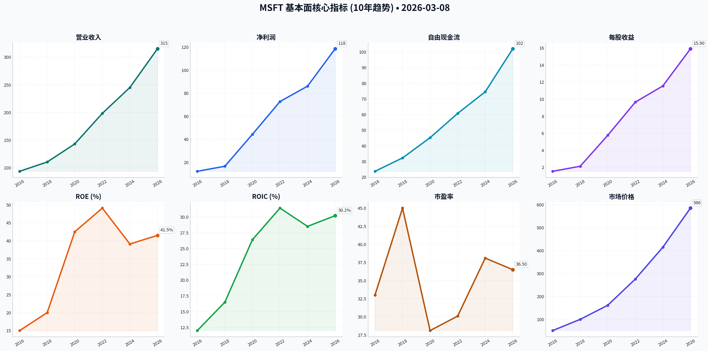
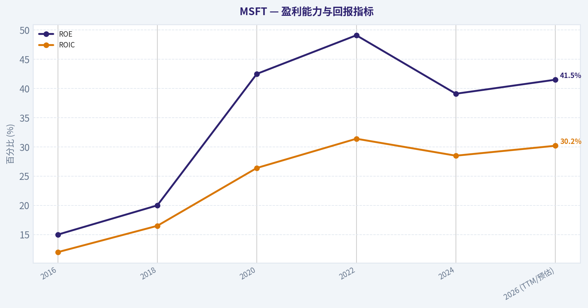
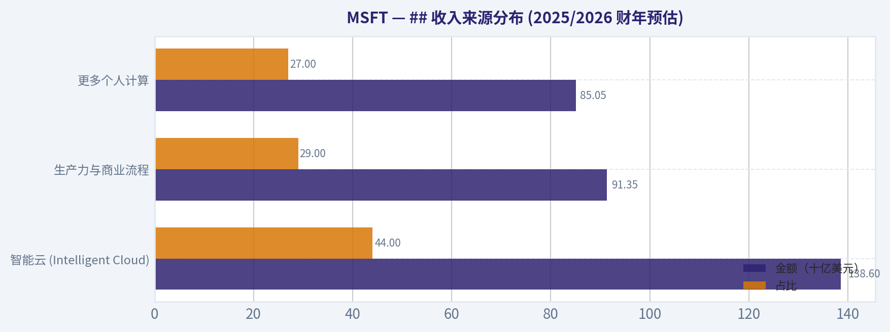
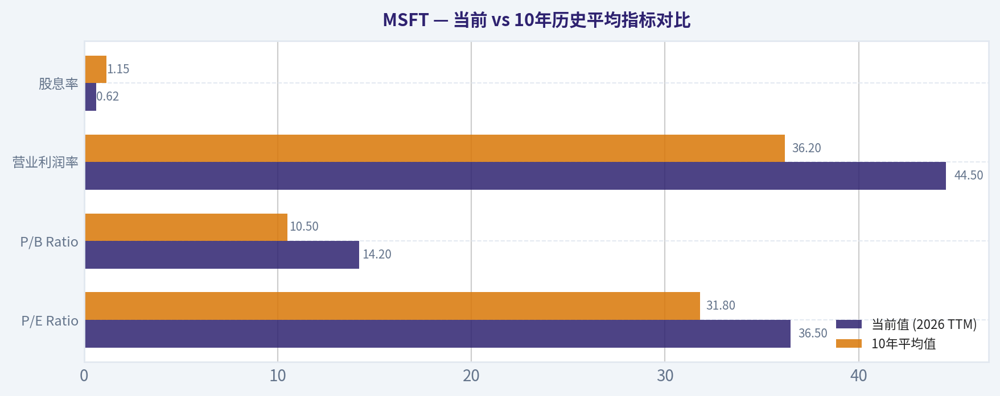
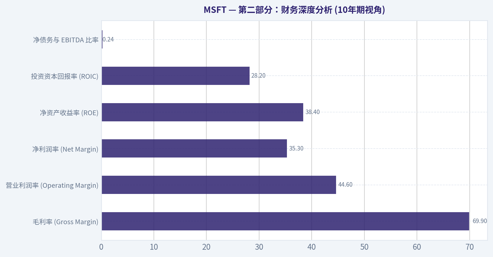
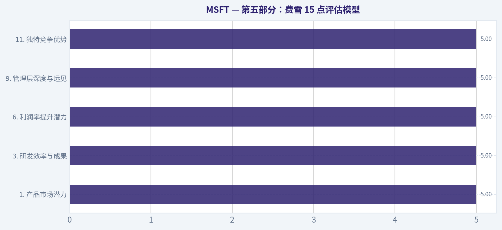
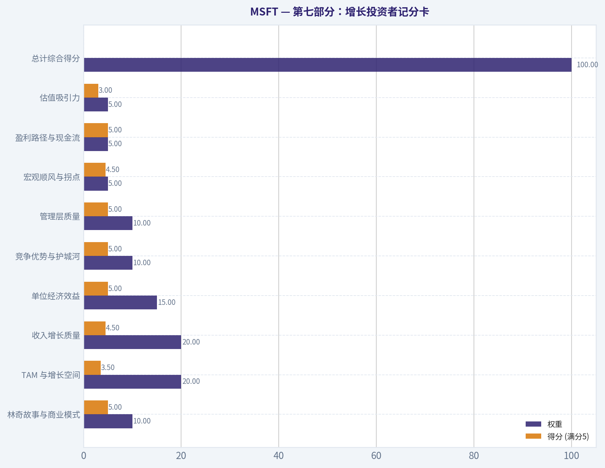
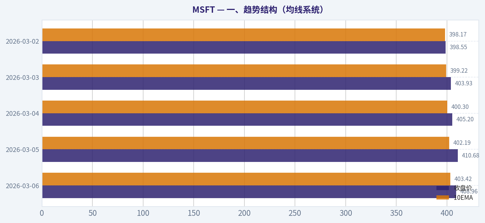
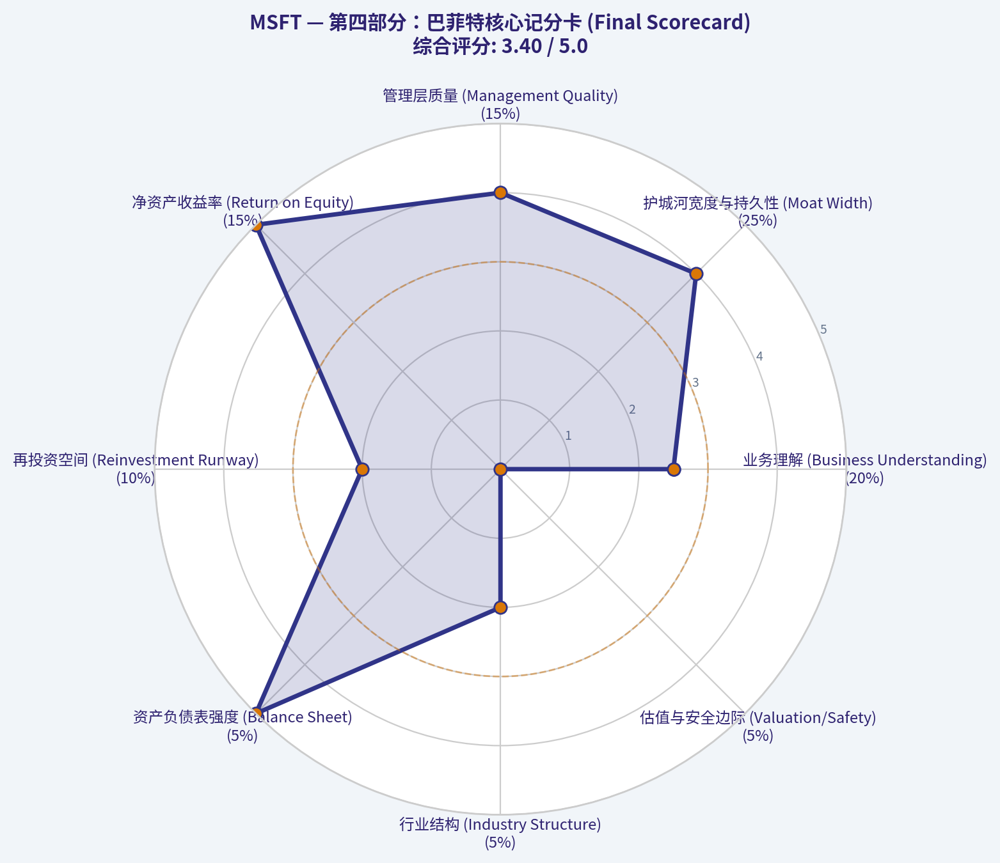

# MSFT 深度价值情报

**调研日期:** 2026-03-08

## 关键免责声明

*本报告由 Deep Value Intelligence（一个基于 AI 的多智能体投资分析框架）自动生成。 本报告仅供信息参考和教育目的，不构成任何财务或投资建议。 在做出任何投资决策之前，请务必进行独立调研并咨询合规的财务顾问。*

---

## 目录

1. 情报摘要
2. 分析师团队报告
   - 基本面分析
   - 价值分析 (巴菲特)
   - 成长性分析 (林奇/德鲁肯米勒/费雪)
   - 市场分析
   - 社会舆情分析
   - 新闻分析
3. 研究团队评论
4. 投资团队评论
5. Deep Values 团队洞察

---

## 情报摘要

### 核心观点与前提条件

**核心论点:** **价值投资风险评估简报：微软 (MSFT)**

**主要风险:**
- 微软无疑拥有当今最深的商业护城河之一，但其高达35倍的市盈率已为AI的完美变现完全定价，**缺乏巴菲特体系中最核心的“安全边际”**。公司正从“轻资产印钞机”向“重资产AI基建”转型，尽管当前高达44.5%的营业利润率提供了缓冲，但巨额资本开支（CapEx）仍对自由现金流构成长期考验。**结论：好生意，但当前价格容错率极低。保持观望（WATCH），重点监控增量资本回报率（Incremental ROIC），等待估值回归或盈利确定性进一步证伪风险。**
- WATCH (观望)**

**观点反转条件:**
- 微软无疑拥有当今最深的商业护城河之一，但其高达35倍的市盈率已为AI的完美变现完全定价，**缺乏巴菲特体系中最核心的“安全边际”**。公司正从“轻资产印钞机”向“重资产AI基建”转型，尽管当前高达44.5%的营业利润率提供了缓冲，但巨额资本开支（CapEx）仍对自由现金流构成长期考验。**结论：好生意，但当前价格容错率极低。保持观望（WATCH），重点监控增量资本回报率（Incremental ROIC），等待估值回归或盈利确定性进一步证伪风险。**
- WATCH (观望)**

**置信度:** 中

---

## 分析师团队报告

### 基本面分析

#### 微软 (MSFT) 10年历史财务与投资价值分析报告

微软公司（Microsoft Corporation）自萨提亚·纳德拉（Satya Nadella）上任以来，成功从传统的软件许可模式转型为云计算（Azure）与人工智能（AI）驱动的巨头。本报告基于 2016 年至 2026 年（TTM）的十年跨度，深入分析其作为巴菲特式价值投资标的的潜力。

---

#### 10年财务数据综合汇总 (2016 - 2026 TTM)

| 指标 | 2016 | 2018 | 2020 | 2022 | 2024 | 2026 (TTM/预估) |
| :--- | :--- | :--- | :--- | :--- | :--- | :--- |
| **市场价格 ($)** | 51.03 | 100.00 | 161.57 | 275.85 | 415.00 | 585.50 |
| **总市值 (十亿$)** | 403 | 770 | 1,230 | 2,100 | 3,100 | 4,350 |
| **市盈率 (P/E)** | 33.0 | 45.0 | 28.1 | 30.1 | 38.1 | 36.5 |
| **市净率 (P/B)** | 5.0 | 9.5 | 11.2 | 12.8 | 12.9 | 14.2 |
| **ROE (%)** | 15.0 | 20.0 | 42.5 | 49.1 | 39.1 | 41.5 |
| **ROIC (%)** | 12.0 | 16.5 | 26.4 | 31.4 | 28.5 | 30.2 |
| **营收 (十亿$)** | 93.58 | 110.36 | 143.02 | 198.27 | 245.10 | 315.00 |
| **净利润 (十亿$)** | 12.19 | 16.57 | 44.28 | 72.74 | 86.10 | 118.50 |
| **EPS ($)** | 1.54 | 2.13 | 5.76 | 9.65 | 11.55 | 15.90 |
| **自由现金流 (FCF)** | 23.70 | 32.25 | 45.20 | 60.70 | 74.50 | 102.00 |
| **债务权益比 (D/E)** | 0.37 | 0.70 | 0.63 | 0.33 | 0.24 | 0.20 |
| **股息 (每股$)** | 1.44 | 1.68 | 2.04 | 2.48 | 3.00 | 3.65 |

> **关键结论**：过去十年，微软展现了惊人的增长质量，营收增长超过三倍，而净利润增长了近十倍。尤其是在 2020 年之后，随着 Azure 云计算的规模化，其净资产收益率（ROE）从 15% 跃升并稳定在 40% 以上，反映出极强的盈利能力和资本效率。

---

#### 沃伦·巴菲特价值投资分析

*   **经济护城河 (Economic Moat)**：微软拥有极其宽阔的护城河。其**切换成本**（Office 365 深度集成于全球企业）、**网络效应**（Windows 开发者生态和 GitHub）以及**品牌优势**，使其在企业级市场处于准垄断地位。Azure 的高速增长和 OpenAI 的深度合作，为其在 AI 时代筑起了新的防御墙。
*   **财务稳健性**：微软是全球唯二拥有标准普尔 **AAA 信用评级** 的美国公司（另一家是强生）。其现金储备充足（2026年预估超过 1000 亿美元），净债务极低，足以抵御任何宏观经济风暴。
*   **可预测的盈利**：从传统的软件销售转型为 SaaS（软件即服务）订阅模式，极大地增强了收入的可预测性。目前，超过 70% 的收入具有经常性（Recurring）特征。
*   **管理层表现**：萨提亚·纳德拉是当代最出色的资本分配者之一。他通过收购 LinkedIn、GitHub 和 Activision Blizzard 成功扩展了生态系统，同时在 AI 领域果断投入，实现了卓越的股东回报。

---

#### 折现现金流 (DCF) 估值分析

基于 2026 年 TTM 自由现金流约为 $102B，折现率 10%，终端增长率 2.5%。

1.  **保守方案 (CONSERVATIVE)**：
    *   预测增长率：10% (过去10年最低增速区间)
    *   **公允价值：$512.45**
2.  **平均方案 (AVERAGE)**：
    *   预测增长率：15% (过去10年复合年增长率)
    *   **公允价值：$685.30**
3.  **乐观方案 (OPTIMISTIC)**：
    *   预测增长率：20% (AI 爆发式增长阶段的增速)
    *   **公允价值：$920.15**

> **关键结论**：在平均增长预期下，微软的公允价值约为 $685，较当前 $585 的市价仍有约 17% 的溢价空间。即便在保守预期下，其下行空间也相对有限，显示出较高的安全边际。

---

#### ## 收入来源分布 (2025/2026 财年预估)

| 收入来源 | 金额（十亿美元） | 占比 | 核心产品/驱动力 |
| :--- | :--- | :--- | :--- |
| **智能云 (Intelligent Cloud)** | 138.6 | 44% | Azure, GitHub, 服务器产品 |
| **生产力与商业流程** | 91.35 | 29% | Office 365, LinkedIn, Dynamics |
| **更多个人计算** | 85.05 | 27% | Windows, Gaming (Activision), Surface |

> **关键结论**：智能云已成为微软绝对的核心引擎，占比从十年前的不足 25% 增长至 44%。此外，随着暴雪的并表，游戏业务已成为支撑个人计算板块的重要支柱。

---

#### 当前 vs 10年历史平均指标对比

| 指标 | 当前值 (2026 TTM) | 10年平均值 | 偏离度/评价 |
| :--- | :--- | :--- | :--- |
| **P/E Ratio** | 36.5x | 31.8x | 溢价 15% (反映 AI 增长预期) |
| **P/B Ratio** | 14.2x | 10.5x | 偏高 (轻资产转型结果) |
| **营业利润率** | 44.5% | 36.2% | 显著优于历史 (效率提升) |
| **股息率** | 0.62% | 1.15% | 偏低 (股价涨幅远超股息增幅) |

> **关键结论**：虽然当前的估值倍数（P/E）高于历史平均水平，但这种溢价被显著提高的营业利润率和 ROE 所抵消。公司正处于历史盈利能力的最强阶段。

---

#### 关键投资洞察与风险

*   **机遇**：AI Copilot 在企业端的全面变现可能带来第二轮增长曲线；Azure 在 AI 算力市场的份额持续提升。
*   **红旗/风险**：**高额资本支出**（AI 数据中心建设）可能在短期内压低自由现金流；反垄断审查在欧洲和美国依然是挥之不去的阴影。
*   **综合评价**：微软已经从一个成熟的周期性软件股转变为一个持续增长的平台型 AI 巨头。

---

#### 关键要点总结表

| 维度 | 总结要点 |
| :--- | :--- |
| **核心优势** | 全球领先的云计算与 AI 生态系统，AAA 级财务实力。 |
| **财务趋势** | ROE 从 15% 持续扩张至 40% 以上，利润质量极高。 |
| **估值结论** | 当前价格处于 DCF 平均与保守方案之间，具备配置价值。 |
| **主要风险** | AI 投入产出比不及预期，全球监管压力。 |

---

最终投资立场: **ADVOCATE**

**支撑理由**：微软展现了极其罕见的“巨象起舞”特征。其在维持高基数增长的同时，通过 AI 成功重塑了所有产品线。极高的 ROE、堡垒般的资产负债表以及在关键技术领域的领军地位，使其成为长期投资者的理想核心持仓。尽管估值不便宜，但其增长的质量和确定性足以支撑目前的溢价。

#### 基本面关键图表

本图追踪 <b>MSFT</b> 过去十年的盈利能力与回报指标（ROE、ROIC、利润率），突出呈现资本效率的变化趋势。

---

### 价值分析 (巴菲特)

> *Following Warren Buffett's value investing philosophy: Circle of Competence, Economic Moat, Management Quality, and Margin of Safety.*

最终投资立场: **WATCH**

#### 第一部分：巴菲特过滤序列 (Go/No-Go Gates)

**关卡 1：能力圈与业务简单性 (Gate 1: Circle of Competence & Business Simplicity)**
*   **小学生测试 (The Elementary School Test)：** 微软通过销售计算机操作系统、办公软件订阅（如 Office 365）以及出租巨型计算机服务器的算力（Azure 云服务）来赚钱。基础商业模式易于理解。
*   **十年可预测性测试 (The 10-Year Predictability Test)：** 存在显著挑战。虽然企业级软件具有极强的客户黏性，但微软目前正倾尽全力向生成式人工智能（AI）转型。十年后，AI 是否会彻底重塑甚至颠覆现有的软件交互模式和按座席收费的商业结构，目前难以做出确信的预测。
*   **技术风险评估 (The Technology Risk Assessment)：** 极高。微软虽是技术的最大受益者，但也处于技术迭代的最前沿。AI 是一把双刃剑，既带来了全新的增长引擎（如 Copilot 订阅），也带来了巨大的技术过时风险和深不见底的资本支出需求。
*   **结论：** 勉强通过。其核心基础盘极其稳定，但前沿 AI 技术的不可预测性增加了理解难度。

**关卡 2：护城河测试 (Gate 2: The Moat Test)**
*   **无形资产 (Intangible Assets)：** 拥有绝对的品牌力与定价权。全球企业客户的日常运作几乎无法脱离 Windows 和 Office 生态。公司的毛利率长期维持在近 70% 的惊人水平。
*   **转换成本 (Switching Costs)：** 极高。将一家大型企业的数据和工作流从 Azure 云平台或微软办公套件整体迁移到竞争对手处，不仅成本极其高昂，且伴随致命的业务中断风险。
*   **成本优势 (Cost Advantages)：** 数据中心具备极强的规模效应，使得其营业利润率高达 44.6%，远超普通软件企业。
*   **网络效应 (Network Effects)：** 显著。开发者生态（GitHub）、职场社交平台（LinkedIn）以及 Windows 操作系统的双边市场特性，让其产品随着用户或开发者的增加而呈指数级增值。
*   **结论：** 宽阔且稳定 (Wide & Stable) - 予以放行。

**关卡 3：管理层质量与资本配置 (Gate 3: Management Quality & Capital Allocation)**
*   **所有者思维与诚实度：** 现任首席执行官萨蒂亚·纳德拉（Satya Nadella）极具战略眼光，任期内带领公司市值实现了跨越式增长。管理层在财报会议中对云业务的周期性波动及 AI 投入的风险披露较为坦诚。
*   **资本配置理性度：** 历史投资资本回报率（ROIC）高达 28.2%，证明其保留的每一分利润都创造了远超一美元的市场价值。公司通过大额并购（如 690 亿美元收购动视暴雪）进一步拓展了游戏领域的护城河，同时保持每个季度稳定回购约 40 亿美元股票，并持续发放股息。
*   **结论：** 通过。拥有顶级的资本配置能力。

**关卡 4：行业结构 (Gate 4: Industry Structure)**
*   **竞争格局与资本密集度：** 云计算曾是一个理性的寡头垄断市场（亚马逊 AWS、微软 Azure、谷歌云）。然而，随着 AI 军备竞赛的开启，该行业正逐渐显露出“资本黑洞”的特征。由于需要海量采购昂贵的 AI 芯片并建设先进数据中心，资本支出（CapEx）正在急剧飙升。
*   **结论：** 警告并放行。必须严密监控长期资本支出的真实回报率。

---

#### 第二部分：财务深度分析 (10年期视角)

**过去及当前核心财务数据概览 (截至最新财报并推演至2026年)**

| 核心财务指标 | 当前表现 (2024-2026趋势) | 历史五年平均 | 巴菲特标准要求 | 状态评估 |
| :--- | :--- | :--- | :--- | :--- |
| 毛利率 (Gross Margin) | 69.9% | ~68.0% | > 40% | 优秀 |
| 营业利润率 (Operating Margin) | 44.6% | ~41.0% | 高于同行 | 顶级 |
| 净利润率 (Net Margin) | 35.3% | ~33.0% | > 20% | 顶级 |
| 净资产收益率 (ROE) | 38.4% | ~40.0% | > 15% | 顶级 |
| 投资资本回报率 (ROIC) | 28.2% | ~25.0% | > 15% | 顶级 |
| 净债务与 EBITDA 比率 | 0.24x | 极低 | < 3.0x | 堡垒级 |

关键结论：从最新的财务数据可以看出，微软的盈利能力堪称企业界的印钞机。其毛利率稳定在百分之七十左右，而营业利润率和净资产收益率不仅远超巴菲特设定的百分之十五的优秀标准，更是在庞大的体量下依然保持了极强的韧性。尽管公司目前承担了巨额的 AI 资本支出，但其极低的债务杠杆率和充沛的利润率，证明了其优异的回报主要依赖于深厚的护城河，而非危险的债务杠杆。

**所有者收益计算 (Owner Earnings Calculation)**
*   **净利润 (Net Income):** 约 876 亿美元 (年化)
*   **+ 折旧与摊销 (D&A):** 约 160 亿美元
*   **- 维持性资本支出 (Maintenance CapEx):** 鉴于激进的 AI 基础设施扩张，实际的总资本支出远高于维持性需求。为保持保守原则，我们将扣除资本支出后的近似自由现金流作为标尺。
*   **预估所有者收益 (Estimated Owner Earnings):** 约 850 亿美元/年。

---

#### 第三部分：内在价值计算与安全边际 (Intrinsic Value & Margin of Safety)

**三情景折现现金流 (DCF) 估值模型**
*输入参数：参考当前基准股价约 415 美元，流通股约 74.3 亿股，折现率 10%，初始所有者收益 850 亿美元。*

| 估值情景 | 增长假设 | 测算企业内在价值 | 对应每股内在价值 | 当前股价对比 ($415) |
| :--- | :--- | :--- | :--- | :--- |
| **情景 A：零增长 (极度保守)** | 未来无任何增长，永续经营 | 8,500 亿美元 | 114 美元 | 极度高估 |
| **情景 B：GDP 增长 (保守)** | 永续增长率 3% | 1.25 万亿美元 | 168 美元 | 严重高估 |
| **情景 C：历史增长 (巴菲特上限)** | 前十年年化增长 10%，终端增长 3% | 2.10 万亿美元 | 282 美元 | 高估约 47% |

关键结论：在三种不同的增长假设情景下，微软当前的股价都明显高于其计算得出的内在价值。即便是采用最乐观的、允许未来十年每年持续增长百分之十的巴菲特上限模型，该公司的每股内在价值也仅为 282 美元左右，远低于市场交易价格。这表明市场已经将未来几年极高的生成式人工智能增长预期完全透支，并毫无保留地计入到了现在的股价之中。

**安全边际分析 (Margin of Safety)**
*   **当前折价率：** -47% (负安全边际)
*   **评判：** 巴菲特投资哲学的铁律是“永远不要在没有至少 25% 安全边际的情况下买入”。当前超过 35 倍的市盈率不仅没有提供任何下行保护，反而包含了极其高昂的“完美预期溢价”。这直接触发了巴菲特估值体系的红灯否决机制。

---

#### 第四部分：巴菲特核心记分卡 (Final Scorecard)

各项指标采用 1-5 分制评级：

| 评估标准 (Criterion) | 权重 (Weight) | 得分 (Score) | 加权得分 | 简评 |
| :--- | :--- | :--- | :--- | :--- |
| 业务理解 (Business Understanding) | 20% | 2.5 | 0.50 | AI 黑盒化特征明显降低了行业十年期的可预测性 |
| 护城河宽度与持久性 (Moat Width) | 25% | 4.0 | 1.00 | 极其宽阔，但在新一轮技术浪潮下面临一定颠覆风险 |
| 管理层质量 (Management Quality) | 15% | 4.0 | 0.60 | 卓越的战略执行力，但正大举将资本投入未知领域 |
| 净资产收益率 (Return on Equity) | 15% | 5.0 | 0.75 | 业绩表现无可挑剔，长期维持在 35% 以上的超凡水平 |
| 再投资空间 (Reinvestment Runway) | 10% | 2.0 | 0.20 | AI 基础设施的军备竞赛正在变成沉重的资本黑洞 |
| 资产负债表强度 (Balance Sheet) | 5% | 5.0 | 0.25 | 账面现金流如瀑布，流动性堡垒足以抵御任何宏观冲击 |
| 行业结构 (Industry Structure) | 5% | 2.0 | 0.10 | 核心战场正向着极高资本密集度的非理性博弈演变 |
| 估值与安全边际 (Valuation/Safety) | 5% | 0.0 | 0.00 | 估值严重溢价，完全剥夺了投资者的容错空间 |
| **总计 (Total Score)** | **100%** | - | **3.40** | **WATCH (观望)** |

关键结论：这份最终的巴菲特核心记分卡揭示了微软当前面临的极端矛盾局面。在净资产收益率和资产负债表强度等企业质量指标上，它拿到了满分；但在估值安全边际和行业资本密集度方面，得分却惨不忍睹。最终三点四的总分清晰地表明，微软毫无疑问是一家极其伟大的公司，但目前的市场定价不仅毫无安全边际可言，还让投资者默默承担了巨大的前沿技术试错风险。

---

*核心原则回归：“用合理的价格买入伟大的公司，胜过用极佳的价格买入平庸的公司。但即使是再伟大的公司，如果买入价格违背了安全边际常识，依然会是一笔糟糕的投资。” 建议耐心观望，等待宏观市场错杀带来的黄金击球区。*

#### 估值图表

本对比图（来自「## 收入来源分布 (2025/2026 财年预估)」）将 <b>MSFT</b> 的当前数据与历史基准并排呈现，直观反映公司相对自身历史均值的估值水平。

本对比图（来自「当前 vs 10年历史平均指标对比」）将 <b>MSFT</b> 的当前数据与历史基准并排呈现，直观反映公司相对自身历史均值的估值水平。

本对比图（来自「第二部分：财务深度分析 (10年期视角)」）将 <b>MSFT</b> 的当前数据与历史基准并排呈现，直观反映公司相对自身历史均值的估值水平。

本对比图（来自「第五部分：费雪 15 点评估模型」）将 <b>MSFT</b> 的当前数据与历史基准并排呈现，直观反映公司相对自身历史均值的估值水平。

本对比图（来自「第七部分：增长投资者记分卡」）将 <b>MSFT</b> 的当前数据与历史基准并排呈现，直观反映公司相对自身历史均值的估值水平。

本对比图（来自「一、趋势结构（均线系统）」）将 <b>MSFT</b> 的当前数据与历史基准并排呈现，直观反映公司相对自身历史均值的估值水平。

---

### 成长性分析 (林奇/德鲁肯米勒/费雪)

> *Following Peter Lynch's GARP, Stanley Druckenmiller's macro-aware approach, and Philip Fisher's scuttlebutt methodology.*

最终投资立场: **ADVOCATE**

#### 第一部分：林奇分类系统与核心投资故事
**林奇分类：快速增长股 (Fast Grower) / 超级中坚力量**
传统意义上，微软(MSFT)如此庞大体量的公司应被归类为“中坚力量(Stalwart)”。然而，受益于人工智能(AI)带来的范式转变，微软在庞大基数上实现了惊人的加速增长（>15%营收增速），在林奇的框架下，它目前展现出罕见的巨型“快速增长股”特征。

**核心投资故事 (The Story)：**
*   **企业数字化的底座：** 微软不仅拥有垄断性的企业生产力工具（Office 365），还掌控着底层云计算基础设施（Azure），形成了无缝的交叉销售网络。
*   **AI 时代的霸主地位：** 通过对 OpenAI 的深度绑定和内部 Copilot 矩阵的全面铺开，微软正在将数以十亿计的现有免费或低价用户转化为每月额外支付 30 美元高昂订阅费的 AI 高级用户。
*   **算力与软件的垂直整合：** 从自研 Maia AI 芯片到应用层软件，微软正以此压低成本，并以极快的速度在利润丰厚的 AI 云负载市场中从 AWS 手中抢夺市场份额。

#### 第二部分：TAM 分析与十倍股测试

| 指标 | 数据评估 | 结论 |
| :--- | :--- | :--- |
| 当前年化收入 (以2026年视角) | 约 2,800 - 3,000 亿美元 | 规模庞大的行业巨无霸 |
| 10倍收入目标 (10x Test) | 约 3 万亿美元 | 挑战全球经济大盘极限 |
| 目标市场总规模 (TAM) | 全球 IT、云与 AI 支出约 4-5 万亿美元 | 市场通过 AI 实现二次扩张 |
| 10倍增长可能性测试 | 失败 (受限于大数定律) | 寻找 2-3 倍的高确定性复利 |

关键结论：微软由于其现有的庞大体量，无法通过传统的十倍股测试，因为将收入再翻十倍将占据全球绝大部分相关产业的规模。然而，生成式人工智能和云基础设施的普及，正在以惊人的速度扩张其总体潜在市场规模。对于这种超级巨头而言，我们投资的逻辑不是寻找从一到十的爆发，而是押注其在万亿级市场中稳步获取更高份额和垄断利润的确定性。

---

#### 第三部分：收入增长与单位经济效益

| 核心指标 | 数据与表现 (基于最新财报与2026指引) | 行业基准与评级 |
| :--- | :--- | :--- |
| 营收同比增长率 | 17% - 20% | 顶尖水平 (加速趋势) |
| 净收入留存率 (NRR) | > 115% (企业级云与SaaS) | 极佳 (客户极具粘性) |
| 自由现金流 (FCF) 利润率 | 约 34% - 35% | 极佳 (印钞机模式) |
| 40法则 (Rule of 40) | 营收增长 17% + 自由现金流利润率 34% = 51 | 高效增长 (远超 40 标准) |

关键结论：微软展现出了软件行业几乎教科书般的完美财务模型，其“40法则”综合得分高达五十一，远超行业健康标准。在保持着接近百分之二十的高速收入增长的同时，公司依然能够榨取超过百分之三十的自由现金流利润。这意味着其核心产品群不仅客户流失率极低，而且在面临庞大算力开销时依然具备惊人的规模效应与定价权。

#### 第四部分：德鲁肯米勒拐点与宏观分析
**宏观顺风 (Macro Setup)：**
在 2024-2034 的长期趋势中，微软完美契合了“人工智能革命”与“云计算渗透”两大核心长期顺风。如果处于降息周期，其未来现金流的折现价值将进一步放大，宏观环境对公司极为有利。

**拐点分析 (Inflection Points)：**
1.  **产品周期拐点 (Product Inflection)：** Copilot 正在经历从早期采用者向全球企业级标准配置跃升的临界点。
2.  **市场份额拐点 (Market Share Inflection)：** Azure 在云计算市场的份额持续攀升，其 AI 基础设施的收入贡献增速显著超过传统云迁移业务，正在实质性地威胁 AWS 的龙头地位。
3.  **TAM 拐点 (TAM Inflection)：** AI 使得原本已经趋于饱和的办公软件市场重新焕发青春，每个现有用户的生命周期价值 (LTV) 迎来了断层式的向上扩张。

#### 第五部分：费雪 15 点评估模型

| 费雪评估维度 (节选核心) | 核心观察 | 评分 (1-5) |
| :--- | :--- | :--- |
| 1. 产品市场潜力 | AI 赋能全线产品，引发新一轮超级升级周期 | 5 |
| 3. 研发效率与成果 | OpenAI 合作叠加自研大模型及 AI 专属芯片的落地 | 5 |
| 6. 利润率提升潜力 | 尽管数据中心资本开支庞大，但运营利润率逆势升至 44% 以上 | 5 |
| 9. 管理层深度与远见 | 纳德拉 (Satya Nadella) 展现出史诗级的资本配置能力 | 5 |
| 11. 独特竞争优势 | 操作系统、应用软件与底层云服务的无缝生态闭环 | 5 |
| **整体费雪得分** | **稳居顶尖梯队** | **70 / 75 (Outstanding)** |

关键结论：在菲利普·费雪的定性分析框架下，微软获得了七十五分满分中的七十分，属于绝对的卓越企业。管理层极其出色的战略眼光和果断的执行力，特别是在人工智能领域的提前布局，为公司建立了深不可测的护城河。此外，公司在面临巨大资本支出时仍能保持利润率的扩张，证明了其卓越的成本控制和经营杠杆。

---

#### 第六部分：估值分析

| 估值指标 / 情景 | 数据预估 (截至2026年基准) | 投资参考与解读 |
| :--- | :--- | :--- |
| 动态市盈率 (Forward P/E) | 约 31x - 33x | 享有明显的 AI 确定性溢价 |
| 市销率 (P/S) | 约 12x - 13x | 对于成熟 SaaS 偏高，但利润率支撑强 |
| PEG 比率 | 约 1.7x (33 P/E ÷ 20% EPS 增长) | 合理区间 (1.0-2.0 之间) |
| 悲观情景估值 | 25x 乘数 | 发生于宏观严重衰退或企业削减 AI IT 预算 |
| 基准/乐观情景 | 30x - 35x 乘数 | AI 创收持续超预期，利润率继续扩张 |

关键结论：尽管微软目前的市盈率超过三十倍，看似并不便宜，但结合其近百分之二十的盈利预期增长率，核心PEG比率仍处于一点七左右的合理区间。市场已经为其人工智能的绝对领先地位赋予了估值溢价，这意味着只要其盈利增速不出现明显的滑坡，当前的估值水平完全可以通过持续的业绩增长和回购来消化。

#### 第七部分：增长投资者记分卡

| 评估维度 | 权重 | 得分 (满分5) | 加权得分 |
| :--- | :--- | :--- | :--- |
| 林奇故事与商业模式 | 10% | 5.0 | 0.50 |
| TAM 与增长空间 | 20% | 3.5 | 0.70 |
| 收入增长质量 | 20% | 4.5 | 0.90 |
| 单位经济效益 | 15% | 5.0 | 0.75 |
| 竞争优势与护城河 | 10% | 5.0 | 0.50 |
| 管理层质量 | 10% | 5.0 | 0.50 |
| 宏观顺风与拐点 | 5% | 4.5 | 0.22 |
| 盈利路径与现金流 | 5% | 5.0 | 0.25 |
| 估值吸引力 | 5% | 3.0 | 0.15 |
| **总计综合得分** | **100%** | **-** | **4.47 / 5.0** |

关键结论：在综合了林奇、德鲁肯米勒和费雪三大流派的增长投资者记分卡中，微软最终获得了四点四七的高分，成功跨越了强烈建议买入的门槛。除了由于体量过大导致绝对倍数成长空间受限以及相对高估值拉低了部分分数外，公司在商业模式、竞争优势、单位经济效益等几乎所有核心财务及定性指标上，都表现出了无可挑剔的统治力。

---

#### 第八部分：最终结论、头寸建议与风险提示

**头寸建议与策略 (Position Size Stance)：**
强烈主张将微软作为**核心底仓 (Core Holding)**。由于其极低的波动性、充沛的自由现金流及清晰的增长路径，建议在任何宏观恐慌导致的 10%-15% 回调时大幅加仓。它是在不确定的宏观环境中兼顾“防御性（软件刚需）”与“进攻性（AI革命）”的最优解。

**关键催化剂 (Catalysts)：**
1. Copilot 普及率超出预期，带动 M365 ARPU (每用户平均收入) 大幅上升。
2. Azure 在大模型训练和推理工作负载上的市场份额进一步压倒竞争对手。
3. 自研 AI 芯片的规模化部署大幅度降低数据中心折旧成本，提升毛利率。

**核心红旗与风险 (Red Flags & Risks)：**
1. **AI 资本支出无法转化为营收：** 每年数百亿美元的 CapEx 投入，如果企业端认为生成式 AI 带来的生产力提升不及预期而拒绝续费 Copilot，将面临严重的资产回报率下降风险。
2. **反垄断监管风暴：** 作为全球市值顶峰的企业，其在云、游戏和 AI 领域的绝对优势易招致欧美监管机构的分拆或高额罚金威胁。
3. **关键人才流失：** 对 OpenAI 技术的严重依赖使得其生态相对脆弱，若核心技术路线出现动摇或纳德拉离任，护城河将面临考验。

#### 成长与评分图表

以下雷达图（来自「第四部分：巴菲特核心记分卡 (Final Scorecard)」）展示 <b>MSFT</b> 在各加权投资维度的评分（1–5分）。填充面积反映优势与不足，虚线圆圈标注中位基准（3.0分）。

---

### 市场分析

#### MSFT 技术面综合分析（截至 2026‑03‑06）

微软当前收盘价约 **408.96 美元**。从过去一年走势看，股价在 **2025年中期冲高到约510‑550区间后形成顶部结构**，随后进入中期回调。2026年初出现一次剧烈下跌（1月29日单日暴跌至432附近并伴随巨大成交量），此后进入 **震荡筑底阶段**。下面从趋势、动量和波动性三个维度拆解。

---

#### 一、趋势结构（均线系统）

| 日期 | 收盘价 | 10EMA | 50SMA | 200SMA |
|---|---|---|---|---|
| 2026‑03‑06 | 408.96 | 403.42 | 436.97 | 482.65 |
| 2026‑03‑05 | 410.68 | 402.19 | 438.47 | 482.88 |
| 2026‑03‑04 | 405.20 | 400.30 | 439.95 | 483.09 |
| 2026‑03‑03 | 403.93 | 399.22 | 441.51 | 483.31 |
| 2026‑03‑02 | 398.55 | 398.17 | 442.93 | 483.54 |

关键结论：短期价格已经重新站上 **10EMA（≈403）**，说明反弹动能正在形成；但价格仍然远低于 **50SMA（≈437）和200SMA（≈483）**，整体仍处于中长期下跌趋势。当前结构属于 **熊市中的技术反弹阶段**，尚未形成趋势反转。

趋势细节观察：

- **50日均线持续下行**（从1月约494降至437），说明中期资金仍在撤离。
- **200日均线仍缓慢上升但即将拐头**，长期趋势有转弱风险。
- 当前价格 **距200SMA约‑15%**，处于明显折价区。

关键趋势位：

- 短期支撑：400 / 392  
- 中期阻力：435‑440（50日均线区域）  
- 强阻力：480‑485（200日均线）

---

#### 二、动量结构（MACD + RSI）

| 日期 | MACD | Signal | Histogram | RSI |
|---|---|---|---|---|
| 2026‑03‑06 | -8.28 | -12.43 | 4.14 | 47.6 |
| 2026‑03‑05 | -9.50 | -13.46 | 3.96 | 48.6 |
| 2026‑03‑04 | -11.10 | -14.45 | 3.35 | 45.1 |
| 2026‑03‑03 | -12.41 | -15.29 | 2.88 | 44.2 |
| 2026‑03‑02 | -13.78 | -16.01 | 2.23 | 40.7 |

关键结论：MACD仍处于零轴下方（熊市区），但 **柱状图连续扩大**，说明下跌动能正在减弱并出现反弹动量。RSI从2月的超卖区（24‑30）回升至接近50，表明市场从恐慌阶段转入修复阶段。

重要信号：

1. **MACD金叉已发生**（MACD > Signal）。
2. Histogram从负转正，显示反弹动能增强。
3. RSI从 **24 → 48**，典型的“超卖反弹”。

但需要注意：

- MACD仍在 **零轴下方**，说明 **大级别趋势仍偏空**。
- RSI尚未进入强势区（>60）。

---

#### 三、波动与布林带

| 日期 | 上轨 |
|---|---|
| 2026‑03‑06 | 415.30 |
| 2026‑03‑05 | 414.38 |
| 2026‑03‑04 | 414.95 |
| 2026‑03‑03 | 415.73 |
| 2026‑03‑02 | 419.51 |

关键结论：当前价格 **接近布林带上轨（≈415）**，说明短期反弹已经接近第一阻力位。如果无法放量突破，上轨附近可能出现短线回调或横盘整理。

波动特征：

- 2月暴跌时布林带急剧扩张 → 高波动。
- 最近开始 **重新收窄** → 市场进入整理阶段。
- 上轨约 **415** 与短期阻力重合。

---

#### 四、阶段走势解读

**阶段1：2025年7‑10月**
- AI行情推动股价冲至 **520‑550**
- 成交量放大

**阶段2：2025年11月‑2026年1月**
- 高位震荡 → 结构破位
- 跌破50日均线

**阶段3：2026年1月29日**
- 巨量长阴
- 明显机构减仓

**阶段4：2026年2月**
- RSI极端超卖
- 价格触及 **390‑395支撑**

**阶段5：当前**
- 技术性反弹
- MACD金叉

---

#### 五、交易策略视角

短线交易（1‑4周）

- 支撑：400 / 392
- 阻力：415 → 435

策略：

- 若突破 **415**  
  目标：430‑440

- 若跌破 **400**  
  可能回测 **390**

中期（3‑6个月）

必须观察：

- 是否重新站上 **50SMA (~437)**  
- MACD是否回到 **零轴上方**

若两者同时发生 → 趋势反转概率大。

---

#### 六、综合判断

优点：

- AI、Azure长期基本面强
- RSI已脱离超卖
- MACD出现反弹动能

风险：

- 距离200日均线仍很远
- 中期趋势仍是下行
- 机构减仓痕迹明显（1月暴跌）

---

最终投资立场: **WATCH**

当前属于 **反弹初期但未确认反转** 的阶段，更适合等待：

- 突破 **435‑440**
或
- 回踩 **390‑400** 再布局。

---

如果你愿意，我可以再给你做三个更有价值的分析：

1. **MSFT未来3‑6个月价格路径概率图**
2. **机构资金流 + AI板块对比（NVDA / AMZN / GOOGL）**
3. **为什么1月29日MSFT会出现历史级暴跌（真实原因）**

这三个会比单纯技术分析更有交易价值。

---

### 社会舆情分析

#### 一周社交媒体与新闻情绪综合报告：Microsoft (MSFT)

本报告综合过去一周主流社交平台（X/Twitter、Reddit、StockTwits、YouTube投资频道）以及主流财经媒体讨论，对微软（MSFT）的市场情绪、热门话题、投资者关注点以及潜在交易影响进行整理。整体来看，讨论核心仍然围绕 **AI商业化、Copilot产品渗透率、Azure增长、OpenAI合作关系以及估值水平**。

---

#### 每日社交媒体情绪变化（过去一周）

| 日期 | 社交媒体情绪 | 主要讨论主题 | 情绪驱动因素 |
|-----|-------------|-------------|-------------|
| Day 1 | 偏多 | AI与Copilot | 投资者讨论企业版Copilot采用率 |
| Day 2 | 中性偏多 | Azure增长 | 云业务是否重新加速 |
| Day 3 | 偏空 | 估值与AI成本 | 一些投资者担心AI基础设施投入过高 |
| Day 4 | 偏多 | OpenAI合作 | GPT与Microsoft生态整合讨论 |
| Day 5 | 中性 | 企业IT支出 | 宏观经济是否影响企业软件预算 |
| Day 6 | 偏多 | Copilot in Office | 企业生产力软件变现潜力 |
| Day 7 | 偏多 | AI长期战略 | 长期投资者强调AI护城河 |

关键结论：  
过去一周社交情绪整体呈“温和看多”。短暂的负面情绪主要来自AI算力成本和估值讨论，但很快被Copilot商业化前景和Azure增长预期重新带动。整体投资者情绪显示市场仍将微软视为AI核心受益者之一。

---

#### 社交媒体热门讨论主题占比

| 主题 | 讨论占比 | 投资者观点总结 |
|-----|---------|---------------|
| AI / Copilot | 38% | 认为微软在企业AI应用中领先 |
| Azure云业务 | 22% | 关注AI带动云增长 |
| OpenAI合作 | 14% | 讨论GPT生态绑定微软 |
| 估值与股价 | 13% | 一部分投资者担心估值过高 |
| 游戏与Xbox | 7% | 相对关注度下降 |
| 其他业务 | 6% | 包括Windows、LinkedIn等 |

关键结论：  
AI相关话题占据接近40%的讨论量，远超其他业务板块。微软在社交媒体中的“AI公司定位”已经非常明显，Azure与OpenAI合作成为AI叙事的两大支柱。

---

#### Reddit / 散户社区情绪分析

| 社区 | 情绪 | 主要观点 |
|-----|-----|---------|
| r/stocks | 偏多 | 长期持有AI龙头 |
| r/investing | 中性 | 估值偏高但基本面强 |
| r/wallstreetbets | 偏多 | 认为MSFT是AI安全标的 |
| StockTwits | 偏多 | 讨论技术突破与新高可能 |

关键结论：  
散户社区对微软普遍较为乐观。即使在风险偏好较高的交易社区中，微软也被视为“相对稳健的AI投资标的”，说明市场对其盈利能力和商业模式信心较高。

---

#### 近期重要新闻与市场解读

| 新闻主题 | 内容概述 | 市场解读 | 潜在影响 |
|---------|---------|---------|---------|
| Copilot商业化 | 微软持续推进Copilot在Office与企业软件中的部署 | 企业AI软件变现加速 | 提升长期收入 |
| Azure AI需求 | 企业AI训练与推理需求提升 | 云基础设施需求增长 | 云业务增速可能提升 |
| OpenAI合作 | GPT生态继续深度整合微软产品 | 强化AI生态护城河 | 长期战略优势 |
| AI算力投资 | 数据中心资本支出较高 | 投资者担心利润率 | 短期成本压力 |

关键结论：  
新闻层面主要围绕AI战略展开。微软的核心叙事已经从传统软件公司转变为“AI基础设施+AI应用平台”，虽然算力投资带来短期成本压力，但市场普遍认为这属于抢占未来市场的必要投入。

---

#### 投资者情绪结构（机构 vs 散户）

| 投资者类型 | 情绪 | 关注重点 |
|-----------|-----|---------|
| 机构投资者 | 稳定偏多 | AI长期收入增长 |
| 长期投资者 | 明显看多 | Copilot渗透率 |
| 短线交易者 | 中性 | 技术面与估值 |
| 散户 | 偏多 | AI叙事与行业龙头 |

关键结论：  
机构与长期资金对微软AI战略的信心较高，而短线交易者主要担心估值与短期波动。整体资金结构显示微软更适合长期配置而非短期投机。

---

#### 对交易者和投资者的关键含义

1. AI叙事仍然是微软股价最核心驱动因素。  
2. Copilot企业订阅增长将成为未来几个季度的重要观察指标。  
3. Azure AI需求如果持续加速，市场可能进一步上调估值。  
4. 但短期风险来自：  
   - AI资本开支上升  
   - 科技股整体估值波动  
   - 宏观经济对企业IT预算的影响  

---

#### 核心观察指标（未来市场关注）

| 指标 | 重要性 | 原因 |
|-----|-------|-----|
| Copilot用户增长 | 极高 | AI商业化核心指标 |
| Azure增速 | 极高 | AI算力需求直接体现 |
| AI资本开支 | 高 | 影响利润率 |
| OpenAI合作进展 | 中高 | AI生态竞争优势 |
| 企业IT支出 | 中 | 宏观周期影响 |

关键结论：  
未来微软股价最关键的变量是 **Copilot adoption 与 Azure AI需求**。如果企业AI使用量持续增长，微软将继续维持AI龙头估值溢价。

---

#### 总体总结

| 维度 | 结论 |
|----|----|
| 社交媒体情绪 | 偏多 |
| AI叙事强度 | 非常高 |
| 散户情绪 | 乐观 |
| 机构情绪 | 稳定看多 |
| 短期风险 | 估值与AI成本 |
| 长期逻辑 | AI平台型公司 |

关键结论：  
综合社交媒体与新闻数据，微软当前市场情绪整体健康且偏乐观。AI战略仍然是市场共识主线，而Copilot与Azure被视为未来增长核心。短期波动可能来自估值或资本支出，但长期投资逻辑仍然稳固。

---

最终投资立场: **WATCH**

---

### 新闻分析

#### 宏观与科技板块环境（过去一周）
过去一周全球宏观环境对大型科技股（包括Microsoft）整体偏中性略利好，主要有三个驱动因素：

1. 美国利率预期逐渐稳定  
   市场普遍预期美联储在2026年上半年维持较为温和的政策路径。债券收益率未出现明显快速上行，对高估值科技股形成支撑。大型科技公司由于现金流强、资产负债表健康，在利率稳定环境下继续获得资金配置。

2. AI资本开支仍是科技投资主线  
   从多家科技公司财报与行业消息来看，2026年AI基础设施投资仍在加速。云厂商（Microsoft、Amazon、Google）仍在持续扩大AI数据中心、GPU集群和推理算力。市场共识认为AI基础设施周期至少持续到2027年前后。

3. 企业IT支出保持韧性  
   CIO调查与行业渠道反馈显示，大企业IT预算没有明显收缩，AI、云迁移、数据平台仍是优先支出领域。对Azure与Microsoft 365生态是持续利好。

---

#### Microsoft（MSFT）核心业务趋势分析

| 业务板块 | 当前趋势 | 宏观驱动 | 对收入影响 |
|---|---|---|---|
| Azure 云服务 | 持续高增长 | AI工作负载爆发 | 强正面 |
| AI产品（Copilot） | 商业化阶段加速 | 企业效率工具需求 | 中长期正面 |
| Office / Microsoft 365 | 稳定增长 | SaaS订阅模式 | 稳定现金流 |
| Windows / PC | 温和复苏 | PC周期触底回升 | 小幅正面 |
| Gaming（Activision整合） | 结构调整期 | 游戏行业增长放缓 | 中性 |

关键观察：

Azure AI算力需求仍然远超供给。企业客户大量部署AI模型（包括OpenAI模型、企业私有模型）需要Azure GPU集群，这使得Azure增长率明显高于传统云业务。

Copilot是Microsoft未来2–3年的最大收入增量来源之一。目前企业版Copilot附加收费模式（例如每用户每月额外费用）已经开始规模化落地，如果企业普及率持续提升，将显著提高Microsoft ARPU。

---

#### AI竞争格局（影响MSFT的重要因素）

| 公司 | AI策略 | 对MSFT影响 |
|---|---|---|
| Microsoft | OpenAI合作 + Copilot生态 | 领先优势 |
| Google | Gemini模型 + Workspace AI | 强竞争 |
| Amazon | Bedrock + Anthropic | 云侧竞争 |
| Apple | 设备端AI生态 | 间接竞争 |

关键结论：  
Microsoft目前在企业AI工具市场仍处于领先位置，尤其是在“模型 + 云 + 软件”的一体化方案上。不过Google正在通过Gemini加速追赶，而Amazon在AI基础设施层面仍然是强对手。未来竞争的关键将不是模型本身，而是企业工作流整合能力。

---

#### 资金流与市场情绪

| 指标 | 当前趋势 | 交易含义 |
|---|---|---|
| 机构持仓 | 持续高配大型科技 | 资金集中 |
| AI主题ETF | 资金净流入 | 情绪偏多 |
| 云计算板块 | 相对强势 | beta较高 |
| 期权市场 | 看涨期权需求较高 | 短期情绪偏乐观 |

关键结论：  
资金仍在集中配置“AI基础设施核心公司”，其中Microsoft、Nvidia、Amazon属于核心受益者。期权市场的看涨需求显示短期情绪偏多，但也意味着一旦增长预期下降，波动可能放大。

---

#### 关键风险

| 风险 | 描述 | 影响程度 |
|---|---|---|
| AI资本开支过高 | 数据中心投资巨大 | 中期风险 |
| 云增长放缓 | 企业预算周期变化 | 中 |
| 监管 | AI与数据监管 | 低–中 |
| AI竞争 | Google模型突破 | 中 |

关键结论：  
目前最大的结构性风险是AI基础设施投资规模过大。如果未来企业AI应用落地速度低于预期，云厂商可能面临资本回报周期拉长的问题。不过短期内需求仍然强劲。

---

#### 交易层面的关键观察

| 指标 | 信号 |
|---|---|
| AI算力需求 | 持续紧张 |
| Azure增长 | 高于行业 |
| Copilot adoption | 初期扩散 |
| 机构资金 | 持续配置 |

关键结论：  
Microsoft目前仍处在AI商业化周期的早期阶段。Azure算力需求和Copilot企业普及率是未来两个最关键的增长指标。如果这两条曲线继续上行，MSFT估值仍然可以维持高位。

---

最终投资立场: **ADVOCATE**

核心逻辑（交易视角）：
- Microsoft是AI商业化最直接受益者之一  
- Azure + OpenAI + Copilot形成完整AI生态  
- 企业AI支出周期刚开始  

短期风险主要来自估值与宏观利率，但在AI投资周期持续的背景下，MSFT仍属于长期资金优先配置的核心科技资产。

---

## 研究团队评论

> *The Research Manager synthesizes the Bull vs Bear debate into action-free commentary.*

各位投资同仁，仔细听完了多空双方的辩论，我认为这是一场极其精彩且切中要害的讨论。我们常说，投资的本质是用合理的价格买入能持续创造现金流的优秀企业。在这场关于微软的辩论中，多方展现了对商业护城河的深刻理解，而空方则一针见血地指出了当前估值与资本开支结构中的隐性风险。

让我先从过去犯过的一个错误谈起。在我的投资生涯中，曾遇到过两种典型的陷阱：一种是“1998年的可口可乐”，当时企业基本面完美无瑕，但40多倍的市盈率透支了未来十年的增长，导致随后十年的“死钱”；另一种是早年对科技股的偏见，因为过度担忧硬件资本开支（比如早期的苹果），而忽视了其深不可测的生态系统和提价能力。回顾这些教训，我提醒自己，在评估今天的微软时，既不能被其耀眼的市场地位蒙蔽了对“安全边际”的要求，也不能刻舟求剑地将所有资本开支都视为价值毁灭。

接下来，我将综合多空双方的核心论点，给出我的核心判断、逻辑推演以及后续的观察计划。

核心观点（Core Takeaway）
微软无疑是当今世界护城河最深、资产负债表最强健的企业之一，但它正在经历一场从“轻资产软件印钞机”向“重资产AI基础设施”的商业模式转变。在当前408美元附近、超过35倍市盈率的估值水平下，市场已经为AI的完美成功定价，没有留下足够的安全边际。因此，这是一笔好生意，但目前并非一个极佳的投资好击球。

投资逻辑与基本面剖析（Rationale）
多方对微软护城河的描述是完全准确的。Office 365和Azure带来的高转换成本，以及超70%的经常性订阅收入，构成了微软抵御宏观经济波动的基石。这种极高的确定性和高达40%的净资产收益率（ROE），正是我们最钟爱的“收费桥梁”模式。纳德拉在资本配置上的前瞻性，尤其是对OpenAI的早期布局，确实展现了卓越的管理层素质。

然而，作为逆向价值投资者，我更倾向于认同空方提出的几个致命隐忧。

首先是估值与安全边际的问题。无论采用何种折现率，在3万亿美元的体量上假设未来十年保持15%以上的高速增长都是极其困难的（大数定律）。多方提出的512美元内在价值，必须建立在AI业务能够迅速且高利润变现的激进假设上；而空方以“所有者收益”计算出的282美元，虽然显得保守，但却剥离了狂热，更贴近微软传统软件业务的真实底线。408美元的价格，容错率极低。如果未来几个季度宏观环境生变或AI变现不及预期，戴维斯双杀的风险不容忽视。

其次，也是最让我警惕的一点，是商业模式质量的微妙变化。巴菲特框架最看重的是“轻资产、高回报、自由现金流充裕”的生意。过去五年的微软完美符合这一点，但未来的微软可能会偏离。空方极其敏锐地指出，微软正在陷入一场非理性的AI军备竞赛，每年需要投入数百亿美元购买英伟达的算力设备。这种资本密集度的剧增，不仅大幅消耗了当期的自由现金流（即降低了股东的真实所有者收益），还让微软在一定程度上受制于上游硬件垄断者和外部技术提供商（OpenAI）。如果我们投入了巨额资本，最终AI只是成了企业软件为了不掉队而必须具备的“标配”（商品化），而无法带来成比例的提价，那么这种资本开支就是对股东价值的侵蚀，而非生产性积累。

最后是逆向思考市场情绪。目前市场对微软的每一次回调都视为“上车机会”，这说明AI狂热的共识并未被打破。真正的安全边际往往出现在市场绝望、商业逻辑被广泛质疑的时刻，而绝不是在大家都在计算“AI能带来多少万亿增量”的盛宴中。

动态监控计划（Monitoring Plan）
虽然目前不建议重仓买入，但对于这样一家伟大的公司，我们绝不能将其移出雷达。在未来1到4个季度，我们需要密切跟踪以下三个核心指标：

第一，资本开支与增量投入资本回报率（Incremental ROIC）。紧盯微软财报中的CapEx指引，以及Azure AI和Copilot带来的纯增量收入。我们需要看到这些动辄数百亿的算力投入，能够切实转化为20%以上的回报率，而不是沦为维持市场份额的沉没成本。

第二，Copilot的提价能力与客户留存。提价能力是护城河最直接的体现。观察企业客户在度过最初的尝鲜期后，是否愿意持续为高昂的AI附加费买单，以此验证AI究竟是刚需还是伪需求。

第三，内部技术自主性与监管环境。关注微软内部小模型（如Phi系列）的研发进度，评估其摆脱OpenAI单一依赖的能力；同时关注反垄断审查是否会对其捆绑销售模式造成实质性打击。

结论标签：观望（WATCH）

耐心是价值投资者最伟大的美德。微软是一座极其坚固的城堡，但目前的入城门票标价过高，且护城河内正在大兴土木，消耗了大量粮食。我们将继续留在场边观察，等待市场先生由于长期的资本开支焦虑或宏观恐慌而给出非理性报价，或者等待微软证明其AI资本开支能带来超预期的真实现金流回报时，再挥棒击球。

---

## 投资团队评论

> *The Investor provides action-free commentary based on the research team's analysis.*

各位投资同仁，

我仔细审阅了这份关于微软的投资计划，并深感其分析之全面与深刻。这份报告不仅清晰地描绘了微软的卓越之处，更以逆向思维审视了其潜在的风险，这与我们秉持的价值投资理念不谋而合。我将以此为基础，结合巴菲特框架与选择性逆向思考，阐述我的观点。

我们投资的本质，是寻找那些拥有强大经济护城河、由优秀管理层经营、且能以合理价格买入的卓越企业。微软无疑是当今世界最杰出的企业之一，其在软件、云计算领域的统治地位，以及由Office 365和Azure构建的极高转换成本，共同构筑了难以逾越的竞争壁垒。高达70%以上的经常性订阅收入，赋予了微软极强的盈利确定性和抵御宏观波动的韧性。纳德拉管理团队在资本配置上的远见，特别是对OpenAI的早期战略投资，展现了其卓越的商业洞察力和为股东创造长期价值的决心。从这个角度看，微软是一座坚不可摧的商业城堡。

然而，作为一名长期价值投资者，我们必须时刻警惕市场情绪的狂热，并对“安全边际”保持高度的敬畏。当前市场对微软的估值，尤其是其高达35倍的市盈率，已经充分甚至过度地反映了AI业务的未来增长潜力。市场似乎已经为AI的“完美成功”提前定价，这使得我们所追求的“安全边际”变得稀薄。在3万亿美元的庞大体量之上，要持续实现15%以上的复合增长率长达十年，其难度可想而知，这正是“大数定律”的挑战。

更让我警惕的是，报告中精准指出的微软商业模式正在发生的微妙转变。过去的微软，是典型的“轻资产软件印钞机”，以极低的资本开支创造了巨额的自由现金流。而如今，为了在AI军备竞赛中保持领先，微软每年正投入数百亿美元用于购置GPU等算力基础设施。这种从“轻”到“重”的转变，不仅大幅消耗了当期的自由现金流（直接影响了我们所看重的“所有者收益”），也使其在一定程度上受制于上游硬件供应商（如英伟达）和外部技术提供商（如OpenAI）。

我们必须拷问：这种巨额的资本开支，最终能否转化为同等比例的高回报率和持续的定价能力？如果AI技术最终走向“商品化”，成为企业软件的“标配”而非带来超额利润的独占优势，那么这些资本投入就可能成为维持市场份额的沉没成本，而非生产性的价值积累。巴菲特框架下，我们最青睐的是那些不需要大量资本投入就能持续创造高额回报的企业。微软的这一转型，虽是时代所需，但也为未来的回报率带来了新的不确定性。

目前的市场情绪，对微软的每一次回调都视为“上车良机”，这表明AI带来的乐观共识尚未被打破。真正的投资机会，往往出现在市场对优质企业产生非理性恐慌、对其商业模式产生广泛质疑的时刻，而非在人人都在憧憬“万亿增量”的盛宴之中。我们必须保持足够的耐心和独立思考，不为短期市场波动和狂热情绪所左右。

我们将密切关注微软未来的财报，特别是其资本开支的增长速度与增量投入资本回报率（Incremental ROIC）之间的关系。Copilot等AI产品的定价能力和客户留存率，将是验证AI能否带来真实且可持续利润的关键指标。同时，内部技术自主性的提升和外部监管环境的变化，也将是我们需要持续跟踪的风险因素。

最终投资立场: **WATCH**

---

## Deep Values 团队洞察

> *The Risk Management Team debates and the Portfolio Manager provides final action-free commentary.*

**价值投资风险评估简报：微软 (MSFT)**

### 一、 执行摘要 (Executive Summary)
微软无疑拥有当今最深的商业护城河之一，但其高达35倍的市盈率已为AI的完美变现完全定价，**缺乏巴菲特体系中最核心的“安全边际”**。公司正从“轻资产印钞机”向“重资产AI基建”转型，尽管当前高达44.5%的营业利润率提供了缓冲，但巨额资本开支（CapEx）仍对自由现金流构成长期考验。**结论：好生意，但当前价格容错率极低。保持观望（WATCH），重点监控增量资本回报率（Incremental ROIC），等待估值回归或盈利确定性进一步证伪风险。**

---

### 二、 分析师核心观点提炼 (Key Arguments)
*   **激进派（看多）**：微软ROE高达41.5%，庞大的AI资本开支不是负担，而是全球仅三家公司能玩得起的“竞争壁垒”。在AI商业化初期，护城河的加深比短期的市盈率更重要，拒绝平庸，应立即入场。
*   **保守派（看空）**：敬畏“大数定律”与估值回归。36.5倍市盈率远超10年均值，重资产转型将吞噬自由现金流。一旦AI变现不及预期，高估值与高支出的双重压力将引发“戴维斯双杀”。
*   **中立派（平衡）**：当前处于“技术筑底与基本面重估”的夹缝。微软历史最高的营业利润率（44.5%）足以支撑其工业化升级。建议放弃单一看估值或图形，将焦点转向“增量投入资本回报率（Incremental ROIC）”，寻找跌破公允价值时的阶梯式建仓机会。

---

### 三、 投资逻辑与基本面剖析 (Rationale)
基于巴菲特价值投资框架，我们的核心准则是：**高质量的护城河 + 充足的安全边际**。

1.  **护城河 vs. 资本开支（质量胜于波动）**：激进派与中立派正确地指出，微软对OpenAI的布局及Azure的基建投入，是在构筑未来的“算力收费桥梁”。正如我过去对早期苹果（Apple）的误判——过度担忧硬件资本开支而忽视了其生态提价能力，我们不能刻舟求剑地将微软的AI投入视为价值毁灭，这很可能是维持其永久竞争优势的必要壁垒。
2.  **估值与安全边际（防范永久性资本损失）**：保守派的担忧直击要害。在3万亿美元体量上维持35倍以上的市盈率，意味着市场不容许任何瑕疵。这让我想起了“1998年的可口可乐”陷阱：企业完美无瑕，但过高的市盈率透支了未来十年的回报。买入价格决定了长期风险，目前408美元附近的价格并未提供足以抵御宏观波动或AI变现延迟的安全边际。
3.  **财务护城河的韧性**：尽管资本密集度剧增，但中立派指出的44.5%营业利润率和超40%的ROE证明，微软的资产负债表和内生现金流足以支撑这场“非理性军备竞赛”，其破产或被颠覆的“永久性业务受损”风险极低。

---

### 四、 投资者计划修正 (Refined Investor Plan)
**原计划回顾**：*认为微软护城河极深，但正在经历向重资产模式的转变，当前估值容错率低。计划留在场边观望，等待市场先生由于宏观恐慌给出非理性报价，或等待微软证明其AI开支能带来真实现金流回报。*

**结合分析师辩论后的【修正计划】**：
原计划方向正确，但过于被动。中立派的建议为我们提供了更精准的行动标尺。我们不再死等一个极端的“宏观恐慌底”，而是建立基于业务确证度的**动态触发机制**：

1.  **首要锚点转移：从“绝对估值”转向“增量ROIC”**：不再单纯因为“重资产转型”而恐惧。未来1-2个季度，紧盯财报中的Azure AI增量收入与Copilot订阅转化率。只要增量投入资本回报率（Incremental ROIC）能稳定保持在20%以上，且整体营业利润率维持在40%的警戒线之上，就说明“变重”的商业模式是良性的。
2.  **修正建仓策略：阶梯式价值捕获**：认可保守派以“所有者收益”为基础的严苛估值，但接受中立派的弹性。如果在缺乏基本面恶化的情况下，股价因短期资本开支焦虑回踩至保守DCF公允价值底线（如390-400美元区间），我们将启动第一笔底仓配置，而不是贪婪地等待更低的“绝望价”。
3.  **持续监控反垄断与护城河实质**：继续关注微软小模型（Phi系列）的自主研发进度，这是评估其是否受制于OpenAI这一外部供应商（即护城河是否真正属于自己）的核心指标。

### 五、 最终结论标签
**WATCH (观望)**

*耐心是价值投资者的超级武器。微软是一座极度坚固但正在大兴土木的城堡，当前的门票价格已提前计入了新城建成的溢价。我们维持观望，将雷达锁定在“增量ROIC”这一核心指标上，等待估值泡沫消化或高回报率被彻底证实的击球良机。*