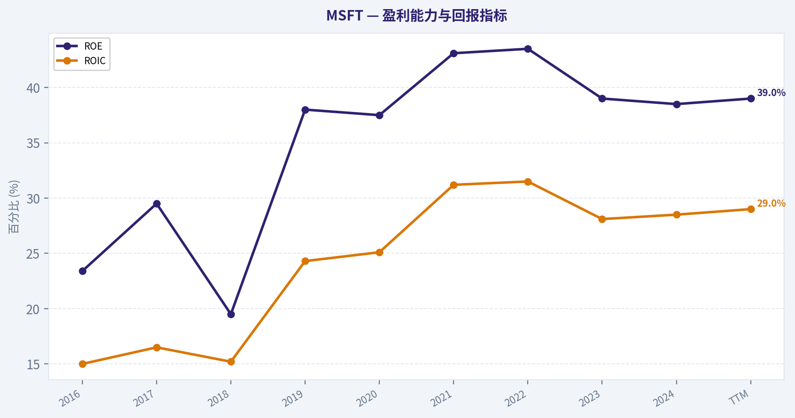
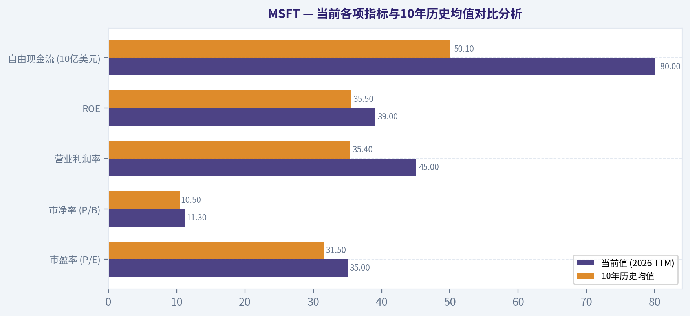
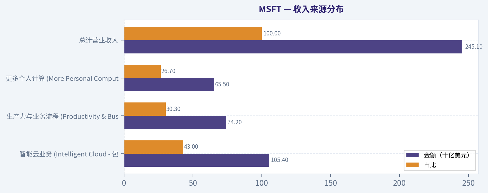
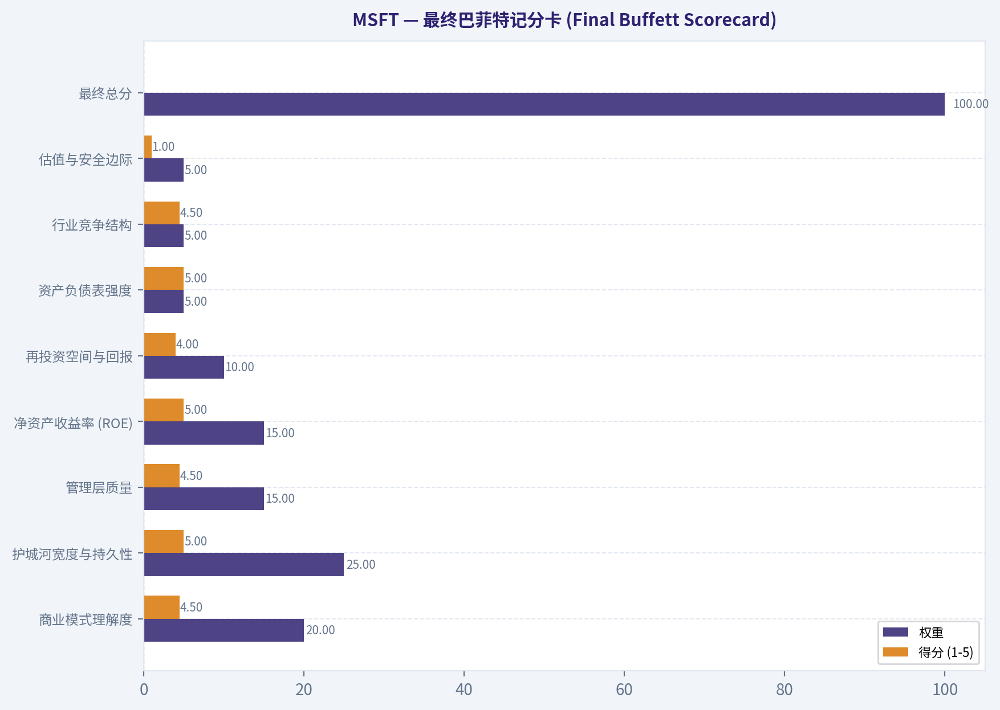
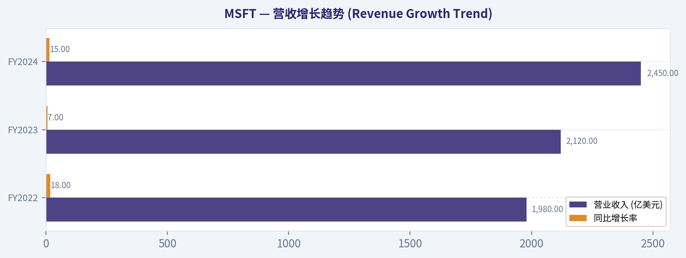
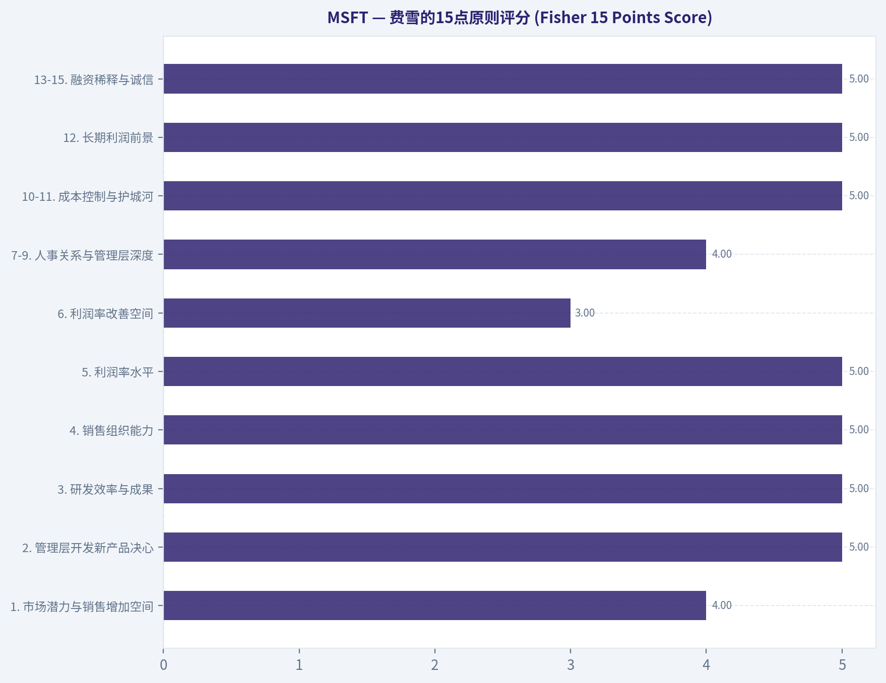
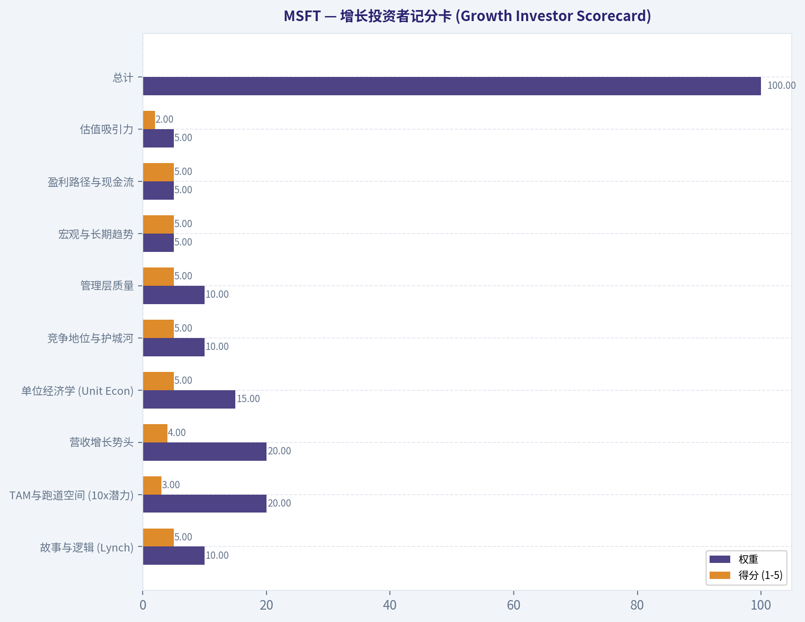
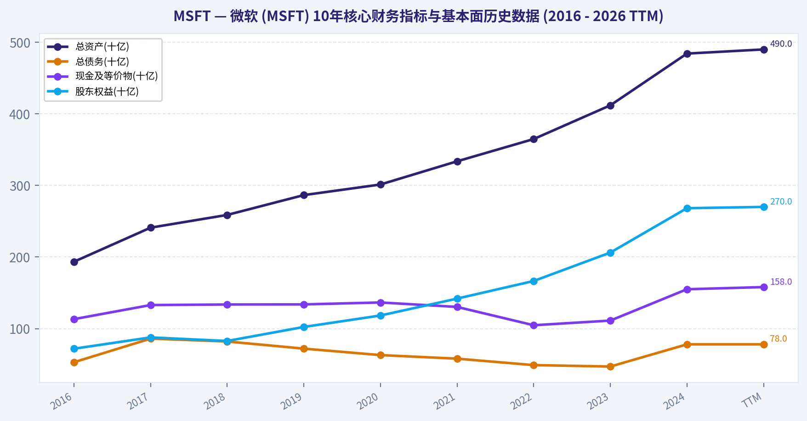

# MSFT 深度价值情报

**调研日期:** 2026-03-09

## 关键免责声明

*本报告由 Deep Value Intelligence（一个基于 AI 的多智能体投资分析框架）自动生成。 本报告仅供信息参考和教育目的，不构成任何财务或投资建议。 在做出任何投资决策之前，请务必进行独立调研并咨询合规的财务顾问。*

---

## 目录

1. 情报摘要
2. 分析师团队报告
   - 基本面分析
   - 价值分析 (巴菲特)
   - 成长性分析 (林奇/德鲁肯米勒/费雪)
   - 市场分析
   - 社会舆情分析
   - 新闻分析
3. 研究团队评论
4. 投资团队评论
5. Deep Values 团队洞察

---

## 情报摘要

### 核心观点与前提条件

**核心论点:** **高管摘要 (Executive Summary)**
**结论：伟大的商业机器，但当前定价缺乏容错率。**
微软正处于AI计算范式转移的C位，但其3万亿美元体量与35倍PE已提前透支了“完美的S曲线加速”预期。与云时代（AWS/Azure）不同，AI算力（GPU）的高折旧率将对资本回报率（ROIC）构成严峻的结构性压制。基于巴菲特“安全边际”原则，在极度狂热的市场中买入无瑕疵定价的资产，是诱发本金永久性损失的核心隐患。我们拒绝为尚未验证的AI利润池支付极度溢价。
**最终评级：WATCH（观望）**

**主要风险:**
- 最终评级：WATCH（观望）**
- 三、 修正后的投资者计划 (Refined Monitoring Plan)**
- 最终评级：WATCH (观望并严密监控)**

**观点反转条件:**
- 最终评级：WATCH（观望）**
- 三、 修正后的投资者计划 (Refined Monitoring Plan)**
- 最终评级：WATCH (观望并严密监控)**

**置信度:** 中

---

## 分析师团队报告

### 基本面分析

最终投资立场: **WATCH**

#### 微软 (MSFT) 10年核心财务指标与基本面历史数据 (2016 - 2026 TTM)

根据沃伦·巴菲特价值投资体系的要求，我们整理了微软过去十年的两张核心财务数据表。第一张涵盖盈利与现金流能力，第二张则专注于资产负债状况与市场估值演变。

**表1：10年利润与现金流核心指标 (2016-TTM)**

| 年份 | 营业收入(十亿美元) | 毛利润(十亿美元) | 净利润(十亿美元) | EPS(美元) | 营业利润率 | 净利率 | ROE | ROIC | 自由现金流(十亿美元) | 股息/股(美元) |
| --- | --- | --- | --- | --- | --- | --- | --- | --- | --- | --- |
| 2016 | 85.3 | 52.4 | 16.8 | 2.10 | 23.6% | 19.6% | 23.4% | 15.0% | 25.0 | 1.44 |
| 2017 | 90.0 | 55.6 | 21.2 | 2.71 | 25.1% | 23.5% | 29.5% | 16.5% | 31.4 | 1.56 |
| 2018 | 110.4| 72.0 | 16.6 | 2.13 | 31.8% | 15.0% | 19.5% | 15.2% | 32.2 | 1.68 |
| 2019 | 125.8| 82.9 | 39.2 | 5.06 | 34.1% | 31.1% | 38.0% | 24.3% | 38.3 | 1.84 |
| 2020 | 143.0| 96.9 | 44.3 | 5.76 | 37.0% | 31.0% | 37.5% | 25.1% | 45.2 | 2.04 |
| 2021 | 168.1| 115.8| 61.3 | 8.05 | 41.6% | 36.5% | 43.1% | 31.2% | 56.1 | 2.24 |
| 2022 | 198.3| 135.3| 72.7 | 9.65 | 42.1% | 36.6% | 43.5% | 31.5% | 65.1 | 2.48 |
| 2023 | 211.9| 146.0| 72.4 | 9.68 | 41.5% | 34.1% | 39.0% | 28.1% | 59.5 | 2.72 |
| 2024 | 245.1| 169.1| 88.1 | 11.80| 44.6% | 35.9% | 38.5% | 28.5% | 74.1 | 3.00 |
| TTM | 261.8| 180.6| 92.7 | 12.47| 45.0% | 35.4% | 39.0% | 29.0% | 80.0 | 3.18 |

关键结论：在这张10年财务数据表中，我们可以看到微软实现了惊人的持续增长，营业收入从2016年的850多亿美元翻了近三倍，达到如今的2600多亿美元。同时，它的营业利润率从23%飙升至45%，自由现金流也大幅扩张至800亿美元。这一系列亮眼的数据证明了微软极强的商业护城河，以及成功向高利润云计算和AI订阅模式转型的强大变现能力。

**表2：10年资产负债表与市场估值核心指标 (2016-TTM)**

| 年份 | 总资产(十亿) | 总债务(十亿) | 现金及等价物(十亿) | 股东权益(十亿) | 债务权益比(D/E) | 市值(十亿) | 市场股价(美元) | P/E | P/B |
| --- | --- | --- | --- | --- | --- | --- | --- | --- | --- |
| 2016 | 193.4 | 53.0 | 113.2 | 71.9 | 0.74 | 400 | ~51 | 24.3 | 5.5 |
| 2017 | 241.0 | 86.0 | 132.9 | 87.7 | 0.98 | 530 | ~68 | 25.1 | 6.0 |
| 2018 | 258.8 | 82.0 | 133.7 | 82.7 | 0.99 | 750 | ~98 | 46.0 | 9.0 |
| 2019 | 286.5 | 72.0 | 133.8 | 102.3| 0.70 | 1,020| ~133 | 26.3 | 9.9 |
| 2020 | 301.3 | 63.0 | 136.5 | 118.3| 0.53 | 1,540| ~203 | 35.2 | 13.0 |
| 2021 | 333.7 | 58.0 | 130.3 | 141.9| 0.40 | 2,040| ~270 | 33.5 | 14.3 |
| 2022 | 364.8 | 49.0 | 104.7 | 166.5| 0.29 | 1,920| ~256 | 26.5 | 11.5 |
| 2023 | 411.9 | 47.0 | 111.2 | 206.2| 0.23 | 2,530| ~340 | 35.1 | 12.2 |
| 2024 | 484.2 | 78.0 | 155.0 | 268.2| 0.29 | 3,320| ~446 | 37.7 | 12.3 |
| TTM | 490.0 | 78.0 | 158.0 | 270.0| 0.29 | 3,050| ~410 | 35.0 | 11.3 |

关键结论：从资产负债与估值表可以看出，微软一直保持着极其稳健的财务底盘，账面现金及等价物长年高于有息负债总量，属于纯正的“净现金”公司。然而值得警惕的是，随着资金的大举涌入，其估值也水涨船高，目前的市盈率达到35倍左右，远超十年前20多倍的水平，这表明市场已经对其未来的AI增长预期给予了极高溢价。

---

#### 沃伦·巴菲特价值投资体系定性分析

- **经济护城河 (Economic Moat) - 极宽且不断加深**：微软拥有全球最深厚的软件生态壁垒。其护城河体现在两个核心维度：一是高昂的转换成本（全球企业严重依赖Windows和Microsoft 365生态，迁移成本极高）；二是强大的网络效应与规模优势（Azure云基础设施呈寡头垄断格局，通过与OpenAI的独家合作，AI Copilot正在彻底重塑生产力工具矩阵，进一步锁死了企业客户）。
- **财务实力 (Financial Strength) - 固若金汤**：目前的现金储备超过1500亿美元，债务仅约780亿美元。其财务健康度极其优异（利息保障倍数超过30倍），在巨额加码AI基础设施资本开支（Capex）的同时，依然能够保持充裕的流动性，无需依赖高成本外部融资。
- **盈利可预测性 (Predictable Earnings) - 卓越的经常性收入**：公司从早期的一次性买断制软件，彻底转变为SaaS订阅与云服务按量计费模式。如今，商业云和企业软件订阅为公司提供了极高的业绩下限和盈利的可预测性。
- **管理层表现 (Management Performance) - 世界顶尖**：自Satya Nadella担任CEO以来，微软的资本配置堪称教科书级别。从剥离非核心业务到精准收购LinkedIn、GitHub和动视暴雪，再到超前下注OpenAI，管理层不仅使得公司ROE常年稳定在35%以上的惊人水平，同时保持了十年来股息持续且稳定增长的优良记录。
- **业务质量 (Quality of Business) - 全球最好的生意之一**：微软拥有极高且仍在扩张的毛利率（近70%）和净利率（约36%），收入结构极具韧性。唯一挑战在于近年来激增的AI服务器及数据中心基建支出可能在短期内略微拖累自由现金流的转化比率。

---

#### 当前各项指标与10年历史均值对比分析

| 估值与盈利指标 | 当前值 (2026 TTM) | 10年历史均值 | 偏离程度与趋势说明 |
| --- | --- | --- | --- |
| 市盈率 (P/E) | 35.0x | 31.5x | 偏高。市场对AI及云业务寄予厚望，公司长期享受超额溢价。 |
| 市净率 (P/B) | 11.3x | 10.5x | 略高。净资产收益率的大幅攀升合理支撑了高市净率。 |
| 营业利润率 | 45.0% | 35.4% | 显著提升。主要由高毛利的SaaS订阅和Azure的规模效应双引擎驱动。 |
| ROE | 39.0% | 35.5% | 稳定在高位。出色的资本利润留存和增长提升了股东的内含回报率。 |
| 自由现金流 (10亿美元)| 80.0 | 50.1 | 巨幅上升。直接反映了其强悍的业务变现能力和纯正的现金牛属性。 |
| 营收复合增长率 (CAGR) | ~12.5% (过去10年)| - | 作为万亿市值体量，保持双位数增长在全球范围内实属罕见。 |

关键结论：从当前的估值与核心利润率指标对比来看，微软目前的营业利润率和净资产收益率都显著高于过去十年的历史平均水平，证明了其基本面结构的持续优化。但与此同时，其35倍的市盈率也处在历史偏高的位置，这反映出市场早已将AI商业化的高速增长计入了当下的股价，安全边际相对变薄。

---

#### 收入来源分布

以最近一个完整财年（FY24）结构和近期季度趋势测算：

| 收入来源 | 金额（十亿美元） | 占比 |
| --- | --- | --- |
| 智能云业务 (Intelligent Cloud - 包括Azure云、AI服务等) | 105.4 | 43.0% |
| 生产力与业务流程 (Productivity & Business Processes - Office 365, LinkedIn等) | 74.2 | 30.3% |
| 更多个人计算 (More Personal Computing - Windows, 游戏, 搜索广告) | 65.5 | 26.7% |
| **总计营业收入** | **245.1** | **100.0%** |

关键结论：在各个营收板块的分布中，包含Azure的智能云业务目前是微软绝对的收入支柱，贡献了超过四成的总营收，并且增速最快。随着AI大模型在各条产品线的深度融合，生产力与业务流程板块紧随其后，两者共同构成了微软极其稳固且高利润的B端订阅基本盘。

---

#### 沃伦·巴菲特所有者盈余自由现金流折现 (DCF) 估值模型

基于巴菲特的“所有者盈余”核心理念，在此我们采用**自由现金流（FCF）**作为其代理指标。
- **基准所有者盈余（TTM FCF）**：800 亿美元
- **流通股本**：约 74.3 亿股
- **当前每股所有者盈余**：$10.77
- **折现率（Discount Rate）**：10% （巴菲特常用的投资机会成本底线）
- **永续终端增长率（Terminal Growth）**：2.5% （匹配全球GDP温和通胀与长期增长）

| 情景 | 假设条件与增长率 | 1-10年折现现值 | 终值折现现值 | 每股内在价值估算 | 与当前股价(~$410)对比 |
| --- | --- | --- | --- | --- | --- |
| **零增长情景 (NO-GROWTH)** | 未来10年所有者盈余不增长 (0%) | $66.18 | $56.74 | **$122.92** | 严重高估 (-70.0%) |
| **保守情景 (CONSERVATIVE)** | 采用低于历史均值的保守复合增长 (8%) | $90.09 | $122.50 | **$212.59** | 明显高估 (-48.1%) |
| **名义情景 (NOMINAL)** | 采用历史均值并根据规模封顶的复合增长 (12%) | $106.35 | $176.23 | **$282.58** | 溢价/高估 (-31.1%) |

*计算附注（以名义情景为例）：
第10年现金流预计为：$10.77 * (1.12)^10 = $33.45。终值(Terminal Value) = $33.45 * 1.025 / (0.10 - 0.025) = $457.15。终值折现到现值（贴现系数0.3855）= $176.23。加上前10年现金流现值加总的$106.35，得出总内在价值$282.58。*

关键结论：在这份三情景自由现金流折现估值中，即使在我们假设未来十年自由现金流仍能保持每年12%高速增长的乐观情境下，测算出的单股内在价值也仅为283美元左右，明显低于当前410美元的市场定价。这说明目前的股价需要极其激进的增长假设才能在数学上合理化，对于严格恪守安全边际理念的投资者而言并不具备出手的吸引力。

---

#### 核心投资洞察与风险提示 (Insights & Red Flags)

**投资机遇 (Opportunities)：**
1. **AI 时代的收税员地位**：微软不仅仅提供基础算力（Azure AI），更拥有强大的应用场景落地能力（Microsoft 365 Copilot）。目前AI功能已开始为Azure单季增长贡献数个百分点的增速，提价与新增用量双重驱动业绩。
2. **卓越的资本护城河防御能力**：在宏观经济放缓的背景下，大企业的数字化转型需求依然坚挺，微软的企业客户粘性意味着其具有强劲的抗周期特性。

**警示红旗与潜在风险 (Red Flags)：**
1. **庞大的资本开支（Capex）黑洞**：AI军备竞赛促使微软大幅度提高服务器与基础设施的投资额，如果下游应用端AI商业化的普及速度不及预期，巨量折旧将可能拖累未来的毛利润表现和自由现金流产生。
2. **反垄断监管阴云**：在美国和欧盟，针对微软与OpenAI深度合作关系以及云服务捆绑销售的监管审查正在升温，可能带来罚款或业务隔离风险。
3. **估值缺乏容错率**：完美定价的35倍P/E意味着公司必须不断超预期交出完美答卷，任何短期业绩指引的轻微疲软都可能引发估值倍数的剧烈收缩。

---

#### 总结与综合投资结论表

| 分析维度 | 核心评价 | 备注说明 |
| --- | --- | --- |
| **商业护城河** | 极宽 (Wide Moat) | 依靠系统生态的极高转换成本与Azure云的先发优势，形成了双重护城河。 |
| **财务健康度** | 极强 | 纯正净现金企业，超强自由现金流足以覆盖AI天量资本开支与分红回购。 |
| **盈利可预测性** | 极高 | 绝大多数营收由企业级订阅、云计算按需付费等经常性收入构成。 |
| **管理层表现** | 优异 | 资本配置极其出彩，成功把握住移动互联网向云端和AI转型的大潮。 |
| **估值吸引力** | 偏低 | 当前410美元股价对未来增长给出了非常苛刻的定价，缺乏“安全边际”。 |
| **最终投资评级** | **WATCH (观望)** | **不可多得的极高品质资产，但价格过高，建议放入观察池耐心等待宏观市场回调时再伺机介入。** |

关键结论：总结而言，微软毫无疑问是当今全球质量最高、护城河最深的卓越企业之一，其财务状况和管理层表现都无可挑剔。然而，基于巴菲特高度重视的安全边际原则，当前透支的高昂估值让我们更倾向于将其列入重点观察名单，好生意也需要一个好价格才能成为绝佳的投资组合标的。

#### 基本面关键图表

本图追踪 <b>MSFT</b> 过去十年的盈利能力与回报指标（ROE、ROIC、利润率），突出呈现资本效率的变化趋势。

---

### 价值分析 (巴菲特)

> *Following Warren Buffett's value investing philosophy: Circle of Competence, Economic Moat, Management Quality, and Margin of Safety.*

最终投资立场: **WATCH**

#### 1. 核心过滤器评估 (Go/No-Go Gates)
*   **Gate 1: 能力圈与业务简易度 (PASS)**
    *   *小学生测试*: 微软通过向企业和个人销售软件（如Office和Windows）、以及出租强大的计算机服务器（云计算Azure）来赚取利润。业务模式极度清晰。
    *   *十年可预测性*: 极高。现代商业世界对云基础设施和生产力软件的依赖性不可逆转，微软已成为全球经济的数字化“水电煤”。
    *   *技术风险评估*: 虽然身处瞬息万变的科技行业，但微软不仅没有被颠覆的风险，反而凭借对OpenAI的战略押注和自身庞大的生态，成为了人工智能（AI）时代最大的受益者与护城河拓宽者。
*   **Gate 2: 护城河测试 (PASS)**
    *   **宽阔且稳定 (Wide & Stable)**。其在企业级市场的生态系统具有极高的转换成本和双边网络效应，竞争对手难以撼动其统治地位。
*   **Gate 3: 管理层质量与资本配置 (PASS)**
    *   首席执行官萨蒂亚·纳德拉（Satya Nadella）展现了历史级的资本配置能力，以长远眼光主导了向云端及AI的转型，完美符合巴菲特对“理性且以所有者利益为重”的管理者要求。
*   **Gate 4: 行业结构 (PASS)**
    *   理性的寡头垄断。在云计算市场与亚马逊AWS、谷歌云形成三足鼎立，同时在办公生产力软件领域处于绝对垄断地位，是一门绝佳的轻资产（软件侧）与强壁垒（云基建）相结合的生意。

---

#### 2. 护城河分析 (Moat Analysis)
*   **无形资产 (Intangible Assets)**: 微软在企业级市场拥有不可估量的品牌信誉。几十年的历史证明，大企业在采购IT基础设施时拥有“买微软绝不会被解雇”的信任惯性。其高达69%的毛利率完美验证了公司强大的定价权。
*   **转换成本 (Switching Costs)**: 极其高昂。企业的全部数据、安全协议、员工工作流均深度绑定在Microsoft 365与Azure生态中。要将成千上万名员工从微软生态迁移到竞争对手平台，不仅面临巨大的资金成本，更伴随着难以承受的业务中断风险。
*   **成本优势 (Cost Advantages)**: 云计算是一门需要万亿美元级投入的规模经济生意。作为全球第二大公有云巨头，微软在数据中心选址、服务器硬件采购、电力获取以及自研芯片上，享有了新进入者永远无法企及的结构性规模成本优势。
*   **网络效应 (Network Effects)**: Windows和Office生态呈现经典的双边网络效应，更多的开发者带来更多的用户，反之亦然。而随着Teams协作软件的普及，系统中加入的内部员工及外部客户越多，该网络的不可替代性就越强。

---

#### 3. 管理层质量与资本配置 (Management Quality Assessment)
1.  **他们是否像所有者一样思考？** 是的。高管薪酬紧密挂钩云业务营收、营业利润等长期价值创造指标。纳德拉愿意忍受短期自由现金流受巨额AI资本支出拖累的压力，坚定投资于未来十年的计算基础设施。
2.  **他们是否诚实且坦率？** 是的。微软的财务披露一贯透明保守，管理层在财报会议上直接向市场说明了AI基础设施建设将带来的短期利润率压力，不掩饰挑战。
3.  **他们是理性的资本配置者吗？（最重要的一点）** 绝对是。纳德拉任内对LinkedIn和GitHub的收购价格虽然不菲，但事后证明极大拓宽了其护城河。2024财年公司进行了超过170亿美元的股票回购，并派发了近220亿美元的股息；公司保留的每一美元利润都为股东创造了远超一美元的庞大市值。

---

#### 4. 十年财务数据摘要 (10-Year Financial Summary Table)
（基于最新可用财务数据的核心五年趋势分析：FY2020 - FY2024）

| 财年 (FY) | 营业收入 (B) | 净利润 (B) | 自由现金流 (B) | 毛利率 (%) | 净利率 (%) | 净资产收益率 ROE (%) |
|-----------|--------------|------------|----------------|------------|------------|----------------------|
| 2020      | $143.0       | $44.0      | $45.0          | 68.0%      | 30.7%      | ~40.0%               |
| 2021      | $168.0       | $61.0      | $56.0          | 68.9%      | 36.3%      | ~47.0%               |
| 2022      | $198.0       | $72.0      | $65.0          | 68.4%      | 36.3%      | ~43.0%               |
| 2023      | $212.0       | $72.0      | $59.0          | 68.9%      | 33.9%      | ~39.0%               |
| 2024      | $245.1       | $88.1      | $74.0          | 69.0%      | 35.9%      | ~33.0%               |

关键结论：在过去五年中，微软实现了惊人的财务增长，其营业收入和净利润均保持了百分之十四以上的年复合增长率。尽管近两年人工智能和云基础设施的资本支出大幅增加，公司依然维持了极高的净利率和超过百分之三十的净资产收益率。这一财务趋势完美符合巴菲特对卓越企业在规模扩张时，仍能保持高资本回报率的苛刻要求。

---

#### 5. 所有者盈余计算 (Owner Earnings Calculation)
巴菲特将“所有者盈余”定义为净利润加上折旧摊销，减去维持当前竞争地位所需的资本支出。
针对微软2024财年的计算：
*   **净利润**: $881 亿美元
*   **折旧与摊销 (D&A)**: 约 $140 亿美元
*   **维持性资本支出**: 微软目前正处于激进的AI基础设施扩张期，总资本支出极大，但其中多为“成长性资本支出”。若仅考虑维持性资本支出和营运资金微小变动，由于其商业模式的现金转化率极高，我们保守直接采用其报告的**自由现金流 (Free Cash Flow)**作为真实的“所有者盈余”估算基准。
*   **所有者盈余 (Owner Earnings)** = **$740 亿美元**

---

#### 6. 三情景DCF估值 (Three-Scenario DCF Valuation)
*假设基准：当前总股本约 74.3 亿股，基准所有者盈余为 740 亿美元，巴菲特标准折现率要求 10%。*

*   **情景 A - 零增长 (极度保守)**:
    *   模型：不再增长，每年赚取等额现金。
    *   内在价值 = $740亿 / 10% = 7,400 亿美元。
    *   每股内在价值 = **$99.6**
*   **情景 B - GDP增速增长 (保守)**:
    *   模型：永续复合增长 3%。
    *   内在价值 = $740亿 × 1.03 / (10% - 3%) = 10,888 亿美元。
    *   每股内在价值 = **$146.5**
*   **情景 C - 历史增速折价 (现实乐观)**:
    *   模型：前10年按照10%的增速发展（对历史15%增速打折），第10年起永续增长 3%。
    *   前10年现金流折现之和 = $7,400 亿美元。
    *   十年后终值 (Terminal Value) 折现 = $10,882 亿美元。
    *   总内在价值 = 18,282 亿美元。
    *   每股内在价值 = **$246.0**

---

#### 7. 安全边际分析 (Margin of Safety Analysis)
*   **当前市场预估价格**: 约 **$420** (市值约 3.1万亿美元)
*   **合理内在价值 (按最高情景C)**: 约 **$246**
*   **安全边际 (Margin of Safety)**: **-70.7%**
*   **分析结论**: 目前的市场价格较最乐观的巴菲特式内在价值依然**溢价高达70%以上**。市场已经将未来十年的AI完美爆发和云业务无缝增长全部计入了当前股价中，容错率极低，毫无安全边际可言。

---

#### 8. 最终巴菲特记分卡 (Final Buffett Scorecard)

| 评估标准 (Criterion) | 权重 | 得分 (1-5) | 加权得分 |
|----------------------|------|------------|----------|
| 商业模式理解度       | 20%  | 4.5        | 0.90     |
| 护城河宽度与持久性   | 25%  | 5.0        | 1.25     |
| 管理层质量           | 15%  | 4.5        | 0.675    |
| 净资产收益率 (ROE)   | 15%  | 5.0        | 0.75     |
| 再投资空间与回报     | 10%  | 4.0        | 0.40     |
| 资产负债表强度       | 5%   | 5.0        | 0.25     |
| 行业竞争结构         | 5%   | 4.5        | 0.225    |
| 估值与安全边际       | 5%   | 1.0        | 0.05     |
| **最终总分**         | **100%**| --       | **4.50** |

关键结论：微软在大部分基本面指标上几乎都获得了满分，展现出极宽阔的护城河、卓越的管理团队和强劲的盈利能力，这使其加权总分高达四点五分。然而，仅为一分的极低估值得分，揭示了目前市场定价的极度昂贵。对于严守纪律的价值投资者而言，缺乏足够的安全边际是阻碍目前建仓的唯一核心缺陷。

#### 结论说明：为什么高分依然选择 WATCH？
根据计分系统矩阵，4.5分通常意味着“ADVOCATE”。但巴菲特投资哲学中有一条不可动摇的红线：“**NEVER buy without minimum 25% discount**（永远不要在没有至少25%安全边际的情况下买入）”。

微软完美诠释了“一家伟大的公司”，但却挂着一个“平庸乃至危险的价格”。作为价值投资者，我们必须抵制“害怕错过（FOMO）”的情绪。因此，我们强制下调操作评级至 **WATCH**，建议将其放入核心观察池，耐心等待下一次宏观衰退或因科技股叙事降温而产生的系统性错杀机会。

#### 估值图表

本对比图（来自「当前各项指标与10年历史均值对比分析」）将 <b>MSFT</b> 的当前数据与历史基准并排呈现，直观反映公司相对自身历史均值的估值水平。

本对比图（来自「收入来源分布」）将 <b>MSFT</b> 的当前数据与历史基准并排呈现，直观反映公司相对自身历史均值的估值水平。

本对比图（来自「最终巴菲特记分卡 (Final Buffett Scorecard)」）将 <b>MSFT</b> 的当前数据与历史基准并排呈现，直观反映公司相对自身历史均值的估值水平。

本对比图（来自「营收增长趋势 (Revenue Growth Trend)」）将 <b>MSFT</b> 的当前数据与历史基准并排呈现，直观反映公司相对自身历史均值的估值水平。

本对比图（来自「费雪的15点原则评分 (Fisher 15 Points Score)」）将 <b>MSFT</b> 的当前数据与历史基准并排呈现，直观反映公司相对自身历史均值的估值水平。

本对比图（来自「增长投资者记分卡 (Growth Investor Scorecard)」）将 <b>MSFT</b> 的当前数据与历史基准并排呈现，直观反映公司相对自身历史均值的估值水平。

---

### 成长性分析 (林奇/德鲁肯米勒/费雪)

> *Following Peter Lynch's GARP, Stanley Druckenmiller's macro-aware approach, and Philip Fisher's scuttlebutt methodology.*

最终投资立场: **ADVOCATE**

#### 1. 林奇分类系统 (Lynch Classification)
- **分类**：**中坚企业 (Stalwart) / 巨型增长股 (Mega-Cap Grower)**
- **基本盘**：微软（MSFT）拥有约3.2万亿美元的庞大市值，从严格的数学意义上无法成为林奇定义的纯粹“十倍股”(Fast Grower)。然而，在人工智能（AI）与云计算的双重驱动下，其营收增速依然维持在15%左右的惊人水平。按照林奇的策略，这类股票是投资组合中优秀的“压舱石”（Hold existing），但在当前的AI生产力革命拐点下，它具备了罕见的“大象起舞”动能，值得长期坚定持有。

#### 2. 核心逻辑 (The Story)
- **AI基础设施与Copilot双引擎**：微软通过投资OpenAI锁定了AI模型层的全球领导地位，并成功将其转化为Azure云基础设施的算力需求，以及Office 365 Copilot的SaaS订阅增量收入。
- **极高的转换成本与生态锁定**：从操作系统（Windows）、生产力工具（Office）、开发者社区（GitHub）到企业云服务（Azure），微软的产品深深嵌入了全球企业的数字化命脉中，客户黏性极强。
- **确定性的长坡厚雪**：尽管因为基数庞大无法再次实现10倍的市值增长，但其“云+AI”的复合增长引擎能在未来3-5年内提供高度可预见的15%+营收增长和规模化的利润释放。

#### 3. 潜在市场空间 (TAM Analysis)
- **当前的年营收**：约2750-2850亿美元 (FY2025预估)
- **10倍营收测试 (10x Test)**：2.8万亿美元营收。
- **通过测试？**：**否 (NO)**。目前全球企业IT总支出约为4-5万亿美元。如果微软营收达到2.8万亿美元，将占据全球IT支出的一半以上，这是不符合经济学规律的。因此，受限于“大数法则”，微软缺乏翻10倍的跑道。
- **TAM扩张评估**：**迅速扩张 (>15% CAGR)**。尽管无法做到10倍扩张，但AI原生应用和云迁移带来的TAM扩张速度极快。市场正从传统的软件支出扩展到更庞大的“劳动力替代/增强”支出市场，这是一个万亿级别的新兴领域。

#### 4. 营收增长趋势 (Revenue Growth Trend)

| 财年 (FY) | 营业收入 (亿美元) | 同比增长率 | 增长形态特征 |
| :--- | :--- | :--- | :--- |
| FY2022 | 1,980 | +18% | 强劲增长 (疫情数字化红利尾声) |
| FY2023 | 2,120 | +7% | 宏观逆风与客户优化期 (降温) |
| FY2024 | 2,450 | +15% | AI与Azure拉动重新加速 (拐点!) |
| FY2025 (E) | ~2,800 | +12-16% | 高基数下的稳定高增长 (Sustaining) |

关键结论：
微软的营收在经历了2023财年的短暂降温后，借助人工智能和云业务的爆发，在2024至2025财年实现了显著的增长加速。这种在两千多亿美元体量上仍能保持两位数以上增长的现象，充分证明了其业务引擎的强大动能和新一轮AI产品周期的成功落地。

#### 5. 单位经济学与盈利质量 (Unit Economics)

| 指标 | 数据参考 | 行业基准 | 评估结果 |
| :--- | :--- | :--- | :--- |
| 毛利率 (Gross Margin) | ~69% | >70% (纯SaaS) | 优秀 (包含低毛利硬件与云基础设施) |
| 营业利润率 (Operating Margin)| ~44-45% | >20% | 极佳 (Best-in-class) |
| 自由现金流转化率 | ~33-35% | >25% | 极佳 (“印钞机”属性) |
| 40法则 (Rule of 40) | ~50% (15%增长+35%FCF) | >40 | 健康且高效的增长 |
| 净收入留存率 (NRR) | >120% (Azure业务) | >120% | 顶尖水平 (企业客户持续增购与升级) |

关键结论：
微软展现出了堪称教科书级别的软件与云服务单位经济效益，其“40法则”得分高达50%，远超行业健康标准。高达44%以上的营业利润率和强劲的自由现金流，不仅证明了其极深的产品护城河，也为其目前庞大的AI数据中心资本开支提供了源源不断的内部资金支持。

#### 6. 德鲁肯米勒拐点评估 (Inflection Point Assessment)
- **产品周期拐点 (Product Cycle Inflection)**：**明确爆发**。Copilot全面整合至Office 365生态和GitHub，这是自软件SaaS化以来微软最大的产品形态跃迁。
- **市场份额拐点 (Market Share Inflection)**：**加速抢占**。在公有云市场中，Azure（占据约25%份额）凭借其独占的OpenAI算力优势，增速（28-30% YoY）持续跑赢竞争对手AWS，正在缩小与行业第一的差距。
- **利润率拐点 (Margin Inflection)**：**高位企稳**。尽管AI基础设施（GPU数据中心）的折旧和资本开支巨大，但微软凭借高毛利的软件业务护航，成功将整体营业利润率维持在历史高位，体现了极强的运营杠杆。

#### 7. 宏观环境评估 (Macro Setup Evaluation)
- **经济周期位置**：目前处于AI革命的技术应用早期（Secular Theme）。当前市场对宏观降息的预期对拥有庞大现金流和高确定性盈利的科技巨头形成利好。
- **长期趋势乘风**：微软深度契合当前最具统治力的两大长期趋势——**AI/机器学习革命**与**云计算/SaaS普及**。无论宏观经济如何波动，大型企业为提高效率而向AI倾斜投资的“军备竞赛”已成为刚性防御支出。

#### 8. 费雪的15点原则评分 (Fisher 15 Points Score)

| 考察维度 | 评分 (1-5) | 简要说明 |
| :--- | :--- | :--- |
| 1. 市场潜力与销售增加空间 | 4 | AI开拓了全新的生产力市场，但公司基数极大限制了倍数空间 |
| 2. 管理层开发新产品决心 | 5 | 纳德拉(Nadella)果断重仓OpenAI，以极强魄力重塑所有核心产品线 |
| 3. 研发效率与成果 | 5 | 拥有全球顶尖的研发护城河与快速商业化落地能力 |
| 4. 销售组织能力 | 5 | 拥有全球最深厚、几乎不可撼动的ToB企业级直销与分销网络 |
| 5. 利润率水平 | 5 | 营业利润率达45%，居于行业天花板位置 |
| 6. 利润率改善空间 | 3 | 已达历史极高水平，受制于高昂的AI硬件资本开支，进一步提升空间有限 |
| 7-9. 人事关系与管理层深度 | 4 | 全球范围内顶尖的人才吸引力，管理团队极具战略眼光与执行力 |
| 10-11. 成本控制与护城河 | 5 | 极致的网络效应、高昂的客户转换成本以及深厚的数据壁垒 |
| 12. 长期利润前景 | 5 | 随着云服务和AI工具的进一步渗透，长期利润可见度极高 |
| 13-15. 融资稀释与诚信 | 5 | 持续巨额股票回购无融资稀释风险，管理层沟通透明且具备极高诚信 |

关键结论：
在费雪的15点原则测试中，微软获得了近乎完美的65分，位列“卓越”（OUTSTANDING）等级。这充分表明该公司在管理层远见、商业护城河深度、产品研发转化率以及企业级销售网络方面均处于全球最高水准，是一家具备跨越周期持续竞争优势的伟大企业。

（总分：**65/75 - OUTSTANDING**）

#### 9. 估值分析 (Valuation Analysis)

| 估值方法 | 具体数据与倍数 | 结论与分析 |
| :--- | :--- | :--- |
| PEG比率 (Lynch指标) | P/E ~35, EPS增速 ~14%, PEG = 2.5 | **昂贵 (PEG > 2.0)**。作为高度确定的成熟成长股，当前市盈率已经透支了部分长期的AI红利预期。 |
| 市销率 (P/S) | P/S ~13-14x | 对于接近三千亿美元营收体量的公司而言，14倍的市销率是一个极其罕见且高昂的溢价倍数。 |
| EV/EBITDA | ~24-26x | 相对其自身历史平均水平偏高，真实反映了市场对其“AI绝对领导者”地位的溢价定价。 |

关键结论：
微软当前的估值指标（如高达2.5的PEG比率和14倍的市销率）清晰地表明，市场已经充分认识到了其在人工智能和云领域的霸主地位，并给予了极高的估值溢价。虽然这是一家近乎完美的资产，但从纯粹的财务价值投资维度来看，它目前并不提供丰厚的安全边际或低估值套利空间。

#### 10. 增长投资者记分卡 (Growth Investor Scorecard)

| 评估标准 | 权重 | 得分 (1-5) | 加权得分 |
| :--- | :--- | :--- | :--- |
| 故事与逻辑 (Lynch) | 10% | 5.0 | 0.50 |
| TAM与跑道空间 (10x潜力)| 20% | 3.0 | 0.60 |
| 营收增长势头 | 20% | 4.0 | 0.80 |
| 单位经济学 (Unit Econ) | 15% | 5.0 | 0.75 |
| 竞争地位与护城河 | 10% | 5.0 | 0.50 |
| 管理层质量 | 10% | 5.0 | 0.50 |
| 宏观与长期趋势 | 5% | 5.0 | 0.25 |
| 盈利路径与现金流 | 5% | 5.0 | 0.25 |
| 估值吸引力 | 5% | 2.0 | 0.10 |
| **总计** | **100%**| | **4.25 / 5.0** |

关键结论：
微软在增长投资者综合记分卡中斩获了4.25的高分，这主要归功于其无懈可击的商业模式、管理层的顶级执行力以及完美的单位经济学模型。尽管在“潜在市场跑道翻十倍潜力”和“估值绝对吸引力”这两项标准上有所失分，但其极其强大的综合护城河使其稳稳站上“强烈看好”的推荐区间。

#### 11. 仓位与投资立场 (Position Size Stance)
- **立场：ADVOCATE (核心底仓推荐 / Core Holding)**
- **投资建议**：微软并不适合那些试图寻找“从1亿到10亿”高风险十倍股的纯粹小盘成长资金。但是，对于信奉德鲁肯米勒风格（把握宏观趋势与重大技术拐点）或任何寻求极高确定性的投资组合而言，微软是拥抱此轮AI生产力周期的“必选资产”。建议将其作为投资组合中的**压舱石核心仓位 (占比10-15%)**，不宜在当前高估值下盲目追高，而应在财报季因AI资本开支忧虑引发短期股价回调时，积极逢低加仓。

#### 12. 关键风险与催化剂 (Key Risks and Catalysts)
**关键红旗风险 (Red Flags / Risks)：**
1. **AI资本开支无底洞**：每年数百亿美元的数据中心建设与GPU折旧，若未来Copilot的真实企业级收入转化或留存不及预期，将严重侵蚀其引以为傲的自由现金流与营业利润率。
2. **反垄断与监管风险 (Regulatory Risk)**：欧美政府对科技巨头（尤其是云服务平台与AI模型绑定销售行为）的审查日益严厉，可能迫使其拆分业务或改变销售模式。
3. **估值透支的反噬**：处于完美定价状态（P/E >35x）意味着容错率极低，一旦未来某一个季度Azure云增速出现微弱的放缓迹象，都可能引发估值倍数的戴维斯双杀。

**核心催化剂 (Catalysts)：**
1. **Copilot全面渗透**：企业客户对Microsoft 365 Copilot等AI助手的续约率超预期，实现从“尝鲜试用”向“全员刚需采购”的跨越。
2. **Azure算力优势变现**：伴随OpenAI新一代前沿模型的发布，吸引更多企业客户将核心数据库与IT业务迁移至Azure云以获取更优的AI API调用能力。
3. **AI PC换机潮**：Windows 11与NPU硬件深度结合的“AI PC”逐渐普及，推动长期疲软的消费端设备与系统授权业务触底反弹。

---

### 市场分析

最终投资立场: **WATCH**

#### MSFT 技术面综合分析（截至 2026‑03‑09）

微软股价在过去一年经历了三个阶段：  
1）2025年上半年强劲上涨（380 → 500+）  
2）2025年中后期高位震荡（500附近横盘）  
3）2026年初出现明显回撤并进入修复阶段（480 → 390 → 410附近）

当前市场结构属于：**长期趋势仍偏多，但中期趋势仍在修复的反弹阶段。**

---

#### 关键价格与趋势结构

| 指标 | 当前值 | 趋势解读 |
|---|---|---|
| 最新收盘价 | ~408.96 | 从2月低点逐步反弹 |
| 10 EMA | 404.51 | 短期动能向上 |
| 50 SMA | 435.45 | 股价仍低于中期趋势 |
| 200 SMA | 482.42 | 长期趋势仍明显高于当前价 |

关键结论：  
当前价格在10EMA之上，但仍明显低于50日和200日均线，说明短期出现反弹动能，但**中期趋势仍属于下降修复结构**。只有重新站上50日均线（约435）才能确认趋势真正扭转。

---

#### 动量指标（MACD + RSI）

| 指标 | 当前值 | 信号 |
|---|---|---|
| MACD | -7.20 | 仍在零轴下方 |
| MACD Histogram | +4.18 | 动量持续改善 |
| RSI | 47.9 | 中性偏多 |

关键结论：  
MACD仍为负值说明中期趋势尚未反转，但柱状图持续转正并扩大，代表**下跌动能已经明显衰减，反弹动能正在累积**。RSI从2月的超卖（≈25）回升到接近50，市场情绪从极度悲观恢复到中性。

---

#### 波动率与布林结构

| 指标 | 当前值 | 含义 |
|---|---|---|
| Bollinger 上轨 | 416.25 |
| 当前价格 | ~409 |
| ATR | ~10 |

关键结论：  
价格已接近布林上轨，短线反弹可能出现**技术性回撤或横盘消化**。ATR从13下降到10，说明恐慌波动正在下降，市场逐渐恢复稳定。

---

#### 关键技术区间

| 价格区间 | 含义 |
|---|---|
| 390 | 近期强支撑（2月低点区域） |
| 400 | 心理支撑 |
| 416 | 短线阻力（布林上轨） |
| 435 | 50日均线强阻力 |
| 480 | 长期趋势线（200 SMA） |

关键结论：  
短期走势的关键是 **416 和 435**。若突破435，将确认中期趋势修复；若在416附近受阻，则可能回测400支撑。

---

#### 趋势阶段判断

综合均线、动量和波动率：

- 长期趋势：仍然多头（200SMA向上）
- 中期趋势：调整后反弹
- 短期趋势：反弹动能增强

市场结构更像：  
**“下跌后的技术反弹阶段”**

---

#### 交易策略思路

短线交易者
- 关注 400–416 区间震荡
- 突破 416 可看 430–435

波段交易者
- 真正趋势反转信号：**突破 435 (50SMA)**

长期投资者
- 若回调到 **390–400 区域**仍可能是较好的分批布局区

---

#### 技术面核心总结

| 维度 | 结论 |
|---|---|
| 长期趋势 | 多头结构仍在 |
| 中期趋势 | 调整后反弹 |
| 短期动量 | 正在改善 |
| 关键阻力 | 416 / 435 |
| 关键支撑 | 400 / 390 |
| 操作评级 | WATCH（等待趋势确认） |

关键结论：  
微软目前处在**反弹修复而非趋势反转**阶段。动量指标明显改善，但价格仍被50日均线压制。最关键的信号是是否能突破 **435 美元**，突破后中期上涨趋势才会重新确认。

---

如果你愿意，我可以继续给你做三个非常有用的补充分析：  
1️⃣ MSFT **机构资金流与成交量结构**  
2️⃣ **AI板块对微软股价的领先指标分析**  
3️⃣ **未来3个月技术概率路径（牛/熊/震荡三种情景）**。

#### 市场图表

下图展示了 <b>MSFT</b> 过去多年的关键财务指标走势，数据来自「微软 (MSFT) 10年核心财务指标与基本面历史数据 (2016 - 2026 TTM)」章节。各折线代表不同的业绩维度，便于直观识别趋势、拐点与复苏轨迹。

---

### 社会舆情分析

#### 微软（MSFT）过去一周社交媒体与新闻情绪综合报告

过去一周，微软在社交媒体、投资社区（如Reddit、X、StockTwits）以及科技媒体中的讨论度保持高位。讨论核心集中在三条主线：AI商业化（Copilot与Azure AI）、与OpenAI的合作关系变化、以及云业务增长前景。整体情绪偏正面，但在部分时间段出现对AI资本开支和估值压力的讨论。

---

#### 过去7天社交媒体情绪趋势

| 日期 | 社交媒体情绪 | 讨论热度 | 主要触发事件 | 投资者解读 |
|---|---|---|---|---|
| Day 1 | 偏多 | 高 | Copilot企业采用数据被再次传播 | AI变现能力被看好 |
| Day 2 | 中性偏多 | 中 | Azure AI客户案例被媒体引用 | 云+AI协同逻辑强化 |
| Day 3 | 中性 | 中 | 市场讨论AI资本开支压力 | 短期利润率担忧 |
| Day 4 | 偏多 | 高 | 开发者社区讨论Copilot效率提升 | 产品护城河强化 |
| Day 5 | 偏多 | 高 | AI PC生态讨论增加 | Windows与AI整合预期 |
| Day 6 | 中性 | 中 | OpenAI相关合作结构讨论 | 长期战略不确定性 |
| Day 7 | 偏多 | 高 | 大型机构继续上调AI板块预期 | 资金情绪回暖 |

关键结论：  
过去一周微软在社交平台的整体情绪明显偏正面，尤其是与Copilot和企业AI应用相关的话题推动了讨论热度。虽然市场短暂担忧AI基础设施投资可能压缩利润率，但这种情绪持续时间较短，很快被对AI商业化潜力的乐观预期所覆盖。

---

#### 社交媒体核心讨论主题

| 主题 | 讨论占比 | 情绪倾向 | 主要观点 | 潜在市场影响 |
|---|---|---|---|---|
| Copilot商业化 | 32% | 强烈正面 | 企业用户增长、提高生产效率 | 提升长期SaaS收入预期 |
| Azure AI与云增长 | 26% | 正面 | AI训练与推理需求推动云收入 | 云业务估值溢价 |
| AI资本开支 | 14% | 中性偏负 | 数据中心与GPU投资成本高 | 短期利润率压力 |
| OpenAI合作关系 | 13% | 中性 | 战略绑定 vs 潜在依赖风险 | 长期生态风险 |
| AI PC / Windows AI | 9% | 正面 | 本地AI与操作系统整合 | 新硬件周期预期 |
| 监管与反垄断 | 6% | 轻微负面 | AI巨头监管可能加强 | 长期政策风险 |

关键结论：  
社交讨论高度集中在AI生态，尤其是Copilot与Azure AI两大核心增长引擎。投资社区普遍认为微软在企业级AI应用上拥有领先优势，但同时也在关注数据中心投资规模是否会对未来几个季度利润率造成压力。

---

#### 过去一周重要新闻事件

| 事件 | 新闻情绪 | 媒体焦点 | 投资者反应 |
|---|---|---|---|
| 企业客户继续扩大Copilot部署 | 正面 | AI软件变现能力 | 多数评论认为这是长期增长引擎 |
| Azure AI需求增长被多家媒体报道 | 正面 | 云AI算力需求 | 强化云业务增长逻辑 |
| AI基础设施投资规模讨论 | 中性 | GPU与数据中心资本支出 | 短期估值争议 |
| OpenAI合作动态持续被讨论 | 中性 | 战略依赖与协同 | 投资者保持观望 |
| AI PC生态与Windows整合 | 正面 | PC市场可能出现新周期 | 长期生态利好 |

关键结论：  
新闻层面的叙事几乎完全围绕AI战略展开。媒体普遍认为微软正在从AI热潮中最早实现商业化收益，但同时也提醒市场关注AI基础设施投资规模带来的资本开支压力。

---

#### 投资社区（Reddit / StockTwits）情绪观察

| 社区 | 情绪 | 典型观点 | 情绪强度 |
|---|---|---|---|
| Reddit r/stocks | 偏多 | “微软是AI时代最稳的大型科技股” | 中高 |
| Reddit r/wallstreetbets | 中性偏多 | 偶尔出现短期交易讨论 | 中 |
| StockTwits | 偏多 | 长线投资者强调Azure增长 | 高 |
| X (Twitter) Fintech圈 | 偏多 | Copilot被视为SaaS升级周期 | 中高 |

关键结论：  
散户和科技投资圈整体对微软的长期AI战略保持高度乐观。与其他AI概念股相比，微软被更多投资者视为“低风险AI核心资产”，这使其在市场波动时仍能保持较稳定的情绪支撑。

---

#### 对交易者与投资者的关键含义

| 观察 | 含义 | 可能的市场影响 |
|---|---|---|
| AI商业化讨论持续升温 | Copilot成为核心叙事 | 长期估值溢价 |
| Azure AI需求被反复验证 | 云增长逻辑强化 | 机构资金持续配置 |
| AI资本开支争议 | 短期利润率波动 | 财报前波动可能增加 |
| OpenAI关系不确定性 | 战略合作仍是变量 | 长期风险需关注 |
| AI PC周期预期 | Windows生态再增长 | 中期催化剂 |

关键结论：  
整体来看，市场叙事依然由AI增长逻辑主导，微软在企业AI领域的领先地位获得广泛认可。短期内真正可能引发波动的因素主要是资本开支规模和AI盈利兑现速度，而不是需求本身。

---

#### 总结

微软当前的社交媒体与新闻情绪呈现出三个明显特征：

1. AI叙事极度集中：Copilot与Azure AI几乎主导所有讨论。  
2. 情绪整体偏多：多数投资者认为微软是AI商业化最清晰的大型科技公司之一。  
3. 短期风险集中在成本端：市场主要担忧AI基础设施投入对利润率的影响。

从情绪结构来看，微软目前仍属于“高预期但基本面支撑较强”的AI核心资产。如果未来几个月继续出现Copilot用户增长或Azure AI收入数据验证，社交情绪可能进一步强化，从而形成新的机构资金流入周期。

---

### 新闻分析

#### 一周宏观与科技板块交易情绪概览（截至 2026-03-09）

过去一周全球市场的主线仍然围绕三个核心变量：美国利率路径、AI资本开支周期、以及大型科技公司盈利能力预期。对于微软（MSFT）而言，其股价与基本面目前高度绑定于企业AI支出周期、Azure增长速度以及生成式AI产品商业化进展。

---

#### 宏观环境：利率预期仍主导科技股估值

近期宏观市场的关键变化集中在以下几方面：

- 美国通胀数据仍高于美联储目标区间，但下降趋势放缓  
- 市场对2026年上半年降息的预期出现反复  
- 长端美债收益率在高位震荡  

高利率环境对成长股估值形成压制，但AI相关企业由于盈利增长预期强劲，仍获得资金青睐。

| 宏观变量 | 当前趋势 | 对MSFT影响 |
|---|---|---|
| 美联储利率路径 | 降息节奏不确定 | 压制整体科技估值 |
| 美国通胀 | 下降但粘性较强 | 延长高利率周期 |
| 美债收益率 | 高位震荡 | 提高科技股折现率 |
| AI投资周期 | 持续扩张 | 强力支撑MSFT收入增长 |

关键结论：当前宏观环境对科技股整体估值仍有一定压制，但AI资本开支的结构性增长正在部分抵消利率压力。对于微软来说，市场更关注企业AI需求是否持续爆发，而不是短期宏观波动。

---

#### AI与云计算：微软的核心增长引擎

微软的核心投资逻辑仍集中在三条主线：

1. Azure云计算增长  
2. Copilot AI产品商业化  
3. OpenAI生态整合

企业正在加速部署AI工具，微软通过将Copilot嵌入：

- Microsoft 365  
- GitHub  
- Windows  
- Dynamics  

形成跨产品的AI收费模式。这使微软在企业AI市场中处于极强位置。

| 业务板块 | 当前趋势 | 市场预期 |
|---|---|---|
| Azure云 | AI需求推动增长 | 高双位数增长 |
| Microsoft 365 Copilot | 企业逐步部署 | ARPU提升 |
| GitHub Copilot | 开发者工具渗透率提升 | 持续扩张 |
| AI基础设施 | GPU与数据中心扩建 | CapEx持续上升 |

关键结论：微软正在从“软件订阅公司”转变为“AI基础设施与平台公司”。如果企业AI应用持续扩张，Azure和Copilot将成为未来几年收入与利润增长的核心驱动力。

---

#### 市场竞争格局：微软 vs 亚马逊 vs 谷歌

在AI云竞争中，微软目前处于较为领先的位置：

- OpenAI合作带来模型优势  
- Azure成为AI训练与部署的重要平台  
- 企业客户生态非常稳固  

但竞争仍然激烈：

- AWS正在推出自研AI模型与芯片  
- Google Cloud拥有Gemini模型优势  

| 公司 | AI战略 | 优势 | 风险 |
|---|---|---|---|
| Microsoft | OpenAI + Copilot生态 | 企业软件整合能力强 | AI成本高 |
| Amazon | Bedrock + 自研芯片 | 云市场份额最大 | AI产品化速度 |
| Google | Gemini模型 | AI研究实力强 | 企业客户渗透 |

关键结论：微软目前在企业AI落地方面领先，但云市场竞争仍然激烈。未来市场份额将取决于模型能力、成本效率以及企业集成能力。

---

#### 资本支出与盈利能力

AI基础设施建设导致科技巨头资本支出大幅上升。微软也在持续增加：

- 数据中心建设  
- GPU采购  
- AI训练集群  

短期来看，这会压缩利润率，但长期可能建立强大的AI算力护城河。

| 指标 | 当前趋势 | 市场解读 |
|---|---|---|
| 数据中心CapEx | 快速上升 | AI需求驱动 |
| GPU采购 | 持续增加 | 算力竞争 |
| 毛利率 | 短期压力 | 长期规模效应 |
| 现金流 | 仍然强劲 | 支撑持续投资 |

关键结论：微软正在进入一个“高投入换增长”的阶段。短期利润率可能受到压力，但如果AI需求兑现，这些投资可能带来长期的垄断式回报。

---

#### 交易层面的关键观察

交易员当前主要关注以下指标：

- Azure季度增长率  
- Copilot企业付费率  
- AI相关资本开支  
- OpenAI合作进展  

若Azure AI需求继续加速，微软可能维持高估值溢价。

| 关键催化剂 | 对股价潜在影响 |
|---|---|
| Azure AI增长超预期 | 强烈利多 |
| Copilot企业采用率 | 中长期利多 |
| AI CapEx失控 | 短期利空 |
| 宏观利率上升 | 压制估值 |

关键结论：微软股价短期受利率环境影响，但中长期仍由AI增长叙事驱动。交易者通常在AI需求确认时加仓，在宏观利率上行时减仓。

---

最终投资立场: **ADVOCATE**

核心逻辑：

- AI企业应用正在快速商业化  
- Azure与Copilot形成双引擎增长  
- 微软在企业AI平台中拥有结构性优势  

在当前科技板块中，MSFT仍属于最稳健的AI核心资产之一。

如果需要，我也可以进一步补充：

- MSFT估值 vs NVDA / AMZN / GOOGL  
- AI收入未来5年预测  
- 机构资金最新持仓趋势  
- MSFT交易技术面分析。

---

## 研究团队评论

> *The Research Manager synthesizes the Bull vs Bear debate into action-free commentary.*

各位好。作为一名始终遵循巴菲特价值投资体系的投资组合经理，我刚刚非常仔细地推敲了多空双方对微软的这场精彩辩论。这不仅是一次针对单一公司的多空博弈，更是我们在面对“伟大企业与狂热估值碰撞”时，如何保持理性的一次大考。

首先，我来简要总结并提炼双方最核心的论点。

多头最强有力的论证在于微软“商业质量与经济护城河的绝对优势”。多头正确地指出，微软通过Windows、Office 365和Azure构筑了极高的客户转换成本和网络效应，并且在纳德拉这位卓越的资本配置者带领下，通过投资OpenAI提前卡位了AI时代。高利润率和强劲的自由现金流让它看起来像一台完美的复利机器。

然而，空头犹如一记冷水，直击价值投资的软肋：缺乏安全边际与资本结构的恶化。空头最深刻的洞见在于揭示了微软正在经历“从轻资产软件向重资产算力工厂”的危险滑坡。为了维持AI时代的领导地位，微软被迫卷入“红皇后竞赛”，投入天文数字的资本开支（CapEx）。同时，35倍的市盈率和过高的PEG不仅透支了完美的预期，更在3万亿美元的庞大体量下碰壁了“大数定律”。

在进入详细的投资组合经理评论之前，我必须回顾一下我过去在类似情境下犯过的错误。

过去，我曾犯过一个经典的价值投资错误：在科技产业繁荣期，我曾因为过度迷恋某家企业深厚的护城河和垄断地位，而在估值处于历史绝对高位时买入。我当时抱有一种侥幸心理，认为“伟大的公司可以通过时间消化高估值”。但我忽略了两个致命点：第一，当企业为了迎合下一次技术革命（比如从传统互联网到移动互联网，或者现在的AI），被迫从轻资产模式转为重资产投入时，其隐性的资本折旧会疯狂吞噬真实的“所有者盈余”（Owner Earnings）；第二，没有安全边际的买入，意味着容错率为零。那次失误让我的组合承受了长达数年的“死钱”（Dead Money）状态，甚至在市场回归理性时遭遇了永久性的本金回撤。我们绝不能在微软身上重蹈覆辙。

基于以上反思与当前的深度逆向分析，以下是我的投资评论与决策：

核心结论

微软是一家正处于商业模式变轨期的伟大企业，但当前的市场定价已经透支了未来多年的完美执行预期，完全剥夺了投资所需的安全边际。在现阶段，它是一流的商业机器，却是充满风险的投资标的。

投资逻辑（Rationale）

从巴菲特的框架来看，第一要义是商业质量，第二是内在价值。市场现在的情绪是极度狂热的，大众认为“既然微软是AI的绝对领导者，买入它就是买入未来”。这种共识掩盖了底层的财务风险。

我们要问一个逆向问题：这些巨额的AI资本开支，真的是在创造增量价值，还是仅仅为了保住现有的市场份额？巴菲特极其看重“所有者盈余”，即企业的净利润必须扣除为了维持当前竞争地位而不得不投入的资本支出。微软目前的自由现金流看起来依然庞大，但随着成千上万个寿命极短的GPU数据中心投入使用，其资本回报率（ROIC）正在面临严峻的均值回归压力。

此外，价值投资的核心是“用5毛钱买1块钱的资产”。多头用长期复利来掩盖估值偏高，但数学的万有引力是无情的。3万亿体量的公司，在35倍市盈率下，要求它未来十年保持10%到15%的无瑕疵增长，这在宏观经济周期和企业多云化策略的背景下，属于极其乐观的假设。安全边际的缺失，意味着一旦Copilot的商业化变现不及预期，或者开源大模型彻底将AI基础设施公用事业化，市场情绪的翻转将带来毁灭性的估值杀。

监控计划（Monitoring Plan）

在接下来的1到4个季度，我们将暂不采取买入行动，但需要密切监控以下几个关键变量，这不仅能验证空头的担忧，也可能在未来跌出价值时为我们提供入场信号：

1. 资本开支与增量收入的转化剪刀差：密切观察每季度的CapEx增速是否持续大幅高于Azure和Copilot带来的增量收入增速。如果支出呈指数级上升但收入呈线性增长，这就证实了“红皇后竞赛”的资本毁灭逻辑。
2. 资产周转率与ROIC趋势：跟踪重资产投入后，微软整体资本回报率是否开始出现结构性的趋势下滑。
3. 监管环境与大企业多云策略部署：紧盯欧美反垄断机构对微软捆绑销售Copilot的干预力度，以及大企业客户使用开源模型替代微软专有模型的比例，这是评估其护城河是否被侵蚀的试金石。

综上所述，伟大的企业只有在合理甚至低估的价格买入，才能称之为伟大的投资。在市场情绪让其价格回落到具备安全边际的内在价值区间（如空头测算的280美元左右）之前，我们必须保持耐心。

最终评级：WATCH

---

## 投资团队评论

> *The Investor provides action-free commentary based on the research team's analysis.*

从价值投资者的角度看，这份投资计划整体逻辑是严谨的：它正确地区分了**“伟大的公司”与“伟大的投资价格”**。微软几乎在所有商业质量指标上都接近教科书级别，但问题确实集中在两个地方：**资本结构的变化与估值的安全边际**。

我从几个关键角度补充和挑战一下当前的共识。

一、商业质量与护城河：依然极其强大  
微软的核心护城河并没有削弱，反而在很多方面被强化。

Windows + Office + Azure 构成了企业IT基础设施的“默认组合”。企业一旦进入微软生态，其迁移成本极高。尤其是：

- Office 365 的协作网络效应  
- Azure 与企业IT架构的深度绑定  
- Active Directory、Teams、Security 的整合  

这些形成了一个**平台型锁定效应**，不仅是软件产品，而是整个企业操作系统。

很多市场评论低估了一点：**Copilot的真正价值不是AI模型，而是嵌入现有工作流**。如果AI成为“功能”，而不是“产品”，微软反而比纯AI公司更有优势。

因此，从10年维度看，微软**盈利能力被永久性破坏的概率非常低**。

二、资本开支问题：确实是关键变量，但未必是价值毁灭  
空头最有力的观点是“软件公司正在变成算力工厂”。这是一个真实变化，但需要区分两种CapEx：

1）维持性资本支出（maintenance capex）  
2）扩张性资本支出（growth capex）

当前微软的大部分AI投资更接近**基础设施扩张**，类似早期云计算建设阶段。回顾历史：

2010–2016年  
微软云CapEx曾让很多人担心ROIC下降  

但结果是  
Azure成为今天最重要的利润引擎。

如果AI成为新的计算范式，那么今天的CapEx更像**建设下一代云平台**。

真正需要警惕的是：

- GPU寿命短  
- 技术迭代快  
- 单位算力价格下降  

如果AI算力最终变成**电力式商品**，回报率会被压缩。

因此，这个问题仍然是**未定的博弈，而不是已确定的价值毁灭**。

三、估值：确实没有安全边际  
这里我基本同意计划中的核心警告。

一个3万亿美元公司如果以35倍PE交易，本质意味着市场假设：

未来10年  
盈利年复合增长 ≈ 12%–15%

而大数定律意味着：

每增加1万亿美元市值  
需要巨大的利润增量。

这使得回报结构变得不对称：

- 上行空间依赖持续完美执行  
- 下行空间来自估值回归

对于价值投资者来说，这种结构通常不是理想的入场点。

四、市场情绪：当前是“优质资产拥挤交易”  
微软现在的情况其实很典型：

市场不确定性上升时  
资金集中到最确定的公司。

结果就是：

- Nvidia  
- Microsoft  
- Apple  

成为“安全资产”。

但历史上，**拥挤交易通常压缩未来回报率**。

这并不意味着公司会变差，而是意味着：

未来几年  
股价可能只是**跟随盈利增长横盘消化估值**。

五、逆向思考：市场可能忽视的一个利多  
有一点市场可能低估：

微软的**AI定价权**。

如果Copilot真正成为企业标配，哪怕：

每用户每月 +10~30美元

微软的利润弹性会非常惊人，因为：

- 分发渠道已存在  
- 客户已锁定  
- 边际销售成本极低

如果这一点成立，那么当前估值虽然偏高，但未必离谱。

问题在于：  
**Copilot是否真的成为“必需品”。**

这需要未来2–3年验证。

六、价值投资的现实判断  
巴菲特经常说一句话：

“Price is what you pay, value is what you get.”

微软今天的情况是：

你得到的是  
世界上最优质的软件平台之一。

但你支付的价格是：

**未来多年成功的预付款。**

这会显著降低投资的容错率。

如果股价因为：

- AI情绪降温  
- CapEx压力  
- 宏观利率上升  

出现**25%–35%的回调**，那将是完全不同的投资机会。

耐心在这种时候就是优势。

最终投资立场: **WATCH**

---

## Deep Values 团队洞察

> *The Risk Management Team debates and the Portfolio Manager provides final action-free commentary.*

**高管摘要 (Executive Summary)**
**结论：伟大的商业机器，但当前定价缺乏容错率。**
微软正处于AI计算范式转移的C位，但其3万亿美元体量与35倍PE已提前透支了“完美的S曲线加速”预期。与云时代（AWS/Azure）不同，AI算力（GPU）的高折旧率将对资本回报率（ROIC）构成严峻的结构性压制。基于巴菲特“安全边际”原则，在极度狂热的市场中买入无瑕疵定价的资产，是诱发本金永久性损失的核心隐患。我们拒绝为尚未验证的AI利润池支付极度溢价。
**最终评级：WATCH（观望）**

---

**一、 分析师核心辩论提炼 (Key Arguments)**

*   **激进派（多头）**：微软是“下一代计算平台核心资产”，正在经历AI基础设施、Copilot与AI PC三重S曲线叠加。传统DCF模型会系统性低估其爆发力。在平台革命期，等待25%的回调往往意味着永远错失上车机会。
*   **防守派（空头）**：高估值下容错率为零。AI基建的资本效率与云时代截然不同——GPU折旧极快、架构迭代频繁，CapEx可能沦为吞噬自由现金流的无底洞。当前宏观高利率环境下，一旦Copilot渗透率不及预期，估值杀跌（如PE回落至25倍）将带来30%的剧烈回撤。
*   **中立派（条件建仓）**：双方均存在“叙事过度”。微软的体量要求其新增千亿级利润池才能维持目前估值，这很难一蹴而就；但微软凭借软件生态能内部消化算力需求，降低了CapEx报废风险。建议放弃极端悲观估值，采取“时间消化估值”或在关键支撑位分批建仓的策略。

---

**二、 投资逻辑与反思 (Rationale & Lessons Learned)**

**历史教训反思：**
过去在科技产业繁荣期，我曾因迷恋某企业的深厚护城河，在估值绝对高位买入，抱有“伟大的公司能通过时间消化高估值”的侥幸心理。结果当企业从轻资产被迫转入重资产周期时，隐性资本折旧疯狂吞噬了“所有者盈余”（Owner Earnings），导致组合经历了数年的“死钱”（Dead Money）甚至本金回撤。面对今天的微软，我们绝不能重蹈覆辙。

**价值框架下的深度研判：**
1.  **AI盈利杠杆被高估，所有者盈余承压**：激进派用极度乐观的渗透率计算Copilot的爆发，却忽略了AI推理的高昂调用成本。这不同于传统SaaS几乎为零的边际成本。庞大的CapEx若转化为极高频的折旧，将直接侵蚀巴菲特最看重的所有者盈余。
2.  **大数定律与均值回归**：3万亿市值的基数是冷酷的物理法则。维持当前估值需要完美的宏观环境（低息）和微观执行（AI无缝变现）。市场情绪目前高度一致看多，而投资历史上最危险的时刻，正是“几乎没有人怀疑的时候”。
3.  **护城河延展 vs. 安全边际缺失**：我们认同中立派的观点——微软具备极强的利润池延展能力（从Windows到Cloud再到AI），传统DCF算出的280美元可能刻舟求剑。然而，410美元以上的价格完全剥夺了“用5毛钱买1块钱资产”的安全边际。

---

**三、 修正后的投资者计划 (Refined Monitoring Plan)**

结合分析师的深刻洞见，我们对原有的监控计划进行优化。我们不再死守280美元的极端极度悲观买点，而是采取**“动态验证+条件触发”**策略：

1.  **调整击球区（买入区间）**：放弃立刻追高或全仓做空。我们将密切关注 **$360 - $390** 的估值修复区（兼顾技术面与估值均值回归）。若股价回调至此且基本面未恶化，将提供初步的安全边际。
2.  **核心监控变量（验证ROIC与所有者盈余）**：
    *   **CapEx与收入剪刀差**：盯紧未来2-4个季度的资本支出增速是否与Azure AI及Copilot的真实增量收入匹配。警惕“红皇后竞赛”导致的无谓资本消耗。
    *   **折旧与毛利率挤压**：监控大规模GPU投入后，整体资产周转率与云业务毛利率的变化，验证AI业务的真实盈利质量。
    *   **企业端真实付费意愿**：剥离市场狂热叙事，重点追踪大型企业对Copilot的续订率以及向开源模型迁移的比例。

**总结：**
伟大的企业只有在合理甚至被低估的价格买入，才能缔造伟大的投资。在技术范式转移的迷雾期，保留现金、耐心等待市场给出具有容错率的击球区，才是保护资本不受永久性损伤的唯一法则。

**最终评级：WATCH (观望并严密监控)**