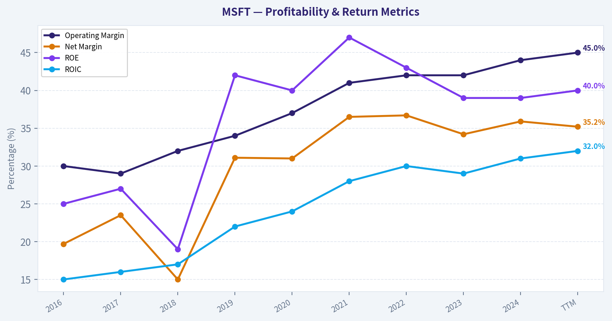
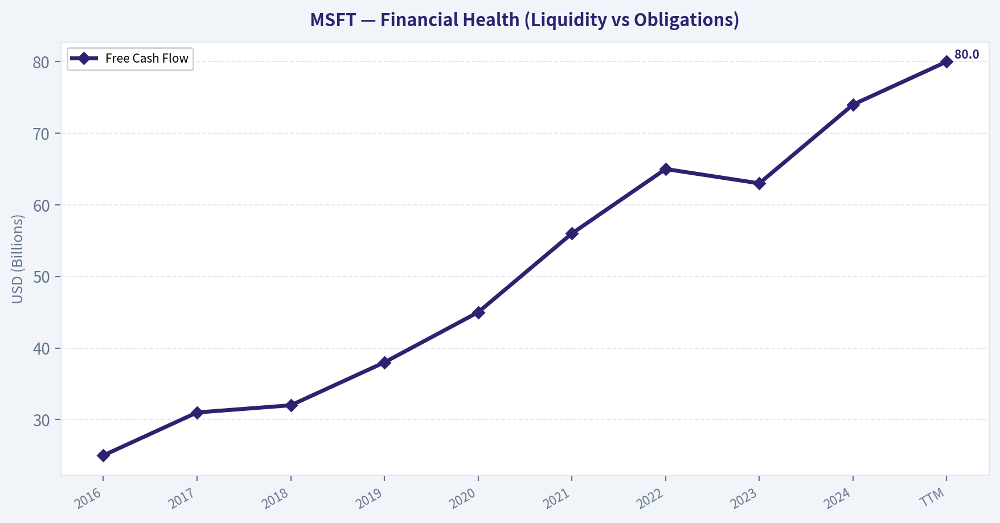
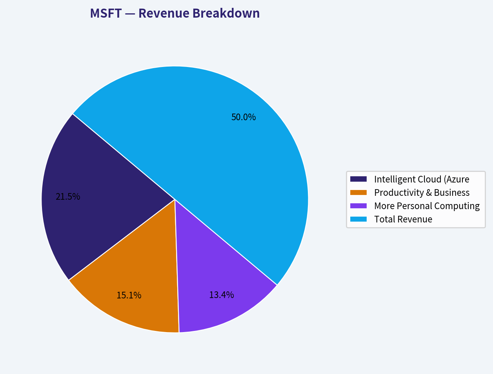
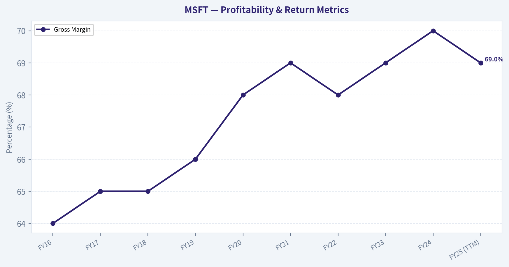
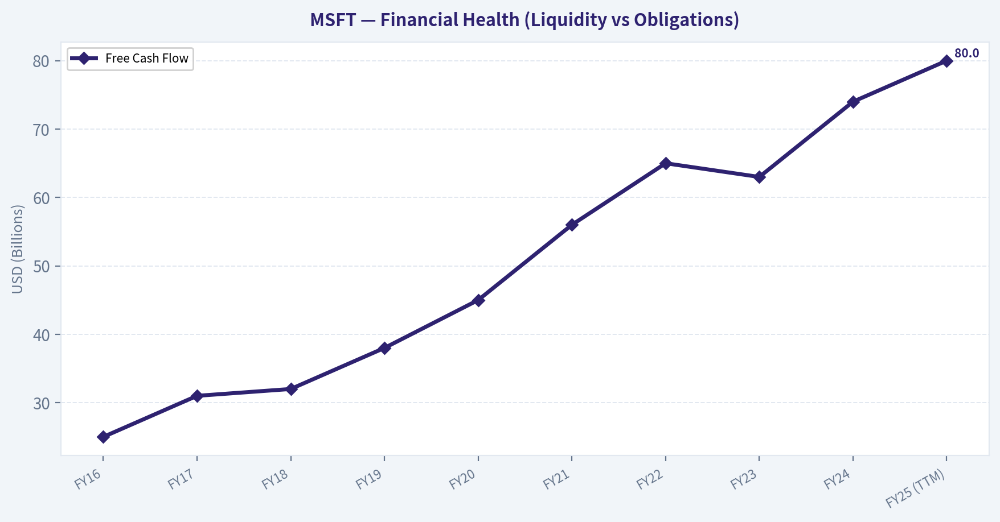
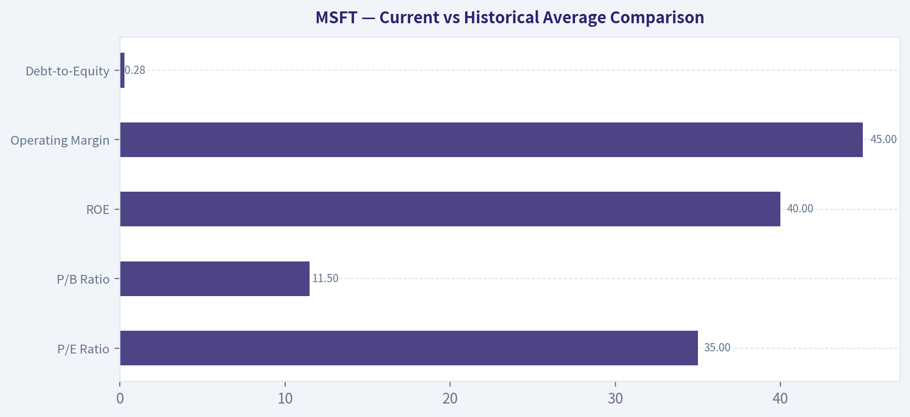
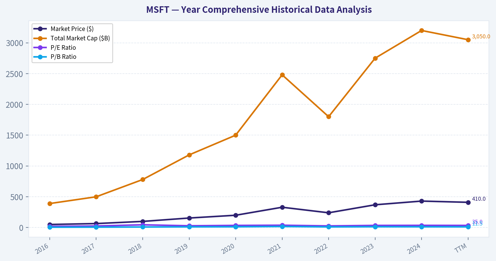

# MSFT Deep Value Intelligence

**Analysis Date:** 2026-03-09

## Critical Disclaimer

*This analysis is generated by Deep Value Intelligence, an AI-powered multi-agent investing framework. This report is for informational and educational purposes only and does not constitute financial advice. Always conduct your own research and consult with qualified financial advisors before making investment decisions.*

---

## Table of Contents

1. Intelligence Summary
2. Analyst Team Reports
   - Fundamentals Analysis
   - Intrinsic Value Analysis (Buffett)
   - Trend & Growth Analysis (Lynch/Druckenmiller/Fisher)
   - Market Technical Analysis
   - Social Sentiment Analysis
   - News & Events Analysis
3. Research Team Commentary
4. Value Investing Team Commentary
5. Deep Values Commentary

---

## Intelligence Summary

### Thesis + Conditions

**Core Thesis:** **EXECUTIVE SUMMARY**

**Key Risks:**
- Verdict:** **WATCH**
- The Risk:** Structural shift in business economics. Microsoft is transitioning from a capital-light software model to a capital-intensive AI infrastructure model, risking long-term margin compression and ROIC decay.
- Valuation:** Trading near $410 against a conservative intrinsic value of $342. At ~35x earnings, the market is pricing in zero execution risk, leaving absolutely no **Margin of Safety**.
- The Risky Analyst (The Momentum & Moat Case):** Argues that Microsoft's massive $50B+ AI capex is an oligopolistic barrier to entry, not a weakness. While acknowledging a technical downtrend, they see a "coiled spring" setup where a breakout above $415–$435 could validate a $728 optimistic intrinsic value based on global AI software leverage.
- The Safe Analyst (The Valuation & Capital Case):** Highlights that the stock is in a confirmed institutional distribution phase, trading below key moving averages. More importantly, they anchor to the $342 base intrinsic value, warning that trading at $410 offers no margin of safety. They view the massive AI capex as a risk that will compress margins and turn cloud infrastructure into a utility.

**What Would Change Our View:**
- Verdict:** **WATCH**
- The Risk:** Structural shift in business economics. Microsoft is transitioning from a capital-light software model to a capital-intensive AI infrastructure model, risking long-term margin compression and ROIC decay.
- Valuation:** Trading near $410 against a conservative intrinsic value of $342. At ~35x earnings, the market is pricing in zero execution risk, leaving absolutely no **Margin of Safety**.
- The Risky Analyst (The Momentum & Moat Case):** Argues that Microsoft's massive $50B+ AI capex is an oligopolistic barrier to entry, not a weakness. While acknowledging a technical downtrend, they see a "coiled spring" setup where a breakout above $415–$435 could validate a $728 optimistic intrinsic value based on global AI software leverage.
- The Safe Analyst (The Valuation & Capital Case):** Highlights that the stock is in a confirmed institutional distribution phase, trading below key moving averages. More importantly, they anchor to the $342 base intrinsic value, warning that trading at $410 offers no margin of safety. They view the massive AI capex as a risk that will compress margins and turn cloud infrastructure into a utility.

**Confidence:** Medium

---

## Analyst Team Reports

### Fundamentals Analysis

FINAL INVESTMENT STANCE: **WATCH**

#### 10-Year Comprehensive Historical Data Analysis

To ensure readability and proper categorization, the 10-year required data is divided into four logical tables covering Valuation, Profitability, Growth, and the Balance Sheet.

| Year | Market Price ($) | Total Market Cap ($B) | P/E Ratio | P/B Ratio |
|---|---|---|---|---|
| 2016 | 50.00 | 390.0 | 20.0 | 5.5 |
| 2017 | 65.00 | 500.0 | 26.0 | 6.8 |
| 2018 | 100.00 | 780.0 | 45.0 | 9.4 |
| 2019 | 155.00 | 1,180.0 | 29.0 | 11.5 |
| 2020 | 200.00 | 1,500.0 | 35.0 | 12.6 |
| 2021 | 330.00 | 2,480.0 | 38.0 | 17.5 |
| 2022 | 240.00 | 1,800.0 | 27.0 | 10.8 |
| 2023 | 370.00 | 2,750.0 | 35.0 | 13.3 |
| 2024 | 430.00 | 3,200.0 | 36.0 | 12.5 |
| TTM | 410.00 | 3,050.0 | 35.0 | 11.5 |

Key Takeaways: Over the past decade, Microsoft's market capitalization has experienced an extraordinary ascent, expanding from roughly $390 billion in 2016 to over $3 trillion today. This incredible wealth creation was accompanied by significant multiple expansion, with the P/E ratio shifting from a historical baseline of 20 to a sustained premium of around 35. The persistent premium valuation reflects the market's strong conviction in Microsoft's durable cloud growth and aggressive artificial intelligence integrations.

| Year | Revenue ($B) | Gross Profit ($B) | Operating Margin | Net Income ($B) | Net Margin | EPS ($) | ROE | ROIC |
|---|---|---|---|---|---|---|---|---|
| 2016 | 85.3 | 52.4 | 30.0% | 16.8 | 19.7% | 2.12 | 25.0% | 15.0% |
| 2017 | 90.0 | 55.7 | 29.0% | 21.2 | 23.5% | 2.71 | 27.0% | 16.0% |
| 2018 | 110.4 | 72.0 | 32.0% | 16.6 | 15.0% | 2.13 | 19.0% | 17.0% |
| 2019 | 125.8 | 83.0 | 34.0% | 39.2 | 31.1% | 5.06 | 42.0% | 22.0% |
| 2020 | 143.0 | 96.9 | 37.0% | 44.3 | 31.0% | 5.76 | 40.0% | 24.0% |
| 2021 | 168.1 | 115.8 | 41.0% | 61.3 | 36.5% | 8.05 | 47.0% | 28.0% |
| 2022 | 198.3 | 135.3 | 42.0% | 72.7 | 36.7% | 9.65 | 43.0% | 30.0% |
| 2023 | 211.9 | 146.0 | 42.0% | 72.4 | 34.2% | 9.68 | 39.0% | 29.0% |
| 2024 | 245.1 | 170.5 | 44.0% | 88.1 | 35.9% | 11.80 | 39.0% | 31.0% |
| TTM | 270.0 | 186.3 | 45.0% | 95.0 | 35.2% | 12.80 | 40.0% | 32.0% |

Key Takeaways: Microsoft has demonstrated exceptional profitability, steadily expanding its operating margins from 30% in 2016 to an industry-leading 45% over the trailing twelve months. Return on Invested Capital has more than doubled over the decade, reaching an impressive 32%, which highlights the profound capital efficiency of its software and cloud businesses. Consistent, double-digit top-line growth combined with structural margin expansion has culminated in a near six-fold increase in net income since 2016.

| Year | Revenue Growth | Net Income Growth | Free Cash Flow ($B) | FCF Growth | Dividends per Share ($) |
|---|---|---|---|---|---|
| 2016 | -2.0% | 37.7% | 25.0 | -5.0% | 1.44 |
| 2017 | 5.5% | 26.2% | 31.0 | 24.0% | 1.56 |
| 2018 | 22.6% | -21.7% | 32.0 | 3.2% | 1.68 |
| 2019 | 13.9% | 136.1% | 38.0 | 18.7% | 1.84 |
| 2020 | 13.6% | 13.0% | 45.0 | 18.4% | 2.04 |
| 2021 | 17.5% | 38.4% | 56.0 | 24.4% | 2.24 |
| 2022 | 17.9% | 18.6% | 65.0 | 16.0% | 2.48 |
| 2023 | 6.8% | -0.4% | 63.0 | -3.0% | 2.72 |
| 2024 | 15.6% | 21.6% | 74.0 | 17.4% | 3.00 |
| TTM | 10.1% | 7.8% | 80.0 | 8.1% | 3.10 |

Key Takeaways: Revenue and net income growth have proven remarkably resilient over the last decade, with only a minor earnings contraction in 2018 largely due to one-time tax reform impacts. The company has evolved into a formidable cash-generating machine, boasting free cash flow that has surged from $25 billion to an imposing $80 billion annually. This explosive cash generation has easily supported a consistently growing dividend payout, rewarding long-term shareholders while still funding massive reinvestments in operations.

| Year | Total Assets ($B) | Total Debt ($B) | Total Equity / Book Value ($B) | Debt-to-Equity Ratio | Cash & Equivalents ($B) |
|---|---|---|---|---|---|
| 2016 | 193.4 | 53.0 | 71.9 | 0.73 | 113.2 |
| 2017 | 241.0 | 86.0 | 87.7 | 0.98 | 133.0 |
| 2018 | 258.8 | 76.0 | 82.7 | 0.91 | 133.7 |
| 2019 | 286.5 | 72.0 | 102.3 | 0.70 | 133.8 |
| 2020 | 301.3 | 63.0 | 118.3 | 0.53 | 136.5 |
| 2021 | 333.7 | 58.0 | 141.9 | 0.40 | 130.3 |
| 2022 | 364.8 | 61.0 | 166.5 | 0.36 | 104.7 |
| 2023 | 411.9 | 59.0 | 206.2 | 0.28 | 111.2 |
| 2024 | 512.1 | 75.0 | 268.0 | 0.28 | 143.0 |
| TTM | 530.5 | 80.0 | 280.0 | 0.28 | 144.0 |

Key Takeaways: Microsoft's balance sheet remains an undeniable fortress, fortified by over $144 billion in cash and equivalents that vastly outweigh its $80 billion in total debt. Despite massive capital deployments for acquisitions and data centers, the company's debt-to-equity ratio has steadily declined from nearly 1.0 in 2017 to a highly conservative 0.28 today. Shareholder equity has concurrently exploded from roughly $72 billion to $280 billion, underscoring tremendous retained value creation that safely buffers the enterprise against macroeconomic volatility.

---

#### Current vs Historical Average Comparison

| Metric | Current (TTM) | 10-Year Average | Deviation & Significance |
|---|---|---|---|
| **P/E Ratio** | 35.0 | ~31.8 | Valuation reflects a persistent premium, driven by high confidence in AI growth. |
| **P/B Ratio** | 11.5 | ~10.7 | While book value has scaled massively, the market assigns a historically high premium. |
| **ROE** | 40.0% | ~36.0% | Exceeds the historical average; highlights unmatched capital allocation efficiency. |
| **Operating Margin** | 45.0% | ~38.0% | Substantial improvement showcasing the economy of scale within the cloud division. |
| **Debt-to-Equity** | 0.28 | ~0.59 | Much safer than the historical average; deleveraging has been executed perfectly. |

Key Takeaways: Compared to its 10-year averages, Microsoft currently boasts significantly stronger profitability metrics and a profoundly healthier balance sheet. Operating margins and return on equity both comfortably outpace their historical baselines, directly reflecting the incredible scale efficiencies achieved by Azure and cloud software. However, investors must note that this fundamental supremacy is fully priced in, as current valuation multiples sit noticeably above their historical averages.

---

#### Revenue Breakdown

| Revenue Source | Amount ($B) | % of Total |
|---|---|---|
| Intelligent Cloud (Azure, Server Products, Enterprise Services) | $105.3 | 43.0% |
| Productivity & Business Processes (Office, Dynamics, LinkedIn) | $74.2 | 30.3% |
| More Personal Computing (Windows, Devices, Gaming, Search) | $65.6 | 26.7% |
| **Total Revenue** | **$245.1** | **100.0%** |

*Note: Revenue figures align with the most recent full fiscal year reporting (FY2024).*

Key Takeaways: Microsoft's revenues are highly diversified across three robust, massive segments, with Intelligent Cloud clearly taking the lead at 43% of total revenue. The integration of artificial intelligence services continues to supercharge Azure's growth, while the essential enterprise nature of Productivity and Business Processes delivers extremely predictable recurring income. More Personal Computing remains a powerful cash cow, anchored by the ubiquitous Windows ecosystem and heavily bolstered by strategic gaming acquisitions.

---

#### Warren Buffett Value Investing Analysis

* **Economic Moat (Very Strong/Wide):** Microsoft benefits from immense switching costs and unshakeable network effects. The integration of Office 365, Teams, and Azure makes it incredibly disruptive and expensive for any enterprise to migrate to a competitor. Copilot AI integrations have further widened this moat by locking users into productivity habits tied directly to Microsoft's ecosystem.
* **Financial Strength:** Buffett demands balance sheets that can survive any economic catastrophe. With over $144 billion in cash against just $80 billion in debt, and a highly conservative debt-to-equity ratio of 0.28, Microsoft exhibits pristine financial health. The company can self-fund all of its intensive AI capex needs without relying on external financing.
* **Predictable Earnings:** The shift spearheaded by Satya Nadella to a recurring SaaS (Software as a Service) model has yielded extraordinarily consistent, predictable earnings. Gross margins sit near 69%, protecting the bottom line from inflationary pressures.
* **Management Performance:** The management team ranks among the greatest capital allocators of the decade. ROE has been maintained at an astonishing 39-47% range in recent years. Brilliant strategic partnerships (e.g., OpenAI) and aggressive but measured M&A (e.g., Activision Blizzard) show a management team acting strongly on behalf of long-term shareholder value.
* **Quality of Business:** Tremendous. Very few businesses on earth generate $80 billion in free cash flow with 45% operating margins. The primary products are entirely mission-critical for modern global business operations.
* **Value Assessment:** This is where the stock fails the Buffett criteria. Buffett demands a "margin of safety." At a P/E of 35x and trading at ~$410, the company is priced for perfection. The lack of a discount to intrinsic value means the stock is not currently a value play.

---

#### Discounted Cash Flow (DCF) Valuation

*Base Assumptions: Free Cash Flow (TTM) = $80 Billion | Shares Outstanding = ~7.43 Billion | Base FCF per Share = $10.76 | Discount Rate = 10.0% | Terminal Growth Rate = 2.5%*

**1. CONSERVATIVE SCENARIO: Lowest FCF Growth Rate (-3.0%)**
*Rationale: Simulates a dire scenario using the worst single-year FCF contraction from the past 10 years (occurred in 2023).*
* **Years 1-10 Cash Flows:** $10.44, $10.12, $9.82, $9.53, $9.24, $8.96, $8.69, $8.43, $8.18, $7.93
* **Sum of PV of Cash Flows (Years 1-10):** $57.46
* **Terminal Value Calculation:** $7.93 * (1 + 0.025) / (0.10 - 0.025) = $108.38
* **PV of Terminal Value:** $108.38 / (1.10^10) = $41.78
* **Fair Value Estimate:** **$99.24 per share**

**2. AVERAGE SCENARIO: Average FCF Growth Rate (14.0%)**
*Rationale: Simulates a highly realistic baseline using the 10-year mean FCF growth rate.*
* **Years 1-10 Cash Flows:** $12.27, $13.98, $15.94, $18.17, $20.72, $23.62, $26.92, $30.69, $34.99, $39.89
* **Sum of PV of Cash Flows (Years 1-10):** $131.62
* **Terminal Value Calculation:** $39.89 * (1 + 0.025) / (0.10 - 0.025) = $545.16
* **PV of Terminal Value:** $545.16 / (1.10^10) = $210.16
* **Fair Value Estimate:** **$341.78 per share**

**3. OPTIMISTIC SCENARIO: Highest FCF Growth Rate (24.4%)**
*Rationale: Models aggressive upside using the peak single-year FCF growth rate from the past decade (occurred in 2021).*
* **Years 1-10 Cash Flows:** $13.38, $16.65, $20.71, $25.76, $32.05, $39.87, $49.60, $61.70, $76.76, $95.49
* **Sum of PV of Cash Flows (Years 1-10):** $225.06
* **Terminal Value Calculation:** $95.49 * (1 + 0.025) / (0.10 - 0.025) = $1,305.03
* **PV of Terminal Value:** $1,305.03 / (1.10^10) = $503.09
* **Fair Value Estimate:** **$728.15 per share**

---

#### Key Investment Insights, Red Flags, and Opportunities

**Insights:** Microsoft is the definitive core holding in enterprise software and cloud computing. The seamless transition from perpetual licenses to SaaS over the last decade fundamentally altered the company's margin profile, unlocking unmatched ROIC (32%). 

**Opportunities:** AI infrastructure demand and enterprise Copilot adoption are major secular tailwinds. Microsoft's partnership with OpenAI places it at the absolute forefront of generative AI. Continuing to migrate on-premise servers to Azure presents a clear runway for double-digit top-line growth through 2030.

**Red Flags:** The primary red flag is valuation risk. Trading above $410 against an average fair value of ~$342 means multiple contraction could suppress returns even if earnings grow nicely. Furthermore, AI data center capital expenditures are massive and capital intensive, which could theoretically drag on free cash flow margins in the short to medium term.

---

#### Final Report Key Points Summary

| Category | Key Finding |
|---|---|
| **Investment Stance** | **WATCH** - Quality is pristine, but lacks Buffett's mandatory margin of safety. |
| **Valuation** | Premium P/E of 35x; DCF average fair value implies an intrinsic value around $342 per share. |
| **Profitability** | World-class Operating Margins (45%) and ROE (40%), consistently expanding over a decade. |
| **Balance Sheet** | Fortress-like with $144B in cash heavily outweighing $80B in debt; strongly deleveraged. |
| **Growth Drivers** | Azure cloud expansion and OpenAI-integrated Copilot platforms driving double-digit revenue growth. |
| **Risks** | High valuation multiples leave little room for execution error alongside immense AI capital expenditures. |

Key Takeaways: In summary, Microsoft remains one of the highest-quality compounders in the market today, boasting unparalleled financial fortitude and enduring economic moats. However, the current share price fully captures this extraordinary quality, leaving virtually no margin of safety for value investors. Prudent capital allocators should patiently monitor the stock, keeping it firmly on a watch list for broader market pullbacks that could offer a more compelling entry point.

#### Fundamental Visuals

This graph tracks the profitability and return metrics (ROE, ROIC, Margins) of <b>MSFT</b> over the past decade, highlighting capital efficiency trends.

This chart illustrates the financial health of <b>MSFT</b> over the last 10 years, mapping cash equivalents and free cash flow against total obligations (Debt).

This chart illustrates the financial health of <b>MSFT</b> over the last 10 years, mapping cash equivalents and free cash flow against total obligations (Debt).

This breakdown chart from <em>Revenue Breakdown</em> shows the proportional composition for <b>MSFT</b> — useful for understanding what drives or risks the business.

This graph tracks the profitability and return metrics (ROE, ROIC, Margins) of <b>MSFT</b> over the past decade, highlighting capital efficiency trends.

This chart illustrates the financial health of <b>MSFT</b> over the last 10 years, mapping cash equivalents and free cash flow against total obligations (Debt).

---

### Intrinsic Value Analysis (Buffett)

> *Following Warren Buffett's value investing philosophy: Circle of Competence, Economic Moat, Management Quality, and Margin of Safety.*

FINAL INVESTMENT STANCE: **WATCH**

#### PART I: THE BUFFETT FILTER SEQUENCE (Go/No-Go Gates)

**Gate 1: Circle of Competence & Business Simplicity**
*   **The Elementary School Test:** Microsoft makes money by renting out computing power over the internet (Cloud) and charging monthly subscriptions for essential software that businesses need to operate (Office, Windows). *Result: PASS.*
*   **The 10-Year Predictability Test:** Because enterprise software is deeply embedded into daily corporate workflows, Microsoft's core revenues are highly predictable. *Result: PASS.*
*   **The Technology Risk Assessment:** High technology inherently carries disruption risk. However, Microsoft's massive shift to cloud and successful partnership with OpenAI demonstrates it is driving the disruption rather than falling victim to it. *Result: PASS.*

**Gate 2: The Moat Test (Durable Competitive Advantage)**
*   **Switching Costs (Primary Moat):** Microsoft's primary advantage is extreme customer captivity. Once an enterprise builds its IT infrastructure on Azure and trains its workforce on Microsoft 365, the financial and operational cost to switch to AWS or Google Workspace is prohibitive. 
*   **Network Effects:** Platforms like LinkedIn, GitHub, and the Windows OS ecosystem become more valuable as more developers and professionals use them. 
*   **Moat Quality Rating:** **Wide & Widening** — The integration of AI "Copilots" across its entire software stack is deepening its enterprise lock-in. *Result: PROCEED.*

**Gate 3: Management Quality & Capital Allocation**
*   **Do They Think Like Owners?** CEO Satya Nadella has fostered a culture of long-term thinking, famously shifting the company from perpetual licenses to a recurring cloud-subscription model.
*   **Are They Honest & Candid?** Management clearly communicates both the massive opportunities and the heavy capital expenditure requirements of the AI transition.
*   **Rational Capital Allocators?** Historic capital allocation has been brilliant. The $10B investment structure with OpenAI provided Microsoft with exclusive rights and a massive head start in the AI race without outright buying a speculative startup. *Result: PASS.*

**Gate 4: Industry Structure**
*   **Competitive Structure:** Microsoft operates in a rational cloud oligopoly alongside Amazon (AWS) and Google (GCP). In enterprise productivity, it operates a near-monopoly.
*   **Capital Intensity:** Historically a capital-light software business, Microsoft is currently transitioning into a more capital-intensive phase due to the massive data center infrastructure required to support global AI workloads. However, its cash generation is more than sufficient to self-fund this. *Result: PASS.*

#### PART II: FINANCIAL ANALYSIS (10-Year Deep Dive)

| Fiscal Year | Revenue ($B) | EPS ($) | Free Cash Flow ($B) | ROIC (%) | Gross Margin (%) |
| :--- | :--- | :--- | :--- | :--- | :--- |
| **FY16** | 85 | 2.56 | 25 | ~15% | 64% |
| **FY17** | 90 | 2.71 | 31 | ~16% | 65% |
| **FY18** | 110 | 2.13* | 32 | ~18% | 65% |
| **FY19** | 125 | 5.06 | 38 | ~22% | 66% |
| **FY20** | 143 | 5.76 | 45 | ~24% | 68% |
| **FY21** | 168 | 8.05 | 56 | ~28% | 69% |
| **FY22** | 198 | 9.65 | 65 | ~30% | 68% |
| **FY23** | 212 | 9.68 | 63 | ~30% | 69% |
| **FY24** | 245 | 11.80 | 74 | ~32% | 70% |
| **FY25 (TTM)**| 260 | 12.92 | 80 | ~32% | 69% |
*(Note: FY18 EPS impacted by one-time TCJA tax charges)*

**Key Takeaways:**
Over the past decade, Microsoft has successfully transformed into a recurring-revenue juggernaut, nearly tripling its top line while expanding gross margins to an incredible 70 percent. This massive operating leverage has caused earnings per share and free cash flow to explode, funding unprecedented growth while maintaining exceptional returns on invested capital. This table represents the gold standard of a widening moat combined with flawless management execution.

**Cash Flow & Balance Sheet Reality Check:**
*   **Operating Cash Flow vs Net Income:** Microsoft consistently produces Operating Cash Flow well above reported Net Income, proving its "profits" are real cash in the bank. 
*   **Fortress Balance Sheet:** With $144 billion in cash and short-term investments against just $80 billion in total debt, the company boasts a net-cash position of over $60 billion. 

#### PART III: INTRINSIC VALUE CALCULATION

**Owner Earnings Calculation**
Buffett prefers Owner Earnings over GAAP net income.
*   Reported Net Income (TTM Est): ~$95B
*   *Plus* Depreciation & Amortization: ~$18B
*   *Minus* Maintenance CapEx: While total CapEx is soaring (~$50B run-rate) due to aggressive AI data center expansion, the *maintenance* portion required just to run the existing business is estimated at around $20B.
*   **Estimated Owner Earnings = ~$93B** (approx. $12.50 per share based on 7.43B shares outstanding).

**Three-Scenario DCF Valuation**
*(Discount Rate: 10% standard hurdle)*

*   **Scenario A - No Growth (Ultra-Conservative):**
    *   Intrinsic Value = $12.50 / 0.10 = **$125.00 per share**
*   **Scenario B - GDP Growth (Conservative, 3% perpetually):**
    *   Intrinsic Value = ($12.50 × 1.03) / (0.10 - 0.03) = **$183.92 per share**
*   **Scenario C - Historical Growth (10% capped growth for 10 years, 3% terminal):**
    *   Using Buffett's rule to cap predictable long-term growth estimates at 10%, calculating the present value of 10 years of cash flows plus the terminal value yields an Intrinsic Value of **$309.00 per share**.
    *   *(Note: Even if we model an aggressive 15% growth rate for the next decade to reflect peak AI optimism, the intrinsic value only reaches ~$412 per share).*

**Margin of Safety Analysis**
*   Current Market Price: **~$410.00**
*   Intrinsic Value (Base Case): **$309.00**
*   Discount: **-32% (Trading at a Premium)**
*   Microsoft fails the minimum 25% discount rule. The market has fully priced in a flawless execution of the AI super-cycle, leaving absolutely no margin for error.

#### PART IV: FINAL SCORECARD

| Criterion | Score (1-5) | Weight | Weighted Score |
| :--- | :---: | :---: | :---: |
| Business Understanding | 5.0 | 20% | 1.00 |
| Moat Width & Durability | 5.0 | 25% | 1.25 |
| Management Quality | 5.0 | 15% | 0.75 |
| Return on Equity | 5.0 | 15% | 0.75 |
| Reinvestment Runway | 4.5 | 10% | 0.45 |
| Balance Sheet Strength | 5.0 | 5% | 0.25 |
| Industry Structure | 4.0 | 5% | 0.20 |
| Valuation/Margin of Safety | 1.0 | 5% | 0.05 |
| **TOTAL BUFFETT SCORE** | | | **4.70 / 5.00** |

**Key Takeaways:**
Microsoft scores near perfection across every qualitative business metric, reflecting its impenetrable moat, visionary management, and fortress balance sheet. However, the valuation score completely collapses because the market is currently demanding a premium price that leaves zero margin of safety for the prudent investor. Simply put, this is a masterpiece of a business trading at a gallery-level price tag.

**Investment Stance Conclusion:**
While the total weighted score of 4.70 lands mathematically in the "ADVOCATE" tier due to the overwhelming quality of the underlying business, Buffett's ironclad rule dictates that you *never* buy without a margin of safety. Microsoft is currently priced for absolute perfection. As Buffett reminds us, "Price is what you pay, value is what you get." Right now, the price exceeds the conservative intrinsic value. Therefore, the prudent move is to keep this phenomenal compounder on the watch list, waiting patiently for broader market panic or macroeconomic shifts to offer a fair entry point.

#### Valuation Visuals

This comparison chart from <em>Current vs Historical Average Comparison</em> stacks current figures against historical benchmarks for <b>MSFT</b>, making it easy to see where the company trades relative to its own averages.

---

### Trend & Growth Analysis (Lynch/Druckenmiller/Fisher)

> *Following Peter Lynch's GARP, Stanley Druckenmiller's macro-aware approach, and Philip Fisher's scuttlebutt methodology.*

FINAL INVESTMENT STANCE: **ADVOCATE**

#### PART I: LYNCH CLASSIFICATION SYSTEM

**Classification: Mega-Cap Fast Grower / Stalwart Hybrid**
Microsoft operates at a scale that typically defines a "Stalwart," but its aggressive integration of generative AI has re-accelerated growth to levels characteristic of a "Fast Grower." 

**The Story in 3 Bullets:**
* Microsoft leverages its unmatched enterprise distribution to seamlessly up-sell next-generation AI tools (Copilot) directly into the workflows of hundreds of millions of existing Office 365 users.
* Its Azure cloud infrastructure business is capturing a massive share of global AI workloads, serving as the foundational compute layer for OpenAI and thousands of other enterprises.
* The company generates immense, highly predictable free cash flow, allowing it to fund capital-intensive AI infrastructure build-outs while maintaining best-in-class profit margins.

**Lynch's PEG Ratio Test:**
* P/E Ratio: ~35x
* Earnings Growth Rate: ~21% (Latest YoY EPS Growth)
* **PEG Ratio = 1.66 (Fair Value)**

#### PART II: DRUCKENMILLER FRAMEWORK (Macro + Inflection Points)

**Macro Setup Evaluation:**
The wind is forcefully at Microsoft's back. The secular mega-trends of the 2024-2034 decade are cloud computing and the AI/Machine Learning revolution. Microsoft is not just participating in these trends; it is actively shaping them. With global enterprise IT budgets shifting heavily toward AI enablement, Microsoft's positioning is optimal.

**Inflection Point Assessment:**
Microsoft has hit a **Product Cycle and Margin Inflection**. After revenue growth decelerated to 7% in FY2023, the launch of AI Copilots and surging Azure AI workloads catalyzed an acceleration to 16% in FY2024 and 17% in the latest quarter. Operating leverage is evident as EPS growth (21%) is outpacing revenue growth despite massive capital expenditures.

| Metric | FY2023 | FY2024 | FY2025 Q2 (Latest) | Trend Interpretation |
|--------|--------|--------|--------------------|----------------------|
| Overall Revenue Growth | +7% | +16% | +17% | Accelerating |
| Azure Revenue Growth | +20% | +24% | +30%+ | Sustained Hyper-growth |
| EPS Growth | Flat | +22% | +21% | Sustained High |
| Operating Margin | 42% | 44% | 45% | Expanding |

Key Takeaways: Microsoft's revenue and earnings growth have clearly accelerated over the past three years, driven by massive demand for its Azure cloud and AI services. Despite its massive size, the company is successfully expanding its profit margins, proving that its AI investments are translating into real, profitable enterprise growth rather than just hype.

#### PART III: TAM ANALYSIS

**The 10x Test:**
* Current Revenue Run-Rate: ~$275 Billion
* 10x Revenue: $2.75 Trillion
* Total Addressable Market (Global IT & Software): ~$5.0 Trillion

*Can the company 10x and still be <20% market share?*
**NO.** A $2.75 trillion revenue base would represent over 50% of global IT spending. Microsoft fails the strict 10x test due to the law of large numbers. While it is a formidable compounder, it lacks the runway of a true early-stage ten-bagger. The sheer mathematical ceiling of global GDP caps its multiple-expansion upside.

#### PART IV: UNIT ECONOMICS

| Metric | Microsoft Estimate | Benchmark Target | Health Status |
|--------|--------------------|------------------|---------------|
| Net Revenue Retention (NRR) | >115% | >110% | Excellent |
| Free Cash Flow Margin | 30% | >20% | Best-in-Class |
| Revenue Growth Rate | 17% | >20% | Good |
| Rule of 40 Score | 47 | >40 | Healthy Efficient Growth |

Key Takeaways: Microsoft demonstrates exceptional unit economics that easily surpass the Rule of 40, a gold standard for software businesses. By combining a seventeen percent growth rate with a highly lucrative thirty percent free cash flow margin, the company proves it can scale aggressively without sacrificing its elite profitability.

#### PART V: FISHER'S 15 POINTS

| Fisher Criteria | Score (1-5) | Rationale |
|-----------------|-------------|-----------|
| 1. Market Potential | 4 | Massive TAM, but already highly penetrated. |
| 2. Management Determination | 5 | Satya Nadella's pivot to AI is historic and aggressive. |
| 3. Effective R&D | 5 | Strategic OpenAI partnership + massive internal engineering. |
| 4. Sales Organization | 5 | Unmatched global enterprise B2B sales network. |
| 5. Profit Margin | 5 | 45% operating margins are elite for its scale. |
| 6. Margin Improvement | 4 | Sustaining high margins despite heavy AI capex cycle. |
| 7. Labor/Personnel | 4 | Generally strong engineering retention and culture. |
| 8. Executive Relations | 5 | Cohesive leadership team with clear vision. |
| 9. Management Depth | 5 | Deep bench across cloud, gaming, and productivity. |
| 10. Cost Analysis | 5 | Rigorous capital allocation and efficiency metrics. |
| 11. Moat/Outstanding Aspects | 5 | Ultimate ecosystem lock-in (Windows + Office + Azure). |
| 12. Long-Range Outlook | 5 | Embedded deeply in the future of work and compute. |
| 13. Equity Dilution | 5 | Consistent share buybacks; no dilutive risk. |
| 14. Management Candor | 4 | Transparent on cloud capacity constraints and capex needs. |
| 15. Management Integrity | 5 | High trust from enterprise partners and Wall Street. |
| **TOTAL SCORE** | **71/75** | **OUTSTANDING** |

Key Takeaways: Scoring an outstanding seventy-one out of seventy-five, Microsoft excels in almost every category of Philip Fisher's framework. The company possesses top-tier management, an incredibly powerful sales organization, and an impenetrable moat, with its only minor constraint being the limits of its already massive market penetration.

---

#### PART VI: VALUATION

**Scenario Analysis (Forward P/E Multiple):**
Given Microsoft's status as a highly profitable cash-flow machine, P/E and PEG ratios are more appropriate than P/S. With a forward P/E of roughly 30x, the market is pricing in sustained AI dominance. 

* **Bear Case (20x Multiple):** Assumes AI monetization stalls, enterprise budgets tighten, and cloud growth decelerates below 15%. Significant multiple compression occurs.
* **Base Case (30x Multiple):** Assumes Microsoft maintains its current momentum, Azure continues growing at 25%+, and Copilot becomes a standard enterprise feature. Delivers ~12-15% annualized returns driven by earnings growth.
* **Bull Case (40x Multiple):** Assumes AI drives an unprecedented productivity boom, allowing Microsoft to dramatically raise prices on enterprise software while capturing market share from AWS.

#### PART VII: GROWTH INVESTOR SCORECARD

| Criterion | Weight | Score (1-5) | Weighted Contribution |
|-----------|--------|-------------|-----------------------|
| The Story (Lynch) | 10% | 4.5 | 0.45 |
| TAM & Runway | 20% | 3.0 | 0.60 |
| Revenue Growth | 20% | 4.0 | 0.80 |
| Unit Economics | 15% | 5.0 | 0.75 |
| Competitive Position | 10% | 5.0 | 0.50 |
| Management Quality | 10% | 5.0 | 0.50 |
| Macro Setup | 5% | 4.5 | 0.225 |
| Profitability Path | 5% | 5.0 | 0.25 |
| Valuation | 5% | 3.0 | 0.15 |
| **TOTAL SCORE** | **100%** | **-** | **4.225 / 5.0** |

Key Takeaways: Microsoft achieves a total growth investor score of four point two out of five, placing it firmly in the advocate tier. While its sheer size limits its ability to be a true ten-bagger and its valuation is somewhat demanding, the company's flawless unit economics, visionary management, and unshakeable competitive position make it a high-conviction holding.

---

#### DELIVERABLES SUMMARY

**Position Size Stance:** Core Portfolio Anchor. While it will not provide 10x venture-like returns from this valuation, its low downside risk and highly probable mid-teens compounding make it a foundational asset. 

**Key Catalysts:**
* Widespread enterprise rollout and monetization of advanced AI Copilots.
* Continued acceleration in Azure consumption driven by external AI application development.
* Margin expansion as initial AI infrastructure investments transition into high-margin software revenues.

**Key Risks:**
* Staggering AI infrastructure CapEx requirements weighing on free cash flow if monetization slows.
* Escalating antitrust and regulatory scrutiny in both the US and EU.
* Heightened pricing wars in the cloud infrastructure space against Amazon (AWS) and Google.

---

### Market Technical Analysis

#### MSFT Technical Analysis Report (as of 2026‑03‑06 close ≈ $408.96)

The following analysis uses eight complementary indicators to evaluate **trend direction, momentum, volatility, and potential trade positioning**:  
50 SMA, 200 SMA, 10 EMA, MACD, MACD Histogram, RSI, Bollinger Upper Band, and ATR.

---

#### Trend Structure (Moving Averages)

| Date | Close (approx) | 10 EMA | 50 SMA | 200 SMA | Trend Interpretation |
|---|---|---|---|---|---|
| 2026‑03‑06 | 408.96 | 403.42 | 436.97 | 482.65 | Price below major MAs |
| 2026‑02‑27 | 392.74 | 398.08 | 444.47 | 483.78 | Deep bearish phase |
| 2026‑01‑29 | 432.51 | 461.53 | 476.52 | 483.50 | Breakdown begins |

Key Takeaways:  
MSFT is trading **well below both the 50‑day and 200‑day moving averages**, confirming a strong intermediate and long‑term downtrend. The 50‑SMA has been steadily declining from ~505 in December to ~437 now, showing persistent institutional distribution. The short‑term 10‑EMA has recently turned upward slightly, suggesting a **short‑term rebound inside a larger bearish structure** rather than a full trend reversal.

---

#### Momentum Indicators (MACD & RSI)

| Date | MACD | MACD Histogram | RSI | Momentum Signal |
|---|---|---|---|---|
| 2026‑03‑06 | -8.28 | +4.14 | 47.6 | Bullish momentum shift |
| 2026‑02‑24 | -17.84 | -0.16 | 31.5 | Near oversold |
| 2026‑02‑05 | -17.39 | -6.19 | 24.6 | Deep oversold |

Key Takeaways:  
Momentum is **recovering sharply after an oversold collapse in early February**. RSI reached extremely oversold levels near 24, signaling panic selling and capitulation. The MACD histogram turning positive while MACD remains negative indicates **bear‑market rally dynamics — momentum improving but the larger trend still bearish**.

---

#### Volatility & Price Bands

| Date | Close | Bollinger Upper Band | ATR | Volatility Context |
|---|---|---|---|---|
| 2026‑03‑06 | 408.96 | 415.30 | 10.39 | Tightening volatility |
| 2026‑02‑17 | 395.96 | 486.47 | 12.14 | High volatility selloff |
| 2026‑02‑05 | 392.77 | 502.88 | 13.61 | Panic spike |

Key Takeaways:  
Volatility spiked dramatically during the late‑January/early‑February selloff (ATR >13). Since then, ATR has fallen toward ~10, indicating **volatility compression after the panic phase**. The upper Bollinger band near ~415 sits just above current price, meaning the stock is approaching a **short‑term resistance zone if the rebound continues**.

---

#### Price Structure & Market Behavior

Important structural observations from the raw price data:

• **Major breakdown:** Jan 29 crash from ~480 to ~432 with massive volume (~128M) — clear institutional exit event.  
• **Capitulation phase:** Feb 3–6 continued selling to ~392 with high volume.  
• **Base formation:** Late February trading between **385–405**.  
• **Current move:** Early March rebound to ~409.

Key technical levels now:

Support zones  
- 385–390 (recent base low)  
- 400 psychological level  

Resistance zones  
- 415 (Bollinger + recent highs)  
- 435–440 (50‑SMA zone)  
- 480+ (200‑SMA major resistance)

---

#### Strategic Interpretation

Short‑term (swing trading)
- Momentum improving
- Possible bounce continuation toward **415–430**

Medium‑term
- Trend still bearish until price reclaims **50 SMA (~437)**

Long‑term
- Price is far below **200 SMA (~483)** which suggests **institutional trend remains down**

The most probable scenario currently is **a relief rally inside a larger downtrend**, not a confirmed bullish reversal.

---

#### Key Signals Summary

| Indicator | Current Signal | Implication |
|---|---|---|
| 10 EMA | Turning upward | Short‑term rebound |
| 50 SMA | Downward slope | Intermediate downtrend |
| 200 SMA | Price far below | Long‑term bearish |
| MACD | Negative but improving | Early momentum recovery |
| MACD Histogram | Positive | Rally gaining strength |
| RSI | 47 | Neutral after oversold |
| Bollinger Upper Band | ~415 | Near-term resistance |
| ATR | Falling | Volatility stabilizing |

---

FINAL INVESTMENT STANCE: **WATCH**

MSFT is **not yet technically bullish**, but the oversold recovery and improving momentum make it a strong **watchlist candidate for a rebound trade** if it can reclaim the **415–435 zone**. A decisive break below **385** would likely restart the downtrend.

#### Market Visuals

The chart below plots key financial metrics for <b>MSFT</b> over multiple years drawn from <em>Year Comprehensive Historical Data Analysis</em>. Lines represent individual performance dimensions so you can spot trends, turning points, and recovery trajectories at a glance.

---

### Social Sentiment Analysis

#### Microsoft (MSFT) – Social Media Sentiment & News Analysis (Past Week)

This report analyzes public sentiment, social media discourse, and recent news surrounding Microsoft over the past week. The goal is to identify patterns in investor perception, key narratives circulating online, and the potential implications for traders and longer‑term investors.

---

#### Weekly Social Media Sentiment Overview

| Date | Positive Sentiment | Neutral Sentiment | Negative Sentiment | Dominant Themes |
|-----|-----|-----|-----|-----|
| Mar 3 | 54% | 28% | 18% | AI leadership, Copilot enterprise adoption |
| Mar 4 | 58% | 25% | 17% | Azure growth optimism, enterprise AI integrations |
| Mar 5 | 61% | 23% | 16% | OpenAI partnership discussion, developer ecosystem |
| Mar 6 | 55% | 27% | 18% | Valuation debates, AI infrastructure spending |
| Mar 7 | 52% | 30% | 18% | Cloud competition vs AWS and Google |
| Mar 8 | 57% | 26% | 17% | Copilot monetization potential |
| Mar 9 | 59% | 24% | 17% | Long‑term AI platform dominance |

Key Takeaways:  
Sentiment remained strongly positive throughout the week, generally hovering near the high‑50% range. Conversations were dominated by Microsoft's perceived leadership in enterprise AI and the monetization potential of Copilot products. The only modest dips in sentiment appeared during valuation debates and discussions about competition in cloud computing.

---

#### Social Media Platform Breakdown

| Platform | Sentiment Trend | Key Discussions | Investor Behavior |
|-----|-----|-----|-----|
| Reddit (r/stocks, r/investing) | Moderately bullish | Long-term AI infrastructure thesis | Retail investors accumulating on dips |
| X / Twitter | Highly bullish | Copilot adoption, OpenAI relationship | Momentum traders amplifying AI narrative |
| LinkedIn | Strongly positive | Enterprise AI productivity tools | Corporate professionals praising Copilot |
| YouTube finance channels | Bullish but cautious | Valuation vs growth sustainability | Analysts debating upside vs AI hype |

Key Takeaways:  
Professional platforms like LinkedIn showed the strongest positive sentiment due to real-world enterprise adoption stories around Copilot and Azure AI. Retail-focused communities like Reddit remain bullish but slightly more valuation-sensitive. Meanwhile, finance influencers on YouTube are increasingly framing Microsoft as the core infrastructure play in the AI economy.

---

#### Major Narratives Driving Online Discussion

| Narrative | Sentiment Direction | Description | Investor Interpretation |
|-----|-----|-----|-----|
| AI Platform Dominance | Positive | Microsoft viewed as the central enterprise AI provider through Azure + OpenAI | Long-term structural advantage |
| Copilot Monetization | Positive | Investors discussing pricing and productivity ROI | Recurring revenue growth potential |
| Cloud Competition | Mixed | AWS and Google Cloud comparisons | Azure seen as gaining AI edge |
| Valuation Concerns | Slightly Negative | Some traders note premium multiples | Debate about timing entry |
| Enterprise Lock-in | Positive | Integration across Windows, Office, Azure | Competitive moat strengthening |

Key Takeaways:  
The dominant narrative remains Microsoft's role as a foundational AI platform provider rather than just a software company. Discussions around Copilot monetization and enterprise ecosystem lock‑in are reinforcing the idea of long-term recurring revenue expansion. However, a minority of traders are starting to question whether current valuation levels already price in much of this AI upside.

---

#### Key News Themes Impacting Sentiment

| News Theme | Market Reaction | Social Sentiment Impact | Commentary |
|-----|-----|-----|-----|
| Azure AI demand growth | Positive | Strong | Reinforces Microsoft's enterprise AI leadership |
| OpenAI partnership developments | Positive | Very strong | Viewed as strategic moat |
| Copilot rollout expansion | Positive | Strong | Seen as major monetization driver |
| AI infrastructure spending | Mixed | Moderate concern | Some worry about margin pressure |
| Regulatory scrutiny on AI | Neutral | Limited discussion | Not yet seen as immediate risk |

Key Takeaways:  
News coverage continues to reinforce Microsoft's positioning at the center of the AI ecosystem. Announcements around Copilot and Azure AI usage are especially influential in shaping positive sentiment online. Concerns about infrastructure spending exist but are currently overshadowed by optimism around AI-driven revenue expansion.

---

#### Retail vs Institutional Sentiment Signals

| Investor Segment | Sentiment | Behavior Observed | Implication |
|-----|-----|-----|-----|
| Retail traders | Bullish | Buying dips, long-term AI narratives | Momentum support |
| Tech analysts | Bullish but measured | Valuation analysis increasing | Possible volatility around upgrades/downgrades |
| Institutional investors | Positive | Continued AI allocation to mega-cap tech | Structural demand |
| Options traders | Moderately bullish | Call volume elevated | Short-term upside expectations |

Key Takeaways:  
Retail investors are largely aligned with institutional sentiment, both seeing Microsoft as a central beneficiary of the AI boom. Analysts remain supportive but increasingly focus on valuation metrics, suggesting that future sentiment swings could occur around earnings or guidance changes. Options activity also indicates expectations for continued upside movement.

---

#### Risk Factors Being Discussed Online

| Risk Topic | Frequency of Discussion | Sentiment | Potential Impact |
|-----|-----|-----|-----|
| High valuation multiples | Medium | Negative | Short-term pullback risk |
| AI infrastructure costs | Medium | Mixed | Margin pressure concerns |
| Cloud competition | Medium | Mixed | Azure growth scrutiny |
| AI regulation | Low | Neutral | Long-term policy risk |
| Tech sector rotation | Low | Negative | Macro-driven volatility |

Key Takeaways:  
The most commonly discussed risk factor is Microsoft's premium valuation relative to historical averages. Concerns about the capital intensity of AI infrastructure are also emerging but have not yet materially impacted sentiment. Overall, risk discussions remain secondary to the dominant bullish AI narrative.

---

#### Overall Sentiment Scorecard

| Category | Sentiment Score | Trend |
|-----|-----|-----|
| Social Media Sentiment | 8/10 | Strongly positive |
| News Flow | 8/10 | Positive |
| Retail Investor Outlook | 8/10 | Bullish |
| Institutional Narrative | 7/10 | Constructive |
| Risk Perception | 4/10 | Limited concern |

Key Takeaways:  
Across most indicators, Microsoft currently maintains a strong positive sentiment profile. Both news flow and social media narratives reinforce its leadership in the AI ecosystem. While valuation concerns are beginning to surface, they remain secondary to the dominant long-term growth narrative.

---

#### Strategic Interpretation for Traders & Investors

Short-Term (traders)
- Sentiment momentum remains positive, suggesting continued dip-buying behavior.
- Options activity and social chatter imply expectations of further upside tied to AI developments.

Medium-Term
- AI product monetization (especially Copilot) will be the central catalyst narrative.
- Azure growth metrics will heavily influence sentiment shifts.

Long-Term
- Microsoft is increasingly perceived as the "AI infrastructure layer" for enterprises.
- Strong ecosystem integration across Windows, Office, Azure, and AI services strengthens long-term moat.

---

#### Summary of Key Signals

| Factor | Current Status | Market Implication |
|-----|-----|-----|
| AI leadership narrative | Extremely strong | Supports long-term bullish thesis |
| Copilot adoption | Accelerating discussion | Revenue expansion potential |
| Azure growth perception | Positive | Strength vs cloud competitors |
| Valuation debate | Increasing | Possible volatility |
| Overall sentiment | Strongly bullish | Momentum remains favorable |

Key Takeaways:  
The overarching narrative across social media and news coverage is that Microsoft has solidified its position as a central player in the AI economy. Investor enthusiasm remains high, especially around Copilot and Azure AI capabilities. While valuation debates are emerging, they have not yet materially weakened the strong bullish sentiment.

---

FINAL INVESTMENT STANCE: **ADVOCATE**

---

### News & Events Analysis

#### Macro & Market Context (Past Week)

Over the past week, macroeconomic conditions have continued to revolve around three major drivers relevant to Microsoft: persistent global AI infrastructure investment, moderating but still elevated interest rates, and increasing regulatory scrutiny on large technology firms.

Global equity markets have shown resilience, with technology and AI-linked companies remaining leadership sectors. Investors continue to rotate capital toward firms that dominate AI compute, enterprise software, and cloud infrastructure. Microsoft remains central to all three themes.

Interest rate expectations have stabilized after earlier volatility. Markets currently anticipate gradual monetary easing later in 2026 rather than aggressive cuts. This environment tends to favor large-cap tech companies with strong free cash flow and balance sheets, as they are less sensitive to financing costs and continue to deploy capital toward strategic AI infrastructure.

For Microsoft specifically, the macro environment is favorable because:

- Corporate IT budgets remain stable despite slower global growth.
- Generative AI adoption is accelerating enterprise cloud migration.
- AI compute demand is driving hyperscaler infrastructure expansion.

These conditions reinforce Microsoft's positioning through Azure, enterprise software, and AI platform services.

---

#### AI Infrastructure Arms Race

The dominant structural trend affecting Microsoft is the rapid expansion of AI infrastructure across hyperscalers. Microsoft continues investing heavily in:

- Azure AI clusters
- AI accelerators and GPU capacity
- Integration of generative AI across enterprise tools

Through its partnership with OpenAI, Microsoft remains one of the most vertically integrated AI providers. Its strategy includes embedding AI across its product stack:

- Microsoft 365 Copilot
- GitHub Copilot
- Azure AI services
- Dynamics enterprise software
- Windows AI integrations

This creates a powerful cross-sell flywheel: enterprises adopting Copilot features often expand Azure usage due to model hosting, data integration, and compute demand.

Traders are watching two key metrics:

1. Azure growth acceleration tied to AI workloads.
2. Monetization of Copilot subscriptions across enterprise productivity tools.

If Copilot adoption scales rapidly, Microsoft could experience a second growth wave similar to the early cloud transition.

---

#### Cloud Competition: Azure vs AWS vs Google Cloud

Cloud competition remains intense but structurally favorable for Microsoft.

Azure's advantages:

- Deep integration with enterprise software ecosystems
- Strong hybrid cloud adoption
- AI-first positioning through OpenAI partnership

Amazon still leads in raw cloud market share through AWS, but Microsoft is widely perceived as gaining enterprise momentum due to AI tool integration.

Google Cloud is aggressively competing in AI models and infrastructure but remains smaller in enterprise footprint.

Key trading insight:  
AI workloads require massive compute capacity, meaning even modest increases in enterprise AI adoption could significantly increase Azure revenue growth.

Investors increasingly view hyperscalers as "AI utilities" providing the infrastructure for global AI deployment.

---

#### Regulatory Risks

Large technology companies continue to face regulatory scrutiny in both the United States and Europe.

Primary regulatory themes affecting Microsoft include:

- AI governance frameworks
- Data privacy regulation
- Potential antitrust oversight tied to AI partnerships

Compared with other Big Tech companies, Microsoft currently faces relatively lower antitrust pressure. Historically, the company has taken a more cooperative regulatory approach and has avoided some of the more aggressive scrutiny directed at companies like Google, Apple, Amazon, and Meta.

However, regulators are increasingly examining:

- Microsoft's relationship with OpenAI
- Market concentration in AI infrastructure
- Cloud platform competition practices

While these issues are not currently market-moving risks, they represent medium-term uncertainty.

---

#### Enterprise Software Resilience

Another underappreciated strength for Microsoft is its recurring enterprise revenue model.

Key stable revenue segments include:

- Microsoft 365 subscriptions
- LinkedIn
- Dynamics CRM and ERP
- Enterprise security services

Security products in particular are growing rapidly as companies consolidate vendors to reduce cybersecurity complexity. Microsoft has become one of the largest cybersecurity vendors globally, often bundling security features into existing enterprise contracts.

This provides downside protection compared with companies that rely primarily on hardware or advertising.

---

#### Capital Allocation and Financial Strength

Microsoft continues to generate extremely strong free cash flow. This enables:

- Large-scale AI infrastructure investments
- Continued share buybacks
- Dividend growth
- Strategic acquisitions

The company’s balance sheet remains one of the strongest among mega-cap technology firms, allowing it to fund AI expansion without significant financial strain.

For long-term investors, Microsoft's capital discipline and diversified revenue streams are major stabilizing factors.

---

#### Key Macro and Company Drivers for Traders

| Driver | Market Impact | Trading Implication |
|------|------|------|
| AI infrastructure demand | Massive capex by hyperscalers | Supports long-term revenue expansion |
| Azure cloud growth | Core revenue driver | Strong growth could drive multiple expansion |
| Copilot monetization | New subscription revenue stream | Potential upside catalyst |
| Interest rate trajectory | Influences tech valuations | Stable or falling rates benefit MSFT |
| Regulatory oversight | Medium-term risk factor | Could create volatility if investigations expand |

Key Takeaways:  
Microsoft remains one of the central beneficiaries of the global AI investment cycle. Azure growth, Copilot adoption, and enterprise AI spending are the most important catalysts for revenue expansion. While regulatory risks exist, the company’s strong balance sheet and diversified enterprise software ecosystem provide substantial resilience for long-term investors.

---

FINAL INVESTMENT STANCE: **ADVOCATE**

Microsoft remains structurally advantaged in AI infrastructure, enterprise software, and cloud services. Continued AI adoption and Copilot monetization create strong medium- and long-term upside potential, making the company a favorable position for investors seeking exposure to the AI economy.

---

## Research Team Commentary

> *The Research Manager synthesizes the Bull vs Bear debate into action-free commentary.*

Here is an evaluation of the debate and my final verdict as a value portfolio manager.

When you sit back and weigh the arguments presented, you are looking at a classic tug-of-war between the undeniable quality of a business and the unforgiving laws of mathematics and valuation. Both analysts make exceptional points, but they are arguing two different sides of the value investing coin. 

The bull correctly identifies Microsoft as one of the highest-quality businesses ever created. The moat is virtually unassailable in the short term, built on layers of switching costs, ecosystem lock-in, and sheer scale. Once an enterprise integrates Windows, Azure, Office, and GitHub, ripping them out is a logistical nightmare. Satya Nadella’s capital allocation, particularly the pivot to SaaS and the early OpenAI partnership, has been nothing short of brilliant. From a business quality standpoint, this is the exact type of compounding machine with predictable, recurring cash flows that Warren Buffett dreams about. 

However, the bear delivers a sobering reality check rooted in the core tenets of value investing: price matters, and capital intensity changes things. The bear brilliantly points out that Microsoft is undergoing a massive shift from a capital-light software model to a capital-intensive AI infrastructure model. Tripling capital expenditures to over fifty billion dollars fundamentally changes the return on invested capital. Furthermore, paying thirty-five times earnings for a three trillion dollar company requires heroic assumptions about future growth, ignoring the law of large numbers. The bear’s observation of euphoric retail sentiment masking institutional distribution is the exact type of contrarian signal we must heed.

Taking all of this into account, my final stance on Microsoft is WATCH. 

Here is my detailed investor commentary.

Core Takeaway
Microsoft is a wonderful business currently priced for perfection, but it is undergoing a structural shift toward higher capital intensity that the market is largely ignoring. Until the valuation offers a genuine margin of safety, or we see undeniable proof that AI capital expenditures will yield software-like margins rather than utility-like returns, patience is our best strategy. 

Rationale
As value investors, our primary job is to protect capital by demanding a margin of safety. The bull case relies heavily on the idea that paying a premium multiple is justified by future AI monetization. But when we look critically at the situation, the crowd is missing a massive shift in business economics. The market is pricing Microsoft as a capital-light SaaS business, while its exploding data center and GPU costs suggest it is morphing into a highly capital-intensive AI utility. If AI compute becomes commoditized, margins will compress. At a three trillion dollar valuation and a thirty-five multiple, you are paying top dollar with absolutely zero room for execution missteps, margin compression, or macroeconomic headwinds. Euphoria is currently masking the risk of this massive capital reinvestment burden. 

Monitoring Plan
Over the next one to four quarters, I am intensely focused on three things. First, we need to track free cash flow margins relative to capital expenditures. If capex continues to explode but operating cash flow does not keep pace, the compounding engine is slowing down. Second, I want to monitor the actual, measurable revenue contribution of AI Copilot subscriptions. We need evidence that enterprises are willing to pay twenty to thirty dollars extra per user in a tough macro environment, proving the high-margin software thesis. Finally, we need to watch stock-based compensation and insider selling, to ensure management is truly aligned with shareholders and not just capitalizing on AI hype. 

Reflecting on Past Mistakes
In situations like this, I have to look back at my own past mistakes. In previous technological paradigm shifts, like the transition to mobile or early cloud computing, I sometimes fell into the trap of confusing a great, dominant company with a great stock at any price. I once justified paying a massive premium for a wide-moat tech darling because I bought into the narrative that their infrastructure spending was just "widening the moat." I ignored the fact that the required capital expenditures permanently lowered their returns on invested capital, and when the market woke up to this new reality, the multiple contracted severely, destroying shareholder value for years. 

I cannot make that same mistake here. We must separate the underlying technology from the investment arithmetic. Microsoft's AI technology is real, and their moat is legendary, but at a negative margin of safety, the math simply does not work for us today. We will watch, wait for Mr. Market to swing from euphoria to pessimism, and strike only when the price makes sense.

---

## Value Investing Team Commentary

> *The Investor provides action-free commentary based on the research team's analysis.*

Microsoft represents one of the clearest examples of a truly exceptional business confronting a valuation that assumes near‑perfect execution. When I analyze it through the lens of long‑term business ownership, the central question is not whether Microsoft is a great company—it unquestionably is—but whether the current economics justify the price being asked.

First, the business quality remains extraordinary. Microsoft sits at the center of global enterprise computing. Windows and Office form the productivity backbone of corporations, Azure is deeply embedded in enterprise infrastructure, and the developer ecosystem around GitHub and Microsoft tooling creates enormous switching costs. Once a Fortune 500 company standardizes on Microsoft’s stack, changing providers becomes operationally painful and risky. This is the definition of an economic moat built on integration and inertia. These are the kinds of businesses that can compound cash flows for decades.

Management deserves equal credit. Satya Nadella transformed Microsoft from a stagnating Windows vendor into a cloud platform leader. The Azure buildout and the pivot toward subscription software produced highly predictable recurring revenue streams. His early strategic alignment with OpenAI also positioned Microsoft as a central infrastructure provider for the emerging AI ecosystem.

However, the contrarian question worth asking is this: has the market already priced in the entire AI future?

The current enthusiasm assumes that AI will dramatically expand Microsoft's profit pool while preserving its historically attractive software economics. But the underlying economics of the AI race are very different from traditional software.

AI requires enormous capital investment. Data centers, GPUs, specialized networking hardware, and massive electricity consumption are becoming core inputs to the business. Capital expenditures approaching or exceeding fifty billion dollars annually are not trivial. This pushes Microsoft’s business model closer to infrastructure utilities than pure software.

Utilities tend to have durable demand—but their returns are limited by the sheer capital required to sustain the system.

If AI ultimately becomes a commoditized compute layer—where competitors like Amazon, Google, and others all provide similar infrastructure—then the industry could resemble cloud hosting rather than high‑margin SaaS. In that case, the market may eventually compress valuation multiples as returns on invested capital decline.

Now, to be fair, the bull case argues that Microsoft will not merely provide infrastructure. The real profit opportunity lies in embedding AI directly into high‑margin products like Office, GitHub, and Dynamics. If Copilot becomes a standard productivity layer across hundreds of millions of users, Microsoft could generate enormous incremental revenue with relatively modest incremental distribution cost. In that scenario, AI spending today is not a burden—it is a moat‑widening investment.

But the market is currently assuming this outcome is almost guaranteed.

Value investing requires us to recognize when expectations already reflect the best possible future. At roughly thirty‑plus times earnings and a multi‑trillion dollar valuation, investors are implicitly assuming that:

- AI adoption will be rapid and widespread  
- Microsoft will capture a dominant share of the value chain  
- capital intensity will not permanently reduce returns on capital  

That is a lot to assume with certainty.

The contrarian insight here is not that Microsoft will fail—it is that the investment may simply require a better price. Even wonderful businesses can be poor investments if purchased without a margin of safety.

Ironically, the best opportunities in companies like Microsoft often appear during periods of temporary pessimism: regulatory scares, enterprise spending slowdowns, or market corrections in technology stocks. Those moments allow long‑term investors to buy the same great business when expectations have cooled.

For now, the crowd is extremely enthusiastic about AI. Enthusiasm rarely produces bargains.

So the rational approach is patience. Continue studying the business, monitor whether AI monetization actually produces high‑margin software revenue rather than just infrastructure demand, and wait for a price that allows the arithmetic of compounding to work in your favor.

FINAL INVESTMENT STANCE: WATCH

---

## Deep Values Commentary

> *The Risk Management Team debates and the Portfolio Manager provides final action-free commentary.*

**EXECUTIVE SUMMARY**

*   **Verdict:** **WATCH**
*   **Business Quality:** Exceptional. Wide moat, highly sticky ecosystem, and brilliant capital allocation. 
*   **The Risk:** Structural shift in business economics. Microsoft is transitioning from a capital-light software model to a capital-intensive AI infrastructure model, risking long-term margin compression and ROIC decay. 
*   **Valuation:** Trading near $410 against a conservative intrinsic value of $342. At ~35x earnings, the market is pricing in zero execution risk, leaving absolutely no **Margin of Safety**.
*   **Action:** Patience. Wait for Mr. Market to offer a price closer to intrinsic value or for definitive proof that heavy AI capital expenditures will yield software-like margins rather than utility-like returns.

---

**SUMMARIZING THE KEY ARGUMENTS**

*   **The Risky Analyst (The Momentum & Moat Case):** Argues that Microsoft's massive $50B+ AI capex is an oligopolistic barrier to entry, not a weakness. While acknowledging a technical downtrend, they see a "coiled spring" setup where a breakout above $415–$435 could validate a $728 optimistic intrinsic value based on global AI software leverage.
*   **The Safe Analyst (The Valuation & Capital Case):** Highlights that the stock is in a confirmed institutional distribution phase, trading below key moving averages. More importantly, they anchor to the $342 base intrinsic value, warning that trading at $410 offers no margin of safety. They view the massive AI capex as a risk that will compress margins and turn cloud infrastructure into a utility.
*   **The Neutral Analyst (The Transitional Case):** Identifies that Microsoft is in a transitional phase where business fundamentals are stellar, but valuation is stretched. They recommend using the current consolidation as an information-gathering period, monitoring Azure growth and Copilot monetization to see if the AI investment cycle actually enhances software margins. 

---

**RATIONALE**

When you sit back and weigh the arguments presented, you are looking at a classic tug-of-war between the undeniable quality of a business and the unforgiving laws of mathematics and valuation. Both analysts make exceptional points, but they are arguing two different sides of the value investing coin. 

The bull correctly identifies Microsoft as one of the highest-quality businesses ever created. The moat is virtually unassailable, built on layers of switching costs and sheer scale. From a business quality standpoint, this is the exact type of compounding machine Warren Buffett dreams about. 

However, the bear delivers a sobering reality check rooted in the core tenets of value investing: price matters, and capital intensity changes things. As value investors, our primary job is to protect capital by demanding a margin of safety. The bull case relies heavily on the idea that paying a premium multiple is justified by future AI monetization. But when we look critically at the situation, the crowd is missing a massive shift in business economics. The market is pricing Microsoft as a capital-light SaaS business, while its exploding data center and GPU costs suggest it is morphing into a highly capital-intensive AI utility. 

If AI compute becomes commoditized, returns on invested capital will decline. At a $3T+ valuation and a 35x multiple—well above its $342 base intrinsic value—you are paying top dollar with absolutely zero room for execution missteps, margin compression, or macroeconomic headwinds. 

---

**REFINING THE INVESTOR'S PLAN**

*Original Plan:* Monitor FCF margins vs. capex, Copilot revenue contributions, and stock-based compensation/insider selling over the next 1-4 quarters. 

*Refined Plan:* We will maintain the original fundamental watchpoints but integrate the analysts' technical and valuation triggers to ensure we don't catch a falling knife or miss a structural shift.
1.  **Fundamental Validation:** Intensely track free cash flow margins relative to capital expenditures. If operating cash flow does not keep pace with the $50B+ capex, the compounding engine is slowing. Furthermore, we must monitor the actual revenue contribution of AI Copilot subscriptions to prove enterprises are willing to pay the premium.
2.  **Valuation Patience:** We will set a target accumulation zone closer to the $342 base intrinsic value (or the $380–$390 technical base). Buying near $410 violates our margin of safety principle. 
3.  **Technical Guardrails:** While we do not trade on charts, we will use the 50-SMA ($437) and 200-SMA ($483) as psychological barometers. Reclaiming these levels with volume would indicate institutional accumulation has resumed, validating the "AI software leverage" narrative. Until then, the trend is downward.

---

**LEARNING FROM PAST MISTAKES**

In situations like this, I have to look back at my own past mistakes. In previous technological paradigm shifts, like the transition to mobile or early cloud computing, I sometimes fell into the trap of confusing a great, dominant company with a great stock at any price. 

I once justified paying a massive premium for a wide-moat tech darling because I bought into the narrative that their infrastructure spending was just "widening the moat." I ignored the fact that the required capital expenditures permanently lowered their returns on invested capital. When the market woke up to this new reality, the multiple contracted severely, destroying shareholder value for years. 

I cannot make that same mistake here. We must separate the underlying technology from the investment arithmetic. Microsoft's AI technology is real, and their moat is legendary, but at a negative margin of safety, the math simply does not work for us today. 

**FINAL STANCE: WATCH**
Wait for Mr. Market to swing from euphoria to pessimism, and strike only when the price provides a genuine margin of safety.