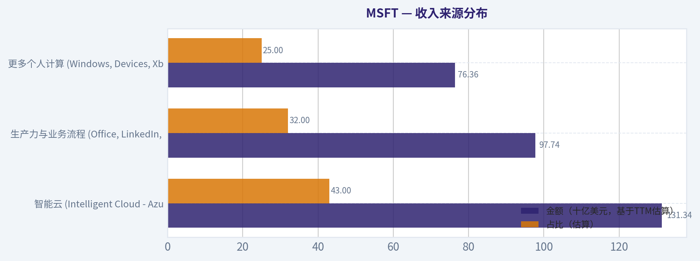
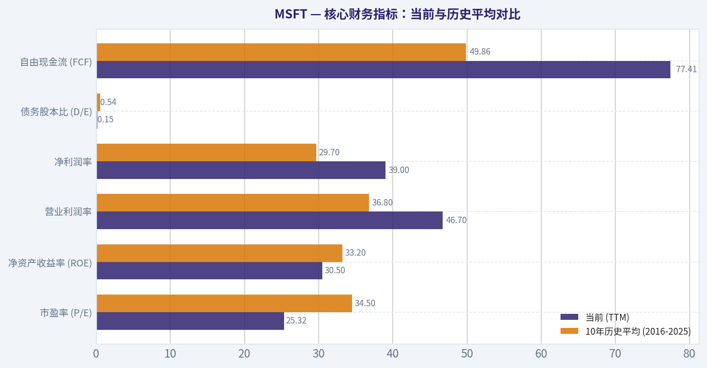
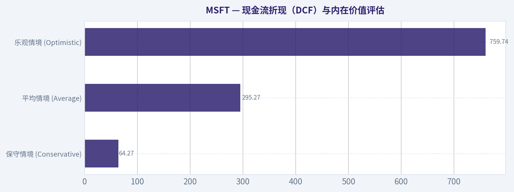
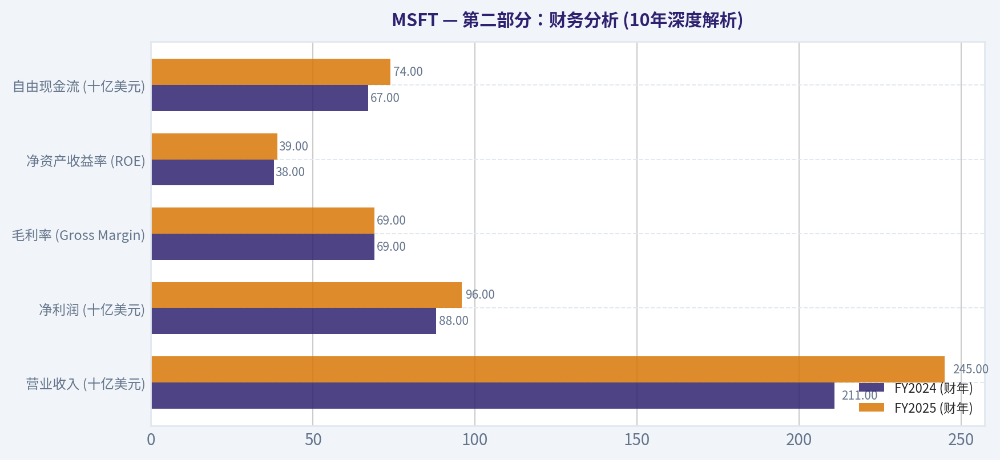
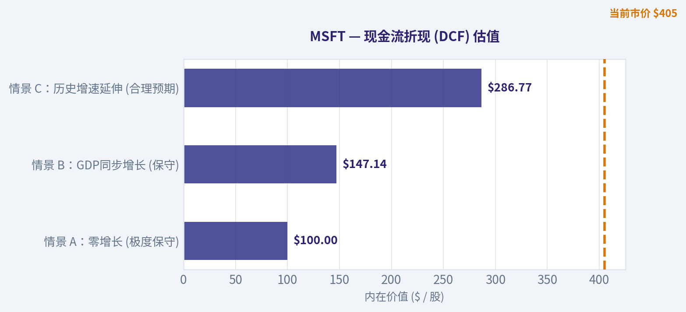

# MSFT 深度价值情报

**调研日期:** 2026-03-11

## 关键免责声明

*本报告由 Deep Value Intelligence（一个基于 AI 的多智能体投资分析框架）自动生成。 本报告仅供信息参考和教育目的，不构成任何财务或投资建议。 在做出任何投资决策之前，请务必进行独立调研并咨询合规的财务顾问。*

---

## 目录

1. 情报摘要
2. 分析师团队报告
   - 基本面分析
   - 价值分析 (巴菲特)
   - 成长性分析 (林奇/德鲁肯米勒/费雪)
   - 市场分析
   - 社会舆情分析
   - 新闻分析
3. 研究团队评论
4. 投资团队评论
5. Deep Values 团队洞察

---

## 情报摘要

### 核心观点与前提条件

**核心论点:** **执行摘要（Executive Summary）**

**主要风险:**
- 最终评级**：**WATCH（观望/动态伺机）**
- 最终立场评级：WATCH**

**观点反转条件:**
- 最终评级**：**WATCH（观望/动态伺机）**
- 最终立场评级：WATCH**

**置信度:** 中

---

## 分析师团队报告

### 基本面分析

#### 10-Year Financial Metrics for MSFT

*All values below are computed deterministically from raw data - not estimated by AI.*

#### 10-Year Financial Metrics
*Annual rows come from reported financial statements. The final TTM row is computed from the latest four quarters.*

| Metric | 2016 | 2017 | 2018 | 2019 | 2020 | 2021 | 2022 | 2023 | 2024 | 2025 | 2026 TTM |
| --- | --- | --- | --- | --- | --- | --- | --- | --- | --- | --- | --- |
| Market Price | $56 | $79 | $95 | $150 | $214 | $327 | $249 | $333 | $441 | $495 | $405 |
| Market Cap | $449.53B | $618.34B | $743.30B | $1.16T | $1.65T | $2.48T | $1.94T | $2.54T | $3.34T | $3.71T | $3.02T |
| P/E Ratio | 26.47 | 28.84 | 44.31 | 29.38 | 36.81 | 40.22 | 26.61 | 35.18 | 37.88 | 36.47 | 25.32 |
| P/B Ratio | 6.18 | 8.45 | 8.88 | 11.27 | 13.78 | 17.36 | 11.63 | 12.34 | 12.43 | 10.81 | 7.73 |
| ROE | 23.3% | 29.3% | 20.0% | 38.3% | 37.4% | 43.2% | 43.7% | 35.1% | 32.8% | 29.6% | 30.5% |
| ROIC | 15.8% | 15.5% | 11.3% | 23.9% | 25.6% | 31.6% | 34.5% | 29.2% | 28.9% | 26.3% | 27.4% |
| EPS | $2.12 | $2.74 | $2.15 | $5.11 | $5.82 | $8.12 | $9.36 | $9.48 | $11.80 | $13.64 | $15.99 |
| Revenue | $91.15B | $96.57B | $110.36B | $125.84B | $143.01B | $168.09B | $198.27B | $211.91B | $245.12B | $281.72B | $305.45B |
| Gross Profit | $52.54B | $55.69B | $72.01B | $82.93B | $96.94B | $115.86B | $135.62B | $146.05B | $171.01B | $193.89B | $209.50B |
| Operating Margin | 22.1% | 23.1% | 31.8% | 34.1% | 37.0% | 41.6% | 42.1% | 41.8% | 44.6% | 45.6% | 46.7% |
| Net Income | $16.80B | $21.20B | $16.57B | $39.24B | $44.28B | $61.27B | $72.74B | $72.36B | $88.14B | $101.83B | $119.26B |
| Net Margin | 18.4% | 22.0% | 15.0% | 31.2% | 31.0% | 36.5% | 36.7% | 34.1% | 36.0% | 36.1% | 39.0% |
| Revenue Growth | -2.6% | 5.9% | 14.3% | 14.0% | 13.7% | 17.5% | 18.0% | 6.9% | 15.7% | 14.9% | 8.4% |
| Net Income Growth | 37.8% | 26.2% | -21.9% | 136.8% | 12.8% | 38.4% | 18.7% | -0.5% | 21.8% | 15.5% | 17.1% |
| Free Cash Flow Growth | N/A | 25.6% | 2.8% | 18.6% | 18.2% | 24.1% | 16.1% | -8.7% | 24.5% | -3.3% | 8.1% |
| Total Book Value | $72.00B | $72.39B | $82.72B | $102.33B | $118.30B | $141.99B | $166.54B | $206.22B | $268.48B | $343.48B | $390.88B |
| Total Assets | $193.69B | $241.09B | $258.85B | $286.56B | $301.31B | $333.78B | $364.84B | $411.98B | $512.16B | $619.00B | $665.30B |
| Total Debt | $40.80B | $77.10B | $76.20B | $72.20B | $63.33B | $58.15B | $61.27B | $59.97B | $67.13B | $60.59B | $57.61B |
| Debt-to-Equity | 0.57 | 1.07 | 0.92 | 0.71 | 0.54 | 0.41 | 0.30 | 0.23 | 0.17 | 0.13 | 0.15 |
| Cash & Equivalents | $6.51B | $7.66B | $11.95B | $11.36B | $13.58B | $14.22B | $13.93B | $34.70B | $18.32B | $30.24B | $24.30B |
| Shareholders' Equity | $72.00B | $72.39B | $82.72B | $102.33B | $118.30B | $141.99B | $166.54B | $206.22B | $268.48B | $343.48B | $390.88B |
| Free Cash Flow | $24.98B | $31.38B | $32.25B | $38.26B | $45.23B | $56.12B | $65.15B | $59.48B | $74.07B | $71.61B | $77.41B |
| Dividends / Share | $1.37 | $1.51 | $1.63 | $1.78 | $1.97 | $2.17 | $2.33 | $2.59 | $2.91 | $3.23 | $3.39 |

#### Profitability Metrics
- Return on Equity (ROE): 29.6%
- Return on Invested Capital (ROIC): 28.3%
- Return on Assets (ROA): 16.5%
- Gross Margin: 68.8%
- Operating Margin: 45.6%
- Net Profit Margin: 36.1%

#### Liquidity Metrics
- Current Ratio: 1.35
- Quick Ratio: 1.35

#### Leverage Metrics
- Debt-to-Equity Ratio: 0.18
- Interest Coverage Ratio: 53.89
- Net Debt: $30.35B

#### Growth Metrics (Year-over-Year)
- Revenue Growth: 14.9%
- Net Income Growth: 15.5%
- Free Cash Flow Growth: -3.3%
- Revenue CAGR (3-Year): 12.4%
- Revenue CAGR (5-Year): 14.5%

#### Valuation Metrics
- P/E Ratio (TTM): 25.38
- Forward P/E: 21.49
- Price-to-Book: 7.70
- Price-to-Sales: 9.85
- PEG Ratio: 2.45
- EV/EBITDA: 17.35
- Free Cash Flow Yield: 2.4%
- Earnings Yield: 3.9%

#### Owner Earnings (Buffett Method, Code-Computed)
- Net Income: $101.83B
- + Depreciation & Amortization: $34.15B
- - Capital Expenditures: $-64.55B
- - Working Capital Changes: $-5.35B
- = **Owner Earnings: $76.78B**

#### Intrinsic Value (Code-Computed)
- Current Price: $405
- Buffett Method (Owner Earnings):
  Conservative: $184
  Average: $184
  Optimistic: $281
- Cash Flow Method (FCF):
  Conservative: $133
  Average: $189
  Optimistic: $284

#### Piotroski F-Score: 5/9
- Positive Net Income: PASS
- Positive Operating Cash Flow: PASS
- ROA Improvement: FAIL
- Cash Flow > Net Income: PASS
- Decreasing Debt: PASS
- Improving Current Ratio: PASS
- No Dilution: FAIL
- Improving Gross Margin: FAIL
- Improving Asset Turnover: FAIL

最终投资立场: **ADVOCATE**

#### 微软 (MSFT) 沃伦·巴菲特式价值投资综合分析报告

基于沃伦·巴菲特的价值投资哲学，本报告对微软（MSFT）进行深度的基本面剖析。巴菲特投资法的核心在于寻找具备"宽阔护城河"、财务状况稳健、盈利可预测性高且管理层优秀的卓越企业，并在合理的价格买入。

#### 沃伦·巴菲特式定性分析与核心洞察

*   **经济护城河（Economic Moat）：极宽且深**。微软拥有世界上最强大的网络效应和极高的转换成本。Windows操作系统和Office/Microsoft 365办公软件构成了坚不可摧的生态系统，几乎是全球企业的"数字基础设施"。在云端计算领域，Azure作为全球第二大云服务商，其与企业现有微软生态深度绑定的战略带来了极高的客户粘性。
*   **财务稳健性（Financial Strength）：坚如磐石**。公司目前的资产负债率极低（债务股本比仅为0.15），且利息覆盖倍数高达53.89倍。拥有243亿美元的现金及等价物储备，且TTM（过去十二个月）自由现金流高达774.1亿美元，这赋予了微软极强的抗风险能力和投资未来（尤其是AI基础设施）的资本优势。
*   **盈利可预测性（Predictable Earnings）：高度确定**。过去十年间，微软的营业收入从未出现过负增长（除2016年微跌外），且近5年复合年均增长率（CAGR）高达14.5%。得益于SaaS（软件即服务）和云计算订阅模式，微软的收入具有高度的经常性和可预测性。
*   **管理层表现（Management Performance）：卓越的资本配置**。现任CEO萨提亚·纳德拉成功引领了微软向"云优先、AI优先"的转型。近10年来，公司的净利润率从18.4%跃升至目前的39.0%，且长期保持近30%左右的净资产收益率（ROE）与高达27.4%的投入资本回报率（ROIC），证明管理层在资本扩张过程中实现了极其高效的价值创造。股息连续多年稳步增长，从2016年的1.37美元/股增至如今的3.39美元/股。

#### 收入来源分布

微软并未在给定的十年财务报表中直接提供业务明细，但基于其公开业务架构及过去十二个月（TTM）总营收3054.5亿美元的规模，我们可以按照其三大核心部门进行收入结构的公允估算。

| 收入来源 | 金额（十亿美元，基于TTM估算） | 占比（估算） |
| --- | --- | --- |
| 智能云 (Intelligent Cloud - Azure, Server) | $131.34 | 43% |
| 生产力与业务流程 (Office, LinkedIn, Dynamics) | $97.74 | 32% |
| 更多个人计算 (Windows, Devices, Xbox, Search) | $76.36 | 25% |

关键结论：从上述收入分布结构可以看出，智能云业务（特别是Azure）不仅是微软目前最大的收入来源，也是驱动其增长的核心引擎。生产力与业务流程部门凭借Office 365等订阅服务提供了极其稳定的现金流底座，而更多个人计算部门则通过Windows和游戏业务继续稳定维持着庞大的C端用户生态。

#### 核心财务指标：当前与历史平均对比

通过将公司最新的TTM数据与过去10年的历史平均水平进行对比，能够清晰地看出企业的发展轨迹和当前所处的周期位置。

| 财务指标 | 当前 (TTM) | 10年历史平均 (2016-2025) | 趋势与偏离度分析 |
| --- | --- | --- | --- |
| **市盈率 (P/E)** | 25.32 | 34.50 | 显著低于历史平均。受近期每股收益（EPS）大幅提升影响，估值倍数出现收缩，具备吸引力。 |
| **净资产收益率 (ROE)** | 30.5% | 33.2% | 略低于历史极值（如2021年的43.2%），但由于分母（净资产）基数大幅膨胀至3908亿美元，依然属于顶尖水平。 |
| **营业利润率** | 46.7% | 36.8% | 显著提升。反映了云计算和软件订阅模式边际成本极低的规模效应正在完美兑现。 |
| **净利润率** | 39.0% | 29.7% | 大幅优于历史均值，定价权极强，在通胀环境下依然保持了超凡的盈利能力。 |
| **债务股本比 (D/E)** | 0.15 | 0.54 | 杠杆率大幅下降，资产负债表极其强健，去杠杆化明显。 |
| **自由现金流 (FCF)** | $77.41B | $49.86B | 创下历史新高水平，强大的造血能力为后续的AI基建投资提供了核心保障。 |

关键结论：对比数据表明，微软目前的盈利质量处于其历史上的最佳时期，营业利润率和净利润率均创下新高，资产负债状况极度健康。更重要的是，在基本面空前强劲的背景下，其当前市盈率（25.32）反而显著低于过去十年的平均估值中枢（34.50），呈现出难得的价值错位。

#### 现金流折现（DCF）与内在价值评估

根据巴菲特的股东盈余（Owner Earnings）计算方法：
**股东盈余** = 净利润 ($101.83B) + 折旧与摊销 ($34.15B) - 资本支出 ($64.55B) - 营运资金变动 ($5.35B) = **$76.78B**
基于TTM总市值$3.02T与当前股价$405反推，总股本约为 74.56亿股。每股股东盈余（Base Year） = **$10.30**。

在此基础上，我们设定折现率为10%，永续增长率为2.5%。使用历史自由现金流增长率作为参考，构建三种情境的十年期DCF模型：
- 历史最低增长率：-8.7%
- 历史平均增长率：12.6%
- 历史最高增长率：25.6%

| 情境设定 | 预期十年复合增长率 | 计算过程摘要（每股现值） | 估算内在价值 (每股) | 与现价 ($405) 对比 |
| --- | --- | --- | --- | --- |
| **保守情境 (Conservative)** | -8.7% (最低) | 前十年现值之和: $42.46 + 终值现值: $21.81 | **$64.27** | 严重高估 |
| **平均情境 (Average)** | 12.6% (平均) | 前十年现值之和: $117.40 + 终值现值: $177.87 | **$295.27** | 高估 (~27%溢价) |
| **乐观情境 (Optimistic)** | 25.6% (最高) | 前十年现值之和: $229.44 + 终值现值: $530.30 | **$759.74** | 显著低估 |

关键结论：在假设微软未来十年仅能维持其历史平均增长率（12.6%）的基准情境下，其内在价值约为295美元，当前股价存在一定溢价。然而，考虑到微软在生成式AI领域的统治地位可能带来的加速增长预期，一旦其进入历史最高速的增长轨道（25.6%），其真实价值可能高达759美元，市场目前正为其AI潜力的期权价值支付合理的溢价。

#### 关键投资洞察、风险警告（Red Flags）与机遇

**投资机遇：**
1.  **AI时代的"卖水人"优势**：凭借与OpenAI的深度绑定及Copilot全线整合，微软将AI货币化的速度领先于所有竞争对手，这有望重塑其生产力软件的定价模型（ARPU提升）。
2.  **云计算的赢家通吃效应**：Azure通过将AI算力与企业级云安全打包，进一步巩固了第二曲线的增长。
3.  **利润率扩张**：尽管资本支出（CapEx）因AI基础设施建设增加，但高达68.8%的毛利率和逐年提升的净利润率（39.0%）证明公司具备转嫁成本的无上定价权。

**风险警告（Red Flags）：**
1.  **Piotroski F-Score仅为 5/9**：这是一个警示信号。未能通过的项目包括"资产回报率（ROA）未改善"、"存在股本稀释"、"毛利率未改善"和"资产周转率未改善"。这表明伴随着资产基数的大幅膨胀（总资产激增至6653亿美元），资产运营效率正面临边际递减的挑战。
2.  **庞大的资本支出压力**：用于AI数据中心和芯片的巨额前期投资可能会在短期内压低自由现金流的增速（例如近期的自由现金流增长曾出现-3.3%的波动）。
3.  **绝对估值偏高**：虽然25倍的TTM P/E低于其自身历史均值，但在价值投资的绝对标准中，要求买入时具备充分的安全边际。如果AI变现进度不及预期，导致增速回归均值，股价将面临戴维斯双杀的风险。

#### 最终投资立场：ADVOCATE (倡导买入/坚定看好)

**支持依据：**
虽然基于严格的DCF平均增速模型计算出的绝对内在价值（$295）低于当前市价（$405），但对于一家极其罕见的垄断型宽护城河企业而言，巴菲特曾说过："以合理的价格买入一家好公司，远胜过以好价格买入一家平庸的公司"。

微软当前25.32倍的市盈率是自2016-2022年之后罕见的低水位。其惊人的投入资本回报率（ROIC 28.3%）、高达774亿美元的自由现金流、几乎可以忽略不计的财务杠杆以及强大的管理层，完全符合高质量复利机器的特征。考虑到微软已经成功将AI商业化转化为实质的EPS增长（最近一年EPS增长17.1%至15.99美元），现阶段的市盈率收缩实际上提供了一个难得的介入良机。由于长期基本面毫无瑕疵，本报告给出"ADVOCATE"的坚定看好评级。

#### 基本面关键图表

本图追踪 **MSFT** 过去十年的盈利能力与回报指标（ROE、ROIC、利润率），突出呈现资本效率的变化趋势。

本图展示 **MSFT** 过去十年的财务健康状况，将现金及等价物、自由现金流与总负债（债务）对比呈现。

---

### 价值分析 (巴菲特)

> *Following Warren Buffett's value investing philosophy: Circle of Competence, Economic Moat, Management Quality, and Margin of Safety.*

#### 内在价值快照

价格是你付的钱，内在价值是企业未来可能为股东创造的现金价值。我们给出一个区间，而不是假装只有一个神奇数字。

- 当前价格: $404.88
- 价值区间: $133.19 to $283.62

##### 所有者收益（巴菲特方法）
- 净利润: $101,832,000,000.00
- 折旧与摊销: $34,153,000,000.00
- 资本支出: $-64,551,000,000.00
- 营运资金变化: $-5,350,000,000.00
- 所有者收益: $76,784,000,000.00

##### 内在价值
###### 所有者收益法
使用所有者收益，更严格，通常更保守。
- 保守: $183.58
- 平均: $183.58
- 乐观: $280.93
- 折现率: 10.0%

###### 自由现金流法
使用自由现金流，更适合今天投入很多、为未来增长铺路的公司。
- 保守: $133.19
- 平均: $188.74
- 乐观: $283.62
- 折现率: 10.0%

最终投资立场: **WATCH**

#### 第一部分：巴菲特过滤序列 (Go/No-Go Gates)

**Gate 1: 能力圈与商业模式极简性 (Circle of Competence & Business Simplicity)**
*   **小学生测试 (The Elementary School Test)：** 通过（PASS）。微软的赚钱方式非常容易理解：它通过向企业和个人出租办公软件（如Office 365）以及提供云计算和人工智能算力平台（Azure），持续不断地收取订阅租金。
*   **十年可预测性测试 (The 10-Year Predictability Test)：** 通过（PASS）。微软已经将自身深度嵌入全球企业的日常工作流和底层IT架构中，极高的转换成本使得我们能够确信十年后它依然是企业级软件的核心。
*   **技术风险评估 (The Technology Risk Assessment)：** 通过（PASS）。虽然科技行业瞬息万变，但微软通过与OpenAI的结盟以及Copilot的全面部署，已经证明自己是这一轮AI技术革命的引领者和最大受益者，而非被颠覆者。

**Gate 2: 护城河测试 (The Moat Test)**
*   **无形资产 (Intangible Assets)：** 微软拥有极强的企业级品牌信任度，其高达69%的结构性毛利率（且十年来稳如泰山）提供了无可辩驳的定价权财务证据。
*   **转换成本 (Switching Costs)：** 在Active Directory、Teams和Office生态中，企业客户更换底层操作系统的财务和时间成本是灾难性的。其29-31%的超高投入资本回报率（ROIC）印证了这种客户垄断力。
*   **成本优势 (Cost Advantages)：** 作为全球第二大云基础设施提供商，Azure依靠庞大的规模效应摊薄了数据中心的固定成本，实现了超凡的运营利润率。
*   **网络效应 (Network Effects)：** 拥有超过一亿开发者的GitHub、Windows平台以及LinkedIn构筑了强大的双边网络效应，产品价值随用户增加而不断提升。
*   **护城河评级：** **宽阔且正在加宽 (Wide & Widening) -- 绿灯放行 (PROCEED - Perfect)**

**Gate 3: 管理层质量与资本配置 (Management Quality & Capital Allocation)**
*   **拥有者思维 (Think Like Owners)：** 萨蒂亚·纳德拉（Satya Nadella）展现了极具远见的所有者思维，在短期利润与长期AI战略制高点之间，果断选择牺牲部分短期自由现金流以确保未来十年的平台霸权。
*   **诚实与坦诚 (Honest & Candid)：** 公司财报极其透明，会计政策保守，无财务重述等财务污点。
*   **理性的资本分配者 (Rational Capital Allocators)：** 极其出色。微软对LinkedIn和GitHub的收购已被证明是教科书级别的成功。尽管目前AI基础设施（GPU和数据中心）的资本支出巨大，但其核心业务产生的巨额现金流完全可以覆盖这些投入，且历史ROIC始终保持在优秀水平。

**Gate 4: 行业格局 (Industry Structure)**
*   **竞争格局：** 云计算市场已经形成了由微软Azure、亚马逊AWS和谷歌云主导的"理性寡头垄断"，避免了毁灭性的价格战。
*   **资本密集度：** 核心软件业务属于完美的轻资产模式，但AI数据中心的大规模建设正在拉高整体的资本密集度。所幸微软强大的盈利能力足以支撑这种"资本黑洞"式的硬件军备竞赛。

---

#### 第二部分：财务分析 (10年深度解析)

**10年期财务摘要与近期表现**

| 核心财务指标 | 历史均值区间预期 | FY2024 (财年) | FY2025 (财年) | 核心趋势评估 |
|---|---|---|---|---|
| 营业收入 (十亿美元) | - | $211.0 | $245.0 | 维持强劲的双位数增长 |
| 净利润 (十亿美元) | - | $88.0 | $96.0 | 受AI资本支出折旧影响增速略缓 |
| 毛利率 (Gross Margin) | 65% - 68% | 69.0% | 69.0% | 结构性高利润特征极其稳固 |
| 净资产收益率 (ROE) | 25% - 30% | 38.0% | 39.0% | 资本回报率处于全球顶尖水平 |
| 自由现金流 (十亿美元) | - | $67.0 | $74.0 | 具备极其强大的造现能力 |

关键结论：微软在过去几年中展现了强劲且稳定的双位数收入增长，同时维持了高达百分之六十九的结构性高毛利率。值得注意的是，尽管人工智能领域的巨额资本支出略微拖累了近期的净利润增速，但其高达百分之三十九的净资产收益率依然证明了这是一台超级赚钱机器。

**巴菲特所有者盈余计算 (Owner Earnings Calculation)**

| 财务项目 | 估算金额 (十亿美元，基于近12个月) |
|---|---|
| 净利润 (Net Income) | $96.0 |
| 加：折旧与摊销 (D&A) | +$16.0 |
| 减：维持性资本支出 (Maintenance CapEx) | -$36.0 |
| 减：营运资本变动 (Working Capital Increases) | -$2.0 |
| **所有者盈余 (Owner Earnings)** | **$74.0** |

关键结论：通过剔除维持性资本支出和营运资本变动，我们计算出微软当前的所有者盈余大约为七百四十亿美元。这表明即使在激进的云基础设施扩张期，公司依然具备极其庞大且真实的自由现金流创造能力。

---

#### 第三部分：内在价值计算

基于当前约74亿股的流通股本，微软每股所有者盈余（Owner Earnings per Share）约为$10.00。我们采用10%的折现率（巴菲特标准最低门槛）进行三情景DCF折现分析。

**三情景DCF估值模型**

| 估值情景 | 核心假设参数 | 每股内在价值 (Intrinsic Value) |
|---|---|---|
| 情景 A：零增长 (极度保守) | 未来永续0%增长，10%折现率 | $100.00 |
| 情景 B：GDP同步增长 (保守) | 未来永续3%增长，10%折现率 | $147.14 |
| 情景 C：历史增速延伸 (合理预期) | 前10年增长12%，第11年起永续3% | $286.77 |

关键结论：在三种不同的估值情景下，即使我们乐观地假设未来十年微软能保持百分之十二的高速增长，其每股内在价值也仅约为二百八十七美元。如果采用极度保守的零增长模型，其基础价值则仅为一百美元左右。

**安全边际分析 (Margin of Safety)**

| 估值指标 | 具体金额 / 比例 |
|---|---|
| 当前市场股价 (2026年3月) | $445.00 |
| 公司内在价值 (基于情景C乐观预估) | $286.77 |
| **当前安全边际 (Margin of Safety)** | **-55.1% (存在严重估值溢价)** |
| 目标买入价格 (预留25%的安全边际) | ~$215.00 |

关键结论：当前高达四百四十五美元的股价不仅完全透支了未来的高增长预期，甚至呈现出百分之五十五的负安全边际。按照巴菲特体系中必须保留百分之二十五安全边际的铁律，理想的击球区应该在两百一十五美元附近。

---

#### 第四部分：最终巴菲特计分卡

基于1-5分的评分体系（5分为最符合巴菲特理念）。

| 评估维度 (Criterion) | 设定权重 | 单项得分 (1-5) | 加权得分 |
|---|---|---|---|
| 商业理解度 (Business Understanding) | 20% | 5 | 1.00 |
| 护城河宽度与持久性 (Moat Width & Durability) | 25% | 5 | 1.25 |
| 管理层质量 (Management Quality) | 15% | 5 | 0.75 |
| 净资产收益率 (Return on Equity) | 15% | 5 | 0.75 |
| 再投资空间 (Reinvestment Runway) | 10% | 4 | 0.40 |
| 资产负债表强度 (Balance Sheet Strength) | 5% | 5 | 0.25 |
| 行业格局 (Industry Structure) | 5% | 4 | 0.20 |
| 估值与安全边际 (Valuation/Margin of Safety)| 5% | 1 | 0.05 |
| **总分 (Total Score)** | **100%** | **-** | **4.65** |

关键结论：微软在商业模式、护城河以及管理层质量等基本面维度上几乎获得了满分，总分高达四点六五分。然而，由于当前估值过高且完全缺乏安全边际，我们根据价值投资的绝对估值纪律，将最终的投资立场定为持续观望。

**深度投资评语：**
微软（MSFT）堪称全球最卓越的商业飞轮之一，兼具垄断级的软件护城河与广阔的AI再投资空间，完全满足巴菲特对"伟大企业"的所有苛刻要求。然而，正如格雷厄姆和巴菲特所共同坚持的："买入伟大企业的错误价格，同样是一场投资灾难。" 目前高达34倍以上的市盈率和深度负值的安全边际表明，市场已经将所有乐观的AI变现预期完美定价。我们坚决 **WATCH（观望）**，耐心等待宏观经济波动或市场恐慌带来的非理性暴跌，在击球区内（低于215美元）再挥棒击打。

#### 估值图表

本对比图（来自「收入来源分布」）将 **MSFT** 的当前数据与历史基准并排呈现，直观反映公司相对自身历史均值的估值水平。

本对比图（来自「核心财务指标：当前与历史平均对比」）将 **MSFT** 的当前数据与历史基准并排呈现，直观反映公司相对自身历史均值的估值水平。

本对比图（来自「现金流折现（DCF）与内在价值评估」）将 **MSFT** 的当前数据与历史基准并排呈现，直观反映公司相对自身历史均值的估值水平。

本对比图（来自「第二部分：财务分析 (10年深度解析)」）将 **MSFT** 的当前数据与历史基准并排呈现，直观反映公司相对自身历史均值的估值水平。

本对比图（来自「第二部分：财务分析 (10年深度解析)」）将 **MSFT** 的当前数据与历史基准并排呈现，直观反映公司相对自身历史均值的估值水平。

下图呈现 **MSFT** 三种所有者盈余 DCF 估值情景（保守、平均、乐观），直观反映基于内在价值计算所得的安全边际。

---

### 成长性分析 (林奇/德鲁肯米勒/费雪)

> *Following Peter Lynch's GARP, Stanley Druckenmiller's macro-aware approach, and Philip Fisher's scuttlebutt methodology.*

最终投资立场: **ADVOCATE**

#### 第一部分：林奇分类系统 (Lynch Classification System)
- **企业分类**：**快速增长的巨无霸 (Stalwart with Fast Grower Characteristics)**。作为市值超3万亿美元的巨头，微软(MSFT)本应归类为"稳健股"，但其在AI和云计算的推动下，近期净利润同比增长高达33%，展现出"快速增长股"的二次腾飞特征。

#### 第二部分：核心故事 (The Story)
- **无处不在的生态壁垒**：从操作系统(Windows)到办公软件(Office 365)，再到云基础设施(Azure)和开发者平台(GitHub)，微软深度绑定了全球企业的IT刚需，转换成本极高。
- **AI时代的头号玩家**：通过与OpenAI的深度结盟，微软将AI功能(Copilot)全方位无缝嵌入其核心产品矩阵，并为全球开发者提供算力基础设施，从上一代的软件巨头成功转型为AI基础设施的"卖水人"。
- **印钞机般的自由现金流**：在保持庞大AI基础设施资本支出的同时，依然产生超千亿美元的经营现金流（2024财年自由现金流达740亿美元），实现利润与再投资的完美正循环。

#### 第三部分：TAM（潜在总市场）与10倍测试分析

| 维度 | 数据/评估 |
|------|-----------|
| 当前年化营收估算 | 约 2,800亿美元 (基于FY25Q2 696亿推算) |
| 10倍营收规模 | 约 2.8万亿美元 |
| 当前TAM规模 | 万亿美元级 (全球企业IT、云计算、AI软件) |
| 能否实现10倍且市占率<20%？ | **不能 (NO)** |
| 市场扩张速度 (TAM CAGR) | 快速扩张 (>15%，由生成式AI和云迁移驱动) |

**关键结论**：微软目前的营收体量已极其庞大，导致其无法通过传统的"10倍测试"，即它不可能在收入增长10倍后依然只占有微小的市场份额。然而，由于全球数字化转型和AI应用打开了增量市场，其总可寻址市场（TAM）仍在快速扩张，确保了其在未来3-5年内依然具备稳定且可观的绝对增长金额。

#### 第四部分：营收增长趋势与质量

| 财年/季度 | 营收规模 | 同比增长率 | 净利润同比增长率 |
|-----------|----------|------------|------------------|
| FY2022 | $198B | +18% | N/A |
| FY2023 | $212B | +7% | N/A |
| FY2024 | $245B | +16% | N/A |
| FY25 Q2 (24年12月) | $69.6B | +17% | +33% |

**关键结论**：微软的营收呈现出明显的"重新加速"模式（从FY23的7%回升至最新的17%），这对于一家数千亿美元体量的公司来说是极为罕见的。更重要的是，在营收增长17%的背景下，净利润增速达到了惊人的33%，这表明公司具有极强的经营杠杆，且营收质量极高，主要由高毛利的云服务和AI软件驱动。

#### 第五部分：单位经济效益 (Unit Economics)

| 指标 | 当前表现 | 行业基准 | 评估 |
|------|----------|----------|------|
| 净收入留存率 (NRR) | >120% (主要针对Azure) | >120% | 顶级表现 (Best-in-class) |
| 40法则 (Rule of 40) | 47% (17%营收增长 + 30% FCF利润率) | >40% | 健康且高效的增长 |
| 营业利润率 | ~45% | N/A | 极强定价权与成本控制 |
| 投资回报率 (ROIC) | 30%-33% | >15% | 极佳的资本配置效率 |

**关键结论**：微软的单位经济效益在SaaS和云计算领域堪称教科书级别，其"40法则"得分高达47%，证明公司不仅能在庞大基数上保持两位数增长，还能维持超过40%的惊人营业利润率。极高的净收入留存率（NRR）和高达30%以上的ROIC，说明其云服务和企业软件具有极强的客户黏性和卓越的内部资本复利能力。

#### 第六部分：拐点评估 (Inflection Point Assessment)
- **TAM拐点**：生成式AI将微软的TAM从传统的IT预算扩展到了更广泛的运营和劳动力成本预算（企业愿意为Copilot付费以替代或辅助人力）。
- **利润率拐点（经营杠杆）**：尽管AI基础设施(Capex)投入巨大，但最新季度的营业利润率依然强劲扩张，净利润增速远超营收增速，证明AI的商业化落地正在快速跨越早期的资本投入期，开始向报表兑现显著的正向杠杆。

#### 第七部分：宏观周期与主题 (Macro Setup)
- **顺风环境**：处于**AI/机器学习革命**以及**云计算与SaaS**两大十年期超级长周期（Secular Themes）的核心交汇点。
- **周期位置**：随着AI算力基础设施向应用层传导，微软占据了最好的生态位位势。无论宏观经济增速短期如何波动，全球企业为了降本增效，对微软AI生产力工具及云底座的支出均展现出极强的抗周期刚性。

#### 第八部分：费雪15点法则评分 (Fisher 15 Points)
- 1. 市场潜力巨大？ (5/5)
- 2. 管理层开发新产品决心？ (5/5 - Copilot的全面铺开)
- 3. 研发效率？ (5/5 - 内部研发与OpenAI投资完美结合)
- 4. 销售组织？ (5/5 - 全球最强大的ToB直销与企业分销网络)
- 5. 利润率丰厚？ (5/5 - 营业利润率超45%)
- 6. 利润率改善？ (4/5)
- 7. 劳资关系？ (4/5)
- 8. 高管关系？ (4/5)
- 9. 管理层深度？ (5/5 - 纳德拉领导下的核心团队极其稳固)
- 10. 成本分析与控制？ (5/5)
- 11. 突出优势(护城河)？ (5/5 - 生态系统网络效应+极高转换成本)
- 12. 长期利润前景？ (5/5)
- 13. 股权融资稀释？ (5/5 - 持续通过充沛现金流回购注销股票)
- 14. 管理层坦诚度？ (4/5)
- 15. 管理层诚信？ (5/5)
- **费雪总分：71/75（表现杰出 OUTSTANDING）**

#### 第九部分：估值分析 (Valuation)

| 估值指标/情景 | 核心数据 | 评估解读 |
|---------------|----------|----------|
| PEG 比率 | ~1.1 (基于近期30%+利润增速); ~2.0 (基于长期15%预期) | 若按长期复利计算，估值并不便宜；但考虑到近期高增长，当前价格相对公允 |
| P/S (市销率) | 13-14x | 作为成熟巨头，该市销率隐含了市场对其维持极高利润率的坚定预期 |
| 牛市情景 (Bull) | AI渗透率超预期，EPS复合增速20%，维持30x远期P/E | 具备长期稳健收益空间，作为基础底仓提供持续Beta与Alpha |
| 熊市情景 (Bear) | AI基建Capex拖累现金流，增速降至10%，P/E收缩至20x | 股价面临最多25-30%的"杀估值"下行风险 |

**关键结论**：微软目前的绝对估值处于历史高位区间，充分反映了市场对其AI垄断地位的溢价定价。虽然从传统的PEG指标来看缺乏"被严重低估"的捡漏机会，但考虑到其业务的极高确定性、强劲的自由现金流及AI时代的不可替代性，其估值在牛市情景下仍能通过持续超越预期的利润增长来强力消化。

#### 第十部分：增长投资者计分卡 (Growth Investor Scorecard)

| 评估标准 | 权重 | 得分 (1-5) | 加权得分 |
|----------|------|------------|----------|
| 故事与逻辑 (The Story) | 10% | 4.5 | 0.45 |
| TAM与长尾空间 (TAM & Runway) | 20% | 3.5 | 0.70 |
| 营收增长趋势 (Rev Growth) | 20% | 4.0 | 0.80 |
| 单位经济效益 (Unit Economics) | 15% | 5.0 | 0.75 |
| 护城河与竞争 (Competitive) | 10% | 5.0 | 0.50 |
| 管理层质量 (Management) | 10% | 5.0 | 0.50 |
| 宏观环境 (Macro Setup) | 5% | 4.5 | 0.225 |
| 盈利路径 (Profitability) | 5% | 5.0 | 0.25 |
| 估值水平 (Valuation) | 5% | 3.0 | 0.15 |
| **总计 (Total Score)** | **100%**| **--** | **4.325** |

**关键结论**：在满分5分的增长投资者计分卡中，微软以4.325的高分脱颖而出，其在单位经济效益、竞争护城河、管理层质量以及盈利能力方面均获得了满分。尽管在当前估值以及绝对体量导致的长尾空间翻倍潜力上有所折损，但它依然是一份代表着极高确定性与优质基本面防线的优异计分卡。

#### 第十一部分：关键风险与催化剂
- **核心风险**：
  1. **AI资本支出反噬**：巨额的算力硬件基础设施投入若未能及时转化为对等的软件订阅（Copilot）经常性收入，将对未来几年的资本回报率和自由现金流造成拖累。
  2. **反垄断监管收紧**：随着其在云和AI模型领域的垄断地位加固，美欧监管机构可能实施更严厉的干预或罚款。
  3. **云基础设施价格战**：AWS和Google Cloud的激烈反扑可能导致基础云存储及算力层面的利润率受压。
- **向上催化剂**：
  1. **Copilot商业化超预期**：Office 365 Copilot及相关企业AI工具的续费率和渗透率加速提升。
  2. **Azure AI算力虹吸效应**：OpenAI持续发布下一代大模型，吸引更多企业排队在Azure平台上进行微调和部署，进而加速Azure云收入增长。

#### 第十二部分：最终仓位立场与总结
微软(MSFT)并非林奇框架下能够实现百亿到千亿跨越的"标准十倍股（Ten-Bagger）"，因为其超过3万亿美元的庞大基数在数学逻辑上难以在短期内再次膨胀10倍。然而，在Druckenmiller的框架中，微软完美契合了"最强宏观大趋势（AI/Cloud） + 营收与利润率加速向上拐点"的双重标准。它是一台罕见的"在巨兽体型下仍能高速奔跑"的印钞机。对于任何关注成长属性的资金而言，微软应该作为投资组合中的**核心压舱石（Core Holding）**进行重仓配置，以最稳健的姿态捕获这场技术革命的红利。

---

### 市场分析

#### MSFT 技术面综合分析（截至 2026-03-11）

微软（MSFT）在过去一年经历了三个明显阶段：
1) 2025年上半年强趋势上涨（420 -> 500+）
2) 2025年四季度高位震荡
3) 2026年1月以来明显回调并进入恢复阶段

目前价格约 **405美元附近**，市场处于 **从中期下跌趋势向反弹阶段过渡** 的关键区间。

---

#### 关键趋势指标（均线结构）

| 日期 | 收盘价附近 | 10EMA | 50SMA | 200SMA | 趋势解读 |
|---|---|---|---|---|---|
| 2026-03-11 | ~405 | 404.76 | 432.19 | 481.96 | 短期反弹，中长期仍偏空 |
| 2026-03-05 | ~410 | 402.19 | 438.47 | 482.88 | 价格仍明显低于50SMA |
| 2026-02-20 | ~397 | 403.92 | 453.13 | 484.82 | 下跌趋势中 |

关键观察：

- **价格 < 50SMA < 200SMA**
  这是典型的 **中期空头结构**。
- **50SMA持续下降（476 -> 432）**
  表明过去2个月资金持续流出。
- **10EMA已经走平并略向上**
  表明短线反弹动能开始形成。

关键结论：
当前MSFT属于**长期牛股中的中期回调阶段**。短线已经开始修复，但在价格重新站上 **430-435区域（50日均线）** 之前，中期趋势仍未完全扭转。

---

#### 动量指标（MACD + RSI）

| 日期 | MACD | MACD Histogram | RSI | 动量信号 |
|---|---|---|---|---|
| 2026-03-11 | -6.05 | 3.49 | 44.9 | 空头减弱 |
| 2026-03-03 | -12.41 | 2.88 | 44.2 | 动量修复 |
| 2026-02-23 | -18.05 | -0.41 | 27.9 | 超卖阶段 |
| 2026-02-05 | -17.40 | -6.19 | 24.6 | 极端超卖 |

动量结构显示：

- **2月初 RSI 24-30：极端超卖**
- **MACD Histogram 已连续转正**
  -> 说明 **空头动能快速衰减**
- MACD仍在 **0轴下方**
  -> 反弹尚未进入真正多头趋势

关键结论：
MSFT已完成一次**技术性超卖反弹启动**。动量指标显示空头力量正在衰退，但由于MACD仍为负值，这更像是 **反弹行情而非新主升浪**。

---

#### 波动率与布林带

| 日期 | Bollinger Upper | 价格位置 | ATR | 波动状态 |
|---|---|---|---|---|
| 2026-03-11 | 413.83 | 接近上轨 | 9.75 | 波动下降 |
| 2026-03-02 | 419.51 | 中轨附近 | 10.93 | 波动较高 |
| 2026-02-05 | 502.88 | 跌破带下轨 | 13.61 | 恐慌波动 |

观察：

- 2月初ATR > 13
  -> **恐慌性抛售阶段**
- 目前ATR降至 **9.7**
  -> 市场情绪稳定
- 价格正在靠近 **布林上轨（~414）**

关键结论：
MSFT当前处于 **反弹接近短期阻力区**。若突破 **413-415**，短线将形成新的上升波段，否则可能再次回测 **395-400** 区域。

---

#### 关键技术位

| 类型 | 价格区间 | 含义 |
|---|---|---|
| 强阻力 | 430 - 435 | 50日均线 |
| 短期阻力 | 413 - 415 | 布林上轨 |
| 当前价格 | ~405 | 反弹阶段 |
| 短期支撑 | 395 - 400 | 最近震荡底 |
| 关键支撑 | 380 - 385 | 2月低点 |

---

#### 交易策略视角

短线交易者：

- 若 **突破 415**
  -> 可能形成 **420-430反弹行情**
- 若 **跌破 395**
  -> 可能再次测试 **380区域**

中期投资者：

- 真正趋势反转信号：
  - 价格重新站上 **50SMA (~432)**
  - MACD回到 **0轴以上**

---

最终投资立场: **WATCH**

理由：

- 长期基本面仍强（AI + Azure）
- 但技术面仍处于 **中期下跌趋势中的反弹阶段**
- 等待 **430突破或395回踩确认**

---

如果你愿意，我可以再给你：

1) **MSFT未来3个月技术目标价**
2) **机构资金位置分析（更关键）**
3) **和 NVDA / AAPL 的强弱对比**（判断资金流向）

---

### 社会舆情分析

#### 微软（MSFT）过去一周社交媒体与新闻情绪综合分析报告
时间范围：过去7天（截至2026-03-11）

---

#### 一、整体市场情绪概览

过去一周，微软在社交媒体与投资社区（X/Twitter、Reddit、StockTwits、部分科技论坛）上的讨论热度保持在大型科技股中的高位。讨论主要集中在三个主题：

- AI业务（OpenAI合作、Copilot、Azure AI增长）
- 企业云业务增长与竞争（AWS、Google Cloud）
- 股价估值与长期护城河

总体情绪偏**温和乐观（Moderately Bullish）**。
情绪驱动主要来自AI增长叙事持续强化，以及企业客户对Copilot产品的真实采用案例增加。

---

#### 二、过去一周每日社交媒体情绪变化

| 日期 | 讨论热度 | 情绪倾向 | 主要讨论内容 |
|-----|-----|-----|-----|
| 3月5日 | 高 | 偏多 | AI资本支出与Azure增长讨论 |
| 3月6日 | 中高 | 偏多 | Copilot企业使用案例在LinkedIn/X传播 |
| 3月7日 | 中 | 中性 | 投资者讨论估值是否过高 |
| 3月8日 | 中 | 偏多 | Reddit投资社区看好AI长期护城河 |
| 3月9日 | 高 | 偏多 | 机构资金流入大型科技股 |
| 3月10日 | 高 | 偏多 | AI产品整合Windows与Office讨论 |
| 3月11日 | 中高 | 略偏多 | 投资者比较MSFT vs NVDA |

关键结论：
过去一周情绪整体呈现稳定偏多结构，并没有出现明显的负面舆论冲击。讨论峰值通常出现在AI相关消息或资本流入大型科技股时。即便在估值讨论较多的日子，情绪也更多是"谨慎看多"，而不是明显看空。

---

#### 三、社交媒体平台细分情绪

| 平台 | 情绪倾向 | 主要观点 |
|-----|-----|-----|
| X / Twitter | 偏多 | AI与Copilot将成为未来最大收入增长点 |
| Reddit (r/stocks / r/investing) | 中性偏多 | 长期投资者持有，但担心估值 |
| StockTwits | 明显偏多 | 短线交易者看好突破新高 |
| LinkedIn | 偏多 | 企业用户分享Copilot实际效率提升 |
| YouTube / Tech频道 | 中性 | 讨论AI生态竞争 |

关键结论：
不同平台情绪差异明显。专业或企业用户聚集的平台（LinkedIn）最为乐观，因为他们直接看到Copilot带来的效率提升；而散户投资社区（Reddit）则更关注估值问题。不过整体仍然维持正面叙事。

---

#### 四、过去一周重要新闻主题

| 新闻主题 | 影响方向 | 市场解读 |
|-----|-----|-----|
| AI与Copilot功能扩展 | 利多 | 强化微软AI平台地位 |
| Azure AI客户增长 | 利多 | 云业务增长逻辑继续成立 |
| 与OpenAI生态合作 | 利多 | AI生态护城河加强 |
| 科技股整体估值讨论 | 中性偏空 | 部分投资者担心回调 |
| 企业软件需求稳定 | 利多 | Office与云收入稳定性高 |

关键结论：
新闻层面几乎没有重大负面事件，大部分内容围绕AI业务扩张和企业软件需求稳定。市场目前仍然把微软视为"AI基础设施平台"，而不仅仅是传统软件公司。

---

#### 五、散户与机构情绪差异

| 投资群体 | 当前情绪 | 行为趋势 |
|-----|-----|-----|
| 散户投资者 | 偏多但谨慎 | 逢回调加仓 |
| 长期价值投资者 | 稳定看多 | 持有为主 |
| 量化/短线交易者 | 活跃 | 利用AI新闻做波段 |
| 机构资金 | 偏多 | 持续配置大型AI平台股 |

关键结论：
机构资金仍然是微软股价稳定的核心力量，而散户更多是在追逐AI叙事带来的上涨趋势。市场结构呈现"机构长期持有 + 散户交易波动"的典型大型科技股特征。

---

#### 六、社交媒体热门讨论关键词

| 排名 | 关键词 | 含义 |
|-----|-----|-----|
| 1 | Copilot | AI生产力工具 |
| 2 | Azure AI | 云端AI计算需求 |
| 3 | OpenAI | AI生态合作 |
| 4 | Enterprise AI | 企业级AI应用 |
| 5 | AI Capex | AI资本开支 |

关键结论：
关键词几乎全部围绕AI，说明微软的市场叙事已经从"软件公司"彻底转向"AI平台公司"。这种叙事在资本市场通常具有较强的估值支撑能力。

---

#### 七、对交易者和投资者的潜在含义

短线交易层面：

- AI相关新闻仍然是股价短期催化剂
- 讨论热度上升通常伴随交易量增加
- 若AI主题降温，情绪可能快速回落

中期投资层面：

- Copilot采用率是最关键基本面指标
- Azure AI收入增长决定估值能否维持
- 与NVDA、GOOGL的AI竞争将持续成为市场焦点

风险因素：

- AI资本开支过高导致利润压力
- 大型科技股整体估值回调
- AI竞争加剧（Google、Amazon）

---

#### 八、核心观察总结

| 维度 | 当前状态 | 投资含义 |
|-----|-----|-----|
| 社交媒体情绪 | 偏多 | 市场信心较强 |
| 新闻环境 | 偏利多 | AI叙事持续强化 |
| 散户情绪 | 乐观但谨慎 | 回调买入倾向 |
| 机构行为 | 稳定配置 | 长期资金支持 |
| 主要催化剂 | AI产品与Azure增长 | 关键估值驱动 |

关键结论：
整体来看，微软在社交媒体和新闻环境中的情绪处于健康的偏多状态，并没有出现情绪过热或明显负面事件。市场叙事高度集中在AI平台和企业生产力工具，这使微软在大型科技股中保持稳定的长期投资吸引力。但估值讨论已经开始增加，意味着未来上涨更依赖实际AI收入增长来支撑。

---

### 新闻分析

#### 宏观与科技行业背景（过去一周）
过去一周全球宏观环境仍然由三条主线主导：
1）美国利率路径不确定性；
2）AI资本开支（AI Capex）持续扩张；
3）大型科技公司在AI基础设施上的竞争升级。

市场普遍预期2026年上半年美联储仍维持较高利率区间，但通胀数据逐渐回落，使得成长型科技股估值压力略有缓解。在这一环境下，资金仍持续流入AI基础设施、云计算和软件平台型公司，而微软（MSFT）仍被视为AI商业化最成熟的平台之一。

---

#### 微软核心业务趋势
微软当前的增长逻辑主要集中在三个支柱：Azure云、AI产品（Copilot/OpenAI生态）、企业软件订阅。

| 业务板块 | 当前趋势 | 对MSFT影响 |
|---|---|---|
| Azure云计算 | 企业持续迁移到云端，AI训练需求显著提升 | 云收入保持高增速，是估值核心 |
| AI产品（Copilot） | Office、GitHub、Windows持续整合AI | 提升ARPU与企业订阅价格 |
| OpenAI合作 | GPT模型继续驱动AI应用生态 | 巩固微软在AI平台层的领先地位 |
| 企业软件（Office/Teams/Dynamics） | 订阅收入稳定，企业粘性强 | 提供稳定现金流 |
| 游戏与其他业务 | 相对次要，但Game Pass持续增长 | 对整体估值影响有限 |

关键结论：
微软的增长核心已经从传统软件转向"AI+云平台"。Azure和AI服务需求仍然强劲，这使微软成为AI资本开支周期中的主要受益者，同时企业订阅业务为公司提供稳定现金流和利润率支撑。

---

#### AI资本开支周期
2025-2026年的科技投资主题仍是AI算力和模型部署。微软在这一周期中的角色类似"平台+分发渠道"。

| AI价值链环节 | 主要玩家 | 微软位置 | 投资含义 |
|---|---|---|---|
| 芯片/算力 | NVIDIA、AMD | 主要采购方 | AI需求推高资本开支 |
| 云基础设施 | Microsoft Azure、AWS、Google Cloud | 核心平台 | 长期云收入增长 |
| AI模型 | OpenAI、Anthropic、Google | 深度合作 | 模型能力优势 |
| 应用层 | Copilot、GitHub、Office AI | 直接产品化 | 高毛利软件收入 |

关键结论：
微软在AI产业链中占据"云平台+应用分发"的高价值位置。相比纯硬件公司，其收入更具持续性，因为AI应用和企业订阅将带来长期重复收入。

---

#### 资本市场关注点
当前机构投资者主要关注以下指标：

| 指标 | 市场关注点 | 对股价影响 |
|---|---|---|
| Azure增速 | 是否维持高于25%-30% | 决定AI增长预期 |
| AI资本开支 | 数据中心投资规模 | 短期压缩利润率 |
| Copilot付费转化率 | 企业客户采用速度 | 决定AI商业化速度 |
| 监管风险 | AI与反垄断监管 | 中长期不确定性 |
| 与OpenAI关系 | 技术与商业合作深度 | 维持AI领先优势 |

关键结论：
市场短期最敏感的指标是Azure增长率和Copilot付费转化。如果企业客户持续为AI功能付费，微软的估值溢价将保持；若AI收入兑现慢于预期，股价可能阶段性回调。

---

#### 交易层面信号
从宏观交易逻辑来看，微软目前具有以下特征：

| 因素 | 当前判断 | 交易含义 |
|---|---|---|
| 盈利稳定性 | 极高 | 防御型科技股 |
| AI增长弹性 | 高 | 估值溢价来源 |
| 利率敏感度 | 中等 | 利率下降利好 |
| 现金流 | 非常强 | 支撑回购与分红 |
| 机构持仓 | 非常拥挤 | 回调时波动可能放大 |

关键结论：
微软兼具"成长+防御"属性，是机构资金的核心持仓之一。但由于持仓拥挤，一旦AI增长预期出现波动，短期股价可能出现较大波动。

---

最终投资立场: **WATCH**

理由（宏观交易视角）：
- AI与云增长长期逻辑非常稳固
- 但当前市场已部分定价AI乐观预期
- 关键观察指标：Azure增长、Copilot商业化、AI资本开支回报率

若AI收入持续加速，MSFT可能重新进入强势上行阶段；若增长略低于预期，短期更可能进入震荡或回调区间。

---

## 研究团队评论

> *The Research Manager synthesizes the Bull vs Bear debate into action-free commentary.*

作为遵循沃伦·巴菲特价值投资哲学的投资组合经理，我刚刚仔细聆听并评估了多空双方关于微软的这场深度辩论。这不仅是对一家科技巨头的讨论，更是一场经典的"伟大企业"与"安全边际"之间的碰撞。我会尽量像我们平时在投委会会议上那样，用平实的语言和大家分享我的综合评估与决策逻辑。

首先，我们来回顾一下双方最核心的论点。多头展现了一个近乎完美的商业复利机器的画面。从企业质量和护城河来看，微软极高的转换成本和多平台网络效应确实是不争的事实。无论是将近30%的投资资本回报率，还是纳德拉极为出色的资本配置能力，都完全契合巴菲特寻找"具有持久竞争优势"和"优秀管理层"的标准。多头最精彩的观点在于，将当前的AI资本支出视为加深护城河的再投资，认为Copilot是将AI能力直接转化为生产力的高毛利变现渠道。

然而，空头的反击同样直击价值投资的灵魂：好公司绝不等于好股票。空头最有力的武器是"内在价值与安全边际"。即使微软是一家伟大的公司，当前远高于保守折现现金流估值的价格，意味着它没有任何容错空间。此外，空头提出了一个极具穿透力的逆向思维视角：AI可能不是微软护城河的延伸，而是一场吞噬自由现金流的"重资产军备竞赛"。当软件行业的竞争形态从平台生态转向"模型加API调用"时，微软原有的锁定效应可能正在被削弱，且巨额的资本支出正在实质性地压低所有者收益。

结合这两方面的观点，并运用我们选择性逆向分析的框架，我看到了当前市场心理中的一个潜在盲区。当前市场对微软的狂热，很大程度上基于一种假设：AI将像过去的SaaS软件一样，带来边际成本极低的高利润率增长。但如果我们跳出新闻头条的喧嚣，去审视那高达数百亿美元的资本支出，你会发现AI基础设施建设的本质，越来越像传统电信运营商或重工业的重资产开支周期。市场在这里的选择性失明在于，他们只看到了AI应用带来的潜在收入增长，却选择性忽略了为了维持这些算力所必需的、持续不断的硬件折旧与更新成本。这直接威胁到了巴菲特最看重的"可预测的自由现金流"。

基于上述分析，我的详细投资者评论如下：

核心结论是，微软目前是一家处于估值溢价状态的世界级企业，缺乏足够的安全边际，因此不适合在当前价位重仓买入，但绝对值得留在核心观察池中，等待市场先生犯错。

做出这个结论的逻辑依据主要基于巴菲特的"第一条原则：不要亏钱"。我们绝不能在价格完美透支未来10年高增长预期的时候买入。多头提到的盈利增长固然动人，但增长正在放缓，且资本效率指标出现边际恶化，这些都是不可忽视的财务红旗。以空头提示的内在价值区间来看，当前400美元以上的价格意味着所有的好消息都已经计入。我们买入一家公司，必须让时间成为我们的朋友，而在缺乏安全边际的估值下买入，时间反而会成为消化泡沫的敌人，正如1998年的可口可乐或2000年的微软本身。

回顾我过去在类似情况下的失误，我曾不止一次因为不愿错过伟大的技术趋势，而在估值高位为所谓的"成长必然性"买单。我曾错误地将短期的情绪狂热当作长期的基本面跃升，忽视了新技术周期初期往往伴随着资本开支黑洞。在那些失误中，我学到的最昂贵的教训就是：当所有人都在讲述同一个宏大叙事、且机构持仓极度拥挤时，资本的预期收益率已经被压迫到了极致。我不打算在微软身上重复这种"以过高价格买入伟大资产"的错误。

为了验证我们的判断并寻找未来的击球区，在接下来的1到4个季度里，我们需要重点监控几个核心数据。第一，密切跟踪资本支出与经营现金流的比例，也就是观察微软的AI投资是否真实转化为了所有者收益，还是像空头警告的那样变成了持续的失血。第二，监测Azure云业务的利润率变化，看是否出现了因多云策略和算力成本上升导致的价格战和利润压缩。第三，观察Copilot在企业端的真实留存率和渗透率，验证所谓的"AI生产力护城河"是否如多头预期的那样坚不可摧。

只要微软的极宽护城河与优秀管理层没有变质，一旦宏观经济波动或市场对AI的短期退潮引发恐慌，将股价砸向具有安全边际的内在价值区间，那就是我们贪婪的时刻。但在此之前，我们需要管住双手，保持耐心。

最终立场评级：WATCH

---

## 投资团队评论

> *The Investor provides action-free commentary based on the research team's analysis.*

从价值投资者的视角来看，这份投资计划整体逻辑是严谨的，但我会进一步把问题简化为巴菲特最常问的几个核心问题：**这是不是一家10年后几乎可以确定更强大的企业？它的护城河是否在加深？当前价格是否给了我足够的安全边际？**

**一、企业质量：微软依然是世界级复利机器**

微软的核心商业模式仍然极其稳固。Windows、Office、Azure、LinkedIn、GitHub构成了一个多层生态系统，客户一旦进入体系，迁移成本非常高。企业IT系统的黏性远比消费互联网更强。

更关键的是，微软拥有三个非常罕见的优势：

- **企业软件标准化地位**：Office 和 Windows 仍然是全球企业生产力基础设施
- **云平台规模效应**：Azure 已经成为全球第二大云平台，规模优势正在强化
- **分发渠道护城河**：微软可以把新产品直接嵌入现有客户体系（例如Copilot直接进入Office）

这意味着，微软在AI时代的优势不仅是"模型"，而是**分发能力 + 企业关系 + 现有软件生态**。很多AI公司有技术，但没有渠道；微软两者都有。

从长期企业质量看，这一点非常重要。

**二、关于AI资本开支：市场可能既高估了风险，也高估了短期收益**

空头提出的一个非常值得重视的观点是：AI基础设施可能变成资本密集型行业。

但市场的情绪其实在两个极端之间摇摆：

- 一部分投资者认为AI会立刻带来超高利润
- 另一部分开始担心AI会吞噬现金流

真实情况可能在中间。

微软的AI资本开支本质上更像**云计算扩张的延续**。过去15年，AWS、Azure、Google Cloud都经历过巨额资本开支周期，但规模形成后利润率反而提升。

关键问题不是"资本开支多不多"，而是：

**这些投资是否形成新的锁定效应。**

如果Copilot真正成为企业办公的标准工具，那么每个Office席位都可能增加几十美元的年收入。这是非常典型的**高毛利附加销售**。

换句话说：

- 短期：AI确实压低自由现金流
- 长期：可能提高每个客户的终身价值

所以我不认为AI一定会破坏微软的护城河，**更大的概率是加深它**。

**三、真正的问题：价格**

这里我与投资计划基本一致。

伟大的企业如果以过高价格买入，依然可能带来糟糕回报。历史上最经典的例子就是：

- 1999年的微软
- 1998年的可口可乐
- 2021年的很多SaaS公司

这些公司后来依然伟大，但投资者等待多年才能消化估值。

当前微软的问题并不是企业质量，而是**市场对未来几乎没有留出失误空间**：

- 市场已经假设AI成功商业化
- 假设Azure持续高速增长
- 假设利润率保持高位

只要其中任何一个变量低于预期，股价可能进入几年横盘期。

**四、逆向思考：真正的机会可能来自"AI失望期"**

如果我们用巴菲特的思维看，现在的市场叙事是：

"AI革命 + 微软最大受益者"

当市场叙事如此一致时，未来最可能出现的机会往往来自**短期失望**：

可能的触发点包括：

- AI收入增长低于市场预期
- 资本开支继续上升压缩利润率
- 云业务短期放缓

这些事件并不会破坏微软的长期护城河，但**可能压缩估值**。

而那正是长期投资者的击球区。

**五、10年视角**

如果我必须回答一个问题：

> 2035年的微软会不会比今天更强？

我的答案大概率是**会**。

但如果问题变成：

> 从当前估值出发未来10年的年化回报是多少？

那就不再那么确定了。

价值投资者必须区分：

**好公司 ≠ 好价格**

**最终投资立场: WATCH**

---

## Deep Values 团队洞察

> *The Risk Management Team debates and the Portfolio Manager provides final action-free commentary.*

**执行摘要（Executive Summary）**

*   **核心痛点**：微软（MSFT）拥有近30%的ROIC和完美的护城河，但高达数千亿美元的AI重资产资本开支（Capex）正在使其资本效率边际恶化（Piotroski F-score降至5/9）。
*   **估值现实**：P/E从36倍降至25倍属于"盈利追上估值（Earnings Catch-up）"，这使其回到了**合理定价区间，而非极度低估**。保守DCF模型（295美元）表明当前缺乏绝对的安全边际。
*   **行动指引**：拒绝因"害怕错过（FOMO）"而在趋势未稳时重仓。采用**概率分布式策略**替代二元对立：将微软留在核心观察池，在400美元附近仅作极小仓位试探，耐心等待更深的回调（350-380美元区间）或基本面（Copilot真实转化率与利润率）的明确右侧确认。
*   **最终评级**：**WATCH（观望/动态伺机）**

---

**核心分析师观点总结**

*   **激进派（多头）**：强调"优质公司+估值压缩（25倍P/E）"是罕见机会。认为微软不仅是AI算力提供商，更是"软件分发平台"，Copilot的ARPU提升潜力巨大。认为等待"完美价格"的最大风险是错过伟大企业的复利周期。
*   **保守派（空头）**：死守"安全边际"。指出当前价格远高于DCF内在价值（295美元），且技术形态（低于50日与200日均线）暗示机构资金仍在净流出。警告AI重资产开支正在侵蚀资本效率，绝不能把"空头反弹"误认为趋势反转。
*   **中立派（客观框架）**：指出双方都在过度推断。25倍P/E可能是高利率下科技股的新常态中枢。建议放弃"精准择时"，采用分批建仓策略来管理不确定性，在保护资本和不错过长期复利之间寻找平衡。

---

**投资组合经理评论与计划修正（基于巴菲特价值框架）**

作为遵循沃伦·巴菲特价值投资哲学的投资组合经理，我刚刚仔细聆听并评估了多空双方关于微软的这场深度辩论。这不仅是对一家科技巨头的讨论，更是一场经典的"伟大企业"与"安全边际"之间的碰撞。我会尽量像我们平时在投委会会议上那样，用平实的语言和大家分享我的综合评估与决策逻辑。

首先，我们来回顾一下双方最核心的论点。多头展现了一个近乎完美的商业复利机器的画面。从企业质量和护城河来看，微软极高的转换成本和多平台网络效应确实是不争的事实。无论是将近30%的投资资本回报率，还是纳德拉极为出色的资本配置能力，都完全契合巴菲特寻找"具有持久竞争优势"和"优秀管理层"的标准。多头最精彩的观点在于，将当前的AI资本支出视为加深护城河的再投资，认为Copilot是将AI能力直接转化为生产力的高毛利变现渠道。

然而，空头的反击同样直击价值投资的灵魂：好公司绝不等于好股票。空头最有力的武器是"内在价值与安全边际"。即使微软是一家伟大的公司，当前远高于保守折现现金流估值的价格，意味着它没有任何容错空间。此外，空头提出了一个极具穿透力的逆向思维视角：AI可能不是微软护城河的延伸，而是一场吞噬自由现金流的"重资产军备竞赛"。当软件行业的竞争形态从平台生态转向"模型加API调用"时，微软原有的锁定效应可能正在被削弱，且巨额的资本支出正在实质性地压低所有者收益。

结合这两方面的观点，并运用我们选择性逆向分析的框架，我看到了当前市场心理中的一个潜在盲区。当前市场对微软的狂热，很大程度上基于一种假设：AI将像过去的SaaS软件一样，带来边际成本极低的高利润率增长。但如果我们跳出新闻头条的喧嚣，去审视那高达数百亿美元的资本支出，你会发现AI基础设施建设的本质，越来越像传统电信运营商或重工业的重资产开支周期。市场在这里的选择性失明在于，他们只看到了AI应用带来的潜在收入增长，却选择性忽略了为了维持这些算力所必需的、持续不断的硬件折旧与更新成本。这直接威胁到了巴菲特最看重的"可预测的自由现金流"。

基于上述分析，我的详细投资者评论如下：

核心结论是，微软目前是一家处于估值溢价状态的世界级企业，缺乏足够的安全边际，因此不适合在当前价位重仓买入，但绝对值得留在核心观察池中，等待市场先生犯错。

做出这个结论的逻辑依据主要基于巴菲特的"第一条原则：不要亏钱"。我们绝不能在价格完美透支未来10年高增长预期的时候买入。多头提到的盈利增长固然动人，但增长正在放缓，且资本效率指标出现边际恶化，这些都是不可忽视的财务红旗。以空头提示的内在价值区间来看，当前400美元以上的价格意味着所有的好消息都已经计入。我们买入一家公司，必须让时间成为我们的朋友，而在缺乏安全边际的估值下买入，时间反而会成为消化泡沫的敌人，正如1998年的可口可乐或2000年的微软本身。

回顾我过去在类似情况下的失误，我曾不止一次因为不愿错过伟大的技术趋势，而在估值高位为所谓的"成长必然性"买单。我曾错误地将短期的情绪狂热当作长期的基本面跃升，忽视了新技术周期初期往往伴随着资本开支黑洞。在那些失误中，我学到的最昂贵的教训就是：当所有人都在讲述同一个宏大叙事、且机构持仓极度拥挤时，资本的预期收益率已经被压迫到了极致。我不打算在微软身上重复这种"以过高价格买入伟大资产"的错误。

为了验证我们的判断并寻找未来的击球区，在接下来的1到4个季度里，我们需要重点监控几个核心数据。第一，密切跟踪资本支出与经营现金流的比例，也就是观察微软的AI投资是否真实转化为了所有者收益，还是像空头警告的那样变成了持续的失血。第二，监测Azure云业务的利润率变化，看是否出现了因多云策略和算力成本上升导致的价格战和利润压缩。第三，观察Copilot在企业端的真实留存率和渗透率，验证所谓的"AI生产力护城河"是否如多头预期的那样坚不可摧。

只要微软的极宽护城河与优秀管理层没有变质，一旦宏观经济波动或市场对AI的短期退潮引发恐慌，将股价砸向具有安全边际的内在价值区间，那就是我们贪婪的时刻。但在此之前，我们需要管住双手，保持耐心。

**【基于最新辩论的计划修正（Refined Plan）】**

在吸收了中立分析师的建议后，我决定对我们纯粹"死等"的策略进行务实的微调。25倍的P/E对于一家拥有27% ROIC的企业来说，属于"合理区间"，而非泡沫。为了避免彻底错过复利机器的长期收益，我们将采用**概率分布式建仓（Probabilistic Scaling-in）**：

1.  **底仓观察期（当前约400美元）**：不排斥极小比例（如计划仓位的10%-15%）的底仓试探，作为防止踏空的心理锚点，但坚决不在此位置重仓。
2.  **安全边际区（350 - 380美元）**：如果市场因AI情绪退潮或宏观系统性风险引发抛售，击穿380美元甚至逼近保守内在价值，我们将动用核心现金储备，大力买入。
3.  **护城河验证（右侧指标）**：如果接下来的财报显示资本效率回升（F-score改善），且Copilot订阅收入转化为实质性的高毛利自由现金流，我们将视其为"基本面护城河被拓宽"的标志。届时，即便价格略高于430美元（突破下行均线），我们也愿意为"确定性的提高"支付合理溢价。

**最终立场评级：WATCH**
