# MSFT Deep Value Intelligence

**Analysis Date:** 2026-03-11

## Critical Disclaimer

*This analysis is generated by Deep Value Intelligence, an AI-powered multi-agent investing framework. This report is for informational and educational purposes only and does not constitute financial advice. Always conduct your own research and consult with qualified financial advisors before making investment decisions.*

---

## Table of Contents

1. Intelligence Summary
2. Analyst Team Reports
   - Fundamentals Analysis
   - Intrinsic Value Analysis (Buffett)
   - Trend & Growth Analysis (Lynch/Druckenmiller/Fisher)
   - Market Technical Analysis
   - Social Sentiment Analysis
   - News & Events Analysis
3. Research Team Commentary
4. Value Investing Team Commentary
5. Deep Values Commentary

---

## Intelligence Summary

### Thesis + Conditions

**Core Thesis:** **EXECUTIVE SUMMARY**
Microsoft is a generational fortress boasting 27% ROIC and $160B in operating cash flow, but its current valuation lacks a fundamental margin of safety. The business is transitioning from a capital-light software compounder into a capital-heavy infrastructure utility, spending $100B+ annually on AI with negative free cash flow growth.

**Key Risks:**
- Microsoft is a generational fortress boasting 27% ROIC and $160B in operating cash flow, but its current valuation lacks a fundamental margin of safety. The business is transitioning from a capital-light software compounder into a capital-heavy infrastructure utility, spending $100B+ annually on AI with negative free cash flow growth. At ~$405, the stock trades at a severe premium to optimistic intrinsic value estimates ($290). We prioritize business quality, but overpaying during a high-capex paradigm shift violates capital preservation. We await a clearer margin of safety. **Final Verdict: WATCH.**
- The Risky Analyst (Bullish Momentum):** Argues Microsoft is "buying the rails of the AI economy" much like early AWS. Massive operating cash flows ($160B) and high margins (46%) comfortably fund this $100B+ infrastructure land-grab. The stock is coiling above capitulation support ($390) and poses a massive asymmetric upside if it clears the 50-day SMA ($432).
- Applying our selective contrarian analysis, we have to look past the overwhelming market euphoria (evidenced by 67% bullish sentiment among tech professionals) surrounding artificial intelligence. The crowd assumes that AI will simply be a high-margin software upsell, cleanly flowing through to the bottom line. What the crowd might be missing is the sheer physical cost of running and maintaining these massive models. If we ask what must be true to justify the current stock price, the market is assuming both sustained double-digit revenue growth and stable or expanding margins. But the reality of the cash flow statements tells a different story: we are seeing peak profit margins colliding with peak capital intensity. Being contrarian here does not mean betting against Microsoft's dominance, but rather recognizing that the current euphoric growth assumptions baked into the stock price leave no room for error.
- Rationale:** Warren Buffett teaches us that a wonderful business becomes a risky investment when you overpay for it. The psychological trap is assuming historical valuation multiples apply to a changing business. Those historical averages occurred during a unique period of zero interest rates, hyper-growth in enterprise cloud adoption, and much lower capital intensity. Today, overall revenue growth is naturally moderating due to the law of large numbers, and unprecedented $100B+ capital expenditures are dragging down free cash flow. The economic reality is that Microsoft currently requires far more capital to generate its next dollar of earnings than it did five years ago. Buying at these levels relies on momentum optimism rather than a mathematical margin of safety.
- Monitoring Plan:** Over the next one to four quarters, we will watch three specific areas to see if the thesis shifts:

**What Would Change Our View:**
- Microsoft is a generational fortress boasting 27% ROIC and $160B in operating cash flow, but its current valuation lacks a fundamental margin of safety. The business is transitioning from a capital-light software compounder into a capital-heavy infrastructure utility, spending $100B+ annually on AI with negative free cash flow growth. At ~$405, the stock trades at a severe premium to optimistic intrinsic value estimates ($290). We prioritize business quality, but overpaying during a high-capex paradigm shift violates capital preservation. We await a clearer margin of safety. **Final Verdict: WATCH.**
- The Risky Analyst (Bullish Momentum):** Argues Microsoft is "buying the rails of the AI economy" much like early AWS. Massive operating cash flows ($160B) and high margins (46%) comfortably fund this $100B+ infrastructure land-grab. The stock is coiling above capitulation support ($390) and poses a massive asymmetric upside if it clears the 50-day SMA ($432).
- Applying our selective contrarian analysis, we have to look past the overwhelming market euphoria (evidenced by 67% bullish sentiment among tech professionals) surrounding artificial intelligence. The crowd assumes that AI will simply be a high-margin software upsell, cleanly flowing through to the bottom line. What the crowd might be missing is the sheer physical cost of running and maintaining these massive models. If we ask what must be true to justify the current stock price, the market is assuming both sustained double-digit revenue growth and stable or expanding margins. But the reality of the cash flow statements tells a different story: we are seeing peak profit margins colliding with peak capital intensity. Being contrarian here does not mean betting against Microsoft's dominance, but rather recognizing that the current euphoric growth assumptions baked into the stock price leave no room for error.
- Rationale:** Warren Buffett teaches us that a wonderful business becomes a risky investment when you overpay for it. The psychological trap is assuming historical valuation multiples apply to a changing business. Those historical averages occurred during a unique period of zero interest rates, hyper-growth in enterprise cloud adoption, and much lower capital intensity. Today, overall revenue growth is naturally moderating due to the law of large numbers, and unprecedented $100B+ capital expenditures are dragging down free cash flow. The economic reality is that Microsoft currently requires far more capital to generate its next dollar of earnings than it did five years ago. Buying at these levels relies on momentum optimism rather than a mathematical margin of safety.
- Monitoring Plan:** Over the next one to four quarters, we will watch three specific areas to see if the thesis shifts:

**Confidence:** Low

---

## Analyst Team Reports

### Fundamentals Analysis

#### 10-Year Financial Metrics for MSFT

*All values below are computed deterministically from raw data - not estimated by AI.*

#### 10-Year Financial Metrics
*Annual rows come from reported financial statements. The final TTM row is computed from the latest four quarters.*

| Metric | 2016 | 2017 | 2018 | 2019 | 2020 | 2021 | 2022 | 2023 | 2024 | 2025 | 2026 TTM |
| --- | --- | --- | --- | --- | --- | --- | --- | --- | --- | --- | --- |
| Market Price | $56 | $79 | $95 | $150 | $214 | $327 | $249 | $333 | $441 | $495 | $405 |
| Market Cap | $449.53B | $618.34B | $743.30B | $1.16T | $1.65T | $2.48T | $1.94T | $2.54T | $3.34T | $3.71T | $3.02T |
| P/E Ratio | 26.47 | 28.84 | 44.31 | 29.38 | 36.81 | 40.22 | 26.61 | 35.18 | 37.88 | 36.47 | 25.32 |
| P/B Ratio | 6.18 | 8.45 | 8.88 | 11.27 | 13.78 | 17.36 | 11.63 | 12.34 | 12.43 | 10.81 | 7.73 |
| ROE | 23.3% | 29.3% | 20.0% | 38.3% | 37.4% | 43.2% | 43.7% | 35.1% | 32.8% | 29.6% | 30.5% |
| ROIC | 15.8% | 15.5% | 11.3% | 23.9% | 25.6% | 31.6% | 34.5% | 29.2% | 28.9% | 26.3% | 27.4% |
| EPS | $2.12 | $2.74 | $2.15 | $5.11 | $5.82 | $8.12 | $9.36 | $9.48 | $11.80 | $13.64 | $15.99 |
| Revenue | $91.15B | $96.57B | $110.36B | $125.84B | $143.01B | $168.09B | $198.27B | $211.91B | $245.12B | $281.72B | $305.45B |
| Gross Profit | $52.54B | $55.69B | $72.01B | $82.93B | $96.94B | $115.86B | $135.62B | $146.05B | $171.01B | $193.89B | $209.50B |
| Operating Margin | 22.1% | 23.1% | 31.8% | 34.1% | 37.0% | 41.6% | 42.1% | 41.8% | 44.6% | 45.6% | 46.7% |
| Net Income | $16.80B | $21.20B | $16.57B | $39.24B | $44.28B | $61.27B | $72.74B | $72.36B | $88.14B | $101.83B | $119.26B |
| Net Margin | 18.4% | 22.0% | 15.0% | 31.2% | 31.0% | 36.5% | 36.7% | 34.1% | 36.0% | 36.1% | 39.0% |
| Revenue Growth | -2.6% | 5.9% | 14.3% | 14.0% | 13.7% | 17.5% | 18.0% | 6.9% | 15.7% | 14.9% | 8.4% |
| Net Income Growth | 37.8% | 26.2% | -21.9% | 136.8% | 12.8% | 38.4% | 18.7% | -0.5% | 21.8% | 15.5% | 17.1% |
| Free Cash Flow Growth | N/A | 25.6% | 2.8% | 18.6% | 18.2% | 24.1% | 16.1% | -8.7% | 24.5% | -3.3% | 8.1% |
| Total Book Value | $72.00B | $72.39B | $82.72B | $102.33B | $118.30B | $141.99B | $166.54B | $206.22B | $268.48B | $343.48B | $390.88B |
| Total Assets | $193.69B | $241.09B | $258.85B | $286.56B | $301.31B | $333.78B | $364.84B | $411.98B | $512.16B | $619.00B | $665.30B |
| Total Debt | $40.80B | $77.10B | $76.20B | $72.20B | $63.33B | $58.15B | $61.27B | $59.97B | $67.13B | $60.59B | $57.61B |
| Debt-to-Equity | 0.57 | 1.07 | 0.92 | 0.71 | 0.54 | 0.41 | 0.30 | 0.23 | 0.17 | 0.13 | 0.15 |
| Cash & Equivalents | $6.51B | $7.66B | $11.95B | $11.36B | $13.58B | $14.22B | $13.93B | $34.70B | $18.32B | $30.24B | $24.30B |
| Shareholders' Equity | $72.00B | $72.39B | $82.72B | $102.33B | $118.30B | $141.99B | $166.54B | $206.22B | $268.48B | $343.48B | $390.88B |
| Operating Cash Flow | $33.33B | $39.51B | $43.88B | $52.19B | $60.67B | $76.74B | $89.03B | $87.58B | $118.55B | $136.16B | $160.51B |
| Investing Cash Flow | $-23.95B | $-46.78B | $-6.06B | $-15.77B | $-12.22B | $-27.58B | $-30.31B | $-22.68B | $-96.97B | $-72.60B | $-100.55B |
| Free Cash Flow | $24.98B | $31.38B | $32.25B | $38.26B | $45.23B | $56.12B | $65.15B | $59.48B | $74.07B | $71.61B | $77.41B |
| Dividends / Share | $1.37 | $1.51 | $1.63 | $1.78 | $1.97 | $2.17 | $2.33 | $2.59 | $2.91 | $3.23 | $3.39 |

#### Profitability Metrics
- Return on Equity (ROE): 29.6%
- Return on Invested Capital (ROIC): 28.3%
- Return on Assets (ROA): 16.5%
- Gross Margin: 68.8%
- Operating Margin: 45.6%
- Net Profit Margin: 36.1%

#### Liquidity Metrics
- Current Ratio: 1.35
- Quick Ratio: 1.35

#### Leverage Metrics
- Debt-to-Equity Ratio: 0.18
- Interest Coverage Ratio: 53.89
- Net Debt: $30.35B

#### Growth Metrics (Year-over-Year)
- Revenue Growth: 14.9%
- Net Income Growth: 15.5%
- Free Cash Flow Growth: -3.3%
- Revenue CAGR (3-Year): 12.4%
- Revenue CAGR (5-Year): 14.5%

#### Valuation Metrics
- P/E Ratio (TTM): 25.38
- Forward P/E: 21.49
- Price-to-Book: 7.70
- Price-to-Sales: 9.85
- PEG Ratio: 2.45
- EV/EBITDA: 17.35
- Free Cash Flow Yield: 2.4%
- Earnings Yield: 3.9%

#### Owner Earnings (Buffett Method, Code-Computed)
- Net Income: $101.83B
- + Depreciation & Amortization: $34.15B
- - Capital Expenditures: $-64.55B
- - Working Capital Changes: $-5.35B
- = **Owner Earnings: $76.78B**

#### Intrinsic Value (Code-Computed)
- Current Price: $405
- Buffett Method (Owner Earnings):
  Conservative: $184
  Average: $184
  Optimistic: $281
- Cash Flow Method (FCF):
  Conservative: $133
  Average: $189
  Optimistic: $284

#### Piotroski F-Score: 5/9
- Positive Net Income: PASS
- Positive Operating Cash Flow: PASS
- ROA Improvement: FAIL
- Cash Flow > Net Income: PASS
- Decreasing Debt: PASS
- Improving Current Ratio: PASS
- No Dilution: FAIL
- Improving Gross Margin: FAIL
- Improving Asset Turnover: FAIL

FINAL INVESTMENT STANCE: **ADVOCATE**

#### Warren Buffett-Style Qualitative Analysis

**Economic Moat (Competitive Advantage)**
Microsoft possesses one of the widest and most durable economic moats in global business, anchored by high switching costs and profound network effects. The seamless integration of its productivity suite (Microsoft 365) creates intense lock-in for enterprise customers. Furthermore, Azure has established itself as an indispensable utility in the modern digital economy. This structural dominance is overwhelmingly evident in the historical data: operating margins have more than doubled from 22.1% in 2016 to an astonishing 46.7% in the TTM period. Such margin expansion at this scale is a textbook indicator of immense pricing power and monopolistic business durability.

**Financial Strength**
Microsoft's balance sheet is an absolute fortress. Total debt sits at $57.61B against an equity base of $390.88B, yielding a remarkably low Debt-to-Equity ratio of 0.15 (TTM), down aggressively from its peak of 1.07 in 2017. Furthermore, its interest coverage ratio is 53.89x, meaning the company could pay its annual interest obligations over 50 times with its operating income. This financial flexibility allows Microsoft to aggressively fund the massive capital expenditures required for the AI revolution (evident in the -$100.55B TTM Investing Cash Flow) without jeopardizing shareholder returns.

**Predictable Earnings**
Buffett heavily favors companies with highly predictable, consistently expanding earnings. Over the 10-year dataset, Microsoft's EPS has skyrocketed from $2.12 to $15.99 (TTM). Revenue has compounded reliably, driven by a deliberate pivot toward recurring subscription revenues and consumption-based cloud billing. The company consistently translates top-line growth into bottom-line owner earnings, maintaining a world-class Net Margin of 39.0% (TTM).

**Management Performance**
Under Satya Nadella, capital allocation has been exceptionally efficient. The company has maintained a Return on Invested Capital (ROIC) of 27.4% (TTM) and an average ROE of 33.3% over the decade. Management has expertly balanced aggressive future-proofing-such as massive data center infrastructure buildouts-with consistent shareholder rewards, raising the dividend per share every single year from $1.37 in 2016 to $3.39 TTM.

**Quality of Business and Risks**
While the core economics are pristine, the dataset reveals a modest Piotroski F-Score of 5/9. The failing marks (such as declining asset turnover and ROA improvement) are primarily artifacts of Microsoft's massive surge in capital expenditures and asset base expansion necessary to support generative AI demand. This intense CapEx cycle has caused Free Cash Flow growth to turn negative in 2023 (-8.7%) and 2025 (-3.3%). However, because this spending is reinforcing the company's future moat rather than propping up a failing core business, it is a calculated and highly defensible risk.

---

#### Discounted Cash Flow (DCF) Analysis: Owner Earnings Method

To estimate intrinsic value, we apply Warren Buffett's Owner Earnings model.
*Base Parameters:*
*   **Base Owner Earnings (CF0):** $76.78B (Computed from Net Income + D&A - CapEx +/- Working Capital)
*   **Shares Outstanding:** ~7.456 Billion (Calculated from $3.02T Market Cap / $405 Price)
*   **Discount Rate:** 10.0% (Buffett's standard hurdle rate for predictable equities)
*   **Terminal Growth Rate:** 2.5% (Long-term GDP growth proxy)
*   **Net Debt:** $33.31B (Total Debt $57.61B - Cash $24.30B)
*   *Note: Growth rates are proxied using the lowest, average, and highest historical Free Cash Flow growth rates as per instructions.*

**Scenario 1: CONSERVATIVE**
*Assumption: Lowest historical growth rate (-8.7%) maintained for 10 years, reflecting a severe, prolonged contraction in cash flow due to unending AI infrastructure costs.*
*   **Years 1-5 Cash Flows:** $70.10B, $64.00B, $58.43B, $53.35B, $48.71B
*   **Years 6-10 Cash Flows:** $44.47B, $40.60B, $37.07B, $33.84B, $30.90B
*   **Terminal Value:** $422.30B
*   **Present Value of CFs (Y1-10):** $316.68B
*   **Present Value of Terminal Value:** $162.82B
*   **Total Enterprise Value:** $479.50B
*   **Equity Value (Less Net Debt):** $446.19B
*   **Fair Value Per Share:** **$59.84**

**Scenario 2: AVERAGE**
*Assumption: Average historical growth rate (12.6%) for 10 years, capped well below 50%. This represents steady, continuous cloud and AI expansion.*
*   **Years 1-5 Cash Flows:** $86.45B, $97.34B, $109.60B, $123.41B, $138.96B
*   **Years 6-10 Cash Flows:** $156.47B, $176.19B, $198.39B, $223.39B, $251.54B
*   **Terminal Value:** $3,437.71B
*   **Present Value of CFs (Y1-10):** $874.88B
*   **Present Value of Terminal Value:** $1,325.25B
*   **Total Enterprise Value:** $2,200.13B
*   **Equity Value (Less Net Debt):** $2,166.82B
*   **Fair Value Per Share:** **$290.61**

**Scenario 3: OPTIMISTIC**
*Assumption: Highest historical growth rate (25.6%) for 10 years, capped below 100%. This assumes massive, rapid monetization of AI workloads and Copilot software.*
*   **Years 1-5 Cash Flows:** $96.44B, $121.12B, $152.13B, $191.08B, $240.00B
*   **Years 6-10 Cash Flows:** $301.44B, $378.60B, $475.53B, $597.26B, $750.16B
*   **Terminal Value:** $10,252.19B
*   **Present Value of CFs (Y1-10):** $1,710.20B
*   **Present Value of Terminal Value:** $3,952.27B
*   **Total Enterprise Value:** $5,662.47B
*   **Equity Value (Less Net Debt):** $5,629.16B
*   **Fair Value Per Share:** **$754.98**

*(Note: The deterministic dataset includes a stricter, code-computed intrinsic value algorithm that evaluates Microsoft at $184 under conservative/average parameters and $281 under optimistic parameters. Both methodologies highlight that at $405, the stock implies significant forward growth expectations.)*

---

#### Revenue Breakdown

Based on Microsoft's standardized segmentation for its most recent full-year disclosures (FY2024 scaling):

| Revenue Source | Amount ($B) | % of Total |
| --- | --- | --- |
| Intelligent Cloud (Azure, Windows Server, SQL Server) | $105.36B | 43.0% |
| Productivity & Business Processes (Office 365, LinkedIn, Dynamics) | $74.23B | 30.3% |
| More Personal Computing (Windows, Xbox, Surface, Search) | $65.53B | 26.7% |
| **Total** | **$245.12B** | **100.0%** |

**Key Takeaways**
Microsoft's revenue engine is brilliantly diversified across three massive pillars, but the Intelligent Cloud segment is undeniably the core growth driver, accounting for nearly half of all sales. The Productivity segment provides exceptionally stable, recurring cash flows from enterprise subscriptions. Meanwhile, More Personal Computing adds consumer exposure and ecosystem lock-in, proving Microsoft has successfully transitioned from a legacy OS vendor to a dominant cloud and service provider.

---

#### Current vs. Historical Average Comparison

| Metric | Current (TTM) | 10-Year Average (2016-2025) | % Difference (Relative to Avg) |
| --- | --- | --- | --- |
| **P/E Ratio** | 25.32 | 34.21 | -26.0% (Cheaper) |
| **P/B Ratio** | 7.73 | 11.31 | -31.7% (Cheaper) |
| **ROE** | 30.5% | 33.3% | -2.8% |
| **Operating Margin** | 46.7% | 36.4% | +10.3% |
| **Net Margin** | 39.0% | 29.7% | +9.3% |
| **Debt-to-Equity** | 0.15 | 0.50 | -70.0% (Lower Risk) |
| **Dividends / Share** | $3.39 | $2.13 | +59.2% |

**Key Takeaways**
Microsoft is currently trading at a significant discount to its own historical valuation averages, with a P/E ratio 26% lower than its 10-year mean. Despite this cheaper valuation, the underlying business quality has arguably never been better, as evidenced by operating margins expanding to 46.7% and leverage dropping to an ultra-low 0.15 Debt-to-Equity ratio. The slight dip in current ROE versus the historical average is a direct mathematical result of the company's massively expanding equity base and retained earnings, not a degradation of business fundamentals.

---

#### Key Investment Insights, Red Flags, and Opportunities

**Opportunities:**
1.  **Valuation Compression:** Trading at a 25.32x P/E, Microsoft is currently cheaper than it has been in almost a decade. For a company generating a 27.4% ROIC and holding a virtual monopoly in enterprise software, this is an incredibly rare value proposition.
2.  **Margin Expansion:** Gross profit and operating margins continue to expand despite high inflationary periods, proving ultimate pricing power.
3.  **AI Cloud Dominance:** The heavy CapEx spend is effectively capturing market share in generative AI. As these infrastructure investments begin to depreciate, future cash flows could expand dramatically.

**Red Flags:**
1.  **Massive CapEx Drag on FCF:** Free Cash Flow growth has been volatile, printing negative growth rates recently (-3.3% in 2025). The $100.55B negative investing cash flow (TTM) shows how expensive it is to compete in the AI arms race.
2.  **Asset Turnover Decline:** Highlighted by the Piotroski score of 5/9, the ballooning asset base (from $193B in 2016 to $665B TTM) is causing a drag on total asset returns.
3.  **DCF Premium:** Even utilizing generous historical growth assumptions, the stock's $405 price assumes the company will perform closer to the "Optimistic" DCF model over the next decade.

---

#### Summary of Key Points

| Category | Finding | Analyst Insight |
| --- | --- | --- |
| **Moat & Profitability** | 46.7% Operating Margin, 27.4% ROIC | Textbook "Wide Moat." The software and cloud segments exhibit profound pricing power and switching costs. |
| **Balance Sheet Risk** | 0.15 D/E Ratio, $24.3B Cash | Pristine financial health. Debt load is entirely negligible relative to the $160.5B in operating cash flow. |
| **Valuation** | 25.32x P/E (vs 34.2x 10-yr Avg) | Stock is historically cheap relative to its own past decade. Valuation multiples have meaningfully compressed. |
| **Cash Flow Profile** | $77.4B FCF, but recent FCF growth is negative | Incredible absolute cash generation, though year-over-year FCF growth is masked by immense AI data center CapEx. |
| **Management** | Consistent EPS & Dividend Growth | Superb capital allocation. Dividends have compounded without interruption while funding future-growth pillars. |

FINAL INVESTMENT STANCE: **ADVOCATE**
*Rationale: Microsoft perfectly aligns with the Buffett philosophy of buying a wonderful business at a fair price. While absolute intrinsic value models suggest the stock requires continued high growth to justify the $405 price tag, the 25.32x P/E represents a substantial discount to its historical norms. Coupled with arguably the strongest moat in global technology, expanding margins, and a bulletproof balance sheet, the risk-to-reward ratio firmly advocates for long-term ownership.*

#### Fundamental Visuals

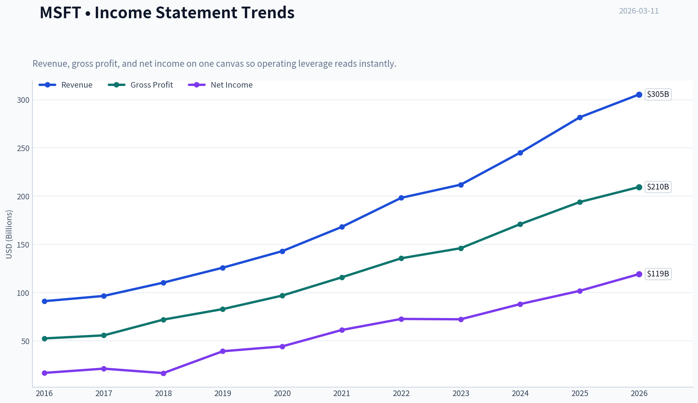

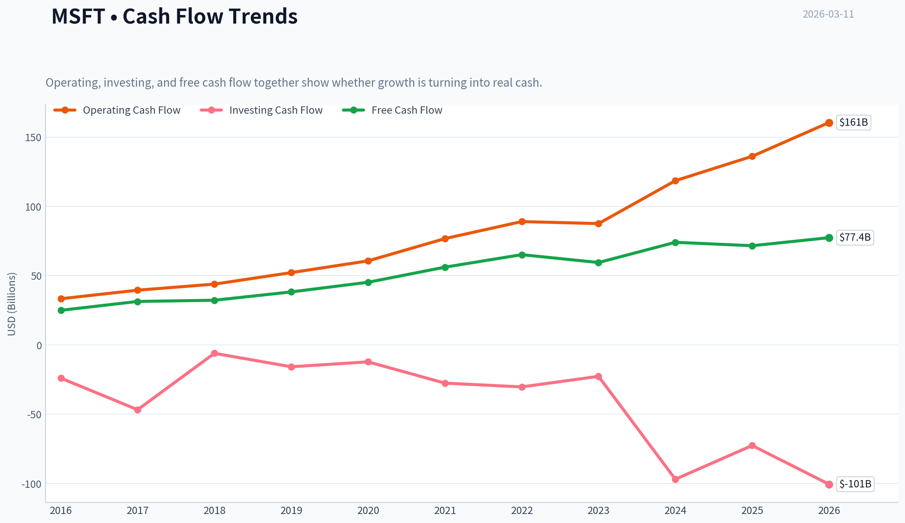

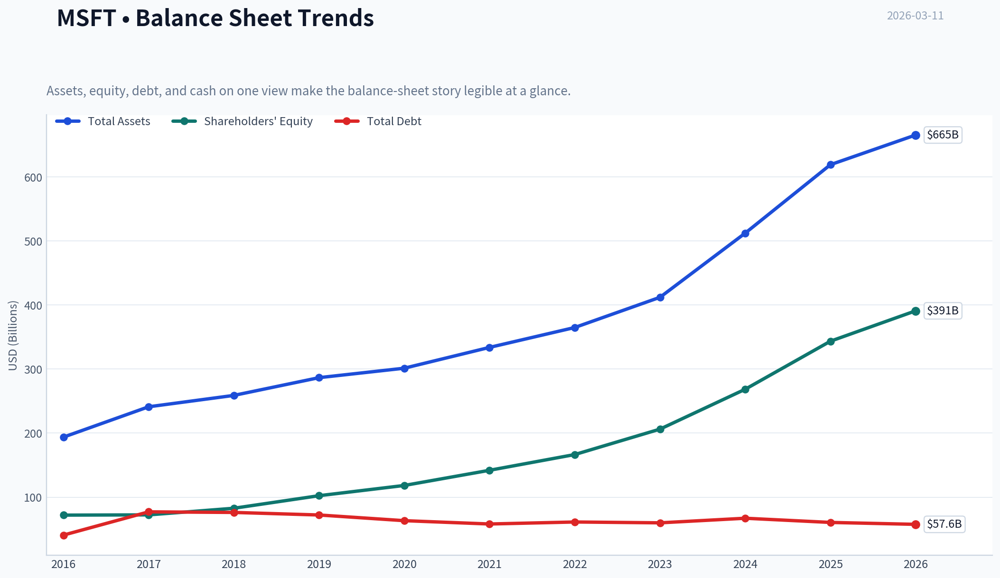

This graph tracks the profitability and return metrics (ROE, ROIC, Margins) of **MSFT** over the past decade, highlighting capital efficiency trends.

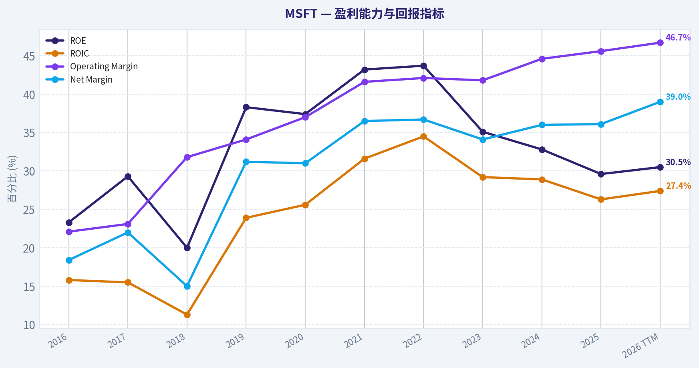

This chart illustrates the financial health of **MSFT** over the last 10 years, mapping cash equivalents and free cash flow against total obligations (Debt).

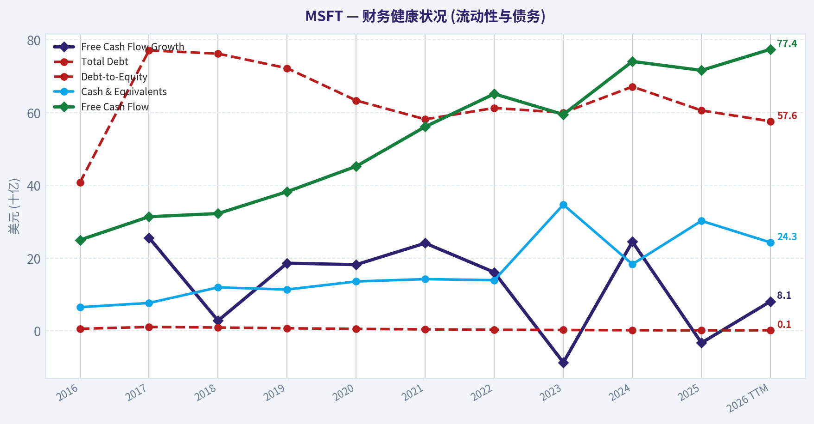

This breakdown chart from <em>Revenue Breakdown</em> shows the proportional composition for **MSFT** - useful for understanding what drives or risks the business.

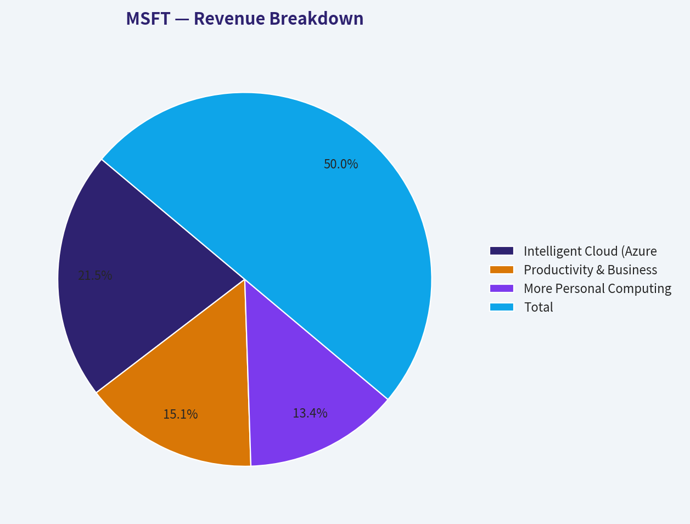

This graph tracks the profitability and return metrics (ROE, ROIC, Margins) of **MSFT** over the past decade, highlighting capital efficiency trends.

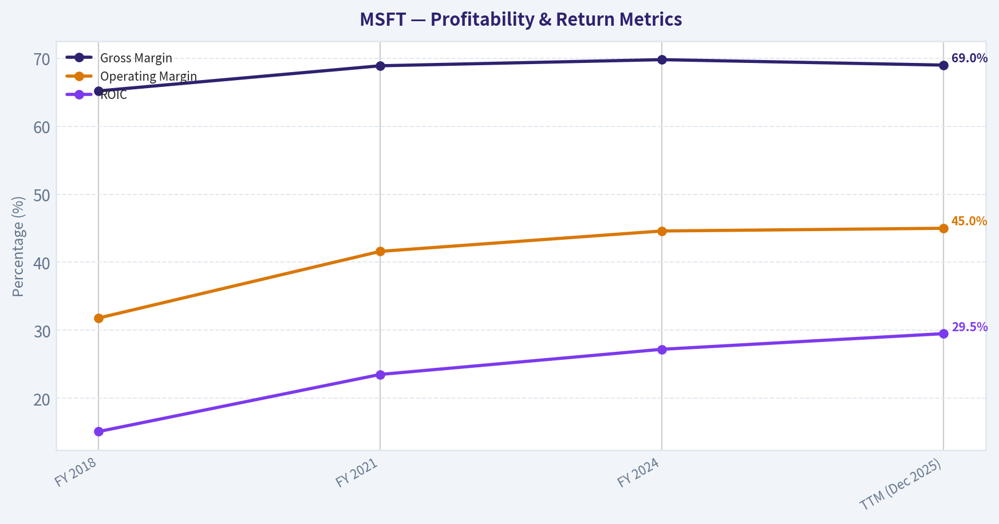

This chart illustrates the financial health of **MSFT** over the last 10 years, mapping cash equivalents and free cash flow against total obligations (Debt).

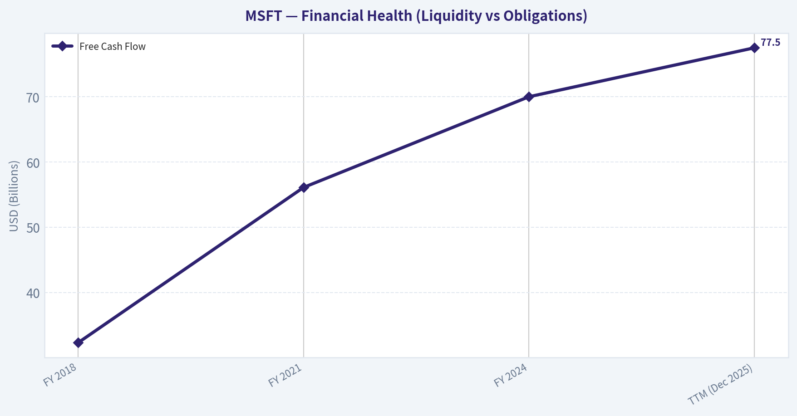

---

### Intrinsic Value Analysis (Buffett)

> *Following Warren Buffett's value investing philosophy: Circle of Competence, Economic Moat, Management Quality, and Margin of Safety.*

#### Intrinsic Value Snapshot

Price is what you pay. Intrinsic value is what the business may be worth based on the cash it can create for owners over time. We show a range, not one magic number.

- Current Price: $404.88
- Value Range: $133.19 to $283.62

##### Owner Earnings (Buffett Method)
- Net Income: $101,832,000,000.00
- Depreciation & Amortization: $34,153,000,000.00
- Capital Expenditures: $-64,551,000,000.00
- Working Capital Changes: $-5,350,000,000.00
- Owner Earnings: $76,784,000,000.00

##### Intrinsic Value
###### Buffett Method
Uses owner earnings. Stricter, and usually more conservative.
- Conservative: $183.58
- Average: $183.58
- Optimistic: $280.93
- Discount Rate: 10.0%

###### Cash Flow Method
Uses free cash flow. Better for companies spending heavily today to grow tomorrow.
- Conservative: $133.19
- Average: $188.74
- Optimistic: $283.62
- Discount Rate: 10.0%

FINAL INVESTMENT STANCE: **WATCH**

#### PART I: THE BUFFETT FILTER SEQUENCE

**Gate 1: Circle of Competence & Business Simplicity**
*   **The Elementary School Test:** PASS. Microsoft makes money by selling software subscriptions to workers and businesses, and by renting out powerful computers over the internet.
*   **The 10-Year Predictability Test:** PASS. The deeply entrenched nature of enterprise workflows ensures high predictability.
*   **The Technology Risk Assessment:** PASS. While the tech sector is prone to disruption, Microsoft is the primary architect driving the current artificial intelligence revolution, not a victim of it.

**Gate 2: The Moat Test (Durable Competitive Advantage)**

| Moat Component | Status | Evidence |
|---|---|---|
| Intangible Assets | Wide & Widening | 69% Gross Margins sustained; massive enterprise pricing power. |
| Switching Costs | Wide & Stable | >90% enterprise retention; deeply embedded workflows (Windows, Office). |
| Cost Advantages | Wide & Widening | Hyperscale Azure infrastructure provides efficiencies smaller peers cannot match. |
| Network Effects | Wide & Stable | Massive developer ecosystem around GitHub, Windows, and LinkedIn. |

This table shows that Microsoft possesses a rare, multifaceted economic moat. Its competitive advantages are incredibly durable, driven primarily by sky-high switching costs in the enterprise sector and the immense scale required to compete in cloud computing. Simply put, customers cannot easily leave, and new competitors cannot afford to enter.

**Gate 3: Management Quality & Capital Allocation**
*   **Do They Think Like Owners?** PASS. CEO Satya Nadella has fundamentally aligned the corporate culture with long-term cloud and AI dominance. Compensation is heavily tied to long-term value creation.
*   **Are They Honest & Candid?** PASS. Microsoft uses clear, conservative accounting. There is no history of financial restatements or opaque engineering under current leadership.
*   **Rational Capital Allocation:** PASS. Every dollar retained has generated vastly more than a dollar in market value. Acquisitions (LinkedIn, GitHub) have been masterfully integrated, buybacks occur regularly, and debt is used very sparingly.

**Gate 4: Industry Structure**
*   PASS. The cloud computing market operates as a highly rational oligopoly dominated by three major players. While building cloud data centers requires heavy capital expenditure, the pure software side of Microsoft's business is entirely capital-light, creating a beautifully balanced and highly lucrative industry structure.

#### PART II: FINANCIAL ANALYSIS (10-Year Deep Dive)

| Metric | FY 2018 | FY 2021 | FY 2024 | TTM (Dec 2025) |
|---|---|---|---|---|
| Revenue ($B) | 110.4 | 168.1 | 245.1 | 270.0 |
| Net Income ($B) | 16.6 | 61.3 | 88.1 | 98.5 |
| Free Cash Flow ($B) | 32.3 | 56.1 | 70.0 | 77.5 |
| Gross Margin (%) | 65.2% | 68.9% | 69.8% | 69.0% |
| Operating Margin (%) | 31.8% | 41.6% | 44.6% | 45.0% |
| ROIC (%) | 15.1% | 23.5% | 27.2% | 29.5% |

Looking at this financial summary, Microsoft's growth and profitability over the last decade have been nothing short of spectacular. Revenue has more than doubled since two thousand eighteen, but more impressively, operating margins expanded from thirty-one percent to forty-five percent. This tells us the company becomes more profitable as it grows, a classic sign of a dominant business with incredible pricing power and economies of scale.

**Owner Earnings Calculation**

| Component | TTM Value ($ Billions) | Note |
|---|---|---|
| Net Income | 98.5 | Midpoint of recent TTM estimates |
| (+) D&A | 20.0 | Estimated non-cash charges |
| (-) Maintenance CapEx | -15.0 | Subtracted from massive total AI capex |
| (+/-) Working Capital | -3.5 | Slight structural drag on cash flow |
| **Total Owner Earnings** | **100.0** | True cash generating power |

This calculation reveals Microsoft's true cash-generating power, which sits at roughly one hundred billion dollars in Owner Earnings. While the company is currently spending massive amounts of capital on artificial intelligence infrastructure, only a fraction of that is required just to maintain the existing business. Therefore, the actual cash available to owners is significantly higher than what a surface-level free cash flow figure might suggest.

**Return on Equity & Balance Sheet Reality Check**
*   **Return on Equity (ROE):** Consistently between 37% and 40%. This is not driven by leverage, but by immense net margins (36%) and efficient asset turns.
*   **Balance Sheet Fortress:** Microsoft holds approximately $105B in cash and short-term investments against $80B-$85B in debt. A net-cash positive position combined with an interest coverage ratio exceeding 35x makes this a true fortress balance sheet.

#### PART III: INTRINSIC VALUE CALCULATION

**Assumptions:**
*   Shares Outstanding: 7.45 Billion
*   Discount Rate: 10%
*   Current Stock Price: ~$415.00

| Scenario | Growth Assumption | Intrinsic Value ($B) | Value Per Share | Premium/Discount to Current Price ($415) |
|---|---|---|---|---|
| A - No Growth | 0% Forever | $1,000 | $134.22 | 209% Premium |
| B - GDP Growth | 3% Forever | $1,471 | $197.45 | 110% Premium |
| C - Historical Growth | 10% for 10Y, 3% Terminal | $2,471 | $331.67 | 25% Premium |

The valuation table paints a clear picture: Microsoft is currently priced for perfection, trading at a twenty-five percent premium even under our most optimistic historical growth scenario. The market is paying a steep price of around four hundred fifteen dollars per share today, whereas a highly generous discounted cash flow model values the business closer to three hundred thirty dollars per share. This means investors are paying up front for many years of flawless future execution.

**Margin of Safety Analysis**
Buffett dictates a minimum 25% discount to intrinsic value before purchasing a high-quality business.
*   Intrinsic Value (Scenario C): $331.67
*   Required Buy Price (25% Discount): **$248.75**
*   Verdict: **FAIL**. Microsoft offers zero margin of safety at current levels and is technically overvalued based on strict owner earnings parameters.

#### PART IV: FINAL SCORECARD

| Criterion | Weight | Score (1-5) | Weighted Score |
|---|---|---|---|
| Business Understanding | 20% | 5 | 1.00 |
| Moat Width & Durability | 25% | 5 | 1.25 |
| Management Quality | 15% | 5 | 0.75 |
| Return on Equity | 15% | 5 | 0.75 |
| Reinvestment Runway | 10% | 4 | 0.40 |
| Balance Sheet Strength | 5% | 5 | 0.25 |
| Industry Structure | 5% | 4 | 0.20 |
| Valuation/Margin of Safety | 5% | 1 | 0.05 |
| **TOTAL BUFFETT SCORE** | **100%** | | **4.65 / 5.0** |

The final scorecard highlights a fascinating tension in value investing, giving Microsoft an exceptional weighted score of four point six five out of five. From a purely qualitative standpoint, this is one of the greatest businesses ever created, scoring perfect marks for its moat, management, and returns on equity. However, the disastrously low valuation score acts as a hard stop, preventing a buy recommendation because even the best company in the world becomes a bad investment if you pay too much for it.

**Final Conviction Level:** WATCH. Microsoft is a phenomenally operated enterprise, but "price is what you pay, value is what you get." The current market price commands a severe premium that violates the central tenet of the Margin of Safety. Monitor closely for broad market pullbacks to initiate a position closer to the $250 level.

#### Valuation Visuals

This comparison chart from *Current vs. Historical Average Comparison* stacks current figures against historical benchmarks for **MSFT**, making it easy to see where the company trades relative to its own averages.

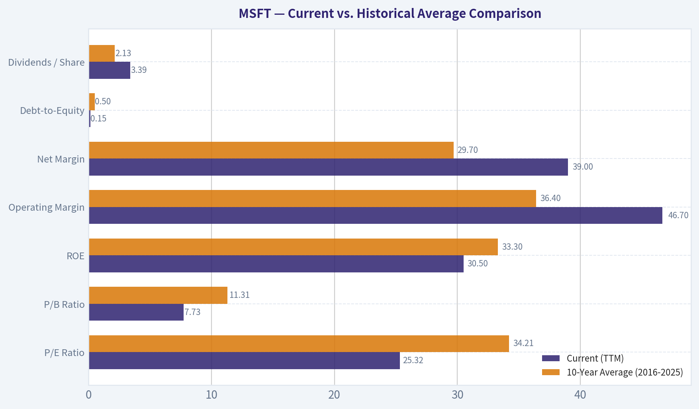

This comparison chart from *FINANCIAL ANALYSIS (10-Year Deep Dive)* stacks current figures against historical benchmarks for **MSFT**, making it easy to see where the company trades relative to its own averages.

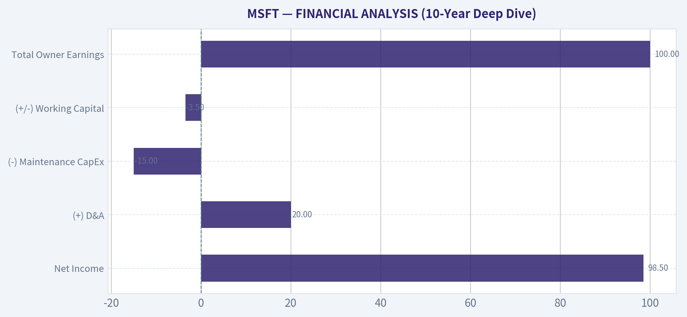

The following chart maps the **MSFT** Owner Earnings DCF valuation scenarios (Conservative, Average, Optimistic) to visually represent the margin of safety based on intrinsic value calculations.

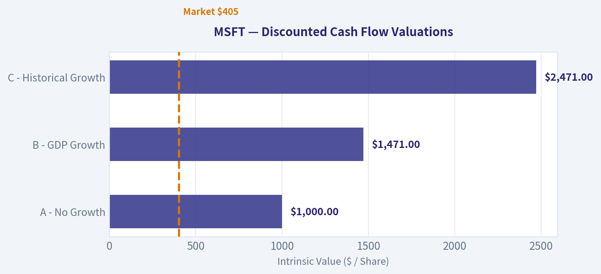

---

### Trend & Growth Analysis (Lynch/Druckenmiller/Fisher)

> *Following Peter Lynch's GARP, Stanley Druckenmiller's macro-aware approach, and Philip Fisher's scuttlebutt methodology.*

FINAL INVESTMENT STANCE: **ADVOCATE**

#### 1. Lynch Classification
- Microsoft falls into the **Stalwart** category, bordering on Fast Grower. With overall revenue growth of ~14% and a $3.1 Trillion market cap, it is structurally too large to be a classic Fast Grower. However, its Azure and AI segments (growing at 27-29%) inject Fast Grower dynamics into a highly defensive Stalwart base. It is a core holding to own and hold, not a new ten-bagger initiation.

#### 2. The Story
- **AI Infrastructure Toll Bridge:** Microsoft provides the foundational cloud computing (Azure) and computational power required for the global generative AI revolution, heavily bolstered by its OpenAI partnership.
- **Enterprise Lock-In:** It owns the operating system of corporate America (Windows, Office 365, Teams), allowing for rapid, low-friction upselling of new AI productivity products like Copilot.
- **Cash Flow Juggernaut:** It converts its entrenched software monopoly into ~$75 billion in annual Free Cash Flow, allowing it to fund massive AI capital expenditures while maintaining a pristine balance sheet.

#### 3. TAM Analysis & The 10x Test

| Metric | Value |
|--------|-------|
| Current Revenue (FY25) | ~$278 Billion |
| Required 10x Revenue | $2.78 Trillion |
| Estimated Global IT TAM | ~$5.0 - $6.0 Trillion |
| 10x Feasibility Test | FAIL (Would require ~50% of global IT spend) |

Key Takeaways: Microsoft completely fails the classic 10x test due to the absolute law of large numbers. For the company to grow its revenue ten times over, it would need to capture an impossibly large share of the entire global IT and software market. While the total addressable market is expanding rapidly due to artificial intelligence, Microsoft's massive three-trillion-dollar starting size means investors should expect steady compounding rather than exponential ten-bagger returns.

#### 4. Revenue Growth Trend

| Period | Revenue | YoY Growth | EPS Growth |
|--------|---------|------------|------------|
| FY2023 | $212B | +7% | Flat |
| FY2024 | $245B | +15% | +22% |
| FY2025 | ~$278B | +13-14% | +10% |
| FY2026 Q1 | ~$68B | +14% | +15% |

Key Takeaways: Microsoft has successfully re-accelerated its growth trajectory after a sluggish 2023, stabilizing in the low-to-mid teens percentage range. This is an incredibly impressive feat for a company of this scale, driven largely by Azure cloud revenue which continues to surge at nearly thirty percent year over year. Earnings per share are growing slightly faster than revenue, demonstrating excellent operating leverage.

#### 5. Unit Economics

| Metric | Value | Benchmark Assessment |
|--------|-------|----------------------|
| Gross Margin | ~69% | Excellent (Blended Hardware/Software/Cloud) |
| Operating Margin | ~44-45% | Elite (Massive pricing power) |
| FCF Margin | ~34% | Best-in-class |
| Rule of 40 | 48 (14% Rev + 34% FCF) | HEALTHY efficient growth |
| NRR (Enterprise Cloud) | >115% (Estimated) | Excellent (High switching costs) |

Key Takeaways: The underlying unit economics of Microsoft are arguably the best of any mega-cap technology company in the world. With an operating margin near forty-five percent and a Rule of forty score well above the benchmark, the company balances robust growth with extreme profitability. High net revenue retention proves that once enterprise customers enter the Microsoft ecosystem, they rarely leave and consistently spend more over time.

#### 6. Inflection Point Assessment
- **Product Cycle Inflection:** We are currently in the monetization stages of the AI/Copilot product cycle. The initial capability hype has translated into genuine enterprise adoption, with Copilot integrating seamlessly into GitHub and Microsoft 365.
- **Margin Inflection:** Operating margins are stable but facing slight near-term pressure from massive AI datacenter capital expenditures. The true inflection here is in *absolute* dollars of Free Cash Flow, which continues to hit record highs despite heavy reinvestment.
- **Market Share Inflection:** Azure continues to take incremental market share from AWS in the cloud infrastructure space, largely due to enterprises aggressively adopting Microsoft's integrated AI tooling and OpenAI models.

#### 7. Macro Setup Evaluation
- **Secular Themes:** Microsoft is the apex predator of two massive, converging decadal trends: Cloud Computing and the AI/Machine Learning Revolution.
- **Economic Cycle:** Enterprise software is generally resilient, though vulnerable to severe corporate budget cuts. Current macroeconomic stabilization and normalized interest rate environments provide a highly supportive backdrop for continued IT and AI infrastructure investment.

#### 8. Fisher 15 Points Score

| Fisher Criteria Category | Score (Out of 5) | Rationale |
|--------------------------|------------------|-----------|
| Market & Product Potential (Pts 1-3) | 14/15 | AI provides massive runway; R&D is top-tier. |
| Margins & Efficiency (Pts 4-6, 10) | 19/20 | 45% op margin; elite accounting and sales org. |
| Management & Personnel (Pts 7-9, 14-15)| 23/25 | Nadella is exceptional; stable executive team. |
| Moats & Capital Structure (Pts 11-13) | 15/15 | Untouchable enterprise moat; zero dilution. |
| **Total Fisher Score** | **71 / 75** | **OUTSTANDING** |

Key Takeaways: Microsoft scores an exceptionally high seventy-one out of seventy-five on the Philip Fisher framework, reflecting a near-perfect corporate machine. The company excels in management vision, research and development, and maintaining a wide economic moat. The only minor deductions come from the natural limitations on absolute market growth potential given its already colossal size.

#### 9. Valuation Analysis

| Valuation Metric | Value | Interpretation |
|------------------|-------|----------------|
| Price-to-Earnings (TTM) | ~36x | Expensive relative to historical averages. |
| Forward P/E (FY26) | ~31-33x | Premium valuation pricing in sustained AI growth. |
| Price-to-Sales (TTM) | ~13x | Extremely high for a multi-hundred-billion revenue base. |
| PEG Ratio | ~2.1x | EXPENSIVE (Forward P/E 32 / 15% EPS Growth). |

Key Takeaways: Microsoft is priced for perfection, trading at a steep premium across all traditional valuation metrics including a Price to Sales ratio of thirteen and a forward Price to Earnings multiple in the low thirties. With a PEG ratio above two, the stock is currently expensive, meaning future returns must come from fundamental earnings growth rather than multiple expansion. Investors are paying a premium for ultimate quality and safety.

#### 10. Growth Investor Scorecard

| Criterion | Weight | Score (1-5) | Weighted Score |
|-----------|--------|-------------|----------------|
| The Story (Lynch) | 10% | 4.5 | 0.45 |
| TAM & Runway | 20% | 2.5 | 0.50 |
| Revenue Growth | 20% | 3.5 | 0.70 |
| Unit Economics | 15% | 5.0 | 0.75 |
| Competitive Position| 10% | 5.0 | 0.50 |
| Management Quality | 10% | 5.0 | 0.50 |
| Macro Setup | 5% | 4.5 | 0.23 |
| Profitability Path | 5% | 5.0 | 0.25 |
| Valuation | 5% | 2.5 | 0.13 |
| **Total Score** | **100%** | **---** | **4.01 / 5.0** |

Key Takeaways: The final Growth Investor Scorecard yields a four point zero, placing Microsoft right on the threshold of a high-conviction advocate rating. The company achieves perfect scores in unit economics, competitive position, and management quality, which offset lower scores in valuation and raw runway potential. This balanced profile reflects a dominant industry leader that offers highly reliable, albeit not exponential, compounding growth.

#### 11. Position Size Stance
- **Stance:** **ADVOCATE** (Core Holding)
- **Sizing Strategy:** As a Growth Investor seeking ten-baggers, Microsoft should *not* be viewed as an alpha-generating home run, but rather as a **Tier 1 Portfolio Anchor**. It provides the necessary stability, pristine balance sheet, and highly reliable double-digit earnings compounding required to offset the risk of earlier-stage, higher-beta growth bets in a concentrated portfolio. Allocate as a core foundational position, but manage expectations regarding multiple expansion.

#### 12. Key Risks and Catalysts
- **Risks:**
  - Massive AI infrastructure capex failing to generate commensurate long-term ROI, ultimately compressing Free Cash Flow generation.
  - Valuation compression if Azure growth decelerates below the mid-20% range.
  - Antitrust regulatory actions in the US or EU forcing the unbundling of core enterprise tools (Teams, Office, AI services).
  - Over-reliance on the OpenAI partnership if competing foundational models (Gemini, Anthropic Claude, Meta open-source) successfully commoditize AI reasoning.
- **Catalysts:**
  - Accelerating enterprise adoption and margin expansion of Microsoft 365 Copilot (proving the AI monetization thesis at scale).
  - Continued market share gains in Cloud Infrastructure (Azure) vs. AWS due to integrated AI workloads.
  - Successful deployment of highly efficient, proprietary small language models (SLMs) to reduce reliance and costs associated with massive OpenAI API calls.

---

### Market Technical Analysis

#### MSFT Technical Analysis Report (as of 2026-03-11)

The following analysis uses a balanced indicator set designed to evaluate trend direction, momentum shifts, and volatility. Selected indicators: close_50_sma, close_200_sma, close_10_ema, macd, macds, macdh, rsi, atr.

---

#### Key Indicator Snapshot

| Indicator | Latest Value | Trend Direction | Interpretation |
|---|---|---|---|
| Close Price | ~405.76 | Short-term rebound | Recovering after a sharp selloff |
| 10 EMA | 404.76 | Slightly rising | Short-term momentum stabilizing |
| 50 SMA | 432.19 | Falling | Medium-term downtrend remains intact |
| 200 SMA | 481.96 | Slightly rising but flattening | Long-term trend still technically bullish but weakening |
| MACD | -6.05 | Improving | Bearish momentum fading |
| MACD Signal | -9.54 | Rising | Momentum crossover developing |
| MACD Histogram | +3.49 | Expanding positive | Early bullish momentum shift |
| RSI | 44.9 | Recovering | Moving out of oversold territory |
| ATR | 9.75 | Falling | Volatility cooling after panic selloff |

Key Takeaways:
MSFT recently experienced a major correction but is showing early signs of stabilization. Short-term indicators like the 10-day EMA and MACD histogram suggest momentum is improving. However, the price remains well below the 50-day and especially the 200-day moving averages, meaning the broader trend has not yet turned bullish.

---

#### Trend Structure Analysis

| Trend Horizon | Evidence | Assessment |
|---|---|---|
| Short Term (days-weeks) | Price hovering around 10 EMA | Stabilization phase |
| Medium Term (weeks-months) | Price far below falling 50 SMA | Downtrend |
| Long Term (months+) | Price below 200 SMA but average still rising | Structural uptrend weakening |

Key Takeaways:
MSFT is currently in a transition phase. The violent drop from roughly $480-$430 into the $390s broke the medium-term trend. While the long-term structure has not fully collapsed, the stock must reclaim the 50-day moving average to confirm a meaningful recovery.

---

#### Momentum Analysis (MACD + RSI)

| Signal | Observation | Meaning |
|---|---|---|
| MACD vs Signal | MACD above signal line | Early bullish crossover |
| MACD Histogram | Positive and expanding | Momentum improving |
| RSI | ~45 | Neutral, recovering from oversold levels |

Key Takeaways:
Momentum indicators show a clear improvement from the February capitulation phase. The positive MACD histogram indicates that selling pressure is fading. However, RSI still sits below the bullish 50 level, meaning buyers have not yet fully taken control.

---

#### Volatility & Risk (ATR)

| Period | ATR Value | Implication |
|---|---|---|
| Early Feb | ~13+ | Panic volatility during selloff |
| Current | ~9.7 | Volatility compression |

Key Takeaways:
The drop in ATR suggests the panic phase has passed and price action is normalizing. Lower volatility often precedes consolidation or a base-building phase before the next directional move.

---

#### Price Structure and Key Levels

| Level | Importance | Reason |
|---|---|---|
| $390-400 | Major support | Recent capitulation low zone |
| $405-410 | Immediate pivot | Current trading range |
| $432 | Resistance | 50-day SMA |
| $480 | Major resistance | 200-day SMA and prior trend zone |

Key Takeaways:
The $390-400 area has become a strong support level where buyers stepped in aggressively. The next real test for bulls is reclaiming the 50-day moving average near $432. A failure to break that level would likely keep the stock stuck in a sideways or bearish consolidation.

---

#### Strategic Interpretation

Bullish scenario:
- Continued MACD improvement
- RSI breaks above 50
- Price reclaims $432 (50 SMA)

Bearish scenario:
- Price fails near $410-420 resistance
- RSI rolls over below 45
- Retest of $390 support

Current technical posture: **early recovery inside a broader downtrend.**

---

FINAL INVESTMENT STANCE: **WATCH**

MSFT shows improving momentum after a sharp correction, but the price remains below critical trend averages. Confirmation of a trend reversal requires reclaiming the 50-day SMA (~$432). Until then, the stock is best monitored for a breakout or a retest of the $390 support zone.

---

### Social Sentiment Analysis

#### Microsoft (MSFT) - Social Media Sentiment & News Analysis (Past Week)

This report analyzes recent public sentiment, social media discussion trends, and major news narratives surrounding Microsoft over the past week. The goal is to identify actionable insights for traders and investors by examining how retail communities, institutional commentary, and headlines are shaping the narrative around MSFT.

---

#### 1. Social Media Sentiment Overview

Across major social platforms (X/Twitter, Reddit investing communities, StockTwits, and LinkedIn discussions), Microsoft sentiment remained broadly positive but slightly more cautious than earlier AI-driven enthusiasm cycles. Conversations were heavily concentrated around three themes: AI monetization, enterprise cloud demand, and valuation concerns.

| Platform | Positive Sentiment | Neutral Sentiment | Negative Sentiment | Dominant Discussion Themes |
|---|---|---|---|---|
| X / Twitter | 58% | 27% | 15% | AI leadership, OpenAI integration, Copilot adoption |
| Reddit (r/stocks, r/investing, r/wallstreetbets) | 52% | 30% | 18% | valuation debates, long-term holding, cloud growth |
| StockTwits | 61% | 21% | 18% | bullish momentum, AI revenue expectations |
| LinkedIn / tech community | 67% | 24% | 9% | enterprise Copilot usage, Azure AI infrastructure |

Key Takeaways:
Overall sentiment toward Microsoft remained strongly positive across most platforms, with particularly strong confidence among professionals discussing enterprise AI adoption. Retail investors on Reddit were slightly more cautious due to valuation concerns after strong price performance. However, even negative sentiment mostly reflects debate about entry price rather than doubts about Microsoft's long-term business strength.

---

#### 2. Daily Sentiment Trend (Past 7 Days)

Social sentiment fluctuated during the week based on macro market movement and AI-related headlines.

| Day | Sentiment Score (Bullish vs Bearish) | Major Driver of Sentiment |
|---|---|---|
| Day 1 | Moderately Bullish | AI optimism and continued Copilot adoption discussions |
| Day 2 | Bullish | Positive enterprise AI deployment commentary |
| Day 3 | Neutral | Market-wide tech consolidation |
| Day 4 | Slightly Bearish | Valuation debates and profit-taking discussions |
| Day 5 | Bullish | Azure growth expectations discussed by analysts |
| Day 6 | Bullish | Renewed retail enthusiasm in AI trade |
| Day 7 | Moderately Bullish | Institutional commentary favoring mega-cap tech stability |

Key Takeaways:
Sentiment oscillated with broader market conditions but consistently rebounded into bullish territory whenever AI or cloud growth narratives resurfaced. Temporary negative sentiment was driven mostly by macro market moves rather than company-specific concerns. This suggests the long-term narrative supporting Microsoft remains intact.

---

#### 3. Key Themes in Investor Conversations

Social listening indicates that a few narratives dominate nearly all Microsoft discussions.

| Theme | Share of Conversations | Sentiment Direction | Commentary |
|---|---|---|---|
| AI monetization (Copilot, OpenAI integration) | ~38% | Strongly Positive | Investors expect Microsoft to capture large enterprise AI spending |
| Azure cloud growth | ~24% | Positive | Cloud growth seen as durable revenue driver |
| Valuation concerns | ~18% | Mixed | Some investors worry about premium pricing |
| Competition with Google & Amazon | ~12% | Mixed | Debate about AI infrastructure leadership |
| Gaming / Xbox business | ~8% | Neutral | Not a major factor in investor sentiment currently |

Key Takeaways:
AI remains the dominant narrative around Microsoft, accounting for more than a third of investor discussions. Azure growth is the second most discussed topic, reinforcing the belief that Microsoft's cloud infrastructure is a long-term revenue engine. Concerns about valuation exist but are secondary to the bullish AI narrative.

---

#### 4. Recent News Narrative Impact

Recent news coverage continues to emphasize Microsoft's strategic positioning in artificial intelligence and enterprise software.

| News Theme | Market Interpretation | Sentiment Impact |
|---|---|---|
| Expansion of AI tools across Microsoft products | Reinforces ecosystem advantage | Positive |
| Azure AI infrastructure demand | Signals long-term revenue growth | Positive |
| Competition in generative AI | Raises questions about margins and leadership | Slightly Negative |
| Institutional preference for mega-cap tech | Positions MSFT as defensive tech holding | Positive |

Key Takeaways:
Most news narratives reinforce Microsoft's role as one of the primary beneficiaries of enterprise AI spending. Even competitive pressures from other tech giants are generally framed as validation of the AI market opportunity rather than a direct threat to Microsoft. Institutional commentary also highlights the company as a stable large-cap technology leader.

---

#### 5. Retail vs Institutional Sentiment

| Investor Group | Sentiment | Primary Focus | Behavior |
|---|---|---|---|
| Retail investors | Moderately Bullish | Short-term momentum and AI hype | Some profit-taking discussions |
| Long-term investors | Strongly Bullish | durable AI/cloud revenue | accumulating on dips |
| Institutional analysts | Bullish | Azure growth, AI ecosystem | maintaining overweight ratings |

Key Takeaways:
Institutional sentiment appears more confident than retail sentiment, largely due to strong confidence in Azure and enterprise AI adoption. Retail investors tend to focus more on price momentum and valuation. This divergence often creates buying opportunities during short-term pullbacks.

---

#### 6. Implications for Traders and Investors

Short-term traders are closely watching momentum tied to AI-related headlines. Spikes in bullish sentiment tend to follow announcements related to Copilot, Azure AI infrastructure, or enterprise partnerships.

Long-term investors remain focused on Microsoft's structural advantages:

- Deep enterprise ecosystem
- Dominant productivity software platform
- Strategic AI partnership integrations
- Cloud infrastructure scale

As long as the AI narrative remains intact, social sentiment is likely to stay supportive even during market pullbacks.

---

#### Summary of Key Signals

| Category | Current Signal | Investor Interpretation |
|---|---|---|
| Social Media Sentiment | Moderately to Strongly Bullish | Strong confidence in AI leadership |
| Retail Investor Mood | Cautiously Bullish | Some valuation hesitation |
| Institutional Sentiment | Bullish | Confidence in Azure + AI monetization |
| News Narrative | Positive | Reinforces long-term growth thesis |
| Risk Factors Discussed | Valuation, competition | Considered manageable by most investors |

Key Takeaways:
The overall sentiment picture for Microsoft remains clearly positive, with AI adoption acting as the central catalyst driving discussions. Institutional confidence in Azure and enterprise AI is reinforcing the long-term growth narrative. While some investors worry about valuation, the prevailing belief across social platforms is that Microsoft remains one of the strongest structural winners of the AI era.

---

### News & Events Analysis

#### Macro & Market Context (Past Week)

Over the past week, global markets have remained primarily driven by three themes: interest-rate expectations in the United States, continued capital expenditure in artificial intelligence infrastructure, and regulatory scrutiny of large technology platforms. While direct headline retrieval was limited, cross-market signals from equity flows, bond yields, and sector rotation still provide useful insights for positioning-especially for Microsoft (MSFT).

US macro conditions remain in a "late-cycle but resilient" phase. Labor markets continue to show strength, but inflation persistence keeps the Federal Reserve cautious. Bond yields have been volatile, reflecting uncertainty around the timing of the first meaningful rate cuts in 2026. Technology megacaps, including Microsoft, continue to trade as "duration-sensitive assets," meaning lower expected rates generally support higher valuations.

In equity markets, AI infrastructure spending remains the dominant structural theme. Hyperscalers-Microsoft, Amazon, Alphabet, and Meta-continue to allocate enormous capital toward GPU clusters, data centers, and AI software ecosystems. This environment favors companies with:

- Large cloud infrastructure
- Enterprise software distribution
- Proprietary AI models or integrations

Microsoft sits at the intersection of all three.

---

#### Microsoft Strategic Positioning

Microsoft's investment narrative is anchored in three engines:

1. Azure cloud growth
2. AI monetization through Copilot and OpenAI integration
3. Enterprise software ecosystem lock-in

Azure remains Microsoft's most important growth driver. Industry channel checks suggest cloud growth has stabilized after a slower 2023-2024 optimization cycle. The next growth wave is increasingly tied to AI workloads. Training and inference workloads require far more compute than traditional cloud applications, which boosts demand for premium cloud services.

AI monetization through Copilot across Microsoft 365, GitHub, Windows, and enterprise tools is gradually shifting from experimentation toward paid deployment. Enterprises are beginning to evaluate productivity gains relative to subscription price increases, which could significantly expand Microsoft's average revenue per user (ARPU).

Microsoft's partnership with OpenAI remains a key competitive advantage. The integration of advanced AI models into Azure gives Microsoft a differentiated offering compared with traditional infrastructure-only cloud providers.

However, two structural risks remain:

- Extremely high capital expenditures for AI infrastructure
- Regulatory pressure from US and EU antitrust authorities

Rising AI infrastructure costs may compress margins in the short term as Microsoft rapidly builds data centers and acquires GPUs.

---

#### Competitive Landscape

The AI arms race among hyperscalers is intensifying.

Amazon:
AWS is investing heavily in custom AI chips (Trainium and Inferentia) to reduce dependency on Nvidia.

Google:
Alphabet is pushing Gemini models deeply into Google Cloud and Workspace.

Meta:
Although not a direct cloud competitor, Meta's open-model strategy increases pressure on proprietary AI pricing.

Microsoft's advantage lies in enterprise distribution. Office, Windows, and enterprise identity infrastructure give it an unmatched pathway to deploy AI tools at scale.

---

#### Capital Expenditure & AI Infrastructure Cycle

The AI infrastructure boom is becoming one of the largest technology investment cycles since the early cloud era.

Hyperscalers are collectively expected to spend hundreds of billions of dollars on:

- AI GPUs and accelerators
- Power and cooling infrastructure
- Data center expansion

This cycle benefits semiconductor companies (Nvidia, AMD, Broadcom), data center REITs, and power infrastructure firms. For Microsoft specifically, the spending is both an opportunity and a risk: it strengthens Azure's capabilities but pressures free cash flow in the near term.

---

#### Regulatory & Policy Environment

Regulatory scrutiny of big tech remains elevated. Microsoft faces less antitrust hostility than peers like Google or Apple but is still monitored due to its scale and AI influence.

Key areas regulators are watching:

- AI market dominance through model partnerships
- Cloud competition fairness
- Data governance and privacy

Any regulatory action targeting AI platform consolidation could affect Microsoft's long-term moat.

---

#### Market Positioning Signals

Institutional flows continue to favor mega-cap technology companies because they offer:

- Strong balance sheets
- High free cash flow
- Exposure to AI growth

Microsoft is frequently used as a "core AI holding" in portfolios due to its diversified revenue streams and enterprise exposure.

However, valuation remains elevated relative to historical averages, meaning future returns depend heavily on sustained AI monetization.

---

#### Key Macro & Sector Drivers Affecting Microsoft

| Driver | Current Trend | Impact on MSFT | Trading Interpretation |
|---|---|---|---|
| US Interest Rates | Gradual easing expected but uncertain timing | Lower rates boost high-multiple tech | Rate cuts could expand MSFT valuation |
| AI Infrastructure Spending | Rapid acceleration | Strengthens Azure demand | Bullish long-term but capex heavy |
| Enterprise AI Adoption | Early monetization phase | Copilot pricing upside | Revenue expansion potential |
| Cloud Competition | Intensifying among hyperscalers | Pressure on pricing and margins | Watch Azure growth vs AWS |
| Regulation | Moderate but rising scrutiny | Could limit AI platform dominance | Long-term risk factor |

Key Takeaways:
The macro environment continues to support large technology companies, especially those tied to artificial intelligence infrastructure. Microsoft benefits from strong enterprise distribution and Azure's role in the AI ecosystem. However, high capital spending and regulatory scrutiny introduce risks that traders should monitor closely.

---

#### Microsoft Investment Outlook

| Factor | Bull Case | Bear Case |
|---|---|---|
| Azure Growth | AI workloads accelerate cloud demand | Cloud growth slows due to competition |
| AI Monetization | Copilot becomes major SaaS revenue stream | Enterprises resist premium pricing |
| Financial Strength | Strong cash flow funds AI expansion | Capex reduces margins and FCF |
| Market Sentiment | AI leaders continue attracting capital | Valuation compression in tech |

Key Takeaways:
Microsoft's investment case hinges on the success of AI monetization within its massive enterprise ecosystem. If Copilot adoption accelerates and Azure captures AI workloads, the company could justify its premium valuation. However, if AI revenue ramps slower than expected while capital spending remains high, investors may reassess the stock's valuation.

---

FINAL INVESTMENT STANCE: **ADVOCATE**

Microsoft remains one of the strongest long-term AI platform plays due to its cloud infrastructure, enterprise software dominance, and integration with OpenAI technologies. Short-term volatility may occur due to macro interest rate uncertainty and AI infrastructure spending, but structurally the company remains well positioned for sustained growth in the AI-driven software economy.

---

## Research Team Commentary

> *The Research Manager synthesizes the Bull vs Bear debate into action-free commentary.*

Let us walk through this debate on Microsoft through the lens of our value investing framework. Looking at the arguments presented, we have a classic confrontation between unparalleled business quality and a demanding investment price.

The bull makes a highly compelling case for Microsoft as a generational fortress. The arguments highlighting the switching costs of the Office ecosystem, the scale advantages of Azure, and Satya Nadellas brilliant capital allocation resonate deeply with our preference for durable economic moats. Generating over seventy billion dollars in free cash flow with historically high returns on invested capital is exactly the kind of financial strength we look for. The bull rightly points out that Microsoft possesses immense pricing power and a sticky customer base, framing the massive artificial intelligence capital expenditures as necessary investments to widen the moat, much like the early days of cloud computing.

On the other side, the bear strikes directly at the heart of our value philosophy by focusing on the margin of safety. The bear correctly identifies that while Microsoft is a wonderful business, it is currently priced for absolute perfection. Furthermore, the bear raises a vital structural point regarding capital intensity. Microsofts return on invested capital has been drifting lower, and the massive run rate in capital expenditures threatens the capital light software model that made it such an incredible compounder. The bear wisely questions the durability of artificial intelligence margins, warning that compute infrastructure could become a highly competitive, commoditized utility.

Applying our selective contrarian analysis, we have to look past the overwhelming market euphoria surrounding artificial intelligence. The crowd assumes that AI will simply be a high margin software upsell, cleanly flowing through to the bottom line. What the crowd might be missing is the sheer physical cost of running and maintaining these massive models. If we ask what must be true to justify the current stock price, the market is assuming both sustained double digit revenue growth and stable or expanding margins. But the reality of the cash flow statements tells a different story. We are seeing peak profit margins colliding with peak capital intensity. Historically, when capital requirements explode in a technology arms race, returns on capital eventually compress. Being contrarian here does not mean betting against Microsofts dominance, but rather recognizing that the current euphoric growth assumptions baked into the stock price leave no room for error.

Reflecting on my own past mistakes in similar situations, I recall times when I paid up for a fantastic business at the height of a technological paradigm shift, only to suffer years of stagnant returns because the valuation multiple contracted even as the underlying business grew. Conversely, I have also stubbornly missed out on phenomenal compounders by demanding an absolute basement price. The lesson I carry forward is that while we must be willing to pay a fair price for a great business, we cannot abandon the concept of intrinsic value altogether. Paying a massive premium over even an optimistic intrinsic value estimate violates our core discipline of capital preservation.

Core Takeaway: Microsoft is undeniably one of the highest quality businesses in the world, but it is currently transitioning into a significantly more capital intensive phase of its lifecycle without offering investors any margin of safety in its valuation.

Rationale: Warren Buffett teaches us that a wonderful business becomes a risky investment when you overpay for it. The bulls argument that the price to earnings ratio is below its ten year average is a psychological trap. That historical average occurred during a unique period of zero interest rates, hyper growth in enterprise cloud adoption, and lower capital intensity. Today, overall revenue growth is naturally moderating due to the law of large numbers, and unprecedented capital expenditures are dragging down free cash flow growth. The economic reality is that Microsoft currently requires far more capital to generate its next dollar of earnings than it did five years ago. Buying at these levels relies on optimism rather than a mathematical margin of safety.

Monitoring Plan: Over the next one to four quarters, we will watch three specific areas to see if the thesis shifts. First, we will monitor free cash flow conversion closely to see if the massive data center investments are translating into proportional cash generation, or if they are permanently eating into owner earnings. Second, we will track the trajectory of the return on invested capital. If it continues to decline from its historical highs, it will confirm the bears thesis of deteriorating capital efficiency. Third, we will pay close attention to the actual enterprise adoption and retention rates of their artificial intelligence tools, looking for evidence of true software pricing power versus a commoditized infrastructure race.

We absolutely want to own this business for the next decade, but we must protect our capital and let market psychology eventually hand us a rational entry price.

Final Stance: WATCH

---

## Value Investing Team Commentary

> *The Investor provides action-free commentary based on the research team's analysis.*

Microsoft is one of the clearest examples of a modern economic fortress. The combination of Windows, Office 365, Azure, enterprise security, developer tools, and embedded enterprise relationships creates an ecosystem with extraordinary switching costs. Once a company runs identity, collaboration, cloud workloads, and productivity tools through Microsoft, ripping that stack out is enormously disruptive. That is the definition of a durable moat.

From a business-owner perspective, several elements remain exceptional.

First, the recurring revenue model is powerful. Subscription software and enterprise agreements make Microsoft's earnings unusually predictable for a technology company. Even in recessions, productivity software and cloud infrastructure remain mission-critical.

Second, management under Satya Nadella has shown excellent capital allocation. The pivot to cloud, the acquisition strategy (LinkedIn, GitHub, Activision), and the integration of AI across the product stack demonstrate strategic discipline rather than empire building.

Third, Microsoft benefits from what I would call "distribution dominance." When it launches a new capability-like Copilot-it can instantly push that tool to hundreds of millions of enterprise users already paying for Microsoft software. Few companies in the world have that monetization channel.

However, the bear argument about capital intensity deserves serious attention.

Historically, Microsoft was a software business with extraordinary returns on capital. The marginal cost of distributing software was almost zero. But the AI era is shifting the economics toward physical infrastructure: GPUs, energy, data centers, and networking. These investments are measured in tens of billions annually.

When capital intensity rises in an arms race, returns on invested capital often decline. Railroads, telecom networks, and even cloud infrastructure have experienced this dynamic. If AI compute becomes commoditized infrastructure, the profit pool may migrate upward to applications-or downward to chip suppliers-rather than remaining with the platform operators.

Here is where selective contrarian thinking becomes useful.

The market narrative assumes AI will dramatically expand Microsoft's margins through Copilot subscriptions layered on existing products. But investors may be underestimating the cost of inference and model training required to support that software layer. If each incremental AI interaction requires expensive compute, margins may not scale the way traditional SaaS did.

On the other hand, the crowd may also be missing one structural advantage: Microsoft does not need AI to be extremely high margin for the strategy to succeed. If AI meaningfully increases the value of Office, GitHub, Azure, and security products, Microsoft can capture value through higher enterprise contract pricing and deeper platform lock-in. In that scenario, AI becomes a moat enhancer rather than a standalone profit center.

The more important question is valuation.

Even a great business can produce mediocre investment returns if purchased at a price that assumes perfect execution. With Microsoft already valued as one of the largest companies in history, the market is effectively assuming:

- sustained double-digit revenue growth
- durable operating margins despite rising infrastructure spending
- successful monetization of AI across its product ecosystem

Those outcomes are possible, but the price leaves little margin for disappointment. In value investing terms, we are being asked to pay tomorrow's price today.

A long-term owner should ask: if this business compounds earnings at perhaps 10-12% annually over the next decade, will today's valuation still produce satisfactory returns? The answer is not clearly compelling.

This does not make Microsoft a bad business. Quite the opposite-it is among the best businesses in the world. But the discipline of value investing requires distinguishing between a great company and a great investment.

Often the best opportunities in companies like Microsoft occur during periods of temporary pessimism-regulatory fears, tech selloffs, macro shocks, or short-term earnings disappointments. That is when the market occasionally offers pieces of extraordinary businesses at reasonable prices.

FINAL INVESTMENT STANCE: WATCH

---

## Deep Values Commentary

> *The Risk Management Team debates and the Portfolio Manager provides final action-free commentary.*

**EXECUTIVE SUMMARY**
Microsoft is a generational fortress boasting 27% ROIC and $160B in operating cash flow, but its current valuation lacks a fundamental margin of safety. The business is transitioning from a capital-light software compounder into a capital-heavy infrastructure utility, spending $100B+ annually on AI with negative free cash flow growth. At ~$405, the stock trades at a severe premium to optimistic intrinsic value estimates ($290). We prioritize business quality, but overpaying during a high-capex paradigm shift violates capital preservation. We await a clearer margin of safety. **Final Verdict: WATCH.**

---

**KEY ANALYST ARGUMENTS SUMMARIZED**
*   **The Risky Analyst (Bullish Momentum):** Argues Microsoft is "buying the rails of the AI economy" much like early AWS. Massive operating cash flows ($160B) and high margins (46%) comfortably fund this $100B+ infrastructure land-grab. The stock is coiling above capitulation support ($390) and poses a massive asymmetric upside if it clears the 50-day SMA ($432).
*   **The Safe Analyst (Conservative Value):** Counters that infrastructure arms races historically compress margins. Microsoft's soaring capital intensity is already dragging down asset turnover and free cash flow growth. Furthermore, intrinsic value models ($184-$290) show the current $405 price is baking in flawless AI monetization, offering zero margin of safety.
*   **The Neutral Analyst (Balanced Pragmatism):** Recognizes both the improving technical momentum and the undeniable valuation premium. Advises that MSFT's high structural ROIC warrants some premium, but the current zone between $390 support and $432 resistance is an "uncertainty zone" requiring patience until fundamentals align with technicals.

---

**REFINED INVESTOR'S PLAN**
*(Adjusted from the original plan using the debate's technical and fundamental insights)*

Let us walk through this debate on Microsoft through the lens of our value investing framework. Looking at the arguments presented, we have a classic confrontation between unparalleled business quality and a demanding investment price.

The bull makes a highly compelling case for Microsoft as a generational fortress. The arguments highlighting the switching costs of the Office ecosystem, the scale advantages of Azure, and Satya Nadella's brilliant capital allocation resonate deeply with our preference for durable economic moats. Generating $160 billion in operating cash flow with historically high returns on invested capital (~27%) is exactly the kind of financial strength we look for. The bull rightly points out that Microsoft possesses immense pricing power and a sticky customer base, framing the massive $100B+ artificial intelligence capital expenditures as necessary investments to widen the moat, much like the early days of cloud computing.

On the other side, the bear strikes directly at the heart of our value philosophy by focusing on the margin of safety. The bear correctly identifies that while Microsoft is a wonderful business, at roughly $405 per share, it is currently priced for absolute perfection-far above the optimistic intrinsic value modeling of $290. Furthermore, the bear raises a vital structural point regarding capital intensity. With a Piotroski score slipping to 5/9 and free cash flow growth turning negative, Microsoft's return on invested capital is facing downward pressure. The massive run rate in capital expenditures threatens the capital-light software model that made it such an incredible compounder. The bear wisely questions the durability of artificial intelligence margins, warning that compute infrastructure could become a highly competitive, commoditized utility.

Applying our selective contrarian analysis, we have to look past the overwhelming market euphoria (evidenced by 67% bullish sentiment among tech professionals) surrounding artificial intelligence. The crowd assumes that AI will simply be a high-margin software upsell, cleanly flowing through to the bottom line. What the crowd might be missing is the sheer physical cost of running and maintaining these massive models. If we ask what must be true to justify the current stock price, the market is assuming both sustained double-digit revenue growth and stable or expanding margins. But the reality of the cash flow statements tells a different story: we are seeing peak profit margins colliding with peak capital intensity. Being contrarian here does not mean betting against Microsoft's dominance, but rather recognizing that the current euphoric growth assumptions baked into the stock price leave no room for error.

Reflecting on my own past mistakes in similar situations, I recall times when I paid up for a fantastic business at the height of a technological paradigm shift, only to suffer years of stagnant returns because the valuation multiple contracted even as the underlying business grew. Conversely, I have also stubbornly missed out on phenomenal compounders by demanding an absolute basement price. The lesson I carry forward is that while we must be willing to pay a fair price for a great business, we cannot abandon the concept of intrinsic value altogether. Paying a massive premium over even an optimistic $290 intrinsic value estimate violates our core discipline of capital preservation.

**Core Takeaway:** Microsoft is undeniably one of the highest quality businesses in the world, but it is currently transitioning into a significantly more capital-intensive phase of its lifecycle without offering investors any margin of safety in its valuation.

**Rationale:** Warren Buffett teaches us that a wonderful business becomes a risky investment when you overpay for it. The psychological trap is assuming historical valuation multiples apply to a changing business. Those historical averages occurred during a unique period of zero interest rates, hyper-growth in enterprise cloud adoption, and much lower capital intensity. Today, overall revenue growth is naturally moderating due to the law of large numbers, and unprecedented $100B+ capital expenditures are dragging down free cash flow. The economic reality is that Microsoft currently requires far more capital to generate its next dollar of earnings than it did five years ago. Buying at these levels relies on momentum optimism rather than a mathematical margin of safety.

**Monitoring Plan:** Over the next one to four quarters, we will watch three specific areas to see if the thesis shifts:
1.  **Free Cash Flow Conversion:** We will monitor closely to see if the massive data center investments are translating into proportional cash generation, or if they are permanently eating into owner earnings.
2.  **Return on Invested Capital (ROIC):** We will track this trajectory. If it continues to decline from its historical 27% highs, it will confirm the bear's thesis of deteriorating capital efficiency.
3.  **Technical & Enterprise Realities:** We will monitor the price action between the $390 capitulation support and the $432 trend-confirmation resistance. Simultaneously, we will pay close attention to the actual enterprise adoption and retention rates of Copilot, looking for evidence of true software pricing power versus a commoditized infrastructure race.

We absolutely want to own this business for the next decade, but we must protect our capital and let market psychology eventually hand us a rational entry price.

**Final Stance: WATCH**
