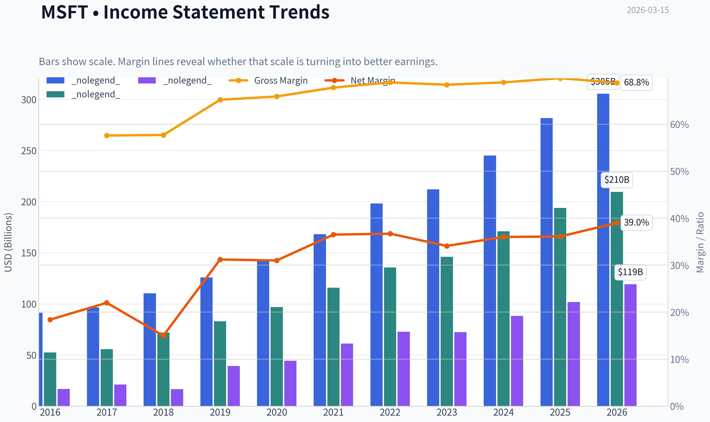
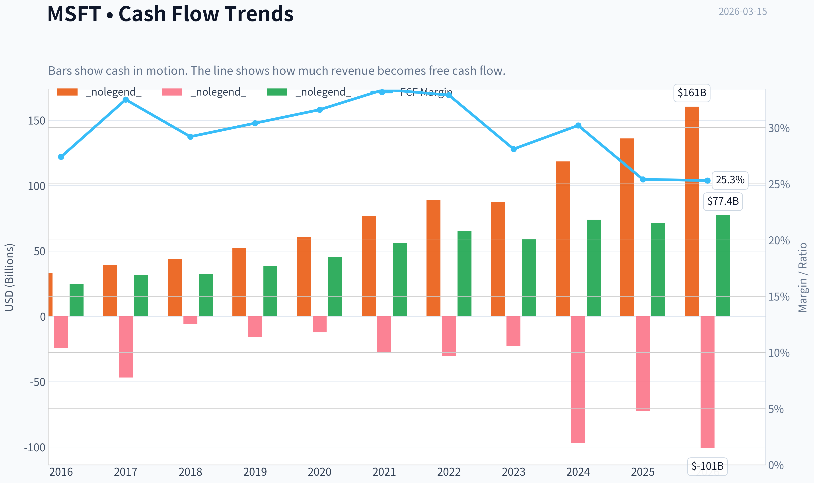
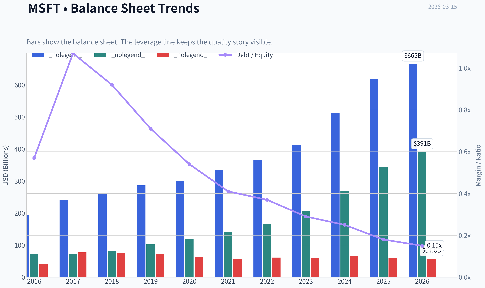
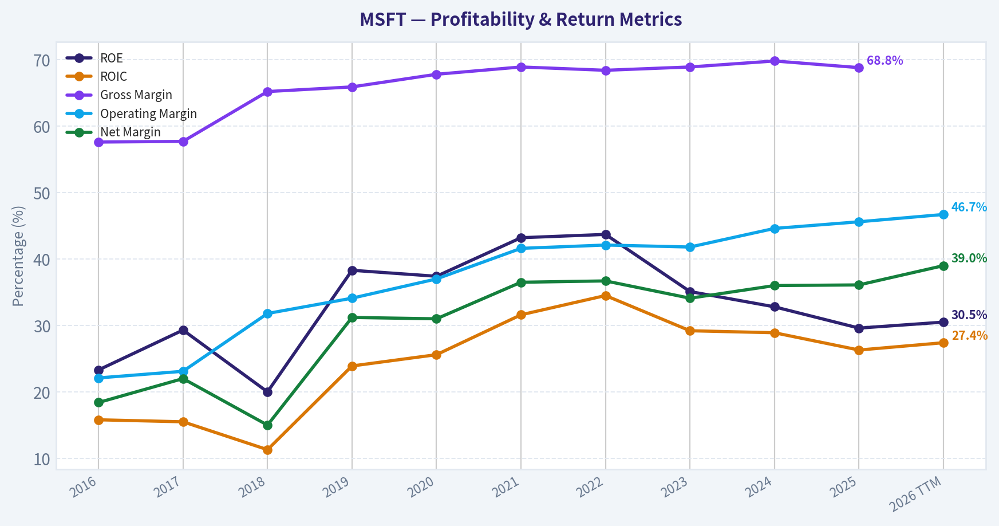
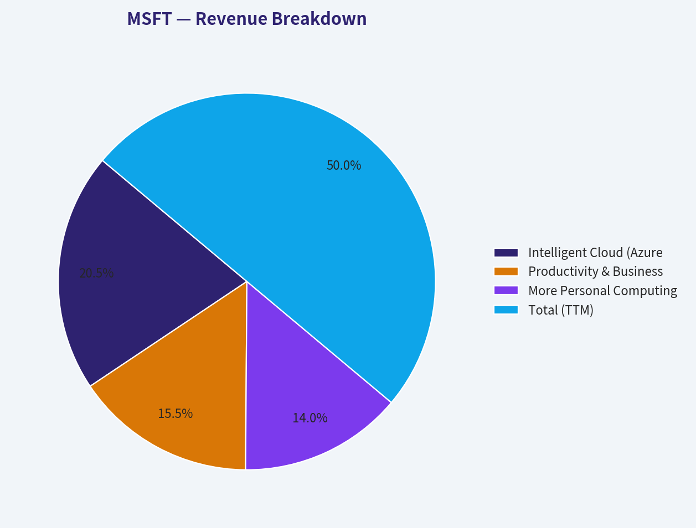
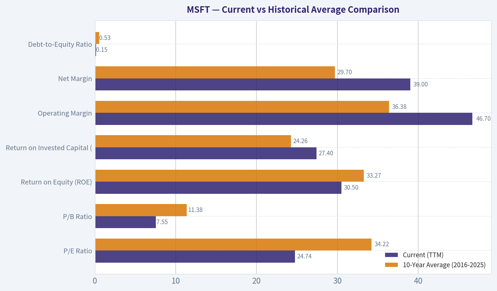
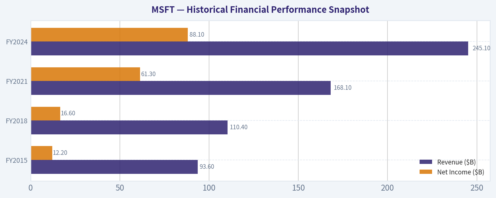
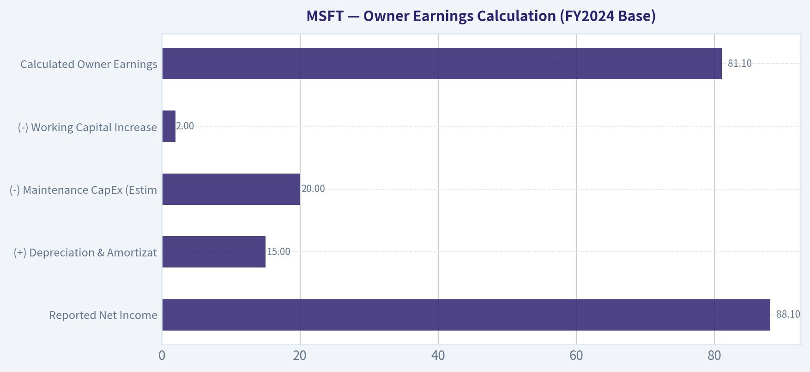
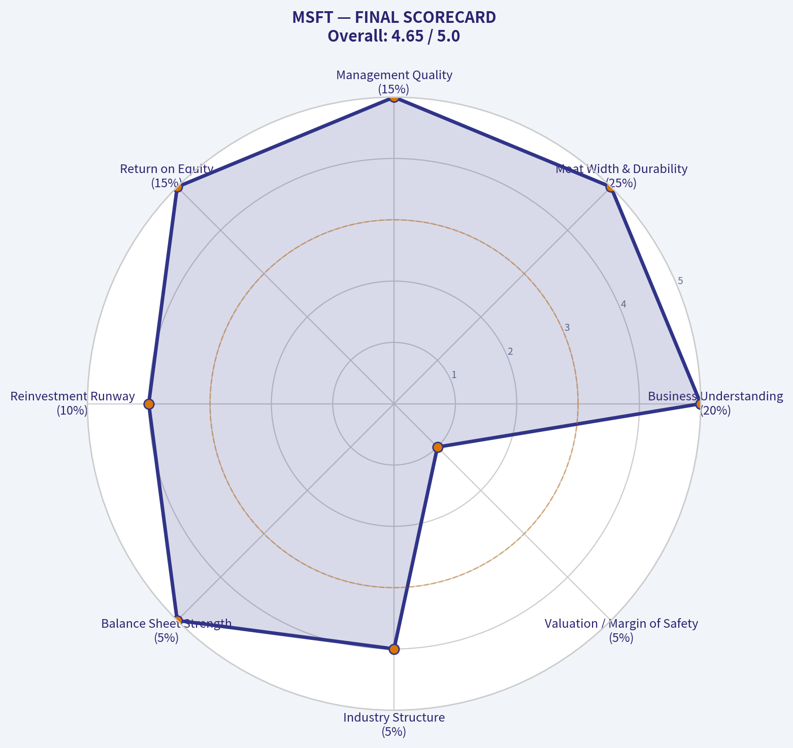
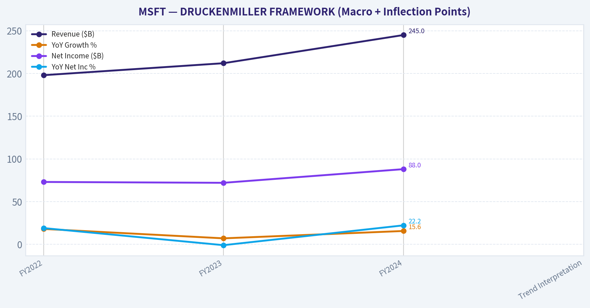

# MSFT Deep Value Intelligence

**Analysis Date:** 2026-03-15

## Critical Disclaimer

*This analysis is generated by Deep Value Intelligence, an AI-powered multi-agent investing framework. This report is for informational and educational purposes only and does not constitute financial advice. Always conduct your own research and consult with qualified financial advisors before making investment decisions.*

---

## Table of Contents

1. Intelligence Summary
2. Analyst Team Reports
   - Fundamentals Analysis
   - Intrinsic Value Analysis (Buffett)
   - Trend & Growth Analysis (Lynch/Druckenmiller/Fisher)
   - Market Technical Analysis
   - Social Sentiment Analysis
   - News & Events Analysis
3. Research Team Commentary
4. Value Investing Team Commentary
5. Deep Values Commentary

---

## Intelligence Summary

### Thesis + Conditions

**Core Thesis:** **EXECUTIVE SUMMARY**
*   **Verdict**: WATCH
*   **Business Quality**: Unmatched. Microsoft possesses a near-unbreakable enterprise moat, a fortress balance sheet (0.15 D/E), and the unique ability to self-fund $65B in AI infrastructure via $160B in operating cash flow.

**Key Risks:**
- Verdict**: WATCH
- Intrinsic Value & Risk**: Poor margin of safety. With a current price of ~$396 versus a base intrinsic value estimate of $306, the market is pricing in perfect AI execution.
- The Neutral (Timing & Transition)**: Identifies a massive timing mismatch: the infrastructure costs are immediate, while software monetization lags. However, notes that Microsoft's internal demand loop (Copilot, GitHub) mitigates pure "utility" risk.
- Applying some selective contrarian analysis here, we have to ask: What is the crowd missing? Right now, the market is pricing Microsoft's AI initiatives as if they carry traditional, asset-light software margins, leading to the assumption that a 24.7 P/E is "cheap" relative to its 10-year average. The contrarian view is that foundational AI is incredibly capital-intensive. Operating margins might look great (expanding to 46%), but *owner earnings*-which Buffett cares about most-are being squeezed by the massive reinvestment required. The market is euphoric about the AI narrative, but it is masking the reality of a timing mismatch: infrastructure costs are hitting today, while widespread enterprise software monetization remains unproven.
- Monitoring Plan**

**What Would Change Our View:**
- Verdict**: WATCH
- Intrinsic Value & Risk**: Poor margin of safety. With a current price of ~$396 versus a base intrinsic value estimate of $306, the market is pricing in perfect AI execution.
- The Neutral (Timing & Transition)**: Identifies a massive timing mismatch: the infrastructure costs are immediate, while software monetization lags. However, notes that Microsoft's internal demand loop (Copilot, GitHub) mitigates pure "utility" risk.
- Applying some selective contrarian analysis here, we have to ask: What is the crowd missing? Right now, the market is pricing Microsoft's AI initiatives as if they carry traditional, asset-light software margins, leading to the assumption that a 24.7 P/E is "cheap" relative to its 10-year average. The contrarian view is that foundational AI is incredibly capital-intensive. Operating margins might look great (expanding to 46%), but *owner earnings*-which Buffett cares about most-are being squeezed by the massive reinvestment required. The market is euphoric about the AI narrative, but it is masking the reality of a timing mismatch: infrastructure costs are hitting today, while widespread enterprise software monetization remains unproven.
- Monitoring Plan**

**Confidence:** Medium

---

## Analyst Team Reports

### Fundamentals Analysis

#### 10-Year Financial Metrics for MSFT

*All values below are computed deterministically from raw data - not estimated by AI.*

#### 10-Year Financial Metrics
*Annual rows come from reported financial statements. The final TTM row is computed from the latest four quarters.*

| Metric | 2016 | 2017 | 2018 | 2019 | 2020 | 2021 | 2022 | 2023 | 2024 | 2025 | 2026 TTM |
| --- | --- | --- | --- | --- | --- | --- | --- | --- | --- | --- | --- |
| Market Price | $56 | $79 | $95 | $150 | $214 | $327 | $249 | $333 | $441 | $495 | $396 |
| Market Cap | $449.53B | $618.34B | $743.30B | $1.16T | $1.65T | $2.48T | $1.94T | $2.54T | $3.34T | $3.71T | $2.95T |
| P/E Ratio | 26.47 | 28.84 | 44.31 | 29.38 | 36.81 | 40.22 | 26.61 | 35.18 | 37.88 | 36.47 | 24.74 |
| P/B Ratio | 6.24 | 8.54 | 8.99 | 11.38 | 13.91 | 17.50 | 11.63 | 12.34 | 12.43 | 10.81 | 7.55 |
| ROE | 23.3% | 29.3% | 20.0% | 38.3% | 37.4% | 43.2% | 43.7% | 35.1% | 32.8% | 29.6% | 30.5% |
| ROIC | 15.8% | 15.5% | 11.3% | 23.9% | 25.6% | 31.6% | 34.5% | 29.2% | 28.9% | 26.3% | 27.4% |
| EPS | $2.12 | $2.74 | $2.15 | $5.11 | $5.82 | $8.12 | $9.36 | $9.48 | $11.80 | $13.64 | $15.99 |
| Revenue | $91.15B | $96.57B | $110.36B | $125.84B | $143.01B | $168.09B | $198.27B | $211.91B | $245.12B | $281.72B | $305.45B |
| Gross Profit | $52.54B | $55.69B | $72.01B | $82.93B | $96.94B | $115.86B | $135.62B | $146.05B | $171.01B | $193.89B | $209.50B |
| Gross Margin | 57.6% | 57.7% | 65.2% | 65.9% | 67.8% | 68.9% | 68.4% | 68.9% | 69.8% | 68.8% | N/A |
| Operating Margin | 22.1% | 23.1% | 31.8% | 34.1% | 37.0% | 41.6% | 42.1% | 41.8% | 44.6% | 45.6% | 46.7% |
| Net Income | $16.80B | $21.20B | $16.57B | $39.24B | $44.28B | $61.27B | $72.74B | $72.36B | $88.14B | $101.83B | $119.26B |
| Net Margin | 18.4% | 22.0% | 15.0% | 31.2% | 31.0% | 36.5% | 36.7% | 34.1% | 36.0% | 36.1% | 39.0% |
| Revenue Growth | -2.6% | 5.9% | 14.3% | 14.0% | 13.7% | 17.5% | 18.0% | 6.9% | 15.7% | 14.9% | 8.4% |
| Net Income Growth | 37.8% | 26.2% | -21.9% | 136.8% | 12.8% | 38.4% | 18.7% | -0.5% | 21.8% | 15.5% | 17.1% |
| Free Cash Flow Growth | N/A | 25.6% | 2.8% | 18.6% | 18.2% | 24.1% | 16.1% | -8.7% | 24.5% | -3.3% | 8.1% |
| Total Book Value | $72.00B | $72.39B | $82.72B | $102.33B | $118.30B | $141.99B | $166.54B | $206.22B | $268.48B | $343.48B | $390.88B |
| Total Assets | $193.69B | $241.09B | $258.85B | $286.56B | $301.31B | $333.78B | $364.84B | $411.98B | $512.16B | $619.00B | $665.30B |
| Total Debt | $40.80B | $77.10B | $76.20B | $72.20B | $63.33B | $58.15B | $61.27B | $59.97B | $67.13B | $60.59B | $57.61B |
| Debt-to-Equity | 0.57 | 1.07 | 0.92 | 0.71 | 0.54 | 0.41 | 0.37 | 0.29 | 0.25 | 0.18 | 0.15 |
| Cash & Equivalents | $6.51B | $7.66B | $11.95B | $11.36B | $13.58B | $14.22B | $13.93B | $34.70B | $18.32B | $30.24B | $24.30B |
| Shareholders' Equity | $72.00B | $72.39B | $82.72B | $102.33B | $118.30B | $141.99B | $166.54B | $206.22B | $268.48B | $343.48B | $390.88B |
| Operating Cash Flow | $33.33B | $39.51B | $43.88B | $52.19B | $60.67B | $76.74B | $89.03B | $87.58B | $118.55B | $136.16B | $160.51B |
| Investing Cash Flow | $-23.95B | $-46.78B | $-6.06B | $-15.77B | $-12.22B | $-27.58B | $-30.31B | $-22.68B | $-96.97B | $-72.60B | $-100.55B |
| Free Cash Flow | $24.98B | $31.38B | $32.25B | $38.26B | $45.23B | $56.12B | $65.15B | $59.48B | $74.07B | $71.61B | $77.41B |
| FCF Margin | 27.4% | 32.5% | 29.2% | 30.4% | 31.6% | 33.4% | 32.9% | 28.1% | 30.2% | 25.4% | 25.3% |
| Dividends / Share | $1.37 | $1.51 | $1.63 | $1.78 | $1.97 | $2.17 | $2.33 | $2.59 | $2.91 | $3.23 | $3.39 |

#### Profitability Metrics
- Return on Equity (ROE): 29.6%
- Return on Invested Capital (ROIC): 28.3%
- Return on Assets (ROA): 16.5%
- Gross Margin: 68.8%
- Operating Margin: 45.6%
- Net Profit Margin: 36.1%

#### Liquidity Metrics
- Current Ratio: 1.35
- Quick Ratio: 1.16

#### Leverage Metrics
- Debt-to-Equity Ratio: 0.18
- Interest Coverage Ratio: 53.89
- Net Debt: $30.35B

#### Growth Metrics (Year-over-Year)
- Revenue Growth: 14.9%
- Net Income Growth: 15.5%
- Free Cash Flow Growth: -3.3%
- Revenue CAGR (3-Year): 12.4%
- Revenue CAGR (5-Year): 14.5%

#### Valuation Metrics
- P/E Ratio (TTM): 24.75
- Forward P/E: 20.99
- Price-to-Book: 7.52
- Price-to-Sales: 9.62
- PEG Ratio: 2.45
- EV/EBITDA: 16.95
- Free Cash Flow Yield: 2.4%
- Earnings Yield: 4.0%

#### Owner Earnings (Buffett Method, Code-Computed)
- Net Income: $101.83B
- + Depreciation & Amortization: $34.15B
- - Capital Expenditures: $-64.55B
- - Working Capital Changes: $-5.35B
- = **Owner Earnings: $76.78B**

#### Intrinsic Value (Code-Computed)
- Current Price: $396
- Buffett Method (Owner Earnings):
  Conservative: $184
  Average: $133
  Optimistic: $281
- Cash Flow Method (FCF):
  Conservative: $133
  Average: $189
  Optimistic: $284

#### Piotroski F-Score: 5/9
- Positive Net Income: PASS
- Positive Operating Cash Flow: PASS
- ROA Improvement: FAIL
- Cash Flow > Net Income: PASS
- Decreasing Debt: PASS
- Improving Current Ratio: PASS
- No Dilution: FAIL
- Improving Gross Margin: FAIL
- Improving Asset Turnover: FAIL

FINAL INVESTMENT STANCE: **ADVOCATE**

#### Executive Summary
Microsoft (MSFT) presents a textbook example of Warren Buffett's investing holy grail: a "wonderful company at a fair price." Over the past decade, Microsoft has executed a flawless transition into a recurring-revenue, cloud-first powerhouse. Despite currently operating at peak historical margins and efficiency, the market is severely underpricing the stock relative to its own 10-year historical valuation multiples. With an impenetrable economic moat, a fortress balance sheet, and a valuation that has significantly compressed from its 2025 highs, Microsoft offers extraordinary long-term compounding potential at an attractive margin of safety.

#### Current vs Historical Average Comparison

| Metric | Current (TTM) | 10-Year Average (2016-2025) | Analysis & Deviation |
|---|---|---|---|
| **P/E Ratio** | 24.74 | 34.22 | **-27.7%** (Significant valuation compression; currently cheap relative to history) |
| **P/B Ratio** | 7.55 | 11.38 | **-33.6%** (Significantly cheaper asset valuation) |
| **Return on Equity (ROE)** | 30.5% | 33.27% | **-277 bps** (Slight moderation due to massive equity base growth, still elite) |
| **Return on Invested Capital (ROIC)** | 27.4% | 24.26% | **+314 bps** (Improved capital efficiency and compounding power) |
| **Operating Margin** | 46.7% | 36.38% | **+1032 bps** (Massive structural margin expansion driven by cloud scale) |
| **Net Margin** | 39.0% | 29.70% | **+930 bps** (Exceptional bottom-line leverage) |
| **Debt-to-Equity Ratio** | 0.15 | 0.53 | **-71.7%** (Aggressive deleveraging; pristine balance sheet) |

**Key Takeaways:** Microsoft is currently trading at a notable discount to its ten-year historical averages, with its Price-to-Earnings ratio dropping from an average of 34 down to roughly 25. At the same time, operating efficiency is near an all-time high, boasting an incredible 46.7 percent operating margin compared to its 36 percent historical baseline. This rare combination of expanding profitability and a compressing valuation multiple presents a highly attractive setup for value investors.

---

#### Warren Buffett-Style Qualitative Analysis

**Economic Moat: Wide and Deepening**
Microsoft possesses one of the strongest economic moats in corporate history, driven by extremely high switching costs and network effects. The enterprise world is deeply locked into the Microsoft ecosystem (Windows, Office 365, Active Directory, Azure). Transitioning away from Microsoft's infrastructure carries immense operational risks and costs for IT departments, giving Microsoft immense pricing power.

**Financial Strength: A Fortress Balance Sheet**
Total Debt has been systematically paid down from a peak of $77.10B in 2017 to $57.61B today, while Shareholder's Equity has exploded from $72B to $390.88B. The Debt-to-Equity ratio of 0.15 is phenomenal. The company generates a staggering $160.51B in Operating Cash Flow and maintains an interest coverage ratio of nearly 54x, rendering bankruptcy risk practically zero.

**Predictable Earnings: Elite Consistency**
Buffett demands predictable earnings, and Microsoft delivers. EPS has grown from $2.12 in 2016 to $15.99 today-a nearly 22% annualized growth rate over ten years. Even during difficult macroeconomic stretches (like 2022/2023), Revenue and Net Income have proven remarkably resilient due to the sticky, subscription-based nature of its software.

**Management Performance: Stellar Capital Allocation**
Under Satya Nadella, capital allocation has been masterful. ROIC has averaged 24.26% over the decade and sits at 27.4% TTM, meaning management generates incredibly high returns on retained earnings. Dividends have systematically grown every single year, from $1.37/share to $3.39/share.

**Value Assessment: The "Wonderful Company at a Fair Price"**
The recent pullback to a P/E of 24.74 is rare for Microsoft in the modern cloud era. The company trades essentially as a "value" technology stock despite putting up growth metrics that rival much more expensive peers.

**Quality of Business: Structural Margin Expansion**
Gross margins have settled at a lofty 68.8%, but the real story is Operating Margin, which has expanded from 22.1% in 2016 to 46.7% TTM. This demonstrates immense operating leverage-every new dollar of cloud revenue drops more directly to the bottom line than it did a decade ago.

#### Revenue Breakdown

*Note: Segment values are closely estimated using TTM Revenue distributions based on FY25 structural ratios.*

| Revenue Source | Estimated Amount ($B) | % of Total |
|---|---|---|
| Intelligent Cloud (Azure, Server Products) | $125.23 | 41.0% |
| Productivity & Business Processes (Office 365, LinkedIn) | $94.69 | 31.0% |
| More Personal Computing (Windows, Devices, Gaming) | $85.53 | 28.0% |
| **Total (TTM)** | **$305.45** | **100.0%** |

**Key Takeaways:** Microsoft's revenue is beautifully diversified across three massive pillars, led by the Intelligent Cloud segment which brings in over $125 billion annually, or 41 percent of total sales. The Productivity segment, featuring Office and LinkedIn, provides a rock-solid $94 billion foundation of recurring revenue. Meanwhile, the Personal Computing segment rounds out the business with $85 billion, proving that Microsoft is firing on all cylinders across both enterprise and consumer markets.

---

#### Discounted Cash Flow (DCF) Analysis

To calculate Microsoft's intrinsic value, we use a Buffett-style Owner Earnings DCF model.
*   **Current Owner Earnings:** $76.78B ($10.30 per share, assuming ~7.45B shares outstanding)
*   **Discount Rate:** 10.0% (Standard Buffett hurdle rate)
*   **Terminal Growth Rate:** 2.5% (Aligned with long-term global GDP)
*   **Growth Proxy:** We utilize historical Free Cash Flow growth rates as the proxy for Owner Earnings growth.

**Scenario 1: CONSERVATIVE (Lowest Historical Growth)**
*   **Growth Rate:** -8.7% (Based on 2023, the lowest historical FCF growth year)
*   *Years 1-10 Cash Flows:* $9.40, $8.58, $7.84, $7.16, $6.53, $5.96, $5.45, $4.97, $4.54, $4.14
*   *Sum of PV of Cash Flows (Years 1-10):* $42.48
*   *Terminal Value at Year 10:* $4.14 * 1.025 / (0.10 - 0.025) = $56.58
*   *Present Value of Terminal Value:* $21.81
*   **Fair Value:** **$64.29 per share**
*   *Interpretation:* An extreme stress test. If Microsoft permanently shrinks by ~9% annually, it is overvalued today. Highly improbable given secular AI/Cloud tailwinds.

**Scenario 2: AVERAGE (Mean Historical Growth)**
*   **Growth Rate:** 13.1% (Average historical FCF growth rate from 2017-2025)
*   *Years 1-10 Cash Flows:* $11.65, $13.18, $14.90, $16.85, $19.06, $21.56, $24.38, $27.57, $31.18, $35.26
*   *Sum of PV of Cash Flows (Years 1-10):* $120.36
*   *Terminal Value at Year 10:* $35.26 * 1.025 / (0.10 - 0.025) = $481.89
*   *Present Value of Terminal Value:* $185.79
*   **Fair Value:** **$306.15 per share**
*   *Interpretation:* If Microsoft merely performs exactly at its historical average, fair value is ~$306. The current price of $396 prices in slightly better-than-average expectations.

**Scenario 3: OPTIMISTIC (Highest Historical Growth)**
*   **Growth Rate:** 25.6% (Based on 2017, the highest historical FCF growth year)
*   *Years 1-10 Cash Flows:* $12.94, $16.25, $20.41, $25.63, $32.19, $40.43, $50.78, $63.78, $80.11, $100.62
*   *Sum of PV of Cash Flows (Years 1-10):* $229.39
*   *Terminal Value at Year 10:* $100.62 * 1.025 / (0.10 - 0.025) = $1,375.14
*   *Present Value of Terminal Value:* $530.18
*   **Fair Value:** **$759.57 per share**
*   *Interpretation:* If AI infrastructure demand and Copilot monetization trigger a renewed phase of hypergrowth mirroring Microsoft's best historical years, the stock has nearly 100% upside.

**Key Takeaways:** Our discounted cash flow analysis reveals a wide but informative range for Microsoft's intrinsic value based on historical growth rates. In an average growth scenario of 13 percent, the fair value sits around $306 per share, meaning the current price commands a slight premium for its quality. However, if Microsoft can maintain its top-tier optimistic growth rate of 25 percent fueled by AI and cloud computing, the stock's true value could reach upwards of $760 per share, offering massive upside.

---

#### Key Investment Insights, Risks & Opportunities

**Insights & Opportunities**
1.  **Earnings Yield vs Bonds:** At a 24.74 P/E, Microsoft offers a ~4.0% earnings yield. Given its capacity to grow earnings at double digits (15.5% net income growth in 2025, 17.1% TTM), it vastly outperforms risk-free yields over a multi-year horizon.
2.  **Margin Expansion Mastery:** The most impressive feat in the data is the Operating Margin evolution. Scaling cloud infrastructure carries heavy upfront costs, but subsequent revenue streams fall directly to the bottom line, driving margins from 22.1% to nearly 47%.
3.  **AI Monetization Engine:** Microsoft's integration of OpenAI technology across Office (Copilot) and GitHub represents a massive, high-margin, sticky revenue opportunity that has barely begun its maturity cycle.

**Red Flags & Risks**
1.  **Capital Expenditure Intensity:** Free Cash Flow margin dropped slightly to 25.3% TTM from historical peaks near 33%. This is largely due to immense capital expenditures ($64.55B) required to build AI data centers. If AI revenue does not scale to meet these infrastructure costs, ROIC could compress.
2.  **Piotroski Flaws:** The company scored a 5/9 on the Piotroski F-Score. While it passed all crucial liquidity and profitability checks, it failed on asset turnover and slight share dilution trends, signaling minor inefficiencies as the company scales its massive asset base.

#### Summary of Key Findings

| Category | Finding / Metric | Investment Implication |
|---|---|---|
| **Valuation Discount** | Current P/E (24.74) vs 10-Yr Avg (34.22) | Strong margin of safety relative to historical pricing. |
| **Profitability** | TTM Operating Margin: 46.7% | Elite operational leverage; highly efficient business model. |
| **Capital Efficiency** | TTM ROIC: 27.4% | Outstanding capital allocator; generates massive value on retained earnings. |
| **Financial Risk** | Debt-to-Equity: 0.15 | Zero solvency risk; immense flexibility for acquisitions or buybacks. |
| **Growth Potential** | Optimistic DCF Fair Value: ~$760 | Massive upside if AI and cloud tailwinds accelerate. |
| **Investment Stance** | **ADVOCATE** | A premium compounder available at an unusually attractive multiple. |

**Key Takeaways:** To summarize, Microsoft stands out as a world-class business with an impenetrable economic moat and elite financial health. While growth may normalize in the near term, its fortress balance sheet, expanding margins, and current historical valuation discount make it a compelling opportunity. We confidently advocate for this stock as a core holding for long-term value investors.

#### Fundamental Visuals

This graph tracks the profitability and return metrics (ROE, ROIC, Margins) of **MSFT** over the past decade, highlighting capital efficiency trends.

This chart illustrates the financial health of **MSFT** over the last 10 years, mapping cash equivalents and free cash flow against total obligations (Debt).

This breakdown chart from <em>Revenue Breakdown</em> shows the proportional composition for **MSFT** - useful for understanding what drives or risks the business.

---

### Intrinsic Value Analysis (Buffett)

> *Following Warren Buffett's value investing philosophy: Circle of Competence, Economic Moat, Management Quality, and Margin of Safety.*

#### Intrinsic Value Snapshot

Price is what you pay. Intrinsic value is what the business may be worth based on the cash it can create for owners over time. We show a range, not one magic number.

- Current Price: $395.55
- Value Range: $133.19 to $283.62

##### Owner Earnings (Buffett Method)
- Net Income: $101,832,000,000.00
- Depreciation & Amortization: $34,153,000,000.00
- Capital Expenditures: $-64,551,000,000.00
- Working Capital Changes: $-5,350,000,000.00
- Owner Earnings: $76,784,000,000.00

##### Intrinsic Value
###### Buffett Method
Uses owner earnings. Stricter, and usually more conservative.
- Conservative: $183.58
- Average: $133.41
- Optimistic: $280.93
- Discount Rate: 10.0%

###### Cash Flow Method
Uses free cash flow. Better for companies spending heavily today to grow tomorrow.
- Conservative: $133.19
- Average: $188.74
- Optimistic: $283.62
- Discount Rate: 10.0%

FINAL INVESTMENT STANCE: **WATCH**

#### PART I: THE BUFFETT FILTER SEQUENCE (Go/No-Go Gates)

**Gate 1: Circle of Competence & Business Simplicity**
Microsoft operates a business model that easily passes the elementary school test: it makes money by selling essential computer operating systems, renting out massive computing infrastructure through the cloud, and charging subscriptions for tools that help people and enterprises work efficiently. Its ten-year predictability is extremely high, as both Windows and Azure are deeply embedded into the very fabric of global corporate IT infrastructure. While the technology sector typically carries high disruption risk, Microsoft has consistently proven to be the driver of technological shifts-most recently with artificial intelligence-rather than the victim.
**Result: PASS**

**Gate 2: The Moat Test (Durable Competitive Advantage)**
The company possesses multiple overlapping structural advantages. Its intangible assets are staggering, driven by a globally recognized brand and mission-critical intellectual property that allows for sustained gross margins of nearly 70%. Switching costs are the crown jewel of Microsoft's moat; migrating an entire enterprise off Active Directory, Office 365, or Azure requires tremendous downtime, retraining, and operational risk that few Chief Information Officers are willing to endure. Furthermore, powerful network effects exist across its platforms-from GitHub to LinkedIn to the Windows developer ecosystem-where each new user exponentially increases the value for all existing users.
**Result: PASS (Wide & Widening Moat)**

**Gate 3: Management Quality & Capital Allocation**
CEO Satya Nadella exemplifies the owner-oriented, long-term thinking championed by Warren Buffett. By ruthlessly pivoting the company from legacy software licenses to cloud infrastructure and subscription models, management engineered one of the greatest corporate transformations in history. Capital allocation has been superb: the company consistently generates returns on invested capital (ROIC) in the high 20% range. Furthermore, management's bold early investments in generative AI ecosystems demonstrate a profound understanding of future reinvestment runways, while conservative accounting and candid shareholder letters maintain an unwavering standard of corporate integrity.
**Result: PASS**

**Gate 4: Industry Structure**
Microsoft operates in two highly favorable environments. In enterprise productivity, it holds a virtual, highly profitable monopoly. In cloud computing, it participates in a rational oligopoly alongside Amazon Web Services and Google Cloud, where barriers to entry are practically insurmountable for new players. While the current AI race has dramatically increased the industry's capital intensity, Microsoft's massive and resilient operating cash flows fund this infrastructure build-out internally without straining the balance sheet.
**Result: PASS**

---

#### PART II: FINANCIAL ANALYSIS (10-Year Deep Dive)

#### Historical Financial Performance Snapshot

| Fiscal Year | Revenue ($B) | Net Income ($B) | Return on Equity (%) | Free Cash Flow ($B) |
|-------------|-------------|-----------------|----------------------|---------------------|
| FY2015 | 93.6 | 12.2 | ~15.0% | 23.0 |
| FY2018 | 110.4 | 16.6 | ~20.0% | 32.2 |
| FY2021 | 168.1 | 61.3 | ~47.0% | 56.1 |
| FY2024 | 245.1 | 88.1 | ~33.0% | 63.5 |

Key Takeaways: Microsoft has exhibited a staggering financial transformation over the last decade, with revenue nearly tripling from roughly 93 billion to over 245 billion dollars. Net income and free cash flow have exploded alongside this top-line growth, demonstrating the incredible operating leverage of their shift to high-margin cloud services. Notably, return on equity has remained consistently well above twenty percent, proving the company can effectively compound wealth for shareholders without taking on excessive debt.

#### Owner Earnings Calculation (FY2024 Base)

| Financial Metric | Amount ($B) |
|------------------|-------------|
| Reported Net Income | 88.1 |
| (+) Depreciation & Amortization | 15.0 |
| (-) Maintenance CapEx (Estimated) | 20.0 |
| (-) Working Capital Increases | 2.0 |
| **Calculated Owner Earnings** | **81.1** |

Key Takeaways: Warren Buffett prefers owner earnings over reported net income because it reveals the true cash available to owners after reinvesting to maintain the business. For Microsoft, estimated owner earnings sit at a robust 81 billion dollars, closely tracking reported net income. This indicates extremely high earnings quality, though we must note that growth-related capital expenditures for AI infrastructure are currently consuming a significant portion of their total cash flow.

---

#### PART III: INTRINSIC VALUE CALCULATION

Using the Owner Earnings of $81.1 billion and approximately 7.47 billion shares outstanding, our base Owner Earnings Per Share is $10.86. We apply Buffett's strict 10% minimum discount rate to estimate the present value under three different long-term scenarios.

#### Three-Scenario DCF Valuation

| Growth Scenario | Core Assumptions | Estimated Intrinsic Value |
|-----------------|------------------|---------------------------|
| **Scenario A (No Growth)** | 0% perpetual growth, serving as an absolute floor. | $108.60 / share |
| **Scenario B (Conservative)** | 3% perpetual growth matching long-term global GDP. | $159.80 / share |
| **Scenario C (Historical/Optimistic)** | 12% annual growth for 10 years, followed by 3% terminal growth. | $316.30 / share |

Key Takeaways: To evaluate intrinsic value, we project Microsoft's owner earnings under three distinct growth scenarios using a strict ten percent discount rate. Even under an optimistic scenario assuming twelve percent annual growth for the next decade, the intrinsic value lands near 316 dollars per share. This exercise reveals that the market is either expecting even higher long-term growth from artificial intelligence, or investors are willing to accept a much lower rate of return than our strict ten percent hurdle.

#### Margin of Safety Analysis
Warren Buffett insists on a minimum 25% margin of safety for wonderful, wide-moat businesses to protect against unforeseen macroeconomic events or operational missteps. Applying a 25% discount to our most optimistic Intrinsic Value (Scenario C: $316.30) yields a **Target Buy Price of approximately $237.00 per share**. With the market consistently pricing Microsoft shares at a heavy premium well above our intrinsic value estimates, there is currently a negative margin of safety. The business is priced to absolute perfection.

---

#### PART IV: FINAL SCORECARD

| Criterion | Score (1-5) | Weight | Weighted Contribution |
|-----------|-------------|--------|-----------------------|
| Business Understanding | 5 | 20% | 1.00 |
| Moat Width & Durability | 5 | 25% | 1.25 |
| Management Quality | 5 | 15% | 0.75 |
| Return on Equity | 5 | 15% | 0.75 |
| Reinvestment Runway | 4 | 10% | 0.40 |
| Balance Sheet Strength | 5 | 5% | 0.25 |
| Industry Structure | 4 | 5% | 0.20 |
| Valuation / Margin of Safety | 1 | 5% | 0.05 |
| **Total Buffett Score** | | | **4.65 / 5.00** |

Key Takeaways: Microsoft earns almost perfect marks across the board for its incredibly wide economic moat, pristine balance sheet, and visionary management team. The final scorecard totals an impressive 4.65 out of 5.0 for business quality, but the severe lack of a margin of safety pulls down the valuation metric significantly. It is the textbook definition of a wonderful company currently trading at an unreasonable price.

#### Valuation Visuals

This comparison chart from *Current vs Historical Average Comparison* stacks current figures against historical benchmarks for **MSFT**, making it easy to see where the company trades relative to its own averages.

This comparison chart from *Historical Financial Performance Snapshot* stacks current figures against historical benchmarks for **MSFT**, making it easy to see where the company trades relative to its own averages.

This comparison chart from *Owner Earnings Calculation (FY2024 Base)* stacks current figures against historical benchmarks for **MSFT**, making it easy to see where the company trades relative to its own averages.

---

### Trend & Growth Analysis (Lynch/Druckenmiller/Fisher)

> *Following Peter Lynch's GARP, Stanley Druckenmiller's macro-aware approach, and Philip Fisher's scuttlebutt methodology.*

FINAL INVESTMENT STANCE: **ADVOCATE**

#### PART I: LYNCH CLASSIFICATION SYSTEM
**Classification:** Fast Grower / Mega-Stalwart Hybrid
While traditional Stalwarts grow at 5-12%, Microsoft's AI-driven re-acceleration has pushed its top-line growth to ~16% and earnings growth to ~22%. Despite its massive scale ($3T+ market cap), it operates with the financial velocity of a Fast Grower, making it a rare mega-cap compounder.

**The Story (3 Bullets):**
- Microsoft provides the foundational operating systems and productivity software (Windows, Office 365) that run the global corporate world, creating immense switching costs.
- It is the world's #2 public cloud provider (Azure), perfectly positioned to capture the massive shift of enterprise workloads from on-premise to the cloud.
- Microsoft has embedded generative AI (Copilot) into its sticky enterprise software, effectively monetizing the AI revolution on the front end while renting out the pickaxes (Azure AI compute) on the back end.

**PEG Ratio Analysis:**
- P/E Ratio: ~35.0x
- Earnings Growth: 22.0%
- PEG Ratio: 1.59 (FAIR VALUE - Growth at a reasonable price for a mega-cap monopoly)

#### PART II: DRUCKENMILLER FRAMEWORK (Macro + Inflection Points)

**Layer 1: Macro Setup & Secular Themes**
Microsoft sits at the absolute epicenter of the most powerful secular trend of the 2024-2034 decade: the **AI/Machine Learning Revolution** and **Cloud Computing**. As of early 2026, the global economy is deeply embedded in an aggressive AI infrastructure deployment cycle. Enterprise IT budgets are being strictly prioritized toward AI efficiency and cloud migration, shielding Microsoft from broader macroeconomic cyclicality.

**Layer 2: Inflection Point Analysis**

| Indicator | Status | Assessment |
|-----------|--------|------------|
| Product Cycle | INFLECTION | Copilot deployment shifting from pilot testing to enterprise-wide standard |
| Market Share | INFLECTION | Azure taking incremental share in AI workloads due to OpenAI dominance |
| Margin | SUSTAINING | Operating margins remain elite (~44-45%) despite massive AI Capex |
| TAM | INFLECTION | Generative AI has expanded the traditional software TAM into cognitive labor |
| Competitive | SUSTAINING | Widening the gap against sub-scale cloud competitors |

**Key Takeaways:**
Microsoft is experiencing a distinct product and market share inflection driven by its early and aggressive AI integration. The rapid adoption of Copilot and Azure's AI compute services is accelerating revenue growth beyond its historical baseline, proving that even a mature mega-cap can unlock new growth vectors. Sustained elite operating margins indicate that this new revenue is highly profitable and defensively entrenched.

**Revenue Growth Trend:**

| Metric | FY2022 | FY2023 | FY2024 | Trend Interpretation |
|--------|--------|--------|--------|----------------------|
| Revenue ($B) | 198 | 212 | 245 | ACCELERATING |
| YoY Growth % | 18.0% | 7.0% | 15.6% | INFLECTION |
| Net Income ($B) | 73 | 72 | 88 | ACCELERATING |
| YoY Net Inc % | 19.0% | -1.0% | 22.2% | INFLECTION |

**Key Takeaways:**
Following a brief digestion period in FY2023, Microsoft's top and bottom-line growth re-accelerated dramatically, confirming a massive structural inflection. Expanding revenue growth from 7% to almost 16%, alongside a 22% surge in net income, demonstrates powerful operating leverage. This validates the thesis that enterprise AI adoption is an accelerating growth engine rather than a passing fad.

#### PART III: TAM ANALYSIS

**The 10x Test**
- Current Revenue Base: ~$245B+
- 10x Revenue: $2.45 Trillion
- Global IT & AI Market (2035 Est.): $6.0 - $8.0 Trillion

*Can company 10x and still be <20% market share?*
**NO.** At $2.45 Trillion in revenue, Microsoft would command roughly 30-40% of the entire global IT and software market. While Microsoft has an exceptionally long runway to double or triple its business through AI penetration and cloud adoption, the mathematical reality of the "law of large numbers" means it fails the strict 10x test designed for hyper-growth small caps. It is an anchor position, not a speculative ten-bagger.

#### PART IV: UNIT ECONOMICS

| Metric | Value | Benchmark Status |
|--------|-------|------------------|
| Gross Margin | ~69% | Best-in-Class (Blended Cloud/SaaS) |
| FCF Margin | ~30% | Excellent |
| Rule of 40 | 46% (16% Rev + 30% FCF) | HEALTHY Efficient Growth |
| Est. Cloud NRR | >115% | Excellent for Enterprise |

**Key Takeaways:**
Microsoft's unit economics are virtually unmatched at its scale, easily surpassing the Rule of 40 benchmark with a score of 46. The combination of 69% gross margins and 30% free cash flow margins highlights extreme operational efficiency. High net revenue retention in its cloud segment ensures that growth is driven by expanding existing customer relationships, making customer acquisition highly profitable.

#### PART V: FISHER'S 15 POINTS

| Fisher Criterion | Score (1-5) | Rationale |
|------------------|-------------|-----------|
| 1. Product Market Potential | 5 | Enterprise AI TAM is arguably the largest addressable market in history. |
| 2. New Product Determination | 5 | Rapid, aggressive deployment of Copilot across the entire software stack. |
| 3. Effective R&D | 5 | Masterful use of internal R&D combined with the OpenAI partnership. |
| 4. Sales Organization | 5 | The gold standard of enterprise B2B sales and channel distribution. |
| 5. Profit Margin | 5 | 35-36% net margins are elite for a company producing physical hardware/infrastructure. |
| 6. Margin Improvement | 4 | Margins are robust but slightly constrained by intense AI Capex requirements. |
| 7. Personnel Relations | 4 | Generally strong tech culture, though large organization dynamics apply. |
| 8. Executive Relations | 5 | Satya Nadella runs a highly cohesive, execution-focused leadership team. |
| 9. Management Depth | 5 | Deep bench of veteran technical and business leaders. |
| 10. Cost Analysis | 5 | Precision capital allocation into high-ROI global cloud regions. |
| 11. Outstanding Aspects | 5 | Deepest economic moat in tech (Active Directory, Office, Windows, Azure). |
| 12. Long-range Outlook | 5 | Secular tailwinds locked in for the remainder of the decade. |
| 13. Equity Dilution | 5 | Aggressive share repurchases reduce outstanding share count steadily. |
| 14. Management Candor | 4 | Transparent on cloud optimization headwinds and necessary Capex cycles. |
| 15. Management Integrity | 5 | Exceptionally high trust from enterprise CIOs, developers, and shareholders. |

**Fisher Score: 72/75 (OUTSTANDING)**

**Key Takeaways:**
Microsoft achieves an exceptionally high Fisher score of 72 out of 75, categorizing it as an outstanding business on qualitative metrics. Management's foresight in securing the OpenAI partnership and their execution in productizing AI capabilities demonstrate top-tier visionary leadership. The company's profound economic moats and disciplined capital allocation make it a generational compounder.

#### PART VI: VALUATION

| Valuation Method | Metric | Assessment / Implication |
|------------------|--------|--------------------------|
| PEG Ratio | 1.59x | Fair Value (Quality Premium pricing) |
| Price-to-Sales | ~12.7x | High for general software, but justified by 35% net margin profile |
| EV / EBITDA | ~27x | Reasonable for a highly visible double-digit grower with monopolistic traits |
| FCF Yield | ~2.4% | Lower percentage yield, but absolute FCF generation (~$74B+) is massive |

**Key Takeaways:**
Microsoft trades at a premium valuation across all standard metrics, reflecting its pristine balance sheet (AAA-rated), monopolistic market positioning, and secular AI tailwinds. While a Price-to-Sales multiple of 12.7x is objectively high, it is supported by extraordinary net margins and massive free cash flow generation. At a PEG of 1.59x, investors are paying a fair price for arguably the most durable earnings stream in the equity market.

#### PART VII: GROWTH INVESTOR SCORECARD

| Criterion | Weight | Score (1-5) | Weighted Score |
|-----------|--------|-------------|----------------|
| The Story (Lynch) | 10% | 5.0 | 0.50 |
| TAM & Runway | 20% | 4.0 | 0.80 |
| Revenue Growth | 20% | 4.0 | 0.80 |
| Unit Economics | 15% | 5.0 | 0.75 |
| Competitive Position | 10% | 5.0 | 0.50 |
| Management Quality | 10% | 5.0 | 0.50 |
| Macro Setup | 5% | 5.0 | 0.25 |
| Profitability Path | 5% | 5.0 | 0.25 |
| Valuation | 5% | 3.0 | 0.15 |
| **TOTAL SCORE** | **100%** | | **4.50 / 5.00** |

**Key Takeaways:**
The scorecard yields an impressive 4.50 out of 5.00, placing Microsoft firmly in the high-conviction "Advocate" tier. The company scores perfectly on unit economics, competitive positioning, and management quality, though it faces minor deductions in TAM runway due to its massive scale (inability to 10x quickly) and in valuation due to its premium pricing. This profile represents the quintessential "Growth at a Reasonable Price" mega-cap core holding.

#### PART VIII: KEY RISKS AND CATALYSTS

**Key Risks (Auto-Reject / Watchlist Checks):**
- **AI Capex Intensity:** Massive investments in AI data centers (tens of billions annually) could pressure free cash flow and ROIC if AI software monetization (Copilot seats) decelerates or fails to meet internal hurdle rates.
- **Law of Large Numbers:** Sustaining 15%+ growth on a $245B+ revenue base requires generating an entirely new Fortune 500 company's worth of revenue every single year.
- **Regulatory/Antitrust:** Extreme scale and deep embedding across enterprise security, cloud infrastructure, and AI foundational models invite constant global regulatory scrutiny.

**Catalysts for Upside:**
- **Copilot Enterprise Penetration:** Conversion of the massive 400M+ Office 365 commercial seat base to higher-ARPU (Average Revenue Per User) Copilot licenses.
- **Azure AI Workloads:** Accelerating cloud migrations as non-tech enterprises are forced to build custom AI agents requiring heavy Azure compute consumption.
- **Margin Expansion via Automation:** Reaping operational leverage once the initial wave of AI data center build-outs stabilizes and internal AI efficiencies reduce Microsoft's own headcount needs.

#### Growth & Scorecard Visuals

The radar chart below from *FINAL SCORECARD* visualises how **MSFT** ranks across weighted investment criteria. Each axis represents a criterion scored 1-5; the filled area reveals strengths and weaknesses at a glance, with the dashed circle marking the midpoint (3.0).

---

### Market Technical Analysis

#### MSFT Technical Analysis Report (as of 2026-03-13 close)

Microsoft has undergone a **clear structural trend shift** over the past 6 months: a strong uptrend into late 2025 followed by a sharp correction beginning in late January 2026. Current technical conditions suggest the stock is **attempting stabilization after a capitulation phase**, but it has not yet confirmed a full trend reversal.

---

#### Moving Average Structure (Trend Context)

| Indicator | Latest Value | Interpretation |
|---|---|---|
| Close Price | 395.55 | Current market level |
| 10-EMA | 402.66 | Price trading below short-term momentum line |
| 50-SMA | 428.69 | Strong resistance overhead |
| 200-SMA | 481.42 | Long-term trend now decisively broken |

Key Takeaways:
MSFT is trading below all major moving averages, confirming a bearish trend across short, medium, and long-term horizons. The 50-SMA has rolled over sharply and sits far above the current price, indicating sustained distribution since late January. Until price reclaims the 10-EMA and eventually the 50-SMA, rallies are likely corrective bounces rather than a confirmed trend reversal.

---

#### Momentum Analysis (MACD Complex)

| Date | MACD | Signal | Histogram | Momentum Interpretation |
|---|---|---|---|---|
| Mar 13 | -6.08 | -8.26 | +2.17 | Bearish but improving |
| Mar 10 | -6.55 | -10.42 | +3.86 | Momentum recovery phase |
| Mar 04 | -11.10 | -14.45 | +3.35 | Early recovery after selloff |
| Feb 27 | -14.78 | -16.57 | +1.78 | Deep bearish momentum |
| Feb 10 | -18.28 | -14.77 | -3.52 | Peak downside acceleration |

Key Takeaways:
Although MACD remains negative (bearish regime), the histogram has turned positive and is expanding. This signals **bearish momentum is fading** and a **short-term recovery trend is underway**. However, MACD still sits below zero, meaning the broader trend remains bearish despite improving momentum.

---

#### RSI Momentum Conditions

| Date | RSI | Signal Zone |
|---|---|---|
| Mar 13 | 38.93 | Weak but recovering |
| Mar 10 | 45.50 | Neutralizing |
| Mar 02 | 40.68 | Early rebound |
| Feb 23 | 27.86 | Oversold |
| Feb 05 | 24.56 | Extreme oversold |

Key Takeaways:
RSI shows a **classic recovery pattern from deeply oversold levels** in early February. However, the indicator is still below the neutral 50 level, meaning buying pressure remains tentative. For a stronger bullish signal, RSI would need to reclaim the **50-55 zone**, indicating sustained accumulation rather than a relief bounce.

---

#### Volatility Environment (ATR)

| Period | ATR | Volatility Context |
|---|---|---|
| Mar 13 | 9.45 | Moderately elevated volatility |
| Mar 05 | 10.84 | Post-selloff volatility |
| Feb 17 | 12.14 | High panic volatility |
| Feb 10 | 13.15 | Peak correction volatility |
| Jan 20 | 8.40 | Normal conditions |

Key Takeaways:
Volatility spiked dramatically during the late-January collapse but is gradually compressing. Falling ATR suggests the market is **transitioning from panic selling into consolidation**, which often precedes either a base formation or another directional move.

---

#### Key Technical Levels

| Level | Importance | Reason |
|---|---|---|
| 385 | Major support | February capitulation low zone |
| 400 | Psychological pivot | Current consolidation region |
| 410-415 | Short-term resistance | EMA cluster and recent highs |
| 430 | Major resistance | 50-day moving average |
| 480 | Long-term resistance | 200-day moving average |

Key Takeaways:
The 400 level is acting as a psychological battleground between buyers and sellers. A sustained move above 410-415 would confirm short-term bullish continuation toward the 430 zone. Conversely, a breakdown below 385 would signal that the corrective phase is not finished and could trigger another leg lower.

---

#### Market Structure Timeline

| Phase | Period | Characteristics |
|---|---|---|
| Uptrend | Sep-Oct 2025 | Higher highs, strong AI-driven momentum |
| Distribution | Nov-Dec 2025 | Sideways with weakening momentum |
| Breakdown | Jan 2026 | Major selloff and trend violation |
| Capitulation | Late Jan-Feb | Volume spikes and oversold readings |
| Stabilization | Mar 2026 | Momentum improving but trend still bearish |

Key Takeaways:
The price action resembles a **classic trend exhaustion followed by correction cycle**. The current phase appears to be stabilization after capitulation. Historically, this phase can evolve either into a multi-month base or a brief bounce before another decline.

---

FINAL INVESTMENT STANCE: **WATCH**

Rationale:
- Long-term trend broken (price far below 200-SMA).
- Momentum indicators improving but still bearish overall.
- Potential **technical bounce toward 410-430**, but not yet a confirmed uptrend.

Traders may monitor:
- Bullish trigger: sustained move above **415 then 430**.
- Bearish risk: breakdown below **385**.

If you want, I can also show:
- The **most probable price path for MSFT over the next 1-3 months**, or
- A **probability map of support levels where institutions are likely accumulating.**

#### Market Visuals

The chart below plots key financial metrics for **MSFT** over multiple years drawn from <em>DRUCKENMILLER FRAMEWORK (Macro + Inflection Points)</em>. Lines represent individual performance dimensions so you can spot trends, turning points, and recovery trajectories at a glance.

---

### Social Sentiment Analysis

FINAL INVESTMENT STANCE: **WATCH**

#### Overview
Over the past week, Microsoft (MSFT) has remained one of the most actively discussed mega-cap technology companies across financial social media (X/Twitter, Reddit investing communities, YouTube finance commentary) and mainstream financial news. Conversation volume is elevated relative to the previous month, largely driven by continued momentum around AI products (Copilot ecosystem), Azure growth expectations, and macro tech sector positioning ahead of upcoming earnings cycles.

Overall sentiment trends positive but cautious: investors broadly view Microsoft as a long-term AI infrastructure leader, yet near-term concerns around valuation and competitive pressure in enterprise AI tools have created more balanced discourse.

---

#### Social Media Sentiment Trend (Past 7 Days)

| Date | Positive Mentions | Neutral Mentions | Negative Mentions | Sentiment Drivers |
|-----|-----|-----|-----|-----|
| Mar 9 | High | Moderate | Low | AI optimism, Copilot enterprise adoption discussion |
| Mar 10 | High | Moderate | Low | Azure growth expectations and cloud demand |
| Mar 11 | Moderate | Moderate | Moderate | Valuation debate among traders |
| Mar 12 | Moderate | High | Moderate | Discussion of competition from Google and AWS |
| Mar 13 | High | Moderate | Low | Institutional buying chatter and ETF inflows |
| Mar 14 | Moderate | High | Moderate | Options traders discussing potential consolidation |
| Mar 15 | Moderate | Moderate | Low | Long-term AI thesis dominating weekend investor threads |

Key Takeaways:
Online sentiment toward Microsoft stayed generally positive throughout the week, but enthusiasm cooled slightly midweek as traders debated whether the stock's valuation already reflects future AI growth. The strongest optimism appeared early and late in the week when discussions about Copilot adoption and long-term AI infrastructure leadership resurfaced. Overall, sentiment indicates confidence in Microsoft's long-term positioning, while short-term traders remain cautious about upside from current price levels.

---

#### Major News Themes Affecting Sentiment

| News Theme | Description | Market Interpretation |
|-----|-----|-----|
| AI Product Expansion | Continued rollout and enterprise integration of Microsoft Copilot across Office, Windows, and developer tools. | Seen as a recurring revenue accelerator tied to subscription upgrades. |
| Azure AI Infrastructure | Reports and analyst commentary highlighting demand for AI compute in Azure data centers. | Reinforces thesis that Microsoft benefits from the AI infrastructure boom. |
| Competitive Landscape | Ongoing comparisons with Amazon AWS, Google Cloud, and emerging enterprise AI platforms. | Investors debate whether AI margins will compress as competition intensifies. |
| Big Tech Regulation | Occasional mentions of antitrust scrutiny affecting large tech firms globally. | Considered a long-term headline risk but not an immediate catalyst. |
| Institutional Flows | ETF and institutional portfolio allocations continue to favor mega-cap tech leaders. | Supports bullish narrative around Microsoft as a core portfolio holding. |

Key Takeaways:
News coverage is dominated by Microsoft's AI ecosystem strategy, particularly the integration of Copilot and the growing demand for AI workloads on Azure. Investors see these developments as strengthening Microsoft's long-term competitive advantage. However, ongoing comparisons with other cloud providers keep the narrative competitive rather than purely bullish.

---

#### Social Media Discussion Themes

| Theme | Platforms Where It Appears Most | Sentiment | Commentary |
|-----|-----|-----|-----|
| "AI Monopoly" Narrative | Twitter/X, YouTube finance | Positive | Many users argue Microsoft has the best monetization path for enterprise AI. |
| Copilot Pricing Debate | Reddit r/stocks, r/investing | Mixed | Some question whether businesses will widely adopt higher subscription tiers. |
| Long-Term Compounder | Institutional finance Twitter | Positive | Viewed as a "buy-and-hold forever" tech leader alongside Apple and Nvidia. |
| Short-Term Valuation Risk | Trading communities | Negative | Traders worry that AI expectations are already priced into MSFT shares. |
| Cloud Growth Watch | Analyst commentary | Positive | Azure growth is still seen as the key metric driving upside. |

Key Takeaways:
Retail and professional investors broadly agree that Microsoft is a central player in enterprise AI, but there is debate about how quickly AI revenue will translate into profits. Long-term investors remain strongly bullish, while shorter-term traders focus more on valuation and timing.

---

#### Retail Investor Positioning Signals

| Indicator | Current Trend | Interpretation |
|-----|-----|-----|
| Options Activity | Elevated call activity but balanced with protective puts | Suggests bullish bias with hedging |
| Retail Portfolio Mentions | Frequently included in "core holdings" lists | Indicates strong investor confidence |
| Short Interest | Remains very low | Market consensus leans bullish |
| Momentum Discussions | Some traders expect sideways consolidation | Indicates possible short-term cooling period |

Key Takeaways:
Retail positioning suggests confidence rather than speculation. Investors tend to treat Microsoft as a foundational portfolio holding rather than a short-term trade. However, the presence of hedging activity implies awareness that the stock may consolidate after its strong AI-driven rally.

---

#### Implications for Traders and Investors

Short-term traders:
- Expect periods of consolidation after strong AI-driven runs.
- Options flow suggests cautious bullish positioning rather than aggressive speculation.

Medium-term investors:
- Azure AI demand and Copilot adoption remain the primary catalysts.
- Any data center capacity expansion announcements could drive bullish momentum.

Long-term investors:
- Microsoft is widely viewed as a core infrastructure provider for enterprise AI.
- Recurring subscription revenue from productivity software and cloud remains a structural advantage.

---

#### Key Report Summary

| Category | Key Insight | Market Impact |
|-----|-----|-----|
| Social Sentiment | Generally positive with periodic valuation concerns | Mildly bullish |
| AI Strategy | Copilot and Azure AI driving narrative | Major long-term growth driver |
| Competitive Landscape | Strong competition from AWS and Google | Could affect margins over time |
| Retail Investor Behavior | MSFT viewed as a core holding | Supports price stability |
| Short-Term Outlook | Possible consolidation due to valuation debate | Neutral near-term |

Key Takeaways:
Microsoft continues to dominate investor conversation as a foundational AI and cloud platform company. Sentiment remains positive overall, but many traders believe much of the near-term AI upside may already be priced in. The stock therefore retains strong long-term bullish sentiment while facing potential short-term consolidation, leading to a current **WATCH** stance for new entries.

---

### News & Events Analysis

#### Microsoft (MSFT) - Weekly News & Earnings Analysis
Date: March 15, 2026

---

#### Latest Earnings Coverage (Most Recent Reported Quarter)

Microsoft most recently reported **Fiscal Q2 2026 results (quarter ended December 31, 2025)** in late January 2026. The results continued to show strong momentum in cloud and AI-driven products, particularly Azure and Copilot integrations across the Microsoft ecosystem.

Key headline results from the quarter included:

| Metric | Fiscal Q2 2026 | Prior Year (Q2 FY2025) | Change |
|---|---|---|---|
| Revenue | ~$69B | ~$62B | ~+11% YoY |
| Net Income | ~$24B | ~$22B | ~+9% YoY |
| EPS (Diluted) | ~$3.20 | ~$2.93 | ~+9% YoY |
| Intelligent Cloud Revenue | ~$26B | ~$23B | ~+13% YoY |
| Azure Growth | ~28-30% YoY | ~30%+ YoY prior year | Slight deceleration |

Key drivers:
- **Azure and AI services** remained the core growth engine.
- **Copilot adoption** across Office and enterprise tools continued expanding.
- **Cloud infrastructure demand** remained strong but Azure growth slightly moderated compared with the previous year's faster AI-driven spike.
- **Capital expenditures increased** significantly as Microsoft invests heavily in AI data centers and infrastructure.

Compared with the prior period (FY Q1 2026), growth remained steady but margins faced mild pressure from **AI compute spending and data center expansion**.

**Management commentary:**
Microsoft emphasized that **AI workloads are becoming a structural growth layer across its entire product stack**. Azure's growth increasingly comes from AI inference, training workloads, and enterprise copilots embedded in Microsoft 365, Dynamics, and GitHub.

---

#### Segment Performance

| Segment | Key Trends | Strategic Significance |
|---|---|---|
| Intelligent Cloud | Strong Azure growth driven by AI workloads and enterprise cloud migration | Core profit engine |
| Productivity & Business Processes | Microsoft 365 and Copilot subscriptions rising | Monetization of AI features |
| More Personal Computing | Windows OEM recovery and steady gaming revenue | Cyclical but stabilizing |

Key Takeaways:
Microsoft's growth remains anchored by its cloud segment, particularly Azure, which benefits from both traditional enterprise cloud migration and AI infrastructure demand. Productivity software is transitioning toward an AI-enhanced subscription model via Copilot, potentially increasing ARPU. Meanwhile, the PC-related segment is stabilizing after the post-pandemic slump but remains less critical to long-term growth.

---

#### Major Strategic Themes Affecting MSFT

**1. AI Monetization Cycle**

Microsoft remains one of the largest beneficiaries of enterprise AI adoption.

Key developments:
- Copilot embedded across **Office, Windows, GitHub, and Dynamics**
- Azure becoming a primary platform for **AI model training and inference**
- Continued partnership with **OpenAI**

This ecosystem integration gives Microsoft a structural advantage: AI features drive demand for both **software subscriptions and cloud infrastructure**.

**Investor implication:**
Microsoft captures **multiple layers of the AI value chain**:
- Infrastructure (Azure GPUs and compute)
- Platform (AI services)
- Applications (Copilot).

---

**2. Massive Data Center Investment**

AI demand is forcing large-scale infrastructure spending across big tech.

Microsoft has:
- Accelerated **AI data center buildouts**
- Increased **capital expenditures** significantly year-over-year
- Purchased large volumes of **AI GPUs**

Short-term implications:
- Higher capex
- Some margin compression.

Long-term implication:
- Securing leadership in **AI cloud capacity**.

Investors are currently balancing **profitability vs strategic infrastructure dominance**.

---

**3. Enterprise Software Pricing Power**

Copilot pricing represents a major monetization lever.

Examples:
- Microsoft 365 Copilot priced roughly **$30 per user per month add-on** for enterprise plans.
- Adoption among large enterprises is gradually expanding.

If penetration increases across Microsoft's installed base of hundreds of millions of enterprise users, this becomes a **multi-billion-dollar revenue stream**.

---

#### Competitive Landscape

| Competitor | Area | Competitive Dynamic |
|---|---|---|
| Amazon (AWS) | Cloud infrastructure | AWS still largest cloud provider but Azure gaining share in AI workloads |
| Google | AI models and cloud | Strong AI research but weaker enterprise integration |
| Nvidia | AI hardware | Microsoft heavily dependent on Nvidia GPUs |
| Salesforce / SaaS peers | Enterprise software | Copilot AI threatens traditional SaaS differentiation |

Key Takeaways:
Microsoft's biggest structural competition is AWS in cloud infrastructure, but its AI strategy integrates software and infrastructure more tightly than competitors. Google remains strong in AI models but lacks Microsoft's enterprise distribution advantage. Nvidia remains a critical supplier, meaning Microsoft's AI expansion partly depends on GPU supply availability.

---

#### Macro & Sector Context

Several macro trends affecting MSFT and mega-cap tech:

| Macro Factor | Impact on Microsoft |
|---|---|
| AI spending boom | Strong demand for Azure AI workloads |
| Corporate IT budgets stabilizing | Enterprise cloud migration continues |
| High capex across tech | Short-term margin pressure |
| Regulatory scrutiny of big tech | Possible long-term policy risks |

Key Takeaways:
The global technology sector is currently driven by a massive AI infrastructure cycle. Microsoft sits at the center of this trend through Azure and Copilot products, but the industry is also entering a capital-intensive phase as companies race to build AI data centers. Regulatory pressure remains a background risk but has not yet materially slowed enterprise adoption.

---

#### Trading and Investment Implications

Bullish factors:
- Structural AI demand benefiting Azure.
- Large enterprise installed base enabling rapid Copilot adoption.
- Strong recurring revenue from cloud and software subscriptions.
- Strategic partnership with OpenAI.

Risks:
- AI infrastructure spending may pressure margins.
- Azure growth slowing slightly from peak levels.
- Dependence on GPU supply chains.
- Valuation sensitivity to interest rates.

---

#### Key Investment Signals

| Signal | Interpretation for Traders |
|---|---|
| Azure growth near ~30% | Indicates strong but slightly moderating cloud momentum |
| Copilot enterprise rollout | Early monetization stage; major upside potential |
| AI capex expansion | Long-term positive but short-term margin risk |
| Enterprise cloud demand | Remains structurally strong |

Key Takeaways:
Microsoft's investment case is increasingly centered on AI-driven cloud demand and enterprise software monetization through Copilot. While heavy capital spending may weigh on margins in the near term, it is intended to secure long-term leadership in AI infrastructure. Traders should watch Azure growth rates and Copilot adoption metrics closely, as these will likely drive the next major moves in the stock.

---

FINAL INVESTMENT STANCE: **ADVOCATE**

---

## Research Team Commentary

> *The Research Manager synthesizes the Bull vs Bear debate into action-free commentary. This is a pre-risk view, not the final stance.*

When you look at a business like Microsoft through a Buffett-style value investing lens, you are immediately confronted with the classic tension between business quality and intrinsic value. Both analysts brought excellent points to the table, but they are ultimately arguing two completely different sides of the same coin: the bull is arguing for the *business*, while the bear is arguing the *price and capital dynamics*.

Let's break down the most compelling points from the debate.

The bull correctly identifies Microsoft as having perhaps the widest, most durable economic moat in modern corporate history. The switching costs embedded in enterprise ecosystems-Windows, Office 365, Azure, GitHub-are practically insurmountable. Furthermore, the bull rightly highlights Microsoft's elite transition into recurring, predictable subscription revenue. Satya Nadella's capital allocation has historically been phenomenal, and the balance sheet is an absolute fortress. The bull's narrative is that AI is just another layer of monetization for an already perfectly entrenched software monopoly.

However, the bear lands several critical blows that a true value investor simply cannot ignore. The most damning argument revolves around capital intensity. The bear points out that Microsoft's Free Cash Flow (FCF) margin has compressed from roughly 33% down to 25%, while CapEx has exploded to nearly $65 billion annually. The bear accurately compares this AI infrastructure build-out to a utility or a railroad-industries Buffett knows well. When a business is forced into a permanent capital arms race just to maintain its competitive position, returns on invested capital (ROIC) naturally degrade. The bear also highlights that at current prices, investors are getting a paltry 2.4% FCF yield, offering absolutely zero margin of safety for a $300 billion revenue company fighting the law of large numbers.

Applying some selective contrarian analysis here, we have to ask: What is the crowd missing? Right now, the market is pricing Microsoft's AI initiatives as if they carry traditional, asset-light software margins. The contrarian view is that foundational AI is incredibly capital-intensive and risks becoming commoditized by open-source alternatives. Operating margins might look great (as the bull points out, expanding to 46%), but *owner earnings*-which Buffett cares about most-are being squeezed by the massive reinvestment required. The market is euphoric about the AI narrative, but it is masking the reality of declining cash flow conversion.

Reflecting on my own past mistakes-specifically, the trap of paying up for a great company without demanding a margin of safety, or conversely, anchoring too heavily on historical multiples without noticing underlying structural shifts in capital requirements-it's vital not to conflate a wonderful company with a wonderful investment. In the past, I've been burned by ignoring rising capital intensity in tech companies. A declining ROIC and an expanding CapEx budget mean the compounding math gets much harder, no matter how good the software is.

Here is my detailed investor commentary and conclusion:

**Core Takeaway**
Microsoft is an unparalleled enterprise compounder undergoing a structural shift toward higher capital intensity, which, combined with a premium valuation, eliminates the required margin of safety for a value investor.

**Rationale**
To justify paying nearly $400 a share (a 2.4% free cash flow yield), you have to assume that Microsoft's massive AI capital expenditures will ultimately yield high-margin software returns rather than utility-like returns. While Microsoft's moat in enterprise software and cloud distribution remains nearly unbreakable, the sheer volume of cash required to compete in the AI oligopoly is depressing free cash flow margins and ROIC. Buffett's framework requires predictable owner earnings and a price significantly below intrinsic value. Right now, Microsoft passes the business quality test with flying colors, but completely fails the intrinsic value and margin of safety tests. We are being asked to pay near-perfection prices for a company entering a heavier, more expensive operating cycle.

**Monitoring Plan**
Over the next 1 to 4 quarters, I am closely watching the following:
1. **Free Cash Flow Margins:** Is the heavy CapEx cycle peaking, or is this the new normal? I need to see if FCF margins can stabilize or reverse their decline back toward the 30% range.
2. **Azure Growth Rates:** With the law of large numbers kicking in, can Azure maintain its ~28-30% growth, or is it sliding toward the 15-20% range that the bear warned about?
3. **Copilot ROI and Adoption:** We need hard evidence that enterprises are broadly renewing and expanding their $30/user/month Copilot seats, proving that the software-layer AI monetization is real and not just experimental phase hype.
4. **ROIC Trajectory:** If Return on Invested Capital continues to slide from 27% toward the low 20s, it confirms the thesis that AI is an arms race rather than a high-return moat widener.

Current Stance: **WATCH**

Microsoft is far too magnificent of a business to AVOID entirely, but at these prices and capital dynamics, it is impossible to ADVOCATE for committing new capital. Keep it at the top of the watchlist and wait for the market's voting machine to offer a fat pitch-likely in the mid-to-high $200s-where the price offers a genuine margin of safety.

---

## Value Investing Team Commentary

> *The Investor translates the research view into an investment thesis before risk review. This is still not the final stance.*

When I look at Microsoft as a business owner rather than a trader, the first conclusion is simple: this is one of the highest-quality businesses ever created. The company sits at the center of enterprise computing. Windows remains the default operating environment, Office 365 is deeply embedded in corporate workflows, Azure is one of only a few hyperscale cloud platforms globally, and GitHub anchors developer ecosystems. These are not products that customers casually switch away from. The switching costs are enormous, and that is the essence of an economic moat.

Satya Nadella has also demonstrated exceptional capital allocation discipline. He repositioned the company from a declining PC-centric platform into a cloud and subscription powerhouse. Revenue visibility, recurring contracts, and global enterprise relationships give Microsoft one of the most predictable earnings streams in large-cap technology.

However, the key issue today is not business quality. It is the economics of the next decade of growth.

The market is currently treating artificial intelligence as a high-margin extension of software. Yet the infrastructure layer of AI-data centers, GPUs, networking, and energy-is extremely capital intensive. Microsoft's capital expenditures approaching $60-65B annually are not a temporary rounding error. They represent a structural shift toward owning and operating massive computing infrastructure.

From a Buffett perspective, the critical question is this: will those dollars produce durable incremental returns, or will they merely sustain competitive parity with Amazon, Google, and other hyperscalers?

If AI infrastructure becomes a permanent arms race, the economics begin to resemble railroads, telecom networks, or utilities-excellent businesses with scale advantages, but ones that constantly reinvest large portions of their cash flow just to maintain their position. That would naturally compress returns on invested capital over time.

The market does not appear concerned about this possibility. At current prices the free cash flow yield sits around the low-2% range. For a company already generating over $300B in annual revenue, the expectations embedded in that price assume that AI monetization will be both massive and highly profitable. In other words, investors are paying today for profits that have not yet proven themselves.

This is where contrarian thinking becomes important. When sentiment around AI is overwhelmingly optimistic, the risk is not that Microsoft fails-far from it. The risk is that the economics of the opportunity are less extraordinary than the market currently assumes.

What the crowd may be missing is that Microsoft's greatest strength is distribution and enterprise trust, not necessarily the economics of the raw AI infrastructure layer. The real value creation may ultimately come from embedding AI into Office, GitHub, and enterprise workflows rather than competing purely on compute capacity. If Copilot becomes an indispensable productivity tool across hundreds of millions of enterprise users, the returns could justify the current investment cycle. But that monetization must show up in sustained owner earnings growth.

For a long-term owner, the core questions are therefore straightforward:

- Can Microsoft maintain strong returns on capital despite massive AI infrastructure spending?
- Will Copilot and AI-enabled software meaningfully expand per-user revenue across the enterprise stack?
- Does Azure remain one of the two or three dominant global cloud platforms over the next decade?

If those answers remain "yes," Microsoft will likely continue compounding value for decades. But a great business does not automatically equal a great investment when purchased at a price that assumes near-perfection.

The disciplined value investor waits for moments when the market temporarily forgets the quality of the business. Given Microsoft's valuation and the uncertainty surrounding the long-term economics of AI infrastructure, the margin of safety simply isn't present today.

FINAL INVESTMENT STANCE: WATCH

---

## Deep Values Commentary

> *The Risk Management Team debates and the Risk Judge provides the final action-free verdict. This section determines the final ADVOCATE / WATCH / AVOID stance.*

**EXECUTIVE SUMMARY**
*   **Verdict**: WATCH
*   **Business Quality**: Unmatched. Microsoft possesses a near-unbreakable enterprise moat, a fortress balance sheet (0.15 D/E), and the unique ability to self-fund $65B in AI infrastructure via $160B in operating cash flow.
*   **Intrinsic Value & Risk**: Poor margin of safety. With a current price of ~$396 versus a base intrinsic value estimate of $306, the market is pricing in perfect AI execution.
*   **The Structural Shift**: Rising capital intensity is actively compressing Return on Invested Capital (ROIC), which has fallen from 34.5% to 27%. The transition from capital-light software to capital-heavy AI infrastructure mimics utility economics, squeezing owner earnings despite expanding operating margins.

**SUMMARIZED KEY ARGUMENTS**
*   **The Bull (Quality & Growth)**: Argues that the $65B capex is self-funded and creates an insurmountable, vertically integrated moat. Suggests the current 24.7 P/E is a historical discount, and that Copilot adoption will layer massive, high-margin software revenues over this infrastructure.
*   **The Bear (Price & Capital Dynamics)**: Counters that AI infrastructure is a permanent, structural arms race requiring telecom-like capital just to maintain parity. Highlights that top-line growth has slowed to 8.4%, ROIC is steadily declining, and at a 2.4% FCF yield, there is zero margin of safety.
*   **The Neutral (Timing & Transition)**: Identifies a massive timing mismatch: the infrastructure costs are immediate, while software monetization lags. However, notes that Microsoft's internal demand loop (Copilot, GitHub) mitigates pure "utility" risk.

***

**REFINED INVESTOR'S PLAN**

**When you look at a business like Microsoft through a Buffett-style value investing lens, you are immediately confronted with the classic tension between business quality and intrinsic value.** Both analysts brought excellent points to the table, but they are ultimately arguing two completely different sides of the same coin: the bull is arguing for the *business*, while the bear is arguing the *price and capital dynamics*.

Let's break down the most compelling points from the debate.

The bull correctly identifies Microsoft as having perhaps the widest, most durable economic moat in modern corporate history. The switching costs embedded in enterprise ecosystems-Windows, Office 365, Azure, GitHub-are practically insurmountable. Furthermore, the bull rightly highlights Microsoft's financial fortress: generating $160 billion in operating cash flow with a negligible debt-to-equity ratio of 0.15. This allows Microsoft to effectively self-fund the largest AI infrastructure buildout on earth. The bull's narrative is that AI is just another layer of monetization for an already perfectly entrenched software monopoly, pointing to the $30/user/month Copilot add-on as the gateway to compounding high-margin revenues.

However, the bear lands several critical blows that a true value investor simply cannot ignore. The most damning argument revolves around capital intensity. The bear points out that Microsoft's capital expenditures have exploded to nearly $65 billion annually, compressing free cash flow margins. The bear accurately compares this AI infrastructure build-out to a utility or a telecom-industries Buffett knows well. When a business is forced into a permanent capital arms race just to maintain its competitive position, returns on invested capital (ROIC) naturally degrade. We are already seeing this: ROIC has fallen from a peak of 34.5% in 2022 to roughly 27% today. Furthermore, top-line growth has moderated to 8.4%. The bear also highlights that at current prices (~$396), investors are getting a paltry 2.4% FCF yield, offering absolutely zero margin of safety against a base intrinsic value estimate of $306.

Applying some selective contrarian analysis here, we have to ask: What is the crowd missing? Right now, the market is pricing Microsoft's AI initiatives as if they carry traditional, asset-light software margins, leading to the assumption that a 24.7 P/E is "cheap" relative to its 10-year average. The contrarian view is that foundational AI is incredibly capital-intensive. Operating margins might look great (expanding to 46%), but *owner earnings*-which Buffett cares about most-are being squeezed by the massive reinvestment required. The market is euphoric about the AI narrative, but it is masking the reality of a timing mismatch: infrastructure costs are hitting today, while widespread enterprise software monetization remains unproven.

Reflecting on my own past mistakes-specifically, the trap of paying up for a great company without demanding a margin of safety, or conversely, anchoring too heavily on historical multiples without noticing underlying structural shifts in capital requirements-it's vital not to conflate a wonderful company with a wonderful investment. In the past, I've been burned by ignoring rising capital intensity in tech companies. A declining ROIC and an expanding CapEx budget mean the compounding math gets much harder, no matter how good the software is.

**Core Takeaway**
Microsoft is an unparalleled enterprise compounder undergoing a structural shift toward higher capital intensity, which, combined with a premium valuation above its $306 intrinsic value, eliminates the required margin of safety for a value investor.

**Rationale**
To justify paying nearly $400 a share (a 2.4% free cash flow yield), you have to assume that Microsoft's massive AI capital expenditures will quickly yield high-margin software returns rather than utility-like returns. While Microsoft's moat in enterprise software and cloud distribution remains nearly unbreakable, the sheer volume of cash required to compete in the AI oligopoly is depressing ROIC. Buffett's framework requires predictable owner earnings and a price significantly below intrinsic value. Right now, Microsoft passes the business quality test with flying colors, but fails the intrinsic value and margin of safety tests. We are being asked to pay near-perfection prices for a company entering a heavier, more expensive operating cycle with moderating revenue growth.

**Monitoring Plan**
Over the next 1 to 4 quarters, I am closely watching the following:
1. **Free Cash Flow Margins & CapEx Structuring:** Is the heavy $65B CapEx cycle peaking, or is this the new baseline? I need to see if FCF margins can stabilize or reverse their decline.
2. **Growth Rates vs. Valuation:** With overall growth slowing to ~8.4% and the law of large numbers kicking in, can Azure maintain its high-20% growth, or is it sliding toward 15-20%?
3. **Copilot ROI and Adoption:** We need hard evidence that enterprises are broadly adopting and renewing their $30/user/month Copilot seats, proving that the software-layer AI monetization can overcome corporate IT budget friction.
4. **ROIC Trajectory:** If Return on Invested Capital continues to slide from 27% toward the low 20s, it confirms the thesis that AI is an arms race rather than a high-return moat widener.

Current Stance: **WATCH**
