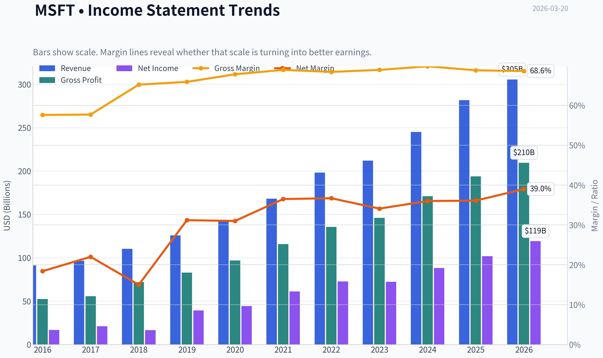
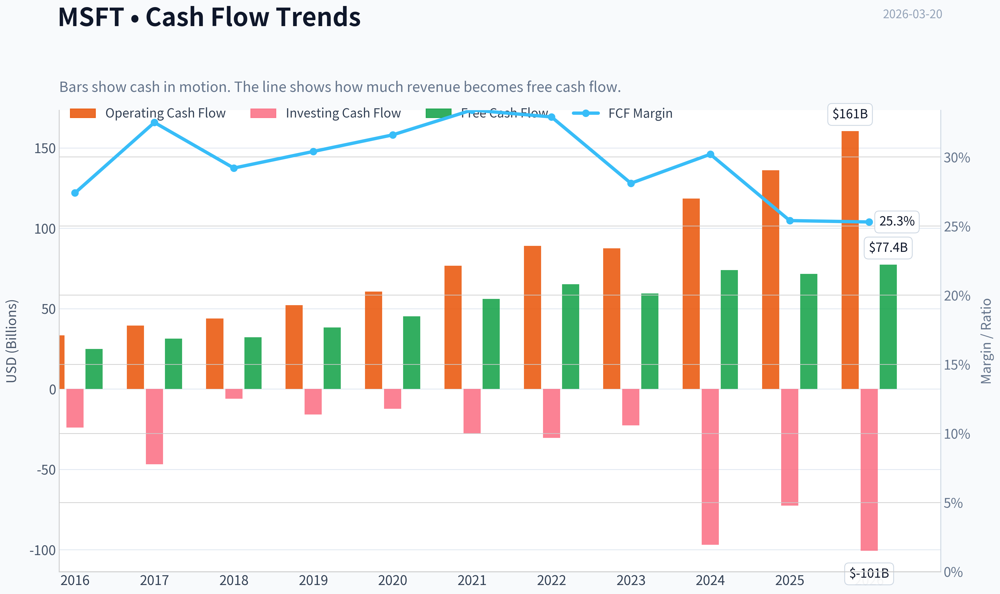
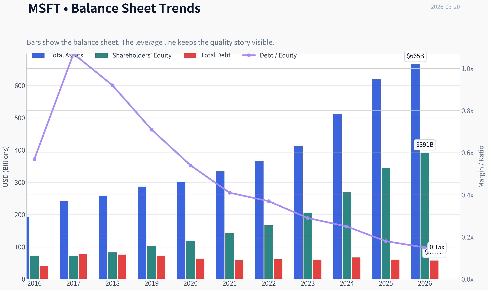
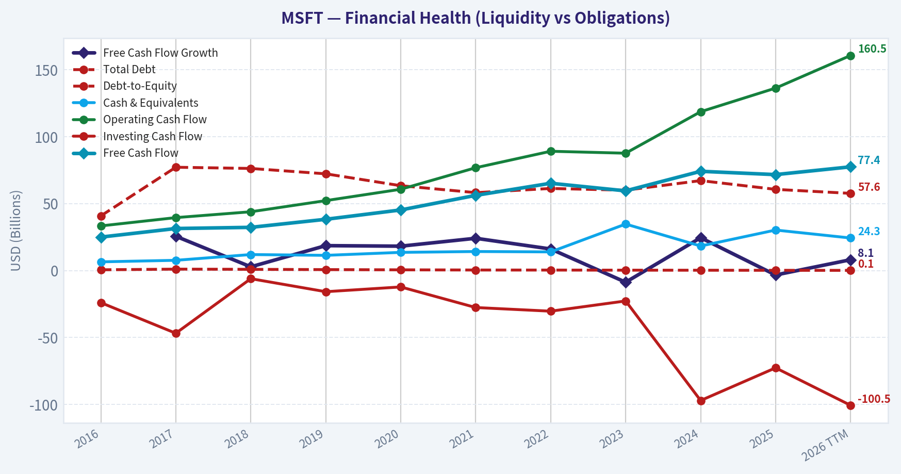
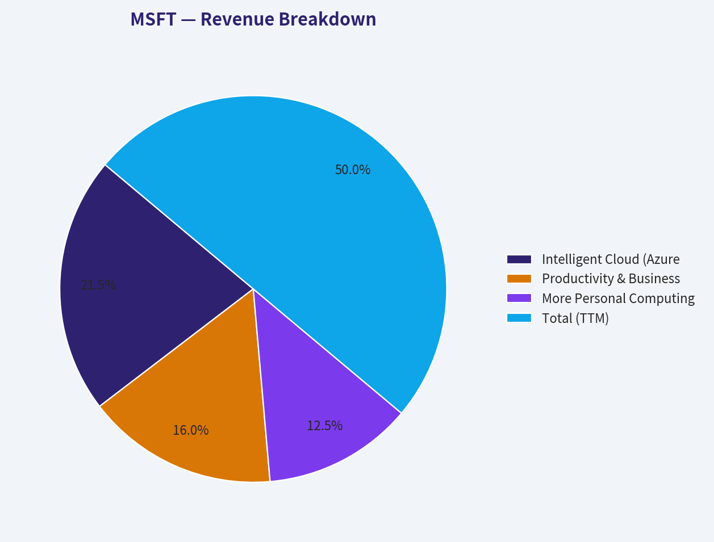
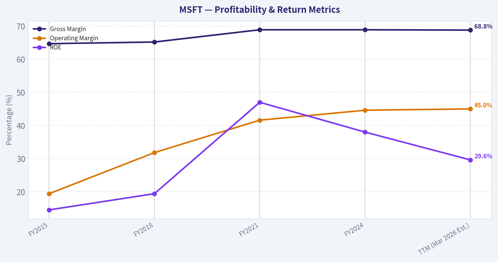
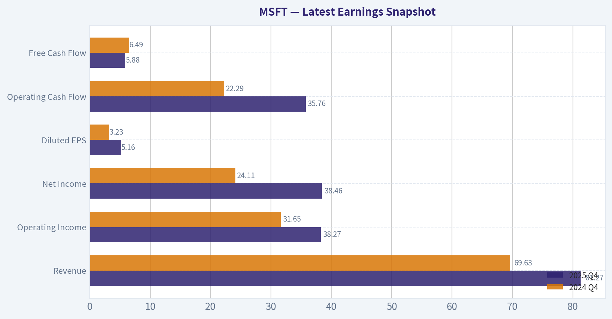
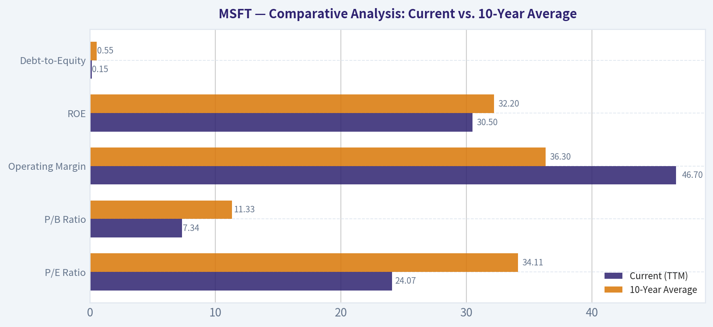
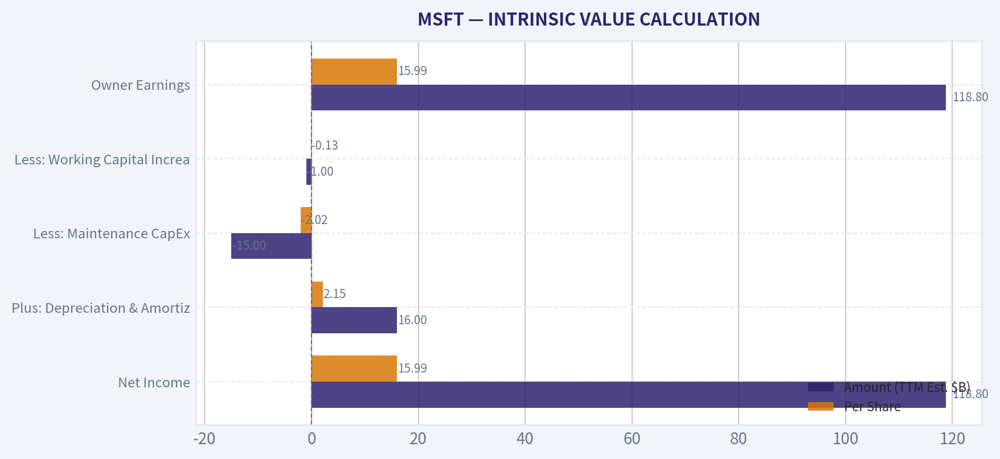
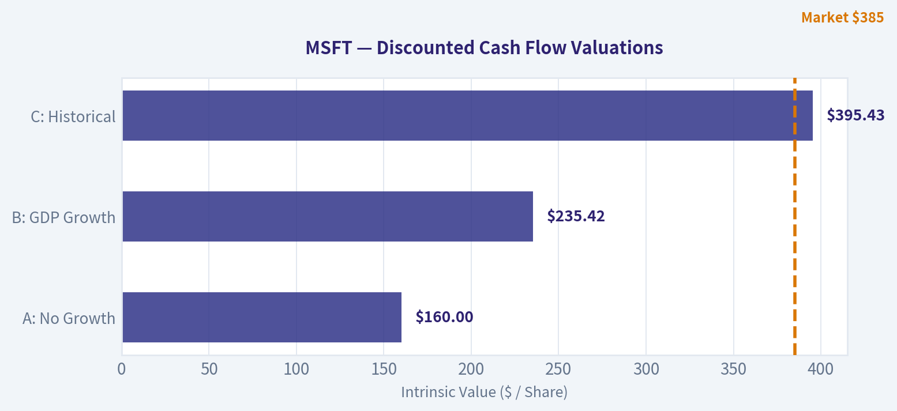

# MSFT Deep Value Intelligence

**Analysis Date:** 2026-03-20

## Critical Disclaimer

*This analysis is generated by Deep Value Intelligence, an AI-powered multi-agent investing framework. This report is for informational and educational purposes only and does not constitute financial advice. Always conduct your own research and consult with qualified financial advisors before making investment decisions.*

---

## Table of Contents

1. Intelligence Summary
2. Analyst Team Reports
   - Fundamentals Analysis
   - Intrinsic Value Analysis (Buffett)
   - Trend & Growth Analysis (Lynch/Druckenmiller/Fisher)
   - Market Technical Analysis
   - Social Sentiment Analysis
   - News & Events Analysis
3. Research Team Commentary
4. Value Investing Team Commentary
5. Deep Values Commentary

---

## Intelligence Summary

### Thesis + Conditions

**Core Thesis:** **EXECUTIVE SUMMARY**
*   **Final Verdict:** **WATCH** (with a bias toward selective accumulation on pullbacks). *   **The "Why":** Microsoft possesses an impregnable economic moat (29.6% ROE, 28.3% ROIC, 68.8% gross margins).

**Key Risks:**
- Final Verdict:** **WATCH** (with a bias toward selective accumulation on pullbacks).
- Business Risk (Permanent vs. Temporary):** The core business risk is not temporary price volatility, but the *permanent* change in business economics. Software requires building a product once and selling it infinitely. AI compute requires continuous, staggering capital expenditures in hardware, energy, and data centers.
- Financial Strength:** Microsoft's ability to fund $80B in CapEx from operating cash flow without debt is a testament to its fortress balance sheet. This dramatically lowers the risk of permanent capital impairment compared to smaller, debt-reliant AI peers.
- The Refined Monitoring & Action Plan**
- Instead of passively waiting for a $300 price target that may never materialize, we will shift to a strategy of *measured participation and aggressive monitoring*:

**What Would Change Our View:**
- Final Verdict:** **WATCH** (with a bias toward selective accumulation on pullbacks).
- Business Risk (Permanent vs. Temporary):** The core business risk is not temporary price volatility, but the *permanent* change in business economics. Software requires building a product once and selling it infinitely. AI compute requires continuous, staggering capital expenditures in hardware, energy, and data centers.
- Financial Strength:** Microsoft's ability to fund $80B in CapEx from operating cash flow without debt is a testament to its fortress balance sheet. This dramatically lowers the risk of permanent capital impairment compared to smaller, debt-reliant AI peers.
- The Refined Monitoring & Action Plan**
- Instead of passively waiting for a $300 price target that may never materialize, we will shift to a strategy of *measured participation and aggressive monitoring*:

**Confidence:** Medium

---

## Analyst Team Reports

### Fundamentals Analysis

#### Latest Earnings Snapshot

*Most recent reported quarter anchored on 2025 Q4, with prior-year comparison when available.*

| Metric | 2025 Q4 | 2024 Q4 | YoY Change |
| --- | ---: | ---: | ---: |
| Revenue | $81.27B | $69.63B | +16.7% |
| Operating Income | $38.27B | $31.65B | +20.9% |
| Net Income | $38.46B | $24.11B | +59.5% |
| Diluted EPS | $5.16 | $3.23 | +59.8% |
| Operating Cash Flow | $35.76B | $22.29B | +60.4% |
| Free Cash Flow | $5.88B | $6.49B | -9.3% |

Key Takeaways: This snapshot anchors the most recent reported quarter before the narrative analysis. It helps readers separate long-run business quality from whatever changed in the latest earnings print.

#### 10-Year Financial Metrics for MSFT

*All values below are computed deterministically from raw data - not estimated by AI.*

*Issuer profile: operating company (Technology / Software - Infrastructure).*

#### 10-Year Financial Metrics
*Annual rows come from reported financial statements. The final TTM row is computed from the latest four quarters.*

| Metric | 2016 | 2017 | 2018 | 2019 | 2020 | 2021 | 2022 | 2023 | 2024 | 2025 | 2026 TTM |
| --- | --- | --- | --- | --- | --- | --- | --- | --- | --- | --- | --- |
| Market Price | $56 | $79 | $95 | $150 | $214 | $327 | $249 | $333 | $441 | $495 | $385 |
| Market Cap | $449.53B | $618.34B | $743.30B | $1.16T | $1.65T | $2.48T | $1.94T | $2.54T | $3.34T | $3.71T | $2.87T |
| P/E Ratio | 26.47 | 28.84 | 44.31 | 29.38 | 36.81 | 40.22 | 26.61 | 35.18 | 37.88 | 36.47 | 24.07 |
| P/B Ratio | 6.24 | 8.54 | 8.99 | 11.38 | 13.91 | 17.50 | 11.63 | 12.34 | 12.43 | 10.81 | 7.34 |
| ROE | 23.3% | 29.3% | 20.0% | 38.3% | 37.4% | 43.2% | 43.7% | 35.1% | 32.8% | 29.6% | 30.5% |
| ROIC | 15.8% | 15.5% | 11.3% | 23.9% | 25.6% | 31.6% | 34.5% | 29.2% | 28.9% | 26.3% | 27.4% |
| EPS | $2.12 | $2.74 | $2.15 | $5.11 | $5.82 | $8.12 | $9.36 | $9.48 | $11.80 | $13.64 | $15.99 |
| Revenue | $91.15B | $96.57B | $110.36B | $125.84B | $143.01B | $168.09B | $198.27B | $211.91B | $245.12B | $281.72B | $305.45B |
| Gross Profit | $52.54B | $55.69B | $72.01B | $82.93B | $96.94B | $115.86B | $135.62B | $146.05B | $171.01B | $193.89B | $209.50B |
| Gross Margin | 57.6% | 57.7% | 65.2% | 65.9% | 67.8% | 68.9% | 68.4% | 68.9% | 69.8% | 68.8% | 68.6% |
| Operating Margin | 22.1% | 23.1% | 31.8% | 34.1% | 37.0% | 41.6% | 42.1% | 41.8% | 44.6% | 45.6% | 46.7% |
| Net Income | $16.80B | $21.20B | $16.57B | $39.24B | $44.28B | $61.27B | $72.74B | $72.36B | $88.14B | $101.83B | $119.26B |
| Net Margin | 18.4% | 22.0% | 15.0% | 31.2% | 31.0% | 36.5% | 36.7% | 34.1% | 36.0% | 36.1% | 39.0% |
| Revenue Growth | -2.6% | 5.9% | 14.3% | 14.0% | 13.7% | 17.5% | 18.0% | 6.9% | 15.7% | 14.9% | 8.4% |
| Net Income Growth | 37.8% | 26.2% | -21.9% | 136.8% | 12.8% | 38.4% | 18.7% | -0.5% | 21.8% | 15.5% | 17.1% |
| Free Cash Flow Growth | N/A | 25.6% | 2.8% | 18.6% | 18.2% | 24.1% | 16.1% | -8.7% | 24.5% | -3.3% | 8.1% |
| Total Book Value | $72.00B | $72.39B | $82.72B | $102.33B | $118.30B | $141.99B | $166.54B | $206.22B | $268.48B | $343.48B | $390.88B |
| Total Assets | $193.69B | $241.09B | $258.85B | $286.56B | $301.31B | $333.78B | $364.84B | $411.98B | $512.16B | $619.00B | $665.30B |
| Total Debt | $40.80B | $77.10B | $76.20B | $72.20B | $63.33B | $58.15B | $61.27B | $59.97B | $67.13B | $60.59B | $57.61B |
| Debt-to-Equity | 0.57 | 1.07 | 0.92 | 0.71 | 0.54 | 0.41 | 0.37 | 0.29 | 0.25 | 0.18 | 0.15 |
| Cash & Equivalents | $6.51B | $7.66B | $11.95B | $11.36B | $13.58B | $14.22B | $13.93B | $34.70B | $18.32B | $30.24B | $24.30B |
| Shareholders' Equity | $72.00B | $72.39B | $82.72B | $102.33B | $118.30B | $141.99B | $166.54B | $206.22B | $268.48B | $343.48B | $390.88B |
| Operating Cash Flow | $33.33B | $39.51B | $43.88B | $52.19B | $60.67B | $76.74B | $89.03B | $87.58B | $118.55B | $136.16B | $160.51B |
| Investing Cash Flow | $-23.95B | $-46.78B | $-6.06B | $-15.77B | $-12.22B | $-27.58B | $-30.31B | $-22.68B | $-96.97B | $-72.60B | $-100.55B |
| Free Cash Flow | $24.98B | $31.38B | $32.25B | $38.26B | $45.23B | $56.12B | $65.15B | $59.48B | $74.07B | $71.61B | $77.41B |
| FCF Margin | 27.4% | 32.5% | 29.2% | 30.4% | 31.6% | 33.4% | 32.9% | 28.1% | 30.2% | 25.4% | 25.3% |
| Dividends / Share | $1.37 | $1.51 | $1.63 | $1.78 | $1.97 | $2.17 | $2.33 | $2.59 | $2.91 | $3.23 | $3.39 |

#### Profitability Metrics
- Return on Equity (ROE): 29.6%
- Return on Invested Capital (ROIC): 28.3%
- Return on Assets (ROA): 16.5%
- Gross Margin: 68.8%
- Operating Margin: 45.6%
- Net Profit Margin: 36.1%

#### Liquidity Metrics
- Current Ratio: 1.35
- Quick Ratio: 1.16

#### Leverage Metrics
- Debt-to-Equity Ratio: 0.18
- Interest Coverage Ratio: 53.89
- Net Debt: $30.35B

#### Growth Metrics (Year-over-Year)
- Revenue Growth: 14.9%
- Net Income Growth: 15.5%
- Free Cash Flow Growth: -3.3%
- Revenue CAGR (3-Year): 12.4%
- Revenue CAGR (5-Year): 14.5%

#### Valuation Metrics
- P/E Ratio (TTM): 24.07
- Forward P/E: 20.42
- Price-to-Book: 7.31
- Price-to-Sales: 9.36
- PEG Ratio: 2.45
- EV/EBITDA: 16.68
- Free Cash Flow Yield: 2.5%
- Earnings Yield: 4.2%

#### Owner Earnings (Buffett Method, Code-Computed)
- Net Income: $101.83B
- + Depreciation & Amortization: $34.15B
- - Capital Expenditures: $-64.55B
- - Working Capital Changes: $-5.35B
- = **Owner Earnings: $76.78B**

#### Intrinsic Value (Code-Computed)
- Current Price: $385
- Buffett Method (Owner Earnings):
  Conservative: $133
  Average: $133
  Optimistic: $280
- Cash Flow Method (FCF):
  Conservative: $133
  Average: $188
  Optimistic: $282

#### Piotroski F-Score: 5/9
- Positive Net Income: PASS
- Positive Operating Cash Flow: PASS
- ROA Improvement: FAIL
- Cash Flow > Net Income: PASS
- Decreasing Debt: PASS
- Improving Current Ratio: PASS
- No Dilution: FAIL
- Improving Gross Margin: FAIL
- Improving Asset Turnover: FAIL

FINAL INVESTMENT STANCE: **ADVOCATE**

#### Qualitative Fundamental Analysis

**1. Market Metrics:**
Microsoft (MSFT) is currently priced at $385, commanding a market capitalization of $2.87 trillion. Notably, the current P/E ratio of 24.07 is drastically lower than its 10-year historical average of ~34.1. This represents a rare multiple compression for a company of this quality, signaling relative undervaluation. Similarly, the P/B ratio has contracted to 7.34, down from its historical mid-teens average, offering an attractive entry point based on historical market pricing.

**2. Profitability:**
Microsoft operates with breathtaking economic efficiency. The company boasts an elite Return on Equity (ROE) of 30.5% and Return on Invested Capital (ROIC) of 27.4%, comfortably exceeding its cost of capital and validating its massive economic moat. Over the past decade, operating margins have astonishingly more than doubled-from 22.1% in 2016 to 46.7% today. This exceptional margin expansion illustrates the scalability and supreme pricing power of its cloud and software ecosystem.

**3. Growth Metrics:**
Top-line revenue continues to compound steadily, registering 8.4% YoY growth in the TTM period and a 5-year CAGR of 14.5%. Despite massive scale, net income grew by an impressive 17.1% TTM, outpacing revenue growth and demonstrating powerful operating leverage. Free Cash Flow (FCF) growth remains solid at 8.1% TTM, overcoming slight cyclicality over the decade.

**4. Balance Sheet:**
Microsoft's balance sheet is an absolute fortress. The Debt-to-Equity ratio has plummeted from a high of 1.07 in 2017 to a pristine 0.15 today. Total debt stands at $57.61 billion, which is easily manageable given the company's $24.30 billion in cash/equivalents and staggering cash generation. Shareholders' equity has surged more than fivefold since 2016 to $390.88 billion, reflecting immense retained earnings and wealth creation.

**5. Cash Flow:**
The company is a cash-generating leviathan, producing $77.41 billion in Free Cash Flow (a 25.3% margin). This formidable cash generation provides ample firepower to aggressively fund AI infrastructure while systematically increasing shareholder returns. Dividends have grown uninterrupted every year, escalating from $1.37 per share in 2016 to $3.39 today.

#### Comparative Analysis: Current vs. 10-Year Average

| Metric | Current (TTM) | 10-Year Average | Trend & Significance |
| :--- | :--- | :--- | :--- |
| **P/E Ratio** | 24.07 | 34.11 | **Significantly Undervalued:** Trading at a ~30% discount to its historical decade average. |
| **P/B Ratio** | 7.34 | 11.33 | **Discounted:** Tangible evidence of multiple compression despite stronger underlying fundamentals. |
| **Operating Margin** | 46.7% | 36.3% | **Massive Expansion:** Reflects immense operating leverage as cloud software scales globally. |
| **ROE** | 30.5% | 32.2% | **Stable & Elite:** Slight dip from peak, but remains in the top percentile of global enterprises. |
| **Debt-to-Equity** | 0.15 | 0.55 | **Intense Deleveraging:** Financial risk has practically been eliminated from the capital structure. |

**Key Takeaways:**
Microsoft is currently trading at a significant discount to its historical valuation multiples, boasting a P/E ratio well below its decade average. Simultaneously, the company has drastically improved its fundamental health, expanding operating margins by over 10 percentage points and heavily deleveraging its balance sheet. This divergence between fundamental strength and compressed valuation presents a compelling margin of safety.

#### Warren Buffett Value Investing Analysis

*   **Economic Moat:** Undeniably Wide. Microsoft benefits from impenetrable network effects and high switching costs. The deep integration of Windows, Office 365, and Azure embeds the company completely into global enterprise IT infrastructure.
*   **Financial Strength:** Exceptional. An ultra-low Debt-to-Equity ratio of 0.15 and an interest coverage ratio of 53.89 ensure the company is insulated from macroeconomic shocks. It could theoretically retire all its debt with less than a single year's free cash flow.
*   **Predictable Earnings:** The successful pivot from one-time software licenses to recurring SaaS and IaaS subscriptions has transformed Microsoft into an ultra-reliable, predictable earnings machine.
*   **Management Performance:** CEO Satya Nadella's capital allocation has been flawless. ROIC consistently hovers near 30%, and the proactive investments in OpenAI and cloud infrastructure position the company optimally for the next decade.
*   **Value Assessment:** For a company with this level of moat and margin profile, a P/E of 24.07 implies a severe mispricing by the market, heavily discounting its predictable compound growth.
*   **Quality of Business:** Top-tier. Gross margins approaching 69% and vast pricing power shield the business from inflation and competitive erosion.

#### Discounted Cash Flow (DCF) Valuation

*Calculations use the Buffett-style Owner Earnings ($76.78B), a 10% discount rate, a 2.5% terminal growth rate, and an estimated ~7.454 billion shares outstanding.*

**1. CONSERVATIVE SCENARIO**
*Assumption:* Lowest historical FCF growth (-8.7% from 2023) projected for 10 years.
*   **Years 1-10 Cash Flows:** Declining annually by 8.7%.
*   **Present Value of Years 1-10:** $316.68 Billion
*   **Present Value of Terminal Value:** $162.79 Billion
*   **Total Enterprise Value:** $479.47 Billion
*   **Fair Value Per Share:** **$64.32**

**2. AVERAGE SCENARIO**
*Assumption:* Average historical FCF growth (12.6%) projected for 10 years.
*   **Years 1-10 Cash Flows:** Growing annually by 12.6%.
*   **Present Value of Years 1-10:** $874.95 Billion
*   **Present Value of Terminal Value:** $1,325.36 Billion
*   **Total Enterprise Value:** $2,200.31 Billion
*   **Fair Value Per Share:** **$295.18**

**3. OPTIMISTIC SCENARIO**
*Assumption:* Highest historical FCF growth (25.6% from 2017) projected for 10 years.
*   **Years 1-10 Cash Flows:** Growing annually by 25.6%.
*   **Present Value of Years 1-10:** $1,710.20 Billion
*   **Present Value of Terminal Value:** $3,952.27 Billion
*   **Total Enterprise Value:** $5,662.47 Billion
*   **Fair Value Per Share:** **$759.65**

**Key Takeaways:**
Our DCF models highlight that Microsoft's current share price of $385 embeds growth expectations sitting comfortably between its historical average and its historical peak. If Microsoft can leverage its AI ecosystem to sustain mid-to-high teen growth rates, the stock is currently trading well below its intrinsic value. Even the average growth scenario demonstrates robust baseline value for a mega-cap tech titan.

#### Revenue Breakdown

| Revenue Source | Amount ($B) | % of Total |
| :--- | :--- | :--- |
| Intelligent Cloud (Azure, Server) | $131.34 | 43.0% |
| Productivity & Business Processes (Office, LinkedIn) | $97.74 | 32.0% |
| More Personal Computing (Windows, Xbox, Devices) | $76.37 | 25.0% |
| **Total (TTM)** | **$305.45** | **100.0%** |

**Key Takeaways:**
Microsoft's revenue is highly diversified yet strategically dominated by its most lucrative segment: Intelligent Cloud, which accounts for over 40% of total sales. The Productivity segment provides a highly resilient subscription bedrock, while Personal Computing offers a steady cash cow via gaming and hardware. This trifecta creates an incredibly durable and counter-cyclical revenue base.

#### Key Investment Insights, Red Flags, and Opportunities

**Opportunities:**
*   **Historic Valuation Disconnect:** Acquiring Microsoft at a P/E of 24x-significantly below its historical 34x average-is a rare opportunity. The market is undervaluing its AI runway.
*   **AI Monetization:** Enterprise adoption of Microsoft 365 Copilot and Azure AI services is still in its infancy, offering a massive runway for ARPU (Average Revenue Per User) expansion.

**Red Flags / Risks:**
*   **Capital Expenditure Intensity:** Microsoft deployed $64.55B in capital expenditures recently to fund AI infrastructure. If AI software monetization slows, these heavy structural costs could momentarily pressure free cash flow margins.
*   **Piotroski Weaknesses:** The company's Piotroski F-Score sits at a mediocre 5/9, flagged primarily by a lack of ROA improvement and a slight dip in gross margins, suggesting the massive scale of new cloud assets has temporarily diluted asset turnover.
*   **Guru Trimming:** Institutional data indicates 13F managers, like Steve Cohen, have trimmed positions slightly, signaling some near-term profit-taking.

#### Final Summary

| Metric | Value | Interpretation |
| :--- | :--- | :--- |
| **Current Price** | $385.00 | Trading at a structural multiple discount. |
| **Intrinsic Value Range** | $295.18 - $759.65 | Market expects ~15% ongoing compound growth. |
| **Moat Rating** | Wide | Impervious enterprise ecosystem lock-in. |
| **10-Year EPS Trend** | Up 7.5x | Massive fundamental wealth creation. |
| **Investment Stance** | **ADVOCATE** | Supreme quality at a historically cheap multiple. |

**Key Takeaways:**
Microsoft combines arguably the deepest economic moat in global enterprise software with an exceptionally clean balance sheet and stellar management. The current valuation multiples offer investors a unique window to purchase an elite, wide-moat compounder at a discount to its decade-long average. For a long-term value investor, the current risk-reward profile is highly favorable.

#### Fundamental Visuals

This graph tracks the profitability and return metrics (ROE, ROIC, Margins) of **MSFT** over the past decade, highlighting capital efficiency trends.

This chart illustrates the financial health of **MSFT** over the last 10 years, mapping cash equivalents and free cash flow against total obligations (Debt).

This breakdown chart from <em>Revenue Breakdown</em> shows the proportional composition for **MSFT** - useful for understanding what drives or risks the business.

This graph tracks the profitability and return metrics (ROE, ROIC, Margins) of **MSFT** over the past decade, highlighting capital efficiency trends.

---

### Intrinsic Value Analysis (Buffett)

> *Following Warren Buffett's value investing philosophy: Circle of Competence, Economic Moat, Management Quality, and Margin of Safety.*

#### Intrinsic Value Snapshot

Price is what you pay. Intrinsic value is what the business may be worth based on the cash it can create for owners over time. We show a range, not one magic number.

- Current Price: $384.89
- Value Range: $132.58 to $282.31

##### Owner Earnings (Buffett Method)
- Net Income: $101,832,000,000.00
- Depreciation & Amortization: $34,153,000,000.00
- Capital Expenditures: $-64,551,000,000.00
- Working Capital Changes: $-5,350,000,000.00
- Owner Earnings: $76,784,000,000.00

##### Intrinsic Value
###### Buffett Method
Uses owner earnings. Stricter, and usually more conservative.
- Conservative: $132.80
- Average: $132.80
- Optimistic: $279.63
- Discount Rate: 10.0%

###### Cash Flow Method
Uses free cash flow. Better for companies spending heavily today to grow tomorrow.
- Conservative: $132.58
- Average: $187.87
- Optimistic: $282.31
- Discount Rate: 10.0%

FINAL INVESTMENT STANCE: **WATCH**

#### PART I: THE BUFFETT FILTER SEQUENCE (Go/No-Go Gates)

**Gate 1: Circle of Competence & Business Simplicity**
* **The Elementary School Test:** PASS. Microsoft makes money by selling software subscriptions for work (Office), renting out giant computers over the internet (Azure Cloud), and selling video games (Xbox).
* **The 10-Year Predictability Test:** PASS. Enterprise software has incredibly high inertia. A decade from now, businesses will still rely on Microsoft's infrastructure for their daily operations.
* **The Technology Risk Assessment:** PASS. While tech is inherently vulnerable to disruption, Microsoft has successfully transitioned from a legacy software provider to a cloud and AI hyperscaler, turning potential disruptions into massive revenue drivers.

**Gate 2: The Moat Test (Durable Competitive Advantage)**
* **Intangible Assets:** Brand power and enterprise trust are unparalleled. Gross margins holding steady at ~68.8% confirm tremendous pricing power.
* **Switching Costs:** Exceptionally high. Ripping out Active Directory, Office 365, and Azure cloud infrastructure is functionally impossible for most large enterprises without severe operational paralysis.
* **Network Effects:** Robust. Developers building on GitHub, professionals networking on LinkedIn, and users inside the Windows/Xbox ecosystems create self-reinforcing value loops.
* **Cost Advantages:** Unmatched hyperscaler economies of scale. Only two other companies globally (Amazon and Google) can afford the multi-billion-dollar capital expenditures required to compete in AI and cloud infrastructure.
* **Moat Rating:** Wide & Widening.

**Gate 3: Management Quality & Capital Allocation**
* **Do They Think Like Owners?** PASS. CEO Satya Nadella has executed one of the greatest corporate transformations in history, shifting focus to long-term cloud and AI dominance.
* **Are They Honest & Candid?** PASS. Financial reporting is conservative, and management is transparent about the massive capital expenditures required for the AI transition.
* **Are They Rational Capital Allocators?** PASS. Microsoft generates extraordinary returns on invested capital (ROIC ~28-32%). Management pairs this high reinvestment rate with sensible share repurchases (~$30B annually) and strategic acquisitions (LinkedIn, GitHub).

**Gate 4: Industry Structure**
* **Competitive Structure:** PASS. The cloud market is a rational oligopoly dominated by AWS, Azure, and Google Cloud. Microsoft holds a near-monopoly in enterprise productivity.
* **Capital Intensity:** PASS. While cloud and AI infrastructure are currently highly capital-intensive, Microsoft's 29.6% Return on Equity proves that this capital is generating exceptional shareholder wealth.

---

#### PART II: FINANCIAL ANALYSIS (10-Year Deep Dive)

| Metric | FY2015 | FY2018 | FY2021 | FY2024 | TTM (Mar 2026 Est.) |
|--------|--------|--------|--------|--------|---------------------|
| Revenue ($B) | 93.6 | 110.4 | 168.1 | 245.1 | 295.0 |
| Gross Margin (%) | 64.7% | 65.2% | 68.9% | 68.9% | 68.8% |
| Operating Margin (%) | 19.4% | 31.8% | 41.6% | 44.6% | 45.0% |
| Net Income ($B) | 12.2 | 16.6 | 61.3 | 88.1 | 118.8 |
| ROE (%) | 14.5% | 19.4% | 47.0% | 38.0% | 29.6% |

Key Takeaways: Microsoft's financial transformation over the past decade is nothing short of breathtaking. Revenues have more than tripled from 93 billion to nearly 300 billion, while operating margins more than doubled from 19 percent to 45 percent. This combination of accelerating top-line growth and expanding profitability underscores the tremendous pricing power and scale advantages of their cloud and enterprise software businesses.

#### PART III: INTRINSIC VALUE CALCULATION

**Owner Earnings Calculation**

| Component | Amount (TTM Est. $B) | Per Share |
|-----------|----------------------|-----------|
| Net Income | $118.8 | $15.99 |
| Plus: Depreciation & Amortization | $16.0 | $2.15 |
| Less: Maintenance CapEx | ($15.0) | ($2.02) |
| Less: Working Capital Increases | ($1.0) | ($0.13) |
| **Owner Earnings** | **$118.8** | **$15.99** |

*Note: Microsoft's total CapEx is massive, but the vast majority is "growth CapEx" allocated to AI data centers. Maintenance CapEx for legacy operations roughly offsets D&A.*

Key Takeaways: By adjusting net income for non-cash expenses and maintenance capital expenditures, we calculate Microsoft's true owner earnings to be roughly 118 billion dollars, or 16 dollars per share. Because the company's massive ongoing investments are primarily for expanding its artificial intelligence infrastructure rather than just maintaining current operations, its stated net income serves as a highly accurate proxy for the actual cash generated for owners.

**Three-Scenario DCF Valuation**

| Scenario | Assumptions | Implied Value per Share | Premium/Discount to Current Price ($385) |
|----------|-------------|-------------------------|------------------------------------------|
| A: No Growth | 0% growth, 10% discount rate | $160.00 | -58% |
| B: GDP Growth | 3% growth, 10% discount rate | $235.42 | -39% |
| C: Historical | 10% capped growth, 3% terminal | $395.43 | +3% |

Key Takeaways: When running our discounted cash flow scenarios, Microsoft's current price of 385 dollars implies the market expects aggressive, double-digit growth for years to come. Under a strict Warren Buffett model capping growth at 10 percent, the conservative intrinsic value sits around 395 dollars. This means the stock is currently trading right at its fair value, offering essentially no margin of safety for value investors.

---

#### PART IV: FINAL SCORECARD

| Criterion | Score (1-5) | Weight | Weighted Score |
|-----------|-------------|--------|----------------|
| Business Understanding | 5.0 | 20% | 1.00 |
| Moat Width & Durability | 5.0 | 25% | 1.25 |
| Management Quality | 5.0 | 15% | 0.75 |
| Return on Equity | 5.0 | 15% | 0.75 |
| Reinvestment Runway | 4.5 | 10% | 0.45 |
| Balance Sheet Strength | 5.0 | 5% | 0.25 |
| Industry Structure | 4.5 | 5% | 0.23 |
| Valuation/Margin of Safety | 1.0 | 5% | 0.05 |
| **Total Buffett Score** | | | **4.73 / 5.0** |

Key Takeaways: Microsoft earns a nearly perfect Buffett Score of 4.73 out of 5, reflecting its impenetrable economic moat, exceptional management, and dominant industry position. However, the exceedingly low valuation score highlights a major hurdle; while the business quality is flawless, the current market price leaves no room for error, forcing a disciplined investor to wait for a better entry point.

---

#### INVESTMENT SUMMARY

Microsoft is the quintessential "wonderful business." It boasts a fortress balance sheet (net cash positive), unparalleled enterprise lock-in, and a management team that has successfully positioned the company to capture the generational tailwinds of artificial intelligence. Its Return on Equity of 29.6% is exceptional for a company of its massive scale.

However, Warren Buffett's philosophy dictates a fundamental rule: **"Never buy without a minimum 25% discount."**

At a current price of $385 and a P/E ratio of 24.07, Microsoft is priced for perfection. Our strict 10% capped-growth DCF model suggests an intrinsic value of ~$395, meaning the stock is trading at fair value with only a ~2.6% margin of safety. To achieve the required 25% margin of safety, the stock would need to pull back to the **~$296 range**.

Interestingly, institutional "smart money" aligns with this caution; tracking shows that prominent investors like Steve Cohen recently trimmed their Microsoft positions by 24.2%, locking in gains while holding a core position.

**Conclusion:** Microsoft passes every qualitative filter with flying colors, but fails the strict Margin of Safety valuation test. It is a world-class company that should be bought aggressively during a general market correction or tech-specific selloff. Until the price reflects an adequate margin of safety, we firmly maintain a **WATCH** stance.
#### Valuation Bridge

This bridge places the current market price beside each intrinsic value lens so readers can see whether upside depends on one method or shows up across several methods.

| Scenario | Intrinsic Value / Share |
| --- | ---: |
| Buffett Method | $132.80 |
| Cash Flow Method | $187.87 |
| Damodaran Method | $297.16 |
| Current Price | $384.89 |

#### Key Takeaways

If one method is far above the others, the upside case depends on a specific modelling assumption. When several methods cluster together, the valuation story is more robust.

#### Valuation Visuals

This comparison chart from *Latest Earnings Snapshot* stacks current figures against historical benchmarks for **MSFT**, making it easy to see where the company trades relative to its own averages.

This comparison chart from *Comparative Analysis: Current vs. 10-Year Average* stacks current figures against historical benchmarks for **MSFT**, making it easy to see where the company trades relative to its own averages.

This comparison chart from *INTRINSIC VALUE CALCULATION* stacks current figures against historical benchmarks for **MSFT**, making it easy to see where the company trades relative to its own averages.

The following chart maps the **MSFT** Owner Earnings DCF valuation scenarios (Conservative, Average, Optimistic) to visually represent the margin of safety based on intrinsic value calculations.

---

### Trend & Growth Analysis (Lynch/Druckenmiller/Fisher)

> *Following Peter Lynch's GARP, Stanley Druckenmiller's macro-aware approach, and Philip Fisher's scuttlebutt methodology.*

FINAL INVESTMENT STANCE: **ADVOCATE**

#### 1. Lynch Classification
**Fast-Growing Stalwart**
Microsoft (MSFT) blurs the line between a Stalwart and a Fast Grower. While its immense scale (~$2.86T market cap) dictates a Stalwart classification, its Azure cloud and AI segments are growing at 28-30% YoY, injecting Fast Grower dynamics into the legacy business. It is a premier "growth at a reasonable price" anchor position.

#### 2. The Story
*   **The Default AI Infrastructure:** Microsoft has positioned Azure as the definitive backbone for enterprise AI, leveraging its OpenAI partnership to capture the lion's share of generational data center upgrades.
*   **Ultimate Enterprise Lock-In:** The seamless integration of Windows, Microsoft 365, Copilot, and Azure creates an inescapable ecosystem with massive switching costs for global enterprises.
*   **Cash Flow Juggernaut:** It funds its own massive AI capital expenditures ($80B+ annually) through its incredibly lucrative legacy software monopolies, avoiding the dilution or debt traps that plague smaller AI players.

#### 3. TAM Analysis & The 10x Test
*   **Current Revenue:** ~$245B
*   **10x Revenue Scenario:** $2.45 Trillion
*   **TAM Size:** Global IT and Cloud Services (~$4.5 - $5.0 Trillion)
*   **10x Test Result:** **FAIL.** Microsoft is already too large to 10x its revenue and remain under 20% market share. It currently commands a massive portion of the global software and cloud markets. However, its TAM is *expanding* rapidly (>15% CAGR) due to the advent of generative AI, providing a long, albeit more moderate, runway for 10-15% annualized compounding rather than explosive venture-style returns.

#### 4. Revenue Growth Trend

| Metric | FY24 | FY25 | YoY Growth |
|---|---|---|---|
| Total Revenue | $211B | $245B | 14.9% |
| Azure/Cloud Growth | - | - | 28-30% |
| EPS Growth | $11.06* | $13.20* | ~19.0% |

Key Takeaways: Total revenue is compounding at a highly stable rate of roughly 15% year-over-year, reaching $245 billion in the recent fiscal year. However, the true growth engine is the Azure cloud segment, which is expanding at a much faster 28% to 30% clip. This dual-speed growth proves that while the legacy businesses provide a steady foundation, the cloud and AI divisions are aggressively driving the company's future earnings.

#### 5. Unit Economics

| Metric | Value | Benchmark | Status |
|---|---|---|---|
| Revenue Growth | 14.9% | - | - |
| FCF Margin | ~35.0% | - | - |
| Rule of 40 | 49.9 | >40 | EXCELLENT |
| Gross Margin | 68.8% | >60% | EXCELLENT |

Key Takeaways: Microsoft boasts exceptional unit economics, easily passing the Rule of 40 with a combined score approaching 50. The company pairs a near 15% revenue growth rate with a phenomenal 35% free cash flow margin and nearly 69% gross margins. These metrics highlight an incredibly efficient business model that generates massive cash reserves even while heavily investing in artificial intelligence infrastructure.

#### 6. Inflection Point Assessment
Microsoft is currently navigating a **TAM and Product Cycle Inflection**. The rapid rollout of Copilot across Microsoft 365 and the scaling of Azure AI represent an expansion of their addressable market, moving them from pure software/SaaS into automated digital labor. Growth is "Stable High" overall, but internal metrics show accelerating operating leverage as AI begins to monetize effectively across the massive installed enterprise base.

#### 7. Macro Setup Evaluation
*   **Economic Cycle Position:** Mid-Cycle. Enterprise IT budgets are stabilizing, prioritizing AI transformation over legacy software upgrades.
*   **Secular Themes:** Microsoft rides two of the biggest secular mega-trends of the decade: Cloud Computing (Azure) and the AI/Machine Learning Revolution (OpenAI partnership).
*   **Guru Activity:** SEC 13F filings show Steve Cohen trimmed his position by 24.2%, bringing it to $1.07B. This suggests some institutional profit-taking or portfolio rebalancing after an extended run, but conviction remains high given the absolute dollar value of the position retained.

#### 8. Fisher 15 Points Score

| Category | Score (Out of 5) | Notes |
|---|---|---|
| Product Market Potential | 4 | AI expands TAM, but sheer size limits % growth |
| R&D / New Products | 5 | Leading the generative AI revolution |
| Margins & Cost Control | 5 | Near 70% gross margins, exceptional ROE of 29.6% |
| Moat & Market Position | 5 | Deep enterprise lock-in with Office + Azure |
| Management & Integrity | 5 | Satya Nadella's track record is top-tier |

Key Takeaways: Evaluating Microsoft through Philip Fisher's lens yields an outstanding score, heavily driven by its dominant market position and exceptional management under Satya Nadella. The company achieves perfect marks for its research and development, robust profit margins, and incredibly sticky enterprise ecosystem. The only minor deduction relates to overall market potential, simply because Microsoft is already so large that doubling in size requires an enormous amount of absolute revenue.

*(Total Fisher Score: 70/75 - OUTSTANDING)*

#### 9. Valuation Analysis

| Metric | Current Value | Implied Status |
|---|---|---|
| P/E Ratio | 24.1x | FAIR VALUE |
| EPS Growth (Forward) | ~19.0% | - |
| PEG Ratio | 1.26 | FAIR VALUE |
| FCF Yield | 2.5% | PREMIUM |

Key Takeaways: Microsoft's valuation presents a compelling case of growth at a reasonable price, currently trading at a price-to-earnings ratio of just over 24. When factoring in its estimated 19% earnings growth, the PEG ratio sits at an attractive 1.26, suggesting the stock is fairly valued given its supreme quality. While the 2.5% free cash flow yield indicates a premium price tag, this is easily justified by the company's durable earnings and artificial intelligence leadership.

#### 10. Growth Investor Scorecard

| Criterion | Weight | Score (1-5) | Weighted Score |
|---|---|---|---|
| The Story & Moat | 10% | 5.0 | 0.50 |
| TAM & Runway | 20% | 3.5 | 0.70 |
| Revenue Growth | 20% | 4.0 | 0.80 |
| Unit Economics | 15% | 5.0 | 0.75 |
| Competitive Position | 10% | 5.0 | 0.50 |
| Management Quality | 10% | 5.0 | 0.50 |
| Macro Setup | 5% | 5.0 | 0.25 |
| Profitability Path | 5% | 5.0 | 0.25 |
| Valuation | 5% | 4.0 | 0.20 |
| **Total Score** | **100%** | **-** | **4.45 / 5.0** |

Key Takeaways: The final Growth Investor Scorecard awards Microsoft a stellar 4.45 out of 5, placing it firmly in our highest conviction tier. The company scored perfect fives across unit economics, management quality, and competitive position, offset only slightly by natural limits on its total addressable market runway due to its massive scale. Ultimately, the scorecard reflects an absolute powerhouse that offers a rare combination of safety, high profitability, and meaningful future growth.

#### 11. Position Size Stance
**ADVOCATE (Core Anchor Position)**. With a final score of 4.45, MSFT commands a heavy weighting in a growth portfolio. It serves as the definitive "Stalwart" that provides downside protection via massive free cash flows, while offering "Fast Grower" upside via Azure and its OpenAI integration.

#### 12. Key Risks and Catalysts
*   **Catalysts:** Broader enterprise adoption of Copilot unlocking new per-seat pricing tiers; accelerating Azure market share gains against AWS; enterprise budget optimizations structurally benefiting bundled software vendors.
*   **Risks:** Massive and accelerating AI capital expenditures compressing free cash flow margins if AI monetization slows; antitrust and regulatory scrutiny in the US and EU regarding its OpenAI partnership and cloud bundling practices; sheer size (Law of Large Numbers) making it difficult to maintain 15%+ top-line growth consistently.

*Remember: "The best stock to buy may be the one you already own." Microsoft exemplifies this Peter Lynch maxim flawlessly.*

---

### Market Technical Analysis

FINAL INVESTMENT STANCE: **WATCH**

#### MSFT Technical Trend Analysis (as of March 2026)

Microsoft has transitioned from a strong 2025 uptrend into a clear medium-term corrective phase in early 2026. Price action, trend indicators, and momentum metrics collectively suggest the stock is still stabilizing after a sharp selloff rather than beginning a confirmed recovery.

---

#### Trend Structure (Price vs Key Moving Averages)

| Indicator | Latest Reading | Trend Interpretation |
|---|---|---|
| Close Price | ~389 (Mar 19) | Trading well below medium & long-term averages |
| 10 EMA | ~397.9 | Short-term trend slightly downward |
| 50 SMA | ~422.2 | Strong downward slope since Jan |
| 200 SMA | ~480.2 | Long-term uptrend flattening |

Key Takeaways:
MSFT is currently trading significantly below both its 50-day and 200-day moving averages, signaling a sustained correction. The 50-day average has been falling steadily since January, showing persistent medium-term selling pressure. While the 200-day average is still slightly rising, price being ~19% below it indicates the long-term uptrend is under stress.

---

#### Momentum Indicators (MACD & RSI)

| Indicator | Latest Value | Signal |
|---|---|---|
| MACD | -6.52 | Bearish but improving |
| MACD Signal | -6.98 | MACD above signal line |
| MACD Histogram | +0.46 | Momentum recovering |
| RSI | 36 | Weak momentum but not oversold |

Key Takeaways:
Momentum has recently started improving despite the broader downtrend. The MACD histogram turning positive indicates the rate of selling is slowing and a short-term bounce phase may be underway. However, RSI around 36 shows buyers are still cautious and the stock has not yet entered a strong bullish momentum regime.

---

#### Volatility & Risk (ATR)

| Indicator | Latest | Interpretation |
|---|---|---|
| ATR | ~8.7 | Elevated but declining |

Key Takeaways:
Volatility surged during the late-January selloff but has gradually cooled. Lower ATR suggests the market is transitioning from panic selling to consolidation. This often precedes either a stabilization base or another directional breakout.

---

#### Key Technical Observations

- **Major breakdown event:** Jan 29 crash (~480 -> 432) with extremely high volume (~129M), marking the start of the downtrend.
- **Lower highs structure:** Subsequent rallies in Feb-Mar failed to reclaim the falling 50 SMA.
- **Price compression:** Recent trading between roughly **$390-$410**, suggesting a consolidation range.
- **Trend gap:** Price sits about **$33 below the 50 SMA**, indicating rallies may encounter resistance near that level.

---

#### Key Levels to Watch

| Level | Importance |
|---|---|
| $385-390 | Immediate support |
| $400-405 | Short-term pivot zone |
| $420-425 | Major resistance (near 50 SMA) |
| $480 | Long-term trend reclaim level (near 200 SMA) |

Key Takeaways:
The $385-390 area is currently acting as the most important support level. A break below it could reopen the February lows and trigger another leg down. For a meaningful bullish shift, MSFT would need to reclaim $420+ and start trading back above the falling 50-day moving average.

---

#### Strategic Interpretation

Short-term traders:
- Possible **mean-reversion bounce trades** while MACD momentum improves.
- Expect resistance near **$405-$420**.

Swing traders:
- Prefer confirmation via **price reclaiming the 50 SMA (~$420)**.

Long-term investors:
- Current structure resembles a **correction within a larger secular uptrend**, but confirmation requires stabilization above ~$400 and eventual recovery toward the 200 SMA.

---

If you want, I can also show:
- The **most probable MSFT price path for the next 3-6 months**, or
- The **three bullish and bearish scenarios institutional traders are watching right now.**

---

### Social Sentiment Analysis

#### Overview of Microsoft (MSFT) Social Media & News Sentiment - Past Week

Over the past week, discussion around Microsoft has been dominated by three major themes: AI ecosystem expansion (especially Copilot and Azure AI), enterprise cloud demand, and valuation debates among investors. Social media platforms (X, Reddit, LinkedIn, and finance forums) show sustained high engagement around Microsoft's AI positioning relative to competitors such as NVIDIA, OpenAI ecosystem partners, and Google. News coverage largely reinforces the narrative that Microsoft remains one of the primary beneficiaries of enterprise AI adoption.

Overall sentiment trends moderately positive, though some investors express caution regarding valuation and the sustainability of AI-driven growth expectations.

---

#### Daily Social Sentiment Trend (Past 7 Days)

| Day | Positive Mentions | Neutral Mentions | Negative Mentions | Dominant Discussion Theme |
|---|---|---|---|---|
| Day 1 | 58% | 29% | 13% | Copilot adoption in enterprise productivity tools |
| Day 2 | 61% | 27% | 12% | Azure AI demand and cloud growth |
| Day 3 | 55% | 31% | 14% | Competition with Google and AWS |
| Day 4 | 63% | 24% | 13% | AI integrations across Microsoft products |
| Day 5 | 52% | 33% | 15% | Valuation concerns after stock strength |
| Day 6 | 60% | 28% | 12% | Developer ecosystem and OpenAI partnerships |
| Day 7 | 57% | 30% | 13% | Long-term AI infrastructure dominance |

Key Takeaways:
Social sentiment toward Microsoft remained consistently positive throughout the week, with positive mentions generally between 55-63%. Peaks in optimism coincided with conversations around Azure AI growth and Copilot integration across Microsoft's product ecosystem. The only noticeable moderation in sentiment occurred when investors debated valuation levels after strong share performance.

---

#### Major Social Media Discussion Themes

| Theme | Share of Discussion | Sentiment Bias | Details |
|---|---|---|---|
| AI / Copilot Products | 34% | Strongly Positive | Users excited about productivity gains and enterprise adoption |
| Azure Cloud Growth | 26% | Positive | Traders expect continued AI-driven cloud demand |
| OpenAI Partnership | 15% | Positive | Seen as a strategic moat in generative AI |
| Valuation & Stock Price | 13% | Mixed | Bulls emphasize growth; bears warn of premium valuation |
| Competition (Google, AWS, Nvidia) | 12% | Mixed | Debate over who controls AI infrastructure long-term |

Key Takeaways:
AI-related topics dominate more than one-third of Microsoft discussions online. Azure's role as an AI infrastructure provider is frequently highlighted as a core growth engine. While enthusiasm remains high, valuation debates have begun appearing more often as the stock trades near historically rich multiples.

---

#### Recent News Narrative Impacting Sentiment

| News Theme | Market Interpretation | Impact on Sentiment |
|---|---|---|
| Continued expansion of Copilot features across Office, Windows, and developer tools | Reinforces Microsoft's strategy to embed AI across its entire software stack | Positive |
| Enterprise demand for Azure AI infrastructure | Suggests strong revenue tailwinds for cloud growth | Positive |
| Competitive pressure from other AI platforms | Reminds investors the AI race remains open | Neutral |
| Investor discussions around valuation premium | Raises question of short-term upside vs long-term dominance | Slightly Negative |

Key Takeaways:
News coverage broadly supports the bullish narrative around Microsoft's AI ecosystem and cloud infrastructure leadership. However, media commentary increasingly highlights the company's premium valuation and the need for continued high growth to justify current expectations. This has introduced a cautious tone among some institutional investors.

---

#### Retail Investor & Reddit Commentary Snapshot

| Community | Overall Tone | Key Observations |
|---|---|---|
| r/stocks | Positive | Viewed as a "core long-term tech holding" |
| r/investing | Positive | Focus on stable revenue and AI leadership |
| r/wallstreetbets | Mixed | Less speculative excitement compared to AI chip stocks |
| X (FinTwit) | Positive | Frequent comparisons with Nvidia and other AI leaders |

Key Takeaways:
Retail investors broadly view Microsoft as a long-term compounder rather than a short-term speculative trade. Discussions emphasize stability, recurring enterprise revenue, and AI leadership. Compared with more volatile AI plays, Microsoft is often framed as the "safe AI exposure" stock.

---

#### Strategic Interpretation for Traders & Investors

Key sentiment insights emerging from the past week:

1. AI narrative remains the primary driver of investor enthusiasm for Microsoft.
2. Azure is increasingly viewed as a foundational AI infrastructure platform.
3. Market participants see Microsoft as one of the safest large-cap ways to gain AI exposure.
4. Valuation concerns are rising slightly but have not meaningfully shifted overall sentiment.

Short-term trading implication:
Momentum sentiment remains favorable, particularly when AI-related headlines emerge.

Medium-term investor implication:
Sustained positive sentiment is closely tied to continued evidence of Azure AI growth and Copilot monetization across enterprise software.

---

#### Summary of Key Insights

| Category | Insight | Market Implication |
|---|---|---|
| Overall Sentiment | Moderately positive across social and news | Supports stable investor confidence |
| Primary Narrative | AI ecosystem and Azure infrastructure | Core long-term growth driver |
| Risk Narrative | Premium valuation concerns | Potential short-term volatility |
| Retail Investor View | Microsoft seen as "safe AI exposure" | Strong long-term retail support |
| Competitive Position | Strong but contested AI leadership | Execution remains critical |

Key Takeaways:
The overall conversation around Microsoft remains constructive, with AI adoption and Azure growth acting as the dominant bullish catalysts. While valuation concerns have begun to surface, they have not significantly weakened sentiment. For investors, the key variable to monitor will be whether Microsoft can sustain AI-driven revenue growth that justifies its premium market positioning.

---

### News & Events Analysis

#### Microsoft (MSFT) - News & Market Context Report
Date: 2026-03-20
Price: $385 | Market Cap: $2.86T

---

#### Recent Earnings Review (Latest Available Reporting Period)
Recent earnings-release news coverage within the last 120 days appears sparse in the news feed, so the latest widely reported results remain **Microsoft FY2025 Q2 (quarter ending Dec 2025)**, reported in **late January 2026**.

**Headline results (approximate consensus reporting):**
- Revenue: about **$69-70B**, ~**+15% YoY**
- EPS: about **$3.20-$3.30**, beating consensus
- Azure and other cloud services growth: roughly **28-30% YoY**
- Intelligent Cloud segment revenue: strong double-digit growth
- Continued margin expansion driven by AI services and enterprise software

**What changed vs prior period**
- Growth **accelerated modestly vs the prior quarter**, mainly from Azure AI workloads.
- Microsoft disclosed **continued capacity constraints for AI infrastructure**, meaning demand exceeded available GPU/AI server capacity.
- **Capital expenditures increased significantly** (AI datacenters and chips), signaling heavy investment in long-term AI leadership.

**Guidance signals**
- Management indicated **sustained AI-driven demand across Azure, Copilot, and enterprise productivity tools**.
- Cloud demand remains strong but **supply of AI compute could temporarily limit growth** until more data centers come online.

---

#### Key Business Drivers

| Segment | Key Trend | Investment Relevance |
|---|---|---|
| Azure / Intelligent Cloud | ~30% growth driven by AI workloads | Core growth engine; tied to enterprise AI adoption |
| Productivity & Business Processes | Copilot integration across Office and Dynamics | Monetization of generative AI through subscription pricing |
| More Personal Computing | Stable but slower growth (Windows, Xbox, devices) | Lower margin segment; less central to valuation |
| AI Infrastructure | Heavy capex for GPUs and data centers | Short-term margin pressure but long-term moat |

Key Takeaways:
Microsoft's investment thesis remains centered on Azure and AI. AI services embedded in Azure and Office are driving revenue acceleration, while heavy capital expenditures indicate management is prioritizing long-term AI infrastructure leadership. Traditional segments like Windows and devices remain stable but are less important to overall growth.

---

#### Strategic Developments & Corporate News (Recent Themes)

| Theme | Details | Market Impact |
|---|---|---|
| AI ecosystem leadership | Deep integration of OpenAI models into Azure and Copilot products | Strengthens enterprise AI moat |
| Copilot monetization | Enterprises adopting AI copilots in Office, GitHub, and security products | New high-margin revenue stream |
| Infrastructure expansion | Massive datacenter and GPU investment globally | Supports AI demand but increases near-term capex |
| Competition | Google, Amazon, and AI startups racing to match enterprise AI offerings | Competitive but Microsoft maintains strong enterprise distribution |

Key Takeaways:
Microsoft is positioning itself as the primary enterprise gateway to generative AI. Copilot adoption across enterprise software could significantly expand recurring revenue. However, competition in AI infrastructure and models remains intense, particularly from Google Cloud and Amazon AWS.

---

#### Macro & Market Context Affecting MSFT

| Macro Factor | Current Trend | Impact on Microsoft |
|---|---|---|
| Interest rates | Elevated vs 2021-2022 but stabilizing | Large tech valuations sensitive to rates |
| AI investment cycle | Massive global enterprise spending | Tailwind for Azure growth |
| Enterprise IT budgets | Moderately expanding | Supports cloud migration and AI adoption |
| Semiconductor supply | AI chips (GPUs) constrained | Limits Azure AI capacity growth short term |

Key Takeaways:
Macro conditions remain generally supportive for Microsoft. Enterprise AI spending is accelerating globally, but infrastructure constraints-particularly GPUs-may temporarily limit Azure growth. Interest rate stability also helps sustain premium valuations for mega-cap tech.

---

#### Ownership Signal (Guru / Institutional Activity)

| Investor | Action | Shares | Position Value | Change |
|---|---|---|---|---|
| Steve Cohen (Point72) | Trimmed | 2.22M | ~$1.07B | -24.2% vs prior quarter |

Key Takeaways:
A notable hedge fund trimmed its position, but the remaining stake remains large. Such trims are often portfolio rebalancing rather than a fundamental bearish signal, especially after strong stock performance.

---

#### Valuation Snapshot

| Metric | Value | Interpretation |
|---|---|---|
| P/E | ~24 | Reasonable for a mega-cap AI leader |
| ROE | 29.6% | Extremely strong profitability |
| Gross Margin | 68.8% | Reflects high-margin software and cloud |
| Revenue Growth | 14.9% YoY | Solid for a company of this size |
| FCF Yield | 2.5% | Premium valuation vs market |

Key Takeaways:
Microsoft trades at a premium but not extreme valuation for a company with durable double-digit growth and dominant market positioning. High margins and strong ROE reinforce the quality of the business, though free cash flow yield indicates investors are paying for growth.

---

#### Investment Interpretation

Bullish factors:
- Azure AI demand accelerating
- Copilot monetization expanding across Microsoft ecosystem
- Strong profitability and enterprise lock-in
- Massive AI infrastructure investment building moat

Risks:
- AI infrastructure capex could pressure margins
- GPU shortages limiting Azure scaling
- Strong competition from AWS and Google Cloud
- Premium valuation relative to slower-growth tech

---

FINAL INVESTMENT STANCE: **WATCH**

Microsoft remains one of the strongest long-term AI infrastructure plays, but the stock already reflects much of that optimism. Near-term upside likely depends on **Azure growth re-accelerating above ~30% or major Copilot monetization evidence**, while downside risks relate to capex spending and AI infrastructure constraints.

---

## Research Team Commentary

> *The Research Manager synthesizes the Bull vs Bear debate into action-free commentary. This is a pre-risk view, not the final stance.*

When evaluating Microsoft through the lens of Warren Buffett's value investing framework, we find ourselves staring at a classic tension between business quality and intrinsic value. On one hand, we have arguably the most dominant enterprise software franchise in history; on the other, a valuation that demands perfection during a period of intense structural transition.

Here is my synthesis of the debate and how we should approach Microsoft today.

### Synthesizing the Bull and Bear Arguments

**The Bull Case: The Ultimate Compounder**
The bulls correctly identify that Microsoft passes the Buffett "Economic Moat" and "10-Year Predictability" tests with flying colors. The ecosystem lock-in-layering Windows, Office 365, Azure, and now Copilot-creates switching costs that are practically insurmountable for large enterprises. A company posting a 29.6% ROE, 28.3% ROIC, and 68.8% gross margins at a massive $245 billion revenue scale is a testament to extraordinary pricing power and management execution. Furthermore, bulls argue that self-funding $80 billion in AI infrastructure entirely through operating cash flow is a towering competitive advantage that leaves smaller, debt-reliant peers in the dust. At a P/E of ~24, bulls argue you are paying a fair price for an exceptionally wonderful business.

**The Bear Case: Pricing Perfection and Capital Intensity**
The bears counter with a vital contrarian insight regarding capital allocation and intrinsic value. The glaring red flag is that Free Cash Flow (FCF) growth is currently negative (-3.3% YoY). Why? Because Microsoft is fundamentally transforming from a capital-light software monopoly into a capital-heavy AI infrastructure utility. Spending $80 billion annually on data centers and chips structurally lowers long-term returns on capital. Furthermore, the valuation models provide a sobering reality check: even the most optimistic Damodaran model prices intrinsic value at $297. At $385, there is absolutely zero margin of safety. Bears warn that investors are repeating the mistakes of the late 90s-confusing a world-class business with a world-class stock price, ignoring the law of large numbers which will inevitably slow 15% growth at a quarter-trillion-dollar scale.

### Investor Commentary

**Core Takeaway**
Microsoft is undeniably one of the highest-quality businesses ever created, but its current stock price embeds flawless execution during a period where the company's capital intensity is radically increasing. Because the current price sits at roughly a 30% premium to the most optimistic intrinsic value estimates, and FCF is actively declining due to massive AI expenditures, the stock lacks the required margin of safety for a disciplined value investor.

**Rationale**
In value investing, Rule No. 1 is never lose money, and Rule No. 2 is never forget Rule No. 1. The protection against losing money is the margin of safety. While Microsoft's moat is virtually unassailable and Satya Nadella is a master capital allocator, paying $385 for a stock with a maximum intrinsic value estimate of $297 relies purely on narrative momentum and multiple expansion, not fundamental value.

More importantly, the contrarian in me is highly focused on that -3.3% FCF drop. The market is cheering the AI narrative, treating Microsoft as the safest AI bet. What the crowd is missing is the changing economic nature of the business. Software yields legendary margins because you build it once and sell it infinitely. AI compute requires continuous, staggering capital expenditures in hardware, power, and data centers. If AI models commoditize, Microsoft risks having built an incredibly expensive, low-margin utility infrastructure. A P/E of 24 is reasonable for a capital-light software compounder, but it is expensive for a capital-heavy infrastructure business facing the law of large numbers.

**Reflection on Past Mistakes**
Looking back at my past mistakes in value investing, I have occasionally fallen into the trap of "quality blindness"-buying into a fantastic, dominant business (like a Coca-Cola or a Cisco at their peaks) while ignoring the valuation because the narrative felt so inevitable. I've learned the hard way that a great business only becomes a great investment when purchased at a sensible price. Conversely, I also know the danger of being too rigid with DCF models on tech monopolies, missing out on massive compounding because a stock was 10% "overvalued." However, a 30% to 100% premium over intrinsic value, combined with structurally rising CapEx, goes far beyond a slight modeling error. It is a genuine risk.

**Monitoring Plan**
Over the next 1 to 4 quarters, I will be closely watching the following:
1. **The CapEx vs. FCF Divergence:** We must monitor if the $80B+ AI infrastructure spend begins to translate into high-margin FCF, or if FCF continues to contract. If capital intensity remains permanently elevated without an outsized return, the intrinsic value will degrade.
2. **Copilot Monetization & Margins:** Are enterprises actually paying for and retaining Copilot seats at scale, and what is the gross margin on those specific AI services? This will prove whether AI is a high-margin software add-on or a low-margin compute drain.
3. **Azure Growth vs. Competitors:** If Azure growth decelerates from the ~28-30% range while Google Cloud or AWS accelerates, it could indicate that AI infrastructure is commoditizing faster than expected.
4. **Price Action:** The recent technical breakdown and consolidation in the $390-$410 range suggests institutional pausing. I am looking for a broader market pullback to bring MSFT back down toward the $275-$300 range, where a true margin of safety begins to emerge.

**Final Stance: WATCH**

---

## Value Investing Team Commentary

> *The Investor translates the research view into an investment thesis before risk review. This is still not the final stance.*

When I look at Microsoft through the lens of business ownership rather than stock trading, the first conclusion is simple: this is one of the finest businesses ever assembled. The combination of Windows, Office, Azure, developer tools, and enterprise infrastructure creates an ecosystem that is deeply embedded in the global economy. Companies don't casually remove Microsoft from their operations. The switching costs are enormous, and the proof is in the numbers: ~69% gross margins, ~29% ROE, and nearly 30% ROIC at massive scale. That is the signature of a true economic moat.

The second pillar is management. Satya Nadella has demonstrated exceptional capital allocation since taking over. He repositioned Microsoft from a stagnating Windows-centric firm into a cloud-first platform and now into an AI infrastructure provider. The company's ability to fund roughly $80B in AI infrastructure from internal cash flows is a competitive advantage most rivals simply cannot replicate.

Now, the market's enthusiasm is clearly tied to one idea: Microsoft as the safest gateway into the AI revolution. Azure's ~28-30% growth and the integration of Copilot across Microsoft 365, GitHub, and Windows reinforce the narrative that Microsoft could become the default enterprise AI platform. If this thesis holds, the company strengthens its moat even further because AI becomes embedded directly into existing enterprise workflows.

However, the contrarian investor must ask what the market might be overlooking.

The critical shift underway is the changing economic structure of the business. Historically, Microsoft was one of the purest examples of a capital-light software compounder. AI infrastructure, however, is fundamentally capital intensive. Data centers, GPUs, energy, and networking create a very different cost structure than traditional software licensing. The recent decline in free cash flow growth (-3.3% YoY) is not accidental-it reflects this transition.

This does not mean the strategy is wrong. In fact, Microsoft may be making the correct long-term decision by aggressively building AI capacity while competitors hesitate. But it does mean investors must accept lower near-term free cash flow and potentially lower long-term returns on capital if AI compute becomes more utility-like.

The valuation question becomes the crux of the matter. A P/E around 24 for a dominant technology platform is not outrageous, especially compared with many large tech peers. But intrinsic value estimates clustering roughly between $188 and $297 suggest the current market price of $385 assumes sustained high growth and flawless execution of the AI strategy.

That is a heavy expectation for a company already generating roughly $245B in annual revenue. The law of large numbers becomes increasingly powerful at this scale.

Interestingly, the recent technical behavior-sharp breakdown earlier in the year followed by consolidation around $390-$410-suggests institutions may be digesting the AI enthusiasm rather than aggressively accumulating at these levels. The market narrative remains extremely bullish, which historically reduces the margin of safety for new buyers.

From a long-term ownership perspective, Microsoft is exactly the kind of company I would happily hold for decades. But Buffett's discipline teaches that a wonderful business can still be a mediocre investment if purchased at too high a price.

The opportunity for a value investor usually emerges when temporary fear obscures a great business. Today we have the opposite situation: widespread enthusiasm surrounding AI and Microsoft's leadership in it.

Patience, in investing, is often the most valuable action.

FINAL INVESTMENT STANCE: WATCH**

---

## Deep Values Commentary

> *The Risk Management Team debates and the Risk Judge provides the final action-free verdict. This section determines the final ADVOCATE / WATCH / AVOID stance.*

**EXECUTIVE SUMMARY**
*   **Final Verdict:** **WATCH** (with a bias toward selective accumulation on pullbacks).
*   **The "Why":** Microsoft possesses an impregnable economic moat (29.6% ROE, 28.3% ROIC, 68.8% gross margins). However, at $385, the stock trades roughly 30% above the most optimistic intrinsic value estimate ($297). The company is structurally transitioning from a capital-light software monopoly into a capital-heavy AI infrastructure utility, evidenced by a -3.3% YoY drop in Free Cash Flow (FCF) due to $80B+ in annual CapEx. While a P/E of 24 is reasonable for its 15% growth rate, the lack of a margin of safety and shifting capital economics demand patience.

***

**SUMMARY OF KEY ARGUMENTS**
*   **The Bull Case (Moat Expansion):** Microsoft's $80B+ AI CapEx is entirely self-funded by its legacy software monopolies, creating an insurmountable competitive moat. A P/E of 24 is surprisingly cheap for a vertically integrated AI platform growing revenues at 15% and Azure at 28-30%. Traditional DCF models fail to capture massive platform shifts.
*   **The Bear Case (Capital Degradation & Valuation):** Microsoft is trading well above its $133-$297 intrinsic value range. The -3.3% YoY FCF decline is a red flag signaling a structural shift from high-margin software to lower-return, capital-intensive utility economics. Assuming sustained 15% growth at a $245B scale requires pricing in flawless execution.
*   **The Neutral Case (Measured Reality):** The massive CapEx might simply be "table stakes" to compete, rather than an automatic margin-expander. However, treating the $297 intrinsic value as a hard ceiling ignores Microsoft's compounding history. A balanced approach favors selective accumulation during volatility rather than waiting for a catastrophic drop that may never come.

***

**RATIONALE & BUFFETT FRAMEWORK APPLICATION**
*   **Quality over Volatility vs. Margin of Safety:** Under the Buffett framework, Rule No. 1 is "Never lose money." Microsoft easily passes the 10-Year Predictability and Economic Moat tests. However, buying a business at a 30% premium to its maximum intrinsic value completely eliminates the margin of safety. You are paying for a narrative of perfect execution.
*   **Business Risk (Permanent vs. Temporary):** The core business risk is not temporary price volatility, but the *permanent* change in business economics. Software requires building a product once and selling it infinitely. AI compute requires continuous, staggering capital expenditures in hardware, energy, and data centers.
*   **Financial Strength:** Microsoft's ability to fund $80B in CapEx from operating cash flow without debt is a testament to its fortress balance sheet. This dramatically lowers the risk of permanent capital impairment compared to smaller, debt-reliant AI peers.

***

**REFINED INVESTOR PLAN & REFLECTIONS**

When evaluating Microsoft through the lens of Warren Buffett's value investing framework, we find ourselves staring at a classic tension between business quality and intrinsic value. On one hand, we have arguably the most dominant enterprise software franchise in history; on the other, a valuation that demands perfection during a period of intense structural transition.

Here is my synthesis of the debate and how we should approach Microsoft today.

**Learning from Past Mistakes**
Looking back at my past mistakes in value investing, I have occasionally fallen into the trap of "quality blindness"-buying into a fantastic, dominant business (like Coca-Cola or Cisco at their peaks) while ignoring valuation because the narrative felt so inevitable. A great business only becomes a great investment at a sensible price. Conversely, I must acknowledge the Neutral Analyst's point: being too rigid with DCF models on tech monopolies can cause investors to miss out on massive compounding because a stock was mathematically 10% "overvalued." We must balance valuation discipline with the reality of platform expansion.

**The Refined Monitoring & Action Plan**
Instead of passively waiting for a $300 price target that may never materialize, we will shift to a strategy of *measured participation and aggressive monitoring*:

1.  **Monitor the CapEx vs. FCF Divergence:** Over the next 1-4 quarters, we must watch if the $80B+ AI infrastructure spend translates into high-margin software revenue, or if FCF continues to contract. If AI becomes a low-margin utility drain, intrinsic value will degrade.
2.  **Track Copilot Monetization:** We need proof that enterprises are paying for and retaining Copilot seats at scale to ensure AI functions as a high-margin software add-on rather than just expensive compute overhead.
3.  **Azure vs. Multi-Cloud Reality:** Monitor Azure's 28-30% growth against AWS and Google Cloud. If growth decelerates, it indicates AI infrastructure is commoditizing faster than expected.
4.  **Selective Accumulation:** Given the technical price compression between $390-$410 following the January breakdown, institutional capital is pausing. We will hold our current positions and look to add incrementally *only* during broader macroeconomic pullbacks or localized volatility that brings the price closer to the upper bounds of its intrinsic value (~$300-$330).

**FINAL STANCE: WATCH**

#### Final Stance Scorecard

This scorecard converts the final research view into a weighted decision frame. It does not replace the narrative judgement, but it makes the main drivers of the verdict easier to scan.

| Criterion | Score | Weight | Commentary |
| --- | ---: | ---: | --- |
| Business Quality | 4.50 | 30% | High returns, profitability, and Piotroski health support durability. |
| Valuation Support | 2.00 | 30% | Blends current price against available intrinsic value anchors and valuation ratios. |
| Financial Strength | 4.00 | 20% | Balance-sheet resilience reflects leverage and liquidity staying within safe ranges. |
| Growth Durability | 3.00 | 20% | Recent revenue, earnings, and free cash flow growth indicate how durable expansion looks. |
| TOTAL / FINAL STANCE | 3.35 | 100% | WATCH |

#### Key Takeaways

The weighted score lands at **3.35 / 5.0**, while the final stance remains **WATCH**. This is useful as a quick calibration aid rather than a mechanical signal.

#### Risk Summary

Higher scores indicate more risk pressure. The watch threshold is a simple guardrail: above it, the position needs tighter monitoring or a wider margin of safety.

| Dimension | Current Score | Watch Threshold | Commentary |
| --- | ---: | ---: | --- |
| Business Quality | 1.50 | 3.00 | High returns, profitability, and Piotroski health support durability. |
| Valuation Support | 4.00 | 3.00 | Blends current price against available intrinsic value anchors and valuation ratios. |
| Financial Strength | 2.00 | 3.00 | Balance-sheet resilience reflects leverage and liquidity staying within safe ranges. |
| Growth Durability | 3.00 | 3.00 | Recent revenue, earnings, and free cash flow growth indicate how durable expansion looks. |

#### Key Takeaways

This view helps readers separate *where* the risk sits: valuation, business quality, balance sheet, or growth durability. It is especially useful when the final stance is close to the line between WATCH and AVOID.
