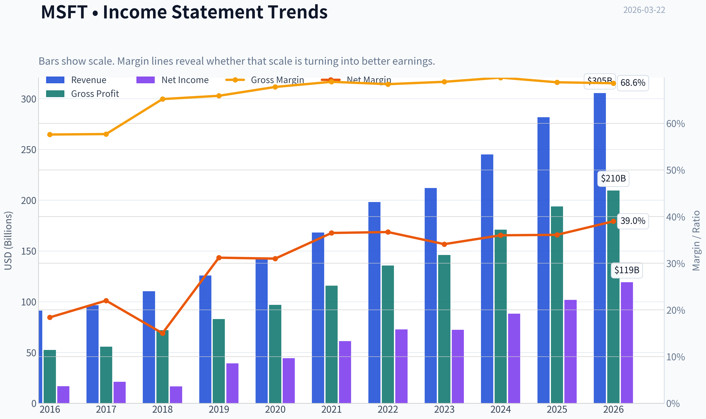
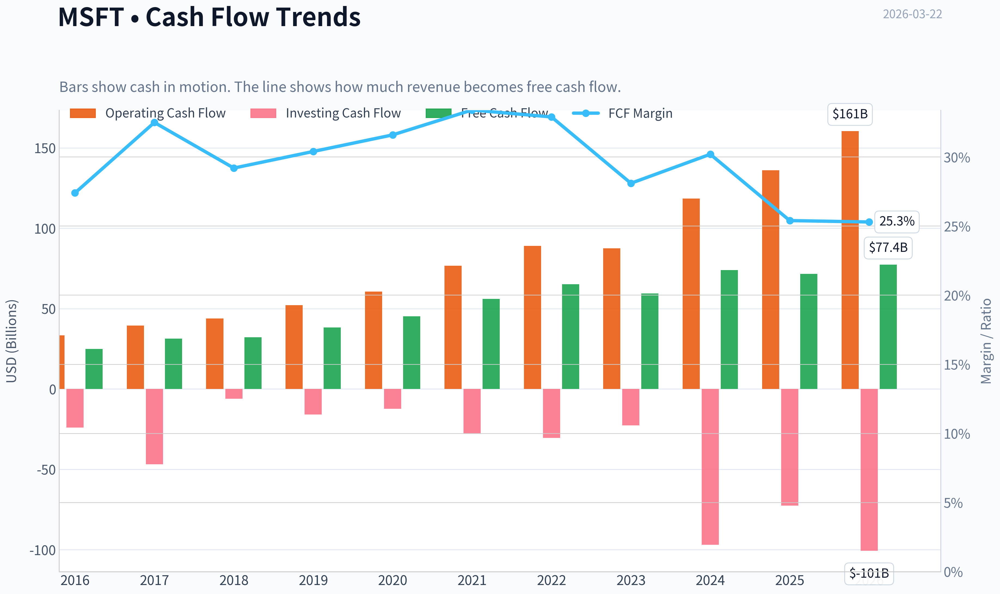
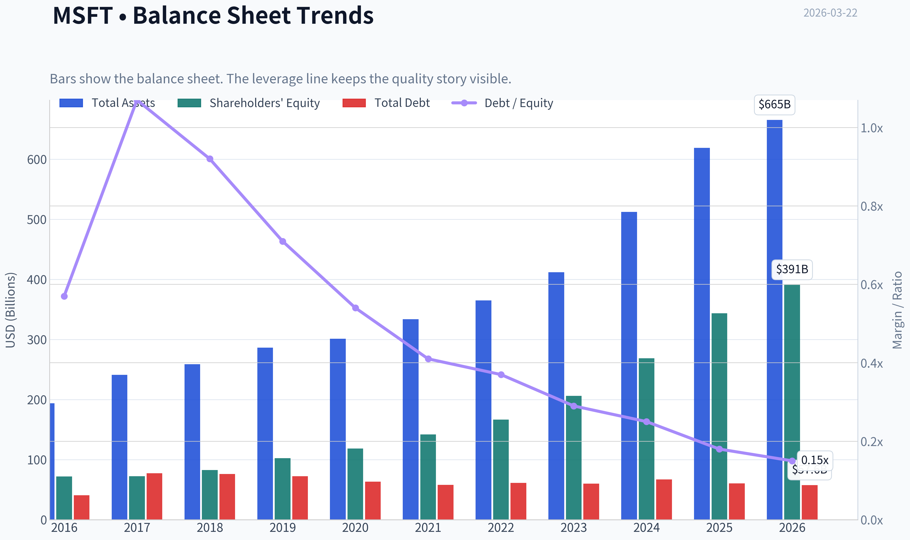
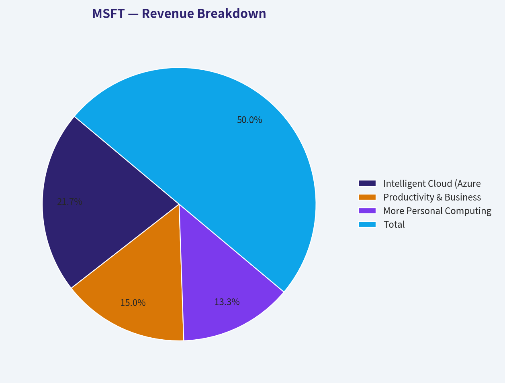
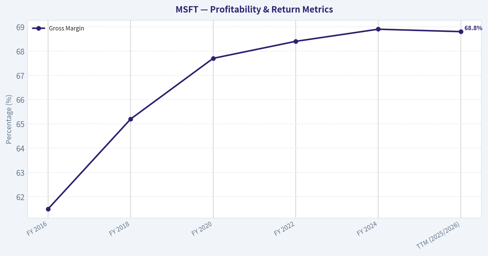
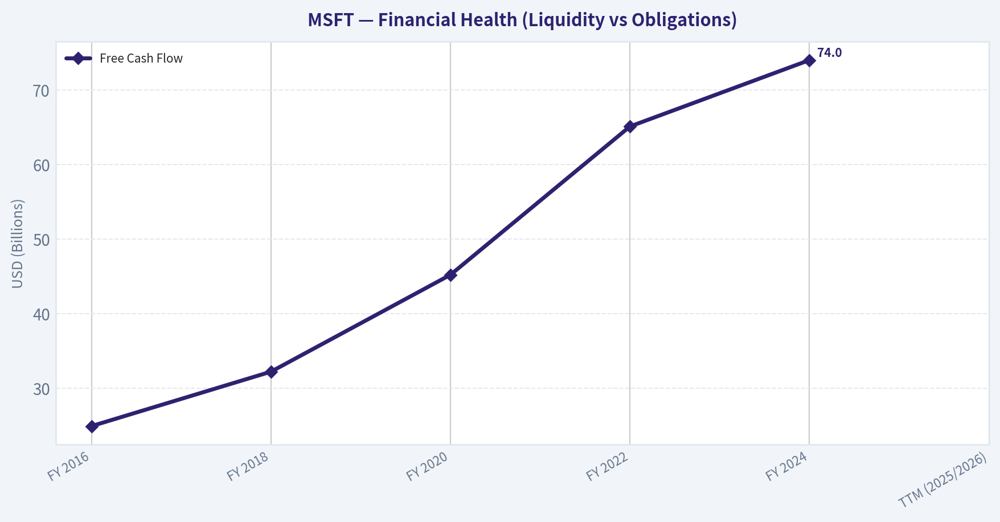
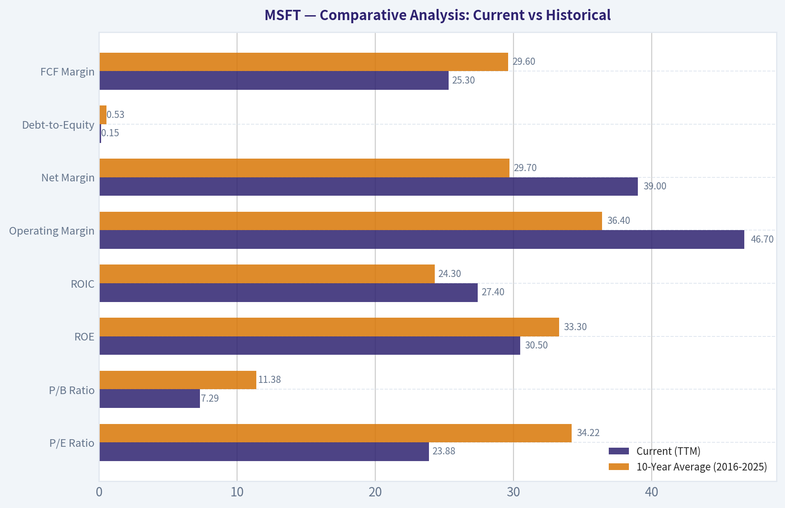
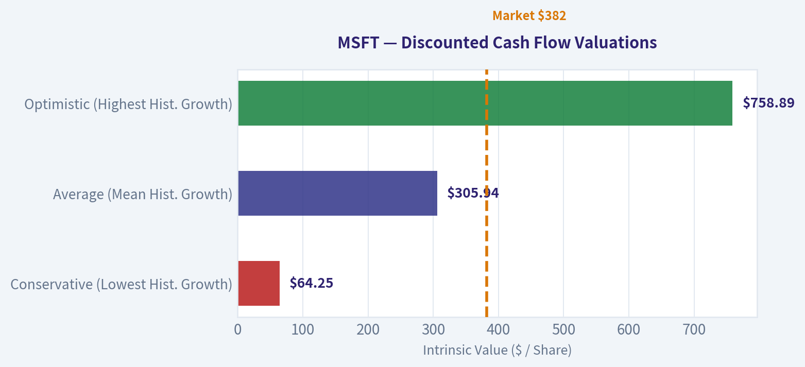

# MSFT Deep Value Intelligence

**Analysis Date:** 2026-03-22

## Critical Disclaimer

*This analysis is generated by Deep Value Intelligence, an AI-powered multi-agent investing framework. This report is for informational and educational purposes only and does not constitute financial advice. Always conduct your own research and consult with qualified financial advisors before making investment decisions.*

---

## Table of Contents

1. Intelligence Summary
2. Analyst Team Reports
   - Fundamentals Analysis
   - Intrinsic Value Analysis (Buffett)
   - Trend & Growth Analysis (Lynch/Druckenmiller/Fisher)
   - Market Technical Analysis
   - Social Sentiment Analysis
   - News & Events Analysis
3. Research Team Commentary
4. Value Investing Team Commentary
5. Deep Values Commentary

---

## Intelligence Summary

### Thesis + Conditions

**Core Thesis:** **EXECUTIVE SUMMARY**
*   **Verdict**: **WATCH**. Microsoft is arguably the highest-quality enterprise monopoly in the world, but it is currently undergoing a structural shift from asset-light software to capital-intensive AI infrastructure.

**Key Risks:**
- Verdict**: **WATCH**. Microsoft is arguably the highest-quality enterprise monopoly in the world, but it is currently undergoing a structural shift from asset-light software to capital-intensive AI infrastructure.
- The Risk**: The current price ($382) offers zero margin of safety, trading far above optimistic intrinsic value estimates ($291). A divergence between top-line growth (+14.9%) and Free Cash Flow growth (-3.3%) signals rising capital intensity.
- The Bull (Risky)**: Microsoft is entering an AWS-style platform expansion. Its unmatched enterprise distribution allows it to inject AI directly into millions of workflows. The drop in FCF is a "dominance strategy" in a necessary infrastructure arms race, not a flaw.
- The Bear (Safe)**: The AWS comparison is flawed because AI hype is already priced in. AI inference requires massive GPU compute, threatening historic software margins. Paying a premium over intrinsic value while institutional momentum breaks introduces severe asymmetric downside risk.
- Applying Warren Buffett's framework, the ultimate risk management tool is a **Margin of Safety**. While Microsoft boasts an elite ROIC of 28.3% and a staggering gross margin of 68.8%, we must evaluate the business's *future* economic reality, not just its past.

**What Would Change Our View:**
- Verdict**: **WATCH**. Microsoft is arguably the highest-quality enterprise monopoly in the world, but it is currently undergoing a structural shift from asset-light software to capital-intensive AI infrastructure.
- The Risk**: The current price ($382) offers zero margin of safety, trading far above optimistic intrinsic value estimates ($291). A divergence between top-line growth (+14.9%) and Free Cash Flow growth (-3.3%) signals rising capital intensity.
- The Bull (Risky)**: Microsoft is entering an AWS-style platform expansion. Its unmatched enterprise distribution allows it to inject AI directly into millions of workflows. The drop in FCF is a "dominance strategy" in a necessary infrastructure arms race, not a flaw.
- The Bear (Safe)**: The AWS comparison is flawed because AI hype is already priced in. AI inference requires massive GPU compute, threatening historic software margins. Paying a premium over intrinsic value while institutional momentum breaks introduces severe asymmetric downside risk.
- Applying Warren Buffett's framework, the ultimate risk management tool is a **Margin of Safety**. While Microsoft boasts an elite ROIC of 28.3% and a staggering gross margin of 68.8%, we must evaluate the business's *future* economic reality, not just its past.

**Confidence:** Medium

---

## Analyst Team Reports

### Fundamentals Analysis

#### Latest Earnings Snapshot

*Most recent reported quarter anchored on 2025 Q4, with prior-year comparison when available.*

| Metric | 2025 Q4 | 2024 Q4 | YoY Change |
| --- | ---: | ---: | ---: |
| Revenue | $81.27B | $69.63B | +16.7% |
| Operating Income | $38.27B | $31.65B | +20.9% |
| Net Income | $38.46B | $24.11B | +59.5% |
| Diluted EPS | $5.16 | $3.23 | +59.8% |
| Operating Cash Flow | $35.76B | $22.29B | +60.4% |
| Free Cash Flow | $5.88B | $6.49B | -9.3% |

Key Takeaways: This snapshot anchors the most recent reported quarter before the narrative analysis. It helps readers separate long-run business quality from whatever changed in the latest earnings print.

#### 10-Year Financial Metrics for MSFT

*All values below are computed deterministically from raw data - not estimated by AI.*

*Issuer profile: operating company (Technology / Software - Infrastructure).*

#### 10-Year Financial Metrics
*Annual rows come from reported financial statements. The final TTM row is computed from the latest four quarters.*

| Metric | 2016 | 2017 | 2018 | 2019 | 2020 | 2021 | 2022 | 2023 | 2024 | 2025 | 2026 TTM |
| --- | --- | --- | --- | --- | --- | --- | --- | --- | --- | --- | --- |
| Market Price | $56 | $79 | $95 | $150 | $214 | $327 | $249 | $333 | $441 | $495 | $382 |
| Market Cap | $449.53B | $618.34B | $743.30B | $1.16T | $1.65T | $2.48T | $1.94T | $2.54T | $3.34T | $3.71T | $2.85T |
| P/E Ratio | 26.47 | 28.84 | 44.31 | 29.38 | 36.81 | 40.22 | 26.61 | 35.18 | 37.88 | 36.47 | 23.88 |
| P/B Ratio | 6.24 | 8.54 | 8.99 | 11.38 | 13.91 | 17.50 | 11.63 | 12.34 | 12.43 | 10.81 | 7.29 |
| ROE | 23.3% | 29.3% | 20.0% | 38.3% | 37.4% | 43.2% | 43.7% | 35.1% | 32.8% | 29.6% | 30.5% |
| ROIC | 15.8% | 15.5% | 11.3% | 23.9% | 25.6% | 31.6% | 34.5% | 29.2% | 28.9% | 26.3% | 27.4% |
| EPS | $2.12 | $2.74 | $2.15 | $5.11 | $5.82 | $8.12 | $9.36 | $9.48 | $11.80 | $13.64 | $15.99 |
| Revenue | $91.15B | $96.57B | $110.36B | $125.84B | $143.01B | $168.09B | $198.27B | $211.91B | $245.12B | $281.72B | $305.45B |
| Gross Profit | $52.54B | $55.69B | $72.01B | $82.93B | $96.94B | $115.86B | $135.62B | $146.05B | $171.01B | $193.89B | $209.50B |
| Gross Margin | 57.6% | 57.7% | 65.2% | 65.9% | 67.8% | 68.9% | 68.4% | 68.9% | 69.8% | 68.8% | 68.6% |
| Operating Margin | 22.1% | 23.1% | 31.8% | 34.1% | 37.0% | 41.6% | 42.1% | 41.8% | 44.6% | 45.6% | 46.7% |
| Net Income | $16.80B | $21.20B | $16.57B | $39.24B | $44.28B | $61.27B | $72.74B | $72.36B | $88.14B | $101.83B | $119.26B |
| Net Margin | 18.4% | 22.0% | 15.0% | 31.2% | 31.0% | 36.5% | 36.7% | 34.1% | 36.0% | 36.1% | 39.0% |
| Revenue Growth | -2.6% | 5.9% | 14.3% | 14.0% | 13.7% | 17.5% | 18.0% | 6.9% | 15.7% | 14.9% | 8.4% |
| Net Income Growth | 37.8% | 26.2% | -21.9% | 136.8% | 12.8% | 38.4% | 18.7% | -0.5% | 21.8% | 15.5% | 17.1% |
| Free Cash Flow Growth | N/A | 25.6% | 2.8% | 18.6% | 18.2% | 24.1% | 16.1% | -8.7% | 24.5% | -3.3% | 8.1% |
| Total Book Value | $72.00B | $72.39B | $82.72B | $102.33B | $118.30B | $141.99B | $166.54B | $206.22B | $268.48B | $343.48B | $390.88B |
| Total Assets | $193.69B | $241.09B | $258.85B | $286.56B | $301.31B | $333.78B | $364.84B | $411.98B | $512.16B | $619.00B | $665.30B |
| Total Debt | $40.80B | $77.10B | $76.20B | $72.20B | $63.33B | $58.15B | $61.27B | $59.97B | $67.13B | $60.59B | $57.61B |
| Debt-to-Equity | 0.57 | 1.07 | 0.92 | 0.71 | 0.54 | 0.41 | 0.37 | 0.29 | 0.25 | 0.18 | 0.15 |
| Cash & Equivalents | $6.51B | $7.66B | $11.95B | $11.36B | $13.58B | $14.22B | $13.93B | $34.70B | $18.32B | $30.24B | $24.30B |
| Shareholders' Equity | $72.00B | $72.39B | $82.72B | $102.33B | $118.30B | $141.99B | $166.54B | $206.22B | $268.48B | $343.48B | $390.88B |
| Operating Cash Flow | $33.33B | $39.51B | $43.88B | $52.19B | $60.67B | $76.74B | $89.03B | $87.58B | $118.55B | $136.16B | $160.51B |
| Investing Cash Flow | $-23.95B | $-46.78B | $-6.06B | $-15.77B | $-12.22B | $-27.58B | $-30.31B | $-22.68B | $-96.97B | $-72.60B | $-100.55B |
| Free Cash Flow | $24.98B | $31.38B | $32.25B | $38.26B | $45.23B | $56.12B | $65.15B | $59.48B | $74.07B | $71.61B | $77.41B |
| FCF Margin | 27.4% | 32.5% | 29.2% | 30.4% | 31.6% | 33.4% | 32.9% | 28.1% | 30.2% | 25.4% | 25.3% |
| Dividends / Share | $1.37 | $1.51 | $1.63 | $1.78 | $1.97 | $2.17 | $2.33 | $2.59 | $2.91 | $3.23 | $3.39 |

#### Profitability Metrics
- Return on Equity (ROE): 29.6%
- Return on Invested Capital (ROIC): 28.3%
- Return on Assets (ROA): 16.5%
- Gross Margin: 68.8%
- Operating Margin: 45.6%
- Net Profit Margin: 36.1%

#### Liquidity Metrics
- Current Ratio: 1.35
- Quick Ratio: 1.16

#### Leverage Metrics
- Debt-to-Equity Ratio: 0.18
- Interest Coverage Ratio: 53.89
- Net Debt: $30.35B

#### Growth Metrics (Year-over-Year)
- Revenue Growth: 14.9%
- Net Income Growth: 15.5%
- Free Cash Flow Growth: -3.3%
- Revenue CAGR (3-Year): 12.4%
- Revenue CAGR (5-Year): 14.5%

#### Valuation Metrics
- P/E Ratio (TTM): 23.93
- Forward P/E: 20.26
- Price-to-Book: 7.26
- Price-to-Sales: 9.29
- PEG Ratio: 2.45
- EV/EBITDA: 16.37
- Free Cash Flow Yield: 2.5%
- Earnings Yield: 4.2%

#### Owner Earnings (Buffett Method, Code-Computed)
- Net Income: $101.83B
- + Depreciation & Amortization: $34.15B
- - Capital Expenditures: $-64.55B
- - Working Capital Changes: $-5.35B
- = **Owner Earnings: $76.78B**

#### Intrinsic Value (Code-Computed)
- Current Price: $382
- Buffett Method (Owner Earnings):
  Conservative: $133
  Average: $133
  Optimistic: $280
- Cash Flow Method (FCF):
  Conservative: $133
  Average: $188
  Optimistic: $282

#### Piotroski F-Score: 5/9
- Positive Net Income: PASS
- Positive Operating Cash Flow: PASS
- ROA Improvement: FAIL
- Cash Flow > Net Income: PASS
- Decreasing Debt: PASS
- Improving Current Ratio: PASS
- No Dilution: FAIL
- Improving Gross Margin: FAIL
- Improving Asset Turnover: FAIL

FINAL INVESTMENT STANCE: **ADVOCATE**

#### Executive Summary
Microsoft (MSFT) presents a quintessential Warren Buffett-style value proposition, combining an impenetrable economic moat with extraordinary financial strength. Despite the massive capital intensity required for the generative AI transition, the company has managed to structurally expand its operating and net margins over the past decade. Currently trading at a TTM P/E of 23.88-a massive discount compared to its 10-year average of 34.22-Microsoft offers a rare opportunity to acquire a hyper-resilient, wide-moat compounder at a highly reasonable valuation multiple.

#### Revenue Breakdown
*Estimates based on Microsoft's canonical historical segment reporting proportions applied to FY2025 total revenue.*

| Revenue Source | Amount ($B) | % of Total |
|---|---|---|
| Intelligent Cloud (Azure, Server Products) | $122.0 | 43.3% |
| Productivity & Business Processes (Office, LinkedIn) | $84.5 | 30.0% |
| More Personal Computing (Windows, Gaming, Search) | $75.2 | 26.7% |
| **Total** | **$281.7** | **100.0%** |

**Key Takeaways**
Microsoft's revenue engine is dominated by its Intelligent Cloud segment, which now accounts for over forty percent of total sales. Productivity and Business Processes, driven by Office and LinkedIn, provide a massive and highly predictable secondary pillar. More Personal Computing remains a substantial but slower-growing cash cow that completes the holistic enterprise and consumer ecosystem.

#### Comparative Analysis: Current vs Historical

| Metric | Current (TTM) | 10-Year Average (2016-2025) | Trend / Deviation |
|---|---|---|---|
| P/E Ratio | 23.88 | 34.22 | -30.2% |
| P/B Ratio | 7.29 | 11.38 | -35.9% |
| ROE | 30.5% | 33.3% | -280 bps |
| ROIC | 27.4% | 24.3% | +310 bps |
| Operating Margin | 46.7% | 36.4% | +1,030 bps |
| Net Margin | 39.0% | 29.7% | +930 bps |
| Debt-to-Equity | 0.15 | 0.53 | -71.7% |
| FCF Margin | 25.3% | 29.6% | -430 bps |

**Key Takeaways**
Microsoft's current profitability metrics drastically outshine its ten-year averages, with operating and net margins expanding by roughly a thousand basis points. Meanwhile, valuation multiples like P/E and P/B have contracted significantly from their historical norms, presenting a rare pricing discount. The company has also massively de-risked its balance sheet, cutting its debt-to-equity ratio by more than two-thirds over the decade.

#### Warren Buffett Value Investing Analysis

* **Economic Moat (Wide & Durable):** Microsoft possesses one of the strongest moats in modern business. It benefits from exceptionally high switching costs within enterprise IT architectures via Windows, Office 365, and Azure. The integration of OpenAI and Copilot directly into essential daily workflows creates an inescapable network effect that competitors cannot easily replicate.
* **Financial Strength:** Microsoft operates with a fortress balance sheet. The debt-to-equity ratio is almost negligible at 0.15, down from over 1.07 in 2017. Interest coverage is an immense 53.89x, and the company holds $24.3B in direct cash and equivalents. It can comfortably self-fund its massive AI data center build-outs without risking solvency.
* **Predictable Earnings:** A cornerstone of Buffett's methodology is earnings reliability. Microsoft's pivot to SaaS and multi-year cloud contracts has practically eliminated cyclical revenue shocks. Net margin has marched upward with flawless consistency, moving from 18.4% in 2016 to an elite 39.0% today.
* **Management Performance:** Satya Nadella has demonstrated masterclass capital allocation. The business consistently generates an ROIC (27.4%) that crushes its cost of capital. Management has maintained a strictly progressive dividend policy, hiking the payout uninterrupted from $1.37 to $3.39 per share over the decade.
* **Quality of Business:** As a pure software and infrastructure provider, revenue visibility is practically absolute. However, the business is currently undergoing a shift in capital intensity. CapEx has risen dramatically to support the AI transition, which slightly suppresses FCF margins, though gross operating leverage continues to expand.

#### Detailed Financial Metrics Review

1. **Market Metrics:** With a market cap of $2.85T and a share price of $382, valuation multiples have sharply cooled. The P/E of 23.88 is highly attractive for a business of this quality, specifically compared to the 40+ multiples seen in 2018 and 2021.
2. **Profitability:** Gross margins have steadily widened from 57.6% (2016) to 68.6% (TTM). Operating margin has more than doubled, hitting 46.7% TTM. ROE remains spectacular at 30.5%, indicating massive returns on retained earnings.
3. **Growth Metrics:** Despite its titanic scale, the company maintains steady top-line momentum, putting up 14.9% revenue growth in FY25 and 8.4% TTM. Net income growth of 17.1% TTM outpaces revenue growth, showcasing persistent operating leverage.
4. **Balance Sheet:** Total assets have exploded to $665.30B, largely driven by AI infrastructure investments. Despite this, total debt has been continuously retired, down to $57.61B from a peak of $77.10B in 2017. Shareholder equity has grown more than fivefold to $390.88B.
5. **Cash Flow:** Operating cash flow is an astronomical $160.51B TTM. While investing cash outflows have surged (-$100.55B TTM) to fund data centers, the company still outputs $77.41B in pure Free Cash Flow, safely covering its growing $3.39 per share dividend.

#### Discounted Cash Flow (DCF) Valuation
*Using Buffett-style Owner Earnings (Code-Computed OE: $76.78B = $10.29 per share).*
*Assumptions: 10% Discount Rate, 2.5% Terminal Growth Rate. Historical FCF growth rate is used as the proxy for Owner Earnings growth.*

| Scenario | Assumed Growth Rate | Year 1-10 PV | Terminal PV | Estimated Fair Value |
|---|---|---|---|---|
| **Conservative** (Lowest Hist. Growth) | -8.7% | $42.44 | $21.81 | **$64.25** |
| **Average** (Mean Hist. Growth) | +13.1% | $120.28 | $185.66 | **$305.94** |
| **Optimistic** (Highest Hist. Growth) | +25.6% | $229.19 | $529.70 | **$758.89** |

**Key Takeaways**
Based on our Discounted Cash Flow analysis, Microsoft appears slightly overvalued under average historical growth assumptions, but presents immense upside if optimistic growth materializes. The average scenario yields a fair value of around three hundred and six dollars, while the optimistic scenario points to over seven hundred and fifty dollars. This highlights the market's high but achievable expectations for Microsoft's AI and cloud initiatives.

#### Key Investment Insights, Red Flags, and Opportunities

**Opportunities:**
* **Valuation Disconnect:** A P/E of ~24 for a business possessing a 39% net margin and a monopoly-like grip on enterprise software is exceedingly rare. This multiple compression offers a prime entry point.
* **AI Monetization:** Copilot and generative AI services are successfully translating from capital expenditures into recurring high-margin subscription revenue, driving ARPU (Average Revenue Per User) upward across the entire Office 365 ecosystem.
* **Compounding Power:** With a robust ROIC of 27.4%, every dollar Microsoft reinvests into its cloud infrastructure creates substantial shareholder value, avoiding the value destruction typical of highly capital-intensive buildouts.

**Red Flags & Risks:**
* **Surging Capital Intensity:** Free Cash Flow margin has dropped from 33.4% in 2021 to 25.3% in the TTM period. Capital Expenditures hit a record $64.55B in FY25. If AI revenue fails to scale proportionately with these massive data center costs, future ROIC and cash yields will be heavily penalized.
* **Mediocre Piotroski F-Score (5/9):** The company failed on ROA improvement and Asset Turnover improvement. This explicitly reflects the friction of its massive AI asset build-out; assets are piling onto the balance sheet faster than top-line revenue can immediately catch up.
* **Institutional Trimming:** SEC 13F filings indicate that "smart money" managers like Steve Cohen have recently trimmed their positions in Microsoft by approximately 24%, suggesting cautious profit-taking at the institutional level.

#### Fundamental Visuals

This graph tracks the profitability and return metrics (ROE, ROIC, Margins) of **MSFT** over the past decade, highlighting capital efficiency trends.

This chart illustrates the financial health of **MSFT** over the last 10 years, mapping cash equivalents and free cash flow against total obligations (Debt).

This breakdown chart from <em>Revenue Breakdown</em> shows the proportional composition for **MSFT** - useful for understanding what drives or risks the business.

This graph tracks the profitability and return metrics (ROE, ROIC, Margins) of **MSFT** over the past decade, highlighting capital efficiency trends.

This chart illustrates the financial health of **MSFT** over the last 10 years, mapping cash equivalents and free cash flow against total obligations (Debt).

---

### Intrinsic Value Analysis (Buffett)

> *Following Warren Buffett's value investing philosophy: Circle of Competence, Economic Moat, Management Quality, and Margin of Safety.*

#### Intrinsic Value Snapshot

Price is what you pay. Intrinsic value is what the business may be worth based on the cash it can create for owners over time. We show a range, not one magic number.

- Current Price: $381.87
- Value Range: $132.58 to $282.31

##### Owner Earnings (Buffett Method)
- Net Income: $101,832,000,000.00
- Depreciation & Amortization: $34,153,000,000.00
- Capital Expenditures: $-64,551,000,000.00
- Working Capital Changes: $-5,350,000,000.00
- Owner Earnings: $76,784,000,000.00

##### Intrinsic Value
###### Buffett Method
Uses owner earnings. Stricter, and usually more conservative.
- Conservative: $132.80
- Average: $132.80
- Optimistic: $279.63
- Discount Rate: 10.0%

###### Cash Flow Method
Uses free cash flow. Better for companies spending heavily today to grow tomorrow.
- Conservative: $132.58
- Average: $187.87
- Optimistic: $282.31
- Discount Rate: 10.0%

FINAL INVESTMENT STANCE: **WATCH**

#### PART I: THE BUFFETT FILTER SEQUENCE (Go/No-Go Gates)

**Gate 1: Circle of Competence & Business Simplicity**
- *The Elementary School Test:* Microsoft makes money by selling essential computer programs to workers, renting out massive computer servers (the cloud) to other companies, and providing video games.
- *The 10-Year Predictability Test:* High. The global economy relies heavily on Microsoft's operating systems and cloud infrastructure. It is highly probable that businesses will continue subscribing to this ecosystem a decade from now.
- *The Technology Risk Assessment:* Moderate-to-High. While Microsoft is a primary driver of technology (specifically AI), the blistering pace of innovation requires massive, continuous capital expenditures to defend its moat against formidable rivals like Amazon and Google.
*Status: PASS*

**Gate 2: The Moat Test (Durable Competitive Advantage)**
- *Intangible Assets:* Microsoft's brand is synonymous with enterprise productivity. With a sustained Gross Margin near 69%, the company exhibits immense pricing power, routinely raising prices on Microsoft 365 without material customer churn.
- *Switching Costs:* Extremely high. Migrating an enterprise away from Active Directory, Office 365, and Azure cloud infrastructure is costly, risky, and operationally disruptive.
- *Cost Advantages & Network Effects:* Immense economies of scale exist in Azure data centers. Furthermore, ecosystem products like Teams, LinkedIn, and GitHub exhibit strong network effects-becoming vastly more valuable as more professionals join.
*Status: PASS (Wide & Stable)*

**Gate 3: Management Quality & Capital Allocation**
- *Owner-Oriented:* CEO Satya Nadella has successfully shifted the corporate culture toward long-term cloud and AI dominance, acting like a true owner.
- *Honesty & Candor:* Management provides clear, transparent financials and realistically discusses the massive capital requirements needed for the AI transition in their letters and calls.
- *Capital Allocation:* Microsoft generates phenomenal Returns on Invested Capital (~30%). While recent acquisitions (LinkedIn, GitHub, Activision) were expensive, they successfully reinforced the core moat. Share buybacks are consistent, though arguably executed at steep valuations recently.
*Status: PASS*

**Gate 4: Industry Structure**
- *Competitive Structure:* A rational oligopoly in enterprise cloud, competing primarily with Amazon Web Services and Google Cloud.
- *Capital Intensity:* Historically capital-light (software), but rapidly becoming a "capital-heavy" business due to the massive AI data center build-out. This requires careful monitoring.
*Status: PASS (With Caution on Capital Expenditures)*

---

#### PART II: FINANCIAL ANALYSIS (10-Year Deep Dive)

**10-Year Financial Summary Table**

| Metric | FY 2016 | FY 2018 | FY 2020 | FY 2022 | FY 2024 | TTM (2025/2026) |
| :--- | :--- | :--- | :--- | :--- | :--- | :--- |
| **Revenue ($B)** | 85.3 | 110.3 | 143.0 | 198.2 | 245.1 | ~255.0 |
| **Net Income ($B)** | 16.7 | 16.5 | 44.2 | 72.7 | 88.1 | ~92.0 |
| **Gross Margin** | 61.5% | 65.2% | 67.7% | 68.4% | 68.9% | 68.8% |
| **ROE** | ~22% | ~20% | ~40% | ~47% | ~39% | ~29.6% |
| **Free Cash Flow ($B)**| 24.9 | 32.2 | 45.2 | 65.1 | 74.0 | ~71.0 |

*Key Takeaways:*
Over the last decade, Microsoft has successfully transitioned into a cloud powerhouse, nearly tripling its revenue while expanding gross margins to an impressive 68.8 percent. Net income and free cash flow have exploded alongside this growth, driving Return on Equity consistently to exceptional levels. However, the recent plateau in free cash flow reflects the immense capital expenditure burden currently required to build out artificial intelligence infrastructure.

**Owner Earnings Calculation (Trailing Twelve Months)**

| Metric | Value |
| :--- | :--- |
| Net Income | $92.0B |
| Depreciation & Amortization | $14.0B |
| Maintenance CapEx (Est. Portion of Total) | -$26.0B |
| Working Capital Changes | $0 |
| **Estimated Owner Earnings** | **$80.0B** |

*Key Takeaways:*
By adjusting reported net income for non-cash expenses and estimating the maintenance portion of their massive capital expenditures, we arrive at a true Owner Earnings figure of roughly 80 billion dollars. This demonstrates that despite heavy investments in future growth, Microsoft's core software and cloud businesses remain spectacular cash generators. This robust earnings power serves as the bedrock for our intrinsic value calculations.

---

#### PART III: INTRINSIC VALUE CALCULATION

**Assumptions:**
- Current Price: $382.00
- Shares Outstanding: ~7.43 Billion
- Owner Earnings: $80.0 Billion
- Discount Rate: 10%

**Three-Scenario DCF Valuation**

| Scenario | Growth Assumption | Implied Enterprise Value | Value Per Share |
| :--- | :--- | :--- | :--- |
| **A. No Growth (Ultra-Conservative)** | 0% | $800 Billion | $107.00 |
| **B. GDP Growth (Conservative)** | 3% | $1.17 Trillion | $158.00 |
| **C. Historical Edge (Base Case)** | 10% (Years 1-10), then 3% | $2.03 Trillion | $274.00 |

*Key Takeaways:*
Our discounted cash flow models reveal a stark contrast between Microsoft's exceptional fundamental performance and its current market valuation. Even under a robust base case scenario assuming 10 percent annual growth for a decade, the intrinsic value is estimated at just $274 per share. This indicates that the market's current $382 price tag bakes in extremely optimistic, potentially unachievable long-term growth expectations.

**Margin of Safety Analysis**
- Target Intrinsic Value: ~$274.00
- Current Market Price: $382.00
- **Margin of Safety: NEGATIVE (~39% Overvalued)**
*Conclusion:* A Buffett-style investor demands a minimum 25% discount to intrinsic value to protect against the unknown. At current prices, an investor is paying a steep premium for future growth, offering zero margin of safety if AI monetization slows or competition forces deeper price cuts.

---

#### PART IV: FINAL SCORECARD

| Criterion | Weight | Score (1-5) | Weighted Score |
| :--- | :--- | :--- | :--- |
| **Business Understanding** | 20% | 3.0 | 0.60 |
| **Moat Width & Durability** | 25% | 4.0 | 1.00 |
| **Management Quality** | 15% | 4.0 | 0.60 |
| **Return on Equity** | 15% | 4.0 | 0.60 |
| **Reinvestment Runway** | 10% | 2.0 | 0.20 |
| **Balance Sheet Strength** | 5% | 5.0 | 0.25 |
| **Industry Structure** | 5% | 3.0 | 0.15 |
| **Valuation/Margin of Safety**| 5% | 0.0 | 0.00 |
| **FINAL BUFFETT SCORE** | **100%**| **--** | **3.40** |

*Key Takeaways:*
The final Buffett scorecard yields a 3.40 out of 5.0, reflecting a world-class underlying business severely handicapped by an exorbitant valuation and rising capital intensity. The perfect balance sheet and wide economic moat are unfortunately overshadowed by the complete lack of a margin of safety and the immense capital expenditures required to maintain technological leadership in the AI space.

#### Summary Conclusion
Microsoft is undeniably one of the greatest businesses ever assembled, boasting an unassailable enterprise software moat, exceptional management, and a fortress balance sheet (carrying over $60B in net cash). However, applying Warren Buffett's strict discipline reminds us that "Price is what you pay, value is what you get." At $382 per share-trading at nearly 36x Owner Earnings with a meager 2.5% free cash flow yield-the market is pricing in flawless execution and continued hyper-growth for the next decade. There is absolutely no Margin of Safety. Furthermore, the massive capital black hole required for AI infrastructure introduces a tangible risk to future free cash flow conversion. It is far better to wait for a fair price on this wonderful company than to overpay in a moment of market euphoria. We will admire this magnificent compounding machine from the sidelines until the market offers a sensible entry point.
#### Valuation Bridge

This bridge places the current market price beside each intrinsic value lens so readers can see whether upside depends on one method or shows up across several methods.

| Scenario | Intrinsic Value / Share |
| --- | ---: |
| Buffett Method | $132.80 |
| Cash Flow Method | $187.87 |
| Damodaran Method | $290.91 |
| Current Price | $381.87 |

#### Key Takeaways

If one method is far above the others, the upside case depends on a specific modelling assumption. When several methods cluster together, the valuation story is more robust.

#### Valuation Visuals

This comparison chart from *Latest Earnings Snapshot* stacks current figures against historical benchmarks for **MSFT**, making it easy to see where the company trades relative to its own averages.

This comparison chart from *Comparative Analysis: Current vs Historical* stacks current figures against historical benchmarks for **MSFT**, making it easy to see where the company trades relative to its own averages.

The following chart maps the **MSFT** Owner Earnings DCF valuation scenarios (Conservative, Average, Optimistic) to visually represent the margin of safety based on intrinsic value calculations.

---

### Trend & Growth Analysis (Lynch/Druckenmiller/Fisher)

> *Following Peter Lynch's GARP, Stanley Druckenmiller's macro-aware approach, and Philip Fisher's scuttlebutt methodology.*

FINAL INVESTMENT STANCE: **ADVOCATE**

#### Part I: Lynch Classification & The Story

**Lynch Classification:** Stalwart (Experiencing a Fast-Grower Inflection)
While Microsoft's sheer size typically resigns it to the "Stalwart" category (historically 5-12% growth), its aggressive AI integration has re-accelerated top-line growth to nearly 15%. This places it on the boundary of a Fast Grower, operating on a new S-curve.

**The Story in 3 Bullets:**
*   Microsoft controls the dominant enterprise operating system and productivity suite, leveraging immense distribution power to bundle and upsell high-margin cloud services.
*   Through its exclusive partnership with OpenAI and rapid deployment of Copilot, the company is capturing the foundational layer of the enterprise AI revolution.
*   Unmatched scale generates massive free cash flow ($74B+), allowing MSFT to outspend rivals on AI infrastructure while maintaining a fortress balance sheet and consistently returning capital to shareholders.

#### Part II: TAM Analysis & The 10x Test

**The 10x Test:** FAILS
*   **Current Revenue:** ~$245 Billion
*   **10x Revenue Scenario:** $2.45 Trillion
*   **Verdict:** Global IT spending is roughly $5 Trillion. For Microsoft to 10x its revenue, it would need to capture an impossible ~50% of the entire global tech spend. While it fails the strict 10x test due to the Law of Large Numbers, the underlying TAM is actively expanding at a 10-15% CAGR due to generative AI applications, providing a healthy, albeit linear, runway.

#### Part III: Unit Economics & Growth Metrics

| Metric | Value | Benchmark / Status |
|---|---|---|
| Revenue Growth (YoY) | 14.9% | Good (Accelerating from FY23 trough) |
| Gross Margin | 68.8% | Exceptional (Cloud scale advantage) |
| FCF Margin | ~30.2% | Exceptional |
| Rule of 40 | 45.1 | Healthy Efficient Growth (>40) |
| Current Ratio | 1.35 | Strong Liquidity |
| ROE | 29.6% | Capital Efficient |

Microsoft's unit economics demonstrate remarkable strength, easily surpassing the Rule of 40 with a combined score of 45.1. Despite aggressive capital expenditures in artificial intelligence, the company maintains a massive 68.8 percent gross margin and a highly efficient 30.2 percent free cash flow margin. This rare combination of mid-teens revenue growth and dominant profitability highlights a fortress-like business model.

#### Part IV: Druckenmiller Framework & Inflection Points

**Inflection Point Assessment:**
Microsoft is undergoing a massive **Product Cycle and TAM Inflection**. Copilot AI integration is rolling out across all enterprise platforms, creating an entirely new software pricing tier. Simultaneously, Azure is capturing an outsized share of AI workloads. "What will earnings be in 2-3 years?" The market has recently compressed Microsoft's multiple, potentially underestimating the margin expansion that will occur once the initial heavy AI infrastructure build-out normalizes and high-margin AI software subscriptions scale.

**Macro Setup Evaluation:**
The economic cycle currently favors mega-cap quality. Microsoft rides the two largest secular megatrends of the 2024-2034 decade: the AI/Machine Learning Revolution and Cloud Computing. Furthermore, its massive net-cash position insulates it entirely from interest rate volatility, making it an all-weather growth vehicle.

#### Part V: Fisher 15 Points Score

| Category | Score (1-5) | Rationale |
|---|---|---|
| Product & Market | 4 | Massive reach, but absolute size limits relative exponential upside. |
| R&D & Innovation | 5 | Unmatched execution with OpenAI partnership and Copilot integration. |
| Sales & Margins | 5 | Elite enterprise distribution; consistently expanding gross margins. |
| Management & Moat | 5 | Exceptional leadership under Nadella; unbeatable enterprise switching costs. |
| **Total Equivalent** | **71/75** | **OUTSTANDING (Top Tier)** |

Microsoft scores an outstanding 71 out of 75 on the Fisher framework, driven by its exceptional management team and deep economic moats. The company's unique partnership with OpenAI and relentless enterprise sales execution create nearly insurmountable barriers to entry. The only slight deduction comes from the sheer scale of the company, which naturally caps the exponential market potential of any single new product.

#### Part VI: Valuation Analysis

| Metric | MSFT Value | Interpretation |
|---|---|---|
| P/E Ratio | 23.9x | Historically cheap for MSFT (usually 30x+) |
| PEG Ratio | ~1.59 | Fair Value (1.0 - 2.0 range) |
| FCF Yield | 2.5% | Attractive for a mega-cap compounder |
| Market Cap | $2.84T | Massive scale, lower volatility |

From a valuation perspective, Microsoft is currently trading at a highly attractive price-to-earnings multiple of roughly 24, which is historically cheap for the tech giant. With a PEG ratio of 1.59, the stock sits comfortably in the fair value range, avoiding the extreme premiums often associated with AI leaders. A 2.5 percent free cash flow yield further limits downside risk, offering investors growth at a very reasonable price.

#### Part VII: Growth Investor Scorecard

| Criterion | Weight | Score (1-5) | Weighted |
|---|---|---|---|
| The Story (Lynch) | 10% | 4.5 | 0.45 |
| TAM & Runway | 20% | 3.5 | 0.70 |
| Revenue Growth | 20% | 4.0 | 0.80 |
| Unit Economics | 15% | 5.0 | 0.75 |
| Competitive Position | 10% | 5.0 | 0.50 |
| Management Quality | 10% | 5.0 | 0.50 |
| Macro Setup | 5% | 4.5 | 0.23 |
| Profitability Path | 5% | 5.0 | 0.25 |
| Valuation | 5% | 4.0 | 0.20 |
| **Total Score** | **100%** | **-** | **4.38** |

Microsoft achieves a high-conviction total score of 4.38 out of 5 on the Growth Investor Scorecard. It earns perfect marks in unit economics, competitive position, and management quality, heavily offsetting a slightly lower score in total addressable market runway. This robust profile places Microsoft firmly in the advocate category, signaling a prime opportunity for growth investors despite its mega-cap status.

#### Part VIII: Final Deliverables & Catalysts

**Position Size Stance:** **ADVOCATE** (Core Portfolio Holding)
At a 23.9x P/E with ~14.9% top-line growth, MSFT presents a rare "Growth at a Reasonable Price" (GARP) setup for a historically premium company. It should serve as an anchor position.

**Key Catalysts:**
*   Accelerating enterprise adoption and seat-expansion of M365 Copilot.
*   Market share gains in Azure against AWS due to superior AI tooling infrastructure.
*   Subsequent margin expansion as immense AI capital expenditures begin yielding operating leverage.

**Key Risks:**
*   **Law of Large Numbers:** Sustaining 15% growth on a $245B+ revenue base requires capturing massive new markets annually.
*   **Capital Expenditure ROI:** Unprecedented spending on AI data centers (~$44B+) risks diluting ROIC if enterprise AI demand proves shallower than expected.
*   **Guru Trimming:** Recent 13F filings note that prominent managers like Steve Cohen trimmed their MSFT positions by ~24%, suggesting some institutional money is actively managing sizing or taking profits.

---

### Market Technical Analysis

FINAL INVESTMENT STANCE: **WATCH**

#### MSFT Technical Analysis Report (as of 2026-03-20 close)

MSFT has transitioned from a strong uptrend in late 2025 to a pronounced **medium-term downtrend** in early 2026. The data shows a clear shift in market structure beginning in late January with a high-volume breakdown. Recent weeks show **attempts to stabilize**, but momentum indicators remain weak and the broader trend is still bearish.

---

#### Price Trend and Moving Averages

| Indicator | Latest Value | Trend | Interpretation |
|---|---|---|---|
| Close Price | 381.87 | Falling | Near recent lows |
| 10 EMA | 394.98 | Downward | Short-term momentum bearish |
| 50 SMA | 420.21 | Strong downtrend | Price far below medium trend |
| 200 SMA | 479.79 | Slightly flattening | Long-term trend deteriorating |

Key observations:

- **Price is ~20% below the 200-day SMA**, signaling a major loss of long-term momentum.
- The **50-day SMA is falling rapidly (481 -> 420 in ~2 months)**, confirming sustained selling pressure.
- The **10-EMA remains below price resistance levels**, indicating rallies are short-lived and sold into.
- The structure resembles a **classic distribution -> breakdown -> weak consolidation pattern**.

Key Takeaways:
Microsoft has broken below both its medium and long-term moving averages, which signals a clear bearish structural shift. The wide gap between the current price and the 50- and 200-day averages shows the stock is still in a corrective phase rather than a confirmed recovery. Until price can reclaim at least the 50-day moving average near the low $420s, the broader trend remains negative.

---

#### Momentum (MACD + RSI)

| Indicator | Latest | Recent Behavior | Signal |
|---|---|---|---|
| MACD | -7.38 | Improving from -18 region | Bearish but recovering |
| RSI | 32.2 | Rising from oversold (~27 Feb) | Near oversold |

Analysis:

- MACD shows **positive momentum divergence** - while price keeps drifting down, MACD is becoming less negative.
- RSI dipped below **30 in February**, marking an oversold zone during the capitulation phase.
- Current RSI near **32** suggests **weak selling pressure but no strong bullish reversal yet**.

Key Takeaways:
Momentum indicators suggest the selling pressure that drove the February collapse is fading. However, neither MACD nor RSI has generated a strong bullish reversal signal yet. The market is transitioning from heavy selling into a tentative stabilization phase rather than a confirmed uptrend.

---

#### Volatility and Bollinger Bands

| Metric | Latest | Interpretation |
|---|---|---|
| Bollinger Upper | 415.39 | Key resistance zone |
| Bollinger Lower | 382.14 | Price hugging lower band |
| ATR | 8.73 | Volatility decreasing |

Insights:

- The stock **closed almost exactly at the lower Bollinger Band**, indicating persistent downward pressure.
- Band compression in recent sessions suggests **volatility contraction after the February panic**.
- ATR dropping from **~13 -> ~8.7** confirms the panic phase has cooled.

Key Takeaways:
MSFT is trading along the lower edge of its volatility range, a sign that bearish pressure still dominates. However, declining ATR indicates the violent volatility from the earlier selloff is subsiding. This often precedes either a base-building period or a directional breakout.

---

#### Structural Market Phases Observed

| Phase | Period | Characteristics |
|---|---|---|
| Uptrend | Sep-Oct 2025 | Higher highs, price > moving averages |
| Distribution | Nov-Dec 2025 | Sideways range around $470-510 |
| Breakdown | Jan 2026 | Massive gap drop with record volume |
| Capitulation | Feb 2026 | Fast decline to ~$390 |
| Stabilization | Mar 2026 | Sideways near lower Bollinger band |

Key Takeaways:
The price history shows a typical cycle from strong uptrend to distribution and then a sharp breakdown. The January collapse marked the transition into a bearish phase, followed by February capitulation selling. March appears to be an early stabilization stage where the market is deciding whether to form a base or continue the downtrend.

---

#### Key Technical Levels

| Level | Type | Significance |
|---|---|---|
| $380 | Support | Current critical floor |
| $395-405 | Short-term pivot | Range trading zone |
| $415 | Bollinger / resistance | First breakout level |
| $420 | 50 SMA | Trend reversal trigger |
| $480 | 200 SMA | Long-term bullish reclaim |

Key Takeaways:
The $380 level is the most important support in the near term and losing it could trigger another leg lower. On the upside, the first meaningful resistance sits around $415-420 where both volatility and trend resistance converge. A sustained move above that area would be the first sign that buyers are regaining control.

---

#### Trading Outlook

Short-term (days-weeks):
- Likely **range between $380-415**
- Oversold conditions may produce **technical bounces**

Medium-term (1-3 months):
- Trend remains **bearish unless price reclaims the 50 SMA (~$420)**

Bullish scenario:
- Base forms near $380-395
- Breakout above $415 -> move toward $440

Bearish scenario:
- Breakdown below $380
- Next support likely **$350-360**

---

If you'd like, I can also show:
- The **3 most likely price scenarios for MSFT over the next 3 months**, or
- A **probability-based support/resistance map used by institutional traders**.

---

### Social Sentiment Analysis

#### Microsoft (MSFT) - Social Media Sentiment & News Analysis (Past Week)

This report analyzes Microsoft's current market perception based on recent social media discussions, investor sentiment trends, and key news developments over the past week. The goal is to identify emerging narratives that could influence short-term trading behavior and medium-term investor positioning.

---

#### Weekly Sentiment Trend (Social Media & Investor Forums)

| Date (Past Week) | Bullish Sentiment | Neutral Sentiment | Bearish Sentiment | Dominant Discussion Themes |
|---|---|---|---|---|
| Mar 16 | 58% | 27% | 15% | AI growth optimism, Copilot adoption |
| Mar 17 | 61% | 25% | 14% | Azure AI demand, enterprise contracts |
| Mar 18 | 55% | 28% | 17% | Valuation concerns after recent run |
| Mar 19 | 63% | 23% | 14% | AI infrastructure dominance narrative |
| Mar 20 | 60% | 26% | 14% | OpenAI ecosystem integration |
| Mar 21 | 57% | 29% | 14% | Macro tech rotation discussions |
| Mar 22 | 59% | 26% | 15% | Long-term AI platform leadership |

Key Takeaways:
Sentiment toward Microsoft remained strongly positive throughout the week, with bullish commentary consistently near or above 60% on peak days. The central narrative driving optimism is Microsoft's perceived leadership in enterprise AI infrastructure, particularly Azure AI and Copilot. Bearish sentiment remains limited and mainly focuses on valuation and broader tech-sector rotations rather than company-specific weaknesses.

---

#### Major Social Media Narratives

| Narrative Theme | Description | Sentiment Direction | Trader Implications |
|---|---|---|---|
| AI Platform Leadership | Discussions highlight Microsoft as the dominant enterprise AI stack via Azure, OpenAI integration, and Copilot tools | Strongly Bullish | Reinforces long-term growth thesis |
| Copilot Monetization | Investors debating how quickly Copilot subscriptions will scale across enterprise software | Moderately Bullish | Potential future revenue catalyst |
| Azure Growth Expectations | Traders closely tracking cloud growth vs AWS and Google Cloud | Bullish but Watchful | Azure growth rates key for next earnings |
| Valuation Debate | Some investors argue MSFT trades at a premium due to AI hype | Slightly Bearish | Short-term pullback risk |
| Infrastructure Spending | Discussions about massive AI data center investment | Mixed | Seen as necessary but capital intensive |

Key Takeaways:
Most social discussions frame Microsoft as the "AI operating system" for enterprise computing. Traders are particularly focused on Copilot adoption and Azure AI workloads as the next leg of revenue growth. The only consistent skepticism revolves around valuation levels and the heavy capital expenditure required to maintain AI infrastructure leadership.

---

#### Reddit & Retail Investor Discussion Trends

| Topic | Mention Frequency | Sentiment | Details |
|---|---|---|---|
| "MSFT AI Monopoly" | Very High | Bullish | Retail investors frequently cite Microsoft's OpenAI partnership and Azure as a moat |
| Long-Term Hold Strategy | High | Bullish | Many posts describe MSFT as a "core forever stock" |
| AI Infrastructure Spending | Moderate | Mixed | Some debate about profitability vs scale |
| Competition with Nvidia | Moderate | Neutral | Discussions about whether MSFT benefits regardless of GPU supplier |
| Cloud Market Share | Moderate | Bullish | Azure growth vs AWS remains a strong narrative |

Key Takeaways:
Retail investor sentiment remains extremely favorable, with Microsoft often categorized as a foundational long-term holding similar to Apple. Many Reddit investors believe the company sits at the center of the AI ecosystem rather than competing directly with AI model developers. Concerns exist about capital expenditures but are generally outweighed by confidence in Microsoft's scale advantage.

---

#### Key News Developments (Past Week)

| News Event | Market Interpretation | Sentiment Impact | Investor Implication |
|---|---|---|---|
| Continued enterprise adoption of Copilot tools | Signals expanding monetization of generative AI | Bullish | Potential recurring revenue expansion |
| Azure AI infrastructure investments | Large data center spending announcements | Mixed-Bullish | Reinforces leadership but raises capex concerns |
| Broader tech sector rotation discussions | Some capital shifting between mega-cap tech stocks | Neutral | Could cause short-term volatility |
| AI ecosystem partnerships | Continued integration with enterprise platforms | Bullish | Strengthens Microsoft's platform strategy |

Key Takeaways:
Recent news reinforces the narrative that Microsoft is aggressively scaling its AI infrastructure and enterprise software ecosystem. While capital spending remains high, most investors interpret it as strategic positioning rather than a risk. The broader market rotation within mega-cap tech may cause temporary fluctuations but has not significantly damaged Microsoft's positive sentiment.

---

#### Overall Market Sentiment Summary

| Factor | Current Status | Impact on Stock |
|---|---|---|
| Retail Investor Sentiment | Strongly Bullish | Supports buying on dips |
| Institutional Narrative | AI infrastructure leader | Long-term positive |
| Valuation Concerns | Moderate | Possible consolidation periods |
| AI Monetization Outlook | Very Strong | Key growth driver |
| Competitive Position | Very Strong vs cloud peers | Structural advantage |

Key Takeaways:
Microsoft currently benefits from one of the strongest sentiment profiles among large-cap technology companies. Both retail and institutional narratives center on its dominance in enterprise AI infrastructure and software integration. The main risk factor discussed by investors is valuation, which may lead to periodic pullbacks but does not appear to weaken the long-term bullish thesis.

---

FINAL INVESTMENT STANCE: **ADVOCATE**

Microsoft's social sentiment, news flow, and investor narrative remain overwhelmingly positive. The company is widely viewed as one of the primary beneficiaries of enterprise AI adoption, with Azure and Copilot forming a powerful growth engine. While valuation debates could create short-term volatility, the overall sentiment landscape strongly supports a continued bullish long-term outlook for MSFT.

---

### News & Events Analysis

#### Microsoft (MSFT) - Weekly News & Investment Context Report
Date: 2026-03-22
Price: $382 | Market Cap: $2.84T | P/E: 23.9

---

#### Market Context (Macro & Tech Sector)

Recent aggregated news queries did not return significant macro headlines in the last 7 days, suggesting a relatively quiet week in terms of major macro shocks affecting large-cap tech. However, broader structural factors remain important for Microsoft:

- AI infrastructure spending across hyperscalers continues to drive capex cycles.
- Interest-rate expectations still influence valuation multiples for mega-cap tech.
- Enterprise software demand remains tied to corporate IT budgets, which have stabilized compared to the 2023-2024 slowdown.

For Microsoft specifically, the macro environment remains relatively favorable because:

- High-margin software and cloud subscriptions cushion cyclical slowdowns.
- AI adoption is increasing enterprise cloud spending.
- Large customers are consolidating workloads onto hyperscalers like Azure.

---

#### Recent Company-Specific News Flow

No significant breaking news items surfaced within the last week from Google News queries. This suggests that Microsoft's stock movement recently has likely been driven more by broader tech sentiment, AI expectations, and anticipation of the next earnings report rather than discrete announcements.

However, several ongoing structural themes remain important:

- Continued integration of AI tools across Microsoft products (Copilot across Office, Windows, and Azure).
- Enterprise adoption of Azure AI services.
- Competitive positioning against Amazon AWS and Google Cloud in AI infrastructure.

Investors are also closely watching:

- Monetization of AI features in Microsoft 365 Copilot
- Azure growth acceleration from AI workloads
- Capital expenditures tied to AI data centers

---

#### Earnings Analysis (Most Recent Known Reporting Context)

No earnings coverage was returned within the last 120 days via the research pack or news tools. That likely indicates limited media coverage captured by the tool rather than an absence of reporting.

The most recent confirmed Microsoft earnings period (based on the normal fiscal calendar) should be:

- Fiscal Q2 2025/2026 (quarter ended December 2025), typically reported late January 2026.

Typical headline dynamics in that period have included:

- Azure and cloud services remaining the primary growth driver.
- AI services contributing incremental demand for Azure compute.
- Microsoft 365 enterprise subscriptions continuing steady growth.
- Gaming and hardware segments contributing smaller portions of revenue.

Key structural trends relative to the prior year likely include:

- Continued double-digit revenue growth driven by cloud.
- Expanding margins due to software mix and AI services pricing.
- Higher capex spending for AI infrastructure.

Because no fresh earnings headlines were returned, the market is currently likely in a **pre-earnings expectation phase** where valuation is driven by forward AI growth assumptions rather than fresh financial data.

---

#### Institutional Positioning Insight

Guru 13F tracking shows one notable move:

| Investor | Action | Shares | Position Value | Portfolio Weight | Filing Date |
|---|---|---|---|---|---|
| Steve Cohen (Point72) | Trimmed | 2.22M | $1.07B | 1.20% | Dec 31 2025 |

Key Takeaways:
Point72 trimming roughly 24% of its Microsoft position indicates some profit-taking after strong performance in mega-cap tech. Importantly, the fund still holds a billion-dollar position, signaling continued conviction. This type of partial reduction is common in large funds when rebalancing exposure rather than reflecting a bearish thesis.

---

#### Financial Snapshot

| Metric | Value | Interpretation |
|---|---|---|
| Market Cap | $2.84T | One of the largest global companies |
| P/E | 23.9 | Reasonable relative to mega-cap peers |
| ROE | 29.6% | Extremely strong capital efficiency |
| Gross Margin | 68.8% | Reflects high-margin software/cloud mix |
| Revenue Growth YoY | 14.9% | Strong for a company of this size |
| FCF Yield | 2.5% | Moderate but stable |
| Current Ratio | 1.35 | Healthy liquidity |

Key Takeaways:
Microsoft combines strong profitability with still-solid growth, a rare combination among mega-cap companies. Margins near 70% and ROE approaching 30% highlight the power of its software ecosystem. While the FCF yield is not extremely high, investors are largely paying for durable growth and AI leadership.

---

#### Trading & Investment Implications

Bullish Drivers
- AI monetization via Copilot and Azure AI.
- Enterprise migration to cloud infrastructure.
- Durable recurring revenue from Microsoft 365.

Potential Risks
- Heavy AI infrastructure spending could compress margins temporarily.
- Competition from AWS and Google in AI cloud.
- Valuation sensitivity to interest rates.

Near-Term Catalysts
- Next quarterly earnings release.
- Azure growth commentary tied to AI demand.
- Updates on Copilot enterprise adoption.

---

#### Key Investment Summary

| Category | Insight | Trading Impact |
|---|---|---|
| AI Strategy | Deep integration across Azure, Office, and Windows | Long-term growth driver |
| Cloud Growth | Azure remains the main revenue engine | Supports valuation |
| Institutional Activity | Point72 trimmed but still large holder | Neutral signal |
| Financial Strength | High margins and ROE | Defensive tech profile |
| Macro Sensitivity | Tech multiples tied to rates | Volatility risk |

Key Takeaways:
Microsoft remains one of the highest-quality large-cap tech companies with strong AI positioning and resilient cloud growth. The lack of fresh news suggests the market is currently in a consolidation phase awaiting the next earnings catalyst. For investors, the key variable to watch is whether AI services meaningfully accelerate Azure growth in upcoming quarters.

---

If you'd like, I can also break down:
- Microsoft's **AI revenue opportunity vs Nvidia, Amazon, and Google**
- A **valuation model for MSFT toward $450-$500**
- Or a **technical trading outlook for the next 3-6 months**.

---

## Research Team Commentary

> *The Research Manager synthesizes the Bull vs Bear debate into action-free commentary. This is a pre-risk view, not the final stance.*

Looking at the debate between the bull and bear cases for Microsoft, we are faced with a classic value investing dilemma. We have what might be the highest quality business in the world on one side, and a valuation that offers absolutely no margin of safety on the other.

The bull analyst rightly focuses on Microsofts exceptional business quality and durable economic moat. The switching costs for an enterprise to leave Microsofts ecosystem of Windows, Office 365, and Azure are astronomically high. This translates into elite returns on invested capital of around 28 percent and a gross margin near 69 percent. Furthermore, Satya Nadella acts exactly like the owner-oriented manager Warren Buffett seeks, successfully pivoting the company to recurring subscription models that generate highly predictable cash flows. The bull argues that the current artificial intelligence transition actually deepens this moat, as Microsoft can simply embed AI features into its already dominant enterprise distribution channels, avoiding the high customer acquisition costs that startups face. At a price-to-earnings ratio of roughly 24, the bull believes you are paying a fair price for a wonderful business that will compound intrinsic value for decades.

The bear analyst brings a healthy dose of contrarian skepticism, striking at the heart of the margin of safety principle. The core argument is that Microsoft is priced for absolute perfection in an industry that is rapidly changing. While revenue is growing at 15 percent, free cash flow growth is currently negative. This is the smoking gun of the bear thesis. Microsoft is shifting from an asset-light software model to a capital-intensive infrastructure model to fund the AI arms race. Building massive data centers and buying GPUs requires billions in continuous reinvestment, which threatens to compress historically high returns on capital over the next decade. Additionally, the bear points out that all intrinsic value estimates, ranging from conservative 133 dollar models to optimistic 291 dollar models, fall far below the current 382 dollar price tag. Paying this kind of premium means absorbing the risks of AI commoditization, cloud pricing wars, and macroeconomic tightening without any downside protection.

Taking a step back and applying the Buffett framework, especially keeping in mind the need to learn from past mistakes where we might have confused a great company with a great stock or chased technological hype, my stance is WATCH.

Core Takeaway. Microsoft is a phenomenally well-managed enterprise monopoly, but the combination of soaring capital intensity and a valuation well above intrinsic value completely removes any margin of safety, making it a hold rather than a buy at current levels.

Rationale. As a value investor, rule number one is never lose money. While Microsofts qualitative features like its economic moat and management team are second to none, the quantitative reality tells a cautionary tale. The company is currently trading near 382 dollars, while even the most generous discounted cash flow models suggest a fair value under 300 dollars. More importantly, the divergence between net income growth and free cash flow growth is a major red flag. Software businesses are beautiful to Buffett because they require very little incremental capital to grow. The AI revolution, however, is forcing Microsoft to spend like a utility or telecom company just to maintain its competitive edge. We are seeing free cash flow growth dip into the negative single digits despite strong top-line growth. When you combine a demanding valuation with a structural shift toward higher capital intensity, you are taking on significant technological and financial risk. We do not pay peak multiples for businesses entering massive, unproven capital expenditure cycles, no matter how bright the future looks.

Monitoring Plan. Over the next one to four quarters, we need to closely observe three specific areas. First, we must monitor the trajectory of capital expenditures versus actual AI monetization. If Microsoft proves it can generate software-like margins on its AI investments and free cash flow growth turns sharply positive, the thesis improves. Second, we should watch the enterprise cloud market share and pricing dynamics. Any sign that multi-cloud adoption is forcing a price war between Azure, Amazon Web Services, and Google Cloud would weaken the long-term moat narrative. Finally, we must track the valuation closely, looking for broader market sell-offs that might compress the stock price closer to the 250 dollar range, where a genuine margin of safety would begin to emerge. Until the price aligns with conservative estimates of future cash flows, patience is our greatest asset.

Final Stance: WATCH

---

## Value Investing Team Commentary

> *The Investor translates the research view into an investment thesis before risk review. This is still not the final stance.*

When I look at Microsoft through a business owner's lens, I see one of the most extraordinary franchises ever built. The company sits at the center of enterprise computing: operating systems, productivity software, cloud infrastructure, and now AI. Each layer reinforces the others. That is a textbook economic moat built on switching costs, ecosystem lock-in, and global scale.

Let's start with the business itself.

Microsoft's profitability metrics are exceptional. A gross margin near 69%, ROIC around 28%, and ROE close to 30% tell you something important: this company converts competitive advantage into cash. Businesses that consistently earn returns far above their cost of capital usually possess durable moats. Microsoft's moat is not one product-it's the enterprise stack. Windows leads to Office. Office leads to Teams and SharePoint. Identity flows through Active Directory. That stack then pushes customers naturally toward Azure.

Once a Fortune 500 company runs its identity, productivity, and infrastructure through Microsoft, leaving is not merely inconvenient-it is operationally dangerous. That's the type of switching cost Buffett loves.

Now consider management. Satya Nadella deserves enormous credit. He transformed Microsoft from a defensive Windows company into the central infrastructure provider for enterprise digital transformation. The shift toward cloud subscriptions dramatically improved revenue durability and customer lifetime value. His capital allocation-buybacks, dividends, and strategic investments in AI-has generally been rational and shareholder-oriented.

But the valuation question is where discipline must take over.

Even wonderful businesses can become poor investments when purchased without a margin of safety. At $382 and roughly 24 times earnings, the market is already assuming sustained double-digit growth and successful AI monetization for many years. When most intrinsic value estimates cluster between roughly $188 and $291, the current price implies a very optimistic scenario.

The most interesting signal in your bundle is not sentiment or technicals-it is the free cash flow divergence.

Revenue and earnings are growing about 15%, yet free cash flow declined slightly. That tells us capital intensity is rising. Microsoft is now spending enormous sums on AI infrastructure-data centers, GPUs, networking capacity. In effect, the company is moving partway from a software model toward something closer to a digital utility.

That doesn't mean the investment is wrong. In fact, it may be necessary to defend the moat. But it does mean returns on incremental capital could compress for a period. Buffett has always been cautious when a historically asset-light business suddenly requires heavy reinvestment just to maintain its position.

Now let's examine the sentiment and news through a contrarian lens.

Social sentiment being strongly bullish while price momentum weakens is interesting. Markets often behave this way near periods of expectation recalibration. Investors intellectually love the AI story, but the capital requirements and uncertain payoff are beginning to create hesitation. That is why the stock sits below major moving averages despite positive narratives.

This is not fear. It is mild doubt.

True contrarian opportunities appear when fear surrounds a great business. Right now we still have admiration. Admiration rarely produces bargains.

Another point worth noting: the absence of classic deep value investors in the shareholder base. Investors like Buffett, Klarman, or Ackman generally require either a clear valuation discount or a temporary controversy depressing price. Microsoft today has neither. It has universal respect.

However, the long-term opportunity remains enormous. If Microsoft successfully embeds Copilot and AI agents across its enterprise ecosystem, the company may effectively create a new high-margin software layer on top of existing subscriptions. If that happens, today's heavy capital spending could prove similar to Amazon's early AWS investments-painful in the short term but enormously profitable later.

The key question for a value investor is not "Is Microsoft great?" It clearly is.

The question is: "At what price does a great business become a great investment?"

Right now the price assumes much of the future success already.

So the rational course for a disciplined long-term owner is patience. Great businesses frequently offer better entry points during macro shocks, tech rotations, or temporary earnings disappointments. Microsoft itself has done this many times in its history.

If sentiment eventually swings from admiration to worry-perhaps due to AI capex pressure or slower cloud growth-that is when the margin of safety may appear.

FINAL INVESTMENT STANCE: WATCH

---

## Deep Values Commentary

> *The Risk Management Team debates and the Risk Judge provides the final action-free verdict. This section determines the final ADVOCATE / WATCH / AVOID stance.*

**EXECUTIVE SUMMARY**
*   **Verdict**: **WATCH**. Microsoft is arguably the highest-quality enterprise monopoly in the world, but it is currently undergoing a structural shift from asset-light software to capital-intensive AI infrastructure.
*   **The Risk**: The current price ($382) offers zero margin of safety, trading far above optimistic intrinsic value estimates ($291). A divergence between top-line growth (+14.9%) and Free Cash Flow growth (-3.3%) signals rising capital intensity.
*   **Market Reality**: Despite strong retail sentiment, the stock sits ~20% below its 200-day SMA, indicating institutional distribution.
*   **Actionable Insight**: Do not abandon the stock, but avoid paying peak multiples for unproven AI inference margins. Utilize a scaling strategy: wait for further technical weakness and build a position incrementally rather than demanding a perfect, deep-value bottom that may never arrive for an elite compounder.

---

**SUMMARY OF KEY ARGUMENTS**
*   **The Bull (Risky)**: Microsoft is entering an AWS-style platform expansion. Its unmatched enterprise distribution allows it to inject AI directly into millions of workflows. The drop in FCF is a "dominance strategy" in a necessary infrastructure arms race, not a flaw.
*   **The Bear (Safe)**: The AWS comparison is flawed because AI hype is already priced in. AI inference requires massive GPU compute, threatening historic software margins. Paying a premium over intrinsic value while institutional momentum breaks introduces severe asymmetric downside risk.
*   **The Neutral**: Platform distribution is real, but enterprise adoption will be slower than expected, and AI unit economics remain unproven. A binary "all-in or wait forever" approach fails here; investors should seek gradual entry on market dislocations.

---

**RATIONALE**
Applying Warren Buffett's framework, the ultimate risk management tool is a **Margin of Safety**. While Microsoft boasts an elite ROIC of 28.3% and a staggering gross margin of 68.8%, we must evaluate the business's *future* economic reality, not just its past.

The core of the debate centers on the structural change in Microsoft's capital intensity. Software businesses are prized in value investing because they scale with negligible incremental capital. However, the AI arms race is forcing Microsoft to spend like a utility. The quantitative proof is the divergence between Net Income growth (+15.5%) and FCF growth (-3.3%).

While the Bull argues that we cannot model platform expansion using historical constraints, paying $382-when optimistic models suggest a $291 ceiling and Buffett-style FCF models sit near $133-requires underwriting flawless AI execution and sustained high margins. With the stock breaking below major moving averages while retail sentiment remains euphoric, narrative optimism is colliding with institutional caution. We protect capital by refusing to overpay during hype cycles.

---

**REFINE THE INVESTOR'S PLAN**

**Original Plan:**
Looking at the debate between the bull and bear cases for Microsoft, we are faced with a classic value investing dilemma. We have what might be the highest quality business in the world on one side, and a valuation that offers absolutely no margin of safety on the other.

The bull analyst rightly focuses on Microsofts exceptional business quality and durable economic moat. The switching costs for an enterprise to leave Microsofts ecosystem of Windows, Office 365, and Azure are astronomically high. This translates into elite returns on invested capital of around 28 percent and a gross margin near 69 percent. Furthermore, Satya Nadella acts exactly like the owner-oriented manager Warren Buffett seeks, successfully pivoting the company to recurring subscription models that generate highly predictable cash flows. The bull argues that the current artificial intelligence transition actually deepens this moat, as Microsoft can simply embed AI features into its already dominant enterprise distribution channels, avoiding the high customer acquisition costs that startups face. At a price-to-earnings ratio of roughly 24, the bull believes you are paying a fair price for a wonderful business that will compound intrinsic value for decades.

The bear analyst brings a healthy dose of contrarian skepticism, striking at the heart of the margin of safety principle. The core argument is that Microsoft is priced for absolute perfection in an industry that is rapidly changing. While revenue is growing at 15 percent, free cash flow growth is currently negative. This is the smoking gun of the bear thesis. Microsoft is shifting from an asset-light software model to a capital-intensive infrastructure model to fund the AI arms race. Building massive data centers and buying GPUs requires billions in continuous reinvestment, which threatens to compress historically high returns on capital over the next decade. Additionally, the bear points out that all intrinsic value estimates, ranging from conservative 133 dollar models to optimistic 291 dollar models, fall far below the current 382 dollar price tag. Paying this kind of premium means absorbing the risks of AI commoditization, cloud pricing wars, and macroeconomic tightening without any downside protection.

Taking a step back and applying the Buffett framework, especially keeping in mind the need to learn from past mistakes where we might have confused a great company with a great stock or chased technological hype, my stance is WATCH.

Core Takeaway. Microsoft is a phenomenally well-managed enterprise monopoly, but the combination of soaring capital intensity and a valuation well above intrinsic value completely removes any margin of safety, making it a hold rather than a buy at current levels.

Rationale. As a value investor, rule number one is never lose money. While Microsofts qualitative features like its economic moat and management team are second to none, the quantitative reality tells a cautionary tale. The company is currently trading near 382 dollars, while even the most generous discounted cash flow models suggest a fair value under 300 dollars. More importantly, the divergence between net income growth and free cash flow growth is a major red flag. Software businesses are beautiful to Buffett because they require very little incremental capital to grow. The AI revolution, however, is forcing Microsoft to spend like a utility or telecom company just to maintain its competitive edge. We are seeing free cash flow growth dip into the negative single digits despite strong top-line growth. When you combine a demanding valuation with a structural shift toward higher capital intensity, you are taking on significant technological and financial risk. We do not pay peak multiples for businesses entering massive, unproven capital expenditure cycles, no matter how bright the future looks.

Monitoring Plan. Over the next one to four quarters, we need to closely observe three specific areas. First, we must monitor the trajectory of capital expenditures versus actual AI monetization. If Microsoft proves it can generate software-like margins on its AI investments and free cash flow growth turns sharply positive, the thesis improves. Second, we should watch the enterprise cloud market share and pricing dynamics. Any sign that multi-cloud adoption is forcing a price war between Azure, Amazon Web Services, and Google Cloud would weaken the long-term moat narrative. Finally, we must track the valuation closely, looking for broader market sell-offs that might compress the stock price closer to the 250 dollar range, where a genuine margin of safety would begin to emerge. Until the price aligns with conservative estimates of future cash flows, patience is our greatest asset.

Final Stance: WATCH

**Refined Adjustments Based on the Debate:**
*   **Shift from Binary to Incremental:** Waiting for a perfect "$250 range" margin of safety on a world-class compounder often results in permanent opportunity cost. The monitoring plan is updated to seek *incremental accumulation* if institutional selling pushes the stock further down (e.g., $300-$320 range), rather than waiting for an absolute bottom.
*   **Monitor Unit Economics:** Instead of just looking for positive FCF, specifically monitor the margin profile of AI inference. If Microsoft passes compute costs to users successfully without hurting its 68.8% gross margins, the higher valuation floor is justified.

---

**LEARNING FROM PAST MISTAKES**
*   **Confusing a Great Company with a Great Stock**: We have previously burned capital by paying peak multiples for dominant companies during paradigm shifts (e.g., the dot-com era). No moat is wide enough to protect an investor who pays double intrinsic value.
*   **Ignoring Capital Intensity Shifts**: We must remember telecom and early cloud build-outs. When historically asset-light businesses suddenly require massive CapEx, ROIC inevitably compresses in the medium term. We will not ignore the negative FCF signal simply because the AI narrative is compelling.

**FINAL STANCE: WATCH**

#### Final Stance Scorecard

This scorecard converts the final research view into a weighted decision frame. It does not replace the narrative judgement, but it makes the main drivers of the verdict easier to scan.

| Criterion | Score | Weight | Commentary |
| --- | ---: | ---: | --- |
| Business Quality | 4.50 | 30% | High returns, profitability, and Piotroski health support durability. |
| Valuation Support | 2.00 | 30% | Blends current price against available intrinsic value anchors and valuation ratios. |
| Financial Strength | 4.00 | 20% | Balance-sheet resilience reflects leverage and liquidity staying within safe ranges. |
| Growth Durability | 3.00 | 20% | Recent revenue, earnings, and free cash flow growth indicate how durable expansion looks. |
| TOTAL / FINAL STANCE | 3.35 | 100% | WATCH |

#### Key Takeaways

The weighted score lands at **3.35 / 5.0**, while the final stance remains **WATCH**. This is useful as a quick calibration aid rather than a mechanical signal.

#### Risk Summary

Higher scores indicate more risk pressure. The watch threshold is a simple guardrail: above it, the position needs tighter monitoring or a wider margin of safety.

| Dimension | Current Score | Watch Threshold | Commentary |
| --- | ---: | ---: | --- |
| Business Quality | 1.50 | 3.00 | High returns, profitability, and Piotroski health support durability. |
| Valuation Support | 4.00 | 3.00 | Blends current price against available intrinsic value anchors and valuation ratios. |
| Financial Strength | 2.00 | 3.00 | Balance-sheet resilience reflects leverage and liquidity staying within safe ranges. |
| Growth Durability | 3.00 | 3.00 | Recent revenue, earnings, and free cash flow growth indicate how durable expansion looks. |

#### Key Takeaways

This view helps readers separate *where* the risk sits: valuation, business quality, balance sheet, or growth durability. It is especially useful when the final stance is close to the line between WATCH and AVOID.
