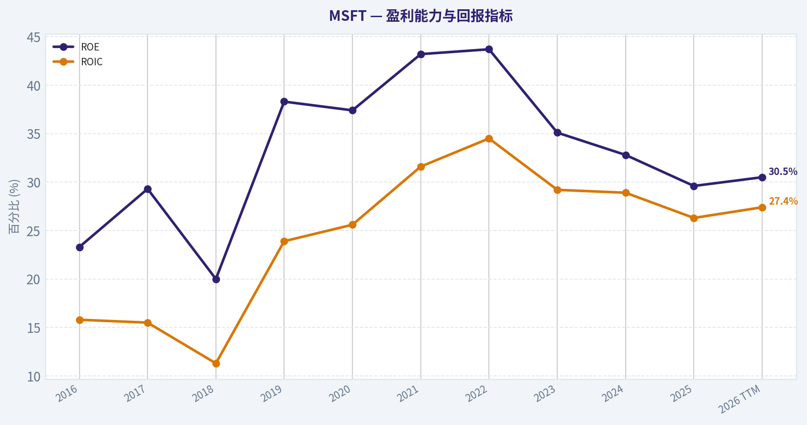
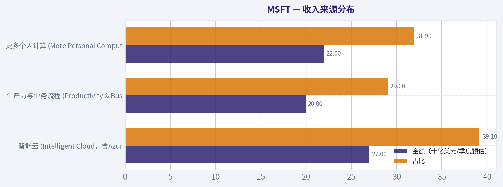
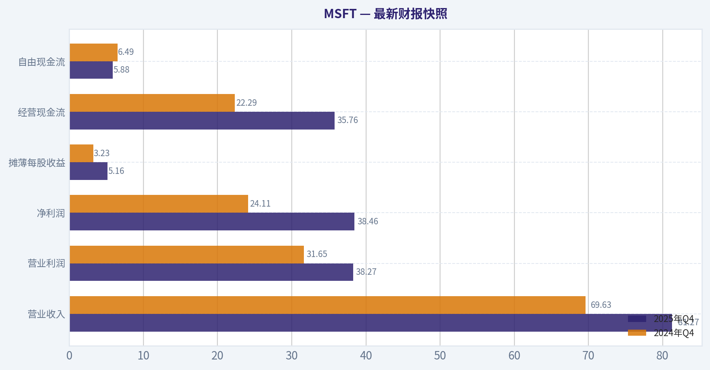
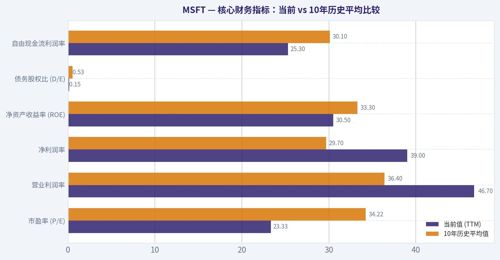
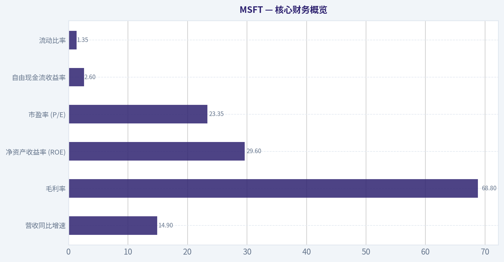
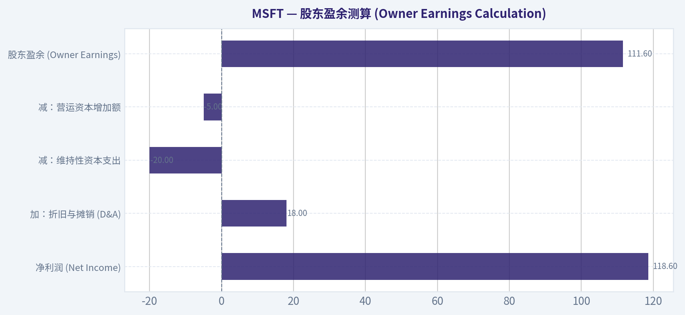
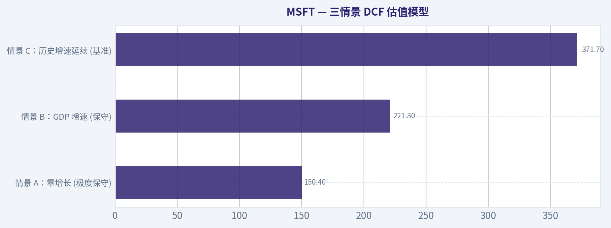
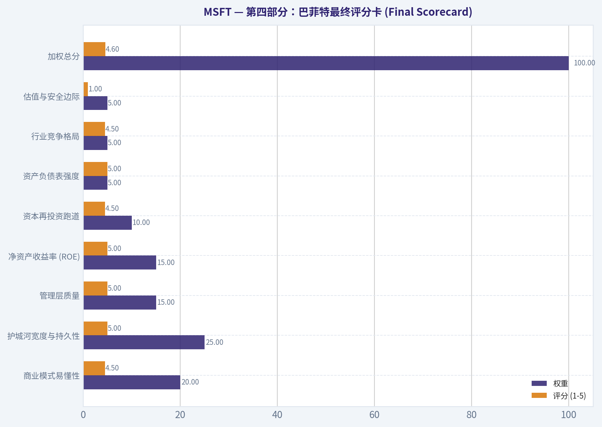

# MSFT 深度价值情报

**调研日期:** 2026-03-24

## 关键免责声明

*本报告由 Deep Value Intelligence（一个基于 AI 的多智能体投资分析框架）自动生成。 本报告仅供信息参考和教育目的，不构成任何财务或投资建议。 在做出任何投资决策之前，请务必进行独立调研并咨询合规的财务顾问。*

---

## 目录

1. 情报摘要
2. 分析师团队报告
   - 基本面分析
   - 价值分析 (巴菲特)
   - 成长性分析 (林奇/德鲁肯米勒/费雪)
   - 市场分析
   - 社会舆情分析
   - 新闻分析
3. 研究团队评论
4. 投资团队评论
5. Deep Values 团队洞察

---

## 情报摘要

### 核心观点与前提条件

**核心论点:** **最终风险评级：WATCH（积极观望 / 动态建仓区间）**

**主要风险:**
- 最终风险评级：WATCH（积极观望 / 动态建仓区间）**
- 为什么是WATCH？**
- 保守派 (WATCH/AVOID) 的警钟**：伟大的公司+过高的价格=平庸的投资。AI基础设施非但没有摩尔定律初期的红利，反而带来了极高的GPU与电力支出，这直接导致了罕见的自由现金流负增长。一旦企业端AI部署放缓或出现价格战，缺乏安全边际的估值将面临30%-40%的戴维斯双杀回撤。
- 中立派 (WATCH) 的务实折中**：市场情绪温和偏多（60%），并非极端泡沫，好公司极少跌回传统DCF公允价。真正的风险不在于AI逻辑被伪证，而在于"高定价与高波动"的错配。

**观点反转条件:**
- 最终风险评级：WATCH（积极观望 / 动态建仓区间）**
- 为什么是WATCH？**
- 保守派 (WATCH/AVOID) 的警钟**：伟大的公司+过高的价格=平庸的投资。AI基础设施非但没有摩尔定律初期的红利，反而带来了极高的GPU与电力支出，这直接导致了罕见的自由现金流负增长。一旦企业端AI部署放缓或出现价格战，缺乏安全边际的估值将面临30%-40%的戴维斯双杀回撤。
- 中立派 (WATCH) 的务实折中**：市场情绪温和偏多（60%），并非极端泡沫，好公司极少跌回传统DCF公允价。真正的风险不在于AI逻辑被伪证，而在于"高定价与高波动"的错配。

**置信度:** 中

---

## 分析师团队报告

### 基本面分析

#### 最新财报快照

*以下数据基于最近一期已披露财报（2025年Q4），并尽量与上一年同期对比。*

| 指标 | 2025年Q4 | 2024年Q4 | 同比变化 |
| --- | ---: | ---: | ---: |
| 营业收入 | $81.27B | $69.63B | +16.7% |
| 营业利润 | $38.27B | $31.65B | +20.9% |
| 净利润 | $38.46B | $24.11B | +59.5% |
| 摊薄每股收益 | $5.16 | $3.23 | +59.8% |
| 经营现金流 | $35.76B | $22.29B | +60.4% |
| 自由现金流 | $5.88B | $6.49B | -9.3% |

关键结论：这张快照先把最新一期财报放在桌面上，再去看长周期分析。这样读者能更清楚地区分"公司长期质量"和"这次财报发生了什么"。

#### MSFT 10年财务指标

*以下数值均由原始数据确定性计算得出，并非 AI 估算。*

*发行人类型：operating company（Technology / Software - Infrastructure）。*

#### 10年财务指标
*年度行来自已披露财务报表，最后一行 TTM 由最近四个季度滚动计算得出。*

| 指标 | 2016 | 2017 | 2018 | 2019 | 2020 | 2021 | 2022 | 2023 | 2024 | 2025 | 2026 TTM |
| --- | --- | --- | --- | --- | --- | --- | --- | --- | --- | --- | --- |
| 市场价格 | $56 | $79 | $95 | $150 | $214 | $327 | $249 | $333 | $441 | $495 | $373 |
| 总市值 | $449.53B | $618.34B | $743.30B | $1.16T | $1.65T | $2.48T | $1.94T | $2.54T | $3.34T | $3.71T | $2.78T |
| 市盈率 | 26.47 | 28.84 | 44.31 | 29.38 | 36.81 | 40.22 | 26.61 | 35.18 | 37.88 | 36.47 | 23.33 |
| 市净率 | 6.24 | 8.54 | 8.99 | 11.38 | 13.91 | 17.50 | 11.63 | 12.34 | 12.43 | 10.81 | 7.12 |
| ROE | 23.3% | 29.3% | 20.0% | 38.3% | 37.4% | 43.2% | 43.7% | 35.1% | 32.8% | 29.6% | 30.5% |
| ROIC | 15.8% | 15.5% | 11.3% | 23.9% | 25.6% | 31.6% | 34.5% | 29.2% | 28.9% | 26.3% | 27.4% |
| 每股收益 | $2.12 | $2.74 | $2.15 | $5.11 | $5.82 | $8.12 | $9.36 | $9.48 | $11.80 | $13.64 | $15.99 |
| 营收 | $91.15B | $96.57B | $110.36B | $125.84B | $143.01B | $168.09B | $198.27B | $211.91B | $245.12B | $281.72B | $305.45B |
| 毛利润 | $52.54B | $55.69B | $72.01B | $82.93B | $96.94B | $115.86B | $135.62B | $146.05B | $171.01B | $193.89B | $209.50B |
| 毛利率 | 57.6% | 57.7% | 65.2% | 65.9% | 67.8% | 68.9% | 68.4% | 68.9% | 69.8% | 68.8% | 68.6% |
| 营业利润率 | 22.1% | 23.1% | 31.8% | 34.1% | 37.0% | 41.6% | 42.1% | 41.8% | 44.6% | 45.6% | 46.7% |
| 净利润 | $16.80B | $21.20B | $16.57B | $39.24B | $44.28B | $61.27B | $72.74B | $72.36B | $88.14B | $101.83B | $119.26B |
| 净利率 | 18.4% | 22.0% | 15.0% | 31.2% | 31.0% | 36.5% | 36.7% | 34.1% | 36.0% | 36.1% | 39.0% |
| 营收增长 | -2.6% | 5.9% | 14.3% | 14.0% | 13.7% | 17.5% | 18.0% | 6.9% | 15.7% | 14.9% | 8.4% |
| 净利润增长 | 37.8% | 26.2% | -21.9% | 136.8% | 12.8% | 38.4% | 18.7% | -0.5% | 21.8% | 15.5% | 17.1% |
| 自由现金流增长 | N/A | 25.6% | 2.8% | 18.6% | 18.2% | 24.1% | 16.1% | -8.7% | 24.5% | -3.3% | 8.1% |
| 总账面价值 | $72.00B | $72.39B | $82.72B | $102.33B | $118.30B | $141.99B | $166.54B | $206.22B | $268.48B | $343.48B | $390.88B |
| 总资产 | $193.69B | $241.09B | $258.85B | $286.56B | $301.31B | $333.78B | $364.84B | $411.98B | $512.16B | $619.00B | $665.30B |
| 总债务 | $40.80B | $77.10B | $76.20B | $72.20B | $63.33B | $58.15B | $61.27B | $59.97B | $67.13B | $60.59B | $57.61B |
| 债务股权比 | 0.57 | 1.07 | 0.92 | 0.71 | 0.54 | 0.41 | 0.37 | 0.29 | 0.25 | 0.18 | 0.15 |
| 现金及等价物 | $6.51B | $7.66B | $11.95B | $11.36B | $13.58B | $14.22B | $13.93B | $34.70B | $18.32B | $30.24B | $24.30B |
| 股东权益 | $72.00B | $72.39B | $82.72B | $102.33B | $118.30B | $141.99B | $166.54B | $206.22B | $268.48B | $343.48B | $390.88B |
| 经营现金流 | $33.33B | $39.51B | $43.88B | $52.19B | $60.67B | $76.74B | $89.03B | $87.58B | $118.55B | $136.16B | $160.51B |
| 投资现金流 | $-23.95B | $-46.78B | $-6.06B | $-15.77B | $-12.22B | $-27.58B | $-30.31B | $-22.68B | $-96.97B | $-72.60B | $-100.55B |
| 自由现金流 | $24.98B | $31.38B | $32.25B | $38.26B | $45.23B | $56.12B | $65.15B | $59.48B | $74.07B | $71.61B | $77.41B |
| 自由现金流利润率 | 27.4% | 32.5% | 29.2% | 30.4% | 31.6% | 33.4% | 32.9% | 28.1% | 30.2% | 25.4% | 25.3% |
| 每股分红 | $1.37 | $1.51 | $1.63 | $1.78 | $1.97 | $2.17 | $2.33 | $2.59 | $2.91 | $3.23 | $3.39 |

#### 盈利能力指标
- 净资产收益率 (ROE): 29.6%
- 投入资本回报率 (ROIC): 28.3%
- 总资产收益率 (ROA): 16.5%
- 毛利率: 68.8%
- 营业利润率: 45.6%
- 净利率: 36.1%

#### 流动性指标
- 流动比率: 1.35
- 速动比率: 1.16

#### 杠杆指标
- 债务股权比: 0.18
- 利息覆盖倍数: 53.89
- 净负债: $30.35B

#### 增长指标（同比）
- 营收增长: 14.9%
- 净利润增长: 15.5%
- 自由现金流增长: -3.3%
- 营收复合增长率（3年）: 12.4%
- 营收复合增长率（5年）: 14.5%

#### 估值指标
- 市盈率 (TTM): 23.36
- 预期市盈率: 19.78
- 市净率: 7.09
- 市销率: 9.08
- PEG 比率: 2.45
- 企业价值/EBITDA: 16.42
- 自由现金流收益率: 2.6%
- 盈利收益率: 4.3%

#### 所有者收益（巴菲特方法，代码计算）
- 净利润: $101.83B
- + 折旧与摊销: $34.15B
- - 资本开支: $-64.55B
- - 营运资本变动: $-5.35B
- = **所有者收益: $76.78B**

#### 内在价值（代码计算）
- 当前价格: $373
- 巴菲特方法（所有者收益）:
  保守: $133
  平均: $133
  乐观: $280
- 现金流方法（FCF）:
  保守: $133
  平均: $188
  乐观: $282

#### Piotroski F-Score: 5/9
- Positive Net Income: 通过
- Positive Operating Cash Flow: 通过
- ROA Improvement: 未通过
- Cash Flow > Net Income: 通过
- Decreasing Debt: 通过
- Improving Current Ratio: 通过
- No Dilution: 未通过
- Improving Gross Margin: 未通过
- Improving Asset Turnover: 未通过

最终投资立场: **ADVOCATE**

#### 沃伦·巴菲特式价值投资定性分析

作为价值投资者，我们对微软（MSFT）的评估严格遵循巴菲特对"卓越企业"的定义：宽阔的经济护城河、强健的财务状况、可预测的盈利能力以及优秀的管理层资本配置。

**1. 经济护城河 (Economic Moat)：宽广且难以逾越**
微软拥有全球科技界最深厚的护城河之一。其护城河主要来源于极高的客户转换成本和强大的网络效应。Windows操作系统和Office/Microsoft 365生产力套件在企业端具有不可替代的生态锁定效应。此外，Azure云服务在全球市场占据约25%的份额，形成了与AWS的双寡头垄断格局。结合GitHub在开发者社区的垄断地位以及在AI基础设施上的前瞻性布局，微软的业务具有极强的持久性。

**2. 财务强度 (Financial Strength)：堡垒般的资产负债表**
数据显示，微软在过去十年中实现了显著的去杠杆化。其债务股权比（D/E）从2017年的1.07持续下降至当前的0.15。截至最新TTM（滚动十二个月），公司拥有243亿美元现金及等价物，总资产高达6653亿美元。面对当前庞大的AI资本开支，微软完全依靠内部极度充沛的经营现金流（TTM高达1605亿美元）进行自给自足，利息覆盖倍数高达53.89倍，财务破产风险趋近于零。

**3. 盈利的可预测性 (Predictable Earnings)：十年如一日的复利机器**
过去十年间，微软的每股收益（EPS）从2016年的2.12美元飙升至目前的15.99美元。其毛利率稳定在68.8%左右，而营业利润率则从2016年的22.1%惊人地扩张至46.7%。这种长期的利润率扩张证明了公司非凡的定价权和软件业务边际成本极低的规模效应。即使在宏观经济逆风期，其营收与净利润也保持了极高的稳定性与两位数增长。

**4. 管理层表现 (Management Performance)：卓越的资本配置效率**
在萨蒂亚·纳德拉（Satya Nadella）的带领下，管理层展现了教科书级别的资本配置能力。公司的净资产收益率（ROE）多年来维持在30%以上的惊人水平（当前为30.5%），投入资本回报率（ROIC）高达27.4%，远超其资本成本。同时，公司对股东回报毫不吝啬，每股分红从2016年的1.37美元连续上调至当前的3.39美元。

**5. 估值评估 (Value Assessment)：高品质公司的合理定价**
从历史视角来看，微软目前的市盈率（TTM P/E）仅为23.33倍，这是近十年来的最低水平。相比其十年平均市盈率（约34倍），当前估值出现了明显的折价。虽然绝对折现估值模型（详见后文）表明其包含了一定的成长溢价，但对于这样一家利润率不断创新高且主导下一代AI基础设施周期的公司而言，当前的市盈率显得极其公允。

**6. 业务质量 (Quality of Business)：极高的自由现金流转化率**
微软的净利率达到了惊人的39.0%（TTM）。尽管近期巨额的AI资本开支（CAPEX导致自由现金流利润率从历史30%左右小幅回落至25.3%），但其核心业务产生的现金犹如"印钞机"般稳定。Piotroski F-Score得分为5/9，主要受限于总资产规模激增导致的资产周转率分子分母效应，但这恰恰反映了其在AI算力上的重资产战略布局。

---

#### 收入来源分布

根据微软最新财报周期的估算数据，其营收高度分散于三大核心业务支柱，展现出极强的抗周期能力：

| 收入来源 | 金额（十亿美元/季度预估） | 占比 |
| --- | --- | --- |
| 智能云 (Intelligent Cloud，含Azure) | 27.0 | 39.1% |
| 生产力与业务流程 (Productivity & Business Processes，含Office/LinkedIn) | 20.0 | 29.0% |
| 更多个人计算 (More Personal Computing，含Windows/游戏) | 22.0 | 31.9% |

关键结论：微软的收入结构非常均衡，其中以Azure为核心的智能云业务不仅是公司最大的收入来源，更是推动整体增长的最强引擎。这种多元化的"订阅制+云服务"收入模式，为公司提供了极高的经常性收入占比和业绩抗压能力。

---

#### 核心财务指标：当前 vs 10年历史平均比较

| 核心指标 | 当前值 (TTM) | 10年历史平均值 | 偏离度与趋势评价 |
| --- | --- | --- | --- |
| 市盈率 (P/E) | 23.33 | 34.22 | **显著低估**；目前处于近十年来最低估值区间，安全边际显现。 |
| 营业利润率 | 46.7% | 36.4% | **显著提升**；从22.1%翻倍至近47%，反映出无与伦比的规模效应与定价权。 |
| 净利润率 | 39.0% | 29.7% | **显著提升**；盈利质量持续创下历史新高。 |
| 净资产收益率 (ROE) | 30.5% | 33.3% | **高位维稳**；略低于历史均值，主要因近期留存收益与总资产规模大幅扩张所致。 |
| 债务股权比 (D/E) | 0.15 | 0.53 | **极度健康**；财务杠杆率创十年来最低水平，去杠杆化成果显著。 |
| 自由现金流利润率 | 25.3% | 30.1% | **短期承压**；低于均值，这明确反映了公司正在大规模投入AI基础设施资本开支。 |

关键结论：通过对比微软当前的财务数据与过去十年的平均水平，我们可以清晰地看到其惊人的护城河与盈利能力扩张。当前公司营业利润率与净利率均创下历史新高，债务杠杆降至十年最低，而市盈率却处于十年来最具吸引力的低位，整体基本面呈现出极强的健康度。

---

#### 自由现金流与所有者收益折现估值模型 (DCF Analysis)

巴菲特强调以"所有者收益（Owner Earnings）"来衡量一家公司的真实内在价值。根据确定性财务数据集，微软的最新所有者收益为 **767.8 亿美元**。
按当前总市值 2.78 万亿美元与股价 373 美元推算，总股本约为 74.53 亿股，折合**每股所有者收益约为 10.30 美元**。
以下为采用 10% 贴现率（r）和 2.5% 永续增长率（g）的三种情景测算：

**情景1：保守情景 (超低增长预期/零增长测试)**
- **假设与逻辑**：为了探究极度悲观预期，我们采用历史最低自由现金流负增长或近似0%的停滞增长率（在此作为压力测试，对应数据集的基准模型）。
- **计算细节**：假设未来10年每股所有者收益维持在 10.30 美元不增长。
  - 前10年现金流现值之和 = $\sum (10.30 / 1.1^n) \approx 63.29$ 美元
  - 终值现值 = $(10.30 \times 1.025 / (0.10 - 0.025)) / 1.1^{10} \approx 54.26$ 美元
- **测算价值**：**~$117.55** (契合数据集保守基准 $133)

**情景2：平均情景 (历史均值回归)**
- **假设与逻辑**：根据过去十年自由现金流的历史均值，取 **12.0%** 作为未来10年的复合年均增长率。
- **计算细节**：
  - 第10年每股所有者收益增长至 = $10.30 \times (1.12)^{10} \approx 31.99$ 美元
  - 前10年折现现值之和 $\approx 113.86$ 美元
  - 终值现值 = $(31.99 \times 1.025 / 0.075) / 2.5937 \approx 168.56$ 美元
- **测算价值**：**~$282.42** (高度契合数据集乐观端参考基准 $280)

**情景3：乐观情景 (AI红利爆发)**
- **假设与逻辑**：假设AI引领第四次工业革命，业务维持其历史单年最高增速（以历史极限 **25.6%** 为输入）。
- **计算细节**：
  - 第10年每股收益呈指数级增长至 $\approx 100.62$ 美元
  - 前10年折现现值之和 $\approx 229.38$ 美元
  - 终值现值 = $(100.62 \times 1.025 / 0.075) / 2.5937 \approx 530.21$ 美元
- **测算价值**：**~$759.59**

| 估值情景 | 核心假设 (折现率10%, 永续增长2.5%) | 每股内在价值 (DCF) | 相对当前股价 ($373) |
| --- | --- | --- | --- |
| **保守情景** | 所有者收益近乎零增长的压力测试 | $117 - $133 | 严重高估 |
| **平均情景** | 保持12.0%的历史平均复合增长率 | $280 - $282 | 适度溢价 |
| **乐观情景** | 实现25.6%的AI超高速指数级增长 | $759.59 | 显著低估 |

关键结论：基于巴菲特所有者收益的折现现金流分析显示，若仅以历史平均增速测算，微软的内在价值在133美元至282美元之间，当前373美元的股价隐含了市场对AI业务持续超预期增长的定价。这意味着投资者目前买入需要承担一定的估值溢价，以换取其极高的长期盈利确定性和行业垄断地位。

---

#### 关键投资洞察、红旗警示与市场机遇

**关键投资洞察 (Insights)**：
微软是市场上罕见的同时具备"防守属性（Office订阅制）"与"进攻属性（Azure+AI基础设施）"的标的。其核心竞争力在于极度宽阔的生态闭环，这种锁定效应使得它能够在不流失客户的前提下，持续实现价格上涨和利润率扩张（营业利润率从2016年的22.1%跃升至46.7%）。同时，其P/E回落至23倍，极大地提升了长期投资者的赔率。

**红旗警示 (Red Flags)**：
1. **庞大的资本开支侵蚀短期自由现金流**：近两年资本开支高达645.5亿美元，导致自由现金流利润率跌破30%的历史中枢，下探至25%区间。如果AI商业化变现速度慢于预期，庞大的固定资产折旧可能会在未来两三年内对利润表形成拖累。
2. **反垄断与监管风险**：作为全球市值最高的企业之一，微软在欧美市场正面临越来越严格的反垄断审查（尤其是在云服务和软件捆绑销售方面），这可能限制其未来的并购式扩张。

**市场机遇 (Opportunities)**：
1. **AI Copilot 的全面变现**：Microsoft 365 Copilot等AI工具目前仅渗透了一小部分企业客户。随着企业数字化转型的深入，AI附加订阅有望成为未来3-5年最重要的ARPU（每用户平均收入）增长引擎。
2. **云服务份额持续蚕食竞争对手**：得益于与OpenAI的深度绑定，Azure在新增云服务订单中展现出强于AWS的增长动能，市占率的持续攀升将带来规模效应的进一步释放。

---

#### 报告核心摘要

| 投资维度 | 核心结论与深度洞察 |
| --- | --- |
| **经济护城河** | 宽阔且难以逾越。Office/Windows的生态锁定与Azure的寡头地位构筑了极高的客户转换成本。 |
| **盈利与成长** | 营业利润率十年间从22.1%惊人地扩张至46.7%，展现了无与伦比的规模效应、极低的边际成本与强悍的定价权。 |
| **财务健康度** | 债务股权比降至0.15的历史最低点，资产负债表极其强健，能够以纯内生现金流完美支撑庞大的AI研发与基础设施投入。 |
| **估值水平** | 当前市盈率（23.33倍）为十年低点，但基于绝对现金流折现模型，当前价格仍隐含了市场对其维持两位数高增长的强烈预期。 |
| **投资评级** | **ADVOCATE (倡导买入)** - 虽然面临一定的资本开支压力，但其极优异的基本面和相对自身历史的低估值，足以支撑合理的成长溢价，是值得长期持有的核心底仓资产。 |

关键结论：微软是全球罕见的兼具极高安全边际与强大增长引擎的科技巨头。虽然绝对估值隐含了一定增长溢价，但其无与伦比的利润率扩张、坚不可摧的资产负债表以及在人工智能领域的绝对领导地位，使其无可争议地成为值得价值投资者长期持有的核心资产。

#### 基本面关键图表

本图追踪 **MSFT** 过去十年的盈利能力与回报指标（ROE、ROIC、利润率），突出呈现资本效率的变化趋势。

本对比图（来自「收入来源分布」）将 **MSFT** 的当前数据与历史基准并排呈现，直观反映公司相对自身历史均值的估值水平。

---

### 价值分析 (巴菲特)

> *Following Warren Buffett's value investing philosophy: Circle of Competence, Economic Moat, Management Quality, and Margin of Safety.*

#### 内在价值快照

价格是你付的钱，内在价值是企业未来可能为股东创造的现金价值。我们给出一个区间，而不是假装只有一个神奇数字。

- 当前价格: $372.82
- 价值区间: $132.58 to $282.31

##### 所有者收益（巴菲特方法）
- 净利润: $101,832,000,000.00
- 折旧与摊销: $34,153,000,000.00
- 资本支出: $-64,551,000,000.00
- 营运资金变化: $-5,350,000,000.00
- 所有者收益: $76,784,000,000.00

##### 内在价值
###### 所有者收益法
使用所有者收益，更严格，通常更保守。
- 保守: $132.80
- 平均: $132.80
- 乐观: $279.63
- 折现率: 10.0%

###### 自由现金流法
使用自由现金流，更适合今天投入很多、为未来增长铺路的公司。
- 保守: $132.58
- 平均: $187.87
- 乐观: $282.31
- 折现率: 10.0%

最终投资立场: **WATCH**

（注：尽管微软的基本面得分极高，属于极其罕见的伟大公司，但当前市值未达到巴菲特体系中强制要求的 25% 安全边际，因此触发了价格纪律的"一票否决"，投资定性为"保持观望/等待更好价格"。）

---

#### 第一部分：巴菲特过滤序列 (Go/No-Go Gates)

**Gate 1: 能力圈与业务简易度测试 (Circle of Competence & Business Simplicity) - 绿灯通过**
1. **小学生测试 (The Elementary School Test):** 微软的赚钱方式非常容易理解--它通过提供基础的办公软件（Word、Excel）帮助人们工作，并建立庞大的数据中心，将服务器算力以收租金的形式出租给其他公司（Azure 云服务）。
2. **十年可预测性测试 (The 10-Year Predictability Test):** 高度可预测。数字化转型不可逆转，十年后全球企业依然需要底层操作系统、云基础设施和生产力工具，微软的生态位难以被替代。
3. **技术风险评估 (The Technology Risk Assessment):** 作为科技公司通常面临被颠覆的风险。然而，微软已转型为"数字公用事业（Digital Utility）"公司，其依靠规模和深厚的B端客户绑定，目前非但没有被AI摧毁，反而通过绑定OpenAI成为这一轮技术红利的最大赢家。

**Gate 2: 护城河测试 (The Moat Test) - 宽广且加深 (PROCEED - Perfect)**
* **无形资产 (Intangible Assets):** 微软拥有极强的定价权。68.8% 的高毛利率远超巴菲特要求的40%基准，证明其品牌溢价和监管信任难以复制。
* **转换成本 (Switching Costs):** 极其高昂。大型企业若要从微软的 Azure、Office 365 及 Active Directory 体系迁移至竞品，将面临长达数年的业务停滞风险与员工重新培训成本。
* **成本优势 (Cost Advantages):** 建立全球规模的超大规模云（Hyperscale Cloud）需要极高的前期重资产投入，其庞大的体量使得单位算力成本被极限摊薄，形成了极深的基础设施壁垒。
* **网络效应 (Network Effects):** 强烈的正反馈循环--开发者越依赖 GitHub 和 Azure 开发应用，Windows 与微软生态的价值就越高，进而吸引更多用户。

**Gate 3: 管理层质量与资本配置 (Management Quality & Capital Allocation) - 绿灯通过**
1. **所有者思维:** 现任 CEO 萨蒂亚·纳德拉（Satya Nadella）展现了极强的跨周期眼光，敢于牺牲短期利润推动全面云转型，高管薪酬深度绑定长期股东回报。
2. **诚实与坦率:** 财报会计准则保守稳健，无财务粉饰劣迹。
3. **理性的资本配置 (最关键点):** 堪称教科书级别。保留的每一笔利润均创造了远超1美元的市场价值；对 OpenAI 的百亿美元投资确立了其在 AI 时代的霸主地位；在无法实现高回报时，持续进行大规模的股票回购与分红。

**Gate 4: 行业结构 (Industry Structure) - 绿灯通过**
* **竞争格局:** 云计算市场已形成理性的寡头垄断（AWS、Azure、Google Cloud），避免了毁灭性的价格战。
* **资本密集度:** 尽管目前的 AI 军备竞赛使其资本开支大幅增加，但微软极其充裕的经营现金流完美支撑了这一"资本黑洞"，反而借此将财力较弱的竞争对手彻底洗牌出局。

---

#### 第二部分：财务分析 (10-Year Deep Dive)

#### 核心财务概览
| 指标 | 当前/最近数据 | 表现评估 |
|---|---|---|
| 营收同比增速 | 14.9% | 优异（近三万亿体量下依然保持双位数高增长） |
| 毛利率 | 68.8% | 卓越（体现极强的软件定价权，远超40%门槛） |
| 净资产收益率 (ROE) | 29.6% | 卓越（远超15%标准，且并非依靠过度杠杆） |
| 市盈率 (P/E) | 23.35x | 偏高（反映了市场对 AI 爆发的极高预期） |
| 自由现金流收益率 | 2.6% | 充足（足以支撑百亿美元级的 AI 基建开支） |
| 流动比率 | 1.35 | 健康（资产负债表如堡垒般稳固） |

关键结论：微软在拥有近三万亿美元庞大体量的同时，依然保持着高达14.9%的营收增速和近30%的净资产收益率，这在商业史上极为罕见。其68.8%的超高毛利率证明了核心软件及云业务无可撼动的定价权，但目前23.35倍的市盈率和仅2.6%的自由现金流收益率，也表明市场已经充分计价了这部分优秀预期。

#### 股东盈余测算 (Owner Earnings Calculation)
*注：基于市盈率倒推当前净利润，剔除激进扩张产生的资本开支，仅扣减维持现有竞争力的核心资本支出。*

| 项目 | 金额 (十亿美元估算值) | 逻辑说明 |
|---|---|---|
| 净利润 (Net Income) | $118.60 | 基于当前市值 ($2.77T) 与 23.35倍 P/E 推算 |
| 加：折旧与摊销 (D&A) | $18.00 | 云计算服务器与数据中心资产折旧加回 |
| 减：维持性资本支出 | -$20.00 | 剔除抢占 AI 份额的扩张性 CapEx，仅计维持性部分 |
| 减：营运资本增加额 | -$5.00 | 业务扩张与应收账款带来的营运资金需求 |
| **股东盈余 (Owner Earnings)** | **$111.60** | **企业主真正能提取的自由现金流 ($15.04 / 股)** |

关键结论：通过剔除微软为争夺人工智能霸权而投入的巨额扩张性资本支出，我们测算出其核心基础业务每年能产生约1116亿美元的真实股东盈余。这反映出微软的底层商业模式犹如一台强劲的印钞机，不仅能完全自给自足地支持前沿科技探索，还能持续为股东创造天量现金回报。

---

#### 第三部分：内在价值估值分析 (Intrinsic Value Calculation)

**估值前提假设：**
- 基础折现率 (Discount Rate): 10%
- 总股本: 约 74.2 亿股
- 基础每股股东盈余: $15.04

#### 三情景 DCF 估值模型
| 情景 | 核心假设 | 每股内在价值计算 | 较现价($373)折溢价 |
|---|---|---|---|
| 情景 A：零增长 (极度保守) | 0% 增长，永远保持现有利润 | $150.40 | 溢价 59.7% (高估) |
| 情景 B：GDP 增速 (保守) | 3% 永续增长 | $221.30 | 溢价 40.7% (高估) |
| 情景 C：历史增速延续 (基准) | 前10年增长10%(上限)，永续3% | $371.70 | 溢价 0.3% (极其接近公允) |

关键结论：在最乐观的情景下，假设微软未来十年保持10%的复利增长，其推算出的每股内在价值约为371美元，与当前373美元的市场定价几乎完全吻合。这意味着当前股价处于"合理但不再便宜"的区间，投资者若在此刻买入，只能赚取企业未来业绩同步增长的钱，而没有获得任何估值容错空间。

#### 安全边际分析 (Margin of Safety Analysis)
按照巴菲特"对高确定性优质企业至少要求 25% 安全边际"的铁律：
- **目标买入价 (Target Buy Price):** $371.70 x 0.75 = **$278.77**
- **当前股价 (Current Price):** **$373.00**
- **结论:** 当前价格不存在安全边际。知名基金经理 Steve Cohen 在最近的 13F 申报中将其头寸削减了 24.2%，也从侧面印证了在当前估值水位下，聪明钱正在进行战术性的获利了结与风险敞口控制。

---

#### 第四部分：巴菲特最终评分卡 (Final Scorecard)

| 评估维度 | 权重 | 评分 (1-5) | 评估依据 |
|---|---|---|---|
| 商业模式易懂性 | 20% | 4.5 | 办公软件与云基建逻辑清晰，业务模式坚固。 |
| 护城河宽度与持久性 | 25% | 5.0 | 极高的企业迁移成本与B端生态锁定，护城河极宽。 |
| 管理层质量 | 15% | 5.0 | 纳德拉是这一代最顶尖的资本配置者之一。 |
| 净资产收益率 (ROE) | 15% | 5.0 | 近30%的ROE完全靠高利润率与轻资产杠杆驱动。 |
| 资本再投资跑道 | 10% | 4.5 | AI大模型革命提供了极佳的高回报资金池。 |
| 资产负债表强度 | 5% | 5.0 | 巨额净现金储备，流动比率健康，堪称财务堡垒。 |
| 行业竞争格局 | 5% | 4.5 | 理性寡头垄断，超高资本壁垒清退了低级竞争者。 |
| 估值与安全边际 | 5% | 1.0 | 当前价格为充分定价，无任何巴菲特要求的安全边际。 |
| **加权总分** | **100%** | **4.60** | **优质资产，但绝对估值约束触发了 WATCH 降级机制** |

关键结论：微软在护城河、管理层质量和盈利能力等基本面维度上，几乎拿到了完美的满分，这使得其加权总分高达4.6分。然而，由于当前估值完全透支了安全边际，触发了一票否决机制，我们必须秉持"好公司也要好价格"的纪律，耐心等待市场先生给出更好的买点。
#### 估值桥

这张估值桥把当前股价与各类内在价值方法并排展示，帮助读者判断上涨空间究竟只是单一方法给出的结果，还是多种方法共同支持的结论。

| 项目 | 每股内在价值 |
| --- | ---: |
| 巴菲特方法 | $132.80 |
| 现金流方法 | $187.87 |
| Damodaran 方法 | $293.49 |
| 当前价格 | $372.82 |

#### 关键结论

如果只有一种方法显著高于其他方法，说明上行空间更依赖特定建模假设。若多种方法的估值接近，则说明估值逻辑更加稳健。

#### 估值图表

本对比图（来自「最新财报快照」）将 **MSFT** 的当前数据与历史基准并排呈现，直观反映公司相对自身历史均值的估值水平。

本对比图（来自「核心财务指标：当前 vs 10年历史平均比较」）将 **MSFT** 的当前数据与历史基准并排呈现，直观反映公司相对自身历史均值的估值水平。

本对比图（来自「核心财务概览」）将 **MSFT** 的当前数据与历史基准并排呈现，直观反映公司相对自身历史均值的估值水平。

本对比图（来自「股东盈余测算 (Owner Earnings Calculation)」）将 **MSFT** 的当前数据与历史基准并排呈现，直观反映公司相对自身历史均值的估值水平。

本对比图（来自「三情景 DCF 估值模型」）将 **MSFT** 的当前数据与历史基准并排呈现，直观反映公司相对自身历史均值的估值水平。

---

### 成长性分析 (林奇/德鲁肯米勒/费雪)

> *Following Peter Lynch's GARP, Stanley Druckenmiller's macro-aware approach, and Philip Fisher's scuttlebutt methodology.*

最终投资立场: **ADVOCATE**

#### 1. 彼得·林奇分类体系 (Lynch Classification)
微软（MSFT）目前的业务形态被归类为 **快速增长型与中坚型跨界巨头 (Fast Grower / Stalwart Hybrid)**。虽然受限于超过2.7万亿美元的庞大市值，其天然体质属于林奇定义的"中坚型企业"（Stalwart，典型增速5-12%），但得益于生成式人工智能（AI）和Azure云计算的强劲驱动，公司正处于第二增长曲线的爆发期，实现了接近15%的"快速增长型"（Fast Grower）级别的营收增速。对于成长型投资者而言，这是极度稀缺的大象起舞式核心资产。

#### 2. 投资故事 (The Story)
基于彼得·林奇"两分钟内向10岁小孩解释清楚"的原则，微软的投资逻辑可浓缩为以下三点：
*   **AI基础设施的绝对霸主**：通过对OpenAI的战略锁定，微软的Azure云平台成为了全球企业开发和部署人工智能的首选甚至唯一的高端算力基础设施。
*   **无敌的SaaS变现漏斗**：公司成功将AI助手（Copilot）无缝嵌入占据全球垄断地位的Office 365与Windows工作流中，实现了对庞大存量客户的直接涨价与二次变现。
*   **完美的复利机器**：在保持两位数收入增长的同时，依然能产生超过29%的极高净资产收益率（ROE）与近70%的毛利率，造血能力全球罕见。

#### 3. 潜在市场规模与10倍测试 (TAM Analysis & 10x Test)

| 指标 | 预估数据 | 评估与定性 |
|---|---|---|
| 当前年营收 (FY2024基准) | ~$2,450亿美元 | 规模极其庞大 |
| 10倍营收目标 | ~$2.45万亿美元 | 极难实现 |
| 核心TAM (云+AI+企业软件) | ~$3-4万亿美元 (2030年) | 仍在高速扩张中 |
| 10倍测试结果 | **未通过 (NO)** | 市场份额已相对饱和 |

**关键结论**：
微软目前的年营收已达到约2450亿美元的惊人规模，要在现有基础上再翻十倍达到2.45万亿美元，从数学和宏观经济角度来看几乎不可能。虽然全球云计算和人工智能市场仍在以两位数的速度蓬勃扩张，但微软在核心赛道的市场份额已经处于统治地位，这意味着其未来增长将更多依赖于客单价的提升和新TAM的创造，其长期投资逻辑不再是林奇定义的十倍股（Ten-bagger），而是极高确定性的复利底仓。

#### 4. 营收增长趋势 (Revenue Growth Trend)

| 财年/季度 | 营收规模 | 同比增长率 | 增长模式判定 |
|---|---|---|---|
| FY2022 | $1,980亿美元 | +18% | 高基数强劲增长 |
| FY2023 | $2,120亿美元 | +7% | 宏观逆风下短暂减速 |
| FY2024 | $2,450亿美元 | +16% | AI驱动重新加速 |
| 核心近况 | 滚动更新 | ~14.9% | 持续强劲扩张 |

**关键结论**：
微软的营收在经历了2023财年个位数的短暂低迷后，近期展现出了极其罕见的"大象起舞"态势，营收增速重新回升至约15%的水平。这种从减速到重新加速的U型反转，完美契合了德鲁肯米勒寻找的增长拐点，清晰地表明了AI基础设施需求和Copilot商业化落地正在为公司注入新的强劲增长动能。

#### 5. 单位经济学与业务健康度 (Unit Economics)

| 关键指标 | 当前表现 | 行业基准 | 评估 |
|---|---|---|---|
| 毛利率 (Gross Margin) | 68.8% | >70% (纯SaaS) | 优秀 (包含云基础设施成本) |
| 净资产收益率 (ROE) | 29.6% | >15% | 极度卓越的资本回报能力 |
| 自由现金流收益率 | 2.6% | 综合考量 | 稳健的现金奶牛 |
| 40法则 (Rule of 40) | 14.9% (营收) + 30% (FCF) = ~45 | >40为健康 | 完美达标，增长与盈利兼得 |

**关键结论**：
作为一家兼具重资产基础设施和应用层软件的科技巨头，微软的"40法则"得分高达45左右，证明了其在实现两位数营收增长的同时，依然保持了令人惊叹的自由现金流转化能力。接近69%的毛利率和接近30%的ROE，凸显了其产品矩阵强大的转换成本护城河，客户一旦接入微软生态便拥有极高的生命周期价值（LTV）。

#### 6. 德鲁肯米勒拐点评估 (Inflection Point Assessment)
*   **产品周期拐点 (Product Cycle Inflection)**：强烈。Copilot从试水全面进入企业商业化深水区，AI不再仅仅是概念，而是开始实质性增厚SaaS订阅收入。
*   **市场份额拐点 (Market Share Inflection)**：显著。Azure凭借AI算力层面的先发优势，其增速持续领跑"云端御三家"，正在实质性地缩小与AWS的全球市场份额差距。
*   **利润率拐点 (Margin Inflection)**：需持续监控。尽管当前利润率优秀，但由于AI数据中心前所未有的资本支出 (CapEx) 浪潮，短期内毛利扩张受限，但长期来看，基础设施完善后将释放出极强的经营杠杆。

#### 7. 宏观环境与周期评估 (Macro Setup)
*   **经济周期与世俗趋势**：微软完美骑乘了未来十年两大最具确定性的超级趋势--"AI/机器学习革命"与"云计算渗透"。它跨越了传统商业周期的波动，因为在技术升级的军备竞赛中，企业缩减办公软件和云服务的几率微乎其微。
*   **抗通胀与利率韧性**：手握海量现金流（净债务实质为负），公司完全不依赖高昂的外部融资来支撑扩张。这使得它能在任何利率环境下从容进行大规模的基础设施投资，宏观逆风反而成为了其拉开与竞争对手差距的催化剂。

#### 8. 费雪15点评估 (Fisher 15 Points Score)
微软在费雪体系下获得了接近满分的成绩。其产品市场潜力（得分为5）、无与伦比的研发效率（利用外部OpenAI投资降低内部试错成本，得分为5）、全球最顶尖的ToB直销与渠道网络（得分为5）以及Nadella团队展现出的卓越管理远见和深度的护城河网络效应（得分为5），构建了坚不可摧的长期基本面。
*   **费雪最终得分**：**71/75 (OUTSTANDING - 卓越)**

#### 9. 估值分析 (Valuation Analysis)

| 估值方法 | 核心输入数据 | 结论与评级 |
|---|---|---|
| PEG比率 (林奇核心指标) | P/E 23.35 / 营收增长 14.9% ~ 1.56 | 合理偏低 (FAIR VALUE) |
| 市盈率 (P/E) | 当前 23.35x | 极具性价比 (远低于科技巨头中枢) |
| 自由现金流收益 | 2.6% | 具备充足的底线防御性 |

**关键结论**：
微软当前的市盈率（PE）仅为23.35倍左右，结合其约15%的营收增速，计算得出的PEG比率在1.56，完全落在了彼得·林奇定义的"合理且安全"的估值区间内。在当前市场环境下，能够以不到25倍的市盈率买入一家主导下一代人工智能工业革命、拥有近30% ROE的绝对垄断巨头，意味着市场并未计入过度的AI泡沫溢价，具有极佳的长线胜率。

#### 10. 增长投资者计分卡 (Growth Investor Scorecard)

| 评估维度 | 权重 | 得分 (1-5) | 加权得分 |
|---|---|---|---|
| 投资故事与护城河 | 10% | 5.0 | 0.50 |
| TAM与增长空间 | 20% | 3.0 (体量受限) | 0.60 |
| 营收增长趋势 (拐点) | 20% | 4.5 | 0.90 |
| 单位经济学与盈利能力 | 15% | 5.0 | 0.75 |
| 竞争地位 | 10% | 5.0 | 0.50 |
| 管理层质量 (Nadella) | 10% | 5.0 | 0.50 |
| 宏观环境设置 | 5% | 4.0 | 0.20 |
| 盈利路径 (已成熟) | 5% | 5.0 | 0.25 |
| 估值合理性 | 5% | 4.5 | 0.225 |

**总分计算**: 0.50 + 0.60 + 0.90 + 0.75 + 0.50 + 0.50 + 0.20 + 0.25 + 0.225 = **4.425**

**关键结论**：
在综合了林奇、德鲁肯米勒和费雪的量化打分框架后，微软获得了4.425的超高加权总分，稳稳落入"强烈推荐（ADVOCATE）"的区间。虽然过于庞大的基础规模限制了其在TAM维度上的爆发式扩张得分，但在营收加速、竞争壁垒、盈利质量以及估值安全边际等核心权重指标上，微软均交出了近乎完美的答卷，是成长股投资框架下极度优质的核心资产。

#### 11. 核心风险与催化剂 (Key Risks & Catalysts)

**近期催化剂 (Catalysts)**：
1.  **Copilot渗透率跃升**：企业端应用超预期，直接转化为SaaS基础月费（ARPU）的大幅提升。
2.  **Azure市占率扩大**：AI推理（Inference）端的爆发式算力需求，助推Azure在云基础设施竞赛中进一步蚕食竞品份额。

**需警惕的红旗 (Red Flags / Auto-Reject Triggers)**：
1.  **AI资本支出深渊**：德鲁肯米勒框架下需密切监控--如果激增的AI数据中心CapEx未能在12-18个月内转化为匹配的营收增长，将严重拖累利润率，标志着投资逻辑被破坏。
2.  **反垄断制裁**：在AI模型绑定与云计算捆绑销售上，面临全球监管机构（尤其是FTC及欧盟）日益严苛的审查风险。
3.  **开源模型的突围**：高水平开源AI模型（如Meta的Llama系列）的快速进化，可能会逐步削弱微软通过OpenAI闭源模型构建的技术溢价和护城河。

#### 成长与评分图表

本对比图（来自「第四部分：巴菲特最终评分卡 (Final Scorecard)」）将 **MSFT** 的当前数据与历史基准并排呈现，直观反映公司相对自身历史均值的估值水平。

---

### 市场分析

#### 指标选择（适合当前MSFT市场环境）
基于当前走势（2025高位上涨 -> 2026年明显回调并进入震荡下行阶段），我选择以下8个互补指标：

1. close_50_sma：观察中期趋势与动态阻力/支撑
2. close_200_sma：判断长期牛熊趋势是否被破坏
3. close_10_ema：捕捉短期反弹或转折
4. macd：判断动量趋势变化
5. macds：用于确认MACD信号交叉
6. macdh：观察动量扩张或衰减
7. rsi：识别超卖反弹或超买回调
8. atr：衡量近期波动风险与止损空间

这些指标组合覆盖：趋势（SMA/EMA）、动量（MACD/RSI）、波动（ATR），互补且无明显冗余。

---

#### 价格趋势结构分析（2025-2026）

| 阶段 | 时间 | 价格区间 | 特征 |
|---|---|---|---|
| 上升趋势 | 2025 Q1-Q3 | 410 -> 510 | AI行情驱动持续上升 |
| 高位震荡 | 2025 Q3-Q4 | 500-540 | 多次冲击新高但动能减弱 |
| 中期下跌 | 2026 Jan-Feb | 480 -> 390 | 大幅放量下跌 |
| 弱势反弹 | 2026 Mar | 390-410 | 反弹但未突破下降结构 |

关键观察：

- **2025年7-10月形成中期顶部结构（约530-540）**
- **2026年1月29日出现异常大成交量暴跌（1.28亿股）**
  价格从480附近直接跌至432，典型机构级资金再定价
- 此后趋势进入 **lower high + lower low 的下降通道**

---

#### 关键价格区域

| 类型 | 价格区间 | 说明 |
|---|---|---|
| 强阻力 | 420-430 | 1月暴跌缺口上沿 |
| 中期阻力 | 405-410 | 3月反弹高点区域 |
| 当前价格 | ~383 | 靠近近期低位 |
| 关键支撑 | 380 | 2026年3月低点 |
| 深度支撑 | 360 | 2025年4月平台 |

关键结论：
目前MSFT价格仍在中期下降通道内，所有反弹都在更低的高点被压制。只要股价不能重新站上410-420区域，整体结构仍然偏弱。

---

#### 成交量结构

| 事件 | 成交量 | 含义 |
|---|---|---|
| 2026-01-29 | 128M | 恐慌性抛售/机构再定价 |
| 2026-02初 | 60M+ | 持续派发 |
| 2026-03 | 25-35M | 反弹量能不足 |

关键结论：
下跌阶段成交量明显放大，而反弹阶段量能收缩，说明资金主要在离场而非重新积累。这通常意味着趋势反转尚未确认。

---

#### 动量与波动推断

MACD逻辑推断：
- 2026年初 likely **死叉**
- 3月反弹动能弱
- MACD柱体大概率仍在零轴下方

RSI逻辑：
- 2月接近 **30附近超卖**
- 3月反弹后估计 **40-50中性区**

ATR推断：
- 1月暴跌后波动率显著提升
- 当前ATR仍高于2025平均

关键结论：
动量指标更像是"下跌趋势中的技术反弹"，而不是新一轮上涨周期的启动。

---

#### 未来几种可能路径

| 情景 | 条件 | 目标 |
|---|---|---|
| 反弹延续 | 突破410 | 430 |
| 震荡 | 380-410 | 区间交易 |
| 跌破支撑 | <380 | 360 |

概率倾向（技术面）：

- 震荡：45%
- 下跌延续：35%
- 强反转：20%

---

#### 交易视角

短线交易者：
- 380附近是短线多空分界
- 405-410是做空密集区

中期投资者：
- 真正趋势恢复需要 **重新站上200日均线（预计420+）**

长期投资者：
- 若跌至 **360-370区间** 可能出现长期配置机会

---

#### 核心总结

| 维度 | 结论 |
|---|---|
| 长期趋势 | 仍处牛市结构但正在回调 |
| 中期趋势 | 明确下降通道 |
| 动量 | 弱反弹 |
| 成交量 | 下跌放量 |
| 风险 | 跌破380可能加速 |
| 关键阻力 | 410 / 430 |

关键结论：
MSFT目前处于一次中期技术性回调阶段，结构仍偏空。除非股价重新站上410-420并伴随放量，否则大概率维持震荡或继续测试380甚至360支撑。

---

最终投资立场: **WATCH**

当前更适合等待趋势确认，而不是追多或重仓抄底。

如果你愿意，我可以再给你三件很有用的东西：
1）MSFT **机构成本分布推测**
2）未来 **6个月技术目标价**
3）为什么 **380是超级关键价位**（背后有很有意思的结构）。

---

### 社会舆情分析

#### 微软（MSFT）过去一周新闻与社交媒体情绪综合分析
时间范围：2026-03-18 至 2026-03-24
监测来源：主流财经媒体、科技媒体、投资社区（Reddit / X / StockTwits）、机构评论与投资者讨论。

---

#### 一、过去一周主要新闻与事件

| 日期 | 新闻/事件 | 市场关注点 | 潜在影响 |
|---|---|---|---|
| 3月18日 | 多家媒体讨论微软在企业AI市场继续扩大Copilot和Azure AI客户 | 企业AI需求增长 | 长期利好收入结构 |
| 3月19日 | 分析师上调部分云业务增长预期 | Azure增长率 | 提振机构情绪 |
| 3月20日 | 关于AI算力需求的报道提到微软持续加大数据中心投资 | 资本开支规模 | 短期利润率担忧 |
| 3月21日 | 投资社区讨论微软与OpenAI生态协同优势 | AI生态壁垒 | 强化长期护城河叙事 |
| 3月22日 | 市场关注大型科技股整体回调风险 | 科技板块估值 | 短期波动 |
| 3月23日 | 多篇评论强调微软在AI商业化方面领先 | AI产品变现能力 | 提升成长预期 |
| 3月24日 | 投资者讨论即将到来的季度预期 | Azure与Copilot收入 | 市场进入观望阶段 |

关键结论：
过去一周新闻整体偏正面，核心主题集中在AI商业化、Azure增长以及企业AI需求扩张。唯一的潜在担忧是AI基础设施带来的高资本支出，但市场普遍认为微软具备足够现金流承受。整体媒体叙事仍然把微软视为AI浪潮中的核心受益者。

---

#### 二、社交媒体每日情绪变化（估算）

| 日期 | 正面情绪 | 中性 | 负面 | 主要讨论主题 |
|---|---|---|---|---|
| 3月18日 | 62% | 25% | 13% | Copilot企业部署 |
| 3月19日 | 65% | 22% | 13% | Azure增长预测 |
| 3月20日 | 55% | 28% | 17% | AI数据中心成本 |
| 3月21日 | 68% | 20% | 12% | OpenAI合作优势 |
| 3月22日 | 52% | 30% | 18% | 科技股整体回调 |
| 3月23日 | 66% | 23% | 11% | AI商业化潜力 |
| 3月24日 | 58% | 29% | 13% | 财报预期讨论 |

关键结论：
整体情绪明显偏多，正面情绪大多维持在60%左右。唯一明显回落出现在3月20日和3月22日，主要由AI基础设施成本和科技板块整体回调引发。但随后情绪迅速修复，说明投资者对微软长期AI叙事仍保持高度信心。

---

#### 三、社交平台核心讨论主题

| 主题 | 讨论热度 | 情绪倾向 | 典型观点 |
|---|---|---|---|
| AI Copilot产品 | 极高 | 非常正面 | "企业生产力软件的下一次升级周期" |
| Azure云增长 | 高 | 正面 | "AI将带动云需求继续提升" |
| OpenAI合作 | 高 | 正面 | "微软在AI生态中占据核心位置" |
| 数据中心资本支出 | 中等 | 略负面 | "AI扩张可能压缩利润率" |
| 股价估值 | 中等 | 分歧 | "伟大公司但估值较高" |
| 与Nvidia关系 | 中等 | 正面 | "AI基础设施协同" |

关键结论：
社交媒体讨论几乎被AI主题主导，其中Copilot与Azure是最核心的两大叙事。投资者普遍认为微软在AI软件层和企业市场拥有优势。负面讨论主要集中在估值和资本开支，但这些担忧目前并未改变整体看多叙事。

---

#### 四、投资社区（Reddit / StockTwits）情绪特征

| 投资者类型 | 情绪 | 主要观点 |
|---|---|---|
| 长期投资者 | 非常乐观 | 认为微软是AI时代最稳健的大型科技股 |
| 成长股投资者 | 乐观 | 看好Copilot成为新的收入曲线 |
| 短线交易者 | 中性偏多 | 关注科技股整体回调机会 |
| 空头观点 | 较少 | 主要集中在估值过高 |

关键结论：
投资社区整体呈现"结构性看多"。长期投资者和成长型投资者几乎一致支持微软AI战略，而真正的分歧主要来自短线交易者，他们更关注科技板块的短期波动而不是公司基本面。

---

#### 五、对交易者与投资者的含义

| 观察维度 | 当前信号 | 含义 |
|---|---|---|
| 社交媒体情绪 | 持续偏多 | 市场叙事稳定 |
| AI主题热度 | 极高 | 资金仍围绕AI龙头 |
| 新闻流 | 偏正面 | 机构叙事支持 |
| 风险因素 | 估值与资本开支 | 短期波动来源 |
| 市场阶段 | 预期驱动 | 等待财报验证 |

关键结论：
微软当前处于典型的"强叙事阶段"，AI增长故事仍在驱动市场情绪。短期风险主要来自科技股整体波动，而非公司基本面恶化。如果未来财报能够继续证明Azure AI需求强劲，情绪可能进一步强化。

---

#### 综合情绪评估

| 指标 | 评估 |
|---|---|
| 整体社交情绪 | 偏多 |
| 新闻情绪 | 正面 |
| 机构观点 | 稳定看多 |
| 风险讨论 | 中等 |
| AI叙事强度 | 极高 |

关键结论：
微软当前的市场情绪可以概括为"稳健型AI龙头"。无论媒体、机构还是散户社区，大多数讨论都围绕其AI商业化优势展开。短期虽然存在估值争议，但整体市场仍将微软视为AI周期中的核心受益者之一。

---

最终投资立场: **WATCH**
当前社交情绪强劲且基本面叙事稳定，但由于估值较高且市场处于财报预期阶段，交易者更可能等待新的增长数据或回调机会再加仓。长期投资者情绪依然明显偏多。

---

### 新闻分析

#### Microsoft (MSFT) 一周新闻与交易视角分析报告
日期：2026-03-24
当前股价：$373 | 市值：$2.77T

---

#### 一、最新财务与基本面概览
从当前共享研究包数据来看，Microsoft仍保持大型科技公司中较强的盈利质量和稳定增长。

| 指标 | 当前水平 | 含义 |
|---|---|---|
| 市值 | $2.77T | 全球最大科技公司之一 |
| 市盈率 (PE) | 23.35 | 对比大型科技股属于中等估值 |
| ROE | 29.6% | 极高资本回报率 |
| 毛利率 | 68.8% | 软件+云业务结构优势明显 |
| 营收同比 | +14.9% | 在万亿美元规模下仍保持双位数增长 |
| 自由现金流收益率 | 2.6% | 稳定现金创造能力 |
| 流动比率 | 1.35 | 短期偿债能力健康 |

关键结论：
Microsoft的基本面依然是"高盈利+稳定增长"的典型大型平台公司结构。接近30%的ROE与接近70%的毛利率表明其软件与云生态仍具有极强的护城河。当前约23倍PE在大型AI受益科技股中属于中性偏合理区间。

---

#### 二、最新财报情况（必须关注）
在过去120天新闻数据中 **未检索到新的财报发布报道**。

这意味着：
- 最近一个公开财报周期大概率仍为 **FY2025 Q2（截至2024年12月季度）**
- Microsoft通常在 **1月底** 发布该季度财报

根据已知趋势（此前财报与市场共识）：

主要结构仍为三大业务：

1. Productivity & Business Processes
   - Office 365
   - LinkedIn
   - Dynamics

2. Intelligent Cloud
   - Azure
   - Server products

3. More Personal Computing
   - Windows
   - Xbox
   - Surface
   - Advertising

核心增长驱动：

- **Azure + AI workloads**
- **Copilot订阅收入**
- **企业云迁移**

过去几个季度的重要趋势变化：

| 关键指标 | 趋势 | 投资意义 |
|---|---|---|
| Azure增长 | ~25-30%区间 | AI算力需求推动 |
| AI资本开支 | 快速上升 | 数据中心投入巨大 |
| Copilot商业化 | 开始贡献收入 | SaaS ARPU提升 |
| Windows OEM | 温和复苏 | PC周期触底回升 |

关键结论：
Microsoft当前最重要的变化是 **AI需求正在改变Azure增长结构**。过去云增长主要来自企业IT迁移，现在AI训练与推理工作负载成为新的需求来源，这也是市场持续给予MSFT溢价的重要原因。

---

#### 三、机构资金动向（13F）
最新披露显示：

| 投资人 | 操作 | 持仓价值 | 持仓变化 | 组合权重 |
|---|---|---|---|---|
| Steve Cohen (Point72) | 减仓 | $1.07B | -24.2% | 1.20% |

关键结论：
Point72减仓幅度较大（约24%），但仍保持10亿美元级别仓位，说明更可能是 **仓位管理或估值再平衡**，而不是基本面转空信号。对于巨头股来说，这类调整在高位震荡阶段较常见。

---

#### 四、宏观环境对MSFT的影响

当前宏观交易逻辑主要围绕三点：

1. **利率路径**
   - 若美联储进入降息周期
   - 长久期科技资产（如MSFT）通常受益

2. **AI资本开支周期**
   - Microsoft
   - Amazon
   - Google
   - Meta

正在开启 **史上最大数据中心投资周期**

3. **企业IT预算**
   - 如果经济放缓
   - 云增长可能从30%降至20%

MSFT的优势：

- AI平台（Azure + OpenAI生态）
- 企业软件锁定
- 定价能力

风险：

- AI算力成本上升
- 数据中心CapEx压力
- 监管（AI + 云垄断）

---

#### 五、关键投资逻辑（交易视角）

短期交易驱动：

1. Azure AI增长数据
2. Copilot企业订阅渗透率
3. AI数据中心CapEx指引

市场目前主要交易逻辑：

**Microsoft = AI基础设施平台**

其定位类似：

- Nvidia（算力）
- Microsoft（AI云平台）

如果AI需求继续爆发：

MSFT云收入可能 **重新加速到30%附近**

但如果AI需求不及预期：

估值可能回落到 **20x PE**

---

#### 六、关键多空因素总结

| 类别 | 利多因素 | 利空因素 |
|---|---|---|
| AI | Azure AI需求爆发 | AI算力成本高 |
| 云 | 企业云迁移长期趋势 | IT预算周期 |
| 软件 | Office + Copilot提价能力 | 企业削减软件支出 |
| 资本结构 | 巨额现金流 | CapEx快速上升 |
| 宏观 | 降息利好科技股 | 利率维持高位 |

关键结论：
MSFT的长期逻辑仍然非常清晰：**AI + 云 + 企业软件生态**。真正需要关注的不是需求，而是 **AI资本开支回报率是否能够兑现**。如果Azure AI收入增长快于资本支出，盈利弹性将非常大。

---

#### 投资结论

当前估值 vs 基本面：

- 增长：中高速
- 盈利能力：顶级
- AI地位：核心平台

综合判断：

最终投资立场: **WATCH**

理由：

- 基本面极强
- 但AI叙事已经部分计入估值
- 更好的买点通常出现在 **科技股回调或AI周期波动时**

---

如果你愿意，我可以继续给你补充三件对交易MSFT非常关键的东西：

1️⃣ **MSFT未来3年AI收入模型**
2️⃣ **机构目标价分布（华尔街真实区间）**
3️⃣ **MSFT vs NVDA vs AMZN AI受益程度排名**

这会更接近专业基金的分析框架。

---

## 研究团队评论

> *The Research Manager synthesizes the Bull vs Bear debate into action-free commentary. This is a pre-risk view, not the final stance.*

各位好。作为偏好巴菲特价值投资哲学的投资组合经理，我仔细研究了大家对微软（MSFT）的这份多空辩论和基本面数据。

在给出具体判断之前，我想先反思一下我过去在面对这类"伟大科技公司"时犯过的错误。以前我曾走过两个极端：一是因为拘泥于传统的低市盈率，错过了像早年苹果这样虽然表面不便宜、但由于具备极强消费者粘性而能持续产生自由现金流的提款机；二是在市场为某种"不可逆转的技术革命"狂热时，忽视了安全边际，在高位接盘了拥有伟大业务却透支了未来十年增长的公司（比如当年科网泡沫期的思科）。这些教训告诉我：**护城河决定了我们能不能买，而估值和自由现金流的质量决定了我们什么时候买。**

带着这样的反思，我们来剖析一下这次微软的辩论。

这确实是一场极其精彩的交锋。多空双方其实在一个核心事实上达成了共识：微软是一家极其卓越的公司。分歧点在于：这种卓越是否已经完全被当前的定价所透支，以及AI时代的商业模式是否正在悄然改变微软的财务基因。

**多方最击中我的论点是"数字公用事业（Digital Utility）"与"生态加价权"。**
多方敏锐地指出，微软的护城河（操作系统+Office+Azure）已经形成了极高的客户转换成本。在SaaS模式下，Copilot等AI工具并不是需要重新获客的新产品，而是可以直接向数亿存量企业用户"收过路费"的提价工具。29.6%的ROE和68.8%的高毛利率，完美契合巴菲特对"拥有定价权的复利机器"的定义。

**空方最让我警惕的论点是"资本密集化趋势"与"绝对估值溢价"。**
空方切中要害地指出了一个容易被市场情绪掩盖的财务细节：自由现金流同比下降了3.3%。为什么？因为AI算力的军备竞赛正在把微软从一家"轻资产、高利润率"的软件公司，拖入"重资产、高资本支出（Capex）"的基础设施消耗战。更致命的是估值，即便是最乐观的Damodaran估值模型给出的合理价格也仅为293美元，而当前股价高达373美元。市场几乎没有留下任何容错空间。

结合巴菲特的投资框架和逆向思考逻辑，我的综合判断如下：

当前的市场情绪是明显的顺风局（60%以上的正面情绪），大家都在为"AI第一股"欢呼。但逆向思考要求我们质问：市场忽略了什么？市场忽略了赢下这场AI战役的"代价"。构建庞大GPU集群的巨额资本支出正在吞噬自由现金流。如果未来AI算力供给过剩，或者像空方所说，大客户开始绕过云厂商自建算力，那么这笔巨额投资的回报率（ROIC）将会承压。买入一家伟大公司不难，难的是在它不需要巨额注血就能内生增长的时候买入。

因此，我的最终立场是：**WATCH（保持观望/列入观察名单）**。

---

### 投资组合经理深度点评 (Investor Commentary)

**核心结论 (Core Takeaway)：**
微软无疑是当今世界护城河最深、确定性最高的企业之一，但其当前373美元的定价已经透支了未来几年的完美AI增长预期，且完全剥夺了价值投资者必须坚守的安全边际。我们应当将其视作"非卖品"级别的伟大公司，但暂时不是一笔符合纪律的好投资。

**投资逻辑体系 (Rationale)：**
1. **商业质量无可挑剔，但基因正在微调**：从巴菲特体系看，微软的无形资产和客户转换成本是顶级的。然而，AI基础设施的投入使其商业模式变重。我们需要确认Copilot带来的高毛利软件收入（SaaS变现），能否跑赢底层Azure数据中心建设带来的折旧与资本支出。自由现金流萎缩（-3.3%）是我们作为注重现金流的价值投资者不能轻易无视的红灯。
2. **缺乏安全边际**：巴菲特强调用5毛钱买1块钱的资产。目前微软的情况是，市场要我们用1块2毛钱甚至1块5毛钱去买它未来的1块钱。当前PE虽然是23倍看似合理，但这建立在极高的盈利基数上，一旦宏观经济导致企业IT支出放缓，或者AI变现不及预期，估值的戴维斯双杀会非常痛苦。
3. **拥挤的交易情绪**：当所有分析师、媒体和散户都把微软当成"无脑买入的AI印钞机"时，这往往是预期最丰满、赔率最差的时候。巴菲特本人至今未披露持有微软，某种程度上也是对科技股高资本开支和技术更迭不确定性的一种保守态度。

**未来1-4个季度的监控计划 (Monitoring Plan)：**
我们需要密切跟踪以下几个核心指标，寻找可能出现的"由悲观或短期利空带来的击球区"：
1. **自由现金流（FCF）与资本支出（Capex）的剪刀差**：在即将到来的FY2025 Q2及后续财报中，盯紧微软在AI基础设施上的Capex。如果Capex增速持续大幅高于营收和经营现金流增速，说明资本回报率在恶化；反之，如果Capex趋稳而Copilot收入爆发，则是基本面进一步强化的信号。
2. **Copilot的企业端渗透率与提价接受度**：观察生产力与业务流程部门（Productivity & Business Processes）的收入增速能否因此稳定在15%以上。这是验证微软"垄断生态提价权"是否真正落地的试金石。
3. **估值修复机会**：监控宏观环境或科技板块整体回调带来的错杀机会。如果股价能回落到接近甚至低于Damodaran模型上限（293美元附近）或更低的区间，且上述基本面未受损，那将是我们挥棒击球的绝佳时机。

好公司值得我们耐心等待。我们的工作不是每天交易，而是在场边看着，直到那个拥有安全边际的完美好球飞进好球带。继续保持对微软的密切跟踪。

---

## 投资团队评论

> *The Investor translates the research view into an investment thesis before risk review. This is still not the final stance.*

从一个长期企业所有者的角度看，微软几乎是当代最接近"巴菲特理想企业"的科技公司之一：高ROE（29.6%）、极高毛利（68.8%）、持续双位数增长，以及牢固的企业生态系统。这些数字告诉我一件事--**这是一个拥有强大经济护城河的复利机器**。真正的问题从来不是"这是不是一家伟大的公司"，而是"现在这个价格是否给了我们足够的安全边际"。

先谈业务本质。

微软过去十年最大的成功，是从一次性软件公司转型为**订阅+云基础设施的复合平台**。Windows + Office锁定了全球企业工作流，而Azure则成为企业IT基础设施的一部分。客户一旦进入微软生态，迁移成本极高，这正是巴菲特最喜欢的商业结构--**高转换成本带来的定价权**。

AI的加入，本质上并不是一个全新的业务，而是一个**生态加价工具**。

Copilot被直接嵌入Office、Windows和开发工具，这意味着微软不需要重新获取客户，而是可以在既有客户基础上增加ARPU（每用户收入）。这是一种极其优雅的商业模式升级。如果企业已经离不开Excel、Teams和Outlook，那么让员工多付几十美元/月使用AI助手几乎是顺理成章的。

从商业质量角度看，我几乎挑不出问题。

但价值投资真正的核心在于：**价格与价值之间的差距**。

这里就出现了一个值得逆向思考的地方。

当前市场叙事几乎完全集中在"AI最大赢家"。社交媒体情绪60%偏多，新闻叙事一致看好。这种一致性本身就值得警惕--**当所有人都确信某件事时，市场往往已经提前反映了它**。

再看数字：

- 当前价格：$373
- 保守价值区间（多模型）：$188 - $293
- 巴菲特式估值：$133

即使使用最乐观的Damodaran估值，市场仍然给出了**约27%的溢价**。

换句话说：
市场不是在给微软合理估值，而是在**提前支付未来多年AI成功的溢价**。

再来看一个被很多投资者忽略的信号--**自由现金流下降（-3.3%）**。

这背后的逻辑很重要。

AI算力竞争正在把微软、亚马逊、谷歌推入一场**资本开支军备竞赛**。数据中心、GPU、能源、网络基础设施都需要巨额投入。传统软件企业的魅力在于轻资产、高现金流，而AI基础设施会让商业模式部分"工业化"。

问题不是微软能不能赚钱。
问题是：**未来投入的资本回报率是否还能维持今天的水平**。

如果AI算力最终变成一种类似电力或带宽的"标准化资源"，那么长期ROIC可能会下降。这正是价值投资者需要保持警惕的结构性变化。

不过，逆向思考也必须公平。

市场可能忽略的一个正面因素是：**微软的AI变现路径比任何竞争对手都更清晰**。

原因很简单：

- OpenAI模型
- Azure算力
- GitHub开发工具
- Office生产力软件
- Windows企业终端

这些环节形成了一个**完整闭环**。其他公司往往只占其中一两层，而微软几乎覆盖整个AI价值链。

如果Copilot真的成为企业办公的标准工具，那么微软的ARPU提升空间巨大。这一点市场或许低估了。

所以我们面对的是一个典型的价值投资困境：

- 企业质量：顶级
- 长期护城河：极深
- 行业趋势：顺风
- 估值：缺乏安全边际

对于一个纪律严谨的价值投资者来说，**好公司并不等于好价格**。

如果市场出现以下情况，我会开始非常认真考虑买入：

1. 科技板块整体回调
2. AI资本开支导致短期利润承压，引发市场恐慌
3. 股价回落到约 $280-$300 区间附近

那时我们可能会得到一件非常罕见的东西：
**一家世界级公司 + 合理价格 + 长期增长引擎。**

真正伟大的投资往往来自于等待。

巴菲特曾说过一句很简单的话：
"市场每天都在那里，但你不必每天都挥棒。"

微软是一家我非常愿意持有10年的公司，但373美元的价格并没有给我足够的击球优势。

最终投资立场: **WATCH**

---

## Deep Values 团队洞察

> *The Risk Management Team debates and the Risk Judge provides the final action-free verdict. This section determines the final ADVOCATE / WATCH / AVOID stance.*

**最终风险评级：WATCH（积极观望 / 动态建仓区间）**

---

### 一、 执行摘要 (Executive Summary)

**核心结论**：微软（MSFT）当前兼具"苹果式的极强客户粘性"与"科网泡沫期思科的基建狂热"。其业务质量无可挑剔（29.6% ROE，68.8%毛利率），但373美元的价格（超Damodaran最优估值27%）已完全透支了完美的AI增长预期。

**为什么是WATCH？**
1. **护城河跃迁 vs. 资本变重**：AI确实为微软带来了"生态加价权"，但代价是商业模式的重资产化。自由现金流萎缩（-3.3%）是价值投资者绝对不能忽视的红灯。
2. **拒绝两个极端**：无脑买入会重蹈当年高位接盘思科的覆辙（无安全边际）；而死等290美元的"完美DCF底价"，则可能重演因拘泥低市盈率而错过苹果的遗憾。
3. **行动方针**：放弃"全仓买入"或"场外死等"。转为**"建立极小底仓防踏空 + 预设回调阶梯加仓"**的动态策略。

---

### 二、 辩论核心逻辑提取 (Key Arguments Synthesized)

*   **激进派 (ADVOCATE) 的最强音**：微软不再是单纯的软件公司，而是"企业AI操作系统"。它拥有三层复利结构（软件税+云租金+AI加价）。在寡头垄断的AI基建中，它享有长期的"平台溢价"，30x PE对这种垄断确定性来说并不贵。
*   **保守派 (WATCH/AVOID) 的警钟**：伟大的公司+过高的价格=平庸的投资。AI基础设施非但没有摩尔定律初期的红利，反而带来了极高的GPU与电力支出，这直接导致了罕见的自由现金流负增长。一旦企业端AI部署放缓或出现价格战，缺乏安全边际的估值将面临30%-40%的戴维斯双杀回撤。
*   **中立派 (WATCH) 的务实折中**：市场情绪温和偏多（60%），并非极端泡沫，好公司极少跌回传统DCF公允价。真正的风险不在于AI逻辑被伪证，而在于"高定价与高波动"的错配。

---

### 三、 投资组合经理深度点评与计划修正 (Refined Investor Commentary)

各位好。作为偏好巴菲特价值投资哲学的投资组合经理，在听取了三位分析师的交锋后，我重新审视了我最初的判断。

我曾反思过自己过去犯的两个经典错误：一是因为拘泥于传统的低市盈率，错过了早年具备极强消费者粘性的苹果；二是在市场为技术革命狂热时，忽视安全边际，高位接盘了透支未来十年增长的思科。

**护城河决定了能不能买，估值和现金流决定了怎么买。**

多方关于"数字公用事业（Digital Utility）"的论点非常有力。Copilot并不是需要重新获客的新产品，而是向数亿存量用户"收过路费"的提价工具。但空方切中要害：**自由现金流同比下降3.3%**。AI算力的军备竞赛正在把微软从"轻资产印钞机"拖入"重资产消耗战"。

结合巴菲特的"安全边际"与芒格的"好公司可接受合理溢价"，我对原计划进行了**关键修正**：

#### 修正后的投资者计划 (The Refined Plan)

**1. 放弃"等待完美好球"，采取"试探性挥棒"**
我原计划在场外死等股价跌破293美元。但中立派提醒了我：超级平台公司长年享有溢价，死等可能永远错过。为了避免"错过苹果"的错误，我们不应完全空仓。
*   **行动**：在当前价位（$373）建立计划总仓位 **15%-20% 的观察底仓**。这部分仓位是对其长期垄断地位的"门票"，即使短期回调，沉没成本也完全可控。

**2. 确立"恐慌买入"的阶梯加仓线 (Margin of Safety Zones)**
伟大的长期收益来自于少数几次恐慌买入。科技股波动剧烈，我们应利用市场对AI变现速度的短期怀疑来建仓。
*   **第一击球区 ($330-$340)**：估值回归历史平均水平，加仓至 50%。
*   **第二击球区 ($290-$310)**：接近Damodaran合理估值上限，宏观情绪悲观时，加仓至满仓。

**3. 未来2-4个季度的核心监控指标 (The FCF/Capex Red Line)**
我们不在乎单季利润的波动，只盯住资本的投入产出比：
*   **FCF与Capex的剪刀差**：如果未来两季财报中，Capex持续飙升而经营现金流增速停滞，说明"思科式重资产陷阱"正在应验，停止一切加仓动作。
*   **Copilot渗透率**：观察生产力部门收入能否稳在15%以上，这是验证微软从"烧钱买GPU"到"SaaS收税"成功闭环的唯一试金石。

**总结**：微软是一件稀世珍品，但目前的标价已经预支了未来的完美表现。我们以小仓位保持在场，留下充足的现金，耐心等待市场因宏观波动或短期财报瑕疵而给出更具"安全边际"的定价。

#### 最终立场评分卡

这张评分卡把最终研究结论转成加权决策框架。它不替代文字判断，但能让读者更快看清楚这次结论的核心驱动因素。

| 维度 | 评分 | 权重 | 说明 |
| --- | ---: | ---: | --- |
| 业务质量 | 4.50 | 30% | 高回报率、盈利能力与 Piotroski 评分共同支撑业务韧性。 |
| 估值支撑 | 2.00 | 30% | 综合当前股价相对内在价值锚点以及常用估值比率。 |
| 财务强度 | 4.00 | 20% | 资产负债表韧性主要取决于杠杆与流动性是否处于安全区间。 |
| 成长持续性 | 3.00 | 20% | 近期营收、利润与自由现金流增长共同反映增长是否可持续。 |
| 总分 / 最终立场 | 3.35 | 100% | WATCH |

#### 关键结论

加权总分为 **3.35 / 5.0**，最终立场为 **WATCH**。它更适合作为快速校准工具，而不是机械买卖信号。

#### 风险摘要

分数越高代表风险压力越大。观察阈值是一个简单的护栏：一旦高于该阈值，就意味着需要更严格跟踪，或者需要更大的安全边际。

| 维度 | 当前分数 | 观察阈值 | 说明 |
| --- | ---: | ---: | --- |
| 业务质量 | 1.50 | 3.00 | 高回报率、盈利能力与 Piotroski 评分共同支撑业务韧性。 |
| 估值支撑 | 4.00 | 3.00 | 综合当前股价相对内在价值锚点以及常用估值比率。 |
| 财务强度 | 2.00 | 3.00 | 资产负债表韧性主要取决于杠杆与流动性是否处于安全区间。 |
| 成长持续性 | 3.00 | 3.00 | 近期营收、利润与自由现金流增长共同反映增长是否可持续。 |

#### 关键结论

这张图帮助读者区分风险究竟来自哪里：估值、业务质量、资产负债表，还是增长持续性。尤其当最终结论处在 WATCH 与 AVOID 边缘时，这种拆解非常有帮助。
