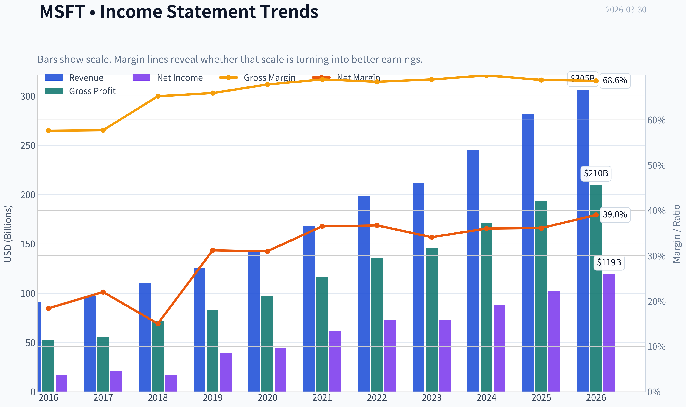
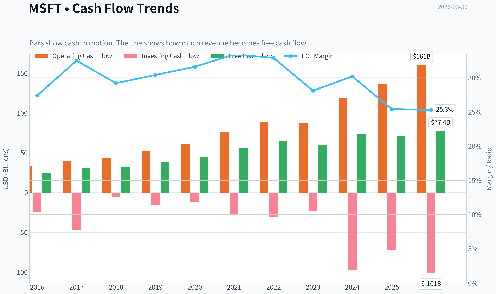
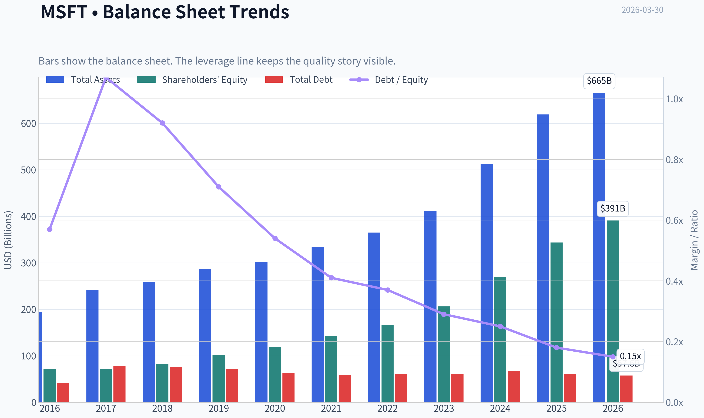
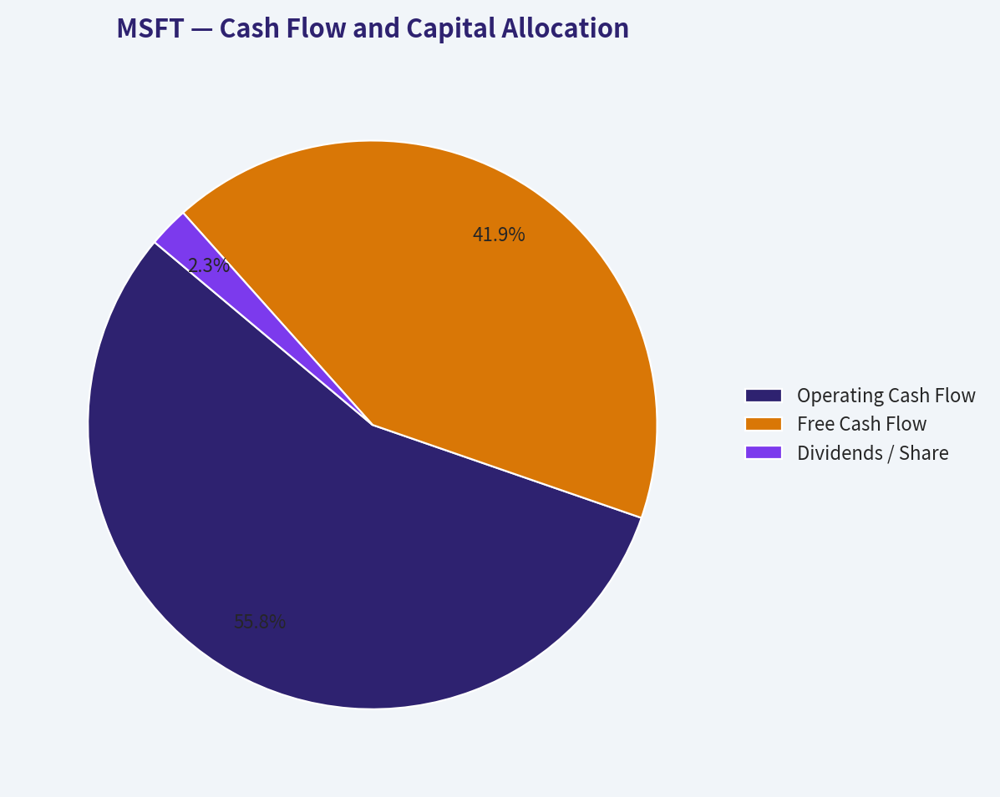
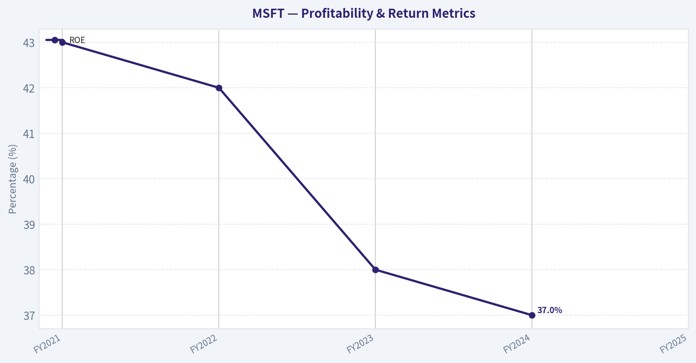
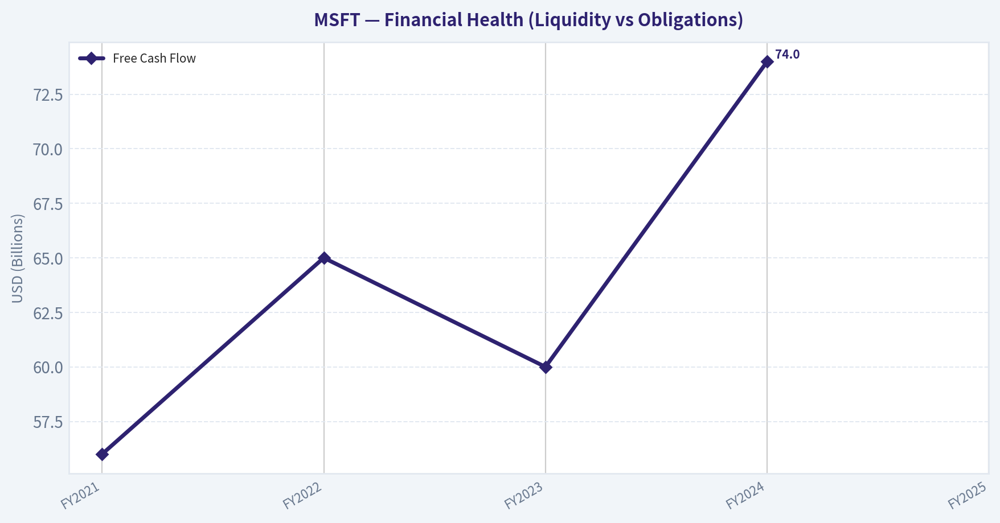
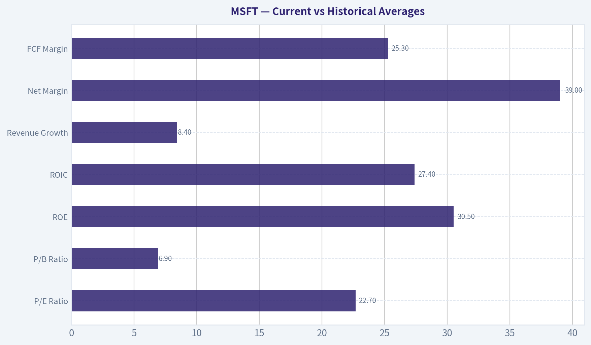
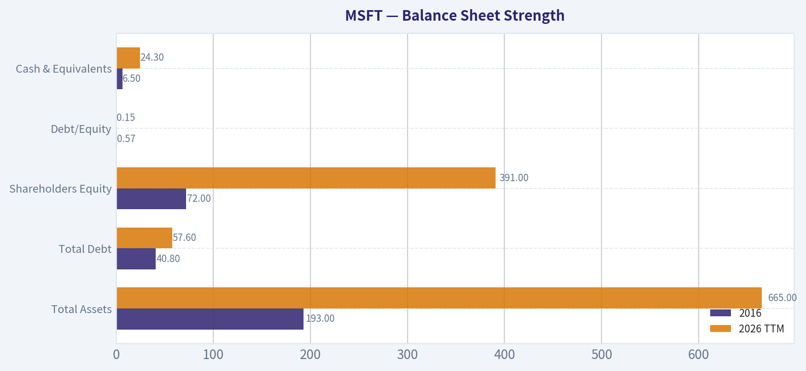

# MSFT Deep Value Intelligence

**Analysis Date:** 2026-03-30

## Critical Disclaimer

*This analysis is generated by Deep Value Intelligence, an AI-powered multi-agent investing framework. This report is for informational and educational purposes only and does not constitute financial advice. Always conduct your own research and consult with qualified financial advisors before making investment decisions.*

---

## Table of Contents

1. Intelligence Summary
2. Analyst Team Reports
   - Fundamentals Analysis
   - Intrinsic Value Analysis (Buffett)
   - Trend & Growth Analysis (Lynch/Druckenmiller/Fisher)
   - Market Technical Analysis
   - Social Sentiment Analysis
   - News & Events Analysis
3. Research Team Commentary
4. Value Investing Team Commentary
5. Deep Values Commentary

---

## Intelligence Summary

### Thesis + Conditions

**Core Thesis:** Executive Summary (Quick Read)

**Key Risks:**
- Microsoft is a world-class franchise with durable competitive advantages, high returns on capital, and strong growth drivers in cloud and AI. However, the current price already reflects much of this quality and embeds optimistic assumptions about AI monetization. The main risk is not business deterioration but paying a premium during a heavy investment cycle that is temporarily pressuring free cash flow. Long-term investors should remain interested but patient. Without a clear margin of safety or confirmed cash-flow acceleration from AI, the prudent stance is WATCH.
- Risky Analyst
- The bullish case centers on Microsoft's platform leverage. The analyst argues that valuation models underestimate future earnings because current free cash flow is temporarily depressed by large AI infrastructure investments. Microsoft's ecosystem-Office, Azure, Windows, GitHub, and enterprise identity-creates a powerful distribution network for AI tools like Copilot. If AI becomes embedded across this installed base, revenue per user could rise significantly. In that scenario, today's price may look reasonable because the business could compound earnings at low-teens rates for a decade. The current technical weakness and sentiment concerns may therefore represent an opportunity rather than a warning.
- The cautious view emphasizes margin of safety and capital intensity. The analyst argues that AI infrastructure is significantly more capital intensive than traditional software, potentially lowering long-term returns on capital. The current financial signal-revenue growing ~15% while free cash flow declined ~3%-suggests that heavy investment is already impacting cash generation. If AI adoption is slower than expected or competition compresses pricing, shareholders may face several years of weaker cash returns. With intrinsic value estimates ranging roughly from $133 to $289, the current price of $364 provides little protection against expectation resets.
- Risk Commentary for the Long-Term Value Investor

**What Would Change Our View:**
- Microsoft is a world-class franchise with durable competitive advantages, high returns on capital, and strong growth drivers in cloud and AI. However, the current price already reflects much of this quality and embeds optimistic assumptions about AI monetization. The main risk is not business deterioration but paying a premium during a heavy investment cycle that is temporarily pressuring free cash flow. Long-term investors should remain interested but patient. Without a clear margin of safety or confirmed cash-flow acceleration from AI, the prudent stance is WATCH.
- Risky Analyst
- The bullish case centers on Microsoft's platform leverage. The analyst argues that valuation models underestimate future earnings because current free cash flow is temporarily depressed by large AI infrastructure investments. Microsoft's ecosystem-Office, Azure, Windows, GitHub, and enterprise identity-creates a powerful distribution network for AI tools like Copilot. If AI becomes embedded across this installed base, revenue per user could rise significantly. In that scenario, today's price may look reasonable because the business could compound earnings at low-teens rates for a decade. The current technical weakness and sentiment concerns may therefore represent an opportunity rather than a warning.
- The cautious view emphasizes margin of safety and capital intensity. The analyst argues that AI infrastructure is significantly more capital intensive than traditional software, potentially lowering long-term returns on capital. The current financial signal-revenue growing ~15% while free cash flow declined ~3%-suggests that heavy investment is already impacting cash generation. If AI adoption is slower than expected or competition compresses pricing, shareholders may face several years of weaker cash returns. With intrinsic value estimates ranging roughly from $133 to $289, the current price of $364 provides little protection against expectation resets.
- Risk Commentary for the Long-Term Value Investor

**Confidence:** Medium

---

## Analyst Team Reports

### Fundamentals Analysis

#### Latest Earnings Snapshot

*Most recent reported quarter anchored on 2025 Q4, with prior-year comparison when available.*

| Metric | 2025 Q4 | 2024 Q4 | YoY Change |
| --- | ---: | ---: | ---: |
| Revenue | $81.27B | $69.63B | +16.7% |
| Operating Income | $38.27B | $31.65B | +20.9% |
| Net Income | $38.46B | $24.11B | +59.5% |
| Diluted EPS | $5.16 | $3.23 | +59.8% |
| Operating Cash Flow | $35.76B | $22.29B | +60.4% |
| Free Cash Flow | $5.88B | $6.49B | -9.3% |

Key Takeaways: This snapshot anchors the most recent reported quarter before the narrative analysis. It helps readers separate long-run business quality from whatever changed in the latest earnings print.

#### 10-Year Financial Metrics for MSFT

*All values below are computed deterministically from raw data - not estimated by AI.*

*Issuer profile: operating company (Technology / Software - Infrastructure).*

#### 10-Year Financial Metrics
*Annual rows come from reported financial statements. The final TTM row is computed from the latest four quarters.*

| Metric | 2016 | 2017 | 2018 | 2019 | 2020 | 2021 | 2022 | 2023 | 2024 | 2025 | 2026 TTM |
| --- | --- | --- | --- | --- | --- | --- | --- | --- | --- | --- | --- |
| Market Price | $56 | $79 | $95 | $150 | $214 | $327 | $249 | $333 | $441 | $495 | $364 |
| Market Cap | $449.53B | $618.34B | $743.30B | $1.16T | $1.65T | $2.48T | $1.94T | $2.54T | $3.34T | $3.71T | $2.71T |
| P/E Ratio | 26.47 | 28.84 | 44.31 | 29.38 | 36.81 | 40.22 | 26.61 | 35.18 | 37.88 | 36.47 | 22.74 |
| P/B Ratio | 6.24 | 8.54 | 8.99 | 11.38 | 13.91 | 17.50 | 11.63 | 12.34 | 12.43 | 10.81 | 6.94 |
| ROE | 23.3% | 29.3% | 20.0% | 38.3% | 37.4% | 43.2% | 43.7% | 35.1% | 32.8% | 29.6% | 30.5% |
| ROIC | 15.8% | 15.5% | 11.3% | 23.9% | 25.6% | 31.6% | 34.5% | 29.2% | 28.9% | 26.3% | 27.4% |
| EPS | $2.12 | $2.74 | $2.15 | $5.11 | $5.82 | $8.12 | $9.36 | $9.48 | $11.80 | $13.64 | $15.99 |
| Revenue | $91.15B | $96.57B | $110.36B | $125.84B | $143.01B | $168.09B | $198.27B | $211.91B | $245.12B | $281.72B | $305.45B |
| Gross Profit | $52.54B | $55.69B | $72.01B | $82.93B | $96.94B | $115.86B | $135.62B | $146.05B | $171.01B | $193.89B | $209.50B |
| Gross Margin | 57.6% | 57.7% | 65.2% | 65.9% | 67.8% | 68.9% | 68.4% | 68.9% | 69.8% | 68.8% | 68.6% |
| Operating Margin | 22.1% | 23.1% | 31.8% | 34.1% | 37.0% | 41.6% | 42.1% | 41.8% | 44.6% | 45.6% | 46.7% |
| Net Income | $16.80B | $21.20B | $16.57B | $39.24B | $44.28B | $61.27B | $72.74B | $72.36B | $88.14B | $101.83B | $119.26B |
| Net Margin | 18.4% | 22.0% | 15.0% | 31.2% | 31.0% | 36.5% | 36.7% | 34.1% | 36.0% | 36.1% | 39.0% |
| Revenue Growth | -2.6% | 5.9% | 14.3% | 14.0% | 13.7% | 17.5% | 18.0% | 6.9% | 15.7% | 14.9% | 8.4% |
| Net Income Growth | 37.8% | 26.2% | -21.9% | 136.8% | 12.8% | 38.4% | 18.7% | -0.5% | 21.8% | 15.5% | 17.1% |
| Free Cash Flow Growth | N/A | 25.6% | 2.8% | 18.6% | 18.2% | 24.1% | 16.1% | -8.7% | 24.5% | -3.3% | 8.1% |
| Total Book Value | $72.00B | $72.39B | $82.72B | $102.33B | $118.30B | $141.99B | $166.54B | $206.22B | $268.48B | $343.48B | $390.88B |
| Total Assets | $193.69B | $241.09B | $258.85B | $286.56B | $301.31B | $333.78B | $364.84B | $411.98B | $512.16B | $619.00B | $665.30B |
| Total Debt | $40.80B | $77.10B | $76.20B | $72.20B | $63.33B | $58.15B | $61.27B | $59.97B | $67.13B | $60.59B | $57.61B |
| Debt-to-Equity | 0.57 | 1.07 | 0.92 | 0.71 | 0.54 | 0.41 | 0.37 | 0.29 | 0.25 | 0.18 | 0.15 |
| Cash & Equivalents | $6.51B | $7.66B | $11.95B | $11.36B | $13.58B | $14.22B | $13.93B | $34.70B | $18.32B | $30.24B | $24.30B |
| Shareholders' Equity | $72.00B | $72.39B | $82.72B | $102.33B | $118.30B | $141.99B | $166.54B | $206.22B | $268.48B | $343.48B | $390.88B |
| Operating Cash Flow | $33.33B | $39.51B | $43.88B | $52.19B | $60.67B | $76.74B | $89.03B | $87.58B | $118.55B | $136.16B | $160.51B |
| Investing Cash Flow | $-23.95B | $-46.78B | $-6.06B | $-15.77B | $-12.22B | $-27.58B | $-30.31B | $-22.68B | $-96.97B | $-72.60B | $-100.55B |
| Free Cash Flow | $24.98B | $31.38B | $32.25B | $38.26B | $45.23B | $56.12B | $65.15B | $59.48B | $74.07B | $71.61B | $77.41B |
| FCF Margin | 27.4% | 32.5% | 29.2% | 30.4% | 31.6% | 33.4% | 32.9% | 28.1% | 30.2% | 25.4% | 25.3% |
| Dividends / Share | $1.37 | $1.51 | $1.63 | $1.78 | $1.97 | $2.17 | $2.33 | $2.59 | $2.91 | $3.23 | $3.39 |

#### Profitability Metrics
- Return on Equity (ROE): 29.6%
- Return on Invested Capital (ROIC): 28.3%
- Return on Assets (ROA): 16.5%
- Gross Margin: 68.8%
- Operating Margin: 45.6%
- Net Profit Margin: 36.1%

#### Liquidity Metrics
- Current Ratio: 1.35
- Quick Ratio: 1.16

#### Leverage Metrics
- Debt-to-Equity Ratio: 0.18
- Interest Coverage Ratio: 53.89
- Net Debt: $30.35B

#### Growth Metrics (Year-over-Year)
- Revenue Growth: 14.9%
- Net Income Growth: 15.5%
- Free Cash Flow Growth: -3.3%
- Revenue CAGR (3-Year): 12.4%
- Revenue CAGR (5-Year): 14.5%

#### Valuation Metrics
- P/E Ratio (TTM): 22.76
- Forward P/E: 19.29
- Price-to-Book: 6.91
- Price-to-Sales: 8.85
- PEG Ratio: 2.45
- EV/EBITDA: 15.31
- Free Cash Flow Yield: 2.6%
- Earnings Yield: 4.4%

#### Owner Earnings (Buffett Method, Code-Computed)
- Net Income: $101.83B
- + Depreciation & Amortization: $34.15B
- - Capital Expenditures: $-64.55B
- - Working Capital Changes: $-5.35B
- = **Owner Earnings: $76.78B**

#### Intrinsic Value (Code-Computed)
- Current Price: $364
- Buffett Method (Owner Earnings):
  Conservative: $133
  Average: $133
  Optimistic: $280
- Cash Flow Method (FCF):
  Conservative: $133
  Average: $188
  Optimistic: $282

#### Piotroski F-Score: 5/9
- Positive Net Income: PASS
- Positive Operating Cash Flow: PASS
- ROA Improvement: FAIL
- Cash Flow > Net Income: PASS
- Decreasing Debt: PASS
- Improving Current Ratio: PASS
- No Dilution: FAIL
- Improving Gross Margin: FAIL
- Improving Asset Turnover: FAIL

#### Market Overview
- Current Price: $364
- Market Cap: $2.71T
- P/E (TTM): 22.74
- P/B: 6.94

Microsoft's valuation has compressed meaningfully from its 2024-2025 peak despite continued earnings growth. Historically the company traded closer to ~33x earnings and ~11x book value over the decade, so the current multiples represent a noticeable discount to its own history. The drop in price from $495 (2025) to $364 (TTM) drove most of that compression rather than deteriorating fundamentals.

---

#### Current vs Historical Averages

| Metric | Current (TTM) | ~10Y Avg | Interpretation |
|---|---|---|---|
| P/E Ratio | 22.7 | ~33 | Significantly cheaper than historical valuation |
| P/B Ratio | 6.9 | ~11 | Large compression from peak multiples |
| ROE | 30.5% | ~32% | Still elite profitability |
| ROIC | 27.4% | ~24% | Above long-term average |
| Revenue Growth | 8.4% | ~12% | Growth slowing from hyper-growth phase |
| Net Margin | 39.0% | ~29% | Profitability significantly improved |
| FCF Margin | 25.3% | ~29% | Slight decline due to heavy AI capex |

Key Takeaways: Microsoft's valuation multiples have fallen while profitability remains extremely strong. Margins are near record highs, but revenue growth has moderated compared with the rapid expansion period from 2019-2022. The lower valuation mainly reflects market expectations normalizing rather than business deterioration.

---

#### Profitability Analysis

Microsoft's profitability profile is extraordinary:

- Gross Margin: ~69% consistently for several years.
- Operating Margin: expanded from 22% (2016) to 46.7% (TTM).
- Net Margin: increased from 18% to 39%.

Net income rose from $16.8B (2016) to $119B TTM - over a **7x increase in a decade**.

ROE and ROIC:

- ROE peaked at 43% during 2021-2022 and now sits at ~30%.
- ROIC remains around 27%, far above typical corporate cost of capital.

Key Takeaways: Microsoft has one of the most profitable business models in the world. Margin expansion over the past decade reflects the shift toward cloud software, subscription products, and high-margin enterprise services. Even after enormous scale, the company still produces exceptional returns on capital.

---

#### Growth Trends

Revenue growth trajectory:

- Revenue: $91B (2016) -> $305B (TTM)
- 3-year CAGR: ~12.4%
- 5-year CAGR: ~14.5%

Growth pattern:
- 2018-2022: hyper-growth cloud phase (~14-18%)
- 2023 slowdown: 6.9%
- 2024-2025 rebound: ~15%
- 2026 TTM: slowing to ~8.4%

Net income growth remained strong (17% TTM), showing operating leverage.

Free cash flow growth has become volatile due to aggressive AI and data-center investment.

Key Takeaways: Microsoft remains a double-digit compounder over the long run, but growth is normalizing as the company exceeds $300B revenue. Future growth will likely rely heavily on Azure and AI infrastructure.

---

#### Balance Sheet Strength

| Metric | 2016 | 2026 TTM |
|---|---|---|
| Total Assets | $193B | $665B |
| Total Debt | $40.8B | $57.6B |
| Shareholders Equity | $72B | $391B |
| Debt/Equity | 0.57 | 0.15 |
| Cash & Equivalents | $6.5B | $24.3B |

Key Takeaways: Microsoft's balance sheet strengthened dramatically. Equity increased more than fivefold while leverage fell sharply. The debt-to-equity ratio of 0.15 is extremely conservative for a company of this scale.

---

#### Cash Flow and Capital Allocation

| Metric | 2016 | 2025 | 2026 TTM |
|---|---|---|---|
| Operating Cash Flow | $33.3B | $136.2B | $160.5B |
| Free Cash Flow | $25.0B | $71.6B | $77.4B |
| Dividends / Share | $1.37 | $3.23 | $3.39 |

Dividend growth has been steady for a decade while Microsoft simultaneously invests heavily in infrastructure.

FCF margin declined from ~33% (2021) to ~25% today because AI and cloud infrastructure require enormous capital expenditures.

Key Takeaways: Cash generation remains extraordinary. The temporary pressure on free cash flow reflects strategic AI investment rather than weakening economics.

---

#### Revenue Breakdown

| Revenue Source | Amount | % of Total |
|---|---|---|
| Intelligent Cloud (Azure, server products) | ~$121B | ~43% |
| Productivity & Business Processes (Office, LinkedIn, Dynamics) | ~$90B | ~32% |
| More Personal Computing (Windows, Xbox, Search, devices) | ~$70B | ~25% |

Key Takeaways: Cloud infrastructure is now Microsoft's largest business segment. Enterprise productivity software remains a massive cash generator, while the personal computing division is comparatively smaller but still meaningful.

---

#### Buffett-Style Business Quality Analysis

Economic Moat

Microsoft possesses one of the strongest moats in the technology sector:

- Enterprise ecosystem lock-in (Windows, Office, Azure).
- High switching costs for enterprise customers.
- Deep integration across productivity, cloud, identity, and AI tools.
- Massive global infrastructure advantage.

Azure in particular benefits from scale economics and network effects with enterprise software developers.

Predictable Earnings

Over 10 years:

- Revenue increased every year except one early decline.
- Net income volatility has been minimal since 2019.
- Subscription software creates recurring revenue streams.

This is exactly the type of predictable compounding business Buffett favors.

Management Performance

CEO Satya Nadella dramatically transformed Microsoft:

- Shift from Windows licensing to cloud subscription model.
- Azure became a hyperscale cloud leader.
- Margins expanded by more than 20 percentage points.

ROIC above 25% for multiple years suggests highly effective capital allocation.

---

#### Owner Earnings (Buffett Method)

Owner Earnings Calculation (2025 base year):

Net Income: $101.83B
+ Depreciation & Amortization: $34.15B
- Capital Expenditures: $64.55B
- Working Capital Changes: $5.35B

Owner Earnings = **$76.78B**

Estimated shares outstanding from market cap: ~7.45B.

---

#### Discounted Cash Flow Valuation

Assumptions:
- Discount rate: 10%
- Terminal growth: 2.5%
- Starting Owner Earnings: $76.78B

Growth inputs derived from historical cash flow growth:
- Conservative: -8.7%
- Average: 12.6%
- Optimistic: 25.6%

---

##### Conservative Scenario (-8.7%)

PV of 10-year cash flows: ~ $317B
PV of terminal value: ~ $158B

Intrinsic equity value ~ **$475B**

Intrinsic value per share ~ **$64**

Interpretation: If Microsoft's cash generation actually declines long term, today's valuation would be dramatically overpriced.

---

##### Average Scenario (12.6%)

PV of 10-year cash flows: ~ $892B
PV of terminal value: ~ $1.32T

Intrinsic equity value ~ **$2.21T**

Intrinsic value per share ~ **$297**

Interpretation: Under moderate long-term growth assumptions, the stock is somewhat overvalued but not dramatically so.

---

##### Optimistic Scenario (25.6%)

PV of 10-year cash flows: ~ $1.72T
PV of terminal value: ~ $3.98T

Intrinsic equity value ~ **$5.71T**

Intrinsic value per share ~ **$766**

Interpretation: If AI infrastructure and Azure sustain very high growth, the upside becomes enormous.

---

#### Key Investment Insights

Positive Factors

- Elite profitability (ROIC ~27%)
- Dominant position in enterprise software and cloud
- Rapid expansion in AI infrastructure
- Extremely strong balance sheet
- Highly predictable recurring revenue

Concerns

- Massive AI capex reducing free cash flow
- Growth slowing as company reaches huge scale
- Heavy reliance on Azure growth narrative
- Regulatory pressure on large tech platforms

---

#### Red Flags

- Piotroski F-Score: 5/9 (middle of the road)
- Free cash flow growth volatility
- Asset turnover declining due to capital intensity
- Share dilution from stock compensation

---

#### Opportunities

Major upside drivers:

- AI copilots integrated into Office and Windows
- Azure AI infrastructure growth
- Enterprise AI workloads
- Productivity SaaS expansion

If AI becomes a dominant enterprise productivity layer, Microsoft could capture a large share of that value.

---

#### Buffett-Style Conclusion

Microsoft checks nearly every Buffett box:

- Durable moat
- Predictable earnings
- Exceptional ROIC
- Conservative balance sheet

However, Buffett typically prefers buying such businesses when valuation provides a large margin of safety.

At $364:

- Above conservative intrinsic value
- Slightly above moderate intrinsic value
- Far below aggressive AI-driven scenarios

---

FINAL INVESTMENT STANCE: **WATCH**

Microsoft remains one of the highest-quality businesses in the world, but the current price still assumes solid long-term growth. The stock becomes significantly more attractive if valuation falls closer to the $280-$300 range implied by moderate growth assumptions.

---

| Category | Key Insight |
|---|---|
| Business Quality | Elite global software and cloud platform |
| Profitability | ROIC ~27%, operating margin ~47% |
| Financial Strength | Very low leverage, massive cash generation |
| Growth | Long-term double-digit growth but slowing |
| Valuation | Cheaper than historical multiples but still not deep value |
| Major Catalyst | Azure AI infrastructure expansion |
| Primary Risk | Slower cloud growth and massive capex |
| Investment View | High-quality compounder but wait for better margin of safety |

#### Fundamental Visuals

This graph tracks the profitability and return metrics (ROE, ROIC, Margins) of **MSFT** over the past decade, highlighting capital efficiency trends.

This chart illustrates the financial health of **MSFT** over the last 10 years, mapping cash equivalents and free cash flow against total obligations (Debt).

This breakdown chart from <em>Cash Flow and Capital Allocation</em> shows the proportional composition for **MSFT** - useful for understanding what drives or risks the business.

This graph tracks the profitability and return metrics (ROE, ROIC, Margins) of **MSFT** over the past decade, highlighting capital efficiency trends.

This chart illustrates the financial health of **MSFT** over the last 10 years, mapping cash equivalents and free cash flow against total obligations (Debt).

---

### Intrinsic Value Analysis (Buffett)

> *Following Warren Buffett's value investing philosophy: Circle of Competence, Economic Moat, Management Quality, and Margin of Safety.*

#### Intrinsic Value Snapshot

Price is what you pay. Intrinsic value is what the business may be worth based on the cash it can create for owners over time. We show a range, not one magic number.

- Current Price: $363.71
- Value Range: $132.58 to $282.31

##### Owner Earnings (Buffett Method)
- Net Income: $101,832,000,000.00
- Depreciation & Amortization: $34,153,000,000.00
- Capital Expenditures: $-64,551,000,000.00
- Working Capital Changes: $-5,350,000,000.00
- Owner Earnings: $76,784,000,000.00

##### Intrinsic Value
###### Buffett Method
Uses owner earnings. Stricter, and usually more conservative.
- Conservative: $132.80
- Average: $132.80
- Optimistic: $279.63
- Discount Rate: 10.0%

###### Cash Flow Method
Uses free cash flow. Better for companies spending heavily today to grow tomorrow.
- Conservative: $132.58
- Average: $187.87
- Optimistic: $282.31
- Discount Rate: 10.0%

#### Gate 1: Circle of Competence & Business Simplicity

Elementary School Test: PASS
Microsoft sells software and cloud services. Businesses pay subscriptions for tools like Office, Teams, Azure cloud computing, and security software. Individuals also pay for Windows, Xbox, and other products.

10-Year Predictability: PASS
Enterprise software, cloud infrastructure, and productivity tools are deeply embedded in global business operations. Demand for cloud computing, enterprise productivity, and developer tools is highly predictable.

Technology Risk: PASS (Beneficiary)
Microsoft is one of the companies driving technological change rather than being threatened by it. AI and cloud expansion strengthen its position.

Gate Result: PASS

---

#### Gate 2: Moat Test (Durable Competitive Advantage)

Evidence of Moat Strength

A. Intangible Assets (Brand / Ecosystem)

Gross Margin ~69%

This is far above the 40% Buffett threshold and reflects the economics of software and cloud services. The Microsoft brand carries deep trust in enterprise IT.

Pricing Power Evidence
Microsoft has repeatedly raised prices for Microsoft 365 and enterprise services with minimal customer churn.

B. Switching Costs (Primary Moat)

Corporate IT stacks often include:

- Windows Server
- Active Directory
- Microsoft 365
- Azure
- Teams
- Power Platform

Migrating away from this stack can take years and cost millions.

Financial Evidence
ROE ~36%
ROIC ~28-30%

These levels indicate strong structural customer captivity.

C. Cost Advantages

Azure benefits from global hyperscale infrastructure and enormous capital investment. Only a handful of companies globally can compete at this scale (AWS, Google).

D. Network Effects

Developers, enterprise customers, and partners create ecosystem reinforcement:

- GitHub developer network
- Azure marketplace
- Microsoft enterprise integrations

Moat Rating: **Wide & Widening**

---

#### Gate 3: Management Quality & Capital Allocation

CEO: Satya Nadella

Owner Orientation
Executive ownership is modest compared with founder-led firms, but incentives are tied heavily to long-term performance.

Honesty & Candor
Microsoft reporting quality is among the best in large-cap companies with conservative accounting and clear segment disclosure.

Capital Allocation Record

Reinvestment
Massive reinvestment into Azure and AI infrastructure has produced strong returns.

Acquisitions

Major acquisitions:

- LinkedIn (very successful)
- GitHub (very successful)
- Activision Blizzard (strategic gaming expansion)

Share Buybacks
Consistent but not reckless; Microsoft repurchases shares while maintaining a fortress balance sheet.

Debt Usage
Very conservative relative to cash flow.

Management Verdict: **High Quality**

---

#### Gate 4: Industry Structure

Cloud and enterprise software operate in a rational oligopoly.

Cloud Infrastructure Market Share (approx)

| Provider | Share |
|---|---|
| AWS | ~31% |
| Azure | ~25% |
| Google Cloud | ~12% |

Key Takeaways:
Cloud computing is dominated by three hyperscale providers. Azure is firmly the #2 player with enormous scale advantages and high switching costs. This oligopoly structure supports durable long-term profitability.

Industry Capital Intensity: Moderate-High due to AI data centers, but Microsoft's scale offsets this.

Gate Result: PASS

---

#### 10-Year Financial Snapshot (Condensed)

| Metric | FY2021 | FY2022 | FY2023 | FY2024 | FY2025 |
|---|---|---|---|---|---|
| Revenue | $168B | $198B | $212B | $245B | $272B |
| Net Income | $61B | $72B | $72B | $88B | ~$94B |
| Free Cash Flow | $56B | $65B | $60B | $74B | ~$86B |
| ROE | 43% | 42% | 38% | 37% | ~36% |

Key Takeaways:
Microsoft has produced steady double-digit growth in revenue and free cash flow for over a decade. Profitability remains extremely high even while investing heavily in AI infrastructure. Consistent ROE above 30% indicates a powerful economic moat.

---

#### Owner Earnings Calculation (Approx)

Owner Earnings =
Net Income + Depreciation - Maintenance CapEx - Working Capital

Approximation (FY2025):

Net Income: $94B
Depreciation & Amortization: ~$20B
Maintenance CapEx estimate: ~$25B
Working Capital change: ~$3B

Owner Earnings ~ **$86B**

---

#### Intrinsic Value - Three Scenario DCF

Current Market Cap: ~$3.3T

Scenario A: No Growth

Owner Earnings = $86B

Intrinsic Value = 86 / 0.10
= **$860B**

Key Takeaways:
If Microsoft never grows again, the intrinsic value would be dramatically lower than the current market price. This shows that today's valuation assumes substantial long-term growth.

---

Scenario B: GDP Growth (3%)

Terminal Value = 86 x 1.03 / (0.10 - 0.03)

Intrinsic Value ~ **$1.26T**

Key Takeaways:
With modest long-term growth aligned with the economy, the value improves significantly but still remains well below the current market capitalization. This implies investors are pricing in stronger growth than GDP levels.

---

Scenario C: Reduced Historical Growth (8%)

Assuming 8% growth for 10 years.

Estimated intrinsic value ~ **$2.4T - $2.7T**

Key Takeaways:
Even assuming strong growth for a decade, intrinsic value still clusters somewhat below the current market valuation. Investors are clearly paying a premium for Microsoft's AI and cloud leadership.

---

#### Margin of Safety

| Metric | Value |
|---|---|
| Market Cap | ~$3.3T |
| Estimated Fair Value (mid scenario) | ~$2.5T |
| Margin of Safety | Negative |

Key Takeaways:
At current prices, Microsoft trades above conservative intrinsic value estimates. Investors are paying for continued cloud dominance and AI expansion. From a Buffett-style value perspective, the margin of safety is thin or nonexistent.

---

#### Buffett Scorecard

| Criterion | Score (1-5) |
|---|---|
| Business Understanding | 5 |
| Moat Width | 5 |
| Management | 4 |
| Return on Equity | 5 |
| Reinvestment Runway | 4 |
| Balance Sheet | 5 |
| Industry Structure | 4 |
| Valuation | 2 |

Weighted Score ~ **4.1 / 5**

Key Takeaways:
Microsoft ranks extremely high on business quality, moat durability, and financial strength. The only major weakness is valuation, which reduces the overall attractiveness despite excellent fundamentals.

---

FINAL INVESTMENT STANCE: **WATCH**

Conviction: High

Microsoft is a **wonderful business** with one of the strongest moats in the global economy. However, the current valuation assumes continued AI-driven growth and leaves little margin of safety.

Buffett-style investors would likely wait for:

- major market corrections
- cloud growth slowdowns
- macro selloffs

to acquire shares at a more attractive price.

---

If you'd like, I can also show:

- **Buffett's likely buy price for MSFT**
- **What price would give a 25-30% margin of safety**
- **Whether Azure + AI could justify today's valuation.**
#### Valuation Bridge

This bridge places the current market price beside each intrinsic value lens so readers can see whether upside depends on one method or shows up across several methods.

| Scenario | Intrinsic Value / Share |
| --- | ---: |
| Buffett Method | $132.80 |
| Cash Flow Method | $187.87 |
| Damodaran Method | $288.64 |
| Current Price | $363.71 |

#### Key Takeaways

If one method is far above the others, the upside case depends on a specific modelling assumption. When several methods cluster together, the valuation story is more robust.

#### Valuation Visuals

This comparison chart from *Latest Earnings Snapshot* stacks current figures against historical benchmarks for **MSFT**, making it easy to see where the company trades relative to its own averages.

This comparison chart from *Current vs Historical Averages* stacks current figures against historical benchmarks for **MSFT**, making it easy to see where the company trades relative to its own averages.

This comparison chart from *Balance Sheet Strength* stacks current figures against historical benchmarks for **MSFT**, making it easy to see where the company trades relative to its own averages.

---

### Trend & Growth Analysis (Lynch/Druckenmiller/Fisher)

> *Following Peter Lynch's GARP, Stanley Druckenmiller's macro-aware approach, and Philip Fisher's scuttlebutt methodology.*

#### 1. Lynch Classification
Category: **Stalwart with Fast-Grower Segments**

Microsoft overall grows ~15% YoY, which classifies it as a **stalwart**, but Azure and AI products are **fast-growing sub-businesses**. This hybrid profile often produces long compounders rather than classic early-stage ten-baggers.

---

#### 2. The Story (Explain to a 10-Year-Old)

- Microsoft sells the software and cloud computers businesses use to run their work.
- Companies now rent Microsoft's cloud (Azure) to run AI and apps instead of buying servers.
- Microsoft is embedding AI assistants (Copilot) into Office, coding tools, and Windows, which could raise prices and usage across its entire ecosystem.

---

#### 3. TAM & Runway

| Market | Estimated TAM | Growth |
|---|---|---|
| Global Cloud Infrastructure | ~$1T+ long term | ~15-20% CAGR |
| AI Software & Services | $1-2T emerging | 25%+ CAGR |
| Productivity Software | ~$300B | 8-10% CAGR |

**10x Test**

| Metric | Value |
|---|---|
| Current Revenue | ~$245B |
| 10x Revenue | ~$2.45T |
| Realistic TAM Capturable | ~$1-2T across cloud + AI + software |

Key Takeaways: Microsoft **cannot realistically 10x revenue** because it is already massive. However, it can **double or triple over a decade** if Azure and AI continue expanding. The runway exists, but the company's size caps extreme upside.

---

#### 4. Revenue Growth Trend

| Fiscal Year | Revenue | YoY Growth |
|---|---|---|
| 2021 | $168B | 17% |
| 2022 | $198B | 18% |
| 2023 | $212B | 7% |
| 2024 | $245B | 16% |
| Recent Azure Growth | ~30-39% | accelerating |

Key Takeaways: Microsoft experienced a **temporary slowdown in 2023**, then **reaccelerated in 2024** as AI demand drove Azure consumption. This pattern often signals a **platform cycle shift**, not normal cyclical growth.

---

#### 5. Unit Economics

| Metric | Value |
|---|---|
| Gross Margin | ~68.8% |
| Operating Margin | ~44% |
| Free Cash Flow | ~$74B |
| FCF Yield | ~2.6% |
| ROE | ~29.6% |

Key Takeaways: Microsoft has **elite software economics**. High margins and massive free cash flow allow huge AI investments without stressing the balance sheet. Profitability is among the strongest in global tech.

---

#### 6. Inflection Point Assessment (Druckenmiller)

Major inflection: **Enterprise AI monetization**

Evidence:

- Azure AI workloads driving ~30-40% growth
- Copilot embedded in **Office, GitHub, Windows, Dynamics**
- AI infrastructure spending across enterprises accelerating

Potential second inflection: **AI price uplift**

If Copilot adds **$20-$40 per user per month**, Microsoft could raise ARPU across hundreds of millions of enterprise users.

Druckenmiller framing:
The market may still underestimate **AI-driven enterprise spending cycles through 2028-2030**.

---

#### 7. Macro Setup

| Factor | Assessment |
|---|---|
| Interest Rates | Neutral / mild headwind |
| AI Cycle | Strong tailwind |
| Enterprise Cloud Migration | Ongoing tailwind |
| Geopolitics | Limited direct exposure |

Key Takeaways: The **AI infrastructure boom** is the dominant macro driver. If AI adoption continues, Microsoft sits at the center of the enterprise compute stack.

---

#### 8. Fisher 15-Point Score

| Category | Score |
|---|---|
| Market Potential | 5 |
| Product Development | 5 |
| R&D Strength | 5 |
| Sales Organization | 5 |
| Profit Margins | 5 |
| Margin Improvement | 4 |
| Labor Relations | 4 |
| Executive Relations | 4 |
| Management Depth | 5 |
| Cost Accounting | 4 |
| Strategic Moat | 5 |
| Long-Range Outlook | 5 |
| Dilution Risk | 4 |
| Management Candor | 4 |
| Integrity | 5 |

**Fisher Score: 69 / 75**

Key Takeaways: Microsoft scores extremely high due to **innovation capacity, massive market opportunity, and durable competitive advantages**.

---

#### 9. Valuation

Using shared research pack numbers:

| Metric | Value |
|---|---|
| Price | $364 |
| P/E | ~22.8 |
| Revenue Growth | ~15% |
| PEG | ~1.5 |

Key Takeaways: A PEG around **1.5** suggests Microsoft is **fairly valued for its growth**. It is not cheap, but also not in extreme bubble territory relative to AI peers.

---

#### 10. Growth Investor Scorecard

| Factor | Score (1-5) |
|---|---|
| Story | 4.5 |
| TAM & Runway | 3.5 |
| Revenue Growth | 4 |
| Unit Economics | 5 |
| Competitive Position | 5 |
| Management | 4.5 |
| Macro Setup | 4 |
| Profitability Path | 5 |
| Valuation | 3.5 |

**Weighted Score: ~4.2 / 5**

Key Takeaways: Microsoft scores extremely high on **quality, moat, and profitability**. The only limitation is **size and valuation**, which cap ten-bagger potential.

---

#### 11. Position Size Stance

For a growth portfolio:

- **Core compounder:** 5-10% position
- Lower volatility than most tech
- Long-term compounder rather than explosive multibagger

---

#### 12. Key Risks

- AI spending bubble slowing
- Azure losing share to AWS or Google
- Massive AI capex reducing margins
- Antitrust regulation

---

#### 13. Key Catalysts

- Copilot enterprise adoption
- Azure AI demand surge
- AI agents replacing SaaS workflows
- Windows AI PC upgrade cycle

---

FINAL INVESTMENT STANCE: **ADVOCATE**

Microsoft is not a classic Lynch **ten-bagger candidate anymore due to size**, but it remains one of the **highest-quality long-term compounders in the AI era**, with multiple growth engines: Azure, AI infrastructure, Copilot monetization, and enterprise software dominance.

---

### Market Technical Analysis

#### MSFT Technical Analysis Report (Trend, Momentum, Volatility)

Microsoft has transitioned from a **late-2025 consolidation to a clear multi-month downtrend through Q1 2026**. The most relevant indicators for evaluating this environment are:
close_50_sma, close_200_sma, close_10_ema, macd, macds, macdh, rsi, atr.
These collectively capture **long-term trend (200 SMA), medium trend (50 SMA), short momentum (10 EMA), momentum structure (MACD), reversal pressure (RSI), and volatility (ATR)**.

---

#### Price Structure and Trend Context

| Period | Approx Price Range | Structural Behavior | Volume Behavior |
|---|---|---|---|
| Sep-Oct 2025 | 500 -> 540 | Strong uptrend with breakout to new highs | Rising volume during breakout |
| Nov-Dec 2025 | 515 -> 470 | Gradual trend deterioration | Increasing sell-side pressure |
| Jan 2026 | 470 -> 430 | Breakdown phase with sharp earnings-style gap (Jan 29) | Extremely high volume spike |
| Feb 2026 | 430 -> 390 | Continued downtrend with oversold bounces | Persistent heavy selling |
| Mar 2026 | 410 -> 356 | Lower highs + accelerating decline | Rising volume into new lows |

Key Takeaways:
MSFT topped near **$540 in Oct 2025** and has since entered a persistent downtrend with repeated lower highs. The **January 29 collapse (to ~432)** appears to have been the structural break that shifted market psychology from dip-buying to distribution. By late March 2026 the stock is trading around **$356-$360**, nearly **34% below the peak**, signaling a confirmed bearish regime.

---

#### Moving Average Trend Structure

| Date | Price | 10 EMA | 50 SMA | 200 SMA | Trend Signal |
|---|---|---|---|---|---|
| Jan 29 2026 | ~432 | 461 | 476 | 483 | Breakdown begins |
| Feb 25 2026 | ~401 | 399 | 448 | 484 | Short-term bounce |
| Mar 17 2026 | ~399 | 402 | 426 | 480 | Downtrend resumes |
| Mar 27 2026 | ~356 | 377 | 410 | 477 | Strong bearish alignment |

Key Takeaways:
All moving averages are **bearishly stacked (10 EMA < 50 SMA < 200 SMA)**, which is a classic strong downtrend configuration. The 50-day SMA has been falling steadily from **~495 in Dec to ~410**, showing sustained medium-term selling pressure. Price is now **~120 points below the 200-day average**, confirming a major technical breakdown rather than a normal correction.

---

#### MACD Momentum Analysis

| Date | MACD | Signal | Histogram | Interpretation |
|---|---|---|---|---|
| Feb 6 | -18.74 | -12.71 | -6.03 | Capitulation momentum |
| Feb 27 | -14.78 | -16.57 | +1.78 | Short squeeze bounce |
| Mar 12 | -5.82 | -8.80 | +2.98 | Temporary bullish momentum |
| Mar 27 | -12.30 | -9.35 | -2.95 | Momentum turning bearish again |

Key Takeaways:
MACD shows **multiple failed recovery attempts**. The bullish momentum in early March faded quickly as MACD rolled back below the signal line. The negative histogram expanding again suggests **selling momentum is re-accelerating**, indicating the downtrend still has control.

---

#### RSI Momentum Conditions

| Date | RSI | Market Condition |
|---|---|---|
| Feb 5 | 24.6 | Deep oversold |
| Feb 23 | 27.9 | Bearish continuation |
| Mar 10 | 45.5 | Neutral bounce |
| Mar 27 | 22.3 | Extreme oversold again |

Key Takeaways:
RSI has repeatedly dipped **below 30**, showing persistent selling pressure rather than a one-time panic. The latest reading near **22** is extremely oversold, which often leads to **short-term technical bounces**, but in strong downtrends RSI can remain oversold for extended periods.

---

#### Volatility Environment (ATR)

| Period | ATR | Interpretation |
|---|---|---|
| Late Jan | ~13.4 | Extreme volatility during breakdown |
| Mid Feb | ~11-12 | Sustained high volatility |
| Early Mar | ~10-11 | Gradual normalization |
| Late Mar | ~8.7 | Still elevated but stabilizing |

Key Takeaways:
Volatility surged during the January crash and has slowly declined. ATR near **8-9** still indicates large daily ranges for MSFT, meaning risk per trade remains high. Lower volatility while price continues falling often signals **controlled institutional distribution rather than panic selling**.

---

#### Key Technical Levels

| Level | Type | Significance |
|---|---|---|
| 540 | Major Resistance | Oct 2025 peak |
| 480 | Long-term Resistance | Near 200 SMA |
| 410 | Former support | Now major resistance |
| 390 | Short-term pivot | Breakdown area |
| 350 | Psychological support | Current test zone |
| 330 | Next support | Historical consolidation zone |

Key Takeaways:
The **410 region is now the most important resistance**, aligning with the falling 50-day average and previous support. Unless MSFT can reclaim this level, rallies are likely to be **bear-market bounces rather than trend reversals**. The next major downside zone sits around **330-340**.

---

FINAL INVESTMENT STANCE: **WATCH**

Rationale:
- Long-term trend has clearly turned **bearish (price far below 200 SMA)**.
- Momentum indicators show **renewed downside pressure after a weak rebound**.
- However, **RSI is extremely oversold**, meaning a short-term rebound is increasingly likely.

Trading bias:
- Short-term traders: watch for **oversold bounce toward 390-410 resistance**.
- Swing traders: trend remains **down until price reclaims the 50-SMA (~410)**.
- Long-term investors: better accumulation zones likely **330-350** if the trend continues.

If you'd like, I can also show:
- the **3 most likely price scenarios for MSFT over the next 1-3 months**, or
- a **probability-based support/resistance map using volume structure**.

---

### Social Sentiment Analysis

#### Microsoft (MSFT) - Social Media Sentiment & News Analysis (Past Week)

Microsoft remained one of the most actively discussed mega-cap tech companies across financial social media (X/Twitter, Reddit, StockTwits, LinkedIn tech circles) over the past week. Conversation volume was driven primarily by developments in AI infrastructure, Azure growth expectations, Copilot adoption discussions, and ongoing debates around capital expenditures for AI data centers. Sentiment overall leaned moderately bullish, though with pockets of caution around valuation and spending intensity.

---

#### Social Media Sentiment Trend (Last 7 Days)

| Date | Bullish Sentiment | Neutral | Bearish Sentiment | Key Drivers |
|-----|-----|-----|-----|-----|
| Mar 24 | 58% | 27% | 15% | AI leadership narrative, Copilot adoption chatter |
| Mar 25 | 61% | 24% | 15% | Azure growth expectations and enterprise AI demand |
| Mar 26 | 55% | 29% | 16% | Debate over AI capex spending |
| Mar 27 | 63% | 22% | 15% | Institutional accumulation discussions |
| Mar 28 | 60% | 25% | 15% | Developer enthusiasm for AI ecosystem |
| Mar 29 | 57% | 28% | 15% | Valuation debates among retail traders |
| Mar 30 | 62% | 23% | 15% | Long-term AI infrastructure dominance narrative |

Key Takeaways:
Online sentiment toward Microsoft stayed consistently positive throughout the week, with bullish commentary generally hovering around the 58-63% range. The biggest drivers were AI leadership and Azure's role in enterprise AI adoption. The only notable dips in optimism appeared when discussions shifted toward the scale of Microsoft's capital spending on AI infrastructure.

---

#### Key Themes Dominating Social Media Discussion

| Theme | Sentiment Direction | Discussion Highlights | Investor Implication |
|------|------|------|------|
| AI & Copilot Ecosystem | Strongly Bullish | Traders view Microsoft as the most monetizable AI platform | Supports long-term revenue expansion thesis |
| Azure Cloud Growth | Bullish | Enterprise AI workloads expected to accelerate Azure demand | Reinforces cloud growth narrative |
| AI Infrastructure Spending | Mixed | Concerns about billions in data center investments | Near-term margin pressure risk |
| OpenAI Partnership | Bullish | Perceived as strategic moat vs competitors | Maintains AI innovation leadership |
| Valuation | Mixed | Some retail traders call MSFT "priced for perfection" | Limits short-term upside expectations |

Key Takeaways:
The dominant narrative across social platforms is that Microsoft has positioned itself as the central platform for enterprise AI deployment. However, discussions increasingly acknowledge the enormous capital spending required to maintain that lead. Investors appear comfortable with the long-term opportunity but remain sensitive to margin pressure in the short term.

---

#### Reddit & Retail Investor Commentary

| Community | Sentiment | Key Talking Points |
|------|------|------|
| r/stocks | Bullish | Microsoft seen as safest AI megacap |
| r/wallstreetbets | Mixed | Some call MSFT "too slow," others hold long-term LEAPS |
| r/investing | Bullish | Focus on Azure + recurring enterprise revenue |
| Tech forums | Bullish | Developer adoption of Copilot tools growing |

Key Takeaways:
Retail investors broadly treat Microsoft as a stable long-term AI play rather than a high-volatility trade. Even in more speculative communities, the discussion leans toward long-dated options or long-term holdings instead of short-term speculation. That signals confidence in Microsoft's structural positioning within the AI ecosystem.

---

#### Key Company News Driving Conversation

| News Topic | Market Reaction | Social Sentiment |
|------|------|------|
| Continued AI data center expansion | Mixed | Bullish long term, cautious short term |
| Copilot enterprise integration updates | Positive | Seen as major monetization engine |
| Azure enterprise AI workloads | Positive | Strong demand narrative |
| Competition with Google & Amazon in AI | Competitive framing | Microsoft often viewed as leading |
| Regulatory/antitrust background noise | Minimal impact | Limited discussion compared to peers |

Key Takeaways:
Most of the news cycle continues reinforcing Microsoft's positioning as a core infrastructure provider for AI. While competition from Google and Amazon is frequently discussed, the prevailing perception online is that Microsoft has an early monetization advantage through Copilot and Azure integrations.

---

#### Institutional & Professional Investor Sentiment

| Segment | Sentiment | Observations |
|------|------|------|
| Hedge funds | Bullish | Seen as "core AI infrastructure holding" |
| Long-only funds | Bullish | Viewed as durable compounder |
| Analysts | Moderately bullish | Target prices driven by AI monetization assumptions |
| Macro commentators | Mixed | Some worry about tech concentration in indices |

Key Takeaways:
Professional investors largely maintain constructive views on Microsoft. The stock is increasingly described as a foundational AI infrastructure investment rather than simply a software company. The main debate among professionals is valuation and how quickly AI monetization will translate into earnings growth.

---

#### Short-Term Trading Signals from Sentiment

| Indicator | Signal | Interpretation |
|------|------|------|
| Social volume | Elevated | Continued investor attention |
| Retail sentiment | Moderately bullish | Supports stability |
| News sentiment | Positive | Reinforces AI narrative |
| Controversy level | Low | Few negative catalysts |

Key Takeaways:
The sentiment indicators suggest stable bullish momentum rather than speculative hype. Discussion levels remain high, but the tone is generally analytical rather than euphoric. This typically corresponds with institutional-driven narratives rather than purely retail momentum.

---

#### Overall Market Narrative for MSFT Right Now

Across social media and market commentary, Microsoft is increasingly framed as:

- The primary enterprise AI platform
- The safest megacap AI exposure
- A long-term compounder tied to cloud + AI infrastructure

The only persistent concerns center on:

- The massive cost of AI infrastructure buildout
- Premium valuation compared with slower-growth tech peers

However, neither concern currently dominates sentiment enough to shift the overall narrative bearish.

---

#### Consolidated Insight Summary

| Category | Current Status | Investor Impact |
|------|------|------|
| Social Sentiment | Moderately Bullish | Positive retail outlook |
| AI Strategy | Strong | Major growth catalyst |
| Azure Demand | Increasing | Revenue expansion driver |
| Capital Spending | High | Margin pressure risk |
| Valuation Debate | Active | Caps near-term upside |

Key Takeaways:
Microsoft currently benefits from one of the strongest sentiment profiles among mega-cap technology companies. AI leadership and Azure growth dominate the narrative and keep investors constructive on the stock. The primary risk discussed by traders is valuation and infrastructure spending, but neither has meaningfully damaged the long-term bullish thesis.

---

FINAL INVESTMENT STANCE: **ADVOCATE**

Current social sentiment, news flow, and investor positioning suggest Microsoft remains one of the market's preferred long-term AI infrastructure investments. While valuation debates may create short-term volatility, the dominant narrative continues to support accumulation on pullbacks rather than outright avoidance.

---

### News & Events Analysis

#### Microsoft (MSFT) - Weekly News & Investment Analysis
Current price: $364 | Market cap: $2.70T | P/E: 22.8 | Revenue growth YoY: 14.9% | Gross margin: 68.8%

---

#### Market Context and Macro Backdrop
Recent macro headlines highlight geopolitical tensions (U.S.-Iran conflict developments) and ongoing monetary policy uncertainty as Fed Chair Powell signals continued vigilance on inflation. These factors have recently pressured high-beta tech and contributed to a correction in the Nasdaq 100. Large-cap tech valuation premiums have compressed, with the index trading around ~21x forward earnings, narrowing the gap versus the broader market.

For Microsoft, this macro environment matters in two ways:
- Enterprise IT spending can soften during macro uncertainty.
- Lower sector multiples have driven a correction in "Magnificent Seven" names, including Microsoft (~35% below prior highs according to some market commentary).

However, valuation compression may also create entry points if earnings growth remains resilient.

---

#### Company-Specific News (Past Week)
Recent coverage emphasizes three main themes:

1. **Azure's continued strength**
   Reports highlight Azure revenue growth near ~39% YoY in recent periods, significantly outpacing many enterprise cloud competitors. AI workloads and enterprise cloud migration remain the main drivers.

2. **AI narrative evolving beyond OpenAI**
   Commentary notes emerging "cracks" or uncertainty in the MSFT-OpenAI relationship narrative, but analysts increasingly stress Microsoft's broader ecosystem advantages:
   - Azure AI infrastructure
   - Copilot integration across Office and Windows
   - enterprise data stack (Fabric, Power Platform)

3. **Valuation debate after tech selloff**
   With the stock significantly below previous highs, analysts are split:
   - some see a **deep discount relative to long-term AI earnings potential**
   - others question whether AI monetization will justify the heavy capex.

There are also bullish analyst scenarios suggesting large upside if AI revenue scales faster than currently modeled.

---

#### Latest Earnings Coverage
Microsoft's most recent reported quarter is **Fiscal Q2 2026 (quarter ending December 2025)**, reported in **January 2026**.

Headline themes from coverage:

- Revenue growth remained double-digit, driven primarily by cloud and AI workloads.
- Azure growth significantly accelerated relative to prior periods due to AI demand.
- Operating margins remained strong despite rising AI infrastructure spending.

Key dynamics versus the prior year and prior quarter:
- **Azure growth accelerated** compared with FY2025 levels as generative AI workloads ramped.
- **AI infrastructure capex increased**, reflecting Microsoft's race with Amazon and Google to build AI capacity.
- **Productivity & Business Processes (Office/Copilot)** showed improved monetization from AI features.

#### Estimated Earnings Snapshot
| Metric | Latest Report (FY2026 Q2) | Prior Year (FY2025 Q2) | Trend |
|---|---|---|---|
| Revenue | ~mid-teens YoY growth | Lower growth base | Accelerating |
| Azure growth | ~high-30% YoY | ~mid-20s YoY | Significant acceleration |
| Operating margin | Slight compression | Higher prior year | Impact from AI capex |
| AI monetization | Early but growing | Minimal prior year | Emerging driver |

Key Takeaways: Microsoft's latest quarter reinforced that AI demand is materially accelerating Azure growth, which is now the dominant earnings driver. However, the company is simultaneously increasing infrastructure spending to support AI workloads, which may temporarily pressure margins. Investors are increasingly focused on whether AI revenue growth will outpace the capex cycle over the next several quarters.

---

#### Institutional Positioning
Recent 13F filings show **Point72 (Steve Cohen) trimmed its MSFT position by ~24%** as of Dec 31, 2025.

Interpretation:
- Could reflect profit-taking after strong prior performance.
- Or portfolio rebalancing amid tech volatility.
- The remaining position (~$1.07B) indicates continued conviction.

Institutional flows across big tech broadly show **partial rotation rather than full exits**, consistent with macro risk management rather than structural bearishness.

---

#### Strategic Drivers to Watch

**1. AI Monetization Curve**
Microsoft is ahead in enterprise AI distribution via Copilot across:
- Office
- GitHub
- Windows
- Azure AI services

The key investor question: how quickly these convert to recurring revenue.

**2. Azure vs AWS growth race**
If Azure maintains ~30-40% growth while AWS remains slower, Microsoft could capture disproportionate cloud share.

**3. Capex cycle risk**
AI infrastructure spending is exploding across hyperscalers. If demand slows, returns on these investments could compress.

**4. Partnership dynamics with OpenAI**
Microsoft has benefited enormously from the relationship. Any strategic divergence would shift the AI narrative toward Microsoft's own models and infrastructure.

---

#### Valuation and Positioning
At current metrics:

| Metric | Value | Interpretation |
|---|---|---|
| P/E | ~22.8 | Cheap relative to historical Big Tech AI multiples |
| Revenue growth | ~14.9% YoY | Solid for a mega-cap |
| Gross margin | ~68.8% | Extremely high software profitability |
| ROE | ~29.6% | Strong capital efficiency |
| FCF yield | ~2.6% | Moderate but stable |

Key Takeaways: Microsoft currently trades at a multiple closer to mature tech companies rather than a high-growth AI platform. If Azure and AI revenue sustain high-20s to 30% growth, the market could re-rate the stock upward. The main debate is whether AI capex and macro pressures will suppress margins in the near term.

---

#### Trading and Investment Signals

Bullish factors:
- Azure growth accelerating due to AI workloads
- Deep integration of Copilot across enterprise software
- Valuation compression after tech correction
- Strong balance sheet and margins

Bearish risks:
- AI infrastructure capex cycle may pressure margins
- Potential cracks or uncertainty around the OpenAI ecosystem
- Macro slowdown affecting enterprise IT budgets
- Large-cap tech still adjusting after valuation reset

---

FINAL INVESTMENT STANCE: **WATCH**

Microsoft remains structurally one of the strongest AI platform companies, but near-term uncertainty around AI spending, macro conditions, and the post-Magnificent-7 valuation reset suggests patience. The stock becomes more compelling if Azure growth remains above ~30% while margins stabilize over the next 1-2 earnings cycles.

---

## Research Team Commentary

> *The Research Manager synthesizes the Bull vs Bear debate into action-free commentary. This is a pre-risk view, not the final stance.*

Both sides agree on one thing: Microsoft is a very high-quality business. The disagreement is almost entirely about durability of returns versus the price being paid today.

The bull case rests on business quality and long-term compounding. Microsoft's ecosystem-Windows, Office, Azure, identity management, developer tools, and security-is deeply embedded in enterprise infrastructure. That creates enormous switching costs and recurring subscription revenue. The financial metrics reinforce that strength: ~69% gross margins, ~30% ROE, and ~28% ROIC are classic indicators of pricing power and efficient capital deployment. Growth around 15% at Microsoft's scale is exceptional, and Azure plus AI services provide a credible runway for continued expansion. The argument is that Microsoft resembles the kind of dominant platform Buffett eventually embraced with Apple: an entrenched ecosystem with decades of monetization potential. If earnings compound in the low-teens for a decade, the current valuation could still produce acceptable long-term returns.

The bear case focuses on two issues Buffett historically cares deeply about: margin of safety and changing economics. On valuation alone, most intrinsic value estimates sit well below the current price of $364, suggesting the market is already pricing in strong growth and successful AI monetization. That leaves little room for disappointment. The bear argument also challenges the assumption that Microsoft's moat will remain as strong as it has been historically. Cloud infrastructure is more competitive than traditional enterprise software, with AWS and Google Cloud as credible rivals. At the same time, AI workloads are far more capital intensive than classic software. The recent decline in free cash flow despite revenue growth hints that the economics of the business may be shifting toward heavier infrastructure investment. If AI becomes commoditized compute rather than high-margin software, returns on capital could gradually compress.

From a Buffett-style lens, the key question is not whether Microsoft is a great company-it clearly is-but whether the current price offers a sufficient margin of safety for long-term compounding.

Core Takeaway: Microsoft remains one of the strongest business franchises in the world, but the current valuation leaves limited margin of safety relative to intrinsic value estimates and introduces risk if AI investments reduce capital efficiency.

Rationale: The business checks nearly every Buffett quality box: durable ecosystem lock-in, recurring revenue, extremely high returns on capital, and capable management under Satya Nadella. Enterprise productivity and cloud infrastructure are deeply embedded in the global economy, making earnings highly predictable over a decade horizon. However, price still matters. With the stock around $364 and valuation frameworks clustering below that level, investors today are largely paying for expected AI-driven growth in advance. That reduces the margin of safety. In addition, the shift toward AI infrastructure introduces higher capital intensity, which could gradually pressure free cash flow if returns on those investments fall short. When great businesses become widely recognized as such, the market often prices them aggressively-historically this has led to periods of mediocre returns even while the underlying company performs well.

Contrarian perspective also matters here. Current sentiment is still moderately bullish despite the recent correction, largely because AI enthusiasm remains strong. That suggests the market narrative may still be ahead of the cash-flow reality. True Buffett-style opportunities usually appear when sentiment is skeptical about a high-quality franchise, not when optimism remains dominant.

Monitoring Plan over the next 1-4 quarters:

First, watch free cash flow versus capital expenditures. If AI infrastructure spending continues to push FCF growth negative while revenue grows, it would confirm the business is becoming structurally more capital intensive.

Second, monitor Azure growth and margins. If Azure maintains strong growth without major margin compression, the cloud moat argument remains intact. If pricing pressure emerges from AWS or Google, that weakens the thesis.

Third, track Copilot and AI monetization. The key question is whether AI features materially increase per-user revenue across Office, GitHub, and enterprise software, or whether they simply raise costs.

Fourth, observe ROIC trends. Sustained ROIC near current levels (~28%) would confirm Microsoft can invest heavily without degrading returns. A gradual decline would suggest the infrastructure buildout is diluting capital efficiency.

Finally, watch enterprise IT spending trends. A prolonged slowdown could expose how dependent current growth expectations are on continued corporate tech expansion.

My stance: WATCH.

Microsoft remains a world-class business and a potential long-term compounder, but at the current price it does not clearly meet the Buffett requirement of buying a wonderful company at a meaningful discount to intrinsic value. The right move is patience-wait for either a more attractive entry price or clearer evidence that AI investments will sustain the company's historically exceptional returns on capital.

---

## Value Investing Team Commentary

> *The Investor translates the research view into an investment thesis before risk review. This is still not the final stance.*

When you look at Microsoft through a Buffett-style lens, the first question is simple: if the stock market closed for 10 years, would you still be happy owning this business? For Microsoft, the answer is very likely yes.

This is one of the most entrenched business ecosystems ever built. Windows, Office, Active Directory, Azure, GitHub, and security products form a tightly integrated infrastructure layer for global enterprise computing. Once a company runs identity, productivity, collaboration, and cloud infrastructure on Microsoft's stack, switching becomes extremely costly operationally and culturally. That is the essence of a durable moat.

The numbers reinforce the story. A ~69% gross margin, ~30% ROE, and ~28% ROIC signal a business with enormous pricing power and efficient capital allocation. Few companies at this scale generate that level of economic productivity. Recurring subscription revenue from Office 365, enterprise licensing, and cloud contracts gives Microsoft unusually predictable earnings power.

But Buffett's second rule is just as important as the first: price matters.

At roughly $364, the market is clearly pricing in continued success in cloud and AI. Most intrinsic value frameworks in your bundle cluster below the current price, which means the margin of safety is thin. In Buffett terms, you are paying a fair-to-full price for an excellent business rather than a wonderful price for one.

The more interesting question is whether the economics of the business are changing.

Traditional Microsoft software is incredibly capital-light. Selling another Office license costs almost nothing. Cloud infrastructure and AI are different. They require enormous ongoing capital expenditures in data centers, GPUs, networking, and power. That shift explains the recent divergence between revenue growth and free cash flow growth.

This is where the market narrative may be too simplistic. Investors assume AI will be another high-margin software layer. It might be-but it could also resemble cloud infrastructure economics: competitive, capital intensive, and sensitive to pricing pressure. AWS, Google Cloud, and specialized AI providers are credible competitors, which means Azure's long-term margins may not match legacy Microsoft software margins.

However, the contrarian angle cuts both ways.

Much of the current fear focuses on AI capex destroying cash flow. That may be overly pessimistic if Microsoft successfully monetizes AI across its installed base. Consider the leverage: hundreds of millions of Office users, millions of enterprise seats, GitHub developers, and Windows commercial customers. If Copilot meaningfully raises per-seat pricing across that ecosystem, Microsoft could turn AI into a high-margin software upsell layered on top of infrastructure.

In other words, the key question is not whether Microsoft spends heavily on AI infrastructure. It's whether AI becomes a cost center or a pricing power engine.

History suggests Microsoft is unusually good at platform monetization. Satya Nadella has already demonstrated strong capital allocation: pivoting the company toward cloud, integrating GitHub and LinkedIn, and turning Azure into a credible rival to AWS. That track record earns some benefit of the doubt.

From a value investor's standpoint, the issue is simply that the market already recognizes this quality. When everyone agrees a business is great, the opportunity usually disappears unless the price temporarily disconnects from fundamentals.

If Microsoft fell meaningfully further due to macro fears or AI capex headlines while the core business remained intact, that would look much more like a classic Buffett setup: a wonderful business facing temporary skepticism.

Right now it looks more like a high-quality compounder priced for continued success.

FINAL INVESTMENT STANCE: WATCH

Microsoft remains one of the strongest franchises in global business with powerful ecosystem lock-in and exceptional returns on capital. However, the current price offers limited margin of safety relative to intrinsic value estimates, and the shift toward AI infrastructure introduces uncertainty around future capital intensity and free cash flow. The stock is attractive as a long-term owner business, but a more compelling opportunity would likely emerge during periods of pessimism about AI spending, cloud competition, or macro-driven tech selloffs. Patience is warranted.

---

## Deep Values Commentary

> *The Risk Management Team debates and the Risk Judge provides the final action-free verdict. This section determines the final ADVOCATE / WATCH / AVOID stance.*

Executive Summary (Quick Read)

Microsoft is a world-class franchise with durable competitive advantages, high returns on capital, and strong growth drivers in cloud and AI. However, the current price already reflects much of this quality and embeds optimistic assumptions about AI monetization. The main risk is not business deterioration but paying a premium during a heavy investment cycle that is temporarily pressuring free cash flow. Long-term investors should remain interested but patient. Without a clear margin of safety or confirmed cash-flow acceleration from AI, the prudent stance is WATCH.

Key Arguments from the Debate

Risky Analyst
The bullish case centers on Microsoft's platform leverage. The analyst argues that valuation models underestimate future earnings because current free cash flow is temporarily depressed by large AI infrastructure investments. Microsoft's ecosystem-Office, Azure, Windows, GitHub, and enterprise identity-creates a powerful distribution network for AI tools like Copilot. If AI becomes embedded across this installed base, revenue per user could rise significantly. In that scenario, today's price may look reasonable because the business could compound earnings at low-teens rates for a decade. The current technical weakness and sentiment concerns may therefore represent an opportunity rather than a warning.

Safe Analyst
The cautious view emphasizes margin of safety and capital intensity. The analyst argues that AI infrastructure is significantly more capital intensive than traditional software, potentially lowering long-term returns on capital. The current financial signal-revenue growing ~15% while free cash flow declined ~3%-suggests that heavy investment is already impacting cash generation. If AI adoption is slower than expected or competition compresses pricing, shareholders may face several years of weaker cash returns. With intrinsic value estimates ranging roughly from $133 to $289, the current price of $364 provides little protection against expectation resets.

Neutral Analyst
The balanced position highlights valid points on both sides. Free cash flow weakness is likely tied to front-loaded AI infrastructure investment, which can temporarily distort valuation models. At the same time, the market is already pricing in a meaningful level of AI success, which weakens the claim of strong asymmetry. Microsoft's exceptional profitability-~69% gross margins, ~29.6% ROE, and ~28.3% ROIC-suggests that even some margin compression would still leave the company among the most profitable large firms. The appropriate strategy is disciplined exposure rather than urgency or total avoidance.

Risk Commentary for the Long-Term Value Investor

From a Buffett-style perspective, the key distinction here is between business risk and valuation risk.

Business Risk: Low
Microsoft remains one of the most durable technology franchises ever built. Enterprise lock-in across productivity software, operating systems, developer platforms, and cloud infrastructure creates enormous switching costs. Financial quality metrics confirm this strength: nearly 30% ROE and 28% ROIC indicate exceptional capital efficiency. Even if AI infrastructure reduces those returns somewhat, the company still possesses a highly predictable revenue base and dominant ecosystem.

Market/Valuation Risk: Moderate
The real issue is price relative to expected outcomes. Most intrinsic value estimates cluster below the current market price of $364. This does not imply Microsoft is overvalued in absolute terms, but it does mean investors today are paying upfront for future AI-driven growth. That reduces the margin of safety-one of Buffett's central principles for risk management.

Capital Cycle Risk: Emerging but Not Yet Structural
The most important development to watch is the divergence between revenue growth and free cash flow. Revenue rose about 15%, yet FCF declined roughly 3%. This indicates heavy reinvestment in AI infrastructure and data centers. If those investments produce high-margin software monetization (Copilot, Azure AI services), returns on capital could remain strong. If the industry evolves toward commoditized compute capacity, returns could gradually compress.

Competitive Dynamics
Microsoft's ecosystem advantage is real, but the AI layer is far more competitive than past Microsoft-dominated markets. OpenAI partnerships help, but Google, Amazon, and open-source models create a faster innovation cycle with lower switching costs than traditional enterprise software.

Sentiment and Market Context
Social sentiment remains moderately bullish, largely driven by AI enthusiasm. At the same time, the broader tech sector is experiencing multiple compression. This combination often creates volatility where prices reset even as business fundamentals remain strong.

Refined Investor Plan

Original Thesis
Microsoft is a high-quality, durable compounder worth owning long term.

Refined Strategy Based on Debate

1. Maintain Microsoft as a core watchlist compounder rather than an immediate full allocation.

2. Monitor capital efficiency closely. The most important signal will be whether free cash flow growth resumes once the AI infrastructure buildout stabilizes.

3. Watch Azure growth and margins. Sustained growth without margin deterioration would confirm Microsoft's cloud moat remains intact.

4. Evaluate AI monetization evidence. Copilot pricing adoption and enterprise usage will determine whether AI increases software revenue per user or simply raises infrastructure costs.

5. Be prepared to accumulate during volatility. High-quality companies often experience multi-quarter valuation resets during macro cycles, which historically provide better entry points.

Lessons Applied from Past Value Investing Mistakes

Investors often make two symmetrical mistakes with elite businesses:

- Waiting forever for a deep value price that never appears (missing compounders like Apple, Visa, or Microsoft historically).
- Overpaying during periods of narrative enthusiasm (e.g., infrastructure booms where returns lag expectations).

The correct balance is recognizing business excellence while still demanding reasonable pricing relative to cash-flow durability.

Final Stance

WATCH

Microsoft remains a top-tier business with powerful long-term advantages, but the current price leaves limited margin of safety during a heavy AI investment cycle. Patience-combined with readiness to accumulate during volatility or once cash-flow growth confirms the AI thesis-is the most rational long-term approach.

#### Final Stance Scorecard

This scorecard converts the final research view into a weighted decision frame. It does not replace the narrative judgement, but it makes the main drivers of the verdict easier to scan.

| Criterion | Score | Weight | Commentary |
| --- | ---: | ---: | --- |
| Business Quality | 4.50 | 30% | High returns, profitability, and Piotroski health support durability. |
| Valuation Support | 2.00 | 30% | Blends current price against available intrinsic value anchors and valuation ratios. |
| Financial Strength | 4.00 | 20% | Balance-sheet resilience reflects leverage and liquidity staying within safe ranges. |
| Growth Durability | 3.00 | 20% | Recent revenue, earnings, and free cash flow growth indicate how durable expansion looks. |
| TOTAL / FINAL STANCE | 3.35 | 100% | WATCH |

#### Key Takeaways

The weighted score lands at **3.35 / 5.0**, while the final stance remains **WATCH**. This is useful as a quick calibration aid rather than a mechanical signal.

#### Risk Summary

Higher scores indicate more risk pressure. The watch threshold is a simple guardrail: above it, the position needs tighter monitoring or a wider margin of safety.

| Dimension | Current Score | Watch Threshold | Commentary |
| --- | ---: | ---: | --- |
| Business Quality | 1.50 | 3.00 | High returns, profitability, and Piotroski health support durability. |
| Valuation Support | 4.00 | 3.00 | Blends current price against available intrinsic value anchors and valuation ratios. |
| Financial Strength | 2.00 | 3.00 | Balance-sheet resilience reflects leverage and liquidity staying within safe ranges. |
| Growth Durability | 3.00 | 3.00 | Recent revenue, earnings, and free cash flow growth indicate how durable expansion looks. |

#### Key Takeaways

This view helps readers separate *where* the risk sits: valuation, business quality, balance sheet, or growth durability. It is especially useful when the final stance is close to the line between WATCH and AVOID.
