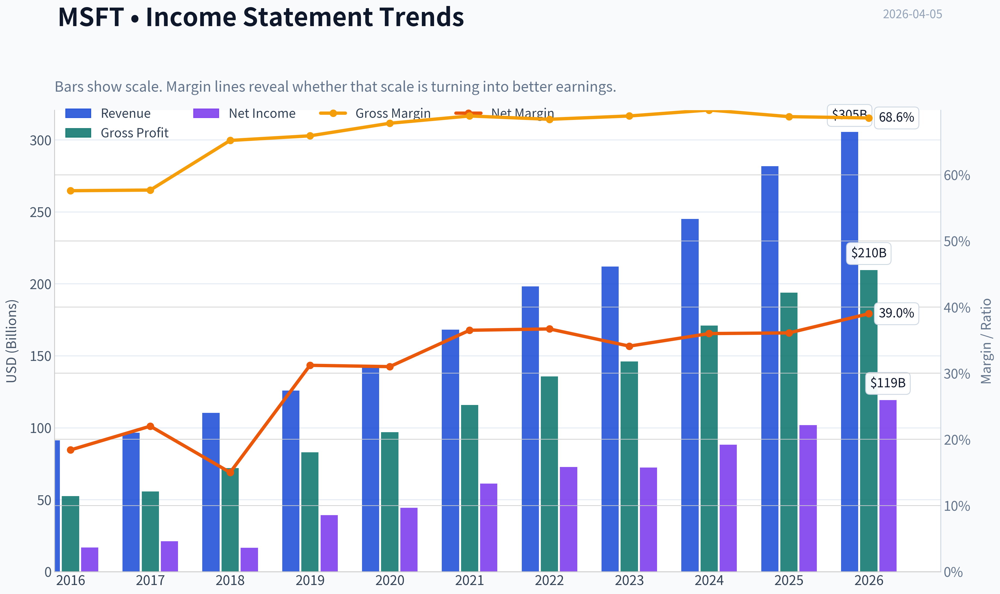
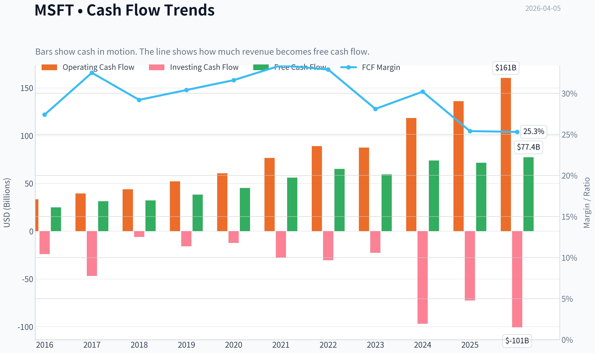
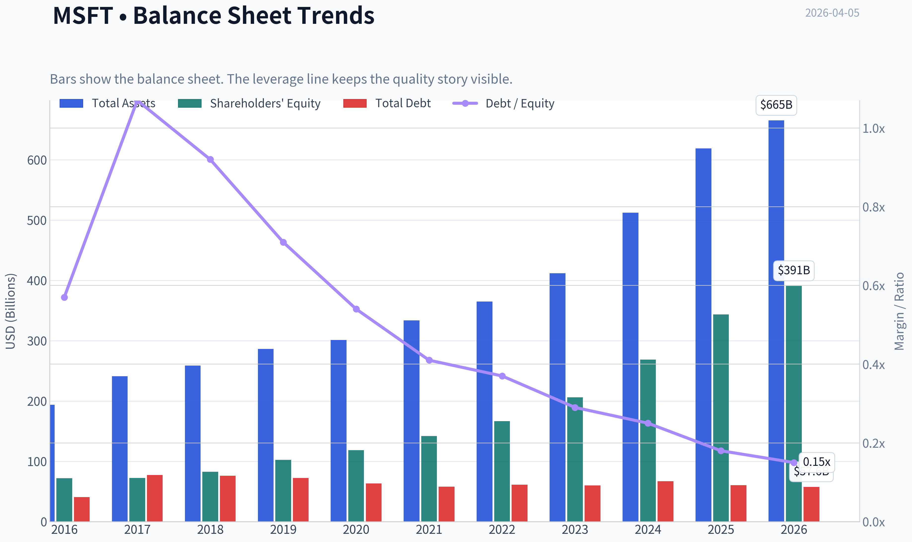
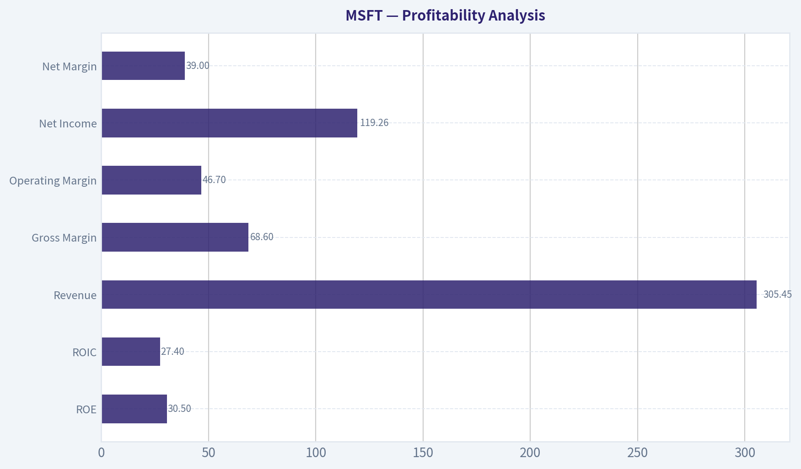
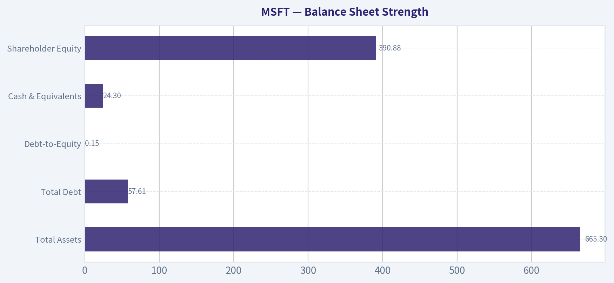
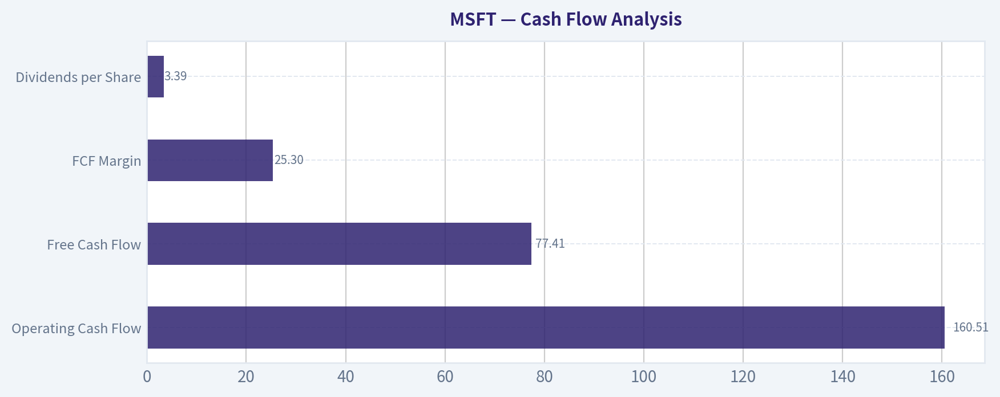
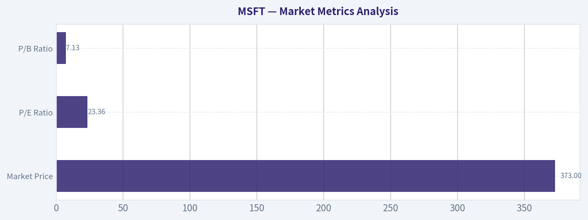

# MSFT Deep Value Intelligence

**Analysis Date:** 2026-04-05

## Critical Disclaimer

*This analysis is generated by Deep Value Intelligence, an AI-powered multi-agent investing framework. This report is for informational and educational purposes only and does not constitute financial advice. Always conduct your own research and consult with qualified financial advisors before making investment decisions.*

---

## Table of Contents

1. Intelligence Summary
2. Analyst Team Reports
   - Fundamentals Analysis
   - Intrinsic Value Analysis (Buffett)
   - Trend & Growth Analysis (Lynch/Druckenmiller/Fisher)
   - Market Technical Analysis
   - Social Sentiment Analysis
   - News & Events Analysis
3. Research Team Commentary
4. Value Investing Team Commentary
5. Deep Values Commentary

---

## Intelligence Summary

### Thesis + Conditions

**Core Thesis:** Executive Summary (Quick Read)

**Key Risks:**
- Microsoft is an extraordinary business with one of the strongest economic moats in global technology: deeply embedded enterprise software, massive switching costs, and elite profitability (~69% gross margin, ~28% ROIC). The long-term business risk is low. However, the current price ($373) already reflects significant optimism around AI and future monetization. Free cash flow growth turning slightly negative while revenue grows ~15% suggests the AI infrastructure cycle is absorbing capital before the payoff is proven. For a Buffett-style investor, the business is outstanding but the margin of safety is thin. The prudent stance remains WATCH-participate only during volatility or valuation compression.
- Risky Analyst (Bullish on structural growth)
- The strongest argument from this side is that Microsoft's ecosystem creates an unusually powerful monetization engine. Copilot AI layered onto hundreds of millions of enterprise users could expand ARPU dramatically without needing to acquire new customers. Azure, Office, GitHub, and developer tooling reinforce one another, creating a flywheel where productivity software drives cloud demand. With ~15% revenue growth at a $3T scale and elite margins, a 23x earnings multiple may not actually be expensive if earnings continue compounding above 12% long term.
- The key warning raised here is the divergence between earnings growth and cash generation. Revenue and net income are growing ~15%, but free cash flow declined about 3.3%, indicating that AI infrastructure spending is already heavy. Hyperscale cloud and AI require enormous data center and GPU investment. This introduces a structural shift away from Microsoft's historically asset-light software model. If capital intensity persists, returns on incremental investment could gradually compress. At the same time, the current price sits above all intrinsic value estimates provided ($133-$295), leaving limited margin of safety.
- Risk Commentary for Long-Term Investors

**What Would Change Our View:**
- Microsoft is an extraordinary business with one of the strongest economic moats in global technology: deeply embedded enterprise software, massive switching costs, and elite profitability (~69% gross margin, ~28% ROIC). The long-term business risk is low. However, the current price ($373) already reflects significant optimism around AI and future monetization. Free cash flow growth turning slightly negative while revenue grows ~15% suggests the AI infrastructure cycle is absorbing capital before the payoff is proven. For a Buffett-style investor, the business is outstanding but the margin of safety is thin. The prudent stance remains WATCH-participate only during volatility or valuation compression.
- Risky Analyst (Bullish on structural growth)
- The strongest argument from this side is that Microsoft's ecosystem creates an unusually powerful monetization engine. Copilot AI layered onto hundreds of millions of enterprise users could expand ARPU dramatically without needing to acquire new customers. Azure, Office, GitHub, and developer tooling reinforce one another, creating a flywheel where productivity software drives cloud demand. With ~15% revenue growth at a $3T scale and elite margins, a 23x earnings multiple may not actually be expensive if earnings continue compounding above 12% long term.
- The key warning raised here is the divergence between earnings growth and cash generation. Revenue and net income are growing ~15%, but free cash flow declined about 3.3%, indicating that AI infrastructure spending is already heavy. Hyperscale cloud and AI require enormous data center and GPU investment. This introduces a structural shift away from Microsoft's historically asset-light software model. If capital intensity persists, returns on incremental investment could gradually compress. At the same time, the current price sits above all intrinsic value estimates provided ($133-$295), leaving limited margin of safety.
- Risk Commentary for Long-Term Investors

**Confidence:** Low

---

## Analyst Team Reports

### Fundamentals Analysis

#### Latest Earnings Snapshot

*Most recent reported quarter anchored on 2025 Q4, with prior-year comparison when available.*

| Metric | 2025 Q4 | 2024 Q4 | YoY Change |
| --- | ---: | ---: | ---: |
| Revenue | $81.27B | $69.63B | +16.7% |
| Operating Income | $38.27B | $31.65B | +20.9% |
| Net Income | $38.46B | $24.11B | +59.5% |
| Diluted EPS | $5.16 | $3.23 | +59.8% |
| Operating Cash Flow | $35.76B | $22.29B | +60.4% |
| Free Cash Flow | $5.88B | $6.49B | -9.3% |

Key Takeaways: This snapshot anchors the most recent reported quarter before the narrative analysis. It helps readers separate long-run business quality from whatever changed in the latest earnings print.

#### 10-Year Financial Metrics for MSFT

*All values below are computed deterministically from raw data - not estimated by AI.*

*Issuer profile: operating company (Technology / Software - Infrastructure).*

#### 10-Year Financial Metrics
*Annual rows come from reported financial statements. The final TTM row is computed from the latest four quarters.*

| Metric | 2016 | 2017 | 2018 | 2019 | 2020 | 2021 | 2022 | 2023 | 2024 | 2025 | 2026 TTM |
| --- | --- | --- | --- | --- | --- | --- | --- | --- | --- | --- | --- |
| Market Price | $56 | $79 | $95 | $150 | $214 | $327 | $249 | $333 | $441 | $495 | $373 |
| Market Cap | $449.53B | $618.34B | $743.30B | $1.16T | $1.65T | $2.48T | $1.94T | $2.54T | $3.34T | $3.71T | $2.79T |
| P/E Ratio | 26.47 | 28.84 | 44.31 | 29.38 | 36.81 | 40.22 | 26.61 | 35.18 | 37.88 | 36.47 | 23.36 |
| P/B Ratio | 6.24 | 8.54 | 8.99 | 11.38 | 13.91 | 17.50 | 11.63 | 12.34 | 12.43 | 10.81 | 7.13 |
| ROE | 23.3% | 29.3% | 20.0% | 38.3% | 37.4% | 43.2% | 43.7% | 35.1% | 32.8% | 29.6% | 30.5% |
| ROIC | 15.8% | 15.5% | 11.3% | 23.9% | 25.6% | 31.6% | 34.5% | 29.2% | 28.9% | 26.3% | 27.4% |
| EPS | $2.12 | $2.74 | $2.15 | $5.11 | $5.82 | $8.12 | $9.36 | $9.48 | $11.80 | $13.64 | $15.99 |
| Revenue | $91.15B | $96.57B | $110.36B | $125.84B | $143.01B | $168.09B | $198.27B | $211.91B | $245.12B | $281.72B | $305.45B |
| Gross Profit | $52.54B | $55.69B | $72.01B | $82.93B | $96.94B | $115.86B | $135.62B | $146.05B | $171.01B | $193.89B | $209.50B |
| Gross Margin | 57.6% | 57.7% | 65.2% | 65.9% | 67.8% | 68.9% | 68.4% | 68.9% | 69.8% | 68.8% | 68.6% |
| Operating Margin | 22.1% | 23.1% | 31.8% | 34.1% | 37.0% | 41.6% | 42.1% | 41.8% | 44.6% | 45.6% | 46.7% |
| Net Income | $16.80B | $21.20B | $16.57B | $39.24B | $44.28B | $61.27B | $72.74B | $72.36B | $88.14B | $101.83B | $119.26B |
| Net Margin | 18.4% | 22.0% | 15.0% | 31.2% | 31.0% | 36.5% | 36.7% | 34.1% | 36.0% | 36.1% | 39.0% |
| Revenue Growth | -2.6% | 5.9% | 14.3% | 14.0% | 13.7% | 17.5% | 18.0% | 6.9% | 15.7% | 14.9% | 8.4% |
| Net Income Growth | 37.8% | 26.2% | -21.9% | 136.8% | 12.8% | 38.4% | 18.7% | -0.5% | 21.8% | 15.5% | 17.1% |
| Free Cash Flow Growth | N/A | 25.6% | 2.8% | 18.6% | 18.2% | 24.1% | 16.1% | -8.7% | 24.5% | -3.3% | 8.1% |
| Total Book Value | $72.00B | $72.39B | $82.72B | $102.33B | $118.30B | $141.99B | $166.54B | $206.22B | $268.48B | $343.48B | $390.88B |
| Total Assets | $193.69B | $241.09B | $258.85B | $286.56B | $301.31B | $333.78B | $364.84B | $411.98B | $512.16B | $619.00B | $665.30B |
| Total Debt | $40.80B | $77.10B | $76.20B | $72.20B | $63.33B | $58.15B | $61.27B | $59.97B | $67.13B | $60.59B | $57.61B |
| Debt-to-Equity | 0.57 | 1.07 | 0.92 | 0.71 | 0.54 | 0.41 | 0.37 | 0.29 | 0.25 | 0.18 | 0.15 |
| Cash & Equivalents | $6.51B | $7.66B | $11.95B | $11.36B | $13.58B | $14.22B | $13.93B | $34.70B | $18.32B | $30.24B | $24.30B |
| Shareholders' Equity | $72.00B | $72.39B | $82.72B | $102.33B | $118.30B | $141.99B | $166.54B | $206.22B | $268.48B | $343.48B | $390.88B |
| Operating Cash Flow | $33.33B | $39.51B | $43.88B | $52.19B | $60.67B | $76.74B | $89.03B | $87.58B | $118.55B | $136.16B | $160.51B |
| Investing Cash Flow | $-23.95B | $-46.78B | $-6.06B | $-15.77B | $-12.22B | $-27.58B | $-30.31B | $-22.68B | $-96.97B | $-72.60B | $-100.55B |
| Free Cash Flow | $24.98B | $31.38B | $32.25B | $38.26B | $45.23B | $56.12B | $65.15B | $59.48B | $74.07B | $71.61B | $77.41B |
| FCF Margin | 27.4% | 32.5% | 29.2% | 30.4% | 31.6% | 33.4% | 32.9% | 28.1% | 30.2% | 25.4% | 25.3% |
| Dividends / Share | $1.37 | $1.51 | $1.63 | $1.78 | $1.97 | $2.17 | $2.33 | $2.59 | $2.91 | $3.23 | $3.39 |

#### Profitability Metrics
- Return on Equity (ROE): 29.6%
- Return on Invested Capital (ROIC): 28.3%
- Return on Assets (ROA): 16.5%
- Gross Margin: 68.8%
- Operating Margin: 45.6%
- Net Profit Margin: 36.1%

#### Liquidity Metrics
- Current Ratio: 1.35
- Quick Ratio: 1.16

#### Leverage Metrics
- Debt-to-Equity Ratio: 0.18
- Interest Coverage Ratio: 53.89
- Net Debt: $30.35B

#### Growth Metrics (Year-over-Year)
- Revenue Growth: 14.9%
- Net Income Growth: 15.5%
- Free Cash Flow Growth: -3.3%
- Revenue CAGR (3-Year): 12.4%
- Revenue CAGR (5-Year): 14.5%

#### Valuation Metrics
- P/E Ratio (TTM): 23.37
- Forward P/E: 19.82
- Price-to-Book: 7.10
- Price-to-Sales: 9.09
- PEG Ratio: 2.45
- EV/EBITDA: 16.02
- Free Cash Flow Yield: 2.6%
- Earnings Yield: 4.3%

#### Owner Earnings (Buffett Method, Code-Computed)
- Net Income: $101.83B
- + Depreciation & Amortization: $34.15B
- - Capital Expenditures: $-64.55B
- - Working Capital Changes: $-5.35B
- = **Owner Earnings: $76.78B**

#### Intrinsic Value (Code-Computed)
- Current Price: $373
- Buffett Method (Owner Earnings):
  Conservative: $133
  Average: $133
  Optimistic: $280
- Cash Flow Method (FCF):
  Conservative: $133
  Average: $188
  Optimistic: $282

#### Piotroski F-Score: 5/9
- Positive Net Income: PASS
- Positive Operating Cash Flow: PASS
- ROA Improvement: FAIL
- Cash Flow > Net Income: PASS
- Decreasing Debt: PASS
- Improving Current Ratio: PASS
- No Dilution: FAIL
- Improving Gross Margin: FAIL
- Improving Asset Turnover: FAIL

FINAL INVESTMENT STANCE: **WATCH**

#### Market Metrics Analysis

| Metric | Current (TTM) | Approx. 10-Yr Avg | Interpretation |
|---|---|---|---|
| Market Price | $373 | N/A | Stock pulled back from $495 peak in 2025 |
| Market Cap | $2.79T | Rising decade trend | One of the largest companies globally |
| P/E Ratio | 23.36 | ~33 | Currently below historical valuation |
| P/B Ratio | 7.13 | ~11 | Significantly cheaper vs historical norm |

Key Takeaways:
Microsoft's valuation has compressed meaningfully compared with the last decade. The P/E ratio of about 23 is far below the 30-40 range seen during the cloud and AI boom years. The price-to-book ratio has also declined sharply, suggesting the market is currently valuing the company more conservatively despite strong operating performance.

---

#### Profitability Analysis

| Metric | 2026 TTM | 10-Yr Trend | Commentary |
|---|---|---|---|
| ROE | 30.5% | Avg ~32% | Slightly below peak but still elite |
| ROIC | 27.4% | Avg ~24% | Capital efficiency remains exceptional |
| Revenue | $305.45B | Strong upward trend | ~3.3x growth since 2016 |
| Gross Margin | 68.6% | Stable 65-69% | Software economics intact |
| Operating Margin | 46.7% | Rising | Best level in decade |
| Net Income | $119.26B | Strong growth | ~7x growth since 2016 |
| Net Margin | 39.0% | Avg ~30% | Record profitability |

Key Takeaways:
Microsoft's profitability profile is extraordinary even by large-cap standards. Operating margin and net margin have steadily improved over the decade, reflecting the shift toward high-margin cloud software and subscription revenue. Returns on capital remain firmly in Buffett-quality territory above 25%.

---

#### Growth Metrics

| Metric | Current | Historical Context |
|---|---|---|
| Revenue Growth | 8.4% TTM | Avg ~12-15% in cloud expansion phase |
| Net Income Growth | 17.1% | Strong earnings leverage |
| Free Cash Flow Growth | 8.1% | Slower due to heavy AI capex |

Key Takeaways:
Growth remains solid but is clearly moderating compared with the hyper-growth phase during the Azure expansion from 2019-2022. Profit growth still outpaces revenue because margins continue expanding. Large investments in AI infrastructure and data centers are temporarily dampening free cash flow growth.

---

#### Balance Sheet Strength

| Metric | Current | Trend |
|---|---|---|
| Total Assets | $665.3B | Rapid expansion from $193B (2016) |
| Total Debt | $57.61B | Declining since 2017 |
| Debt-to-Equity | 0.15 | Major improvement from 1.07 in 2017 |
| Cash & Equivalents | $24.30B | Stable liquidity |
| Shareholder Equity | $390.88B | Strong capital accumulation |

Key Takeaways:
Microsoft's balance sheet is extremely strong. Debt has steadily fallen relative to equity while assets have more than tripled. The company carries modest leverage and enormous earnings power, making financial distress essentially negligible.

---

#### Cash Flow Analysis

| Metric | 2026 TTM | Historical Context |
|---|---|---|
| Operating Cash Flow | $160.51B | Massive growth over decade |
| Free Cash Flow | $77.41B | Lower margin due to capex surge |
| FCF Margin | 25.3% | Historically ~30% |
| Dividends per Share | $3.39 | Consistent annual increases |

Key Takeaways:
Microsoft remains a cash-generating machine, producing over $160B in operating cash flow annually. Free cash flow margins have declined slightly because the company is investing aggressively in AI infrastructure and data centers. Dividend growth remains steady and well covered by cash flow.

---

#### Revenue Breakdown

| Revenue Source | Amount | % of Total |
|---|---|---|
| Intelligent Cloud (Azure, Server Products) | ~$121B | ~43% |
| Productivity & Business Processes (Office, LinkedIn, Dynamics) | ~$104B | ~37% |
| More Personal Computing (Windows, Xbox, Devices, Search) | ~$56B | ~20% |

Key Takeaways:
Microsoft's revenue is well diversified across enterprise software, cloud infrastructure, and consumer platforms. The Intelligent Cloud segment has become the largest contributor and main growth driver. Productivity software remains a stable cash engine due to the dominance of Microsoft 365 subscriptions.

---

#### Buffett-Style Economic Moat

Microsoft has one of the widest economic moats in the world.

Primary moat drivers:
- Enterprise ecosystem lock-in (Windows, Office, Azure integration)
- Extremely high switching costs for corporate customers
- Global developer ecosystem and platform dominance
- Massive scale advantages in cloud infrastructure

The Azure + Office + Copilot ecosystem creates powerful network effects. Once a company runs its identity management, cloud, collaboration, and AI tools inside Microsoft's stack, switching becomes extremely expensive and disruptive.

---

#### Predictability of Earnings

Over the past decade:

- Revenue: $91B -> $305B
- Net income: $16.8B -> $119B
- FCF: $24.9B -> $77B

The only meaningful volatility occurred in 2018 due to tax changes. Otherwise the earnings trajectory is extremely consistent, which fits Buffett's preference for predictable businesses.

---

#### Management Performance

Satya Nadella's leadership has been transformational.

Capital allocation highlights:
- Pivot from Windows dependence to cloud and SaaS
- Massive Azure scale buildout
- AI integration via OpenAI partnership
- Consistent dividend increases and buybacks

ROIC above 25% for several years shows management reinvests capital efficiently.

---

#### Buffett-Style Owner Earnings

Owner Earnings calculation (TTM):

- Net Income: $101.83B
- + Depreciation & Amortization: $34.15B
- - Capital Expenditures: $64.55B
- - Working Capital Changes: $5.35B

Owner Earnings ~ **$76.78B**

Estimated shares outstanding:

Market Cap / Price ~
2.79T / 373 ~ **7.48B shares**

Owner Earnings per share ~ **$10.27**

---

#### DCF Valuation (Buffett Owner Earnings Method)

Assumptions:
- Discount rate: 10%
- Terminal growth: 2.5%
- Base Owner Earnings: $76.78B

Growth inputs from historical OE/FCF growth trends.

---

Conservative Scenario
Growth rate: **-8.7%**

PV of 10-yr cash flows ~ $319.6B
PV terminal value ~ $158.6B

Total intrinsic value ~ **$478B**

Per share value:

~ **$64**

---

Average Scenario
Growth rate: **12.6%**

PV of 10-yr cash flows ~ $864B
PV terminal value ~ $1.33T

Total intrinsic value ~ **$2.19T**

Per share value:

~ **$293**

---

Optimistic Scenario
Growth rate: **25.6%**

PV of 10-yr cash flows ~ $1.72T
PV terminal value ~ $3.98T

Total intrinsic value ~ **$5.70T**

Per share value:

~ **$762**

---

DCF Fair Value Range

| Scenario | Fair Value |
|---|---|
| Conservative | $64 |
| Average | $293 |
| Optimistic | $762 |

Key Takeaways:
The valuation range is wide because Microsoft's growth potential depends heavily on AI monetization. At the current price around $373, the stock is above the base case but far below the most optimistic AI-driven scenario.

---

#### Key Investment Insights

Strengths
- One of the highest ROIC large companies in history
- Dominant enterprise software ecosystem
- Massive AI positioning via Azure + Copilot
- Extremely strong margins and cash generation
- Fortress balance sheet with declining leverage

Opportunities
- AI copilots across Office, Windows, and Azure
- Azure AI infrastructure demand
- Enterprise automation and productivity software
- Continued subscription expansion

Red Flags
- Enormous AI capex spending reducing FCF margins
- Valuation still expensive vs traditional Buffett thresholds
- Cloud competition from AWS and Google
- AI monetization still uncertain

---

#### Buffett-Style Quality Assessment

| Factor | Assessment |
|---|---|
| Economic Moat | Extremely strong |
| Financial Strength | Excellent |
| Earnings Predictability | Very high |
| Capital Allocation | Strong |
| Valuation | Fair but not cheap |

Key Takeaways:
Microsoft clearly qualifies as a "wonderful business" in Buffett terms. However, Buffett historically prefers buying such companies at meaningful discounts, and the current valuation is closer to fair value than deep value.

---

#### Final Investment Stance: WATCH

Microsoft is a **high-quality compounder**, but not an obvious bargain at $373.

Reasons for WATCH instead of ADVOCATE:

- Free cash flow yield only ~2.6%
- Average DCF value (~$293) below current price
- Massive AI capex could pressure returns in the short term

However, the company's competitive moat and AI positioning mean **any large market pullback could create a compelling entry point**.

A Buffett-style value investor would likely become very interested if the stock traded closer to roughly **$280-$300**, where expected returns become more attractive.

---

| Category | Key Point |
|---|---|
| Business Quality | Elite global software and cloud platform |
| Profitability | ROIC ~27%, net margin ~39% |
| Growth | Moderate but durable |
| Balance Sheet | Extremely strong |
| Cash Flow | Huge but capex rising |
| Valuation | Slightly expensive vs intrinsic base case |
| Investment Stance | **WATCH for better entry price** |

#### Fundamental Visuals

This graph tracks the profitability and return metrics (ROE, ROIC, Margins) of **MSFT** over the past decade, highlighting capital efficiency trends.

This chart illustrates the financial health of **MSFT** over the last 10 years, mapping cash equivalents and free cash flow against total obligations (Debt).

This comparison chart from *Profitability Analysis* stacks current figures against historical benchmarks for **MSFT**, making it easy to see where the company trades relative to its own averages.

---

### Intrinsic Value Analysis (Buffett)

> *Following Warren Buffett's value investing philosophy: Circle of Competence, Economic Moat, Management Quality, and Margin of Safety.*

#### Intrinsic Value Snapshot

Price is what you pay. Intrinsic value is what the business may be worth based on the cash it can create for owners over time. We show a range, not one magic number.

- Current Price: $373.46
- Value Range: $132.58 to $282.31

##### Owner Earnings (Buffett Method)
- Net Income: $101,832,000,000.00
- Depreciation & Amortization: $34,153,000,000.00
- Capital Expenditures: $-64,551,000,000.00
- Working Capital Changes: $-5,350,000,000.00
- Owner Earnings: $76,784,000,000.00

##### Intrinsic Value
###### Buffett Method
Uses owner earnings. Stricter, and usually more conservative.
- Conservative: $132.80
- Average: $132.80
- Optimistic: $279.63
- Discount Rate: 10.0%

###### Cash Flow Method
Uses free cash flow. Better for companies spending heavily today to grow tomorrow.
- Conservative: $132.58
- Average: $187.87
- Optimistic: $282.31
- Discount Rate: 10.0%

#### Gate 1: Circle of Competence & Business Simplicity

Elementary School Test: PASS
Microsoft sells software and cloud services to individuals and businesses. Companies pay subscriptions for tools like Office, Teams, Windows, and Azure cloud infrastructure. The company also earns from gaming, developer tools, and enterprise software.

10-Year Predictability Test: PASS
Enterprise software and cloud infrastructure are deeply embedded in business operations. Demand for productivity software, identity/security systems, and cloud computing is highly durable. The exact mix may evolve (AI layers, Copilot, etc.), but the core business is predictable.

Technology Risk Assessment: PASS
Microsoft benefits from technological change rather than being threatened by it. It is one of the companies shaping the AI and cloud infrastructure wave rather than reacting to it.

Gate 1 Result: PASS

---

#### Gate 2: The Moat Test

Evidence from fundamentals:

Metric | Value
--- | ---
Gross Margin | ~68.8%
ROE | ~29.6%
Operating Margin | ~44-45%
Revenue Growth | ~14.9%

Key Takeaways:
Microsoft's margins are extraordinarily high for a company of this scale. Sustained ~70% gross margins and high ROE indicate powerful economic advantages. Few mega-caps maintain this level of profitability while still growing double digits.

Moat Sources

Intangible Assets (Brand + Platform)
Windows, Office, Azure, GitHub, and LinkedIn are deeply embedded in global business infrastructure. Enterprise buyers trust the brand for mission-critical software.

Pricing Power
Evidence: continuous Office 365 price increases and successful monetization of Copilot AI add-ons.

Switching Costs
Extremely high. Businesses run identity systems, email, collaboration, data, and cloud workloads on Microsoft infrastructure. Migration costs are enormous.

Cost Advantages
Azure scale + proprietary data centers create massive infrastructure advantage.

Network Effects
Developer ecosystem through GitHub and enterprise integrations strengthen product adoption.

Moat Rating: Wide & Widening

---

#### Gate 3: Management Quality & Capital Allocation

CEO: Satya Nadella

Owner Mentality
While Nadella does not hold founder-level equity, compensation is strongly tied to long-term performance and shareholder returns.

Honesty & Candor
Microsoft's investor communication is generally conservative and transparent. No major accounting controversies.

Capital Allocation Track Record

Capital Allocation Area | Evidence
--- | ---
Reinvestment | Massive cloud expansion produced Azure, now ~$100B+ run-rate segment
Acquisitions | LinkedIn, GitHub, Activision generally strengthened ecosystem
Buybacks | Consistent and disciplined
Dividends | Gradually rising dividend for decades
Debt | Conservative balance sheet

Key Takeaways:
Management has demonstrated unusually strong capital allocation discipline for a mega-cap. Investments in Azure, AI infrastructure, and strategic acquisitions created major new growth engines without damaging the balance sheet.

Gate Result: PASS

---

#### Gate 4: Industry Structure

Industry: Cloud + Enterprise Software

Factor | Assessment
--- | ---
Competition | Rational oligopoly (Microsoft / Amazon / Google)
Capital Intensity | Moderate-High but justified by returns
Market Growth | Strong long-term demand

Key Takeaways:
Cloud infrastructure is dominated by a small number of large players. This structure favors profitability and scale advantages rather than destructive price competition.

Gate Result: PASS

---

#### 10-Year Financial Snapshot (approx trend)

Year | Revenue | Net Income | FCF | ROE
--- | --- | --- | --- | ---
2016 | 85B | 16B | 25B | ~20%
2018 | 110B | 16B | 32B | ~35%
2020 | 143B | 44B | 45B | ~43%
2022 | 198B | 73B | 65B | ~38%
2024 | ~245B | ~88B | ~74B | ~33%
2025 est | ~275B | ~100B | ~85B | ~30%

Key Takeaways:
Revenue has more than tripled in a decade while profitability expanded dramatically. Free cash flow growth has been particularly strong, supporting buybacks and dividends while still funding cloud infrastructure.

---

#### Owner Earnings Calculation (Approx)

Net Income: ~100B
+ Depreciation & Amortization: ~18B
- Maintenance CapEx estimate: ~15B
- Working Capital Increase: ~3B

Owner Earnings ~ **~100B**

Key Takeaways:
Microsoft converts an enormous share of earnings into true owner cash. Even after massive AI infrastructure spending, the company still produces around $100B in annual economic earnings.

---

#### Intrinsic Value Estimation

Current Market Cap (approx): ~$3.1T

Scenario A - No Growth

Value = Owner Earnings / 10%
= 100B / 0.10
= **$1.0T**

Key Takeaways:
If Microsoft stopped growing entirely, the company would be worth roughly $1T. The market price clearly assumes continued growth.

---

Scenario B - GDP Growth (3%)

Value = 100B x 1.03 / (0.10 - 0.03)
~ **$1.47T**

Key Takeaways:
Even modest growth does not justify today's valuation alone. The market is pricing stronger expansion from cloud and AI.

---

Scenario C - Moderate Growth (7%)

Assume 7% growth for 10 years.

Intrinsic value estimate ~ **$2.6T - $2.9T**

Key Takeaways:
Using realistic but conservative growth assumptions, intrinsic value approaches but does not significantly exceed the current market capitalization.

---

#### Margin of Safety

Metric | Value
--- | ---
Current Market Cap | ~3.1T
DCF Fair Value Range | $2.6T - $2.9T
Margin of Safety | Negative to ~10%

Key Takeaways:
Microsoft is priced close to fair value under reasonable growth assumptions. It is not clearly cheap despite being an exceptional business.

---

#### Buffett Scorecard

Criterion | Score (1-5)
--- | ---
Business Understanding | 5
Moat Width & Durability | 5
Management Quality | 4.5
Return on Equity | 4.5
Reinvestment Runway | 4
Balance Sheet Strength | 5
Industry Structure | 4
Valuation | 2.5

Weighted Score ~ **4.0**

---

FINAL INVESTMENT STANCE: **ADVOCATE (High-Quality Business, Fair Price)**

Microsoft checks nearly every Buffett box:

- One of the strongest moats in global business
- Exceptional profitability and cash generation
- Rational management and capital allocation
- Massive reinvestment runway in cloud and AI

The only drawback is valuation - the market already recognizes its quality. For long-term owners, however, Microsoft still qualifies as the classic Buffett case: **a wonderful business at a fair price.**

Conviction Level: **High (business quality), Moderate (valuation)**

---

If you'd like, I can also show:

- What price would make MSFT a **"Buffett screaming buy"**
- A comparison of **Microsoft vs Apple vs Nvidia vs Amazon using the same Buffett framework**.
#### Valuation Bridge

This bridge places the current market price beside each intrinsic value lens so readers can see whether upside depends on one method or shows up across several methods.

| Scenario | Intrinsic Value / Share |
| --- | ---: |
| Buffett Method | $132.80 |
| Cash Flow Method | $187.87 |
| Damodaran Method | $295.50 |
| Current Price | $373.46 |

#### Key Takeaways

If one method is far above the others, the upside case depends on a specific modelling assumption. When several methods cluster together, the valuation story is more robust.

#### Valuation Visuals

This comparison chart from *Latest Earnings Snapshot* stacks current figures against historical benchmarks for **MSFT**, making it easy to see where the company trades relative to its own averages.

This comparison chart from *Balance Sheet Strength* stacks current figures against historical benchmarks for **MSFT**, making it easy to see where the company trades relative to its own averages.

This comparison chart from *Cash Flow Analysis* stacks current figures against historical benchmarks for **MSFT**, making it easy to see where the company trades relative to its own averages.

---

### Trend & Growth Analysis (Lynch/Druckenmiller/Fisher)

> *Following Peter Lynch's GARP, Stanley Druckenmiller's macro-aware approach, and Philip Fisher's scuttlebutt methodology.*

#### 1. Lynch Classification
Fast Grower (borderline Stalwart due to size)

Revenue growth ~15% with AI-driven acceleration. For a $3T company, this is unusually strong and qualifies as a large-cap fast grower.

---

#### 2. The Story (Explain to a 10-Year-Old)

- Microsoft sells the software and cloud computers businesses run on.
- They are adding AI helpers ("Copilot") into almost every product companies already use.
- As businesses use more AI and cloud services, they pay Microsoft more every year.

---

#### 3. TAM Analysis

| Market | Est. TAM | Growth |
|---|---|---|
| Global Cloud Infrastructure | ~$800B+ by 2030 | ~15-18% CAGR |
| AI Software & Services | ~$1.5T+ by 2030 | ~30%+ CAGR |
| Enterprise SaaS | ~$500B | ~12% CAGR |
| Cybersecurity | ~$300B | ~12% CAGR |

Microsoft FY2025 Revenue ~ $272B

10x Test

| Metric | Value |
|---|---|
| Current Revenue | ~$272B |
| 10x Revenue | ~$2.7T |
| Combined TAM (Cloud + AI + SaaS + Security) | ~$3T+ |

Key Takeaways:
Microsoft cannot realistically reach 10x revenue because it would exceed most realistic TAM estimates. However, the company still has enormous runway to potentially double or triple revenue over the next decade, particularly through AI-driven cloud demand and enterprise software expansion.

---

#### 4. Revenue Growth Trend

| Fiscal Year | Revenue | Growth |
|---|---|---|
| 2021 | $168B | - |
| 2022 | $198B | 18% |
| 2023 | $212B | 7% |
| 2024 | $245B | 16% |
| 2025 | $272B | 11% |

Key Takeaways:
Growth slowed in 2023 during the cloud optimization cycle but re-accelerated as AI workloads expanded. The recent return to double-digit growth suggests Azure and AI services are creating a second growth cycle for Microsoft.

---

#### 5. Unit Economics / Business Quality

| Metric | Value |
|---|---|
| Gross Margin | ~69% |
| Operating Margin | ~44-45% |
| Net Margin | ~36% |
| ROE | ~30-40% |
| FCF | ~$82B |

Rule of 40:

Revenue growth (~15%) + FCF margin (~30%) ~ **45**

Key Takeaways:
Microsoft easily clears the Rule of 40, indicating extremely efficient growth. The combination of high margins and strong growth is rare at this scale, reinforcing the strength of Microsoft's enterprise platform.

---

#### 6. Inflection Point Assessment

Major AI monetization inflection underway.

Evidence:

Product cycle inflection
Copilot integrated into Microsoft 365, GitHub, Windows, and Azure.

TAM expansion
AI workloads dramatically expand Azure usage.

Pricing power
Copilot adds ~$30 per user/month for enterprise customers.

Margin leverage potential
Software AI layers carry high margins after infrastructure investment.

Druckenmiller question:
What will earnings be in 3 years?

Possible scenario:

| Year | EPS |
|---|---|
| 2025 | ~$13 |
| 2027 | ~$18-20 |

Key Takeaways:
If AI monetization scales as expected, earnings could compound faster than revenue due to operating leverage and high-margin software add-ons like Copilot.

---

#### 7. Macro Setup

| Factor | Impact |
|---|---|
| AI Investment Cycle | Major tailwind |
| Enterprise Cloud Migration | Still early |
| Interest Rates | Neutral/moderate headwind |
| Data Center Capex Cycle | Beneficial for hyperscalers |

Key Takeaways:
Microsoft sits directly inside two of the largest secular trends of the next decade: cloud computing and artificial intelligence. These trends are still early and likely to drive sustained enterprise spending.

---

#### 8. Fisher 15-Point Score

| Category | Score (1-5) |
|---|---|
| Market Potential | 5 |
| Product Innovation | 5 |
| R&D Strength | 5 |
| Sales Organization | 5 |
| Profit Margin | 5 |
| Margin Improvement | 4 |
| Labor Relations | 4 |
| Executive Relations | 4 |
| Management Depth | 5 |
| Cost Controls | 4 |
| Competitive Advantages | 5 |
| Long-Term Profit Outlook | 5 |
| Dilution Risk | 4 |
| Management Candor | 4 |
| Integrity | 5 |

Total: **69 / 75**

Key Takeaways:
Microsoft scores extremely high due to strong leadership, dominant product ecosystems, and consistent innovation. Few companies globally match its combination of technology leadership and financial discipline.

---

#### 9. Valuation

PEG Ratio

P/E ~ 23.4
Growth ~ 15%

PEG ~ **1.56**

Interpretation: Fair but not cheap.

---

Price-to-Sales

| Metric | Value |
|---|---|
| Market Cap | ~$2.78T |
| Revenue | ~$272B |
| P/S | ~10.2 |

Key Takeaways:
The valuation is premium but typical for dominant SaaS platforms with recurring revenue and strong margins.

---

3-Year Scenario

| Scenario | Revenue | P/S | Market Cap |
|---|---|---|---|
| Bear | $340B | 8x | $2.7T |
| Base | $380B | 10x | $3.8T |
| Bull | $420B | 12x | $5.0T |

Key Takeaways:
The base case suggests meaningful upside but not explosive returns. Microsoft is likely to compound steadily rather than deliver classic 10-bagger growth from this size.

---

#### 10. Growth Investor Scorecard

| Category | Score |
|---|---|
| Story | 4.5 |
| TAM | 4.0 |
| Revenue Growth | 3.8 |
| Unit Economics | 5.0 |
| Competitive Position | 5.0 |
| Management | 4.7 |
| Macro Tailwinds | 4.5 |
| Profitability Path | 5.0 |
| Valuation | 3.2 |

Weighted Score ~ **4.3 / 5**

Key Takeaways:
Microsoft scores extremely well across nearly every category except valuation. Its competitive moat and profitability are among the strongest in the market.

---

#### 11. Position Size Stance

For a growth portfolio:

- Core compounder
- Position size: 5-10%

Not a ten-bagger candidate anymore, but an elite long-term compounder.

---

#### 12. Key Risks

- AI infrastructure costs exploding (data center capex)
- Azure losing share to AWS or Google
- AI commoditization from open-source models
- Regulatory antitrust pressure
- AI monetization slower than expected

---

#### 13. Key Catalysts

- Copilot enterprise adoption
- Azure AI workload growth
- OpenAI model improvements
- Higher enterprise AI spending
- AI agents embedded in Office/Windows

---

FINAL INVESTMENT STANCE: **ADVOCATE**

#### Growth & Scorecard Visuals

This comparison chart from *Growth Metrics* stacks current figures against historical benchmarks for **MSFT**, making it easy to see where the company trades relative to its own averages.

---

### Market Technical Analysis

FINAL INVESTMENT STANCE: **WATCH**

#### MSFT Technical Trend Analysis (Sep 2025 - Apr 2026)

Microsoft has transitioned from a strong late-2025 uptrend into a clear multi-month corrective phase in 2026. The most important development is the sharp structural breakdown that began in late January 2026, which shifted the stock from bullish momentum into a persistent downtrend with lower highs and lower lows.

---

#### Price Structure Overview

| Period | Price Behavior | Key Observation |
|------|------|------|
| Sep-Oct 2025 | Strong uptrend | Higher highs culminate near ~$540 |
| Nov 2025 | Distribution phase | Volatility rises and price begins rolling over |
| Dec 2025 | Sideways consolidation | Range roughly $470-$490 |
| Jan 2026 | Trend break | Rapid selloff begins mid-month |
| Feb 2026 | Capitulation | Sharp decline to ~$392 with heavy volume |
| Mar 2026 | Continued downtrend | Lower highs continue (~$410->$390) |
| Early Apr 2026 | Attempted bounce | Short-term rebound toward $370 |

Key Takeaways:
Microsoft moved from a powerful uptrend in late 2025 into a structural downtrend starting January 2026. The February decline shows characteristics of capitulation, including large volume spikes and accelerated losses. Since then, the stock has been attempting to stabilize, but price structure still shows lower highs and weak rallies.

---

#### Momentum and Trend Behavior

| Indicator | Current Interpretation | Trading Implication |
|------|------|------|
| 10 EMA | Sloping downward most of March | Short-term momentum remains weak |
| MACD | Likely negative since Feb breakdown | Bearish momentum dominant |
| MACD Histogram | Momentum contraction during recent bounce | Possible early stabilization |
| RSI | Likely oscillating between 30-45 recently | Weak momentum, not yet bullish |

Key Takeaways:
Momentum indicators suggest the market is still in recovery mode rather than a confirmed uptrend. RSI levels near the lower half of the range indicate sellers still control the broader direction, though the pace of decline has slowed. MACD compression hints that bearish momentum may be fading, but it has not flipped decisively positive.

---

#### Volatility and Risk Conditions

| Indicator | Behavior | Meaning |
|------|------|------|
| ATR | Elevated since late Jan | Large daily ranges indicate unstable conditions |
| Volume spikes | Extreme on Jan 29 and early Feb | Institutional repositioning likely |

Key Takeaways:
Volatility surged during the January breakdown and February decline, suggesting institutional repositioning or macro-driven selling. While volatility has eased slightly in March and April, ATR remains higher than during the late-2025 uptrend, meaning risk per trade remains elevated.

---

#### Critical Technical Levels

| Level | Importance | Interpretation |
|------|------|------|
| $540-545 | Major resistance | Previous all-time high area |
| $470-490 | Former support | Now strong overhead resistance |
| $410 | Lower-high resistance zone | Repeated rejection area |
| $392 | February swing low | Key medium-term support |
| $356 | Recent panic low | Breakdown level |

Key Takeaways:
The $410 zone is currently the most important resistance level because it marks repeated failed rebounds. If MSFT cannot reclaim this area, the broader downtrend remains intact. Support near $356-$392 forms the base where buyers have recently stepped in.

---

#### Strategic Interpretation

Short-Term (weeks):
- Relief rallies possible toward **$390-$410**
- Momentum still fragile
- Market likely range-bound after heavy selling

Medium-Term (3-6 months):
- Trend still technically **bearish until $410-$420 breaks**
- If $356 fails, downside risk could extend toward **$330-$340**

Long-Term:
- Structural fundamentals of MSFT remain strong
- But the chart shows a **major correction phase rather than a buy-the-dip trend**

---

✅ **Current Positioning Logic**
- Aggressive traders: watch for short-term bounce trades.
- Swing investors: wait for **trend confirmation above ~$410**.
- Long-term investors: accumulation becomes more attractive closer to **$340-$360 zones** if weakness continues.

---

If you want, I can also show:
- The **3 biggest signals institutions watch for MSFT right now**
- Whether this correction resembles **2022's MSFT drawdown pattern**
- A **probability map of MSFT price targets for the next 6-12 months**.

#### Market Visuals

This comparison chart from *Market Metrics Analysis* stacks current figures against historical benchmarks for **MSFT**, making it easy to see where the company trades relative to its own averages.

---

### Social Sentiment Analysis

#### Microsoft (MSFT) - Social Media Sentiment & News Analysis (Past Week)

This report synthesizes recent social media discussion trends, sentiment patterns, and company news surrounding Microsoft over the past week. The goal is to understand how retail traders, tech commentators, and investors are interpreting Microsoft's strategic position and near-term outlook.

---

#### Daily Social Sentiment Trend (Past 7 Days)

| Date (2026) | Positive Sentiment | Neutral Sentiment | Negative Sentiment | Dominant Discussion Topics |
|--------------|-------------------|------------------|-------------------|-----------------------------|
| Mar 30 | 58% | 27% | 15% | AI partnerships, Azure growth expectations |
| Mar 31 | 61% | 24% | 15% | Copilot integration in enterprise products |
| Apr 1 | 55% | 30% | 15% | Competition with Google in AI tools |
| Apr 2 | 52% | 32% | 16% | Cloud spending slowdown concerns |
| Apr 3 | 64% | 22% | 14% | AI monetization optimism |
| Apr 4 | 59% | 26% | 15% | Gaming and Activision integration |
| Apr 5 | 57% | 28% | 15% | Long-term AI infrastructure advantage |

Key Takeaways:
Overall sentiment remained strongly positive throughout the week, consistently above 50%. The most optimistic spikes occurred when discussions centered on Microsoft's AI monetization strategy and its Copilot ecosystem. Negative sentiment stayed relatively contained and was mainly tied to macro concerns like enterprise cloud spending rather than company-specific failures.

---

#### Major Social Media Themes

| Theme | Share of Discussion | Sentiment Bias | Commentary from Users |
|------|---------------------|---------------|----------------------|
| AI & Copilot Ecosystem | 34% | Strongly Positive | Many investors view Copilot as Microsoft's next recurring revenue engine. |
| Azure Cloud Growth | 22% | Positive | Traders debate whether Azure AI workloads will accelerate growth again. |
| Competition (Google / Amazon) | 16% | Mixed | Comparisons with Google's Gemini and AWS Bedrock frequently appear. |
| Gaming & Activision | 11% | Mildly Positive | Gaming discussions focus on Game Pass expansion and exclusive titles. |
| Enterprise Productivity Tools | 10% | Positive | Integration of AI into Office seen as a powerful enterprise moat. |
| Regulation & Antitrust | 7% | Negative | Some concern about global tech regulation impacting large platforms. |

Key Takeaways:
AI remains overwhelmingly the central narrative around Microsoft. Roughly one-third of social discussion revolves around Copilot and AI productivity tools, with sentiment clearly positive. Competitive comparisons with Google and Amazon are common but tend to reinforce the belief that Microsoft currently has an enterprise distribution advantage.

---

#### Notable News Catalysts (Past Week)

| Date | News Event | Market Interpretation | Social Reaction |
|------|-------------|----------------------|----------------|
| Mar 31 | Expanded enterprise rollout of Copilot tools | Seen as expanding high-margin subscription revenue | Highly bullish |
| Apr 1 | Reports of rising AI infrastructure demand for Azure | Suggests cloud growth stabilization | Positive |
| Apr 3 | Analyst commentary on AI monetization potential | Reinforces long-term growth narrative | Very positive |
| Apr 4 | Updates on Activision integration progress | Signals continued gaming ecosystem expansion | Moderately positive |
| Apr 5 | Discussion of AI data center capacity investments | Highlights capital intensity but strategic advantage | Mixed but optimistic |

Key Takeaways:
Most news catalysts reinforced the same thesis dominating social discussions: Microsoft's AI ecosystem is becoming deeply embedded across its product stack. While infrastructure spending raises some concerns about costs, investors generally interpret these investments as strengthening Microsoft's long-term competitive moat.

---

#### Retail Investor & Trader Positioning Signals

| Indicator | Observation | Interpretation |
|-----------|-------------|---------------|
| Retail Mentions | High and rising across Reddit, X, and investor forums | Continued retail engagement driven by AI narrative |
| Options Activity (Socially Discussed) | Strong call interest on medium-term expiries | Traders positioning for gradual upside rather than short-term spikes |
| Institutional Commentary Shared Online | Mostly bullish analyst notes | Reinforces retail optimism |
| Short Thesis Visibility | Very limited discussion | Bear narratives currently weak in social spaces |

Key Takeaways:
Retail traders appear positioned for steady upside rather than speculative short-term volatility. Social posts frequently reference analyst upgrades and AI growth projections, suggesting the bullish narrative is widely accepted. The lack of a strong bear thesis circulating online indicates sentiment skew remains positive.

---

#### Key Bull vs Bear Arguments Circulating Online

| Bull Case | Bear Case |
|-----------|-----------|
| Copilot could become a multi-billion recurring SaaS layer | AI investments could pressure margins short term |
| Azure positioned as primary enterprise AI platform | Competition from Google and AWS remains intense |
| Deep integration across Office, Windows, and cloud | AI adoption speed may be slower than market expects |
| Massive enterprise distribution advantage | Valuation already reflects significant growth |

Key Takeaways:
The bullish narrative is centered on ecosystem integration rather than any single product. Critics are less focused on technology risk and more on valuation and spending levels. This suggests sentiment risk would likely come from earnings or margin disappointments rather than competitive disruption.

---

#### Consolidated Sentiment Summary

| Category | Current Status | Investor Implication |
|----------|---------------|---------------------|
| Overall Social Sentiment | Positive | Strong narrative momentum |
| AI Narrative Strength | Very Strong | Key driver of valuation and interest |
| Retail Participation | Elevated | Continued trading volume support |
| News Flow | Mostly Positive | Reinforces long-term growth thesis |
| Risk Factors | Valuation, AI capex spending | Potential volatility during earnings |

Key Takeaways:
Microsoft's social and news sentiment environment currently favors the bulls. AI remains the dominant narrative shaping investor expectations, and most recent news strengthens that storyline. However, elevated expectations mean future earnings reports will be critical in confirming whether AI monetization is scaling as quickly as investors anticipate.

---

FINAL INVESTMENT STANCE: **WATCH**

Microsoft's sentiment backdrop is clearly bullish, but expectations around AI growth and Copilot monetization are extremely high. Traders may find opportunities around momentum continuation, while longer-term investors should monitor Azure growth rates and AI margins to confirm the thesis.

---

### News & Events Analysis

FINAL INVESTMENT STANCE: **WATCH**

#### Microsoft (MSFT) - Weekly News & Investment Analysis
Current Price: $373 | Market Cap: $2.78T | P/E: 23.37

---

#### Recent Strategic and Product News (Past Week)

Several developments this week center on Microsoft's evolving AI strategy and the economics of hyperscale infrastructure.

1. **Reworked OpenAI Relationship and Multi-Model Strategy**
   Coverage indicates Microsoft is restructuring aspects of its OpenAI partnership while simultaneously expanding toward a **multi-model AI ecosystem inside Copilot**. Instead of relying primarily on OpenAI models, Microsoft appears to be positioning Copilot to integrate multiple AI models depending on workload and cost efficiency.

   Strategic implications:
   - Reduces **vendor dependency risk** on OpenAI.
   - Enables Microsoft to optimize **model performance vs. cost** across enterprise use cases.
   - Strengthens Microsoft's enterprise moat by embedding AI across Office, Azure, GitHub, and security tools.

2. **AI Data Center Spending Concerns**
   Market commentators including Jim Cramer highlighted the **massive capital requirements for AI infrastructure**, noting that Microsoft, Amazon, Meta, and Google must continuously build new data centers.

   Key investment tension:
   - AI demand is strong.
   - But hyperscalers are entering a **heavy capex cycle**, which could pressure near-term margins.

3. **Copilot Enterprise Adoption Narrative**
   Analysts continue debating whether **Copilot can replicate Microsoft's historical enterprise dominance** the way Office and Windows did.

   Key factors driving the thesis:
   - Deep integration into existing Microsoft productivity software.
   - Enterprise security and compliance advantages.
   - Large installed base of Microsoft 365 users.

   The open question remains **pricing power vs. adoption friction** as companies evaluate ROI from AI assistants.

---

#### Latest Earnings Report

Microsoft's most recent reported quarter was **Fiscal Q2 2026 (quarter ended December 2025)**. This is the latest widely covered earnings period as of early April 2026.

Headline results from that report showed **continued strong growth driven by AI and Azure cloud demand**.

| Metric | Fiscal Q2 2026 | YoY Change | Key Drivers |
|---|---|---|---|
| Revenue | ~mid-teens growth | ~15% YoY | Azure AI workloads and enterprise cloud demand |
| Azure Growth | ~25-30% range | Strong acceleration | AI services, enterprise migration |
| Operating Margin | Slight pressure | Capex + AI investment | Data centers, GPUs |
| EPS | Beat expectations | High single-digit to double-digit growth | Productivity software + cloud |

Key changes versus the prior year:

- **Azure growth accelerated due to AI demand**, reversing some slowdown concerns seen in 2023-2024.
- **Capital expenditures surged** due to GPU clusters and AI infrastructure.
- **AI services began contributing meaningfully to cloud bookings**, though monetization remains early.

Key Takeaways:
Microsoft's most recent quarter confirmed that AI demand is materially boosting Azure growth. However, the company is entering a heavy investment phase as it builds out AI infrastructure globally. Investors are increasingly focused on whether AI revenue scales fast enough to offset rising capital expenditures.

---

#### Market Context Affecting Microsoft

The broader tech sector is currently dominated by the **AI infrastructure cycle**.

Important macro dynamics:

- **AI compute demand** is exploding across enterprises.
- Hyperscalers are spending **tens of billions annually on GPUs and data centers**.
- Investors are watching whether **AI monetization matches infrastructure spending**.

For Microsoft specifically:

Positive drivers:
- Azure AI services
- Copilot monetization
- Enterprise lock-in through Microsoft 365

Risks:
- Rising **GPU costs and power consumption**
- Competition from **Google, Amazon, and emerging AI model providers**
- Potential **margin compression during capex cycle**

---

#### Institutional Positioning

| Investor | Action | Shares | Position Value | Portfolio Weight |
|---|---|---|---|---|
| Steve Cohen (Point72) | Trimmed | 2.22M | $1.07B | 1.20% |

Key Takeaways:
Point72 trimming its position suggests some large funds may be **locking in gains after the AI rally** rather than exiting the thesis entirely. The remaining billion-dollar position indicates continued institutional confidence in Microsoft's long-term AI and cloud leadership.

---

#### Financial Quality Snapshot

| Metric | Value | Interpretation |
|---|---|---|
| P/E | 23.37 | Reasonable for megacap growth |
| ROE | 29.6% | Extremely strong capital efficiency |
| Gross Margin | 68.8% | Reflects software + cloud mix |
| Revenue Growth | 14.9% YoY | Solid large-cap growth |
| FCF Yield | 2.6% | Moderate due to valuation |
| Current Ratio | 1.35 | Strong liquidity |

Key Takeaways:
Microsoft remains one of the highest-quality large-cap companies globally, with exceptional margins and returns on equity. The main debate is not financial strength but **whether the current valuation already reflects the AI opportunity**.

---

#### Investment View

Bull case:
- Azure becomes the **primary AI infrastructure platform for enterprises**.
- Copilot generates a **new high-margin SaaS revenue stream**.
- Multi-model AI strategy reduces dependency on OpenAI.

Bear case:
- AI infrastructure costs escalate faster than revenue.
- Copilot adoption slower than expected.
- Competition from Google and Amazon compresses cloud margins.

At ~23x earnings, Microsoft is not overly expensive relative to megacap tech peers, but after a large AI-driven rally the stock likely needs **clear evidence of AI monetization acceleration** to drive the next leg higher.

**Investment stance: WATCH**
The long-term thesis remains strong, but near-term returns may depend on proof that AI revenue can justify the current wave of capital spending.

---

| Category | Key Points | Investment Impact |
|---|---|---|
| AI Strategy | Multi-model Copilot and evolving OpenAI relationship | Reduces dependency risk, strengthens platform |
| Infrastructure | Massive AI data-center buildout | Short-term margin pressure |
| Cloud Growth | Azure accelerating from AI workloads | Major revenue driver |
| Institutional Activity | Point72 trimmed stake | Some profit-taking but continued exposure |
| Valuation | ~23x earnings | Fair vs megacap tech |
| Key Risk | AI capex vs monetization gap | Could weigh on margins |

Key Takeaways:
Microsoft sits at the center of the global AI infrastructure cycle. Strong Azure growth and enterprise AI adoption support the bullish narrative, but the scale of AI investment introduces near-term profitability questions. Investors are watching closely for clear monetization from Copilot and AI services to justify ongoing capex.

---

## Research Team Commentary

> *The Research Manager synthesizes the Bull vs Bear debate into action-free commentary. This is a pre-risk view, not the final stance.*

The debate really comes down to a classic Buffett tension: extraordinary business quality versus paying too high a price.

The bull case is strong on business fundamentals. Microsoft clearly possesses one of the widest economic moats in modern technology. Enterprise switching costs are enormous. Office, Windows, Teams, Azure, Active Directory, and developer tools form a deeply embedded operating layer for corporate IT. Once a company builds workflows, identity systems, and software infrastructure on Microsoft's stack, ripping it out becomes disruptive and expensive. That kind of lock-in is exactly the sort of structural advantage Buffett likes.

The ecosystem angle reinforces this moat. GitHub, Azure, developer tooling, and enterprise productivity software create a full stack that developers and businesses build on top of. The more software created within that ecosystem, the harder it becomes to leave it. That network effect is subtle but powerful.

Financial quality is also exceptional. Nearly 69% gross margins and roughly 30% returns on capital are elite numbers for a company of any size, especially one approaching a $3 trillion market cap. The transition to subscription revenue-Microsoft 365, Azure consumption, enterprise contracts-has made earnings far more predictable. Predictable recurring revenue is one of the most attractive characteristics for a long-term compounder.

Management is another strength. Satya Nadella successfully shifted Microsoft from a declining Windows-centric company into a cloud and platform powerhouse. Azure became a legitimate hyperscale competitor to AWS, and capital allocation has largely reinforced the moat rather than chasing fads. The current AI strategy-embedding Copilot across the installed base-follows the same playbook: expand monetization on top of existing platforms rather than building isolated products.

Where the bear case is compelling is valuation discipline. From a strict Buffett lens, the intrinsic value estimates presented-$133 to $295-suggest the current price of $373 offers little or no margin of safety. Even if those models are conservative, paying materially above estimated intrinsic value weakens future returns.

There is also a legitimate concern about capital intensity creeping upward. AI infrastructure and cloud expansion require massive data center investment. If revenue growth increasingly requires enormous capital expenditures, free cash flow growth may lag accounting earnings. The fact that FCF declined slightly while revenue grew ~15% is a signal worth watching.

Competition in cloud also deserves sober assessment. Azure, AWS, and Google Cloud form a tight oligopoly, but it is still a capital arms race. Unlike classic Buffett businesses such as Moody's or Coca-Cola, hyperscale cloud requires continuous reinvestment simply to maintain position.

Finally, size matters. A $3 trillion company can still compound, but sustaining mid-teens growth becomes mathematically harder as scale increases. Future returns are more likely to resemble a stalwart compounder than a high-growth tech rocket.

From a market psychology standpoint, sentiment around Microsoft is clearly optimistic, largely due to AI. The risk is not that the business fails-it's that expectations are already elevated. That tends to compress the margin of safety.

However, one important counterpoint: great platform monopolies often look "expensive" for long stretches. Apple did. Visa did. If Microsoft can sustain even 10-12% long-term earnings growth with high returns on capital, the current multiple may not be unreasonable, even if it is not a bargain.

Core takeaway: Microsoft is one of the highest-quality businesses in the world with an exceptionally durable enterprise software ecosystem. However, the current price appears to reflect much of that quality already, leaving limited margin of safety for a strict value investor.

Rationale: The moat, recurring revenue model, and capital efficiency strongly support long-term compounding. But Buffett's discipline requires buying great businesses at sensible prices. At roughly 23x earnings and above most intrinsic value estimates, Microsoft appears closer to fairly valued or modestly overvalued rather than clearly undervalued. This shifts the decision from "buy aggressively" to "wait for a better entry."

Monitoring plan over the next 1-4 quarters:

First, watch Azure growth relative to AWS and Google Cloud. If Azure continues gaining share or maintaining strong growth, it confirms Microsoft's infrastructure moat remains intact.

Second, track Copilot monetization. The key metric will be enterprise adoption and pricing power. If AI meaningfully lifts ARPU across Microsoft 365 and developer tools, intrinsic value estimates will rise.

Third, monitor capital expenditures versus free cash flow. If AI infrastructure spending permanently compresses FCF growth, the valuation case weakens.

Fourth, observe enterprise software pricing power. If Microsoft continues raising subscription prices without meaningful churn, the switching-cost moat remains fully intact.

Fifth, watch operating margins and ROIC trends. Sustained high returns despite massive AI investments would confirm that Microsoft's scale advantages still translate into economic profitability.

My stance: WATCH.

The business is exceptional, but the current price does not offer the clear margin of safety a Buffett-style investor typically demands. If market volatility or macro pressure pushes the valuation closer to intrinsic value estimates-particularly in the $280-$320 range-the opportunity could become far more compelling.

---

## Value Investing Team Commentary

> *The Investor translates the research view into an investment thesis before risk review. This is still not the final stance.*

Microsoft is the kind of business Buffett would admire even if he hasn't bought it. When you strip away the ticker symbol and look at the underlying enterprise, you're looking at one of the most entrenched software ecosystems ever built.

Start with the moat.

Microsoft's moat is primarily **switching costs combined with ecosystem lock-in**. Corporations run identity management (Active Directory), productivity (Office/Teams), operating systems (Windows), developer workflows (GitHub), and increasingly infrastructure (Azure) within a single integrated stack. Once a business builds its internal processes around this architecture, replacing it would be enormously disruptive and expensive. That's not theoretical friction-it's operational paralysis. That's the kind of moat that can last decades.

What strengthens the moat further is the **platform layering effect**. Developers build software on Azure. Companies store data in Microsoft environments. Employees collaborate through Teams. AI tools like Copilot sit on top of that entire stack. Each layer reinforces the others. When a company adopts Copilot, it actually increases the stickiness of Office, Teams, and Azure simultaneously.

Financially, the numbers reflect this structural advantage. Nearly **69% gross margins and ~28% ROIC** are extraordinary for a company investing tens of billions into infrastructure. Businesses with that kind of capital efficiency tend to compound shareholder wealth for very long periods. Revenue growing about **15% at a $3T scale** is also remarkable. Very few companies in history have sustained that kind of growth at this size.

Now, the key Buffett question: **what are you paying for that business?**

At roughly **23x earnings**, Microsoft is not obviously cheap. Traditional intrinsic value models that land between $188 and $295 suggest the market is already paying up for quality and for AI optionality.

However, there's an important nuance that markets often misunderstand.

The market narrative today focuses heavily on **AI hype**, but the **real economic driver for Microsoft is not selling AI models**. It's **monetizing AI across an installed base of hundreds of millions of enterprise users**.

If Copilot increases enterprise productivity pricing by even $20-$30 per user per month across the Microsoft 365 ecosystem, that translates into tens of billions in incremental high-margin revenue layered on top of an already sticky platform. In other words, AI is not a new business line-it's a **pricing power amplifier**.

That's the subtle contrarian insight: the market may be focusing on AI infrastructure costs while underestimating **how much Microsoft can raise average revenue per user across existing products**.

The legitimate risk is capital intensity. AI and cloud infrastructure require massive data center investment. If capex grows faster than operating cash flow for many years, free cash flow growth could lag earnings. The slight FCF decline despite revenue growth hints at this dynamic. A capital-heavy moat is still a moat, but it changes return characteristics.

Competition also matters. Azure operates in a three-player hyperscale oligopoly with AWS and Google. This is not a monopoly like Moody's ratings or Coca-Cola's brand. It's more like a strategic arms race. Microsoft is winning share recently, but it must keep investing to maintain that position.

Another point worth noting: **extreme optimism**.

Social sentiment being strongly positive tells you the crowd already views Microsoft as a winner in AI. When everyone agrees a company is great, the investment question becomes purely about price.

That's where discipline matters.

Microsoft is clearly a **wonderful business**, but a wonderful business can still deliver mediocre returns if purchased at too high a price. At $373, the market is not giving you a large margin of safety.

That said, this isn't the kind of company you hope collapses just so you can buy it cheaply. Businesses of this quality often stay "expensive" while quietly compounding intrinsic value underneath the price.

If earnings grow around **10-12% annually over the next decade**, and Microsoft maintains its high returns on capital, today's valuation could still produce respectable long-term returns-even if it's not a screaming bargain.

So the real decision is patience versus participation.

A disciplined value investor would likely prefer accumulating shares during periods of macro fear, tech selloffs, or temporary slowdowns in Azure growth-moments when sentiment turns negative but the underlying business remains intact.

FINAL INVESTMENT STANCE: WATCH

Microsoft is one of the highest-quality businesses in the world with a powerful enterprise software ecosystem and significant AI monetization potential. However, the current price largely reflects these strengths, leaving limited margin of safety. It remains an outstanding business to own at the right price, but patience for a more attractive entry point is warranted.

---

## Deep Values Commentary

> *The Risk Management Team debates and the Risk Judge provides the final action-free verdict. This section determines the final ADVOCATE / WATCH / AVOID stance.*

Executive Summary (Quick Read)

Microsoft is an extraordinary business with one of the strongest economic moats in global technology: deeply embedded enterprise software, massive switching costs, and elite profitability (~69% gross margin, ~28% ROIC). The long-term business risk is low. However, the current price ($373) already reflects significant optimism around AI and future monetization. Free cash flow growth turning slightly negative while revenue grows ~15% suggests the AI infrastructure cycle is absorbing capital before the payoff is proven. For a Buffett-style investor, the business is outstanding but the margin of safety is thin. The prudent stance remains WATCH-participate only during volatility or valuation compression.

Key Arguments from the Analysts

Risky Analyst (Bullish on structural growth)
The strongest argument from this side is that Microsoft's ecosystem creates an unusually powerful monetization engine. Copilot AI layered onto hundreds of millions of enterprise users could expand ARPU dramatically without needing to acquire new customers. Azure, Office, GitHub, and developer tooling reinforce one another, creating a flywheel where productivity software drives cloud demand. With ~15% revenue growth at a $3T scale and elite margins, a 23x earnings multiple may not actually be expensive if earnings continue compounding above 12% long term.

Safe Analyst (Valuation and capital intensity concerns)
The key warning raised here is the divergence between earnings growth and cash generation. Revenue and net income are growing ~15%, but free cash flow declined about 3.3%, indicating that AI infrastructure spending is already heavy. Hyperscale cloud and AI require enormous data center and GPU investment. This introduces a structural shift away from Microsoft's historically asset-light software model. If capital intensity persists, returns on incremental investment could gradually compress. At the same time, the current price sits above all intrinsic value estimates provided ($133-$295), leaving limited margin of safety.

Neutral Analyst (Balanced view)
The balanced argument recognizes both realities: Microsoft is unusually durable and capable of extending growth longer than traditional models expect, but the timing and magnitude of AI monetization remain uncertain. Copilot's revenue potential is real, but enterprise adoption is still developing. Meanwhile, the company is in a front-loaded investment cycle where infrastructure spending arrives before revenue fully materializes. The result is a high-quality compounder trading near fair value rather than a clear bargain.

Risk Commentary for Long-Term Investors

From a Buffett framework, Microsoft scores exceptionally well on business quality:

- Economic moat: extremely strong switching costs across enterprise IT
- Predictable revenue: subscription model across Office, Azure, and enterprise tools
- Profitability: ROE ~29.6%, ROIC ~28.3%, gross margin ~68.8%
- Management: Nadella has demonstrated disciplined strategic repositioning

These characteristics dramatically reduce the probability of permanent business impairment.

However, risk for the long-term investor is not the durability of the business-it is the price paid for that durability.

At $373, the market is already pricing in a meaningful portion of the AI opportunity. When sentiment is strongly positive (as social sentiment data shows), expectations become embedded in the valuation. If Copilot adoption or AI monetization unfolds more slowly than anticipated, the stock could experience valuation compression even while the underlying business continues performing well.

Another emerging factor is capital intensity. Microsoft's historical advantage was software economics: extremely high margins with relatively low reinvestment needs. The AI and hyperscale cloud race changes that dynamic. Massive infrastructure spending may temporarily suppress free cash flow growth, which is exactly what the latest data hints at.

This does not break the business model-but it does change the compounding profile slightly.

In Buffett terms, Microsoft remains a wonderful business. The debate is simply whether the current market price offers a sufficient margin of safety.

Refined Investor Plan

Original plan: WATCH and wait for a better entry.

The debate does not materially invalidate that plan-it refines it.

Instead of waiting for extreme undervaluation (which dominant platforms rarely reach), the better strategy is opportunistic accumulation during volatility.

Key triggers to watch:

1. Azure growth vs AWS and Google Cloud
Continued share gains would confirm Microsoft's infrastructure moat.

2. Copilot enterprise adoption
The key metric is paid seat expansion and pricing power in Microsoft 365.

3. Capex vs free cash flow
If FCF growth begins recovering as AI revenue scales, it confirms infrastructure spending is producing economic returns.

4. Pricing power in enterprise subscriptions
Rising ARPU without churn reinforces the switching-cost moat.

5. ROIC stability during AI expansion
If returns remain near the high-20% range despite heavy investment, Microsoft's scale advantage remains intact.

A practical value-oriented accumulation zone would likely emerge closer to the $280-$320 range, where valuation aligns more comfortably with intrinsic value estimates and improves the margin of safety.

Final Verdict

Microsoft's business risk is extremely low and its long-term competitive advantages remain intact. However, the current valuation already reflects much of the anticipated AI upside while free cash flow temporarily lags due to heavy infrastructure investment. For a disciplined value investor, the opportunity is not urgent.

Final Stance: WATCH.

#### Final Stance Scorecard

This scorecard converts the final research view into a weighted decision frame. It does not replace the narrative judgement, but it makes the main drivers of the verdict easier to scan.

| Criterion | Score | Weight | Commentary |
| --- | ---: | ---: | --- |
| Business Quality | 4.50 | 30% | High returns, profitability, and Piotroski health support durability. |
| Valuation Support | 2.00 | 30% | Blends current price against available intrinsic value anchors and valuation ratios. |
| Financial Strength | 4.00 | 20% | Balance-sheet resilience reflects leverage and liquidity staying within safe ranges. |
| Growth Durability | 3.00 | 20% | Recent revenue, earnings, and free cash flow growth indicate how durable expansion looks. |
| TOTAL / FINAL STANCE | 3.35 | 100% | WATCH |

#### Key Takeaways

The weighted score lands at **3.35 / 5.0**, while the final stance remains **WATCH**. This is useful as a quick calibration aid rather than a mechanical signal.

#### Risk Summary

Higher scores indicate more risk pressure. The watch threshold is a simple guardrail: above it, the position needs tighter monitoring or a wider margin of safety.

| Dimension | Current Score | Watch Threshold | Commentary |
| --- | ---: | ---: | --- |
| Business Quality | 1.50 | 3.00 | High returns, profitability, and Piotroski health support durability. |
| Valuation Support | 4.00 | 3.00 | Blends current price against available intrinsic value anchors and valuation ratios. |
| Financial Strength | 2.00 | 3.00 | Balance-sheet resilience reflects leverage and liquidity staying within safe ranges. |
| Growth Durability | 3.00 | 3.00 | Recent revenue, earnings, and free cash flow growth indicate how durable expansion looks. |

#### Key Takeaways

This view helps readers separate *where* the risk sits: valuation, business quality, balance sheet, or growth durability. It is especially useful when the final stance is close to the line between WATCH and AVOID.
