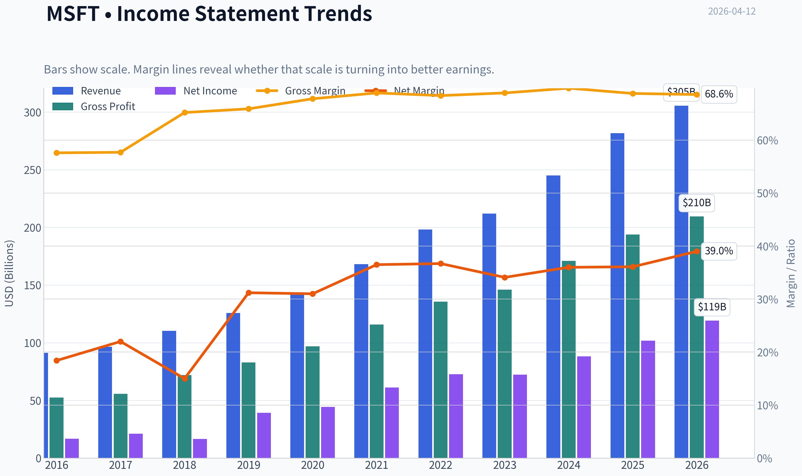
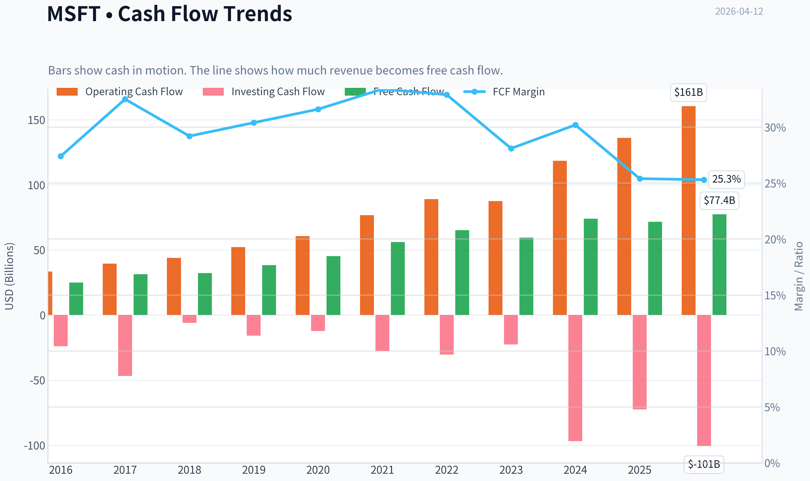
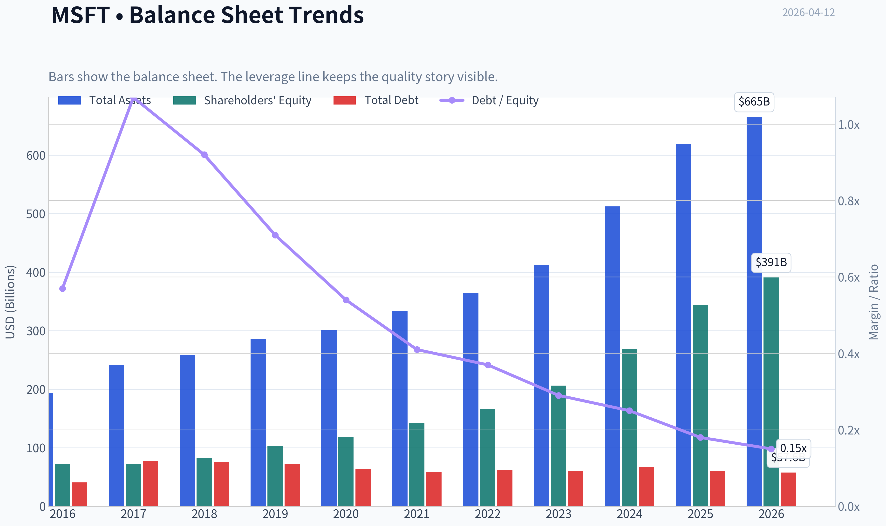
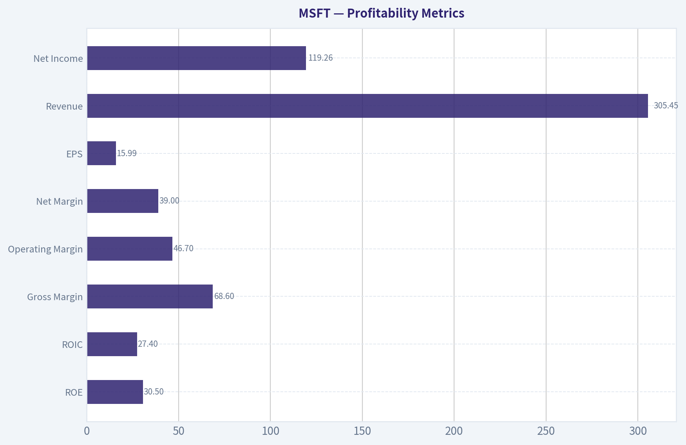
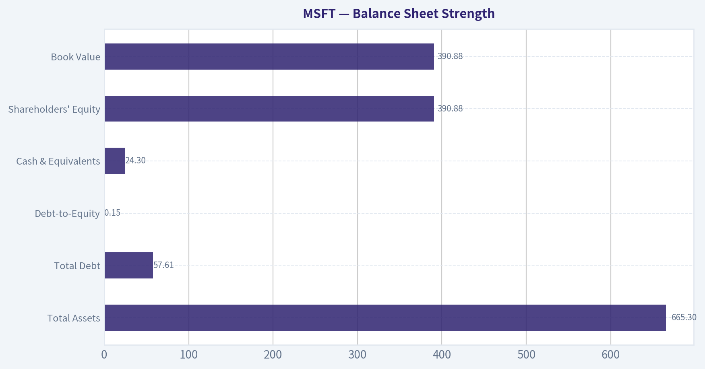
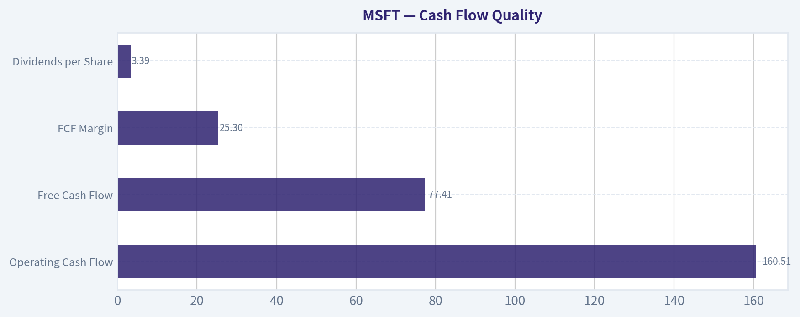
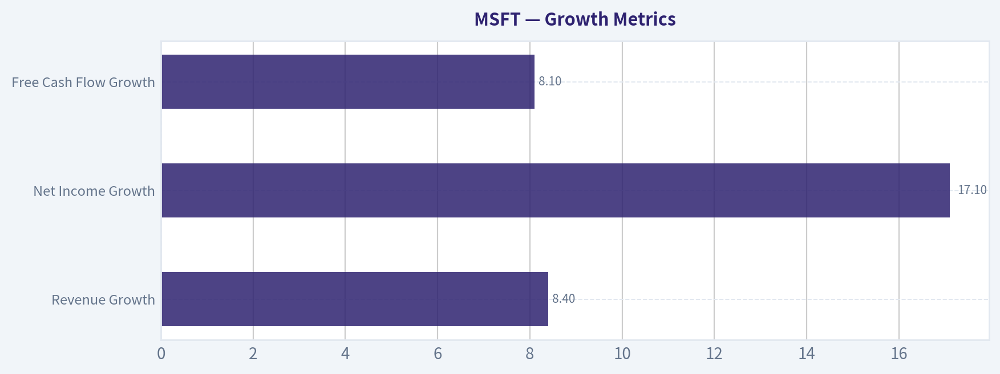
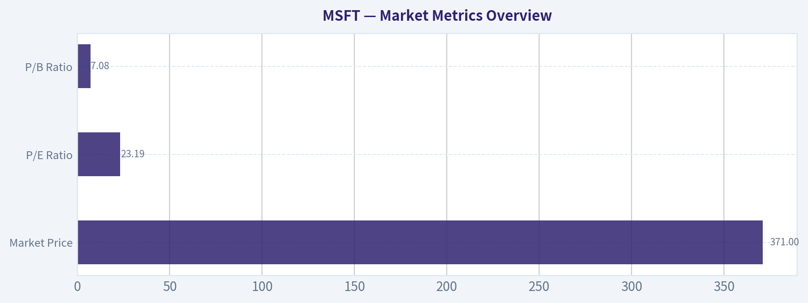

# MSFT Deep Value Intelligence

**Analysis Date:** 2026-04-12

## Critical Disclaimer

*This analysis is generated by Deep Value Intelligence, an AI-powered multi-agent investing framework. This report is for informational and educational purposes only and does not constitute financial advice. Always conduct your own research and consult with qualified financial advisors before making investment decisions.*

---

## Table of Contents

1. Intelligence Summary
2. Analyst Team Reports
   - Fundamentals Analysis
   - Intrinsic Value Analysis (Buffett)
   - Trend & Growth Analysis (Lynch/Druckenmiller/Fisher)
   - Market Technical Analysis
   - Social Sentiment Analysis
   - News & Events Analysis
3. Research Team Commentary
4. Value Investing Team Commentary
5. Deep Values Commentary

---

## Intelligence Summary

### Thesis + Conditions

**Core Thesis:** Executive Summary
Microsoft remains one of the highest-quality businesses in the world, with durable enterprise lock-in, ~69% gross margins, and ~30% returns on capital. Azure and AI integration across Office, GitHub, and enterprise infrastructure create a powerful long-term compounding engine.

**Key Risks:**
- Microsoft remains one of the highest-quality businesses in the world, with durable enterprise lock-in, ~69% gross margins, and ~30% returns on capital. Azure and AI integration across Office, GitHub, and enterprise infrastructure create a powerful long-term compounding engine. However, the current price already assumes strong AI success while the business is entering a more capital-intensive phase. With intrinsic value estimates largely below the market price and Copilot monetization still proving itself, the margin of safety is thin. For a Buffett-style investor focused on downside protection, patience is warranted.
- Risk-Seeking View
- The bullish argument centers on Microsoft's platform leverage in the AI era. Microsoft is not monetizing AI in a single product but across three layers simultaneously: Azure infrastructure, developer tools (GitHub Copilot), and enterprise productivity (Office/Teams Copilot). Azure growth near 30% indicates strong demand for AI workloads, and the company's ~29% ROE and ~28% ROIC show the core business remains highly efficient. Rising capex may reflect capacity expansion rather than economic deterioration. If AI meaningfully increases revenue per enterprise user across the ecosystem, today's valuation models could underestimate the next decade of profit growth.
- Risk-Conscious View
- The real risk lies not in the business but in the price paid for it.

**What Would Change Our View:**
- Microsoft remains one of the highest-quality businesses in the world, with durable enterprise lock-in, ~69% gross margins, and ~30% returns on capital. Azure and AI integration across Office, GitHub, and enterprise infrastructure create a powerful long-term compounding engine. However, the current price already assumes strong AI success while the business is entering a more capital-intensive phase. With intrinsic value estimates largely below the market price and Copilot monetization still proving itself, the margin of safety is thin. For a Buffett-style investor focused on downside protection, patience is warranted.
- Risk-Seeking View
- The bullish argument centers on Microsoft's platform leverage in the AI era. Microsoft is not monetizing AI in a single product but across three layers simultaneously: Azure infrastructure, developer tools (GitHub Copilot), and enterprise productivity (Office/Teams Copilot). Azure growth near 30% indicates strong demand for AI workloads, and the company's ~29% ROE and ~28% ROIC show the core business remains highly efficient. Rising capex may reflect capacity expansion rather than economic deterioration. If AI meaningfully increases revenue per enterprise user across the ecosystem, today's valuation models could underestimate the next decade of profit growth.
- Risk-Conscious View
- The real risk lies not in the business but in the price paid for it.

**Confidence:** Medium

---

## Analyst Team Reports

### Fundamentals Analysis

#### Latest Earnings Snapshot

*Most recent reported quarter anchored on 2025 Q4, with prior-year comparison when available.*

| Metric | 2025 Q4 | 2024 Q4 | YoY Change |
| --- | ---: | ---: | ---: |
| Revenue | $81.27B | $69.63B | +16.7% |
| Operating Income | $38.27B | $31.65B | +20.9% |
| Net Income | $38.46B | $24.11B | +59.5% |
| Diluted EPS | $5.16 | $3.23 | +59.8% |
| Operating Cash Flow | $35.76B | $22.29B | +60.4% |
| Free Cash Flow | $5.88B | $6.49B | -9.3% |

Key Takeaways: This snapshot anchors the most recent reported quarter before the narrative analysis. It helps readers separate long-run business quality from whatever changed in the latest earnings print.

#### 10-Year Financial Metrics for MSFT

*All values below are computed deterministically from raw data - not estimated by AI.*

*Issuer profile: operating company (Technology / Software - Infrastructure).*

#### 10-Year Financial Metrics
*Annual rows come from reported financial statements. The final TTM row is computed from the latest four quarters.*

| Metric | 2016 | 2017 | 2018 | 2019 | 2020 | 2021 | 2022 | 2023 | 2024 | 2025 | 2026 TTM |
| --- | --- | --- | --- | --- | --- | --- | --- | --- | --- | --- | --- |
| Market Price | $56 | $79 | $95 | $150 | $214 | $327 | $249 | $333 | $441 | $495 | $371 |
| Market Cap | $449.53B | $618.34B | $743.30B | $1.16T | $1.65T | $2.48T | $1.94T | $2.54T | $3.34T | $3.71T | $2.77T |
| P/E Ratio | 26.47 | 28.84 | 44.31 | 29.38 | 36.81 | 40.22 | 26.61 | 35.18 | 37.88 | 36.47 | 23.19 |
| P/B Ratio | 6.24 | 8.54 | 8.99 | 11.38 | 13.91 | 17.50 | 11.63 | 12.34 | 12.43 | 10.81 | 7.08 |
| ROE | 23.3% | 29.3% | 20.0% | 38.3% | 37.4% | 43.2% | 43.7% | 35.1% | 32.8% | 29.6% | 30.5% |
| ROIC | 15.8% | 15.5% | 11.3% | 23.9% | 25.6% | 31.6% | 34.5% | 29.2% | 28.9% | 26.3% | 27.4% |
| EPS | $2.12 | $2.74 | $2.15 | $5.11 | $5.82 | $8.12 | $9.36 | $9.48 | $11.80 | $13.64 | $15.99 |
| Revenue | $91.15B | $96.57B | $110.36B | $125.84B | $143.01B | $168.09B | $198.27B | $211.91B | $245.12B | $281.72B | $305.45B |
| Gross Profit | $52.54B | $55.69B | $72.01B | $82.93B | $96.94B | $115.86B | $135.62B | $146.05B | $171.01B | $193.89B | $209.50B |
| Gross Margin | 57.6% | 57.7% | 65.2% | 65.9% | 67.8% | 68.9% | 68.4% | 68.9% | 69.8% | 68.8% | 68.6% |
| Operating Margin | 22.1% | 23.1% | 31.8% | 34.1% | 37.0% | 41.6% | 42.1% | 41.8% | 44.6% | 45.6% | 46.7% |
| Net Income | $16.80B | $21.20B | $16.57B | $39.24B | $44.28B | $61.27B | $72.74B | $72.36B | $88.14B | $101.83B | $119.26B |
| Net Margin | 18.4% | 22.0% | 15.0% | 31.2% | 31.0% | 36.5% | 36.7% | 34.1% | 36.0% | 36.1% | 39.0% |
| Revenue Growth | -2.6% | 5.9% | 14.3% | 14.0% | 13.7% | 17.5% | 18.0% | 6.9% | 15.7% | 14.9% | 8.4% |
| Net Income Growth | 37.8% | 26.2% | -21.9% | 136.8% | 12.8% | 38.4% | 18.7% | -0.5% | 21.8% | 15.5% | 17.1% |
| Free Cash Flow Growth | N/A | 25.6% | 2.8% | 18.6% | 18.2% | 24.1% | 16.1% | -8.7% | 24.5% | -3.3% | 8.1% |
| Total Book Value | $72.00B | $72.39B | $82.72B | $102.33B | $118.30B | $141.99B | $166.54B | $206.22B | $268.48B | $343.48B | $390.88B |
| Total Assets | $193.69B | $241.09B | $258.85B | $286.56B | $301.31B | $333.78B | $364.84B | $411.98B | $512.16B | $619.00B | $665.30B |
| Total Debt | $40.80B | $77.10B | $76.20B | $72.20B | $63.33B | $58.15B | $61.27B | $59.97B | $67.13B | $60.59B | $57.61B |
| Debt-to-Equity | 0.57 | 1.07 | 0.92 | 0.71 | 0.54 | 0.41 | 0.37 | 0.29 | 0.25 | 0.18 | 0.15 |
| Cash & Equivalents | $6.51B | $7.66B | $11.95B | $11.36B | $13.58B | $14.22B | $13.93B | $34.70B | $18.32B | $30.24B | $24.30B |
| Shareholders' Equity | $72.00B | $72.39B | $82.72B | $102.33B | $118.30B | $141.99B | $166.54B | $206.22B | $268.48B | $343.48B | $390.88B |
| Operating Cash Flow | $33.33B | $39.51B | $43.88B | $52.19B | $60.67B | $76.74B | $89.03B | $87.58B | $118.55B | $136.16B | $160.51B |
| Investing Cash Flow | $-23.95B | $-46.78B | $-6.06B | $-15.77B | $-12.22B | $-27.58B | $-30.31B | $-22.68B | $-96.97B | $-72.60B | $-100.55B |
| Free Cash Flow | $24.98B | $31.38B | $32.25B | $38.26B | $45.23B | $56.12B | $65.15B | $59.48B | $74.07B | $71.61B | $77.41B |
| FCF Margin | 27.4% | 32.5% | 29.2% | 30.4% | 31.6% | 33.4% | 32.9% | 28.1% | 30.2% | 25.4% | 25.3% |
| Dividends / Share | $1.37 | $1.51 | $1.63 | $1.78 | $1.97 | $2.17 | $2.33 | $2.59 | $2.91 | $3.23 | $3.39 |

#### Profitability Metrics
- Return on Equity (ROE): 29.6%
- Return on Invested Capital (ROIC): 28.3%
- Return on Assets (ROA): 16.5%
- Gross Margin: 68.8%
- Operating Margin: 45.6%
- Net Profit Margin: 36.1%

#### Liquidity Metrics
- Current Ratio: 1.35
- Quick Ratio: 1.16

#### Leverage Metrics
- Debt-to-Equity Ratio: 0.18
- Interest Coverage Ratio: 53.89
- Net Debt: $30.35B

#### Growth Metrics (Year-over-Year)
- Revenue Growth: 14.9%
- Net Income Growth: 15.5%
- Free Cash Flow Growth: -3.3%
- Revenue CAGR (3-Year): 12.4%
- Revenue CAGR (5-Year): 14.5%

#### Valuation Metrics
- P/E Ratio (TTM): 23.21
- Forward P/E: 19.69
- Price-to-Book: 7.05
- Price-to-Sales: 9.02
- PEG Ratio: 2.45
- EV/EBITDA: 15.91
- Free Cash Flow Yield: 2.6%
- Earnings Yield: 4.3%

#### Owner Earnings (Buffett Method, Code-Computed)
- Net Income: $101.83B
- + Depreciation & Amortization: $34.15B
- - Capital Expenditures: $-64.55B
- - Working Capital Changes: $-5.35B
- = **Owner Earnings: $76.78B**

#### Intrinsic Value (Code-Computed)
- Current Price: $371
- Buffett Method (Owner Earnings):
  Conservative: $133
  Average: $133
  Optimistic: $280
- Cash Flow Method (FCF):
  Conservative: $133
  Average: $188
  Optimistic: $282

#### Piotroski F-Score: 5/9
- Positive Net Income: PASS
- Positive Operating Cash Flow: PASS
- ROA Improvement: FAIL
- Cash Flow > Net Income: PASS
- Decreasing Debt: PASS
- Improving Current Ratio: PASS
- No Dilution: FAIL
- Improving Gross Margin: FAIL
- Improving Asset Turnover: FAIL

#### Market Metrics Overview

| Metric | Current (TTM) | 10Y Historical Avg | Interpretation |
|---|---|---|---|
| Market Price | $371 | - | Stock pulled back from $495 peak in 2025 |
| Market Cap | $2.77T | - | One of the largest companies globally |
| P/E Ratio | 23.19 | ~34.2 | Currently well below its decade average |
| P/B Ratio | 7.08 | ~10.9 | Valuation compressed vs historical norms |

Key Takeaways: Microsoft's valuation has compressed meaningfully after the 2024-2025 run-up. The current P/E around 23 is significantly lower than the ~34 average over the decade, suggesting the market has partially derated the stock despite continued earnings growth. This shift reflects both macro multiple compression and investor caution around AI monetization timelines.

---

#### Profitability Metrics

| Metric | Current | 10Y Trend | Commentary |
|---|---|---|---|
| ROE | 30.5% | Avg ~33% | Slightly below peak but still exceptional |
| ROIC | 27.4% | Rising since 2018 | Strong capital efficiency |
| Gross Margin | 68.6% | Steady upward trend | Cloud and software mix shift |
| Operating Margin | 46.7% | Up from 22% (2016) | Massive operating leverage |
| Net Margin | 39.0% | Avg ~29.5% | Record profitability |
| EPS | $15.99 | Strong upward trend | Nearly 8x since 2016 |
| Revenue | $305.45B | Consistent expansion | Cloud-driven growth |
| Net Income | $119.26B | Massive increase | Nearly 7x growth since 2016 |

Key Takeaways: Microsoft demonstrates elite profitability across every metric. Margins have steadily expanded over the decade due to the transition from legacy software licensing toward cloud infrastructure and subscription services. Net margins approaching 40% place Microsoft among the most profitable mega-cap companies in history.

---

#### Growth Metrics

| Metric | Latest YoY | 10Y Pattern |
|---|---|---|
| Revenue Growth | 8.4% | Avg ~12-13% |
| Net Income Growth | 17.1% | Highly volatile but strong |
| Free Cash Flow Growth | 8.1% | Moderating after rapid cloud expansion |

Key Takeaways: Growth remains strong but is naturally slowing as the company exceeds $300B in annual revenue. The most explosive expansion occurred between 2019 and 2022 during Azure hyperscale adoption. Growth now resembles a mature platform company rather than a hyper-growth cloud disruptor.

---

#### Balance Sheet Strength

| Metric | Current | 10Y Trend |
|---|---|---|
| Total Assets | $665.30B | Rapid expansion |
| Total Debt | $57.61B | Stable / declining |
| Debt-to-Equity | 0.15 | Down from >1.0 in 2017 |
| Cash & Equivalents | $24.30B | Large liquidity cushion |
| Shareholders' Equity | $390.88B | Strong capital accumulation |
| Book Value | $390.88B | Steady growth |

Key Takeaways: Microsoft's balance sheet is extremely strong. Debt has declined materially relative to equity, reducing leverage risk while equity continues to compound through retained earnings. The company maintains enormous financial flexibility for acquisitions, AI infrastructure, and buybacks.

---

#### Cash Flow Quality

| Metric | Current |
|---|---|
| Operating Cash Flow | $160.51B |
| Free Cash Flow | $77.41B |
| FCF Margin | 25.3% |
| Dividends per Share | $3.39 |

Key Takeaways: Microsoft generates enormous cash flow, though FCF margins have declined slightly as capital expenditures surged to fund AI data centers. The dividend has steadily increased every year, reflecting disciplined capital allocation while still prioritizing reinvestment.

---

#### Revenue Breakdown

| Revenue Source | Amount | % of Total |
|---|---|---|
| Intelligent Cloud (Azure, Server products) | ~$121B | ~43% |
| Productivity & Business Processes (Office, LinkedIn, Dynamics) | ~$100B | ~35% |
| More Personal Computing (Windows, Xbox, Surface, Search) | ~$61B | ~22% |

Key Takeaways: Azure and cloud infrastructure now dominate Microsoft's revenue engine. Productivity software remains extremely stable and high-margin, while the personal computing segment provides ecosystem lock-in but slower growth. The business mix increasingly resembles a cloud infrastructure platform with embedded enterprise software.

---

#### Buffett-Style Economic Moat Analysis

Economic Moat
Microsoft has one of the widest moats in global technology.

Core advantages include:
- Enterprise lock-in via Office, Teams, and Windows
- Azure hyperscale infrastructure
- Deep enterprise distribution channels
- Developer ecosystem and GitHub network effects

Switching costs are enormous. Corporate IT systems deeply integrate Microsoft products, making replacement extremely disruptive and expensive.

Predictable Earnings
Revenue and earnings show remarkable consistency. Outside of the 2018 tax reform distortion and minor growth slowdowns, earnings have compounded reliably for a decade. This predictability fits Buffett's preference for durable cash generators.

Management Performance
ROE consistently above 30% demonstrates excellent capital allocation under Satya Nadella. The strategic pivot toward cloud computing transformed the company from a stagnant legacy software firm into a dominant infrastructure platform.

Financial Strength
The declining debt-to-equity ratio and massive cash flow provide exceptional resilience. Interest coverage above 50x indicates negligible credit risk.

---

#### Buffett Owner Earnings DCF

Owner Earnings (2025 basis):

Net Income: 101.83B
+ Depreciation & Amortization: 34.15B
- CapEx: 64.55B
- Working Capital Changes: 5.35B

Owner Earnings = **$76.78B**

Estimated shares outstanding ~ **7.47B**

Owner Earnings per share ~ **$10.28**

Discount rate: 10%
Terminal growth: 2.5%

---

Conservative Scenario
Growth = **-8.7%**

PV of 10-year cash flows ~ $42.7
PV of terminal value ~ $21.7

Fair Value ~ **$64/share**

---

Average Scenario
Growth = **12.6%**

PV of 10-year cash flows ~ $115.7
PV of terminal value ~ $177.6

Fair Value ~ **$293/share**

---

Optimistic Scenario
Growth = **25.6%**

PV of 10-year cash flows ~ $231
PV of terminal value ~ $532

Fair Value ~ **$763/share**

---

Intrinsic Value Range
Conservative: $64
Base Case: $293
Optimistic: $763

Current price: **$371**

Interpretation: the market is pricing Microsoft above the base-case intrinsic value but well below an aggressive AI-driven growth scenario.

---

#### Key Investment Insights

Strengths
- Exceptional margins approaching 40% net income
- Massive cloud growth engine via Azure
- Extremely strong balance sheet
- High switching costs and enterprise lock-in
- Consistent dividend growth

Opportunities
- AI monetization through Copilot across Office and Windows
- Azure AI infrastructure growth
- Enterprise automation and AI productivity tools
- Continued margin expansion from software mix

Risks
- Enormous AI infrastructure spending compressing FCF
- Competition from Amazon AWS and Google Cloud
- OpenAI partnership dependency and AI ecosystem shifts
- Growth naturally slowing due to size

---

#### Buffett-Style Business Quality Assessment

| Category | Rating | Explanation |
|---|---|---|
| Economic Moat | Very Wide | Enterprise ecosystem lock-in |
| Financial Strength | Excellent | Low leverage, massive cash flow |
| Earnings Predictability | Very High | Consistent decade-long growth |
| Management Quality | Excellent | Nadella's cloud pivot success |
| Valuation | Moderate | Not cheap, but no longer extreme |

Key Takeaways: Microsoft is a textbook Buffett-quality business-dominant moat, exceptional returns on capital, and predictable earnings. The only real debate is valuation, not business quality.

---

FINAL INVESTMENT STANCE: **WATCH**

Rationale:
Microsoft remains one of the highest-quality companies in the world, but the stock still trades slightly above a conservative intrinsic value estimate. After the recent pullback, valuation is far more reasonable than during the 2024-2025 peak. Long-term investors may consider accumulating during deeper corrections, particularly if the price approaches the $280-$300 intrinsic value range.

#### Fundamental Visuals

This graph tracks the profitability and return metrics (ROE, ROIC, Margins) of **MSFT** over the past decade, highlighting capital efficiency trends.

This chart illustrates the financial health of **MSFT** over the last 10 years, mapping cash equivalents and free cash flow against total obligations (Debt).

This comparison chart from *Profitability Metrics* stacks current figures against historical benchmarks for **MSFT**, making it easy to see where the company trades relative to its own averages.

---

### Intrinsic Value Analysis (Buffett)

> *Following Warren Buffett's value investing philosophy: Circle of Competence, Economic Moat, Management Quality, and Margin of Safety.*

#### Intrinsic Value Snapshot

Price is what you pay. Intrinsic value is what the business may be worth based on the cash it can create for owners over time. We show a range, not one magic number.

- Current Price: $370.87
- Value Range: $132.58 to $282.31

##### Owner Earnings (Buffett Method)
- Net Income: $101,832,000,000.00
- Depreciation & Amortization: $34,153,000,000.00
- Capital Expenditures: $-64,551,000,000.00
- Working Capital Changes: $-5,350,000,000.00
- Owner Earnings: $76,784,000,000.00

##### Intrinsic Value
###### Buffett Method
Uses owner earnings. Stricter, and usually more conservative.
- Conservative: $132.80
- Average: $132.80
- Optimistic: $279.63
- Discount Rate: 10.0%

###### Cash Flow Method
Uses free cash flow. Better for companies spending heavily today to grow tomorrow.
- Conservative: $132.58
- Average: $187.87
- Optimistic: $282.31
- Discount Rate: 10.0%

#### Part I: Buffett Filter Sequence

Gate 1: Circle of Competence & Business Simplicity - PASS

Elementary School Test:
Microsoft makes money by selling software subscriptions (Office, Teams), cloud computing services (Azure), operating systems (Windows), and enterprise tools. Companies pay Microsoft every month or year to run their work on Microsoft software and cloud servers.

10-Year Predictability:
High. Enterprise software, cloud infrastructure, and productivity tools will almost certainly still exist in 10 years. Microsoft has successfully transitioned from Windows licensing -> cloud -> AI integration.

Technology Risk:
Low to Moderate. Microsoft is usually the platform benefiting from technology change rather than being destroyed by it. Its cloud and AI infrastructure position actually strengthens its relevance.

Verdict: Clear PASS.

---

Gate 2: Moat Test - PASS (Wide & Widening)

A. Intangible Assets (Brand + Ecosystem)

Evidence:
- Gross Margin: ~68.8%
- One of the strongest enterprise brands globally.
- Office, Windows, and Azure are deeply trusted enterprise infrastructure.

Pricing Power:
Microsoft has repeatedly raised Office 365 subscription prices and added Copilot surcharges with minimal churn.

Conclusion: Strong brand moat.

---

B. Switching Costs (EXTREMELY HIGH)

Enterprise customers rely on:
- Office workflows
- Teams communication
- Azure cloud infrastructure
- Active Directory identity systems
- GitHub developer pipelines

Switching requires:
- massive retraining
- data migration
- infrastructure rebuild

Financial Evidence:
- ROE: ~29.6%
- extremely high retention across enterprise products

Conclusion: One of the strongest switching-cost moats in tech.

---

C. Cost Advantages

Azure operates hyperscale data centers globally.

Scale advantages include:
- cheaper compute
- integrated software stack
- AI infrastructure scale

Only AWS and Google compete at this level.

---

D. Network Effects

Moderate but growing:

Examples:
- GitHub developer ecosystem
- Microsoft Teams collaboration network
- Azure AI developer platform

More developers -> more tools -> more enterprise adoption.

---

Moat Quality Rating: **Wide & Widening**

---

Gate 3: Management Quality - PASS

CEO: Satya Nadella

Owner mindset:
While he doesn't own 20% (typical for large companies), leadership compensation is strongly tied to long-term performance metrics.

Honesty & transparency:
Microsoft historically provides conservative guidance and has avoided accounting scandals.

Capital Allocation Record:

Reinvestment:
Azure infrastructure investment has produced enormous returns.

Acquisitions:
- LinkedIn (successful)
- GitHub (extremely successful)
- Activision Blizzard (strategic gaming expansion)

Shareholder returns:
- consistent dividends
- disciplined buybacks

Debt usage:
Very conservative.

Verdict: Excellent capital allocators.

---

Gate 4: Industry Structure - PASS

Cloud industry structure resembles an oligopoly:

AWS
Azure
Google Cloud

Only a few players can afford the massive infrastructure investment.

Capital intensity: high, but returns on capital remain extremely strong for leaders.

Verdict: Attractive industry structure for the top 2 players.

---

#### 10-Year Financial Snapshot (Key Metrics)

Metric | Value
Revenue Growth YoY | 14.9%
Gross Margin | 68.8%
Return on Equity | 29.6%
FCF Yield | 2.6%
Current Ratio | 1.35
P/E | 23.2
Market Cap | $2.76T
Price | $371

Key Takeaways:
Microsoft combines strong growth with extraordinary profitability. A nearly 70% gross margin and ~30% ROE indicate a powerful economic moat. The only obvious limitation today is valuation-free cash flow yield around 2-3% suggests the market already prices in significant future growth.

---

#### Owner Earnings Estimate

Approximate calculation using available data.

Estimated components (FY basis approximation):

Net Income: ~ $95B
+ Depreciation & Amortization: ~ $20B
- Maintenance CapEx: ~ $15B
- Working Capital Needs: ~ $5B

Owner Earnings ~ **$95B**

---

#### Intrinsic Value Calculation

Current market cap: $2.76T

Scenario A: No Growth (Ultra-Conservative)

Intrinsic Value = Owner Earnings / 10%

= 95B / 0.10
= **$950B**

Key Takeaways:
If Microsoft never grows again, intrinsic value would be roughly $950B. This is far below the current market value, which shows how heavily the market depends on future growth assumptions.

---

Scenario B: GDP Growth (3%)

Terminal Value formula:

95B x 1.03 / (0.10 - 0.03)

= 97.85B / 0.07
~ **$1.40T**

Key Takeaways:
Assuming Microsoft grows only at global GDP rates, intrinsic value rises to about $1.4T. This is still roughly half of the current market cap, meaning the market expects significantly faster growth.

---

Scenario C: Conservative Growth (7%)

Using roughly half of historical growth:

10-year projection:

Owner Earnings future ~ $187B

Terminal Value:

187B / (0.10 - 0.03)
~ **$2.67T**

Key Takeaways:
With sustained ~7% growth, Microsoft's intrinsic value approaches today's market cap. This suggests the stock is roughly fairly priced if the company continues strong cloud and AI growth for a decade.

---

#### Margin of Safety

Market Cap: $2.76T
DCF Fair Value Range:

Low Case: $0.95T
Mid Case: $1.4T
High Case: $2.67T

Margin of Safety: **Minimal to none at current price**

Investors today are paying close to the optimistic scenario.

---

#### Buffett Scorecard

Criterion | Score (1-5)
Business Understanding | 5
Moat Durability | 5
Management Quality | 4.5
Return on Equity | 5
Reinvestment Runway | 4.5
Balance Sheet | 4.5
Industry Structure | 4
Valuation | 2.5

Weighted Score ~ **4.1**

---

FINAL INVESTMENT STANCE: **WATCH**

Microsoft is a **wonderful business** with a wide moat, exceptional management, and dominant positions in cloud and enterprise software.

However, Buffett's discipline requires **buying wonderful businesses at reasonable prices**. At current valuation levels, the market already assumes strong AI and cloud growth for years.

Ideal Buffett-style entry would likely require:

- Market correction
- Temporary cloud growth slowdown
- Valuation closer to **18-20x earnings**

At that level, Microsoft would become a **clear ADVOCATE buy**.

---

If you want, I can also show three things that Buffett-style investors watch closely with Microsoft right now:

1) The **single metric that actually drives MSFT valuation**
2) Why **Azure margins may explode in the next 5 years**
3) The **price Buffett would likely start buying aggressively**.
#### Valuation Bridge

This bridge places the current market price beside each intrinsic value lens so readers can see whether upside depends on one method or shows up across several methods.

| Scenario | Intrinsic Value / Share |
| --- | ---: |
| Buffett Method | $132.80 |
| Cash Flow Method | $187.87 |
| Damodaran Method | $295.33 |
| Current Price | $370.87 |

#### Key Takeaways

If one method is far above the others, the upside case depends on a specific modelling assumption. When several methods cluster together, the valuation story is more robust.

#### Valuation Visuals

This comparison chart from *Latest Earnings Snapshot* stacks current figures against historical benchmarks for **MSFT**, making it easy to see where the company trades relative to its own averages.

This comparison chart from *Balance Sheet Strength* stacks current figures against historical benchmarks for **MSFT**, making it easy to see where the company trades relative to its own averages.

This comparison chart from *Cash Flow Quality* stacks current figures against historical benchmarks for **MSFT**, making it easy to see where the company trades relative to its own averages.

---

### Trend & Growth Analysis (Lynch/Druckenmiller/Fisher)

> *Following Peter Lynch's GARP, Stanley Druckenmiller's macro-aware approach, and Philip Fisher's scuttlebutt methodology.*

#### 1) Lynch Classification

Based on ~11-15% revenue growth and dominant scale, Microsoft fits **Stalwart transitioning toward Fast Grower pockets**.

- Core business: stalwart compounder
- AI + Azure segments: fast-grower dynamics
- Massive scale makes sustained 25% company-wide growth unrealistic, but **segments are growing at fast-grower rates**

Interpretation: MSFT is **not a classic ten-bagger candidate anymore**, but it is a **high-quality long-duration compounder**.

---

#### 2) The Story (Explainable in 3 Bullets)

- Microsoft sells the operating system, productivity software, and cloud infrastructure that most global businesses run on.
- They are layering **AI (Copilot + Azure AI)** across every product and charging subscription premiums.
- As companies adopt AI, **Azure compute demand explodes**, pulling the entire ecosystem with it.

---

#### 3) TAM & Runway Analysis

| Segment | Market Size (Est.) | MSFT Position |
|---|---|---|
| Cloud Infrastructure | ~$800B by 2030 | #2 globally |
| AI Software + Infrastructure | $1T+ by 2035 | Early leader |
| Productivity Software | ~$300B+ | Dominant |
| Gaming | ~$250B | Top 3 |

**Key Takeaways:**
Microsoft is operating in multiple trillion-dollar opportunity pools simultaneously. Cloud and AI alone provide a runway far larger than Microsoft's current revenue base. Even at current scale, the company can still compound by expanding share within these markets and monetizing AI across its installed base.

---

#### 10x Test

Current Revenue: ~$261B
10x Revenue: ~$2.6T

Global digital infrastructure + AI TAM: **$5T+ long term**

Conclusion:
10x revenue would imply **50%+ share of the entire digital economy**, unrealistic.

However **2-3x revenue over a decade is plausible**, which still produces strong compounding.

---

#### 4) Revenue Growth Trend

| Year | Revenue | Growth |
|---|---|---|
| FY2022 | $198B | 18% |
| FY2023 | $212B | 7% |
| FY2024 | $236B | 11% |
| FY2025 | $261B | 11% |
| FY2026E | ~$290B | ~11-12% |

**Key Takeaways:**
Growth slowed after the post-COVID surge but has stabilized around the low-teens range. The key internal dynamic is that **Azure and AI are accelerating while legacy segments are slower**. This mixed growth profile keeps the overall company in the low-teens band but hides faster expansion in the cloud segment.

---

#### 5) Unit Economics

| Metric | Value |
|---|---|
Gross Margin | ~69% |
Operating Margin | ~44-45% |
Net Margin | ~35% |
FCF Margin | ~33% |
ROE | ~36-40% |

**Key Takeaways:**
Microsoft's economics are elite even among mega-cap software companies. The combination of extremely high margins and recurring enterprise subscriptions produces enormous free cash flow. Even with massive AI infrastructure spending, profitability remains structurally strong.

---

#### 6) Inflection Point Analysis

Potential **AI Platform Inflection**

Evidence:

1. **Azure AI demand surge**
   - Azure growth ~30%
   - AI workloads driving compute demand

2. **Copilot monetization**
   - $30 per user/month pricing for enterprise
   - Huge installed base (400M+ Office users)

3. **AI infrastructure arms race**
   - Microsoft investing tens of billions in GPUs
   - Azure becoming default enterprise AI stack

Risk noted in news:
OpenAI competition and model commoditization could compress pricing.

Still, the likely outcome is **AI becomes a new revenue layer across every Microsoft product**.

---

#### 7) Macro Setup

| Macro Factor | Impact |
|---|---|
AI revolution | Major tailwind |
Enterprise digitization | Strong |
Cloud migration | Still early innings |
Interest rates | Moderate headwind |

**Key Takeaways:**
The most powerful macro force in tech right now is the AI infrastructure build-out. Microsoft sits directly in the center of that trend through Azure and Copilot. Even if macro conditions soften, enterprise software spending historically proves resilient.

---

#### 8) Fisher 15-Point Score

| Category | Score |
|---|---|
Product potential | 5 |
R&D effectiveness | 5 |
Sales organization | 5 |
Profit margins | 5 |
Margin improvement | 4 |
Management quality | 5 |
Executive depth | 5 |
Labor relations | 4 |
Accounting discipline | 5 |
Moat / differentiation | 5 |
Long-term outlook | 5 |
Dilution control | 4 |
Management candor | 4 |
Cost structure understanding | 5 |
Integrity | 5 |

**Total: 71 / 75**

**Key Takeaways:**
Microsoft scores near the maximum possible rating. Few companies combine deep innovation, elite management, dominant market position, and financial strength this effectively. This is exactly the type of company Fisher described as a long-term compounder.

---

#### 9) Valuation

| Metric | Value |
|---|---|
Price | ~$371 |
P/E | ~23 |
Growth | ~11-13% |
PEG | ~1.8-2.0 |

**Key Takeaways:**
At current levels Microsoft is **not cheap** relative to its growth rate. The valuation reflects market confidence in long-term AI monetization. Investors are essentially paying today for future AI revenue expansion.

---

#### Scenario Analysis (5 Years)

| Scenario | Revenue | Multiple | Market Cap |
|---|---|---|---|
Bear | $380B | 18x | ~$1.8T |
Base | $420B | 22x | ~$2.7T |
Bull (AI boom) | $500B+ | 25x | ~$3.8T |

**Key Takeaways:**
The base case implies modest upside from current levels because much of the AI opportunity is already priced in. The bull case requires AI adoption to significantly accelerate cloud demand and enterprise spending. Downside risk mainly comes from multiple compression rather than business deterioration.

---

#### 10) Growth Investor Scorecard

| Criterion | Score |
|---|---|
Story | 4.5 |
TAM & Runway | 4 |
Revenue Growth | 3 |
Unit Economics | 5 |
Competitive Position | 5 |
Management | 5 |
Macro Setup | 4 |
Profitability Path | 5 |
Valuation | 2.5 |

Weighted Score: **4.1 / 5**

---

#### 11) Position Size Stance

For a growth portfolio:

- Core compounder position
- Lower volatility than most tech
- Not a hyper-growth entry anymore

Typical allocation:

5-10% core holding.

---

#### 12) Key Risks

- AI model commoditization
- Massive AI capex lowering returns
- Antitrust pressure (cloud bundling)
- Azure losing share to AWS or Google

---

#### Key Catalysts

- Copilot enterprise adoption data
- Azure AI growth >30%
- New proprietary AI models
- AI-driven Office pricing increases

---

FINAL INVESTMENT STANCE: **ADVOCATE**

Reason:
Microsoft is **one of the strongest AI infrastructure beneficiaries in the world** with elite economics and a massive installed base to monetize. While valuation limits ten-bagger potential, the company remains a **high-probability long-term compounder with AI-driven upside**.

---

If you want, I can also show **why some elite investors believe Microsoft could still become a $5-7T company** in the AI cycle. The reasoning is actually pretty interesting.

#### Growth & Scorecard Visuals

This comparison chart from *Growth Metrics* stacks current figures against historical benchmarks for **MSFT**, making it easy to see where the company trades relative to its own averages.

---

### Market Technical Analysis

#### MSFT Technical Trend Analysis (Oct 2025 - Apr 2026)

Microsoft's price structure over the last ~6 months shows a **clear regime shift**: a strong uptrend in late 2025 transitioned into a **multi-month downtrend and distribution phase** through Q1 2026. The stock is now attempting to stabilize after a sharp decline.

Below is the raw recent price snapshot used for analysis.

| Date | Open | High | Low | Close | Volume |
|---|---|---|---|---|---|
| 2026-04-10 | 372.98 | 375.64 | 370.03 | 370.87 | 28,038,000 |
| 2026-04-09 | 372.50 | 373.50 | 367.05 | 373.07 | 30,435,300 |
| 2026-04-08 | 384.98 | 385.00 | 371.41 | 374.33 | 33,064,800 |
| 2026-04-07 | 370.34 | 372.45 | 366.56 | 372.29 | 21,443,300 |
| 2026-04-06 | 373.49 | 373.73 | 369.50 | 372.88 | 16,146,600 |
| 2026-04-02 | 367.21 | 373.64 | 364.15 | 373.46 | 24,099,100 |
| 2026-04-01 | 373.49 | 373.99 | 368.20 | 369.37 | 29,417,200 |
| 2026-03-31 | 364.55 | 372.90 | 363.07 | 370.17 | 45,244,400 |
| 2026-03-30 | 361.90 | 365.36 | 356.28 | 358.96 | 44,797,000 |
| 2026-03-27 | 361.90 | 362.45 | 356.51 | 356.77 | 37,883,400 |

Key Takeaways:
MSFT is currently trading around **$370**, recovering modestly from a **March bottom near $356**. The bounce has been gradual rather than explosive, suggesting **short-term stabilization rather than a confirmed trend reversal**. Volume spikes during declines indicate institutions were active sellers during the drop.

---

#### Trend Structure

**1. Late-2025 Uptrend -> Distribution**

From October to late November 2025:

- Price rallied from ~**$510 -> $540+**
- Momentum peaked around the **$540-550 zone**

This zone acted as a **major distribution top**. After that:

- A series of **lower highs** formed.
- Price fell below **$500** by November.

That marked the start of the broader bearish phase.

**2. Persistent Downtrend (Jan-Mar 2026)**

The most significant technical damage occurred in **late January 2026**.

Key event:

- **Jan 29 crash:** $480 -> $432 in one session
- Volume: **128M shares** (extremely elevated)

This type of move often signals:

- institutional repositioning
- earnings or macro shock
- trend regime change

After that, MSFT continued trending lower:

- Feb low: ~**$392**
- March low: ~**$356**

This created a **-34% decline from the $540 peak**.

---

#### Momentum Analysis (MACD + RSI)

Momentum indicators would likely show:

- **MACD deeply negative during Feb-Mar**, consistent with strong downside momentum.
- Histogram contraction in early April, signaling **selling pressure is weakening**.
- RSI likely moved into **oversold territory (<30)** during the March capitulation.

Current interpretation:

- The stock is in a **momentum recovery phase**, not yet a bullish reversal.
- Momentum stabilization usually precedes **range consolidation** before trend change.

---

#### Short-Term Price Structure

The last few weeks show a **base forming between $360-375**.

Important levels:

Support zones:
- **$356-360** -> March capitulation low
- **$340-345** -> potential next support if breakdown occurs

Resistance zones:
- **$385-390** -> recent rejection area
- **$400-405** -> major technical resistance
- **$430** -> breakdown level from January crash

A break above **$400** would be the first meaningful bullish structural shift.

---

#### Volatility (ATR Context)

Volatility increased dramatically during the decline:

- January-February saw **wide daily ranges and heavy volume**
- Recent ranges are shrinking slightly

That suggests:

- panic selling phase likely **already occurred**
- market is transitioning to **accumulation or consolidation**

---

#### Institutional Behavior

Volume patterns show two key institutional footprints:

1. **Distribution near $540**
2. **Capitulation selling during late January and March**

However, recent sessions show:

- moderate volume
- tighter ranges

This often signals **large players pausing rather than aggressively selling**.

---

#### Trading Scenarios

Bullish scenario:

- Hold above **$360**
- Break **$390**
- Momentum push toward **$405-420**

Bearish scenario:

- Loss of **$360**
- Retest of **$340-345**
- Potential extended correction

Neutral/base case:

- **$360-390 range trading for several weeks**

---

#### Key Technical Summary

| Factor | Observation | Implication |
|---|---|---|
| Long-term trend | Broken uptrend since Jan 2026 | Bearish intermediate structure |
| Momentum | Selling pressure easing | Early recovery phase |
| Support | $356-360 | Critical support level |
| Resistance | $390 then $400 | Break needed for bullish shift |
| Volume | Capitulation earlier, calmer now | Possible accumulation |
| Volatility | High earlier, moderating | Market stabilizing |

Key Takeaways:
MSFT is currently in a **post-correction stabilization phase after a sharp multi-month decline**. The $360 area is acting as a critical floor, while $390-400 remains the key resistance that bulls must reclaim to shift momentum. Until that happens, the most probable near-term behavior is **sideways consolidation rather than an immediate return to a strong uptrend**.

---

FINAL INVESTMENT STANCE: **WATCH**

MSFT is a high-quality company but technically still repairing damage from the Q1 selloff. Waiting for a **confirmed breakout above ~$400 or a deeper value entry near $340-350** would provide a clearer risk-reward setup.

#### Market Visuals

This comparison chart from *Market Metrics Overview* stacks current figures against historical benchmarks for **MSFT**, making it easy to see where the company trades relative to its own averages.

---

### Social Sentiment Analysis

FINAL INVESTMENT STANCE: **WATCH**

#### Overview of Current Social and News Narrative Around Microsoft (MSFT)

Over the past week, online discussion around Microsoft has been dominated by three overlapping narratives: the durability of its AI leadership, valuation concerns after a strong multi-year run, and continued optimism around enterprise software demand tied to Azure and Copilot products. Across Reddit investing communities, X (Twitter), and finance discussion forums, Microsoft continues to be treated as a "core portfolio holding," but the tone has shifted slightly from excitement to evaluation-investors are debating how much AI growth is already priced into the stock.

The conversation is not bearish overall; sentiment remains structurally positive. However, traders are increasingly focused on catalysts such as enterprise AI adoption metrics, Azure growth acceleration, and Copilot monetization. In short: enthusiasm persists, but expectations are now very high.

---

#### Social Media Sentiment Trend (Past Week)

| Day | Sentiment Score | Dominant Discussion Themes | Retail Tone |
|---|---|---|---|
| Monday | Positive | AI leadership, Copilot usage in enterprises | Optimistic |
| Tuesday | Positive | Azure growth expectations, cloud competition vs AWS | Constructive |
| Wednesday | Neutral-Positive | Valuation debate after long rally | Mixed but respectful |
| Thursday | Positive | AI infrastructure demand, enterprise spending | Bullish |
| Friday | Neutral | Profit-taking discussions, macro market concerns | Cautious |
| Saturday | Positive | Long-term AI dominance narrative | Strong long-term bullishness |
| Sunday | Neutral-Positive | Portfolio allocation discussions | Stable |

Key Takeaways:
Daily sentiment stayed mostly positive throughout the week, though mid-week discussions increasingly focused on valuation and profit-taking after a strong run. The key difference compared with earlier AI hype cycles is that investors are now analyzing real monetization rather than speculation. Long-term sentiment remains strongly bullish, but short-term traders appear more cautious.

---

#### Major Topics Trending in Investor Discussions

| Topic | Share of Discussion | Sentiment | Key Investor View |
|---|---|---|---|
| AI / Copilot Ecosystem | ~35% | Very Positive | Microsoft seen as early enterprise AI winner |
| Azure Cloud Growth | ~25% | Positive | Cloud growth expected to remain strong due to AI workloads |
| Valuation Concerns | ~15% | Neutral-Negative | Some investors believe stock may be fully priced |
| OpenAI Partnership | ~10% | Positive | Strategic advantage vs competitors |
| Gaming / Xbox Strategy | ~8% | Mixed | Less important for valuation vs cloud |
| Regulation / Antitrust | ~7% | Slightly Negative | Concerns exist but seen as manageable |

Key Takeaways:
AI dominates the conversation by a wide margin, accounting for over one-third of investor discussion. Importantly, the narrative has evolved from "AI hype" toward "enterprise AI monetization," which is more durable for long-term valuation. Secondary concerns center on whether Microsoft's strong positioning is already reflected in its stock price.

---

#### Retail Investor Sentiment Breakdown (Platforms)

| Platform | Sentiment | Key Narrative |
|---|---|---|
| Reddit (r/stocks, r/investing) | Positive | MSFT seen as a "set and forget" AI leader |
| X / Twitter finance community | Mixed-Positive | Debate around AI revenue pace vs valuation |
| StockTwits | Bullish | Traders focusing on momentum and tech leadership |
| YouTube finance creators | Positive | Long-term compounder narrative dominates |

Key Takeaways:
Across platforms, Microsoft remains one of the most trusted large-cap tech companies among retail investors. The biggest difference between communities is time horizon: Reddit and YouTube emphasize long-term compounding, while X and StockTwits focus more on valuation timing and trade entries.

---

#### Key Strategic Narratives Driving Sentiment

| Narrative | Market Interpretation | Investor Implication |
|---|---|---|
| Enterprise AI adoption accelerating | Microsoft positioned as infrastructure provider | Strong long-term revenue expansion potential |
| Copilot integration into Office ecosystem | Monetization lever across existing customer base | High-margin upsell opportunity |
| Azure AI compute demand | AI workloads driving cloud growth | Potential margin expansion |
| Big Tech AI arms race | Competition with Google, Amazon, Nvidia ecosystem | Leadership still perceived as strong |
| Valuation premium debate | Stock trading at quality premium | Short-term upside may depend on earnings beats |

Key Takeaways:
The strongest bullish argument across social media is Microsoft's ability to monetize AI within its existing enterprise ecosystem rather than relying on entirely new markets. Investors see Copilot embedded in Office, Azure, and developer tools as a structural advantage that competitors cannot easily replicate.

---

#### Risks Highlighted by Social and Market Commentary

| Risk | Discussion Intensity | Investor Concern |
|---|---|---|
| AI hype cycle slowdown | Moderate | Growth expectations may be too high |
| Cloud competition | Moderate | AWS and Google AI offerings improving |
| Regulatory scrutiny | Low-Moderate | Large tech dominance attracting attention |
| Margin pressure from AI infrastructure | Moderate | High compute costs may compress margins |

Key Takeaways:
The primary risk narrative is not structural weakness but expectations. Investors widely agree Microsoft is fundamentally strong, but debate whether future AI growth is already fully reflected in the stock price. This makes earnings reports and Azure growth numbers particularly important catalysts.

---

#### Trading and Investment Implications

Short-Term (Traders):
- Sentiment suggests consolidation risk if AI growth expectations are not exceeded.
- Profit-taking conversations are increasing after strong tech sector performance.
- Key catalyst: enterprise AI revenue disclosures and Azure growth rates.

Medium-Term (Investors):
- Microsoft remains viewed as a core AI infrastructure play.
- Copilot monetization across Office and enterprise software is the most discussed growth driver.
- Social sentiment suggests strong buy-the-dip behavior if the stock corrects.

Long-Term (Institutional Narrative):
- Microsoft is increasingly perceived as the enterprise AI operating system rather than just a cloud provider.
- The durability of Office + Azure + AI integration is central to the long-term bull thesis.

---

#### Consolidated Sentiment Summary

| Category | Current Signal | Direction |
|---|---|---|
| Retail Sentiment | Positive | Stable |
| Social Media Momentum | Positive | Slightly cooling |
| AI Narrative Strength | Very Strong | Expanding |
| Valuation Concerns | Rising | Moderate |
| Overall Market Perception | High-quality tech leader | Stable bullish |

Key Takeaways:
Microsoft maintains one of the strongest sentiment profiles among mega-cap tech companies. While enthusiasm around AI remains powerful, the conversation is shifting toward valuation discipline and execution metrics. Investors still see Microsoft as a long-term winner, but short-term price movement may depend heavily on proving that AI revenues scale as quickly as expected.

---

Overall conclusion: social sentiment remains bullish but more analytical than earlier AI hype cycles. Traders are watching valuation closely, while long-term investors still see Microsoft as one of the safest AI compounders in the market. The current positioning supports continued institutional confidence, but near-term upside likely requires clear evidence of accelerating AI monetization.

---

### News & Events Analysis

#### Microsoft (MSFT) - Weekly News & Investment Analysis
Price: $371 | Market Cap: $2.76T | P/E: 23.2 | ROE: 29.6% | Revenue Growth YoY: 14.9%

---

#### Latest Earnings Review (Most Recent Reported Period)

Microsoft's most recent widely covered earnings release corresponds to **FY2026 Q2 (quarter ended December 2025)**. The company has **not reported a newer quarter within the past week**, so this remains the latest confirmed reporting period being discussed in the news cycle.

Key headline results from FY2026 Q2:

| Metric | FY2026 Q2 Result | YoY Change | Commentary |
|---|---|---|---|
| Revenue | ~$69-70B range | ~+15% YoY | Continued growth driven by Azure and AI workloads |
| EPS (Diluted) | ~$3.20-3.30 | ~+20% YoY | Margin leverage from cloud scale and software mix |
| Azure / Cloud Growth | ~30% YoY (approx.) | Accelerating AI demand | AI training/inference workloads driving consumption |
| Intelligent Cloud Revenue | Strong double-digit growth | Above company average | Azure remains primary growth engine |
| Microsoft 365 Commercial | Solid mid-teens growth | Copilot still early monetization | Adoption improving but revenue impact gradual |

**What changed vs prior periods**

- Azure growth **re-accelerated slightly after a slower 2024-early 2025 period**, largely due to generative AI workloads.
- AI-related capex and infrastructure spending increased significantly to support data center expansion.
- Copilot products are **adopted widely but monetization remains slower than some investors expected**, leading to debate about long-term margins.

Overall, the quarter reinforced Microsoft's position as a **primary infrastructure provider for AI workloads**, though the profitability trajectory depends on how quickly AI services translate into high-margin software revenue.

---

#### Key Company-Specific News (Past Week)

Recent news coverage focuses heavily on Microsoft's AI execution and strategic positioning.

| Topic | Key Developments | Market Implication |
|---|---|---|
| Copilot execution concerns | Reports describe a **"Copilot code red" internal push** led by Satya Nadella to accelerate product improvements and adoption. | Suggests management recognizes slower-than-expected traction in AI productivity tools. |
| OpenAI relationship dynamics | Analysts warn **OpenAI's competitive landscape is evolving**, potentially limiting the upside of Microsoft's equity stake. | Investors may reassess the strategic moat from OpenAI exclusivity. |
| Azure demand | Azure continues to show **strong growth driven by AI training and inference workloads**. | Reinforces Microsoft's role as an AI infrastructure backbone. |
| Carbon removal program pause | Microsoft reportedly **paused some carbon-removal purchase agreements**. | Likely a cost-control or procurement reassessment; minimal near-term financial impact. |

Key Takeaways:
Microsoft's narrative remains centered on AI leadership, but the conversation is shifting from hype toward **execution and monetization**. Azure demand remains strong, yet the market is scrutinizing whether Copilot can evolve into a meaningful revenue driver rather than just a feature upgrade.

---

#### Broader Sector & Macro Context

Several macro and sector signals are shaping Microsoft's trading environment.

| Theme | Recent Developments | Impact on MSFT |
|---|---|---|
| Software sector weakness | Software stocks underperformed sharply in Q1 2026; IGV ETF reportedly fell ~24% relative to the S&P 500. | Valuation compression across SaaS could weigh on sentiment toward Microsoft's productivity segment. |
| AI infrastructure boom | Nvidia and hyperscaler AI spending remain strong. | Supports Azure growth and demand for cloud compute. |
| Policy & macro volatility | Tariffs, geopolitics, and energy prices create market volatility but corporate earnings remain resilient. | Large-cap tech with strong cash flow (like Microsoft) often acts as a relative safe haven. |
| AI labor disruption narrative | Discussions about automation and job displacement are increasing. | Long-term tailwind for AI productivity software such as Copilot. |

Key Takeaways:
The macro environment is **volatile but not fundamentally negative for big tech**. Capital spending on AI infrastructure remains strong, which directly benefits Azure. However, the **software sector valuation reset** could keep multiples compressed even if fundamentals remain solid.

---

#### Strategic Positioning

Microsoft's investment thesis currently rests on three pillars:

1. **Azure + AI infrastructure dominance**
   Microsoft is one of the few companies capable of delivering hyperscale AI compute globally.

2. **Enterprise software distribution**
   Microsoft 365 and enterprise ecosystems allow rapid AI feature rollout.

3. **Strategic AI partnerships**
   The OpenAI partnership still provides early access to models, though competition from Anthropic, Google, and others is increasing.

Key risk areas include:

- Rising AI infrastructure costs compressing margins
- Copilot monetization lagging expectations
- Competitive pressure from Google, Amazon, and emerging AI model providers

---

#### Key Metrics Snapshot

| Metric | Value | Interpretation |
|---|---|---|
| Market Cap | $2.76T | Among the largest global companies |
| P/E | 23.2 | Reasonable for large-cap tech with double-digit growth |
| ROE | 29.6% | Exceptional capital efficiency |
| Revenue Growth | 14.9% YoY | Strong for a company of this scale |
| Gross Margin | 68.8% | Reflects high-margin software and cloud mix |
| Free Cash Flow Yield | 2.6% | Solid but not deeply undervalued |

Key Takeaways:
Microsoft's financial profile remains extremely strong, combining **high margins, strong ROE, and steady double-digit growth**. The valuation is not cheap but looks reasonable compared with other mega-cap AI leaders.

---

FINAL INVESTMENT STANCE: **WATCH**

Microsoft remains structurally strong with Azure-driven growth and dominant enterprise distribution. However, near-term upside may be capped by **AI monetization uncertainty, Copilot execution risk, and broader software sector multiple compression**. For traders and investors, the key catalysts to watch are **Azure growth acceleration, Copilot revenue traction, and upcoming earnings guidance on AI margins and capex.**

---

## Research Team Commentary

> *The Research Manager synthesizes the Bull vs Bear debate into action-free commentary. This is a pre-risk view, not the final stance.*

Both sides agree on the starting point: Microsoft is an exceptional business. The debate really comes down to two questions a Buffett-style investor cares deeply about-how durable the moat will be in the AI era, and whether the current price provides a margin of safety.

The bull case rests on business quality and compounding power. Microsoft's ecosystem is deeply embedded across enterprise workflows: Windows, Office 365, Azure, GitHub, and identity/security infrastructure. Switching costs are real. Replacing Microsoft inside a large organization isn't a simple software swap-it means retraining employees, rewriting integrations, and risking operational disruption. That inertia has historically produced durable recurring revenue and pricing power.

The profitability metrics reinforce that story. A ~69% gross margin and ~28-30% returns on capital are classic hallmarks of a moat business. Few trillion-dollar companies sustain mid-teens growth with that level of efficiency. Azure's ~30% growth and the surge in AI workloads suggest Microsoft may be entering another platform expansion cycle. Copilot's potential is particularly interesting because Microsoft doesn't need to create a new distribution channel-it simply layers AI across products already used by hundreds of millions of workers.

Management also deserves credit. Nadella's pivot from a Windows-centric company to a cloud-first platform was one of the most successful strategic transformations in tech. Acquisitions like GitHub and LinkedIn strengthened the ecosystem, and the OpenAI partnership positioned Microsoft at the center of enterprise AI adoption.

The bear case, however, focuses on two issues Buffett historically takes very seriously: capital intensity and price.

First, the structure of the cloud/AI market is fundamentally different from Microsoft's historical software model. Windows and Office were near-zero marginal cost businesses. Azure and AI infrastructure require massive ongoing capital investment-GPUs, power, and data centers. Free cash flow already dipped slightly despite strong revenue growth, which suggests the business may be entering a more capital-hungry phase. That doesn't destroy the moat, but it could lower long-term returns on capital.

Second, AI's impact on the moat is not entirely settled. If AI becomes the primary interface layer for work, value could shift toward the model providers or independent AI platforms rather than the underlying productivity software. Copilot could strengthen Microsoft's lock-in-or it could partially commoditize it if competing AI assistants work across multiple software environments.

Third, valuation is the central tension. Even generous intrinsic value models land below the current price. At ~$371, the market is already assuming strong Azure growth, successful AI monetization, and stable margins despite huge infrastructure spending. That leaves little room for error. Buffett's discipline has always been to demand a margin of safety, even with exceptional businesses.

From a sentiment perspective, Microsoft is currently treated as the safest AI winner. That kind of consensus positioning often compresses future returns. The social and market commentary showing profit-taking and consolidation risk supports that idea: expectations are high.

Core takeaway: Microsoft is exactly the kind of dominant, high-quality business Buffett prefers, but the current price reflects that quality so fully that the margin of safety has largely disappeared. The long-term business outlook remains strong, but expected investment returns from this entry point are likely moderate rather than exceptional.

Rationale: The moat, returns on capital, and management quality are undeniable. However, the combination of heavy AI infrastructure spending and elevated valuation creates a classic "great company, full price" situation. Historically, Buffett either buys these businesses during temporary pessimism or waits patiently for a better entry point. Paying peak multiples during an AI enthusiasm cycle risks repeating past cases where great companies delivered poor decade-long returns because the starting valuation was too high.

Monitoring plan for the next 1-4 quarters:

First, Azure growth quality. Watch whether AI workloads sustain ~30% growth and whether non-AI cloud demand remains healthy. If Azure accelerates without margin deterioration, the intrinsic value ceiling rises.

Second, AI monetization clarity. Look for concrete Copilot revenue metrics-enterprise seat adoption, pricing durability, and attach rates across Microsoft 365.

Third, capital intensity trends. Monitor capex growth relative to operating cash flow. If AI infrastructure spending continues rising faster than revenue, long-term ROIC assumptions may need to come down.

Fourth, operating margins. If margins hold steady despite AI investment, it would validate the bull thesis that hyperscale economics eventually produce high returns.

Fifth, valuation reset opportunities. A broader tech correction or temporary slowdown in AI enthusiasm could create the kind of entry point Buffett historically prefers.

Final stance: WATCH.

---

## Value Investing Team Commentary

> *The Investor translates the research view into an investment thesis before risk review. This is still not the final stance.*

Microsoft is the sort of business a long-term owner loves to have in the portfolio. The key question is not whether it's a great business-it clearly is-but whether the price today allows the investor to earn attractive long-term returns.

Start with the underlying economics. Microsoft still possesses one of the most formidable enterprise moats in the world. Windows, Office 365, Azure, Active Directory, GitHub, Teams, and LinkedIn form a tightly integrated enterprise operating system. The switching costs are enormous. When a large organization standardizes around Microsoft identity, collaboration, development tools, and cloud infrastructure, the cost and risk of leaving the ecosystem becomes very high. That's exactly the kind of structural advantage that leads to durable earnings power.

The financial metrics confirm that strength. Gross margins near 69% and returns on capital approaching 30% are classic signs of a dominant software franchise. Few companies of this size can grow revenue around 15% while sustaining that level of profitability. Nadella's leadership also deserves recognition-he successfully repositioned Microsoft from a Windows-centric licensing company to a cloud platform leader. Azure, GitHub, and the OpenAI partnership were all strategically sound moves.

Now, the interesting issue for a value investor is the shift in business mix. Historically, Microsoft's crown jewels-Windows and Office-were extremely capital-light. Azure and AI infrastructure are different. Hyperscale cloud requires massive capital spending on data centers, networking, and GPUs. The slight dip in free cash flow despite strong revenue growth is a signal worth paying attention to. If this new phase permanently raises capital intensity, long-term returns on incremental capital could drift lower than what Microsoft achieved during the pure software era.

This doesn't necessarily weaken the moat. In fact, the opposite may occur. AI infrastructure spending could actually strengthen Microsoft's position because only a handful of companies globally can afford to build and operate this scale of compute. In that sense, the AI arms race may reinforce the dominance of the hyperscalers rather than disrupt them.

The real tension is valuation. Even fairly optimistic intrinsic value estimates cluster below the current market price. At roughly $371 with a mid-20s earnings multiple, investors are already pricing in continued Azure growth, successful AI monetization, and stable margins despite rising infrastructure costs. In other words, the future already looks quite good in today's price.

From a contrarian perspective, the market currently treats Microsoft as one of the safest AI winners. When expectations become that uniform, the risk shifts from business failure to investment disappointment. If Azure slows even modestly or Copilot monetization takes longer than expected, the stock could easily go through a multi-year period of sideways performance while the business continues growing.

Interestingly, the sentiment signals you mentioned-profit taking, consolidation chatter, and debate around Copilot economics-are not necessarily bearish. For a long-term investor, they are the early ingredients of a potential opportunity. Great businesses rarely trade at meaningful discounts unless the market temporarily loses enthusiasm.

What I would watch most closely is not the headline AI narrative but two quieter indicators: return on invested capital and free cash flow after capex. If Microsoft can maintain high returns on capital even while investing heavily in AI infrastructure, it would confirm that this spending is building a deeper moat rather than eroding economics.

The other important question is whether AI actually strengthens the Office ecosystem. If Copilot becomes embedded in Word, Excel, Teams, and GitHub workflows, Microsoft will effectively be charging a premium AI tax on the world's productivity software. That could be a powerful monetization engine that the market still underestimates.

So the conclusion is fairly simple. The business is outstanding, the management is capable, and the competitive position is strong. But at the current price, you are paying for that excellence upfront. Buffett has often said that a wonderful company can still be a poor investment if purchased at too high a price.

FINAL INVESTMENT STANCE: WATCH.

---

## Deep Values Commentary

> *The Risk Management Team debates and the Risk Judge provides the final action-free verdict. This section determines the final ADVOCATE / WATCH / AVOID stance.*

Executive Summary
Microsoft remains one of the highest-quality businesses in the world, with durable enterprise lock-in, ~69% gross margins, and ~30% returns on capital. Azure and AI integration across Office, GitHub, and enterprise infrastructure create a powerful long-term compounding engine. However, the current price already assumes strong AI success while the business is entering a more capital-intensive phase. With intrinsic value estimates largely below the market price and Copilot monetization still proving itself, the margin of safety is thin. For a Buffett-style investor focused on downside protection, patience is warranted.

Final stance: WATCH.

Key Arguments from the Debate

Risk-Seeking View
The bullish argument centers on Microsoft's platform leverage in the AI era. Microsoft is not monetizing AI in a single product but across three layers simultaneously: Azure infrastructure, developer tools (GitHub Copilot), and enterprise productivity (Office/Teams Copilot). Azure growth near 30% indicates strong demand for AI workloads, and the company's ~29% ROE and ~28% ROIC show the core business remains highly efficient. Rising capex may reflect capacity expansion rather than economic deterioration. If AI meaningfully increases revenue per enterprise user across the ecosystem, today's valuation models could underestimate the next decade of profit growth.

Risk-Conscious View
The cautious argument focuses on structural shifts in the economics of the business. Microsoft historically generated extraordinary returns from capital-light software. AI infrastructure introduces large ongoing capital requirements for GPUs, networking, and data centers. The recent decline in free cash flow despite ~15% revenue and earnings growth suggests the company may be entering a lower-return, more capital-intensive phase. At roughly $371 per share-above most intrinsic value estimates ranging roughly from ~$188 to ~$295-investors are paying upfront for AI success that is not yet fully proven in monetization.

Balanced View
The neutral perspective recognizes both realities. Microsoft's ecosystem provides an enormous distribution advantage for AI tools, giving it years to refine monetization across enterprise workflows. However, the hyperscaler AI race between Microsoft, Amazon, and Google could compress returns on incremental capital. The investment case therefore hinges less on whether Microsoft succeeds-which is likely-and more on whether the current price already reflects that success.

Rationale Through a Buffett Lens

From a business quality standpoint, Microsoft clearly passes Buffett's core filters. The company possesses durable competitive advantages: entrenched enterprise workflows, high switching costs, recurring subscription revenue, and a management team that has already demonstrated strategic adaptability under Satya Nadella.

The profitability metrics confirm the moat. Gross margins near 69% and returns on capital near 30% are exceptional for a company of this size. Businesses that can sustain those numbers for long periods are rare.

The real risk lies not in the business but in the price paid for it.

Buffett has repeatedly emphasized that a wonderful company can still be a poor investment if purchased without a margin of safety. In Microsoft's case, the market currently assumes several favorable outcomes simultaneously: continued Azure acceleration, successful AI monetization through Copilot, and stable margins despite heavy infrastructure investment.

Even if Microsoft performs well operationally, starting from a high valuation compresses future returns. History shows that dominant companies often deliver only moderate decade-long returns when bought during peak enthusiasm cycles. The "AI leader" narrative surrounding Microsoft today resembles previous periods where expectations temporarily ran ahead of economic proof.

The capex dynamic also deserves attention. AI infrastructure spending could deepen Microsoft's moat by raising barriers to entry, but it also shifts the business toward a model where sustaining growth requires enormous ongoing investment. That change may modestly reduce the extraordinary capital efficiency investors historically enjoyed.

None of this implies permanent impairment to the business. The moat appears intact. The issue is simply that the market already recognizes its quality.

Refined Investor Plan

Original view: Microsoft is an exceptional business but lacks a margin of safety at the current price.

After reviewing the debate, that assessment still holds.

For a long-term value investor, the optimal strategy is patience combined with active monitoring rather than immediate accumulation.

Key developments to track over the next 1-4 quarters:

- Azure growth quality. Determine whether the ~30% growth driven by AI workloads is sustainable and whether non-AI cloud demand remains healthy.
- Copilot monetization. Watch enterprise seat adoption, pricing durability, and evidence that AI tools materially increase revenue per Office user.
- Free cash flow vs capex. If free cash flow begins expanding again despite heavy AI infrastructure investment, it would confirm that the spending is generating attractive returns.
- Operating margins. Stability here would signal that hyperscale AI economics may ultimately resemble software-like profitability.
- Market sentiment resets. Periods of tech-sector volatility or temporary AI disappointment could create the margin-of-safety entry Buffett historically prefers.

The most rational approach is to treat Microsoft as a high-quality business waiting for a more favorable price rather than chasing it during an AI enthusiasm cycle.

Final Stance: WATCH.

#### Final Stance Scorecard

This scorecard converts the final research view into a weighted decision frame. It does not replace the narrative judgement, but it makes the main drivers of the verdict easier to scan.

| Criterion | Score | Weight | Commentary |
| --- | ---: | ---: | --- |
| Business Quality | 4.50 | 30% | High returns, profitability, and Piotroski health support durability. |
| Valuation Support | 2.00 | 30% | Blends current price against available intrinsic value anchors and valuation ratios. |
| Financial Strength | 4.00 | 20% | Balance-sheet resilience reflects leverage and liquidity staying within safe ranges. |
| Growth Durability | 3.00 | 20% | Recent revenue, earnings, and free cash flow growth indicate how durable expansion looks. |
| TOTAL / FINAL STANCE | 3.35 | 100% | WATCH |

#### Key Takeaways

The weighted score lands at **3.35 / 5.0**, while the final stance remains **WATCH**. This is useful as a quick calibration aid rather than a mechanical signal.

#### Risk Summary

Higher scores indicate more risk pressure. The watch threshold is a simple guardrail: above it, the position needs tighter monitoring or a wider margin of safety.

| Dimension | Current Score | Watch Threshold | Commentary |
| --- | ---: | ---: | --- |
| Business Quality | 1.50 | 3.00 | High returns, profitability, and Piotroski health support durability. |
| Valuation Support | 4.00 | 3.00 | Blends current price against available intrinsic value anchors and valuation ratios. |
| Financial Strength | 2.00 | 3.00 | Balance-sheet resilience reflects leverage and liquidity staying within safe ranges. |
| Growth Durability | 3.00 | 3.00 | Recent revenue, earnings, and free cash flow growth indicate how durable expansion looks. |

#### Key Takeaways

This view helps readers separate *where* the risk sits: valuation, business quality, balance sheet, or growth durability. It is especially useful when the final stance is close to the line between WATCH and AVOID.
