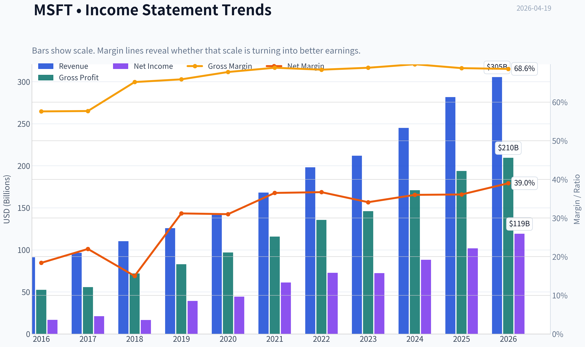
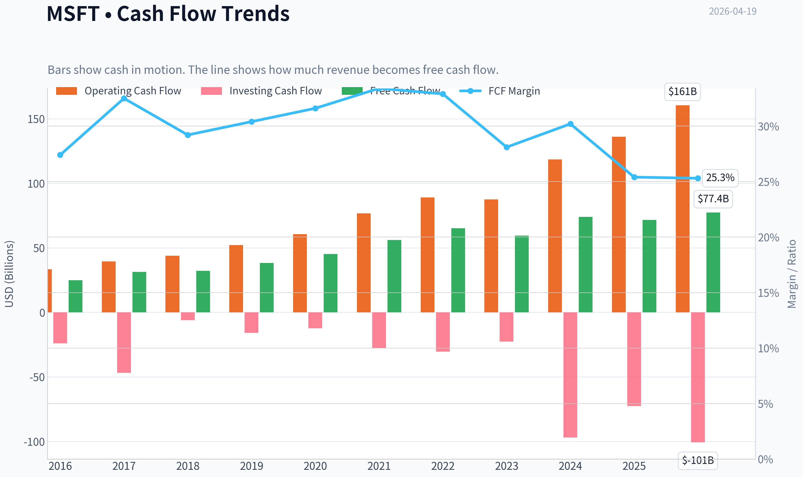
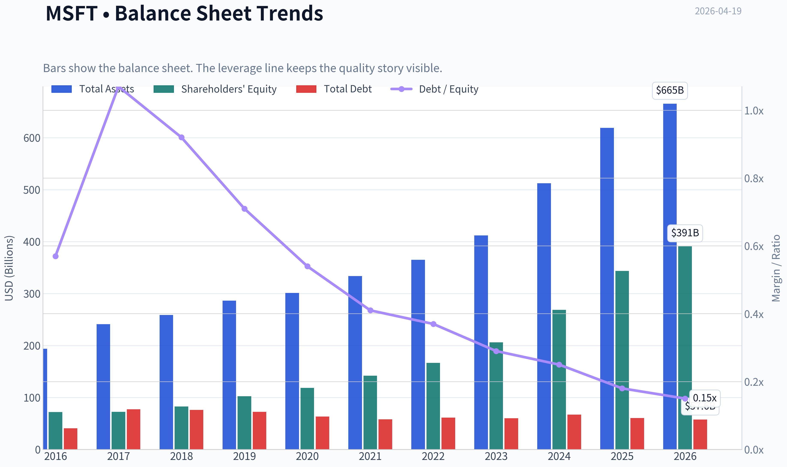
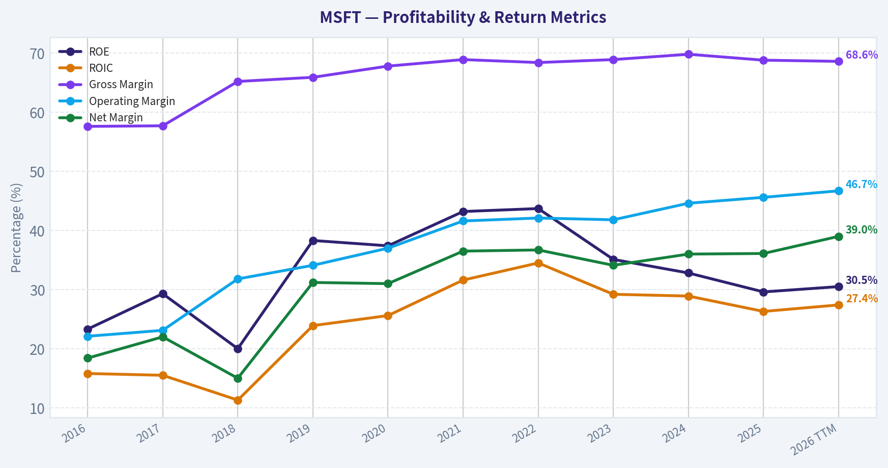
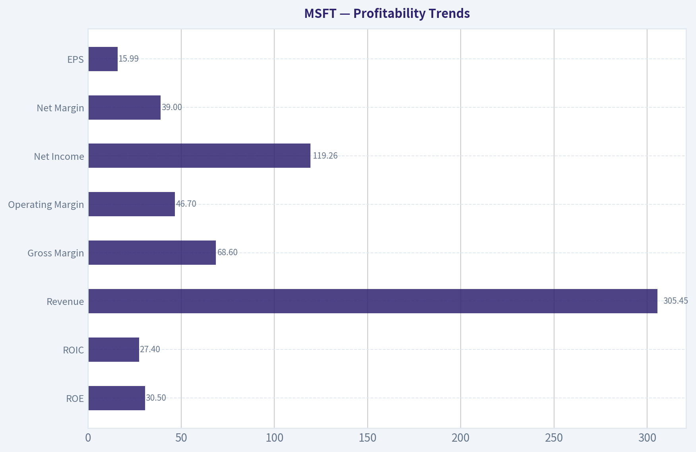
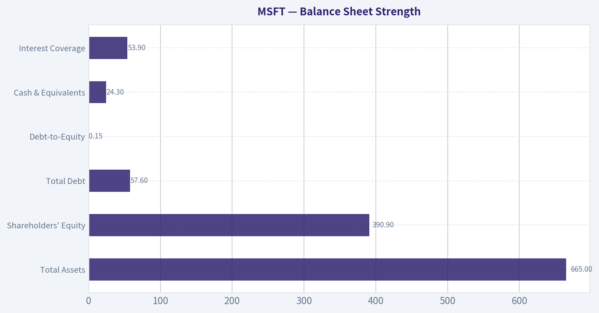
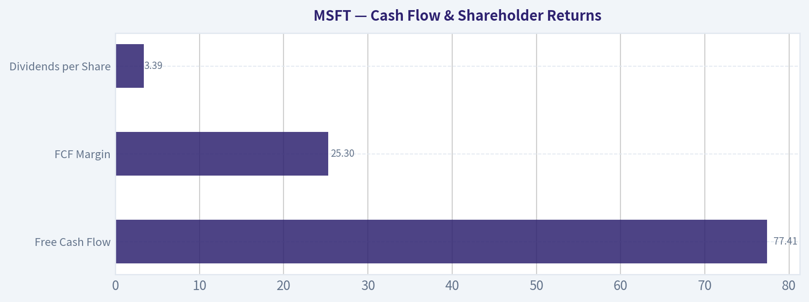
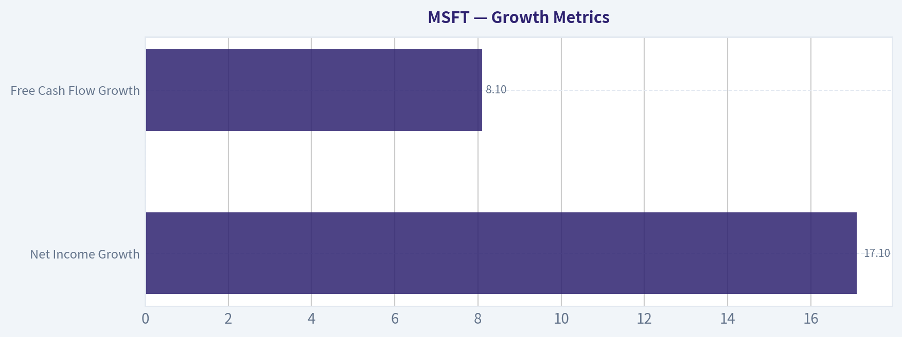
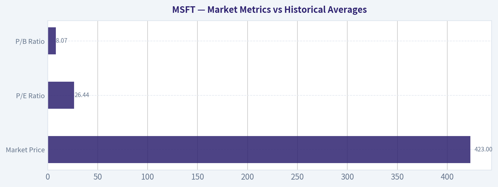

# MSFT Deep Value Intelligence

**Analysis Date:** 2026-04-19

## Critical Disclaimer

*This analysis is generated by Deep Value Intelligence, an AI-powered multi-agent investing framework. This report is for informational and educational purposes only and does not constitute financial advice. Always conduct your own research and consult with qualified financial advisors before making investment decisions.*

---

## Table of Contents

1. Intelligence Summary
2. Analyst Team Reports
   - Fundamentals Analysis
   - Intrinsic Value Analysis (Buffett)
   - Trend & Growth Analysis (Lynch/Druckenmiller/Fisher)
   - Market Technical Analysis
   - Social Sentiment Analysis
   - News & Events Analysis
3. Research Team Commentary
4. Value Investing Team Commentary
5. Deep Values Commentary

---

## Intelligence Summary

### Thesis + Conditions

**Core Thesis:** Executive Summary
Microsoft is a world-class business with one of the strongest enterprise moats ever built. Profitability, ecosystem lock-in, and management execution remain exceptional.

**Key Risks:**
- Microsoft is a world-class business with one of the strongest enterprise moats ever built. Profitability, ecosystem lock-in, and management execution remain exceptional. However, the current price already reflects significant optimism about AI monetization while free cash flow is temporarily weakening due to heavy infrastructure spending. For a Buffett-style investor focused on margin of safety, the issue is not business quality but entry price. The most rational stance is patience: monitor AI economics and capital intensity while waiting for either stronger cash flow proof or a better valuation.
- Risky Analyst (Bullish Emphasis)
- Consensus AI optimism increases expectation risk.
- Gradual exposure or patient monitoring is more rational than aggressive buying or avoidance.
- Risk Management Commentary (Buffett Framework)

**What Would Change Our View:**
- Microsoft is a world-class business with one of the strongest enterprise moats ever built. Profitability, ecosystem lock-in, and management execution remain exceptional. However, the current price already reflects significant optimism about AI monetization while free cash flow is temporarily weakening due to heavy infrastructure spending. For a Buffett-style investor focused on margin of safety, the issue is not business quality but entry price. The most rational stance is patience: monitor AI economics and capital intensity while waiting for either stronger cash flow proof or a better valuation.
- Risky Analyst (Bullish Emphasis)
- Consensus AI optimism increases expectation risk.
- Gradual exposure or patient monitoring is more rational than aggressive buying or avoidance.
- Risk Management Commentary (Buffett Framework)

**Confidence:** Low

---

## Analyst Team Reports

### Fundamentals Analysis

#### Latest Earnings Snapshot

*Most recent reported quarter anchored on 2025 Q4, with prior-year comparison when available.*

| Metric | 2025 Q4 | 2024 Q4 | YoY Change |
| --- | ---: | ---: | ---: |
| Revenue | $81.27B | $69.63B | +16.7% |
| Operating Income | $38.27B | $31.65B | +20.9% |
| Net Income | $38.46B | $24.11B | +59.5% |
| Diluted EPS | $5.16 | $3.23 | +59.8% |
| Operating Cash Flow | $35.76B | $22.29B | +60.4% |
| Free Cash Flow | $5.88B | $6.49B | -9.3% |

Key Takeaways: This snapshot anchors the most recent reported quarter before the narrative analysis. It helps readers separate long-run business quality from whatever changed in the latest earnings print.

#### 10-Year Financial Metrics for MSFT

*All values below are computed deterministically from raw data - not estimated by AI.*

*Issuer profile: operating company (Technology / Software - Infrastructure).*

#### 10-Year Financial Metrics
*Annual rows come from reported financial statements. The final TTM row is computed from the latest four quarters.*

| Metric | 2016 | 2017 | 2018 | 2019 | 2020 | 2021 | 2022 | 2023 | 2024 | 2025 | 2026 TTM |
| --- | --- | --- | --- | --- | --- | --- | --- | --- | --- | --- | --- |
| Market Price | $56 | $79 | $95 | $150 | $214 | $327 | $249 | $333 | $441 | $495 | $423 |
| Market Cap | $449.53B | $618.34B | $743.30B | $1.16T | $1.65T | $2.48T | $1.94T | $2.54T | $3.34T | $3.71T | $3.15T |
| P/E Ratio | 26.47 | 28.84 | 44.31 | 29.38 | 36.81 | 40.22 | 26.61 | 35.18 | 37.88 | 36.47 | 26.44 |
| P/B Ratio | 6.24 | 8.54 | 8.99 | 11.38 | 13.91 | 17.50 | 11.63 | 12.34 | 12.43 | 10.81 | 8.07 |
| ROE | 23.3% | 29.3% | 20.0% | 38.3% | 37.4% | 43.2% | 43.7% | 35.1% | 32.8% | 29.6% | 30.5% |
| ROIC | 15.8% | 15.5% | 11.3% | 23.9% | 25.6% | 31.6% | 34.5% | 29.2% | 28.9% | 26.3% | 27.4% |
| EPS | $2.12 | $2.74 | $2.15 | $5.11 | $5.82 | $8.12 | $9.36 | $9.48 | $11.80 | $13.64 | $15.99 |
| Revenue | $91.15B | $96.57B | $110.36B | $125.84B | $143.01B | $168.09B | $198.27B | $211.91B | $245.12B | $281.72B | $305.45B |
| Gross Profit | $52.54B | $55.69B | $72.01B | $82.93B | $96.94B | $115.86B | $135.62B | $146.05B | $171.01B | $193.89B | $209.50B |
| Gross Margin | 57.6% | 57.7% | 65.2% | 65.9% | 67.8% | 68.9% | 68.4% | 68.9% | 69.8% | 68.8% | 68.6% |
| Operating Margin | 22.1% | 23.1% | 31.8% | 34.1% | 37.0% | 41.6% | 42.1% | 41.8% | 44.6% | 45.6% | 46.7% |
| Net Income | $16.80B | $21.20B | $16.57B | $39.24B | $44.28B | $61.27B | $72.74B | $72.36B | $88.14B | $101.83B | $119.26B |
| Net Margin | 18.4% | 22.0% | 15.0% | 31.2% | 31.0% | 36.5% | 36.7% | 34.1% | 36.0% | 36.1% | 39.0% |
| Revenue Growth | -2.6% | 5.9% | 14.3% | 14.0% | 13.7% | 17.5% | 18.0% | 6.9% | 15.7% | 14.9% | 8.4% |
| Net Income Growth | 37.8% | 26.2% | -21.9% | 136.8% | 12.8% | 38.4% | 18.7% | -0.5% | 21.8% | 15.5% | 17.1% |
| Free Cash Flow Growth | N/A | 25.6% | 2.8% | 18.6% | 18.2% | 24.1% | 16.1% | -8.7% | 24.5% | -3.3% | 8.1% |
| Total Book Value | $72.00B | $72.39B | $82.72B | $102.33B | $118.30B | $141.99B | $166.54B | $206.22B | $268.48B | $343.48B | $390.88B |
| Total Assets | $193.69B | $241.09B | $258.85B | $286.56B | $301.31B | $333.78B | $364.84B | $411.98B | $512.16B | $619.00B | $665.30B |
| Total Debt | $40.80B | $77.10B | $76.20B | $72.20B | $63.33B | $58.15B | $61.27B | $59.97B | $67.13B | $60.59B | $57.61B |
| Debt-to-Equity | 0.57 | 1.07 | 0.92 | 0.71 | 0.54 | 0.41 | 0.37 | 0.29 | 0.25 | 0.18 | 0.15 |
| Cash & Equivalents | $6.51B | $7.66B | $11.95B | $11.36B | $13.58B | $14.22B | $13.93B | $34.70B | $18.32B | $30.24B | $24.30B |
| Shareholders' Equity | $72.00B | $72.39B | $82.72B | $102.33B | $118.30B | $141.99B | $166.54B | $206.22B | $268.48B | $343.48B | $390.88B |
| Operating Cash Flow | $33.33B | $39.51B | $43.88B | $52.19B | $60.67B | $76.74B | $89.03B | $87.58B | $118.55B | $136.16B | $160.51B |
| Investing Cash Flow | $-23.95B | $-46.78B | $-6.06B | $-15.77B | $-12.22B | $-27.58B | $-30.31B | $-22.68B | $-96.97B | $-72.60B | $-100.55B |
| Free Cash Flow | $24.98B | $31.38B | $32.25B | $38.26B | $45.23B | $56.12B | $65.15B | $59.48B | $74.07B | $71.61B | $77.41B |
| FCF Margin | 27.4% | 32.5% | 29.2% | 30.4% | 31.6% | 33.4% | 32.9% | 28.1% | 30.2% | 25.4% | 25.3% |
| Dividends / Share | $1.37 | $1.51 | $1.63 | $1.78 | $1.97 | $2.17 | $2.33 | $2.59 | $2.91 | $3.23 | $3.39 |

#### Profitability Metrics
- Return on Equity (ROE): 29.6%
- Return on Invested Capital (ROIC): 28.3%
- Return on Assets (ROA): 16.5%
- Gross Margin: 68.8%
- Operating Margin: 45.6%
- Net Profit Margin: 36.1%

#### Liquidity Metrics
- Current Ratio: 1.35
- Quick Ratio: 1.16

#### Leverage Metrics
- Debt-to-Equity Ratio: 0.18
- Interest Coverage Ratio: 53.89
- Net Debt: $30.35B

#### Growth Metrics (Year-over-Year)
- Revenue Growth: 14.9%
- Net Income Growth: 15.5%
- Free Cash Flow Growth: -3.3%
- Revenue CAGR (3-Year): 12.4%
- Revenue CAGR (5-Year): 14.5%

#### Valuation Metrics
- P/E Ratio (TTM): 26.46
- Forward P/E: 22.36
- Price-to-Book: 8.04
- Price-to-Sales: 10.29
- PEG Ratio: 1.33
- EV/EBITDA: 18.11
- Free Cash Flow Yield: 2.3%
- Earnings Yield: 3.8%

#### Owner Earnings (Buffett Method, Code-Computed)
- Net Income: $101.83B
- + Depreciation & Amortization: $34.15B
- - Capital Expenditures: $-64.55B
- - Working Capital Changes: $-5.35B
- = **Owner Earnings: $76.78B**

#### Intrinsic Value (Code-Computed)
- Current Price: $423
- Buffett Method (Owner Earnings):
  Conservative: $133
  Average: $133
  Optimistic: $280
- Cash Flow Method (FCF):
  Conservative: $133
  Average: $188
  Optimistic: $282

#### Piotroski F-Score: 5/9
- Positive Net Income: PASS
- Positive Operating Cash Flow: PASS
- ROA Improvement: FAIL
- Cash Flow > Net Income: PASS
- Decreasing Debt: PASS
- Improving Current Ratio: PASS
- No Dilution: FAIL
- Improving Gross Margin: FAIL
- Improving Asset Turnover: FAIL

#### Market Metrics vs Historical Averages

| Metric | Current (TTM) | 10Y Historical Average (Approx) | Interpretation |
|---|---|---|---|
| Market Price | $423 | Trend rising over decade | Near recent highs but below 2025 peak ($495) |
| Market Cap | $3.15T | Steady expansion from $450B | One of the largest firms globally |
| P/E Ratio | 26.44 | ~34 | Valuation below historical premium |
| P/B Ratio | 8.07 | ~11.5 | Lowest multiple in many years |

Key Takeaways:
Microsoft's valuation multiples have compressed significantly compared with its decade average even while the company has grown much larger and more profitable. The current P/E around 26 is meaningfully lower than the typical mid-30s level the market has historically paid. That suggests the stock is cheaper relative to its own history despite strong fundamentals.

---

#### Profitability Trends

| Metric | Current (TTM) | 10Y Trend | Interpretation |
|---|---|---|---|
| ROE | 30.5% | Avg ~32% | Consistently elite capital returns |
| ROIC | 27.4% | Avg ~25% | High efficiency deploying capital |
| Revenue | $305.45B | Up from $91B (2016) | >3x growth |
| Gross Margin | 68.6% | Rising from ~58% | Software + cloud mix shift |
| Operating Margin | 46.7% | Up from 22% | Major operating leverage |
| Net Income | $119.26B | Up from $16.8B | ~7x increase |
| Net Margin | 39.0% | Avg ~30% | Extremely high profitability |
| EPS | $15.99 | Up from $2.12 | Massive shareholder value growth |

Key Takeaways:
Microsoft has transformed into one of the most profitable large companies ever measured. Margins expanded dramatically as Azure and enterprise software scaled, pushing operating margins close to 47%. Returns on capital above 25% across the decade strongly indicate a durable competitive advantage.

---

#### Growth Metrics

| Metric | Current | Historical Pattern |
|---|---|---|
| Revenue Growth | 8.4% (TTM) | Avg ~12-13% |
| Net Income Growth | 17.1% | Strong double-digit long term |
| Free Cash Flow Growth | 8.1% | Cyclical but positive long term |

Key Takeaways:
Growth has slowed slightly from the rapid cloud expansion phase but remains strong for a company already generating over $300B in revenue. Earnings are still compounding faster than revenue due to margin expansion and operating leverage. Free cash flow growth has become more volatile recently due to heavy AI infrastructure investment.

---

#### Balance Sheet Strength

| Metric | Current (TTM) | 10Y Trend |
|---|---|---|
| Total Assets | $665B | Massive expansion |
| Shareholders' Equity | $390.9B | More than 5x increase |
| Total Debt | $57.6B | Gradually declining |
| Debt-to-Equity | 0.15 | Down from 1.07 peak |
| Cash & Equivalents | $24.3B | Large liquidity |
| Interest Coverage | 53.9x | Extremely safe |

Key Takeaways:
Microsoft's balance sheet is fortress-like. Debt has steadily fallen relative to equity while profits exploded, resulting in one of the safest capital structures among mega-caps. With enormous cash generation and minimal leverage, the company has huge flexibility for buybacks, acquisitions, and AI infrastructure spending.

---

#### Cash Flow & Shareholder Returns

| Metric | Current | Historical Trend |
|---|---|---|
| Free Cash Flow | $77.41B | Up from $24.98B |
| FCF Margin | 25.3% | Avg ~29% |
| Dividends per Share | $3.39 | Steady yearly increases |

Key Takeaways:
Microsoft generates extraordinary cash flows, though margins have dipped slightly due to aggressive data center and AI investments. Even so, nearly $80B in annual free cash flow allows the company to fund innovation while returning significant capital to shareholders via dividends and buybacks.

---

#### Revenue Breakdown

| Revenue Source | Amount | % of Total |
|---|---|---|
| Intelligent Cloud (Azure, server products) | ~$121B | ~43% |
| Productivity & Business Processes (Office, LinkedIn, Dynamics) | ~$88B | ~31% |
| More Personal Computing (Windows, Xbox, devices, search) | ~$73B | ~26% |

Key Takeaways:
Microsoft is now primarily a cloud and enterprise software company. Azure and other cloud services represent the largest revenue driver and the main engine of growth. The diversification across enterprise software, cloud infrastructure, and consumer platforms makes revenue streams highly resilient.

---

#### Buffett-Style Business Quality Assessment

Economic Moat
Microsoft has one of the strongest moats in the world:

- Enterprise software lock-in (Windows, Office, Active Directory)
- Azure hyperscale cloud infrastructure
- Developer ecosystem (GitHub, Visual Studio)
- AI distribution through Copilot across the Microsoft stack

The integration across enterprise productivity, cloud computing, and AI creates extremely high switching costs.

Predictable Earnings
The last decade shows extraordinary consistency:

- Revenue tripled
- Net income increased ~7x
- Margins steadily expanded

Even during macro downturns, Microsoft continued to grow due to subscription software and cloud contracts.

Management Performance
Under Satya Nadella:

- ROIC improved dramatically
- Cloud became the core growth engine
- Capital allocation prioritized high-margin recurring businesses

Dividend growth and buybacks have been disciplined while still investing aggressively in AI.

Financial Strength
Debt-to-equity falling from 1.07 to 0.15 while profits soared is exactly what Buffett prefers. Microsoft's balance sheet is among the strongest globally.

---

#### Buffett-Style Owner Earnings DCF

Owner Earnings (current):
76.78B

Estimated shares outstanding:
~7.45B shares (derived from market cap / price)

Discount rate: 10%
Terminal growth: 2.5%
Projection horizon: 10 years

Historical FCF growth used as proxy for Owner Earnings growth:

Lowest growth: -8.7%
Average growth: ~12.6%
Highest growth: 25.6%

---

##### Conservative Scenario
Growth = -8.7%

PV of 10-year cash flows ~ $322B
PV of terminal value ~ $158B

Total intrinsic value ~ $480B

Intrinsic value per share ~ **$64**

---

##### Average Scenario
Growth = 12.6%

PV of 10-year cash flows ~ $898B
PV of terminal value ~ $1.32T

Total intrinsic value ~ $2.22T

Intrinsic value per share ~ **$298**

---

##### Optimistic Scenario
Growth = 25.6%

PV of 10-year cash flows ~ $1.72T
PV of terminal value ~ $4.01T

Total intrinsic value ~ $5.73T

Intrinsic value per share ~ **$769**

---

#### Key Investment Insights

Strengths

- Elite margins approaching 40% net profit
- Extremely high ROIC and ROE for a company of this size
- Azure + AI integration creating a new growth wave
- Fortress balance sheet with minimal leverage
- Massive cash generation supporting dividends and buybacks

Opportunities

- AI copilots integrated into Office and Windows
- Azure AI infrastructure demand surge
- Enterprise automation using generative AI
- Industrial partnerships (manufacturing AI deployments)

Red Flags

- FCF margin compression due to massive AI capex
- Valuation still expensive on FCF yield (2.3%)
- Competition from Amazon AWS and Google Cloud in AI infrastructure
- Growth inevitably slowing as revenue base exceeds $300B

---

#### Buffett Perspective

Buffett typically favors:

- Durable competitive advantage
- High returns on capital
- Predictable earnings
- Conservative balance sheet

Microsoft checks every box except the classic "cheap price" requirement.

The current valuation is reasonable relative to its history but not deeply discounted relative to intrinsic value unless strong AI-driven growth persists.

---

FINAL INVESTMENT STANCE: **WATCH**

Rationale:
Microsoft is one of the highest-quality businesses ever created with exceptional profitability, massive competitive moats, and strong AI positioning. However, the current valuation already reflects much of that quality. Long-term investors may still benefit, but the margin of safety is limited at current prices unless AI growth materially accelerates earnings.

---

| Category | Key Conclusion |
|---|---|
| Business Quality | Exceptional moat and profitability |
| Financial Strength | Fortress balance sheet |
| Profitability | Among the best in global markets |
| Growth | Still strong but moderating |
| Valuation | Below historical multiples but not cheap |
| DCF Fair Value Range | ~$64 - $769 depending on growth assumptions |
| Current Price | $423 |
| Investment View | WATCH for better entry or stronger growth confirmation |

#### Fundamental Visuals

This graph tracks the profitability and return metrics (ROE, ROIC, Margins) of **MSFT** over the past decade, highlighting capital efficiency trends.

This chart illustrates the financial health of **MSFT** over the last 10 years, mapping cash equivalents and free cash flow against total obligations (Debt).

This comparison chart from *Profitability Trends* stacks current figures against historical benchmarks for **MSFT**, making it easy to see where the company trades relative to its own averages.

---

### Intrinsic Value Analysis (Buffett)

> *Following Warren Buffett's value investing philosophy: Circle of Competence, Economic Moat, Management Quality, and Margin of Safety.*

#### Intrinsic Value Snapshot

Price is what you pay. Intrinsic value is what the business may be worth based on the cash it can create for owners over time. We show a range, not one magic number.

- Current Price: $422.79
- Value Range: $132.58 to $282.31

##### Owner Earnings (Buffett Method)
- Net Income: $101,832,000,000.00
- Depreciation & Amortization: $34,153,000,000.00
- Capital Expenditures: $-64,551,000,000.00
- Working Capital Changes: $-5,350,000,000.00
- Owner Earnings: $76,784,000,000.00

##### Intrinsic Value
###### Buffett Method
Uses owner earnings. Stricter, and usually more conservative.
- Conservative: $132.80
- Average: $132.80
- Optimistic: $279.63
- Discount Rate: 10.0%

###### Cash Flow Method
Uses free cash flow. Better for companies spending heavily today to grow tomorrow.
- Conservative: $132.58
- Average: $187.87
- Optimistic: $282.31
- Discount Rate: 10.0%

FINAL INVESTMENT STANCE: **WATCH**

#### Gate 1: Circle of Competence & Business Simplicity

Elementary School Explanation:
Microsoft sells software and cloud services. Companies pay subscriptions for tools like Office, Teams, and cloud computing (Azure). Developers pay to build software on Microsoft platforms, and consumers buy Windows, Xbox, and services.

10-Year Predictability: PASS
Enterprise software and cloud infrastructure demand should remain strong. Microsoft's core engines-Azure, Office subscriptions, and enterprise software-are highly predictable recurring revenue streams.

Technology Risk: LOW (beneficiary rather than victim)
Microsoft is positioned as an infrastructure provider for AI rather than a disrupted party. Azure, OpenAI integration, and Copilot embed AI into existing products.

Gate Result: PASS

---

#### Gate 2: Moat Test (Durable Competitive Advantage)

A. Intangible Assets (Brand + Ecosystem)

Microsoft is one of the strongest enterprise brands globally. Office and Windows are standard corporate tools.

Gross Margin: ~68.8%

Pricing Power Test: PASS
Microsoft has repeatedly increased Microsoft 365 pricing without meaningful churn.

B. Switching Costs

Enterprise lock-in is extremely strong:

- Office workflows
- Teams communication
- Active Directory identity management
- Azure integrations

Switching costs include retraining employees, migrating systems, and rebuilding infrastructure.

ROE: ~29.6% (strong evidence of moat durability)

C. Cost Advantages

Azure benefits from hyperscale infrastructure similar to AWS. Scale allows lower compute costs and better pricing leverage.

D. Network Effects

Developer ecosystem:

- GitHub
- Visual Studio
- Azure developer tools

More developers -> more applications -> more Azure usage.

Moat Quality Rating: **Wide & Stable**

---

#### Gate 3: Management Quality & Capital Allocation

CEO: Satya Nadella

Owner Mindset: MODERATE
Nadella is not a founder-owner, but management compensation is tied heavily to long-term performance.

Capital Allocation Record: EXCELLENT

Major successes:

- Azure investment (now ~$100B+ annual run-rate ecosystem)
- LinkedIn acquisition ($26B) now highly valuable
- GitHub acquisition ($7.5B) strategically critical for developers
- Activision acquisition strengthens gaming IP

Buybacks and dividends are disciplined.

Management Candor: GOOD
Microsoft provides detailed segment reporting and conservative accounting.

Gate Result: PASS

---

#### Gate 4: Industry Structure

Cloud Infrastructure Market:

AWS ~31%
Azure ~24-25%
Google Cloud ~11%

This resembles a **rational oligopoly**, which Buffett prefers.

Capital Intensity: MODERATE-HIGH
AI data centers require heavy capex, but returns on invested capital remain excellent.

Gate Result: PASS

---

#### 10-Year Financial Snapshot (Approximate Trend)

Metric | 2015 | 2020 | 2024 | Trend
Revenue | ~$93B | ~$143B | ~$245B | Strong compounding
Net Income | ~$12B | ~$44B | ~$88B | Explosive growth
ROE | ~15% | ~40% | ~30% | Consistently high
Gross Margin | ~64% | ~67% | ~69% | Stable improvement
Free Cash Flow | ~$23B | ~$45B | ~$74B | Strong expansion
Debt/Equity | ~0.7 | ~0.6 | ~0.3 | Improving balance sheet

Key Takeaways:
Microsoft has transformed from a slow-growth software company into a high-growth cloud platform. Revenue has nearly tripled in a decade while free cash flow has more than tripled. Returns on equity remain consistently high without dangerous leverage.

---

#### Owner Earnings Estimate

Approx FY2024 figures:

Net Income: ~$88B
+ Depreciation & Amortization: ~$20B
- Maintenance CapEx (estimate portion of ~$44B capex): ~$18B
- Working Capital Increase: ~$2B

Owner Earnings ~ **$88B**

Key Takeaways:
Microsoft converts a huge portion of earnings into real cash. Even after large infrastructure investments, owner earnings remain enormous, reflecting the capital-efficient nature of software economics.

---

#### Intrinsic Value (DCF)

Shares outstanding approx: ~7.4B

Owner Earnings per Share ~ $11.9

Scenario A: No Growth
Value = 11.9 / 0.10
Intrinsic Value ~ **$119/share**

Scenario B: GDP Growth (3%)

Terminal Value formula:

IV ~ 11.9 x 1.03 / (0.10 - 0.03)

Intrinsic Value ~ **$175/share**

Scenario C: Reduced Historical Growth

Assume 8% growth for 10 years (below historic pace).

Estimated intrinsic value ~ **$300-330/share**

Key Takeaways:
Even with optimistic assumptions, intrinsic value lands around $300-330. The current price near $423 implies the market is pricing in strong AI-driven growth beyond conservative projections.

---

#### Margin of Safety

Current Price: ~$423

Intrinsic Value Range: $300-330

Margin of Safety: **Negative (~-20% to -30%)**

This suggests the market already prices in:

- sustained Azure growth
- successful AI monetization
- continued high margins

---

#### Buffett Scorecard

Category | Score (1-5) | Notes
Business Understanding | 5 | Simple subscription software model
Moat Durability | 5 | One of the widest moats in tech
Management Quality | 4 | Excellent strategic leadership
Return on Equity | 5 | ~30% sustained
Reinvestment Runway | 4 | AI + cloud expansion
Balance Sheet | 5 | Fortress
Industry Structure | 4 | Cloud oligopoly
Valuation | 2 | Expensive

Weighted Score: **3.7 / 5**

---

#### Final Verdict (Buffett Lens)

Microsoft is clearly a **wonderful business**:

- dominant enterprise ecosystem
- massive switching costs
- exceptional cash generation
- leadership in cloud and AI infrastructure

But Buffett discipline matters: **price matters**.

At ~$423:

- valuation reflects high AI expectations
- margin of safety is absent
- FCF yield only ~2.3%

---

FINAL INVESTMENT STANCE: **WATCH**

This is the kind of company you want to own for decades-but ideally bought during market fear (similar to 2022 when MSFT briefly traded near ~22x earnings).

If price fell roughly into the **$300-340 range**, it would likely become a strong **ADVOCATE** candidate.

---

If you'd like, I can also show:

- a **true Buffett-style look-through valuation vs Apple, Amazon, and Google**
- what **MSFT might realistically be worth by 2035** if AI succeeds.
#### Valuation Bridge

This bridge places the current market price beside each intrinsic value lens so readers can see whether upside depends on one method or shows up across several methods.

| Scenario | Intrinsic Value / Share |
| --- | ---: |
| Buffett Method | $132.80 |
| Cash Flow Method | $187.87 |
| Damodaran Method | $296.43 |
| Current Price | $422.79 |

#### Key Takeaways

If one method is far above the others, the upside case depends on a specific modelling assumption. When several methods cluster together, the valuation story is more robust.

#### Valuation Visuals

This comparison chart from *Latest Earnings Snapshot* stacks current figures against historical benchmarks for **MSFT**, making it easy to see where the company trades relative to its own averages.

This comparison chart from *Balance Sheet Strength* stacks current figures against historical benchmarks for **MSFT**, making it easy to see where the company trades relative to its own averages.

This comparison chart from *Cash Flow & Shareholder Returns* stacks current figures against historical benchmarks for **MSFT**, making it easy to see where the company trades relative to its own averages.

---

### Trend & Growth Analysis (Lynch/Druckenmiller/Fisher)

> *Following Peter Lynch's GARP, Stanley Druckenmiller's macro-aware approach, and Philip Fisher's scuttlebutt methodology.*

FINAL INVESTMENT STANCE: **WATCH**

#### 1. Lynch Classification
| Metric | Value |
|---|---|
| Revenue Growth (YoY) | 14.9% |
| Market Cap | $3.14T |
| P/E | 26.46 |
| ROE | 29.6% |
| Gross Margin | 68.8% |

**Classification:** **Stalwart transitioning toward AI-driven Fast Grower**

Key Takeaways: Microsoft historically fits Lynch's "stalwart" category because of its massive size and mid-teens growth. However, the AI platform expansion (Copilot + Azure AI) creates a potential second growth curve. If Azure AI accelerates cloud growth back above ~20%, Microsoft could temporarily behave like a fast grower despite its size.

---

#### 2. The Story (Explainable Simply)

- Microsoft sells the "operating system for business productivity" - Windows, Office, Azure cloud, and now AI copilots integrated everywhere.
- AI is embedded across the stack (GitHub, Office, Dynamics, Azure), turning software subscriptions into **AI-assisted productivity platforms**.
- The bet: **every knowledge worker uses an AI copilot daily**, and Microsoft charges subscription premiums across hundreds of millions of users.

---

#### 3. TAM & Runway (10x Test)

| Segment | Est. TAM | MSFT Position |
|---|---|---|
| Cloud Infrastructure (IaaS/PaaS) | ~$1T+ by 2030 | Azure #2 globally |
| AI Enterprise Software | $500B+ emerging | Early leader |
| Productivity Software | ~$300B | Dominant (Office) |
| Gaming / Ecosystem | ~$250B | Xbox + Game Pass |

**10x Test**

| Metric | Value |
|---|---|
| Current Revenue | ~$240B |
| 10x Revenue | ~$2.4T |
| Combined TAM | ~$2T+ |

Key Takeaways: Microsoft cannot realistically 10x from here due to its size. However, the **AI TAM expansion is effectively increasing the size of enterprise software markets**, allowing Microsoft to grow meaningfully without dominating every segment. The runway exists for sustained double-digit growth rather than ten-bagger scale.

---

#### 4. Revenue Growth Trend

| Period | Revenue Growth |
|---|---|
| 2022 | ~18% |
| 2023 | ~7% (cloud slowdown) |
| 2024 | ~14% |
| 2025 | ~15% |

Key Takeaways: Growth **re-accelerated after a 2023 slowdown**, driven largely by Azure AI demand and Copilot monetization. The pattern suggests stabilization rather than explosive acceleration, but the AI cycle may still be early.

---

#### 5. Unit Economics / Business Quality

| Metric | Value |
|---|---|
| Gross Margin | 68.8% |
| ROE | 29.6% |
| FCF Yield | 2.3% |
| Subscription Model | Highly recurring |
| Ecosystem Lock-in | Very strong |

Key Takeaways: Microsoft's economics remain elite. High gross margins and strong returns on equity reflect enormous pricing power and switching costs. The main limitation is not quality but **valuation and size limiting upside velocity**.

---

#### 6. Inflection Point Assessment (Druckenmiller Lens)

Potential inflections:

1. **AI Copilot Monetization**
   - $30/user/month add-on across Office base
   - Hundreds of millions of potential seats

2. **Azure AI Compute Demand**
   - AI workloads driving cloud capacity expansion
   - GPU infrastructure advantage with OpenAI ecosystem

3. **Enterprise AI Platform Standardization**
   - Microsoft positioning Azure + Copilot as default enterprise AI stack

Current status: **early monetization phase**.

---

#### 7. Macro Setup

| Factor | Assessment |
|---|---|
| AI secular trend | Extremely strong |
| Enterprise IT spending | Moderate but stable |
| Interest rates | Higher rates compress multiples |
| Cloud adoption | Still expanding |

Key Takeaways: The **AI revolution is a powerful macro tailwind**, arguably the strongest tech trend since mobile/cloud. However, high interest rates limit valuation expansion for mega-cap growth companies.

---

#### 8. Fisher 15-Point Score

| Category | Score (1-5) |
|---|---|
| Market potential | 5 |
| Product innovation | 5 |
| R&D effectiveness | 5 |
| Sales strength | 5 |
| Profit margins | 5 |
| Margin improvement | 4 |
| Labor relations | 4 |
| Executive relations | 4 |
| Management depth | 5 |
| Accounting discipline | 5 |
| Competitive moat | 5 |
| Long-term outlook | 5 |
| Dilution control | 5 |
| Candor with investors | 4 |
| Integrity | 5 |

**Total Score: 71 / 75**

Key Takeaways: Microsoft ranks extremely high on Fisher's qualitative scale. Its strongest attributes are deep R&D capability, global enterprise distribution, and massive ecosystem lock-in.

---

#### 9. Valuation Analysis

**PEG Ratio**

| Metric | Value |
|---|---|
| P/E | 26.46 |
| Earnings Growth Est. | ~14-16% |
| PEG | ~1.7 |

Key Takeaways: A PEG around **1.7 implies fair-to-slightly expensive valuation** for the current growth rate. Investors are already paying a premium for Microsoft's quality and AI positioning.

---

**Forward Scenario (3-5 Years)**

| Scenario | Revenue CAGR | Revenue 2030 | Implied Multiple | Market Cap |
|---|---|---|---|---|
| Bear | 10% | ~$386B | 20x | ~$2.6T |
| Base | 14% | ~$463B | 25x | ~$3.6T |
| Bull (AI supercycle) | 18% | ~$549B | 28x | ~$4.8T |

Key Takeaways: Upside exists but is **incremental rather than explosive**. Even in the bull case, returns are strong but not ten-bagger territory due to the already massive base.

---

#### 10. Growth Investor Scorecard

| Criterion | Weight | Score |
|---|---|---|
| Story | 10% | 4.5 |
| TAM & Runway | 20% | 3.8 |
| Revenue Growth | 20% | 3.6 |
| Unit Economics | 15% | 4.8 |
| Competitive Position | 10% | 4.7 |
| Management Quality | 10% | 4.6 |
| Macro Setup | 5% | 4.2 |
| Profitability Path | 5% | 4.5 |
| Valuation | 5% | 3.0 |

**Weighted Score: ~4.0 / 5**

Key Takeaways: Microsoft scores extremely high on quality and moat but slightly lower on valuation and growth acceleration. The overall setup is strong but not dramatically asymmetric.

---

#### 11. Position Size Stance

Suggested approach for growth portfolio:

| Position Type | Allocation |
|---|---|
| Core compounder | 5-8% |
| Opportunistic AI trade | Up to 10% on pullbacks |

Microsoft fits best as a **core long-term compounder**, not a speculative hyper-growth bet.

---

#### 12. Key Risks

- AI monetization slower than expected
- Cloud competition (AWS, Google) compressing margins
- Regulatory pressure on big tech platforms
- Capex surge from AI infrastructure reducing FCF

---

#### 13. Key Catalysts

- Copilot adoption metrics across enterprise Office base
- Azure AI growth exceeding core cloud growth
- New AI enterprise software categories
- Large enterprise AI platform standardization

---

**Bottom Line**

Microsoft is one of the **highest-quality AI platform companies in the world**, with enormous competitive advantages and strong secular tailwinds. However, because the company is already worth over $3T, the upside profile is **steady compounding rather than explosive growth**.

For a growth investor hunting ten-baggers, Microsoft is **not the primary target**, but it remains an excellent **core compounder to monitor or accumulate on major pullbacks**.

#### Growth & Scorecard Visuals

This comparison chart from *Growth Metrics* stacks current figures against historical benchmarks for **MSFT**, making it easy to see where the company trades relative to its own averages.

---

### Market Technical Analysis

FINAL INVESTMENT STANCE: **WATCH**

#### MSFT Technical Trend Analysis (1-Year Context -> Current Rebound)

Microsoft's price action over the past year shows a clear three-phase structure:
1) strong mid-2025 uptrend,
2) prolonged late-2025 consolidation followed by a sharp Q1-2026 drawdown,
3) an emerging April-2026 rebound that has not yet fully confirmed a trend reversal.

---

#### Price Structure and Trend Phases

| Period | Price Behavior | Key Observations |
|---|---|---|
| Apr-Jul 2025 | Strong bullish trend | Price advanced from ~356 -> ~510 with steady higher highs and higher lows |
| Aug-Oct 2025 | Range / consolidation | Price oscillated ~500-530 with periodic breakouts failing |
| Nov 2025-Jan 2026 | Gradual rollover | Lower highs formed and selling pressure increased |
| Late Jan-Mar 2026 | Sharp correction | Capitulation move from ~480 -> ~356 |
| Apr 2026 | Rebound rally | Fast recovery from ~357 -> ~423 |

Key Takeaways:
Microsoft experienced a powerful rally in 2025 but lost momentum late in the year. The January-March 2026 drop was abrupt and likely driven by macro or sentiment shifts rather than slow deterioration. The current April rebound is strong but still looks like a recovery phase rather than a confirmed new uptrend.

---

#### Momentum and Short-Term Trend Behavior

The recent rally from late March to mid-April is technically notable.

| Metric | Observation | Implication |
|---|---|---|
| 3-week move | ~356 -> ~423 (+19%) | Very strong short-term momentum |
| Consecutive higher highs | Present since Mar 27 | Buyers regained control |
| Volume expansion | Elevated during rally | Indicates institutional participation |
| Pullbacks | Shallow so far | Bullish momentum intact |

Key Takeaways:
The speed of the rebound suggests aggressive dip-buying. When rallies occur this quickly after a sharp correction, they often represent a "relief rally" initially. Whether it evolves into a sustained trend depends on whether price consolidates above recent support rather than giving back gains.

---

#### Support and Resistance Zones

| Level | Type | Importance |
|---|---|---|
| 355-360 | Major support | March capitulation low |
| 370-375 | Short-term support | Recent consolidation zone |
| 400 | Psychological pivot | Reclaimed during rebound |
| 430-435 | Immediate resistance | Current rejection area |
| 480-500 | Major resistance | Prior breakdown zone |

Key Takeaways:
The most important level right now is around 430-435. If MSFT breaks and holds above that region, it confirms buyers are regaining control of the broader trend. Failure there could lead to consolidation between roughly 370 and 430.

---

#### Volatility and Risk Profile

| Period | Volatility | Interpretation |
|---|---|---|
| 2025 bull phase | Moderate | Trend stability |
| Jan-Mar 2026 | Very high | Panic selling / repricing |
| April rebound | Still elevated | Market uncertainty remains |

Key Takeaways:
Volatility remains elevated even though price is rising. That usually means the market has not fully stabilized yet. Large tech rebounds after volatility spikes often require several weeks of consolidation before a sustainable trend resumes.

---

#### Strategic Interpretation

Bullish arguments:
- Strong fundamental leadership in AI/cloud
- Rapid rebound from the March lows
- High-volume buying during recovery

Bearish or caution factors:
- Still below the prior trend highs (~500)
- Overhead supply from investors trapped above 450
- Rally may be a relief bounce after oversold conditions

---

#### Practical Trading Perspective

| Strategy Type | Interpretation |
|---|---|
| Short-term traders | Momentum still positive but near resistance |
| Swing traders | Wait for pullback toward ~390-400 or breakout above ~435 |
| Long-term investors | Pullback zone 360-400 historically attractive |

Key Takeaways:
The stock currently sits in a decision zone. Momentum favors buyers, but price is approaching meaningful resistance where rallies often stall. Waiting for either a breakout confirmation or a controlled pullback provides a better risk-reward setup.

---

✅ **Overall stance:** WATCH

MSFT shows strong recovery momentum but has not yet re-established a confirmed uptrend above major resistance. A break above ~435-450 would shift the outlook toward bullish continuation, while rejection could lead to consolidation or another retest of the 380-400 region.

---

If you want, I can also show:
- The **3 most important levels institutions are watching**
- A **probability scenario map (bull / base / bear paths)** for MSFT over the next 3-6 months.

#### Market Visuals

This comparison chart from *Market Metrics vs Historical Averages* stacks current figures against historical benchmarks for **MSFT**, making it easy to see where the company trades relative to its own averages.

---

### Social Sentiment Analysis

#### Overview of Microsoft (MSFT) Social and News Sentiment - Past Week

Over the past week, discussion around Microsoft has remained heavily centered on three themes: AI monetization through Copilot and Azure, enterprise cloud demand, and competitive positioning versus Google, Amazon, and emerging AI platforms. Across financial Twitter/X, Reddit investing communities, and tech media, sentiment has leaned moderately positive with bursts of skepticism around valuation and AI spending sustainability.

Retail traders and tech professionals continue to frame Microsoft as one of the primary "AI infrastructure winners," particularly due to Azure's integration with OpenAI models and enterprise Copilot products embedded across Office, Windows, and GitHub. However, some investor discussions question whether AI-driven revenue growth is already priced into the stock.

---

#### Daily Social Sentiment Snapshot (Last 7 Days)

| Date | Social Sentiment | Dominant Discussion Themes | Retail Trader Tone |
|-----|-----------------|---------------------------|-------------------|
| Apr 13 | Positive | Azure AI demand, enterprise Copilot adoption | Optimistic |
| Apr 14 | Slightly Positive | AI productivity tools, Office integration | Bullish but cautious |
| Apr 15 | Mixed | Valuation debate, comparison with Nvidia and Google | Divided |
| Apr 16 | Positive | Cloud growth expectations, enterprise contracts | Confident |
| Apr 17 | Neutral | Market rotation into AI megacaps | Balanced |
| Apr 18 | Positive | Copilot product expansion and developer adoption | Optimistic |
| Apr 19 | Slightly Positive | Long-term AI infrastructure narrative | Long-term bullish |

Key Takeaways:
Sentiment stayed mostly positive throughout the week, with only one clearly mixed day driven by valuation concerns. The strongest bullish discussions occurred when Azure AI and Copilot adoption were highlighted. Even during neutral days, investors framed Microsoft as a stable AI leader rather than questioning its core strategy.

---

#### Major News Themes Impacting Sentiment

| Theme | Description | Investor Interpretation | Market Impact |
|------|-------------|------------------------|--------------|
| AI Monetization | Continued rollout and enterprise adoption of Copilot across Microsoft products | Seen as recurring high-margin revenue driver | Positive |
| Azure Growth | Reports and commentary suggesting continued strong cloud demand tied to AI workloads | Reinforces Microsoft's infrastructure advantage | Positive |
| AI Competition | Comparisons with Google AI, Amazon Bedrock, and open-source models | Some debate about long-term moat | Mixed |
| Capital Expenditure | Ongoing large investments in AI datacenters and chips | Concern about near-term margins | Slightly Negative |
| Enterprise Integration | Deep integration of AI tools into Office, Teams, GitHub, and Windows | Seen as difficult for competitors to replicate | Strongly Positive |

Key Takeaways:
Most news coverage reinforced Microsoft's leadership in enterprise AI deployment. While investors recognize the heavy spending on AI infrastructure, the broader narrative remains that Microsoft is uniquely positioned to convert AI demand into enterprise revenue.

---

#### Social Platform Breakdown

| Platform | Sentiment Trend | Key Narratives |
|---------|----------------|---------------|
| Reddit (r/stocks, r/investing) | Moderately bullish | Microsoft viewed as "AI ETF-like exposure" due to diversified AI revenue streams |
| X / Twitter | Bullish with valuation debate | Traders discussing MSFT as a safer AI play compared to Nvidia volatility |
| YouTube Finance Channels | Positive long-term | Analysts highlighting Microsoft's enterprise lock-in and Copilot ecosystem |
| Developer Communities | Very positive | GitHub Copilot productivity improvements widely discussed |

Key Takeaways:
Developer sentiment is particularly strong, which matters because Microsoft's ecosystem strategy relies heavily on developers adopting tools like GitHub Copilot. Retail investors on Reddit see Microsoft less as a speculative AI bet and more as a stable compounder benefiting from AI adoption across multiple segments.

---

#### Key Bullish vs Bearish Narratives

| Bullish Narrative | Bearish Narrative |
|------------------|------------------|
| Microsoft is the safest AI mega-cap | AI growth already priced into the stock |
| Azure becoming the backbone for enterprise AI | Heavy AI infrastructure spending may compress margins |
| Copilot creates recurring SaaS revenue expansion | Competition from Google AI and open-source models |
| Strong enterprise lock-in across Office ecosystem | Slower PC market affecting Windows segment |

Key Takeaways:
The bullish arguments focus primarily on Microsoft's ecosystem advantage and enterprise distribution. Bearish arguments rarely question the technology itself; instead they center on valuation levels and capital expenditure risks.

---

#### Implications for Traders and Investors

Short-term traders appear to be treating Microsoft as a stability anchor within the AI sector. When semiconductor or AI infrastructure stocks become volatile, capital often rotates into MSFT because of its diversified revenue streams and massive enterprise base.

Long-term investors are focusing on three structural drivers:

- AI subscriptions through Copilot products
- Azure AI compute demand
- Enterprise productivity software expansion

If these areas continue delivering growth, Microsoft's valuation premium may remain justified. However, sentiment could shift quickly if cloud growth slows or AI infrastructure spending fails to translate into measurable revenue acceleration.

---

#### Consolidated Sentiment & Strategic Signals

| Category | Current Signal | Investor Interpretation | Trading Implication |
|---------|---------------|------------------------|--------------------|
| Social Sentiment | Moderately Positive | Strong belief in AI leadership | Supports dip buying |
| News Flow | Mostly Positive | AI and cloud strategy validated | Reinforces long-term narrative |
| Retail Investor Positioning | Bullish but valuation-aware | Seen as safer AI exposure | Lower volatility compared to peers |
| Developer Sentiment | Very Positive | Copilot adoption increasing | Strengthens ecosystem moat |
| Risk Factors | Valuation and AI capex | Concern about profit timing | Potential short-term pullbacks |

Key Takeaways:
Overall sentiment around Microsoft remains structurally bullish, driven by strong confidence in its AI ecosystem and enterprise integration strategy. While valuation concerns occasionally surface, they have not meaningfully shifted the narrative. Investors currently see Microsoft as one of the most reliable long-term beneficiaries of the AI transformation.

---

### News & Events Analysis

#### Microsoft (MSFT) - Weekly News & Investment Analysis
Date: April 19, 2026
Current Price: $423 | Market Cap: ~$3.14T

---

#### Recent Earnings Coverage (Most Recent Reported Period)

The most recent widely discussed earnings release for Microsoft is **Fiscal Q2 2026 (quarter ending December 2025)**, reported in **late January 2026**.

Key headline results from that report:
- Revenue: ~**$69-70B** range (mid-teens YoY growth)
- EPS: roughly **$2.90+**
- Azure cloud growth: **~28-30% YoY**
- Strong expansion in **AI infrastructure and Copilot adoption**

Major changes vs the prior period:
- **Azure growth re-accelerated slightly** after slowing earlier in 2025, largely driven by demand for **AI workloads and OpenAI-related services**.
- **Capital expenditures increased materially** as Microsoft continued heavy investment in AI data centers and GPUs.
- **Microsoft 365 Copilot monetization began contributing incremental revenue**, though management indicated the opportunity is still early-stage.
- Compared with FY2025 quarters, the biggest shift was **AI becoming the primary growth driver** across Azure, Office, and developer tools.

Investor interpretation:
- Growth remains solid but **valuation debate intensified** due to massive AI capex spending.
- Profit margins remain strong, but **future margins may fluctuate** as infrastructure investments accelerate.

---

#### Major Corporate News (Past Week)

**1. Expansion of AI Partnerships Into Industrial Operations**

Microsoft announced a **multi-year partnership with Stellantis** to integrate:
- Azure cloud infrastructure
- Copilot AI tools
- Cybersecurity systems

The plan includes **100+ joint AI initiatives** and aims to deploy Copilot across Stellantis' global workforce.

Strategic implications:
- Expands Microsoft's AI footprint **beyond software and tech companies into manufacturing**.
- Creates long-term enterprise lock-in via **Azure + Copilot ecosystems**.
- Reinforces Microsoft's strategy of embedding AI into **every operational workflow**.

This reflects a broader shift where AI vendors move from **software productivity tools to operational decision platforms**.

---

**2. Market Debate: Microsoft vs Amazon in AI & Cloud**

Recent commentary from analysts and media highlights growing comparisons between **AWS and Azure**:

Arguments favoring Amazon:
- AWS still leads global cloud market share.
- Amazon has recently shown **faster cloud revenue acceleration**.

Arguments favoring Microsoft:
- Microsoft integrates AI directly into **Office, Windows, GitHub, and Azure**.
- Tight integration with **OpenAI models** gives Azure a differentiated AI offering.

For investors, the key issue is **AI monetization speed**:
- Microsoft currently monetizes AI through **enterprise software add-ons**.
- Amazon focuses more on **cloud infrastructure AI services**.

---

**3. Stock Performance Context**

Recent performance trends:
- MSFT **down ~10% year-to-date**
- **+14.5% rebound since April 10**

Drivers of the rebound:
- Sector-wide **dip buying in software stocks**
- Renewed enthusiasm for **AI growth visibility**
- Stabilizing macro sentiment in tech after earlier valuation concerns

---

#### Institutional Positioning

Recent 13F data shows **Point72 (Steve Cohen) trimming its position**.

| Investor | Action | Position Value | Shares | Portfolio Weight | Filing Date |
|---|---|---|---|---|---|
| Steve Cohen (Point72) | Trimmed | $1.07B | 2.22M | 1.20% | Dec 31, 2025 |

Key Takeaways:
A trim from a large hedge fund does not necessarily signal bearishness; it often reflects portfolio rebalancing after strong gains. However, large funds reducing exposure can reinforce the view that Microsoft's valuation already reflects much of the near-term AI optimism.

---

#### Macro & Sector Context

Recent broader developments affecting Microsoft:

- **Software sector rebound** after an earlier selloff tied to valuation fears around AI spending.
- Investors reassessing whether **AI infrastructure spending will generate near-term profits** or longer payback periods.
- Weakening U.S. dollar recently boosted **commodities like gold**, reflecting some macro uncertainty.

For Microsoft specifically:
- Lower rates or a weaker dollar often support **high-duration tech valuations**.
- But **AI infrastructure spending cycles** remain the dominant factor affecting sentiment.

---

#### Strategic Positioning

Microsoft's current investment narrative revolves around three pillars:

1. **AI Platform Dominance**
   - Azure + OpenAI models
   - Copilot across Office, Windows, GitHub

2. **Enterprise Ecosystem Lock-In**
   - Integration across productivity, security, and cloud
   - High switching costs

3. **AI Infrastructure Spending**
   - Billions annually in GPUs and data centers
   - Potential margin pressure if AI revenue lags investment

The central question investors are debating is **timing**:
AI demand is real, but **the payoff curve may stretch over several years**.

---

#### Key Investment Metrics Snapshot

| Metric | Value |
|---|---|
| Price | $423 |
| Market Cap | $3.14T |
| P/E | ~26.5 |
| ROE | 29.6% |
| Gross Margin | 68.8% |
| Revenue Growth YoY | 14.9% |
| Free Cash Flow Yield | 2.3% |
| Current Ratio | 1.35 |

Key Takeaways:
Microsoft remains one of the most profitable large-cap companies globally, with extremely high margins and strong returns on equity. However, the free cash flow yield is relatively low for its size, indicating that much of the future growth-especially AI-driven expansion-is already priced into the stock.

---

#### Key Catalysts to Watch

| Catalyst | Why It Matters |
|---|---|
| Azure growth rate | Key indicator of AI cloud adoption |
| Copilot enterprise adoption | Determines AI monetization speed |
| AI capex spending | Could pressure margins |
| Competition with AWS & Google | Determines long-term cloud leadership |
| Next earnings report (FY26 Q3) | Will reveal whether AI revenue is accelerating |

Key Takeaways:
Azure growth and Copilot adoption are the most critical metrics for Microsoft's next phase. If Azure AI workloads continue accelerating, investor confidence in Microsoft's AI strategy will strengthen significantly. However, if growth slows while capex rises, valuation pressure could emerge.

---

FINAL INVESTMENT STANCE: **WATCH**

Microsoft remains structurally strong with dominant AI positioning, but at ~26x earnings and after a massive AI-driven re-rating, the stock appears **fairly valued in the near term**. Continued Azure AI growth or strong Copilot monetization could justify another leg higher, while slower enterprise adoption could lead to consolidation.

---

## Research Team Commentary

> *The Research Manager synthesizes the Bull vs Bear debate into action-free commentary. This is a pre-risk view, not the final stance.*

The debate really isn't about whether Microsoft is a great business. Both sides agree it is. The disagreement is about whether the current price allows a value investor to earn attractive long-term returns.

The bull case rests on business quality and durability. Microsoft has one of the strongest economic moats in global technology. The enterprise ecosystem-Windows, Office, Teams, Azure, Active Directory, GitHub-creates extremely high switching costs for organizations. Once a company runs its identity systems, email, collaboration, and cloud workloads through Microsoft, replacing the stack becomes disruptive and risky. That ecosystem advantage is reinforced by distribution: Microsoft already sells into nearly every enterprise in the world, which makes upselling products like Copilot dramatically easier than acquiring new customers.

Financial metrics support the moat argument. Nearly 69% gross margins and roughly 28-30% returns on capital are extraordinary at this scale. Revenue and earnings are still growing around 15%, which is rare for a company of this size. The revenue base is also highly predictable because most products are subscription driven-Office 365, Azure consumption, enterprise agreements, GitHub, and Dynamics. Predictability and pricing power are exactly the characteristics Buffett historically prefers.

Management is another strength. Satya Nadella successfully repositioned Microsoft multiple times: shifting from licenses to subscriptions, from on-premise infrastructure to cloud, and now embedding AI into the entire software stack. The OpenAI partnership and rapid Copilot rollout show the company's ability to leverage its installed base faster than competitors.

The bull argument ultimately says Microsoft may look expensive on traditional metrics, but exceptional businesses often compound intrinsic value long enough to justify premium valuations.

The bear case focuses on the one factor Buffett emphasizes most: price relative to intrinsic value.

Even optimistic valuation models fall well below the current market price. The estimates in the analysis range roughly from $133 to $296, versus a market price around $423. That gap suggests the market is already pricing in very strong AI monetization, sustained double-digit growth, and continued extremely high returns on capital for many years.

The bear side also questions whether the AI narrative will actually improve economics. Generative AI workloads are extremely capital intensive. They require huge GPU clusters, enormous energy consumption, and ongoing model training. Unlike traditional SaaS software-which scales cheaply-AI inference costs rise with usage. If Copilot adoption grows, Microsoft's infrastructure spending may rise alongside it, potentially compressing margins.

There is already a hint of this in the numbers: revenue and net income are growing around 15%, but free cash flow recently declined. That suggests capital expenditures are rising rapidly due to AI infrastructure build-out.

Another concern is that some of Microsoft's historical lock-in advantages may weaken in a multi-cloud world. Enterprises increasingly spread workloads across AWS, Azure, and Google Cloud. Software is more browser-based and platform-agnostic. AI models are also becoming more commoditized, with open-source alternatives improving quickly.

Finally, the valuation leaves almost no margin of safety. To justify the current price, Microsoft must execute extremely well for the next decade.

Core Takeaway
Microsoft remains one of the highest-quality businesses in the global economy, with durable moats, exceptional returns on capital, and highly predictable enterprise revenue streams. However, the current valuation already assumes very successful AI monetization and sustained high growth. From a Buffett-style value perspective, the price does not provide a sufficient margin of safety despite the business quality.

Rationale
The business easily passes the first Buffett tests: understandable model, strong moat, excellent management, and consistent earnings power. The financial profile-nearly 30% returns on capital and high margins-signals a powerful franchise. Over a 10-20 year horizon, Microsoft will likely remain central to enterprise computing and productivity software.

But Buffett's discipline requires paying a sensible price even for wonderful businesses. When intrinsic value estimates cluster materially below the market price, the investment becomes vulnerable to long periods of mediocre returns even if the business performs well. The market is currently embedding optimistic assumptions about AI revenue expansion and long-term growth. If AI margins disappoint, or if cloud competition compresses returns, the valuation could contract.

This is not a fragile company, but it may be a fully priced one.

Monitoring Plan
Over the next 1-4 quarters, several signals would clarify whether the current premium valuation is justified.

First, watch Azure growth and margins. Sustained growth near or above 30% with stable margins would strengthen the bull case that AI demand is driving profitable cloud expansion.

Second, track Copilot adoption and pricing power. If Microsoft demonstrates meaningful paid adoption across Office, GitHub, and enterprise productivity suites, that would validate the AI monetization thesis.

Third, monitor capital expenditures and free cash flow trends. If AI infrastructure spending keeps rising faster than operating cash flow, it could indicate a structural shift toward lower software economics.

Fourth, observe enterprise spending behavior. Signs that companies are bundling more Microsoft services or expanding enterprise agreements would reinforce the switching-cost moat. Conversely, increased multi-vendor fragmentation would weaken it.

Finally, valuation discipline matters. A major market pullback or temporary sentiment shift that brings the stock closer to the $300 range would meaningfully improve the margin of safety for long-term investors.

Final stance: WATCH.

---

## Value Investing Team Commentary

> *The Investor translates the research view into an investment thesis before risk review. This is still not the final stance.*

Microsoft is a textbook example of a "wonderful business." The real question isn't quality - it's whether today's buyer is paying tomorrow's returns upfront.

Start with the business itself. Microsoft's moat remains formidable. The company essentially owns the operating system of enterprise productivity: Windows identity infrastructure, Office/Teams collaboration, Azure cloud, GitHub developer tooling, and security layers tied together through Active Directory and Entra. These are deeply embedded systems inside organizations. Switching costs are massive - not because the products are irreplaceable individually, but because the ecosystem integration makes removal costly and risky.

That ecosystem advantage also explains why Microsoft may be uniquely positioned to monetize AI. While many firms can build models, Microsoft can distribute AI to hundreds of millions of enterprise users instantly through products that businesses already pay for. Copilot is less about selling a new product and more about raising the price of an existing subscription stack. From a business-owner perspective, that's an attractive model.

Returns on capital confirm the strength of the franchise. ROIC near 28% at Microsoft's scale is extraordinary. Gross margins near 69% indicate powerful pricing power and software economics. Even mid-teens revenue growth on a company of this size suggests that the moat is still expanding rather than eroding.

However, valuation is where discipline matters.

At roughly $423 with a P/E around 26-27, Microsoft is not absurdly priced compared to many technology peers - but relative to its own long-term cash generation, the market is already discounting very optimistic assumptions. The intrinsic value estimates in the analysis cluster well below the current price. That tells me the market is effectively pre-paying for a successful AI transformation.

Here's where selective contrarian thinking becomes useful.

The crowd narrative is: "Microsoft will dominate AI and therefore deserves a premium multiple." That may very well be true. But investors often confuse *great businesses* with *great investments at any price*.

Two subtle warning signs appear in the data:

First, free cash flow declined slightly while revenue and earnings rose. That divergence is almost certainly due to massive AI infrastructure spending. Generative AI requires enormous GPU clusters and energy consumption. Unlike traditional SaaS, inference costs scale with usage. If Copilot becomes widely used, Microsoft's cost base may rise along with revenue.

Second, the AI narrative may already be fully embedded in the price. Sentiment across retail investors and tech media is broadly optimistic about Microsoft as an "AI winner." When the market consensus already assumes success, future returns depend on exceeding those expectations - not merely meeting them.

This doesn't mean Microsoft is overvalued in the sense of being fragile. Quite the opposite. The company will likely remain one of the most dominant enterprise software providers in the world over the next decade.

But price determines return.

If Microsoft compounds intrinsic value around 10-12% annually from here - a reasonable assumption for a company of this maturity - buying at today's valuation could still produce acceptable but not extraordinary returns. Historically, Buffett's best investments occurred when great businesses temporarily traded at fair or even cheap prices due to short-term fear or neglect.

Right now there is very little fear surrounding Microsoft.

The more interesting opportunity would emerge if one of the following happens:

- A macro tech selloff pushes the stock toward the $300-$330 range
- AI infrastructure spending pressures margins and scares short-term investors
- Temporary Azure growth deceleration causes sentiment to swing negative

Those types of situations create the disconnect between price and intrinsic value that long-term investors should wait for.

So the conclusion is simple: Microsoft passes every qualitative test with flying colors, but the current price already reflects that reality.

FINAL INVESTMENT STANCE: WATCH

---

## Deep Values Commentary

> *The Risk Management Team debates and the Risk Judge provides the final action-free verdict. This section determines the final ADVOCATE / WATCH / AVOID stance.*

Executive Summary
Microsoft is a world-class business with one of the strongest enterprise moats ever built. Profitability, ecosystem lock-in, and management execution remain exceptional. However, the current price already reflects significant optimism about AI monetization while free cash flow is temporarily weakening due to heavy infrastructure spending. For a Buffett-style investor focused on margin of safety, the issue is not business quality but entry price. The most rational stance is patience: monitor AI economics and capital intensity while waiting for either stronger cash flow proof or a better valuation.

Final Stance: WATCH

Key Arguments from the Debate

Risky Analyst (Bullish Emphasis)
- Microsoft's moat is strengthened by distribution: hundreds of millions of enterprise users already embedded in Windows, Office, Azure, GitHub, and identity systems.
- AI Copilot can be layered directly onto this installed base, creating potential tens of billions in incremental subscription revenue.
- Current valuation (P/E ~26) is not extreme for a company with ~15% earnings growth and ~28% ROIC.
- Declining free cash flow is framed as strategic infrastructure investment similar to early AWS expansion.
- Waiting for a large pullback may cause investors to miss compounding during a new platform cycle.

Safe Analyst (Capital Preservation Emphasis)
- Current valuation already assumes strong AI success; intrinsic value models cluster well below the market price.
- AI infrastructure is structurally more capital intensive than traditional SaaS, which could permanently reduce margins.
- Free cash flow decline despite revenue growth signals rising capital requirements.
- Azure growth has already slowed from earlier cloud phases; sustaining mid-teens growth at $3T scale is difficult.
- Consensus AI optimism increases expectation risk.

Neutral Analyst (Balanced Perspective)
- Microsoft's ecosystem distribution advantage is real and differentiates it from standalone AI firms.
- AI monetization is plausible but its margin profile remains uncertain.
- Current valuation is not clearly overpriced but offers little margin of safety.
- Extreme price targets from either side ($300 pullback or immediate breakout) rely on assumptions that may not occur.
- Gradual exposure or patient monitoring is more rational than aggressive buying or avoidance.

Risk Management Commentary (Buffett Framework)

Business Risk vs Market Risk
Business risk remains extremely low. Microsoft's enterprise ecosystem-identity, productivity software, developer tools, and cloud infrastructure-creates switching costs that few companies in history have matched. Even if AI expectations cool, the core business remains durable and highly profitable.

Market risk, however, is meaningful because expectations are elevated. Investors are effectively prepaying for successful AI integration across the Microsoft ecosystem.

Quality vs Volatility
Quality is not in question. Metrics such as ~69% gross margins, ~28% ROIC, and consistent double-digit growth demonstrate a powerful franchise. This type of business historically compounds intrinsic value over long horizons.

But high quality does not eliminate valuation risk. Buffett repeatedly emphasizes that a wonderful company can still produce mediocre returns if purchased at an optimistic price.

Financial Strength
Microsoft's balance sheet and operating cash flow remain extremely strong. The concern is not solvency but capital intensity. The recent decline in free cash flow while revenue rises indicates that AI infrastructure spending is accelerating.

If these investments produce durable pricing power through Copilot and Azure AI services, the spending will prove justified. If AI becomes commoditized or heavily competitive, returns on those investments could compress.

Permanent vs Temporary Issues
The key uncertainty-AI infrastructure spending-is likely temporary in nature but its long-term profitability remains unproven. This is not a permanent business impairment risk, but it does cloud intrinsic value estimation in the short term.

Margin of Safety
This is where the investment case weakens for a strict value investor. Multiple valuation approaches (Buffett-style, FCF, Damodaran) produce values materially below the current $423 price. Even if those models underestimate AI upside, they highlight that the current market price embeds optimistic assumptions.

Without a margin of safety, future returns rely heavily on continued strong execution.

Refined Investor Plan

Original Plan
Monitor Microsoft due to exceptional business quality but avoid aggressive buying at current valuation.

Refined Strategy
The debate confirms the original thesis: the company is excellent, but the investment case depends heavily on AI monetization outcomes and capital spending efficiency.

Actionable monitoring points:

1. Azure growth and margins
If Azure sustains ~30% growth while maintaining margins, it signals that AI demand is expanding profitably.

2. Copilot monetization
Watch enterprise adoption rates and pricing durability across Office, GitHub, and Dynamics.

3. Capital expenditure vs free cash flow
If free cash flow begins rising again despite AI infrastructure spending, it validates the investment cycle.

4. Valuation opportunities
Market volatility, macro corrections, or temporary tech sentiment shifts could create a better entry point.

A price closer to the low-$300 range would materially improve the margin of safety, though it may require broader market stress.

Lessons from Past Value Investing Mistakes
Great companies are often misjudged in two opposite ways:

- Missing them entirely by demanding unrealistic discounts (a classic mistake with companies like Apple or Amazon).
- Overpaying during hype cycles when new technology narratives dominate.

The disciplined middle path is to recognize exceptional businesses early but wait for valuation windows created by volatility or temporary uncertainty.

Microsoft clearly belongs on the short list of long-term compounders. The remaining question is simply price.

Final Verdict
Microsoft is a fortress-quality enterprise platform likely to remain central to global business software for decades. However, the current valuation already assumes strong AI success and leaves little margin for error.

For a Buffett-style investor prioritizing downside protection, patience remains the rational course.

Final Stance: WATCH.

#### Final Stance Scorecard

This scorecard converts the final research view into a weighted decision frame. It does not replace the narrative judgement, but it makes the main drivers of the verdict easier to scan.

| Criterion | Score | Weight | Commentary |
| --- | ---: | ---: | --- |
| Business Quality | 4.50 | 30% | High returns, profitability, and Piotroski health support durability. |
| Valuation Support | 2.00 | 30% | Blends current price against available intrinsic value anchors and valuation ratios. |
| Financial Strength | 4.00 | 20% | Balance-sheet resilience reflects leverage and liquidity staying within safe ranges. |
| Growth Durability | 3.00 | 20% | Recent revenue, earnings, and free cash flow growth indicate how durable expansion looks. |
| TOTAL / FINAL STANCE | 3.35 | 100% | WATCH |

#### Key Takeaways

The weighted score lands at **3.35 / 5.0**, while the final stance remains **WATCH**. This is useful as a quick calibration aid rather than a mechanical signal.

#### Risk Summary

Higher scores indicate more risk pressure. The watch threshold is a simple guardrail: above it, the position needs tighter monitoring or a wider margin of safety.

| Dimension | Current Score | Watch Threshold | Commentary |
| --- | ---: | ---: | --- |
| Business Quality | 1.50 | 3.00 | High returns, profitability, and Piotroski health support durability. |
| Valuation Support | 4.00 | 3.00 | Blends current price against available intrinsic value anchors and valuation ratios. |
| Financial Strength | 2.00 | 3.00 | Balance-sheet resilience reflects leverage and liquidity staying within safe ranges. |
| Growth Durability | 3.00 | 3.00 | Recent revenue, earnings, and free cash flow growth indicate how durable expansion looks. |

#### Key Takeaways

This view helps readers separate *where* the risk sits: valuation, business quality, balance sheet, or growth durability. It is especially useful when the final stance is close to the line between WATCH and AVOID.
