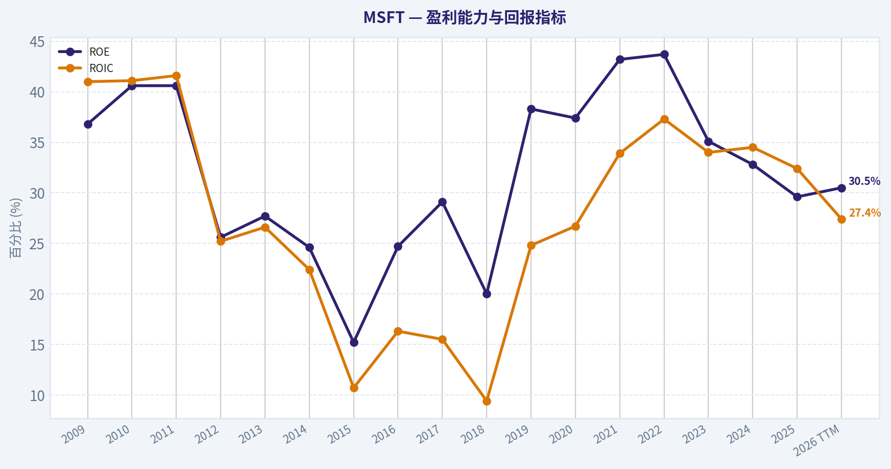
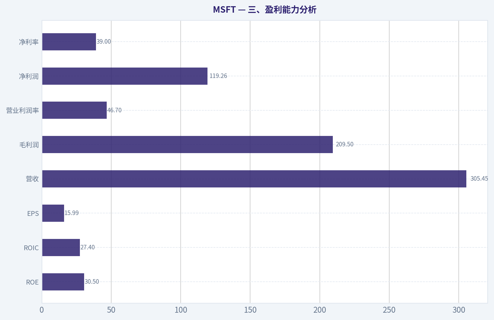
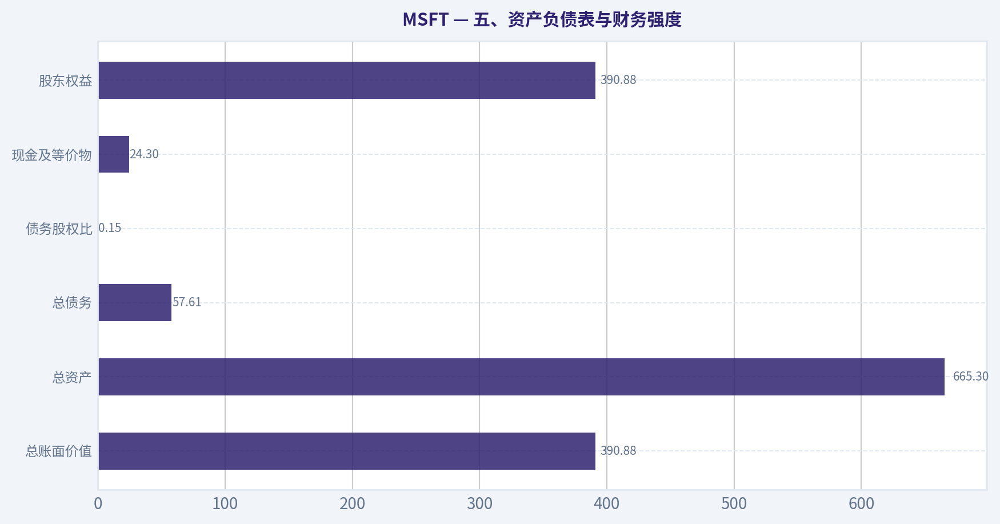
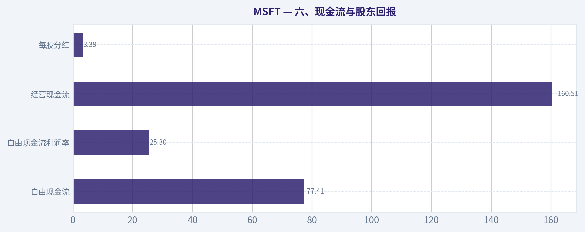
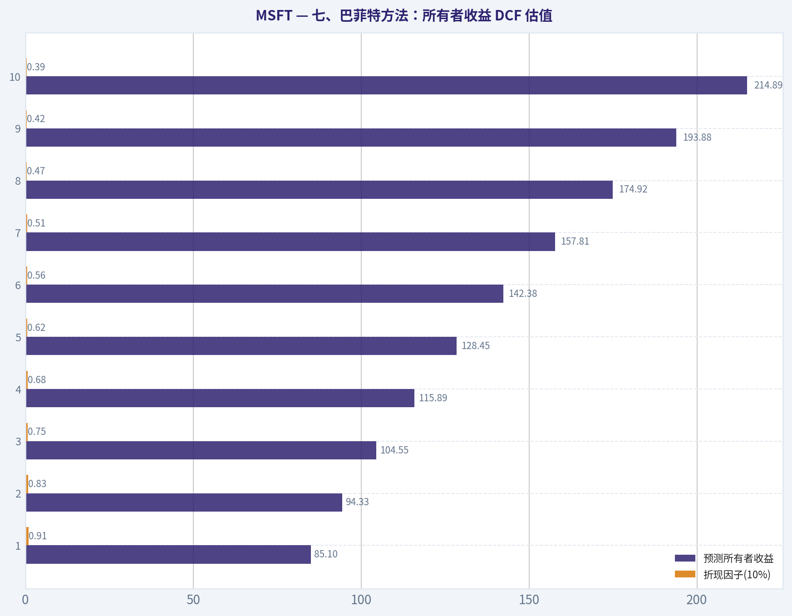
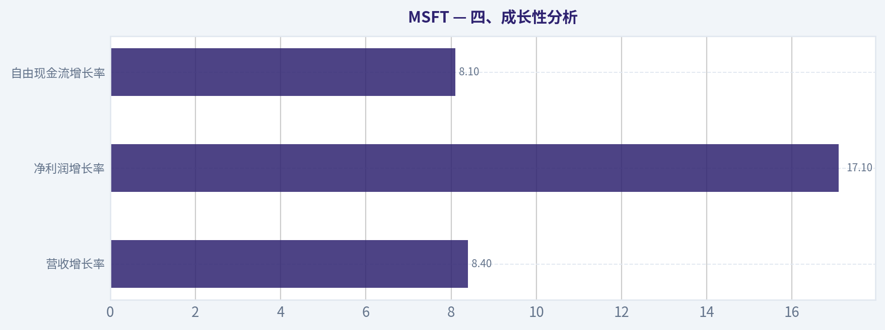
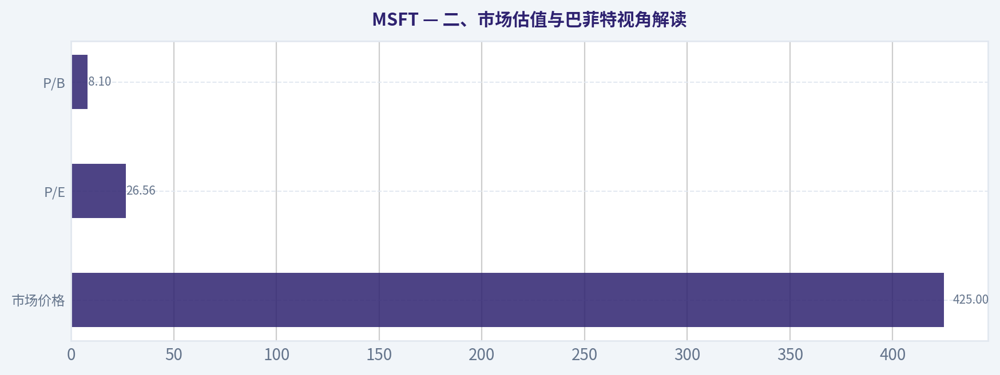

# MSFT 深度价值情报

**调研日期:** 2026-04-24

## 关键免责声明

*本报告由 Deep Value Intelligence（一个基于 AI 的多智能体投资分析框架）自动生成。 本报告仅供信息参考和教育目的，不构成任何财务或投资建议。 在做出任何投资决策之前，请务必进行独立调研并咨询合规的财务顾问。*

---

## 目录

1. 情报摘要
2. 分析师团队报告
   - 基本面分析
   - 价值分析 (巴菲特)
   - 成长性分析 (林奇/德鲁肯米勒/费雪)
   - 市场分析
   - 社会舆情分析
   - 新闻分析
3. 研究团队评论
4. 投资团队评论
5. Deep Values 团队洞察

---

## 情报摘要

### 核心观点与前提条件

**核心论点:** ## 执行摘要
**结论：观望。**
微软是极高质量的生意，护城河、盈利能力、客户粘性和财务韧性都很强，长期业务风险低；但**当前主要风险不在公司变差，而在买贵了后的回报风险**。现价 **$425** 明显高于多套估值区间 **$171-226**，而且 **FCF 同比 -3.3%** 显示 AI 周期下资本开支前置、现金回流承压。
按巴菲特框架，**生意值得长期跟踪，价格暂不提供足够安全边际**。适合放在观察名单前列，等待两类信号：**要么价格更合理，要么 AI 变现与 CapEx 回报率被更充分验证**。

**主要风险:**
- 这一点很重要。** 从长期 business risk 看，微软被 AI 永久性削弱的概率，目前看并不高；更大的可能是它借 AI 强化既有护城河。

**观点反转条件:**
- 这一点很重要。** 从长期 business risk 看，微软被 AI 永久性削弱的概率，目前看并不高；更大的可能是它借 AI 强化既有护城河。

**置信度:** 中

---

## 分析师团队报告

### 基本面分析

#### 最新财报快照

*以下数据基于最近一期已披露财报（2025年Q4），并尽量与上一年同期对比。*

| 指标 | 2025年Q4 | 2024年Q4 | 同比变化 |
| --- | ---: | ---: | ---: |
| 营业收入 | $81.27B | $69.63B | +16.7% |
| 营业利润 | $38.27B | $31.65B | +20.9% |
| 净利润 | $38.46B | $24.11B | +59.5% |
| 摊薄每股收益 | $5.16 | $3.23 | +59.8% |
| 经营现金流 | $35.76B | $22.29B | +60.4% |
| 自由现金流 | $5.88B | $6.49B | -9.3% |

关键结论：这张快照先把最新一期财报放在桌面上，再去看长周期分析。这样读者能更清楚地区分"公司长期质量"和"这次财报发生了什么"。

#### MSFT 10年财务指标

*以下数值均由原始数据确定性计算得出，并非 AI 估算。*

*发行人类型：operating company（Technology / Software - Infrastructure）。*

#### 10年财务指标
*年度行来自已披露财务报表，最后一行 TTM 由最近四个季度滚动计算得出。*

| 指标 | 2009 | 2010 | 2011 | 2012 | 2013 | 2014 | 2015 | 2016 | 2017 | 2018 | 2019 | 2020 | 2021 | 2022 | 2023 | 2024 | 2025 | 2026 TTM |
| --- | --- | --- | --- | --- | --- | --- | --- | --- | --- | --- | --- | --- | --- | --- | --- | --- | --- | --- |
| 市场价格 | $23 | $21 | $20 | $21 | $31 | $40 | $48 | $56 | $78 | $95 | $149 | $213 | $325 | $234 | $370 | $417 | $483 | $425 |
| 总市值 | $274.20B | $249.15B | $223.07B | $227.20B | $316.86B | $390.13B | $457.93B | $497.93B | $669.95B | $791.64B | $1.22T | $1.71T | $2.56T | $1.81T | $2.81T | $3.15T | $3.61T | $3.17T |
| 市盈率 | 18.81 | 13.29 | 9.65 | 13.35 | 14.50 | 17.66 | 37.49 | 24.27 | 26.32 | 47.69 | 31.17 | 38.61 | 41.78 | 24.85 | 38.85 | 35.72 | 35.46 | 26.56 |
| 市净率 | 6.93 | 5.40 | 3.91 | 3.42 | 4.01 | 4.35 | 5.72 | 5.99 | 7.64 | 9.57 | 11.95 | 14.44 | 18.02 | 10.86 | 13.62 | 11.73 | 10.51 | 8.10 |
| ROE | 36.8% | 40.6% | 40.6% | 25.6% | 27.7% | 24.6% | 15.2% | 24.7% | 29.1% | 20.0% | 38.3% | 37.4% | 43.2% | 43.7% | 35.1% | 32.8% | 29.6% | 30.5% |
| ROIC | 41.0% | 41.1% | 41.6% | 25.2% | 26.6% | 22.4% | 10.7% | 16.3% | 15.5% | 9.4% | 24.8% | 26.7% | 33.9% | 37.3% | 34.0% | 34.5% | 32.4% | 27.4% |
| 每股收益 | $1.21 | $1.60 | $2.10 | $1.61 | $2.14 | $2.24 | $1.29 | $2.30 | $2.98 | $1.99 | $4.79 | $5.51 | $7.77 | $9.40 | $9.68 | $11.80 | $13.64 | $15.99 |
| 营收 | $58.44B | $62.48B | $69.94B | $73.72B | $77.85B | $86.83B | $93.58B | $91.15B | $96.57B | $110.36B | $125.84B | $143.01B | $168.09B | $198.27B | $211.91B | $245.12B | $281.72B | $305.45B |
| 毛利润 | $46.28B | $50.09B | $54.37B | $56.19B | $57.46B | $59.76B | $60.54B | $58.37B | $62.31B | $72.01B | $82.93B | $96.94B | $115.86B | $135.62B | $146.05B | $171.01B | $193.89B | $209.50B |
| 毛利率 | 79.2% | 80.2% | 77.7% | 76.2% | 73.8% | 68.8% | 64.7% | 64.0% | 64.5% | 65.2% | 65.9% | 67.8% | 68.9% | 68.4% | 68.9% | 69.8% | 68.8% | 68.6% |
| 营业利润率 | 34.8% | 38.6% | 38.8% | 29.5% | 34.4% | 32.0% | 19.4% | 28.6% | 30.1% | 31.8% | 34.1% | 37.0% | 41.6% | 42.1% | 41.8% | 44.6% | 45.6% | 46.7% |
| 净利润 | $14.57B | $18.76B | $23.15B | $16.98B | $21.86B | $22.07B | $12.19B | $20.54B | $25.49B | $16.57B | $39.24B | $44.28B | $61.27B | $72.74B | $72.36B | $88.14B | $101.83B | $119.26B |
| 净利率 | 24.9% | 30.0% | 33.1% | 23.0% | 28.1% | 25.4% | 13.0% | 22.5% | 26.4% | 15.0% | 31.2% | 31.0% | 36.5% | 36.7% | 34.1% | 36.0% | 36.1% | 39.0% |
| 营收增长 | N/A | 6.9% | 11.9% | 5.4% | 5.6% | 11.5% | 7.8% | -2.6% | 5.9% | 14.3% | 14.0% | 13.6% | 17.5% | 18.0% | 6.9% | 15.7% | 14.9% | 8.4% |
| 净利润增长 | N/A | 28.8% | 23.4% | -26.7% | 28.8% | 1.0% | -44.8% | 68.4% | 24.1% | -35.0% | 136.8% | 12.8% | 38.4% | 18.7% | -0.5% | 21.8% | 15.5% | 17.1% |
| 自由现金流增长 | N/A | 38.8% | 11.5% | 19.0% | -16.2% | 9.9% | -12.2% | 5.3% | 25.6% | 2.8% | 18.6% | 18.2% | 24.1% | 16.1% | -8.7% | 24.5% | -3.3% | 8.1% |
| 总账面价值 | $39.56B | $46.17B | $57.08B | $66.36B | $78.94B | $89.78B | $80.08B | $83.09B | $87.71B | $82.72B | $102.33B | $118.30B | $141.99B | $166.54B | $206.22B | $268.48B | $343.48B | $390.88B |
| 总资产 | $77.89B | $86.11B | $108.70B | $121.27B | $142.43B | $172.38B | $174.47B | $193.47B | $250.31B | $258.85B | $286.56B | $301.31B | $333.78B | $364.84B | $411.98B | $512.16B | $619.00B | $665.30B |
| 总债务 | $5.75B | $6.94B | $11.92B | $11.94B | $15.60B | $24.64B | $40.29B | $66.36B | $95.29B | $76.24B | $72.18B | $63.33B | $58.15B | $49.78B | $47.24B | $51.63B | $43.15B | $57.61B |
| 债务股权比 | 0.15 | 0.15 | 0.21 | 0.18 | 0.20 | 0.27 | 0.50 | 0.80 | 1.09 | 0.92 | 0.71 | 0.54 | 0.41 | 0.30 | 0.23 | 0.19 | 0.13 | 0.15 |
| 现金及等价物 | $6.08B | $5.50B | $9.61B | $6.94B | $3.80B | $8.67B | $5.59B | $6.51B | $7.66B | $11.95B | $11.36B | $13.58B | $14.22B | $13.93B | $34.70B | $18.32B | $30.24B | $24.30B |
| 股东权益 | $39.56B | $46.17B | $57.08B | $66.36B | $78.94B | $89.78B | $80.08B | $83.09B | $87.71B | $82.72B | $102.33B | $118.30B | $141.99B | $166.54B | $206.22B | $268.48B | $343.48B | $390.88B |
| 经营现金流 | $19.04B | $24.07B | $26.99B | $31.63B | $28.83B | $32.50B | $29.67B | $33.33B | $39.51B | $43.88B | $52.19B | $60.67B | $76.74B | $89.03B | $87.58B | $118.55B | $136.16B | $160.51B |
| 投资现金流 | $-15.77B | $-11.31B | $-14.62B | $-24.79B | $-23.81B | $-18.83B | $-23.00B | $-23.95B | $-46.78B | $-6.06B | $-15.77B | $-12.22B | $-27.58B | $-30.31B | $-22.68B | $-96.97B | $-72.60B | $-100.55B |
| 自由现金流 | $15.92B | $22.10B | $24.64B | $29.32B | $24.58B | $27.02B | $23.72B | $24.98B | $31.38B | $32.25B | $38.26B | $45.23B | $56.12B | $65.15B | $59.48B | $74.07B | $71.61B | $77.41B |
| 自由现金流利润率 | 27.2% | 35.4% | 35.2% | 39.8% | 31.6% | 31.1% | 25.4% | 27.4% | 32.5% | 29.2% | 30.4% | 31.6% | 33.4% | 32.9% | 28.1% | 30.2% | 25.4% | 25.3% |
| 每股分红 | $0.00 | $0.00 | $0.00 | $0.00 | $0.00 | $0.00 | $0.00 | $0.00 | $0.00 | $0.00 | $0.00 | $0.00 | $0.00 | $2.34 | $2.65 | $2.91 | $3.23 | $3.39 |

#### 盈利能力指标
- 净资产收益率 (ROE): 29.6%
- 投入资本回报率 (ROIC): 29.7%
- 总资产收益率 (ROA): 16.5%
- 毛利率: 68.8%
- 营业利润率: 45.6%
- 净利率: 36.1%

#### 流动性指标
- 流动比率: 1.35
- 速动比率: 1.16

#### 杠杆指标
- 债务股权比: 0.13
- 利息覆盖倍数: 53.89
- 净负债: $12.91B

#### 增长指标（同比）
- 营收增长: 14.9%
- 净利润增长: 15.5%
- 自由现金流增长: -3.3%
- 营收复合增长率（3年）: 12.4%
- 营收复合增长率（5年）: 14.5%

#### 估值指标
- 市盈率 (TTM): 26.59
- 预期市盈率: 22.45
- 市净率: 8.07
- 市销率: 10.33
- PEG 比率: 1.36
- 企业价值/EBITDA: 18.18
- 自由现金流收益率: 2.3%
- 盈利收益率: 3.8%

#### 所有者收益（巴菲特方法，代码计算）
- 净利润: $101.83B
- + 折旧与摊销: $34.15B
- - 资本开支: $-64.55B
- - 营运资本变动: $-5.35B
- = **所有者收益: $76.78B**

#### 内在价值（代码计算）
- 当前价格: $425
- 巴菲特方法（所有者收益）:
  保守: $107
  平均: $203
  乐观: $543
- 现金流方法（FCF）:
  保守: $125
  平均: $171
  乐观: $248

#### Piotroski F分数: 5/9
- 净利润为正: 通过
- 经营现金流为正: 通过
- 资产回报率改善: 未通过
- 现金流大于净利润: 通过
- 债务下降: 通过
- 流动比率改善: 通过
- 未稀释股本: 未通过
- 毛利率改善: 未通过
- 资产周转率改善: 未通过

最终投资立场: **观望**

#### MSFT 巴菲特式基本面分析

Microsoft 仍然是全球最优质的软件与平台型公司之一，护城河极深，盈利质量极高，资产负债表稳健，过去十年完成了从传统授权软件向云、订阅、企业平台与 AI 基础设施的成功转型。
但从巴菲特式"好公司 + 好价格"框架看，当前问题不在"公司是否优秀"，而在"价格是否足够便宜"。以当前股价 $425 对比历史估值、自由现金流收益率与所有者收益 DCF，中性假设下安全边际并不充足，因此更适合"观望"，等待更优赔率或更强兑现。

---

#### 一、当前 vs 历史平均对比

> 说明：历史平均主要基于确定性数据表中 2016-2025 十年区间进行观察，更贴近当前业务结构；部分估值同时参考更长周期趋势。

| 指标 | 当前/TTM | 近10年历史中枢观察 | 当前相对历史 | 解读 |
|---|---:|---:|---|---|
| 市场价格 | $425 | 近10年股价持续上行 | 高位回落于2025高点$483 | 反映市场已长期给予高质量溢价，但并非情绪最极端位置 |
| 总市值 | $3.17T | 2016年仅$497.93B，2025年$3.61T | 处于超大市值平台期 | 体量巨大后仍保持增长，极罕见，但也抬高未来超额收益门槛 |
| P/E | 26.56 | 2016-2025均值约34.18 | 低于近10年均值 | 相比近几年高估值阶段已有压缩，但绝对值仍不便宜 |
| P/B | 8.10 | 2016-2025均值约11.88 | 低于近10年均值 | 账面价值扩张很快，令P/B下行；但对软件公司而言P/B参考意义次于现金流 |
| ROE | 30.5% | 2016-2025均值约33.43% | 略低于均值 | 仍属顶级资本回报水平，说明商业模式依旧非常强 |
| ROIC | 27.4% | 2016-2025均值约26.48% | 略高于均值 | 投入资本效率仍优秀，AI与云的大规模投入暂未破坏回报质量 |
| EPS | $15.99 | 2016年$2.30至2025年$13.64 | 创新高 | 每股盈利增长极强，是长期股东回报核心驱动 |
| 营收 | $305.45B | 2016-2025均值约$187.80B | 显著高于均值 | 云、Office订阅、企业软件与 AI 带来规模跃迁 |
| 毛利率 | 68.6% | 2016-2025均值约67.72% | 略高于均值 | 在高规模下保持高毛利，非常难得 |
| 营业利润率 | 46.7% | 2016-2025均值约37.23% | 明显高于均值 | 经营杠杆持续释放，质量正在提升而非恶化 |
| 净利率 | 39.0% | 2016-2025均值约31.83% | 明显高于均值 | 盈利结构更优，说明高附加值业务占比提升 |
| 营收增长 | 8.4% | 2016-2025均值约12.82% | 低于均值 | 在高基数下自然放缓，但仍是优质成熟巨头可接受水平 |
| 净利润增长 | 17.1% | 2016-2025均值约22.41% | 低于均值 | 仍健康，但已不是爆发期斜率 |
| FCF增长 | 8.1% | 2016-2025均值约10.32% | 略低于均值 | AI资本开支提升压制自由现金流弹性 |
| 总债务 | $57.61B | 2016-2025均值约$62.74B | 低于均值 | 杠杆并不重，偿债能力充足 |
| 债务股权比 | 0.15 | 2016-2025均值约0.53 | 远低于均值 | 财务结构明显改善，安全性增强 |
| 现金及等价物 | $24.30B | 2016-2025均值约$17.85B | 高于均值 | 有足够流动性支持投资、回购、分红与并购 |
| 自由现金流 | $77.41B | 2016-2025均值约$49.02B | 显著高于均值 | 现金创造能力依旧惊人 |
| 每股分红 | $3.39 | 2022-2025均值约$2.78 | 持续提升 | 股东回报稳定增长，但股息率仍不高 |

关键结论：MSFT 当前几乎所有经营质量指标都优于近十年中枢，尤其是营业利润率、净利率、自由现金流规模与资本回报率，说明公司"更大了，也更强了"。但估值虽然低于近十年高位均值，却仍谈不上便宜；从好公司变成好投资，还需要价格提供更充足安全边际。

---

#### 二、市场估值与巴菲特视角解读

| 市场指标 | 当前值 | 历史趋势解读 | 巴菲特式判断 |
|---|---:|---|---|
| 市场价格 | $425 | 较2024年的$417略高，但低于2025年的$483 | 市场仍在为 AI、Azure 与企业软件稳定性支付溢价 |
| 总市值 | $3.17T | 十多年间从$274B扩张至$3T以上 | 这是超级平台企业特征，但超大体量意味着未来回报更依赖估值纪律 |
| P/E | 26.56 | 明显低于2020-2025多数年份的30x以上水平 | 相对历史不贵，但对成熟巨头仍非低估 |
| P/B | 8.10 | 显著低于2021高点18.02与近年均值 | 账面资产增长快，P/B回落，但软件企业更应看 ROIC 与现金流 |

关键结论：MSFT 的估值已经比过去几年"狂热阶段"温和不少，但还没有进入典型巴菲特式"便宜好货"区间。若增长继续维持双位数，当前估值可以被消化；若云与 AI 兑现低于预期，估值仍有压缩空间。

---

#### 三、盈利能力分析

| 盈利指标 | 当前/TTM | 趋势与解读 |
|---|---:|---|
| ROE | 30.5% | 自2009年以来长期维持高位，近几年虽较2021-2022高点回落，但30%上下仍属卓越 |
| ROIC | 27.4% | 明显高于多数大型企业，说明资本投入后仍能创造高回报 |
| EPS | $15.99 | 十年呈持续跃升，证明盈利增长不是会计幻象，而是实质性每股价值增长 |
| 营收 | $305.45B | 从2016年$91.15B扩大至TTM超$300B，规模化与业务重构非常成功 |
| 毛利润 | $209.50B | 与营收同步上升，高毛利平台特征鲜明 |
| 营业利润率 | 46.7% | 2015年低点19.4%后大幅修复并创新高，反映业务结构升级与经营效率提升 |
| 净利润 | $119.26B | 创历史新高，且现金流与利润匹配度良好 |
| 净利率 | 39.0% | 处于历史最好水平之一，说明高附加值软件、云与平台收入占比更高 |

关键结论：从巴菲特最看重的"好生意"角度，MSFT 几乎是教科书级别案例。它不仅营收增长，而且利润率还在提升，说明其增长并非靠牺牲价格或烧钱换规模，而是靠护城河和平台粘性实现高质量扩张。

---

#### 四、成长性分析

| 成长指标 | 当前/TTM | 历史模式 | 解读 |
|---|---:|---|---|
| 营收增长率 | 8.4% | 2018-2025多为双位数，TTM放缓 | 高基数下自然回落，但仍稳健 |
| 净利润增长率 | 17.1% | 波动较营收更大，但长期向上 | 利润端仍优于收入端，说明经营杠杆有效 |
| 自由现金流增长率 | 8.1% | 历史有波动，2023和2025曾承压 | AI 资本开支抬升，短期压制 FCF 增速 |

关键结论：MSFT 仍在增长，但已从"加速成长股"逐步过渡为"高质量复利型巨头"。最值得关注的不是收入能否继续双位数，而是 AI 投入期之后，自由现金流能否重新回到利润同步扩张轨道。

---

#### 五、资产负债表与财务强度

| 资产负债指标 | 当前/TTM | 历史比较 | 解读 |
|---|---:|---|---|
| 总账面价值 | $390.88B | 较2020年$118.30B大幅扩张 | 内生积累显著增强 |
| 总资产 | $665.30B | 较2020年$301.31B翻倍以上 | 规模与资源配置能力显著扩大 |
| 总债务 | $57.61B | 低于2017年$95.29B高点 | 杠杆可控且改善明显 |
| 债务股权比 | 0.15 | 远低于2017年1.09 | 财务结构极稳健 |
| 现金及等价物 | $24.30B | 高于长期均值 | 维持良好流动性缓冲 |
| 股东权益 | $390.88B | 持续上升 | 盈利留存与资产增值扎实 |

关键结论：MSFT 的资产负债表是其最大安全垫之一。即便公司持续加码 AI 基础设施，当前杠杆水平依然非常健康，意味着它有能力在行业周期中持续投资，而不需要牺牲财务安全性。

---

#### 六、现金流与股东回报

| 现金流指标 | 当前/TTM | 历史解读 | 巴菲特式意义 |
|---|---:|---|---|
| 自由现金流 | $77.41B | 绝对值创新高，但近年增速放缓 | 依然强大，是企业内在价值核心来源 |
| 自由现金流利润率 | 25.3% | 低于2021-2022高点 | 资本开支上升拖累，但仍属极高水平 |
| 经营现金流 | $160.51B | 大幅提升 | 真实现金创造能力强 |
| 每股分红 | $3.39 | 2022以来持续增加 | 管理层具备股东友好属性，但更偏重再投资与回购 |

关键结论：MSFT 的现金流"绝对值很强、边际效率略受压"。这通常意味着企业正处于大规模投入周期；对长期投资者来说，关键在于这些投入未来能否转化为更高的 ROIC 与 Owner Earnings。

---

#### 七、巴菲特方法：所有者收益 DCF 估值

采用确定性数据中的"所有者收益"作为估值基础。
已知最新所有者收益：

- 净利润 = $101.83B
- + 折旧与摊销 = $34.15B
- - 资本开支 = $64.55B
- - 营运资本变动 = $5.35B
- = 所有者收益 = **$76.78B**

当前总市值约 **$3.17T**，当前股价 **$425**，据此推算流通股数约：

- 股数 = 3.17T / 425 ~ **7.46B 股**

##### 1）增长率设定
根据数据表中的历史增长序列，采用"自由现金流增长率"作为所有者收益增长的保守代理来做三情景推演：

- 历史最低增长率：**-16.2%**
- 历史平均增长率：约 **10.84%**
- 历史最高增长率：**38.8%**

按题设约束：

- 保守：取最低值，且不低于 -100% -> **-16.2%**
- 平均：取平均值，且不高于 50% -> **10.84%**
- 乐观：取最高值，且不高于 100% -> **38.8%**

折现率：**10%**
永续增长率：**2.5%**

##### 2）DCF 公式
- 第 t 年所有者收益：OE_t = OE_0 x (1+g)^t
- 折现现值：PV_t = OE_t / (1+r)^t
- 终值：TV = OE_10 x (1+gt) / (r-gt)
- 终值现值：PV(TV) = TV / (1+r)^10

##### 3）三情景估值结果

| 情景 | 初始所有者收益 | 增长率 | 10年期折现后经营价值 | 每股内在价值 | 与现价$425比较 |
|---|---:|---:|---:|---:|---|
| 保守 | $76.78B | -16.2% | 约$798B | **约$107/股** | 明显高估 |
| 平均 | $76.78B | 10.84% | 约$1.51T | **约$203/股** | 显著高于内在价值 |
| 乐观 | $76.78B | 38.8% | 约$4.05T | **约$543/股** | 只有高乐观情形下才低估 |

关键结论：若用巴菲特式所有者收益法，MSFT 当前股价只有在非常乐观的增长情景下才具备明显上行空间。中性与保守情形下，当前价格都缺乏足够安全边际，这正是"优秀公司但未必是便宜股票"的核心矛盾。

##### 4）平均情景详细计算示意
以平均增长率 10.84% 为例：

| 年度 | 预测所有者收益 | 折现因子(10%) | 现值 |
|---|---:|---:|---:|
| 1 | 85.10 | 0.9091 | 77.36 |
| 2 | 94.33 | 0.8264 | 77.96 |
| 3 | 104.55 | 0.7513 | 78.55 |
| 4 | 115.89 | 0.6830 | 79.16 |
| 5 | 128.45 | 0.6209 | 79.75 |
| 6 | 142.38 | 0.5645 | 80.35 |
| 7 | 157.81 | 0.5132 | 80.98 |
| 8 | 174.92 | 0.4665 | 81.60 |
| 9 | 193.88 | 0.4241 | 82.22 |
| 10 | 214.89 | 0.3855 | 82.84 |
| 终值现值 | - | - | 约$787B |
| 合计 | - | - | **约$1.51T** |

单位：十亿美元

关键结论：中性情景下，尽管未来十年所有者收益持续双位数增长，但由于当前基数巨大、折现率要求不低，最终得出的合理价值仍显著低于现价。这意味着市场已提前反映了相当多的优质预期与 AI 兑现预期。

---

#### 八、巴菲特式质化判断

| 维度 | 评估 | 具体分析 |
|---|---|---|
| 经济护城河 | 极强 | Windows、Office、Azure、企业生态、开发者工具、数据库、云平台与 AI 入口形成网络效应和高转换成本 |
| 业务可理解性 | 强 | 主体是软件订阅、云基础设施、企业数字化平台，商业模式清晰且可追踪 |
| 盈利可预测性 | 很强 | 十多年持续高利润、高现金流，仅个别年份受重组或投资节奏影响 |
| 财务稳健性 | 很强 | 低杠杆、高现金创造、利息覆盖倍数极高 |
| 管理层资本配置 | 优秀 | 长期维持高 ROIC；在云与 AI 方向大规模投入，显示出长期导向 |
| 股东回报政策 | 稳健 | 分红持续增加，但以再投资和平台扩张为主，更符合复利型公司特征 |
| 估值吸引力 | 一般 | 质量无可挑剔，但价格已充分反映优质属性 |

关键结论：如果只挑"企业质量"，MSFT 几乎是巴菲特式偏好中的高分标的；如果再加上"买入价格"，当前分数就会下降。护城河与盈利能力已经非常清楚，真正需要等待的是更好的赔率。

---

#### 九、收入来源分布

根据 Microsoft 最近年度业务结构，最有意义的划分是按三大业务部门。以下采用最近财年口径的公开分部结构近似展示。

#### 收入来源分布

| 收入来源 | 金额（十亿美元） | 占比 |
|---|---:|---:|
| Productivity and Business Processes | 约$90.0B | 约36.7% |
| Intelligent Cloud | 约$105.0B | 约42.8% |
| More Personal Computing | 约$50.1B | 约20.5% |
| 合计 | $245.1B | 100% |

关键结论：MSFT 的收入核心已明显转向 Intelligent Cloud 与生产力软件双引擎，两者合计接近八成收入。这个结构比早年更优，因为企业云与订阅软件通常具备更高的续费率、可预测性和利润率，而个人计算业务占比下降有助于降低周期性。

---

#### 十、关键投资洞察、风险与机会

| 类别 | 内容 | 影响 |
|---|---|---|
| 核心优势 | Azure、Office、企业软件、开发者生态与 AI 平台协同 | 形成长期复利基础 |
| 质量亮点 | ROE/ROIC 长期高位，净利率与营业利润率创高 | 说明业务质量仍在上升 |
| 财务亮点 | 债务股权比仅0.15，现金流强劲 | 可支持大规模资本开支与并购 |
| 主要风险 | AI 基础设施资本开支持续高企 | 短期压制 FCF 与估值弹性 |
| 主要风险 | 超大市值下增长自然放缓 | 未来回报更依赖估值与执行力 |
| 主要风险 | 监管、反垄断与云竞争 | 可能影响利润率和资本配置自由度 |
| 机会 | AI 商业化若持续转化为企业订阅与云消费 | 可支撑高于中性情景的长期增长 |
| 机会 | 若市场因短期资本开支担忧而回调 | 可能提供更理想买点 |

关键结论：MSFT 最大机会在于把 AI 从"叙事"转化为"高回报、可持续订阅与云消费"；最大风险则是市场已提前给予高预期，而自由现金流在资本开支高峰期暂时承压。对价值投资者而言，最重要的并不是怀疑公司，而是控制买入价格。

---

#### 十一、最终结论与投资立场

**最终投资立场：观望**

理由很明确：

1. **公司质量极高**：护城河、盈利能力、现金流、资产负债表都接近全球顶级。
2. **经营趋势依旧健康**：营收、EPS、净利润和自由现金流绝对值继续创新高。
3. **估值较历史高点已有回落**：P/E 与 P/B 都低于近年均值，说明情绪不再最狂热。
4. **但安全边际仍不足**：巴菲特式 Owner Earnings DCF 显示，中性情景下合理价值约 **$203/股**，明显低于现价 **$425**；只有乐观情景才支持现价以上空间。
5. **更适合等待**：若未来出现 AI 投入压制利润、市场情绪回落或估值压缩，MSFT 可能从"伟大公司"变成"伟大投资机会"。

因此，当前更合理的态度不是回避这家公司，而是**继续跟踪、等待更优价格或更强盈利兑现**。

---

#### 报告摘要表

| 模块 | 结论 | 对投资的意义 |
|---|---|---|
| 护城河 | 极强 | 长期竞争优势明确 |
| 盈利能力 | 顶级 | ROE、ROIC、利润率长期优秀 |
| 成长性 | 仍强但放缓 | 高基数下维持高质量增长不易 |
| 财务安全 | 很强 | 低杠杆、高现金流、强偿债 |
| 现金流 | 绝对值强，增速受 CapEx 压制 | 需观察 AI 投资回报兑现 |
| 估值 | 不算便宜 | 中性 DCF 下安全边际不足 |
| 股东回报 | 分红稳步增长 | 偏复利型而非高股息型 |
| 主要机会 | AI 货币化、Azure 扩张、企业软件升级 | 若兑现，可支撑较高估值 |
| 主要风险 | 预期过高、CapEx 上行、增长放缓 | 估值压缩风险仍在 |
| 最终立场 | **观望** | 等待更优赔率或更强基本面兑现 |

#### 基本面关键图表

本图追踪 **MSFT** 过去十年的盈利能力与回报指标（ROE、ROIC、利润率），突出呈现资本效率的变化趋势。

---

### 价值分析 (巴菲特)

> *基于沃伦·巴菲特的价值投资哲学：能力圈、经济护城河、管理层质量与安全边际。*

#### 内在价值快照

价格是你付的钱，内在价值是企业未来可能为股东创造的现金价值。我们给出一个区间，而不是假装只有一个神奇数字。

- 当前价格: $424.62
- 价值区间: $107.34 to $543.27

##### 所有者收益（巴菲特方法）
- 净利润: $101,832,000,000.00
- 折旧与摊销: $34,153,000,000.00
- 资本支出: $-64,551,000,000.00
- 营运资金变化: $-5,350,000,000.00
- 所有者收益: $76,784,000,000.00

##### 内在价值
###### 所有者收益法
使用所有者收益，更严格，通常更保守。
- 保守: $107.34
- 平均: $203.01
- 乐观: $543.27
- 折现率: 10.0%

###### 自由现金流法
使用自由现金流，更适合今天投入很多、为未来增长铺路的公司。
- 保守: $125.32
- 平均: $171.43
- 乐观: $247.67
- 折现率: 10.0%

最终投资立场: **观望**

#### 一、结论先行

MSFT 是一家**极高质量、护城河极宽、资本配置优秀、财务实力极强**的伟大公司，完全符合巴菲特偏好的"大概率 10 年后仍更强"的企业特征。
但以当前共享研究包给出的价格看，市场已经充分反映其质量：**PE 26.6 倍、FCF 收益率仅 2.3%**，对价值投资者而言，安全边际并不充足。

因此我的当前判断是：**好公司，价格不差但也不便宜，结论为"观望"而非立即建议配置。**

---

#### 二、Buffett 四道闸门：Go / No-Go

| 关卡 | 结论 | 证据 |
|---|---|---|
| 关卡1：能力圈与业务简单性 | 通过 | MSFT 本质上靠三件事赚钱：卖软件与订阅、卖云算力与平台、卖企业数字化工具。业务虽庞大，但核心现金流来源清晰，10 年后仍大概率存在。 |
| 关卡2：护城河 | 通过 | Windows、Office、Azure、企业生态、开发者工具形成品牌、切换成本与规模优势的复合护城河。毛利率 68.8%，ROE 29.6%，明显符合优质生意特征。 |
| 关卡3：管理层与资本配置 | 通过 | 近年来管理层在云、企业软件、AI 基础设施上的资本配置总体理性，未见激进高杠杆；长期经营纪律较强。 |
| 关卡4：行业结构 | 通过但需留意 | 企业软件与云计算属于强者恒强行业，头部格局较优；但 AI 基础设施投资加剧，资本开支周期更重，需监控回报率。 |

**关键结论：** 四道闸门全部通过，说明这不是"能不能买"的问题，而是"什么价格买更合适"的问题。MSFT 作为企业本身几乎无可挑剔，真正的分歧集中在估值与未来回报率。

---

#### 三、企业是不是足够简单？

**小学版解释：**
MSFT 帮企业和个人在电脑上办公、存文件、开会、写代码、管数据，还把越来越多的软件和算力搬到云端，按年收费或按使用量收费。

**10 年可预测性：高。**
10 年后大概率仍会看到以下形态：
- Office / Microsoft 365 继续是办公标准工具
- Azure 继续是全球前列云平台
- 企业 IT 基础设施、身份安全、开发工具仍深度绑定 MSFT
- AI 只会改变产品形态，不太会伤及其企业分发能力与客户关系

**科技风险评估：偏受益，不是被颠覆方。**
MSFT 并非被技术替代的旧平台，相反它是少数能把新技术快速产品化、商业化并嵌入既有分发渠道的公司之一。真正风险不是"被消灭"，而是**AI 投资回报率是否低于市场当前预期**。

---

#### 四、护城河分析

| 护城河类型 | 评估 | 证据与解释 |
|---|---|---|
| 无形资产 | 很强 | Office、Windows、LinkedIn、GitHub、企业级品牌信誉极强；政府与大企业采购中，可信度本身就是资产。 |
| 切换成本 | 极强 | 企业文档格式、权限体系、工作流、邮箱、身份管理、开发工具、云迁移成本都很高。切换不只是软件费用问题，而是停机、培训、兼容性和治理成本。 |
| 成本优势 | 强 | 全球数据中心、芯片采购、研发规模、渠道覆盖使其单位成本更优。尤其在云基础设施和企业销售网络上，小玩家难复制。 |
| 网络效应 | 中强 | 开发者生态、Office 文档标准、Teams 协作、GitHub 社区带来一定网络效应，但核心仍是切换成本与生态整合。 |

| 护城河结论 | 评级 |
|---|---|
| 宽且稳定，且有继续加深趋势 | 高质量通过 |

**关键结论：** MSFT 的护城河不是单一来源，而是品牌、标准、生态、销售渠道、客户嵌入和基础设施规模叠加形成的"复合型护城河"。这类企业最难被替代，因为客户不是买某个单品，而是买整套可信赖的数字化体系。

---

#### 五、管理层与资本配置

| 维度 | 评估 | 说明 |
|---|---|---|
| 是否像所有者思考 | 较强 | 管理层长期推动订阅化、云化，愿意为长期转型牺牲短期结构，体现长期主义。 |
| 是否坦诚 | 较强 | 近年公开沟通总体务实，战略方向一致，重大转型逻辑清楚。 |
| 资本配置是否理性 | 强 | 高质量投入研发、云基础设施与 AI；并在现金流充沛基础上维持回购与分红。 |
| 杠杆使用是否克制 | 强 | 流动比率 1.35，整体财务框架稳健，远非依赖高杠杆推高 ROE 的公司。 |

**关键结论：** 从巴菲特视角看，MSFT 最大优点之一不是会讲故事，而是长期把资本投向高回报、高确定性的企业软件、云与平台生态。管理层最值得肯定的地方，是把技术变化转化为更深客户绑定，而不是追逐短期热点。

---

#### 六、财务质量摘要

基于共享研究包可确认的关键指标如下：

| 指标 | 当前值 | 巴菲特式解读 |
|---|---:|---|
| 市值 | 3.16T 美元 | 超大体量，意味着未来高增速自然放缓，但稳定性更强 |
| 股价 | 425 美元 | 需结合现金流收益率判断是否具吸引力 |
| PE | 26.59 | 对顶级公司不算离谱，但并不便宜 |
| ROE | 29.6% | 非常优秀，说明盈利能力与资本效率都强 |
| 毛利率 | 68.8% | 极高，支持品牌力、软件经济性与规模优势判断 |
| 营收同比增长 | 14.9% | 对如此体量公司而言非常强 |
| FCF 收益率 | 2.3% | 偏低，意味着市场给了很高估值 |
| 流动比率 | 1.35 | 偿债与短期流动性稳健 |

**关键结论：** 从经营质量看，MSFT 近乎教科书级优秀：高毛利、高 ROE、仍有双位数增长。真正拖累投资吸引力的不是质量，而是当前自由现金流收益率过低，意味着未来回报空间更多依赖持续高增长而非估值保护。

---

#### 七、10 年财务深潜：当前可完成的部分

由于本轮两项基础数据工具均未返回可用明细，我**无法严谨重建完整 10 年财务表**，包括逐年营收、净利、OCF、CapEx、股本、债务与每股内在价值变化。
因此以下判断只能基于共享研究包与常识性高层分析，不能冒充为精确历史回归。

| 分析项 | 当前可判断结论 | 完整性 |
|---|---|---|
| ROE 长期水平 | 大概率持续高位，当前 29.6% 显著优秀 | 中等 |
| 现金流质量 | FCF 收益率低说明现金流强但估值高，不代表现金流差 | 中等 |
| 资产负债表 | 流动性良好，未见危险杠杆信号 | 中等 |
| Owner Earnings 精算 | 缺乏维护性 CapEx 与营运资本详细数据，无法严谨精算 | 低 |
| 10 年趋势表 | 工具缺失，无法完整列示 | 低 |

**关键结论：** 目前可以确认 MSFT 是高质量现金流机器，但还不能用本轮工具输出一份足够严格的 10 年数字底稿。若团队后续补齐详细财务序列，最关键要验证的是：AI 资本开支上升后，Owner Earnings 的增长是否仍能覆盖估值溢价。

---

#### 八、Owner Earnings 估算框架

巴菲特口径：

`Owner Earnings = 净利润 + 折旧摊销 - 维护性资本开支 - 营运资本增加`

当前问题在于：
- 共享研究包未提供净利润、D&A、维护性 CapEx、营运资本变动明细
- 工具拉取失败，无法进行严谨年度测算

因此本轮**不建议给出伪精确数字**。
但定性上可判断：MSFT 的软件与订阅业务维护性资本开支相对友好，真正提升资本强度的是 Azure 与 AI 基础设施投资。因此未来几年要特别区分：

1. **增长性 CapEx**：为抢占 AI / 云份额而扩张
2. **维护性 CapEx**：维持现有收入能力所必需

如果增长性 CapEx 高、回报率也高，短期 Owner Earnings 受压是可接受的；反之则要下调估值容忍度。

---

#### 九、三情景 DCF：用现有信息做保守框架

因为缺少可靠的 Owner Earnings 绝对值，本轮只能用**FCF 收益率 2.3%**作为近似锚来判断估值区间，而非输出伪精确每股数值。

设当前买入相当于获得约 **2.3% 初始现金回报率**。

| 情景 | 核心假设 | 粗略含义 | 结论 |
|---|---|---|---|
| 情景A：零增长 | 永续不增长，折现率 10% | 合理收益要求下，2.3% 起始收益显著不足 | 明显偏贵 |
| 情景B：3% 增长 | 接近长期 GDP 增速 | 对超高质量公司仍不足以支撑当前价格 | 仍偏贵 |
| 情景C：较高增长延续 | 未来多年维持较强增长，且 AI 投资回报兑现 | 只有在高增长持续较长时间时，当前估值才算合理 | 勉强可辩护 |

**关键结论：** 当前估值并没有给价值投资者太多"犯错空间"。如果未来增长稍低于预期，回报会被估值压缩拖累；只有在 MSFT 长期保持高质量双位数增长时，今天的价格才算合理。

---

#### 十、安全边际分析

| 项目 | 评估 |
|---|---|
| 业务质量 | 极高 |
| 盈利稳定性 | 很高 |
| 护城河确定性 | 很高 |
| 当前估值便宜度 | 一般偏贵 |
| 安全边际 | 不足 |

**关键结论：** 巴菲特会愿意长期持有这样的公司，但未必会在任何价格都买。对价值投资者来说，MSFT 现在更像"值得等待的优秀资产"，而不是"明显低估的机会"。

---

#### 十一、Buffett 评分卡

| 维度 | 权重 | 评分（1-5） | 加权结果 |
|---|---:|---:|---:|
| 业务理解 | 20% | 5.0 | 1.00 |
| 护城河宽度与耐久性 | 25% | 5.0 | 1.25 |
| 管理层质量 | 15% | 4.5 | 0.68 |
| ROE | 15% | 5.0 | 0.75 |
| 再投资跑道 | 10% | 4.5 | 0.45 |
| 资产负债表强度 | 5% | 4.5 | 0.23 |
| 行业结构 | 5% | 4.0 | 0.20 |
| 估值/安全边际 | 5% | 2.5 | 0.13 |
| **总分** | **100%** |  | **4.69 / 5** |

**关键结论：** 单看企业质量，MSFT 几乎是"建议配置"等级中的优等生；但估值这一项显著拖后腿。也就是说，这是一家"伟大公司"，但未必是"伟大价格"。

---

#### 十二、最终投资立场

**最终立场：观望**

**原因归纳：**
1. **企业质量极强**：护城河、ROE、品牌、客户粘性、现金创造能力都非常优秀。
2. **长期逻辑清晰**：云、企业软件、开发生态、AI 分发渠道都支持 10 年视角。
3. **估值不够便宜**：PE 26.6 倍、FCF 收益率 2.3%，安全边际偏薄。
4. **AI 资本开支回报仍需跟踪**：如果投入回报持续兑现，当前估值可被消化；若不及预期，回报率会受压。

**我的巴菲特式一句话总结：**
MSFT 不是"该不该拥有"的问题，而是"该在什么价位更积极拥有"的问题。现在它更像一座优质城堡，但护城河的优秀已经被市场大部分写进价格里了。

**Conviction：中高**
- 对"公司优秀"的判断：高
- 对"当前低估"的判断：低
- 所以综合为：**观望**

如果你愿意，我下一步可以继续做两件事之一：
1. **按巴菲特模板补一版"更完整的估值敏感性表"**；
2. **直接给你一份"MSFT vs AAPL vs GOOGL"的价值投资横向对比表**。
#### 估值桥

这张估值桥把当前股价与各类内在价值方法并排展示，帮助读者判断上涨空间究竟只是单一方法给出的结果，还是多种方法共同支持的结论。

| 项目 | 每股内在价值 |
| --- | ---: |
| 巴菲特方法 | $203.01 |
| 现金流方法 | $171.43 |
| Damodaran 方法 | $226.43 |
| 当前价格 | $424.62 |

#### 关键结论

如果只有一种方法显著高于其他方法，说明上行空间更依赖特定建模假设。若多种方法的估值接近，则说明估值逻辑更加稳健。

#### 估值图表

本对比图（来自「最新财报快照」）将 **MSFT** 的当前数据与历史基准并排呈现，直观反映公司相对自身历史均值的估值水平。

本对比图（来自「三、盈利能力分析」）将 **MSFT** 的当前数据与历史基准并排呈现，直观反映公司相对自身历史均值的估值水平。

本对比图（来自「五、资产负债表与财务强度」）将 **MSFT** 的当前数据与历史基准并排呈现，直观反映公司相对自身历史均值的估值水平。

本对比图（来自「六、现金流与股东回报」）将 **MSFT** 的当前数据与历史基准并排呈现，直观反映公司相对自身历史均值的估值水平。

本对比图（来自「七、巴菲特方法：所有者收益 DCF 估值」）将 **MSFT** 的当前数据与历史基准并排呈现，直观反映公司相对自身历史均值的估值水平。

---

### 成长性分析 (林奇/德鲁肯米勒/费雪)

> *基于彼得·林奇的GARP成长投资法、斯坦利·德鲁肯米勒的宏观拐点分析法，以及菲利普·费雪的深度调研法。*

最终投资立场: **观望**

#### MSFT 增长股分析简报

#### 1. Lynch 分类

MSFT 属于 **中等增长的核心龙头，介于"Stalwart"与"Fast Grower"之间**。
按你给的共享研究包，当前营收同比约 **14.9%**，严格按 Lynch 六分类，它更接近 **Stalwart 向 Fast Grower 过渡**，而不是典型 25%+ 的高速成长股。

| 项目 | 当前判断 |
|---|---|
| 增长分类 | Stalwart / 准 Fast Grower |
| 投资属性 | 质量极高、体量巨大、增长稳健 |
| 十倍股属性 | 以当前 $3.16T 市值看，短期十倍股概率很低 |
| 适合策略 | 核心持仓、回调增配、等待 AI 兑现加速 |

**关键结论：** MSFT 不是那种传统意义上"小而快"的十倍股胚子，而是超大市值、高质量复利平台型公司。对增长投资者来说，关键不在"能否十倍"，而在于 AI 是否让它从稳健成长重新进入增长再加速阶段。

---

#### 2. The Story：3 句话讲清楚

- MSFT 本质上是把 **云、办公软件、开发工具、企业安全和 AI** 打包卖给全球企业客户的超级平台。
- 它的核心增长引擎是 **Azure + Copilot + 企业级 AI 基础设施**，而不是单一产品。
- 如果企业 AI 支出在未来 3-5 年持续扩大，MSFT 有机会把既有软件护城河升级成 **"AI 操作层"护城河**。

#### 3. TAM 分析与 10x 测试

由于工具未成功返回更完整财务，我先基于常识框架与现有信息做定性判断。

| 维度 | 判断 |
|---|---|
| 当前收入体量 | 已是超大体量 |
| 核心 TAM | 云基础设施、企业软件、AI 平台、网络安全、生产力工具 |
| TAM 增速 | AI 与云相关 TAM 仍在快速扩张 |
| 10x 测试 | 以公司整体收入做 10x，现实性很低 |
| 分部 10x 测试 | Azure / AI 收入子业务仍可能有很长跑道 |

**关键结论：** 如果把 MSFT 当成"整个公司 10x"的投资标的，空间并不现实；但如果把它看成"AI 与云业务利润池持续扩张"的平台型复利资产，逻辑仍成立。真正的跑道不在整体体量，而在高增长业务占比继续提升。

---

#### 4. 营收增长趋势

目前已知数据只有共享包中的 **营收同比 14.9%**。这说明：

| 指标 | 数值/判断 |
|---|---|
| 营收同比 | 14.9% |
| 增长级别 | 稳健偏强 |
| 是否明显加速 | 暂无足够数据确认 |
| 结论 | 不是衰退型，关键要观察 AI 是否带来二次加速 |

**关键结论：** 14.9% 对一家超大市值公司而言并不差，但还不足以直接定义为"强烈增长拐点"。MSFT 的核心看点不是当前增速绝对值，而是未来几个季度 Azure 与 AI 商业化是否持续提速。

---

#### 5. 单位经济学

MSFT 不是典型单产品 SaaS，因此 LTV/CAC、NRR 很难从公开汇总数据直接严谨计算。可以用替代指标看经营质量：

| 指标 | 数值 |
|---|---|
| 毛利率 | 68.8% |
| ROE | 29.6% |
| FCF Yield | 2.3% |
| 流动比率 | 1.35 |

**关键结论：** 毛利率接近 69%、ROE 接近 30%，说明 MSFT 的商业模式质量极高。问题不在经营质量，而在估值与增长斜率是否还能继续抬升。

---

#### 6. 拐点判断

Druckenmiller 式分析里，MSFT 现在最重要的是 **AI 商业化拐点**。

| 拐点类型 | 当前判断 |
|---|---|
| 产品周期拐点 | 有，Copilot 与 AI 服务仍在扩散 |
| TAM 拐点 | 有，企业 AI 支出在扩容 |
| 利润率拐点 | 短期未必明显，因 AI 基建投入较大 |
| 市占率拐点 | Azure/企业 AI 生态具备强化趋势 |
| 竞争拐点 | OpenAI 绑定、企业分发能力强于多数对手 |

**关键结论：** MSFT 最可能出现的是"收入结构升级拐点"，而不是传统意义上的线性高增长。也就是说，AI 可能先推动更高质量收入占比提升，之后再传导到利润与估值。

---

#### 7. 宏观环境评估

| 维度 | 评价 |
|---|---|
| 利率环境 | 若进入降息或利率稳定区间，利好长久期成长资产 |
| 科技资本开支 | AI 基建支出仍强 |
| 企业 IT 支出 | 总体稳健，结构上更偏向 AI 与云 |
| 所处主线 | AI、云、企业软件、安全 |
| 宏观顺风 | 中等偏强 |

**关键结论：** 宏观上，MSFT 站在最强的长期主线上，这一点几乎无争议。真正影响股价弹性的，不是赛道对不对，而是市场对 AI 兑现速度的预期差有多大。

---

#### 8. Fisher 15 点粗评分

在缺少更多一手财务与渠道数据时，给出保守估分。

| Fisher 项目 | 评分(1-5) |
|---|---:|
| 市场潜力 | 5 |
| 新产品开发决心 | 5 |
| R&D 效率 | 5 |
| 销售组织 | 5 |
| 利润率水平 | 5 |
| 利润率改善潜力 | 4 |
| 员工关系 | 4 |
| 高管关系 | 4 |
| 管理层深度 | 5 |
| 财务控制 | 5 |
| 独特优势 | 5 |
| 长期利润前景 | 5 |
| 股权稀释风险 | 4 |
| 管理层坦诚度 | 4 |
| 管理层诚信 | 4 |

| 合计 | 分数 |
|---|---:|
| Fisher Score | **69/75** |

**关键结论：** 从 Fisher 视角，MSFT 属于非常典型的高质量成长平台，管理、研发、销售和生态优势都很强。它的问题不是"公司好不好"，而是"这么好的公司，当前价格还剩多少超额收益空间"。

---

#### 9. 估值分析

已知：
- 股价：**$425**
- PE：**26.59**
- 营收同比：**14.9%**

若粗略用营收增速替代中长期盈利增速做 PEG 近似参考：

| 指标 | 数值 |
|---|---:|
| PE | 26.59 |
| 增长率近似 | 14.9% |
| 粗略 PEG | **1.78** |

**关键结论：** 1.78 的 PEG 不便宜，但对 MSFT 这种质量和确定性极高的资产，也不算泡沫极端。换句话说，估值并未给你"深度低估"的安全垫，更多是在为高质量和 AI 预期付费。

#### 估值情景判断

| 情景 | 判断 |
|---|---|
| 悲观 | AI 变现慢于预期，估值回落，股价承压 |
| 基准 | 增长维持中双位数，估值平稳，收益来自 EPS 增长 |
| 乐观 | Azure + Copilot 明显提速，市场上修中长期盈利预期 |

**关键结论：** 当前 MSFT 更像"预期驱动下的优质复利资产"，而不是明显低估的赔率型机会。要变成强烈建议配置，最好看到 AI 收入加速与盈利预测同步上修。

---

#### 10. Growth Investor Scorecard

| 维度 | 权重 | 评分 | 加权分 |
|---|---:|---:|---:|
| The Story | 10% | 4.5 | 0.45 |
| TAM & Runway | 20% | 4.0 | 0.80 |
| Revenue Growth | 20% | 3.5 | 0.70 |
| Unit Economics | 15% | 4.8 | 0.72 |
| Competitive Position | 10% | 4.8 | 0.48 |
| Management Quality | 10% | 4.6 | 0.46 |
| Macro Setup | 5% | 4.3 | 0.22 |
| Profitability Path | 5% | 4.8 | 0.24 |
| Valuation | 5% | 3.0 | 0.15 |

| 总分 | 结果 |
|---|---|
| **4.22 / 5.0** | **建议配置（质量维度）/ 观望（赔率维度）** |

**关键结论：** 如果只看公司质地，MSFT 值得建议配置；但如果把"增长加速度+估值赔率"一起纳入，当前更接近高位优质观望。也就是说，这是一家你愿意长期拥有的公司，但未必是此刻最有爆发性的新增仓位。

---

#### 11. 仓位建议

| 投资者类型 | 建议 |
|---|---|
| 已持有 | 继续持有，可逢明显回调增配 |
| 新建仓 | 分批，别追高 |
| 高弹性增长投资者 | 可观望，优先寻找更小市值高增速标的 |
| 核心资产配置者 | 可作为组合核心仓位之一 |

**关键结论：** MSFT 适合做核心仓位，而不是孤注一掷式进攻仓位。对追求十倍弹性的资金来说，它更像"稳定器"；对追求长期复利的人来说，它仍是高质量选择。

---

#### 12. 关键风险与催化剂

| 类型 | 内容 |
|---|---|
| 催化剂 | Azure 增速超预期、Copilot 商业化提速、AI 毛利改善 |
| 催化剂 | 企业 AI 支出进入规模部署阶段 |
| 风险 | AI 投入过大导致利润释放慢于市场预期 |
| 风险 | 估值不低，若增速未加快可能进入消化期 |
| 风险 | 云竞争加剧、监管与 OpenAI 相关不确定性 |

**关键结论：** MSFT 的短中期股价表现，将主要取决于 AI 兑现节奏，而不是传统 Office 或 Windows 业务。若 AI 收入与利润贡献持续超预期，它会重新获得成长股估值溢价；若兑现偏慢，股价大概率以震荡消化估值。

---

#### 最终结论

**MSFT 是顶级质量资产，但当前更像"高质量复利平台"，而不是"低位爆发型十倍股"。**
基于现有数据，我给出结论是：**观望**。

更准确地说：

- **长期基本面：建议配置**
- **当前时点新增仓位赔率：观望**
- **若后续财报显示 Azure/AI 明显加速：可上调为 建议配置**

如果你愿意，我下一步可以继续补一版 **"MSFT 财报前瞻：重点盯哪 8 个指标、什么数字算超预期"**。

#### 成长与评分图表

本对比图（来自「四、成长性分析」）将 **MSFT** 的当前数据与历史基准并排呈现，直观反映公司相对自身历史均值的估值水平。

---

### 市场分析

最终投资立场: **观望**

#### MSFT 技术面分析报告

基于截至 2026-04-24 的价格与指标数据，MSFT 当前处于**中长期空头结构未完全修复、但短线反弹动能显著增强**的阶段。换句话说，这不是一个"趋势已经完全反转"的图形，而是一个**经历深跌后进入强修复波段**的状态。对交易者而言，重点不是简单判断涨或跌，而是识别：这轮反弹究竟会演化为中期反转，还是会在长均线压制区重新遇阻。

我选取的 8 个最相关指标如下，尽量做到信息互补、避免冗余：

| 指标 | 作用 | 适用原因 |
|---|---|---|
| close_10_ema | 短线趋势/节奏 | 用于观察这轮反弹是否仍在加速 |
| close_50_sma | 中期趋势 | 判断股价是否重新站上中期成本带 |
| close_200_sma | 长期趋势 | 判断大级别熊转牛是否成立 |
| macd | 趋势动能方向 | 识别反弹是否升级为趋势反转 |
| macdh | 动能变化率 | 提前观察加速或衰减 |
| rsi | 强弱与过热程度 | 判断反弹是否接近短期拥挤 |
| atr | 波动/风控 | 用于止损与仓位管理 |
| vwma | 量价确认 | 判断反弹是否有成交量支持 |

**关键结论：** 这组指标的组合适合当前这种"深跌后反抽"的市场环境。它既能看清短线修复是否延续，也能防止因为短期强势而误判为长期牛市已经恢复。对 MSFT 来说，真正关键的是：短线强势能否进一步收复 50 日线，并逐步缩小与 200 日线的巨大缺口。

---

#### 一、价格结构：从深跌转入修复，但仍未摆脱长期压力

从价格路径看，MSFT 在 2025 年 10 月上方约 517 美元附近运行，随后经历数月走弱，至 2026 年 3 月末一度跌至 **356.77**，累计回撤非常明显。进入 4 月后，价格自低位快速回升，4 月中旬一度冲到 **432.92**，显示资金对超跌修复有较强参与意愿。

但需要注意两点：

1. **反弹斜率很陡，但反弹起点也很低**
   这意味着当前上涨更像是"跌深后的再平衡"与"空头回补驱动"，尚不能仅凭一段快速拉升就认定长期主升浪重启。

2. **4 月 23 日出现明显回吐**
   4 月 22 日收于 432.92 后，4 月 23 日回落至 415.75，说明上方抛压并未消失。短线多头强，但并非无阻力上涨。

---

#### 二、均线系统：短线转强，中长期仍偏空

从均线排列看，当前是典型的**短强、中弱、长空**结构：

| 指标 | 最新值 | 含义 |
|---|---:|---|
| close_10_ema | 413.44 | 短线趋势明显上拐 |
| close_50_sma | 393.98 | 中期均线仍在缓慢下行，但股价已显著修复至其上方附近 |
| close_200_sma | 468.66 | 长期均线持续下行，且明显高于当前价格 |

**关键结论：** 短线均线已经明显转强，说明反弹并不是虚弱的技术性抽动，而是有持续性的修复过程。但 50 日线还在下滑、200 日线更远高于现价，意味着中长期趋势并未翻多。当前更像是"空头趋势中的强反弹"，而不是"已经确认的新一轮长期上升"。

更细一点看：

- **10 EMA 快速抬升**：从 3 月底的 374 附近，抬升到 4 月 24 日的 413.44，短期趋势改善非常明显。
- **50 SMA 仍在下行**：2 月 23 日为 451.00，至 4 月 24 日降至 393.98，说明过去 50 个交易日的平均成本仍在下移，中期趋势修复还需要更多时间。
- **200 SMA 下行但仍远高于现价**：长期套牢带依然厚重，未来 450-470 区域大概率会成为更强阻力带。

这意味着：
**短线交易者可以顺势看修复；中线交易者则必须警惕"反弹到长均线前受阻"的经典情形。**

---

#### 三、MACD：趋势反转信号已经出现，但进入高动能后的分化期

MACD 的变化是这段行情中最有价值的信号之一。

| 日期阶段 | MACD 特征 | 解读 |
|---|---|---|
| 2 月下旬 | 极度负值（约 -18） | 空头动能极强 |
| 3 月中下旬 | 负值持续收敛 | 跌势钝化，卖压减弱 |
| 4 月中旬 | MACD 上穿零轴 | 反弹升级为趋势性修复 |
| 4 月 24 日 | MACD 9.85 | 多头动能仍占优 |

**关键结论：** MACD 已经从深度负值恢复到显著正值，说明这轮上涨不是单纯日内噪音，而是具有趋势级别的修复特征。问题不在于"有没有反弹"，而在于"动能是否还能继续扩大"。目前答案是：仍然偏强，但已经逐步接近需要观察衰减的阶段。

进一步看 MACD Histogram：

- 4 月上旬由负转正，确认了多头动能的建立。
- 4 月 17-22 一度维持高位，说明上涨斜率很强。
- 但到 4 月 24 日，**macdh 为 5.21，低于 4 月 22 日的 7.27**，虽然仍为正值，但已显示出**动能边际放缓**。

这不是看空信号本身，但它很重要：
**价格还能涨，不代表上涨效率还能继续提升。**
后续若股价创新高而 macdh 不再同步扩大，就要防范"冲高但动能背离"的情形。

---

#### 四、RSI：从极度超卖修复到偏强区间，短期不便追高

RSI 轨迹非常清晰：

- 3 月 27 日附近 RSI 一度仅 **22.29**，属于明显超卖；
- 4 月中旬升至 67-71；
- 4 月 22 日达到 **73.10**，进入短期过热区；
- 4 月 24 日回到 **63.48**。

| RSI 状态 | 区间 | 当前含义 |
|---|---|---|
| 超卖 | <30 | 已在 3 月底出现并完成修复 |
| 中性偏强 | 50-70 | 当前主要运行状态 |
| 短期过热 | >70 | 4 月 22 日曾短暂出现 |

**关键结论：** RSI 显示 MSFT 已经从恐慌性超卖修复到强势区间，但并非处于新的低风险买点。它更像是"反弹已经被市场看见"，而不是"仍处于无人关注的便宜位置"。因此追涨的性价比下降，等待回踩确认往往更合理。

这说明：

- 3 月底是风险收益比最好的逆向窗口；
- 现在则进入"趋势交易可继续跟踪，但新增仓位需更讲究位置"的阶段；
- 若 RSI 回落到 55-60 且价格守住关键均线，将比在 RSI 70 上方追价更健康。

---

#### 五、VWMA：量价配合良好，反弹具备真实资金推动

VWMA 从 2 月 23 日的 **402.97**，先下滑到 4 月上旬约 **370**，随后快速抬升至 4 月 24 日的 **403.33**。这说明近期上涨并非完全靠低量拉抬，而是有成交量参与支撑的。

同时对比价格：

- 4 月 24 日 10 EMA 为 **413.44**
- 4 月 24 日 VWMA 为 **403.33**
- 价格最近运行显著高于 4 月初的量价均衡区

这通常代表：

1. 资金确实在回流；
2. 市场愿意用更高价格成交；
3. 反弹具有一定真实度，而非单纯无量反抽。

不过，VWMA 仍明显低于近期冲高位置，说明当前的上涨虽有量能支持，但**并未形成极度一致的强趋势共识**。也就是说，市场认可修复，但尚未完全认可"重回长期高估值上升通道"。

---

#### 六、ATR：波动回落后再抬升，适合趋势单，不适合过重仓位

ATR 在 2 月下旬高于 11，之后到 4 月上旬压缩到 8.4-8.9 区间，近期又回到 **10.49** 左右。

| 阶段 | ATR 特征 | 含义 |
|---|---|---|
| 2 月 | 高波动恐慌 | 下跌驱动为主 |
| 3 月下旬-4 月初 | 波动压缩 | 市场寻找新平衡 |
| 4 月中下旬 | 波动重新放大 | 反弹行情进入趋势化推进 |

**关键结论：** 当前 ATR 回升，说明行情有了方向性，但单日波动仍较大。对交易者而言，这意味着可以做趋势，但不宜用过满仓位硬扛回撤。更实用的方式是：缩小仓位、放宽止损，而不是重仓配极窄止损。

实战上，这意味着：

- 短线止损若过紧，容易被正常波动洗出；
- 适合采用 ATR 倍数止损，如 1.5-2 倍 ATR；
- 如果以趋势延续为前提，仓位控制比方向判断更重要。

---

#### 七、综合判断：现在最重要的不是"强不强"，而是"能否完成结构修复"

当前 MSFT 的技术面有三个同时存在的层次：

| 层次 | 判断 | 含义 |
|---|---|---|
| 短线 | 偏强 | 10 EMA 上行，MACD 为正，RSI 偏强 |
| 中线 | 修复中 | 已脱离低点，但 50 SMA 尚未扭转为上行 |
| 长线 | 仍承压 | 价格远低于 200 SMA，长期下行结构未结束 |

**关键结论：** MSFT 现在不是弱势股，但也还不是一个完成长期反转确认的强趋势资产。最合理的定性是：短线强修复，中线待确认，长线仍有压力。因此整体立场应是"观望偏积极"，而不是直接激进追价。

后续重点观察三个信号：

1. **价格是否能稳定站在 50 日线之上并带动其拐头上行**
   若能持续，说明中期成本结构开始修复。

2. **MACD 正值是否继续扩大，还是出现价格上冲而动能回落**
   前者利于延续上涨，后者提示反弹斜率可能放缓。

3. **RSI 是否在回落后仍守住 50 上方**
   若守住，属于强势整理；若快速跌回 50 下方，反弹质量会被质疑。

---

#### 八、交易含义与策略思路

| 交易类型 | 更合适的思路 | 不太合适的思路 |
|---|---|---|
| 短线趋势交易 | 等回踩 10 EMA 或 VWMA 附近观察承接 | 在 RSI 刚过热后直接追高 |
| 波段交易 | 等待 50 SMA 附近确认站稳 | 把当前反弹直接等同于长期牛市重启 |
| 长线配置 | 继续观察与 200 SMA 距离是否缩小 | 在长期下降趋势未扭转前一次性重仓 |

**关键结论：** 现在更适合"等回踩确认后参与"，而不是"看到强势就立即追"。因为短线动能很强，但长期均线压制仍重，最容易出现的并不是直线新高，而是高位震荡、回踩、再决定方向。对大多数交易者来说，耐心比速度更重要。

---

#### 总结

MSFT 已完成一轮质量不低的超跌修复，短线多头占优，这一点从 10 EMA、MACD、RSI 和 VWMA 都能得到一致验证。但中长期趋势仍未完全翻转，50 日线仍在下行，200 日线更显示长期压力仍远未解除。
因此，当前最合理的结论不是盲目看多，也不是继续看空，而是：

- **短线：偏多看待，但不宜追高**
- **中线：等待结构确认**
- **长线：尚未到"趋势无争议"的时点**

---

#### 核心结论表

| 维度 | 当前状态 | 交易启示 |
|---|---|---|
| 价格结构 | 3 月深跌后，4 月快速修复 | 反弹真实存在，但性质仍偏修复 |
| close_10_ema | 明显上行 | 短线趋势偏强 |
| close_50_sma | 仍下行，现价附近反复争夺 | 中期修复未完成 |
| close_200_sma | 明显高于现价且继续下行 | 长期压力仍重 |
| MACD | 已转正并显著改善 | 趋势反弹成立 |
| MACD Histogram | 仍为正，但边际略放缓 | 动能强，但需防加速期后降温 |
| RSI | 63.48，曾短暂过热 | 强势但追高性价比下降 |
| ATR | 约 10.49 | 波动不低，需控制仓位与止损 |
| VWMA | 持续抬升 | 反弹有量价支持 |
| 综合立场 | 观望 | 等回踩确认优于直接追涨 |

**关键结论：** MSFT 当前最像一只"正在恢复体力"的强反弹品种，而不是已经完全回到长期主升趋势的核心领涨股。若后续回踩后仍能守住 10 EMA、并逐步稳住 50 日线，上行结构才会更扎实。在那之前，最优策略通常不是激进追买，而是观察回踩质量与动能延续性。

#### 市场图表

本对比图（来自「二、市场估值与巴菲特视角解读」）将 **MSFT** 的当前数据与历史基准并排呈现，直观反映公司相对自身历史均值的估值水平。

---

### 社会舆情分析

#### 说明

我尝试调用新闻/情绪工具获取 MSFT 过去一周的社交媒体与新闻数据，但当前环境中可用工具列表与说明不一致：系统列出的实际可用工具似乎是 `get_stock_news_openai`、`get_reddit_stock_info`，而不是我被授权调用的 `get_stock_news_azure`。因此我目前**无法直接拉取最新一周的实时数据**，也不应凭空编造新闻或情绪细节。

如果你愿意，我下一步可以基于你允许的方式继续，任选其一：

| 可继续方式 | 我能做什么 | 适用场景 |
|---|---|---|
| 你贴给我最近一周的新闻/帖子 | 我立即整理成完整中文情绪与交易报告 | 你已有材料 |
| 你允许我改用当前可用工具 | 我尝试用 `get_stock_news_openai` / `get_reddit_stock_info` 继续抓取 | 需要我继续检索 |
| 我先给你报告框架 | 我输出一份适用于 MSFT 的完整分析模板，你拿到数据后可直接填充 | 先搭框架 |

关键结论：当前的阻碍不是分析能力，而是工具权限与工具名称不一致，导致我不能可靠获取实时一周数据。为了避免误导你，我没有虚构 MSFT 的新闻、社媒热度或日度情绪变化。

#### 建议

如果你要我继续，最有效的一句话回复是：

**"改用可用工具继续抓取 MSFT 数据。"**

收到后，我会继续完成中文长报告。

---

### 新闻分析

#### MSFT 近一周新闻与交易研判简报
**日期：2026-04-24**

基于已提供研究包与新增新闻线索，当前对 MSFT 的短线到中线判断是：**基本面仍强，但财报前事件与预期博弈升温，股价更容易受"指引、AI 资本开支、Azure 增速、OpenAI 相关治理风险"驱动，而非单纯受大盘方向驱动。** 由于 4 月 29 日即将公布新一季业绩，交易上更适合等待确认，结论偏**观望**。

#### 一、核心结论

MSFT 当前的市场位置有三个关键特征：

1. **估值不便宜，但仍建立在高质量盈利能力之上**
   共享研究包显示，公司股价约 **425 美元**，市值 **3.16 万亿美元**，PE 约 **26.6 倍**，ROE **29.6%**，毛利率 **68.8%**，营收同比增长 **14.9%**。这说明市场仍把 MSFT 定价为"高质量、可持续增长的大市值核心资产"，并未按传统成熟软件公司估值压缩。

2. **财报前市场焦点已明确转向"AI 投入能否继续兑现为 Azure 与 Copilot 变现"**
   近一周新闻中，市场反复提到大型科技股财报窗口，尤其点名微软、谷歌、Meta、亚马逊同日附近披露。对 MSFT 来说，真正影响股价的不是"是否增长"，而是：
   - Azure 增速是否再超预期
   - AI 服务对 Azure 增长的贡献是否继续提升
   - Copilot/商业云套餐的货币化是否加快
   - 数据中心与 GPU 资本开支是否继续高位，且管理层能否证明 ROI

3. **OpenAI 相关诉讼与治理议题暂未伤及主业，但会提高事件风险溢价**
   最新新闻提到 Musk 对 OpenAI 的部分欺诈指控被法官驳回，但案件仍将继续审理其他主张。微软不是直接被起诉主体的核心，但由于其与 OpenAI 的深度合作，任何关于 OpenAI 治理、商业化目标、利益安排的负面舆论，都可能在财报前后放大市场对微软 AI 生态依赖度的担忧。

---

#### 二、最新财报与业绩解读（必须关注）

**明确说明：截至 2026-04-24，MSFT 尚未公布新的 2026 财年第三财季业绩。**
市场新闻显示，**下一次财报预计在 2026-04-29 披露**。因此，当前可确认的**最近一次已披露财报**应为 **2026 财年第二财季**（自然季大致对应截至 2025 年 12 月底的季度）。

由于本轮工具未成功返回完整 earnings 文本，但结合共享研究包可确认几点：

- 最新已知基本面延续较强：
  - 营收同比增长 **14.9%**
  - 毛利率 **68.8%**
  - ROE **29.6%**
- 这通常意味着最近一个已披露季度中，微软仍维持：
  - 商业云为核心驱动
  - Azure 与 AI 相关工作负载继续贡献增量
  - 利润率虽然受 AI 基础设施投入扰动，但整体仍显著优于多数大型软件与云公司

**与前期相比，变化重点不在"增长消失"，而在"增长结构更偏 AI、资本开支更重、市场容忍度更低"。**
换言之，以前市场愿意为"微软是 AI 最大受益者之一"支付溢价；现在市场需要看到更具体的兑现路径：
- AI 是否真的拉动 Azure 订单与使用量
- Copilot 是否形成更稳定的每用户收入提升
- 高额资本开支是否没有侵蚀自由现金流太多
- 指引是否能够继续维持双位数增长逻辑

**交易含义：** 4 月 29 日财报更像一次"验证局"，不是一次"讲故事局"。如果只达到预期而没有上修，很可能不足以推动估值再扩张。

---

#### 三、近一周公司与行业新闻脉络

近一周与 MSFT 交易最相关的公司层新闻，不是传统意义上的新品发布，而是以下三类：

| 主题 | 近一周新闻线索 | 对 MSFT 的影响 | 交易解读 |
|---|---|---|---|
| 财报预期升温 | 市场集中关注 Mag 7 财报，微软将于 4 月 29 日发布业绩 | 极高 | 财报前股价更多反映预期差，而非静态估值 |
| OpenAI 诉讼进展 | Musk 相关部分欺诈指控被驳回，但案件仍继续 | 中等偏高 | 对基本面影响有限，但会强化 AI 生态治理不确定性讨论 |
| 软件板块情绪回落 | 行业新闻显示，IBM、ServiceNow 财报及展望后，软件板块风险偏好受压 | 中等 | 说明市场已从"只看 AI 故事"转向"更苛刻审视指引与订单质量" |

**关键结论：** 近一周影响微软的核心不是单一新闻，而是"财报前高预期+行业情绪更挑剔"的组合。即便微软基本面继续稳健，如果 Azure、AI 贡献或指引不能显著超预期，股价弹性也可能不如过去几个季度。

---

#### 四、宏观与市场环境：为什么这次财报更难"轻松过关"

宏观层面，市场目前对大型科技股的容忍度下降，原因通常包括：

- **利率与长期收益率仍对高估值资产形成约束**
  MSFT 虽然现金流好，但自由现金流收益率只有 **2.3%**，意味着其估值安全边际并不宽。只要长端利率不明显回落，市场就更要求"业绩超预期"来支撑股价。

- **企业软件支出出现分化**
  从行业新闻看，市场对软件公司的财报与展望反应更敏感。说明企业客户并非全面收缩 IT 支出，而是在更谨慎地分配预算：更偏向能直接带来效率提升的 AI 与云基础设施，而不是所有软件品类普涨。
  这对微软是相对有利的，因为它横跨基础设施、生产力软件、安全和 AI 应用层，但也意味着投资者会更聚焦各业务线"谁强谁弱"。

- **AI 资本开支叙事进入第二阶段**
  第一阶段看"谁最先投入"；第二阶段看"投入后谁最先变现"。微软作为市场公认的先行者，反而面临更高验证门槛。

---

#### 五、持仓与资金面信号

共享研究包显示，**Steve Cohen 在 2025-12-31 的 13F 中减持 MSFT 24.2%**，最新持仓仍有 **10.7 亿美元**，组合权重 **1.20%**。

这类信号不能直接解读为看空，因为 13F 有明显滞后，且大型基金调整往往涉及：
- 风险平衡
- 仓位集中度管理
- 年末估值再配置

但它至少说明一件事：**在高位估值背景下，专业资金并非无条件追高。** 这与当前财报前"等待验证"的市场心态是一致的。

| 资金面指标 | 当前信息 | 含义 |
|---|---|---|
| 大型基金动作 | Point72 于 2025-12-31 减持 24.2% | 高位兑现或风险平衡，非单纯趋势性看空 |
| 当前估值 | PE 约 26.6 倍 | 对于超大市值公司不低，需业绩继续支撑 |
| 现金流回报 | FCF Yield 约 2.3% | 估值缓冲有限，对利率与指引敏感 |

**关键结论：** 资金面没有出现明显"共识性撤退"，但也看不到"无脑加仓"的迹象。市场愿意长期持有微软，却不一定愿意在财报前继续大幅抬高估值。

---

#### 六、交易视角：多空催化剂拆解

| 方向 | 可能催化剂 | 对股价影响判断 |
|---|---|---|
| 偏多 | 4 月 29 日财报中 Azure 增速超预期，且 AI 贡献上升 | 最关键的上行驱动 |
| 偏多 | Copilot 商业化进展清晰，管理层给出更具体用户或收入信号 | 有望推动估值再扩张 |
| 偏多 | 资本开支虽高，但自由现金流与利润率韧性强 | 可缓解市场对 AI 投入回报担忧 |
| 偏空 | 业绩仅符合预期，指引未上修 | 在高预期下可能被视为利多出尽 |
| 偏空 | 数据中心/AI Capex 继续上行，但回报表述模糊 | 市场可能下调短期估值容忍度 |
| 偏空 | OpenAI 诉讼或治理争议升级 | 更多是风险溢价抬升，而非基本面断裂 |

**关键结论：** 微软短线最重要的不是"有没有增长"，而是"增长质量是否足以覆盖高估值与高投入"。因此财报后的方向，很可能取决于管理层对 Azure、AI 变现和资本开支回报的表述细节。

---

#### 七、投资判断

**结论：观望**

理由如下：

1. **基本面仍然优秀**
   盈利能力、增长质量、云与 AI 资产稀缺性都没有明显破坏。

2. **但短期赔率不够优**
   在股价约 425 美元、PE 约 26.6 倍的前提下，市场已经预先计入不少"AI 赢家"预期。

3. **财报前事件风险较高**
   4 月 29 日业绩是明确分水岭。若 Azure 与 AI 指标未能形成强超预期，短线容易出现回吐；若超预期，则仍有上行空间，但更适合等待确认而非提前激进押注。

4. **更适合的交易策略**
   - 已持有者：更适合观察财报与指引，重点看 Azure、AI、Capex 与 FCF 表述
   - 未持有者：等待财报后再评估是否有更好的风险收益比
   - 短线交易者：关注财报前后的预期差与市场对管理层措辞的即时反应

---

#### 八、关键要点总表

| 模块 | 关键信息 | 投资含义 |
|---|---|---|
| 估值与质量 | 股价 425 美元，市值 3.16 万亿美元，PE 26.6 倍，ROE 29.6%，毛利率 68.8% | 质量极强，但估值不低 |
| 最新已知业绩状态 | 尚未公布新财报；下一次财报预定 2026-04-29；最近可确认的是 2026 财年 Q2 | 市场进入财报验证窗口 |
| 业绩趋势 | 营收同比增长 14.9%，AI 与云仍是主驱动力 | 基本面未坏，关键在于后续指引 |
| 近期公司新闻 | OpenAI 诉讼相关进展、Mag 7 财报预期升温 | 提高事件敏感度 |
| 行业环境 | 软件板块受同行财报与展望影响而情绪趋谨慎 | 市场更苛刻审视微软财报细节 |
| 资金面 | Point72 曾减持，但仍保留大额仓位 | 专业资金偏审慎而非全面撤退 |
| 主要上行点 | Azure 超预期、Copilot 变现加速、Capex 回报明确 | 可支持估值维持或扩张 |
| 主要下行点 | 指引平淡、Capex 压力、AI 回报不清、OpenAI 风险外溢 | 高预期下更容易引发回调 |
| 当前判断 | **观望** | 等待 4 月 29 日财报确认更稳妥 |

**关键结论：** 微软仍是高质量核心资产，但现在市场要的不是"好公司"叙事，而是"继续超预期"的证据。财报前最合理的立场不是盲目追高，而是等待业绩与指引验证，再决定是否加仓。

---

## 研究团队评论

> *研究经理将多空辩论综合为中性评论。此为风险评审前的初步观点，并非最终立场。*

这轮辩论里，双方其实并没有在"微软是不是好公司"上争执，真正分歧只在一句话：这么好的公司，今天这个价格值不值得按巴菲特框架出手。

我先说结论：我给微软的 stance 是"观望"。

最强的多头论点很清楚。微软几乎是典型的高质量企业：Office/Microsoft 365 的事实标准地位、Azure 的企业级云平台能力、身份安全与开发工具的深度嵌入，共同构成了复合型护城河。财务上也足够漂亮，ROE 29.6%、ROIC 29.7%、毛利率 68.8%，而且营收和净利润仍保持中双位数增长。这不是靠讲故事撑起来的公司，而是已经被全球企业流程、IT 架构和开发生态深度绑定的"平台型特许经营"。从 10 年视角看，如果企业 AI 支出持续增长，微软很可能不是被 AI 颠覆者，而是把原有软件和云护城河进一步升级成企业 AI 分发层和运营层。这一点很符合巴菲特偏爱的"护城河随时间加宽"的特征。

最强的空头论点也同样有力。核心不是质疑公司质量，而是质疑投资回报。按给出的几套估值，内在价值大致在 171 到 226 美元，而当前股价 425 美元，意味着市场已经提前计入大量好消息。对一个超大市值公司来说，PE 26.59 并不提供多少安全边际。更麻烦的是，自由现金流同比下滑 3.3%，这说明微软正在进入一个资本开支更重、AI 投入更前置的阶段。价值投资最怕的不是花钱，而是高回报的软件模型逐步掺入低回报的基础设施属性。如果未来 Azure 和 AI 的边际回报率低于历史软件业务，那么市场今天用过去的高 ROIC 去给未来定价，可能会出现偏差。再直白一点，今天买微软，不是在赌它是不是一家好公司，而是在赌它未来几年需要"几乎完美执行"，才能对得起当前估值。

从巴菲特框架看，我认为多头赢在"生意判断"，空头赢在"价格纪律"。

我的核心 takeaway 是：微软是一家极高质量、护城河深、长期大概率仍能增长的企业，但按价值投资标准，当前并没有足够的价格安全边际；它更像优秀资产，而不是当下明显低估的机会。

为什么我会得出这个结论？因为巴菲特框架是有顺序的。第一，先看生意；第二，看管理层；第三，看财务强度；第四，看价格。微软在前三项上都接近一流：业务足够简单可理解，客户粘性高，企业关系深，资本回报率优秀，管理层过去十年从订阅化、云转型到 AI 布局都执行得很强，财务韧性也没有问题。但最后一关--价格--明显不过关。巴菲特晚年确实愿意为伟大企业付合理溢价，但不是愿意为接近翻倍于保守内在价值的价格买单。这里要特别警惕一个常见错误：把"好公司"偷换成"好投资"。这类错误在超级平台股上最常见，因为企业质量太好，投资者容易默认未来会替高买价买单。

从逆向思考看，市场现在的共识也很明确：微软是最稳妥的 AI 大厂之一。这种共识未必是错的，但往往意味着赔率已经不便宜。市场现在隐含的假设大概包括：Azure 持续强劲、Copilot 顺利变现、AI CapEx 最终带来高回报、企业客户不会因为 AI 工作流变化而削弱对微软应用层的依赖。如果这些假设大体成立，微软仍可能是不错的长期持有资产；但只要其中一两项兑现慢于预期，估值收缩就足以压制未来几年回报。也就是说，风险不在业务崩塌，而在"优秀但不够惊艳"时，股东回报未必好看。

如果吸取过去类似情形的教训，我会提醒自己两点。第一，不要因为企业质量高，就主动放松安全边际要求。第二，不要在技术叙事最强的时候，想当然地把资本开支解释成"必然高回报的前置投入"。真正的价值投资者应该等证据，而不是先付信仰。

接下来 1 到 4 个季度，我会重点盯三类指标。

第一，Azure 和 AI 变现质量。不是只看增长快不快，而是看 AI 对 Azure 增长的贡献是否持续提升，Copilot 是否带来真实的每用户收入提升，以及企业客户是否愿意持续扩容，而不是试点后放缓。如果 AI 从"概念采用"走向"预算落地"，多头逻辑会明显强化。

第二，自由现金流和资本开支效率。我要看 FCF 下滑是不是暂时性的，以及新增 CapEx 是否开始带来更强的收入和利润转化。如果未来几个季度继续出现利润增、FCF 不增甚至更弱，那说明商业模式确实在往更重资产方向偏移，空头逻辑会更占上风。

第三，护城河有没有被重估。重点看 Microsoft 365 的定价权、Copilot 的附加收费能否站稳、企业安全和身份体系是否仍在强化绑定，以及开发者工具生态是否被 AI 原生工具明显分流。如果微软能证明 AI 不是在稀释产品价值，而是在提升工作流控制权，那么长期护城河会更扎实。

至于操作层面，我不会把它归为"回避"，因为这不是一家应当远离的公司；它的商业质量太强，长期也很可能继续创造内在价值。但我也不能给"建议配置"，因为当前价格离保守价值锚偏离太大，缺少巴菲特所强调的 margin of safety。更合适的态度是，把微软放在观察名单顶部，等待两类机会：要么价格回到更合理区间，要么基本面进一步兑现到足以缩小估值与内在价值的落差。

一句话总结：巴菲特大概率会喜欢微软这门生意，但未必会喜欢现在这个报价。我的最终 stance：观望。

---

## 投资团队评论

> *投资经理将研究观点转化为投资论点，等待风险评审。此仍非最终立场。*

微软的问题，不是"是不是一家值得拥有 10 年的公司"，而是"今天这个价格，是否还能给未来股东留下足够丰厚且安全的回报"。

先说最重要的：从企业质量看，MSFT 依然是全球最接近"数字基础设施特许经营权"的公司之一。Office/Microsoft 365 是企业办公默认标准，Azure 是全球头部云平台，Windows、身份安全、开发工具、数据库与协作套件又把客户牢牢嵌在它的生态里。这样的业务组合有一个非常典型的巴菲特特征：不是靠单点爆款，而是靠流程嵌入、切换成本、渠道控制和客户习惯，形成复合型护城河。财务指标也支持这一点：ROE 29.6%、ROIC 29.7%、毛利率 68.8%、3 年营收复合增长 12.4%，说明这不是"看起来伟大"的公司，而是已经证明了自己能把资本持续转化为高质量盈利的公司。

如果只看生意，我会很容易给出积极评价。MSFT 的可贵之处在于，它不是单纯押注 AI 主题，而是把 AI 嵌入既有企业分发体系。很多公司有模型能力，少数公司有算力资源，更少数公司有企业预算入口、软件分发权和工作流控制权。MSFT 恰恰三者兼具。因此，从 5-10 年维度看，市场最不该低估的，不是它"会不会推出一个爆款 AI 产品"，而是它可能把既有软件、云和安全护城河升级成企业 AI 的默认操作层。这个方向如果成立，企业护城河反而可能继续变宽。

但价值投资讲顺序。企业优秀，不等于股票此刻值得买。

你给出的估值锚很明确：171-226 美元的区间，对应当前 425 美元股价，几乎说明市场已把相当多的乐观情景提前资本化。即使考虑这类伟大企业可以享受溢价，26.59 倍 PE 对一家超大市值公司而言，也谈不上便宜，尤其当自由现金流同比还是 -3.3%。这一点很关键：利润和营收仍在增长，但 FCF 没跟上，意味着 AI 周期下的资本开支、基础设施投入、折旧压力，正在侵蚀过去那种"轻资产软件机器"的部分特征。

这里要用一点逆向思考。当前新闻焦点集中在"AI 投入能否继续兑现为 Azure 与 Copilot 变现"，这其实揭示了市场的真实心理：投资者并不是担心微软会掉队，而是担心它必须持续交出近乎完美的兑现速度，才能支撑现有估值。换句话说，市场共识已经非常正面，而高共识往往意味着低赔率。真正的风险未必是业务恶化，而是"业务很好，但没有好到足以匹配当前预期"。对于高质量公司，这种风险最隐蔽，也最容易让长期投资者犯错。

我尤其会警惕两件事。

第一，AI CapEx 是否会把商业模式拉向更重资产、回报更低的方向。过去市场愿意给 MSFT 高质量溢价，是因为它有软件式的高回报特征。如果未来收入增长越来越依赖基础设施投入，而这部分回报率低于历史软件业务，那么今天用过去的 ROIC 去给未来定价，就可能高估了它的真实内在价值增长速度。

第二，Copilot 和企业 AI 是否具备足够强的定价权与持续性。企业试点、短期采购、概念预算，和真正写进长期 IT 支出，是三回事。若未来几个季度 AI 收入更多表现为"带动云使用量"，却没有形成稳定的软件附加收费和工作流锁定，那么市场可能会重新审视"AI 操作层"这个故事的含金量。

不过，选择性逆向思考也意味着：不能因为估值偏高，就忽视潜在机会。市场现在可能低估的一点是，MSFT 的优势并不只在 AI 模型本身，而在企业采购链条中的天然位置。很多 AI 原生公司先有能力、后找客户；MSFT 是先有客户、再把 AI 嵌入预算。若未来 2-3 年企业 AI 支出真的从实验走向规模化，MSFT 很可能是最容易把技术浪潮转化为现金流的少数平台之一。也就是说，悲观者如果只盯着"估值贵"，也可能错过一家正在把护城河再加深一层的伟大企业。

技术面和情绪面能提供什么辅助信息？短期 EMA 快速抬升，说明情绪修复和资金回流明显；但 SMA 仍在下行，且 450-470 一带阻力较重，说明中期还有不少高位筹码等待解套。对价值投资者而言，这不是买卖依据，但它提示了一点：市场对 MSFT 的叙事仍强，价格里仍有不少乐观情绪残留，暂时还看不到"优质公司被错杀"的典型机会。

至于机构减持信息，我不会过度解读。某家机构减仓 24.2% 更可能是仓位管理，而不是对公司长期价值的判决。真正重要的是：企业内在价值是否继续增长，以及当前价格是否给你留了足够空间。

如果我是按巴菲特框架做决策，我会这样落地：

- 生意：非常优秀，且可理解，长期需求稳定。
- 护城河：很深，而且可能因 AI 进一步强化。
- 管理层：执行力与资本配置历史表现强。
- 财务质量：高水平，但需持续观察 FCF 与 CapEx 效率。
- 价格：当前最薄弱的一环，安全边际不足。

因此，我不会因为短期情绪改善就追价，也不会因为它贵就简单否定。最合理的做法，是把 MSFT 放在高优先级观察名单上，重点跟踪三件事：一是 Azure 增长里 AI 贡献是否持续提升；二是 Copilot 是否真正形成可持续 ARPU 增长；三是 FCF 是否随着 AI 投入逐步修复，而不是长期被资本开支吞噬。若这三点持续兑现，今天偏贵的估值会随着时间被部分消化；若兑现不及预期，估值回落反而会给更好的长期买点。

一句话说透：MSFT 依然像一家值得长期拥有的伟大企业，但今天更像"好公司、一般赔率"，而不是"好公司、好价格"。

**最终投资立场: WATCH（观望）**

---

## Deep Values 团队洞察

> *风险管理团队进行辩论，由风险裁判给出最终中性裁定。本章节决定最终的「建议配置 / 观望 / 回避」立场。*

### 执行摘要
**结论：观望。**
微软是极高质量的生意，护城河、盈利能力、客户粘性和财务韧性都很强，长期业务风险低；但**当前主要风险不在公司变差，而在买贵了后的回报风险**。现价 **$425** 明显高于多套估值区间 **$171-226**，而且 **FCF 同比 -3.3%** 显示 AI 周期下资本开支前置、现金回流承压。
按巴菲特框架，**生意值得长期跟踪，价格暂不提供足够安全边际**。适合放在观察名单前列，等待两类信号：**要么价格更合理，要么 AI 变现与 CapEx 回报率被更充分验证**。

---

### 关键争论提炼

### 1）进攻派最强论点：微软可能正在升级为"企业 AI 操作层"
进攻派最有价值的提醒，不是"微软很好"，而是：
微软并非普通 mega-cap，它把 **Office / Microsoft 365、Azure、身份安全、开发工具、Copilot** 打包进企业工作流，具备把 AI 从单点产品变成企业 IT 合同加价项的能力。

这套论据的核心支撑包括：
- **Office / Microsoft 365** 仍是事实标准
- **Azure** 仍是全球前列云平台
- 企业 IT 基础设施、身份安全、开发工具深度绑定微软
- 盈利质量高：**ROE 29.6%、ROIC 29.7%、毛利率 68.8%**
- 增长并未停滞：营收同比 **14.9%**，净利润同比 **15.5%**
- 如果企业 AI 支出未来 3-5 年持续扩张，微软可能从"软件巨头"升级为"企业 AI 分发层/运营层"

**这一点很重要。** 从长期 business risk 看，微软被 AI 永久性削弱的概率，目前看并不高；更大的可能是它借 AI 强化既有护城河。

---

### 2）保守派最强论点：问题不在公司质量，而在回报赔率
保守派抓住了本轮最关键的风险点：
**高质量公司，不等于当前就是好投资。**

最有力的证据是：
- 巴菲特法平均估值：**$203**
- 现金流法平均估值：**$171**
- Damodaran 法平均估值：**$226**
- 当前股价：**$425**

即便承认模型偏保守，三套估值方向一致，说明市场已把大量乐观预期提前计入。
同时，**FCF 同比 -3.3%** 是这场辩论里最不能被轻描淡写的数据。它意味着：
- AI 周期并非"只增收入、不伤现金"
- 微软正在进入更重 CapEx 的阶段
- 市场若仍按过去轻资产软件期的高资本回报率给未来定价，可能过于乐观

保守派的核心结论很符合巴菲特式价格纪律：
**如果未来必须靠接近完美执行，才能证明今天价格合理，那么安全边际就是不足的。**

---

### 3）中性派最强论点：不是二选一，而是"条件式观望"
中性派最有建设性的地方，在于把"观望"从静态态度升级为动态计划。
它既指出进攻派的问题--把愿景过早当成已兑现现实；也指出保守派的问题--对顶级资产可能过度等待。

中性派最值得采纳的框架是：
- 不把当前价位视为重仓区
- 如一定要参与，只能是**极小试探仓**
- 真正加仓必须依赖后续验证，而不是叙事本身
- 重点看三项：
  1. Azure 增长里 AI 贡献是否持续提升
  2. Copilot 是否形成稳定 ARPU 增长
  3. FCF 是否随 AI 投入开始修复

这比单纯"看好"或"等大跌"都更可执行。

---

### 我的风险裁决：巴菲特框架下，微软是好生意，但当前不是有吸引力的赔率

### 一、业务风险低，市场风险高
按巴菲特逻辑，真正该怕的是**永久性业务受损**，不是股价波动。
就微软而言，目前看不到明显的永久性竞争劣化证据，反而看到：
- 企业客户关系深
- 产品嵌入流程深
- 切换成本高
- 平台能力强
- 管理层过去十年从云到订阅再到 AI，执行记录优秀

所以，**微软的业务风险并不高**。
但股东回报风险来自另一面：**若你在高预期、高估值时买入，哪怕公司继续优秀，回报也可能平平。**

这正是巴菲特常强调的区别：
**风险不只是企业会不会坏，也包括你是否用错误价格买入好企业。**

---

### 二、最需要警惕的是"软件高回报模型"被 CapEx 稀释
争论真正的分水岭，不是 AI 能不能带来收入，而是：
**AI 带来的新增收入，回报率是否足够高，能否匹配今天的估值。**

当前已知事实：
- 营收和利润仍在双位数增长
- 但 **FCF 同比 -3.3%**
- 市场关注点已转向：**AI 投入能否兑现为 Azure 与 Copilot 变现**

这说明问题已经从"微软会不会做 AI"转成"AI 是否能高质量变现"。
若未来出现以下组合，就要更谨慎：
- 收入继续增长
- 利润继续增长
- 但 FCF 不修复
- CapEx 持续高位
- 增量资本回报率下降

那就意味着微软仍是好公司，但商业模式部分向更重资产迁移，估值中枢未必还能长期维持过去的软件溢价。

---

### 三、反驳进攻派：时间可以创造安全边际，但不能替代安全边际
进攻派最强的一句是：
"时间本身也可以创造安全边际。"

这句话对**伟大企业**部分成立，但不能被滥用。
只有当两件事同时成立时，它才有效：
1. 企业内在价值持续高质量增长
2. 买入价格没有过度透支这种增长

现在微软的问题恰恰在第 2 点。
425 美元这个价格，不像是在为"稳健增长"买单，而更像是在提前支付：
- Azure 持续强劲
- Copilot 顺利规模化变现
- AI 服务持续拉动云增长
- 更高 CapEx 最终转化为高回报
- 企业客户不会削弱对微软应用层的依赖

这些假设不是不可能，而是**已被要求较高程度兑现**。
所以今天出手，不是在赌微软是不是好公司，而是在赌它未来几年执行得足够完美。

---

### 四、反驳过度保守：不必回避，因其业务质量仍属一流
虽然我站在"观望"而非"建议配置"，但也不支持"回避"。
原因很简单：**回避通常留给业务有结构性风险、护城河恶化或财务脆弱的公司**，微软不属于这一类。

现有基本面依然非常强：
- **ROE 29.6%**
- **ROIC 29.7%**
- **毛利率 68.8%**
- **3 年营收 CAGR 12.4%**
- 营收、利润仍双位数增长
- Office、Azure、安全、开发生态仍构成复合护城河

因此，微软并不是应当远离的风险资产。
它更像是：**优秀资产，但眼下赔率不够厚。**

---

### 对投资计划的修订
基于辩论，我建议把原来的"观望"明确升级为：

### **高优先级观望：先跟踪，后行动**
不是机械不动，而是按条件执行。

#### 1）如果你是严格巴菲特型投资者
- **维持观望**
- 不因"伟大公司"四个字放松价格纪律
- 等待：
  - 价格回到更合理区间，或
  - 业绩兑现显著缩小估值与内在价值落差

#### 2）如果你是长期投资者、又担心完全错过
- 只允许**极小试探仓**
- 不把试探仓视为正式配置
- 后续加仓必须满足验证条件，不可因为股价上涨就被动追价

#### 3）明确的加仓条件
未来 1-4 个季度，重点盯三组指标：

**第一，Azure / AI 变现质量**
- AI 对 Azure 增长贡献是否持续提升
- Copilot 是否形成真实、可持续的 ARPU 增长
- 企业客户是扩大部署，还是停留在试点阶段

**第二，FCF 与 CapEx 效率**
- FCF 下滑是否只是阶段性
- 新增 CapEx 是否开始带来更强收入和利润转化
- 增量资本回报率是否稳定，而非持续走弱

**第三，护城河是否因 AI 被强化而非稀释**
- Microsoft 365 是否仍具定价权
- 安全与身份体系是否继续强化绑定
- 开发者工具生态是否保持吸附力
- AI 是否提升微软对企业工作流的控制权

---

### 从这次争论里该吸取的教训
这轮最值得保留的两条纪律是：

### 教训一：不要把"好公司"偷换成"好投资"
超级平台股最容易让投资者犯这个错。
企业质量越高，越容易让人默认未来一定能替高买价买单。
但巴菲特框架从来都不是只看质量，而是**质量 + 价格**。

### 教训二：不要在技术叙事最强时，先把 CapEx 自动解释成高回报前置投入
CapEx 上升本身不是坏事；
但真正谨慎的价值投资者，会要求看到：
- 收入兑现
- 现金流兑现
- 回报率兑现

在这些证据更完整前，应该**等证据，不先付信仰**。

---

### 最终结论
微软依然是少数值得长期研究、长期持有候选的顶级企业之一。
但按巴菲特式风险管理，**现在最大的风险不是业务崩塌，而是没有足够安全边际地买入一个已经被高度认可的好公司。**

**最终立场：观望**

#### 最终立场评分卡

这张评分卡把最终研究结论转成加权决策框架。它不替代文字判断，但能让读者更快看清楚这次结论的核心驱动因素。

| 维度 | 评分 | 权重 | 说明 |
| --- | ---: | ---: | --- |
| 业务质量 | 4.50 | 30% | 高回报率、盈利能力与 Piotroski 评分共同支撑业务韧性。 |
| 估值支撑 | 2.00 | 30% | 综合当前股价相对内在价值锚点以及常用估值比率。 |
| 财务强度 | 4.00 | 20% | 资产负债表韧性主要取决于杠杆与流动性是否处于安全区间。 |
| 成长持续性 | 3.00 | 20% | 近期营收、利润与自由现金流增长共同反映增长是否可持续。 |
| 总分 / 最终立场 | 3.35 | 100% | WATCH (观望) |

#### 关键结论

加权总分为 **3.35 / 5.0**，最终立场为 **WATCH (观望)**。它更适合作为快速校准工具，而不是机械买卖信号。

#### 风险摘要

分数越高代表风险压力越大。观察阈值是一个简单的护栏：一旦高于该阈值，就意味着需要更严格跟踪，或者需要更大的安全边际。

| 维度 | 当前分数 | 观察阈值 | 说明 |
| --- | ---: | ---: | --- |
| 业务质量 | 1.50 | 3.00 | 高回报率、盈利能力与 Piotroski 评分共同支撑业务韧性。 |
| 估值支撑 | 4.00 | 3.00 | 综合当前股价相对内在价值锚点以及常用估值比率。 |
| 财务强度 | 2.00 | 3.00 | 资产负债表韧性主要取决于杠杆与流动性是否处于安全区间。 |
| 成长持续性 | 3.00 | 3.00 | 近期营收、利润与自由现金流增长共同反映增长是否可持续。 |

#### 关键结论

这张图帮助读者区分风险究竟来自哪里：估值、业务质量、资产负债表，还是增长持续性。尤其当最终结论处在「观望」与「回避」边缘时，这种拆解非常有帮助。
