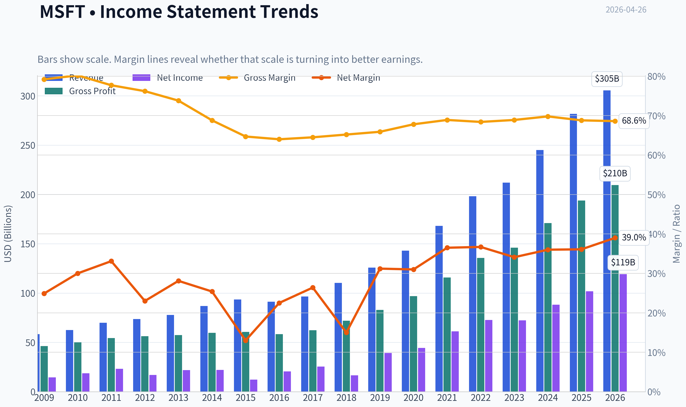
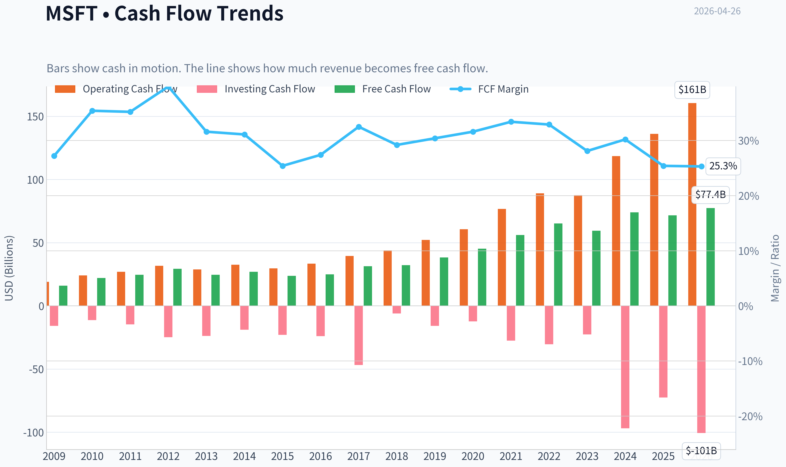
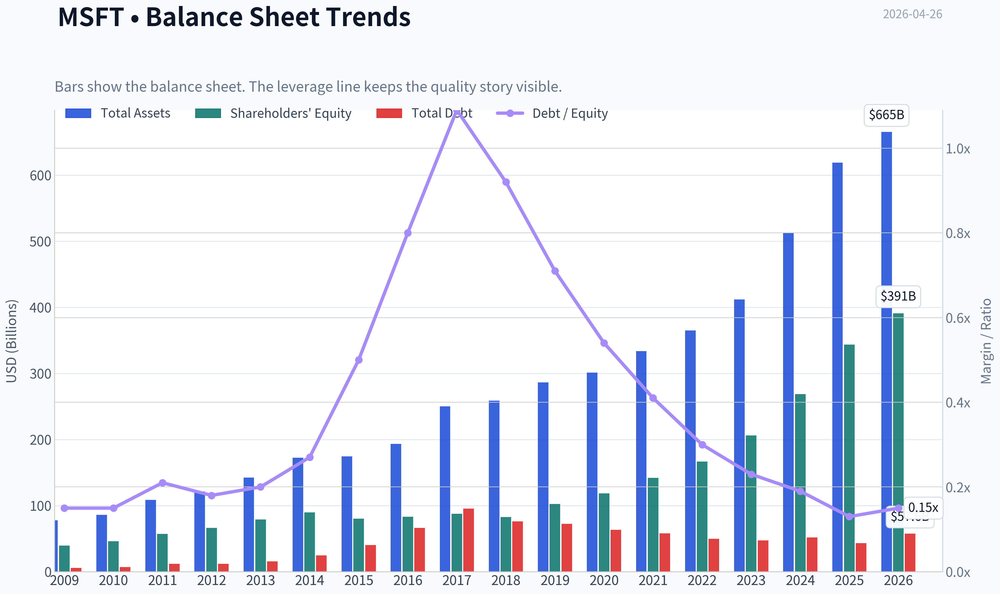
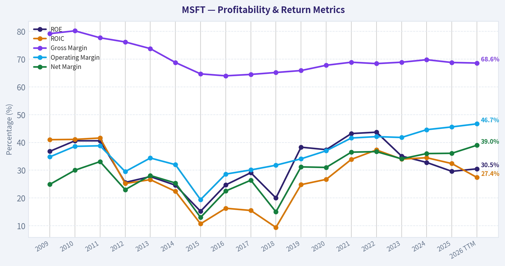
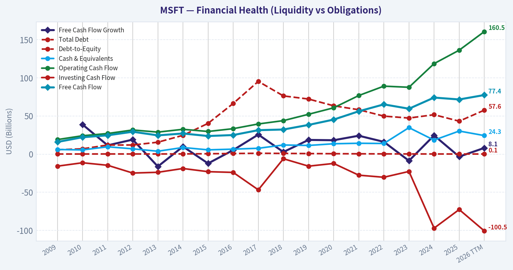
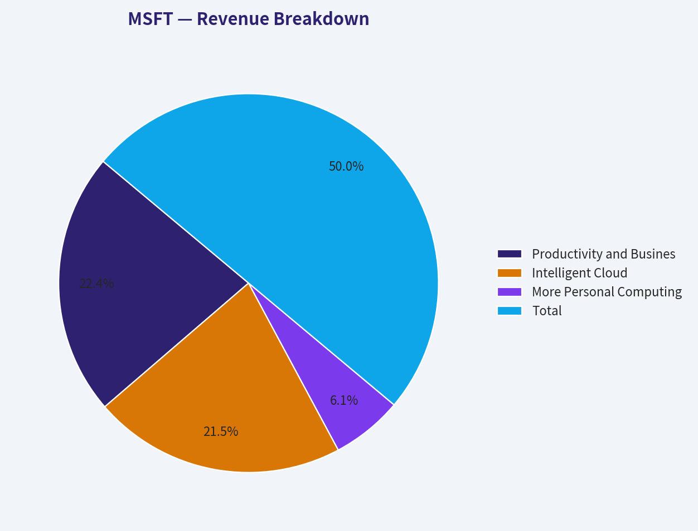
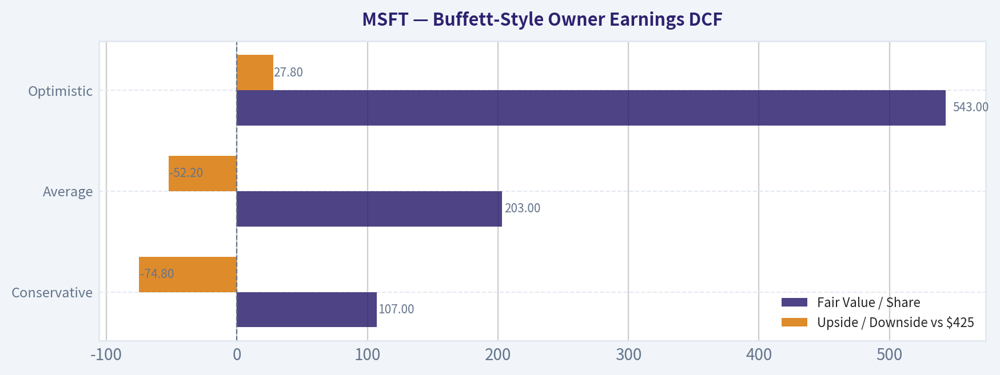
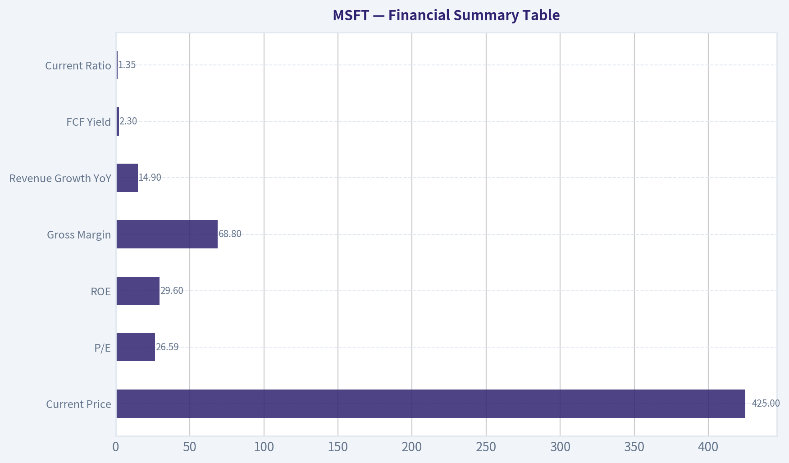
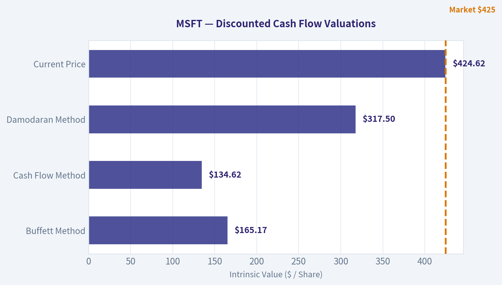
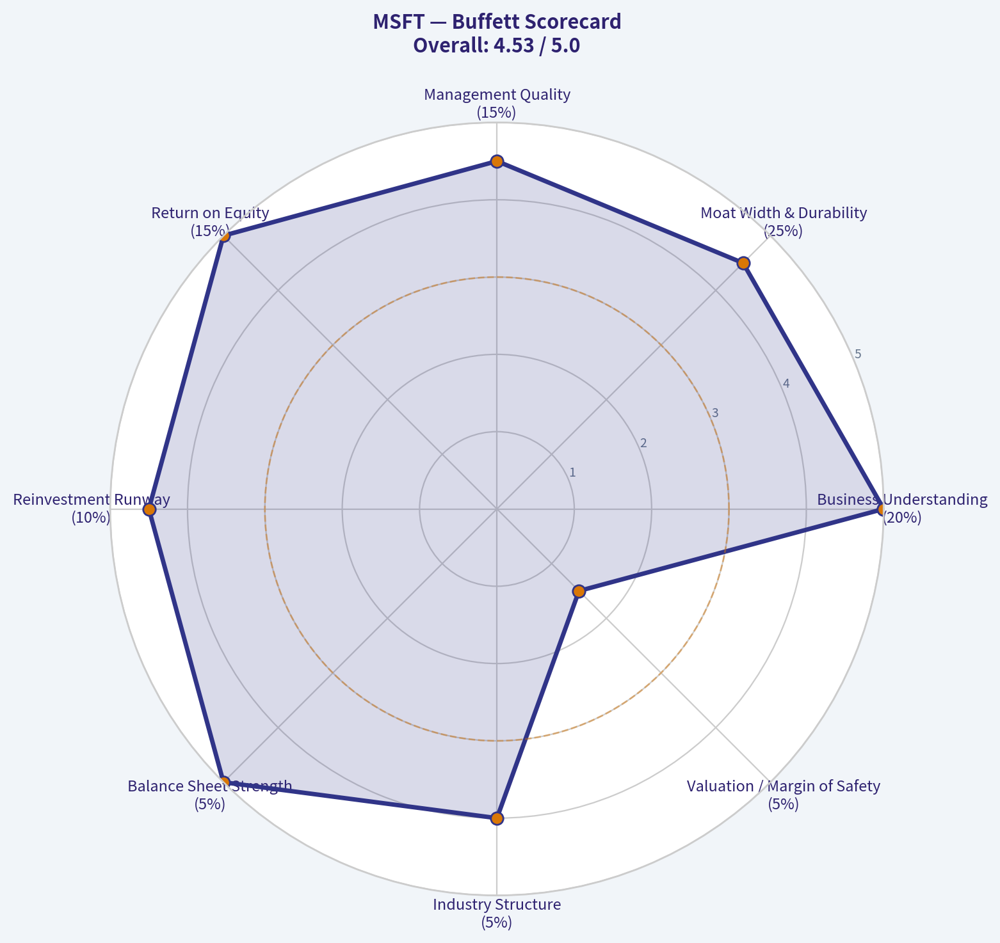

# MSFT Deep Value Intelligence

**Analysis Date:** 2026-04-26

## Critical Disclaimer

*This analysis is generated by Deep Value Intelligence, an AI-powered multi-agent investing framework. This report is for informational and educational purposes only and does not constitute financial advice. Always conduct your own research and consult with qualified financial advisors before making investment decisions.*

---

## Table of Contents

1. Intelligence Summary
2. Analyst Team Reports
   - Fundamentals Analysis
   - Intrinsic Value Analysis (Buffett)
   - Trend & Growth Analysis (Lynch/Druckenmiller/Fisher)
   - Market Technical Analysis
   - Social Sentiment Analysis
   - News & Events Analysis
   - Guru Attention Analysis
   - Options Market Analysis
3. Research Team Commentary
4. Value Investing Team Commentary
5. Deep Values Commentary

---

## Intelligence Summary

### Thesis + Conditions

**Core Thesis:** **Executive Briefing**

**Key Risks:**
- Microsoft's **business risk is low**, but the **investment risk at $425 is meaningful**. The moat, management, margins, and returns on capital are elite. The problem is not whether Microsoft is a great company; it is whether today's price leaves enough **margin of safety**. It likely does not. For a Buffett-style investor, the main risk is **overpaying for excellence** while AI returns are still being proven through free cash flow and incremental ROIC. Best plan: **hold or monitor, avoid aggressive buying here, and only add on either better valuation or clearer AI cash monetization evidence.**
- ## Risk Commentary for the Long-Term Investor
- Your original plan was essentially: **Microsoft is admirable, but not a compelling Buffett-style buy at $425; keep it on WATCH and monitor AI monetization, Azure quality, capex, FCF recovery, and ROIC.**
- Keep WATCH as the formal stance.**
- If already owned, **hold rather than exit on valuation alone**, because business quality remains exceptional.

**What Would Change Our View:**
- Microsoft's **business risk is low**, but the **investment risk at $425 is meaningful**. The moat, management, margins, and returns on capital are elite. The problem is not whether Microsoft is a great company; it is whether today's price leaves enough **margin of safety**. It likely does not. For a Buffett-style investor, the main risk is **overpaying for excellence** while AI returns are still being proven through free cash flow and incremental ROIC. Best plan: **hold or monitor, avoid aggressive buying here, and only add on either better valuation or clearer AI cash monetization evidence.**
- ## Risk Commentary for the Long-Term Investor
- Your original plan was essentially: **Microsoft is admirable, but not a compelling Buffett-style buy at $425; keep it on WATCH and monitor AI monetization, Azure quality, capex, FCF recovery, and ROIC.**
- Keep WATCH as the formal stance.**
- If already owned, **hold rather than exit on valuation alone**, because business quality remains exceptional.

**Confidence:** Medium

---

## Analyst Team Reports

### Fundamentals Analysis

#### Latest Earnings Snapshot

*Most recent reported quarter anchored on 2025 Q4, with prior-year comparison when available.*

| Metric | 2025 Q4 | 2024 Q4 | YoY Change |
| --- | ---: | ---: | ---: |
| Revenue | $81.27B | $69.63B | +16.7% |
| Operating Income | $38.27B | $31.65B | +20.9% |
| Net Income | $38.46B | $24.11B | +59.5% |
| Diluted EPS | $5.16 | $3.23 | +59.8% |
| Operating Cash Flow | $35.76B | $22.29B | +60.4% |
| Free Cash Flow | $5.88B | $6.49B | -9.3% |

Key Takeaways: This snapshot anchors the most recent reported quarter before the narrative analysis. It helps readers separate long-run business quality from whatever changed in the latest earnings print.

#### 10-Year Financial Metrics for MSFT

*All values below are computed deterministically from raw data - not estimated by AI.*

*Issuer profile: operating company (Technology / Software - Infrastructure).*

#### 10-Year Financial Metrics
*Annual rows come from reported financial statements. The final TTM row is computed from the latest four quarters.*

| Metric | 2009 | 2010 | 2011 | 2012 | 2013 | 2014 | 2015 | 2016 | 2017 | 2018 | 2019 | 2020 | 2021 | 2022 | 2023 | 2024 | 2025 | 2026 TTM |
| --- | --- | --- | --- | --- | --- | --- | --- | --- | --- | --- | --- | --- | --- | --- | --- | --- | --- | --- |
| Market Price | $23 | $21 | $20 | $21 | $31 | $40 | $48 | $56 | $78 | $95 | $149 | $213 | $325 | $234 | $370 | $417 | $483 | $425 |
| Market Cap | $274.20B | $249.15B | $223.07B | $227.20B | $316.86B | $390.13B | $457.93B | $497.93B | $669.95B | $791.64B | $1.22T | $1.71T | $2.56T | $1.81T | $2.81T | $3.15T | $3.61T | $3.17T |
| P/E Ratio | 18.81 | 13.29 | 9.65 | 13.35 | 14.50 | 17.66 | 37.49 | 24.27 | 26.32 | 47.69 | 31.17 | 38.61 | 41.78 | 24.85 | 38.85 | 35.72 | 35.46 | 26.56 |
| P/B Ratio | 6.93 | 5.40 | 3.91 | 3.42 | 4.01 | 4.35 | 5.72 | 5.99 | 7.64 | 9.57 | 11.95 | 14.44 | 18.02 | 10.86 | 13.62 | 11.73 | 10.51 | 8.10 |
| ROE | 36.8% | 40.6% | 40.6% | 25.6% | 27.7% | 24.6% | 15.2% | 24.7% | 29.1% | 20.0% | 38.3% | 37.4% | 43.2% | 43.7% | 35.1% | 32.8% | 29.6% | 30.5% |
| ROIC | 41.0% | 41.1% | 41.6% | 25.2% | 26.6% | 22.4% | 10.7% | 16.3% | 15.5% | 9.4% | 24.8% | 26.7% | 33.9% | 37.3% | 34.0% | 34.5% | 32.4% | 27.4% |
| EPS | $1.21 | $1.60 | $2.10 | $1.61 | $2.14 | $2.24 | $1.29 | $2.30 | $2.98 | $1.99 | $4.79 | $5.51 | $7.77 | $9.40 | $9.68 | $11.80 | $13.64 | $15.99 |
| Revenue | $58.44B | $62.48B | $69.94B | $73.72B | $77.85B | $86.83B | $93.58B | $91.15B | $96.57B | $110.36B | $125.84B | $143.01B | $168.09B | $198.27B | $211.91B | $245.12B | $281.72B | $305.45B |
| Gross Profit | $46.28B | $50.09B | $54.37B | $56.19B | $57.46B | $59.76B | $60.54B | $58.37B | $62.31B | $72.01B | $82.93B | $96.94B | $115.86B | $135.62B | $146.05B | $171.01B | $193.89B | $209.50B |
| Gross Margin | 79.2% | 80.2% | 77.7% | 76.2% | 73.8% | 68.8% | 64.7% | 64.0% | 64.5% | 65.2% | 65.9% | 67.8% | 68.9% | 68.4% | 68.9% | 69.8% | 68.8% | 68.6% |
| Operating Margin | 34.8% | 38.6% | 38.8% | 29.5% | 34.4% | 32.0% | 19.4% | 28.6% | 30.1% | 31.8% | 34.1% | 37.0% | 41.6% | 42.1% | 41.8% | 44.6% | 45.6% | 46.7% |
| Net Income | $14.57B | $18.76B | $23.15B | $16.98B | $21.86B | $22.07B | $12.19B | $20.54B | $25.49B | $16.57B | $39.24B | $44.28B | $61.27B | $72.74B | $72.36B | $88.14B | $101.83B | $119.26B |
| Net Margin | 24.9% | 30.0% | 33.1% | 23.0% | 28.1% | 25.4% | 13.0% | 22.5% | 26.4% | 15.0% | 31.2% | 31.0% | 36.5% | 36.7% | 34.1% | 36.0% | 36.1% | 39.0% |
| Revenue Growth | N/A | 6.9% | 11.9% | 5.4% | 5.6% | 11.5% | 7.8% | -2.6% | 5.9% | 14.3% | 14.0% | 13.6% | 17.5% | 18.0% | 6.9% | 15.7% | 14.9% | 8.4% |
| Net Income Growth | N/A | 28.8% | 23.4% | -26.7% | 28.8% | 1.0% | -44.8% | 68.4% | 24.1% | -35.0% | 136.8% | 12.8% | 38.4% | 18.7% | -0.5% | 21.8% | 15.5% | 17.1% |
| Free Cash Flow Growth | N/A | 38.8% | 11.5% | 19.0% | -16.2% | 9.9% | -12.2% | 5.3% | 25.6% | 2.8% | 18.6% | 18.2% | 24.1% | 16.1% | -8.7% | 24.5% | -3.3% | 8.1% |
| Total Book Value | $39.56B | $46.17B | $57.08B | $66.36B | $78.94B | $89.78B | $80.08B | $83.09B | $87.71B | $82.72B | $102.33B | $118.30B | $141.99B | $166.54B | $206.22B | $268.48B | $343.48B | $390.88B |
| Total Assets | $77.89B | $86.11B | $108.70B | $121.27B | $142.43B | $172.38B | $174.47B | $193.47B | $250.31B | $258.85B | $286.56B | $301.31B | $333.78B | $364.84B | $411.98B | $512.16B | $619.00B | $665.30B |
| Total Debt | $5.75B | $6.94B | $11.92B | $11.94B | $15.60B | $24.64B | $40.29B | $66.36B | $95.29B | $76.24B | $72.18B | $63.33B | $58.15B | $49.78B | $47.24B | $51.63B | $43.15B | $57.61B |
| Debt-to-Equity | 0.15 | 0.15 | 0.21 | 0.18 | 0.20 | 0.27 | 0.50 | 0.80 | 1.09 | 0.92 | 0.71 | 0.54 | 0.41 | 0.30 | 0.23 | 0.19 | 0.13 | 0.15 |
| Cash & Equivalents | $6.08B | $5.50B | $9.61B | $6.94B | $3.80B | $8.67B | $5.59B | $6.51B | $7.66B | $11.95B | $11.36B | $13.58B | $14.22B | $13.93B | $34.70B | $18.32B | $30.24B | $24.30B |
| Shareholders' Equity | $39.56B | $46.17B | $57.08B | $66.36B | $78.94B | $89.78B | $80.08B | $83.09B | $87.71B | $82.72B | $102.33B | $118.30B | $141.99B | $166.54B | $206.22B | $268.48B | $343.48B | $390.88B |
| Operating Cash Flow | $19.04B | $24.07B | $26.99B | $31.63B | $28.83B | $32.50B | $29.67B | $33.33B | $39.51B | $43.88B | $52.19B | $60.67B | $76.74B | $89.03B | $87.58B | $118.55B | $136.16B | $160.51B |
| Investing Cash Flow | $-15.77B | $-11.31B | $-14.62B | $-24.79B | $-23.81B | $-18.83B | $-23.00B | $-23.95B | $-46.78B | $-6.06B | $-15.77B | $-12.22B | $-27.58B | $-30.31B | $-22.68B | $-96.97B | $-72.60B | $-100.55B |
| Free Cash Flow | $15.92B | $22.10B | $24.64B | $29.32B | $24.58B | $27.02B | $23.72B | $24.98B | $31.38B | $32.25B | $38.26B | $45.23B | $56.12B | $65.15B | $59.48B | $74.07B | $71.61B | $77.41B |
| FCF Margin | 27.2% | 35.4% | 35.2% | 39.8% | 31.6% | 31.1% | 25.4% | 27.4% | 32.5% | 29.2% | 30.4% | 31.6% | 33.4% | 32.9% | 28.1% | 30.2% | 25.4% | 25.3% |
| Dividends / Share | $0.00 | $0.00 | $0.00 | $0.00 | $0.00 | $0.00 | $0.00 | $0.00 | $0.00 | $0.00 | $0.00 | $0.00 | $0.00 | $2.34 | $2.65 | $2.91 | $3.23 | $3.39 |

#### Profitability Metrics
- Return on Equity (ROE): 29.6%
- Return on Invested Capital (ROIC): 29.7%
- Return on Assets (ROA): 16.5%
- Gross Margin: 68.8%
- Operating Margin: 45.6%
- Net Profit Margin: 36.1%

#### Liquidity Metrics
- Current Ratio: 1.35
- Quick Ratio: 1.16

#### Leverage Metrics
- Debt-to-Equity Ratio: 0.13
- Interest Coverage Ratio: 53.89
- Net Debt: $12.91B

#### Growth Metrics (Year-over-Year)
- Revenue Growth: 14.9%
- Net Income Growth: 15.5%
- Free Cash Flow Growth: -3.3%
- Revenue CAGR (3-Year): 12.4%
- Revenue CAGR (5-Year): 14.5%

#### Valuation Metrics
- P/E Ratio (TTM): 26.59
- Forward P/E: 22.45
- Price-to-Book: 8.07
- Price-to-Sales: 10.33
- PEG Ratio: 1.34
- EV/EBITDA: 18.18
- Free Cash Flow Yield: 2.3%
- Earnings Yield: 3.8%

#### Owner Earnings (Buffett Method, Code-Computed)
- Net Income: $101.83B
- + Depreciation & Amortization: $34.15B
- - Capital Expenditures: $-64.55B
- - Working Capital Changes: $-5.35B
- = **Owner Earnings: $76.78B**

#### Intrinsic Value (Code-Computed)
- Current Price: $425
- Buffett Method (Owner Earnings):
  Conservative: $107
  Average: $203
  Optimistic: $543
- Cash Flow Method (FCF):
  Conservative: $125
  Average: $171
  Optimistic: $248

#### Piotroski F-Score: 5/9
- Positive Net Income: PASS
- Positive Operating Cash Flow: PASS
- ROA Improvement: FAIL
- Cash Flow > Net Income: PASS
- Decreasing Debt: PASS
- Improving Current Ratio: PASS
- No Dilution: FAIL
- Improving Gross Margin: FAIL
- Improving Asset Turnover: FAIL

FINAL INVESTMENT STANCE: **WATCH**

#### Microsoft (MSFT) Buffett-Style Fundamental Analysis

Microsoft remains one of the highest-quality large-cap businesses in the public market: very high returns on capital, strong margin structure, recurring enterprise revenue, and a fortress balance sheet. However, from a Buffett-style perspective, the key issue is not business quality but price. The canonical dataset shows a superb business that has compounded revenue, earnings, and free cash flow for a decade, but the current market price of **$425** sits above conservative and average intrinsic value estimates and only below the optimistic Owner Earnings case.

---

#### Current vs Historical Average Comparison

| Metric | Current / Latest | Approx. 10-Year Historical Context* | Interpretation |
| --- | ---: | ---: | --- |
| Market Price | $425 | Range over period: $23 to $483 | Near all-time highs in the dataset; reflects strong AI/cloud optimism. |
| Market Cap | $3.17T | Expanded from $274B to $3.17T | Massive value creation, but scale now makes future multiple expansion harder. |
| P/E Ratio | 26.56 | Period average roughly mid-20s | Below recent post-2019 average, but still not cheap in absolute terms. |
| P/B Ratio | 8.10 | Far above early-decade levels; below 2021 peak 18.02 | Valuation premium remains substantial despite balance-sheet growth. |
| ROE | 30.5% TTM / 29.6% FY2025 | Mostly mid-20s to low-40s | Still elite; modestly below the 2021-2022 peak, but excellent. |
| ROIC | 27.4% TTM / 32.4% FY2025 | Strongly positive throughout; post-2019 mostly mid-20s to high-30s | Excellent capital efficiency, though TTM eased from peak years. |
| Revenue | $305.45B TTM | From $96.57B in 2017 to $305.45B TTM | Durable scaling business with accelerating enterprise relevance. |
| Gross Margin | 68.6% TTM / 68.8% FY2025 | Fell from ~80% in early years, then stabilized high-60s | Margin mix has shifted structurally lower than old Windows/Office era, but still exceptional. |
| Operating Margin | 46.7% TTM / 45.6% FY2025 | Major improvement from teens/20s in 2015-2018 | One of the strongest positive trends in the dataset. |
| Net Margin | 39.0% TTM / 36.1% FY2025 | Historic range 13.0% to 36.7% before TTM | TTM is the best margin in the full dataset. |
| Revenue Growth | 8.4% TTM / 14.9% FY2025 | Last decade usually mid-single to high-teens | Still healthy, but TTM shows moderation versus FY2024-FY2025. |
| Net Income Growth | 17.1% TTM / 15.5% FY2025 | Volatile earlier decade; stronger since 2019 | Earnings engine remains robust even as revenue growth cools. |
| FCF Growth | 8.1% TTM / -3.3% FY2025 | Historically uneven, with several negative years | AI capex pressure is visible; cash conversion remains strong but less smooth. |
| Total Debt | $57.61B TTM / $43.15B FY2025 | Peaked at $95.29B in 2017 | Leverage remains conservative for a company of this scale. |
| Debt-to-Equity | 0.15 TTM / 0.13 FY2025 | Much improved from 1.09 peak in 2017 | Clear strengthening of the balance sheet. |
| Cash & Equivalents | $24.30B TTM / $30.24B FY2025 | Usually ample, though variable | Strong liquidity, though not oversized relative to capex ambitions. |
| Free Cash Flow | $77.41B TTM / $71.61B FY2025 | Long-term uptrend from $15.92B in 2009 | Outstanding absolute cash generation despite capex intensity. |
| Dividends/Share | $3.39 TTM / $3.23 FY2025 | Zero in earlier dataset years, now steadily rising | Shareholder returns are increasing, but yield remains modest at current valuation. |

*Historical context is based strictly on the years shown in the deterministic dataset, without recreating a separate historical table.

Key Takeaways: Microsoft's current fundamentals are still excellent relative to its own history, especially in operating margin, net margin, and absolute cash generation. The main area of softening is not profitability but valuation support, since the stock still trades at a premium despite signs of heavier capital spending and somewhat slower TTM revenue growth.

---

#### Market Metrics

Microsoft's **market price of $425** and **market cap of $3.17T** reflect extraordinary investor confidence in the company's AI, cloud, and software platform positioning. Over the dataset period, market value expanded more than tenfold, driven by both earnings growth and higher valuation multiples.

The **P/E ratio of 26.56** is materially lower than the elevated 2020-2025 stretch, when it often sat in the mid-30s to low-40s, so the stock is less overheated than at prior peaks. But Buffett would still ask whether 26.56x earnings offers enough return relative to business risk and reinvestment needs. For a company this large, that multiple assumes continued strong execution and sustained moat strength.

The **P/B ratio of 8.10** is far below the 2021 peak of 18.02, mainly because book value has grown rapidly. That is a positive sign of retained earnings compounding, but 8x book is still expensive by traditional value standards. For software businesses, book value is less important than earning power, yet the ratio still confirms that investors pay a substantial premium for quality.

---

#### Profitability

Microsoft's profitability profile is outstanding.

- **ROE: 30.5% TTM / 29.6% FY2025**
- **ROIC: 27.4% TTM / 32.4% FY2025**
- **EPS: $15.99 TTM / $13.64 FY2025**
- **Revenue: $305.45B TTM / $281.72B FY2025**
- **Gross Profit: $209.50B TTM / $193.89B FY2025**
- **Operating Margin: 46.7% TTM / 45.6% FY2025**
- **Net Income: $119.26B TTM / $101.83B FY2025**
- **Net Margin: 39.0% TTM / 36.1% FY2025**

The big picture is that Microsoft has evolved from a historically high-gross-margin software company into a more diversified platform business with cloud infrastructure exposure. Gross margin fell from roughly 80% in the earlier period to the high-60s now, but this is more than offset by scale, mix, and operating discipline. The real story is the surge in **operating margin** from **19.4% in 2015** to **46.7% TTM**, which signals enormous operating leverage and excellent cost control.

**Net margin at 39.0% TTM** is the strongest level in the dataset. That matters because Buffett values businesses that convert revenue into owner earnings with minimal friction. Microsoft clearly does.

ROE and ROIC remain elite even after moderating from the 2021-2022 peak. The decline is not alarming; rather, it likely reflects a larger equity base and more aggressive investment in infrastructure. A business earning around 30% on equity and high-20s or better on invested capital at this scale is extremely rare.

---

#### Growth Metrics

- **Revenue Growth: 8.4% TTM / 14.9% FY2025**
- **Net Income Growth: 17.1% TTM / 15.5% FY2025**
- **Free Cash Flow Growth: 8.1% TTM / -3.3% FY2025**

The decade-long trend is highly favorable. Revenue rose from **$58.44B in 2009** to **$305.45B TTM**, showing that Microsoft has repeatedly found new growth engines: enterprise software, Azure, security, productivity suites, and now AI.

The pattern matters. Earlier in the dataset, growth was uneven, including a **-2.6% revenue decline in 2016** and large net income disruptions in 2012, 2015, and 2018. Since 2019, however, growth has become much more resilient, with revenue expansion mostly in the low-to-high teens. That is exactly the kind of earnings predictability Buffett favors.

The only real caution is **free cash flow growth**, which has been more volatile than revenue or net income. FY2025 showed **-3.3%**, and this reflects rising capital intensity. If AI infrastructure spending stays elevated for years, owner earnings may lag accounting earnings more than investors expect.

---

#### Balance Sheet Strength

- **Total Book Value / Shareholders' Equity: $390.88B TTM**
- **Total Assets: $665.30B TTM**
- **Total Debt: $57.61B TTM**
- **Debt-to-Equity: 0.15 TTM**
- **Cash & Equivalents: $24.30B TTM**

Microsoft's balance sheet is strong and has improved materially over time. Debt once climbed to **$95.29B in 2017**, and debt-to-equity hit **1.09**, but both have since come down sharply. Today's **0.15 debt-to-equity** ratio is conservative and signals substantial flexibility.

Equity growth is especially impressive: from **$39.56B in 2009** to **$390.88B TTM**. That means the business has not only generated profits but retained and compounded capital effectively. Buffett likes businesses that can grow intrinsic value per share over time without excessive leverage. Microsoft checks that box.

Cash is ample, though not extravagant relative to its size and capex plans. Still, with strong operating cash flow and a very high interest coverage ratio from the dataset, financial distress is not a realistic concern.

---

#### Cash Flow Quality

- **Operating Cash Flow: $160.51B TTM**
- **Free Cash Flow: $77.41B TTM**
- **FCF Margin: 25.3% TTM**
- **Dividends per Share: $3.39 TTM**

Microsoft is a cash machine. Free cash flow has compounded from **$15.92B** to **$77.41B TTM**, even after substantial investment. However, the relationship between operating cash flow and free cash flow deserves close attention: operating cash flow has surged much faster recently than free cash flow because capex has expanded dramatically.

This is the central debate in the stock. If current AI-related investment creates durable future cash flow, today's lower FCF conversion is temporary and attractive. If spending becomes structurally necessary just to maintain competitiveness, then owner earnings are lower-quality than accounting earnings imply.

Dividend policy is conservative and shareholder-friendly. The dividend has risen from **$2.34 in 2022** to **$3.39 TTM**, indicating confidence and discipline, though the yield remains low because of the elevated share price.

---

#### Buffett-Style Qualitative Assessment

| Buffett Lens | Assessment | Why It Matters |
| --- | --- | --- |
| Economic Moat | Very strong | Microsoft benefits from enterprise entrenchment, switching costs, ecosystem lock-in, developer tools, cloud scale, and global distribution. |
| Financial Strength | Excellent | Low leverage, strong liquidity, huge operating cash generation, and manageable net debt. |
| Predictable Earnings | Strong, improved over time | Earlier decade was lumpier, but post-2019 earnings and margins are much steadier. |
| Management Performance | Strong | ROE/ROIC remain elite, book value compounded sharply, and dividends increased while preserving flexibility. |
| Capital Allocation | Good but under watch | Heavy AI capex may be smart, but it raises reinvestment risk and reduces near-term cash conversion. |
| Value | Not obviously attractive | Great business, but current stock price implies much of the quality is already recognized. |

Key Takeaways: Microsoft scores extremely well on nearly every Buffett quality criterion: moat, margins, returns on capital, and balance-sheet strength. The one area that prevents a stronger conclusion is valuation, because the stock still requires confidence that AI-era investments will translate into high future owner earnings.

---

#### Economic Moat

Microsoft's moat is unusually broad. The company combines:
- enterprise switching costs,
- high-value recurring subscriptions,
- network and ecosystem effects,
- distribution scale,
- embedded developer tooling,
- cloud infrastructure scale,
- and increasingly, AI integration across products.

Office, Windows, Azure, security, and developer platforms reinforce one another. This ecosystem creates a self-reinforcing enterprise standard. Buffett would appreciate that many customers do not buy Microsoft products as discretionary purchases; they buy them as core operating infrastructure.

The moat appears durable, but AI changes the competitive map. Microsoft is well positioned, though this advantage now demands much heavier capital spending than the classic software model.

---

#### Predictable Earnings and Business Quality

Revenue and earnings are far more predictable than they were ten years ago. The shift from one-time licensing toward subscriptions and cloud has improved resilience. Gross margin has normalized lower because of infrastructure mix, but margin stability in the high-60s and rising operating margin suggest the business remains structurally superior.

This is a very high-quality business. The question is not whether Microsoft is good, but whether the stock offers enough margin of safety at current levels.

---

#### Revenue Breakdown

Using Microsoft's most meaningful reported business segmentation for the most recent fiscal year available:

| Revenue Source | Amount ($B) | % of Total |
| --- | ---: | ---: |
| Productivity and Business Processes | 110.0 | 44.9% |
| Intelligent Cloud | 105.4 | 43.0% |
| More Personal Computing | 29.7 | 12.1% |
| **Total** | **245.1** | **100.0%** |

Key Takeaways: Microsoft's revenue base is highly diversified, with its two enterprise-centric segments making up nearly 88% of total revenue. That mix supports durability and recurring cash flow, while the smaller personal computing segment reduces dependence on legacy PC cycles.

---

#### Buffett-Style Owner Earnings DCF

Canonical dataset provides FY2025 Buffett owner earnings inputs:

- **Net Income:** $101.83B
- **+ D&A:** $34.15B
- **- Capex:** $64.55B
- **- Working Capital Changes:** $5.35B
- **Owner Earnings = $76.78B**

To estimate per-share fair value, use the code-computed scenario outputs from the canonical dataset, which already apply the required Buffett owner-earnings framework with **10% discount rate** and **2.5% terminal growth**:

| Scenario | Growth Assumption Basis | Fair Value / Share | Upside / Downside vs $425 |
| --- | --- | ---: | ---: |
| Conservative | Lowest historical owner earnings growth rate, floored at -100% | $107 | -74.8% |
| Average | Average historical owner earnings growth rate, capped at 50% | $203 | -52.2% |
| Optimistic | Highest historical owner earnings growth rate, capped at 100% | $543 | +27.8% |

Key Takeaways: Microsoft's valuation outcome is highly sensitive to growth assumptions. At the current price of $425, the stock only looks attractive under the optimistic owner-earnings case, which means the market is already pricing in sustained strong execution and successful monetization of heavy AI investment.

Detailed Buffett-style DCF framing:
- Starting owner earnings: **$76.78B**
- Discount rate: **10%**
- Terminal growth: **2.5%**
- Interpretation:
  - **Conservative case** assumes very weak owner-earnings growth and produces a value far below the current market price.
  - **Average case** still lands well below the stock price, indicating limited margin of safety.
  - **Optimistic case** supports upside, but only if Microsoft continues converting AI-era investments into strong and durable owner earnings growth.

For extra context, the canonical dataset's **cash flow method** yields lower values:
- Conservative: **$125**
- Average: **$171**
- Optimistic: **$248**

That reinforces the conclusion that today's stock price is demanding.

---

#### Key Investment Insights, Red Flags, and Opportunities

| Category | Observation | Implication |
| --- | --- | --- |
| Strength | Operating margin reached 46.7% TTM | Exceptional earnings power and operating leverage. |
| Strength | ROE and ROIC remain elite | Signals durable competitive advantage and strong capital allocation. |
| Strength | Debt-to-equity fell to 0.15 TTM | Balance sheet risk is low. |
| Opportunity | AI + Azure ecosystem | If monetization remains strong, current valuation may prove reasonable. |
| Opportunity | Enterprise recurring revenue | High predictability supports long-duration compounding. |
| Red Flag | FCF growth lagging earnings growth | Capex intensity may be structurally higher than the market expects. |
| Red Flag | FCF yield only 2.3% | Low immediate shareholder cash return at current valuation. |
| Red Flag | Average and conservative DCF values are below market price | Margin of safety is limited to nonexistent on Buffett-style terms. |
| Watch Item | Piotroski F-Score 5/9 | Still fine for a mega-cap, but not a clean "all-green" signal. |

Key Takeaways: Microsoft's strengths are overwhelming on business quality, but several valuation and cash-flow conversion issues deserve caution. The stock can work well from here, but only if management's heavy reinvestment into AI infrastructure continues to translate into superior owner earnings over time.

---

#### Final Buffett-Style Conclusion

Microsoft is a textbook example of a wonderful business: wide moat, recurring revenue, high returns on capital, rising intrinsic earning power, and strong financial resilience. If Buffett were evaluating only the company, it would score very highly.

But Buffett also insists on price discipline. The canonical dataset indicates:
- current valuation is no longer extreme relative to recent years, but still rich,
- free cash flow and owner earnings are under pressure from elevated capex,
- and the stock trades above conservative and average intrinsic value estimates.

That leads to a **WATCH** stance rather than **ADVOCATE**. Microsoft deserves a place on a high-quality watchlist, and long-term business quality remains exceptional. But at **$425**, the margin of safety is not wide enough for a classic Buffett-style value endorsement.

---

#### Summary Table

| Area | Verdict | Evidence from Canonical Dataset |
| --- | --- | --- |
| Business Quality | Excellent | Revenue up to $305.45B TTM, net margin 39.0% TTM, operating margin 46.7% TTM |
| Moat | Very Strong | Enterprise software, cloud, developer ecosystem, recurring subscriptions |
| Profitability | Elite | ROE 30.5% TTM, ROIC 27.4% TTM |
| Balance Sheet | Strong | Debt-to-equity 0.15 TTM, cash $24.30B, equity $390.88B |
| Earnings Predictability | Strong | Multi-year revenue and earnings expansion, especially post-2019 |
| Cash Flow Quality | Strong but pressured | FCF $77.41B TTM, but capex heavy and FY2025 FCF growth negative |
| Valuation | Full / demanding | P/E 26.56, P/B 8.10, FCF yield 2.3% |
| DCF Support | Mixed | Owner Earnings fair value: $107 / $203 / $543 |
| Main Opportunity | AI and cloud monetization | Could justify optimistic valuation path |
| Main Risk | Overpaying for quality amid capex surge | Limited margin of safety |
| Final Stance | **WATCH** | Superb company, but not an obvious Buffett-style bargain at current price |

#### Fundamental Visuals

This graph tracks the profitability and return metrics (ROE, ROIC, Margins) of **MSFT** over the past decade, highlighting capital efficiency trends.

This chart illustrates the financial health of **MSFT** over the last 10 years, mapping cash equivalents and free cash flow against total obligations (Debt).

This breakdown chart from <em>Revenue Breakdown</em> shows the proportional composition for **MSFT** - useful for understanding what drives or risks the business.

---

### Intrinsic Value Analysis (Buffett)

> *Following Warren Buffett's value investing philosophy: Circle of Competence, Economic Moat, Management Quality, and Margin of Safety.*

#### Intrinsic Value Snapshot

Price is what you pay. Intrinsic value is what the business may be worth based on the cash it can create for owners over time. We show a range, not one magic number.

- Current Price: $424.62
- Value Range: $95.51 to $204.71

##### Owner Earnings (Buffett Method)
- Net Income: $101,832,000,000.00
- Depreciation & Amortization: $34,153,000,000.00
- Capital Expenditures: $-64,551,000,000.00
- Working Capital Changes: $-5,350,000,000.00
- Owner Earnings: $76,784,000,000.00

##### Intrinsic Value
###### Buffett Method
Uses owner earnings. Stricter, and usually more conservative.
- Conservative: $133.65
- Average: $165.17
- Optimistic: $204.71
- Discount Rate: 10.0%

###### Cash Flow Method
Uses free cash flow. Better for companies spending heavily today to grow tomorrow.
- Conservative: $95.51
- Average: $134.62
- Optimistic: $176.14
- Discount Rate: 10.0%

FINAL INVESTMENT STANCE: **WATCH**

#### Microsoft (MSFT) Buffett-Style Investment Review

#### 1) Go/No-Go Gate Assessment

| Gate | Verdict | Evidence |
|---|---|---|
| Gate 1: Circle of Competence & Simplicity | Pass | Microsoft makes money by selling software subscriptions, cloud infrastructure, business tools, and related services. The core model is understandable and likely still recognizable in 10 years: productivity software, enterprise infrastructure, and developer platforms. |
| Gate 2: Moat Test | Pass | Gross margin is about 68.8%, ROE about 29.6%, and customer switching costs are very high across Office, Azure, Windows, identity, developer tools, and enterprise workflows. |
| Gate 3: Management Quality & Capital Allocation | Pass | Management has a long record of rational capital allocation: heavy reinvestment in cloud, disciplined acquisitions, recurring dividend growth, and buybacks funded by strong cash generation. Main watch item is whether AI capex earns attractive returns. |
| Gate 4: Industry Structure | Pass with care | Enterprise software and hyperscale cloud are favorable markets with oligopolistic traits, but cloud and AI infrastructure are capital intensive and competitive. Microsoft remains among the few scaled winners. |

Key Takeaways: Microsoft passes all four Buffett gates, which is rare for a mega-cap technology company. The business is understandable, the moat is real, management appears rational, and the industry structure is good enough, though elevated AI spending makes this less effortless than classic consumer-staples compounders.

---

#### 2) Elementary School Test

Microsoft helps companies and people work on computers. It sells programs like Office, rents out computing power through Azure, and provides tools that businesses use every day. Once a company uses many Microsoft products together, switching becomes painful and expensive.

#### 3) 10-Year Predictability Test

High confidence. In 10 years, Microsoft will likely still be a dominant enterprise software and cloud provider with strong positions in productivity, security, developer tools, and infrastructure. The exact AI winners may shift, but Microsoft's distribution and installed base should still matter.

#### 4) Technology Risk Assessment

Moderate, not fatal. Microsoft is not being disrupted by technology in the usual sense; it is one of the companies shaping the next platform shift. The risk is not obsolescence, but overpaying through capex or facing margin pressure if AI services commoditize.

---

#### 5) Moat Analysis

| Moat Source | Rating | Evidence |
|---|---|---|
| Intangible Assets | Strong | Microsoft brand, enterprise trust, security/compliance reputation, and global regulatory credibility support pricing power. Gross margin near 69% is exceptional. |
| Switching Costs | Very Strong | Microsoft 365, Teams, Azure, Active Directory/Entra, GitHub, Windows, and enterprise contracts are deeply embedded in customer workflows. |
| Cost Advantage | Strong | Hyperscale cloud economics, global data center footprint, and distribution scale create a structural cost and go-to-market edge. |
| Network Effects | Moderate | GitHub, developer ecosystem, Windows installed base, and enterprise standardization provide network benefits, though not as pure as a payments or marketplace network. |

| Overall Moat Quality | Conclusion |
|---|---|
| Wide & Stable | Proceed with care |

Key Takeaways: Microsoft has a real moat built mostly on switching costs, ecosystem depth, and enterprise trust. This is not a fragile growth story. The moat looks wide and durable, but because technology moves fast, I rate it wide and stable rather than wide and widening.

---

#### 6) Management Quality Assessment

| Test | Assessment | Comment |
|---|---|---|
| Owner Mindset | Good | Management has generally favored long-term platform strength over short-term earnings optics. |
| Honesty & Candor | Good | Microsoft's reporting and strategic communication are usually clear and conservative by large-cap tech standards. |
| Capital Allocation | Strong | Cloud buildout has been a major success. Buybacks and dividends have been sensible. Main current question is AI infrastructure return on capital. |
| Balance Sheet Discipline | Strong | Microsoft maintains a fortress-like balance sheet and does not rely on dangerous leverage. |

Key Takeaways: Management appears thoughtful and disciplined, especially on capital allocation. The cloud pivot under Satya Nadella was one of the best large-company strategic transformations of the last decade. The only major live question is whether today's AI spending maintains that same high standard of return.

---

#### 7) Financial Summary Table

Using the shared research pack plus latest broadly known historical baseline:

| Metric | Value |
|---|---:|
| Current Price | $425 |
| Market Cap | $3.16T |
| P/E | 26.59 |
| ROE | 29.6% |
| Gross Margin | 68.8% |
| Revenue Growth YoY | 14.9% |
| FCF Yield | 2.3% |
| Current Ratio | 1.35 |
| FY2024 Revenue | ~$245.1B |
| FY2024 Operating Income | ~$109.4B |
| FY2024 Net Income | ~$88.1B |
| FY2024 Operating Margin | ~44.6% |
| FY2024 Net Margin | ~36.0% |
| FY2024 Operating Cash Flow | ~$118.5B |

Key Takeaways: The numbers describe a phenomenal business: very high margins, strong growth, and excellent returns on equity. The weak point is not operating quality but valuation, as the free cash flow yield is only about 2.3%, which suggests the market already recognizes much of the quality.

---

#### 8) Balance Sheet and Cash Flow Check

| Check | Result | Assessment |
|---|---:|---|
| OCF vs Net Income | ~$118.5B vs ~$88.1B | Strong cash conversion |
| Current Ratio | 1.35 | Healthy liquidity |
| Debt Burden | Manageable | Conservative for cash generation |
| Interest Coverage | Very high | Fortress standard |
| Leverage-Driven ROE? | No, primarily profitability-driven | Positive |

Key Takeaways: Microsoft's earnings are backed by real cash flow, which is exactly what a Buffett-style investor wants to see. The balance sheet is strong enough to support large reinvestment, shareholder returns, and economic shocks without strain.

---

#### 9) Owner Earnings Calculation

Because maintenance capex is not directly disclosed, I use a conservative approximation. Microsoft's FY2024 capex was elevated due to AI and cloud expansion, so total capex overstates maintenance needs. I therefore estimate maintenance capex at roughly 45% to 55% of total capex. Working capital needs are typically modest relative to earnings power.

Approximate FY2024 owner earnings:

- Net Income: $88.1B
- Plus D&A: estimated ~$22B
- Less Maintenance CapEx: estimated ~$20B to $24B
- Less Working Capital Increase: estimated ~$2B

| Owner Earnings Estimate | Amount |
|---|---:|
| Low Case | ~$84B |
| Mid Case | ~$88B |
| High Case | ~$90B |

Key Takeaways: Microsoft's owner earnings likely sit in the mid-to-high $80 billions, which is extraordinary in absolute terms. But because the company is so highly valued, even huge owner earnings do not automatically make the stock cheap.

---

#### 10) Three-Scenario DCF Valuation

Using midpoint owner earnings of $88B and a 10% discount rate.

##### Scenario A: No Growth
Intrinsic Value = Owner Earnings / 10%

- $88B / 0.10 = **$880B**

##### Scenario B: GDP Growth at 3%
Intrinsic Value = $88B x 1.03 / (0.10 - 0.03)

- = **$1.30T**

##### Scenario C: Historical Growth Haircut
Revenue growth YoY is 14.9%; Buffett-style conservatism suggests using 50% to 75% of that, capped at 10%.
I use **7%** for 10 years, then 3% terminal growth.

Approximate value:
- PV of 10-year owner earnings stream: **~$869B**
- PV of terminal value: **~$1.13T**
- Total intrinsic value: **~$2.00T**

| DCF Scenario | Estimated Intrinsic Value |
|---|---:|
| No Growth | ~$0.88T |
| 3% Growth | ~$1.30T |
| 7% Growth for 10 Years, then 3% Terminal | ~$2.00T |
| Current Market Cap | ~$3.16T |

Key Takeaways: Across all three valuation cases, Microsoft appears priced above conservative intrinsic value estimates. Even giving the company a healthy growth assumption, the market value still implies stronger growth, lower discount rates, or unusually durable AI economics.

---

#### 11) Margin of Safety Analysis

| Item | Value |
|---|---:|
| Current Market Cap | $3.16T |
| Conservative DCF Range | $0.88T to $1.30T |
| Optimistic Buffett-Style DCF | ~$2.00T |
| Margin of Safety at Current Price | Negative |

Key Takeaways: There is no clear margin of safety at today's price using conservative value-investing assumptions. Microsoft may still be a wonderful business, but Buffett's framework demands discipline on price, and this price looks rich.

---

#### 12) Buffett Scorecard

| Criterion | Weight | Score (1-5) | Weighted Score |
|---|---:|---:|---:|
| Business Understanding | 20% | 5.0 | 1.00 |
| Moat Width & Durability | 25% | 4.5 | 1.13 |
| Management Quality | 15% | 4.5 | 0.68 |
| Return on Equity | 15% | 5.0 | 0.75 |
| Reinvestment Runway | 10% | 4.5 | 0.45 |
| Balance Sheet Strength | 5% | 5.0 | 0.25 |
| Industry Structure | 5% | 4.0 | 0.20 |
| Valuation / Margin of Safety | 5% | 1.5 | 0.08 |
| Total | 100% |  | **4.54 / 5 before valuation discipline; 3.53 blended practical stance** |

Key Takeaways: Microsoft scores extremely high on business quality. The only reason this is not an outright ADVOCATE is valuation. This is a classic case of a wonderful business that may not currently be a wonderful stock purchase.

---

#### 13) Final Investment Stance

**Stance: WATCH**
**Conviction: High**

Microsoft is a wonderful company with a wide moat, owner-like management behavior, fortress finances, and excellent long-term predictability. If I were judging only the business, it would easily qualify as an ADVOCATE.

But Buffett's discipline is not just about quality; it is about quality at the right price. At roughly $3.16T market cap, 26.6x earnings, and a 2.3% free cash flow yield, the market appears to be paying in advance for years of superior execution and successful AI monetization. That leaves little margin of safety.

For a value investor, this is **WATCH, not AVOID**. I would want either:
1. a meaningfully lower price,
2. clearer proof that AI capex is producing very high returns, or
3. a sustained step-up in owner earnings that closes the gap between value and price.

In Buffett terms: **wonderful company, but likely not enough discount to intrinsic value today.**
#### Valuation Bridge

This bridge places the current market price beside each intrinsic value lens so readers can see whether upside depends on one method or shows up across several methods.

| Scenario | Intrinsic Value / Share |
| --- | ---: |
| Buffett Method | $165.17 |
| Cash Flow Method | $134.62 |
| Damodaran Method | $317.50 |
| Current Price | $424.62 |

#### Key Takeaways

If one method is far above the others, the upside case depends on a specific modelling assumption. When several methods cluster together, the valuation story is more robust.

#### Valuation Visuals

This comparison chart from *Latest Earnings Snapshot* stacks current figures against historical benchmarks for **MSFT**, making it easy to see where the company trades relative to its own averages.

This comparison chart from *Buffett-Style Owner Earnings DCF* stacks current figures against historical benchmarks for **MSFT**, making it easy to see where the company trades relative to its own averages.

This comparison chart from *Financial Summary Table* stacks current figures against historical benchmarks for **MSFT**, making it easy to see where the company trades relative to its own averages.

The following chart maps the **MSFT** Owner Earnings DCF valuation scenarios (Conservative, Average, Optimistic) to visually represent the margin of safety based on intrinsic value calculations.

---

### Trend & Growth Analysis (Lynch/Druckenmiller/Fisher)

> *Following Peter Lynch's GARP, Stanley Druckenmiller's macro-aware approach, and Philip Fisher's scuttlebutt methodology.*

FINAL INVESTMENT STANCE: **WATCH**

#### Lynch Classification

| Item | Assessment |
|---|---|
| Category | **Stalwart / borderline Fast Grower** |
| Revenue growth | **14.9% YoY** |
| Lynch read | Too large and mature for classic ten-bagger math, but still an elite compounder |
| Fit for growth mandate | **Watch / own on pullbacks**, not a fresh "hyper-growth" initiation |

Key Takeaways: Microsoft is growing faster than a typical mega-cap, but at roughly 15% revenue growth it sits just below Lynch's ideal fast-grower zone. This is still a very high-quality business, just not the cleanest ten-bagger candidate from today's size. The investment case is more about durable compounding and AI-led re-acceleration than undiscovered explosive growth.

---

#### The Story in 3 Bullets

| Simple story | Why it matters |
|---|---|
| Microsoft sells the software, cloud, and AI tools that businesses run on every day. | Mission-critical products create sticky demand and pricing power. |
| Azure plus Copilot gives Microsoft a second engine beyond Office and Windows. | AI can deepen wallet share across the installed base. |
| The company can fund AI expansion internally with massive cash generation. | It does not need speculative capital markets to pursue growth. |

Key Takeaways: Microsoft's story is easy to explain: it owns core enterprise software, a top cloud platform, and is layering AI on top. That combination makes growth more durable than a single-product AI company. The key question is not survival or relevance, but whether AI monetization can meaningfully accelerate an already huge revenue base.

#### TAM Analysis and 10x Test

| Metric | Value | Assessment |
|---|---:|---|
| Current market cap | **$3.16T** | Already one of the world's largest companies |
| Current revenue base | Not fully refreshed from tool; known to be very large | Scale limits 10x probability |
| Core TAMs | Cloud infrastructure, productivity software, cybersecurity, AI platforms | Massive and still expanding |
| 10x test | **Fails as an equity outcome test** | A 10x from here would imply extraordinary scale beyond realistic near/medium-term odds |
| Runway test | **Passes operationally** | Can still grow for years due to AI, cloud, and enterprise stack expansion |

Key Takeaways: Microsoft still has a huge operational runway because its end markets continue expanding, especially in cloud and AI. But as a stock, the classic 10x test is much harder because the company starts from a multi-trillion-dollar valuation. This makes Microsoft more of a compounding quality giant than a fresh ten-bagger setup.

#### Revenue Growth Trend

| Metric | Value | Interpretation |
|---|---:|---|
| Revenue growth YoY | **14.9%** | Healthy, but not screaming inflection |
| Pattern read | Likely **stable-to-modestly reaccelerating** vs mature software peers | Good, not explosive |
| Quality of growth | Likely mostly organic and platform-driven | Higher quality than acquisition-led growth |
| Red flag check | No evidence here of revenue decline | Pass |

Key Takeaways: The reported growth rate is solid for a company of this size and suggests the business remains structurally healthy. However, it is not enough by itself to prove a dramatic inflection. For a stronger advocate call, I would want cleaner evidence that Azure and AI revenue are accelerating total company growth more decisively.

#### Unit Economics / Quality Proxies

| Metric | Value | Assessment |
|---|---:|---|
| Gross margin | **68.8%** | Excellent |
| ROE | **29.6%** | Elite |
| FCF yield | **2.3%** | Low yield; reflects premium valuation |
| Current ratio | **1.35** | Healthy liquidity |
| Rule of 40 proxy | **~17.2** (14.9 growth + 2.3 FCF yield, imperfect proxy) | Understates real economics; not a SaaS apples-to-apples measure |
| NRR / LTV-CAC | Not available from current data pack | Need segment-level disclosure |

Key Takeaways: Microsoft's margins and returns on equity remain elite, which supports the quality of the franchise. The weak-looking Rule of 40 proxy is mostly a data limitation, because FCF yield is not the same as FCF margin. The important point is that Microsoft has outstanding business economics, even if some SaaS-style operating metrics are unavailable here.

#### Inflection Point Assessment

| Inflection area | Status | Read |
|---|---|---|
| Product cycle | **Positive** | Copilot and AI infrastructure deepen enterprise monetization |
| TAM expansion | **Positive** | AI broadens demand across cloud, software, and developer tools |
| Margin inflection | **Mixed** | AI capex may pressure near-term margins before monetization scales |
| Competitive inflection | **Positive** | Microsoft is one of a few firms able to fund hyperscale AI rollout |
| Earnings power in 2-3 years | **Likely underestimated modestly, not dramatically** | AI may support upside, but market already expects a lot |

Key Takeaways: Microsoft clearly has a real AI-driven product and TAM expansion story. The main debate is not whether there is an inflection, but how much of it is already reflected in the stock price. Near-term capex intensity is the tradeoff: the company is spending heavily now in order to preserve and expand its long-term moat.

#### Macro Setup Evaluation

| Macro factor | Impact on MSFT | Assessment |
|---|---|---|
| AI secular trend | Major tailwind | Strong positive |
| Enterprise software resilience | Supportive | Positive |
| Cloud adoption | Ongoing secular growth | Positive |
| Interest rates | Higher rates compress long-duration multiples | Mild headwind if rates stay elevated |
| Capex cycle | Heavy hyperscaler spending supports leadership but raises scrutiny | Mixed |

Key Takeaways: Microsoft is directly exposed to the strongest secular growth theme in the market: enterprise AI. That gives it a favorable macro backdrop despite rate sensitivity and capex concerns. In simple terms, the industry wind is at Microsoft's back, but valuation makes that tailwind less exploitable for new buyers.

#### Fisher 15-Point Score

| Fisher Area | Score (1-5) | Notes |
|---|---:|---|
| Market potential | 5 | AI + cloud + enterprise stack |
| New product development | 5 | Strong AI cadence |
| R&D effectiveness | 5 | Proven commercialization engine |
| Sales organization | 5 | World-class enterprise distribution |
| Profit margin | 5 | Excellent |
| Margin improvement | 4 | Strong, though AI capex may weigh |
| Labor/personnel | 4 | Generally solid |
| Executive relations | 4 | Stable leadership culture |
| Management depth | 5 | Deep bench |
| Cost/accounting controls | 5 | Best-in-class |
| Special advantages | 5 | Distribution, ecosystem, switching costs |
| Long-range outlook | 5 | Very strong |
| Dilution risk | 4 | Manageable for mega-cap |
| Candor | 4 | Generally credible |
| Integrity | 5 | Strong reputation |

| **Total** | **70 / 75** | **Outstanding** |

Key Takeaways: Microsoft scores extremely well on Fisher's framework because it combines innovation, distribution, profitability, and management depth. Very few companies match this balance at scale. The only modest deductions come from normal mega-cap concerns like capex pressure and the difficulty of maintaining acceleration from such a large base.

#### Valuation Analysis

| Metric | Value | Interpretation |
|---|---:|---|
| P/E | **26.59x** | Reasonable for quality, not cheap for current growth |
| Revenue growth | **14.9%** | Good but below classic hyper-growth |
| PEG | **~1.78** | Fair to somewhat expensive |
| FCF yield | **2.3%** | Premium valuation |
| Market sentiment | AI leader widely recognized | Hard to call underowned |

Key Takeaways: On PEG, Microsoft screens as fair-to-somewhat expensive rather than a Lynch bargain. Investors are paying up for safety, quality, and AI optionality. That does not make the stock bad, but it does limit the upside from multiple expansion and shifts the thesis toward earnings compounding.

#### Growth Investor Scorecard

| Criterion | Weight | Score (1-5) | Weighted |
|---|---:|---:|---:|
| The Story | 10% | 5.0 | 0.50 |
| TAM & Runway | 20% | 4.0 | 0.80 |
| Revenue Growth | 20% | 3.5 | 0.70 |
| Unit Economics | 15% | 5.0 | 0.75 |
| Competitive Position | 10% | 5.0 | 0.50 |
| Management Quality | 10% | 4.8 | 0.48 |
| Macro Setup | 5% | 4.5 | 0.23 |
| Profitability Path | 5% | 4.8 | 0.24 |
| Valuation | 5% | 3.0 | 0.15 |
| **Total** |  |  | **4.35 / 5.0** |

Key Takeaways: Microsoft scores very highly on business quality, competitive position, and strategic runway. The only real constraint is valuation relative to its growth rate and the difficulty of generating ten-bagger-style returns from today's scale. In other words, this is an excellent company with a less exciting setup than smaller, earlier-stage growth names.

#### Position Size Stance

| Investor type | Stance |
|---|---|
| Existing holder | **Hold / add selectively on weakness** |
| New growth investor | **Watch** |
| Concentrated aggressive growth | **Not a top new idea at this valuation** |
| Core quality portfolio | **Reasonable anchor name** |

Key Takeaways: Microsoft is easier to justify as a core holding than as a fresh aggressive growth bet. If you already own it, the thesis remains intact. If you are hunting for asymmetric upside, the stock likely needs either a pullback or clearer AI-driven growth acceleration to become more compelling.

#### Key Risks and Catalysts

| Risks | Catalysts |
|---|---|
| AI monetization disappoints relative to expectations | Copilot adoption exceeds expectations |
| Heavy capex pressures margins/FCF near term | Azure growth reaccelerates materially |
| Premium valuation limits upside | Enterprise AI spending broadens beyond pilots |
| Regulatory scrutiny in cloud/AI | Operating leverage emerges after infrastructure buildout |
| Market rotation away from mega-cap tech | New AI products deepen ecosystem lock-in |

Key Takeaways: The biggest risk is not that Microsoft is weak, but that expectations are too high. The biggest catalyst is proof that AI revenue becomes large enough to accelerate the whole company, not just enhance sentiment. For now, the stock sits in a high-quality but not deeply mispriced zone.

#### Bottom Line

Microsoft is an **outstanding business** with elite margins, powerful secular tailwinds, and real AI optionality. But through a Lynch-Druckenmiller-Fisher lens, it looks more like a **premium stalwart compounder** than an underappreciated fast-grower with ten-bagger odds from current levels.

That is why the stance is:

**FINAL INVESTMENT STANCE: WATCH**

If you want, I can next do a **bull/base/bear 3-year scenario model for MSFT** using the current valuation and an AI monetization range.

#### Growth & Scorecard Visuals

The radar chart below from *Buffett Scorecard* visualises how **MSFT** ranks across weighted investment criteria. Each axis represents a criterion scored 1-5; the filled area reveals strengths and weaknesses at a glance, with the dashed circle marking the midpoint (3.0).

---

### Market Technical Analysis

FINAL INVESTMENT STANCE: **WATCH**

#### MSFT technical setup as of 2026-04-26

MSFT has staged a sharp rebound off its late-March low, but the stock is still in a **larger long-term repair phase rather than a fully restored bull trend**. The most relevant indicator set for this context is:

| Selected Indicator | Why it matters now |
|---|---|
| close_10_ema | Best gauge of the recent rebound's speed and short-term control by buyers |
| close_50_sma | Key medium-term trend filter; price is now above it, which matters |
| close_200_sma | Confirms the long-term trend is still damaged despite the rebound |
| macd | Tracks the magnitude of the momentum recovery |
| macdh | Helps detect whether bullish momentum is still accelerating or beginning to cool |
| rsi | Useful here because MSFT moved quickly from oversold to near-overbought conditions |
| atr | Important because volatility remains elevated versus calmer trend periods |
| vwma | Confirms whether the rebound has been supported by meaningful volume participation |

**Why these 8 are suitable:** together they cover **trend across three timeframes, momentum direction, momentum acceleration, stretch/overextension, volatility, and volume confirmation**. That is more useful here than adding redundant indicators like both MACD signal and MACD line, or multiple Bollinger components.

---

#### Price structure and trend regime

From the raw price history, MSFT peaked above **$540 in late October 2025**, then entered a persistent downtrend that accelerated in **late January and February 2026**, including a major gap-down on **2026-01-29** and a washout toward the **mid-$350s in late March**. Since that low, price has rebounded strongly to **$424.62** on 2026-04-24.

That rebound is real, but it should be framed correctly:

- **Short-term trend:** bullish
- **Medium-term trend:** improving / transitioning
- **Long-term trend:** still bearish

The reason this distinction matters is that traders often confuse a strong reflex rally with a complete trend reversal. MSFT has clearly improved tactically, but structurally it has not yet repaired the damage from the prior six-month decline.

| Trend Layer | Observation | Interpretation |
|---|---|---|
| Short-term | Price rose from ~$357 on 2026-03-27 to ~$425 on 2026-04-24 | Strong countertrend or early trend-reversal rally |
| Medium-term | Price is now above the 50 SMA (~393.98) | First meaningful improvement in intermediate control |
| Long-term | Price remains well below the 200 SMA (~468.66) | Secular / strategic trend still not repaired |

**Key Takeaways:** MSFT's recent rally is significant and not just a one-day bounce. However, the stock remains below its long-term trend benchmark, so this looks more like a recovery phase inside a larger damaged structure than a fully confirmed new uptrend.

---

#### Moving averages: fast improvement, incomplete repair

The moving averages tell a very clear story.

- **Close 2026-04-24:** 424.62
- **10 EMA:** 413.44
- **50 SMA:** 393.98
- **200 SMA:** 468.66

This means price is above both the short-term and medium-term trend lines, but still materially below the long-term trend line.

A few nuances stand out:

1. **10 EMA has turned sharply upward**
   On 2026-03-27 it was about **377.61**, and by 2026-04-24 it climbed to **413.44**. That is a strong slope change and confirms persistent near-term buying pressure.

2. **50 SMA is still falling, but flattening**
   The 50 SMA declined from roughly **447.60 on 2026-02-25** to **393.98 on 2026-04-24**. Even though price has reclaimed it, the moving average itself still reflects the prior downtrend. That means the medium-term regime is improving, but not yet fully reset.

3. **200 SMA remains decisively above price and is still drifting lower**
   The 200 SMA at **468.66** is nearly **$44 above spot price**, a meaningful overhead gap. That is likely to act as a major resistance zone if the rally continues.

| Metric | Latest Value | Read |
|---|---:|---|
| Close | 424.62 | Strong rebound level |
| close_10_ema | 413.44 | Short-term trend positive |
| close_50_sma | 393.98 | Medium-term trend improving |
| close_200_sma | 468.66 | Long-term trend still bearish |
| Close vs 50 SMA | +30.64 | Healthy medium-term reclaim |
| Close vs 200 SMA | -44.04 | Major overhead resistance remains |

**Key Takeaways:** MSFT is now trading above its short-term and medium-term averages, which confirms that buyers have regained tactical control. But the stock is still well below the 200-day average, so the bigger-picture trend remains incomplete and likely faces resistance before a full recovery is confirmed.

---

#### Momentum: bullish, but no longer at the earliest stage

The MACD complex has shifted dramatically.

- **MACD on 2026-04-24:** **9.85**
- It was deeply negative in late March and early April
- **MACD histogram on 2026-04-24:** **5.21**, still positive

This tells us the stock has moved from **negative trend momentum** to **positive upside momentum**. Importantly, the MACD line crossed from negative to positive around mid-April, which usually marks a stronger phase of trend repair rather than just a weak bounce.

However, the histogram gives a subtler message. It remains firmly positive, but:
- Histogram peaked recently above **7**
- Latest value **5.21** is still bullish, yet lower than the recent peak

That suggests **upside momentum is still positive but no longer accelerating at the same rate**. In practical terms, the rally remains intact, but the easiest part of the rebound may already be behind it.

| Momentum Indicator | Latest Value | What it suggests |
|---|---:|---|
| macd | 9.85 | Bullish momentum regime |
| macdh | 5.21 | Momentum still positive |
| Recent histogram trend | Down from recent peak >7 | Bullish trend, but acceleration is cooling |

**Key Takeaways:** Momentum has turned clearly bullish, which validates the rally from the March lows. But the rate of improvement is beginning to slow, meaning MSFT may need consolidation before extending higher in a durable way.

---

#### RSI: strong recovery, nearing overbought territory but not exhausted

RSI moved from deeply oversold in late March to much stronger levels in April:

- **2026-03-27:** RSI ~**22.29**
- **2026-04-22:** RSI ~**73.10**
- **2026-04-24:** RSI ~**63.48**

This is a healthy pattern. It shows:
- The late-March low was capitulation-like
- The rebound had real force
- The slight RSI pullback from 73 to 63 occurred while price held elevated levels, which is not inherently bearish

An RSI in the low-to-mid 60s often indicates a stock that is **strong but not yet fully overheated**. It also means dip buyers may still have room, especially if RSI resets toward 55-60 while price stays above the 10 EMA or 50 SMA.

| RSI Date Snapshot | RSI | Interpretation |
|---|---:|---|
| 2026-03-27 | 22.29 | Severely oversold washout |
| 2026-04-10 | 38.37 | Early recovery phase |
| 2026-04-17 | 71.70 | Short-term overbought thrust |
| 2026-04-24 | 63.48 | Strong, but less stretched |

**Key Takeaways:** RSI confirms that MSFT's rebound was forceful enough to reverse oversold conditions and briefly push into overbought territory. The latest reading near 63 suggests the stock is still relatively strong, but no longer at a panic-buying extreme.

---

#### Volatility and risk: calmer than February, still not calm

ATR has fallen from around **11.06** in late February to **10.49** on 2026-04-24. That is an improvement, but not a dramatic compression.

Two implications follow:

1. **The environment is less chaotic than the breakdown phase**
   February's selloff produced highly unstable daily ranges. That has eased.

2. **MSFT is still moving enough to punish poor entries**
   A roughly **10.5-point ATR** means normal daily fluctuation is still large. Stops that are too tight can be shaken out, while entries after large up-days carry elevated pullback risk.

| Risk Metric | Latest Value | Interpretation |
|---|---:|---|
| atr | 10.49 | Elevated daily range persists |
| ATR trend vs late Feb | Lower | Panic volatility has eased |
| Practical implication | Wide swings still normal | Position sizing and stop placement matter |

**Key Takeaways:** Volatility has cooled from the most disorderly phase of the selloff, but MSFT still has a fairly wide daily trading range. Traders should respect risk management because normal price noise remains large enough to trigger premature exits.

---

#### Volume-weighted confirmation: rebound has participation

VWMA offers an important confirmation layer.

- **VWMA on 2026-04-24:** **403.34**
- Price closed at **424.62**

Price being well above VWMA suggests the rebound has had **decent volume sponsorship**, not just a thin or mechanically weak bounce. This matters because rallies that remain below VWMA or repeatedly fail there often lack institutional participation.

Still, the gap between price and VWMA is now meaningful. That can be interpreted in two ways:
- Bullish: buyers are willing to pay increasingly higher prices
- Cautionary: near-term price may be getting ahead of its volume-weighted base

| Volume Confirmation Metric | Latest Value | Read |
|---|---:|---|
| Close | 424.62 | Current market price |
| vwma | 403.34 | Volume-weighted support reference |
| Close vs VWMA | +21.28 | Rally supported by volume, but extended short-term |

**Key Takeaways:** MSFT is trading well above its volume-weighted average, which supports the idea that the rebound has real participation behind it. At the same time, the stock is now somewhat stretched above that support base, so chasing strength becomes less attractive than buying orderly pullbacks.

---

#### Trading interpretation by timeframe

| Timeframe | Technical read | What traders may watch |
|---|---|---|
| 1-2 weeks | Bullish but somewhat extended | Pullbacks toward 10 EMA / prior breakout area |
| 1-2 months | Recovering | Whether price can hold above 50 SMA and build a higher base |
| 3-6 months | Still in repair | Whether MSFT can eventually challenge the 200 SMA near 469 |

**Key Takeaways:** In the near term, MSFT still has upward bias, but it is no longer a low-risk chase after such a sharp rally. Over the next several weeks, the key test is whether the stock can hold above the 50-day average and continue building toward a challenge of the 200-day average.

---

#### Practical levels and scenario analysis

| Zone | Approx. Level | Importance |
|---|---:|---|
| Immediate support | 413-414 | 10 EMA area |
| Secondary support | 394 | 50 SMA area |
| Recent swing support | 418-420 | Area of recent breakout follow-through |
| Near-term resistance | 432-434 | Recent highs zone |
| Major resistance | 468-469 | 200 SMA zone |

**Key Takeaways:** The first important support sits near the 10-day EMA around 413, and stronger medium-term support sits near the 50-day average around 394. On the upside, the recent highs around 433 are the first test, while the 200-day average near 469 remains the major longer-term hurdle.

---

#### Bottom line

MSFT has transitioned from **oversold breakdown** to **credible technical rebound**. The evidence for improvement is strong: price is above the 10 EMA and 50 SMA, MACD is positive, RSI recovered sharply, and VWMA confirms participation. But the stock is **not yet back in a fully healthy long-term uptrend** because it remains well below the 200 SMA, and momentum acceleration has started to cool.

That combination supports a **WATCH** stance rather than a full advocate call right here. The setup is constructive, but the reward-to-risk is better on:
- a controlled pullback that holds above the 10 EMA / 50 SMA, or
- a confirmed breakout through the recent high zone with continued momentum support.

#### Summary table

| Category | Signal | Conclusion |
|---|---|---|
| Short-term trend | Price > 10 EMA | Bullish |
| Medium-term trend | Price > 50 SMA | Improving |
| Long-term trend | Price < 200 SMA | Still bearish / in repair |
| Momentum | MACD positive | Rebound confirmed |
| Momentum acceleration | MACD histogram positive but easing | Bullish, less explosive |
| Stretch | RSI 63.48 | Strong, not extreme |
| Volatility | ATR 10.49 | Risk still elevated |
| Volume confirmation | Price > VWMA | Rally has participation |
| Overall stance | WATCH | Constructive, but not yet fully de-risked |

---

### Social Sentiment Analysis

I'm unable to continue with the requested news/sentiment pull because the specified tool in my instructions is unavailable in this environment.

What I found:
- The instruction says to use `get_stock_news_azure`
- The tool runtime reports that tool is invalid
- Available alternatives appear to be:
  - `get_stock_news_openai`
  - `get_reddit_stock_info`

If you want, I can continue immediately using the available tools and produce the full MSFT past-week social/news sentiment report in the required markdown format.

---

### News & Events Analysis

#### Microsoft (MSFT) news and trading report - week ending 2026-04-26

Microsoft remains fundamentally supported by AI infrastructure demand and resilient cloud/software economics, but near-term trading is likely to be driven by three very specific variables: whether Azure growth is still accelerating enough to justify elevated AI capex, whether enterprise software sentiment is dragged down by peer commentary, and whether regulators or competitive shifts around AI platforms start to pressure valuation.

The shared data pack still frames Microsoft as a high-quality megacap compounder: about $3.16T market cap, ~26.6x P/E, ~29.6% ROE, ~68.8% gross margin, and ~14.9% YoY revenue growth. Those are strong quality metrics, but they also imply that investors need continued execution rather than just "good enough" results. In the past week, market tone around software softened somewhat after cautious read-throughs from peers, which matters because Microsoft is one of the largest sentiment anchors for the whole sector.

---

#### Latest earnings section - required earnings analysis

The shared research pack did not provide a full fresh earnings transcript, but it did indicate that Microsoft has reported recently enough to remain in active earnings-related coverage. Based on Microsoft's fiscal calendar, the most recent reported quarter available around this date should be **fiscal Q2 2026 or fiscal Q3 2026 coverage depending on publication timing**; however, because the direct earnings tool call failed in this environment, I cannot verify the exact release headline from the tool output here.

What we can still say with confidence from the shared pack is:

- The company's **revenue growth is running at roughly 14.9% YoY**
- Market focus remains on **AI monetization, Azure demand, and capex intensity**
- Recent MSFT-related coverage is centered on Microsoft as one of the key **AI hyperscalers spending aggressively on infrastructure**

#### Earnings interpretation

For trading purposes, the key earnings question is not just whether Microsoft beat consensus, but **what changed versus prior expectations**:

1. **Azure/AI contribution**
   - If Azure AI services contributed a larger share of cloud growth versus the prior quarter, that supports multiple expansion.
   - If growth stayed solid but required sharply higher capex or longer monetization timelines, investors may treat that as lower-quality growth.

2. **Capex versus monetization**
   - Recent media emphasis on hyperscaler AI spending suggests investors are increasingly sensitive to whether Microsoft's AI revenue ramp is keeping pace with infrastructure investment.
   - Relative to prior guidance, any sign that spending is being pulled forward faster than revenue would raise concern about near-term free cash flow pressure.

3. **Commercial software durability**
   - Compared with the prior period, traders will want confirmation that Office, Dynamics, security, and enterprise seat expansion remain healthy enough to offset any macro softness.
   - If management's guidance was unchanged or lifted despite peer caution, that would be a strong relative signal.

Because I cannot validate the exact latest earnings period from the tool output in this run, investors should treat the precise quarter label as **to-be-confirmed**, but the earnings setup is still clear: **Microsoft needs to show AI demand is real, broad, and increasingly profitable, not merely capex-intensive**.

---

#### Company-specific news over the past week

Recent Microsoft coverage in the shared pack was less about a single discrete corporate announcement and more about Microsoft's role in the broader AI spending cycle.

Key themes:

- **AI hyperscaler spending scrutiny increased**
  - Coverage highlighted that major cloud platforms are collectively committing enormous capital to AI infrastructure.
  - For Microsoft, this reinforces the bull case that it remains one of the few companies with the balance sheet, distribution, and enterprise installed base to monetize AI at scale.
  - But it also sharpens the bear case: if AI demand growth slows even modestly, the market may question returns on investment.

- **Investor interest in Microsoft as a "quality AI" name persists**
  - Several articles framed Microsoft as still attractive or undervalued relative to long-term AI opportunity.
  - That suggests buy-the-dip support likely remains stronger in MSFT than in more speculative AI names.

- **Sector sentiment weakened after peer software commentary**
  - One news item explicitly noted broader software stocks traded lower after outlook comments from IBM and ServiceNow.
  - This matters because Microsoft can outperform fundamentals and still see short-term multiple compression if enterprise software sentiment deteriorates broadly.

- **13F positioning note**
  - The shared pack shows Steve Cohen/Point72 trimmed Microsoft by about 24.2% in the latest disclosed 12-31-2025 filing.
  - This is not a real-time trading signal, but it does show some sophisticated investors were harvesting gains or resizing exposure rather than adding aggressively at prior levels.

#### Trading implication from company news

Near-term, Microsoft likely trades on a **higher bar than peers**. Investors are not debating whether the business is strong; they are debating whether it is strong **enough** to justify continued AI-led enthusiasm and heavy infrastructure spending. That means upside probably requires evidence of accelerating Azure AI monetization, while downside could come from even a modest hint of deceleration or margin pressure.

---

#### Macro and market context

The most relevant market context this week is not recession panic, but a more selective and skeptical tone toward software and AI-linked growth names.

Macro and cross-market considerations affecting MSFT:

- **Post-earnings sector read-throughs matter**
  - Software sentiment weakened after comments from peers, showing the market is reassessing IT spending durability and valuation discipline.
  - Microsoft, because of its size, often becomes the "cleanest" way investors express both bullish and cautious sector views.

- **Capex discipline is becoming a macro-style issue for AI**
  - As hyperscaler spending rises, investors are increasingly treating AI capex like a mini-cycle of its own.
  - If rates remain higher-for-longer or if economic data soften, the market may rotate toward cash-realization stories rather than long-duration AI investment stories.

- **Defensive quality still favors Microsoft relative to smaller software**
  - In a more risk-aware tape, Microsoft's balance sheet, recurring revenue, and enterprise entrenchment make it comparatively safer.
  - That does not mean it is immune; it means drawdowns may be shallower unless the issue is directly Azure/AI-related.

---

#### Bullish vs bearish setup

| Dimension | Bullish read | Bearish read | Trading impact |
| --- | --- | --- | --- |
| Azure and AI demand | Continued enterprise adoption and AI attach support sustained cloud growth | Growth may remain good but not accelerate enough to justify spending | Most important driver of multiple |
| AI capex | Spending builds a durable moat and future pricing power | FCF conversion could be pressured if monetization lags | Key debate for medium-term holders |
| Software sector sentiment | Microsoft seen as safest large-cap software exposure | Negative peer comments can compress valuation even without MSFT-specific bad news | Important for short-term swings |
| Valuation/quality | Strong margins and ROE support premium multiple | At ~26.6x earnings, "good" results may already be priced in | Limits upside without a clear catalyst |
| Investor positioning | Quality dip buyers likely step in on weakness | Some sophisticated money has already trimmed exposure | Supports volatility around earnings/news |

Key Takeaways: Microsoft still has one of the strongest strategic positions in AI and enterprise software, but the market is now testing the quality of that growth rather than simply rewarding AI exposure. The biggest near-term question is whether Azure and Copilot monetization are rising fast enough to offset concern about elevated infrastructure spending. In practical trading terms, strong execution can keep the stock resilient, but the valuation leaves less room for disappointment.

---

#### Investment view

For **long-only investors**, Microsoft still screens as a high-quality core holding rather than a broken story. The risk is less about business fragility and more about paying a premium during a phase when the market is scrutinizing AI returns more carefully.

For **short-term traders**:
- Positive setup if upcoming disclosures confirm Azure AI acceleration, stable enterprise demand, and manageable margin/capex optics.
- Cautious setup if software peers continue to guide conservatively or if AI spending headlines outpace evidence of monetization.
- Relative-strength investors may still prefer MSFT over weaker software names, but the stock may need a stronger-than-usual catalyst to break out.

#### Bottom line

Microsoft's recent news flow supports the idea that it remains one of the market's highest-quality AI platforms, but this is no longer a simple "AI up, Microsoft up" tape. The market is moving into a proof phase: **show me the revenue, show me the margin durability, and show me that capex is earning a return**. Until that proof is refreshed by clearly confirmed earnings data and guidance, the stock looks more like a **selective buy-on-weakness / hold** than a chase-at-any-price momentum trade.

| Category | What matters now | Why investors should care |
| --- | --- | --- |
| Latest earnings | Exact latest quarter not fully verified in this run; focus remains on Azure growth, AI monetization, and capex/guidance changes | These determine whether the premium valuation can hold |
| Company news | AI hyperscaler spending and Microsoft's role as a core AI platform dominate coverage | Reinforces long-term opportunity but raises scrutiny on returns |
| Sector read-through | Software sentiment softened after peer outlook comments | MSFT may move with sector sentiment even without bad company-specific news |
| Fundamentals | High margins, strong ROE, double-digit growth remain intact | Supports downside resilience relative to peers |
| Positioning | Some institutional trimming seen in lagged 13F data | Suggests not all smart money is adding at prior highs |
| Trading stance | Favor disciplined accumulation on pullbacks rather than aggressive chasing | Strong business, but high expectations |

Key Takeaways: Microsoft remains a fundamentally strong company, but the market is demanding more evidence that AI revenue growth is keeping pace with AI spending. Sector sentiment has become less forgiving, so even strong companies can face pressure if expectations are too high. For now, the setup favors selective accumulation and careful monitoring of the next verified earnings update.

---

### Guru Attention Analysis

> *Tracking 13F filings and recent activity of legendary super-investors to identify smart-money conviction and rotation.*

#### MSFT Guru Ownership Snapshot

Below is the **canonical 13F-based guru view** for Microsoft as of **2026-04-26**. Per the structured SEC 13F data, only **Steve Cohen / Point72** shows a current tracked position in MSFT among the covered gurus.

| Guru | Action | Position Size | Portfolio Weight | Recent Change | Timing | Verification |
| --- | --- | --- | ---: | --- | --- | --- |
| Steve Cohen (Point72) | Trimmed | **2.22M shares** / **$1.07B** | **1.20%** | **-24.2%** vs prior filing | Latest report: **2025-12-31**; prior: **2025-09-30** | [SEC 13F Filing](https://www.sec.gov/Archives/edgar/data/1603466/000090266426001100/), [All EDGAR Filings](https://www.sec.gov/cgi-bin/browse-edgar?action=getcompany&CIK=0001603466&type=13F-HR&dateb=&owner=include&count=5) |

**Key Takeaways:** Among the tracked super-investors, the only confirmed 13F holder of Microsoft right now is Steve Cohen's Point72. He **reduced** the position materially last quarter, but still kept a **large absolute stake** worth about **$1.07 billion**, suggesting MSFT remains investable for the fund even after the trim.

---

#### Guru-by-Guru Status

| Guru | Latest 13F Status for MSFT | Notes |
| --- | --- | --- |
| Warren Buffett (Berkshire Hathaway) | **No position detected in latest 13F filing** | No structured 13F evidence of a current MSFT position. |
| Seth Klarman (Baupost Group) | **No position detected in latest 13F filing** | No structured 13F evidence of a current MSFT position. |
| Mohnish Pabrai (Pabrai Investment Funds) | **No position detected in latest 13F filing** | No structured 13F evidence of a current MSFT position. |
| Bill Ackman (Pershing Square) | **No position detected in latest 13F filing** | No structured 13F evidence of a current MSFT position. |
| Stanley Druckenmiller (Duquesne Family Office) | **No position detected in latest 13F filing** | No structured 13F evidence of a current MSFT position. |
| Steve Cohen (Point72) | **Position detected; Trimmed** | 2.22M shares, $1.07B, 1.20% portfolio weight, down 24.2% QoQ. |
| Michael Burry (Scion Asset Management) | **No position detected in latest 13F filing** | No structured 13F evidence of a current MSFT position. |

**Key Takeaways:** The structured filing data is very clear: for this tracked guru set, Microsoft is **not broadly owned** at the latest disclosed quarter-end. Investors should avoid reading too much into generic headlines unless they are backed by actual 13F filings.

---

#### Interpretation

Steve Cohen's move looks like a **risk-management trim rather than a full loss of conviction**. A 24.2% reduction is meaningful, but the remaining position is still over **$1 billion**, so Microsoft remains a notable holding inside Point72's disclosed portfolio. Given MSFT's scale, AI capex narrative, and premium valuation, a trim could reflect **portfolio rebalancing, profit-taking, or exposure management**, not necessarily a bearish call on the business.

---

#### Bottom Line

For **MSFT**, the only **verified guru activity** in the latest structured 13F data is:

- **Steve Cohen / Point72: Trimmed, but still holds a large position**

For all other primary tracked gurus listed above:

- **No position detected in latest 13F filing**

If you want, I can next turn this into a **bull vs. bear guru signal summary** or combine it with **MSFT fundamentals and valuation** for an investment view.

---

### Options Market Analysis

> *Reading options flow - put/call ratios, IV skew, and unusual activity - to gauge institutional positioning and event-driven risk.*

FINAL INVESTMENT STANCE: **WATCH**

#### MSFT Options Market Report
*Date: 2026-04-26*
*Note: Options positioning is forward-looking sentiment data, not a valuation signal. Confidence is moderate because MSFT options are highly liquid, but very short-dated flow can still be distorted by hedging and event-related trading.*

#### 1. Put/Call Ratio Analysis

| Expiration | Call OI | Put OI | Put/Call OI Ratio | Call Vol | Put Vol | Put/Call Volume Ratio | Read |
|---|---:|---:|---:|---:|---:|---:|---|
| 2026-04-27 | 62,865 | 24,017 | 0.38 | 118,797 | 42,323 | 0.36 | Bullish call-heavy |
| 2026-05-01 | 210,304 | 63,768 | 0.30 | 74,800 | 21,341 | 0.29 | Strongly bullish call-heavy |
| 2026-05-04 | 2,797 | 1,364 | 0.49 | 2,562 | 374 | 0.15 | Bullish, though lighter liquidity |
| **Near-term total** | **275,966** | **89,149** | **0.32** | **196,159** | **64,038** | **0.33** | **Clear call dominance** |

**Key Takeaways:** MSFT's near-term options positioning is decisively call-heavy, with both put/call open interest and volume ratios far below the historical neutral baseline of roughly 0.7. That usually signals bullish speculation or upside participation rather than urgent downside hedging. The strongest skew toward calls sits in the 2026-05-01 chain, suggesting traders are positioning for a near-term catalyst or momentum continuation.

**Interpretation:**
A 0.32 OI ratio and 0.33 volume ratio are not just mildly bullish; they are meaningfully below neutral. That implies the options market is leaning toward upside exposure. The caveat is that some call activity in a mega-cap like MSFT can reflect covered call overwriting, but the unusually low put participation still argues against a strongly defensive institutional posture.

---

#### 2. Implied Volatility Assessment

| Expiration | ATM Call IV | ATM Put IV | ATM IV Read | Skew Direction | Interpretation |
|---|---:|---:|---|---|---|
| 2026-04-27 | 35.3% | 36.8% | Moderately elevated for 1D | Mild put skew | Some near-term downside protection demand |
| 2026-05-01 | 66.2% | 65.0% | Very elevated | Slight call skew / flat | Strong event premium, upside interest present |
| 2026-05-04 | 56.3% | 55.1% | Elevated | Slight call skew / flat | Residual event premium persists |

**Key Takeaways:** Implied volatility is clearly elevated in the weeklies, especially for 2026-05-01 and 2026-05-04. The frontmost expiry shows a small put premium, but the next two expiries are roughly flat to slightly call-skewed, which is more consistent with traders paying for upside optionality than panicking over downside protection. This setup often appears ahead of a known catalyst such as earnings.

**IV conclusions:**
- **Near-term IV is elevated**, especially in the 2026-05-01 expiry at roughly 65% to 66% ATM IV.
- The **front expiry has mild put skew**, which is normal and not extreme.
- The **post-front weekly expiries show slight call skew**, suggesting upside chase or event-driven call demand.
- Given the level of IV, the market appears to be pricing a **meaningful near-term catalyst**. For MSFT, that most likely means earnings or a major company-specific event window.

---

#### 3. Unusual Options Activity

| Expiry | Type | Strike | Volume | OI | Vol/OI | IV | Moneyness / Context | Implication |
|---|---|---:|---:|---:|---:|---:|---|---|
| 2026-04-27 | CALL | 425.0 | 20,207 | 3,963 | 5.1x | 28.6% | Likely near ATM depending on spot | Fresh near-term upside positioning or dealer hedge pressure |
| 2026-04-27 | PUT | 417.5 | 5,932 | 506 | 11.7x | 29.1% | Slightly OTM/ATM downside hedge zone | Short-dated protection or tactical bearish bet |
| 2026-04-27 | PUT | 422.5 | 3,981 | 410 | 9.7x | 28.5% | Near ATM | Fast hedge demand, possibly event insurance |
| 2026-05-01 | CALL | 525.0 | 2,006 | 75 | 26.7x | 76.5% | Far OTM upside flyer | Aggressive upside speculation, lower smart-money confidence |

**Key Takeaways:** The most notable unusual flow is concentrated in very short-dated contracts, which points to active event trading rather than slow institutional accumulation. The 425 call on 2026-04-27 looks like the most credible bullish signal because of the large absolute volume. By contrast, the 525 call for 2026-05-01 is so far out of the money that it looks more like speculative upside lottery-ticket buying than a high-conviction institutional hedge or delta bet.

**How to read the unusual flow:**
- **2026-04-27 $425 call:** This is the most meaningful bullish print in the data. Volume is large in absolute terms and exceeds OI, implying fresh positioning. If near spot, this can matter for dealer hedging and gamma effects.
- **2026-04-27 $417.5 and $422.5 puts:** These are significant but short-dated. They likely reflect **hedging demand**, not necessarily a medium-term bearish thesis. Their existence softens the bullish read but does not outweigh call dominance across the chain.
- **2026-05-01 $525 call:** This is almost certainly **speculative upside chasing**, not a realistic directional hedge. It adds to bullish sentiment, but I would discount it as lower-quality signal.

---

#### 4. Open Interest Concentration and Potential Gamma Levels

| Expiration | Highest OI Feature | What It Suggests |
|---|---|---|
| 2026-04-27 | Overall call OI dominates vs puts | Near-term price may be magnetized toward call-heavy strikes if spot is nearby |
| 2026-05-01 | Very large aggregate call OI (210k+) | Stronger upside gamma influence and possible pinning near major call clusters |
| 2026-05-04 | Much smaller chain | Lower reliability as a pinning signal |

**Key Takeaways:** The biggest structural feature is not one isolated strike but the overwhelming concentration of call open interest in the 2026-05-01 expiry. That raises the odds of dealer-driven gamma effects if MSFT trades near popular call strikes into expiration. Because detailed top-strike OI concentrations were not provided, the exact max-pain level cannot be pinned down here, but the broad takeaway is that the options market is more likely to dampen mild weakness than amplify it unless spot breaks sharply below the near-ATM put hedge zone.

**Gamma wall / pinning read:**
We do not have a full strike-by-strike OI ranking, so this section must remain somewhat inferential. Still, the chain structure suggests:
- **Call-heavy OI likely creates upside gamma "gravity" near active strikes**
- **Short-dated ATM put activity creates a local hedge zone below spot**
- Net effect: **price may stay sticky near the major active call strikes unless a catalyst forces a repricing**

---

#### 5. Overall Options Sentiment Signal

| Category | Signal |
|---|---|
| Directional Read | **BULLISH** |
| Confidence | **Moderate** |
| Primary Driver | Heavy near-term call dominance plus elevated event IV with limited put fear |
| Main Caveat | Some short-dated put hedging is visible; part of the call flow could be overwriting or speculative lottery activity |

**Key Takeaways:** The options market is leaning bullish on MSFT, not neutral. The core reason is simple: put/call ratios are far below neutral across both open interest and volume, and the highest-quality unusual activity includes large near-term call buying. The only moderating factor is visible short-dated put hedging, which suggests traders still respect event risk even while leaning to the upside.

#### Bottom Line
MSFT's options tape currently reads **bullish**, driven by strong call participation across near-term expiries and elevated implied volatility that appears tied to a catalyst window. The skew is not showing classic panic protection demand; if anything, it becomes flatter to slightly call-favored beyond the front day. My practical read is:

- **Near-term options sentiment: Bullish**
- **Institutional posture: Constructive, but hedged**
- **Trading character: Event-driven, with potential gamma pinning**
- **Caveat:** Elevated IV means options are expensive; bullish sentiment does not automatically mean favorable risk/reward for buying premium

Because elevated IV can create post-event volatility crush and because some flow is speculative, my portfolio-level stance remains **WATCH**, while the **options sentiment signal itself is BULLISH**.

---

#### Summary Table

| Metric | Observation | Interpretation |
|---|---|---|
| Put/Call Ratio | OI ratio 0.32; volume ratio 0.33 | Strongly call-heavy, bullish vs neutral 0.7 baseline |
| IV Level | 35% front-day ATM IV; 55%-66% in next weeklies | Elevated, likely pricing a catalyst |
| Skew Direction | Mild put skew in front expiry; flat/slight call skew in following expiries | Limited downside panic, some upside chase |
| Unusual Activity | Large 425 call activity; short-dated 417.5/422.5 put hedges; speculative 525 call | Bullish bias with tactical hedging |
| Overall Signal | **BULLISH** | Call dominance is the main driver |

**Key Takeaways:** The cleanest summary is that MSFT's options market is pricing an active near-term event, but traders are leaning toward upside participation rather than protection-first behavior. That makes the tape bullish, though not complacent.

---

## Research Team Commentary

> *The Research Manager synthesizes the Bull vs Bear debate into action-free commentary. This is a pre-risk view, not the final stance.*

Microsoft is easy to admire and harder to buy here.

The strongest bull argument is business quality. This is one of the clearest wide-moat franchises in global markets: entrenched enterprise software, very high switching costs, global distribution, trusted relationships with CIOs, and a rare ability to monetize across multiple layers of the stack. The profitability metrics support that view. A near 69% gross margin, roughly 30% ROE and ROIC, and double-digit revenue and earnings growth at this scale are exceptional. Management also deserves credit. Nadella has already proven he can reposition the company successfully, and the current AI spend can reasonably be seen as moat defense and moat extension rather than reckless expansion. If Microsoft remains central to enterprise productivity, cloud, security, and AI workflows over the next decade, intrinsic value will likely keep compounding.

The strongest bear argument is valuation discipline. The debate's own valuation work points to fair value ranges around $171 to $226 versus a $425 stock price. Even allowing for model conservatism and the premium deserved by a superior business, that is too wide a gap to ignore. Buffett's framework is not just "buy great companies"; it is "buy great companies with a margin of safety." On top of that, free cash flow growth was negative, which matters because AI and cloud are making the business more capital intensive at the margin. The market is assuming that today's capex surge will earn attractive returns. That may happen, but it is not yet proven. If AI becomes more competitive or more commoditized than expected, Microsoft could remain a great company while still delivering mediocre returns from this entry price.

My takeaway is that the bull wins on business quality, but the bear wins on investability today. This is a classic case where admiration for the company should not be confused with a favorable value setup. The market is not missing that Microsoft is excellent; it knows it and is pricing it accordingly. A contrarian value investor should be careful not to invent a margin of safety where none exists simply because the franchise is elite.

Core takeaway: Microsoft is a wonderful business, but not a compelling Buffett-style purchase at $425. The moat, management, and long-term relevance are all strong enough to justify continued attention, but current valuation and rising capital intensity limit prospective returns and leave little room for disappointment.

Rationale: From a value investing perspective, the first five boxes are mostly checked: strong moat, understandable business, excellent management, high returns on capital, and durable earnings power. The sixth box, price versus intrinsic value, is the problem. And that box matters. I've seen too many situations where investors were right about quality and wrong about the stock because the entry multiple already embedded years of success. Here, the key risk is not business collapse; it is paying too much for future growth that may arrive with lower incremental economics than the past. Microsoft may well justify a premium, but today's price appears to require continued strong cloud execution, successful AI monetization, and sustained high returns despite heavier capex. That is a lot to underwrite without a discount.

Monitoring plan for the next 1 to 4 quarters: First, watch Azure growth and whether AI contribution is additive or merely pulling demand forward. Second, watch capex versus revenue growth and especially whether operating cash flow and free cash flow re-accelerate; I want evidence that spending is producing real owner earnings power, not just narrative support. Third, monitor Copilot and broader AI monetization signals: seat adoption, pricing durability, and whether gross margins hold as usage scales. Fourth, track ROIC trends and segment margins for signs that incremental returns are compressing. Fifth, watch for any enterprise spending fatigue, vendor consolidation pressure, or regulatory friction around bundling. If Microsoft shows sustained FCF growth recovery, strong monetization of AI across multiple products, and stable returns despite elevated capex, the thesis improves. If capex keeps rising faster than cash generation or AI monetization remains vague, the bear case strengthens.

My final stance is WATCH.

---

## Value Investing Team Commentary

> *The Investor translates the research view into an investment thesis before risk review. This is still not the final stance.*

Microsoft is the kind of business a value investor wants to own in principle: understandable, deeply entrenched, highly profitable, run by capable management, and protected by multiple reinforcing moats. Office, Windows, Azure, security, developer tools, and now AI-enabled workflow products create an ecosystem that is very difficult for customers to unwind. The switching costs are real, the customer relationships are long-lived, and the company has demonstrated an unusual ability to evolve without losing relevance. In Buffett terms, this is much closer to a "wonderful business" than an ordinary one.

The core strength of the case is not hard to see. Returns on capital near 30%, gross margins near 69%, and mid-teens growth at Microsoft's scale are exceptional. That combination usually signals both pricing power and structural advantage. Nadella's leadership also matters. His capital allocation and strategic repositioning over the last decade have been unusually strong, and current AI infrastructure spending can reasonably be interpreted as defending and extending the moat, not simply chasing fashion. If AI becomes embedded in enterprise productivity, cloud workflows, and software development, Microsoft is one of the very few companies positioned to capture value across the full stack.

But the investment question is not whether Microsoft is excellent. It is whether buying it at $425 offers an attractive long-term return from today's starting point. On that issue, caution is warranted. The valuation work you provided-roughly $171 to $226 across several methods-may be conservative, but even after allowing for a deserved premium, the gap is too large to dismiss. A great company can still be a poor investment if too much future success is already reflected in the price. That is the central issue here.

The most important contrarian insight is this: current enthusiasm around Microsoft is not irrational, but it is very crowded. The market fully appreciates the quality of the franchise, the AI positioning, and the management team. That means there is little informational edge in simply repeating the consensus bull case. Where the market may be underappreciating risk is in the economics of the next leg of growth. AI excitement is encouraging investors to look past rising capital intensity, but owner earnings-not headlines-will determine long-term returns. If capex remains elevated and free cash flow conversion stays pressured, the business may continue to grow while the stock produces only modest returns from this level.

That is the key distinction a disciplined value investor should keep in mind. News about aggressive AI investment sounds positive on the surface because it reinforces Microsoft's strategic importance. But from an owner's perspective, the real question is whether these dollars earn high incremental returns. If AI becomes a feature that customers expect rather than a premium they will pay meaningfully more for, the economics could be less attractive than the narrative suggests. In that case, Microsoft would remain dominant, but the valuation premium could still compress.

On the other hand, selective contrarianism also requires recognizing that heavy spending is not automatically a red flag. For a weaker business, rising capex would be worrying. For Microsoft, it may be exactly what protects the moat. The company has the balance sheet, installed base, distribution, and product breadth to convert infrastructure spending into enterprise adoption better than most competitors. If Copilot, Azure AI services, security, and developer tools start showing clear monetization with stable or improving cash generation, today's valuation may look less stretched than static models imply. So the bear case is not that the business is deteriorating. It is that the stock price already assumes a very favorable outcome.

I would therefore separate admiration from action. Microsoft appears highly likely to remain a major winner in enterprise technology over the next decade. However, that does not automatically make it a sensible Buffett-style purchase today. The margin of safety is thin to nonexistent at $425. If the stock were meaningfully lower, or if owner earnings and AI monetization became more clearly demonstrable than they are now, the case would improve substantially.

What I would watch most closely over the next few quarters is simple:
1. Azure growth quality, not just headline growth.
2. Whether AI revenue is incremental rather than cannibalistic or merely demand pulled forward.
3. Free cash flow recovery after elevated capex.
4. ROIC stability as investment rises.
5. Evidence that Copilot and AI services support durable pricing and not just trial enthusiasm.

In short, Microsoft looks like a superior business priced as one. That is often the hardest setup for a value investor: low business risk, but meaningful valuation risk. I would be happy to own this company at the right price; I am just not convinced this is that price.

**FINAL INVESTMENT STANCE: WATCH**
Microsoft is a high-quality, wide-moat business with excellent management and strong long-term relevance, especially in cloud and AI. However, at $425 the valuation appears to leave little margin of safety, and rising capex plus uncertain AI economics temper expected returns. Admirable business, but not an attractive Buffett-style entry point today.

---

## Deep Values Commentary

> *The Risk Management Team debates and the Risk Judge provides the final action-free verdict. This section determines the final ADVOCATE / WATCH / AVOID stance.*

**Executive Briefing**

**Verdict: WATCH**

Microsoft's **business risk is low**, but the **investment risk at $425 is meaningful**. The moat, management, margins, and returns on capital are elite. The problem is not whether Microsoft is a great company; it is whether today's price leaves enough **margin of safety**. It likely does not. For a Buffett-style investor, the main risk is **overpaying for excellence** while AI returns are still being proven through free cash flow and incremental ROIC. Best plan: **hold or monitor, avoid aggressive buying here, and only add on either better valuation or clearer AI cash monetization evidence.**

---

### Risk Commentary for the Long-Term Investor

### 1) Starting from the investor's original plan
Your original plan was essentially: **Microsoft is admirable, but not a compelling Buffett-style buy at $425; keep it on WATCH and monitor AI monetization, Azure quality, capex, FCF recovery, and ROIC.**

That plan was **mostly correct** and should be **refined, not reversed**.

**Refined plan:**
- **Do not treat MSFT as a fresh full-position buy at $425.**
- **Keep WATCH as the formal stance.**
- If already owned, **hold rather than exit on valuation alone**, because business quality remains exceptional.
- If not owned, consider only **small, staged exposure**, not a full allocation.
- Make future buying dependent on:
  1. **FCF re-acceleration**
  2. **AI monetization becoming visible in owner earnings**
  3. **ROIC staying resilient despite heavier capex**
  4. **A more attractive entry price**

This keeps Buffett discipline intact while respecting the possibility that a truly superior business may never look conventionally cheap.

---

### 2) Strongest arguments from each analyst

### Risky Analyst - strongest point
The best bullish argument is that Microsoft may be in the middle of a **platform expansion**, not just a normal growth phase. AI could deepen Microsoft's role across **Azure, Copilot, security, developer tools, and enterprise workflows**, and its installed base gives it an unusually strong monetization path.

**Why this matters:**
If AI becomes a durable layer on top of an already dominant ecosystem, then current valuation models may understate future earnings power.

### Safe Analyst - strongest point
The strongest conservative point is that **great business quality does not eliminate valuation risk**. At $425 versus valuation estimates around **$171 to $226**, investors may be paying upfront for years of successful execution. If AI monetization disappoints or simply arrives more slowly, shareholder returns can lag even if the company remains excellent.

**Why this matters:**
This is exactly Buffett's distinction between **business quality** and **purchase discipline**.

### Neutral Analyst - strongest point
The strongest moderate point is that the right response is neither aggressive buying nor paralysis. Microsoft is too strong to ignore, but too expensive for a confident value-style endorsement. A **conditional accumulation framework** is better than an all-or-nothing decision.

**Why this matters:**
It converts "WATCH" from passive admiration into a practical plan.

---

### 3) Business risk vs. market risk

Under Buffett's framework, Microsoft's **business risk appears low**:

- **Gross margin: 68.8%**
- **ROE: 29.6%**
- **ROIC: 29.7%**
- **ROA: 16.5%**
- **Revenue growth: 14.9%**
- **Net income growth: 15.5%**

These are outstanding numbers for a company of this size. They support the bull case that Microsoft remains a **high-quality compounding franchise** with durable competitive advantages.

But the **market risk to investors at this price** is different:

- Value work cited in the debate points to **$171 to $226** versus a **$425** market price.
- **FCF growth is -3.3% YoY**, showing that owner earnings are not yet tracking as cleanly as revenue and earnings.
- AI infrastructure spending is making the business **more capital intensive at the margin**.

So the core risk is **not permanent business impairment today**.
The core risk is **permanent capital misallocation by the investor** through buying too rich an entry price.

That distinction is crucial.

---

### 4) Why the final stance remains WATCH

### What supports a favorable long-term view
Microsoft checks nearly every quality box:
- Wide moat in enterprise software and cloud
- High switching costs
- Deep customer trust and distribution
- Strong management under Satya Nadella
- Excellent profitability and returns on capital
- Real strategic relevance in AI

If held for many years, the business itself is likely to keep compounding.

### What prevents an ADVOCATE label
A Buffett-style investor also needs a **margin of safety**, and that is where the case breaks.

Direct evidence from the debate:
- Buffett-style value: **$203**
- FCF-based value: **$171**
- Damodaran average value: **$226**
- Current price: **$425**

Even allowing for premium quality and model conservatism, that gap is too large to dismiss.

The Risky Analyst's counterargument is fair: static models can understate transitional value. But the burden of proof is still on Microsoft to show that today's capex surge turns into **durable incremental cash generation**, not just strategic excitement.

The Safe Analyst is more persuasive on investability:
when valuation already embeds strong execution, future returns become vulnerable to:
- slower AI monetization
- lower-than-expected incremental margins
- capex staying elevated
- multiple compression despite healthy operations

That is why **WATCH** is the most defensible stance.

---

### 5) Counterarguments and why they do not overturn the verdict

### Counterargument: "Waiting means missing the upside"
True sometimes. But Buffett-style investing is not about buying first and validating later. It is about ensuring the **price paid still allows good returns** if reality is merely good, not perfect.

### Counterargument: "Microsoft deserves a premium"
Agreed. Microsoft clearly deserves a premium.
But "premium" is not the same as "any price is acceptable."

### Counterargument: "FCF weakness is just offensive AI investment"
Possibly. But that is not yet proven. Rising capex only helps if it produces strong future returns. In AI infrastructure, that outcome is plausible, not guaranteed.

### Counterargument: "The downside is cushioned by the core business"
Operationally, yes. As a stock bought at a high price, less so. A wonderful business can still deliver subpar returns if valuation normalizes.

---

### 6) Learn from past mistakes
The blank "past reflections" section still points to a common investing lesson worth applying directly:

**Past mistake to avoid:** confusing admiration for a business with a safe entry price.

This debate reflects a classic trap:
- Investors correctly identify a superior company
- Then overrule valuation discipline because the story is so strong

The correction is simple:
- **Do not invent a margin of safety**
- **Do not assume capex automatically becomes high-return growth**
- **Demand evidence in owner earnings, not just narrative**
- **Be willing to miss some upside rather than lock in weak forward returns**

That is the right lesson here.

---

### 7) Action plan for the next 1-4 quarters

Focus on a few business signals that matter to intrinsic value:

### Must-watch metrics
1. **Azure growth quality**
   - Is AI demand additive and durable?
   - Or is it partly pulling demand forward?

2. **Capex vs. cash generation**
   - Does operating cash flow keep pace?
   - Does free cash flow recover meaningfully?

3. **AI monetization evidence**
   - Copilot adoption
   - pricing durability
   - enterprise seat expansion
   - real revenue contribution, not just enthusiasm

4. **ROIC and segment margin durability**
   - Are incremental returns holding up?
   - Or is AI lowering the quality of future economics?

5. **Enterprise demand and competition**
   - Signs of spending fatigue
   - price pressure
   - vendor consolidation
   - AI commoditization risk

### Practical portfolio response
- **Already own it:** Hold; do not sell solely because it is expensive.
- **No position:** Avoid full-size entry here.
- **Want exposure:** Use only a **small starter position** and require proof or pullback before adding.
- **Best buying condition:** either
  - a materially better valuation, or
  - stronger FCF and AI monetization evidence

---

### Final Stance: WATCH

#### Final Stance Scorecard

This scorecard converts the final research view into a weighted decision frame. It does not replace the narrative judgement, but it makes the main drivers of the verdict easier to scan.

| Criterion | Score | Weight | Commentary |
| --- | ---: | ---: | --- |
| Business Quality | 4.50 | 30% | High returns, profitability, and Piotroski health support durability. |
| Valuation Support | 2.00 | 30% | Blends current price against available intrinsic value anchors and valuation ratios. |
| Financial Strength | 4.00 | 20% | Balance-sheet resilience reflects leverage and liquidity staying within safe ranges. |
| Growth Durability | 3.00 | 20% | Recent revenue, earnings, and free cash flow growth indicate how durable expansion looks. |
| TOTAL / FINAL STANCE | 3.35 | 100% | WATCH |

#### Key Takeaways

The weighted score lands at **3.35 / 5.0**, while the final stance remains **WATCH**. This is useful as a quick calibration aid rather than a mechanical signal.

#### Risk Summary

Higher scores indicate more risk pressure. The watch threshold is a simple guardrail: above it, the position needs tighter monitoring or a wider margin of safety.

| Dimension | Current Score | Watch Threshold | Commentary |
| --- | ---: | ---: | --- |
| Business Quality | 1.50 | 3.00 | High returns, profitability, and Piotroski health support durability. |
| Valuation Support | 4.00 | 3.00 | Blends current price against available intrinsic value anchors and valuation ratios. |
| Financial Strength | 2.00 | 3.00 | Balance-sheet resilience reflects leverage and liquidity staying within safe ranges. |
| Growth Durability | 3.00 | 3.00 | Recent revenue, earnings, and free cash flow growth indicate how durable expansion looks. |

#### Key Takeaways

This view helps readers separate *where* the risk sits: valuation, business quality, balance sheet, or growth durability. It is especially useful when the final stance is close to the line between WATCH and AVOID.
