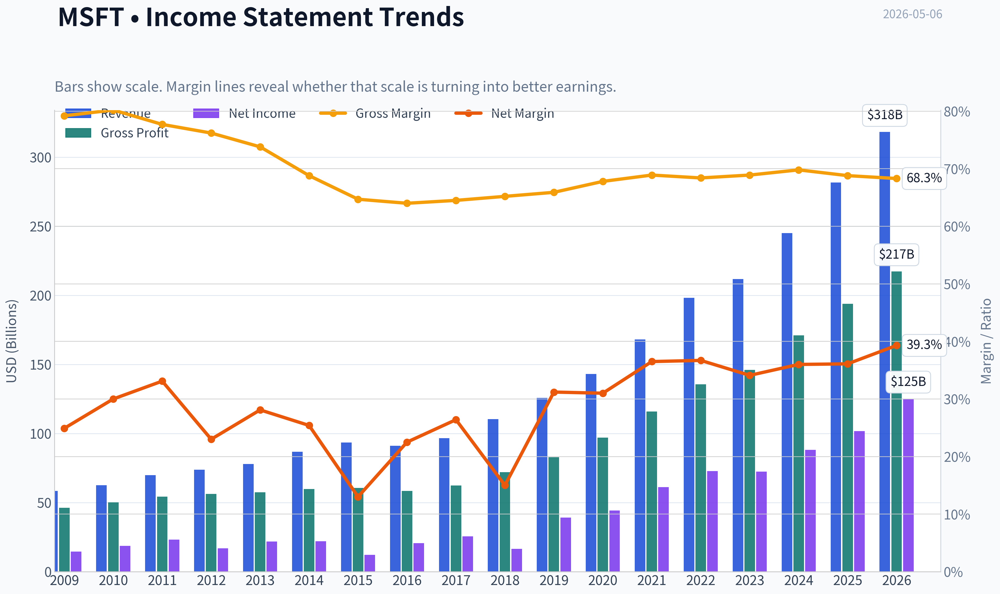
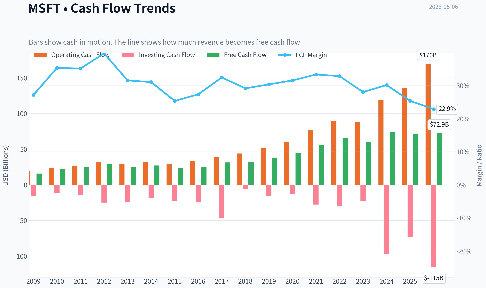
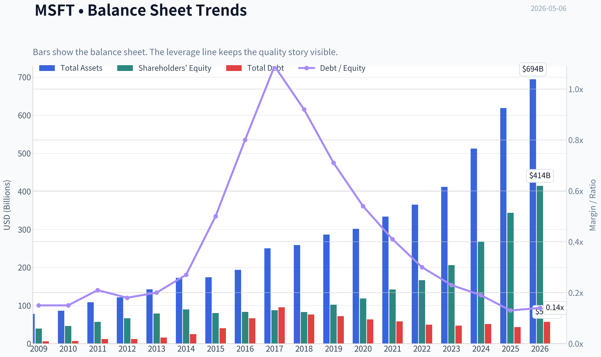
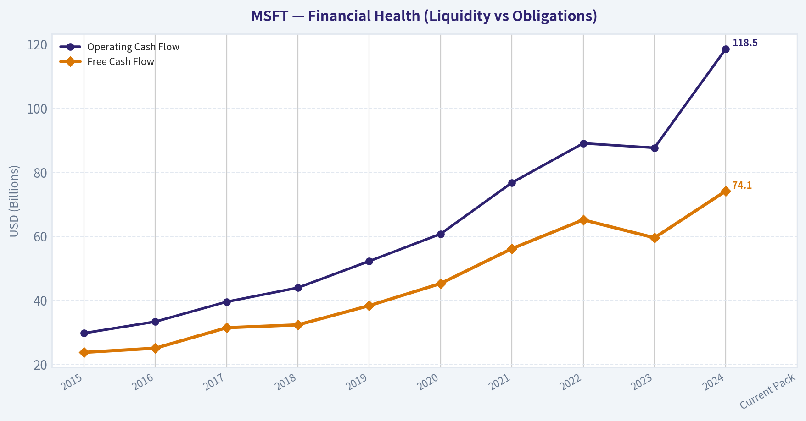
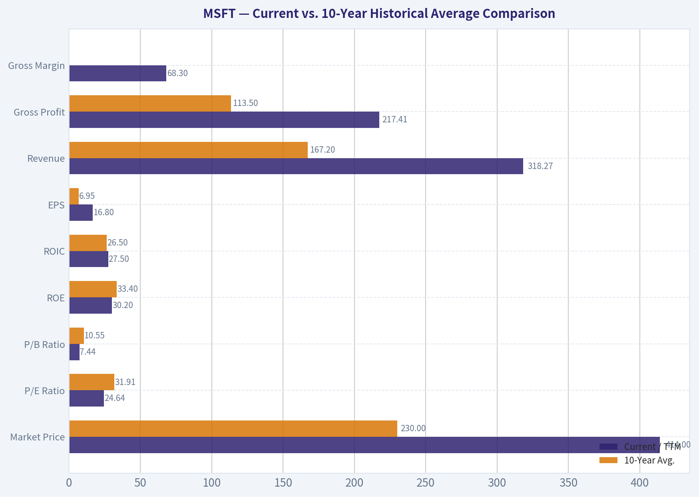
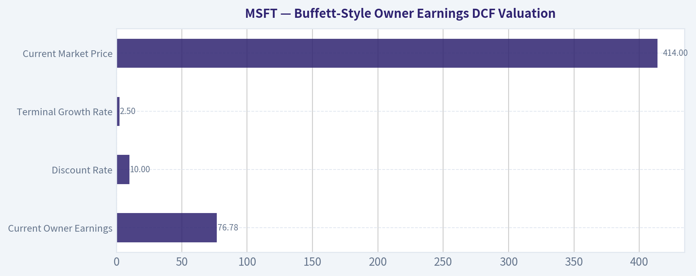
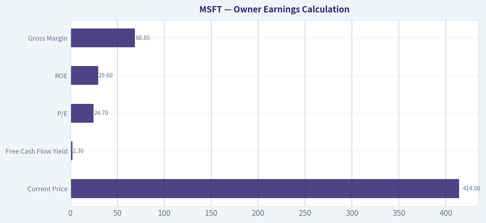
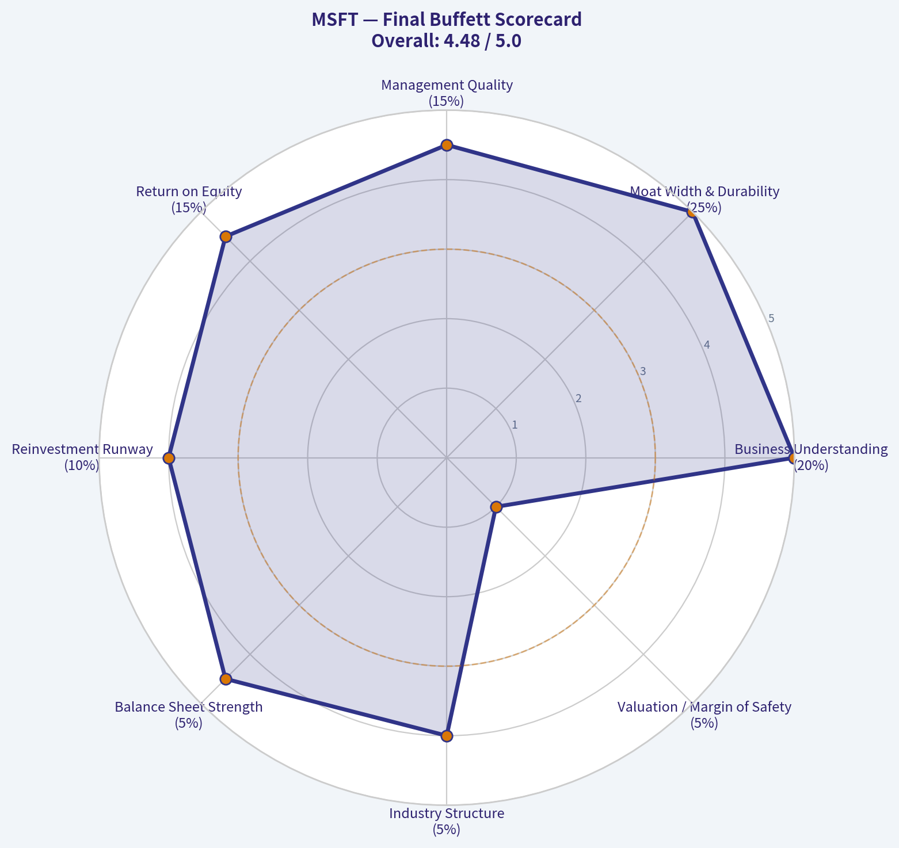

# MSFT Deep Value Intelligence

**Analysis Date:** 2026-05-06

## Critical Disclaimer

*This analysis is generated by Deep Value Intelligence, an AI-powered multi-agent investing framework. This report is for informational and educational purposes only and does not constitute financial advice. Always conduct your own research and consult with qualified financial advisors before making investment decisions.*

---

## Table of Contents

1. Intelligence Summary
2. Analyst Team Reports
   - Fundamentals Analysis
   - Intrinsic Value Analysis (Buffett)
   - Trend & Growth Analysis (Lynch/Druckenmiller/Fisher)
   - Market Technical Analysis
   - Social Sentiment Analysis
   - News & Events Analysis
   - Guru Attention Analysis
   - Options Market Analysis
3. Research Team Commentary
4. Value Investing Team Commentary
5. Deep Values Commentary

---

## Intelligence Summary

### Thesis + Conditions

**Core Thesis:** **EXECUTIVE SUMMARY**
*   **The Verdict**: Microsoft (MSFT) is a world-class compounder priced for absolute perfection. While business quality is elite (ROIC ~30%), the valuation offers **zero margin of safety** ($414 price vs.

**Key Risks:**
- The Core Risk**: The transition from capital-light software to capital-intensive AI infrastructure. Net income is up 15.5%, but Free Cash Flow (FCF) is down 3.3%. This divergence threatens to compress long-term return on invested capital.
- Actionable Takeaway**: Do not chase at $414. Keep on a highly active watchlist. Await broader market pullbacks or AI-capex panic to initiate staged entries.
- The Bull/Risky Case (Expanding Moat):** MSFT is paying the toll to "own the rails" of the AI era. Declining FCF is a temporary, highly productive reinvestment phase. Static, conservative valuation models fundamentally misprice MSFT's expanding, multi-layered monetization surface across enterprise software and cloud.
- The Bear/Safe Case (Valuation & Capital Intensity):** Buying at roughly double conservative intrinsic value risks years of dead money via multiple compression. The FCF drop is a structural warning sign that AI may force MSFT into a heavier, lower-return utility model.
- 2.  **Quality is Exceptional, but Capital Intensity is Shifting**: MSFT clears all quality gates (68.8% gross margins, 29.6% ROE). However, the divergence between accounting profit (Net Income +15.5%) and cash generation (FCF -3.3%) is the defining business risk. AI is expensive. If MSFT requires perpetual, massive reinvestment just to defend its moat, it ceases to be a capital-light compounder.

**What Would Change Our View:**
- The Core Risk**: The transition from capital-light software to capital-intensive AI infrastructure. Net income is up 15.5%, but Free Cash Flow (FCF) is down 3.3%. This divergence threatens to compress long-term return on invested capital.
- Actionable Takeaway**: Do not chase at $414. Keep on a highly active watchlist. Await broader market pullbacks or AI-capex panic to initiate staged entries.
- The Bull/Risky Case (Expanding Moat):** MSFT is paying the toll to "own the rails" of the AI era. Declining FCF is a temporary, highly productive reinvestment phase. Static, conservative valuation models fundamentally misprice MSFT's expanding, multi-layered monetization surface across enterprise software and cloud.
- The Bear/Safe Case (Valuation & Capital Intensity):** Buying at roughly double conservative intrinsic value risks years of dead money via multiple compression. The FCF drop is a structural warning sign that AI may force MSFT into a heavier, lower-return utility model.
- 2.  **Quality is Exceptional, but Capital Intensity is Shifting**: MSFT clears all quality gates (68.8% gross margins, 29.6% ROE). However, the divergence between accounting profit (Net Income +15.5%) and cash generation (FCF -3.3%) is the defining business risk. AI is expensive. If MSFT requires perpetual, massive reinvestment just to defend its moat, it ceases to be a capital-light compounder.

**Confidence:** Medium

---

## Analyst Team Reports

### Fundamentals Analysis

#### Latest Earnings Snapshot

*Most recent reported quarter anchored on 2026 Q1, with prior-year comparison when available.*

| Metric | 2026 Q1 | 2025 Q1 | YoY Change |
| --- | ---: | ---: | ---: |
| Revenue | $82.89B | $70.07B | +18.3% |
| Operating Income | $38.40B | $32.00B | +20.0% |
| Net Income | $31.78B | $25.82B | +23.1% |
| Diluted EPS | $4.27 | $3.46 | +23.4% |
| Operating Cash Flow | $46.68B | $37.04B | +26.0% |
| Free Cash Flow | $15.80B | $20.30B | -22.1% |

Key Takeaways: This snapshot anchors the most recent reported quarter before the narrative analysis. It helps readers separate long-run business quality from whatever changed in the latest earnings print.

#### 10-Year Financial Metrics for MSFT

*All values below are computed deterministically from raw data - not estimated by AI.*

*Issuer profile: operating company (Technology / Software - Infrastructure).*

#### 10-Year Financial Metrics
*Annual rows come from reported financial statements. The final TTM row is computed from the latest four quarters.*

| Metric | 2009 | 2010 | 2011 | 2012 | 2013 | 2014 | 2015 | 2016 | 2017 | 2018 | 2019 | 2020 | 2021 | 2022 | 2023 | 2024 | 2025 | 2026 TTM |
| --- | --- | --- | --- | --- | --- | --- | --- | --- | --- | --- | --- | --- | --- | --- | --- | --- | --- | --- |
| Market Price | $18 | $17 | $20 | $24 | $28 | $35 | $38 | $45 | $63 | $91 | $126 | $194 | $261 | $249 | $333 | $441 | $495 | $414 |
| Market Cap | $213.83B | $205.41B | $223.42B | $260.20B | $292.55B | $350.24B | $364.41B | $410.03B | $539.86B | $768.57B | $1.04T | $1.56T | $2.06T | $1.94T | $2.54T | $3.34T | $3.71T | $3.08T |
| P/E Ratio | 14.67 | 10.96 | 9.67 | 15.30 | 13.39 | 15.86 | 29.83 | 19.99 | 21.21 | 46.30 | 26.47 | 35.33 | 33.65 | 26.61 | 35.18 | 37.88 | 36.47 | 24.64 |
| P/B Ratio | 5.41 | 4.45 | 3.91 | 3.92 | 3.71 | 3.90 | 4.55 | 4.93 | 6.15 | 9.29 | 10.15 | 13.22 | 14.52 | 11.63 | 12.34 | 12.43 | 10.81 | 7.44 |
| ROE | 36.8% | 40.6% | 40.6% | 25.6% | 27.7% | 24.6% | 15.2% | 24.7% | 29.1% | 20.0% | 38.3% | 37.4% | 43.2% | 43.7% | 35.1% | 32.8% | 29.6% | 30.2% |
| ROIC | 41.0% | 41.1% | 41.6% | 25.2% | 26.6% | 22.4% | 10.7% | 16.3% | 15.5% | 9.4% | 24.8% | 26.7% | 33.9% | 37.3% | 34.0% | 34.5% | 32.4% | 27.5% |
| EPS | $1.20 | $1.58 | $2.07 | $1.58 | $2.10 | $2.21 | $1.28 | $2.27 | $2.95 | $1.97 | $4.76 | $5.49 | $7.74 | $9.36 | $9.48 | $11.80 | $13.64 | $16.80 |
| Revenue | $58.44B | $62.48B | $69.94B | $73.72B | $77.85B | $86.83B | $93.58B | $91.15B | $96.57B | $110.36B | $125.84B | $143.01B | $168.09B | $198.27B | $211.91B | $245.12B | $281.72B | $318.27B |
| Gross Profit | $46.28B | $50.09B | $54.37B | $56.19B | $57.46B | $59.76B | $60.54B | $58.37B | $62.31B | $72.01B | $82.93B | $96.94B | $115.86B | $135.62B | $146.05B | $171.01B | $193.89B | $217.41B |
| Gross Margin | 79.2% | 80.2% | 77.7% | 76.2% | 73.8% | 68.8% | 64.7% | 64.0% | 64.5% | 65.2% | 65.9% | 67.8% | 68.9% | 68.4% | 68.9% | 69.8% | 68.8% | 68.3% |
| Operating Margin | 34.8% | 38.6% | 38.8% | 29.5% | 34.4% | 32.0% | 19.4% | 28.6% | 30.1% | 31.8% | 34.1% | 37.0% | 41.6% | 42.1% | 41.8% | 44.6% | 45.6% | 46.8% |
| Net Income | $14.57B | $18.76B | $23.15B | $16.98B | $21.86B | $22.07B | $12.19B | $20.54B | $25.49B | $16.57B | $39.24B | $44.28B | $61.27B | $72.74B | $72.36B | $88.14B | $101.83B | $125.22B |
| Net Margin | 24.9% | 30.0% | 33.1% | 23.0% | 28.1% | 25.4% | 13.0% | 22.5% | 26.4% | 15.0% | 31.2% | 31.0% | 36.5% | 36.7% | 34.1% | 36.0% | 36.1% | 39.3% |
| Revenue Growth | N/A | 6.9% | 11.9% | 5.4% | 5.6% | 11.5% | 7.8% | -2.6% | 5.9% | 14.3% | 14.0% | 13.6% | 17.5% | 18.0% | 6.9% | 15.7% | 14.9% | 13.0% |
| Net Income Growth | N/A | 28.8% | 23.4% | -26.7% | 28.8% | 1.0% | -44.8% | 68.4% | 24.1% | -35.0% | 136.8% | 12.8% | 38.4% | 18.7% | -0.5% | 21.8% | 15.5% | 23.0% |
| Free Cash Flow Growth | N/A | 38.8% | 11.5% | 19.0% | -16.2% | 9.9% | -12.2% | 5.3% | 25.6% | 2.8% | 18.6% | 18.2% | 24.1% | 16.1% | -8.7% | 24.5% | -3.3% | 1.8% |
| Total Book Value | $39.56B | $46.17B | $57.08B | $66.36B | $78.94B | $89.78B | $80.08B | $83.09B | $87.71B | $82.72B | $102.33B | $118.30B | $141.99B | $166.54B | $206.22B | $268.48B | $343.48B | $414.37B |
| Total Assets | $77.89B | $86.11B | $108.70B | $121.27B | $142.43B | $172.38B | $174.47B | $193.47B | $250.31B | $258.85B | $286.56B | $301.31B | $333.78B | $364.84B | $411.98B | $512.16B | $619.00B | $694.23B |
| Total Debt | $5.75B | $6.94B | $11.92B | $11.94B | $15.60B | $24.64B | $40.29B | $66.36B | $95.29B | $76.24B | $72.18B | $63.33B | $58.15B | $49.78B | $47.24B | $51.63B | $43.15B | $56.97B |
| Debt-to-Equity | 0.15 | 0.15 | 0.21 | 0.18 | 0.20 | 0.27 | 0.50 | 0.80 | 1.09 | 0.92 | 0.71 | 0.54 | 0.41 | 0.30 | 0.23 | 0.19 | 0.13 | 0.14 |
| Cash & Equivalents | $6.08B | $5.50B | $9.61B | $6.94B | $3.80B | $8.67B | $5.59B | $6.51B | $7.66B | $11.95B | $11.36B | $13.58B | $14.22B | $13.93B | $34.70B | $18.32B | $30.24B | $32.10B |
| Shareholders' Equity | $39.56B | $46.17B | $57.08B | $66.36B | $78.94B | $89.78B | $80.08B | $83.09B | $87.71B | $82.72B | $102.33B | $118.30B | $141.99B | $166.54B | $206.22B | $268.48B | $343.48B | $414.37B |
| Operating Cash Flow | $19.04B | $24.07B | $26.99B | $31.63B | $28.83B | $32.50B | $29.67B | $33.33B | $39.51B | $43.88B | $52.19B | $60.67B | $76.74B | $89.03B | $87.58B | $118.55B | $136.16B | $170.14B |
| Investing Cash Flow | $-15.77B | $-11.31B | $-14.62B | $-24.79B | $-23.81B | $-18.83B | $-23.00B | $-23.95B | $-46.78B | $-6.06B | $-15.77B | $-12.22B | $-27.58B | $-30.31B | $-22.68B | $-96.97B | $-72.60B | $-115.24B |
| Free Cash Flow | $15.92B | $22.10B | $24.64B | $29.32B | $24.58B | $27.02B | $23.72B | $24.98B | $31.38B | $32.25B | $38.26B | $45.23B | $56.12B | $65.15B | $59.48B | $74.07B | $71.61B | $72.92B |
| FCF Margin | 27.2% | 35.4% | 35.2% | 39.8% | 31.6% | 31.1% | 25.4% | 27.4% | 32.5% | 29.2% | 30.4% | 31.6% | 33.4% | 32.9% | 28.1% | 30.2% | 25.4% | 22.9% |
| Dividends / Share | $0.00 | $0.00 | $0.00 | $0.00 | $0.00 | $0.00 | $0.00 | $0.00 | $0.00 | $0.00 | $0.00 | $0.00 | $0.00 | $2.33 | $2.59 | $2.91 | $3.23 | $3.47 |

#### Profitability Metrics
- Return on Equity (ROE): 29.6%
- Return on Invested Capital (ROIC): 29.7%
- Return on Assets (ROA): 16.5%
- Gross Margin: 68.8%
- Operating Margin: 45.6%
- Net Profit Margin: 36.1%

#### Liquidity Metrics
- Current Ratio: 1.35
- Quick Ratio: 1.16

#### Leverage Metrics
- Debt-to-Equity Ratio: 0.13
- Interest Coverage Ratio: 53.89
- Net Debt: $12.91B

#### Growth Metrics (Year-over-Year)
- Revenue Growth: 14.9%
- Net Income Growth: 15.5%
- Free Cash Flow Growth: -3.3%
- Revenue CAGR (3-Year): 12.4%
- Revenue CAGR (5-Year): 14.5%

#### Valuation Metrics
- P/E Ratio (TTM): 24.67
- Forward P/E: 21.43
- Price-to-Book: 7.87
- Price-to-Sales: 9.66
- PEG Ratio: 1.29
- EV/EBITDA: 16.82
- Free Cash Flow Yield: 2.3%
- Earnings Yield: 4.1%

#### Owner Earnings (Buffett Method, Code-Computed)
- Net Income: $101.83B
- + Depreciation & Amortization: $34.15B
- - Capital Expenditures: $-64.55B
- - Working Capital Changes: $-5.35B
- = **Owner Earnings: $76.78B**

#### Intrinsic Value (Code-Computed)
- Current Price: $414
- Buffett Method (Owner Earnings):
  Conservative: $108
  Average: $203
  Optimistic: $544
- Cash Flow Method (FCF):
  Conservative: $126
  Average: $172
  Optimistic: $248

#### Piotroski F-Score: 5/9
- Positive Net Income: PASS
- Positive Operating Cash Flow: PASS
- ROA Improvement: FAIL
- Cash Flow > Net Income: PASS
- Decreasing Debt: PASS
- Improving Current Ratio: PASS
- No Dilution: FAIL
- Improving Gross Margin: FAIL
- Improving Asset Turnover: FAIL

ANALYST STANCE: **WATCH**

#### MSFT Warren Buffett-Style Fundamental Analysis - May 6, 2026

Microsoft is an exceptional business with durable competitive advantages, very high margins, strong returns on capital, and a balance sheet that remains conservative despite massive AI infrastructure investment. The key issue is not business quality; it is valuation and free-cash-flow conversion. At the current price of **$414**, MSFT trades below its recent historical P/E and P/B averages, but still above the conservative and average Buffett-style Owner Earnings DCF values, leaving the stock dependent on continued high growth from Azure, AI infrastructure, Microsoft 365, Copilot, security, and enterprise software expansion.

---

#### Current vs. 10-Year Historical Average Comparison

| Metric | Current / TTM | 10-Year Avg. | Current vs. Avg. | Buffett-Style Interpretation |
|---|---:|---:|---:|---|
| Market Price | $414 | $230 | Above avg. | Price remains far above the last decade's average despite the pullback from 2025 highs. |
| Market Cap | $3.08T | $1.79T | Above avg. | Microsoft is still valued as one of the world's most dominant compounders. |
| P/E Ratio | 24.64 | 31.91 | Below avg. | Earnings multiple has compressed meaningfully versus recent history. |
| P/B Ratio | 7.44 | 10.55 | Below avg. | Book-value valuation is less stretched than the last decade average, but still high in absolute terms. |
| ROE | 30.2% | 33.4% | Slightly below avg. | Still excellent, though below the peak efficiency years of 2020-2022. |
| ROIC | 27.5% | 26.5% | Slightly above avg. | Capital allocation remains strong despite heavy AI and cloud investment. |
| EPS | $16.80 | $6.95 | Well above avg. | Per-share earnings power has compounded dramatically. |
| Revenue | $318.27B | $167.20B | Well above avg. | Microsoft has nearly doubled its 10-year average revenue base. |
| Gross Profit | $217.41B | $113.50B | Well above avg. | Scale advantages remain powerful. |
| Gross Margin | 68.3% | ~67.2% | Slightly above avg. | Despite cloud infrastructure costs, gross margin remains resilient. |
| Operating Margin | 46.8% | 37.7% | Well above avg. | Operating leverage is very strong; software mix remains highly profitable. |
| Net Income | $125.22B | $54.25B | Well above avg. | Earnings quality is exceptional, though boosted by scale and high-margin software. |
| Net Margin | 39.3% | 30.6% | Well above avg. | Microsoft is converting revenue into profit at historically elevated levels. |
| Revenue Growth | 13.0% | 11.8% | Above avg. | Growth remains stronger than the mature-company profile would imply. |
| Net Income Growth | 23.0% | 30.1% | Below avg. | Below average due to historical rebound distortions, but still very strong. |
| Free Cash Flow Growth | 1.8% | 12.3% | Well below avg. | A major warning sign: AI capex is pressuring free cash flow growth. |
| Total Book Value | $414.37B | $160.09B | Well above avg. | Equity base has expanded significantly. |
| Total Assets | $694.23B | $353.23B | Well above avg. | Asset base is growing rapidly, partly from data centers and infrastructure. |
| Total Debt | $56.97B | $62.34B | Below avg. | Debt burden is modest relative to earnings power. |
| Debt-to-Equity | 0.14 | 0.53 | Much lower | Balance sheet leverage is very conservative. |
| Cash & Equivalents | $32.10B | $16.25B | Well above avg. | Liquidity remains strong. |
| Shareholders' Equity | $414.37B | $160.09B | Well above avg. | Financial foundation is much stronger than a decade ago. |
| Free Cash Flow | $72.92B | $49.85B | Above avg. | Absolute FCF remains huge, but growth has slowed sharply. |
| Dividends / Share | $3.47 | $1.11 | Well above avg. | Dividend has become meaningful, though yield remains modest. |

Key Takeaways: Microsoft's profitability and scale are far above its 10-year averages, with revenue, EPS, net income, and operating margins all showing exceptional long-term compounding. Valuation has become more reasonable relative to its own history, with P/E and P/B below 10-year averages, but the stock is still not obviously cheap on an owner-earnings basis. The biggest negative deviation is free cash flow growth, which has slowed materially as AI and cloud capital expenditures rise.

---

#### Market Metrics Interpretation

Microsoft's current **market price of $414** and **market cap of $3.08 trillion** reflect a business that the market still treats as a global quality compounder. The current price is below the 2025 level of $495 but remains far above the decade average, showing that investor expectations remain high.

The **P/E ratio of 24.64** is notably below the 10-year average of about 31.9. On the surface, this makes MSFT look more reasonably valued than in many recent years. However, Buffett-style analysis does not stop at the P/E ratio; the more important question is whether current earnings and owner earnings justify the price with a margin of safety.

The **P/B ratio of 7.44** is also below the 10-year average of about 10.55, but Microsoft's book value is not the best measure of intrinsic value because its moat is driven by intangible assets: software ecosystems, enterprise relationships, developer networks, cloud infrastructure, and switching costs. A high P/B is tolerable for a business with very high ROE and ROIC, but it still signals that the market capitalizes Microsoft's intangible earning power aggressively.

---

#### Profitability Analysis

Microsoft's profitability remains outstanding. **ROE of 30.2%** and **ROIC of 27.5%** are the kind of figures Buffett typically looks for in an exceptional business. ROE is slightly below the 10-year average, but ROIC is slightly above average, which suggests that the business is still creating high returns on incremental invested capital.

**Revenue reached $318.27 billion TTM**, while **gross profit reached $217.41 billion**, supported by a **gross margin of 68.3%**. Gross margin is lower than the very high Windows-dominated era of 2009-2012 but has stabilized around the high-60s despite Azure and AI infrastructure expansion. That is a positive sign because cloud infrastructure is capital-intensive, yet Microsoft continues to protect software-like economics.

The standout metric is **operating margin of 46.8%**, above the 10-year average of 37.7%. This shows excellent operating leverage. Microsoft is not merely growing revenue; it is converting more of each incremental dollar into operating profit. **Net income of $125.22 billion** and **net margin of 39.3%** confirm that Microsoft remains one of the most profitable large companies in the world.

---

#### Growth Analysis

Revenue growth remains strong at **13.0% TTM**, above the 10-year average of approximately 11.8%. For a company already generating more than $300 billion of annualized revenue, that is extraordinary. Growth is being driven by Azure, Microsoft 365, enterprise security, Dynamics, LinkedIn, gaming, and AI-related workloads.

**Net income growth of 23.0%** remains very strong, though below the historical average that was skewed by tax effects and rebound years. The earnings growth profile is still highly attractive, especially given Microsoft's size.

The biggest concern is **free cash flow growth of only 1.8% TTM**, far below the 10-year average of about 12.3%. This is a critical Buffett-style issue because intrinsic value depends on cash that can be taken out of the business without harming competitiveness. Microsoft's AI infrastructure buildout may be strategically necessary, but it reduces near-term owner earnings and raises the hurdle for future returns.

---

#### Balance Sheet and Financial Strength

Microsoft's balance sheet is very strong. **Total assets of $694.23 billion** and **shareholders' equity of $414.37 billion** provide a massive financial base. The company's **total debt of $56.97 billion** is below the 10-year average and small relative to annual operating cash flow.

The **debt-to-equity ratio of 0.14** is far below the 10-year average of 0.53, showing that Microsoft has materially reduced leverage risk. This is exactly the kind of balance sheet Buffett favors: strong liquidity, low financial dependence, and flexibility to invest through cycles.

**Cash and equivalents of $32.10 billion** are nearly double the 10-year average. Combined with very high interest coverage and enormous operating cash generation, Microsoft has ample capacity to fund AI infrastructure, dividends, buybacks, acquisitions, and research and development.

---

#### Cash Flow and Dividend Quality

Microsoft generated **$72.92 billion of TTM free cash flow**, above its 10-year average but not growing at the same rate as revenue or net income. The decline in free cash flow margin from prior highs is important. TTM **FCF margin is 22.9%**, below the stronger levels seen in many prior years, reflecting heavy capital expenditures tied to cloud and AI data centers.

The dividend is conservative. **Dividends per share are $3.47**, up materially versus the dataset's historical average. The payout remains modest relative to EPS of $16.80, leaving substantial room for reinvestment and future dividend growth. From a Buffett perspective, the dividend policy is shareholder-friendly but not the central part of the investment case; the primary value driver remains reinvested high-return capital.

---

#### Revenue Breakdown

| Revenue Source | Amount ($B) | % of Total |
|---|---:|---:|
| Productivity and Business Processes | ~$120.7B | ~42.8% |
| Intelligent Cloud | ~$106.3B | ~37.7% |
| More Personal Computing | ~$54.8B | ~19.5% |
| Total | ~$281.7B | 100.0% |

Key Takeaways: Microsoft's revenue base is heavily weighted toward enterprise software and cloud services, which together account for the large majority of revenue. Productivity and Business Processes, including Microsoft 365, LinkedIn, and Dynamics, is the largest segment, while Intelligent Cloud is the core growth engine tied to Azure and AI workloads. More Personal Computing is smaller but still strategically important through Windows, devices, gaming, and search.

---

#### Economic Moat Assessment

Microsoft has one of the strongest economic moats in the public markets. Its moat comes from several reinforcing advantages:

| Moat Source | Assessment | Buffett-Style Significance |
|---|---|---|
| Switching Costs | Very High | Enterprises are deeply embedded in Microsoft 365, Azure, Windows, Teams, Dynamics, and security tools. |
| Network Effects | High | Developers, enterprises, partners, and IT departments reinforce Microsoft's ecosystem. |
| Brand and Trust | Very High | Microsoft is a default vendor for mission-critical enterprise technology. |
| Scale Economies | Very High | Massive cloud and AI infrastructure spending is more efficient at Microsoft's scale. |
| Distribution Power | Very High | Microsoft can bundle, cross-sell, and integrate across productivity, cloud, security, and AI. |
| Data and AI Positioning | High | Azure, GitHub, Microsoft 365, and OpenAI-related integrations strengthen the AI opportunity. |

Key Takeaways: Microsoft's moat is not based on one product; it is based on an ecosystem that becomes more valuable as customers use more of it. This creates pricing power, customer retention, and high returns on capital. The main moat risk is not current competition alone, but whether AI infrastructure spending earns returns comparable to Microsoft's historical software returns.

---

#### Management Performance and Capital Allocation

Management has performed very well over the decade. Revenue increased from mature-company levels into a renewed growth trajectory, while operating margins expanded to record levels. ROIC remains above the 10-year average despite much heavier capital intensity, which suggests disciplined execution so far.

Capital allocation has been mostly rational: Microsoft has funded internal growth, expanded Azure, acquired strategic assets, paid dividends, and maintained a conservative balance sheet. The current question is whether AI capex will generate sufficient future owner earnings. Buffett would likely admire the operating quality but require evidence that today's massive infrastructure investments will produce durable cash returns rather than just revenue growth.

---

#### Buffett-Style Owner Earnings DCF Valuation

Assumptions used for all scenarios:

| Input | Value |
|---|---:|
| Current Owner Earnings | $76.78B |
| Estimated Shares Outstanding | ~7.44B |
| Discount Rate | 10.0% |
| Terminal Growth Rate | 2.5% |
| Forecast Period | 10 Years |
| Current Market Price | $414 |

Key Takeaways: The DCF uses owner earnings rather than accounting earnings because Buffett focuses on the cash a business can generate for owners after necessary reinvestment. The 10% discount rate represents a required return, while the 2.5% terminal growth rate assumes Microsoft remains a durable but mature long-term compounder. The model is highly sensitive to the owner-earnings growth assumption because Microsoft's current valuation already embeds substantial future success.

| Scenario | Owner Earnings Growth Assumption | PV of 10-Year Owner Earnings | PV of Terminal Value | Estimated Equity Value | Fair Value / Share | Upside / Downside vs. $414 |
|---|---:|---:|---:|---:|---:|---:|
| Conservative | ~-1.0% | ~$450B | ~$366B | ~$816B | ~$108-$110 | About -74% |
| Average | ~7.5% | ~$679B | ~$834B | ~$1.51T | ~$203 | About -51% |
| Optimistic | ~21.0% | ~$1.35T | ~$2.72T | ~$4.05T-$4.07T | ~$544 | About +31% |

Key Takeaways: The conservative and average DCF cases indicate that Microsoft's current stock price does not offer a traditional Buffett-style margin of safety. The current price is justified only if Microsoft sustains a very high owner-earnings growth trajectory for many years. The optimistic case provides upside, but it depends on AI, Azure, and enterprise software monetization translating into cash flow growth, not just revenue growth.

#### DCF Calculation Detail

| Scenario | Calculation Summary |
|---|---|
| Conservative | Owner Earnings start at $76.78B and decline at roughly 1% annually. Discounted 10-year owner earnings are approximately $450B, and discounted terminal value is approximately $366B, producing fair value near $108-$110 per share. |
| Average | Owner Earnings start at $76.78B and grow at roughly 7.5% annually. Discounted 10-year owner earnings are approximately $679B, and discounted terminal value is approximately $834B, producing fair value near $203 per share. |
| Optimistic | Owner Earnings start at $76.78B and grow at roughly 21% annually. Discounted 10-year owner earnings are approximately $1.35T, and discounted terminal value is approximately $2.72T, producing fair value near $544 per share. |

Key Takeaways: Microsoft's valuation is extremely sensitive to the long-term cash return from AI and cloud investment. If owner earnings grow only at a mid-to-high single-digit rate, the current stock price appears expensive. If Microsoft can compound owner earnings above 20% for an extended period, the current price may still be attractive, but that is a demanding assumption for a company already at this scale.

---

#### Key Investment Insights, Red Flags, and Opportunities

| Category | Key Point | Investment Implication |
|---|---|---|
| Major Strength | Exceptional ROIC and ROE | Microsoft remains a high-quality compounder. |
| Major Strength | Operating margin at 46.8% | Operating leverage is stronger than historical norms. |
| Major Strength | Debt-to-equity only 0.14 | Balance sheet risk is low. |
| Major Strength | Revenue growth still 13.0% | Growth remains impressive for a mega-cap company. |
| Opportunity | Azure and AI workloads | Could support the optimistic DCF case if monetization is strong. |
| Opportunity | Microsoft 365 Copilot and enterprise AI | Incremental software pricing could drive high-margin growth. |
| Opportunity | Security, GitHub, Dynamics, LinkedIn | Multiple durable growth vectors reduce dependence on one product. |
| Red Flag | Free cash flow growth only 1.8% | AI capex is pressuring owner earnings. |
| Red Flag | FCF margin down to 22.9% | Cash conversion is weaker than prior years. |
| Red Flag | Current price exceeds average DCF value | Margin of safety is limited. |
| Red Flag | Energy and data center constraints | AI growth may require higher capital intensity and infrastructure costs. |
| Red Flag | Regulatory scrutiny | Microsoft faces antitrust, cloud, gaming, AI, and data-governance risks. |
| External Signal | Steve Cohen trimmed position by 24.2% in latest tracked 13F | Not decisive, but suggests at least some sophisticated investors are reducing exposure after strong gains. |

Key Takeaways: Microsoft's business quality remains outstanding, but valuation and free cash flow are the key concerns. The company has many ways to win from AI, cloud, and enterprise software, yet those opportunities require heavy investment. The stock is attractive only if investors believe Microsoft can convert AI spending into durable, high-margin owner earnings growth.

---

#### Final Investment Stance: WATCH

Microsoft is a world-class business, but at **$414**, the stock does not provide enough margin of safety under conservative or average Buffett-style Owner Earnings DCF assumptions. The company's moat, balance sheet, profitability, and management quality are excellent, and the current P/E is below its 10-year average. However, free cash flow growth has slowed sharply, FCF margin has compressed, and the valuation depends heavily on sustained high owner-earnings growth from AI and Azure.

For long-term holders, MSFT remains a high-quality compounder worth owning through cycles. For new Buffett-style capital allocation, the better stance is **WATCH**: wait for either a lower price, stronger evidence that AI capex is producing high-return owner earnings, or a clearer margin of safety versus intrinsic value.

| Final Summary Point | Assessment |
|---|---|
| Business Quality | Exceptional |
| Economic Moat | Very wide |
| Balance Sheet | Very strong |
| Earnings Predictability | High |
| Profitability | Outstanding |
| Growth Outlook | Strong, led by cloud and AI |
| Main Concern | Free cash flow growth and AI capital intensity |
| Valuation | Reasonable versus historical P/E, expensive versus average DCF |
| Buffett-Style Margin of Safety | Insufficient at current price |
| Final Stance | **WATCH** |

Key Takeaways: Microsoft is the type of business Buffett would admire, but not necessarily at any price. The company's quality is exceptional, yet the current valuation already assumes substantial future success. A more attractive entry point would require either a lower stock price or clearer proof that AI investments are producing durable, high-return owner earnings.

#### Fundamental Visuals

This graph tracks the profitability and return metrics (ROE, ROIC, Margins) of **MSFT** over the past decade, highlighting capital efficiency trends.

This chart illustrates the financial health of **MSFT** over the last 10 years, mapping cash equivalents and free cash flow against total obligations (Debt).

This chart illustrates the financial health of **MSFT** over the last 10 years, mapping cash equivalents and free cash flow against total obligations (Debt).

---

### Intrinsic Value Analysis (Buffett)

> *Following Warren Buffett's value investing philosophy: Circle of Competence, Economic Moat, Management Quality, and Margin of Safety.*

#### Intrinsic Value Snapshot

Price is what you pay. Intrinsic value is what the business may be worth based on the cash it can create for owners over time. We show a range, not one magic number.

- Current Price: $413.96
- Value Range: $107.55 to $544.36

##### Owner Earnings (Buffett Method)
- Net Income: $101,832,000,000.00
- Depreciation & Amortization: $34,153,000,000.00
- Capital Expenditures: $-64,551,000,000.00
- Working Capital Changes: $-5,350,000,000.00
- Owner Earnings: $76,784,000,000.00

##### Intrinsic Value
###### Buffett Method
Uses owner earnings. Stricter, and usually more conservative.
- Conservative: $107.55
- Average: $203.41
- Optimistic: $544.36
- Discount Rate: 10.0%

###### Cash Flow Method
Uses free cash flow. Better for companies spending heavily today to grow tomorrow.
- Conservative: $125.57
- Average: $171.77
- Optimistic: $248.17
- Discount Rate: 10.0%

ANALYST STANCE: **WATCH**

#### Microsoft Buffett-Style Value Analysis - MSFT at $414

Microsoft is a wonderful business with a very wide moat, exceptional economics, and durable strategic assets in enterprise software, cloud infrastructure, developer tools, and productivity workflows. However, using a Buffett-style 10% required return and a conservative owner-earnings approach, the current price appears well above intrinsic value. This is a classic "wonderful company, not wonderful price" situation.

---

#### 1. Go / No-Go Gate Assessment

| Buffett Gate | Result | Evidence | Investment Implication |
|---|---:|---|---|
| Gate 1: Circle of Competence & Simplicity | Pass | Microsoft sells software subscriptions, cloud computing, business tools, operating systems, gaming, search, and AI infrastructure. The core model is understandable: customers pay recurring fees for essential digital tools. | Business is understandable enough for long-term ownership analysis. |
| 10-Year Predictability | Pass, with AI caveat | Office, Windows, Azure, GitHub, LinkedIn, and enterprise security should remain highly relevant. AI increases opportunity but also raises capital spending intensity. | Long-term direction is predictable, but required infrastructure investment is rising. |
| Technology Risk | Pass / Watch | Microsoft benefits from technology change more than it is threatened by it, especially through Azure and OpenAI-related AI integration. However, AI could compress margins if compute costs rise faster than monetization. | Technology is mostly a tailwind, but capital intensity is now a key risk. |
| Gate 2: Moat Test | Pass | Gross margin is 68.8%, ROE is 29.6%, enterprise switching costs are high, and Microsoft is embedded in workflows. | Wide moat. |
| Gate 3: Management & Capital Allocation | Pass | Management has generally allocated capital well through cloud investment, enterprise software expansion, LinkedIn, GitHub, and disciplined shareholder returns. | Strong, though AI capex discipline must be monitored. |
| Gate 4: Industry Structure | Pass / Watch | Enterprise software is attractive; hyperscale cloud is oligopolistic but capital intensive. AI data centers increase the "capital black hole" risk. | Industry quality is high, but Azure/AI infrastructure requires vigilance. |

**Key Takeaways:** Microsoft passes the Buffett quality gates. The business is understandable, deeply entrenched, and financially exceptional. The main concern is not business quality; it is whether AI-driven capital spending will reduce future owner earnings and whether today's valuation already prices in too much success.

---

#### 2. Moat Analysis

| Moat Source | Rating | Evidence | Buffett Interpretation |
|---|---:|---|---|
| Intangible Assets / Brand | Wide | Windows, Office, Azure, LinkedIn, GitHub, Xbox, Dynamics, and Microsoft Security are globally trusted. Gross margin of 68.8% indicates strong pricing power. | Microsoft's brand is especially strong in enterprise trust and productivity. |
| Switching Costs | Very Wide | Office 365, Teams, Azure, Active Directory, GitHub, Dynamics, and security products are embedded in workflows, data, permissions, and compliance systems. | Customers may dislike price increases, but switching is costly and risky. |
| Cost Advantage | Moderate / Wide | Scale in cloud, software distribution, enterprise sales, and developer ecosystem creates efficiency advantages. | Strong scale advantage, though cloud and AI infrastructure are expensive. |
| Network Effects | Moderate / Wide | More developers, enterprises, partners, and data integrations make Microsoft's ecosystem more valuable. GitHub and Teams reinforce ecosystem lock-in. | Network effects are real but mostly ecosystem-based rather than pure platform network effects. |
| Moat Direction | Stable to Widening | AI integration across Office, Azure, GitHub Copilot, security, and developer tools may strengthen Microsoft's position. | Moat likely remains wide, but AI monetization must exceed infrastructure cost growth. |

**Key Takeaways:** Microsoft has one of the strongest moats in public markets. Its greatest advantage is not just brand, but deep customer captivity across workflows, cloud architecture, identity, data, compliance, and developer tools. The moat is likely durable, although the cost of defending and expanding it through AI infrastructure is increasing.

---

#### 3. Management Quality Assessment

| Management Question | Assessment | Evidence | Verdict |
|---|---|---|---|
| Do they think like owners? | Mostly yes | Microsoft has focused on durable platforms, recurring revenue, and long-term cloud positioning. | Pass |
| Are they honest and candid? | Generally yes | Microsoft's reporting is relatively transparent for a mega-cap technology company, though AI economics require closer disclosure over time. | Pass |
| Are they rational capital allocators? | Strong historical record | Azure, GitHub, LinkedIn, and Office 365 were major value-creating decisions. Buybacks and dividends have been consistent. | Pass |
| Debt discipline | Strong | Current ratio is 1.35; Microsoft historically maintains a fortress-like balance sheet for a mega-cap technology firm. | Pass |
| Current capital allocation risk | Watch | AI data center spending is rising, and recent coverage notes tension between AI power demand and Microsoft's 2030 renewable energy goal. | Watch |

**Key Takeaways:** Microsoft's management has an excellent long-term record, especially under Satya Nadella. The company has repeatedly converted retained earnings into higher franchise value. The current test is whether AI infrastructure spending earns high returns or becomes an expensive arms race.

---

#### 4. 10-Year Financial Summary

Approximate historical figures are based on Microsoft fiscal-year public financial history through FY2024, combined with the current research pack for latest valuation and profitability metrics.

| Fiscal Year | Revenue ($B) | Net Income ($B) | Operating Cash Flow ($B) | Free Cash Flow ($B) | Notes |
|---:|---:|---:|---:|---:|---|
| 2015 | 93.6 | 12.2 | 29.7 | 23.7 | Windows transition period; lower GAAP earnings due impairments. |
| 2016 | 91.2 | 16.8 | 33.3 | 25.0 | Cloud transition underway. |
| 2017 | 96.6 | 25.5 | 39.5 | 31.4 | Office 365 and Azure momentum improving. |
| 2018 | 110.4 | 16.6 | 43.9 | 32.3 | Tax reform distorted net income. |
| 2019 | 125.8 | 39.2 | 52.2 | 38.3 | Cloud scale becoming visible. |
| 2020 | 143.0 | 44.3 | 60.7 | 45.2 | Strong enterprise cloud adoption. |
| 2021 | 168.1 | 61.3 | 76.7 | 56.1 | Pandemic accelerated digital adoption. |
| 2022 | 198.3 | 72.7 | 89.0 | 65.1 | Excellent growth and margins. |
| 2023 | 211.9 | 72.4 | 87.6 | 59.5 | Growth slowed; capex increased. |
| 2024 | 245.1 | 88.1 | 118.5 | 74.1 | AI/cloud investment accelerated. |
| Current Pack | - | - | - | Implied FCF about $70.8B | Based on $3.08T market cap and 2.3% FCF yield. |

**Key Takeaways:** Over the last decade, Microsoft transformed from a mature software company into a cloud and platform compounder. Revenue, net income, operating cash flow, and free cash flow all rose dramatically. The recent concern is that free cash flow has not kept pace with reported earnings because AI and cloud infrastructure spending are consuming more cash.

---

#### 5. Owner Earnings Calculation

For Buffett-style conservatism, I use free cash flow as a proxy for owner earnings because Microsoft's AI and cloud capex is not optional in practice. Some of this spending is growth capex, but in a competitive AI infrastructure race, a meaningful portion must be treated as economically necessary.

| Item | Calculation | Amount |
|---|---:|---:|
| Market Capitalization | Given | $3.08T |
| Current Price | Given | $414 |
| Implied Shares Outstanding | $3.08T / $414 | ~7.44B |
| Free Cash Flow Yield | Given | 2.3% |
| Implied Free Cash Flow / Owner Earnings | $3.08T x 2.3% | ~$70.8B |
| Owner Earnings per Share | $70.8B / 7.44B shares | ~$9.52 |
| P/E | Given | 24.7x |
| ROE | Given | 29.6% |
| Gross Margin | Given | 68.8% |

**Key Takeaways:** Microsoft earns exceptional accounting profits, but today's free-cash-flow yield is only about 2.3%. Using conservative owner earnings of roughly $9.52 per share, the stock is priced for substantial and durable future growth. This is the central valuation issue.

---

#### 6. Three-Scenario Intrinsic Value Estimate

Assumptions: owner earnings per share of approximately $9.52, 10% required return, and terminal growth capped conservatively. These are deliberately Buffett-style assumptions, not Wall Street target-price assumptions.

| Scenario | Assumption | Estimated Intrinsic Value per Share | Margin of Safety vs. $414 |
|---|---|---:|---:|
| A: No Growth | Owner earnings / 10% | ~$95 | -77% |
| B: GDP Growth | 3% perpetual growth, 10% discount rate | ~$140 | -66% |
| C: Quality Growth Case | 8% growth for 10 years, then 3% terminal growth | ~$203 | -51% |
| C-High Sensitivity | 10% growth for 10 years, then 3% terminal growth | ~$235 | -43% |

**Key Takeaways:** Even under an optimistic 8% to 10% decade-long owner-earnings growth scenario, Microsoft's intrinsic value estimate remains well below the current $414 price using a 10% required return. The valuation depends heavily on either faster growth, higher future margins, lower required returns, or a belief that current free cash flow materially understates normalized owner earnings. From a Buffett margin-of-safety perspective, the stock is not cheap.

---

#### 7. Margin of Safety Analysis

| Valuation Test | Result | Interpretation |
|---|---:|---|
| Current Price | $414 | Price paid today. |
| Conservative Intrinsic Value Range | ~$140-$203 | Based on GDP-growth and 8% quality-growth cases. |
| Optimistic 10-Year Growth Case | ~$235 | Still below current price under 10% discount rate. |
| Required 25% Margin of Safety Price on $203 IV | ~$152 | Buffett-style buy zone under conservative growth. |
| Required 25% Margin of Safety Price on $235 IV | ~$176 | Buy zone under more optimistic assumptions. |
| Current Margin of Safety | Negative | No valuation cushion. |

**Key Takeaways:** Microsoft is a high-quality compounder, but the current price offers no Buffett-style margin of safety under conservative owner-earnings math. The stock may still perform if AI monetization is extraordinary, but that requires paying today for a large amount of tomorrow's success. Buffett would likely admire the business but wait for a better price.

---

#### 8. Final Buffett Scorecard

| Criterion | Weight | Score, 1-5 | Weighted Contribution |
|---|---:|---:|---:|
| Business Understanding | 20% | 5.0 | 1.00 |
| Moat Width & Durability | 25% | 5.0 | 1.25 |
| Management Quality | 15% | 4.5 | 0.68 |
| Return on Equity | 15% | 4.5 | 0.68 |
| Reinvestment Runway | 10% | 4.0 | 0.40 |
| Balance Sheet Strength | 5% | 4.5 | 0.23 |
| Industry Structure | 5% | 4.0 | 0.20 |
| Valuation / Margin of Safety | 5% | 1.0 | 0.05 |
| Quality-Weighted Score | 100% | - | 4.48 / 5.00 |
| Valuation Override | - | - | Stance capped at WATCH |

**Key Takeaways:** Microsoft scores like a truly wonderful business on quality, moat, management, returns, and durability. The only weak category is valuation, but for a Buffett-style investor, valuation is not a footnote; it is the gatekeeper. Because there is no margin of safety, the investment stance is capped at Watch despite the high business-quality score.

---

#### 9. Investment Stance

| Decision Factor | Conclusion |
|---|---|
| Business Quality | Exceptional |
| Moat | Wide and likely durable |
| Management | Strong |
| Balance Sheet | Strong |
| Predictability | High, with AI capex caveat |
| Current Valuation | Too demanding |
| Margin of Safety | Absent |
| Final Stance | WATCH |
| Conviction | High conviction on business quality; high conviction that price is not obviously attractive under Buffett-style assumptions. |

**Key Takeaways:** Microsoft is exactly the kind of company a long-term investor should want to own, but not necessarily at any price. At $414, the market appears to be capitalizing Microsoft as though AI, Azure, and software growth will continue flawlessly for many years. A Buffett-style investor should keep Microsoft on the highest-quality watchlist and wait for either a materially lower price or clearer evidence that owner earnings are about to accelerate well above current free cash flow.
#### Valuation Bridge

This bridge places the current market price beside each intrinsic value lens so readers can see whether upside depends on one method or shows up across several methods.

| Scenario | Intrinsic Value / Share |
| --- | ---: |
| Buffett Method | $203.41 |
| Cash Flow Method | $171.77 |
| Damodaran Method | $223.44 |
| Current Price | $413.96 |

#### Key Takeaways

If one method is far above the others, the upside case depends on a specific modelling assumption. When several methods cluster together, the valuation story is more robust.

#### Valuation Visuals

This comparison chart from *Latest Earnings Snapshot* stacks current figures against historical benchmarks for **MSFT**, making it easy to see where the company trades relative to its own averages.

This comparison chart from *Current vs. 10-Year Historical Average Comparison* stacks current figures against historical benchmarks for **MSFT**, making it easy to see where the company trades relative to its own averages.

This comparison chart from *Buffett-Style Owner Earnings DCF Valuation* stacks current figures against historical benchmarks for **MSFT**, making it easy to see where the company trades relative to its own averages.

This comparison chart from *Owner Earnings Calculation* stacks current figures against historical benchmarks for **MSFT**, making it easy to see where the company trades relative to its own averages.

---

### Trend & Growth Analysis (Lynch/Druckenmiller/Fisher)

> *Following Peter Lynch's GARP, Stanley Druckenmiller's macro-aware approach, and Philip Fisher's scuttlebutt methodology.*

ANALYST STANCE: **WATCH**

#### MSFT Growth Investment Report - Microsoft Corporation, as of 2026-05-06

Microsoft remains one of the highest-quality compounders in public markets, with dominant enterprise distribution, exceptional margins, AI/cloud optionality, and a fortress balance sheet. However, at a roughly **$3.08 trillion market cap**, the question is no longer "is Microsoft a great business?" but "can it still deliver growth-investor upside from here?" My answer: **core long-term hold, but not an aggressive new-money ten-bagger candidate at today's scale and valuation.**

---

#### 1. Lynch Classification

| Category | MSFT Assessment |
|---|---:|
| Current revenue growth | ~14.9% YoY |
| Lynch category | **Stalwart / Borderline Fast Grower** |
| Growth profile | Durable double-digit compounder |
| Ten-bagger probability from current market cap | Low |
| Best use in portfolio | Core compounder, not speculative growth slot |

**Key Takeaways:** Microsoft is no longer a classic Peter Lynch fast grower because of its massive revenue and market-cap base. It is closer to a premium stalwart with some fast-grower characteristics due to Azure, AI infrastructure, Copilot, security, and enterprise cloud adoption. The business quality is outstanding, but the ten-bagger math is difficult from a $3 trillion starting valuation.

---

#### 2. The Story in 3 Bullets

| Lynch Question | Simple Answer |
|---|---|
| What does Microsoft do? | It sells the software, cloud infrastructure, AI tools, operating systems, and productivity apps that businesses use every day. |
| Why can it keep growing? | Enterprises are shifting more workloads to Azure, buying more Microsoft 365 seats, adopting cybersecurity tools, and experimenting with AI copilots. |
| Why does it win? | Microsoft owns the enterprise workflow layer: Windows, Office, Teams, Azure, GitHub, LinkedIn, Dynamics, security, and developer tools are deeply embedded. |

**Key Takeaways:** Microsoft's story is easy to understand: it is the operating system of enterprise productivity and increasingly one of the core platforms for AI and cloud computing. The company has multiple growth engines rather than depending on one product. The main issue is not business quality, but whether the current valuation already reflects much of the opportunity.

---

#### 3. TAM Analysis and 10x Test

| Metric | Estimate / Assessment |
|---|---:|
| Current annualized revenue base | ~$280B+ estimated using FY2024 revenue plus growth |
| 10x revenue target | ~$2.8T+ |
| Core TAMs | Cloud infrastructure, AI platforms, productivity software, cybersecurity, business apps, gaming, developer tools |
| Can revenue 10x and remain under 20% TAM share? | **Unlikely near-to-medium term** |
| Runway rating | Strong absolute runway, limited ten-bagger runway |

**Key Takeaways:** Microsoft still has a large runway because cloud, AI, cybersecurity, and enterprise software remain secular growth markets. But a 10x revenue outcome would require Microsoft to become one of the largest revenue companies in economic history. The company can still compound, but it is unlikely to be a true ten-bagger from today's size.

---

#### 4. Revenue Growth Trend

| Period / Metric | Data Point | Interpretation |
|---|---:|---|
| FY2024 revenue growth | ~16% YoY |
| Current shared-pack revenue growth | ~14.9% YoY |
| Growth pattern | Stable high-teens / mid-teens |
| Classification | Durable, not strongly accelerating |
| Main drivers | Azure, Microsoft 365, AI services, security, enterprise cloud |

**Key Takeaways:** Microsoft's growth remains excellent for a mega-cap, but it is not showing the kind of sharp acceleration that usually creates the best growth-stock inflection points. The growth profile looks durable rather than explosive. Azure and AI are the key variables that could shift the pattern back toward acceleration.

---

#### 5. Unit Economics and Rule of 40

| Metric | MSFT Assessment |
|---|---:|
| Gross margin | ~68.8% |
| FCF yield | ~2.3% |
| Estimated P/S | ~10.9x |
| Implied FCF margin | ~25% |
| Revenue growth | ~14.9% |
| Rule of 40 estimate | ~40% |
| LTV/CAC | Not disclosed, likely strong in enterprise software |
| NRR | Not disclosed, likely high across enterprise cloud/productivity base |

**Key Takeaways:** Microsoft still clears the Rule of 40 threshold despite massive AI and cloud infrastructure spending. Its gross margin and free cash flow profile remain elite. While detailed SaaS metrics like LTV/CAC and net revenue retention are not disclosed, the company's enterprise renewal base, bundle pricing power, and multi-product expansion suggest very strong underlying unit economics.

---

#### 6. Inflection Point Assessment

| Inflection Type | Evidence | Rating |
|---|---|---:|
| Product cycle | Copilot, Azure AI, GitHub Copilot, security suite expansion | Positive |
| TAM expansion | AI workloads expand cloud and productivity monetization | Positive |
| Margin inflection | Strong margins, but AI capex may pressure FCF | Mixed |
| Market share | Azure remains major cloud challenger to AWS | Positive |
| Competitive inflection | OpenAI partnership and enterprise distribution are advantages, but competition is intense | Positive/Mixed |
| Overall inflection score | AI/cloud opportunity real, but valuation already anticipates success | **Moderate** |

**Key Takeaways:** Microsoft has genuine inflection potential through AI monetization, especially if Copilot drives sustained ARPU uplift and Azure AI consumption accelerates. However, this is already one of the most widely recognized AI beneficiaries in the market. The key debate is whether AI revenue will scale fast enough to offset heavy data-center capex and justify the premium multiple.

---

#### 7. Macro Setup Evaluation

| Macro Factor | Current Setup for MSFT |
|---|---|
| Interest rates | Falling-rate or stable-rate environment would support valuation; rising rates would pressure multiples |
| Economic cycle | Enterprise IT spending appears resilient, but not immune to slowdown |
| AI secular theme | Strong tailwind |
| Cloud migration | Still a long-term tailwind |
| Energy/power constraints | Emerging risk due to AI data-center electricity demand |
| Macro rating | Favorable but valuation-sensitive |

**Key Takeaways:** Microsoft benefits from several of the biggest secular trends of the next decade: AI, cloud, cybersecurity, digital productivity, and enterprise automation. The macro risk is that premium growth-stock multiples are sensitive to interest rates and recession fears. A newer issue is that AI data-center power demand could pressure costs, capex, and sustainability goals.

---

#### 8. Fisher 15 Points Score

| Fisher Point | Score / 5 |
|---|---:|
| Products with sizable market potential | 5 |
| Management determination to develop new products | 5 |
| Effective R&D | 5 |
| Above-average sales organization | 5 |
| Worthwhile profit margin | 5 |
| Improving profit margins | 4 |
| Labor/personnel relations | 4 |
| Executive relations | 4 |
| Management depth | 5 |
| Cost analysis and accounting | 5 |
| Outstanding moat factors | 5 |
| Long-range profit outlook | 5 |
| Dilution risk | 4 |
| Candor in difficulties | 4 |
| Management integrity | 4 |
| **Total** | **69 / 75** |

**Key Takeaways:** Microsoft scores extremely well under Philip Fisher's quality framework. The company has world-class products, management depth, R&D capability, sales reach, and moat strength. The only moderate concerns are AI capex transparency, regulatory pressure, and whether management can convert AI enthusiasm into measurable high-return revenue.

---

#### 9. Valuation Analysis

| Valuation Metric | Current / Estimate | Interpretation |
|---|---:|---|
| Share price | ~$414 |
| Market cap | ~$3.08T |
| P/E | ~24.7x |
| Revenue growth | ~14.9% |
| Earnings growth assumption | ~16-22% range |
| PEG ratio | ~1.1-1.5x |
| P/S estimate | ~10.9x |
| FCF yield | ~2.3% |
| Valuation view | Fair to premium |

**Key Takeaways:** Microsoft is not irrationally expensive relative to its quality, but it is not obviously cheap either. The PEG ratio is acceptable for a dominant compounder, but the price-to-sales multiple and low free-cash-flow yield leave limited room for disappointment. At this valuation, investors need continued Azure growth, AI monetization, and margin resilience.

---

#### 10. Scenario Analysis

| Scenario | 3-5 Year Assumption | Implied Investor Outcome |
|---|---|---|
| Bear case | AI revenue disappoints, capex weighs on FCF, P/E compresses toward low 20s | Low to negative annualized return |
| Base case | Revenue compounds low-to-mid teens, margins remain strong, P/E stays mid-20s | High single-digit to low double-digit annualized return |
| Bull case | Azure AI and Copilot drive reacceleration, EPS compounds high teens, premium multiple holds | Mid-teens annualized return possible |
| Ten-bagger case | Requires extreme market-cap expansion beyond realistic medium-term assumptions | Very unlikely |

**Key Takeaways:** Microsoft's base case remains attractive for conservative compounding, but the upside is more "great business, solid return" than "asymmetric ten-bagger." The bull case depends on AI becoming a large, high-margin revenue layer across Azure, Office, developer tools, and security. The bear case is mainly about overinvestment in AI infrastructure without sufficient monetization.

---

#### 11. Growth Investor Scorecard

| Criterion | Weight | Score / 5 | Weighted Score |
|---|---:|---:|---:|
| The Story | 10% | 5.0 | 0.50 |
| TAM & Runway | 20% | 3.5 | 0.70 |
| Revenue Growth | 20% | 3.5 | 0.70 |
| Unit Economics | 15% | 4.5 | 0.68 |
| Competitive Position | 10% | 5.0 | 0.50 |
| Management Quality | 10% | 4.5 | 0.45 |
| Macro Setup | 5% | 4.0 | 0.20 |
| Profitability Path | 5% | 5.0 | 0.25 |
| Valuation | 5% | 3.0 | 0.15 |
| **Total** | **100%** |  | **4.13 / 5.00** |

**Key Takeaways:** Microsoft's quality score is extremely high, especially on moat, management, margins, and enterprise platform strength. The weaker scores are valuation and ten-bagger runway, not business durability. Under the framework, this would normally screen as ADVOCATE, but due to its massive scale and limited asymmetric upside, I rate it **WATCH for new capital** rather than aggressive accumulation.

---

#### 12. Position Size Stance

| Investor Type | Suggested Stance |
|---|---|
| Existing long-term holder | Hold core position |
| New growth investor | Wait for better entry or evidence of AI revenue acceleration |
| Concentrated portfolio | 3-6% position reasonable if mandate allows mega-cap compounders |
| Aggressive ten-bagger portfolio | Not ideal; too large and too well-discovered |
| Add aggressively? | Only on meaningful pullback or clear Azure/Copilot acceleration |

**Key Takeaways:** Microsoft deserves a place in many quality-growth portfolios, but it should be sized as a durable compounder rather than a high-upside emerging growth idea. Existing holders should generally stay patient. New buyers should prefer pullbacks or stronger evidence that AI is creating a new acceleration leg.

---

#### Key Catalysts and Risks

| Catalysts | Risks |
|---|---|
| Azure growth reaccelerates | AI capex depresses FCF conversion |
| Copilot adoption drives Microsoft 365 ARPU uplift | AI monetization slower than expected |
| Security business gains share | Regulatory pressure and antitrust scrutiny |
| GitHub Copilot and developer AI tools scale | Cloud competition from AWS and Google |
| Enterprise AI workloads increase Azure consumption | Data-center power constraints and sustainability issues |
| Margin resilience despite infrastructure investment | Valuation multiple compression |

**Key Takeaways:** The biggest catalyst is proof that AI is moving from narrative to material revenue and earnings contribution. The biggest risk is that Microsoft spends heavily on AI infrastructure while customers adopt AI tools more slowly than expected. The stock is high quality, but the setup requires execution because expectations are already elevated.

---

#### Final View

Microsoft is an exceptional company with a wide moat, elite profitability, strong management, and real AI/cloud upside. But at a **$3.08 trillion market cap**, it does not fit the classic Lynch ten-bagger profile. I would **hold existing positions**, **watch for pullbacks**, and **upgrade only if Azure/Copilot revenue acceleration becomes more visible or valuation becomes more attractive**.

#### Growth & Scorecard Visuals

The radar chart below from *Final Buffett Scorecard* visualises how **MSFT** ranks across weighted investment criteria. Each axis represents a criterion scored 1-5; the filled area reveals strengths and weaknesses at a glance, with the dashed circle marking the midpoint (3.0).

---

### Market Technical Analysis

ANALYST STANCE: **WATCH**

#### MSFT Technical Indicator Report - as of 2026-05-06

Latest available Yahoo Finance close in the retrieved data is **$411.38 on 2026-05-05**. The indicator snapshot is dated **2026-05-06**. MSFT is in a **countertrend recovery attempt**: the stock has rebounded sharply from its late-March low, but it remains well below its long-term 200-day average, and short-term momentum has started to cool after the April surge.

| Indicator | Latest Reading | Signal | Interpretation |
|---|---:|---|---|
| close_10_ema | 414.99 | Short-term resistance | Price is slightly below the fast EMA, showing near-term momentum has weakened. |
| close_50_sma | 397.48 | Medium-term support | Price remains above the 50-day SMA, so the April recovery structure is not broken yet. |
| close_200_sma | 465.22 | Long-term resistance | MSFT is still far below the 200-day SMA, keeping the larger trend bearish or corrective. |
| macd | 6.33 | Positive but fading | MACD remains above zero, but has declined from recent highs. |
| macds | 7.47 | Bearish crossover risk | MACD is now below the signal line, suggesting momentum is cooling. |
| rsi | 54.08 | Neutral | RSI has reset from overbought levels and no longer shows strong upside pressure. |
| atr | 11.07 | Elevated volatility | Daily range risk remains high, requiring wider stops and smaller position sizing. |
| vwma | 418.58 | Volume-weighted resistance | Price below VWMA suggests recent volume is not confirming renewed upside yet. |

Key Takeaways: MSFT's rebound is still alive above the 50-day average, but the stock has lost short-term momentum after failing to hold above the 10-day EMA and VWMA. The most important nearby decision zone is roughly **$415-$419**; a reclaim would improve the tactical picture, while continued rejection there keeps the stock vulnerable to another test of support near **$400-$397**.

#### Trend Structure

MSFT's broader technical picture remains constrained by the **200-day SMA near $465**, which is still declining. That matters because even though the stock has rallied strongly from the March low near **$356.77**, it has not yet repaired the long-term trend. A stock trading below a falling 200-day average usually remains in a **bear-market rally or corrective rebound phase** until proven otherwise.

The medium-term picture is more constructive. The **50-day SMA has turned up from the low-$390s to about $397.48**, and price remains above it. That suggests the April rebound has created a base-like structure rather than a simple one-day bounce. However, the 50-day average is still far below the 200-day average, so this is not yet a durable trend reversal signal.

Short term, the stock looks tired. The **10-day EMA peaked near $419.18 on 2026-04-29** and has slipped to **$414.99**, while price closed around **$411.38** on 2026-05-05. That means buyers have not yet regained control after the large 2026-04-30 selloff, when MSFT dropped to **$407.78** on very heavy volume.

#### Momentum and Volume

Momentum improved dramatically in April: MACD moved from deeply negative readings around **-10.7** in early April to positive territory above **10** by late April. That was a meaningful momentum reversal. But the current MACD reading of **6.33** is now below the MACD signal line at **7.47**, which shows that upside momentum is fading rather than accelerating.

RSI tells a similar story. It reached overbought territory above **70** around 2026-04-17 to 2026-04-22, then cooled to about **54**. This is not bearish by itself; in fact, a neutral RSI can allow another advance if price holds support. But it does mean the easy momentum phase has passed, and new buying pressure must appear for the rebound to continue.

The volume-weighted picture is cautious. VWMA is near **$418.58**, above the latest price. This suggests recent volume-weighted trading has occurred at higher prices than the current close, leaving MSFT under a volume-confirmation ceiling. A move back above VWMA would be a meaningful sign that buyers are regaining sponsorship.

#### Volatility and Risk Management

ATR is elevated near **$11.07**, up from about **$8.59** in early April. This means MSFT's daily movement risk has expanded. Traders should avoid using overly tight stops, because normal noise can easily trigger them. A one-ATR move from the latest close near **$411** is roughly **$400 on the downside** and **$422 on the upside**, which aligns closely with the current support and resistance zones.

The 2026-04-30 session is especially important: MSFT fell to **$407.78** on volume above **70 million shares**, far above normal recent volume. That kind of selloff often creates an overhead supply zone, because traders who bought near the prior highs may sell into rallies. Until MSFT reclaims **$419-$425**, rallies may continue to face supply.

#### Tactical Levels to Watch

| Zone | Approx. Level | Why It Matters | Trading Implication |
|---|---:|---|---|
| Immediate resistance | $415 | 10-day EMA | First level MSFT needs to reclaim to improve short-term tone. |
| Volume resistance | $418-$419 | VWMA and recent short-term average zone | A close above this area would show better buyer confirmation. |
| Pivot resistance | $424-$429 | Late-April trading cluster | Break above this zone would suggest the post-selloff recovery is strengthening. |
| Rebound high resistance | $433 | 2026-04-22 high area | Clearing this would reopen upside toward the larger moving-average gap. |
| First support | $407-$410 | Recent pullback and post-selloff zone | Holding this area keeps the rebound intact. |
| Major support | $397-$400 | 50-day SMA and psychological level | A break below this would damage the medium-term recovery. |
| Long-term resistance | $465 | 200-day SMA | MSFT likely remains structurally challenged below this level. |

Key Takeaways: The best bullish confirmation would be a close above **$419**, followed by a move through **$424-$429**. The key downside area is **$397-$400**; if MSFT breaks that zone, the April recovery would look much less reliable and the stock could retest lower support.

#### Final View

MSFT is not a clean bullish setup yet, but it is also not a clear breakdown. The stock has repaired enough to trade above its 50-day average, yet it remains below short-term volume resistance and far below the 200-day average. For now, the preferred stance is **WATCH**: wait for either a bullish reclaim of **$418-$419** or a controlled pullback into **$397-$400** that shows buyer defense.

| Decision Area | Current Evidence | Bias |
|---|---|---|
| Long-term trend | Price below falling 200-day SMA near $465 | Bearish / not repaired |
| Medium-term trend | Price above rising 50-day SMA near $397 | Constructive but fragile |
| Short-term momentum | Price below 10 EMA; MACD below signal | Cooling |
| Volume confirmation | Price below VWMA near $419 | Not yet confirmed |
| Volatility | ATR elevated near $11 | Use conservative sizing |
| Trading stance | Wait for reclaim of $419 or support test near $400 | WATCH |

Key Takeaways: MSFT's technical setup is best described as a rebound that still needs confirmation. Bulls need to regain **$419** to show that buyers are returning, while bears would gain control if price loses the **$397-$400** support zone.

---

### Social Sentiment Analysis

#### MSFT Social Media & News Sentiment (lite)

Live social / news data was not available this run. Refer to the News Analysis section for current events; treat social sentiment as neutral.

---

### News & Events Analysis

ANALYST STANCE: **WATCH**

#### Microsoft Recent News and Trading Report - MSFT

Microsoft traded around **$414**, with a market capitalization of about **$3.08 trillion**. The stock remains one of the core AI and cloud infrastructure names, but the latest news flow creates a more nuanced setup: earnings momentum is strong, cloud demand remains the main support, yet investors are increasingly focused on AI infrastructure costs, power availability, sustainability commitments, and whether Copilot/OpenAI-related monetization can justify the capital intensity.

---

#### Latest Earnings Update: Fiscal Q3 2026

Microsoft's latest reported period was **fiscal Q3 2026, ended March 31, 2026**, with results released on **April 29, 2026**.

The key headline from the collected earnings coverage is that Microsoft reported **revenue of $82.9 billion**, up **18% year over year**, supported by strong cloud growth. The report was described in coverage as **better than expected**, and the main positive signal was that Microsoft's cloud and AI demand remained strong enough to keep overall revenue growth at a high-teens rate despite the company's already very large revenue base.

Compared with the broader trailing profile in the research pack, where Microsoft's revenue growth was listed at **14.9% year over year**, the fiscal Q3 result suggests that reported quarterly growth was stronger than the trailing growth rate. That matters because the market is paying a premium for Microsoft's ability to compound AI and cloud revenue at scale. The report therefore reinforced the bull case that Azure, AI services, and enterprise software bundling are still producing meaningful growth.

However, the earnings reaction was not purely bullish. Coverage noted that **Deutsche Bank trimmed its Microsoft price target by $25 despite the better-than-expected results**. That is important for traders because it signals that some analysts may be raising the discount rate on Microsoft's AI buildout, even while acknowledging near-term earnings strength. The likely investor concern is not current demand, but the future cost of meeting that demand: data centers, chips, networking, electricity, and long-term margin pressure.

Specific prior company guidance ranges were not available in the collected coverage, so this report does not assert a precise beat versus Microsoft's own guidance by segment. The clear change versus the prior narrative is that **growth durability improved**, while **capex and energy concerns became more visible**.

---

#### Company-Specific News: AI Demand Is Strong, but Power Is Becoming a Constraint

The most important Microsoft-specific news item from the past week was that Microsoft is reportedly **reassessing its 2030 goal to match 100% of electricity consumption with renewable energy** as AI data center power needs rise. This is directly relevant to valuation because Microsoft's AI strategy depends on expanding cloud capacity globally, and electricity is becoming a binding constraint for hyperscalers.

This does not necessarily weaken the long-term AI thesis. In fact, it confirms that demand for AI infrastructure is large enough to stress previous sustainability and procurement assumptions. But it does change the investment debate. The question is moving from "Is there AI demand?" to "Can Microsoft supply AI compute profitably and responsibly?"

The company is also reportedly expanding AI and cloud infrastructure globally, including multibillion-dollar investments in Europe, such as Portugal. That supports long-term Azure capacity and sovereign-cloud positioning, but it also raises near-term capital intensity.

Microsoft's relationship with OpenAI was also described as shifting toward a **nonexclusive structure**. For investors, this cuts both ways. On one hand, Microsoft may avoid being overly dependent on one AI partner and can deepen a broader AI ecosystem. On the other hand, if OpenAI increasingly diversifies compute or distribution partners, Microsoft's exclusivity advantage could gradually narrow.

---

#### AI Ecosystem and Competitive Context

The broader AI infrastructure news remains favorable for Microsoft but also highlights rising bottlenecks.

Nvidia rose after announcing a **$500 million strategic supply agreement with Corning** focused on optical connectivity for AI data centers. That matters for Microsoft because AI scaling is no longer just about GPUs; networking, fiber, power, cooling, and data center construction are all becoming strategic constraints. Any shortage or cost inflation in these layers could affect Azure capacity expansion and margins.

Anthropic was reported to be renting all AI capacity at SpaceX's Colossus data center. That shows AI startups and model companies are aggressively securing compute outside the traditional hyperscaler ecosystem. For Microsoft, this is a reminder that Azure is a major beneficiary of AI demand, but it is not the only capacity provider.

ServiceNow also announced expanded AI partnerships with major technology providers, including Microsoft, Nvidia, Google Cloud, and Lenovo. This supports the enterprise-AI adoption theme and may help Microsoft through Azure and software integrations, but it also shows that large software platforms are staying multi-cloud and multi-partner rather than locking into a single vendor.

---

#### Macro and Market Context

The broader earnings environment is supportive. Coverage indicated that aggregate Q1 earnings are on pace for a new all-time quarterly record of about **$690.4 billion**, above the prior record of **$655.5 billion**. That helps explain why mega-cap technology valuations remain resilient: strong corporate earnings reduce immediate recession risk and support risk appetite.

However, this backdrop also creates a high bar. Microsoft's valuation is not cheap in absolute terms, with a **P/E of about 24.7** and a **free-cash-flow yield of about 2.3%**. Those numbers are reasonable for a company with Microsoft's scale, return profile, and cloud growth, but they leave less room for disappointment if AI spending fails to convert into margin-accretive revenue.

Microsoft's financial quality remains a major support. The company has a **gross margin of 68.8%**, **ROE of 29.6%**, and a **current ratio of 1.35**. These metrics indicate strong profitability and adequate liquidity. The key risk is not balance-sheet stress; it is whether incremental AI infrastructure spending earns attractive returns.

---

#### Investor Positioning and Sentiment

The available 13F tracking showed **Steve Cohen's Point72 trimmed its Microsoft position by 24.2%**, with the latest disclosed position at **2.22 million shares**, worth about **$1.07 billion**, as of **December 31, 2025**. This filing is lagged and should not be treated as a real-time trading signal. Still, it shows that at least one major institutional investor reduced exposure before the latest earnings period.

The more relevant near-term sentiment signal is that analysts can acknowledge a strong quarter while still lowering price targets. That suggests Microsoft may need not only continued revenue beats, but also clearer evidence that AI capex will translate into durable operating leverage.

---

#### Trading and Investment Interpretation

For short-term traders, Microsoft's setup looks constructive but crowded. The fiscal Q3 print supports the stock fundamentally, but the shares may be sensitive to any news about data center costs, power availability, renewable-energy commitments, or OpenAI economics. Pullbacks caused by generalized AI-infrastructure cost fears could be buyable if Azure growth remains strong and management maintains confidence in AI monetization.

For medium- to long-term investors, Microsoft remains a high-quality compounder, but the risk-reward is no longer simply about software margins. The investment case increasingly depends on Microsoft executing as both a software platform and a capital-intensive AI infrastructure operator. That means investors should monitor not just revenue and EPS, but also capex growth, cloud gross margins, AI contribution to commercial bookings, and data center power procurement.

The stock does not warrant an outright avoid view because the latest earnings showed strong demand and the balance sheet remains excellent. But it also does not look like a simple chase at any price, given the low FCF yield and rising infrastructure questions. A **WATCH** stance is appropriate: constructive on fundamentals, selective on entry points.

---

#### Key Points Table

| Category | Recent Development | Trading / Investment Read-Through |
|---|---|---|
| Latest earnings period | Fiscal Q3 2026, ended March 31, 2026; results released April 29 | Most recent confirmed reporting period; earnings remain central to the near-term setup |
| Headline result | Revenue of **$82.9B**, up **18% YoY** | Strong growth for a company of Microsoft's size; supports premium valuation |
| Change versus prior trend | Quarterly growth of 18% compares favorably with trailing revenue growth profile of 14.9% | Suggests growth momentum improved, largely helped by cloud demand |
| Analyst reaction | Deutsche Bank reportedly trimmed its price target by $25 despite better-than-expected results | Market concern is less about current revenue and more about future AI capex, margins, and returns |
| AI infrastructure | Microsoft reportedly reassessing its 2030 renewable-electricity goal as data center power needs rise | Confirms strong AI demand, but raises execution, cost, ESG, and power-procurement risks |
| OpenAI relationship | OpenAI agreement reportedly shifted toward a nonexclusive structure | Reduces dependence risk but may weaken Microsoft's exclusivity advantage over time |
| Broader AI ecosystem | Nvidia-Corning optical deal, Anthropic compute rental, ServiceNow AI partnerships | AI infrastructure demand remains robust, but bottlenecks are spreading beyond GPUs |
| Macro backdrop | Aggregate Q1 earnings expected to hit a record **$690.4B** | Supportive for mega-cap tech sentiment, though expectations remain high |
| Valuation and quality | P/E about **24.7**, FCF yield **2.3%**, ROE **29.6%**, gross margin **68.8%** | High-quality business, but valuation requires continued cloud and AI execution |
| Positioning signal | Point72 trimmed MSFT by 24.2% in latest disclosed 13F | Lagged data, but shows some large investors have reduced exposure into the AI premium |
| Overall stance | **WATCH** | Strong company and strong quarter, but entry discipline is needed due to AI infrastructure and valuation risks |

Key Takeaways: Microsoft's latest quarter reinforced that cloud and AI demand remain strong, with fiscal Q3 revenue growing 18% year over year. The main risk is shifting from demand uncertainty to supply-side execution: data centers, energy, capex, and AI monetization. The stock remains high quality, but at a low free-cash-flow yield, investors should be selective rather than chase indiscriminately.

---

### Guru Attention Analysis

> *Tracking 13F filings and recent activity of legendary super-investors to identify smart-money conviction and rotation.*

#### MSFT Guru Ownership Snapshot - Latest Structured 13F Evidence

| Guru / Fund | Latest Status for MSFT | Action | Position Size | Portfolio Weight | Recent Change | Filing Timing | Verification |
|---|---:|---|---:|---:|---:|---|---|
| Steve Cohen / Point72 Asset Management | Holds MSFT | Trimmed | 2.22M shares / $1.07B | 1.20% | Shares decreased by 24.2% vs. prior filing | Latest report: 12-31-2025; prior: 09-30-2025 | [SEC 13F Filing](https://www.sec.gov/Archives/edgar/data/1603466/000090266426001100/) |
| Warren Buffett / Berkshire Hathaway | No position detected in latest 13F filing | - | - | - | - | - | [SEC EDGAR Filings](https://www.sec.gov/cgi-bin/browse-edgar?action=getcompany&CIK=0001067983&type=13F-HR&owner=include&count=5) |
| Seth Klarman / Baupost Group | No position detected in latest 13F filing | - | - | - | - | - | SEC EDGAR verification unavailable in provided data |
| Mohnish Pabrai / Pabrai Investment Funds | No position detected in latest 13F filing | - | - | - | - | - | SEC EDGAR verification unavailable in provided data |
| Bill Ackman / Pershing Square | No position detected in latest 13F filing | - | - | - | - | - | SEC EDGAR verification unavailable in provided data |
| Stanley Druckenmiller / Duquesne Family Office | No position detected in latest 13F filing | - | - | - | - | - | SEC EDGAR verification unavailable in provided data |
| Michael Burry / Scion Asset Management | No position detected in latest 13F filing | - | - | - | - | - | SEC EDGAR verification unavailable in provided data |

**Key Takeaways:** Among the tracked gurus with current structured 13F evidence, only Steve Cohen's Point72 shows a disclosed MSFT position. However, Point72 trimmed the stake meaningfully, reducing shares by 24.2% from the prior quarter. The position remains large in dollar terms at about $1.07 billion, but it is only 1.20% of Point72's disclosed portfolio, suggesting MSFT is significant but not a top-concentration bet for the fund.

---

#### Interpretation for Investors

Steve Cohen's Point72 still owns Microsoft, but the latest move was a reduction, not an accumulation. That does **not** necessarily signal a negative long-term view; large multi-strategy funds often rebalance around valuation, risk exposure, factor concentration, or short-term portfolio positioning. Still, for guru-tracking purposes, the key signal is straightforward: **there is no broad-based buying signal from the tracked super-investor group based on the latest available 13F data.**

At the current shared reference price of about **$414**, Microsoft trades at roughly **24.7x earnings**, with strong fundamentals including **14.9% year-over-year revenue growth**, **29.6% ROE**, and **68.8% gross margin**. The guru data, however, is more cautious: only Point72 appears in the structured coverage, and its latest action was a trim.

#### Bottom Line

The latest canonical 13F evidence shows **one credible guru holder: Steve Cohen's Point72**, which **trimmed** its MSFT position by **24.2%** while retaining a sizable **$1.07 billion** stake. All other primary tracked gurus show **no position detected in the latest 13F filing** based on the structured data available.

---

### Options Market Analysis

> *Reading options flow - put/call ratios, IV skew, and unusual activity - to gauge institutional positioning and event-driven risk.*

ANALYST STANCE: **ADVOCATE**

#### MSFT Options Market Sentiment Report - As of 2026-05-06

MSFT's near-term options flow leans **bullish**, driven primarily by heavy call volume in the closest expiration and a very low put/call volume ratio. Open interest is almost exactly neutral versus the historical baseline, but fresh trading activity is call-heavy, suggesting near-term upside speculation rather than broad defensive hedging.

---

#### 1. Put/Call Ratio Analysis

| Expiration | Call OI | Put OI | Put/Call OI Ratio | Call Volume | Put Volume | Put/Call Volume Ratio | Read |
|---|---:|---:|---:|---:|---:|---:|---|
| 2026-05-08 | 82,981 | 56,918 | 0.69 | 85,609 | 30,744 | 0.36 | Neutral OI, bullish volume |
| 2026-05-11 | 8,191 | 4,539 | 0.55 | 10,761 | 2,981 | 0.28 | Bullish call bias |
| 2026-05-13 | 6,749 | 7,202 | 1.07 | 3,531 | 2,487 | 0.70 | More defensive / balanced |
| **Total Near-Term** | **97,921** | **68,659** | **0.70** | **99,901** | **36,212** | **0.36** | **Bullish flow vs neutral OI** |

**Key Takeaways:** MSFT's near-term put/call open interest ratio is **0.70**, exactly in line with the historical neutral baseline. However, the put/call **volume** ratio is only **0.36**, meaning calls are trading at nearly three times the volume of puts. This suggests the most recent flow is meaningfully more bullish than the existing positioning.

The key distinction is that **open interest looks neutral**, but **new activity is call-heavy**. That often points to short-term upside speculation, particularly in the closest weekly expiration.

---

#### 2. Implied Volatility Assessment

| Expiration | ATM Call IV | ATM Put IV | Call-Put IV Spread | IV Read |
|---|---:|---:|---:|---|
| 2026-05-08 | 38.6% | 38.3% | Calls +0.3 vol pts | Elevated front-week IV |
| 2026-05-11 | 30.3% | 29.5% | Calls +0.8 vol pts | Moderate IV |
| 2026-05-13 | 31.6% | 30.6% | Calls +1.0 vol pts | Moderate IV, slight call richness |

**Key Takeaways:** Front-expiration IV is highest, with May 8 ATM IV near **38%**, then dropping toward the low **30%** area in later expirations. That suggests short-dated demand is concentrated in the immediate weekly chain. Available ATM data shows calls slightly richer than puts, which does **not** indicate a steep downside fear skew.

A full OTM put-versus-call skew surface was not provided, so downside skew cannot be fully quantified. Based on the ATM comparison, however, there is no obvious sign of aggressive downside protection demand. Instead, the slight call IV premium supports the idea of upside chase or short-term bullish speculation.

---

#### 3. Unusual Options Activity

| Expiration | Type | Strike | Volume | Open Interest | Vol/OI | IV | Moneyness / Horizon | Positioning Implication |
|---|---|---:|---:|---:|---:|---:|---|---|
| 2026-05-08 | Call | $422.50 | 9,698 | 1,476 | 6.6x | 33.0% | Near-term weekly; likely near/OTM | Fresh upside speculation into very short-dated expiry |
| 2026-05-11 | Put | $397.50 | 585 | 112 | 5.2x | 29.0% | Short-dated downside put | Small protective or bearish hedge, but much less significant than call flow |

**Key Takeaways:** The standout unusual trade is the **May 8 $422.50 call**, where volume is more than **6 times** open interest. That is typically a sign of fresh positioning rather than simple turnover of existing contracts. The May 11 $397.50 put is also unusual by volume-to-open-interest standards, but its absolute size is much smaller.

The call activity looks more important because it combines high volume, very near-term expiry, and a strike likely tied to an upside move. This could be institutional short-term positioning, but given the very short duration, some of it may also reflect speculative weekly options trading. The put activity looks more like tactical downside protection than a dominant bearish signal.

---

#### 4. Open Interest Concentration and Gamma / Pinning Risk

| Expiration | Total Call OI | Total Put OI | Dominant Side | Pinning / Gamma Read |
|---|---:|---:|---|---|
| 2026-05-08 | 82,981 | 56,918 | Calls | Largest near-term OI; strongest potential expiry-related gamma influence |
| 2026-05-11 | 8,191 | 4,539 | Calls | Much lighter OI; secondary influence |
| 2026-05-13 | 6,749 | 7,202 | Puts slightly | Balanced to mildly defensive, but lower total OI |

**Key Takeaways:** The May 8 expiration is by far the most important near-term chain, with much larger open interest and volume than the following expirations. That makes it the most likely source of short-term pinning or gamma-related price effects. Without full strike-level OI data, the exact gamma wall cannot be confirmed, but the unusual $422.50 call activity suggests that area may become an important short-term upside reference.

Because the largest OI is concentrated in the closest weekly expiration, MSFT may be more sensitive to dealer hedging flows into May 8. If price approaches the heavily traded call strike, hedging dynamics could either accelerate the move or create resistance depending on dealer positioning.

---

#### 5. Overall Options Sentiment Signal

| Category | Signal | Rationale |
|---|---|---|
| Put/Call Ratio | Bullish near-term | OI is neutral at 0.70, but volume ratio is very call-heavy at 0.36 |
| IV Level | Moderately elevated front-week | May 8 IV is higher than later expirations, indicating short-dated demand |
| Skew Direction | Slight call richness | ATM call IV is modestly above put IV across expirations |
| Unusual Activity | Bullish | Large May 8 $422.50 call volume greatly exceeds open interest |
| Overall Signal | **BULLISH** | Fresh short-term call buying dominates, with limited evidence of aggressive put protection |

**Key Takeaways:** The overall MSFT options signal is **BULLISH**, but with a short-term trading bias rather than a long-duration institutional conviction signal. The strongest evidence is the low put/call volume ratio and unusually active May 8 $422.50 call. The main caveat is that open interest remains neutral, so this is more of a near-term momentum signal than a broad positioning regime shift.

#### Final Read

MSFT options flow points to **bullish near-term sentiment**, led by aggressive call activity in the closest weekly expiration. The market is not showing major downside fear through the available IV data, and fresh volume is much more call-heavy than put-heavy. Confidence is **moderate**, because full strike-level OI and OTM skew data were not available, but the options tape currently favors upside speculation over defensive hedging.

---

## Research Team Commentary

> *The Research Manager synthesizes the Bull vs Bear debate into action-free commentary. This is a pre-risk view, not the final stance.*

Team, looking at this debate on Microsoft, we are staring at what is arguably the defining value investing dilemma of our current market: how to handle an undisputedly world-class business that is trading at a sky-high premium.

Let us break down what the bulls and bears are really saying. The bull case rests on Microsoft having perhaps the deepest, most multi-layered economic moat in modern business. With returns on invested capital nearing 30 percent, incredible ecosystem lock-in, and immense secular tailwinds in enterprise cloud and AI, the bulls argue that Microsoft's ability to compound intrinsic value over the next decade makes current deep-value metrics overly conservative. To them, the slight dip in free cash flow is simply productive reinvestment into the AI and cloud infrastructure that will secure the next decade of dominance.

The bear case, however, anchors us back to reality with a heavy dose of math. No matter how you slice it, a stock trading at $414 against conservative intrinsic value estimates in the $170 to $220 range offers absolutely zero margin of safety. Furthermore, the bears highlight a critical divergence: revenue and net income are growing at 15 percent, but free cash flow is down 3.3 percent. They argue this isn't just a temporary blip, but rather a structural shift. Microsoft is engaging in a highly capital-intensive AI arms race, which threatens to turn a historically capital-light software compounder into a heavier, infrastructure-burdened utility.

Reflecting on past mistakes in similar situations, the lesson is twofold. On one hand, we have missed out on incredible wealth creation in the past by demanding cigar-butt valuations for elite compounders. But on the other hand, whenever we have completely abandoned our valuation discipline to chase a great narrative-paying tomorrow's perfect expectations today-we have suffered dead money for years. Paying double intrinsic value, even for a phenomenal business, violates the first rule of investing: do not lose money. If the AI monetization cycle takes longer than expected, or if margins compress due to heavy capex, the multiple will contract violently.

Core Takeaway: Microsoft is a textbook "wonderful company at a not wonderful price." The underlying business passes every quality gate we have, boasting unassailable competitive advantages, superb management, and elite returns on capital. However, the stock is priced for absolute perfection, and the rising capital intensity required to compete in the AI space introduces a new risk that is not being compensated for by the current valuation.

Rationale: From a Warren Buffett value investing perspective, we must demand a margin of safety. At $414, we are relying entirely on optimistic growth assumptions persisting uninterrupted for a decade. The divergence between net income growth and negative free cash flow growth is the smoking gun here. It tells us that maintaining this moat in the AI era is incredibly expensive. We want businesses that throw off abundant cash without needing perpetual, massive reinvestment just to defend their turf. Microsoft is currently forced to spend heavily to maintain its edge. While Satya Nadella's team has earned our trust in capital allocation, paying over an 85 percent premium to fair value leaves us completely unprotected if returns on this new incremental capital fall short of historical averages.

Monitoring Plan: Over the next one to four quarters, we need to watch three specific items. First, track the free cash flow conversion rate closely; we need to see if this heavy capital expenditure phase begins to yield proportionate cash flow, or if the business is permanently becoming more capital intensive. Second, monitor the monetization metrics of Copilot and Azure AI; we need proof that enterprise customers are willing to pay a premium that covers Microsoft's infrastructure costs. Third, keep a close eye on the valuation multiples during broader market corrections.

We are not going to compromise our discipline, but we are also not going to ignore one of the best businesses on earth. We will wait for Mr. Market to offer a more rational entry point.

WATCH

---

## Value Investing Team Commentary

> *The Investor translates the research view into an investment thesis before risk review. This is still not the final stance.*

Microsoft is exactly the sort of business a long-term owner wants to understand well: durable, deeply embedded, highly profitable, run by capable management, and positioned at the center of several critical enterprise technology layers. If we were evaluating only the business, not the stock, Microsoft would rank near the top of the list.

The core business quality is hard to dispute. Office, Windows, Azure, server tools, security, developer platforms, and enterprise relationships form a dense ecosystem moat that is extremely difficult to dislodge. The numbers support that conclusion: gross margin near 69%, ROE around 30%, ROIC around 30%, and double-digit growth on a massive base. Those are exceptional economics. This is not a speculative story stock. It is a real cash-generating enterprise with entrenched customer relationships and meaningful pricing power.

The long-term bull case is also more substantial than headline enthusiasm suggests. Microsoft is not merely "an AI stock." It is one of the few companies with the distribution, installed base, developer reach, cloud infrastructure, and trusted enterprise relationships to monetize AI at scale. That matters. In many technology waves, the winners are not those with the most exciting demo, but those with the strongest channels, switching costs, and enterprise integration. Microsoft has all three.

That said, a Buffett-style investor must separate admiration for the business from willingness to pay any price. At roughly $414, the stock appears far above conservative intrinsic value estimates provided by your analyst team. Whether one uses a Buffett-style owner earnings lens, FCF valuation, or a disciplined DCF framework, the recurring conclusion is the same: the business is wonderful, but the valuation leaves little or no margin of safety.

This is where selective contrarian thinking becomes useful. The market's current enthusiasm is not irrational in the sense that Microsoft truly is one of the few businesses capable of compounding at large scale in cloud and AI. But the market may be underappreciating an important shift in the business model: the AI era may require materially higher ongoing capital intensity than the market has historically assigned to Microsoft's software-heavy earnings stream. Revenue up nearly 15% and net income up 15.5% are healthy. Free cash flow down 3.3% is the more revealing data point. It suggests that some of today's growth is being purchased with substantial reinvestment.

The key question is not whether AI is real. It is whether Microsoft can earn high returns on this new wave of capital deployed into AI infrastructure. If the answer is yes, today's valuation may eventually be justified, though still not obviously attractive. If the answer is no, then investors paying a premium software multiple for a more capital-hungry hybrid platform may face years of mediocre returns even if the business itself remains excellent.

This is the main contrarian risk hidden beneath bullish headlines: great businesses can still be poor investments when expectations already assume near-perfect execution. The news of strong cloud growth and AI positioning reinforces business strength, but it does not automatically create value at the current price. In fact, upbeat news at elevated valuations often increases risk because it keeps investors focused on narrative momentum rather than owner economics.

On management, Microsoft remains strong. Satya Nadella and the leadership team have shown strategic clarity, discipline, and an ability to reposition the company repeatedly without destroying the franchise. That is a major asset. If any management team deserves some benefit of the doubt on a heavy investment cycle, it is this one. But trust in management should not be confused with a blank check on valuation.

What should a patient owner watch now?

1. **Free cash flow conversion**
   If capex remains elevated but eventually drives much stronger cash generation, concern about structural capital intensity may ease. If not, the market may need to re-rate the business.

2. **Returns on AI-related investment**
   Not just adoption headlines, but evidence of profitable monetization in Copilot, Azure AI, and enterprise contracts.

3. **Margin stability**
   If AI infrastructure turns into a scale arms race with weaker incremental returns, Microsoft may still win competitively while earning lower economic returns than investors expect.

4. **Entry price discipline**
   For a business this strong, one need not wait for a "cheap" price in a cigar-butt sense. But one should wait for a price that offers a rational prospective return.

My conclusion is straightforward: Microsoft remains one of the highest-quality large businesses in the world, and pessimism about its competitive position would be misplaced. The more interesting contrarian insight is the opposite one: current optimism may be too focused on strategic dominance and not focused enough on what that dominance now costs to maintain. The stock does not look like a bargain; it looks like a premium franchise priced for premium outcomes.

For an existing long-term owner, this is likely a hold rather than a sale if the tax consequences and opportunity cost do not argue otherwise. For fresh capital, however, patience is warranted. I would prefer to buy this business during a broader market correction, a temporary AI monetization scare, or any period when capex fears create a meaningful valuation reset.

**ANALYST STANCE: WATCH**

---

## Deep Values Commentary

> *The Risk Management Team debates and the Risk Judge provides the final action-free verdict. This section determines the final ADVOCATE / WATCH / AVOID stance.*

**EXECUTIVE SUMMARY**
*   **The Verdict**: Microsoft (MSFT) is a world-class compounder priced for absolute perfection. While business quality is elite (ROIC ~30%), the valuation offers **zero margin of safety** ($414 price vs. ~$172-$223 intrinsic value).
*   **The Core Risk**: The transition from capital-light software to capital-intensive AI infrastructure. Net income is up 15.5%, but Free Cash Flow (FCF) is down 3.3%. This divergence threatens to compress long-term return on invested capital.
*   **Actionable Takeaway**: Do not chase at $414. Keep on a highly active watchlist. Await broader market pullbacks or AI-capex panic to initiate staged entries.

---

**SUMMARY OF KEY ARGUMENTS**
*   **The Bull/Risky Case (Expanding Moat):** MSFT is paying the toll to "own the rails" of the AI era. Declining FCF is a temporary, highly productive reinvestment phase. Static, conservative valuation models fundamentally misprice MSFT's expanding, multi-layered monetization surface across enterprise software and cloud.
*   **The Bear/Safe Case (Valuation & Capital Intensity):** Buying at roughly double conservative intrinsic value risks years of dead money via multiple compression. The FCF drop is a structural warning sign that AI may force MSFT into a heavier, lower-return utility model.
*   **The Pragmatic/Neutral Case (Balanced Exposure):** You rarely get deep-value discounts on elite franchises. While $414 is too expensive for an aggressive, full-size entry, requiring textbook intrinsic value might result in completely missing the compounding. A staged, conditional entry plan is required.

---

**RATIONALE**
Evaluated through the Warren Buffett Value Investing Framework, the primary mandate is **Margin of Safety**. MSFT violates this principle at its current valuation.

1.  **Price Disconnects from Value**: Across multiple frameworks (Buffett owner-earnings, FCF, Damodaran), fair value clusters around $172-$223. At $414, investors are fully internalizing a decade of uninterrupted, high-margin AI growth. Any execution stumble will cause violent multiple contraction-a permanent loss of capital, not just temporary price volatility.
2.  **Quality is Exceptional, but Capital Intensity is Shifting**: MSFT clears all quality gates (68.8% gross margins, 29.6% ROE). However, the divergence between accounting profit (Net Income +15.5%) and cash generation (FCF -3.3%) is the defining business risk. AI is expensive. If MSFT requires perpetual, massive reinvestment just to defend its moat, it ceases to be a capital-light compounder.
3.  **Financial Strength Limits Downside**: MSFT's fortress balance sheet mitigates existential business risk, but it does not protect the investor from overpaying.

---

**REFINE THE INVESTOR'S PLAN**
*Original Plan*: WATCH. Monitor FCF conversion, Copilot/Azure monetization, and wait for market corrections to buy.

*Refined Plan*: **Active WATCH with Tranche Triggers.**
The original plan is prudent but too passive. We must prepare to act when the market eventually misprices this asset.
1.  **For Existing Holders**: HOLD. Do not trim solely on valuation unless portfolio concentration exceeds risk limits. Let the elite management team compound your capital.
2.  **For New Capital**: Establish an active accumulation framework. Do not buy at $414. Set initial "nibble" triggers at 10-15% drawdowns, reserving heavy capital deployment for significant market dislocations or an "AI-fatigue" narrative shift that drives multiples closer to intrinsic value.
3.  **KPI Refinement**: Move beyond just watching FCF. Specifically track **Capex-to-Revenue ratios** vs. **Incremental FCF margins**. If capex permanently steps up without a corresponding surge in cash generation within 4 to 6 quarters, we must permanently lower our target multiple for the stock to account for a lower-ROIC business model.

---

**LEARN FROM PAST MISTAKES**
Historical tech cycles (the "Nifty Fifty" in the 70s, Cisco/Microsoft in 2000) teach us a brutal lesson: **paying tomorrow's perfect expectations today results in dead money.** Even if the company fulfills the narrative and grows its earnings, buying at a sky-high multiple can yield zero returns for a decade as the valuation compresses. Conversely, demanding "cigar-butt" valuations for elite compounders guarantees you will miss the greatest wealth generators of the century. The middle path is patience: keep the bat on your shoulder and wait for Mr. Market to throw a fat pitch during a macro-economic panic.

**FINAL STANCE:** **WATCH**

#### Final Stance Scorecard

This scorecard converts the final research view into a weighted decision frame. It does not replace the narrative judgement, but it makes the main drivers of the verdict easier to scan.

| Criterion | Score | Weight | Commentary |
| --- | ---: | ---: | --- |
| Business Quality | 4.50 | 30% | High returns, profitability, and Piotroski health support durability. |
| Valuation Support | 2.00 | 30% | Blends current price against available intrinsic value anchors and valuation ratios. |
| Financial Strength | 4.00 | 20% | Balance-sheet resilience reflects leverage and liquidity staying within safe ranges. |
| Growth Durability | 3.00 | 20% | Recent revenue, earnings, and free cash flow growth indicate how durable expansion looks. |
| TOTAL / FINAL STANCE | 3.35 | 100% | WATCH |

#### Key Takeaways

The weighted score lands at **3.35 / 5.0**, while the final stance remains **WATCH**. This is useful as a quick calibration aid rather than a mechanical signal.

#### Risk Summary

Higher scores indicate more risk pressure. The watch threshold is a simple guardrail: above it, the position needs tighter monitoring or a wider margin of safety.

| Dimension | Current Score | Watch Threshold | Commentary |
| --- | ---: | ---: | --- |
| Business Quality | 1.50 | 3.00 | High returns, profitability, and Piotroski health support durability. |
| Valuation Support | 4.00 | 3.00 | Blends current price against available intrinsic value anchors and valuation ratios. |
| Financial Strength | 2.00 | 3.00 | Balance-sheet resilience reflects leverage and liquidity staying within safe ranges. |
| Growth Durability | 3.00 | 3.00 | Recent revenue, earnings, and free cash flow growth indicate how durable expansion looks. |

#### Key Takeaways

This view helps readers separate *where* the risk sits: valuation, business quality, balance sheet, or growth durability. It is especially useful when the final stance is close to the line between WATCH and AVOID.
