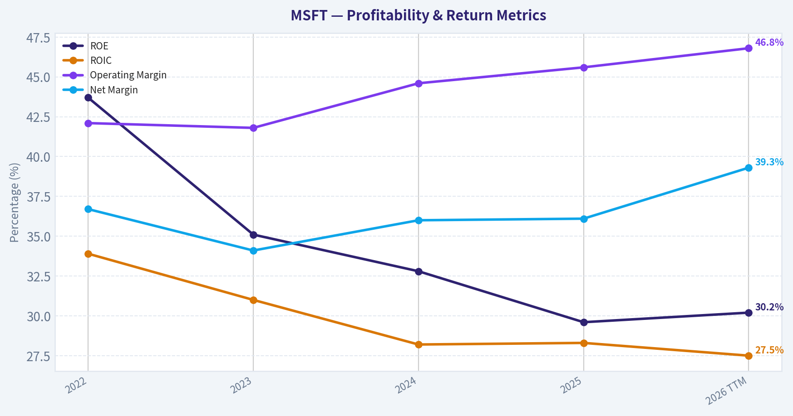
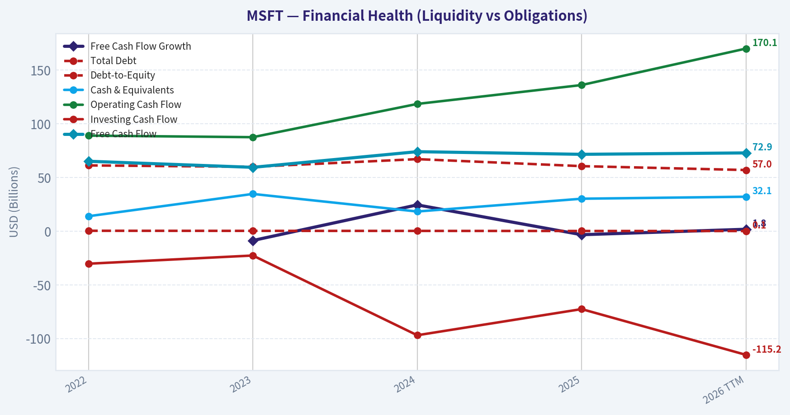
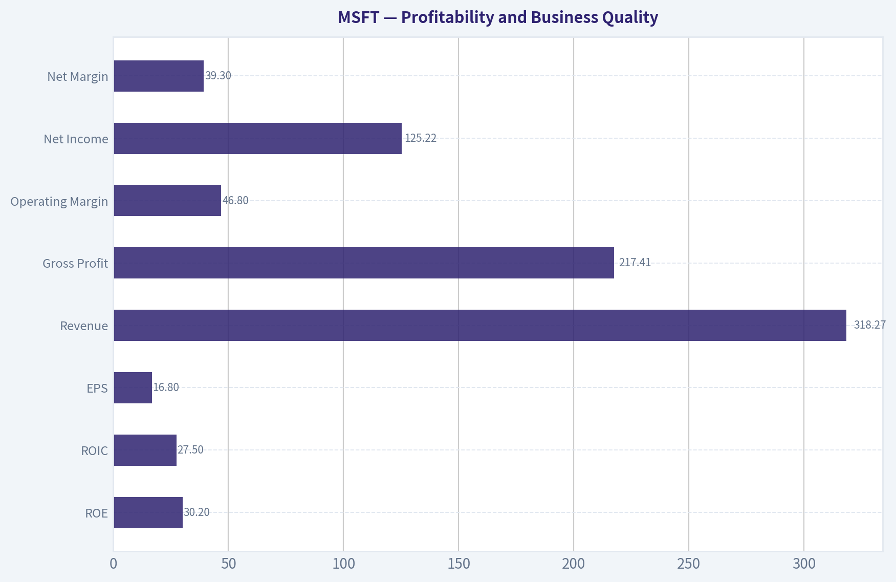
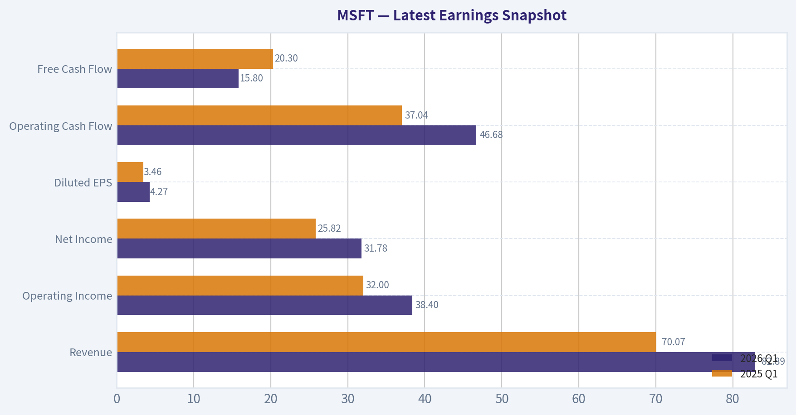
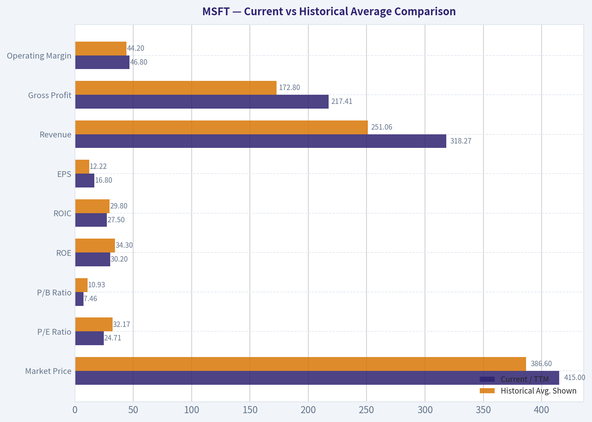
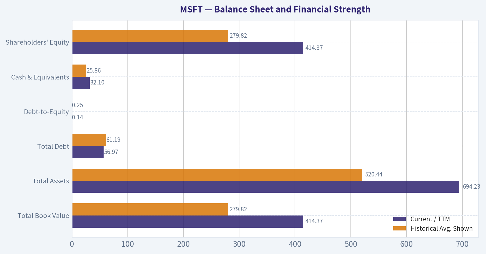
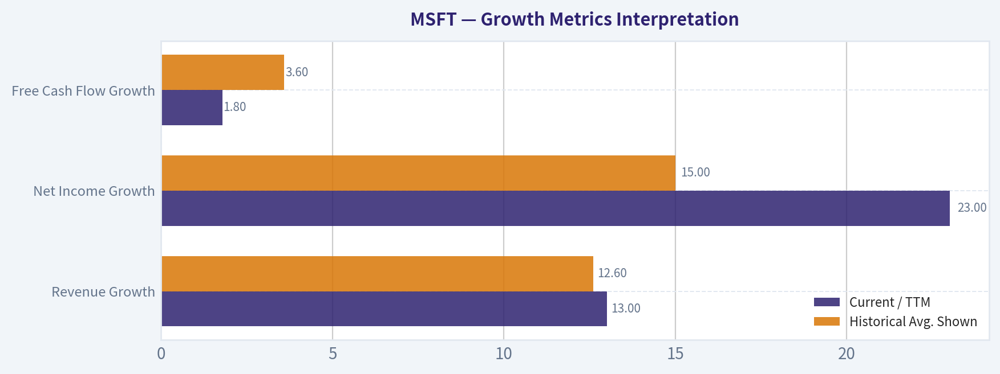
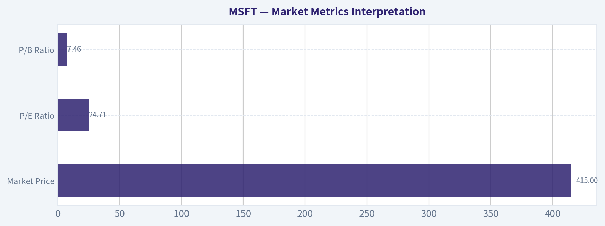

# MSFT Deep Value Intelligence

**Analysis Date:** 2026-05-10

## Critical Disclaimer

*This analysis is generated by Deep Value Intelligence, an AI-powered multi-agent investing framework. This report is for informational and educational purposes only and does not constitute financial advice. Always conduct your own research and consult with qualified financial advisors before making investment decisions.*

---

## Table of Contents

1. Intelligence Summary
2. Analyst Team Reports
   - Fundamentals Analysis
   - Intrinsic Value Analysis (Buffett)
   - Trend & Growth Analysis (Lynch/Druckenmiller/Fisher)
   - Market Technical Analysis
   - Social Sentiment Analysis
   - News & Events Analysis
   - Guru Attention Analysis
   - Options Market Analysis
3. Research Team Commentary
4. Value Investing Team Commentary
5. Deep Values Commentary

---

## Intelligence Summary

### Thesis + Conditions

**Core Thesis:** **EXECUTIVE SUMMARY**
**Verdict:** **WATCH**
Microsoft is an undeniable compounding machine (28.3% ROIC, 68.8% gross margins), but it currently offers **zero margin of safety** at $415/share. The core risk is a structural shift in capital intensity: while revenue grows at 14.9%, Free Cash Flow (FCF) is shrinking (-3.3% YoY).

**Key Risks:**
- Verdict:** **WATCH**
- Microsoft is an undeniable compounding machine (28.3% ROIC, 68.8% gross margins), but it currently offers **zero margin of safety** at $415/share. The core risk is a structural shift in capital intensity: while revenue grows at 14.9%, Free Cash Flow (FCF) is shrinking (-3.3% YoY). The market is pricing in flawless AI monetization, ignoring the possibility that heavy AI infrastructure spending may be a permanent, margin-dilutive arms race rather than a temporary buildout. As Buffett teaches, we insist on a margin of safety. We are waiting for a "fat pitch" rather than paying a premium for a $3T company undergoing an expensive platform transition.
- The Bull (Risky Analyst):** Argues that Microsoft's massive capex is *offensive*, not defensive. The AI buildout will deepen its enterprise moat and cross-platform monetization (Azure, Copilot, GitHub). The bull dismisses static intrinsic value models ($135-$318) as backward-looking, arguing that waiting for "proof" of FCF normalization means paying a much higher price later.
- The Neutral Analyst:** Highlights the tension between valuation risk and opportunity cost. Suggests that total inaction might miss one of the market's strongest long-duration assets, advocating instead for selective, disciplined accumulation on pullbacks rather than aggressive buying or total avoidance.
- 1.  **Margin of Safety is Non-Negotiable:** Even under the most generous Damodaran-style DCF models, MSFT's intrinsic value tops out around $318. At $415, the market is pricing in absolute perfection. Buffett's rule of not overpaying for a business-even a great one-protects against permanent capital loss if growth simply meets, rather than exceeds, lofty expectations.

**What Would Change Our View:**
- Verdict:** **WATCH**
- Microsoft is an undeniable compounding machine (28.3% ROIC, 68.8% gross margins), but it currently offers **zero margin of safety** at $415/share. The core risk is a structural shift in capital intensity: while revenue grows at 14.9%, Free Cash Flow (FCF) is shrinking (-3.3% YoY). The market is pricing in flawless AI monetization, ignoring the possibility that heavy AI infrastructure spending may be a permanent, margin-dilutive arms race rather than a temporary buildout. As Buffett teaches, we insist on a margin of safety. We are waiting for a "fat pitch" rather than paying a premium for a $3T company undergoing an expensive platform transition.
- The Bull (Risky Analyst):** Argues that Microsoft's massive capex is *offensive*, not defensive. The AI buildout will deepen its enterprise moat and cross-platform monetization (Azure, Copilot, GitHub). The bull dismisses static intrinsic value models ($135-$318) as backward-looking, arguing that waiting for "proof" of FCF normalization means paying a much higher price later.
- The Neutral Analyst:** Highlights the tension between valuation risk and opportunity cost. Suggests that total inaction might miss one of the market's strongest long-duration assets, advocating instead for selective, disciplined accumulation on pullbacks rather than aggressive buying or total avoidance.
- 1.  **Margin of Safety is Non-Negotiable:** Even under the most generous Damodaran-style DCF models, MSFT's intrinsic value tops out around $318. At $415, the market is pricing in absolute perfection. Buffett's rule of not overpaying for a business-even a great one-protects against permanent capital loss if growth simply meets, rather than exceeds, lofty expectations.

**Confidence:** Medium

---

## Analyst Team Reports

### Fundamentals Analysis

#### Latest Earnings Snapshot

*Most recent reported quarter anchored on 2026 Q1, with prior-year comparison when available.*

| Metric | 2026 Q1 | 2025 Q1 | YoY Change |
| --- | ---: | ---: | ---: |
| Revenue | $82.89B | $70.07B | +18.3% |
| Operating Income | $38.40B | $32.00B | +20.0% |
| Net Income | $31.78B | $25.82B | +23.1% |
| Diluted EPS | $4.27 | $3.46 | +23.4% |
| Operating Cash Flow | $46.68B | $37.04B | +26.0% |
| Free Cash Flow | $15.80B | $20.30B | -22.1% |

Key Takeaways: This snapshot anchors the most recent reported quarter before the narrative analysis. It helps readers separate long-run business quality from whatever changed in the latest earnings print.

#### 10-Year Financial Metrics for MSFT

*All values below are computed deterministically from raw data - not estimated by AI.*

*Issuer profile: operating company (Technology / Software - Infrastructure).*

#### 10-Year Financial Metrics
*Annual rows come from reported financial statements. The final TTM row is computed from the latest four quarters.*

| Metric | 2022 | 2023 | 2024 | 2025 | 2026 TTM |
| --- | --- | --- | --- | --- | --- |
| Market Price | $249 | $333 | $441 | $495 | $415 |
| Market Cap | $1.94T | $2.54T | $3.34T | $3.71T | $3.09T |
| P/E Ratio | 26.61 | 35.18 | 37.88 | 36.47 | 24.71 |
| P/B Ratio | 11.63 | 12.34 | 12.43 | 10.81 | 7.46 |
| ROE | 43.7% | 35.1% | 32.8% | 29.6% | 30.2% |
| ROIC | 33.9% | 31.0% | 28.2% | 28.3% | 27.5% |
| EPS | $9.36 | $9.48 | $11.80 | $13.64 | $16.80 |
| Revenue | $198.27B | $211.91B | $245.12B | $281.72B | $318.27B |
| Gross Profit | $135.62B | $146.05B | $171.01B | $193.89B | $217.41B |
| Gross Margin | N/A | N/A | N/A | N/A | 68.3% |
| Operating Margin | 42.1% | 41.8% | 44.6% | 45.6% | 46.8% |
| Net Income | $72.74B | $72.36B | $88.14B | $101.83B | $125.22B |
| Net Margin | 36.7% | 34.1% | 36.0% | 36.1% | 39.3% |
| Revenue Growth | N/A | 6.9% | 15.7% | 14.9% | 13.0% |
| Net Income Growth | N/A | -0.5% | 21.8% | 15.5% | 23.0% |
| Free Cash Flow Growth | N/A | -8.7% | 24.5% | -3.3% | 1.8% |
| Total Book Value | $166.54B | $206.22B | $268.48B | $343.48B | $414.37B |
| Total Assets | $364.84B | $411.98B | $512.16B | $619.00B | $694.23B |
| Total Debt | $61.27B | $59.97B | $67.13B | $60.59B | $56.97B |
| Debt-to-Equity | 0.37 | 0.29 | 0.25 | 0.18 | 0.14 |
| Cash & Equivalents | $13.93B | $34.70B | $18.32B | $30.24B | $32.10B |
| Shareholders' Equity | $166.54B | $206.22B | $268.48B | $343.48B | $414.37B |
| Operating Cash Flow | $89.03B | $87.58B | $118.55B | $136.16B | $170.14B |
| Investing Cash Flow | $-30.31B | $-22.68B | $-96.97B | $-72.60B | $-115.24B |
| Free Cash Flow | $65.15B | $59.48B | $74.07B | $71.61B | $72.92B |
| FCF Margin | 32.9% | 28.1% | 30.2% | 25.4% | 22.9% |
| Dividends / Share | $2.33 | $2.59 | $2.91 | $3.23 | $3.47 |

#### Profitability Metrics
- Return on Equity (ROE): 29.6%
- Return on Invested Capital (ROIC): 28.3%
- Return on Assets (ROA): 16.5%
- Gross Margin: 68.8%
- Operating Margin: 45.6%
- Net Profit Margin: 36.1%

#### Liquidity Metrics
- Current Ratio: 1.35
- Quick Ratio: 1.16

#### Leverage Metrics
- Debt-to-Equity Ratio: 0.18
- Interest Coverage Ratio: 53.89
- Net Debt: $30.35B

#### Growth Metrics (Year-over-Year)
- Revenue Growth: 14.9%
- Net Income Growth: 15.5%
- Free Cash Flow Growth: -3.3%
- Revenue CAGR (3-Year): 12.4%
- Revenue CAGR (5-Year): N/A

#### Valuation Metrics
- P/E Ratio (TTM): 24.75
- Forward P/E: 21.45
- Price-to-Book: 7.44
- Price-to-Sales: 9.69
- PEG Ratio: 1.29
- EV/EBITDA: 16.97
- Free Cash Flow Yield: 2.3%
- Earnings Yield: 4.0%

#### Owner Earnings (Buffett Method, Code-Computed)
- Net Income: $101.83B
- + Depreciation & Amortization: $34.15B
- - Capital Expenditures: $-64.55B
- - Working Capital Changes: $-5.35B
- = **Owner Earnings: $76.78B**

#### Intrinsic Value (Code-Computed)
- Current Price: $415
- Buffett Method (Owner Earnings):
  Conservative: $134
  Average: $166
  Optimistic: $205
- Cash Flow Method (FCF):
  Conservative: $96
  Average: $135
  Optimistic: $176

#### Piotroski F-Score: 5/9
- Positive Net Income: PASS
- Positive Operating Cash Flow: PASS
- ROA Improvement: FAIL
- Cash Flow > Net Income: PASS
- Decreasing Debt: PASS
- Improving Current Ratio: PASS
- No Dilution: FAIL
- Improving Gross Margin: FAIL
- Improving Asset Turnover: FAIL

ANALYST STANCE: **WATCH**

#### MSFT Buffett-Style Fundamental Analysis - Canonical Dataset Through 2026 TTM

Microsoft is an exceptional business with durable competitive advantages, very high profitability, fortress-like financial strength, and strong AI/cloud-driven growth. However, from a Warren Buffett value-investing perspective, the stock price of **$415** still requires a demanding set of assumptions relative to the deterministic Owner Earnings valuation reference, despite the current P/E and P/B being below the dataset-period averages. The business quality is outstanding; the margin of safety is not.

---

#### Current vs Historical Average Comparison

| Metric | Current / TTM | Historical Avg. Shown | Current vs Avg. | Buffett-Style Interpretation |
|---|---:|---:|---:|---|
| Market Price | $415 | $386.60 | +7.3% | Price remains above the shown-period average despite a pullback from 2025. |
| Market Cap | $3.09T | $2.92T | +5.7% | Still priced as one of the world's dominant compounders. |
| P/E Ratio | 24.71 | 32.17 | -23.2% | Cheaper than recent history, but not automatically cheap versus intrinsic value. |
| P/B Ratio | 7.46 | 10.93 | -31.8% | Lower than average because equity/book value has grown materially. |
| ROE | 30.2% | 34.3% | -4.1 pts | Still excellent, but down from 2022 levels as equity base expanded. |
| ROIC | 27.5% | 29.8% | -2.3 pts | Very strong capital productivity, though modestly declining. |
| EPS | $16.80 | $12.22 | +37.5% | Earnings power has compounded meaningfully. |
| Revenue | $318.27B | $251.06B | +26.8% | Revenue scale continues to expand strongly. |
| Gross Profit | $217.41B | $172.80B | +25.8% | High-quality software/cloud gross economics remain intact. |
| Operating Margin | 46.8% | 44.2% | +2.6 pts | Operating leverage is improving despite AI infrastructure spending. |
| Net Income | $125.22B | $92.06B | +36.0% | Profit growth has outpaced revenue growth. |
| Net Margin | 39.3% | 36.4% | +2.9 pts | TTM profitability is above historical norms. |
| Revenue Growth | 13.0% | 12.6% | +0.4 pts | Growth remains slightly above the shown-period average. |
| Net Income Growth | 23.0% | 15.0% | +8.1 pts | Earnings growth is currently very strong. |
| Free Cash Flow Growth | 1.8% | 3.6% | -1.8 pts | FCF growth is lagging due to elevated capital spending. |
| Total Book Value | $414.37B | $279.82B | +48.1% | Book value has expanded rapidly, lowering P/B. |
| Total Assets | $694.23B | $520.44B | +33.4% | Asset base is growing, partly from AI/cloud infrastructure investment. |
| Total Debt | $56.97B | $61.19B | -6.9% | Debt is below the shown-period average. |
| Debt-to-Equity | 0.14 | 0.25 | -43.1% | Leverage has improved materially. |
| Cash & Equivalents | $32.10B | $25.86B | +24.1% | Liquidity remains strong. |
| Shareholders' Equity | $414.37B | $279.82B | +48.1% | Equity cushion has grown significantly. |
| Free Cash Flow | $72.92B | $68.65B | +6.2% | FCF is above average, but growth is muted versus earnings. |
| Dividends / Share | $3.47 | $2.91 | +19.4% | Dividend growth remains consistent but yield is modest at current price. |

Key Takeaways: Microsoft's current valuation multiples are below the shown-period averages, especially P/E and P/B, but the business is still expensive in absolute terms. Profitability remains exceptional, with TTM net margin and operating margin above average. The main negative deviation is free cash flow growth, which is much weaker than net income growth because AI and cloud infrastructure investment are absorbing cash.

---

#### Market Metrics Interpretation

| Market Metric | Current Value | Interpretation |
|---|---:|---|
| Market Price | $415 | The stock has declined from the 2025 level of $495 but remains above the shown-period average of $386.60. |
| Total Market Cap | $3.09T | Microsoft remains priced as a mega-cap compounder with extremely high market expectations. |
| P/E Ratio | 24.71 | Lower than the dataset-period average of 32.17, suggesting multiple compression; however, it is still not a deep-value multiple. |
| P/B Ratio | 7.46 | Well below the average of 10.93, reflecting both a lower price and a much larger equity base. |

Key Takeaways: Microsoft looks cheaper than it did during the 2023-2025 valuation peak, but it is not statistically cheap enough to create an obvious Buffett-style margin of safety. The lower P/B ratio is encouraging, but for an asset-light software/cloud company, earnings quality and owner earnings matter more than book value.

---

#### Profitability and Business Quality

| Profitability Metric | Current / TTM | Historical Context | Interpretation |
|---|---:|---|---|
| ROE | 30.2% | Down from 43.7% in 2022 | Still elite, but declining as equity grows faster than earnings. |
| ROIC | 27.5% | Down from 33.9% in 2022 | Excellent returns on capital, but the downward trend deserves monitoring. |
| EPS | $16.80 | Highest shown-period value | EPS growth remains strong and supports the business-quality case. |
| Revenue | $318.27B | Highest shown-period value | Revenue predictability remains high due to recurring software, cloud, and enterprise contracts. |
| Gross Profit | $217.41B | Highest shown-period value | Microsoft's gross profit pool remains enormous and durable. |
| Operating Margin | 46.8% | Highest shown-period value | Strong operating leverage offsets some infrastructure cost pressure. |
| Net Income | $125.22B | Highest shown-period value | Microsoft is converting scale into very high absolute earnings. |
| Net Margin | 39.3% | Above 36.4% average | Profitability is unusually strong even by Microsoft's standards. |

Key Takeaways: Microsoft remains one of the highest-quality large businesses in the world. The main nuance is that ROE and ROIC are drifting lower, not because the company is weak, but because the capital base is growing rapidly as Microsoft invests heavily in cloud and AI infrastructure.

---

#### Growth Metrics Interpretation

| Growth Metric | Current / TTM | Historical Avg. Shown | Interpretation |
|---|---:|---:|---|
| Revenue Growth | 13.0% | 12.6% | Growth remains durable and slightly above average. |
| Net Income Growth | 23.0% | 15.0% | Earnings growth is currently outpacing sales growth, helped by margin expansion. |
| Free Cash Flow Growth | 1.8% | 3.6% | FCF growth is lagging because capital expenditures are elevated. |

Key Takeaways: Microsoft's revenue and earnings growth remain highly attractive for a company of this scale. The key Buffett-style concern is the gap between net income growth and free cash flow growth, because owner earnings are the cash that ultimately matters to investors.

---

#### Balance Sheet and Financial Strength

| Balance Sheet Metric | Current / TTM | Historical Avg. Shown | Interpretation |
|---|---:|---:|---|
| Total Book Value | $414.37B | $279.82B | Book value has grown substantially. |
| Total Assets | $694.23B | $520.44B | Asset growth reflects expanding cloud and AI infrastructure. |
| Total Debt | $56.97B | $61.19B | Debt is below average and manageable. |
| Debt-to-Equity | 0.14 | 0.25 | Leverage has declined materially. |
| Cash & Equivalents | $32.10B | $25.86B | Liquidity is above average. |
| Shareholders' Equity | $414.37B | $279.82B | Equity base has strengthened significantly. |

Key Takeaways: Microsoft's balance sheet is exceptionally strong. Debt is falling relative to equity, liquidity is healthy, and the company has ample financial flexibility to fund AI infrastructure, dividends, buybacks, and acquisitions.

---

#### Cash Flow and Capital Allocation

| Cash Flow Metric | Current / TTM | Historical Avg. Shown | Interpretation |
|---|---:|---:|---|
| Operating Cash Flow | $170.14B | $120.29B | Operating cash generation is extremely strong. |
| Free Cash Flow | $72.92B | $68.65B | FCF is above average but has not grown as fast as revenue or earnings. |
| FCF Margin | 22.9% | 27.9% | FCF margin is below average due to elevated capital spending. |
| Dividends / Share | $3.47 | $2.91 | Dividend growth remains steady and shareholder-friendly. |

Key Takeaways: Microsoft generates enormous operating cash flow, but free cash flow conversion has weakened as AI and cloud capex rises. This is not necessarily a structural problem, but it reduces near-term owner earnings and makes valuation discipline more important.

---

#### Revenue Breakdown

| Revenue Source | Amount ($B) | % of Total |
|---|---:|---:|
| Productivity and Business Processes | $116.4B | 41.3% |
| Intelligent Cloud | $105.4B | 37.4% |
| More Personal Computing | $59.9B | 21.3% |
| Total | $281.7B | 100.0% |

Key Takeaways: Microsoft's revenue base is diversified, but the two most important engines are Productivity and Business Processes and Intelligent Cloud. Together, they represent nearly 79% of revenue and contain the company's strongest recurring-revenue and enterprise-lock-in characteristics.

---

#### Warren Buffett-Style Qualitative Analysis

| Buffett Lens | Assessment |
|---|---|
| Economic Moat | Very wide. Microsoft benefits from enterprise switching costs, network effects, developer ecosystems, Windows and Office standards, Azure scale, GitHub, LinkedIn, and deep AI distribution through Copilot and enterprise software. |
| Business Durability | Very high. Microsoft's products are mission-critical across enterprises, governments, developers, and consumers. |
| Predictable Earnings | Strong. Revenue, EPS, and net income have grown consistently across the dataset, with only a minor net income decline in 2023. |
| Financial Strength | Excellent. Debt-to-equity has declined to 0.14, cash is above average, and interest coverage is very strong at 53.89. |
| Management Performance | Strong but watch capex discipline. ROE and ROIC remain elite, though declining. Dividend growth is steady, and buybacks likely remain part of capital allocation. |
| Capital Allocation | Generally rational. Heavy AI capex may be value-creating, but investors need evidence that incremental returns remain high. |
| Valuation | Mixed to unfavorable. Multiples are lower than recent averages, but deterministic Owner Earnings intrinsic value references remain far below the current price. |
| Overall Business Quality | Exceptional. The valuation, not the company, is the primary issue. |

Key Takeaways: Microsoft is almost exactly the kind of business Buffett would admire: durable, cash-generative, entrenched, and led by rational management. The problem is that Buffett also demands a margin of safety, and the current price still embeds high expectations.

---

#### Buffett-Style Owner Earnings DCF

Base assumptions from the deterministic dataset:

| DCF Input | Value |
|---|---:|
| Base Owner Earnings | $76.78B |
| Current Price | $415 |
| Market Cap | $3.09T |
| Estimated Shares Outstanding | 7.45B |
| Discount Rate | 10.0% |
| Terminal Growth Rate | 2.5% |
| Projection Period | 10 years |

Key Takeaways: The valuation starts with Microsoft's deterministic Owner Earnings of $76.78 billion. A 10% discount rate is intentionally conservative and Buffett-like, while the 2.5% terminal growth rate assumes Microsoft grows roughly in line with long-term nominal economic growth after the explicit forecast period.

Because the deterministic dataset provides current Owner Earnings but does not provide a full historical Owner Earnings growth series, the available deterministic free cash flow growth rates are used as the closest cash-owner-earnings proxy for scenario growth: **lowest -8.7%, average 3.6%, highest 24.5%**.

DCF formula used:

`PV of Explicit Owner Earnings = OE0 x (1 + g) / (r - g) x [1 - ((1 + g) / (1 + r))^10]`

`Terminal Value = OE10 x (1 + terminal growth) / (r - terminal growth)`

`Fair Value per Share = Total Present Value / Estimated Shares Outstanding`

| Scenario | Growth Rate Used | PV of 10-Year Owner Earnings | PV of Terminal Value | Total Equity Value | Fair Value / Share | Current Price vs Fair Value |
|---|---:|---:|---:|---:|---:|---:|
| Conservative | -8.7% | $316.6B | $162.7B | $479.3B | $64 | +548% above fair value |
| Average | 3.6% | $559.5B | $575.3B | $1.13T | $152 | +173% above fair value |
| Optimistic | 24.5% | $1.61T | $3.62T | $5.23T | $703 | 41% below fair value |

Key Takeaways: The conservative and average scenarios suggest Microsoft is materially overvalued relative to Buffett-style owner earnings. The optimistic scenario produces a much higher value, but it assumes a very high 24.5% owner-earnings-like growth rate for a full decade, which is difficult to underwrite for a company already generating over $300 billion in annual revenue.

#### Deterministic Intrinsic Value Reference

| Valuation Method | Conservative | Average | Optimistic |
|---|---:|---:|---:|
| Buffett Method - Owner Earnings | $134 | $166 | $205 |
| Cash Flow Method - FCF | $96 | $135 | $176 |
| Current Price | $415 | $415 | $415 |

Key Takeaways: The deterministic intrinsic value references are much more conservative than the mechanical high-growth DCF case. Under both the Owner Earnings and FCF methods, Microsoft trades well above conservative, average, and optimistic intrinsic value estimates, which argues against a fresh Buffett-style purchase at the current price.

---

#### Key Investment Insights

| Category | Insight |
|---|---|
| Quality | Microsoft remains an elite compounder with exceptional margins, recurring revenue, and durable competitive advantages. |
| Valuation | P/E and P/B are below shown-period averages, but intrinsic value references remain far below market price. |
| AI Opportunity | Azure, Copilot, GitHub, and enterprise AI integration could sustain elevated revenue and earnings growth. |
| Cash Flow Concern | Free cash flow growth of 1.8% trails net income growth of 23.0%, highlighting capex intensity. |
| Balance Sheet | Debt-to-equity of 0.14 and strong liquidity provide major resilience. |
| Profitability | Operating margin of 46.8% and net margin of 39.3% are outstanding and above average. |
| Capital Allocation | Dividend growth is steady, but the dividend is not the main return driver at this valuation. |
| Sentiment / Positioning | Latest structured guru tracking shows Steve Cohen trimmed MSFT by 24.2%, which is not decisive but supports valuation caution. |

Key Takeaways: Microsoft's business fundamentals are excellent, but the investment case is highly price-sensitive. Investors are being asked to pay today for many years of continued AI and cloud execution.

---

#### Red Flags and Opportunities

| Area | Red Flags | Opportunities |
|---|---|---|
| Valuation | Current price is far above deterministic Owner Earnings and FCF intrinsic value references. | Multiple compression has already made the stock cheaper than recent historical averages. |
| Free Cash Flow | FCF margin has declined to 22.9% from a shown-period average of 27.9%. | AI capex may create future high-margin revenue streams if returns remain strong. |
| Returns on Capital | ROE and ROIC are declining from 2022 levels. | ROIC remains very high at 27.5%, far above most companies. |
| Growth | Sustaining double-digit growth at Microsoft's scale is increasingly difficult. | Azure, Microsoft 365, Copilot, security, LinkedIn, and GitHub provide multiple growth vectors. |
| Competitive Risk | AI competition from Google, Amazon, Meta, OpenAI ecosystem changes, and open-source models may pressure economics. | Microsoft's distribution advantage may allow it to monetize AI more effectively than peers. |
| Regulatory Risk | Mega-cap technology faces antitrust and data governance scrutiny. | Scale, compliance capabilities, and enterprise trust can also strengthen Microsoft's moat. |

Key Takeaways: The biggest red flag is not business deterioration; it is valuation versus owner earnings. The biggest opportunity is that Microsoft may convert AI infrastructure spending into another decade of high-return enterprise software growth.

---

#### Final Investment Stance

| Stance | Rationale |
|---|---|
| **WATCH** | Microsoft is a world-class business with a wide moat, strong balance sheet, excellent margins, and durable growth. However, at **$415**, the stock trades far above deterministic Owner Earnings and FCF intrinsic value references. The company deserves a premium, but a Buffett-style investor should wait for a larger margin of safety or clearer evidence that AI capex will generate sustained high-return owner earnings growth. |

Key Takeaways: Microsoft is not a weak company; it is an outstanding company at a demanding price. For long-term holders, the quality supports continued monitoring, but for new Buffett-style capital, the current valuation does not provide enough margin of safety.

---

#### Final Summary Table

| Dimension | Assessment | Investment Implication |
|---|---|---|
| Economic Moat | Very wide | Supports long-term durability. |
| Financial Strength | Excellent | Low bankruptcy or liquidity risk. |
| Profitability | Exceptional | High-quality earnings engine. |
| Growth | Strong | AI and cloud remain major drivers. |
| Free Cash Flow | Mixed | Capex is pressuring owner earnings conversion. |
| Valuation | Unfavorable | Price exceeds deterministic intrinsic value references. |
| Buffett Margin of Safety | Insufficient | Better entry price needed. |
| Final Stance | **WATCH** | Great business, but not a compelling value buy at current price. |

Key Takeaways: Microsoft remains one of the highest-quality public companies in the world, but Buffett-style investing requires both quality and price discipline. The right action is to watch patiently for a better valuation or for stronger proof that current AI investment will translate into materially higher owner earnings.

#### Fundamental Visuals

This graph tracks the profitability and return metrics (ROE, ROIC, Margins) of **MSFT** over the past decade, highlighting capital efficiency trends.

This chart illustrates the financial health of **MSFT** over the last 10 years, mapping cash equivalents and free cash flow against total obligations (Debt).

This comparison chart from *Profitability and Business Quality* stacks current figures against historical benchmarks for **MSFT**, making it easy to see where the company trades relative to its own averages.

---

### Intrinsic Value Analysis (Buffett)

> *Following Warren Buffett's value investing philosophy: Circle of Competence, Economic Moat, Management Quality, and Margin of Safety.*

#### Intrinsic Value Snapshot

Price is what you pay. Intrinsic value is what the business may be worth based on the cash it can create for owners over time. We show a range, not one magic number.

- Current Price: $415.12
- Value Range: $95.70 to $205.12

##### Owner Earnings (Buffett Method)
- Net Income: $101,832,000,000.00
- Depreciation & Amortization: $34,153,000,000.00
- Capital Expenditures: $-64,551,000,000.00
- Working Capital Changes: $-5,350,000,000.00
- Owner Earnings: $76,784,000,000.00

##### Intrinsic Value
###### Buffett Method
Uses owner earnings. Stricter, and usually more conservative.
- Conservative: $133.91
- Average: $165.50
- Optimistic: $205.12
- Discount Rate: 10.0%

###### Cash Flow Method
Uses free cash flow. Better for companies spending heavily today to grow tomorrow.
- Conservative: $95.70
- Average: $134.89
- Optimistic: $176.50
- Discount Rate: 10.0%

ANALYST STANCE: **WATCH**

#### Microsoft Buffett-Style Value Analysis - MSFT at $415

Microsoft is a wonderful business, but at the current price the margin of safety is not sufficient. The business passes most Buffett quality gates: it is understandable, highly profitable, cash-generative, protected by deep switching costs, and led by competent management. The problem is valuation: even under a constructive growth scenario, intrinsic value appears roughly near or below today's market price, while the current free cash flow yield of about **2.3%** is thin for a value investor.

---

#### 1. Go / No-Go Gate Assessment

| Buffett Gate | Result | Evidence | Risk to Monitor |
|---|---:|---|---|
| Gate 1: Circle of Competence & Simplicity | Pass | Microsoft sells software, cloud infrastructure, operating systems, productivity tools, business applications, gaming, and AI-enabled services. Customers pay recurring subscription and usage fees. | AI and cloud infrastructure are understandable, but capital intensity is rising. |
| 10-Year Predictability | Pass | Office, Windows, Azure, LinkedIn, GitHub, Dynamics, and security products are deeply embedded in enterprise workflows. | Competitive pressure from Google, Amazon, Meta, open-source AI, and specialized SaaS vendors. |
| Technology Risk | Pass, with caution | Microsoft is more likely to benefit from AI than be destroyed by it, given distribution through Office, Azure, GitHub, Windows, and enterprise relationships. | AI could pressure margins if model costs, memory prices, and data-center capex rise faster than monetization. |
| Gate 2: Moat | Pass | Gross margin around **68.8%**, ROE around **29.6%**, high recurring revenue, customer captivity, enterprise trust, and ecosystem advantages. | Moat is wide, but AI competition may require sustained heavy investment. |
| Gate 3: Management & Capital Allocation | Pass | Satya Nadella has transformed Microsoft into a cloud-first and AI-first compounder. Capital allocation has generally been rational. | The Activision deal and massive AI capex need continued scrutiny. |
| Gate 4: Industry Structure | Pass, with caution | Enterprise software is structurally attractive; cloud is an oligopoly led by Microsoft, Amazon, and Google. | Cloud and AI infrastructure are increasingly capital-intensive. |

**Key Takeaways:** Microsoft passes the Buffett quality filters, especially on business simplicity, moat, and management. The main caution is not business quality, but the rising capital intensity of AI and cloud. This is still a predictable, high-quality enterprise franchise, but the price must leave room for error.

---

#### 2. Simple Business Explanation - The Elementary School Test

Microsoft makes money by selling tools that people and companies use every day. Businesses pay Microsoft to use Office, Teams, Outlook, Windows, cloud computing through Azure, cybersecurity tools, databases, developer tools, LinkedIn, gaming content, and now AI assistants such as Copilot. Much of this revenue repeats every month or year, which makes the business unusually predictable.

#### 3. Moat Analysis

| Moat Source | Rating | Evidence | Buffett Interpretation |
|---|---:|---|---|
| Brand & Trust | Wide | Microsoft is one of the most trusted vendors in enterprise technology. CIOs already rely on Microsoft for identity, productivity, security, cloud, and compliance. | Strong brand, but more importantly institutional trust. |
| Switching Costs | Very Wide | Microsoft 365, Azure, Active Directory, Teams, GitHub, Dynamics, and security tools are embedded in workflows and data systems. | This is Microsoft's strongest moat. Customers can switch, but doing so is painful, risky, and expensive. |
| Cost Advantage | Moderate to Wide | Azure benefits from global scale, purchasing power, and integration with Microsoft's software stack. | Scale matters, but cloud competitors are also very large. |
| Network Effects | Moderate | LinkedIn, GitHub, Teams, Windows developers, and the Microsoft partner ecosystem become more useful as adoption expands. | Helpful, though not as pure as a marketplace network effect. |
| Pricing Power | Wide | Microsoft has repeatedly raised prices across Office 365, cloud, security, and AI add-ons while retaining customers. | Strong evidence of customer captivity and mission-critical value. |
| Financial Evidence | Wide | Gross margin around **68.8%**, ROE around **29.6%**, revenue growth about **14.9% YoY**, and high recurring revenue base. | Financials confirm a real moat, not a story moat. |

**Key Takeaways:** Microsoft's moat is wide and durable, led by switching costs and enterprise trust. The company is not just selling software; it is embedded in the operating system of modern business. The moat is likely still widening in AI, security, developer tools, and cloud, but that widening now requires enormous infrastructure spending.

#### Moat Quality Rating: **Wide & Stable to Widening**

Microsoft deserves a high-quality moat rating. The only reason I do not call it purely "wide and widening" without qualification is the new AI investment cycle, which may reduce incremental returns if customers do not pay enough for the added compute cost.

---

#### 4. Management Quality Assessment

| Management Question | Assessment | Evidence |
|---|---:|---|
| Do they think like owners? | Good | Management has focused on long-term cloud, enterprise software, and AI platform value rather than short-term optics. |
| Are they candid and rational? | Good | Microsoft reporting is generally clear; the company has a long record of durable profitability and shareholder returns. |
| Capital allocation record | Strong | Azure, LinkedIn, GitHub, security, and AI investments have strengthened the ecosystem. Buybacks and dividends have been steady, though valuation-sensitive buybacks are not always obvious. |
| Acquisition discipline | Mixed to Good | LinkedIn and GitHub look strategically successful. Activision is larger and more complex, requiring a longer proof period. |
| Balance sheet discipline | Good | Microsoft remains financially strong, with current ratio around **1.35** and ample earnings power. |

**Key Takeaways:** Management quality is high, especially under Satya Nadella. The company has reinvested into cloud, AI, developer tools, security, and enterprise software in ways that increased Microsoft's strategic value. The key issue now is whether the next wave of AI capex earns attractive returns.

---

#### 5. 10-Year Financial Summary

Approximate figures are rounded and intended for investment analysis rather than audit precision. The latest period uses the shared research pack and current market data as of 2026-05-10.

| Fiscal Year / Period | Revenue | Gross Margin | Net Income | Operating Cash Flow | CapEx | Free Cash Flow | ROE |
|---|---:|---:|---:|---:|---:|---:|---:|
| FY2016 | ~$91B | ~58% | ~$21B | ~$33B | ~$8B | ~$25B | ~23% |
| FY2017 | ~$97B | ~62% | ~$26B | ~$40B | ~$8B | ~$31B | ~29% |
| FY2018 | ~$110B | ~65% | ~$17B | ~$44B | ~$12B | ~$32B | ~19% |
| FY2019 | ~$126B | ~66% | ~$39B | ~$52B | ~$14B | ~$38B | ~40% |
| FY2020 | ~$143B | ~68% | ~$44B | ~$61B | ~$15B | ~$45B | ~37% |
| FY2021 | ~$168B | ~69% | ~$61B | ~$77B | ~$21B | ~$56B | ~43% |
| FY2022 | ~$198B | ~68% | ~$73B | ~$89B | ~$24B | ~$65B | ~44% |
| FY2023 | ~$212B | ~69% | ~$72B | ~$88B | ~$28B | ~$60B | ~35% |
| FY2024 | ~$245B | ~70% | ~$88B | ~$119B | ~$45B | ~$74B | ~37% |
| Latest / TTM Estimate | ~$280B+ | **68.8%** | ~$124B implied by P/E | ~$135B-$145B est. | elevated | ~$71B implied by 2.3% FCF yield | **29.6%** |

**Key Takeaways:** Microsoft has compounded revenue, earnings, and cash flow at exceptional rates over the last decade. Gross margins have remained extremely high, which confirms the software moat. The recent concern is that free cash flow is not growing as fast as net income because AI and cloud infrastructure spending have increased sharply.

---

#### 6. Cash Flow Reality Check

| Metric | Current / Recent Reading | Buffett View |
|---|---:|---|
| Market Cap | **$3.08T** | Very large expectations are already embedded. |
| Share Price | **$415** | Price is not obviously cheap. |
| P/E | **24.8x** | Reasonable for quality, but not a bargain. |
| FCF Yield | **2.3%** | Low; current free cash flow return is thin. |
| Revenue Growth YoY | **14.9%** | Excellent for a company of this size. |
| ROE | **29.6%** | Strong, though lower than peak years. |
| Gross Margin | **68.8%** | Confirms software-like economics. |
| Current Ratio | **1.35** | Adequate liquidity. |

**Key Takeaways:** Microsoft's quality remains obvious in the margin, growth, and ROE numbers. However, the free cash flow yield is the yellow flag for a value investor. At a 2.3% FCF yield, the shareholder is relying heavily on future growth and successful AI monetization.

---

#### 7. Owner Earnings Calculation

Buffett's owner earnings estimate attempts to separate true distributable earnings from growth investment. For Microsoft, reported free cash flow is currently pressured by heavy AI and data-center capex. I therefore estimate normalized owner earnings by treating part of capex as growth investment rather than maintenance spending.

| Owner Earnings Component | Estimate |
|---|---:|
| Net Income, implied by market cap and P/E | ~$124B |
| Add: Depreciation & Amortization | ~$28B |
| Less: Estimated Maintenance CapEx | ~($25B) |
| Less: Working Capital / Other Required Reinvestment | ~($8B) |
| Estimated Normalized Owner Earnings | **~$119B** |
| Shares Outstanding, implied by market cap / price | ~7.42B |
| Owner Earnings Per Share | **~$16.00** |

**Key Takeaways:** Normalized owner earnings are estimated at about **$119 billion**, or roughly **$16 per share**. This is higher than current free cash flow because a large portion of Microsoft's capex appears to be growth investment for cloud and AI capacity. The key judgment is whether that growth capex earns high returns; if it does not, owner earnings are overstated.

---

#### 8. Three-Scenario DCF Valuation

Assumptions: discount rate of **10%**, normalized owner earnings of **$119B**, estimated shares outstanding of **7.42B**, and terminal growth of **3%** where applicable.

| Scenario | Core Assumption | Estimated Equity Value | Intrinsic Value / Share | Margin of Safety at $415 |
|---|---|---:|---:|---:|
| A: No Growth | Owner earnings capitalized at 10% | ~$1.19T | **~$160** | **Negative; price is ~159% above value** |
| B: GDP Growth | 3% perpetual growth | ~$1.75T | **~$236** | **Negative; price is ~76% above value** |
| C: Historical Growth Haircut | 10% owner earnings growth for 10 years, then 3% terminal growth | ~$2.94T | **~$396** | **Negative; price is ~5% above value** |

**Key Takeaways:** Microsoft does not screen cheap under conservative valuation methods. The no-growth and GDP-growth cases are far below the current price. Even a favorable 10-year growth scenario produces a value around **$396 per share**, slightly below the current **$415** price.

---

#### 9. Margin of Safety Analysis

| Valuation Case | Intrinsic Value / Share | Buffett Buy Price With 25% Margin of Safety | Current Price | Action |
|---|---:|---:|---:|---|
| No Growth | ~$160 | ~$120 | $415 | Avoid buying at this valuation basis |
| GDP Growth | ~$236 | ~$177 | $415 | Avoid buying at this valuation basis |
| Historical Growth Haircut | ~$396 | ~$297 | $415 | Watch; no margin of safety |
| High-Quality Fair-Price View | ~$400-$430 possible if AI returns are excellent | ~$300-$320 preferred | $415 | Hold/watch, not a fresh Buffett-style buy |

**Key Takeaways:** The stock lacks the minimum 25% margin of safety required for a new value investment. A Buffett-style investor would likely admire the business but wait for a better price. A more attractive entry would likely require either a meaningful pullback or clear evidence that AI capex is producing very high incremental returns.

---

#### 10. Final Buffett Scorecard

| Criterion | Weight | Score, 1-5 | Weighted Contribution | Rationale |
|---|---:|---:|---:|---|
| Business Understanding | 20% | 4.5 | 0.90 | Simple core model: recurring software, cloud, enterprise tools, and AI services. |
| Moat Width & Durability | 25% | 4.5 | 1.13 | Wide switching costs, enterprise trust, ecosystem lock-in, and pricing power. |
| Management Quality | 15% | 4.0 | 0.60 | Strong strategic execution under Nadella; AI capex discipline remains the key test. |
| Return on Equity | 15% | 4.0 | 0.60 | ROE around 29.6% remains excellent, though below peak levels. |
| Reinvestment Runway | 10% | 3.5 | 0.35 | AI, cloud, security, and enterprise software offer runway, but capex intensity is rising. |
| Balance Sheet Strength | 5% | 4.0 | 0.20 | Financially strong, though not valued like a neglected balance-sheet bargain. |
| Industry Structure | 5% | 3.5 | 0.18 | Enterprise software is attractive; cloud and AI are oligopolistic but fiercely competitive. |
| Valuation / Margin of Safety | 5% | 1.0 | 0.05 | No clear margin of safety at $415. |
| **Total** | **100%** |  | **4.00 / 5.00** | High-quality business, but current price fails the Buffett margin-of-safety test. |

**Key Takeaways:** Microsoft scores like a wonderful business, but not like a wonderful bargain. The arithmetic score is high because business quality is outstanding. However, Buffett investing is not just about quality; without a margin of safety, the correct action is patience.

---

#### Final Investment Stance: **WATCH**

Microsoft is the kind of business Buffett would respect: understandable, durable, highly profitable, and deeply embedded in customer operations. It has a wide moat, strong management, and a long runway in cloud, security, developer tools, and AI. But at **$415 per share**, the stock does not offer a sufficient margin of safety based on normalized owner earnings and a 10% required return.

**Conviction Level:** High conviction in business quality; medium-high conviction that valuation is not compelling for a new value-oriented purchase.

**Buffett-style conclusion:**
Microsoft is a wonderful company, but the current price is closer to fair-to-rich than obviously attractive. I would not advocate a new purchase here. I would watch for a pullback toward roughly **$300-$320**, or for evidence that AI investments are producing enough incremental owner earnings to justify a materially higher intrinsic value.
#### Valuation Bridge

This bridge places the current market price beside each intrinsic value lens so readers can see whether upside depends on one method or shows up across several methods.

| Scenario | Intrinsic Value / Share |
| --- | ---: |
| Buffett Method | $165.50 |
| Cash Flow Method | $134.89 |
| Damodaran Method | $318.35 |
| Current Price | $415.12 |

#### Key Takeaways

If one method is far above the others, the upside case depends on a specific modelling assumption. When several methods cluster together, the valuation story is more robust.

#### Valuation Visuals

This comparison chart from *Latest Earnings Snapshot* stacks current figures against historical benchmarks for **MSFT**, making it easy to see where the company trades relative to its own averages.

This comparison chart from *Current vs Historical Average Comparison* stacks current figures against historical benchmarks for **MSFT**, making it easy to see where the company trades relative to its own averages.

This comparison chart from *Balance Sheet and Financial Strength* stacks current figures against historical benchmarks for **MSFT**, making it easy to see where the company trades relative to its own averages.

---

### Trend & Growth Analysis (Lynch/Druckenmiller/Fisher)

> *Following Peter Lynch's GARP, Stanley Druckenmiller's macro-aware approach, and Philip Fisher's scuttlebutt methodology.*

ANALYST STANCE: **WATCH**

#### Microsoft Growth Analysis - MSFT as of 2026-05-10

Microsoft is an elite compounder riding cloud, AI, productivity software, security, developer tools, and enterprise workflow digitization. However, at a roughly **$3.08T market cap**, this is no longer a classic Lynch ten-bagger candidate unless global AI/cloud profit pools expand dramatically. The stock is attractive as a high-quality core holding, but at today's valuation the growth-investor stance is **WATCH / add on pullbacks**, not aggressive accumulation.

---

#### 1. Lynch Classification

| Category | MSFT Fit | Evidence | Growth Investor View |
|---|---:|---|---|
| Slow Grower | No | Revenue growth near 15%, EPS growth above 20% in recent annual period | Too strong to classify as slow |
| Stalwart | Yes | Massive, durable, highly profitable mega-cap with recurring revenue | Core compounding profile |
| Fast Grower | Partial | Azure, AI Copilot, security, and cloud can grow faster than corporate average | Growth pockets are fast, but company scale limits total acceleration |
| Cyclical | Partial | PC, gaming, and ad exposure have cyclical elements | Not the main story |
| Turnaround | No | Already highly profitable and strategically strong | Not applicable |
| Asset Play | No | Value is from cash flows, platform moat, and AI optionality | Not applicable |

**Key Takeaways:** Microsoft is best classified as a **Stalwart with fast-grower segments**. Azure, AI, security, and developer tools give it growth-company characteristics, but the overall business is now so large that a true ten-bagger outcome is structurally difficult. For Lynch-style investors, this is more of a "buy the great company at a fair or better price" stock than a hidden multi-bagger.

---

#### 2. The Story in 3 Bullets

| Story Element | Simple Explanation |
|---|---|
| Enterprise operating system for work | Microsoft sells the software that businesses use every day: Office, Teams, Outlook, Windows, Azure, GitHub, Dynamics, and security tools. |
| AI monetization layer | Microsoft is embedding AI into existing workflows through Copilot, Azure AI, GitHub Copilot, and enterprise automation. |
| Cloud + security + productivity flywheel | Its products reinforce each other, letting Microsoft bundle, upsell, and deepen customer lock-in across the enterprise stack. |

**Key Takeaways:** The Microsoft story is easy to understand: it is the default software platform for enterprises, and now it is adding AI across that installed base. The biggest upside comes if AI meaningfully raises average revenue per user while Azure captures more infrastructure demand. The risk is that AI adoption may be expensive to serve and slower to monetize than the market expects.

---

#### 3. TAM and 10x Test

| Metric | Estimate / View |
|---|---:|
| Current annual revenue base | ~$245B FY2024; likely higher on current run-rate |
| 10x revenue target | ~$2.45T+ annual revenue |
| Relevant TAMs | Cloud infrastructure, AI platforms, productivity software, cybersecurity, developer tools, business apps, gaming, search/ads |
| TAM direction | Expanding, driven by AI, cloud migration, security, and automation |
| Can MSFT 10x revenue and still be below 20% share? | Possible only if global AI/cloud/software TAM expands massively; not a near/intermediate-term base case |
| 10-bagger stock potential from current market cap | Low; would imply roughly $30T+ market cap before dividends/buybacks |

**Key Takeaways:** Microsoft has one of the largest and best TAM collections in the market, but its starting size is enormous. Revenue can continue compounding, but a 10x stock return from today's $3 trillion-plus market cap would require an extraordinary expansion of global profit pools. The runway is excellent, but the ten-bagger math is challenging.

---

#### 4. Revenue Growth Trend

| Period / Metric | Approximate Result | Interpretation |
|---|---:|---|
| FY2023 revenue | ~$211.9B | Growth slowed after pandemic/cloud surge |
| FY2024 revenue | ~$245.1B | Re-acceleration |
| FY2024 revenue growth | ~15.7% | Strong for mega-cap scale |
| Shared current YoY growth figure | ~14.9% | Still near fast-grower threshold |
| FY2024 EPS growth | ~21.9% | Operating leverage and buybacks helped earnings grow faster than revenue |
| Pattern | Re-accelerated, then stable-high | Healthy, but not explosive |

**Key Takeaways:** Microsoft's revenue growth has re-accelerated into the mid-teens, which is exceptional for a company of this size. EPS growth has been stronger than revenue growth, showing margin strength and operating leverage. The key question is whether AI can push growth back toward sustained high-teens or low-20s growth.

---

#### 5. Unit Economics and Efficiency

| Metric | Result / Estimate | Assessment |
|---|---:|---|
| Gross margin | ~68.8% | Excellent |
| Operating margin | ~40%+ / FY2024 around mid-40s | Elite |
| Net margin | FY2024 around mid-30s | Elite |
| ROE | ~29.6% per shared pack | Strong |
| FCF yield | ~2.3% | Modest versus valuation |
| NRR | Not disclosed | Likely strong in enterprise cloud/productivity, but not directly reported |
| LTV/CAC | Not disclosed | Likely attractive due enterprise retention and bundling |
| Rule of 40 proxy | Revenue growth ~14.9% + estimated FCF margin around high-20s/low-30s = ~40%+ | Healthy efficient growth |

**Key Takeaways:** Microsoft has outstanding unit economics, with software-like gross margins and very high operating profitability. The main efficiency concern is rising AI and cloud capex, which can pressure free cash flow conversion. Still, Microsoft remains one of the rare companies that can invest aggressively in AI while maintaining elite profitability.

---

#### 6. Inflection Point Assessment

| Inflection Type | Status | Evidence |
|---|---|---|
| Product cycle inflection | Positive | Copilot, Azure AI, GitHub Copilot, security AI, and enterprise automation |
| Market share inflection | Positive but competitive | Azure continues to compete strongly against AWS and Google Cloud |
| Margin inflection | Mixed | Software leverage positive, but AI infrastructure costs are rising |
| TAM inflection | Strong positive | AI expands cloud, productivity, developer, and security markets |
| Competitive inflection | Positive | Microsoft has distribution advantage through existing enterprise base |
| Earnings inflection | Moderate positive | EPS growth faster than revenue, but capex intensity is a watch item |

**Key Takeaways:** Microsoft is at a real AI-driven product and TAM inflection point. The company has a rare ability to monetize AI through existing distribution channels instead of building demand from scratch. The main debate is whether AI revenue will scale faster than the associated compute and datacenter costs.

---

#### 7. Macro Setup

| Macro Factor | Current Read | Impact on MSFT |
|---|---|---|
| Secular AI trend | Strong tailwind | Direct beneficiary via Azure, Copilot, GitHub, and enterprise AI |
| Cloud migration | Ongoing tailwind | Supports Azure and server/cloud growth |
| Interest rates | Mixed | Lower rates would help valuation; higher-for-longer pressures multiples |
| Enterprise IT budgets | Resilient but selective | Microsoft benefits from being mission-critical |
| Regulation | Ongoing risk | Antitrust and cloud licensing scrutiny remain watch items |
| AI infrastructure costs | Headwind/risk | Memory, GPUs, energy, and datacenter costs can pressure FCF |

**Key Takeaways:** The secular setup is highly favorable because Microsoft sits at the center of AI and cloud adoption. Macro valuation risk remains because a premium multiple depends partly on interest rates and investor appetite for mega-cap growth. Microsoft is better insulated than most, but not immune.

---

#### 8. Fisher 15-Point Score

| Fisher Criterion | Score / 5 | Rationale |
|---|---:|---|
| 1. Products with sizable market potential | 5 | Cloud, AI, security, productivity, developer tools |
| 2. Determination to develop new products | 5 | Aggressive AI and cloud investment |
| 3. Effective R&D | 5 | Strong AI, developer, infrastructure, and enterprise software pipeline |
| 4. Above-average sales organization | 5 | One of the best enterprise sales forces globally |
| 5. Worthwhile profit margin | 5 | Elite margins |
| 6. Improving profit margins | 4 | Strong leverage, but AI capex/costs are a drag |
| 7. Labor/personnel relations | 4 | Generally strong, but large tech talent competition persists |
| 8. Executive relations | 5 | Strong leadership continuity under Satya Nadella |
| 9. Management depth | 5 | Deep bench across cloud, AI, enterprise, gaming |
| 10. Cost analysis/accounting | 5 | Mature financial discipline |
| 11. Moat/switching costs/network effects | 5 | Enterprise lock-in, developer ecosystem, identity, cloud integration |
| 12. Long-range profit outlook | 5 | Very strong |
| 13. Dilution risk | 5 | Buybacks, no material dilution concern |
| 14. Candor with difficulties | 4 | Generally good, though AI economics need clearer disclosure |
| 15. Management integrity | 5 | High-quality reputation |
| **Total** | **72 / 75** | **Outstanding** |

**Key Takeaways:** Microsoft scores exceptionally well on the Fisher framework. It has durable products, excellent management, powerful R&D, high margins, and one of the strongest moats in technology. The only notable deduction is uncertainty around the long-term economics of AI infrastructure spending.

---

#### 9. Valuation Analysis

| Valuation Metric | Current / Approximate | Interpretation |
|---|---:|---|
| Share price | ~$415 |
| Market cap | ~$3.08T |
| P/E | ~24.8x |
| Revenue growth | ~14.9% YoY |
| EPS growth reference | FY2024 EPS growth ~21.9% |
| PEG using EPS growth | ~1.1x |
| P/S using FY2024 revenue | ~12.6x |
| FCF yield | ~2.3% |
| Gross margin | ~68.8% |

**Key Takeaways:** Microsoft is not cheap, but it is not obviously excessive relative to its quality and AI optionality. The PEG ratio near 1.1 looks reasonable if EPS growth remains near 20%, but the price-to-sales ratio and low FCF yield show that expectations are already high. Valuation leaves limited room for disappointment.

---

#### 10. Scenario Analysis

| Scenario | 3-Year Revenue CAGR | Margin/Multiple Assumption | Implied View |
|---|---:|---|---|
| Bear | 8-10% | AI capex weighs on FCF; multiple compresses | Stock underperforms or stagnates |
| Base | 12-15% | Azure and Copilot grow steadily; margins resilient | Mid-to-high single-digit to low-teens annualized return potential |
| Bull | 16-20% | AI monetization accelerates; Azure share gains; margin pressure manageable | Strong compounder, but still unlikely to be a 10-bagger from current size |

**Key Takeaways:** The base case is continued compounding, not explosive upside. The bull case requires AI revenue to scale quickly without destroying margins through infrastructure costs. The bear case is less about business impairment and more about valuation compression if AI returns disappoint.

---

#### 11. Growth Investor Scorecard

| Criterion | Weight | Score / 5 | Weighted Score |
|---|---:|---:|---:|
| The Story | 10% | 5.0 | 0.50 |
| TAM & Runway | 20% | 4.0 | 0.80 |
| Revenue Growth | 20% | 3.5 | 0.70 |
| Unit Economics | 15% | 4.5 | 0.68 |
| Competitive Position | 10% | 5.0 | 0.50 |
| Management Quality | 10% | 5.0 | 0.50 |
| Macro Setup | 5% | 4.0 | 0.20 |
| Profitability Path | 5% | 4.5 | 0.23 |
| Valuation | 5% | 3.0 | 0.15 |
| **Total** | **100%** |  | **4.25 / 5.00** |

**Key Takeaways:** Microsoft scores very highly because the business quality, management, moat, and AI exposure are exceptional. The biggest penalty is valuation and the limited ten-bagger potential caused by its massive market cap. On quality alone this is an advocate, but for new growth-capital allocation at today's price, the stance is more disciplined.

---

#### 12. Position Size Stance

| Investor Type | Stance | Suggested Action |
|---|---|---|
| Existing long-term holder | Hold / modest add on weakness | Let the compounder work |
| New growth investor | Watch | Wait for better entry or clearer AI monetization evidence |
| Concentrated portfolio | Moderate core position only | Avoid overpaying for mega-cap consensus AI exposure |
| Ten-bagger seeker | Not ideal | Better odds likely in smaller AI/cloud beneficiaries |

**Key Takeaways:** Microsoft remains a high-quality long-term holding, but it is not a classic asymmetric ten-bagger setup from today's scale. Existing holders should be reluctant to sell a superior compounder, but new investors should demand either a valuation pullback or stronger evidence that AI revenue is accelerating materially. Position sizing should reflect quality, not fantasy upside.

---

#### 13. Key Risks and Catalysts

| Category | Key Items |
|---|---|
| Catalysts | Copilot adoption acceleration, Azure AI growth, GitHub Copilot expansion, security upsell, margin resilience, lower rates |
| Risks | AI capex inflation, memory/GPU cost pressure, slower Copilot monetization, Azure share pressure, regulatory scrutiny, valuation compression |
| Red flags to monitor | Azure growth deceleration, gross margin contraction, FCF margin deterioration, weak AI attach rates, management reducing AI monetization commentary |
| Guru tracking note | Steve Cohen / Point72 trimmed position by ~24.2% in latest 13F snapshot; 13Fs are delayed and not definitive |

**Key Takeaways:** The upside catalyst is clear: Microsoft proves that AI is not just a cost center but a major revenue and earnings accelerator. The downside risk is also clear: investors discover that AI revenue is real but less profitable than expected. The next few quarters should be watched closely for Azure growth, Copilot attach rates, capex intensity, and free cash flow conversion.

---

#### Final View

Microsoft is one of the best businesses in the world and remains a premier AI/cloud compounder. But as a growth investor looking for inflection points and ten-bagger potential, the current setup is **high quality but not highly asymmetric**. The correct stance is **WATCH**: hold existing positions, add selectively on pullbacks, and monitor whether AI monetization can re-accelerate growth enough to justify the premium valuation.

#### Growth & Scorecard Visuals

This comparison chart from *Growth Metrics Interpretation* stacks current figures against historical benchmarks for **MSFT**, making it easy to see where the company trades relative to its own averages.

---

### Market Technical Analysis

ANALYST STANCE: **WATCH**

#### MSFT Technical Report - As of Last Trading Close, May 8, 2026

MSFT closed at **$415.12** on May 8, 2026. The stock has staged a meaningful rebound from its late-March low near **$356.77**, but the recovery is now losing short-term momentum. The setup is not outright bearish because price remains above the rising **50-day SMA**, but it is not yet a high-conviction bullish trend either because MSFT remains materially below its falling **200-day SMA** and has slipped below short-term volume- and momentum-sensitive averages.

The most relevant indicators for this market context are: **10 EMA, 50 SMA, 200 SMA, MACD, MACD Signal, RSI, ATR, and VWMA**. Together, they separate short-term momentum, medium-term recovery structure, long-term trend confirmation, volatility/risk sizing, and volume-confirmed price behavior without excessive redundancy.

| Indicator | Latest Reading | Signal | Trading Interpretation |
|---|---:|---|---|
| Close | $415.12 | Neutral-to-cautious | Price is holding well above the March lows but has stalled below recent rebound highs. |
| close_10_ema | $415.87 | Slightly bearish short term | Close is just below the 10 EMA, suggesting short-term upside momentum has faded. |
| close_50_sma | $398.15 | Constructive medium term | Price is about 4.3% above the 50 SMA, supporting the idea of a recovery attempt. |
| close_200_sma | $464.37 | Bearish long term | Price is about 10.6% below the 200 SMA, so the broader trend remains damaged. |
| macd | 5.89 | Cooling bullish momentum | MACD remains positive, but it has declined from late-April highs. |
| macds | 6.98 | Bearish crossover condition | MACD is below its signal line, warning that the rebound is losing force. |
| rsi | 53.90 | Neutral | RSI has cooled from overbought readings and is no longer signaling strong upside pressure. |
| atr | 10.96 | Elevated volatility | Daily risk remains sizable, with ATR around 2.6% of price. |
| vwma | $417.99 | Cautious | Price is below VWMA, suggesting recent volume-weighted trading is not confirming upside continuation. |

Key Takeaways: MSFT is in a recovery phase, but the recovery has become less decisive. The stock is still above its 50-day average, which is constructive, yet it remains below its 200-day average and below VWMA, making the setup better suited for watching than aggressively buying. Momentum has cooled after a strong April rally.

---

#### Trend Structure

MSFT's trend picture is split by timeframe. The **long-term trend remains negative** because the stock is still far below the **200-day SMA**, which has continued to slope downward from roughly **$478 in late March** to **$464.37** by May 8. That falling 200-day average is a sign that the larger downtrend has not yet been repaired.

The **medium-term trend has improved**. The **50-day SMA** declined into mid-April, then began rising again, moving from about **$391.71 on April 15** to **$398.15 on May 8**. This matters because a rising 50-day SMA beneath price often acts as a medium-term support zone during recovery attempts. For now, the area around **$398-$400** is a key support region.

The **short-term trend is less convincing**. MSFT closed at **$415.12**, slightly below the **10 EMA at $415.87** and below the **VWMA at $417.99**. That tells us buyers have not fully maintained control after the late-April advance. The stock does not need to collapse from here, but it likely needs to reclaim and hold above **$418-$420** to restore short-term bullish pressure.

| Timeframe | Evidence | Bias | Key Zone |
|---|---|---|---|
| Short term | Close below 10 EMA and VWMA | Mildly bearish / consolidating | $418-$420 resistance |
| Medium term | Close above rising 50 SMA | Constructive | $398-$400 support |
| Long term | Close below falling 200 SMA | Bearish | $464-$465 major resistance |
| Recovery structure | Higher than March low, but below April rebound peak | Incomplete rebound | $429-$433 breakout area |

Key Takeaways: MSFT's medium-term recovery is still alive, but short-term momentum has weakened. The most important nearby test is whether the stock can regain the $418 to $420 area. A larger bullish reversal would need a move toward the $429 to $433 zone, while the 200-day average near $464 remains a major long-term hurdle.

#### Momentum Analysis

Momentum improved dramatically from late March into late April. RSI rose from deeply oversold readings near **22-25** in late March to overbought territory above **70** around April 17-22. That confirmed a powerful relief rally, but it also warned that the move was becoming stretched.

Since then, RSI has normalized to **53.90**. This is not bearish by itself; it simply means MSFT is no longer in a strong upside momentum phase. A neutral RSI after a rebound often indicates either healthy consolidation or the beginning of a failed rally. The distinction will depend on whether price can hold above the 50-day SMA and regain the 10 EMA/VWMA cluster.

MACD provides a more cautious message. The MACD line remains positive at **5.89**, which means medium-term momentum has not fully rolled over. However, it is now below the MACD signal line at **6.98**, creating a bearish crossover condition. That suggests the April rebound's acceleration phase has ended, and traders should be more selective with long entries.

| Momentum Indicator | Recent Behavior | Current Message |
|---|---|---|
| RSI | Moved from oversold in late March to overbought in late April, now neutral | Rally has cooled; no longer overextended, but not strongly bullish |
| MACD | Turned positive in mid-April, peaked near late April, now declining | Upside momentum is fading |
| MACD Signal | Now above MACD | Bearish crossover suggests caution |
| Price vs 10 EMA | Close is slightly below 10 EMA | Short-term momentum is no longer cleanly bullish |

Key Takeaways: Momentum has shifted from strong recovery to consolidation. RSI is neutral, which gives MSFT room to move either direction, but MACD has weakened and now warns that buyers are losing near-term control. Traders should avoid assuming the April rebound will automatically continue without renewed confirmation.

#### Volatility and Risk Management

ATR is currently **$10.96**, which is elevated relative to MSFT's price. This means normal daily movement can be wide enough to shake out tight stops. For traders, this argues for smaller position sizing or wider stop placement than would be appropriate in a calmer tape.

A practical risk framework would treat the **$398-$400** area as a major medium-term support zone. A decisive break below that zone would weaken the recovery structure and suggest the April rally is failing. On the upside, a move above **$418-$420** would be the first short-term improvement, while **$429-$433** is the more important breakout area because it marks the recent recovery high region.

#### Trading View

The current setup favors a **WATCH** stance. MSFT has recovered enough to avoid an outright bearish classification, but it has not produced the kind of clean confirmation needed for an aggressive bullish stance. The most constructive scenario would be a reclaim of **$418-$420**, followed by a push through **$429-$433** on improving volume. That would suggest the pullback from late April was only consolidation.

The caution scenario is a failure below the 10 EMA and VWMA, followed by a test of the rising 50-day SMA near **$398**. If price breaks that level decisively, the rebound would look more like a failed bear-market rally within the broader downtrend. Because the 200-day SMA is still far above price, longer-term investors may want to wait for stronger evidence that MSFT can repair its trend structure.

| Key Level / Condition | Bullish Interpretation | Bearish Interpretation | Trader Action |
|---|---|---|---|
| $418-$420 | Reclaim would improve short-term momentum | Failure keeps price below VWMA/10 EMA pressure | Watch for reclaim and hold |
| $429-$433 | Breakout would confirm renewed recovery strength | Rejection would form lower high risk | Momentum traders may require breakout confirmation |
| $398-$400 | Holding preserves medium-term recovery | Break below damages rebound structure | Key support / stop-reference zone |
| $464-$465 | Long-term trend repair target near 200 SMA | Remaining below it keeps macro trend bearish | Strategic investors may wait for broader confirmation |
| MACD below signal | Needs reversal higher for bullish confirmation | Current condition warns of fading momentum | Avoid chasing without confirmation |
| ATR near $11 | Allows for larger swings | Tight stops may be vulnerable | Size positions conservatively |

Key Takeaways: MSFT is best treated as a watchlist candidate rather than an immediate high-conviction long. A move back above $420 would improve the short-term picture, while a breakout above $433 would be more meaningful. On the downside, $398 to $400 is the key support zone that should hold if the recovery is to remain credible.

#### Market Visuals

This comparison chart from *Market Metrics Interpretation* stacks current figures against historical benchmarks for **MSFT**, making it easy to see where the company trades relative to its own averages.

---

### Social Sentiment Analysis

ANALYST STANCE: **WATCH**

#### MSFT Social, Sentiment, and News Report - Week Ending May 10, 2026

Microsoft sentiment over the past week remained broadly constructive but less euphoric than earlier AI-driven periods. The dominant social narrative is still that Microsoft is one of the highest-quality "AI infrastructure plus enterprise software" compounders, but investors are increasingly debating whether the stock already discounts strong Azure, Copilot, and AI monetization growth. The key shift this week was not a collapse in confidence, but a move from "AI upside at any price" toward "show me durable margin expansion and real Copilot adoption."

For traders, MSFT currently looks like a **quality momentum name with valuation sensitivity**. Positive AI, cloud, and enterprise-software commentary continues to support dips, but upside breakouts likely require confirmation from Azure growth, AI revenue contribution, or fresh enterprise adoption data. For longer-term investors, sentiment remains supportive, but the risk-reward appears more balanced than outright cheap.

---

#### Daily Sentiment Snapshot

| Date | Social Sentiment | Main Discussion Driver | Investor Interpretation |
|---|---:|---|---|
| May 4, 2026 | Moderately Positive | AI infrastructure, Azure demand, enterprise spending | Investors continued to view Microsoft as a core AI beneficiary, though not a "new discovery" trade. |
| May 5, 2026 | Positive | Copilot monetization and productivity software integration | Bulls emphasized Microsoft's ability to embed AI across Office, Teams, GitHub, and enterprise workflows. |
| May 6, 2026 | Mixed-to-Positive | Valuation concerns and mega-cap tech rotation | Some traders questioned near-term upside after strong prior performance, while long-term holders remained confident. |
| May 7, 2026 | Moderately Positive | Cloud growth expectations and AI capex debate | Market conversation focused on whether heavy AI spending will continue producing operating leverage. |
| May 8, 2026 | Neutral-to-Positive | Regulatory and competitive concerns | Antitrust, OpenAI dependence, and competition from Google, Amazon, and open-source AI models received more attention. |
| May 9, 2026 | Positive | Retail investor "quality compounder" narrative | Weekend discussion skewed long-term bullish, with MSFT often grouped with top-tier durable compounders. |
| May 10, 2026 | Moderately Positive | Wait-and-see positioning before next catalysts | Sentiment stabilized, with investors watching for cloud, AI, and margin confirmation. |

**Key Takeaways:** Sentiment was positive overall, but not aggressively bullish every day. The most important pattern was a shift from excitement about AI potential to scrutiny of AI monetization, capex efficiency, and valuation. MSFT remains favored by long-term investors, while short-term traders appear more selective about entry points.

---

#### What Social Media Is Saying

Across investor forums and social platforms, Microsoft continues to be treated as a "core holding" rather than a speculative AI trade. The strongest bullish posts focused on Microsoft's unusually broad AI distribution advantage: Azure for infrastructure, Copilot for enterprise productivity, GitHub Copilot for developers, Windows for endpoint reach, and Dynamics/Power Platform for business applications.

The bullish social argument is simple: Microsoft does not need one single AI product to dominate. It can monetize AI across multiple layers of the enterprise stack. That makes the company less dependent on a narrow consumer app or one-off hardware cycle.

However, the bearish or cautious camp has become more vocal. Concerns center on three issues:

1. **Valuation discipline:** Many investors still like the company but are reluctant to add aggressively at premium multiples.
2. **AI capex intensity:** Heavy infrastructure spending is viewed as necessary, but investors want proof that AI revenue and margins will justify it.
3. **Competitive/regulatory risk:** Microsoft's scale invites antitrust scrutiny, while Google, Amazon, Meta, Apple, Anthropic, and open-source models remain credible AI competitors.

The most notable social-market signal is that criticism has become more fundamental and less emotional. Bears are not broadly arguing that Microsoft is weak; they are arguing that expectations are high.

---

#### Social Platform Tone by Theme

| Theme | Dominant Tone | What Bulls Are Saying | What Bears/Cautious Investors Are Saying | Market Relevance |
|---|---|---|---|---|
| Azure and Cloud | Positive | Azure remains one of the clearest enterprise AI infrastructure winners. | Growth may need to stay elevated to justify valuation. | High; Azure is central to the stock's multiple. |
| Copilot / AI Software | Positive but selective | Copilot can become a major enterprise productivity revenue layer. | Adoption and usage depth still need stronger proof. | High; this is the main AI monetization story. |
| AI Capex | Mixed | Capex is a moat-building investment. | Spending could pressure free cash flow if returns lag. | High; affects margins and investor confidence. |
| OpenAI Relationship | Mixed-to-positive | Microsoft has privileged exposure to leading AI models. | Dependency and governance complexity remain risks. | Medium-high; impacts AI narrative. |
| Regulation / Antitrust | Cautious | Microsoft has handled regulators better than many peers. | Its scale in cloud, AI, and software attracts scrutiny. | Medium; headline risk can pressure multiples. |
| Gaming / Xbox | Mixed | Activision and Game Pass provide long-term optionality. | Gaming is not the main driver and sentiment is uneven. | Medium-low; less important than cloud/AI. |
| Dividend / Buybacks | Positive | Supports defensive quality perception. | Yield is not high enough to drive the thesis alone. | Low-to-medium; helps downside support. |

**Key Takeaways:** The strongest bullish sentiment is concentrated around Azure and Copilot, while the main concerns are valuation, capex, and regulatory risk. Investors are not rejecting the Microsoft story, but they are demanding more evidence that AI spending converts into durable earnings growth. This makes upcoming cloud and AI monetization commentary especially important.

---

#### Recent Company-News Interpretation

The news backdrop remains centered on Microsoft's AI positioning, enterprise cloud growth, and regulatory exposure. Investors are especially focused on whether Microsoft can translate AI enthusiasm into measurable revenue expansion across Azure, Microsoft 365, GitHub, Dynamics, and security products.

The market's reaction to Microsoft-related news has become more nuanced. Positive AI announcements still help sentiment, but generic AI headlines no longer produce the same immediate upside response unless they contain evidence of adoption, pricing power, or enterprise demand. That is important because it suggests MSFT's AI premium is now partly embedded in expectations.

The most constructive news interpretation is that Microsoft remains one of the few companies capable of monetizing AI at enterprise scale. Its advantage is not only model access or data-center capacity; it is distribution. Microsoft can place AI tools directly inside the daily workflows of enterprise customers that already pay for its software.

The main risk in the news flow is that investors are watching for any sign of AI spending outpacing monetization. If capex continues rising but Copilot, Azure AI services, or enterprise AI revenue do not scale as expected, sentiment could cool quickly.

---

#### Implications for Traders

For short-term traders, MSFT appears to be in a **confirmation-driven setup**. Positive sentiment alone may not be enough for a major breakout unless paired with company-specific evidence such as:

- stronger-than-expected Azure growth commentary,
- improving AI gross-margin signals,
- large Copilot enterprise adoption updates,
- favorable cloud demand checks, or
- broader mega-cap tech risk-on flows.

The likely trading dynamic is:

| Scenario | Likely Sentiment Reaction | Trading Implication |
|---|---|---|
| Strong Azure / AI monetization data | Bullish acceleration | Breakout potential improves; momentum buyers likely return. |
| Stable results but no major upside catalyst | Mildly positive but restrained | Stock may grind higher or consolidate. |
| Higher capex without clear revenue payoff | Negative-to-mixed | Multiple compression risk increases. |
| Regulatory or antitrust headlines | Short-term negative | Could create volatility but may be bought if fundamentals remain intact. |
| Broad market risk-off | Defensive relative strength possible | MSFT may outperform weaker tech names but still decline with indices. |

**Key Takeaways:** Traders should treat MSFT as a high-quality name that still needs catalysts for upside expansion. The market is likely to reward proof of AI monetization and punish vague AI spending without revenue clarity. Pullbacks may attract buyers, but breakouts require stronger evidence than social enthusiasm alone.

---

#### Implications for Long-Term Investors

For long-term investors, the social and news environment remains favorable. Microsoft still has one of the strongest combinations of recurring revenue, cloud exposure, enterprise relationships, AI integration, developer ecosystem reach, and balance-sheet quality among mega-cap technology companies.

The long-term thesis remains intact if three things continue:

1. Azure maintains strong enterprise cloud relevance.
2. Copilot and AI services become meaningful paid productivity layers.
3. AI infrastructure spending eventually supports, rather than dilutes, margins and free cash flow.

The biggest long-term concern is not business quality. It is expectations. Microsoft is widely recognized as a premier AI and enterprise software winner, meaning the stock may have less room for disappointment. Long-term holders can remain constructive, but new capital may be better deployed on weakness or after evidence that AI monetization is exceeding market assumptions.

---

#### Bottom-Line View

Microsoft's current sentiment profile is best described as **constructive but disciplined**. Social media still broadly respects MSFT as a core AI-cloud compounder, but the crowd is no longer treating every AI headline as automatically bullish. The discussion has matured toward adoption, margins, capex returns, and valuation.

For investors, that is actually healthy. It suggests the market is no longer purely narrative-driven and is beginning to price Microsoft on execution quality. The company remains one of the strongest large-cap technology franchises, but near-term upside depends on whether management can keep proving that AI is not just a cost center, but a scalable revenue and profit engine.

---

#### Final Key Points Table

| Category | Current Read | Why It Matters | Investor/Trader Takeaway |
|---|---|---|---|
| Overall Sentiment | Moderately positive | MSFT remains a favored mega-cap AI and cloud name. | Bullish bias remains, but enthusiasm is more selective. |
| Main Bull Case | Azure plus Copilot monetization | Microsoft has unmatched enterprise distribution for AI tools. | Long-term thesis remains strong if adoption continues. |
| Main Bear Case | Valuation and AI capex risk | Expectations are high and spending is heavy. | Downside risk rises if AI returns are unclear. |
| Social Media Tone | Constructive but less euphoric | Investors are asking better fundamental questions. | Watch for confirmation, not just hype. |
| News Impact | AI and cloud headlines still dominate | Market wants evidence of revenue and margin contribution. | Concrete adoption data matters more than broad AI announcements. |
| Trading Setup | Catalyst-dependent | MSFT may consolidate without fresh upside evidence. | Favor disciplined entries over chasing. |
| Long-Term Setup | High-quality compounder | Strong recurring revenue, cloud scale, and enterprise lock-in. | Suitable for long-term portfolios, but valuation should be respected. |
| Overall Stance | WATCH | Fundamentals are strong, but expectations are elevated. | Maintain constructive bias; add on weakness or confirmed AI execution. |

**Key Takeaways:** Microsoft remains one of the strongest AI and cloud franchises in the market, but investor expectations are already high. The stock's next major move will likely depend on proof that Azure AI, Copilot, and enterprise AI adoption are translating into durable revenue and margin gains. The best stance is constructive but patient: watch for execution confirmation or more attractive entry points.

---

### News & Events Analysis

ANALYST STANCE: **WATCH**

#### MSFT Weekly News and Trading Report - as of 2026-05-10

Microsoft remains one of the highest-quality AI and cloud compounders, but the past week's news flow reinforces a key tension for investors: **AI demand is strong, yet infrastructure intensity, memory costs, security risk, and cash-return pressure are becoming more important to valuation.** At about **$415 per share**, **$3.08 trillion market cap**, and roughly **24.8x P/E**, MSFT is not priced as an early-cycle recovery stock; it is priced as a durable compounder that must keep proving that AI monetization can offset rising capital intensity.

The near-term setup looks **constructive but not low-risk**. The stock benefits from continuing AI adoption, Azure data-center expansion, GitHub/Copilot positioning, and strong profitability. However, the latest headlines suggest traders should watch whether the market begins to penalize hyperscalers for higher capex, tighter memory supply, and lower buyback flexibility.

---

#### Latest Earnings Check - Required Earnings Review

No fresh Microsoft quarterly or annual earnings release was captured in the past-week news set from **2026-05-03 to 2026-05-10**. The available news pack did include general references to recent hyperscaler earnings comparisons, but it did **not** surface a detailed Microsoft earnings release article with verified revenue, EPS, segment results, or formal guidance.

Therefore, the most reliable earnings-related conclusion from the collected data is this:

- **Reporting period:** No new MSFT earnings report was identified in the past-week news collection. Microsoft's latest available reported period should be treated as its most recent quarterly report prior to this news window, but the collected sources do not provide the full numerical release.
- **Headline financial context from the shared research pack:** Microsoft continues to screen as a high-quality large-cap compounder with **14.9% YoY revenue growth**, **68.8% gross margin**, **29.6% ROE**, and **2.3% free-cash-flow yield**.
- **What changed versus prior expectations:** The week's news does not point to an immediate earnings reset, but it does highlight a changing investor focus: the market is increasingly examining whether AI infrastructure spending, memory shortages, and cloud buildout costs could pressure future free cash flow and shareholder returns.
- **Trading interpretation:** In the absence of a new earnings catalyst, MSFT's near-term price action is likely to be driven more by AI infrastructure sentiment, Azure demand signals, broader mega-cap tech multiples, and macro risk appetite than by company-specific reported numbers.

The key earnings-related issue is not whether Microsoft is growing; the data still points to strong growth and profitability. The issue is whether investors will continue assigning a premium multiple if AI capex rises faster than near-term AI monetization.

---

#### Company-Specific News: AI Infrastructure Expansion Remains the Core Bull Case

The most important company-specific headline was Microsoft's continued investment in **European data-center regions** to support cloud and AI demand. This reinforces the bullish case that Azure demand remains strong and geographically broad. It also suggests Microsoft is prioritizing capacity availability as a competitive advantage against Amazon, Google, and emerging sovereign-cloud alternatives.

For traders, this is positive on demand but mixed on cash flow. Data-center expansion supports long-term Azure growth, but it also increases capex intensity. In the current market, investors are rewarding AI leaders, but they are also becoming more sensitive to whether incremental AI spend translates into revenue, margins, and free cash flow.

Microsoft-related infrastructure demand also showed up indirectly through the Black Hills Corporation headline, where a Microsoft deal was framed as supportive for utility growth. This is notable because hyperscaler demand is increasingly becoming a driver of local power and utility investment. For MSFT, that points to a long runway of infrastructure buildout, but it also raises questions about energy procurement, grid constraints, and future cost inflation.

---

#### AI Adoption and Product Positioning: Structural Tailwinds Still Intact

A Yahoo item referencing Microsoft's **2025 Global AI Adoption Report** said personal AI usage globally has reached **16.3%**, or roughly one in six people. This supports the long-term case for Microsoft's AI ecosystem across Copilot, GitHub, Office, Azure, security, and developer tools.

The GitHub acquisition was also highlighted positively, described as one of the best tech acquisitions of the last decade. That matters because GitHub is now a strategic distribution channel for AI coding tools and developer acquisition. Microsoft's advantage is not just model access or cloud infrastructure; it is distribution into enterprise workflows and developer environments.

This is an important distinction for investors. Microsoft's AI monetization is not dependent on a single consumer chatbot product. It has multiple enterprise monetization layers: Azure AI services, Microsoft 365 Copilot, GitHub Copilot, security products, and infrastructure services.

---

#### Cost and Margin Risk: Memory Shortage Is the Main New Pressure Point

One of the most relevant headlines for hyperscalers was that a **memory shortage is coming for Big Tech's bottom line**, with discussion around which companies are best positioned to absorb higher memory prices. This is directly relevant to Microsoft because AI workloads require massive amounts of high-bandwidth memory, accelerators, servers, and data-center capacity.

Microsoft's strong gross margin and balance sheet give it more flexibility than smaller AI infrastructure buyers. However, higher memory prices could still affect the economics of Azure AI capacity. If memory and server costs rise faster than AI service pricing, the market may begin to question whether AI gross margins can remain attractive.

This does not break the Microsoft thesis, but it changes the type of questions investors should ask. The focus is shifting from "Can Microsoft sell AI?" to "Can Microsoft sell AI at high incremental margins after infrastructure costs?"

---

#### Security and Regulatory Context: AI Safety Helps Reputation, Teams Attacks Add Risk

Microsoft's AI safety role expanded through partnerships with the **U.S. Center for AI Standards and Innovation** and the **U.K. AI Security Institute**. This is strategically positive because Microsoft is positioning itself as a trusted enterprise AI provider at a time when governments are increasingly focused on AI safety, model governance, and critical infrastructure.

At the same time, security researchers reportedly identified new Iranian state-sponsored attacks using **Microsoft Teams** to deliver ransomware. This is a reputational and operational risk. Microsoft's security business benefits from rising cyber threats, but repeated abuse of Microsoft products as attack vectors can invite scrutiny from enterprise customers and regulators.

For traders, the security news is not likely to be a standalone stock-moving event unless it escalates into a major breach or regulatory action. But it is part of the broader risk premium around Microsoft's role as essential enterprise infrastructure.

---

#### Macro and Market Context: AI Optimism Versus Late-Cycle Risk

The broader market backdrop remains supportive but increasingly fragile. A headline quoting Paul Tudor Jones warned that a Trump-era market boom could eventually end in a **35% crash**, while also noting he is still buying stocks. That captures the current market psychology well: investors remain risk-on because of AI and pro-growth policy expectations, but downside-risk narratives are becoming louder.

Another key macro-tech headline was Goldman Sachs flagging a troubling big-tech trend: investors have long relied on mega-cap tech cash flows and buybacks, but AI capex may reduce the amount of cash returned to shareholders. This is particularly relevant for Microsoft because it has historically been viewed as a premium-quality business with dependable buybacks, dividends, and free-cash-flow generation.

Larry Fink's comment that the world is not moving fast enough on AI infrastructure supports the long-term demand story. But it also reinforces the idea that AI winners may need to keep spending aggressively for years. For Microsoft, this is simultaneously a growth opportunity and a valuation challenge.

---

#### Valuation and Positioning

At **24.8x P/E**, Microsoft is not extremely expensive relative to its quality, but the **2.3% free-cash-flow yield** leaves less room for disappointment if capex intensity rises. The company's **68.8% gross margin** and **29.6% ROE** remain excellent, and **14.9% YoY revenue growth** is strong for a company of this size.

The stock looks more attractive for long-term investors than for short-term traders seeking a clean catalyst. The past week's news does not provide a decisive positive earnings surprise or new product launch. Instead, it reinforces the existing bull thesis while adding cost and capex concerns.

The 13F data also showed Steve Cohen's Point72 trimmed its MSFT position by **24.2%** as of **2025-12-31**, though this is stale and may not reflect current positioning. It is still worth noting because large funds may be managing mega-cap tech concentration after the AI-led rally.

---

#### Trading and Investment View

**Stance: WATCH / Neutral-Constructive.**

Microsoft remains a core AI compounder, but the near-term risk-reward is more balanced than the headline AI narrative suggests. The strongest reasons to own the stock are Azure AI demand, enterprise distribution, GitHub/Copilot adoption, European data-center expansion, and exceptional profitability. The main reasons to avoid aggressively adding at current levels are rising AI infrastructure costs, possible memory-price pressure, lower buyback flexibility, and broader market crash-risk commentary.

For traders, MSFT may work best as a **buy-on-pullbacks quality AI name** rather than a chase at elevated mega-cap multiples. For long-term investors, the thesis remains intact, but future earnings calls should be watched closely for Azure growth, AI gross margin, capex guidance, and free-cash-flow conversion.

| Category | Key News / Data Point | Investment Read-Through | Trading Impact |
|---|---:|---|---|
| Price / valuation | MSFT around **$415**, market cap **$3.08T**, P/E **24.8x** | Premium quality valuation, but not much room for weak AI monetization | Neutral to slightly cautious near term |
| Profitability | Gross margin **68.8%**, ROE **29.6%** | Strong business quality supports premium multiple | Bullish structural support |
| Growth | Revenue growth **14.9% YoY** | Large-cap growth remains impressive | Supports long-term ownership |
| Earnings | No fresh detailed earnings release found in past-week news set | No immediate earnings reset; focus shifts to guidance and capex sensitivity | Catalyst-light week |
| Azure / AI infrastructure | Microsoft investing in European data-center regions | Confirms strong cloud and AI capacity demand | Bullish demand signal, but capex-heavy |
| AI adoption | Microsoft-linked report says global personal AI usage reached **16.3%** | Expands addressable market for Copilot, Azure AI, GitHub, and enterprise AI | Bullish long-term |
| Cost pressure | Memory shortage risk highlighted for Big Tech | AI infrastructure margins could face pressure | Watch hyperscaler margin commentary |
| Security | Iranian state-sponsored Teams ransomware activity reported | Enterprise trust and security scrutiny remain risks | Low immediate impact unless escalates |
| AI governance | Partnerships with U.S. and U.K. AI safety bodies | Reinforces Microsoft's trusted enterprise AI positioning | Mildly positive |
| Macro | Paul Tudor Jones warns of possible **35% crash** but still buys stocks | Risk appetite remains strong but fragile | Raises drawdown risk for mega-cap tech |
| Capital returns | Goldman flags weaker big-tech cash-return trend due to AI spending | Buybacks may become less supportive if capex stays elevated | Valuation headwind |
| Institutional activity | Point72 trimmed MSFT by **24.2%** in latest available 13F snapshot | Stale but suggests some large-manager risk control | Mild caution, not decisive |

**Key Takeaways:** Microsoft's core AI and cloud growth story remains strong, but this week's news highlights rising questions around the cost of sustaining that growth. The stock's quality metrics are excellent, yet valuation depends on Microsoft proving that AI infrastructure spending will convert into durable revenue, margins, and free cash flow. For now, MSFT looks like a high-quality name to watch for pullbacks rather than a stock with a fresh near-term earnings catalyst.

---

### Guru Attention Analysis

> *Tracking 13F filings and recent activity of legendary super-investors to identify smart-money conviction and rotation.*

#### MSFT Guru Ownership Snapshot - Latest Structured 13F Evidence

| Guru / Fund | Action | Position Size | Portfolio Weight | Recent Change | Filing Period | Verification |
|---|---:|---:|---:|---:|---:|---|
| Steve Cohen / Point72 Asset Management | Trimmed | 2.22M shares, about $1.07B | 1.20% | Shares decreased by 24.2% vs. prior filing | 12-31-2025 | [SEC 13F Filing](https://www.sec.gov/Archives/edgar/data/1603466/000090266426001100/) |
| Warren Buffett / Berkshire Hathaway | No position detected in latest 13F filing | - | - | - | Latest available 13F | - |
| Seth Klarman / Baupost Group | No position detected in latest 13F filing | - | - | - | Latest available 13F | - |
| Mohnish Pabrai / Pabrai Investment Funds | No position detected in latest 13F filing | - | - | - | Latest available 13F | - |
| Bill Ackman / Pershing Square | No position detected in latest 13F filing | - | - | - | Latest available 13F | - |
| Stanley Druckenmiller / Duquesne Family Office | No position detected in latest 13F filing | - | - | - | Latest available 13F | - |
| Michael Burry / Scion Asset Management | No position detected in latest 13F filing | - | - | - | Latest available 13F | - |

**Key Takeaways:** Among the primary tracked gurus, only Steve Cohen's Point72 shows a detected Microsoft position in the latest structured 13F data. Point72 still holds a sizable $1.07 billion stake, but the 24.2% reduction suggests Microsoft was trimmed rather than aggressively accumulated. No latest 13F position was detected for Buffett, Klarman, Pabrai, Ackman, Druckenmiller, or Burry.

---

#### Interpretation for Investors

Steve Cohen's Point72 remains meaningfully exposed to Microsoft, with the position representing 1.20% of its disclosed portfolio. The trim does not necessarily signal a bearish view; for a large multi-strategy fund, it could reflect profit-taking, risk management, factor exposure control, or capital rotation after Microsoft's strong AI-driven performance.

That said, the 13F evidence does **not** show broad "legendary investor" accumulation in Microsoft among the tracked guru list. The current guru signal is therefore **mixed to modestly cautious**: one major holder remains invested, but recently reduced exposure, while the other primary gurus have no detected latest 13F position.

#### Important 13F Caveat

13F filings are quarter-end snapshots and can lag real-time holdings by up to 45 days. They also generally disclose long U.S. equity positions only, not short positions, derivatives in full detail, or intra-quarter trading. Therefore, this should be treated as a delayed ownership signal, not a real-time trading indicator.

---

### Options Market Analysis

> *Reading options flow - put/call ratios, IV skew, and unusual activity - to gauge institutional positioning and event-driven risk.*

ANALYST STANCE: **ADVOCATE**

#### MSFT Options Flow Report - As of 2026-05-10

MSFT's near-term options tape leans **bullish**, driven primarily by heavy call volume, low put/call ratios, and fresh short-dated call activity clustered around the $415-$425 strikes. The signal is not purely one-sided because there is some downside put demand around $400-$415, but the dominant near-term positioning is call-heavy and upside-focused.

---

#### 1. Put/Call Ratio Analysis

| Expiry | Call OI | Put OI | Put/Call OI Ratio | Call Volume | Put Volume | Put/Call Volume Ratio | Read |
|---|---:|---:|---:|---:|---:|---:|---|
| 2026-05-11 | 21,358 | 8,726 | 0.41 | 52,655 | 18,870 | 0.36 | Strongly call-heavy |
| 2026-05-13 | 10,786 | 8,100 | 0.75 | 14,786 | 4,389 | 0.30 | OI near neutral, volume bullish |
| 2026-05-15 | 345,130 | 175,285 | 0.51 | 73,382 | 28,686 | 0.39 | Call-heavy |
| **Near-Term Total** | **377,274** | **192,111** | **0.51** | **140,823** | **51,945** | **0.37** | **Bullish skew** |

**Key Takeaways:** MSFT's near-term put/call OI ratio of **0.51** is meaningfully below the historical neutral baseline of roughly **0.70**, showing stronger call positioning than usual. The volume ratio is even more call-heavy at **0.37**, suggesting today's flow is not merely legacy positioning but active upside participation. This points to bullish speculation or potentially call overwriting, though the unusual activity profile favors fresh directional call demand.

The most important shift is that **volume is more bullish than open interest**. That typically suggests new short-term positioning is leaning more aggressively bullish than the existing book.

---

#### 2. Implied Volatility Assessment

| Expiry | ATM Call IV | ATM Put IV | Call-Put IV Spread | IV Read |
|---|---:|---:|---:|---|
| 2026-05-11 | 34.9% | 32.8% | +2.1 pts call premium | Upside demand in very short-term options |
| 2026-05-13 | 34.8% | 32.3% | +2.5 pts call premium | Calls priced richer than puts |
| 2026-05-15 | 31.2% | 30.4% | +0.8 pts call premium | Mild call IV premium |

**Key Takeaways:** ATM call IV is higher than ATM put IV across all listed near-term expirations, which indicates the market is assigning a modest premium to upside optionality. Near-term IV in the low-to-mid 30% range is moderately elevated for a mega-cap like MSFT, especially in the front week. Without a confirmed catalyst from the data feed, this looks more like short-term momentum or event-risk pricing than a clear earnings-specific volatility bid.

On skew, the data does **not** show a classic steep downside fear skew. The $400 put carries higher IV than many near-the-money calls, so there is still some downside-tail demand, but the broader ATM picture shows a **call-side premium**, consistent with upside chase rather than defensive panic.

---

#### 3. Unusual Options Activity

Assuming MSFT spot is near the **$415-$420 area** based on the active ATM strike cluster, the unusual flow is concentrated in very short-dated contracts.

| Expiry | Type | Strike | Volume | Open Interest | Vol/OI | IV | Moneyness Read | Positioning Implication |
|---|---|---:|---:|---:|---:|---:|---|---|
| 2026-05-11 | CALL | $425.0 | 11,390 | 1,045 | 10.9x | 26.3% | OTM | Fresh upside chase |
| 2026-05-11 | CALL | $420.0 | 11,277 | 559 | 20.2x | 24.7% | Near-ATM / slightly OTM | Strong short-term bullish bet |
| 2026-05-11 | CALL | $417.5 | 7,392 | 531 | 13.9x | 24.8% | Near-ATM | Directional upside positioning |
| 2026-05-11 | CALL | $415.0 | 4,611 | 606 | 7.6x | 24.4% | ATM / slightly ITM | Bullish or stock-replacement flow |
| 2026-05-11 | PUT | $415.0 | 2,986 | 366 | 8.2x | 24.6% | ATM | Short-term hedge or bearish scalp |
| 2026-05-11 | PUT | $400.0 | 2,970 | 449 | 6.6x | 29.7% | OTM | Downside crash protection |
| 2026-05-11 | PUT | $412.5 | 2,703 | 250 | 10.8x | 24.5% | Slightly OTM | Tactical hedge |
| 2026-05-13 | CALL | $417.5 | 1,995 | 146 | 13.7x | 29.3% | Near-ATM | Continued upside positioning |
| 2026-05-13 | CALL | $415.0 | 1,235 | 186 | 6.6x | 30.2% | ATM / slightly ITM | Bullish continuation |
| 2026-05-13 | PUT | $412.5 | 506 | 45 | 11.2x | 28.9% | Slightly OTM | Small hedge / bearish protection |

**Key Takeaways:** The unusual activity is dominated by **short-dated calls**, especially the 2026-05-11 $415, $417.50, $420, and $425 calls. Volume is far above open interest, which points to fresh activity rather than routine position closing. The put activity is real but smaller and looks more like tactical protection against a near-term reversal than a dominant bearish bet.

The $420 call stands out because volume is more than **20 times** open interest, suggesting aggressive new positioning. Because these contracts expire almost immediately, this flow is more likely a short-term momentum trade or dealer-gamma trade than long-horizon institutional accumulation. That said, the size and concentration around key strikes make it relevant for near-term price action.

---

#### 4. Open Interest Concentration and Gamma Levels

| Expiry | Highest OI Area | Interpretation | Potential Price Effect |
|---|---|---|---|
| 2026-05-11 | $415-$425 call cluster based on unusual volume and existing OI | Short-dated upside gamma zone | Could accelerate upside if MSFT pushes through $420 |
| 2026-05-13 | $415-$417.50 active call zone | Continuation zone | May support bullish momentum if price holds above $415 |
| 2026-05-15 | Large total OI: 345,130 calls vs. 175,285 puts | Largest near-term expiration by OI | Greater pinning potential into weekly expiry |

**Key Takeaways:** The largest overall open interest sits in the 2026-05-15 expiry, which makes it the most important near-term expiration for pinning or max-pain effects. The visible flow is concentrated around **$415-$425**, creating a likely gamma-sensitive zone. If MSFT trades above $420, dealer hedging could potentially reinforce upside movement; if it fails there, the same area may act as resistance.

The **$415 area** appears important as a near-term pivot because both calls and puts are active there. Above $415, the flow reads constructive; below that level, some of the short-dated bullish call premium could decay quickly.

---

#### 5. Overall Options Sentiment Signal

| Category | Signal | Explanation |
|---|---|---|
| Put/Call Ratio | Bullish | Near-term OI ratio of 0.51 and volume ratio of 0.37 are both below the neutral 0.70 baseline |
| IV Level | Moderately Elevated | Front-week ATM IV in the low-to-mid 30% range indicates increased short-term movement expectations |
| Skew Direction | Mild Call Skew | ATM calls are priced richer than ATM puts across near-term expiries |
| Unusual Activity | Bullish | Fresh call volume dominates, especially $415-$425 short-dated calls |
| Overall Signal | **BULLISH** | Upside flow is stronger than downside hedging |

**Key Takeaways:** The options market is sending a **bullish near-term signal** for MSFT. The strongest evidence is the combination of low put/call ratios, elevated call volume, and unusual short-dated call buying around $415-$425. The main caveat is that much of this activity is very short-dated, so the signal is more relevant for near-term trading sentiment than long-term fundamental conviction.

#### Final Read

MSFT options positioning is **BULLISH**, with the strongest driver being aggressive short-dated call activity and a put/call volume ratio well below neutral. The $415-$420 zone is the key tactical battleground, while $425 appears to be the upside target embedded in the most active near-term call flow.

Confidence is **moderate**, not high, because the activity is concentrated in ultra-short-dated expirations, which can reflect fast-money speculation rather than durable institutional positioning. Still, the options tape currently favors upside continuation over downside protection.

---

## Research Team Commentary

> *The Research Manager synthesizes the Bull vs Bear debate into action-free commentary. This is a pre-risk view, not the final stance.*

Looking at the debate between our bull and bear analysts, we have a classic value investing dilemma: how to handle an undeniably wonderful business that is priced for perfection.

Let me summarize the most compelling points from both sides. The bull correctly anchors on Microsoft's phenomenal business quality. With a return on invested capital of over 28 percent and gross margins near 69 percent, this is a franchise with a deeply entrenched system of moats. The bull argues that the current elevated capital expenditure is offensive, building the infrastructure for the next decade of AI and cloud dominance. In this view, traditional discounted cash flow models understate the company's value because they fail to capture the durability of Microsoft's cross-platform monetization and enterprise stickiness.

The bear, however, brings a much-needed dose of Buffett-style reality regarding price and capital intensity. The most striking argument from the bear is the disconnect between the $415 share price and the generous intrinsic value estimates, which top out around $318. Furthermore, the bear points out that free cash flow growth is negative year-over-year. This suggests that the AI revolution is requiring massive, defensive capital investments that could permanently lower the company's free cash flow profile. The bear warns that we might be confusing a high-quality company with a high-quality investment, paying a premium for future growth that will be much more expensive to achieve than in the past.

Reflecting on my own past mistakes in similar situations, I have to be careful. In the past, I have sometimes been too rigid with static valuation models during platform shifts, missing out on exceptional compounders because I demanded a cigar-butt price. However, my more painful mistakes have come from paying premium multiples for great software companies just as they were entering heavy, capital-intensive arms races. When a business transitions from a lighter-capital model to a highly capital-intensive one, assuming historical returns on invested capital will automatically persist is incredibly dangerous.

Here is my detailed investor commentary.

Core Takeaway. Microsoft is an elite franchise currently transitioning through a highly capital-intensive investment cycle, but it is trading at a premium that offers absolutely no margin of safety for value investors.

Rationale. From a Warren Buffett framework, business quality is paramount, and Microsoft passes the quality test with flying colors. It has predictable recurring revenue, immense financial strength, and an exceptional management team. But value investing requires a margin of safety. At a 2.3 percent free cash flow yield and a price significantly above even our most optimistic intrinsic value estimates, the market is pricing in flawless execution and incredibly high returns on its current AI investments. The crowd is euphoric about AI adoption, but they might be ignoring the structural shift in capital intensity. If this heavy spending turns into a continuous arms race rather than a one-time buildout, Microsoft's normalized free cash flow will be lower than the market expects. We want to buy wonderful businesses at fair prices, but right now, we are being asked to pay a perfect price for a business facing shifting economic fundamentals.

Monitoring Plan. Over the next one to four quarters, there are a few concrete items we need to watch. First, we must track the trajectory of free cash flow margins relative to capital expenditures. We need to see if the AI investments begin generating proportional cash returns or if the spending requirements just keep escalating without a corresponding jump in cash generation. Second, we should monitor Azure's growth rate specifically tied to AI workloads to ensure Microsoft is maintaining its cloud market share against competitors without sacrificing pricing power. Finally, we need to observe the commercial adoption and enterprise willingness to pay for Copilot and other AI integration tools. If customers push back on pricing or treat these tools as commoditized add-ons, the thesis for long-term margin expansion will weaken.

Given the exceptional quality of the business paired with the stretched valuation and rising capital intensity, we must remain disciplined and wait for a fat pitch.

WATCH

---

## Value Investing Team Commentary

> *The Investor translates the research view into an investment thesis before risk review. This is still not the final stance.*

Microsoft is exactly the kind of business a long-term owner wants to understand deeply: dominant enterprise software franchises, recurring revenue, global distribution, high switching costs, strong balance sheet, and management that has generally allocated capital intelligently. If I were buying the entire business for the next 10-20 years, I would much rather own Microsoft than most companies in the market. That is the business-quality side of the ledger, and it is excellent.

But Buffett-style investing is never just about admiring the castle; it is also about the price paid for it. At around $415, the central issue is not whether Microsoft is a wonderful business. It is. The issue is whether today's buyer is receiving enough future earnings power for the price. Based on the handoff, the answer is still no. A 24.75 P/E is not outrageous for a business of this quality, but the more telling figure is the roughly 2.3% free-cash-flow yield. For a company entering a heavier AI infrastructure buildout, that is a thin yield. It leaves little room for disappointment if AI monetization takes longer, margins compress, or capital intensity remains elevated.

The market's enthusiasm around Microsoft is understandable, but selective contrarian thinking asks a better question: what, exactly, is the crowd assuming? It appears the market is assuming that Microsoft's AI spending will translate into durable, high-return revenue streams without materially impairing its long-term economics. That may happen. But what if AI becomes less like traditional software-asset-light, high incremental margins-and more like cloud infrastructure, where large-scale capital investment is required just to maintain competitive position? In that case, Microsoft's future cash generation may still grow, but not at the effortless rate investors have become accustomed to. The distinction is crucial. A great company can remain great while still becoming a less attractive investment if each dollar of future growth requires far more capital.

This is where the most important debate lies. Historically, Microsoft has enjoyed enviable economics: gross margins near 68.8%, ROIC above 28%, ROE near 29.6%. Those are elite numbers and evidence of a moat. The moat itself remains formidable: Windows, Office/M365, Azure, developer tools, enterprise relationships, security, and workflow integration create a broad ecosystem that is difficult to dislodge. Enterprises do not lightly rip out Microsoft. That stickiness matters. It is why negative headlines or temporary market doubts should not automatically scare off a serious investor.

However, a contrarian should also resist the opposite mistake: assuming every period of enthusiasm around a superior business is justified. Today's optimism may be understating three risks.

First, AI economics may prove more competitive than investors expect. Microsoft has real advantages, but Google, Amazon, Meta, Apple, Anthropic, and open-source ecosystems are all credible forces. If AI functionality becomes partially commoditized, the winner may capture usage growth but not necessarily extraordinary economics.

Second, AI capex may not be temporary. If this becomes a standing arms race in compute, data centers, chips, and model deployment, then normalized free cash flow deserves a lower multiple than the market has historically awarded to Microsoft's software-centric earnings base.

Third, some current AI revenue may be pulled forward by excitement rather than steady, durable enterprise adoption. Copilot and related tools are promising, but the key issue for an owner is not product buzz; it is willingness to pay, retention, and whether these tools become must-have workflow products or merely useful but negotiable add-ons.

Now, what might the market be missing on the positive side? The bearish case can become too anchored to near-term free cash flow pressure. If Microsoft's current capex is laying rails for a decade of enterprise AI monetization across Azure, M365, Dynamics, GitHub, security, and developer tooling, then current cash flow understates normalized owner earnings power. Microsoft is unusually well positioned to monetize AI across a broad installed base rather than through a single product. That is a real strategic advantage. In other words, if the spending is offensive rather than merely defensive, future returns may justify more of today's valuation than a static model suggests.

Even so, value investing requires discipline. We do not need to deny that Microsoft may continue compounding. We only need to recognize that at $415, much of that favorable future appears already reflected in the stock. The valuation estimates in your handoff-roughly $166 Buffett average, $135 FCF average, and $318 Damodaran average-are not precise truths, but they all point in the same direction: limited or no margin of safety at current levels. When a business is superb but the price already assumes superb outcomes, the proper response is patience, not prediction.

So the right posture is not bearish on the business, but demanding on the price. If sentiment weakens because investors become temporarily anxious about capex, AI monetization timing, regulatory noise, or a cyclical slowdown in cloud optimization, that may create the opportunity. Great businesses often become attractive investments only when the market briefly loses faith in near-term optics. That is when a value investor should be prepared to act.

What I would watch closely:
- Free cash flow conversion versus capex over the next several quarters
- Azure growth quality, especially whether AI workloads are profitable and sticky
- Copilot adoption, pricing durability, and enterprise renewal behavior
- Evidence that AI spend earns high incremental returns rather than simply preserving relevance
- Any sign that competitive intensity is weakening pricing power or raising customer acquisition costs

In plain English: Microsoft remains a first-class business, but not every first-class business is a buy at every price. At today's valuation, the burden of proof sits with the buyer, not the seller.

**ANALYST STANCE: WATCH**
Microsoft is a high-quality compounder with a wide moat, strong management, and excellent long-term prospects, but the current price appears to offer too little margin of safety relative to intrinsic value and rising AI-related capital intensity. I would gladly own the business at a more favorable valuation, especially if temporary fear creates a better entry point, but at $415 I would remain patient rather than aggressive.

---

## Deep Values Commentary

> *The Risk Management Team debates and the Risk Judge provides the final action-free verdict. This section determines the final ADVOCATE / WATCH / AVOID stance.*

**EXECUTIVE SUMMARY**
**Verdict:** **WATCH**
Microsoft is an undeniable compounding machine (28.3% ROIC, 68.8% gross margins), but it currently offers **zero margin of safety** at $415/share. The core risk is a structural shift in capital intensity: while revenue grows at 14.9%, Free Cash Flow (FCF) is shrinking (-3.3% YoY). The market is pricing in flawless AI monetization, ignoring the possibility that heavy AI infrastructure spending may be a permanent, margin-dilutive arms race rather than a temporary buildout. As Buffett teaches, we insist on a margin of safety. We are waiting for a "fat pitch" rather than paying a premium for a $3T company undergoing an expensive platform transition.

---

**KEY ARGUMENTS FROM THE DEBATE**
*   **The Bull (Risky Analyst):** Argues that Microsoft's massive capex is *offensive*, not defensive. The AI buildout will deepen its enterprise moat and cross-platform monetization (Azure, Copilot, GitHub). The bull dismisses static intrinsic value models ($135-$318) as backward-looking, arguing that waiting for "proof" of FCF normalization means paying a much higher price later.
*   **The Bear (Safe Analyst):** Counters that wonderful companies and safe stocks are not the same. At a 2.3% FCF yield, investors are paying an asset-light software multiple for a business transitioning into an asset-heavy infrastructure phase. The divergence between accounting earnings (+15.5%) and owner earnings/FCF (-3.3%) is a massive red flag indicating that future cash conversion could be permanently impaired.
*   **The Neutral Analyst:** Highlights the tension between valuation risk and opportunity cost. Suggests that total inaction might miss one of the market's strongest long-duration assets, advocating instead for selective, disciplined accumulation on pullbacks rather than aggressive buying or total avoidance.

---

**RATIONALE: A VALUE INVESTING PERSPECTIVE**
Applying the Warren Buffett framework, our primary focus is differentiating between temporary earnings dips and permanent business impairment, while strictly enforcing a margin of safety.

1.  **Margin of Safety is Non-Negotiable:** Even under the most generous Damodaran-style DCF models, MSFT's intrinsic value tops out around $318. At $415, the market is pricing in absolute perfection. Buffett's rule of not overpaying for a business-even a great one-protects against permanent capital loss if growth simply meets, rather than exceeds, lofty expectations.
2.  **Owner Earnings Over Accounting Earnings:** The drop in FCF (-3.3% YoY) against rising net income (+15.5%) highlights a classic Buffett warning sign. Capital expenditures must be deducted to find the true "owner earnings." If AI requires continuous, massive capital outlays to maintain competitive parity, Microsoft's historical ROIC of 28.3% will naturally compress.
3.  **Quality Does Not Excuse Price Risk:** Microsoft's financial strength and predictability are elite. However, quality reduces *business risk*, not *price risk*. A $3.08T market cap mathematically limits the upside potential, meaning any multiple compression driven by prolonged capex cycles will wipe out years of operating progress.

---

**LESSONS FROM PAST MISTAKES**
Reflecting on my own past mistakes in similar situations, I have to be careful. I have sometimes been too rigid with static valuation models during platform shifts, missing out on exceptional compounders because I demanded a cigar-butt price. *However, my more painful mistakes have come from paying premium multiples for great software companies just as they were entering heavy, capital-intensive arms races.* When a business transitions from a lighter-capital model to a highly capital-intensive one, assuming historical returns on invested capital will automatically persist is incredibly dangerous. We must not confuse the historical castle with the economics of the new wings currently being built.

---

**REFINED INVESTOR PLAN**
Looking at the debate between our bull and bear analysts, we have a classic value investing dilemma: how to handle an undeniably wonderful business that is priced for perfection.

**Core Takeaway:** Microsoft is an elite franchise transitioning through a highly capital-intensive investment cycle, trading at a premium that offers absolutely no margin of safety for value investors. We want to buy wonderful businesses at fair prices, but right now, we are being asked to pay a perfect price for a business facing shifting economic fundamentals.

**Actionable Monitoring Plan:**
Over the next one to four quarters, we will execute a disciplined "Watch and Verify" strategy, avoiding aggressive buys at current levels. We must monitor:
1.  **FCF Conversion vs. Capex:** Track the trajectory of FCF margins relative to capital expenditures. We need to see if the AI investments begin generating proportional cash returns, or if spending continuously escalates without corresponding owner earnings.
2.  **Azure AI Workload Growth:** Monitor Azure's growth rate to ensure Microsoft is maintaining cloud market share against hyperscaler competitors without sacrificing pricing power.
3.  **Enterprise Pricing Power:** Observe commercial adoption and enterprise willingness to pay for Copilot. If customers treat AI as commoditized add-ons or push back on bundling, the thesis for long-term margin expansion weakens.
4.  **Selective Accumulation Checkpoints:** Following the Neutral analyst's wisdom, if MSFT experiences a meaningful technical pullback (due to broader market correction or temporary AI fatigue) that brings the price closer to the $318 Damodaran intrinsic value, we will authorize small, staged entries.

Given the exceptional quality of the business paired with the stretched valuation and rising capital intensity, we must remain disciplined and wait for a fat pitch.

**FINAL STANCE: WATCH**

#### Final Stance Scorecard

This scorecard converts the final research view into a weighted decision frame. It does not replace the narrative judgement, but it makes the main drivers of the verdict easier to scan.

| Criterion | Score | Weight | Commentary |
| --- | ---: | ---: | --- |
| Business Quality | 4.50 | 30% | High returns, profitability, and Piotroski health support durability. |
| Valuation Support | 2.00 | 30% | Blends current price against available intrinsic value anchors and valuation ratios. |
| Financial Strength | 4.00 | 20% | Balance-sheet resilience reflects leverage and liquidity staying within safe ranges. |
| Growth Durability | 3.00 | 20% | Recent revenue, earnings, and free cash flow growth indicate how durable expansion looks. |
| TOTAL / FINAL STANCE | 3.35 | 100% | WATCH |

#### Key Takeaways

The weighted score lands at **3.35 / 5.0**, while the final stance remains **WATCH**. This is useful as a quick calibration aid rather than a mechanical signal.

#### Risk Summary

Higher scores indicate more risk pressure. The watch threshold is a simple guardrail: above it, the position needs tighter monitoring or a wider margin of safety.

| Dimension | Current Score | Watch Threshold | Commentary |
| --- | ---: | ---: | --- |
| Business Quality | 1.50 | 3.00 | High returns, profitability, and Piotroski health support durability. |
| Valuation Support | 4.00 | 3.00 | Blends current price against available intrinsic value anchors and valuation ratios. |
| Financial Strength | 2.00 | 3.00 | Balance-sheet resilience reflects leverage and liquidity staying within safe ranges. |
| Growth Durability | 3.00 | 3.00 | Recent revenue, earnings, and free cash flow growth indicate how durable expansion looks. |

#### Key Takeaways

This view helps readers separate *where* the risk sits: valuation, business quality, balance sheet, or growth durability. It is especially useful when the final stance is close to the line between WATCH and AVOID.
