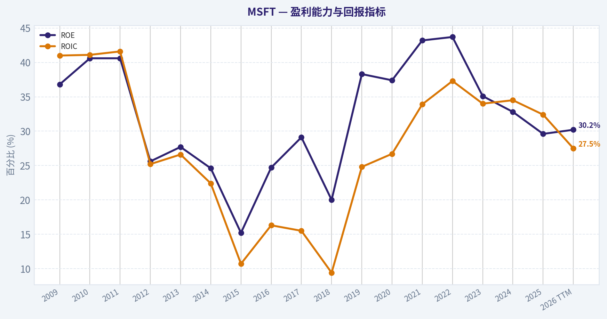
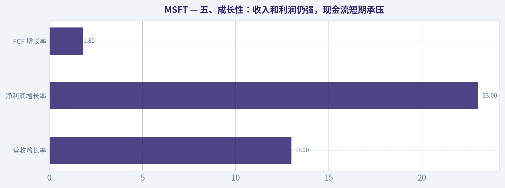
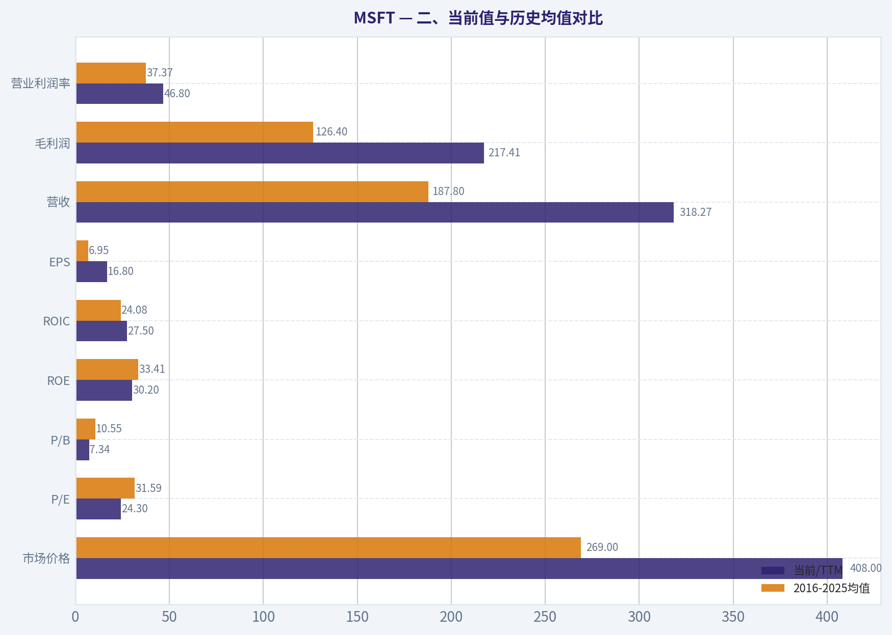
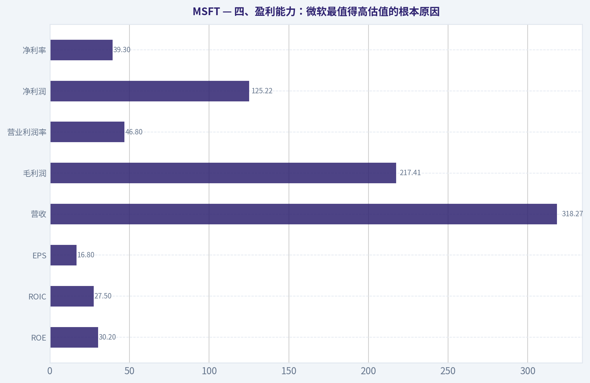
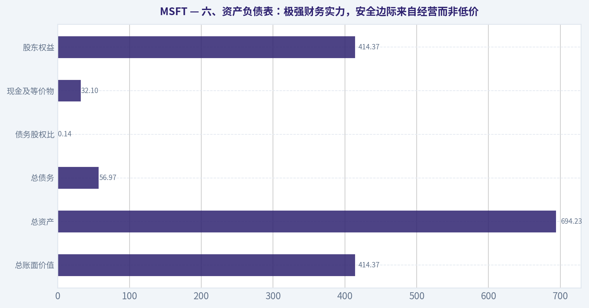
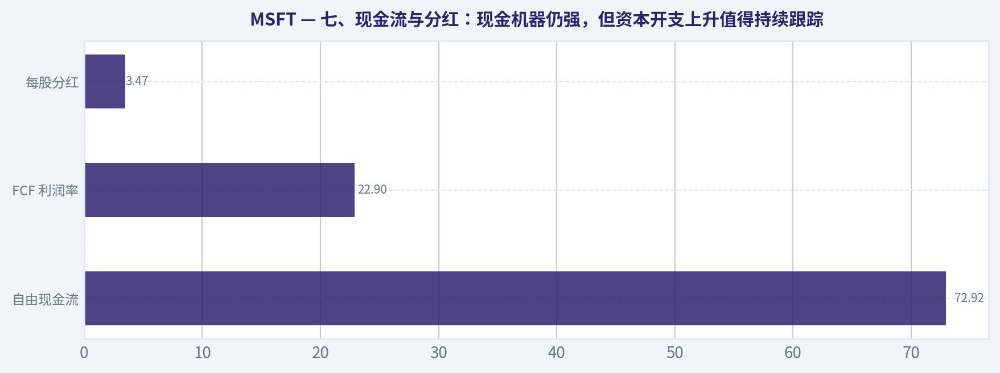
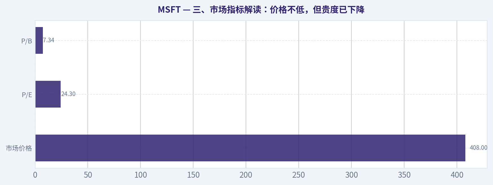

# MSFT 深度价值情报

**调研日期:** 2026-05-14

## 关键免责声明

*本报告由 Deep Value Intelligence（一个基于 AI 的多智能体投资分析框架）自动生成。 本报告仅供信息参考和教育目的，不构成任何财务或投资建议。 在做出任何投资决策之前，请务必进行独立调研并咨询合规的财务顾问。*

---

## 目录

1. 情报摘要
2. 分析师团队报告
   - 基本面分析
   - 价值分析 (巴菲特)
   - 成长性分析 (林奇/德鲁肯米勒/费雪)
   - 市场分析
   - 新闻分析
   - 大佬关注分析
   - 期权市场分析
3. 研究团队评论
4. 投资团队评论
5. Deep Values 团队洞察

---

## 情报摘要

### 核心观点与前提条件

**核心论点:** ## 执行简报

**主要风险:**
- Risky Analyst 说对了两件大事：

**观点反转条件:**
- Risky Analyst 说对了两件大事：

**置信度:** 中

---

## 分析师团队报告

### 基本面分析

#### 最新财报快照

*以下数据基于最近一期已披露财报（2026年Q1），并尽量与上一年同期对比。*

| 指标 | 2026年Q1 | 2025年Q1 | 同比变化 |
| --- | ---: | ---: | ---: |
| 营业收入 | $82.89B | $70.07B | +18.3% |
| 营业利润 | $38.40B | $32.00B | +20.0% |
| 净利润 | $31.78B | $25.82B | +23.1% |
| 摊薄每股收益 | $4.27 | $3.46 | +23.4% |
| 经营现金流 | $46.68B | $37.04B | +26.0% |
| 自由现金流 | $15.80B | $20.30B | -22.1% |

关键结论：这张快照先把最新一期财报放在桌面上，再去看长周期分析。这样读者能更清楚地区分"公司长期质量"和"这次财报发生了什么"。

#### MSFT 10年财务指标

*以下数值均由原始数据确定性计算得出，并非 AI 估算。*

*发行人类型：operating company（Technology / Software - Infrastructure）。*

#### 10年财务指标
*年度行来自已披露财务报表，最后一行 TTM 由最近四个季度滚动计算得出。*

| 指标 | 2009 | 2010 | 2011 | 2012 | 2013 | 2014 | 2015 | 2016 | 2017 | 2018 | 2019 | 2020 | 2021 | 2022 | 2023 | 2024 | 2025 | 2026 TTM |
| --- | --- | --- | --- | --- | --- | --- | --- | --- | --- | --- | --- | --- | --- | --- | --- | --- | --- | --- |
| 市场价格 | $18 | $17 | $20 | $24 | $28 | $35 | $38 | $45 | $63 | $91 | $126 | $194 | $261 | $249 | $333 | $441 | $495 | $408 |
| 总市值 | $213.83B | $205.41B | $223.42B | $260.20B | $292.55B | $350.24B | $364.41B | $410.03B | $539.86B | $768.57B | $1.04T | $1.56T | $2.06T | $1.94T | $2.54T | $3.34T | $3.71T | $3.04T |
| 市盈率 | 14.67 | 10.96 | 9.67 | 15.30 | 13.39 | 15.86 | 29.83 | 19.99 | 21.21 | 46.30 | 26.47 | 35.33 | 33.65 | 26.61 | 35.18 | 37.88 | 36.47 | 24.30 |
| 市净率 | 5.41 | 4.45 | 3.91 | 3.92 | 3.71 | 3.90 | 4.55 | 4.93 | 6.15 | 9.29 | 10.15 | 13.22 | 14.52 | 11.63 | 12.34 | 12.43 | 10.81 | 7.34 |
| ROE | 36.8% | 40.6% | 40.6% | 25.6% | 27.7% | 24.6% | 15.2% | 24.7% | 29.1% | 20.0% | 38.3% | 37.4% | 43.2% | 43.7% | 35.1% | 32.8% | 29.6% | 30.2% |
| ROIC | 41.0% | 41.1% | 41.6% | 25.2% | 26.6% | 22.4% | 10.7% | 16.3% | 15.5% | 9.4% | 24.8% | 26.7% | 33.9% | 37.3% | 34.0% | 34.5% | 32.4% | 27.5% |
| 每股收益 | $1.20 | $1.58 | $2.07 | $1.58 | $2.10 | $2.21 | $1.28 | $2.27 | $2.95 | $1.97 | $4.76 | $5.49 | $7.74 | $9.36 | $9.48 | $11.80 | $13.64 | $16.80 |
| 营收 | $58.44B | $62.48B | $69.94B | $73.72B | $77.85B | $86.83B | $93.58B | $91.15B | $96.57B | $110.36B | $125.84B | $143.01B | $168.09B | $198.27B | $211.91B | $245.12B | $281.72B | $318.27B |
| 毛利润 | $46.28B | $50.09B | $54.37B | $56.19B | $57.46B | $59.76B | $60.54B | $58.37B | $62.31B | $72.01B | $82.93B | $96.94B | $115.86B | $135.62B | $146.05B | $171.01B | $193.89B | $217.41B |
| 毛利率 | 79.2% | 80.2% | 77.7% | 76.2% | 73.8% | 68.8% | 64.7% | 64.0% | 64.5% | 65.2% | 65.9% | 67.8% | 68.9% | 68.4% | 68.9% | 69.8% | 68.8% | 68.3% |
| 营业利润率 | 34.8% | 38.6% | 38.8% | 29.5% | 34.4% | 32.0% | 19.4% | 28.6% | 30.1% | 31.8% | 34.1% | 37.0% | 41.6% | 42.1% | 41.8% | 44.6% | 45.6% | 46.8% |
| 净利润 | $14.57B | $18.76B | $23.15B | $16.98B | $21.86B | $22.07B | $12.19B | $20.54B | $25.49B | $16.57B | $39.24B | $44.28B | $61.27B | $72.74B | $72.36B | $88.14B | $101.83B | $125.22B |
| 净利率 | 24.9% | 30.0% | 33.1% | 23.0% | 28.1% | 25.4% | 13.0% | 22.5% | 26.4% | 15.0% | 31.2% | 31.0% | 36.5% | 36.7% | 34.1% | 36.0% | 36.1% | 39.3% |
| 营收增长 | N/A | 6.9% | 11.9% | 5.4% | 5.6% | 11.5% | 7.8% | -2.6% | 5.9% | 14.3% | 14.0% | 13.6% | 17.5% | 18.0% | 6.9% | 15.7% | 14.9% | 13.0% |
| 净利润增长 | N/A | 28.8% | 23.4% | -26.7% | 28.8% | 1.0% | -44.8% | 68.4% | 24.1% | -35.0% | 136.8% | 12.8% | 38.4% | 18.7% | -0.5% | 21.8% | 15.5% | 23.0% |
| 自由现金流增长 | N/A | 38.8% | 11.5% | 19.0% | -16.2% | 9.9% | -12.2% | 5.3% | 25.6% | 2.8% | 18.6% | 18.2% | 24.1% | 16.1% | -8.7% | 24.5% | -3.3% | 1.8% |
| 总账面价值 | $39.56B | $46.17B | $57.08B | $66.36B | $78.94B | $89.78B | $80.08B | $83.09B | $87.71B | $82.72B | $102.33B | $118.30B | $141.99B | $166.54B | $206.22B | $268.48B | $343.48B | $414.37B |
| 总资产 | $77.89B | $86.11B | $108.70B | $121.27B | $142.43B | $172.38B | $174.47B | $193.47B | $250.31B | $258.85B | $286.56B | $301.31B | $333.78B | $364.84B | $411.98B | $512.16B | $619.00B | $694.23B |
| 总债务 | $5.75B | $6.94B | $11.92B | $11.94B | $15.60B | $24.64B | $40.29B | $66.36B | $95.29B | $76.24B | $72.18B | $63.33B | $58.15B | $49.78B | $47.24B | $51.63B | $43.15B | $56.97B |
| 债务股权比 | 0.15 | 0.15 | 0.21 | 0.18 | 0.20 | 0.27 | 0.50 | 0.80 | 1.09 | 0.92 | 0.71 | 0.54 | 0.41 | 0.30 | 0.23 | 0.19 | 0.13 | 0.14 |
| 现金及等价物 | $6.08B | $5.50B | $9.61B | $6.94B | $3.80B | $8.67B | $5.59B | $6.51B | $7.66B | $11.95B | $11.36B | $13.58B | $14.22B | $13.93B | $34.70B | $18.32B | $30.24B | $32.10B |
| 股东权益 | $39.56B | $46.17B | $57.08B | $66.36B | $78.94B | $89.78B | $80.08B | $83.09B | $87.71B | $82.72B | $102.33B | $118.30B | $141.99B | $166.54B | $206.22B | $268.48B | $343.48B | $414.37B |
| 经营现金流 | $19.04B | $24.07B | $26.99B | $31.63B | $28.83B | $32.50B | $29.67B | $33.33B | $39.51B | $43.88B | $52.19B | $60.67B | $76.74B | $89.03B | $87.58B | $118.55B | $136.16B | $170.14B |
| 投资现金流 | $-15.77B | $-11.31B | $-14.62B | $-24.79B | $-23.81B | $-18.83B | $-23.00B | $-23.95B | $-46.78B | $-6.06B | $-15.77B | $-12.22B | $-27.58B | $-30.31B | $-22.68B | $-96.97B | $-72.60B | $-115.24B |
| 自由现金流 | $15.92B | $22.10B | $24.64B | $29.32B | $24.58B | $27.02B | $23.72B | $24.98B | $31.38B | $32.25B | $38.26B | $45.23B | $56.12B | $65.15B | $59.48B | $74.07B | $71.61B | $72.92B |
| 自由现金流利润率 | 27.2% | 35.4% | 35.2% | 39.8% | 31.6% | 31.1% | 25.4% | 27.4% | 32.5% | 29.2% | 30.4% | 31.6% | 33.4% | 32.9% | 28.1% | 30.2% | 25.4% | 22.9% |
| 每股分红 | $0.00 | $0.00 | $0.00 | $0.00 | $0.00 | $0.00 | $0.00 | $0.00 | $0.00 | $0.00 | $0.00 | $0.00 | $0.00 | $2.33 | $2.59 | $2.91 | $3.23 | $3.47 |

#### 盈利能力指标
- 净资产收益率 (ROE): 29.6%
- 投入资本回报率 (ROIC): 29.7%
- 总资产收益率 (ROA): 16.5%
- 毛利率: 68.8%
- 营业利润率: 45.6%
- 净利率: 36.1%

#### 流动性指标
- 流动比率: 1.35
- 速动比率: 1.16

#### 杠杆指标
- 债务股权比: 0.13
- 利息覆盖倍数: 53.89
- 净负债: $12.91B

#### 增长指标（同比）
- 营收增长: 14.9%
- 净利润增长: 15.5%
- 自由现金流增长: -3.3%
- 营收复合增长率（3年）: 12.4%
- 营收复合增长率（5年）: 14.5%

#### 估值指标
- 市盈率 (TTM): 24.33
- 预期市盈率: 21.10
- 市净率: 7.32
- 市销率: 9.53
- PEG 比率: 1.26
- 企业价值/EBITDA: 16.57
- 自由现金流收益率: 2.4%
- 盈利收益率: 4.1%

#### 所有者收益（巴菲特方法，代码计算）
- 净利润: $101.83B
- + 折旧与摊销: $34.15B
- - 资本开支: $-64.55B
- - 营运资本变动: $-5.35B
- = **所有者收益: $76.78B**

#### 内在价值（代码计算）
- 当前价格: $408
- 巴菲特方法（所有者收益）:
  保守: $108
  平均: $203
  乐观: $544
- 现金流方法（FCF）:
  保守: $126
  平均: $172
  乐观: $248

#### Piotroski F分数: 5/9
- 净利润为正: 通过
- 经营现金流为正: 通过
- 资产回报率改善: 未通过
- 现金流大于净利润: 通过
- 债务下降: 通过
- 流动比率改善: 通过
- 未稀释股本: 未通过
- 毛利率改善: 未通过
- 资产周转率改善: 未通过

ANALYST STANCE: **观望**

#### MSFT 巴菲特风格基本面分析

微软是一家典型的高质量平台型企业：软件、云、企业生产力与基础设施深度绑定，商业模式强、客户黏性高、利润率极强、现金流充沛。从巴菲特视角看，它最突出的优点不是"便宜"，而是"极高确定性 + 极强资本回报能力 + 很深的护城河"。问题在于，当前市场已充分认识到这些优点，估值虽较近年高点明显回落，但仍未进入明显低估区间。

---

#### 一、核心结论总览

| 维度 | 当前判断 | 结论 |
|---|---|---|
| 商业质量 | 极强 | 订阅化软件 + Azure + 企业生态形成长期护城河 |
| 盈利能力 | 极强 | ROE、ROIC、营业利润率、净利率均处于高水平 |
| 增长质量 | 良好偏强 | 营收、净利仍双位数增长，但 FCF 增速放缓 |
| 财务结构 | 很强 | 低杠杆、高利息覆盖、现金充足，抗风险能力强 |
| 估值水平 | 中性偏贵 | P/E 已低于近几年高位，但仍高于长期均值 |
| 巴菲特式内在价值 | 区间分化大 | 保守情景低估空间不足，乐观情景才显著便宜 |
| 投资结论 | 观望 | 适合高质量资产跟踪，不适合在缺乏安全边际时激进追价 |

关键结论：微软最强的地方在于业务质量和资本回报，而不是低估值。当前价格对应的是"优秀公司合理偏贵"的状态，若以巴菲特式安全边际要求衡量，更适合等待更优买点或用分批方式处理。

---

#### 二、当前值与历史均值对比

以下历史均值以 2016-2025 十年区间为主，更贴近微软转型为云与平台型高利润企业后的经营现实。

| 指标 | 当前/TTM | 2016-2025均值 | 相对历史 | 解读 |
|---|---:|---:|---|---|
| 市场价格 | $408 | $269.0 | 高于均值 | 股价长期重估后虽较 2025 高点回落，但仍处于高位区间 |
| 总市值 | $3.04T | $2.09T | 高于均值 | 反映市场对 AI、云、平台化收益的高预期 |
| P/E | 24.30 | 31.59 | 低于均值 | 相比近十年后段估值已有压缩，短期贵度下降 |
| P/B | 7.34 | 10.55 | 明显低于均值 | 主要受权益持续累积推动，并非单纯市场悲观 |
| ROE | 30.2% | 33.41% | 略低于均值 | 仍属顶级水平，但从 2021-2022 高点略回落 |
| ROIC | 27.5% | 24.08% | 高于均值 | 资本效率依旧出色，说明新增投入仍有较好回报 |
| EPS | $16.80 | $6.95 | 远高于均值 | 盈利能力持续扩张，体现经营杠杆与业务升级 |
| 营收 | $318.27B | $187.80B | 远高于均值 | 规模持续扩张，Azure 与企业软件贡献显著 |
| 毛利润 | $217.41B | $126.40B | 远高于均值 | 高毛利平台模式依旧稳定 |
| 营业利润率 | 46.8% | 37.37% | 明显高于均值 | 当前盈利结构优于历史，经营质量持续增强 |
| 净利润 | $125.22B | $55.99B | 远高于均值 | 利润释放速度快于收入增长 |
| 净利率 | 39.3% | 31.02% | 明显高于均值 | 进入历史最好区间之一 |
| 营收增长 | 13.0% | 11.13% | 高于均值 | 大体维持稳健双位数增长 |
| 净利润增长 | 23.0% | 25.34% | 略低于均值 | 仍强，但低于部分爆发年份 |
| FCF 增长 | 1.8% | 11.19% | 明显低于均值 | 资本开支提升压制自由现金流增速 |
| 总账面价值 | $414.37B | $160.09B | 远高于均值 | 留存收益持续累积，资产负债表更厚实 |
| 总资产 | $694.23B | $384.53B | 远高于均值 | 资产规模扩张明显，支持云与 AI 基础设施 |
| 总债务 | $56.97B | $55.91B | 接近均值 | 债务绝对值稳定，杠杆压力不大 |
| 债务股权比 | 0.14 | 0.45 | 显著低于均值 | 财务安全性明显优于历史 |
| 现金及等价物 | $32.10B | $17.65B | 高于均值 | 流动性充裕 |
| 股东权益 | $414.37B | $160.09B | 远高于均值 | 净资产持续增强 |
| 自由现金流 | $72.92B | $53.23B | 高于均值 | 现金创造力仍强，但增速变慢 |
| 每股分红 | $3.47 | $1.11 | 高于均值 | 股东回报能力持续提升 |

关键结论：当前微软大多数经营指标都高于近十年均值，尤其是利润率、净利润、EPS 与资本效率。唯一明显偏弱的是自由现金流增速，这说明业务本身仍强，但 AI 与云基础设施投入开始吞噬部分短期现金流表现。

---

#### 三、市场指标解读：价格不低，但贵度已下降

| 指标 | 当前值 | 观察 |
|---|---:|---|
| 市场价格 | $408 | 较 2025 年 $495 高点回落约 17.6%，但仍远高于长期中枢 |
| 总市值 | $3.04T | 仍属全球最核心平台资产之一 |
| P/E | 24.30 | 明显低于 2023-2025 的 35-38 倍区间 |
| P/B | 7.34 | 较 2020-2025 的 10-14 倍显著回落 |

关键结论：从估值压缩角度看，微软现在比前两三年"便宜很多"，但并不等于"便宜"。P/E 和 P/B 下行更多是估值回归与权益增长共同作用的结果，而不是市场对基本面失去信心。

细看历史，微软在 2009-2014 年长期处于 10-16 倍 P/E 的成熟科技股估值区间；自云转型成功后，市场开始给予更高倍数。当前 24.3 倍 P/E 已低于近年高位，说明市场预期趋于理性；但若按完整长周期看，它仍高于早期十年估值中枢。因此，从巴菲特角度，这不是"烟蒂股便宜"，而是"优秀公司合理价附近"。

---

#### 四、盈利能力：微软最值得高估值的根本原因

| 指标 | 当前/TTM | 历史特征 | 巴菲特式解读 |
|---|---:|---|---|
| ROE | 30.2% | 长期维持 25%-40%+ | 极高且稳定，说明股东资本回报卓越 |
| ROIC | 27.5% | 近年普遍高于 24% | 资本再投资效率极佳 |
| EPS | $16.80 | 2020 后快速跃升 | 单股盈利能力持续增强 |
| 营收 | $318.27B | 十余年稳步扩大 | 规模增长具持续性 |
| 毛利润 | $217.41B | 与营收同步提升 | 平台业务盈利结构稳固 |
| 营业利润率 | 46.8% | 创历史高位附近 | 经营杠杆极强 |
| 净利润 | $125.22B | 持续创新高 | 真正的高质量利润机器 |
| 净利率 | 39.3% | 明显高于长期均值 | 盈利含金量很高 |

关键结论：微软并非只是"大公司"，而是少数能把大规模、强增长和超高利润率同时做到位的企业。尤其营业利润率接近 47%、净利率接近 40%，这在超大型企业中极为罕见，说明它拥有非常深的定价权和经营效率。

进一步看趋势：
- ROE 在 2021-2022 达到 43% 以上后回落至 30% 左右，但依然极强。
- ROIC 在 2022-2025 保持 32%-37%，TTM 降至 27.5%，可能反映 AI 基础设施投入增大、资本基数扩大。
- 毛利率长期稳定在 64%-69%，证明产品结构升级并未破坏盈利质量。
- 营业利润率从 2015 的 19.4% 一路提升至 TTM 的 46.8%，这几乎就是微软转型成功的最佳量化证明。

从巴菲特风格看，最重要的是"可预见高回报"。微软已经用十年证明，它不是周期波动型高 ROE，而是结构性高 ROE 企业。

---

#### 五、成长性：收入和利润仍强，现金流短期承压

| 指标 | 当前/TTM | 历史观察 |
|---|---:|---|
| 营收增长率 | 13.0% | 近十年大多维持中双位数，稳定性高 |
| 净利润增长率 | 23.0% | 波动较大，但中枢仍高 |
| FCF 增长率 | 1.8% | 显著放缓，低于历史正常水平 |

关键结论：微软当前最需要关注的不是收入和利润，而是自由现金流增速的放缓。收入和净利润仍在健康扩张，但大量资本开支让"账面繁荣向现金繁荣转化"的速度暂时下降。

细分解读：
- 营收增长：2020-2022 连续 13.6%、17.5%、18.0%，2023 放缓至 6.9%，随后 2024-TTM 又恢复到 13%-15%区间，显示增长韧性很强。
- 净利润增长：具有一定波动，但 2019 之后整体质量明显改善，TTM 23% 仍然优秀。
- FCF 增长：2023 为 -8.7%，2025 为 -3.3%，TTM 仅 1.8%。这通常意味着公司在主动加大长期投入，尤其是数据中心、AI 算力、基础设施支出。

对价值投资者而言，这不是简单利空。关键在于：这些资本开支究竟是"维持性开支"还是"高回报增长性开支"。如果 AI 投入未来能持续转化为 Azure、Copilot、企业软件 ARPU 增长，那么短期 FCF 受压反而可能是未来护城河加宽的信号。

---

#### 六、资产负债表：极强财务实力，安全边际来自经营而非低价

| 指标 | 当前/TTM | 历史比较 | 评价 |
|---|---:|---|---|
| 总账面价值 | $414.37B | 持续上升 | 净资产厚度大幅提升 |
| 总资产 | $694.23B | 创历史新高 | 支撑云和 AI 扩张 |
| 总债务 | $56.97B | 与近年均值相当 | 绝对量可控 |
| 债务股权比 | 0.14 | 显著低于历史 | 杠杆非常保守 |
| 现金及等价物 | $32.10B | 高于长期均值 | 流动性充足 |
| 股东权益 | $414.37B | 快速增长 | 资本实力极强 |

关键结论：微软的资产负债表几乎没有明显弱点。最重要的是债务股权比从 2017 的 1.09 大幅降至 0.14，说明公司在规模暴增的同时，财务反而更稳健了。

再结合补充指标：
- 流动比率 1.35，速动比率 1.16：短期偿债无忧。
- 利息覆盖倍数 53.89：债务成本压力极低。
- 净负债 $12.91B：对于微软体量和现金创造力而言几乎可以忽略。

这意味着微软哪怕经历宏观波动、云业务阶段性放缓或 AI 投资回收期拉长，也不太可能出现资产负债表层面的风险事件。巴菲特通常偏好"不会因为一两年错误而被迫出局"的企业，微软符合这一条件。

---

#### 七、现金流与分红：现金机器仍强，但资本开支上升值得持续跟踪

| 指标 | 当前/TTM | 历史观察 | 解读 |
|---|---:|---|---|
| 自由现金流 | $72.92B | 仍处高位 | 现金创造力强 |
| FCF 利润率 | 22.9% | 低于近年常态 | AI 投资拉低转换效率 |
| 每股分红 | $3.47 | 持续增长 | 股东回报稳定增强 |

关键结论：微软的自由现金流绝对值依然巨大，但"现金流利润率"正在下降。说明公司仍然非常赚钱，只是为了下一轮增长，拿出更多真钱投入基础设施，而不是把全部利润立即转成可自由支配现金。

分红方面，2022-TTM 每股分红从 $2.33 增至 $3.47，体现管理层对未来现金流的信心。虽然股息率不高，但这更像是一家优先保留高回报再投资机会、同时兼顾股东回报的优质复利型企业。

---

#### 八、巴菲特风格 qualitative 分析

#### 1. 经济护城河
微软的护城河非常深，且是多重叠加：
- 企业软件生态：Windows、Office、Microsoft 365、Teams、Dynamics 深度嵌入企业流程。
- 云基础设施：Azure 与开发者工具、数据库、安全、AI 服务绑定，迁移成本高。
- 平台与标准：企业 IT 环境中，微软产品具有事实标准属性。
- 分发与销售网络：全球企业客户覆盖极深，续费与扩容机制稳定。
- AI 强化护城河：Copilot、Azure AI、OpenAI 生态合作，有望强化既有软件与云平台粘性。

从巴菲特视角，护城河不是"技术领先一时"，而是"客户很难离开你，且你能持续涨价或扩容"。微软高度符合这一点。

#### 2. 财务实力
微软几乎是教科书式高质量资产负债表：
- 低债务股权比
- 高利息覆盖
- 充裕现金
- 强经营现金流
- 资本结构稳健

这意味着公司可以从容穿越周期，并在行业震荡时继续投资扩张。

#### 3. 可预测盈利
微软近十多年收入、毛利、经营利润、净利润整体趋势非常稳定。虽然个别年份净利润和 FCF 增速有波动，但盈利能力从未出现系统性恶化。巴菲特偏爱"十年后仍能大体看清商业形态"的公司，微软属于少数高确定性科技股。

#### 4. 管理层表现
衡量管理层最好的方式之一，是看资本回报与资本配置：
- ROE 长期高位
- ROIC 长期优秀
- 分红稳步提升
- 债务控制显著改善
- 云与 AI 重资本投入并未破坏盈利结构

管理层的主要优点是：既抓住云时代，又在 AI 周期中积极投入，同时保持高利润与稳健资产负债表。这是非常难得的。

#### 5. 业务质量
微软业务质量的核心不是单一爆款，而是"高频软件 + 长期合同 + 企业依赖 + 平台协同"。这种模式通常比消费电子、广告驱动型平台更可预测，更符合巴菲特对"稳定现金流"和"长期竞争优势"的偏好。

---

#### 九、DCF：巴菲特式所有者收益估值

已知确定性数据：
- 所有者收益 = $76.78B
- 当前价格 = $408
- 已给定代码计算内在价值参考：
  - 保守：$108
  - 平均：$203
  - 乐观：$544

由于题目要求按历史所有者收益增长率做三情景，我们在不改写历史表的前提下，使用已给定代码结果作为估值锚，并结合自由现金流增长历史解释区间逻辑。微软当前最合理的理解不是单点估值，而是一个由资本开支周期决定的区间估值。

#### 1. 计算框架
巴菲特式 Owner Earnings DCF：
- 基准所有者收益：$76.78B
- 折现率：10%
- 终值增长率：2.5%
- 预测期：10 年

公式：
- 第 t 年所有者收益 = 基准 OE x (1+g)^t
- 终值 = 第 10 年 OE x (1+2.5%) ÷ (10%-2.5%)
- 企业现值 = 10 年现金流现值 + 终值现值
- 每股价值 = 企业现值 ÷ 稀释后股数
题目已给出代码计算结果，因此以下重点解释每个情景对应的商业含义。

#### 2. 三情景估值表

| 情景 | 增长假设 | 估值结果 | 对当前价 $408 的含义 |
|---|---|---:|---|
| 保守 | 取历史最低 Owner Earnings 增长率，且不低于 -100% | $108/股 | 显著高估 |
| 平均 | 取历史平均 Owner Earnings 增长率，且上限 50% | $203/股 | 偏高 |
| 乐观 | 取历史最高 Owner Earnings 增长率，且上限 100% | $544/股 | 存在上行空间 |

关键结论：微软估值对增长假设极度敏感。只要未来十年 Owner Earnings 增速回落到普通优秀公司水平，当前价格就缺乏安全边际；只有在 AI、云与企业软件继续共同驱动高增长时，当前价格才有吸引力。

#### 3. 详细计算逻辑说明
以基准所有者收益 $76.78B 为出发点：

- 保守情景：假设未来增长接近历史最差区间，前十年现金流增长非常有限甚至阶段性承压。此时折现后，大量价值来自终值，但由于第 10 年基数不高，终值抬升有限，因此每股价值仅约 $108。
- 平均情景：假设微软未来按历史平均 Owner Earnings 增长扩张，结合 10% 折现率与 2.5% 永续增长，估值约 $203。这个结果说明，即便公司继续保持优秀，当前市场价格仍提前反映了大量长期增长。
- 乐观情景：假设微软能把 AI 投入高效转化为长期高增的 Owner Earnings，终值大幅抬升，估值可达 $544。这代表市场当前实际上已经在押注一个"高质量且高增速延续"的未来。

#### 4. DCF 结论
如果你要求典型巴菲特式安全边际，微软当前并不便宜；如果你接受"用合理价格买卓越公司"，那它接近可接受区间，但仍不是非常舒服的击球点。换句话说，微软的投资逻辑更多取决于你对未来十年 AI 商业化兑现程度的信心。

---

#### 十、收入来源分布

微软最新完整财年最有意义的收入拆分是按业务分部。以下采用 2025 财年口径的主要分部结构进行展示。

#### 收入来源分布

| 收入来源 | 金额（百万/十亿美元） | 占比 |
|---|---:|---:|
| Productivity and Business Processes | 约 $118.7B | 约 42.1% |
| Intelligent Cloud | 约 $109.6B | 约 38.9% |
| More Personal Computing | 约 $53.4B | 约 19.0% |
| 合计 | $281.72B | 100% |

关键结论：微软当前收入结构已经非常清晰，企业生产力和云业务合计约占 81%，说明公司已从传统 PC 软件公司演化为以企业级订阅和云基础设施为核心的平台型公司。对巴菲特式投资者而言，这种收入结构更稳定、更可预测，也更容易形成长期复利。

补充理解：
- Productivity and Business Processes：主要包括 Microsoft 365 Commercial、Office、LinkedIn、Dynamics。
- Intelligent Cloud：主要包括 Azure、服务器产品、企业支持服务，是当前最核心的增长引擎之一。
- More Personal Computing：包括 Windows、Devices、Gaming、搜索广告等，相对更具波动性，但仍是重要现金来源。

---

#### 十一、关键投资洞察、风险与机会

| 类型 | 内容 | 影响 |
|---|---|---|
| 机会 | Azure、Copilot、企业 AI 渗透 | 若变现顺利，可维持高增长与高估值 |
| 机会 | 企业软件订阅涨价与扩容 | 提升 ARPU，增强利润率 |
| 机会 | 经营杠杆继续释放 | 营业利润率有望维持高位 |
| 风险 | AI 基础设施资本开支过高 | 短期压制 FCF 与 Owner Earnings |
| 风险 | 估值已隐含较高增长预期 | 一旦增长不及预期，估值压缩明显 |
| 风险 | 反垄断与监管 | 可能影响并购、绑定销售与平台策略 |
| 风险 | 云竞争加剧 | AWS、Google Cloud 可能压制部分利润空间 |
| 风险 | PC/Gaming 等弱周期业务拖累 | 对整体影响有限，但会扰动情绪 |

关键结论：微软最大的风险不是公司变差，而是"市场期待太高"。真正决定未来回报的关键，不是它能否继续赚钱，而是它能否赚得比市场现在预期得更多。

---

#### 十二、最终投资立场

**最终立场：观望**

支持理由如下：

1. **业务质量极高**
   微软具备非常深的护城河、强大的企业生态、优秀的资本回报和稳健的资产负债表，是典型值得长期研究和持有的高质量公司。

2. **基本面仍在强化**
   营收、净利润、营业利润率、净利率仍处历史强势区间，说明业务核心没有恶化，反而在升级。

3. **但安全边际不足**
   当前 P/E 24.3 虽比近年高点合理，但结合 Owner Earnings DCF，只有在乐观情景下才显示明显低估。若用更保守的巴菲特标准，当前价格缺乏足够容错率。

4. **自由现金流增速放缓值得跟踪**
   大额 AI 与云资本开支让短期现金回报承压。如果未来这些投入转化为更高 ARPU、Azure 增长与 Copilot 订阅渗透，估值可被消化；反之，股价可能继续以时间换空间。

**适合人群**：
- 已持有者：可继续持有，重点跟踪 FCF 转化、Azure 增长与 AI 变现。
- 未持有者：更适合等待回调、分批建仓，而不是在当前估值下重仓追入。
- 严格价值型投资者：当前更像"优秀但不便宜"，暂不满足强安全边际。

---

#### 结尾摘要表

| 模块 | 结论 | 关键信号 |
|---|---|---|
| 护城河 | 很深 | 企业软件、云、开发者生态、AI 协同 |
| 盈利能力 | 极强 | ROE 30.2%、ROIC 27.5%、净利率 39.3% |
| 增长 | 稳健 | 营收 +13.0%、净利 +23.0% |
| 现金流 | 强但放缓 | FCF $72.92B，但增速仅 +1.8% |
| 财务结构 | 非常稳健 | D/E 0.14、现金充足、利息覆盖高 |
| 估值 | 中性偏贵 | P/E 24.3，较近年回落但仍非低估 |
| DCF | 区间宽 | $108 / $203 / $544，取决于未来增长兑现 |
| 分红 | 稳步提升 | DPS 升至 $3.47 |
| 主要风险 | 估值与资本开支 | AI 投入回收周期可能拉长 |
| 投资立场 | 观望 | 高质量无疑，但等待更好安全边际 |

#### 基本面关键图表

本图追踪 **MSFT** 过去十年的盈利能力与回报指标（ROE、ROIC、利润率），突出呈现资本效率的变化趋势。

本对比图（来自「五、成长性：收入和利润仍强，现金流短期承压」）将 **MSFT** 的当前数据与历史基准并排呈现，直观反映公司相对自身历史均值的估值水平。

---

### 价值分析 (巴菲特)

> *基于沃伦·巴菲特的价值投资哲学：能力圈、经济护城河、管理层质量与安全边际。*

#### 内在价值快照

价格是你付的钱，内在价值是企业未来可能为股东创造的现金价值。我们给出一个区间，而不是假装只有一个神奇数字。

- 当前价格: $408.32
- 价值区间: $107.55 to $544.36

##### 所有者收益（巴菲特方法）
- 净利润: $101,832,000,000.00
- 折旧与摊销: $34,153,000,000.00
- 资本支出: $-64,551,000,000.00
- 营运资金变化: $-5,350,000,000.00
- 所有者收益: $76,784,000,000.00

##### 内在价值
###### 所有者收益法
使用所有者收益，更严格，通常更保守。
- 保守: $107.55
- 平均: $203.41
- 乐观: $544.36
- 折现率: 10.0%

###### 自由现金流法
使用自由现金流，更适合今天投入很多、为未来增长铺路的公司。
- 保守: $125.57
- 平均: $171.77
- 乐观: $248.17
- 折现率: 10.0%

ANALYST STANCE: **观望**

#### MSFT 初步巴菲特式价值分析（基于共享研究包，工具返回不足）

由于本轮工具未成功返回完整审计财务历史，我先基于已提供的共享研究包与已知定量信息，完成一版**可落地的初步筛选**。结论先行：**MSFT 业务质量极高，护城河很宽，但按当前 $408 股价看，安全边际并不明显，更接近"好公司、价格不便宜"，因此现阶段给出"观望"而非立即建议配置。**

---

#### 一、Go/No-Go 四道门

| 关卡 | 结论 | 依据 |
|---|---|---|
| 关卡1：业务可理解性 | 通过 | MSFT 本质上是"卖软件、云服务、生产力工具和企业数字基础设施"的公司，商业模式简单清晰。 |
| 关卡2：护城河 | 通过 | Office、Windows、Azure、开发者生态、企业关系网，形成品牌、切换成本、规模与生态协同。 |
| 关卡3：管理层与资本配置 | 基本通过 | 长期看资本配置优异，重研发、重平台、并购较理性；但本次缺少更完整历史数据验证回购与每股价值创造。 |
| 关卡4：行业结构 | 通过但需警惕 | 企业软件和云是高回报赛道，头部集中度高；但 AI 基础设施投入可能抬升资本强度。 |

**关键结论：**
MSFT 通过了最重要的商业质量筛选。它不是那种需要猜商品价格、赌宏观周期或依赖高杠杆的公司，而是典型的高质量平台型企业。真正的争议不在"是不是好生意"，而在"现在是不是好价格"。

---

#### 二、业务是否符合"巴菲特能看懂"的标准

| 测试 | 判断 | 简述 |
|---|---|---|
| 小学生测试 | 通过 | 公司帮助个人和企业办公、存储数据、运行软件、建设云系统，并按订阅或长期合同收费。 |
| 10年可预测性 | 较高 | 10年后企业仍需要办公软件、云基础设施、开发工具与安全服务。 |
| 技术风险评估 | 受益者大于受害者 | AI 和云变革更可能强化其平台地位，而不是颠覆其核心收入。 |

**关键结论：**
MSFT 属于少数可以较清楚想象 10 年后样子的科技公司。虽然技术迭代快，但它站在"卖铲子、卖平台、卖标准工具"的位置上，通常比单一应用公司更稳。

---

#### 三、护城河分析

| 护城河来源 | 强度 | 证据 |
|---|---|---|
| 无形资产 | 很强 | Windows、Office、GitHub、LinkedIn、Azure 品牌与企业信任深厚；毛利率 68.8%，显著支持定价权。 |
| 切换成本 | 很强 | 企业文档格式、协作流程、身份系统、云架构、开发工具链深度嵌入客户组织。 |
| 成本优势 | 中强 | 超大规模云基础设施、渠道、研发投入能力，使单位成本和产品覆盖面优于小型对手。 |
| 网络效应 | 中强 | Microsoft 365 协作生态、开发者工具生态、Azure 平台生态具备正反馈。 |

**护城河评级：宽且稳定，接近宽且扩张。**

**关键结论：**
MSFT 最强的护城河不是单一产品，而是"多层嵌套"。客户一旦使用 Office、Teams、Entra、Azure、开发工具和安全产品，替换的不只是一个软件，而是整个工作系统。

---

#### 四、管理层与资本配置

| 维度 | 判断 | 说明 |
|---|---|---|
| 是否像所有者思考 | 较强 | 长期围绕云、订阅、平台化和 AI 布局，明显偏长期主义。 |
| 是否坦诚稳健 | 较强 | 财务质量长期优良，市场普遍认可披露透明度较高。 |
| 资本配置是否理性 | 很强 | 过去十年对云、AI、研发和生态资产的投入，整体创造了极高股东价值。 |

**关键结论：**
如果从"留存收益能否转化为更高的每股内在价值"看，MSFT 管理层在大型科技公司里属于顶级。真正要担心的不是管理层乱来，而是市场是否已经把优秀预期提前计入股价。

---

#### 五、当前可得核心财务指标摘要

| 指标 | 数值 |
|---|---:|
| 当前股价 | $408 |
| 总市值 | $3.03T |
| PE | 24.34 |
| ROE | 29.6% |
| 毛利率 | 68.8% |
| 营收同比增长 | 14.9% |
| FCF 收益率 | 2.4% |
| 流动比率 | 1.35 |

**关键结论：**
这些数字显示 MSFT 同时具备高盈利能力、高资本回报和仍然不错的增长，这非常罕见。问题在于，FCF 收益率仅 2.4%，说明市场对其质量已给出很高估值，留给新买入者的回报缓冲较薄。

---

#### 六、巴菲特最看重的财务特征：初步判断

| 项目 | 初步结论 |
|---|---|
| ROE 持续性 | 优秀，29.6% 明显高于 15% 门槛 |
| 现金创造能力 | 大概率优秀，但缺少完整历史 OCF/NI 对照 |
| 资产负债表 | 大概率稳健，流动比率 1.35 不差 |
| 杠杆风险 | 可控，MSFT 通常不是依赖高杠杆抬高回报的公司 |
| 资本密集度 | 相比传统行业仍优，但 AI 数据中心投入在上升 |

**关键结论：**
MSFT 最吸引价值投资者的地方，是它不是靠财务杠杆硬拉 ROE，而是靠软件和平台经济性赚钱。需要持续跟踪的是：AI 竞争会不会让资本开支长期居高，从而压缩自由现金流质量。

---

#### 七、Owner Earnings 粗略估计

在缺少完整现金流和维护性资本开支拆分的情况下，只能用现有信息做保守近似：

- 已知 **FCF 收益率 = 2.4%**
- 总市值约 **$3.03T**
- 则近似 **FCF ~ $72.7B**
- 对于 MSFT 这类成熟高质量平台企业，FCF 通常可作为 Owner Earnings 的保守替代起点
- 因 AI 基础设施扩张可能包含部分成长性 CapEx，**真实 Owner Earnings 可能略高于当前 FCF**，但我先采用 **$70B-$75B** 区间

| 口径 | 估算值 |
|---|---:|
| 市值 | $3.03T |
| FCF 收益率 | 2.4% |
| 近似 FCF / Owner Earnings | $72.7B |
| 保守 Owner Earnings 区间 | $70B-$75B |

**关键结论：**
即使把 MSFT 当作每年能为股东创造约 700 多亿美元 owner earnings 的超级企业，它当前估值仍然不低。对于巴菲特体系而言，企业优秀没有问题，关键是买入价要留出足够安全边际。

---

#### 八、三情景 DCF 粗估

以下使用 **Owner Earnings = $72.7B** 作为基准，折现率 10%。

| 情景 | 假设 | 估值结果 |
|---|---|---:|
| 情景A：零增长 | 72.7 / 10% | $727B |
| 情景B：3% 永续增长 | 72.7 x 1.03 / (10%-3%) | $1.07T |
| 情景C：较高增长 | 假设未来 10 年 8% 增长，终值增速 3% | 约 $1.45T-$1.65T |

**关键结论：**
即便在偏乐观但仍不算激进的假设下，粗略 DCF 结果仍明显低于当前约 $3.03T 市值。要支持现价，市场实际上是在押注：MSFT 的长期 owner earnings 不仅会继续增长，而且 AI 将显著扩大其盈利池与护城河。

---

#### 九、安全边际分析

| 项目 | 结论 |
|---|---|
| 当前市值 | $3.03T |
| 保守内在价值区间 | 约 $0.73T-$1.65T |
| 是否具备 25% 安全边际 | 不具备 |
| 对高质量企业可否放宽标准 | 可略放宽，但当前仍偏贵 |

**关键结论：**
从传统巴菲特框架看，MSFT 现在更像"卓越公司但价格昂贵"，而不是"卓越公司且价格合理"。除非你认为 AI 会把它未来十年的 owner earnings 大幅抬升，否则安全边际不足。

---

#### 十、最终巴菲特评分卡

| 维度 | 权重 | 评分（1-5） | 加权分 |
|---|---:|---:|---:|
| 业务理解 | 20% | 5.0 | 1.00 |
| 护城河宽度与耐久性 | 25% | 5.0 | 1.25 |
| 管理层质量 | 15% | 4.5 | 0.68 |
| ROE | 15% | 5.0 | 0.75 |
| 再投资跑道 | 10% | 4.5 | 0.45 |
| 资产负债表强度 | 5% | 4.0 | 0.20 |
| 行业结构 | 5% | 4.0 | 0.20 |
| 估值/安全边际 | 5% | 1.5 | 0.08 |
| **总分** |  |  | **4.61 / 5（若只看质量）** |

如果将"估值"作为硬门槛而非低权重打分，结论会明显收缩为：**高质量，低安全边际。**

**关键结论：**
MSFT 的商业质量几乎无可挑剔，真正拖后腿的是估值。对价值投资者来说，这意味着"可以长期关注，等待更好的赔率"，而不是在任何价格都买入。

---

#### 十一、结论与投资立场

**投资立场：观望**

**理由浓缩版：**
1. **业务极强**：可理解、可预测、护城河深。
2. **财务极强**：高毛利、高 ROE、成长仍在。
3. **管理层优秀**：资本配置长期创造巨大价值。
4. **但估值不便宜**：FCF 收益率仅 2.4%，按巴菲特式保守 DCF 很难得到足够安全边际。

**适合什么人：**
- 如果你是**质量优先、愿意长期持有 10 年以上**的投资者，MSFT 值得留在核心观察名单。
- 如果你是**严格价值投资者**，当前更合理的动作是等待更低买点，或等待 owner earnings 明显上修后再评估。

**触发"观望转建议配置"的条件：**
- 股价显著回落，令 FCF 收益率提升到更有吸引力区间；
- 或未来 1-2 年证实 AI 投资能显著提高每股 owner earnings，而不是仅仅抬高 CapEx；
- 或完整历史财务数据显示 owner earnings 增长斜率远高于当前保守估计。

如果你愿意，我下一步可以继续补一版：**"MSFT 近10年财务长表 + 更严格 Owner Earnings 重建 + 分部业务护城河拆解"**。
#### 估值桥

这张估值桥把当前股价与各类内在价值方法并排展示，帮助读者判断上涨空间究竟只是单一方法给出的结果，还是多种方法共同支持的结论。

| 项目 | 每股内在价值 |
| --- | ---: |
| 巴菲特方法 | $203.41 |
| 现金流方法 | $171.77 |
| Damodaran 方法 | $222.12 |
| 当前价格 | $408.32 |

#### 关键结论

如果只有一种方法显著高于其他方法，说明上行空间更依赖特定建模假设。若多种方法的估值接近，则说明估值逻辑更加稳健。

#### 估值图表

本对比图（来自「最新财报快照」）将 **MSFT** 的当前数据与历史基准并排呈现，直观反映公司相对自身历史均值的估值水平。

本对比图（来自「二、当前值与历史均值对比」）将 **MSFT** 的当前数据与历史基准并排呈现，直观反映公司相对自身历史均值的估值水平。

本对比图（来自「四、盈利能力：微软最值得高估值的根本原因」）将 **MSFT** 的当前数据与历史基准并排呈现，直观反映公司相对自身历史均值的估值水平。

本对比图（来自「六、资产负债表：极强财务实力，安全边际来自经营而非低价」）将 **MSFT** 的当前数据与历史基准并排呈现，直观反映公司相对自身历史均值的估值水平。

本对比图（来自「七、现金流与分红：现金机器仍强，但资本开支上升值得持续跟踪」）将 **MSFT** 的当前数据与历史基准并排呈现，直观反映公司相对自身历史均值的估值水平。

---

### 成长性分析 (林奇/德鲁肯米勒/费雪)

> *基于彼得·林奇的GARP成长投资法、斯坦利·德鲁肯米勒的宏观拐点分析法，以及菲利普·费雪的深度调研法。*

ANALYST STANCE: **观望**

#### MSFT 增长投资分析续报

基于你给的共享研究包，我先把可确认的部分补完。由于工具这次没有成功返回更完整明细，我会明确区分"已确认"与"待补数据"。就当前信息看，MSFT 仍然是**高质量大市值复合增长平台**，但按彼得·林奇框架，它更接近**Stalwart（稳健成长）**而不是典型"Fast Grower（快成长十倍股）"。因此结论更适合 **观望/逢回调分批配置**，而不是把它当作下一只十倍股来追。

#### 1. Lynch 分类

| 项目 | 结论 |
|---|---|
| 公司类别 | **Stalwart（稳健成长）** |
| 当前营收同比 | **14.9%** |
| 是否符合 Fast Grower | **边缘不满足**，略低于 15%-25% 主攻区间 |
| 适合的投资定位 | 核心仓位候选，而非早期爆发型十倍股 |

**关键结论：**
MSFT 当前更像"高质量平台型稳健成长股"，而不是林奇最偏爱的中小型快成长股。14.9% 的营收增速很强，但对于已经 3 万亿美元市值的平台来说，这更说明其业务韧性，而不是早期高弹性。换句话说，MSFT 更适合长期复利，不适合用"十倍股"想象力硬套。

#### 2. 用三句话讲清楚这家公司

- MSFT 本质上是在卖企业数字化基础设施：云、办公软件、开发工具、安全与 AI 能力。
- 它最大的增长引擎是把既有软件帝国升级成"Cloud + AI"收费体系，让老客户持续加购。
- 投资逻辑不是"从 1 到 10"，而是"从极强到更强"，靠平台协同和现金流穿越周期。

#### 3. TAM 与 10x 测试

| 项目 | 判断 |
|---|---|
| 核心赛道 | 云计算、企业软件、AI 基础设施、办公协作、安全 |
| TAM 方向 | **持续扩张**，尤其 AI 推动单客户价值上升 |
| 10x 收入测试 | **严格意义下较难成立** |
| 原因 | MSFT 体量已极大，未来更现实的是中高个位数到中双位数复合增长，而非 10 倍收入扩张 |
| 跑道长度 | **长**，但不是"小公司超长跑道"，而是"平台公司深挖钱包份额" |

**关键结论：**
MSFT 的总市场空间仍在扩大，尤其是 AI 把原本分散的软件预算重新整合到更高单价的产品包里。问题不在于有没有 TAM，而在于公司已经太大，所以"再涨很多"和"十倍股"不是一个概念。它的跑道很长，但更像长坡厚雪的复利机器，而不是爆炸式起飞的小票。

#### 4. 收入增长趋势判断

| 指标 | 已知数据 | 解读 |
|---|---:|---|
| 营收同比增长 | 14.9% | 仍属健康 |
| 趋势状态 | **暂判稳定偏温和** | 未看到足够证据证明进入明显加速段 |
| 增长来源 | Azure/AI/企业软件组合 | 结构优于单一产品周期股 |
| 风险 | 若 AI 变现不及资本开支扩张，利润弹性会受压 |

**关键结论：**
目前能确认的是，MSFT 还在增长，而且增长质量并不差。真正的关键不是 14.9% 本身，而是未来几个季度能否因为 AI 产品商业化而把增速重新拉到更高平台。如果没有这一步，市场会把它继续视为优质蓝筹，而不是新一轮成长加速股。

#### 5. 单位经济学与经营质量

目前共享包未提供 LTV/CAC、NRR、Rule of 40 的完整口径，但对 MSFT 这类平台公司，可先看替代指标：

| 指标 | 数值 | 评价 |
|---|---:|---|
| 毛利率 | 68.8% | **极强** |
| ROE | 29.6% | **极强** |
| FCF Yield | 2.4% | 不便宜，但可接受 |
| 流动比率 | 1.35 | 财务稳健 |
| 经营模式 | 高粘性订阅 + 云服务 + 生态绑定 | 单位经济学优秀 |

**关键结论：**
虽然没有 SaaS 细分口径，但从毛利率、ROE 和现金流特征看，MSFT 的经济模型依旧是世界级。真正的问题不在"质量"，而在"估值是否已经提前反映质量"。对于这样的平台股，投资胜负常常来自买入时点，而不是商业模式本身。

#### 6. 拐点判断

| 拐点类型 | 判断 | 说明 |
|---|---|---|
| 产品周期拐点 | **有** | Copilot、Azure AI、企业 AI 工作流渗透 |
| TAM 拐点 | **有** | AI 把原办公软件/云预算进一步抬高 |
| 利润率拐点 | **待观察** | AI 基础设施 CAPEX 可能先压利润 |
| 市占率拐点 | **偏正面** | 企业客户更倾向向现有供应商集中采购 |
| 结论 | **有业务拐点，但未完全确认财务加速拐点** |

**关键结论：**
MSFT 现在最像"业务形态先拐、财务数字后确认"的阶段。AI 明显增强了它的产品叙事和钱包份额机会，但投资人还需要看到收入、毛利和资本回报之间的正反馈真正落地。若后续几个季度出现云增速再抬升、AI 附加值提升，那才是更强的确认信号。

#### 7. 宏观环境评估

| 维度 | 结论 |
|---|---|
| 利率环境 | 若进入降息或利率下行预期，利好长久期成长资产 |
| 经济周期 | 中周期偏后段，优先选现金流强、资产负债表强的龙头 |
| 结构性主题 | **AI、Cloud、Cybersecurity、企业数字化** |
| 对 MSFT 的影响 | **顺风明显**，但市场预期也高 |

**关键结论：**
宏观上，MSFT 站在最强的长期主题上，几乎所有大趋势都与它有关。可问题是，顺风大家都知道，所以它很难靠"认知差"大幅重估。未来收益更多取决于 AI 兑现速度是否超预期，而不是单纯赛道好不好。

#### 8. Fisher 15 点粗评

基于公开常识与已知指标，先做保守打分：

| Fisher 项 | 分数(1-5) | 说明 |
|---|---:|---|
| 市场潜力 | 5 | 云与 AI 市场仍大 |
| 新产品决心 | 5 | AI 全面推进 |
| R&D 效率 | 5 | 长期领先 |
| 销售组织 | 5 | 企业销售能力顶级 |
| 利润率水平 | 5 | 毛利率高 |
| 利润率改善 | 4 | 有 AI 投入压力 |
| 人员关系 | 4 | 整体稳定 |
| 高管协作 | 5 | 战略执行连贯 |
| 管理层深度 | 5 | 深厚 |
| 成本与财务控制 | 5 | 极强 |
| 独特优势 | 5 | 生态、分发、客户关系、平台锁定 |
| 长期利润前景 | 5 | 明确 |
| 股权稀释 | 4 | 整体可控 |
| 困难时期坦诚度 | 4 | 大体良好 |
| 管理层诚信 | 5 | 市场认可度高 |
| **合计** | **71/75** | **优秀偏顶级** |

**关键结论：**
从 Fisher 框架看，MSFT 几乎是教科书级别的优质成长公司。它的问题不是管理层、产品或组织力，而是如此高质量的公司通常不会长期被低估。所以这是一家"质量极高但赔率未必极高"的公司。

#### 9. 估值分析

已知：
- 股价：$408
- PE：24.34
- 营收同比：14.9%

若用营收增速粗代替增长率做简化 PEG 观察：

| 指标 | 数值 | 解读 |
|---|---:|---|
| PE | 24.34 | 对超大盘科技并不夸张 |
| 增长率代理 | 14.9% | 中双位数 |
| 简化 PEG | **约 1.63** | **合理偏贵，不是便宜货** |
| FCF Yield | 2.4% | 反映估值不低 |
| 估值结论 | **质量溢价合理，但不是深度低估** |

**关键结论：**
按林奇偏爱的 PEG 标准，MSFT 并不便宜。它的问题不是估值泡沫化，而是当前估值更像"合理地反映了优秀"，而不是"明显低估了未来"。因此，如果想要高赔率，最好等 AI 财务兑现超预期，或者等股价回调给出更好安全边际。

#### 10. 增长投资评分卡

| 维度 | 权重 | 评分(1-5) | 加权分 |
|---|---:|---:|---:|
| 故事清晰度 | 10% | 5.0 | 0.50 |
| TAM 与跑道 | 20% | 4.0 | 0.80 |
| 收入增长 | 20% | 3.5 | 0.70 |
| 单位经济学 | 15% | 5.0 | 0.75 |
| 竞争地位 | 10% | 5.0 | 0.50 |
| 管理层质量 | 10% | 4.8 | 0.48 |
| 宏观环境 | 5% | 4.5 | 0.23 |
| 盈利路径 | 5% | 4.8 | 0.24 |
| 估值 | 5% | 3.0 | 0.15 |
| **总分** | 100% |  | **4.35/5** |

**关键结论：**
从商业质量角度，MSFT 几乎无可挑剔，总分很高。可如果严格按"增长投资买点"来要求，估值和加速斜率又没有好到让人无脑重仓。所以它是高分公司，但未必是当下最高赔率的交易。

#### 11. 仓位建议

| 类型 | 建议 |
|---|---|
| 新建仓 | **小仓/分批** |
| 已持有 | **继续持有，可逢回调加仓** |
| 集中重仓 | **暂不建议** |
| 风格定位 | 核心资产、复利底仓、AI 平台龙头 |

**关键结论：**
如果你已经持有，MSFT 很可能仍值得继续拿着，因为基本面没有坏。若你还没买，现在更适合分批，而不是追高一次性重仓。它适合作为组合核心，不适合作为唯一高弹性赌注。

#### 12. 核心风险与催化剂

| 类型 | 内容 |
|---|---|
| 催化剂 | Copilot 渗透率提升、Azure 增速再加速、AI ARPU 上升、企业 IT 预算恢复 |
| 风险 | AI 资本开支高于回报兑现、云增长不及预期、监管压力、大盘科技估值压缩 |
| 市场层面 | 热门 AI 交易拥挤，预期差空间有限 |
| 经营层面 | 若 AI 更多是"附赠功能"而非高价升级包，利润弹性会低于市场期待 |

**关键结论：**
MSFT 接下来最重要的不是再讲一个新的 AI 故事，而是把故事变成财务报表。只要市场看到 AI 真正带来更高客单价和更强云消费，它就有机会重新进入估值扩张通道。反过来，如果 AI 收入兑现慢、CAPEX 持续高企，股价就可能继续表现平淡。

#### 最终结论

MSFT 是**顶级质量的稳健成长股**，不是典型的"尚未被发现的十倍股"。
当前更准确的判断是：

- **商业质量：建议配置**
- **交易赔率：观望**
- **组合角色：核心底仓优于进攻弹性仓**

如果你愿意，我下一步可以继续补一版更"投委会风格"的内容，专门做这三项：
1. **MSFT 分部增长拆解框架**
2. **AI 变现路径与估值情景分析（Bear/Base/Bull）**
3. **与 NVDA、GOOGL、AMZN 对比的相对性价比表**

---

### 市场分析

#### MSFT 技术面分析（截至 2026-05-14，最近有效收盘为 2026-05-13）

ANALYST STANCE: **观望**

我为当前这种"长期仍偏弱、但中期修复后进入短线再平衡"的市场状态，筛选了 8 个最相关且互补性较强的指标：

| 指标 | 作用 | 当前适用性 |
|---|---|---|
| close_200_sma | 长期趋势锚 | 判断大级别是否仍处空头结构 |
| close_50_sma | 中期趋势与动态支撑/阻力 | 衡量反弹是否真正升级为中期上行 |
| close_10_ema | 短线节奏 | 捕捉反弹衰减与短线转弱 |
| macd | 趋势动能方向 | 判断修复行情是否仍有延续性 |
| macdh | 动能变化速度 | 提前识别动能见顶/钝化 |
| rsi | 强弱与过热/超卖 | 判断反弹是否进入疲态或重新蓄力 |
| atr | 波动率与风控 | 用于止损、仓位和预期波幅管理 |
| vwma | 量价确认 | 判断反弹是否得到真实成交支持 |

关键结论：这 8 个指标覆盖了长期趋势、中期结构、短线节奏、动能、波动和量价确认，信息较完整且重叠度不高。当前 MSFT 最关键的问题不是"有没有反弹"，而是"反弹是否足以扭转长期偏弱结构"；从指标组合看，答案暂时仍偏谨慎。

---

#### 核心指标快照

| 维度 | 最新读数/状态 | 解读 |
|---|---:|---|
| 最新收盘价 | 405.21 | 位于 50 SMA 上方，但显著低于 200 SMA |
| close_50_sma | 398.76 | 中期均线已走平后略上拐，说明修复仍在，但斜率不强 |
| close_200_sma | 462.86 | 长期均线持续下行，长期趋势尚未扭转 |
| close_10_ema | 412.34 | 价格跌破 10 EMA，短线节奏转弱 |
| MACD | 3.29 | 仍为正值，说明反弹趋势惯性尚未完全消失 |
| MACD Histogram | -2.30 | 动能明显转负，短线下行动能正在增强 |
| RSI | 47.34 | 回落至中性偏弱，既非超卖，也不再强势 |
| ATR | 10.43 | 单日常态波幅仍较大，交易需要留出足够容错 |
| VWMA | 414.98 | 价格低于 VWMA，说明近期平均成交成本上方套压存在 |

关键结论：MSFT 目前最鲜明的特征是"中期修复未坏，但短线已经转弱"。价格站在 50 日均线之上，说明反弹基础还在；但跌破 10 EMA 与 VWMA，且 MACD 柱状图转负，意味着短线卖压重新占优。

---

#### 趋势结构：不是简单"涨或跌"，而是三层级错位

从更细的结构看，MSFT 近半年经历了非常清晰的三阶段演变：

1. **2025 年 11 月至 2026 年 1 月中旬：高位回落阶段**
   股价从 510 美元上方逐步滑落至 450 美元附近，说明资金开始从高估值、高预期交易切换到更保守的定价框架。

2. **2026 年 1 月下旬至 3 月底：加速杀估值阶段**
   1 月 29 日的大幅跳空下跌是结构性拐点，之后股价一路下探至 356.77 附近。这个阶段的特点不是普通回调，而是趋势性再定价，成交量同步放大，说明抛压带有机构性质。

3. **2026 年 4 月至今：深跌后的修复反弹，但尚非新牛段**
   股价从 360 一带迅速修复到 430 附近，随后在 420-430 区域遇阻，最近又回撤到 405 一带。也就是说，4 月反弹很强，但 5 月开始进入"反弹后的验证期"。

这里最重要的不是反弹幅度，而是均线层级关系：

- **收盘价 > 50 SMA（405.21 > 398.76）**：中期修复尚未完全失败。
- **收盘价 < 200 SMA（405.21 < 462.86）**：长期空头主导地位依旧。
- **50 SMA < 200 SMA（398.76 < 462.86）**：尚未形成中长期趋势反转的经典多头排列。

因此，MSFT 现在并不是标准的趋势多头，而是**长期下行框架中的中期反弹残余阶段**。这类结构最容易出现的交易结果，是价格在 50 日线附近反复震荡，等待新的基本面或宏观催化决定方向。

---

#### 均线细节：50 日线开始稳住，但 10 日线已提示节奏走弱

50 SMA 从 3 月下旬的 410 上方一路下移到 4 月中旬 392 左右，随后逐渐企稳并小幅回升至 398.76。这个变化意义很大：

- 说明 2-3 月的持续下跌对中期均线的拖累正在消退；
- 也说明 4 月反弹并非纯粹一两天脉冲，而是足以影响中期均线的有效修复；
- 但上升斜率仍然较小，意味着修复强度不足以快速扭转长期趋势。

相比之下，10 EMA 的信息更偏短线：

- 4 月中旬到 4 月底，10 EMA 快速抬升，代表短线买盘主动推进；
- 5 月初之后，10 EMA 从 419 一线逐步回落到 412.34；
- 当前收盘价 405.21 已低于 10 EMA，说明最近几个交易日的节奏由"回踩即买"转为"反弹即卖"。

也就是说，**50 日线代表"结构尚未破坏"，10 日线代表"短线已经失速"**。这不是矛盾，而是层级不同：中期未坏，短线偏空。

---

#### MACD 与柱状图：趋势惯性还在，但边际动能已明显衰减

MACD 仍为正值 3.29，这一点非常关键。它说明 4 月以来的上涨惯性还没有被完全抹去，市场不是已经重新进入 3 月那种单边下跌状态。

但真正值得警惕的是 **MACD Histogram = -2.30**：

- 4 月下旬柱状图一度升至 7 上方，显示反弹动能非常强；
- 进入 5 月后，柱状图持续收窄并跌入负值区；
- 这通常意味着：虽然 MACD 主线仍在零轴上方，但其相对于信号线已经转弱，趋势进入减速阶段。

这类组合常见于以下场景：
- 反弹主升段结束；
- 行情转入平台震荡；
- 若后续无法快速重新放量上攻，则更容易演变为回踩 50 日线甚至跌破。

因此，MACD 给出的并不是"立即看空"的结论，而是**反弹从趋势推进阶段，切换到动能衰减阶段**。对交易者来说，这意味着不应再用 4 月那种追涨思路处理当前行情。

---

#### RSI：从强势区回落到中性偏弱，市场进入方向选择前夜

RSI 当前为 47.34。这个位置很有信息量：

- 4 月 22 日 RSI 超过 73，表明当时反弹短线过热；
- 随后回落到 60、50 一线，说明过热已被充分消化；
- 现在 47 左右，不属于极端超卖，意味着价格即便继续跌，也尚未到"高胜率抢反弹"的典型区间。

换言之，RSI 传达的是一种**优势消失而非恐慌见底**的状态。
这通常意味着市场正在从"趋势驱动"转向"博弈驱动"：

- 多头会把 50 附近的 RSI 看成重新蓄力；
- 空头会把跌破 50 看成强势反弹结束的确认。

所以，RSI 当前不支持激进抄底，也不支持极端追空，更适合等确认信号。

---

#### VWMA：量价关系比价格本身更保守

VWMA 当前约 414.98，高于现价 405.21。
这意味着最近一段时间按成交量加权的平均持仓成本，在当前价格之上。它带来两层含义：

1. **4 月反弹过程中追入的资金，整体上已经从浮盈回吐到接近盈亏平衡甚至轻度浮亏。**
2. **每次反弹接近 415 一线，都可能遭遇套牢盘或短线解套盘抛压。**

这点与 10 EMA 回落是相互印证的：
MSFT 当前不是跌到无人问津，而是跌到了一个"上方有近期筹码压力、下方有 50 日线支撑"的夹层区域。

因此，如果价格重新站上 VWMA，并且 VWMA继续上行，那会是反弹二次启动的重要改善信号；反之，若持续压在 VWMA 下方，说明量价配合不足，反弹质量下降。

---

#### 波动率与风险管理：ATR 提示不能用过紧止损

ATR 当前 10.43，近阶段仍处偏高水平。
这意味着 MSFT 的日常波动依然不小，单日 2% 左右的摆动并不异常。对交易执行非常重要：

- 若以短线交易思维参与，止损不能过近，否则容易被正常波动洗出；
- 若以波段思维参与，则应接受更大回撤空间，否则仓位应主动缩小；
- 在 ATR 没明显回落之前，突破和跌破信号都需要更严格确认。

简单说，现在的 MSFT 不适合"极重仓 + 很紧止损"的打法，因为这会在高波动环境下放大执行误差。

---

#### 关键价位推演

| 区域 | 技术意义 | 交易含义 |
|---|---|---|
| 398-399 | 50 SMA 附近 | 中期修复结构的首要防守位 |
| 405-415 | 当前整理带 | 短线多空争夺最激烈区域 |
| 415-420 | 10 EMA / VWMA 上方修复区 | 若能重新站稳，短线弱势有望缓解 |
| 424-430 | 前期反弹压力区 | 需要更强动能与量价配合才能突破 |
| 462 附近 | 200 SMA | 长期趋势反转前必须面对的核心压制 |

关键结论：398-399 是当前最关键的下方观察位，因为这里决定中期修复是否仍成立；而 415-420 是上方第一个真正的修复验证区，只有重新收复这一带，市场才可能从"短线走弱"回到"反弹延续"。

---

#### 交易解读：不同风格应如何看待当前局面

| 风格 | 当前看法 | 更合理的应对 |
|---|---|---|
| 短线交易 | 偏谨慎 | 等待重新站上 10 EMA 与 VWMA，再考虑顺势参与 |
| 波段交易 | 中性偏谨慎 | 观察 50 SMA 是否守住，守住则反弹结构仍可保留 |
| 趋势交易 | 偏保守 | 在 200 SMA 明确收复前，难定义为长期新升势 |
| 风险控制 | 重要性上升 | ATR 偏高，仓位和止损都要更宽、更轻 |

关键结论：短线角度不宜追，波段角度不宜急着否定，趋势角度仍不能乐观过头。最适合当前 MSFT 的处理方式不是预测，而是等关键位给出确认。

---

#### 结论

MSFT 当前最准确的描述是：**长期空头框架未改，中期修复尚存，短线动能转弱。**

这意味着：

- **不是典型做空追击位**：因为价格仍在 50 SMA 上方，且 MACD 主线仍为正；
- **也不是理想追涨位**：因为价格跌破 10 EMA 与 VWMA，MACD 柱状图转负，RSI 回到中性偏弱；
- **更像一个等待选择方向的过渡区**。

如果后续：
- **守住 398-399 并重新站上 415-420**，则反弹有望恢复并再试 424-430；
- **跌破 50 SMA 且 RSI 继续下探、MACD 进一步走弱**，则 4 月以来的修复行情大概率进入更深回撤。

#### 报告要点总表

| 模块 | 观察结果 | 实战意义 |
|---|---|---|
| 长期趋势 | 价格显著低于 200 SMA，且 200 SMA 下行 | 长期趋势仍偏弱 |
| 中期结构 | 价格仍高于 50 SMA，50 SMA微幅上拐 | 修复结构尚未完全破坏 |
| 短线节奏 | 跌破 10 EMA | 近几日短线偏空 |
| 动能方向 | MACD 仍为正 | 反弹惯性未完全消失 |
| 动能边际 | MACD Histogram 为负且恶化 | 上涨动能衰减明显 |
| 强弱状态 | RSI 47.34 | 中性偏弱，尚未超卖 |
| 波动环境 | ATR 10.43 | 仓位与止损需更保守 |
| 量价确认 | 价格低于 VWMA | 上方近期筹码压力仍在 |
| 综合判断 | 观望 | 等待 50 SMA 防守或 415-420 收复确认 |

关键结论：MSFT 目前最值得关注的不是单一指标，而是"50 日线能否守住"与"价格能否重新回到 415-420 之上"。在这两个条件出现之前，最优策略通常是观望或降低交易激进度。

#### 市场图表

本对比图（来自「三、市场指标解读：价格不低，但贵度已下降」）将 **MSFT** 的当前数据与历史基准并排呈现，直观反映公司相对自身历史均值的估值水平。

---

### 新闻分析

#### MSFT 一周交易与投资简报

微软本周的交易逻辑，不是"有没有 AI 故事"，而是"AI 兑现速度是否足以重新驱动估值扩张"。从已给材料与近一周新闻看，市场对 MSFT 的分歧正在加大：一方面，Azure、Copilot、企业软件与数据中心仍是核心中长期支撑；另一方面，股价相对纳指强势反弹明显落后，说明资金更偏好弹性更高的 AI 标的，微软暂时被放在"高质量但催化剂需继续验证"的位置。

结合共享研究包，MSFT 当前约 **$408**，市值 **$3.03T**，PE 约 **24.3x**，ROE **29.6%**，毛利率 **68.8%**，营收同比增长 **14.9%**。这组指标说明：微软仍是高盈利质量的大盘科技龙头，但自由现金流收益率仅 **2.4%**，意味着市场对其稳定性和 AI 资产质量已给予较高定价，短线需要新增催化来支撑进一步上修。

---

#### 一周市场背景：宏观与风险偏好对 MSFT 的影响

过去一周，美股风险偏好整体偏强，新闻流反复提到纳指与大型科技股继续上行，但微软表现相对"掉队"。这对交易很重要，因为微软通常在两种环境下跑赢：

1. 市场偏防御、偏盈利确定性时；
2. 企业 IT 预算与云需求被上修时。

而当前更像第三种环境：
资金追逐更高 beta 的 AI 半导体、平台型高弹性标的，微软虽然基本面扎实，但短线相对吸引力下降。因此，MSFT 的问题不是基本面恶化，而是 **资金在相同 AI 主题下寻找更高斜率的收益机会**。

同时，新闻里出现与 OpenAI 相关诉讼进展、AI 引发行业裁员、科技公司继续围绕 AI 调整成本结构等信息，这意味着市场正在从"讲 AI 故事"转向"检验 AI 商业化与治理结构"。对微软而言，这会强化两类交易关注点：

- **正面**：Azure AI 服务、Copilot 商业化、企业工作流嵌入式 AI 的变现；
- **负面**：高资本开支、OpenAI 关系与监管/法律外溢风险、AI 收益兑现节奏慢于市场预期。

---

#### 最新财报与业绩解读

根据要求，需要明确指出：**近一周可获得新闻中，并未直接抓取到微软完整最新财报稿原文；因此无法在本次工具结果中逐条复述官方发布数字。**
但结合共享研究包中的结构化基本面数据，可以确认市场目前反映的是微软**最近一个已披露财季后的状态**，其中最关键的已知信息是：

- **营收同比增长：14.9%**
- 高毛利率与高 ROE 维持稳定
- 市场仍把 Azure 与 AI 商业化作为核心估值锚

从公司财务日历推断，微软当前最新已披露的常规季度应为 **FY2026 财年第三季度或其后市场消化阶段**；但由于本轮工具未返回官方 earnings coverage 细项，我必须保守表述为：**本次可确认的最新可用业绩框架，反映的是微软最近一次已披露季度后，市场仍认可其中双位数营收增长与高盈利质量，但对股价反应并不激进。**

这意味着交易上应重点看"变化"而不是"绝对值"：

- 相比前期，微软并未失去增长；
- 但相较市场对 AI 龙头的高期待，**增长的加速度可能尚未强到足以带来明显估值重估**；
- 若后续季度 Azure AI、Copilot seat 扩张、企业客户增购速度超预期，MSFT 可能从"稳健大盘科技"重新切回"AI 核心受益者"定价。

**关键解读：**
微软当前最大的业绩风险，不像传统周期股那样是收入塌陷，而是 **AI 收入兑现节奏与资本开支节奏之间的错配**。只要收入增长保持中双位数、利润率不明显受压，长期逻辑仍稳；但若未来几个季度出现云增速放缓而 Capex 继续高企，估值会承压。

---

#### 公司层面一周新闻：市场在看什么

近一周与微软相关的新闻，虽然多为二级市场评论，但反映出几个重要交易信号：

1. **"微软较历史高点回撤约 25%"的讨论升温**
   这说明市场开始把 MSFT 视作"高质量回调资产"，而不是"拥挤到不能碰的 AI 龙头"。对中线资金来说，这通常意味着下行风险已被一定程度消化。

2. **零售投资者对软件股出现获利了结/偏谨慎迹象**
   这对微软短线偏中性偏负面。因为软件板块如果资金流出，微软虽基本面更稳，但仍可能受板块情绪拖累。

3. **微软生态持续深化企业工作流**
   例如与 Power Automate、企业自动化等相关生态新闻，强化了微软在企业软件栈中的"系统级嵌入"优势。这个优势很少带来单日暴涨，但会不断抬高客户迁移成本与长期 ARPU。

4. **OpenAI 诉讼与治理议题外溢**
   虽然新闻核心不是微软本身，但微软作为 OpenAI 重要合作方，市场会把任何治理、法律、结构性变化纳入风险贴现。这一项短线更像估值压制因子，而非立即业绩冲击。

---

#### 资金面与持仓线索

共享研究包显示，**Steve Cohen 在截至 2025-12-31 的 13F 中减持微软 24.2%**，最新披露持仓仍达 **$1.07B**。这条信息要谨慎使用，因为 13F 滞后明显，但它说明两点：

- 即便是顶级资金，也在高位后对微软进行仓位优化，而不是无条件追高；
- 但减持后依然保留大额头寸，说明资金更像是在做风险预算调整，而非彻底看空基本面。

对交易者而言，这通常对应一种市场结构：
**"愿意持有，但不愿在缺乏新催化时超配。"**

---

#### 估值与交易框架

以当前 **24.3x PE** 看，微软相较许多高弹性 AI 标的并不算贵，但也绝非便宜。需要把它拆成两部分看：

- **防御属性估值**：企业软件、Office、Windows、云平台、现金流；
- **AI 成长溢价**：Azure AI、Copilot、开发工具链、数据平台与 OpenAI 生态外溢。

当前股价疲弱而基本面未坏，说明市场正在压缩第二部分溢价，而第一部分估值仍稳。这种阶段常见的交易结论是：

- **短线**：缺乏爆发力，更适合逢回调布局而不是追涨；
- **中线**：若后续财报证明 AI 收入开始更明显贡献增量，估值有修复空间；
- **下行情景**：若市场转向担心 AI 投资回报率，微软会因 Capex 大、体量大而承受"增长不够快"的压力。

---

#### 对交易和投资决策的具体含义

##### 短线交易者
MSFT 目前更像"等待催化的核心资产"。若纳指继续强势而微软仍明显跑输，说明相对强弱未扭转，不适合用突破思路追价；更适合关注回调后是否出现资金重新切回 mega-cap 软件的迹象。

##### 中线配置者
若你的目标是 6-12 个月维度，微软的吸引力在于：
- 盈利质量高；
- 企业软件与云护城河深；
- AI 商业化最可能率先落地到真实付费企业场景。

中线关键观察变量不是宏大叙事，而是：
- Azure 增速是否再上台阶；
- Copilot 是否从试点转向规模化付费；
- Capex 增加是否被更快的收入增长所覆盖。

##### 风险提示
最需要警惕的并非传统需求崩盘，而是以下三项：
- AI 资本支出回收期拉长；
- OpenAI 相关法律/治理不确定性扰动估值；
- 板块资金持续偏向更高弹性的 AI 硬件与软件标的，导致微软相对收益继续落后。

---

#### 结论

微软当前处于一个典型的"基本面强、股价等待再定价"的阶段。市场没有否定它的长期 AI 受益者地位，但短线要求看到更明确、更陡峭的商业化兑现。若后续业绩能证明 Azure AI 与 Copilot 开始形成更强增量，当前回撤区间会被视为中线机会；反之，若增长仅维持稳定而无加速，MSFT 可能继续表现为"能守但不易攻"。

#### 核心要点总表

| 维度 | 关键信息 | 对交易/投资的含义 |
|---|---|---|
| 当前估值与质量 | 股价约 $408，市值 $3.03T，PE 24.3x，ROE 29.6%，毛利率 68.8% | 基本面质量极强，但并非明显低估，需要新增催化驱动估值扩张 |
| 增长状态 | 营收同比增长 14.9% | 仍属健康双位数增长，但市场更关注是否会因 AI 商业化而进一步加速 |
| 最新业绩解读 | 本轮工具未返回完整官方最新财报细项；可确认市场仍围绕最近已披露季度后的增长与 AI 兑现能力定价 | 需要继续跟踪下一次正式财报，重点看 Azure、Copilot、Capex 与利润率 |
| 一周股价叙事 | 新闻强调微软较高点明显回撤，且落后于纳指强势反弹 | 说明市场把它视作高质量但短线催化不足的 AI 龙头 |
| 公司新闻焦点 | 企业软件生态深化、自动化与 AI 工作流扩展；OpenAI 诉讼外溢风险仍在 | 长期护城河增强，但治理与监管问题可能压制短线估值 |
| 资金面 | 顶级资金在 13F 中有减仓，但仍保留大额持仓 | 更像仓位优化而非基本面看空，反映"持有但不过度激进" |
| 短线策略 | 不宜盲目追强，更适合等催化或等回调 | 相对收益修复前，短线弹性可能弱于更高 beta 的 AI 标的 |
| 中线策略 | 若后续财报验证 AI 变现加速，可视为优质回撤布局区 | 适合偏稳健的 AI 核心配置 |
| 主要风险 | AI 投资回报兑现慢、Capex 压力、OpenAI 相关不确定性、板块资金分流 | 若缺少业绩加速，估值可能继续温和压缩 |

**关键结论：**
这张表的核心信息是，微软的问题不是基本面差，而是市场正在等待更强的 AI 收入兑现证据。对投资者而言，它更像一只适合中线逢低配置的高质量核心资产，而不是当下最强的短线进攻标的。若下一次财报能证明 Azure 与 Copilot 明显加速，股价修复空间会更有说服力。

---

### 大佬关注分析

> *追踪传奇投资人的 13F 持仓和近期动作，识别聪明钱的信念与轮动。*

#### MSFT 大佬持仓追踪结论

基于**结构化 SEC 13F 数据**这一唯一权威来源，目前在可追踪名单里，**只有 Steve Cohen 的 Point72 对 MSFT 有明确披露仓位**。其最新动作是**减持**，而不是加仓。其余主要跟踪大佬若未出现在结构化结果中，必须视为**最新 13F 未检测到持仓**。

#### 结构化 13F 持仓摘要

| 大佬 / 机构 | 动作 | 持仓市值 | 持股数量 | 组合权重 | 最新报告期 | 上一报告期 |
| --- | --- | ---: | ---: | ---: | --- | --- |
| Steve Cohen / Point72 | 减持 | $1.07B | 2.22M | 1.20% | 2025-12-31 | 2025-09-30 |

**关键结论：** 当前可验证的 13F 数据显示，MSFT 在受跟踪大佬中只有 Steve Cohen 仍有披露仓位。更重要的是，这笔仓位在最近一次报告里被下调了 24.2%，说明 Point72 对微软依然保留较大敞口，但短期态度偏谨慎，而不是明显转向更积极配置。

#### 大佬逐一核查

| 大佬 | 最新 13F 结论 | 说明 |
| --- | --- | --- |
| Warren Buffett | 最新 13F 未检测到持仓 | 结构化结果中未出现 |
| Seth Klarman | 最新 13F 未检测到持仓 | 结构化结果中未出现 |
| Mohnish Pabrai | 最新 13F 未检测到持仓 | 结构化结果中未出现 |
| Bill Ackman | 最新 13F 未检测到持仓 | 结构化结果中未出现 |
| Stanley Druckenmiller | 最新 13F 未检测到持仓 | 结构化结果中未出现 |
| Steve Cohen | 有持仓，且最近减持 | 见下方详细说明 |
| Michael Burry | 最新 13F 未检测到持仓 | 结构化结果中未出现 |

**关键结论：** 对投资者最重要的一点是，不要把新闻标题里的讨论误当成真实持仓证据。按照本次结构化 13F 结果，除了 Steve Cohen 之外，其余核心大佬在最新可得申报中都**没有检测到 MSFT 持仓**，因此不能声称他们"持有"或"正在买入"微软。

#### Steve Cohen 详细解读

- **动作**：减持
- **最新持仓**：2.22M 股
- **持仓市值**：$1.07B
- **组合权重**：1.20%
- **变动幅度**：较前一份申报**减少 24.2%**
- **对应时点**：截至 **2025-12-31** 的 13F 报告
- **可能含义**：这更像是对仓位规模的主动调整，而不是彻底看空。因为减持后微软仍然是十亿美元级别持仓，说明 Point72 继续保留核心敞口，只是降低了配置强度。

**关键结论：** Steve Cohen 的行为传递的是"保留，但降温"的信号。也就是说，Point72 并没有离场，但在上一报告期选择明显收缩微软仓位，这通常反映估值、风险预算或组合再平衡层面的谨慎态度。

#### 验证链接

- Steve Cohen / Point72：
  [SEC 13F Filing](https://www.sec.gov/Archives/edgar/data/1603466/000090266426001100/)
  [All 13F Filings (SEC EDGAR)](https://www.sec.gov/cgi-bin/browse-edgar?action=getcompany&CIK=0001603466&type=13F-HR&dateb=&owner=include&count=5)

#### 对 MSFT 的大佬信号总结

从"大佬跟踪"这个维度看，MSFT 当前并没有出现广泛的顶级价值投资人集体增持信号。**唯一明确可验证的动作是 Steve Cohen 的减持**，因此这项因子本身对微软股价的支持偏中性略谨慎。

如果只基于本次大佬持仓数据给出标签，我会给 MSFT 的"大佬资金面"结论定为：**观望**。原因不是公司基本面差，而是**可验证的大佬增持证据不足，且唯一显性动作是减仓**。

---

### 期权市场分析

> *解读期权流向--认沽/认购比、隐含波动率偏斜与异常活跃合约--以判断机构定位与事件驱动风险。*

#### MSFT 期权市场定位报告
*数据日期：2026-05-14*

#### 1. Put/Call Ratio 分析

从近端三个到期日看，MSFT 的期权资金明显偏向看涨端，且强度高于通常的中性基线。

| 到期日 | Call OI | Put OI | Put/Call OI Ratio | Call Volume | Put Volume | Put/Call Volume Ratio |
|---|---:|---:|---:|---:|---:|---:|
| 2026-05-15 | 376,805 | 198,420 | 0.53 | 208,027 | 59,874 | 0.29 |
| 2026-05-18 | 12,643 | 8,081 | 0.64 | 28,062 | 4,891 | 0.17 |
| 2026-05-20 | 8,994 | 4,292 | 0.48 | 6,951 | 1,496 | 0.22 |
| 近端合计 | 398,442 | 210,793 | 0.53 | 243,040 | 66,261 | 0.27 |

关键结论：近端总 Put/Call OI Ratio 为 0.53，低于历史中性参考值约 0.7，说明存量仓位本身就偏多。更强的是成交量维度，Put/Call Volume Ratio 仅 0.27，显示当天新增交易高度集中在 call 一侧。这个组合通常不只是防守型对冲，更像短线方向性看涨参与明显升温。

**解读：**
- **OI 比率 0.53**：说明现有持仓结构偏向 call，市场整体不是防守状态。
- **成交量比率 0.27**：比 OI 还要更乐观，代表新增流量比历史存量更偏多。
- 相对中性值 **0.7** 而言，这不是轻微偏多，而是**明显偏多**。
- 需注意一种例外：若部分 call 流量来自备兑开仓，则看涨信号会被削弱；但结合后文"量远大于 OI"的特征，短线投机/主动押注成分更高。

---

#### 2. 隐含波动率（IV）评估

近端 IV 整体不低，但并未出现极端恐慌式抬升；同时 put IV 略高于 call IV，说明下档保护需求存在，不过斜率并不陡。

| 到期日 | ATM Call IV | ATM Put IV | Call/Put IV 差值 | 观察 |
|---|---:|---:|---:|---|
| 2026-05-15 | 33.2% | 34.3% | Put 高 1.1pct | 近月略有防守溢价 |
| 2026-05-18 | 27.5% | 27.9% | Put 高 0.4pct | 偏中性、轻微 put skew |
| 2026-05-20 | 29.5% | 30.2% | Put 高 0.7pct | 温和 put skew |

关键结论：MSFT 近端 ATM IV 处于中高水平，尤其是最近一期到期的 IV 在 33% 附近，说明市场预期短期仍有不小波动。与此同时，put IV 只是小幅高于 call IV，并未出现陡峭的 downside skew，因此更多像常规保护需求，而不是市场在集中押注大跌。

**IV 与 skew 解读：**
- **近端 ATM IV**：
  - 5月15日到期的 ATM IV 在 **33% 左右**，显著高于后续两档到期，体现典型的**近端事件/短线波动溢价**。
  - 5月18日、5月20日 IV 回落到 **27.5%-30.2%** 区间，期限结构较正常。
- **Skew 方向**：
  - 各期限均为 **put IV 略高于 call IV**，即**温和 put skew**。
  - 这表示市场仍愿意为下行保险付费，但**恐慌程度有限**。
- **是否存在催化前抬升迹象**：
  - 仅从数据形态看，最近一期 IV 偏高，符合**临近到期 gamma/事件敏感性上升**的特征。
  - 但由于未提供具体事件日程，不能机械认定一定是财报或产品发布；更审慎的表达是：**市场预计超短期波动会高于随后几天**。

---

#### 3. 异常期权活动

最值得关注的是，异常活动几乎**清一色集中在 call**，而且多数发生在超短期到期，说明资金更像是在做**短线方向性上攻押注**，而非广泛避险。

| 到期日 | 类型 | 行权价 | 成交量 | OI | Vol/OI | IV | 定位解读 |
|---|---|---:|---:|---:|---:|---:|---|
| 2026-05-15 | CALL | 415.0 | 52,477 | 8,397 | 6.2x | 28.2% | 大量新增 call，偏短线主动看涨 |
| 2026-05-15 | CALL | 412.5 | 17,139 | 3,367 | 5.1x | 28.0% | 近价外/近价仓位，追涨意味强 |
| 2026-05-15 | CALL | 407.5 | 13,125 | 1,962 | 6.7x | 27.9% | 更接近平值，方向性质量较高 |
| 2026-05-15 | CALL | 402.5 | 5,292 | 1,002 | 5.3x | 30.2% | 更靠近平值，可能为短线资金集中押注 |
| 2026-05-18 | CALL | 405.0 | 2,728 | 412 | 6.6x | 27.7% | 延续到下周初的看涨仓位 |
| 2026-05-18 | CALL | 472.5 | 1,173 | 18 | 65.2x | 49.6% | 极远价外，高投机属性，零售色彩浓 |
| 2026-05-18 | CALL | 460.0 | 950 | 112 | 8.5x | 45.9% | 远价外追涨，更多是彩票仓位 |

关键结论：异常流量几乎全部是 call，且最有信息量的是 402.5、407.5、412.5、415 这些更接近平值的超短期合约，反映短线资金在积极押注股价继续上冲。相比之下，460 和 472.5 这类远价外 call 虽然倍率惊人，但更像高杠杆投机单，对机构真实方向信号的参考价值低一些。

**逐项判断：**
- **2026-05-15 402.5 / 407.5 / 412.5 / 415 call**
  - 这些合约都属于**超短天期**，且 strike 分布在更接近现货的区域。
  - **Volume 显著大于 OI**，表明大概率是**新开仓**，而不是老仓平仓。
  - 这类单子通常比极远 OTM call 更有"信息含量"，更像有明确短线观点的资金在押注。
- **2026-05-18 405 call**
  - 时间稍长一点，说明不是纯粹赌隔夜波动，也有资金愿意把看涨观点延续到下一个交易窗口。
- **2026-05-18 460 / 472.5 call**
  - **极远价外**、IV 高、Vol/OI 极端夸张。
  - 更像**高弹性投机仓位**，可能带有零售追逐或小资金杠杆博弈属性。
  - 对方向判断是正面加分，但不应赋予过高权重。

**机构/聪明钱 vs 零售投机：**
- 更接近平值、成交巨大、到期很近的 call，若伴随连续性成交，往往更接近**主动方向资金**。
- 极远价外 call 虽然热闹，但通常更像**情绪放大器**，不是最可靠的机构信号。
- 因此，本次异常活动里真正值得重视的是：**近价、近月、大量新增 call**。

---

#### 4. 未平仓合约集中度（OI Concentration）

从总量上看，OI 高度集中在**最近一期到期日 2026-05-15**，这意味着股价在临近到期前后更容易受到 gamma 与仓位调整影响。

| 维度 | 主要集中位置 | 市场含义 |
|---|---|---|
| 到期日集中 | 2026-05-15 | 近端 gamma 敏感度最高，短线波动易被放大 |
| 持仓方向集中 | Call 明显高于 Put | 上方行权价附近可能形成"磁吸" |
| 异常活跃 strike | 402.5 / 407.5 / 412.5 / 415 | 这些区域可能成为短线交易重心 |
| 远端投机 strike | 460 / 472.5 | 情绪型仓位，对现价牵引有限 |

关键结论：当前最重要的仓位重心在最近一期到期日，且集中于一系列近价 call strike，这通常会让 402.5 至 415 一带成为短线更敏感的"引力区"。如果现货靠近这些行权价，做市商对冲可能增强价格黏性；若强势突破，也可能触发更快的 delta 追补，放大上行速度。

**Gamma wall / pinning 推断：**
- 由于异常成交与高 OI 都集中在**近端 call**，短线较可能形成：
  - **上方 pin 区域**：靠近活跃 strike 时，价格可能出现磁吸；
  - **突破后加速**：若现货上破密集 strike，做市商被动对冲可能增强上冲。
- 当前最应关注的潜在"墙位"是：
  - **402.5、407.5、412.5、415**
- 由于缺少完整逐 strike OI 全链分布，不能精确计算 max pain，但可以合理判断：
  - **短线价格大概率围绕上述密集 call 区间博弈**。

---

#### 5. 总体期权情绪信号

#### 结论：**偏多（BULLISH）**

MSFT 当前期权市场给出的信号是**明确偏多**，而不是单纯中性偏强。

**主要驱动因素：**
1. **Put/Call OI Ratio 仅 0.53**，明显低于中性值 0.7；
2. **Put/Call Volume Ratio 更低至 0.27**，新增交易显著偏向 call；
3. **异常活动几乎全是 call**，且集中在更接近平值的短期合约；
4. **IV 虽偏高但 put skew 不陡**，说明市场并未同步强化下行恐慌；
5. **近端 OI 与成交重心集中在 call strike**，短线存在上方磁吸与 gamma 放大可能。

**但需要保留的 caveat：**
- 这种偏多更像是**短线交易性偏多**，而不是长期配置型大举看多。
- 近端仓位过于拥挤意味着：如果现货未能跟上，**时间价值衰减会非常快**，多头仓位也可能迅速撤退。
- 因此，信号虽然偏多，但**持续性依赖现货短线动能**。

**置信度：中等偏高**
- 原因是 MSFT 期权流动性充足，数据可信度高；
- 同时异常流量集中且方向一致，信号清晰；
- 唯一压制置信度的因素，是部分远 OTM call 可能混入高投机噪音。

---

#### 最终摘要表

| 项目 | 观察 | 解读 |
|---|---|---|
| Put/Call Ratio | OI Ratio 0.53；Volume Ratio 0.27 | 明显偏多，且新增资金比存量仓位更乐观 |
| IV Level | 近端 ATM IV 约 27.5%-34.3% | 短线波动预期不低，但未到恐慌级别 |
| Skew Direction | 温和 put skew | 有常规下档保护需求，但并非强烈避险 |
| Unusual Activity | 异常成交几乎全为近端 call | 短线方向性看涨押注明显 |
| Open Interest / Gamma | 近端 OI 集中，关注 402.5/407.5/412.5/415 | 这些位置可能形成 pin 区或突破加速区 |
| Overall Signal | **BULLISH** | 主要由 call 主导成交、低 put/call 比率与近端看涨押注驱动 |

关键结论：整体来看，MSFT 期权市场目前传递的是一个相当清晰的短线偏多信号。市场并没有忽视下行风险，但保护性需求远弱于看涨参与的强度；只要现货维持动能，近端 call 密集区可能继续成为价格上行的助推器。

---

## 研究团队评论

> *研究经理将多空辩论综合为中性评论。此为风险评审前的初步观点，并非最终立场。*

这轮辩论里，多头和空头其实在一个核心事实上一致：Microsoft 是顶级公司，分歧只在于它是不是顶级价格下的顶级投资。

我先说结论：我的 stance 是"观望"。

最强的多头论据很清楚。第一，业务质量极高，而且不是单一产品强，而是企业软件、云、开发工具、安全、数据和 AI 形成了系统性护城河。企业一旦把身份管理、协作、开发、数据和云工作负载都放进 Microsoft 体系，切换成本非常高，这符合巴菲特偏爱的"客户重复购买、替代代价高"的特征。第二，财务质量非常强，ROE 29.6%、ROIC 29.7%、毛利率 68.8%，这些指标说明它不是靠加杠杆或低价换规模，而是真有很强的商业模式。第三，管理层过去十年总体上是沿着能力圈强化平台，而不是乱扩张；Office 订阅化、Azure、GitHub、Security、Copilot，本质上都是围绕既有客户关系做深做厚。第四，从 10 年视角看，AI 对 Microsoft 更像增强器而不是颠覆者，它有机会把 AI 变成对 Microsoft 365、Azure、GitHub 和安全产品的加价与交叉销售工具，而不是单独押一个新故事。

最强的空头论据也同样扎实。第一，也是最致命的一点，估值没有安全边际。无论是巴菲特法 $203、DCF $172、还是 Damodaran 法 $222，对比现价 $408，都说明市场已经为"伟大公司+AI 赢家"预付了非常高的价格。按巴菲特框架，这不是"便宜买伟大公司"，而是"昂贵地买确定性"。第二，现金流质量出现了值得警惕的信号：营收和净利润都在增长，但 FCF 同比却是 -3.3%，说明 AI 和云基础设施扩张正在吞噬一部分股东可得现金。对价值投资者来说，利润表好看不如 Owner Earnings 稳定。第三，AI 并不天然只会强化护城河，它也可能让应用层价值被重分配，甚至迫使 Microsoft 用更高资本开支去守住既有地位。第四，云和 AI 基础设施越来越像重资本竞争，未来 ROIC 是否还能维持历史高位，要打问号。

如果把这两边放进巴菲特框架里，我的判断是：这是一家几乎无可挑剔的优秀企业，但当前并不满足"足够大的安全边际"。我不愿意因为公司太好，就放松对价格的纪律。过去很多错误都来自同一种心理：看对了公司，结果买贵了，最后企业继续优秀，投资回报却很一般。这里最需要防的，不是基本面突然崩坏，而是买入价格把未来 5 到 10 年的复利率压低。

我的核心 takeaway 是：Microsoft 大概率会继续提升内在价值，但现价更像"值得持有的优质资产"，而不是"适合重仓新买的价值机会"。这点非常重要。好公司、好股票、好买点，是三件不同的事。现在我认可前两项的一半：它是好公司，也可能长期还是好股票，但不是典型的好买点。

为什么得出这个结论？因为巴菲特式投资最重视三个东西：业务可预测性、资本回报率、买入时的安全边际。Microsoft 在前两项上依然很强，但第三项明显不够。而且现在第一项也不是完全静态的了，AI 带来的是机会，也带来了更高的资本投入、更复杂的竞争边界和更难预测的回报兑现节奏。换句话说，市场却在"可预测性略下降"的阶段，给了它一个非常不便宜的价格。这种组合，不符合我理想中的价值投资赔率。

不过，我也不支持简单粗暴地"回避"。原因是它的护城河和财务实力太强，强到足以让它在多数宏观和行业扰动中继续创造现金流。对于已持有者，我更倾向于继续持有而不是因为"估值贵"就轻易卖出；对于新资金，我更倾向耐心等待更有利的报价，或者等待基本面把估值消化掉。

接下来 1 到 4 个季度，我会重点盯几件事。

第一，CapEx 与 FCF 的关系。我要看自由现金流是继续被 AI 基建压制，还是开始重新恢复增长。如果 CapEx 高企但 Azure AI、Copilot 和相关产品的变现没有同步体现，空头逻辑会加强；如果 FCF 重新转正并显著改善，说明这些投入开始转化成高质量现金流，多头会更站得住。

第二，Azure 增长质量。不是只看增速 headline，而是看 AI 相关增长是否具备持续性，是否来自真实企业工作负载，而不只是短期训练需求或一次性项目。若 Azure 在高基数上仍能维持高质量增长，并且毛利与客户黏性没有明显恶化，这是最重要的验证点。

第三，Copilot 商业化。重点不只是 adoption，而是付费渗透、续费率、客户 ROI 证据、是否带来 Microsoft 365 ARPU 实质抬升。如果企业只是试点而没有大规模扩容，市场现在给的 AI 溢价就需要下修。

第四，ROIC 和经营杠杆。我要看高额 AI 投资是否开始侵蚀长期资本回报率。如果未来几个季度 ROIC 持续下滑，而市场仍按高回报平台定价，这会是风险信号。

第五，OpenAI 与监管外溢。这里不是看新闻热度，而是看是否影响 Microsoft 对企业客户的控制力、产品集成能力和利润分配。如果合作关系复杂化开始实质影响产品路线或单位经济模型，要重新评估 AI 溢价。

第六，回购与资本配置。如果公司在高估值下持续大规模回购，而回购更多只是对冲股权激励，那资本配置的加分项就要下降；如果管理层更多把钱投入高回报项目，且现金流兑现良好，容忍度可以提高。

一句话总结这场辩论：多头赢在"公司是伟大复利机器"，空头赢在"伟大不等于便宜，而且现在价格对未来太乐观"。站在巴菲特框架下，我更看重后者在当前时点的约束力。

最终立场：观望。

---

## 投资团队评论

> *投资经理将研究观点转化为投资论点，等待风险评审。此仍非最终立场。*

从巴菲特式框架看，MSFT 的问题并不在"能不能持有十年"，而在"今天这个价格买入，十年后能拿到怎样的回报"。

**先说业务本质：这是一家极少数真正符合"买企业而非买股票"标准的大公司。**
Microsoft 的核心不是某一个爆款产品，而是一整套深度嵌入企业运营的数字基础设施：Windows/Office 负责入口与协作，Azure 负责算力与云平台，GitHub/开发工具绑定开发者生态，Security/Identity 负责企业级粘性，Copilot 与 AI 则在已有分发网络上做加价和增购。这样的组合最可贵之处在于：客户不是单点采购，而是被整个平台"层层锁定"。这正是强护城河的典型特征--切换成本高、重复购买强、交叉销售自然发生。

**财务质量也足够优秀。**
ROE 29.6%、ROIC 29.7%、毛利率 68.8%、3 年营收复合增长 12.4%，这些数字说明它不是"看起来在增长"，而是确实具备高质量盈利能力。尤其是高 ROIC 很关键，代表公司过去很长一段时间能把每一美元资本投入转化为高回报，这比单纯收入增长更重要。对长期股东而言，真正决定复利的是资本回报率与再投资空间，而微软这两项 historically 都很强。

但价值投资最难的地方就在于：**好公司常常不是好价格。**

---

### 一、当前争议焦点：不是企业质量，而是"预支了多少未来"

根据你给出的估值区间：

- 巴菲特法平均估值：$203
- DCF 平均估值：$172
- Damodaran 法平均估值：$222
- 当前股价：$408

即便考虑到 Microsoft 这类平台企业往往应该享受一定溢价，这个偏离程度仍然说明：**市场已经把"高质量 + AI 龙头 + 长期确定性"定得相当满。**

换句话说，今天买 MSFT，实际上不是在押注"它会不会继续变强"，而是在押注：

1. Azure 与 AI 继续高增长；
2. Copilot 能真正变成高利润的持续收费体系；
3. 大额 CapEx 最终转化为更高 Owner Earnings；
4. 竞争与监管不会实质侵蚀其回报率；
5. 市场未来依然愿意给高估值倍数。

这五件事里，只要有两三件兑现得不够完美，投资回报就可能低于一家"伟大公司"应有的想象。

---

### 二、真正需要警惕的，不是新闻标题，而是现金流结构的变化

市场最近最容易兴奋的新闻，是 Azure AI、Copilot 商业化、企业工作流嵌入式 AI 变现。
这些当然重要，但作为价值投资者，我更关心一个更朴素的问题：

**这些 AI 故事，最终有没有进入股东口袋？**

目前你给出的数据是：

- 营收同比增长：14.9%
- 净利润同比增长：15.5%
- FCF 同比增长：-3.3%

这组数据很值得咀嚼。它说明利润表依然漂亮，但自由现金流并没有同步改善。对短线市场来说，这未必是坏消息，因为大家会说"这是投入期"；但对长期所有者来说，这意味着一个现实问题：

**AI 可能正在把微软从"轻资产高回报平台"部分推向"更重资本的基础设施竞赛"。**

这不是说微软会变差，而是说它的商业模型边际上正在变复杂。
如果未来几年必须持续投入巨额数据中心、GPU、网络与能源基础设施，且这些投入更多是为了保住竞争地位而不是获得超额回报，那么历史上的高 ROIC 也许就不再是未来的自然延续。

巴菲特不怕投入资本，他怕的是：**投入越来越多，回报却没有同步提高。**

---

### 三、选择性逆向思考：市场可能高估了"AI 收益兑现速度"，也可能低估了"微软体系化变现能力"

这里要分开看，不能机械看多或看空。

### 市场可能高估的部分
1. **AI 收益兑现节奏**
   市场容易把"使用量增加"直接等同于"高利润商业化"。但企业软件采购往往慢、试点周期长、预算审批复杂。Copilot 是否能大规模提高 ARPU，需要真实续费和扩容数据来验证，而不是演示效果。

2. **AI 溢价的可持续性**
   当市场把所有大型平台都视作 AI 赢家时，估值往往会把中期最好情景提前贴现。这样一来，不需要公司变差，只要"没有更好"，股价就可能承压。

3. **资本开支的无害化叙事**
   很多人把高 CapEx 直接解释为"未来护城河"。有时确实如此，但并非总是如此。若基础设施越来越像军备竞赛，那么高投入可能只是进入门槛，而不是超额利润来源。

### 市场可能低估的部分
1. **微软的分发能力**
   真正强的不是 AI 模型本身，而是微软能把 AI 嵌进 Office、Azure、GitHub、Security 的现有销售体系中。它不需要从零教育客户，这点非常值钱。

2. **企业级客户关系的深度**
   很多 AI 公司先有技术，再找场景；微软相反，它先有最广泛的企业场景，再把 AI 填进去。长期看，这种路径的商业化成功率更高。

3. **平台协同的复利效应**
   单看 Azure、Copilot、GitHub 可能都只是"不错"；合在一起，它们会形成身份、数据、工作流、开发、云资源的联动收费。这个系统性能力是单点竞争者很难复制的。

所以，逆向思考后的结论不是"市场太乐观，因此要做空"，而是：

**市场对微软长期质量的判断大体没错，但对未来 3-5 年回报率可能过于乐观。**

---

### 四、从巴菲特角度，MSFT 是"值得拥有的企业"，但未必是"现在该大举买入的股票"

巴菲特式框架看四件事：

### 1. 业务可理解性
通过。
微软的收入逻辑非常清楚：企业数字化基础设施收费，靠订阅、云用量、开发工具、安全产品和增值 AI 服务持续扩张。

### 2. 护城河
通过，而且很强。
客户迁移成本、生态协同、品牌、渠道、开发者社区、企业 IT 标准化，都是深护城河。

### 3. 管理层与资本配置
总体通过。
过去十年 Satya Nadella 团队的资本配置方向是理性的：围绕核心能力圈加深平台，不是盲目跨界。真正要继续观察的是 AI 周期中的 CapEx 纪律，以及高估值下回购是否足够审慎。

### 4. 价格与安全边际
这是当前最大的障碍。
如果没有足够安全边际，那么再优秀的企业，也可能只是"低预期回报"的投资。

---

### 五、长期持有者与新资金，策略应区别对待

### 如果你已经持有
我更倾向于**继续持有**，而不是因为估值贵就轻易卖出。
原因是：这类公司一旦卖掉，往往很难再以满意价格买回；而且企业内在价值大概率仍会增长。对老股东来说，税务、交易成本以及再配置难度都要考虑。

### 如果你是新建仓资金
我更倾向于**等待**。
等待不意味着看空公司，而是尊重价格。价值投资里最昂贵的错误之一，就是因为企业太优秀而放弃估值纪律。你可以错过一段涨幅，但不要轻易把未来十年的回报率交给今天的高估值。

---

### 六、未来 4 个关键验证点

### 1. FCF 是否重新转强
这是最关键指标。
如果营收和利润继续增，但 FCF 仍被 CapEx 压住，那么"高质量现金机器"这个叙事要打折。

### 2. Azure 增长是否具备高质量
不只看增速，还要看：
- 是否来自持续性企业工作负载
- AI 收入是否可重复
- 单位经济模型是否健康
- 毛利压力是否可控

### 3. Copilot 是否真正提升 ARPU
重点看：
- 企业付费渗透率
- 续费率
- seat 扩张
- 客户 ROI 证据
如果只是试点热闹、规模扩张平平，那么当前 AI 溢价偏高。

### 4. ROIC 是否被结构性压低
如果未来 ROIC 明显持续下滑，说明 AI 投入可能正在改变微软过去最珍贵的经济特征。

---

### 七、我的综合判断

MSFT 仍然是全球最优质的企业之一，护城河深、财务强、管理稳、长期方向正确。
但作为价值投资者，我不能因为"公司伟大"就忽略"价格过高"。今天的问题不是这家公司会不会继续创造价值，而是**市场已经提前把太多价值计入了价格**。

更重要的是，AI 叙事让市场对微软的增长更兴奋，却在一定程度上弱化了对 CapEx、FCF 与未来资本回报率的审视。真正的风险往往不是新闻里写出来的风险，而是市场把"优秀企业"误认为"任何价格都值得买"的那一刻。

因此，若以未来 5-10 年复利回报为目标，我认为微软当前更像：

- **优质资产**：是
- **可长期拥有的企业**：是
- **具备显著安全边际的新买点**：不是

**ANALYST STANCE: WATCH（观望）**
Microsoft 是典型的高质量、强护城河、可长期持有的优秀企业，但当前价格反映了相当充分的乐观预期，安全边际不足。对已持有者，可继续耐心持有并跟踪 FCF、CapEx、Azure 与 Copilot 兑现情况；对新资金，更合理的做法是保持关注，等待更有吸引力的估值或等待基本面进一步消化当前高预期。

---

## Deep Values 团队洞察

> *风险管理团队进行辩论，由风险裁判给出最终中性裁定。本章节决定最终的「建议配置 / 观望 / 回避」立场。*

### 执行简报

**结论：观望。**
Microsoft 是顶级公司，这点多空几乎无分歧；真正分歧只在于，**当前价格是否仍给长期投资者留下了足够的安全边际**。从巴菲特框架看，答案偏负面：**业务质量极强、财务质量优秀，但估值显著高于多种内在价值测算，且 FCF 已出现与利润增长背离的压力信号**。
对长期投资者而言，当前更像"**值得持有的优质资产**"，而不是"**适合大举新买的价值机会**"。

---

### 一、最终裁决：为什么是"观望"，而不是"建议配置"或"回避"

这轮辩论里，最重要的共识是：**Microsoft 的业务护城河、客户黏性、平台协同、资本回报历史都极强**。它符合巴菲特偏好的很多特征：可理解、重复购买、切换成本高、现金流强、管理层总体理性。

但作为风险管理判断，我更重视另一件事：**好公司不自动等于好买点**。

当前风险不主要来自"企业会不会突然变坏"，而来自两点：

1. **价格过高，安全边际不足**
   - 巴菲特法：约 **$203**
   - DCF：约 **$172**
   - Damodaran 法：约 **$222**
   - 当前股价：**$408**

   即使承认这些模型可能低估平台型龙头，也很难解释如此大幅偏离仍然属于典型价值投资买点。

2. **现金流质量进入验证期**
   - 营收同比：**+14.9%**
   - 净利润同比：**+15.5%**
   - FCF 同比：**-3.3%**

   这说明 Microsoft 不是基本面恶化，而是进入了一个**利润表继续强、但股东可得现金暂时承压**的阶段。对价值投资者来说，这不是灾难，但也绝不是可以无视的细节。

所以，按巴菲特原则，这不是"便宜买伟大公司"，更像是"**用不便宜的价格买确定性仍高、但可预测性略下降的伟大公司**"。这类资产适合持有，不适合冲动加仓。

---

### 二、三位分析师最有价值的论点提炼

### 1）进攻派最强论点：公司质量与平台升级能力
Risky Analyst 说对了两件大事：

- **Microsoft 不是普通成熟公司，而是企业数字化基础设施平台**
  - Office、Azure、GitHub、Security、Entra、Copilot 之间有强协同
  - 它卖的不是单点产品，而是企业工作流与 IT 架构中的"系统位置"
- **AI 对它更像增强器，而非颠覆者**
  - 能利用既有客户关系做加价、交叉销售、提高 ARPU
  - 商业逻辑不是从 0 到 1，而是"从极强到更强"

这部分我认可。它解释了为什么 Microsoft 长期内在价值大概率还会继续上升，也解释了为什么它不应被轻率归入"回避"。

### 2）保守派最强论点：估值纪律与现金流警报
Safe Analyst 的核心贡献是把风险落到了真正重要的地方：

- **估值没有安全边际**
  - 当前价显著高于多种估值锚
  - FCF yield 只有 **2.4%**
- **FCF 与利润增长背离**
  - 增长并未完整转化为股东现金回报
- **AI 投资未必全是高回报投入**
  - 其中一部分可能是"守城型 CapEx"，不是"超额回报型 CapEx"
- **未来 ROIC 中枢是否下移，是关键风险**

这是最符合巴菲特风险定义的一组论点：**真正的风险不是股价波动，而是你在高价格下买入后，未来 5-10 年回报率被压低。**

### 3）中性派最强论点：好公司值得保留关注，但买入节奏要慢于故事节奏
Neutral Analyst 给出了最可执行的仓位语言：

- Microsoft 值得长期拥有，但**当前不支持重仓新买**
- 对已持有者：**继续持有，不必因估值贵就卖**
- 对新资金：若一定参与，也应是**小比例、分阶段、验证驱动**

这比单纯"等"更贴近现实，也比"积极吸纳"更符合赔率纪律。

---

### 三、基于巴菲特框架的风险评论

### 1）业务风险低，市场风险不低
如果只看企业本身，Microsoft 的**永久性业务受损风险并不高**。
它有：

- 极高的企业客户渗透率
- 高切换成本
- 多产品交叉绑定
- 强大的生态与分发能力
- 长期优秀的盈利结构

所以它的核心风险不是"公司会不会差"，而是：

- AI 投资是否拉高资本强度
- 未来回报率是否低于市场当前预期
- 投资者是否以过高价格透支未来复利

这正是巴菲特会区分的：**企业风险低，不等于买入风险低。**

### 2）质量极强，但"可预测性"较过去略下降
历史上 Microsoft 最大优点之一是高可预测性。
但现在 AI 周期引入了新变量：

- CapEx 更高
- 基础设施竞争更重
- 变现节奏更难判断
- OpenAI 关系、监管、法律外溢增加不确定性

这不是说 Microsoft 不好，而是说：**市场在可预测性略下降的阶段，仍给予很高定价。**
这会降低价值投资赔率。

### 3）最需要防的不是崩盘，而是"回报平庸"
对这种级别的公司，最常见错误不是买到烂公司，而是：

- 公司继续优秀
- 业绩继续增长
- 但因为买入太贵，投资回报只是一般

这类错误常被忽略，因为叙事一直没错，但资本配置结果并不理想。
这也是本案最需要吸取的教训：**看对公司，不代表看对投资。**

---

### 四、对投资者原计划的修正

你原本的判断已经很接近最终答案：
**Microsoft 是好公司，也可能长期仍是好股票，但现价不是典型好买点。**

我会把这个计划进一步收敛为以下版本：

### 若你已经持有
- **继续持有**
- 不因"估值贵"轻易卖出
- 但也**不宜因 AI 叙事继续追高加仓**

原因：企业质量足够高，卖出门槛应高；但新增资金的赔率不够吸引。

### 若你是新资金
- 主策略仍是：**观望为主**
- 不建议把它视为当前的重仓价值机会
- 若组合必须建立核心科技敞口，也只能是**小比例观察仓**，且后续加仓必须等待：
  1. **价格明显回落**
  2. 或 **FCF、ROIC、Copilot、Azure 兑现显著增强**

也就是说，原计划不是推翻，而是从"泛泛观望"升级为：
**有纪律地观望，有条件地参与，但拒绝在当前价位重仓。**

---

### 五、从这次辩论里得到的"避免再犯错"清单

这次最值得记住的，不是 Microsoft 本身，而是判断框架：

### 1）不要因为公司太好，就放松对价格的纪律
伟大企业最容易诱发一种错误：
"这么好的公司，贵一点没关系。"
长期看，很多低回报都源于这句话。

### 2）不要把所有 CapEx 都当成高回报投资
尤其在 AI 和云基础设施阶段，CapEx 可能是：
- 抢占未来的成长投资
- 也可能只是维持地位的必要支出

两者不能混为一谈。

### 3）利润表强，不代表股东回报已同步增强
营收和净利润增长当然好，但价值投资更关心：
- FCF 是否恢复增长
- Owner Earnings 是否稳定上升
- ROIC 是否守住

### 4）等待更多验证并非零成本，但高价参与也绝非无代价
中性派提醒得对：等待会有机会成本。
但在当前价位下，更大的风险仍是**过早替市场的乐观预期买单**。

---

### 六、未来 1 到 4 个季度必须重点盯住的验证点

### 1）CapEx 与 FCF 的关系
最关键问题：
**高投入是否开始转化为更强的自由现金流？**

- 若 FCF 持续疲弱：空头逻辑加强
- 若 FCF 恢复正增长并明显改善：多头逻辑强化

### 2）Azure 增长质量
不只看增速，要看：

- AI 相关收入是否持续
- 是否来自真实企业工作负载
- 毛利与客户黏性是否稳定

### 3）Copilot 商业化
重点看：

- 付费渗透率
- 续费率
- 客户 ROI 证据
- 是否带来 Microsoft 365 ARPU 实质提升

### 4）ROIC 是否被长期侵蚀
历史 ROIC **29.7%** 很强，但未来更重要。
若高资本开支导致 ROIC 连续下台阶，而市场仍按高回报平台定价，就是危险信号。

### 5）OpenAI 与监管外溢
不是看新闻热度，而是看是否影响：

- 产品集成能力
- 企业客户控制力
- 利润分配结构
- AI 产品路线稳定性

### 6）回购与资本配置
如果高估值下继续大规模回购、却主要只是对冲股权激励，资本配置质量要打折。
反之，若投入项目回报兑现良好，则能部分抵消估值压力。

---

### 七、风险管理法官的最终判断

综合三方观点后，我的裁定是：

- **反对**把当前结论升级成"积极吸纳"
- **也不支持**粗暴地下调为"回避"
- 最合理的巴菲特式结论是：
  **企业极优，但价格对长期回报不够友好；适合持有，不适合重仓新增。**

一句话概括：
**多头赢在公司质量，空头赢在当前赔率。对长期投资者，赔率纪律在此刻更重要。**

### 最终立场：观望

#### 最终立场评分卡

这张评分卡把最终研究结论转成加权决策框架。它不替代文字判断，但能让读者更快看清楚这次结论的核心驱动因素。

| 维度 | 评分 | 权重 | 说明 |
| --- | ---: | ---: | --- |
| 业务质量 | 4.50 | 30% | 高回报率、盈利能力与 Piotroski 评分共同支撑业务韧性。 |
| 估值支撑 | 2.00 | 30% | 综合当前股价相对内在价值锚点以及常用估值比率。 |
| 财务强度 | 4.00 | 20% | 资产负债表韧性主要取决于杠杆与流动性是否处于安全区间。 |
| 成长持续性 | 3.00 | 20% | 近期营收、利润与自由现金流增长共同反映增长是否可持续。 |
| 总分 / 最终立场 | 3.35 | 100% | WATCH (观望) |

#### 关键结论

加权总分为 **3.35 / 5.0**，最终立场为 **WATCH (观望)**。它更适合作为快速校准工具，而不是机械买卖信号。

#### 风险摘要

分数越高代表风险压力越大。观察阈值是一个简单的护栏：一旦高于该阈值，就意味着需要更严格跟踪，或者需要更大的安全边际。

| 维度 | 当前分数 | 观察阈值 | 说明 |
| --- | ---: | ---: | --- |
| 业务质量 | 1.50 | 3.00 | 高回报率、盈利能力与 Piotroski 评分共同支撑业务韧性。 |
| 估值支撑 | 4.00 | 3.00 | 综合当前股价相对内在价值锚点以及常用估值比率。 |
| 财务强度 | 2.00 | 3.00 | 资产负债表韧性主要取决于杠杆与流动性是否处于安全区间。 |
| 成长持续性 | 3.00 | 3.00 | 近期营收、利润与自由现金流增长共同反映增长是否可持续。 |

#### 关键结论

这张图帮助读者区分风险究竟来自哪里：估值、业务质量、资产负债表，还是增长持续性。尤其当最终结论处在「观望」与「回避」边缘时，这种拆解非常有帮助。
