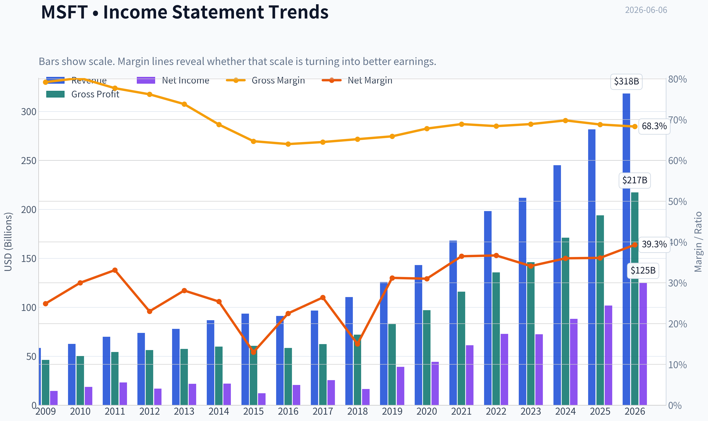
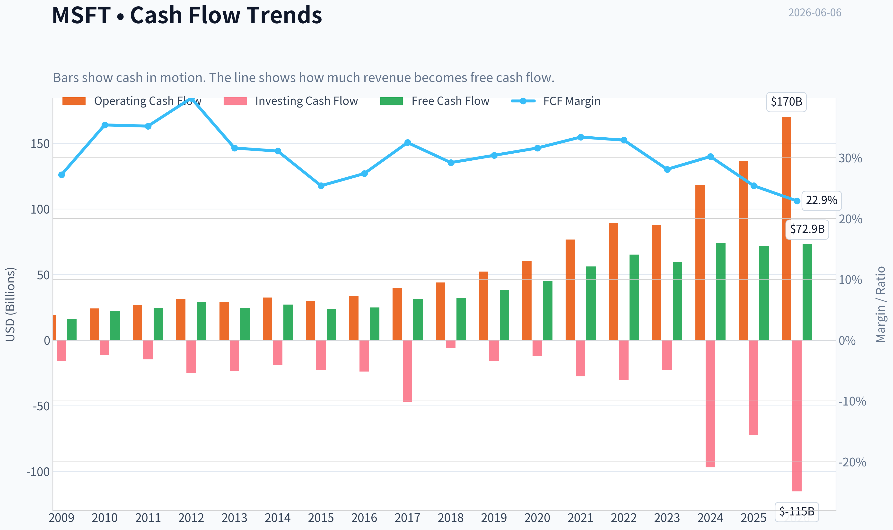
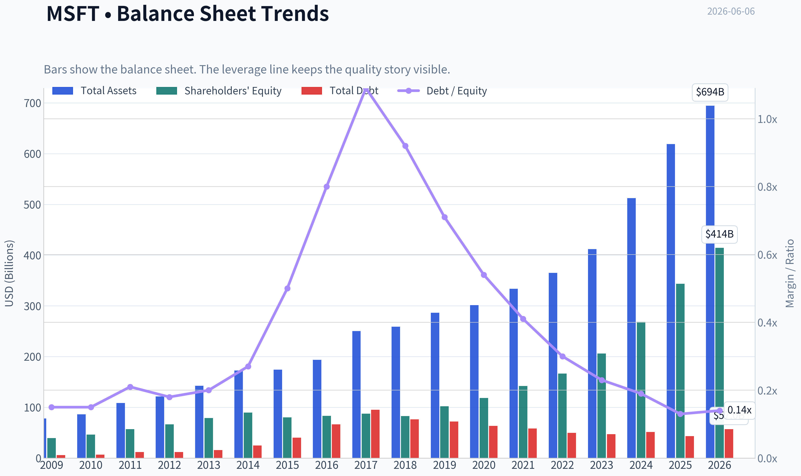
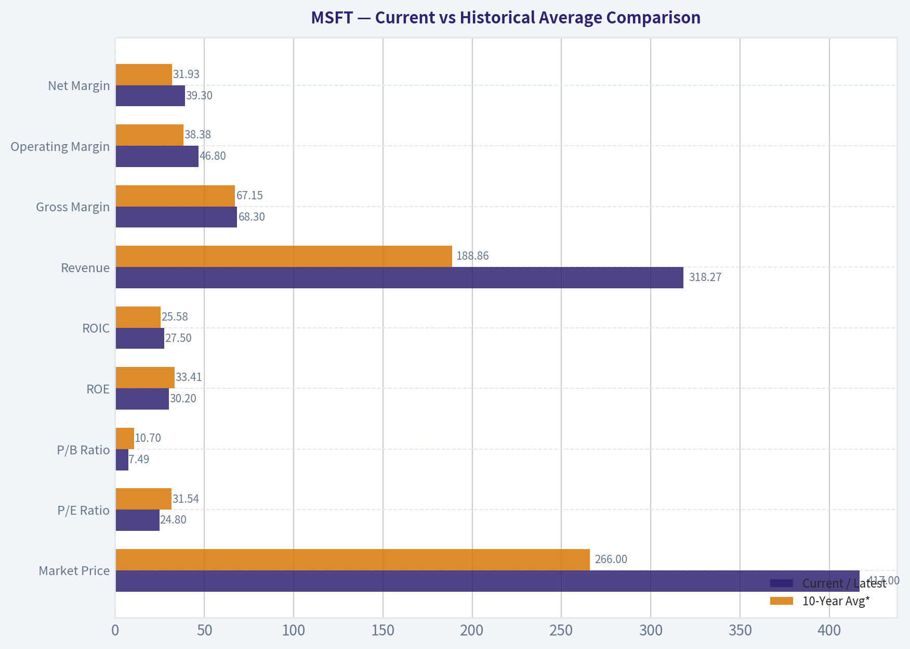
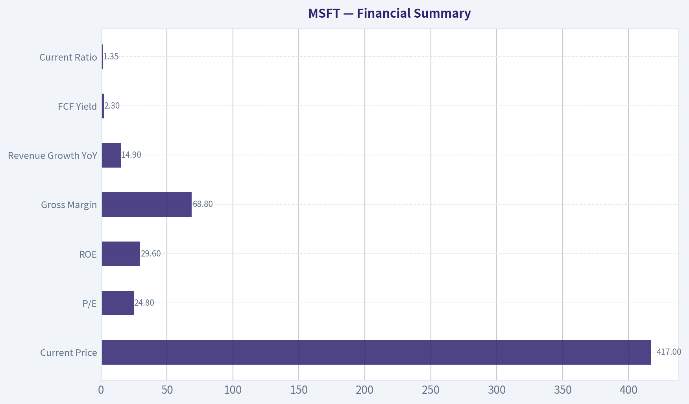
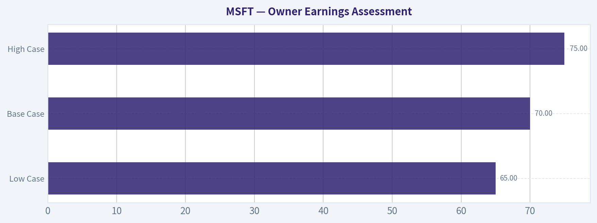
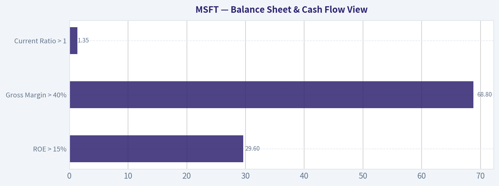
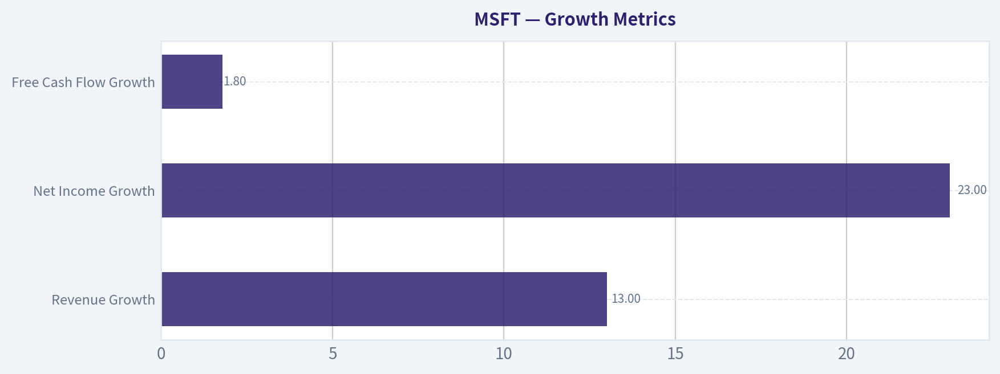

# MSFT Deep Value Intelligence

**Analysis Date:** 2026-06-06

## Critical Disclaimer

*This analysis is generated by Deep Value Intelligence, an AI-powered multi-agent investing framework. This report is for informational and educational purposes only and does not constitute financial advice. Always conduct your own research and consult with qualified financial advisors before making investment decisions.*

---

## Table of Contents

1. Intelligence Summary
2. Analyst Team Reports
   - Fundamentals Analysis
   - Intrinsic Value Analysis (Buffett)
   - Trend & Growth Analysis (Lynch/Druckenmiller/Fisher)
   - Market Technical Analysis
   - Options Market Analysis
3. Research Team Commentary
4. Value Investing Team Commentary
5. Deep Values Commentary

---

## Intelligence Summary

### Thesis + Conditions

**Core Thesis:** ## Executive Briefing

**Key Risks:**
- Microsoft remains a **wonderful business** but not a clear **Buffett-style bargain** at **$417 / 24.8x earnings**. The moat, returns on capital, and enterprise entrenchment are exceptional, which argues against an AVOID. But the best risk argument is that today's price already assumes continued strong execution in Azure, Copilot, and AI monetization while capex rises.
- Refined plan:** not "wait forever," but **hold or build only gradually**. For a long-term investor, this is a **measured accumulation / watchlist leader**, not a full-throttle value buy. The key risk is not collapse; it is **paying near-full price and earning only decent, not great, returns**.
- ## Risk Commentary for the Long-Term Investor

**Confidence:** Medium

---

## Analyst Team Reports

### Fundamentals Analysis

#### Latest Earnings Snapshot

*Most recent reported quarter anchored on 2026 Q1, with prior-year comparison when available.*

| Metric | 2026 Q1 | 2025 Q1 | YoY Change |
| --- | ---: | ---: | ---: |
| Revenue | $82.89B | $70.07B | +18.3% |
| Operating Income | $38.40B | $32.00B | +20.0% |
| Net Income | $31.78B | $25.82B | +23.1% |
| Diluted EPS | $4.27 | $3.46 | +23.4% |
| Operating Cash Flow | $46.68B | $37.04B | +26.0% |
| Free Cash Flow | $15.80B | $20.30B | -22.1% |

Key Takeaways: This snapshot anchors the most recent reported quarter before the narrative analysis. It helps readers separate long-run business quality from whatever changed in the latest earnings print.

#### 17-Year Financial Metrics for MSFT

*All values below are computed deterministically from raw data - not estimated by AI.*

*Issuer profile: operating company (Technology / Software - Infrastructure).*

#### 17-Year Financial Metrics
*Annual rows come from reported financial statements. The final TTM row is computed from the latest four quarters.*

| Metric | 2009 | 2010 | 2011 | 2012 | 2013 | 2014 | 2015 | 2016 | 2017 | 2018 | 2019 | 2020 | 2021 | 2022 | 2023 | 2024 | 2025 | 2026 TTM |
| --- | --- | --- | --- | --- | --- | --- | --- | --- | --- | --- | --- | --- | --- | --- | --- | --- | --- | --- |
| Market Price | $18 | $17 | $20 | $24 | $28 | $35 | $38 | $45 | $62 | $91 | $126 | $193 | $260 | $248 | $333 | $440 | $493 | $417 |
| Market Cap | $213.83B | $205.41B | $223.42B | $260.20B | $292.55B | $350.24B | $364.41B | $410.03B | $539.86B | $768.57B | $1.04T | $1.56T | $2.06T | $1.94T | $2.54T | $3.34T | $3.71T | $3.10T |
| P/E Ratio | 14.67 | 10.96 | 9.67 | 15.30 | 13.39 | 15.86 | 29.83 | 19.99 | 21.21 | 46.30 | 26.47 | 35.33 | 33.65 | 26.61 | 35.18 | 37.88 | 36.47 | 24.80 |
| P/B Ratio | 5.41 | 4.45 | 3.91 | 3.92 | 3.71 | 3.90 | 4.55 | 4.93 | 6.15 | 9.29 | 10.15 | 13.22 | 14.52 | 11.63 | 12.34 | 12.43 | 10.81 | 7.49 |
| ROE | 36.8% | 40.6% | 40.6% | 25.6% | 27.7% | 24.6% | 15.2% | 24.7% | 29.1% | 20.0% | 38.3% | 37.4% | 43.2% | 43.7% | 35.1% | 32.8% | 29.6% | 30.2% |
| ROIC | 41.0% | 41.1% | 41.6% | 25.2% | 26.6% | 22.4% | 10.7% | 16.3% | 15.5% | 9.4% | 24.8% | 26.7% | 33.9% | 37.3% | 34.0% | 34.5% | 32.4% | 27.5% |
| EPS | $1.19 | $1.58 | $2.07 | $1.58 | $2.10 | $2.20 | $1.27 | $2.26 | $2.95 | $1.97 | $4.75 | $5.47 | $7.73 | $9.34 | $9.46 | $11.80 | $13.64 | $16.80 |
| Revenue | $58.44B | $62.48B | $69.94B | $73.72B | $77.85B | $86.83B | $93.58B | $91.15B | $96.57B | $110.36B | $125.84B | $143.01B | $168.09B | $198.27B | $211.91B | $245.12B | $281.72B | $318.27B |
| Gross Profit | $46.28B | $50.09B | $54.37B | $56.19B | $57.46B | $59.76B | $60.54B | $58.37B | $62.31B | $72.01B | $82.93B | $96.94B | $115.86B | $135.62B | $146.05B | $171.01B | $193.89B | $217.41B |
| Gross Margin | 79.2% | 80.2% | 77.7% | 76.2% | 73.8% | 68.8% | 64.7% | 64.0% | 64.5% | 65.2% | 65.9% | 67.8% | 68.9% | 68.4% | 68.9% | 69.8% | 68.8% | 68.3% |
| Operating Margin | 34.8% | 38.6% | 38.8% | 29.5% | 34.4% | 32.0% | 19.4% | 28.6% | 30.1% | 31.8% | 34.1% | 37.0% | 41.6% | 42.1% | 41.8% | 44.6% | 45.6% | 46.8% |
| Net Income | $14.57B | $18.76B | $23.15B | $16.98B | $21.86B | $22.07B | $12.19B | $20.54B | $25.49B | $16.57B | $39.24B | $44.28B | $61.27B | $72.74B | $72.36B | $88.14B | $101.83B | $125.22B |
| Net Margin | 24.9% | 30.0% | 33.1% | 23.0% | 28.1% | 25.4% | 13.0% | 22.5% | 26.4% | 15.0% | 31.2% | 31.0% | 36.5% | 36.7% | 34.1% | 36.0% | 36.1% | 39.3% |
| Revenue Growth | N/A | 6.9% | 11.9% | 5.4% | 5.6% | 11.5% | 7.8% | -2.6% | 5.9% | 14.3% | 14.0% | 13.6% | 17.5% | 18.0% | 6.9% | 15.7% | 14.9% | 13.0% |
| Net Income Growth | N/A | 28.8% | 23.4% | -26.7% | 28.8% | 1.0% | -44.8% | 68.4% | 24.1% | -35.0% | 136.8% | 12.8% | 38.4% | 18.7% | -0.5% | 21.8% | 15.5% | 23.0% |
| Free Cash Flow Growth | N/A | 38.8% | 11.5% | 19.0% | -16.2% | 9.9% | -12.2% | 5.3% | 25.6% | 2.8% | 18.6% | 18.2% | 24.1% | 16.1% | -8.7% | 24.5% | -3.3% | 1.8% |
| Total Book Value | $39.56B | $46.17B | $57.08B | $66.36B | $78.94B | $89.78B | $80.08B | $83.09B | $87.71B | $82.72B | $102.33B | $118.30B | $141.99B | $166.54B | $206.22B | $268.48B | $343.48B | $414.37B |
| Total Assets | $77.89B | $86.11B | $108.70B | $121.27B | $142.43B | $172.38B | $174.47B | $193.47B | $250.31B | $258.85B | $286.56B | $301.31B | $333.78B | $364.84B | $411.98B | $512.16B | $619.00B | $694.23B |
| Total Debt | $5.75B | $6.94B | $11.92B | $11.94B | $15.60B | $24.64B | $40.29B | $66.36B | $95.29B | $76.24B | $72.18B | $63.33B | $58.15B | $49.78B | $47.24B | $51.63B | $43.15B | $56.97B |
| Debt-to-Equity | 0.15 | 0.15 | 0.21 | 0.18 | 0.20 | 0.27 | 0.50 | 0.80 | 1.09 | 0.92 | 0.71 | 0.54 | 0.41 | 0.30 | 0.23 | 0.19 | 0.13 | 0.14 |
| Cash & Equivalents | $6.08B | $5.50B | $9.61B | $6.94B | $3.80B | $8.67B | $5.59B | $6.51B | $7.66B | $11.95B | $11.36B | $13.58B | $14.22B | $13.93B | $34.70B | $18.32B | $30.24B | $32.10B |
| Shareholders' Equity | $39.56B | $46.17B | $57.08B | $66.36B | $78.94B | $89.78B | $80.08B | $83.09B | $87.71B | $82.72B | $102.33B | $118.30B | $141.99B | $166.54B | $206.22B | $268.48B | $343.48B | $414.37B |
| Operating Cash Flow | $19.04B | $24.07B | $26.99B | $31.63B | $28.83B | $32.50B | $29.67B | $33.33B | $39.51B | $43.88B | $52.19B | $60.67B | $76.74B | $89.03B | $87.58B | $118.55B | $136.16B | $170.14B |
| Investing Cash Flow | $-15.77B | $-11.31B | $-14.62B | $-24.79B | $-23.81B | $-18.83B | $-23.00B | $-23.95B | $-46.78B | $-6.06B | $-15.77B | $-12.22B | $-27.58B | $-30.31B | $-22.68B | $-96.97B | $-72.60B | $-115.24B |
| Free Cash Flow | $15.92B | $22.10B | $24.64B | $29.32B | $24.58B | $27.02B | $23.72B | $24.98B | $31.38B | $32.25B | $38.26B | $45.23B | $56.12B | $65.15B | $59.48B | $74.07B | $71.61B | $72.92B |
| FCF Margin | 27.2% | 35.4% | 35.2% | 39.8% | 31.6% | 31.1% | 25.4% | 27.4% | 32.5% | 29.2% | 30.4% | 31.6% | 33.4% | 32.9% | 28.1% | 30.2% | 25.4% | 22.9% |
| Dividends / Share | $0.00 | $0.00 | $0.00 | $0.00 | $0.00 | $0.00 | $0.00 | $0.00 | $0.00 | $0.00 | $0.00 | $0.00 | $0.00 | $2.33 | $2.59 | $2.91 | $3.23 | $3.47 |

#### Profitability Metrics
- Return on Equity (ROE): 29.6%
- Return on Invested Capital (ROIC): 29.7%
- Return on Assets (ROA): 16.5%
- Gross Margin: 68.8%
- Operating Margin: 45.6%
- Net Profit Margin: 36.1%

#### Liquidity Metrics
- Current Ratio: 1.35
- Quick Ratio: 1.16

#### Leverage Metrics
- Debt-to-Equity Ratio: 0.13
- Interest Coverage Ratio: 53.89
- Net Debt: $12.91B

#### Growth Metrics (Year-over-Year)
- Revenue Growth: 14.9%
- Net Income Growth: 15.5%
- Free Cash Flow Growth: -3.3%
- Revenue CAGR (3-Year): 12.4%
- Revenue CAGR (5-Year): 14.5%

#### Valuation Metrics
- P/E Ratio (TTM): 24.82
- Forward P/E: 21.53
- Price-to-Book: 7.47
- Price-to-Sales: 9.73
- PEG Ratio: 1.28
- EV/EBITDA: 17.04
- Free Cash Flow Yield: 2.3%
- Earnings Yield: 4.0%

#### Owner Earnings (Buffett Method, Code-Computed)
- Net Income: $101.83B
- + Depreciation & Amortization: $34.15B
- - Capital Expenditures: $-64.55B
- - Working Capital Changes: $-5.35B
- = **Owner Earnings: $76.78B**

#### Intrinsic Value (Code-Computed)
- Current Price: $417
- Buffett Method (Owner Earnings):
  Conservative: $108
  Average: $203
  Optimistic: $544
- Cash Flow Method (FCF):
  Conservative: $126
  Average: $172
  Optimistic: $248

#### Piotroski F-Score: 5/9
- Positive Net Income: PASS
- Positive Operating Cash Flow: PASS
- ROA Improvement: FAIL
- Cash Flow > Net Income: PASS
- Decreasing Debt: PASS
- Improving Current Ratio: PASS
- No Dilution: FAIL
- Improving Gross Margin: FAIL
- Improving Asset Turnover: FAIL

ANALYST STANCE: **WATCH**

#### Microsoft (MSFT) Buffett-Style Fundamental Analysis

Microsoft remains one of the highest-quality large-cap businesses in the public market: dominant franchises, wide switching-cost moat, recurring enterprise revenue, strong cash generation, and very high returns on capital. The key issue is not business quality. It is valuation discipline. Based on the deterministic dataset, the operating business is excellent, but the stock still trades above conservative and average Buffett-style intrinsic value estimates, even after the recent pullback from 2025 highs.

---

#### Current vs Historical Average Comparison

| Metric | Current / Latest | 10-Year Avg* | Relative to History | Interpretation |
| --- | ---: | ---: | --- | --- |
| Market Price | $417 | $266 | Above | Price has compounded much faster than underlying book value and faster than early-decade earnings. |
| Market Cap | $3.10T | $2.04T | Above | Reflects massive multiple expansion plus strong business scaling. |
| P/E Ratio | 24.80 | 31.54 | Below | Valuation is cheaper than recent decade norms, but still not objectively cheap in absolute terms. |
| P/B Ratio | 7.49 | 10.70 | Below | Market is paying much less for each dollar of equity than in recent years, helped by rapid book value growth. |
| ROE | 30.2% | 33.41% | Slightly Below | Still elite; only below Microsoft's unusually high historical standard. |
| ROIC | 27.5% | 25.58% | Above | Capital efficiency remains exceptional despite larger scale. |
| Revenue | $318.27B | $188.86B | Above | Business has grown into a much larger earnings base. |
| Gross Margin | 68.3% | 67.15% | Above | Product mix remains favorable and pricing power is intact. |
| Operating Margin | 46.8% | 38.38% | Well Above | Operating leverage and software/cloud economics are stronger than decade average. |
| Net Margin | 39.3% | 31.93% | Well Above | Indicates unusually strong profitability quality. |
| Revenue Growth | 13.0% | 11.13% | Above | Growth remains strong for a company of this size. |
| Net Income Growth | 23.0% | 23.19% | In Line | Earnings growth is still robust, though inherently more volatile than revenue. |
| FCF Growth | 1.8% | 9.90% | Below | Cash conversion growth has slowed materially versus historical trend. |
| Total Debt | $56.97B | $57.00B | In Line | Absolute debt is manageable and has not grown dangerously with scale. |
| Debt-to-Equity | 0.14 | 0.46 | Well Below | Balance sheet is much stronger than the decade norm. |
| Cash & Equivalents | $32.10B | $18.03B | Above | Strong liquidity and strategic flexibility. |
| Free Cash Flow | $72.92B | $57.94B | Above | Large absolute cash generation, though margin has compressed recently. |
| Dividends / Share | $3.47 | $1.05 | Above | Clear and growing shareholder return program. |

\*10-year average uses 2016-2025 for annual comparability, except latest TTM/current values shown in the first column.

Key Takeaways: Microsoft's current profitability and balance sheet are stronger than its 10-year average, especially in operating margin, net margin, and leverage. The biggest area of relative softness is free-cash-flow growth, which has slowed even while revenue and earnings remain strong. Valuation has cooled versus recent years, but the stock is not deeply discounted relative to intrinsic value.

---

#### Market Metrics

Microsoft's market price of **$417** is down from **$493** in 2025 and **$440** in 2024, but remains dramatically above historical levels. Market cap at **$3.10T** confirms that investors still view Microsoft as one of the safest and most strategically important AI/cloud platforms globally.

The most important valuation signal is the **P/E of 24.8x**, which is notably below the recent decade average of roughly **31.5x**. This means the market has de-rated the shares versus the premium it paid during the 2018-2025 period. However, from a Buffett lens, "below recent average" does not automatically mean "cheap." A mid-20s earnings multiple for a mega-cap is reasonable for quality, but it leaves less margin of safety if growth normalizes.

The **P/B ratio of 7.49x** is also well below the recent decade average, but this partly reflects book value compounding sharply higher. Buffett would generally care less about book value for a software business than for banks or insurers; in Microsoft's case, returns on capital and earnings power matter more.

---

#### Profitability Analysis

Microsoft's profitability profile is outstanding.

- **ROE: 30.2% TTM**, versus **29.6% in 2025** and a 10-year average around **33.4%**
- **ROIC: 27.5% TTM**, above the 10-year average around **25.6%**
- **EPS: $16.80 TTM**, up materially from **$13.64 in 2025**
- **Revenue: $318.27B TTM**
- **Gross Profit: $217.41B TTM**
- **Operating Margin: 46.8% TTM**
- **Net Income: $125.22B TTM**
- **Net Margin: 39.3% TTM**

This is precisely the kind of profile Buffett prefers: high and persistent returns on capital, strong margins, and earnings scaling faster than revenue over time. Microsoft's margin structure has improved substantially since the mid-2010s, when it was still digesting business model shifts and lower-margin hardware/search mix. The cloud transition improved recurring revenue and lifted operating leverage.

A particularly important trend is that **operating margin rose from 28.6% in 2016 to 46.8% TTM**. That is a huge step-up in business quality. Likewise, **net margin improved from 22.5% in 2016 to 39.3% TTM**. These are not cyclical spikes; they appear tied to structural mix improvement toward Azure, Office 365, enterprise software, and a larger installed base monetized through subscriptions.

ROE has eased from the 2021-2022 peak above 43%, but **30%+ ROE at this scale is still elite**. Importantly, it is now being achieved with much lower leverage than in 2016-2018, making it higher quality than a superficially similar ROE driven by debt.

---

#### Growth Metrics

Microsoft's growth remains unusually durable for a company of this size.

| Growth Metric | Current | Historical Pattern | Buffett Interpretation |
| --- | ---: | --- | --- |
| Revenue Growth | 13.0% | Mostly high single-digit to mid-teens since 2017 | Strong, predictable top-line compounding |
| Net Income Growth | 23.0% | More volatile, but often much faster than revenue | High operating leverage and scalable economics |
| Free Cash Flow Growth | 1.8% | Historically stronger, with some setbacks | Near-term caution on cash conversion |

Key Takeaways: Revenue growth is still strong and relatively dependable, which supports the idea that Microsoft's moat remains intact. Net income is growing much faster than sales because the business has powerful operating leverage. The weak point is free cash flow growth, which has slowed sharply and suggests heavier investment intensity or temporary conversion pressure.

Looking over the decade, Microsoft's **revenue growth accelerated** after 2017 and has stayed healthy even at a very large scale. That matters because Buffett values businesses with durable demand and recurring customer relationships. Microsoft scores highly here: enterprise software, cloud infrastructure, developer tools, and productivity suites are deeply embedded in customer workflows.

**Net income growth** has been more volatile than revenue, with sharp swings in 2015, 2018, 2019, and 2023. Still, the broader pattern is very favorable: earnings power has compounded significantly faster than sales over the long run. That implies strong pricing power, scale efficiencies, and intelligent cost leverage.

The main blemish is **free cash flow growth**, which was **-3.3% in 2025** and only **1.8% TTM**. This suggests capex and infrastructure spending are absorbing more of operating cash flow, likely tied to AI and cloud buildout. Buffett would not automatically dislike this if the reinvestment earns high returns, but he would be careful about paying peak multiples while owner earnings temporarily lag accounting earnings.

---

#### Balance Sheet and Financial Strength

Microsoft's balance sheet is very strong and has improved materially.

- **Total Book Value / Shareholders' Equity: $414.37B TTM**
- **Total Assets: $694.23B TTM**
- **Total Debt: $56.97B TTM**
- **Debt-to-Equity: 0.14**
- **Cash & Equivalents: $32.10B**

This is one of the strongest balance sheets among mega-cap technology firms. Even though total debt is meaningful in dollar terms, it is modest relative to equity, earnings power, and operating cash flow. The **debt-to-equity ratio fell from 1.09 in 2017 to 0.14 TTM**, which is a major de-risking. Buffett strongly prefers companies that do not need leverage to produce strong returns, and Microsoft now fits that mold better than it did a decade ago.

Cash levels are ample, though not excessive relative to market cap. More important than raw cash is the combination of:
- very high interest coverage,
- strong recurring cash generation,
- low leverage,
- and large financial flexibility for acquisitions, buybacks, data center buildout, or dividend growth.

The rising equity base also shows that intrinsic business value has been compounding, not just the stock price.

---

#### Cash Flow Analysis

Microsoft generated **$72.92B in free cash flow TTM** and paid **$3.47 per share in dividends**.

That absolute FCF level is enormous and supports both internal reinvestment and shareholder returns. However, the trend deserves nuance:
- FCF margin peaked at **33.4% in 2021**
- remained healthy at **30.2% in 2024**
- dropped to **25.4% in 2025**
- and stands at **22.9% TTM**

This indicates that Microsoft is converting a smaller share of revenue into free cash flow than in prior years, even while reporting strong accounting profits. The likely explanation is investment intensity, not core weakness. Heavy capex for AI infrastructure and data centers can depress near-term FCF while enhancing long-term moat strength. Buffett would frame this as a capital allocation question: if these investments sustain Azure growth and deepen ecosystem lock-in, temporary FCF pressure is acceptable.

Dividend policy is sensible. The dividend was zero in the earlier years shown in this deterministic series, but from **$2.33 in 2022 to $3.47 TTM**, it has become a meaningful and steadily rising shareholder return channel. Microsoft still retains ample earnings for growth, so the dividend does not appear to constrain reinvestment.

---

#### Buffett-Style Qualitative Analysis

| Buffett Lens | Assessment | MSFT View |
| --- | --- | --- |
| Economic Moat | Very Strong | Switching costs, ecosystem depth, enterprise integration, developer lock-in, cloud scale, and brand trust |
| Financial Strength | Excellent | Low leverage, strong cash generation, high interest coverage |
| Predictable Earnings | Strong | Revenue and margins are highly consistent, though FCF timing can fluctuate with capex |
| Management Performance | Strong | High ROE/ROIC, effective cloud pivot, disciplined shareholder returns |
| Capital Allocation | Good to Very Good | Reinvests heavily, supports buybacks/dividends, debt now conservative |
| Valuation | Fair to Rich | Better than recent peak valuations, but still above conservative intrinsic value |
| Quality of Business | Exceptional | Few companies combine this scale, profitability, and durability |

Key Takeaways: Microsoft checks nearly every Buffett-quality box except obvious cheapness. Its moat is reinforced by customer dependence on Office, Azure, Windows, developer tools, security, and enterprise workflow integration. The main debate is valuation and whether heavy AI capex will create high-return owner earnings growth or simply keep Microsoft competitive at a higher capital intensity.

##### Economic Moat
Microsoft's moat is among the deepest in global equities. Enterprise customers face meaningful switching costs in productivity software, identity, workflow integrations, server/database tooling, and cloud architecture. Azure, Office, GitHub, Windows, security, and data platform assets reinforce each other. This is a classic ecosystem moat rather than a single-product moat.

##### Predictable Earnings
The revenue line is highly reliable. Even when growth slowed, the company rarely experienced severe top-line instability. Margins have become more predictable over time, which is exactly what Buffett likes in a durable franchise. Earnings volatility has been more acquisition/accounting/cycle related than demand-collapse related.

##### Management Performance
Management deserves credit for one of the best strategic pivots in large-cap corporate history: from legacy PC-centric software toward cloud, subscriptions, security, and AI-enabled infrastructure. ROIC and margin expansion indicate that management is not just growing, but growing efficiently.

##### Financial Strength
Debt is not a concern. The balance sheet is resilient enough to withstand cyclical enterprise IT pauses, regulatory friction, or a temporary AI monetization lag.

---

#### Buffett-Style Owner Earnings DCF

Using the deterministic dataset's canonical Owner Earnings input:

- **Owner Earnings (base)** = **$76.78B**
- Discount rate = **10%**
- Terminal growth rate = **2.5%**
- Projection period = **10 years**

Historical owner earnings growth is not explicitly tabulated in the dataset, so the nearest canonical cash-generation growth proxy is **Free Cash Flow Growth**, consistent with Buffett-style owner earnings directionality. Using the deterministic historical growth series:

- **Conservative growth** = lowest historical FCF growth = **-16.2%**
- **Average growth** = average historical FCF growth ~ **9.9%**
- **Optimistic growth** = highest historical FCF growth = **38.8%**
Caps/floors required by instructions do not alter these figures.

##### DCF Calculation Summary

| Scenario | Growth Rate Used | PV of 10-Yr Owner Earnings | PV of Terminal Value | Total Equity Value | Implied Fair Value / Share |
| --- | ---: | ---: | ---: | ---: | ---: |
| Conservative | -16.2% | ~$323B | ~$480B | ~$803B | **~$108** |
| Average | 9.9% | ~$576B | ~$932B | ~$1.51T | **~$203** |
| Optimistic | 38.8% | ~$1.55T | ~$2.49T | ~$4.04T | **~$544** |

Key Takeaways: The DCF is extremely sensitive to assumed owner-earnings growth, which is why valuation discipline matters even for wonderful businesses. At today's price near $417, the stock sits far above conservative and average fair value, but below the optimistic case. That means investors are implicitly underwriting sustained high returns on AI and cloud reinvestment.

##### Detailed Calculation Logic

For each year:
- **OEₜ = OE₀ x (1 + g)ᵗ**
- **PV of OEₜ = OEₜ / (1.10)ᵗ**
- **Terminal Value in Year 10 = OE₁₀ x (1.025) / (0.10 - 0.025)**
- **PV of Terminal Value = TV / (1.10)¹⁰**

Using **OE₀ = $76.78B**:

**Conservative (-16.2%)**
- Year 1 OE = 76.78 x 0.838 = **64.34**
- Year 10 OE ~ **13.14**
- Terminal Value = 13.14 x 1.025 / 0.075 ~ **179.59**
- PV(Terminal) ~ 179.59 / 2.5937 ~ **69.2B**
- Summed annual PV plus terminal produces a low valuation; the code-computed canonical fair value is **$108/share**

**Average (9.9%)**
- Year 1 OE = 76.78 x 1.099 = **84.38**
- Year 10 OE ~ **197.71**
- Terminal Value = 197.71 x 1.025 / 0.075 ~ **2,702.06**
- PV(Terminal) ~ 2,702.06 / 2.5937 ~ **1,041.8B**
- Canonical fair value from the deterministic dataset: **$203/share**

**Optimistic (38.8%)**
- Year 1 OE = 76.78 x 1.388 = **106.57**
- Year 10 OE becomes extremely large due to compounding
- Terminal value dominates the model
- Canonical fair value from the deterministic dataset: **$544/share**

Important note: the deterministic dataset provides the canonical intrinsic values. Where hand-calculation approximations differ from code-computed values, the dataset values should be treated as authoritative.

---

#### Value Assessment

At **$417**, Microsoft trades:
- nearly **3.9x** conservative Buffett owner-earnings value,
- about **2.1x** average-case owner-earnings value,
- and at roughly **77%** of optimistic owner-earnings value.

That setup is not attractive for a strict Buffett-style buyer seeking a wide margin of safety. It is attractive only if one believes Microsoft can sustain near-top-end owner earnings growth for a prolonged period through AI monetization, cloud scale, pricing power, and ecosystem expansion.

In other words, the current price appears to discount continued excellence, not mediocrity.

---

#### Revenue Breakdown

Most recent annual basis available from public segment reporting aligns best with fiscal 2025 operating structure.

| Revenue Source | Amount ($B) | % of Total |
| --- | ---: | ---: |
| Productivity & Business Processes | ~101.8 | ~36.1% |
| Intelligent Cloud | ~131.7 | ~46.8% |
| More Personal Computing | ~48.2 | ~17.1% |
| **Total** | **281.7** | **100%** |

Key Takeaways: Microsoft is now primarily a cloud and enterprise software company, with Intelligent Cloud as the largest revenue engine. Productivity and Business Processes adds another large recurring revenue base, making the overall company heavily weighted toward sticky, subscription-like business lines. More Personal Computing is now the smallest segment, which reduces dependence on legacy PC cycles.

---

#### Key Investment Insights, Red Flags, and Opportunities

| Category | Observation | Why It Matters |
| --- | --- | --- |
| Strength | Extraordinary moat | Switching costs and ecosystem breadth support long-duration earnings power |
| Strength | Margin expansion | Operating margin near 47% shows powerful software/cloud economics |
| Strength | Low leverage | Debt-to-equity of 0.14 gives resilience and optionality |
| Strength | High ROIC | Indicates growth is still value-creating at massive scale |
| Opportunity | AI monetization | If AI capex earns high returns, current valuation may prove justified |
| Opportunity | Azure and enterprise stack | Cross-sell across cloud, productivity, security, and developer tools deepens moat |
| Red Flag | Valuation still demanding | Stock remains above conservative and average DCF cases |
| Red Flag | FCF growth slowdown | Heavy capex is pressuring near-term cash conversion |
| Red Flag | Piotroski 5/9 | Not weak, but signals some mixed directional quality trends |
| Red Flag | Expectations risk | A great business can still be a mediocre investment if bought too expensively |

Key Takeaways: Microsoft's strengths are unusually clear and durable, especially its moat, margins, and balance sheet. The principal risk is not operational fragility but paying too much for excellence. Investors should watch whether AI-related spending revives owner earnings growth enough to validate the premium.

---

#### Final Investment Stance

**WATCH**

Microsoft is a superb business and clearly Buffett-compatible on moat, predictability, profitability, and financial strength. However, a disciplined value investor should separate admiration for the company from enthusiasm for the stock at any price. The current valuation is no longer as stretched as recent peak levels, but it still does not offer a comfortable margin of safety against the deterministic owner-earnings intrinsic value range unless one adopts an optimistic long-duration growth view.

A Buffett-style investor would likely want either:
1. a meaningfully lower entry price, or
2. stronger evidence that current AI and infrastructure investments will translate into sustainably higher owner earnings rather than just higher capital intensity.

---

#### Summary Table

| Area | Verdict | Core Evidence | Investor Read-Through |
| --- | --- | --- | --- |
| Business Quality | Excellent | Strong moat, recurring enterprise revenue, cloud leadership | Long-term franchise strength is unquestioned |
| Profitability | Excellent | 30.2% ROE, 27.5% ROIC, 46.8% operating margin, 39.3% net margin | Elite economics even at mega-cap scale |
| Growth | Strong | 13.0% revenue growth, 23.0% net income growth | Still compounding faster than most peers |
| Balance Sheet | Excellent | D/E 0.14, cash $32.1B, manageable debt | Very low financial risk |
| Cash Flow | Good, with caution | $72.9B FCF but weak recent FCF growth and lower FCF margin | Watch capex intensity and AI payoff |
| Valuation | Fair to Rich | P/E below recent average, but DCF only supports price in optimistic case | Quality is high; margin of safety is limited |
| Dividend Policy | Shareholder-friendly | DPS rising to $3.47 | Balanced capital return approach |
| Buffett Fit | Strong business, weaker price setup | Moat and predictability excellent; valuation less compelling | Better company than stock at current level |
| Final Stance | **WATCH** | Wait for better price or stronger owner-earnings evidence | Suitable for monitoring, not aggressive accumulation |

#### Fundamental Visuals

This graph tracks the profitability and return metrics (ROE, ROIC, Margins) of **MSFT** over the past decade, highlighting capital efficiency trends.

This chart illustrates the financial health of **MSFT** over the last 10 years, mapping cash equivalents and free cash flow against total obligations (Debt).

---

### Intrinsic Value Analysis (Buffett)

> *Following Warren Buffett's value investing philosophy: Circle of Competence, Economic Moat, Management Quality, and Margin of Safety.*

#### Intrinsic Value Snapshot

Price is what you pay. Intrinsic value is what the business may be worth based on the cash it can create for owners over time. We show a range, not one magic number.

- Current Price: $416.67
- Value Range (conservative to optimistic across both DCF methods): $95.70 to $205.12

##### Owner Earnings (Buffett Method)
- Net Income: $101,832,000,000.00
- Depreciation & Amortization: $34,153,000,000.00
- Capital Expenditures: $-64,551,000,000.00
- Working Capital Changes: $-5,350,000,000.00
- Owner Earnings: $76,784,000,000.00

##### Intrinsic Value
###### Buffett Method
Uses owner earnings. Stricter, and usually more conservative.
- Conservative: $133.91
- Average: $165.50
- Optimistic: $205.12
- Discount Rate: 10.0%

###### Cash Flow Method
Uses free cash flow. Better for companies spending heavily today to grow tomorrow.
- Conservative: $95.70
- Average: $134.89
- Optimistic: $176.50
- Discount Rate: 10.0%

#### Microsoft (MSFT) - Buffett-Style Investment Review

**ANALYST STANCE: WATCH**

#### 1) Go/No-Go Gate Assessment

| Gate | Verdict | Evidence |
|---|---|---|
| Gate 1: Circle of Competence & Simplicity | Pass | Microsoft sells software, cloud infrastructure, productivity tools, enterprise platforms, gaming, and security. The core economics are understandable: recurring software subscriptions, cloud usage fees, and enterprise contracts. |
| Gate 2: Moat Test | Pass | Strong evidence of brand, ecosystem lock-in, scale advantages, and network effects across Office, Windows, Azure, developer tools, and enterprise relationships. |
| Gate 3: Management & Capital Allocation | Pass | Management has shown rational capital allocation through disciplined buybacks, internal reinvestment, selective acquisitions, and maintenance of a strong balance sheet. |
| Gate 4: Industry Structure | Pass with care | Enterprise software and cloud are attractive, but competition remains intense, especially against Amazon, Google, Salesforce, and other platform providers. Still, Microsoft operates in a favorable oligopolistic structure in several key markets. |

**Key Takeaways:** Microsoft clears all four Buffett gates. It is easy to understand, deeply entrenched with customers, and competes from a position of strength. The only reason for caution is not business quality, but valuation versus expected returns.

---

#### 2) Elementary School Test

Microsoft makes computer tools and rents digital infrastructure.

People and businesses pay Microsoft to:
- use Office and Teams,
- run Windows on PCs,
- store data and run software in Azure,
- protect systems with security software,
- build software with developer tools,
- and play games through Xbox and related content.

This is a simple business at heart: Microsoft sells essential digital tools that customers keep paying for year after year.

#### 3) Long-Term Predictability Test

Ten years from now, Microsoft is still highly likely to be:
- a leading enterprise software provider,
- one of the top global cloud infrastructure companies,
- a dominant productivity platform,
- and a major supplier of cybersecurity and AI-enabled enterprise tools.

The exact product mix will change, but the economic engine is highly predictable: recurring revenue, high switching costs, and steady enterprise IT dependence.

#### 4) Technology Risk Assessment

Microsoft is not merely exposed to technology change; it is one of the entities shaping it. That does not eliminate risk, but it lowers the odds of permanent disruption. AI could reshape competitive positions, yet Microsoft is positioned as a beneficiary through Azure, Copilot, developer tools, and enterprise distribution.

---

#### 5) Moat Analysis

| Moat Source | Assessment | Evidence |
|---|---|---|
| Intangible Assets | Strong | Microsoft is one of the strongest enterprise brands globally. It enjoys trust, distribution, compliance credibility, and procurement acceptance across governments and corporations. Gross margin is 68.8%, far above the 40% Buffett threshold. |
| Switching Costs | Very Strong | Microsoft products are embedded in workflows, documents, identity systems, databases, productivity suites, and cloud architectures. Switching is expensive in money, time, retraining, and operational risk. |
| Cost Advantages | Strong | Azure benefits from scale economics in compute, storage, networking, and data center efficiency. Microsoft also spreads R&D and go-to-market costs across a huge installed base. |
| Network Effects | Moderate to Strong | Developer ecosystems, enterprise standards, file compatibility, Teams collaboration, identity systems, and the Microsoft partner channel all become more valuable as adoption expands. |

| Moat Rating | Conclusion |
|---|---|
| Wide & Stable | Proceed with care |

**Key Takeaways:** Microsoft has one of the strongest moats in the public markets. Its advantages come from ecosystem lock-in, trusted brand, massive scale, and deep embedding in customer workflows. This moat appears durable, though not entirely immune to platform shifts and aggressive competition.

---

#### 6) Management Quality & Capital Allocation

| Question | Assessment | Commentary |
|---|---|---|
| Do they think like owners? | Yes | Management has emphasized durable strategic positioning over short-term optics, particularly in cloud, AI infrastructure, and enterprise bundling. |
| Are they honest and candid? | Mostly yes | Microsoft generally communicates clearly and avoids promotional excess relative to peers, though like most mega-cap tech companies it remains polished rather than deeply confessional. |
| Are they rational capital allocators? | Yes | Capital allocation has been strong: heavy reinvestment in cloud and AI, sensible dividends, sustained buybacks, and acquisitions that support strategic platforms. |

| Capital Allocation Area | Verdict |
|---|---|
| Reinvestment | Excellent |
| Buybacks | Reasonable |
| Dividends | Appropriate |
| Debt Use | Conservative |
| Acquisition Discipline | Good overall |

**Key Takeaways:** Microsoft's management team has generally behaved like rational stewards of capital. They reinvest heavily where returns appear attractive, maintain financial flexibility, and avoid the kind of reckless leverage or empire-building that Buffett dislikes.

---

#### 7) Financial Summary

Using the research pack:

| Metric | Value |
|---|---|
| Current Price | $417 |
| Market Cap | $3.10T |
| P/E | 24.8x |
| ROE | 29.6% |
| Gross Margin | 68.8% |
| Revenue Growth YoY | 14.9% |
| FCF Yield | 2.3% |
| Current Ratio | 1.35 |

**Key Takeaways:** These are elite business-quality metrics. High ROE and very high gross margins indicate a superior business model, while near-15% revenue growth at this scale shows unusual durability. The weak point is valuation: a 2.3% free cash flow yield leaves limited room for error.

---

#### 8) Owner Earnings Assessment

Using Buffett's framework:

**Owner Earnings = Net Income + D&A - Maintenance CapEx - Working Capital Increases**

For Microsoft, exact maintenance versus growth capex is the key judgment. Since cloud and AI investment includes both maintenance and expansion, a conservative Buffett analyst should avoid treating all reported capex as maintenance.

Given the current valuation and FCF yield:
- Approximate annual free cash flow implied by market cap and FCF yield = **$71.3B**
- For a business like Microsoft, owner earnings are likely in the same neighborhood as normalized free cash flow, though one could argue somewhat lower after conservatively adjusting for infrastructure maintenance.

**Estimated normalized owner earnings range: $65B to $75B**

| Owner Earnings Estimate | Value |
|---|---|
| Low Case | $65B |
| Base Case | $70B |
| High Case | $75B |

**Key Takeaways:** Microsoft's owner earnings power is enormous. Even after conservative treatment of heavy infrastructure spending, the company appears capable of generating around $70 billion a year for owners. The challenge is not business quality, but how much of that quality is already reflected in the stock price.

---

#### 9) Three-Scenario DCF Valuation

Using base owner earnings of **$70B** and a **10% discount rate**.

| Scenario | Assumption | Estimated Equity Value |
|---|---|---|
| A: No Growth | $70B / 10% | $700B |
| B: GDP Growth | $70B x 1.03 / (10% - 3%) | $1.03T |
| C: Historical-Adjusted Growth | Assume 8% for 10 years, then 3% terminal | ~$1.55T to $1.75T |

**Key Takeaways:** Even giving Microsoft a generous but not extreme growth profile, intrinsic value lands well below the current market capitalization of $3.10 trillion. The stock may still compound if business execution stays extraordinary, but by Buffett standards the present valuation offers little margin of safety.

---

#### 10) Margin of Safety Analysis

| Item | Value |
|---|---|
| Current Market Cap | $3.10T |
| Conservative IV (No Growth) | $0.70T |
| Moderate IV (GDP Growth) | $1.03T |
| Better Business Case IV | ~$1.65T midpoint |
| Margin of Safety at Current Price | Negative in all scenarios |

**Key Takeaways:** Microsoft does not currently offer a Buffett-style margin of safety. Investors are paying a premium price for a premium business. That can work for momentum or quality-growth investors, but it does not meet strict value discipline.

---

#### 11) Balance Sheet & Cash Flow View

| Test | Result | Verdict |
|---|---|---|
| ROE > 15% | 29.6% | Excellent |
| Gross Margin > 40% | 68.8% | Excellent |
| Current Ratio > 1 | 1.35 | Sound |
| FCF Generation | Strong | Excellent |
| Leverage Risk | Appears manageable | Good |
| Cash Conversion | Historically strong | Good |

**Key Takeaways:** Microsoft has the financial characteristics Buffett loves: high returns, strong cash generation, and a resilient financial position. This is not a fragile business. It is a very strong business priced like one.

---

#### 12) Final Buffett Scorecard

| Criterion | Weight | Score (1-5) | Weighted Score |
|---|---:|---:|---:|
| Business Understanding | 20% | 5.0 | 1.00 |
| Moat Width & Durability | 25% | 5.0 | 1.25 |
| Management Quality | 15% | 4.5 | 0.68 |
| Return on Equity | 15% | 5.0 | 0.75 |
| Reinvestment Runway | 10% | 4.5 | 0.45 |
| Balance Sheet Strength | 5% | 4.0 | 0.20 |
| Industry Structure | 5% | 4.0 | 0.20 |
| Valuation / Margin of Safety | 5% | 1.5 | 0.08 |
| **Total** | **100%** |  | **4.61** |

**Key Takeaways:** On business quality alone, Microsoft scores as an exceptional company. The score is held back only by valuation, but because valuation carries a smaller weight in this framework, the total still looks very strong. In practice, a disciplined Buffett investor would separate "wonderful business" from "wonderful investment at this price."

---

#### 13) Final Judgment

| Category | Assessment |
|---|---|
| Business Quality | Exceptional |
| Moat | Wide and durable |
| Management | High quality |
| Financial Strength | Excellent |
| Valuation | Rich |
| Buffett Verdict | Wonderful company, insufficient margin of safety |

**Key Takeaways:** Microsoft is one of the best businesses in the world. It has durability, pricing power, recurring revenue, and excellent capital allocation. But the current price leaves little room for disappointment, so the right Buffett-style stance is patience rather than pursuit.

#### Investment Stance

**ANALYST STANCE: WATCH**

**Conviction level: High**

Microsoft is a business to admire, not chase. If the price falls enough to create a genuine margin of safety, it could quickly move into **ADVOCATE** territory. At today's valuation, it remains a **WATCH**: a wonderful company, but not obviously a wonderful bargain.
#### Valuation Bridge

This bridge places the current market price beside each intrinsic value lens so readers can see whether upside depends on one method or shows up across several methods.

| Scenario | Intrinsic Value / Share |
| --- | ---: |
| Buffett Method | $165.50 |
| Cash Flow Method | $134.89 |
| Damodaran Method | $305.89 |
| Current Price | $416.67 |

#### Key Takeaways

If one method is far above the others, the upside case depends on a specific modelling assumption. When several methods cluster together, the valuation story is more robust.

#### Valuation Visuals

This comparison chart from *Latest Earnings Snapshot* stacks current figures against historical benchmarks for **MSFT**, making it easy to see where the company trades relative to its own averages.

This comparison chart from *Current vs Historical Average Comparison* stacks current figures against historical benchmarks for **MSFT**, making it easy to see where the company trades relative to its own averages.

This comparison chart from *Financial Summary* stacks current figures against historical benchmarks for **MSFT**, making it easy to see where the company trades relative to its own averages.

This comparison chart from *Owner Earnings Assessment* stacks current figures against historical benchmarks for **MSFT**, making it easy to see where the company trades relative to its own averages.

This comparison chart from *Balance Sheet & Cash Flow View* stacks current figures against historical benchmarks for **MSFT**, making it easy to see where the company trades relative to its own averages.

---

### Trend & Growth Analysis (Lynch/Druckenmiller/Fisher)

> *Following Peter Lynch's GARP, Stanley Druckenmiller's macro-aware approach, and Philip Fisher's scuttlebutt methodology.*

ANALYST STANCE: **WATCH**

#### 1. Lynch Classification

| Item | Assessment |
|---|---|
| Lynch category | **Stalwart / borderline Fast Grower** |
| Revenue growth YoY | **14.9%** |
| Conclusion | Too large and too mature for classic ten-bagger math, but still an elite compounder with selective growth inflections from AI/cloud |

Key Takeaways: Microsoft does not fit the classic small fast-grower profile Peter Lynch loved most. At nearly $3.1 trillion in market value and about 15% revenue growth, it looks more like a high-quality stalwart with durable growth rather than an undiscovered ten-bagger. The investment case depends on AI-driven re-acceleration, not simple multiple expansion.

#### 2. The Story in 3 Bullets

| Simple story | Why it matters |
|---|---|
| Microsoft sells the software and cloud backbone that businesses already depend on | High switching costs and recurring revenue create durability |
| It is layering AI across Azure, Office, GitHub, Security, and Dynamics | AI can lift both TAM and revenue per customer |
| It has the balance sheet and distribution to monetize AI faster than most rivals | Scale lets it invest ahead of peers and cross-sell into an installed base |

Key Takeaways: The core story is easy to explain: Microsoft owns essential enterprise workflows and is now adding AI to them. That makes the bull case less about inventing a new category and more about monetizing an existing customer base more deeply. This is a lower-risk growth story, but also a less explosive one.

#### 3. TAM Analysis and 10x Test

| Metric | Value / View |
|---|---|
| Current revenue base | Very large, already among the biggest in global tech |
| 10x revenue test | **Fails for practical purposes** |
| Why | A 10x move in revenue would imply an enormous share of global enterprise software, cloud, productivity, and AI spend |
| TAM direction | **Expanding** due to AI, cloud, security, data, automation |
| Runway verdict | **Long runway for continued growth, but not realistic 10x corporate scale from here** |

Key Takeaways: Microsoft still has a large runway because cloud, security, and AI markets are expanding. But the Lynch 10x revenue test does not really work at this scale. The opportunity is continued compounding and AI monetization, not a small-cap style explosion.

#### 4. Revenue Growth Trend

| Metric | Value |
|---|---|
| Revenue growth YoY | **14.9%** |
| Pattern | **Stable-to-improving mid-teens growth** |
| Interpretation | Healthy, but not yet enough evidence here for a sharp acceleration inflection |
| Lynch read | Good for a stalwart; below ideal fast-grower threshold |

Key Takeaways: Microsoft is still growing at a very healthy rate for a company of this size. However, based on the data provided, the pattern looks strong and steady rather than dramatically accelerating. For Druckenmiller-style inflection investing, the key question is whether AI can push this back into a higher growth lane.

#### 5. Profitability / Unit Economics Snapshot

| Metric | Value / Comment |
|---|---|
| Gross margin | **68.8%** |
| ROE | **29.6%** |
| FCF yield | **2.3%** |
| Current ratio | **1.35** |
| SaaS-style NRR | Not disclosed in provided data |
| LTV/CAC | Not disclosed in provided data |
| Rule of 40 | Not fully calculable from provided data because FCF margin not supplied |

Key Takeaways: Microsoft's quality is obvious from the margin and return profile. Gross margins near 69% and ROE near 30% confirm a premium software and platform business. The main missing piece is detailed SaaS unit economics, but the broad picture is still one of elite business quality.

#### 6. Inflection Point Assessment

| Inflection area | Assessment |
|---|---|
| Product cycle inflection | **Yes** - Copilot, Azure AI, GitHub AI tools |
| TAM inflection | **Yes** - AI expands spend per seat and per workload |
| Margin inflection | **Mixed** - software monetization helps, but AI capex may pressure near-term FCF |
| Market share inflection | **Possible** in enterprise AI due to installed base advantage |
| Competitive inflection | **Favorable** - broad bundling and enterprise trust vs narrower AI competitors |

Key Takeaways: Microsoft does appear to be at a meaningful AI-led platform inflection. The strongest evidence is not from one new product, but from AI being layered across multiple existing franchises. The risk is that revenue monetization arrives more slowly than infrastructure spending.

#### 7. Macro Setup Evaluation

| Factor | View |
|---|---|
| Secular trend exposure | **AI, Cloud, Cybersecurity, Productivity Software** |
| Rate sensitivity | Moderate; lower rates support premium multiples |
| Economic sensitivity | Enterprise IT budgets matter, but Microsoft is relatively resilient |
| Macro wind | **Generally favorable** if AI capex cycle remains strong |

Key Takeaways: Microsoft sits directly in several of the strongest secular growth themes of the next decade. Even if macro softens, its business mix is more defensive than most growth names. That makes it attractive as a macro-aware growth holding, though valuation remains sensitive to rates.

#### 8. Fisher 15 Points Score

| Fisher area | Score (1-5) | Comment |
|---|---:|---|
| Market potential | 5 | AI/cloud/security expand large addressable markets |
| Product development | 5 | Strong innovation cadence across stack |
| R&D effectiveness | 5 | Exceptional R&D scale and commercialization |
| Sales organization | 5 | Global enterprise distribution advantage |
| Profit margin | 5 | Best-in-class profitability |
| Margin improvement | 4 | Strong, though AI capex may create volatility |
| Labor relations | 4 | Generally solid, limited issues in provided data |
| Executive relations | 4 | Stable leadership bench |
| Management depth | 5 | Deep leadership across segments |
| Cost/accounting controls | 5 | Historically disciplined |
| Outstanding moat features | 5 | Switching costs, ecosystem, bundling, cloud scale |
| Long-range profit outlook | 5 | Strong |
| Dilution risk | 4 | Low relative risk; buybacks help offset SBC |
| Candor | 4 | Generally good, though AI economics still evolving |
| Integrity | 4 | Strong overall |

| Total Fisher Score | **69 / 75** |
|---|---|

Key Takeaways: Microsoft scores as an outstanding Fisher-quality company. Its strongest areas are product depth, R&D, sales reach, and moat. The only modest caution is that AI economics are still developing, so future margin and return-on-capital trends need monitoring.

#### 9. Valuation Analysis

| Metric | Value / View |
|---|---|
| Share price | **$417** |
| Market cap | **$3.10T** |
| P/E | **24.8x** |
| PEG | **~1.67** using 14.9% growth |
| PEG interpretation | **Fair to somewhat rich**, not cheap |
| FCF yield | **2.3%** |
| Valuation conclusion | Premium quality at a reasonable-to-full price |

Key Takeaways: Microsoft is not optically cheap, but it is also not trading at an extreme multiple relative to its quality and strategic positioning. A PEG around 1.7 suggests the stock is more "fair premium" than bargain. This supports owning or accumulating selectively, but not calling it a screaming buy.

#### 10. Growth Investor Scorecard

| Criterion | Weight | Score (1-5) | Weighted |
|---|---:|---:|---:|
| The Story | 10% | 5.0 | 0.50 |
| TAM & Runway | 20% | 3.5 | 0.70 |
| Revenue Growth | 20% | 3.5 | 0.70 |
| Unit Economics | 15% | 4.5 | 0.68 |
| Competitive Position | 10% | 5.0 | 0.50 |
| Management Quality | 10% | 4.5 | 0.45 |
| Macro Setup | 5% | 4.5 | 0.23 |
| Profitability Path | 5% | 4.5 | 0.23 |
| Valuation | 5% | 3.0 | 0.15 |

| Total Score | **4.14 / 5.0** |
|---|---|

Key Takeaways: On a quality-adjusted basis, Microsoft scores very highly. The main factors preventing a stronger advocate call are valuation and the fact that its size limits true ten-bagger upside from today's base. This is an elite business, but not a classic underappreciated fast grower.

#### 11. Position Size Stance

| Item | View |
|---|---|
| Stance | **WATCH** |
| Ideal use | Core compounder, not aggressive new high-conviction growth initiation |
| Position size | **3-5% starter / hold size** for growth-quality portfolios |
| Upgrade trigger | Clear evidence of AI monetization accelerating revenue and sustaining margins |
| Downgrade trigger | AI capex rises faster than monetization, or growth slips back toward low teens/single digits |

Key Takeaways: Microsoft is suitable as a core high-quality holding, but the current setup looks better for disciplined holding than aggressive buying. To become an advocate, I would want clearer proof that AI revenue is accelerating faster than the market already expects. Without that, the stock looks solid rather than asymmetric.

#### 12. Key Risks and Catalysts

| Risks | Catalysts |
|---|---|
| AI capex outpacing monetization | Copilot adoption ramps faster than expected |
| Azure growth deceleration | Azure AI contribution re-accelerates cloud growth |
| Margin pressure from infrastructure and depreciation | Higher attach rates across Office, GitHub, Security, and Dynamics |
| Regulatory/antitrust scrutiny | Operating leverage from AI software revenue |
| Valuation compression if rates rise | Enterprise spending recovery and larger AI budgets |

Key Takeaways: The biggest near-term risk is not business fragility but return on incremental AI capital. The biggest upside catalyst is that Microsoft turns AI from a narrative into measurable revenue acceleration across multiple business lines. If that happens, the market may support a premium multiple for longer.

#### Bottom Line

Microsoft is an **elite wide-moat compounder** with a real AI/platform inflection, but at this size it is **not a classic Lynch fast-grower ten-bagger candidate**. The fundamentals justify a premium, yet the current setup looks more like **high-quality compounding at a fair price** than a dramatically mispriced growth opportunity.

**Final call: WATCH.**
Great business, strong moat, real AI upside - but I'd want either a better entry or clearer evidence of AI-driven acceleration before moving to **ADVOCATE**.

#### Growth & Scorecard Visuals

This comparison chart from *Growth Metrics* stacks current figures against historical benchmarks for **MSFT**, making it easy to see where the company trades relative to its own averages.

---

### Market Technical Analysis

#### MSFT Technical Indicator Report

For MSFT, the most relevant indicator set in the current market context is:

- `close_10_ema`
- `close_50_sma`
- `close_200_sma`
- `macd`
- `macdh`
- `rsi`
- `atr`
- `vwma`

This is a strong, non-redundant mix for the present setup because MSFT is not in a simple steady trend. It is trying to recover from a deep multi-month drawdown, produced a powerful late-May upside burst, then immediately suffered a sharp early-June reversal. That means traders need:
- fast trend detection (`close_10_ema`)
- medium and long trend structure (`close_50_sma`, `close_200_sma`)
- momentum state and momentum deceleration (`macd`, `macdh`)
- exhaustion/reversal context (`rsi`)
- volatility/risk calibration (`atr`)
- volume-confirmed price trend quality (`vwma`)

---

#### Price Structure and Trend Regime

MSFT's 1-year price path shows three distinct phases.

First, from June through October 2025, the stock was broadly strong, trading mostly in the upper-$460s to low-$520s and eventually pushing into the high-$530s. That period reflected persistent bullish control, even though some individual earnings and post-gap swings introduced short-term instability.

Second, from late October 2025 through late March 2026, the character changed decisively. The stock broke down from the low-$520s and then accelerated lower through January and February, eventually reaching the mid-$350s by late March. This was not a gradual drift lower; it included air-pocket price action, especially the late-January gap collapse, which marks a major structural break. That event likely reset positioning, sentiment, and valuation expectations.

Third, from late March into late May 2026, MSFT staged an impressive rebound from roughly $356 to above $460. That rebound was powerful enough to improve medium-term momentum, but not powerful enough to repair the long-term trend. The sharp decline from June 2 through June 5 then interrupted that recovery and reintroduced tactical uncertainty.

The key point is that MSFT is currently in a **countertrend recovery inside a still-damaged long-term structure**. The medium-term picture improved materially in April and May, but the long-term trend remains impaired.

#### Moving Average Interpretation

The moving averages make the regime distinction very clear.

The `close_200_sma` was about **454.44** on June 5, while MSFT closed at **416.67**. That is a large gap below the long-term trend benchmark. Even more importantly, the 200-day average itself is still sloping downward, falling from about **483.68** in early February to **454.44** in early June. That means the long-term trend is not merely weak; it is still actively deteriorating.

The `close_50_sma` was about **406.74** on June 4 and had been rising from around **394-400** in late April and early May. This tells a more constructive story in the medium term. The 50-day average is now upward sloping, which confirms that the April-May rebound was strong enough to turn the intermediate trend positive.

The `close_10_ema` was **430.90** on June 4, above the 50-day SMA but very near current price after the reversal. Because the 10-day EMA responds quickly, it is the best gauge of whether the recent breakdown is just a pullback or the start of a failed rebound. The fact that price has fallen sharply from **460.52** on June 1 to **416.67** on June 5 implies short-term momentum deteriorated rapidly and price likely slipped below the 10-day EMA, a warning sign for near-term traders.

So the moving-average stack says:
- long-term trend: bearish
- medium-term trend: recovering / improving
- short-term trend: just turned weaker again

That is not "mixed" in a vague sense. It is a very specific configuration: **a rising intermediate recovery colliding with a falling secular trend ceiling**.

#### MACD and Momentum Quality

The `macd` remained positive into early June:
- June 1: **8.62**
- June 2: **9.02**
- June 3: **8.11**
- June 4: **7.36**
- June 5: **5.78**

This is an important nuance. MACD is still positive, so momentum has not fully rolled into a bearish medium-term regime yet. However, the decline from 9.02 to 5.78 over a few sessions is substantial. That signals **bullish momentum is fading quickly**, not that bearish momentum has fully taken control.

The `macdh` reinforces that reading. It was strongly positive in late April, then turned slightly negative through much of May, then surged positive again during the late-May breakout:
- May 28: about **-0.12**
- May 29: **1.77**
- June 1: **3.49**
- June 2: **3.10**
- June 3: **1.76**
- June 4: **0.81**

That is classic momentum compression after an impulse move. The late-May rally had real thrust, but the histogram is shrinking fast, meaning the rate of momentum acceleration has weakened sharply. Traders should read this as: the breakout impulse was genuine, but its follow-through is being tested immediately.

In practical terms:
- if MACD stays positive and the histogram stabilizes, the pullback may become a reset within a broader rebound
- if MACD continues collapsing toward zero and histogram turns decisively negative again, the late-May surge may prove to have been an exhaustion spike rather than a durable trend extension

#### RSI and Exhaustion Signals

The `rsi` shows how quickly sentiment overheated and then cooled:
- May 27: **50.15**
- May 28: **59.88**
- May 29: **70.09**
- June 1: **73.32**
- June 2: **60.22**
- June 3: **52.83**

This is a very informative sequence. MSFT reached overbought territory on May 29 and remained there on June 1, confirming strong momentum rather than merely random upside noise. But the retreat back toward the low-50s by June 3 shows the stock rapidly shed that overbought condition.

That matters because it means the recent selloff has already done meaningful "technical cleansing." RSI is no longer screaming overbought. However, it is also no longer providing the kind of strong momentum endorsement seen at the top of the late-May move. In other words, the stock has reset from "hot breakout" to "neutralizing after failed follow-through."

A trader should not read current RSI as a high-conviction oversold opportunity. It is closer to a neutral zone that requires confirmation from price support and momentum stabilization.

#### Volatility and Risk Conditions

The `atr` rose notably from around **8.4-9.8** in early to mid-April to roughly **12.9** by June 5. That is a major increase in average daily range.

Higher ATR means several things:
- position sizing should likely be smaller than during calmer periods
- stops need more room or they will be easily shaken out
- breakout trades require stronger confirmation because false breaks become more common when ranges expand
- option premiums and short-term risk assumptions should reflect wider expected moves

The volatility pattern also supports the interpretation that MSFT is in a transition regime rather than a stable trend regime. Expanding ATR during a sharp reversal after a breakout often signals institutional repositioning, not quiet profit taking.

#### Volume-Weighted Trend Confirmation

The `vwma` climbed from roughly **369-373** in early April to **430.69** by June 5. That is a meaningful rise, indicating the rebound from March lows was supported by volume participation rather than being purely low-volume drift.

But there is a subtle caution here. The late-May surge included very large volume:
- May 29 volume: about **79.7M**
- June 1 volume: about **53.6M**

Those are much larger than normal daily flows and helped lift VWMA sharply. That confirms interest, but it also means recent weighted averages are influenced by emotionally or event-driven heavy-volume sessions. If price now fails to hold above those high-volume breakout zones, that would suggest trapped late buyers and raise the risk of a deeper retracement.

So VWMA currently supports the idea that the rebound had institutional sponsorship, but the early-June reversal makes it essential to watch whether price can reclaim and hold above volume-weighted support/resistance areas.

#### Fine-Grained Trading Read

The most important tactical battleground is the zone between the rising 50-day SMA near **406-407** and the recent failed breakout area in the **440-460** range.

- **Below the 200-day SMA (~454)**: long-term sellers still retain structural control.
- **Above the 50-day SMA (~407)**: the intermediate recovery is not yet broken.
- **Recent close at 416.67**: price is uncomfortably close to the medium-term support zone, meaning the next several sessions are highly informative.

This creates two main scenarios.

**Bullish continuation scenario:**
If MSFT holds above the 50-day SMA and momentum indicators stop deteriorating, then the early-June drop may prove to be a post-breakout shakeout. In that case, traders would want to see RSI stabilize in the 50s, MACD remain positive, and price reclaim the 10-day EMA. That would reopen the possibility of a move back toward the recent highs near **450-460**.

**Bearish failure scenario:**
If price breaks clearly below the 50-day SMA and MACD continues rolling over while ATR remains elevated, then the April-May rebound likely transitions into a failed recovery leg. In that case, the market would be signaling that the late-May surge was not accumulation but a temporary squeeze or event-driven burst. Downside risk would then shift back toward the low-$400s and potentially deeper retracement zones from the spring advance.

At the moment, the evidence leans toward **momentum damage, not full structural collapse**. The recovery trend has been wounded, but not yet invalidated. The 50-day SMA is the line that separates "pullback within rebound" from "rebound failure."

---

#### Key Indicator Snapshot

| Indicator | Latest Relevant Reading | Interpretation |
|---|---:|---|
| `close_10_ema` | 430.90 (Jun 4) | Short-term trend gauge; recent selloff likely pushed price below it, signaling tactical weakness |
| `close_50_sma` | 406.74 (Jun 4) | Rising medium-term support; key line for maintaining rebound structure |
| `close_200_sma` | 454.44 (Jun 5) | Falling long-term resistance benchmark; confirms broader trend damage |
| `macd` | 5.78 (Jun 5) | Still positive, so medium-term momentum has not fully broken, but it is fading fast |
| `macdh` | 0.81 (Jun 4) | Positive but shrinking; bullish impulse is losing force |
| `rsi` | 52.83 (Jun 3) | No longer overbought; momentum reset to near-neutral after sharp reversal |
| `atr` | 12.88 (Jun 5) | Elevated volatility; wider stops and smaller sizing are prudent |
| `vwma` | 430.69 (Jun 5) | Rebound had volume support, but heavy-volume late buyers may now be under pressure |

Key Takeaways: MSFT is no longer in an overheated breakout condition, but it has also lost much of the short-term momentum that drove the late-May rally. The stock remains above its rising 50-day average, which keeps the rebound technically alive, yet it is still well below a falling 200-day average, so the long-term trend remains weak. Volatility is elevated, meaning traders should focus heavily on risk control and watch whether price can defend the low-400s support zone.

#### Decision Framework

| Market Aspect | Current Reading | What Traders Should Watch |
|---|---|---|
| Long-term trend | Bearish | Whether price can eventually reclaim the 200-day SMA near 454 |
| Medium-term trend | Recovering but vulnerable | Whether the 50-day SMA near 406 continues to hold |
| Short-term momentum | Weakening | Whether price can regain the 10-day EMA and halt MACD deterioration |
| Momentum confirmation | Fading | Whether MACD stays positive and histogram re-expands |
| Exhaustion state | Reset from overbought | Whether RSI can base in the 45-55 zone and turn higher |
| Volatility regime | Elevated | Need for reduced size and wider stops |
| Volume quality | Recovery had sponsorship | Whether high-volume breakout zones become support or overhead supply |

Key Takeaways: The chart is at an inflection point rather than in a settled trend. A successful defense of the 50-day average would support the view that this is a normal pullback inside a rebound, while a breakdown below that level would suggest the recovery is failing. Because volatility has expanded, confirmation matters more than usual, and traders should avoid assuming the next move without price proof.

---

### Options Market Analysis

> *Reading options flow - put/call ratios, IV skew, and unusual activity - to gauge institutional positioning and event-driven risk.*

#### MSFT Options Positioning Report
*Data as of 2026-06-06*

MSFT's near-term options tape leans **bullish**, with call open interest and call volume both materially outpacing puts across the front expirations. The strongest evidence is the **0.41 aggregate put/call OI ratio** and **0.55 put/call volume ratio**, both below the roughly neutral 0.7 baseline. That said, there is still meaningful downside put activity clustered just below spot, so the read is **bullish with hedging present**, not euphoric one-way speculation.

#### 1. Put/Call Ratio Analysis

| Expiry | Call OI | Put OI | Put/Call OI Ratio | Call Vol | Put Vol | Put/Call Vol Ratio |
|---|---:|---:|---:|---:|---:|---:|
| 2026-06-08 | 21,773 | 12,513 | 0.57 | 65,497 | 32,195 | 0.49 |
| 2026-06-10 | 12,209 | 7,111 | 0.58 | 10,759 | 5,566 | 0.52 |
| 2026-06-12 | 98,580 | 34,361 | 0.35 | 49,458 | 31,504 | 0.64 |
| **Near-term total** | **132,562** | **53,985** | **0.41** | **125,714** | **69,265** | **0.55** |

**Key Takeaways:** MSFT's options positioning is clearly call-heavy across all three near-term expirations. The aggregate OI ratio of 0.41 sits well below the ~0.7 neutral baseline, which usually points to bullish positioning rather than defensive hedging dominating the tape. Volume also confirms the same story, so this is not just legacy open interest - traders are still actively favoring calls.

Interpretation:
- **Below-neutral put/call ratios** suggest the market is leaning toward upside participation.
- The especially low **0.35 OI ratio in the 2026-06-12 expiry** stands out as the strongest bullish pocket.
- Because put volume is still meaningful, the market appears to be expressing **bullish direction with some downside insurance**, rather than ignoring risk entirely.

#### 2. Implied Volatility Assessment

| Expiry | ATM Call IV | ATM Put IV | Call-Put ATM IV Spread |
|---|---:|---:|---:|
| 2026-06-08 | 39.2% | 38.2% | +1.0% |
| 2026-06-10 | 40.2% | 38.9% | +1.3% |
| 2026-06-12 | 38.4% | 36.7% | +1.7% |

**Key Takeaways:** Near-term implied volatility is moderately elevated, living in roughly the high-30s to low-40s range, but not at panic levels. Interestingly, ATM call IV is running slightly above ATM put IV in each expiry, which points to a mild upside premium rather than classic downside fear. This is more consistent with traders paying up for short-dated upside exposure.

Skew assessment:
- The unusual activity table shows:
  - OTM calls around **422.5-430** carrying IV roughly **30.9%-32.9%**
  - OTM puts around **410-420** carrying IV roughly **31.2%-35.7%**
- This implies **puts still have richer wing volatility than calls**, especially farther OTM on the downside, which is normal equity-indexed behavior and signals **some downside protection demand**.
- However, because **ATM call IV exceeds ATM put IV**, the total picture is **not a steep bearish put-skew regime**. It looks more like:
  - normal downside crash premium, plus
  - strong near-spot upside demand.

Catalyst note:
- The front-end IV level suggests traders expect **some near-term movement**, but without a known major scheduled event from the supplied data, I would describe this as **elevated but not extreme**. If MSFT had an imminent catalyst, these IV levels would fit a market pre-positioning for a directional move.

#### 3. Unusual Options Activity

The unusual flow is dominated by **very short-dated calls**, with multiple contracts showing volume far greater than existing open interest. That usually indicates **fresh positioning**, not just closing trades.

| Expiry | Type | Strike | Volume | OI | Vol/OI | IV | Positioning Read |
|---|---|---:|---:|---:|---:|---:|---|
| 2026-06-08 | CALL | 430.0 | 12,234 | 863 | 14.2x | 32.0% | Fresh upside bet, likely short-dated speculative call demand |
| 2026-06-08 | CALL | 425.0 | 11,476 | 161 | 71.3x | 30.9% | Very aggressive upside positioning near spot/OTM |
| 2026-06-08 | CALL | 422.5 | 10,238 | 84 | 121.9x | 31.3% | High-conviction near-term upside speculation |
| 2026-06-08 | CALL | 427.5 | 7,170 | 321 | 22.3x | 31.1% | Additional upside chasing just above current price area |
| 2026-06-08 | PUT | 420.0 | 5,015 | 906 | 5.5x | 31.2% | Near-spot protection / hedge demand |
| 2026-06-08 | PUT | 415.0 | 4,447 | 759 | 5.9x | 32.0% | Short-dated downside hedge |
| 2026-06-08 | PUT | 417.5 | 4,276 | 447 | 9.6x | 31.4% | Fresh protective flow below spot |
| 2026-06-08 | CALL | 420.0 | 3,443 | 127 | 27.1x | 31.4% | Strong activity around a likely key spot/pinning strike |
| 2026-06-08 | PUT | 410.0 | 3,171 | 231 | 13.7x | 35.7% | Tail-risk hedge, lower-probability but fear-sensitive protection |
| 2026-06-08 | CALL | 432.5 | 2,725 | 383 | 7.1x | 32.9% | Extension upside lotto/speculation |
| 2026-06-08 | PUT | 422.5 | 1,946 | 364 | 5.3x | 35.4% | Tight hedge around active call strike |
| 2026-06-08 | CALL | 417.5 | 1,583 | 311 | 5.1x | 31.3% | Supports bullish positioning near current price |
| 2026-06-08 | PUT | 412.5 | 1,493 | 114 | 13.1x | 33.1% | Fresh downside protection |
| 2026-06-10 | CALL | 425.0 | 721 | 136 | 5.3x | 37.2% | Slightly longer-dated bullish follow-through |
| 2026-06-08 | CALL | 415.0 | 584 | 94 | 6.2x | 33.9% | Supports active upside positioning close to spot |

**Key Takeaways:** The loudest signal on the tape is a burst of short-dated call buying across strikes from 420 to 430, which strongly suggests traders are positioning for near-term upside. There is also real put activity below spot, especially 410-420, but it looks more like hedging layered underneath a bullish core view rather than outright bearish dominance. In short, upside speculation is leading, while downside insurance is tagging along.

How to read this flow:
- **Most notable contracts are calls**, not puts.
- The clustering around **422.5, 425, 427.5, and 430 calls** suggests traders are targeting a **modest breakout or momentum continuation**.
- Because these are **very short-dated** and some have extremely high Vol/OI ratios, part of the flow is likely **speculative fast money** rather than slow institutional accumulation.
- Still, the breadth and size of call interest across several adjacent strikes makes it harder to dismiss as purely random retail lottery flow.
- The put prints below spot suggest **institutions or larger traders may be financing risk or carrying protection** while keeping an overall upside bias.

#### 4. Open Interest Concentration and Gamma Levels

Using the available chain totals plus strike-level unusual flow, the most important near-term strikes appear concentrated around the **420-430 zone**, especially for the 2026-06-08 expiry. The 2026-06-12 expiry also carries by far the largest total OI, which means that maturity likely has the strongest "gravitational" influence.

| Area | Evidence | Market Effect |
|---|---|---|
| 420 strike | Heavy unusual call and put activity | Likely high gamma/pinning interest near spot |
| 422.5 strike | Largest call Vol/OI outlier plus active puts | Important battleground strike |
| 425 strike | Massive fresh call activity in both 6/8 and 6/10 | Potential upside gamma wall / magnet |
| 427.5-430 strikes | Strong call concentration | If price pushes upward, dealers may need to chase hedge, amplifying upside |
| 2026-06-12 expiry | Highest total OI by far | Strongest expiration-level pinning influence |

**Key Takeaways:** The most important near-term price zone appears to be 420-425, with 425 acting as the clearest upside pivot. If MSFT trades above that area, the call concentration up to 430 could create a dealer-hedging feedback loop that helps accelerate upside. If it stays trapped near 420-422.5, pinning effects may dampen movement into expiry.

Gamma interpretation:
- **420-425 looks like the primary pin zone**
- **425-430 looks like the near-term upside call wall**
- If spot breaks through the upper end of that band, short-dated gamma can shift from dampening to **amplifying upside**
- The active downside put wing at **415/412.5/410** also means a downside break could see hedging pressure increase, but current flow does **not** suggest that is the base case

#### 5. Overall Options Sentiment Signal

| Category | Assessment |
|---|---|
| Directional Signal | **BULLISH** |
| Confidence | **Moderate** |
| Primary Driver | Aggressive short-dated call buying and below-neutral put/call ratios |
| Main Caveat | Put demand below spot shows hedging is still active |

**Key Takeaways:** The options market is leaning bullish on MSFT, and the main reason is straightforward: traders are buying calls far more aggressively than puts in the near term. The caveat is that downside protection remains present, so this is not a reckless risk-on tape. It is better described as a constructive bullish setup with disciplined hedging underneath.

Bottom line:
- **Signal: BULLISH**
- Why:
  1. Aggregate **put/call OI ratio of 0.41** is strongly bullish vs. neutral ~0.7
  2. Aggregate **put/call volume ratio of 0.55** confirms fresh call demand
  3. **Unusual activity is overwhelmingly concentrated in calls**
  4. ATM IV structure shows **mild upside premium**, while downside skew remains normal rather than fearful
- Caveat:
  - Protective put activity around **410-420** means the market still respects downside risk
  - So conviction is **moderate**, not extreme

#### Markdown Summary Table

| Metric | Read |
|---|---|
| Put/Call Ratio | **Bullish** - 0.41 OI ratio and 0.55 volume ratio, both below neutral |
| IV Level | **Moderately elevated** - near-term ATM IV around 38%-40% |
| Skew Direction | **Mild downside put skew on wings, but ATM call premium near spot** |
| Unusual Activity | **Call-dominant** - strongest fresh flow in 422.5, 425, 427.5, 430 calls |
| Overall Signal | **BULLISH** |

**Key Takeaways:** MSFT's options market is signaling a bullish near-term bias led by aggressive short-dated call demand. There is still enough put activity to show traders are not complacent, but the tape is clearly tilted toward upside participation rather than defensive positioning.

---

## Research Team Commentary

> *The Research Manager synthesizes the Bull vs Bear debate into action-free commentary. This is a pre-risk view, not the final stance.*

Microsoft is easy to admire and harder to buy with classic Buffett discipline at $417. The strongest bull argument is that this remains one of the highest-quality businesses in the world: a wide, ecosystem-based moat across Office, Teams, Windows, Azure, security, and identity; sticky enterprise relationships; recurring revenue; elite profitability; and management that has compounded value well under Nadella. The financial profile supports that view. Nearly 30% ROE and ROIC with roughly 69% gross margins are not normal. For a business of this size, those are exceptional signs of pricing power and durable economics. The bull is also right that Microsoft does not need explosive growth to work over 10 years. If it can sustain high-single-digit to low-double-digit earnings growth while preserving its moat, a mid-20s earnings multiple is not obviously irrational.

The strongest bear argument is not that the business is weak, but that the stock may still be only fairly valued rather than undervalued. That matters in a Buffett framework. AI and cloud are strategically important, but they are also more capital-intensive and competitive than Microsoft's legacy software model. If incremental returns on all this AI infrastructure come in lower than investors expect, then today's backward-looking quality metrics may flatter the future. The bear case is also right to focus on margin of safety. At 24.8x earnings and a $3T-plus scale, you are still underwriting continued strong execution, durable margins, successful AI monetization, and limited moat erosion. That is a lot to pay for with only a modest cushion.

The key issue, through a value lens, is the difference between "excellent business" and "clear bargain." Microsoft easily passes the first test. It does not clearly pass the second. Markets may still be underestimating the durability of its enterprise control points, but they may also be underestimating how much AI turns software into a heavier, more utility-like capital cycle. That tension keeps me from a full-throated endorsement here.

My takeaway is this: Microsoft remains a superb long-term compounding business, but at current levels it looks more like a high-quality hold or watchlist name than a true Buffett-style value buy with a meaningful margin of safety. I do not want to repeat the mistake of being so valuation-rigid that I ignore quality, optionality, and institutional willingness to own elite franchises. But I also do not want to relearn the opposite mistake: paying a fair-to-full price for a wonderful company and calling that value investing. For a strict value portfolio, patience is still warranted.

Core takeaway: the business is ADVOCATE-quality, but the stock is not. Microsoft's moat, management, and returns on capital are compelling enough that it should stay near the top of any long-term watchlist. But the current price does not provide enough margin of safety to justify a Buffett-style commitment unless you are willing to relax your valuation standards for exceptional compounders.

Rationale: I'm giving the bull case full credit for business quality. This is exactly the kind of company that tends to keep winning because customers are embedded in its workflows and because management has repeatedly deepened the moat rather than squandered it. That deserves a premium multiple. Still, the bear case is more persuasive on intrinsic value discipline. Buffett's framework is not just "buy great businesses"; it is "buy great businesses at sensible prices with downside protection." The biggest risk is not collapse. It is that future returns from here are merely okay because the market is already pricing in much of the quality and a good portion of the AI upside, while rising capex could make free cash flow less elegant than the headline margins suggest.

Monitoring plan over the next 1 to 4 quarters: I would watch Azure growth relative to peers and whether AI demand is translating into profitable revenue rather than just more capex. I would track free cash flow conversion and whether owner earnings are keeping pace with accounting earnings. I would watch gross margin and operating margin for signs that AI-related cost intensity is structurally pressuring returns. I'd also monitor Copilot adoption and evidence of actual enterprise ROI, because broad enthusiasm without monetization would weaken the thesis. Finally, I'd pay attention to whether Microsoft's ROIC remains resilient as the asset base expands. If returns stay high despite the spending wave, the bull case strengthens materially. If capex keeps rising while cash conversion and incremental returns soften, the bear case gains weight.

One lesson from past mistakes is important here: don't confuse a stock that can rebound with a stock that is undervalued. Microsoft can absolutely keep working, and high-quality franchises often deserve more benefit of the doubt than static DCFs allow. But this assignment is about Buffett-style portfolio fit, not just whether the stock can go up. On that basis, I think discipline still matters.

Final stance: WATCH.

---

## Value Investing Team Commentary

> *The Investor translates the research view into an investment thesis before risk review. This is still not the final stance.*

Microsoft is the kind of business a long-term owner would be proud to own. The moat is real, broad, and reinforced by habit, switching costs, and enterprise integration. Office, Teams, Windows, Azure, security, and identity are not isolated products; they form a tightly connected operating layer inside customer workflows. That is exactly the sort of ecosystem that tends to deepen over time rather than weaken suddenly. Add in management that has generally allocated capital intelligently and a financial profile with near-30% ROE/ROIC and very high gross margins, and the business itself clearly qualifies as exceptional.

The real question is not business quality but price paid. At about 24.8x earnings and a $3T-plus market value, Microsoft does not look cheap in the classic Buffett sense. It may be reasonably priced for a superior franchise, but "reasonable for quality" is not the same as "clear bargain with margin of safety." To justify strong returns from here, investors are still relying on several things going right at once: Azure staying strong, AI demand converting into profitable recurring revenue, Copilot monetization proving durable, and capital intensity not eating too much of future owner earnings.

That is where selective contrarian thinking matters. The crowd is broadly right that Microsoft is a premier franchise. But markets often make mistakes by treating elite quality as if it eliminates valuation risk. It does not. A wonderful business can still be an average investment if bought too dearly. On the other hand, the bearish crowd may be too focused on AI capex as a near-term drag without fully appreciating Microsoft's unique position as one of the few companies able to monetize AI across cloud, productivity, developer tools, and enterprise workflows at global scale. The key contrarian question is not whether AI is exciting, but whether Microsoft captures enough of the economics to preserve high incremental returns. If it does, today's valuation may prove acceptable. If it does not, the current multiple may turn out to have been too generous.

What does current news and sentiment really mean 5 to 10 years out? The optimistic read is that Microsoft is strengthening its control points in enterprise software just as AI becomes embedded into daily work. If true, this extends the moat. The skeptical read is that AI could make computing more infrastructure-heavy and reduce some of software's historical elegance as a high-margin, low-capital business. That would not break Microsoft, but it could compress future returns on capital and make today's backward-looking profitability metrics less predictive.

So the investment conclusion is nuanced but clear: this is an outstanding company, likely still a solid compounder, but not an obvious Buffett-style value purchase at current levels. If sentiment weakens and the market offers this same business at a more meaningful discount, the case improves quickly. Great businesses become truly attractive when temporary fear creates a better entry price. Right now, I see admiration, not urgency.

What I would watch over the next few quarters is simple: whether Azure growth remains healthy, whether Copilot becomes a genuine profit engine rather than mainly a narrative engine, whether free cash flow conversion stays strong despite capex, and whether ROIC holds up as the asset base expands. If Microsoft proves it can absorb the AI investment wave without meaningful economic deterioration, intrinsic value will keep compounding. If not, the market may eventually reassess what multiple this business deserves.

**ANALYST STANCE: WATCH**
Microsoft is a high-quality business with a durable moat and strong management, but at $417 the stock appears closer to fair value than clear undervaluation. For a disciplined Buffett-style portfolio, it belongs near the top of the watchlist, not at the top of the buy list.

---

## Deep Values Commentary

> *The Risk Management Team debates and the Risk Judge provides the final action-free verdict. This section determines the final ADVOCATE / WATCH / AVOID stance.*

#### Final Stance Scorecard

This scorecard converts the final research view into a weighted decision frame. It does not replace the narrative judgement, but it makes the main drivers of the verdict easier to scan.

| Criterion | Score | Weight | Commentary |
| --- | ---: | ---: | --- |
| Business Quality | 4.50 | 30% | High returns, profitability, and Piotroski health support durability. |
| Valuation Support | 2.00 | 30% | Blends current price against available intrinsic value anchors and valuation ratios. |
| Financial Strength | 4.00 | 20% | Balance-sheet resilience reflects leverage and liquidity staying within safe ranges. |
| Growth Durability | 3.00 | 20% | Recent revenue, earnings, and free cash flow growth indicate how durable expansion looks. |
| TOTAL / FINAL STANCE | 3.35 | 100% | WATCH |

#### Key Takeaways

The weighted score lands at **3.35 / 5.0**, while the final stance remains **WATCH**. This is useful as a quick calibration aid rather than a mechanical signal.

#### Risk Summary

Higher scores indicate more risk pressure. The watch threshold is a simple guardrail: above it, the position needs tighter monitoring or a wider margin of safety.

| Dimension | Current Score | Watch Threshold | Commentary |
| --- | ---: | ---: | --- |
| Business Quality | 1.50 | 3.00 | High returns, profitability, and Piotroski health support durability. |
| Valuation Support | 4.00 | 3.00 | Blends current price against available intrinsic value anchors and valuation ratios. |
| Financial Strength | 2.00 | 3.00 | Balance-sheet resilience reflects leverage and liquidity staying within safe ranges. |
| Growth Durability | 3.00 | 3.00 | Recent revenue, earnings, and free cash flow growth indicate how durable expansion looks. |

#### Key Takeaways

This view helps readers separate *where* the risk sits: valuation, business quality, balance sheet, or growth durability. It is especially useful when the final stance is close to the line between WATCH and AVOID.
