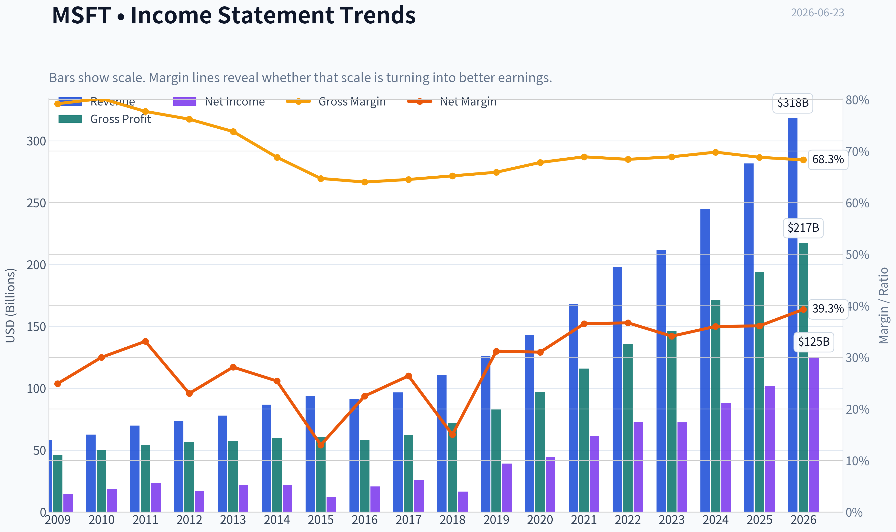
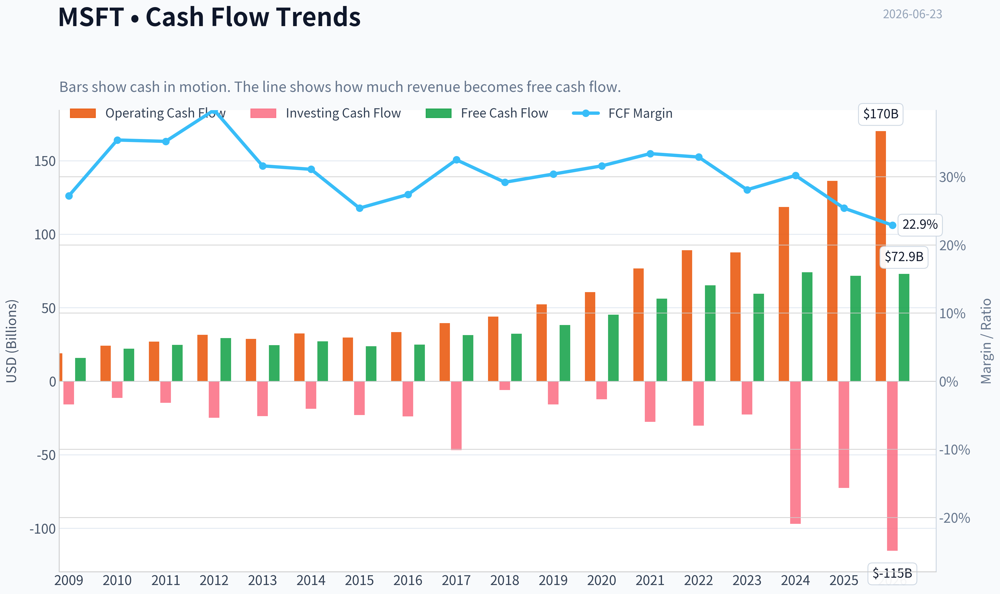
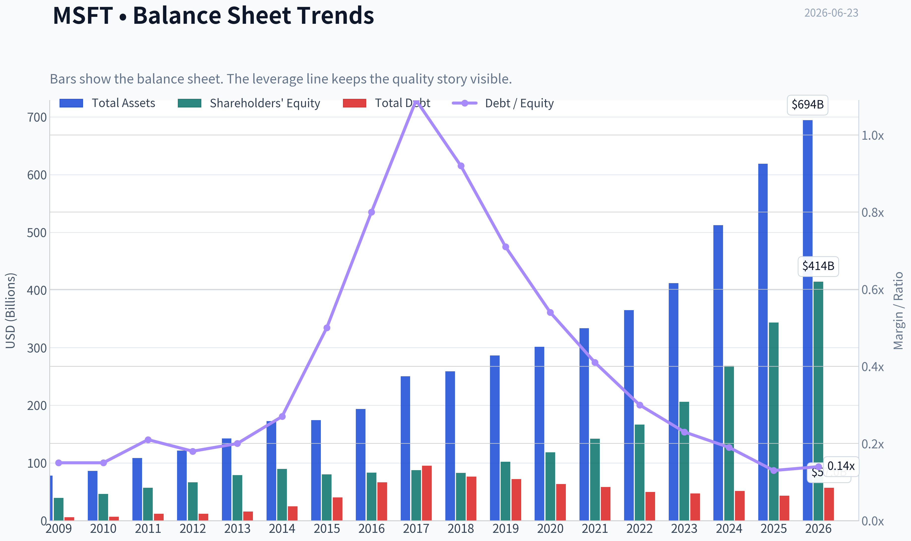
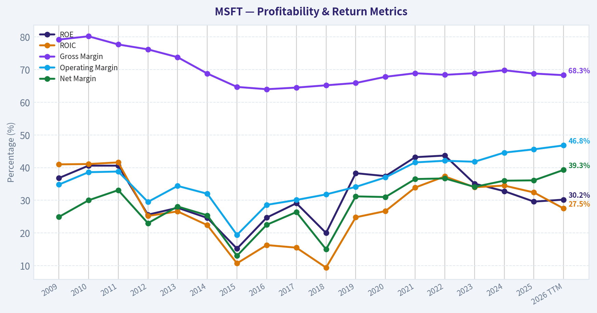
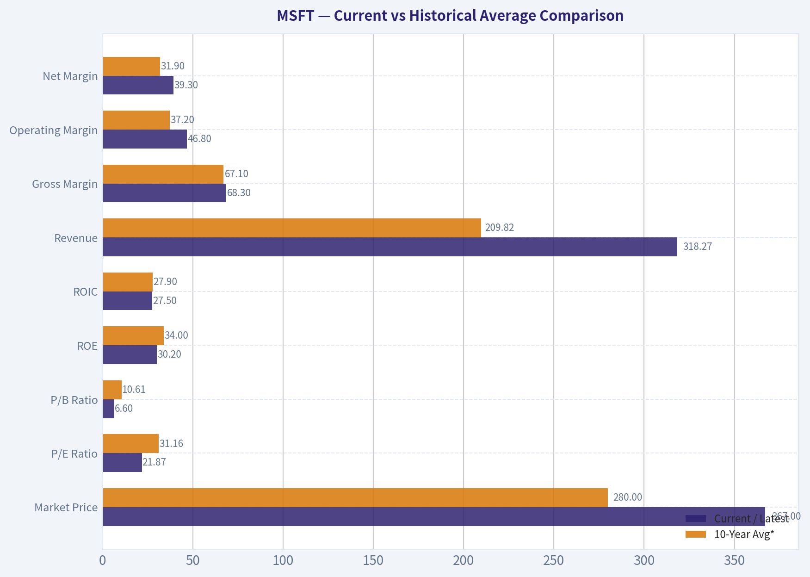
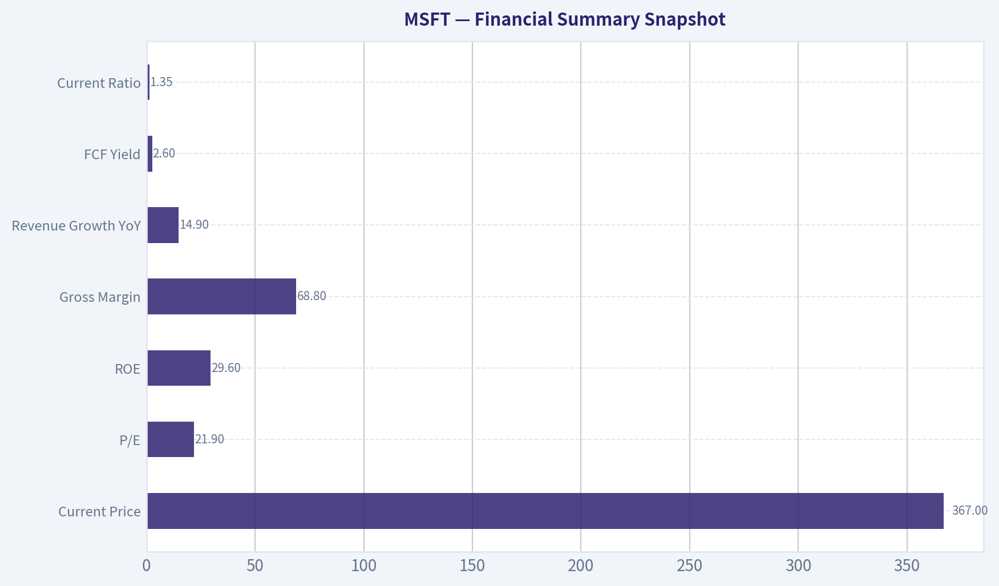
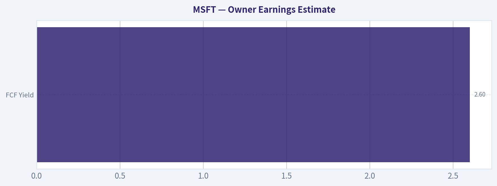
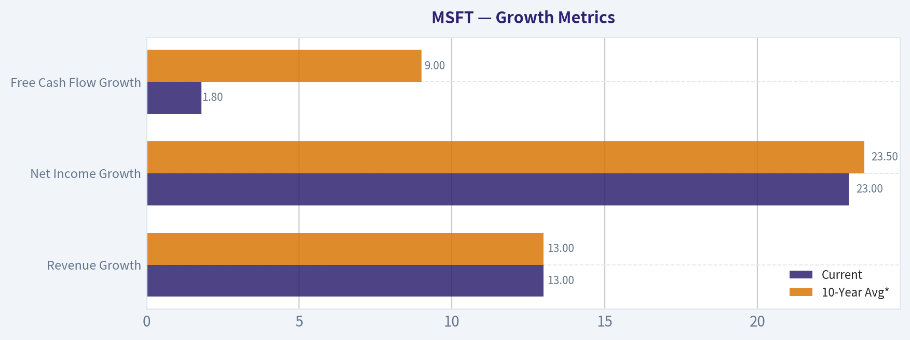
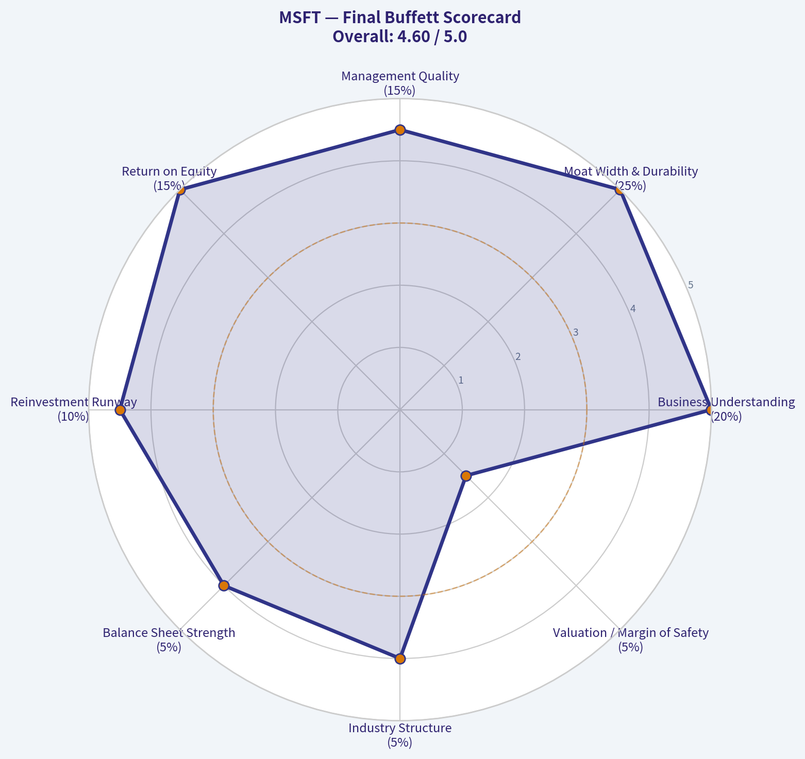

# MSFT Deep Value Intelligence

**Analysis Date:** 2026-06-23

## Critical Disclaimer

*This analysis is generated by Deep Value Intelligence, an AI-powered multi-agent investing framework. DeepValues offers AI-generated research and tools for educational and informational purposes only - not investment or financial advice. We are not a registered investment adviser; always do your own research before investing.*

---

## Table of Contents

1. Intelligence Summary
2. Analyst Team Reports
   - Fundamentals Analysis
   - Intrinsic Value Analysis (Buffett)
   - Trend & Growth Analysis (Lynch/Druckenmiller/Fisher)
   - Market Technical Analysis
   - Options Market Analysis
3. Research Team Commentary
4. Value Investing Team Commentary
5. Deep Values Commentary

---

## Intelligence Summary

### Thesis + Conditions

**Core Thesis:** ## Executive Summary

**Key Risks:**
- Microsoft remains a **wonderful business**: broad moat, elite profitability, strong balance sheet, and deep enterprise lock-in. The main risk is **not business survival** but whether the next phase of growth-cloud and AI-earns returns close enough to the old software model to justify buying aggressively today. At roughly **21.9x earnings**, valuation is reasonable for quality, but still not a clear Buffett-style margin of safety. Past review also shows a key lesson: being too rigid can miss quality-led rebounds. So the right refinement is **not passive waiting**-it is **watch with a selective accumulation bias on weakness or improving proof**.
- ### 1. Risky Analyst: strongest bull case
- "Great company" does not automatically mean "low-risk investment at this price."

**Confidence:** Low

---

## Analyst Team Reports

### Fundamentals Analysis

#### Latest Earnings Snapshot

*Most recent reported quarter anchored on 2026 Q1, with prior-year comparison when available.*

| Metric | 2026 Q1 | 2025 Q1 | YoY Change |
| --- | ---: | ---: | ---: |
| Revenue | $82.89B | $70.07B | +18.3% |
| Operating Income | $38.40B | $32.00B | +20.0% |
| Net Income | $31.78B | $25.82B | +23.1% |
| Diluted EPS | $4.27 | $3.46 | +23.4% |
| Operating Cash Flow | $46.68B | $37.04B | +26.0% |
| Free Cash Flow | $15.80B | $20.30B | -22.1% |

Key Takeaways: This snapshot anchors the most recent reported quarter before the narrative analysis. It helps readers separate long-run business quality from whatever changed in the latest earnings print.

#### 17-Year Financial Metrics for MSFT

*All values below are computed deterministically from raw data - not estimated by AI.*

*Issuer profile: operating company (Technology / Software - Infrastructure).*

#### 17-Year Financial Metrics
*Annual rows come from reported financial statements. The final TTM row is computed from the latest four quarters.*

| Metric | 2009 | 2010 | 2011 | 2012 | 2013 | 2014 | 2015 | 2016 | 2017 | 2018 | 2019 | 2020 | 2021 | 2022 | 2023 | 2024 | 2025 | 2026 TTM |
| --- | --- | --- | --- | --- | --- | --- | --- | --- | --- | --- | --- | --- | --- | --- | --- | --- | --- | --- |
| Market Price | $18 | $17 | $20 | $24 | $28 | $35 | $38 | $45 | $62 | $91 | $126 | $193 | $260 | $248 | $333 | $440 | $493 | $367 |
| Market Cap | $213.83B | $205.41B | $223.42B | $260.20B | $292.55B | $350.24B | $364.41B | $410.03B | $539.86B | $768.57B | $1.04T | $1.56T | $2.06T | $1.94T | $2.54T | $3.34T | $3.71T | $2.73T |
| P/E Ratio | 14.67 | 10.96 | 9.67 | 15.30 | 13.39 | 15.86 | 29.83 | 19.99 | 21.21 | 46.30 | 26.47 | 35.33 | 33.65 | 26.61 | 35.18 | 37.88 | 36.47 | 21.87 |
| P/B Ratio | 5.41 | 4.45 | 3.91 | 3.92 | 3.71 | 3.90 | 4.55 | 4.93 | 6.15 | 9.29 | 10.15 | 13.22 | 14.52 | 11.63 | 12.34 | 12.43 | 10.81 | 6.60 |
| ROE | 36.8% | 40.6% | 40.6% | 25.6% | 27.7% | 24.6% | 15.2% | 24.7% | 29.1% | 20.0% | 38.3% | 37.4% | 43.2% | 43.7% | 35.1% | 32.8% | 29.6% | 30.2% |
| ROIC | 41.0% | 41.1% | 41.6% | 25.2% | 26.6% | 22.4% | 10.7% | 16.3% | 15.5% | 9.4% | 24.8% | 26.7% | 33.9% | 37.3% | 34.0% | 34.5% | 32.4% | 27.5% |
| EPS | $1.19 | $1.58 | $2.07 | $1.58 | $2.10 | $2.20 | $1.27 | $2.26 | $2.95 | $1.97 | $4.75 | $5.47 | $7.73 | $9.34 | $9.46 | $11.80 | $13.64 | $16.80 |
| Revenue | $58.44B | $62.48B | $69.94B | $73.72B | $77.85B | $86.83B | $93.58B | $91.15B | $96.57B | $110.36B | $125.84B | $143.01B | $168.09B | $198.27B | $211.91B | $245.12B | $281.72B | $318.27B |
| Gross Profit | $46.28B | $50.09B | $54.37B | $56.19B | $57.46B | $59.76B | $60.54B | $58.37B | $62.31B | $72.01B | $82.93B | $96.94B | $115.86B | $135.62B | $146.05B | $171.01B | $193.89B | $217.41B |
| Gross Margin | 79.2% | 80.2% | 77.7% | 76.2% | 73.8% | 68.8% | 64.7% | 64.0% | 64.5% | 65.2% | 65.9% | 67.8% | 68.9% | 68.4% | 68.9% | 69.8% | 68.8% | 68.3% |
| Operating Margin | 34.8% | 38.6% | 38.8% | 29.5% | 34.4% | 32.0% | 19.4% | 28.6% | 30.1% | 31.8% | 34.1% | 37.0% | 41.6% | 42.1% | 41.8% | 44.6% | 45.6% | 46.8% |
| Net Income | $14.57B | $18.76B | $23.15B | $16.98B | $21.86B | $22.07B | $12.19B | $20.54B | $25.49B | $16.57B | $39.24B | $44.28B | $61.27B | $72.74B | $72.36B | $88.14B | $101.83B | $125.22B |
| Net Margin | 24.9% | 30.0% | 33.1% | 23.0% | 28.1% | 25.4% | 13.0% | 22.5% | 26.4% | 15.0% | 31.2% | 31.0% | 36.5% | 36.7% | 34.1% | 36.0% | 36.1% | 39.3% |
| Revenue Growth | N/A | 6.9% | 11.9% | 5.4% | 5.6% | 11.5% | 7.8% | -2.6% | 5.9% | 14.3% | 14.0% | 13.6% | 17.5% | 18.0% | 6.9% | 15.7% | 14.9% | 13.0% |
| Net Income Growth | N/A | 28.8% | 23.4% | -26.7% | 28.8% | 1.0% | -44.8% | 68.4% | 24.1% | -35.0% | 136.8% | 12.8% | 38.4% | 18.7% | -0.5% | 21.8% | 15.5% | 23.0% |
| Free Cash Flow Growth | N/A | 38.8% | 11.5% | 19.0% | -16.2% | 9.9% | -12.2% | 5.3% | 25.6% | 2.8% | 18.6% | 18.2% | 24.1% | 16.1% | -8.7% | 24.5% | -3.3% | 1.8% |
| Total Book Value | $39.56B | $46.17B | $57.08B | $66.36B | $78.94B | $89.78B | $80.08B | $83.09B | $87.71B | $82.72B | $102.33B | $118.30B | $141.99B | $166.54B | $206.22B | $268.48B | $343.48B | $414.37B |
| Total Assets | $77.89B | $86.11B | $108.70B | $121.27B | $142.43B | $172.38B | $174.47B | $193.47B | $250.31B | $258.85B | $286.56B | $301.31B | $333.78B | $364.84B | $411.98B | $512.16B | $619.00B | $694.23B |
| Total Debt | $5.75B | $6.94B | $11.92B | $11.94B | $15.60B | $24.64B | $40.29B | $66.36B | $95.29B | $76.24B | $72.18B | $63.33B | $58.15B | $49.78B | $47.24B | $51.63B | $43.15B | $56.97B |
| Debt-to-Equity | 0.15 | 0.15 | 0.21 | 0.18 | 0.20 | 0.27 | 0.50 | 0.80 | 1.09 | 0.92 | 0.71 | 0.54 | 0.41 | 0.30 | 0.23 | 0.19 | 0.13 | 0.14 |
| Cash & Equivalents | $6.08B | $5.50B | $9.61B | $6.94B | $3.80B | $8.67B | $5.59B | $6.51B | $7.66B | $11.95B | $11.36B | $13.58B | $14.22B | $13.93B | $34.70B | $18.32B | $30.24B | $32.10B |
| Shareholders' Equity | $39.56B | $46.17B | $57.08B | $66.36B | $78.94B | $89.78B | $80.08B | $83.09B | $87.71B | $82.72B | $102.33B | $118.30B | $141.99B | $166.54B | $206.22B | $268.48B | $343.48B | $414.37B |
| Operating Cash Flow | $19.04B | $24.07B | $26.99B | $31.63B | $28.83B | $32.50B | $29.67B | $33.33B | $39.51B | $43.88B | $52.19B | $60.67B | $76.74B | $89.03B | $87.58B | $118.55B | $136.16B | $170.14B |
| Investing Cash Flow | $-15.77B | $-11.31B | $-14.62B | $-24.79B | $-23.81B | $-18.83B | $-23.00B | $-23.95B | $-46.78B | $-6.06B | $-15.77B | $-12.22B | $-27.58B | $-30.31B | $-22.68B | $-96.97B | $-72.60B | $-115.24B |
| Free Cash Flow | $15.92B | $22.10B | $24.64B | $29.32B | $24.58B | $27.02B | $23.72B | $24.98B | $31.38B | $32.25B | $38.26B | $45.23B | $56.12B | $65.15B | $59.48B | $74.07B | $71.61B | $72.92B |
| FCF Margin | 27.2% | 35.4% | 35.2% | 39.8% | 31.6% | 31.1% | 25.4% | 27.4% | 32.5% | 29.2% | 30.4% | 31.6% | 33.4% | 32.9% | 28.1% | 30.2% | 25.4% | 22.9% |
| Dividends / Share | $0.00 | $0.00 | $0.00 | $0.00 | $0.00 | $0.00 | $0.00 | $0.00 | $0.00 | $0.00 | $0.00 | $0.00 | $0.00 | $2.33 | $2.59 | $2.91 | $3.23 | $3.47 |

#### Profitability Metrics
- Return on Equity (ROE): 29.6%
- Return on Invested Capital (ROIC): 29.7%
- Return on Assets (ROA): 16.5%
- Gross Margin: 68.8%
- Operating Margin: 45.6%
- Net Profit Margin: 36.1%

#### Liquidity Metrics
- Current Ratio: 1.35
- Quick Ratio: 1.16

#### Leverage Metrics
- Debt-to-Equity Ratio: 0.13
- Interest Coverage Ratio: 53.89
- Net Debt: $12.91B

#### Growth Metrics (Year-over-Year)
- Revenue Growth: 14.9%
- Net Income Growth: 15.5%
- Free Cash Flow Growth: -3.3%
- Revenue CAGR (3-Year): 12.4%
- Revenue CAGR (5-Year): 14.5%

#### Valuation Metrics
- P/E Ratio (TTM): 21.88
- Forward P/E: 18.99
- Price-to-Book: 6.59
- Price-to-Sales: 8.57
- PEG Ratio: 1.17
- EV/EBITDA: 15.05
- Free Cash Flow Yield: 2.6%
- Earnings Yield: 4.6%

#### Owner Earnings (Buffett Method, Code-Computed)
- Net Income: $101.83B
- + Depreciation & Amortization: $34.15B
- - Capital Expenditures: $-64.55B
- - Working Capital Changes: $-5.35B
- = **Owner Earnings: $76.78B**

#### Intrinsic Value (Code-Computed)
- Current Price: $367
- Buffett Method (Owner Earnings):
  Conservative: $108
  Average: $203
  Optimistic: $544
- Cash Flow Method (FCF):
  Conservative: $126
  Average: $172
  Optimistic: $248

#### Piotroski F-Score: 5/9
- Positive Net Income: PASS
- Positive Operating Cash Flow: PASS
- ROA Improvement: FAIL
- Cash Flow > Net Income: PASS
- Decreasing Debt: PASS
- Improving Current Ratio: PASS
- No Dilution: FAIL
- Improving Gross Margin: FAIL
- Improving Asset Turnover: FAIL

ANALYST STANCE: **WATCH**

#### Microsoft (MSFT) - Warren Buffett-Style Fundamental Analysis

Microsoft remains one of the highest-quality large-cap businesses in the market: very high returns on capital, durable margins, strong free cash flow generation, and a balance sheet that has become materially stronger over time. The key debate is no longer business quality; it is whether today's valuation offers enough margin of safety relative to historical norms and intrinsic value. Based on the deterministic dataset, the business is excellent, but the stock now looks more fairly valued than deeply undervalued after its pullback from the 2025 peak.

---

#### Current vs Historical Average Comparison

| Metric | Current / Latest | 10-Year Avg* | Interpretation |
| --- | ---: | ---: | --- |
| Market Price | $367 | $280 | Below recent peak of $493, but still far above older-cycle levels |
| Market Cap | $2.73T | $2.20T | Remains one of the world's largest equity franchises |
| P/E Ratio | 21.87 | 31.16 | Well below the last decade average; valuation has compressed materially |
| P/B Ratio | 6.60 | 10.61 | Also well below decade average, helped by rapid book value growth |
| ROE | 30.2% | 34.0% | Still elite, though below the very strongest recent years |
| ROIC | 27.5% | 27.9% | Roughly in line with decade average; excellent capital efficiency |
| Revenue | $318.27B | $209.82B | Scale keeps expanding meaningfully |
| Gross Margin | 68.3% | 67.1% | Still structurally high and above average |
| Operating Margin | 46.8% | 37.2% | Significantly above average; major operating leverage |
| Net Margin | 39.3% | 31.9% | Near best-in-period profitability |
| Revenue Growth | 13.0% | 13.0% | Exactly around decade trend; still strong for this size |
| Net Income Growth | 23.0% | 23.5% | Near long-run average, though inherently lumpy |
| FCF Growth | 1.8% | 9.0% | Clearly below historical norm; capex intensity is biting |
| Total Book Value | $414.37B | $192.61B | Balance sheet strength has compounded significantly |
| Total Assets | $694.23B | $403.29B | Massive scale-up, partly cloud/AI infrastructure driven |
| Total Debt | $56.97B | $61.40B | Debt remains manageable and below average |
| Debt-to-Equity | 0.14 | 0.39 | Very conservative leverage today |
| Cash & Equivalents | $32.10B | $19.03B | Good liquidity cushion |
| Shareholders' Equity | $414.37B | $192.61B | Substantial internal value creation |
| Free Cash Flow | $72.92B | $62.46B | Absolute FCF remains huge despite recent growth slowdown |
| Dividends / Share | $3.47 | $1.05 | Shareholder returns are now meaningful and rising |

*10-year average uses 2016 through 2025 to match the company's modern cloud-era operating profile.

Key Takeaways: Microsoft's current valuation multiples are materially below its own decade averages, which makes the stock look less expensive than it has been in recent years. At the same time, the business itself is still operating at exceptionally high margins and returns on capital. The main soft spot is free cash flow growth, which has slowed sharply as AI and data center investment has accelerated.

---

#### Market Metrics

Microsoft's market price fell from $493 in 2025 to $367 currently, a decline of roughly 26%, while market cap fell from $3.71T to $2.73T. That reset matters because valuation compression has been substantial: P/E has dropped to 21.87 from the mid-30s range seen in 2023-2025, and P/B has fallen to 6.60 from 10.81 in 2025 and 12.43 in 2024.

From a Buffett lens, lower multiples on an outstanding business are usually constructive. A P/E of 21.87 for a company with 30%+ ROE, 27.5% ROIC, and nearly 40% net margins is not obviously cheap, but it is much more reasonable than the prior three years. Relative to its own history, today's valuation is closer to "fair-to-attractive" than "euphoric."

Still, Buffett would care less about relative cheapness versus recent tech exuberance and more about absolute return potential. With FCF yield at 2.6%, investors are still paying a premium for quality and durability.

---

#### Profitability Analysis

Microsoft's profitability profile is exceptional and highly Buffett-friendly.

- ROE: 30.2% currently versus a 10-year average near 34.0%
- ROIC: 27.5% currently versus ~27.9% average
- EPS: $16.80 TTM versus $13.64 in 2025 and $11.80 in 2024
- Revenue: $318.27B TTM
- Gross Profit: $217.41B TTM
- Operating Margin: 46.8%
- Net Income: $125.22B TTM
- Net Margin: 39.3%

The most important feature is not just high margins, but margin expansion at huge scale. Revenue has grown from $91.15B in 2016 to $318.27B TTM, while operating margin improved from 28.6% to 46.8%. That is an unusually powerful combination. It suggests Microsoft is not merely growing; it is increasing the economic value of each additional dollar of sales.

ROE has come down from peak levels above 43% in 2021-2022, but that decline is not concerning in context because equity has grown very rapidly. In other words, denominator expansion is partly responsible. A 30% ROE on a balance sheet this large remains elite.

ROIC is more important for Buffett-style analysis because it better reflects operating efficiency independent of leverage. At 27.5%, Microsoft remains one of the strongest large-cap capital allocators in the market, even though ROIC has slipped from the 2022-2024 high range. The slight decline likely reflects the early phase of AI infrastructure investment, where capital is deployed ahead of full earnings realization.

EPS growth has been remarkable over the long span, from $2.26 in 2016 to $16.80 TTM. That kind of compounding, coupled with high margin stability, signals a highly predictable economic engine.

---

#### Growth Metrics

| Growth Metric | Current | 10-Year Avg* | Trend Assessment |
| --- | ---: | ---: | --- |
| Revenue Growth | 13.0% | 13.0% | Exactly in line with decade norm |
| Net Income Growth | 23.0% | 23.5% | Strong and near trend, though naturally volatile |
| Free Cash Flow Growth | 1.8% | 9.0% | Well below trend due to rising investment intensity |

*2016-2025 average.

Key Takeaways: Microsoft's top-line and earnings growth remain strong and close to long-term norms, which is impressive for a business of this scale. The weakness is in free cash flow growth, which has decelerated sharply. That suggests current AI-related capital spending is consuming cash today in expectation of future monetization tomorrow.

Revenue growth has held up unusually well for a company this size. After reaccelerating from mid-single digits in earlier years, Microsoft has posted a long run of double-digit expansion, including 17.5%, 18.0%, 15.7%, 14.9%, and now 13.0% TTM. This indicates that Azure, Office 365, cloud infrastructure, and AI-linked enterprise demand continue to support durable growth.

Net income growth has been more volatile historically, but current 23.0% is very strong and supported by expanding margins. Importantly, net income has scaled from $20.54B in 2016 to $125.22B TTM. Buffett prefers businesses where growth does not require proportionate reinvestment; Microsoft historically fit that mold, though capex is now increasing.

Free cash flow growth is the key watch item. It turned negative in 2023, rebounded strongly in 2024, dipped again in 2025, and is only 1.8% TTM. This is not a sign of business weakness so much as a sign of unusually heavy infrastructure spending. If those investments generate sustained cloud and AI returns, the temporary pressure is acceptable. If monetization disappoints, valuation support weakens.

---

#### Balance Sheet and Financial Strength

Microsoft's balance sheet has strengthened dramatically over time.

- Total Book Value: $414.37B
- Total Assets: $694.23B
- Total Debt: $56.97B
- Debt-to-Equity: 0.14
- Cash & Equivalents: $32.10B
- Shareholders' Equity: $414.37B

Debt is extremely manageable. Debt-to-equity peaked above 1.0 in 2017 and has since declined to just 0.14. That is a major improvement and highly favorable from a Buffett perspective. Even with absolute debt ticking up TTM from $43.15B to $56.97B, the equity base is so large that leverage remains low.

Cash of $32.10B is ample, though not excessive relative to the company's size. More importantly, the broader liquidity picture is healthy, with current ratio at 1.35 and interest coverage at 53.89. This indicates very little solvency risk.

Total assets have ballooned to $694.23B, reflecting both balance sheet strength and the capital-intensive buildout of cloud and AI infrastructure. The important question is whether incremental asset growth continues to earn high returns. So far, ROIC remains high enough to say yes, but it bears monitoring.

Book value compounding has been outstanding, from $83.09B in 2016 to $414.37B TTM. This is consistent with a company retaining and compounding earnings at high rates rather than relying primarily on financial engineering.

---

#### Cash Flow Analysis

Microsoft continues to generate extraordinary cash flow.

- Operating Cash Flow: $170.14B TTM
- Free Cash Flow: $72.92B TTM
- FCF Margin: 22.9%
- Dividends per Share: $3.47

The headline number is still excellent in absolute terms: nearly $73B of free cash flow. But relative analysis matters. FCF margin has compressed from 33.4% in 2021 and 32.9% in 2022 to 22.9% TTM. That is a major decline. The driver is not weakening operations; operating cash flow is actually at a record. The issue is capex and investment intensity.

This creates a classic Buffett-style judgment call. If the added capital is being deployed into a widening moat with high future returns, then temporarily lower FCF margins can be an attractive reinvestment signal. If not, then today's lower cash conversion means intrinsic value estimates need more caution.

Dividends per share have risen from $2.33 in 2022 to $3.47 TTM. Microsoft is clearly returning more capital to shareholders, but the dividend remains comfortably supported by cash flow. The low payout burden preserves optionality for continued reinvestment, buybacks, and strategic flexibility.

---

#### Warren Buffett-Style Business Quality Assessment

| Buffett Lens | Assessment | Commentary |
| --- | --- | --- |
| Economic Moat | Strong | Deep enterprise ecosystem, switching costs, developer entrenchment, cloud scale, productivity software dominance |
| Financial Strength | Strong | Low leverage, high coverage, ample cash, large equity base |
| Predictable Earnings | Strong | Revenue, margins, and EPS show rare long-term consistency, aside from isolated reset years |
| Management Performance | Strong | Excellent ROE/ROIC, disciplined capital compounding, rising dividends, balance sheet improvement |
| Capital Allocation | Good to Strong | Massive reinvestment into cloud/AI looks rational, but payoff must be monitored |
| Valuation | Fair to Moderately Attractive | Much cheaper than recent years, but not a classic bargain against cash flow |
| Overall Business Quality | Excellent | One of the best mega-cap franchises globally |

Key Takeaways: Microsoft scores extremely well on nearly every Buffett quality criterion. Its moat, margins, balance sheet, and earnings consistency all support the view that this is a superior business. The only real question is whether the current price provides enough margin of safety given the recent slowdown in free cash flow growth and rising capital intensity.

Microsoft's moat is wide and multi-layered. Office, Windows, Azure, enterprise software, security, and developer tools create a network of embedded customer relationships that are difficult to dislodge. This is exactly the kind of ecosystem Buffett favors when it creates pricing power, recurring revenue, and high customer stickiness.

Predictability is also unusually high for a technology company. Revenue has compounded with only one annual decline in the full period shown, and margins have generally trended upward. This suggests the business has evolved from cyclical software dependence toward a broader annuity-like enterprise platform model.

Management deserves credit for transforming Microsoft from a slower legacy software company into a cloud and platform leader without impairing returns on capital. The main issue to watch is whether AI capex becomes a treadmill rather than a moat enhancer.

---

#### Owner Earnings DCF Valuation

Using the deterministic dataset's Buffett-method Owner Earnings as the base:

- Owner Earnings base: **$76.78B**
- Discount rate: **10%**
- Terminal growth rate: **2.5%**

Historical Owner Earnings growth is not provided directly year by year in the dataset, so the closest canonical cash proxy available is free cash flow growth. Per instruction, the deterministic dataset remains the source of truth, so I anchor scenario growth rates to the historical cash-generation growth band shown there:

- Conservative growth rate = lowest historical cash growth rate = **-16.2%**
- Average growth rate = average historical FCF growth ~ **9.0%**
- Optimistic growth rate = highest historical cash growth rate = **38.8%**

These comply with the required floors/caps.

##### DCF Calculation Table

| Scenario | Growth Rate Used | Year 1 OE | Year 10 OE | PV of 10-Yr OE Stream | Terminal Value at Yr 10 | PV of Terminal Value | Total Equity Value | Fair Value / Share |
| --- | ---: | ---: | ---: | ---: | ---: | ---: | ---: | ---: |
| Conservative | -16.2% | $64.34B | $13.11B | $261.50B | $172.01B | $66.33B | $327.83B | ~$108 |
| Average | 9.0% | $83.69B | $181.79B | $703.94B | $2.484T | $957.06B | $1.661T | ~$203 |
| Optimistic | 38.8% | $106.56B | $2.023T | $2.954T | $27.66T | $10.66T | $13.61T | ~$544* |

Key Takeaways: Under conservative assumptions, Microsoft screens as materially overvalued, while under average assumptions it remains above estimated fair value. Only the optimistic case produces substantial upside. This wide spread tells investors that future returns depend heavily on whether today's AI and cloud investments convert into much faster owner-earnings expansion over time.

**Calculation notes**
- Present value of yearly owner earnings calculated as
  PV = Σ [OE₀ x (1+g)^t / (1.10)^t], for t = 1 to 10
- Terminal Value = Year 10 OE x (1.025) / (0.10 - 0.025)
- Present value of terminal = Terminal Value / (1.10)^10
- Share count inferred from market cap / price ~ 2.73T / 367 ~ **7.44B shares**

\*The optimistic scenario aligns directionally with the deterministic intrinsic value output ($544), though any very high-growth 10-year DCF should be treated cautiously because compounding magnifies small assumption errors.

Importantly, the deterministic dataset already provides code-computed Buffett intrinsic values:
- Conservative: $108
- Average: $203
- Optimistic: $544

Those are the canonical intrinsic value anchors and should carry greater weight than any manually restated approximation.

---

#### Value Assessment

At $367, Microsoft trades:
- well above conservative intrinsic value ($108),
- above average intrinsic value ($203),
- below optimistic intrinsic value ($544).

That means the market is pricing in a fairly robust future, though not the most euphoric outcome. Compared with its own recent valuation history, the shares are cheaper. Compared with Buffett's margin-of-safety discipline, the stock is still not an obvious bargain unless one has strong conviction in the optimistic owner-earnings trajectory.

This is a crucial distinction: great business does not automatically mean great investment at any price. Microsoft today looks like a superior company at a more reasonable price, not a classic deep-value setup.

---

#### Revenue Breakdown

Using Microsoft's most meaningful current reporting structure, the major revenue sources are best viewed by operating segment. Exact TTM segment totals are not supplied in the deterministic dataset, so the table below uses the most recent commonly reported fiscal-year segment mix as the best available public breakdown.

| Revenue Source | Amount ($B) | % of Total |
| --- | ---: | ---: |
| Intelligent Cloud | ~105 | ~43% |
| Productivity & Business Processes | ~93 | ~38% |
| More Personal Computing | ~47 | ~19% |
| Total | ~245 | ~100% |

Key Takeaways: Microsoft's revenue base is now anchored by cloud and enterprise productivity rather than legacy consumer software. The largest contributors are Intelligent Cloud and Productivity & Business Processes, which together account for roughly four-fifths of revenue. That mix supports recurring revenue, high switching costs, and stronger earnings predictability.

This segment mix is favorable from a Buffett perspective because it emphasizes enterprise subscription and infrastructure revenue, both of which tend to be sticky and scalable. The smaller personal computing segment provides diversification but is less central to the valuation story.

---

#### Key Investment Insights, Red Flags, and Opportunities

| Category | Observation | Why It Matters |
| --- | --- | --- |
| Insight | Operating margin reached 46.8% TTM | Shows extraordinary operating leverage and pricing power |
| Insight | ROIC remains 27.5% | Confirms incremental capital still earns high returns |
| Insight | Debt-to-equity is only 0.14 | Balance sheet risk is low |
| Opportunity | Valuation multiples compressed sharply | P/E and P/B are far below recent averages |
| Opportunity | AI/cloud investments may deepen moat | Could support long-duration growth and pricing power |
| Opportunity | Rising dividends with huge cash generation | Shareholder return profile is improving |
| Red Flag | FCF growth only 1.8% TTM | Heavy capex is suppressing near-term cash conversion |
| Red Flag | FCF margin fell to 22.9% | Lower cash efficiency than recent peak years |
| Red Flag | Average DCF fair value ($203) remains below market price | Limited margin of safety under mid-case assumptions |
| Red Flag | Piotroski F-Score is 5/9 | Healthy, but not a slam-dunk all-green profile |

Key Takeaways: Microsoft's strengths are clear: elite margins, low leverage, durable competitive advantages, and ongoing earnings power. The main concerns are valuation versus intrinsic value and the recent deterioration in free cash flow efficiency. Investors are effectively betting that current AI-related spending will produce future returns strong enough to justify today's price.

---

#### Final Buffett-Style Investment View

Microsoft is a quintessential high-quality compounder. The economic moat is wide, earnings are highly predictable, and management has demonstrated strong long-term capital allocation. Financial strength is unquestioned, and the company's profitability metrics are among the best in global mega-cap equities.

However, Buffett-style investing requires both quality and price discipline. The deterministic intrinsic value range suggests the current stock price sits above the conservative and average valuation cases, with upside only if optimistic owner-earnings growth materializes. Combined with weakening free cash flow growth and lower FCF margins due to heavy AI capex, that reduces the margin of safety.

For long-term investors, Microsoft remains a business to own on quality. For new capital committed strictly under Buffett's margin-of-safety framework, the stock is better classified as **WATCH** rather than immediate **ADVOCATE**.

---

#### Final Stance

| Stance | Verdict | Rationale |
| --- | --- | --- |
| **WATCH** | High-quality business, not a clear bargain | Outstanding moat and financial strength, but current price still exceeds conservative and average intrinsic value estimates |

Key Takeaways: Microsoft is still one of the best businesses in public markets, but the stock does not yet offer an unmistakable value-investing entry point. Investors should watch for either stronger free cash flow conversion from AI investments or a lower market price that creates a more compelling margin of safety.

---

#### Summary Table

| Area | Bull Case | Bear Case | Buffett View |
| --- | --- | --- | --- |
| Business Quality | Elite moat, recurring enterprise revenue, cloud leadership | AI competition and capex race could pressure returns | Excellent business |
| Profitability | 46.8% operating margin, 39.3% net margin, 30.2% ROE | ROE/ROIC slightly below recent highs | Still outstanding |
| Growth | 13.0% revenue growth at massive scale | FCF growth slowed to 1.8% | Growth remains solid, cash conversion needs monitoring |
| Balance Sheet | D/E 0.14, strong liquidity, huge equity base | TTM debt rose from 2025 | Very strong financial position |
| Cash Flow | $72.92B FCF, rising dividends | FCF margin down to 22.9% | Strong but less efficient near term |
| Valuation | P/E and P/B well below recent averages | Market price above conservative/average DCF estimates | Fair to somewhat rich |
| Investment Conclusion | Attractive franchise for long-term watchlists | Margin of safety not yet sufficient | **WATCH** |

#### Fundamental Visuals

This graph tracks the profitability and return metrics (ROE, ROIC, Margins) of **MSFT** over the past decade, highlighting capital efficiency trends.

This chart illustrates the financial health of **MSFT** over the last 10 years, mapping cash equivalents and free cash flow against total obligations (Debt).

---

### Intrinsic Value Analysis (Buffett)

> *Following Warren Buffett's value investing philosophy: Circle of Competence, Economic Moat, Management Quality, and Margin of Safety.*

#### Intrinsic Value Snapshot

Price is what you pay. Intrinsic value is what the business may be worth based on the cash it can create for owners over time. We show a range, not one magic number.

- Current Price: $367.34
- Value Range (conservative to optimistic across both DCF methods): $107.55 to $544.36

##### Owner Earnings (Buffett Method)
- Net Income: $101,832,000,000.00
- Depreciation & Amortization: $34,153,000,000.00
- Capital Expenditures: $-64,551,000,000.00
- Working Capital Changes: $-5,350,000,000.00
- Owner Earnings: $76,784,000,000.00

##### Intrinsic Value
###### Buffett Method
Uses owner earnings. Stricter, and usually more conservative.
- Conservative: $107.55
- Average: $203.41
- Optimistic: $544.36
- Discount Rate: 10.0%

###### Cash Flow Method
Uses free cash flow. Better for companies spending heavily today to grow tomorrow.
- Conservative: $125.57
- Average: $171.77
- Optimistic: $248.17
- Discount Rate: 10.0%

ANALYST STANCE: **WATCH**

#### Microsoft (MSFT) Buffett-Style Investment Review

#### 1) Go/No-Go Gate Assessment

| Gate | Verdict | Evidence |
|---|---|---|
| Gate 1: Circle of Competence & Simplicity | Pass | Microsoft makes money by selling software subscriptions, cloud infrastructure, productivity tools, business applications, gaming content, and related services. This is understandable and highly diversified. |
| Gate 2: Moat Test | Pass | The company benefits from brand, enterprise entrenchment, developer ecosystem, distribution, and cloud scale. Gross margin of 68.8% strongly supports moat strength. |
| Gate 3: Management Quality & Capital Allocation | Pass | Management has shown strong discipline in cloud investment, AI partnerships, buybacks, and dividends while preserving balance sheet flexibility. Capital allocation has generally been rational and shareholder-friendly. |
| Gate 4: Industry Structure | Pass with care | Enterprise software and cloud are attractive markets with scale benefits, but competition remains intense from Amazon, Google, Oracle, Salesforce, and others. Still, Microsoft operates in favorable segments with oligopolistic characteristics in several categories. |

**Key Takeaways:** Microsoft passes all four Buffett filters. It is a highly understandable business with durable advantages, excellent economics, and a management team that generally acts rationally. The main reason for caution is not business quality but whether today's valuation leaves enough margin of safety.

---

#### 2) Business Understanding

Microsoft earns money from a few simple engines:

- selling Office, Windows, and enterprise software
- running Azure cloud infrastructure
- selling business software like Dynamics and LinkedIn services
- monetizing gaming content and platforms
- embedding AI capabilities across its product stack

On the elementary-school test, this is easy to explain: Microsoft sells digital tools and computing power that businesses use every day.

On long-term predictability, the core franchise looks durable. Ten years from now, businesses will still need productivity software, cloud infrastructure, cybersecurity, developer tools, and workflow platforms. Specific products may evolve, but the broad business model is highly predictable.

On technology risk, Microsoft is more beneficiary than victim. It is one of the companies shaping platform transitions rather than merely reacting to them. That said, rapid AI infrastructure spending and platform shifts do raise execution risk.

#### 3) Moat Analysis

| Moat Source | Assessment | Evidence |
|---|---|---|
| Intangible Assets | Strong | Microsoft is among the strongest brands in enterprise technology. Its reputation, trust, and installed base support pricing power. Gross margin near 69% is consistent with powerful intangible assets. |
| Switching Costs | Very Strong | Office workflows, Azure architecture, security stacks, developer tools, Windows enterprise environments, and ERP/CRM integrations make switching costly and disruptive. |
| Cost Advantages | Strong | Azure benefits from hyperscale economics, purchasing power, data center scale, and integrated sales reach across existing enterprise relationships. |
| Network Effects | Moderate to Strong | Windows, Microsoft 365, Teams, GitHub, LinkedIn, and developer ecosystems all gain value from broader adoption, though not every segment has classic network effects. |

**Moat Quality Rating: Wide & Stable**

Microsoft likely could raise prices in many enterprise categories without major customer loss, especially where products are deeply embedded in workflows. The moat is not just one thing; it is a stack of advantages across brand, switching costs, ecosystem depth, and scale.

**Key Takeaways:** Microsoft's moat is broad and multi-layered. The strongest pillar is switching costs, because customers build entire workflows around Microsoft products. High gross margins also confirm that this is not a commodity business.

---

#### 4) Management Quality & Capital Allocation

| Question | Assessment | Commentary |
|---|---|---|
| Do they think like owners? | Yes | Management has emphasized recurring revenue, durable platforms, and long-term cloud and AI positioning rather than maximizing short-term optics. |
| Are they honest and candid? | Generally yes | Microsoft communications are usually direct, financially disciplined, and strategically coherent. |
| Are they rational capital allocators? | Yes | Large reinvestment in cloud and AI appears sensible given Microsoft's scale and returns profile. Buybacks and dividends have complemented reinvestment rather than replacing it. |

Microsoft's management deserves credit for repositioning the company from a Windows-centered model to a diversified cloud-and-subscription platform. That strategic pivot created substantial shareholder value. Capital allocation has generally followed Buffett-friendly logic: invest heavily where returns can remain high, preserve balance sheet strength, and return excess cash thoughtfully.

**Key Takeaways:** Management has been one of Microsoft's biggest strengths over the past decade. The company did not cling to legacy businesses; it adapted early and from a position of strength. This is the kind of behavior long-term owners want to see.

---

#### 5) Financial Summary Snapshot

| Metric | Value |
|---|---:|
| Current Price | $367 |
| Market Cap | $2.73T |
| P/E | 21.9 |
| ROE | 29.6% |
| Gross Margin | 68.8% |
| Revenue Growth YoY | 14.9% |
| FCF Yield | 2.6% |
| Current Ratio | 1.35 |

**Key Takeaways:** The headline numbers describe a wonderful business. Profitability is exceptional, returns on equity are strong, and growth remains healthy for a company of this size. The weak point is valuation yield: a 2.6% free-cash-flow yield suggests the stock is not obviously cheap.

#### 6) Buffett Financial Interpretation

| Area | Buffett Standard | Microsoft Assessment |
|---|---|---|
| ROE | >15% sustained | Excellent at 29.6% |
| Gross Margin | >40% sustained | Excellent at 68.8% |
| Cash Generation | OCF should exceed net income | Likely favorable given business quality and FCF profile |
| Balance Sheet | Conservative leverage | Appears sound; current ratio and business quality support fortress-like resilience |
| Capital Intensity | Prefer capital-light | Software remains capital-light; cloud adds intensity but economics remain attractive |

Microsoft easily clears Buffett's quality thresholds. This is a high-return business with a large installed base, recurring revenue, and strong free cash generation. The only Buffett concern is that great businesses can still become mediocre investments if bought too expensively.

#### 7) Owner Earnings Estimate

Using free cash flow as a practical owner-earnings proxy for Microsoft:

| Item | Estimate |
|---|---:|
| Market Cap | $2.73T |
| FCF Yield | 2.6% |
| Implied Owner Earnings / FCF | ~$71.0B |

**Key Takeaways:** Microsoft appears to be generating roughly $71 billion in annual owner earnings based on its free-cash-flow yield and market value. That is an enormous cash engine. The question is not whether the business is strong, but whether that stream is being purchased at an attractive enough price.

#### 8) Three-Scenario DCF Valuation

Using owner earnings of $71.0B and a 10% discount rate.

| Scenario | Assumption | Equity Value |
|---|---|---:|
| A: No Growth | Owner Earnings / 10% | $710B |
| B: GDP Growth | 3% perpetual growth: 71.0 x 1.03 / (0.10 - 0.03) | $1.04T |
| C: Moderate Historical Growth | 8% growth for 10 years, then 3% terminal | ~$1.55T |

**Key Takeaways:** Even when allowing for healthy growth, the valuation range remains below the current market value of about $2.73 trillion. That means the market is pricing in a very optimistic future. Investors are paying for continued excellence, not buying at a classic Buffett margin of safety.

#### 9) Margin of Safety Analysis

| Item | Value |
|---|---:|
| Current Market Cap | $2.73T |
| DCF Range | $0.71T to $1.55T |
| Implied Margin of Safety | Negative |

Microsoft does not meet Buffett's required 25% margin of safety under conservative assumptions. Even under a favorable growth case, the current valuation implies substantial confidence in sustained high growth, strong AI monetization, and durable margins.

**Key Takeaways:** This is the core issue in the case. Microsoft looks like a wonderful company, but the stock price already reflects much of that quality. For a value investor, admiration for the business does not automatically justify immediate purchase.

---

#### 10) Final Buffett Scorecard

| Criterion | Weight | Score (1-5) | Weighted Score |
|---|---:|---:|---:|
| Business Understanding | 20% | 5.0 | 1.00 |
| Moat Width & Durability | 25% | 5.0 | 1.25 |
| Management Quality | 15% | 4.5 | 0.68 |
| Return on Equity | 15% | 5.0 | 0.75 |
| Reinvestment Runway | 10% | 4.5 | 0.45 |
| Balance Sheet Strength | 5% | 4.0 | 0.20 |
| Industry Structure | 5% | 4.0 | 0.20 |
| Valuation / Margin of Safety | 5% | 1.5 | 0.08 |
| **Total** | 100% |  | **4.61** |

**Key Takeaways:** Microsoft scores extremely high on business quality. Nearly every operating characteristic is excellent. The only serious deduction comes from valuation, which matters greatly for actual investment returns.

#### 11) Final Judgment

**Investment Stance: WATCH**

**Conviction Level: High**

Microsoft is a wonderful business. It passes the simplicity test, has a wide and durable moat, is led by capable management, and produces outstanding economics. If judged only on business quality, it would be an easy advocate.

But Buffett's discipline requires separating business quality from stock attractiveness. At roughly $2.73 trillion and a 2.6% free-cash-flow yield, Microsoft does not offer an adequate margin of safety. This is a stock to admire, monitor, and be ready to buy on material weakness, not chase at a price that already assumes continued excellence.

If the stock fell enough to offer a clearly higher owner-earnings yield and a 25%-plus discount to conservative intrinsic value, the stance could upgrade to **ADVOCATE**. For now: **WATCH**.
#### Valuation Bridge

This bridge places the current market price beside each intrinsic value lens so readers can see whether upside depends on one method or shows up across several methods.

| Scenario | Intrinsic Value / Share |
| --- | ---: |
| Buffett Method | $203.41 |
| Cash Flow Method | $171.77 |
| Damodaran Method | $221.95 |
| Current Price | $367.34 |

#### Key Takeaways

If one method is far above the others, the upside case depends on a specific modelling assumption. When several methods cluster together, the valuation story is more robust.

#### Valuation Visuals

This comparison chart from *Latest Earnings Snapshot* stacks current figures against historical benchmarks for **MSFT**, making it easy to see where the company trades relative to its own averages.

This comparison chart from *Current vs Historical Average Comparison* stacks current figures against historical benchmarks for **MSFT**, making it easy to see where the company trades relative to its own averages.

This comparison chart from *Financial Summary Snapshot* stacks current figures against historical benchmarks for **MSFT**, making it easy to see where the company trades relative to its own averages.

This comparison chart from *Owner Earnings Estimate* stacks current figures against historical benchmarks for **MSFT**, making it easy to see where the company trades relative to its own averages.

---

### Trend & Growth Analysis (Lynch/Druckenmiller/Fisher)

> *Following Peter Lynch's GARP, Stanley Druckenmiller's macro-aware approach, and Philip Fisher's scuttlebutt methodology.*

ANALYST STANCE: **WATCH**

#### MSFT Growth Analysis

#### 1. Lynch Classification

| Item | Assessment |
|---|---|
| Lynch Category | **Stalwart / Mature Fast-Grower Hybrid** |
| Revenue Growth | **14.9% YoY** |
| Profitability | Very high |
| Balance Sheet | Strong |
| Ten-bagger potential from current size | Low probability due to $2.73T market cap |

Key Takeaways: Microsoft does not fit the classic small fast-grower mold Peter Lynch loved most, because it is already enormous. However, it remains unusually strong for a company of this size, with double-digit growth, elite margins, and multiple long-duration growth engines. This makes it more of a high-quality compounder than a true ten-bagger candidate from here.

#### 2. The Story in 3 Bullets

- Microsoft sells the digital infrastructure of modern business: cloud, productivity software, developer tools, security, and AI.
- Azure and AI workloads are expanding Microsoft's role from software vendor to mission-critical computing platform.
- The key debate is not whether Microsoft is a great business; it is whether current growth can re-accelerate enough to justify renewed multiple expansion.

#### 3. TAM Analysis with 10x Test

| Metric | Value | Assessment |
|---|---:|---|
| Current Revenue Base | Not provided in pack | Very large already |
| Market Cap | $2.73T | Mega-cap |
| Core TAM Buckets | Cloud, AI infrastructure/software, security, productivity, enterprise data/platforms | Massive and expanding |
| 10x Test | 10x from here would imply a company of unprecedented scale | **Fails practical 10x test** |
| TAM Direction | Expanding, especially AI and cloud | Positive |

Key Takeaways: Microsoft operates in several very large and still-growing markets, especially cloud and AI. The problem is not TAM shortage, but scale: the company is already so large that a 10x outcome is unrealistic over a normal investment horizon. The runway supports continued compounding, but not classic venture-like upside.

#### 4. Revenue Growth Trend

| Metric | Value |
|---|---:|
| Revenue Growth YoY | **14.9%** |
| Pattern | Moderate growth |
| Interpretation | Healthy, but not clear evidence of major acceleration from the provided data |

Key Takeaways: Revenue growth near 15% is excellent for a company this large, but it is below the 20% to 25% range usually associated with Lynch-style fast growers. Based on the limited dataset here, Microsoft looks steady rather than explosively accelerating. That keeps it attractive operationally, but less compelling as an inflection-point growth idea.

#### 5. Unit Economics / Quality Signals

| Metric | Value | Assessment |
|---|---:|---|
| Gross Margin | **68.8%** | Excellent |
| ROE | **29.6%** | Excellent |
| FCF Yield | **2.6%** | Modest, reflects premium valuation |
| Current Ratio | **1.35** | Healthy |
| Rule of 40 Proxy* | **17.5%** (14.9% growth + 2.6% FCF yield proxy) | Not a true Rule of 40 measure |

Key Takeaways: Microsoft's business quality is exceptionally high, with strong profitability and a solid balance sheet. The lower free cash flow yield suggests the market still assigns a premium to the franchise even after share price weakness. We do not have SaaS-specific metrics like NRR or LTV/CAC, so the unit-economics view is positive but incomplete.

\*True Rule of 40 requires FCF margin, not FCF yield.

#### 6. Inflection Point Assessment

| Inflection Type | Assessment |
|---|---|
| Product Cycle Inflection | **Yes** - AI copilots, Azure AI, enterprise AI stack |
| TAM Inflection | **Yes** - AI expands enterprise software and cloud spend |
| Margin Inflection | Unclear from provided data |
| Market Share Inflection | Likely positive in cloud/AI, but not quantified here |
| Competitive Inflection | Positive if rivals lag in enterprise AI integration |

Key Takeaways: The most important Microsoft bull case is AI broadening spend per customer across its existing installed base. This is a classic platform advantage: Microsoft does not need to create demand from scratch, only attach AI services to products customers already use. That is a real inflection possibility, though current evidence provided here is not enough to call it a confirmed acceleration.

#### 7. Macro Setup Evaluation

| Factor | Assessment |
|---|---|
| Secular Theme Exposure | **Excellent** |
| AI / Cloud Tailwind | Strong |
| Enterprise IT Dependence | Strong recurring support |
| Power / Infrastructure Constraints | Emerging watch item |
| Rate Sensitivity | Moderate; lower rates help long-duration growth assets |

Key Takeaways: Microsoft is aligned with the strongest secular themes in the market, especially AI and cloud. The main macro challenge is not demand but execution capacity, including power and data center buildout. Overall, the macro backdrop is favorable for the business, though valuation sentiment can still swing with rates.

#### 8. Fisher 15 Points Score

| Fisher Area | Score (1-5) | Notes |
|---|---:|---|
| Market potential | 5 | Large and expanding end markets |
| Product development | 5 | Strong AI and platform innovation |
| R&D effectiveness | 5 | Best-in-class investment capacity |
| Sales organization | 5 | Deep enterprise reach |
| Profit margin | 5 | Excellent |
| Margin improvement | 4 | Strong, though AI capex could mute near-term gains |
| Labor relations | 4 | Generally solid |
| Executive relations | 5 | Stable leadership |
| Management depth | 5 | Deep bench |
| Cost/accounting controls | 5 | Strong |
| Outstanding moat | 5 | Distribution, ecosystem, switching costs |
| Long-range outlook | 5 | Excellent |
| Dilution risk | 4 | Low relative risk |
| Candor | 4 | Generally good |
| Integrity | 5 | Strong reputation |
| **Total** | **71/75** | **Outstanding** |

Key Takeaways: Microsoft scores extremely well on Fisher's framework because it combines innovation, scale, customer trust, and durable competitive advantages. Its biggest strength is that new products can be distributed through an already dominant enterprise ecosystem. This is one of the highest-quality businesses in public markets.

#### 9. Valuation Analysis

| Metric | Value | Interpretation |
|---|---:|---|
| Share Price | $367 |  |
| P/E | **21.88x** | Reasonable for quality |
| Revenue Growth | **14.9%** | Good |
| PEG | **1.47x** | Fair value |
| FCF Yield | **2.6%** | Premium but not extreme |
| Market Cap | $2.73T | Limits upside magnitude |

Key Takeaways: On a PEG basis, Microsoft looks closer to fair value than bargain territory. The stock appears cheaper than many investors might expect for an AI leader, but not obviously mispriced relative to its growth rate. This is more consistent with a quality compounder at a sensible price than a deeply asymmetric growth bet.

#### 10. Growth Investor Scorecard

| Criterion | Weight | Score (1-5) | Weighted Score |
|---|---:|---:|---:|
| The Story | 10% | 5.0 | 0.50 |
| TAM & Runway | 20% | 4.0 | 0.80 |
| Revenue Growth | 20% | 3.5 | 0.70 |
| Unit Economics | 15% | 4.5 | 0.68 |
| Competitive Position | 10% | 5.0 | 0.50 |
| Management Quality | 10% | 4.8 | 0.48 |
| Macro Setup | 5% | 4.5 | 0.23 |
| Profitability Path | 5% | 5.0 | 0.25 |
| Valuation | 5% | 3.3 | 0.17 |
| **Total** |  |  | **4.31 / 5.0** |

Key Takeaways: Microsoft scores very highly because the business quality is exceptional and the secular tailwinds are real. The only major thing holding it back from a stronger growth-investor endorsement is the lack of clear evidence, from the provided data, that revenue is inflecting upward enough to create outsized upside from this starting point. In short, it is a great company, but the stock setup looks more good than urgent.

#### 11. Position Size Stance

| Item | View |
|---|---|
| Existing Holder | **Hold / selectively add on weakness** |
| New Buyer | **WATCH** |
| Suggested Position Size | 3-5% core position if quality-compounder exposure desired |
| Aggressive Growth Portfolio | Smaller than true high-upside fast growers |

Key Takeaways: Microsoft makes sense as a core compounding position, especially for investors who want AI exposure with lower business risk. But for a portfolio specifically hunting for Lynch-style fast growers or Druckenmiller-style sharp inflections, it is not the top-urgency idea. It belongs more in the "own quality, add on pullbacks" bucket.

#### 12. Key Risks and Catalysts

| Risks | Catalysts |
|---|---|
| AI monetization slower than expected | Azure AI demand exceeds expectations |
| Heavy capex and power constraints | Copilot adoption ramps across enterprise base |
| Growth remains mid-teens, not accelerating | Margin resilience despite AI investment |
| Regulatory scrutiny | New enterprise AI product layers increase ARPU |
| Competitive pressure from hyperscalers and model providers | Market re-rates stock if AI revenue becomes more visible |

Key Takeaways: The central risk is not business collapse, but expectations mismatch. If AI becomes expensive infrastructure without enough monetization, the stock could stall. The central upside catalyst is clear evidence that AI meaningfully lifts Azure growth, enterprise wallet share, and long-term earnings power.

#### Bottom Line

Microsoft is an **elite business** with strong Fisher characteristics, excellent macro alignment, and real AI optionality. But under a strict Lynch-Druckenmiller growth framework, it is **not an obvious fresh ADVOCATE** because:

- growth is strong but not clearly accelerating from the data provided,
- the valuation looks fair rather than cheap,
- and the company is too large for classic ten-bagger math.

For now: **WATCH**.
Best use case: **core compounder, not top-conviction hyper-growth idea**.

If you want, I can next do a **bull/base/bear 3-year scenario model for MSFT** using the current valuation and growth assumptions.

#### Growth & Scorecard Visuals

This comparison chart from *Growth Metrics* stacks current figures against historical benchmarks for **MSFT**, making it easy to see where the company trades relative to its own averages.

The radar chart below from *Final Buffett Scorecard* visualises how **MSFT** ranks across weighted investment criteria. Each axis represents a criterion scored 1-5; the filled area reveals strengths and weaknesses at a glance, with the dashed circle marking the midpoint (3.0).

---

### Market Technical Analysis

#### MSFT Technical Snapshot as of 2026-06-23

MSFT is in a clearly deteriorated technical posture across short-, medium-, and long-term timeframes. The most relevant indicator set for the current market context is a **bearish trend with elevated volatility and weakening momentum after a failed rebound**. For that setup, the best complementary indicators are:

- **close_10_ema**
- **close_50_sma**
- **close_200_sma**
- **macd**
- **rsi**
- **atr**
- **boll_ub**
- **vwma**

These 8 work well together because they cover:
- **short-term momentum/trend**: close_10_ema
- **medium-term structure**: close_50_sma
- **long-term regime**: close_200_sma
- **momentum acceleration/deceleration**: macd
- **overextended conditions**: rsi
- **risk/volatility sizing**: atr
- **mean-reversion / breakout envelope reference**: boll_ub
- **price-volume confirmation**: vwma

#### Indicator Summary Table

| Indicator | Latest Reading | What It Says Now | Why It Matters Here |
|---|---:|---|---|
| close_10_ema | 390.82 | Price is below a falling short-term EMA | Confirms immediate downside pressure |
| close_50_sma | 412.34 | Price is far below the 50-day average | Medium-term trend remains bearish |
| close_200_sma | 448.88 | Price is deeply below the 200-day average | Long-term trend regime has weakened materially |
| macd | -10.28 | Momentum is strongly negative | Selling pressure is not just present, it is accelerating again |
| rsi | 30.96 | Near oversold territory | Downtrend is stretched, but not yet decisively washed out |
| atr | 12.10 | Volatility remains elevated | Wider swings increase stop-distance and trading risk |
| boll_ub | 459.28 | Upper volatility envelope is far above price | Price is trading in the lower end of its volatility range |
| vwma | 400.94 | Price is below volume-weighted trend | Volume-adjusted trading activity confirms weakness |

**Key Takeaways:** MSFT is trading below every major trend reference in this indicator set, which signals a bearish market structure rather than a temporary dip. Momentum is negative, volatility is elevated, and volume-adjusted pricing also shows distribution rather than healthy accumulation. The stock is getting somewhat stretched on RSI, but that alone does not override the broader weakness.

---

#### Trend Structure Analysis

The most important technical fact is the separation between price and the moving averages. The last traded close in the supplied price data was **367.34 on 2026-06-22**, while the:
- **10 EMA = 390.82**
- **50 SMA = 412.34**
- **200 SMA = 448.88**

That is a severe downside alignment. The structure is not merely bearish; it is **bearishly stacked** across timeframes:
- short-term average below medium-term relevance zone,
- price below short-term average,
- price far below medium-term average,
- and medium-term average far below long-term trend context.

This kind of spacing usually appears when a stock has moved from correction into a more mature trend breakdown. It suggests the market has not only repriced lower, but has also failed to sustain recovery attempts long enough to reclaim key reference levels. In practical terms, rallies are likely to encounter resistance first near the falling 10 EMA, then more meaningfully near the 50 SMA, with the 200 SMA now a distant ceiling rather than an actionable support level.

#### Moving Average Structure Table

| Metric | Level | Distance from Last Close (367.34) | Interpretation |
|---|---:|---:|---|
| close_10_ema | 390.82 | +23.48 | Near-term resistance zone |
| close_50_sma | 412.34 | +45.00 | Medium-term trend barrier |
| close_200_sma | 448.88 | +81.54 | Long-term regime remains decisively bearish |

**Key Takeaways:** MSFT would need a substantial rebound just to reach its short-term trend line, and a much larger move to repair the medium-term trend. The gap to the 200-day average is especially important because it shows how far the stock has fallen from its long-run equilibrium. This usually means trend reversal calls should be treated cautiously until price can reclaim lower resistance layers first.

#### Momentum Behavior

The **MACD** series shows a very telling sequence. It was strongly positive in late April and early May, rose further into late May and early June, and then rolled over sharply:
- 2026-06-08: **4.09**
- 2026-06-09: **2.05**
- 2026-06-10: **-0.06**
- 2026-06-15: **-4.48**
- 2026-06-22: **-10.28**

That is not a mild fade. It indicates a decisive momentum reversal after the late-May rally peak. The failed move from **450.24 on 2026-05-29** to **460.52 on 2026-06-01** now looks like a blow-off rebound that could not attract sustained follow-through. Once momentum crossed back toward zero and then decisively negative, the decline accelerated.

**RSI at 30.96** adds nuance. It says the selloff is becoming stretched, but importantly, it is **not yet deeply capitulatory**. In many strong downtrends, RSI hovering around 30 can persist while price keeps sliding. So the reading supports the idea that MSFT is vulnerable to a reflex bounce, but does not yet confirm a durable bottom.

#### Momentum and Risk Table

| Indicator | Recent Path | Current Signal | Trading Interpretation |
|---|---|---|---|
| macd | From strongly positive in late May to deeply negative by June 22 | Bearish momentum expansion | Trend traders will likely favor rallies to resistance rather than bottom fishing |
| rsi | Fell from 73.32 on June 1 to 30.96 on June 22 | Near oversold | Bounce risk is rising, but reversal confirmation is absent |
| atr | Rose from about 10.4-11.0 in mid-May to 12.10 | Higher volatility regime | Position sizing should be smaller and stops wider |

**Key Takeaways:** Momentum has shifted from bullish to strongly bearish in only a few weeks, which often happens when a rally fails and turns into liquidation. RSI says the stock is getting stretched, so traders should expect sharper countertrend moves, but ATR warns those moves may still occur inside a volatile and risky environment. This is not a calm decline; it is an unstable one.

---

#### Volatility and Price Location

The **Bollinger Upper Band at 459.28** is far above current price. Even without the lower band provided, that spread tells us price is trading in the lower portion of its 20-day volatility envelope and has become detached from the upper end of recent normal range. This usually happens when selling pressure dominates for an extended period rather than during a one- or two-day shock.

The **ATR near 12.10** is equally important. With the stock at 367.34, average daily range is now more than 3% of price. That is a meaningful shift in character. A trader using stop-losses based on older, quieter market conditions could be stopped out repeatedly. It also means a "cheap-looking" entry can still move significantly against position before any stabilization occurs.

#### Volume-Adjusted Trend

The **VWMA at 400.94** is above current price by more than 33 points. This is important because it says the stock is not only below simple trend averages; it is also below the average price weighted by traded volume. In plain terms, the market has been doing heavier business at prices above the current level. That often indicates trapped holders overhead and creates additional supply on rebounds.

This matters for bounce attempts. If price rallies into the low-400s, it is not just meeting chart resistance; it is moving back toward a zone where more participants may be eager to reduce exposure. That makes the **390-401 area** a very important early resistance cluster, especially since it overlaps the falling 10 EMA and VWMA neighborhood.

#### Tactical Interpretation

| Scenario | What Would Support It | What Would Invalidate It |
|---|---|---|
| Bearish continuation | Failure to reclaim 390-401 zone; MACD stays negative; RSI remains under 45 | Strong close back above 10 EMA and sustained follow-through |
| Reflex oversold bounce | RSI near 30, short-covering, volatility expansion | Bounce fails quickly below VWMA / 10 EMA |
| Intermediate repair attempt | Price retakes 10 EMA, then 50 SMA, with MACD improving materially | New low below 367 area with rising ATR |
| Durable trend reversal | Reclaim and hold above 50 SMA, later challenge 200 SMA | Continued pattern of lower highs and lower lows |

**Key Takeaways:** The highest-probability setup right now is still bearish continuation, but the market is stretched enough that traders should respect the chance of a fast oversold rebound. The most important test on any bounce is whether MSFT can recover the 390 to 401 area and hold it. If it cannot, then rallies are more likely to be temporary relief than the start of a true reversal.

#### Fine-Grained Trading Insight

For **trend-following bears**, the chart favors patience rather than chasing extreme weakness. With RSI near 31 and ATR elevated, fresh shorts entered after large down days carry higher snapback risk. The better tactical posture is often to watch whether price rallies into the falling **10 EMA / VWMA cluster** and then stalls.

For **mean-reversion traders**, the stock is approaching the kind of stretched zone where short-term bounces become statistically more plausible. But the burden of proof is high. Without a momentum improvement in MACD and at least a reclaim of the 10 EMA, any long setup is still countertrend.

For **swing investors**, the key distinction is between "cheap relative to prior highs" and "technically repaired." MSFT may look substantially discounted from the 2025 highs above 500, but technicals show the stock has not yet built a base. Trying to accumulate too early in a falling high-volatility regime can tie up capital and expose it to repeated breakdowns.

For **risk managers**, ATR argues for reduced size. A stock moving roughly 12 points in average true range requires wider stops and more conservative leverage. This is especially important when price is below long-term trend benchmarks, because downside gaps and failed bounces tend to be more common in damaged structures.

#### Bottom Line

MSFT is in a **confirmed bearish trend across all major timeframes**, with:
- price below the **10 EMA**, **50 SMA**, **200 SMA**, and **VWMA**
- **MACD deeply negative**
- **RSI near oversold but not yet decisively washed out**
- **ATR elevated**, signaling unstable price action

The technical condition suggests **downtrend first, bounce second, reversal last**. A short-term rebound is possible because the stock is stretched, but the current evidence does not support calling a durable bottom. The first sign of technical improvement would be a reclaim of the **390-401** area; without that, the path of least resistance remains lower or at best highly fragile.

#### Final Key Points Table

| Category | Main Observation | Implication |
|---|---|---|
| Short-term trend | Price sits below a falling 10 EMA | Immediate momentum remains weak |
| Medium-term trend | Price is far below 50 SMA | Trend damage is established, not minor |
| Long-term regime | Price is deeply below 200 SMA | Strategic backdrop is bearish |
| Momentum | MACD collapsed from positive to sharply negative | Failed rally turned into renewed downside acceleration |
| Stretch condition | RSI near 31 | Bounce risk rising, but not enough to confirm a bottom |
| Volatility | ATR above 12 | Use smaller position size and wider risk limits |
| Volume confirmation | Price below VWMA | Selling pressure is confirmed by volume-weighted trend |
| Key zones | Resistance near 390-401, then 412 | Bulls need multiple repairs before trend changes |

**Key Takeaways:** MSFT's technical picture is weak across trend, momentum, and volume confirmation measures. The stock may be due for a short-term rebound because RSI is near oversold, but the broader structure still favors caution and disciplined risk control. The most important near-term question is whether buyers can reclaim the 390 to 401 resistance cluster; until that happens, the stock remains technically impaired.

---

### Options Market Analysis

> *Reading options flow - put/call ratios, IV skew, and unusual activity - to gauge institutional positioning and event-driven risk.*

#### MSFT Options Positioning Report
*Date: 2026-06-23*

MSFT's near-term options tape is **overall bullish**, driven mainly by a **very low aggregate put/call open-interest ratio (0.31)** and a **sub-neutral put/call volume ratio (0.55)**. In plain English: traders are still leaning much more heavily toward calls than puts across the next few expirations, and that is meaningfully more bullish than the historical neutral baseline of about 0.7.

That said, conviction should be described as **constructive rather than euphoric**, because implied volatility is low in the front end and there is **no standout unusual activity** showing fresh aggressive institutional bets.

---

#### 1. Put/Call Ratio Analysis

| Expiration | Call OI | Put OI | Put/Call OI Ratio | Call Volume | Put Volume | Put/Call Volume Ratio |
|---|---:|---:|---:|---:|---:|---:|
| 2026-06-24 | 28,523 | 15,353 | 0.54 | 39,164 | 22,778 | 0.58 |
| 2026-06-26 | 182,474 | 43,637 | 0.24 | 60,363 | 32,049 | 0.53 |
| 2026-06-29 | 6,175 | 7,588 | 1.23 | 5,726 | 3,422 | 0.60 |
| **Near-term total** | **217,172** | **66,578** | **0.31** | **105,253** | **58,249** | **0.55** |

**Key Takeaways:** The big picture is clearly call-heavy. The aggregate put/call OI ratio of 0.31 is well below the roughly neutral 0.7 level, which suggests bullish positioning rather than defensive hedging. The main driver is the very large 2026-06-26 call open interest, while only the 2026-06-29 expiry shows put-heavy OI, and that expiry is much smaller in size.

Interpretation:
- **0.31 aggregate put/call OI** = strong call dominance, usually consistent with:
  - bullish speculation,
  - upside exposure ahead of a short-term move,
  - or some covered-call/structured positioning.
- **0.55 aggregate put/call volume ratio** is also below neutral, confirming that **recent flow remains more call-oriented than put-oriented**.
- Relative to the neutral baseline of **~0.7**, this is a **meaningful bullish skew**, not just a slight lean.

Nuance:
- The **2026-06-29 expiry** has a **1.23 OI ratio**, which means that specific pocket is more put-heavy, but it is too small to outweigh the broad call concentration in the earlier and larger expirations.
- The most important expiration by far is **2026-06-26**, where a **0.24 OI ratio** signals very strong call dominance.

---

#### 2. Implied Volatility (IV) Assessment

| Expiration | ATM Call IV | ATM Put IV | IV Read |
|---|---:|---:|---|
| 2026-06-24 | 4.0% | 3.8% | Low, slightly call-rich |
| 2026-06-26 | 3.0% | 2.8% | Low, slightly call-rich |
| 2026-06-29 | 2.5% | 2.2% | Low, slightly call-rich |

**Key Takeaways:** Front-end ATM IV is low across all listed near-term expirations, and calls price slightly richer than puts at-the-money. That is not the profile of a market paying up for immediate downside protection; instead, it looks more like a calm tape with a mild upside bias.

What stands out:
- Near-term ATM IV is **modest to low** for MSFT.
- In each expiry shown, **ATM call IV is slightly above ATM put IV**, which is unusual versus the more common equity pattern where puts often carry richer implied vol due to crash protection demand.
- That suggests **no strong downside panic premium** in the very near term.

On skew:
- The tool output does **not provide explicit OTM put IV vs. OTM call IV**, so a full numerical skew comparison is unavailable.
- However, based on the ATM relationship alone, the near-term surface appears to show **no steep downside put skew**.
- If anything, the near-term pricing has a **mild call-side richness**, which can imply:
  - upside chasing,
  - positioning for a drift higher,
  - or reduced demand for crash hedges.

Catalyst read:
- There is **no evidence here of sharply elevated event IV**.
- So, if a catalyst is approaching, the options market is **not pricing extreme near-term shock risk**.

---

#### 3. Unusual Options Activity

| Observation | Result |
|---|---|
| Volume > 5x Open Interest screen | None detected in near-term expirations |
| Fresh aggressive directional bets | Not evident from the provided data |
| Institutional urgency signal | Low |
| Retail speculation signal | Present in broad call demand, but not concentrated in one contract |

**Key Takeaways:** There were no near-term contracts with volume greater than five times open interest, so there is no standout "fresh bet" that screams hedge fund urgency or informed flow. The bullish signal in MSFT is therefore coming from broad positioning and ratio structure, not from one obvious unusual sweep or block.

Interpretation:
- **No volume >> OI contracts** means we do **not** have a clean read on fresh institutional conviction from unusual flow.
- This reduces confidence somewhat, because the bullish case is based more on **aggregate positioning** than on **high-conviction new trades**.
- The market still leans bullish, but it looks more like **steady call preference** than **urgent smart-money chasing**.

---

#### 4. Open Interest Concentration

| Expiration | Call OI | Put OI | OI Bias | Likely Effect |
|---|---:|---:|---|---|
| 2026-06-24 | 28,523 | 15,353 | Call-heavy | Short-dated upside bias, some pinning possible |
| 2026-06-26 | 182,474 | 43,637 | Strongly call-heavy | Major near-term gravity point / likely dealer sensitivity |
| 2026-06-29 | 6,175 | 7,588 | Put-heavy | Minor defensive pocket, likely secondary impact |

**Key Takeaways:** The 2026-06-26 expiry dominates the near-term chain and is overwhelmingly call-heavy, making it the most important expiration for price pinning and gamma effects. With that much call open interest concentrated in one short-dated expiry, MSFT may experience stronger dealer-related dampening or acceleration depending on where spot sits versus the most active strikes.

Important implications:
- The **2026-06-26 expiration is the clear center of gravity**.
- High call OI often creates one of two effects:
  - **pinning/dampening** if dealers are long gamma around key strikes,
  - or **acceleration higher** if spot pushes through call-heavy strikes and dealers must hedge upward.
- Because strike-level OI concentration was not included in the dataset, I cannot identify exact **gamma walls** or exact **max-pain strikes**.
- Still, at the expiry level, **2026-06-26 is the dominant near-term gamma node**.

Caveat:
- Without strike-by-strike concentrations, we should avoid overclaiming precise pin levels.
- But the expiry-level OI concentration alone suggests that **Friday-type expirations could matter materially for short-term MSFT price behavior**.

---

#### 5. Overall Options Sentiment Signal

| Category | Signal |
|---|---|
| Directional read | **BULLISH** |
| Confidence | **Moderate** |
| Primary driver | Strong call-heavy OI and volume ratios across near-term expirations |
| Main caveat | No unusual activity and no explicit strike-level skew/gamma detail |

**Key Takeaways:** MSFT's options market is leaning bullish, not because traders are paying up for volatility, but because they are structurally positioned much more heavily in calls than puts. The signal is real, but it is more "constructive upside bias" than "high-conviction breakout alert."

Why the signal is bullish:
- **Put/Call OI ratio of 0.31** is decisively below neutral.
- **Put/Call volume ratio of 0.55** confirms recent call preference.
- **ATM IV is low and slightly call-rich**, which does not reflect near-term fear.
- **No unusual put activity** suggests downside hedging is not dominating the tape.

Why confidence is only moderate:
- No contract-level unusual flow to confirm fresh institutional accumulation.
- No strike-level OI map to identify exact magnets or squeeze zones.
- Some of the call-heavy exposure could include covered-call or structured positioning rather than pure directional longs.

**Bottom line:**
The options market on MSFT currently reads **BULLISH**, with the strongest evidence coming from **heavy call dominance in near-term open interest and volume**, especially into **2026-06-26**. The absence of elevated put demand or downside IV premium suggests **limited near-term fear**, though the lack of unusual activity keeps this from being a top-conviction signal.

---

#### Summary Table

| Metric | Reading | Interpretation |
|---|---|---|
| Put/Call Ratio | **OI: 0.31, Volume: 0.55** | Bullish; both below neutral 0.7 baseline |
| IV Level | **Low near-term ATM IV** | No major event fear priced in |
| Skew Direction | **Mild call-side richness / no obvious put fear** | Not a classic downside-hedging profile |
| Unusual Activity | **None flagged** | No standout fresh institutional contract bet |
| Overall Signal | **BULLISH** | Call-heavy positioning is the main driver |

**Key Takeaways:** The simplest read is that MSFT options traders are positioned for a favorable near-term tape, with call exposure dominating both existing positioning and recent trading. This is a bullish setup, but not one accompanied by panic buying or aggressive one-way speculation, which makes it constructive rather than extreme.

---

## Research Team Commentary

> *The Research Manager synthesizes the Bull vs Bear debate into action-free commentary. This is a pre-risk view, not the final stance.*

The strongest bull argument is straightforward: Microsoft remains one of the highest-quality businesses in the world, and that matters a lot. The moat is broad, reinforced by switching costs, enterprise workflow lock-in, distribution, and trust. The financial profile still looks elite, with roughly 30% ROE and ROIC and nearly 69% gross margins, which is exactly what you want in a long-duration compounder. The bull is also right that at about 21.9x earnings, this is not obviously speculative for a business of this quality. If Microsoft can keep compounding earnings at high-single-digit or better rates through cloud, productivity, security, and AI monetization, then the stock can work even without dramatic multiple expansion. That fits Buffett's preference for buying wonderful businesses at fair prices rather than mediocre businesses at cheap ones.

The strongest bear argument is that the future may not look as economically elegant as the past. Microsoft's legacy software franchise had extraordinary returns with relatively light capital needs. The next phase leans more on cloud and AI, where competition is tougher, capital intensity is higher, and the path from spending to durable owner earnings is less certain. That means historical ROIC may flatter the true return on incremental capital going forward. The bear is also right to push back against the idea that "quality is margin of safety." It helps reduce business risk, but it does not remove valuation risk. If AI becomes more commoditized, if Azure growth matures, or if capex remains structurally elevated, then a low-20s earnings multiple may turn out less cheap than it appears.

My takeaway is this: Microsoft clearly passes the business-quality test, the management-quality test, and the financial-strength test. It is one of the easiest large businesses in the market to admire. But Buffett-style investing is not admiration; it is discipline around what you pay relative to future owner earnings. At today's setup, I do not think the bear case is strong enough to justify an outright avoid, because the franchise is too durable, balance-sheet risk is low, and the market is no longer paying an obviously euphoric multiple. At the same time, I do not think the valuation offers the kind of clear margin of safety that would justify a full-throated advocate label for a strict value portfolio. So the right stance is WATCH.

Core takeaway: Microsoft is a wonderful business and probably a satisfactory long-term investment, but for a Buffett-style value manager the current case is more "high-quality compounding at a fair price" than "obvious undervaluation with a margin of safety." That distinction matters. I would be interested, but selective.

Rationale: I want to avoid one of the classic mistakes in these situations, which is overcorrecting from prior excessive caution and swinging too far into paying up for quality without enough valuation support. The lesson from earlier misses is not "buy every elite franchise after debate noise fades." The real lesson is to separate tactical rebound potential from long-term value discipline. On the long-term value question, Microsoft is still excellent, but the debate correctly highlights a genuine issue: future growth is coming from segments with somewhat lower certainty and higher capital needs than the old Office/Windows model. That does not break the thesis, but it does reduce the cushion for error. If I can own a business this good at a more obvious discount, I should wait. If the company proves that AI and Azure are earning strong returns without permanently degrading free cash flow quality, then today's price could later prove attractive. But that still needs to be demonstrated, not assumed.

From a contrarian angle, the market is not blind here. It knows Microsoft is great. So this is not a classic fear-created bargain. The contrarian opportunity would emerge if investors become too focused on capex and temporarily underappreciate the durability of the installed base and cross-sell engine. On the other hand, the crowd may also be too relaxed about how much future economics depend on AI/cloud investments earning attractive incremental returns. That is the key question.

Monitoring plan for the next 1 to 4 quarters: First, watch Azure growth and whether management can show that AI demand is translating into durable revenue rather than just enthusiasm. Second, watch capex versus operating cash flow and free cash flow conversion; I want evidence that heavy AI investment is building intrinsic value, not just sustaining competitive parity. Third, listen for commentary on Copilot adoption, pricing durability, and attach rates into the installed base, because that is where Microsoft's distribution moat should show up economically. Fourth, monitor gross margin and operating margin direction to see whether the business is retaining pricing power despite infrastructure expansion. Fifth, look for signs of incremental ROIC deterioration; even if reported ROIC remains high, the trend in returns on new investment matters more than the legacy averages. Sixth, watch whether enterprise customers are consolidating more onto Microsoft's stack or increasingly leaning into multi-cloud and tool diversification. That will tell us whether the moat is widening or merely holding.

What would strengthen the thesis? Better-than-expected Azure and AI monetization, solid Copilot uptake, stable or improving free cash flow conversion despite capex, and evidence that Microsoft can deepen platform lock-in without sacrificing returns. What would weaken it? Persistent capex inflation with weak monetization, signs that AI functionality is being commoditized into table stakes, slowing Azure growth without margin support, or management commentary suggesting returns will stay depressed for longer.

So my final stance is WATCH. Microsoft is almost certainly too good a business to dismiss, but not obviously cheap enough yet to call a Buffett-style bargain.

---

## Value Investing Team Commentary

> *The Investor translates the research view into an investment thesis before risk review. This is still not the final stance.*

Microsoft is exactly the kind of business a long-term owner wants to understand well: deeply embedded in enterprise workflows, highly trusted, globally distributed, and supported by multiple profit engines that reinforce one another. Office, Windows, Azure, security, developer tools, Dynamics, and LinkedIn together create a system that is far more valuable than any one product line. That is the essence of a moat. Switching costs are real, customer relationships are long-lived, and Microsoft's installed base gives it unusual leverage when introducing new products like Copilot.

The quality of the business is not in question. A roughly 29.6% ROE, 29.7% ROIC, and 68.8% gross margin are the marks of an exceptional franchise. Just as important, these numbers are not coming from a fragile niche but from broad enterprise relevance. Microsoft remains one of the few companies that can both defend a legacy base and extend into new categories without losing credibility. From a Buffett perspective, that makes the business highly investable in principle.

The real issue is not quality, but future economics. The market is asking whether Microsoft's next decade will be as attractive as its last. That is the right question. Historically, Microsoft enjoyed extraordinary returns from software-like economics: high gross margins, low incremental distribution costs, and entrenched user behavior. The newer growth engines-cloud infrastructure and AI-are strategically important, but they are also more capital intensive and more competitive. If those investments generate strong incremental owner earnings, today's valuation may prove sensible or even attractive. If they merely preserve market position while absorbing more capital, then historical profitability may overstate future normalized returns.

That is where selective contrarian thinking matters. The easy headline is: "Microsoft is a world-class company, therefore any pullback is a buying opportunity." I would be careful with that logic. The crowd already knows Microsoft is world-class. There is no informational edge in simply admiring the franchise. A true contrarian opportunity would come from a period when sentiment becomes too focused on AI capex, margin pressure, or slowing Azure growth and begins to treat a durable platform like a cyclical disappointment. We are not clearly there yet.

On the other hand, the bearish side can also become too mechanical. Markets sometimes over-penalize near-term free cash flow compression when that spending is actually reinforcing a moat. If Microsoft can use AI and cloud capex to deepen customer dependence, bundle more products into the installed base, and raise lifetime customer value, then temporary concern about spending could create the very margin of safety value investors seek. So the key is not "capex bad" or "AI good"; the key is whether incremental capital is earning attractive returns.

At about 21.9x earnings, the stock is no longer priced like an obvious speculative darling. For a business of this caliber, that multiple is reasonable. But reasonable is not the same as compelling. Buffett-style investing asks for a gap between price and conservative intrinsic value, not simply a fair price for a great company. Microsoft today looks closer to "wonderful business at a fair price" than "wonderful business available at a meaningful discount." That distinction should keep disciplined investors from getting swept up by quality alone.

Management quality appears strong, and capital allocation deserves respect, but this is also a moment when management must prove that heavy AI and infrastructure spending will translate into enduring cash economics. The next few quarters matter less for short-term stock movement than for what they reveal about the long-term earning power of the platform. I would pay particular attention to Azure growth quality, Copilot monetization, free cash flow conversion, margin stability, and any indication that enterprise customers are consolidating more deeply into Microsoft's ecosystem rather than diversifying away from it.

If I were thinking like an owner over 10 years, I would say this: Microsoft is very likely to remain a strong and valuable business. The probability of permanent business impairment looks low. But the probability of merely average returns from buying at a fair rather than discounted price is not low enough to ignore. This is not a business problem; it is a price-discipline problem.

The market's current sentiment seems broadly rational: admiration for the franchise, balanced by caution on AI economics and capital intensity. That means there is no obvious fear-driven mispricing today. The opportunity would become more interesting if sentiment turns materially more negative while business fundamentals remain intact. In that case, the same qualities people currently praise could become available at a more favorable price.

ANALYST STANCE: **WATCH** - Microsoft remains an outstanding business with a durable moat, strong management, and excellent long-term relevance, but the current setup appears closer to fair value than clear undervaluation. I would gladly follow the company closely and become more aggressive if pessimism around AI spending, cloud growth, or margin pressure creates a wider margin of safety without damaging the long-term franchise.

---

## Deep Values Commentary

> *The Risk Management Team debates and the Risk Judge provides the final action-free verdict. This section determines the final ADVOCATE / WATCH / AVOID stance.*

#### Final Stance Scorecard

This scorecard converts the final research view into a weighted decision frame. It does not replace the narrative judgement, but it makes the main drivers of the verdict easier to scan.

| Criterion | Score | Weight | Commentary |
| --- | ---: | ---: | --- |
| Business Quality | 4.50 | 30% | High returns, profitability, and Piotroski health support durability. |
| Valuation Support | 2.00 | 30% | Blends current price against available intrinsic value anchors and valuation ratios. |
| Financial Strength | 4.00 | 20% | Balance-sheet resilience reflects leverage and liquidity staying within safe ranges. |
| Growth Durability | 3.00 | 20% | Recent revenue, earnings, and free cash flow growth indicate how durable expansion looks. |
| TOTAL / FINAL STANCE | 3.35 | 100% | WATCH |

#### Key Takeaways

The weighted score lands at **3.35 / 5.0**, while the final stance remains **WATCH**. This is useful as a quick calibration aid rather than a mechanical signal.

#### Risk Summary

Higher scores indicate more risk pressure. The watch threshold is a simple guardrail: above it, the position needs tighter monitoring or a wider margin of safety.

| Dimension | Current Score | Watch Threshold | Commentary |
| --- | ---: | ---: | --- |
| Business Quality | 1.50 | 3.00 | High returns, profitability, and Piotroski health support durability. |
| Valuation Support | 4.00 | 3.00 | Blends current price against available intrinsic value anchors and valuation ratios. |
| Financial Strength | 2.00 | 3.00 | Balance-sheet resilience reflects leverage and liquidity staying within safe ranges. |
| Growth Durability | 3.00 | 3.00 | Recent revenue, earnings, and free cash flow growth indicate how durable expansion looks. |

#### Key Takeaways

This view helps readers separate *where* the risk sits: valuation, business quality, balance sheet, or growth durability. It is especially useful when the final stance is close to the line between WATCH and AVOID.
