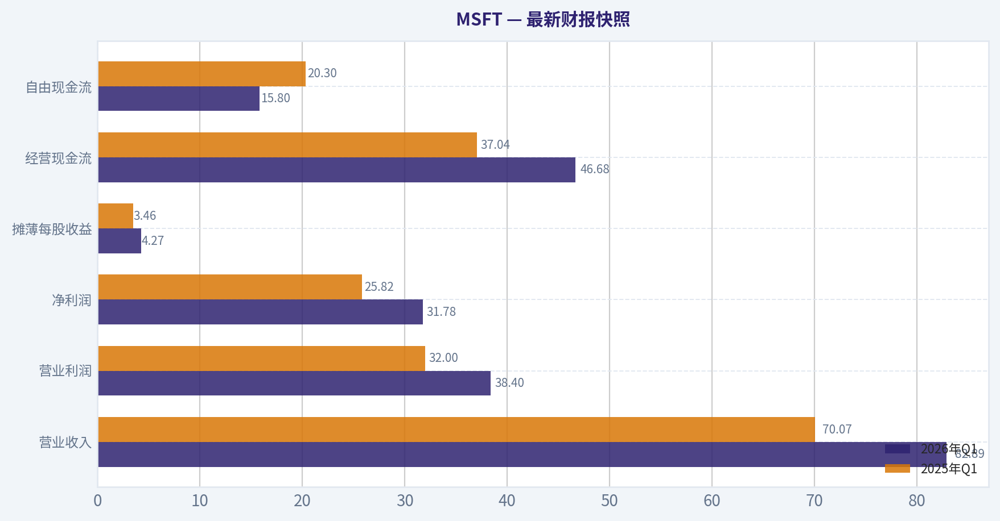
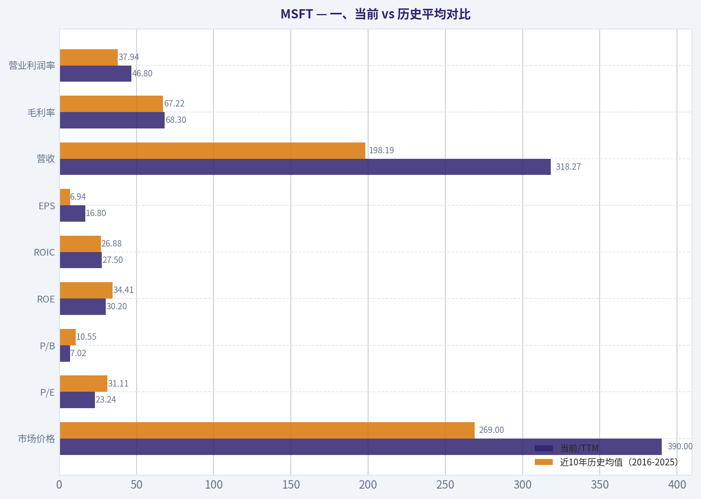
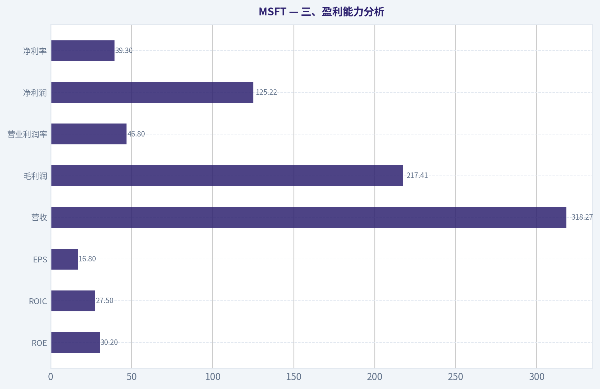
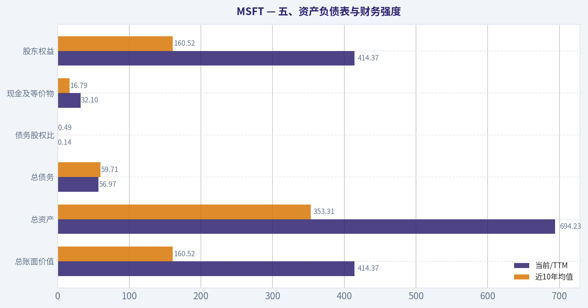
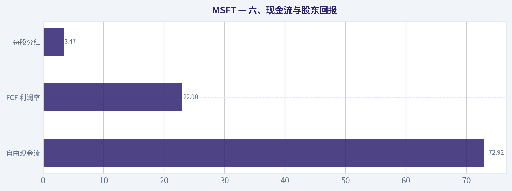
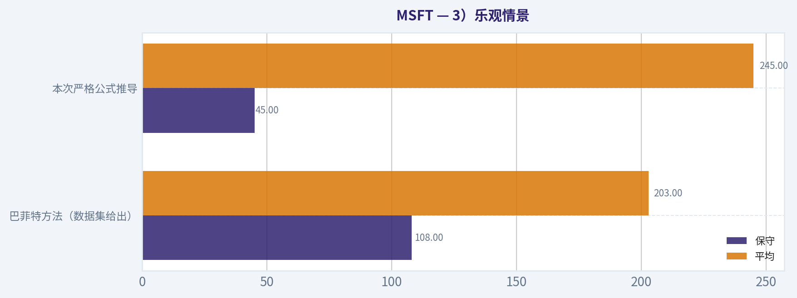
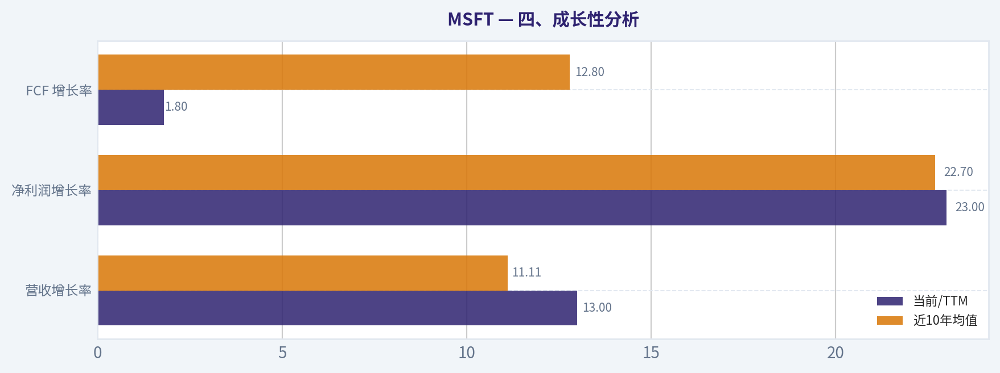

# MSFT 深度价值情报

**调研日期:** 2026-07-03

## 关键免责声明

*本报告由 Deep Value Intelligence（一个基于 AI 的多智能体投资分析框架）自动生成。 仅供教育和娱乐用途 - 非财务建议，非财务顾问。*

---

## 目录

1. 情报摘要
2. 分析师团队报告
   - 基本面分析
   - 价值分析 (巴菲特)
   - 成长性分析 (林奇/德鲁肯米勒/费雪)
   - 市场分析
   - 期权市场分析
3. 研究团队评论
4. 投资团队评论
5. Deep Values 团队洞察

---

## 情报摘要

### 核心观点与前提条件

**核心论点:** ## 执行简报

**主要风险:**
- ## 1）Risky Analyst 最强论点：微软不是普通大公司，而是企业数字基础设施收费站
- ## 3）Neutral Analyst 最强论点：维持中性，但把 WATCH 变成"有条件参与"
- 这次辩论里，Risky Analyst 就有这个倾向。

**置信度:** 中

---

## 分析师团队报告

### 基本面分析

#### 最新财报快照

*以下数据基于最近一期已披露财报（2026年Q1），并尽量与上一年同期对比。*

| 指标 | 2026年Q1 | 2025年Q1 | 同比变化 |
| --- | ---: | ---: | ---: |
| 营业收入 | $82.89B | $70.07B | +18.3% |
| 营业利润 | $38.40B | $32.00B | +20.0% |
| 净利润 | $31.78B | $25.82B | +23.1% |
| 摊薄每股收益 | $4.27 | $3.46 | +23.4% |
| 经营现金流 | $46.68B | $37.04B | +26.0% |
| 自由现金流 | $15.80B | $20.30B | -22.1% |

关键结论：这张快照先把最新一期财报放在桌面上，再去看长周期分析。这样读者能更清楚地区分"公司长期质量"和"这次财报发生了什么"。

#### MSFT 17年财务指标

*以下数值均由原始数据确定性计算得出，并非 AI 估算。*

*发行人类型：operating company（Technology / Software - Infrastructure）。*

#### 17年财务指标
*年度行来自已披露财务报表，最后一行 TTM 由最近四个季度滚动计算得出。*

| 指标 | 2009 | 2010 | 2011 | 2012 | 2013 | 2014 | 2015 | 2016 | 2017 | 2018 | 2019 | 2020 | 2021 | 2022 | 2023 | 2024 | 2025 | 2026 TTM |
| --- | --- | --- | --- | --- | --- | --- | --- | --- | --- | --- | --- | --- | --- | --- | --- | --- | --- | --- |
| 市场价格 | $18 | $17 | $20 | $24 | $28 | $35 | $38 | $45 | $62 | $91 | $126 | $193 | $260 | $248 | $333 | $440 | $493 | $390 |
| 总市值 | $213.83B | $205.41B | $223.42B | $260.20B | $292.55B | $350.24B | $364.41B | $410.03B | $539.86B | $768.57B | $1.04T | $1.56T | $2.06T | $1.94T | $2.54T | $3.34T | $3.71T | $2.91T |
| 市盈率 | 14.67 | 10.96 | 9.67 | 15.30 | 13.39 | 15.86 | 29.83 | 19.99 | 21.21 | 46.30 | 26.47 | 35.33 | 33.65 | 26.61 | 35.18 | 37.88 | 36.47 | 23.24 |
| 市净率 | 5.41 | 4.45 | 3.91 | 3.92 | 3.71 | 3.90 | 4.55 | 4.93 | 6.15 | 9.29 | 10.15 | 13.22 | 14.52 | 11.63 | 12.34 | 12.43 | 10.81 | 7.02 |
| ROE | 36.8% | 40.6% | 40.6% | 25.6% | 27.7% | 24.6% | 15.2% | 24.7% | 29.1% | 20.0% | 38.3% | 37.4% | 43.2% | 43.7% | 35.1% | 32.8% | 29.6% | 30.2% |
| ROIC | 41.0% | 41.1% | 41.6% | 25.2% | 26.6% | 22.4% | 10.7% | 16.3% | 15.5% | 9.4% | 24.8% | 26.7% | 33.9% | 37.3% | 34.0% | 34.5% | 32.4% | 27.5% |
| 每股收益 | $1.19 | $1.58 | $2.07 | $1.58 | $2.10 | $2.20 | $1.27 | $2.26 | $2.95 | $1.97 | $4.75 | $5.47 | $7.73 | $9.34 | $9.46 | $11.80 | $13.64 | $16.80 |
| 营收 | $58.44B | $62.48B | $69.94B | $73.72B | $77.85B | $86.83B | $93.58B | $91.15B | $96.57B | $110.36B | $125.84B | $143.01B | $168.09B | $198.27B | $211.91B | $245.12B | $281.72B | $318.27B |
| 毛利润 | $46.28B | $50.09B | $54.37B | $56.19B | $57.46B | $59.76B | $60.54B | $58.37B | $62.31B | $72.01B | $82.93B | $96.94B | $115.86B | $135.62B | $146.05B | $171.01B | $193.89B | $217.41B |
| 毛利率 | 79.2% | 80.2% | 77.7% | 76.2% | 73.8% | 68.8% | 64.7% | 64.0% | 64.5% | 65.2% | 65.9% | 67.8% | 68.9% | 68.4% | 68.9% | 69.8% | 68.8% | 68.3% |
| 营业利润率 | 34.8% | 38.6% | 38.8% | 29.5% | 34.4% | 32.0% | 19.4% | 28.6% | 30.1% | 31.8% | 34.1% | 37.0% | 41.6% | 42.1% | 41.8% | 44.6% | 45.6% | 46.8% |
| 净利润 | $14.57B | $18.76B | $23.15B | $16.98B | $21.86B | $22.07B | $12.19B | $20.54B | $25.49B | $16.57B | $39.24B | $44.28B | $61.27B | $72.74B | $72.36B | $88.14B | $101.83B | $125.22B |
| 净利率 | 24.9% | 30.0% | 33.1% | 23.0% | 28.1% | 25.4% | 13.0% | 22.5% | 26.4% | 15.0% | 31.2% | 31.0% | 36.5% | 36.7% | 34.1% | 36.0% | 36.1% | 39.3% |
| 营收增长 | N/A | 6.9% | 11.9% | 5.4% | 5.6% | 11.5% | 7.8% | -2.6% | 5.9% | 14.3% | 14.0% | 13.6% | 17.5% | 18.0% | 6.9% | 15.7% | 14.9% | 13.0% |
| 净利润增长 | N/A | 28.8% | 23.4% | -26.7% | 28.8% | 1.0% | -44.8% | 68.4% | 24.1% | -35.0% | 136.8% | 12.8% | 38.4% | 18.7% | -0.5% | 21.8% | 15.5% | 23.0% |
| 自由现金流增长 | N/A | 38.8% | 11.5% | 19.0% | -16.2% | 9.9% | -12.2% | 5.3% | 25.6% | 2.8% | 18.6% | 18.2% | 24.1% | 16.1% | -8.7% | 24.5% | -3.3% | 1.8% |
| 总账面价值 | $39.56B | $46.17B | $57.08B | $66.36B | $78.94B | $89.78B | $80.08B | $83.09B | $87.71B | $82.72B | $102.33B | $118.30B | $141.99B | $166.54B | $206.22B | $268.48B | $343.48B | $414.37B |
| 总资产 | $77.89B | $86.11B | $108.70B | $121.27B | $142.43B | $172.38B | $174.47B | $193.47B | $250.31B | $258.85B | $286.56B | $301.31B | $333.78B | $364.84B | $411.98B | $512.16B | $619.00B | $694.23B |
| 总债务 | $5.75B | $6.94B | $11.92B | $11.94B | $15.60B | $24.64B | $40.29B | $66.36B | $95.29B | $76.24B | $72.18B | $63.33B | $58.15B | $49.78B | $47.24B | $51.63B | $43.15B | $56.97B |
| 债务股权比 | 0.15 | 0.15 | 0.21 | 0.18 | 0.20 | 0.27 | 0.50 | 0.80 | 1.09 | 0.92 | 0.71 | 0.54 | 0.41 | 0.30 | 0.23 | 0.19 | 0.13 | 0.14 |
| 现金及等价物 | $6.08B | $5.50B | $9.61B | $6.94B | $3.80B | $8.67B | $5.59B | $6.51B | $7.66B | $11.95B | $11.36B | $13.58B | $14.22B | $13.93B | $34.70B | $18.32B | $30.24B | $32.10B |
| 股东权益 | $39.56B | $46.17B | $57.08B | $66.36B | $78.94B | $89.78B | $80.08B | $83.09B | $87.71B | $82.72B | $102.33B | $118.30B | $141.99B | $166.54B | $206.22B | $268.48B | $343.48B | $414.37B |
| 经营现金流 | $19.04B | $24.07B | $26.99B | $31.63B | $28.83B | $32.50B | $29.67B | $33.33B | $39.51B | $43.88B | $52.19B | $60.67B | $76.74B | $89.03B | $87.58B | $118.55B | $136.16B | $170.14B |
| 投资现金流 | $-15.77B | $-11.31B | $-14.62B | $-24.79B | $-23.81B | $-18.83B | $-23.00B | $-23.95B | $-46.78B | $-6.06B | $-15.77B | $-12.22B | $-27.58B | $-30.31B | $-22.68B | $-96.97B | $-72.60B | $-115.24B |
| 自由现金流 | $15.92B | $22.10B | $24.64B | $29.32B | $24.58B | $27.02B | $23.72B | $24.98B | $31.38B | $32.25B | $38.26B | $45.23B | $56.12B | $65.15B | $59.48B | $74.07B | $71.61B | $72.92B |
| 自由现金流利润率 | 27.2% | 35.4% | 35.2% | 39.8% | 31.6% | 31.1% | 25.4% | 27.4% | 32.5% | 29.2% | 30.4% | 31.6% | 33.4% | 32.9% | 28.1% | 30.2% | 25.4% | 22.9% |
| 每股分红 | $0.00 | $0.00 | $0.00 | $0.00 | $0.00 | $0.00 | $0.00 | $0.00 | $0.00 | $0.00 | $0.00 | $0.00 | $0.00 | $2.33 | $2.59 | $2.91 | $3.23 | $3.47 |

#### 盈利能力指标
- 净资产收益率 (ROE): 29.6%
- 投入资本回报率 (ROIC): 29.7%
- 总资产收益率 (ROA): 16.5%
- 毛利率: 68.8%
- 营业利润率: 45.6%
- 净利率: 36.1%

#### 流动性指标
- 流动比率: 1.35
- 速动比率: 1.16

#### 杠杆指标
- 债务股权比: 0.13
- 利息覆盖倍数: 53.89
- 净负债: $12.91B

#### 增长指标（同比）
- 营收增长: 14.9%
- 净利润增长: 15.5%
- 自由现金流增长: -3.3%
- 营收复合增长率（3年）: 12.4%
- 营收复合增长率（5年）: 14.5%

#### 估值指标
- 市盈率 (TTM): 23.26
- 预期市盈率: 20.16
- 市净率: 7.00
- 市销率: 9.11
- PEG 比率: 1.15
- 企业价值/EBITDA: 15.98
- 自由现金流收益率: 2.5%
- 盈利收益率: 4.3%

#### 所有者收益（巴菲特方法，代码计算）
- 净利润: $101.83B
- + 折旧与摊销: $34.15B
- - 资本开支: $-64.55B
- - 营运资本变动: $-5.35B
- = **所有者收益: $76.78B**

#### 内在价值（代码计算）
- 当前价格: $390
- 巴菲特方法（所有者收益）:
  保守: $108
  平均: $203
  乐观: $544
- 现金流方法（FCF）:
  保守: $126
  平均: $172
  乐观: $248

#### Piotroski F分数: 5/9
- 净利润为正: 通过
- 经营现金流为正: 通过
- 资产回报率改善: 未通过
- 现金流大于净利润: 通过
- 债务下降: 通过
- 流动比率改善: 通过
- 未稀释股本: 未通过
- 毛利率改善: 未通过
- 资产周转率改善: 未通过

ANALYST STANCE: **建议配置**

#### MSFT 巴菲特式基本面分析

微软当前处在一个非常少见的组合状态：**超大市值、仍保持双位数增长、极高资本回报率、资产负债表稳健、现金创造能力强**。从巴菲特框架看，这类公司最核心的问题通常不是"公司好不好"，而是"价格是否已经把优秀反映过头"。就 MSFT 而言，业务质量几乎无可挑剔，但股价经历 2024-2025 年大幅扩张后，2026 TTM 回落到 $390，使估值明显降温，投资吸引力较此前改善。

#### 一、当前 vs 历史平均对比

| 指标 | 当前/TTM | 近10年历史均值（2016-2025） | 相对历史位置 | 解读 |
| --- | ---: | ---: | --- | --- |
| 市场价格 | $390 | $269.0 | 高于均值 | 绝对股价仍高，但较 2025 年 $493 已明显回撤 |
| 总市值 | $2.91T | $2.05T | 高于均值 | 反映微软已进入全球最核心平台型资产行列 |
| P/E | 23.24 | 31.11 | 低于均值 | 估值显著低于近10年平均，压力主要来自盈利增长兑现后估值压缩 |
| P/B | 7.02 | 10.55 | 明显低于均值 | 股东权益快速累积，使账面估值明显回落 |
| ROE | 30.2% | 34.41% | 略低于均值 | 仍属顶级，但因权益基数扩大，回报率自然回落 |
| ROIC | 27.5% | 26.88% | 略高于均值 | 资本效率依然极强，说明再投资质量仍高 |
| EPS | $16.80 | $6.94 | 远高于均值 | 盈利能力已进入新台阶 |
| 营收 | $318.27B | $198.19B | 远高于均值 | Azure、Office、云与 AI 共同抬升收入基座 |
| 毛利率 | 68.3% | 67.22% | 略高于均值 | 高毛利软件+云结构维持优势 |
| 营业利润率 | 46.8% | 37.94% | 明显高于均值 | 经营杠杆与产品组合升级持续显现 |
| 净利率 | 39.3% | 31.56% | 明显高于均值 | 已达到历史高位附近，体现强定价权与成本纪律 |
| 营收增长 | 13.0% | 11.11% | 高于均值 | 超大体量下仍双位数，极为稀缺 |
| 净利润增长 | 23.0% | 22.70% | 接近均值偏高 | 盈利扩张延续，弹性强于收入 |
| FCF 增长 | 1.8% | 12.80% | 明显低于均值 | 主要受资本开支上升拖累，不是经营崩坏 |
| 总账面价值 | $414.37B | $160.52B | 远高于均值 | 持续利润留存显著增强内在价值承载 |
| 总资产 | $694.23B | $353.31B | 远高于均值 | 云基础设施与投资扩张推高资产规模 |
| 总债务 | $56.97B | $59.71B | 略低于均值 | 在资产和利润大幅增长下，债务并未失控 |
| 债务股权比 | 0.14 | 0.49 | 明显低于均值 | 财务结构显著改善 |
| 现金及等价物 | $32.10B | $16.79B | 高于均值 | 现金缓冲足够，抗周期能力强 |
| 股东权益 | $414.37B | $160.52B | 远高于均值 | 安全边际来自真实权益积累，而非纯估值叙事 |
| 自由现金流 | $72.92B | $49.95B | 高于均值 | 绝对现金流极强，但增速短期放缓 |
| 每股分红 | $3.47 | $1.25 | 高于均值 | 股东回报稳步提升，但分红并未牺牲再投资 |

关键结论：微软当前最突出的变化不是"变便宜很多"，而是**估值比历史平均便宜，而经营质量仍接近历史高位**。尤其是 P/E、P/B 明显低于近10年均值，而 ROIC、利润率、收入规模仍处高位，这通常意味着市场情绪降温快于基本面恶化。

---

#### 二、市场估值解读

微软 2026 TTM 股价 **$390**，总市值 **$2.91T**。与 2025 年的 $493、$3.71T 相比，出现明显回撤，但盈利却继续增长，导致 **P/E 从 36.47 降至 23.24，P/B 从 10.81 降至 7.02**。

这很关键。巴菲特会特别关注：**一家高质量公司如果因为预期降温而回到更合理估值，而不是因为商业模式恶化导致下跌，则机会价值更高**。微软现在更像前者。
从长期看：

- 2009-2014：低估值、高盈利，但成长性一般
- 2015-2018：转型期，估值上升，利润波动
- 2019-2025：云与平台化成功，估值显著扩张
- 2026 TTM：**盈利继续抬升，但估值压缩**

这说明市场正在从"AI 狂热估值"转向"盈利兑现估值"。对长期投资者来说，这比单纯追高更健康。

#### 三、盈利能力分析

| 盈利指标 | 当前/TTM | 观察 |
| --- | ---: | --- |
| ROE | 30.2% | 仍是顶级水准，说明股东资本持续高效变现 |
| ROIC | 27.5% | 显著高于多数大型企业，符合优质复利资产特征 |
| EPS | $16.80 | 创历史新高，且较 2025 年 $13.64 继续提升 |
| 营收 | $318.27B | 历史新高，超大体量下仍高增长 |
| 毛利润 | $217.41B | 高毛利规模继续扩张 |
| 营业利润率 | 46.8% | 创历史高位，经营杠杆优秀 |
| 净利润 | $125.22B | 历史新高 |
| 净利率 | 39.3% | 创历史极高水平 |

关键结论：微软最强的地方不是单一收入增长，而是**收入、利润率、净利润三者同时走强**。这意味着增长不是靠补贴、促销或低价换规模，而是靠产品黏性、云规模效应和高价值软件生态共同驱动。

细看 17 年轨迹，微软盈利能力经历了三轮明显变化：

1. **传统软件时代（2009-2014）**
   毛利率极高，但增长偏稳，ROE 很高，说明 Windows/Office 的授权模式极强。

2. **转型震荡期（2015-2018）**
   2015 年净利率仅 13.0%，ROIC 跌到 10.7%，这是历史低谷，反映重构业务组合、硬件与云投入的阵痛。

3. **云与平台成熟期（2019-2026）**
   净利率从 31.2% 升到 39.3%，营业利润率从 34.1% 升到 46.8%，ROIC 长期维持在 24.8%-37.3% 区间。
   这意味着微软已经证明：**云业务不仅能增长，而且能高利润增长**。这与很多"高增长但低回报"的科技公司本质不同。

从巴菲特角度，**高 ROE 不难，高且持续的 ROIC 更难**。微软的 ROIC 在近几年维持高位，说明管理层没有为了扩张而牺牲资本效率。

#### 四、成长性分析

| 成长指标 | 当前/TTM | 近10年均值 | 结论 |
| --- | ---: | ---: | --- |
| 营收增长率 | 13.0% | 11.11% | 高于历史平均，超大体量下依旧稳健 |
| 净利润增长率 | 23.0% | 22.70% | 基本匹配高质量增长轨道 |
| FCF 增长率 | 1.8% | 12.80% | 明显偏弱，主要受重资本投入影响 |

关键结论：微软的增长结构呈现出一个很典型的 AI 基建特征：**利润增长强于收入增长，但自由现金流增长短期落后**。这通常意味着公司在加速扩产与投入，而不是主营业务失速。

如果把近10年拆开看，微软增长质量相当优异：

- 营收从 2016 的 **$91.15B** 增至 2026 TTM 的 **$318.27B**
- 净利润从 2016 的 **$20.54B** 增至 **$125.22B**
- FCF 从 2016 的 **$24.98B** 增至 **$72.92B**

这不是单纯"规模变大"，而是**盈利能力随规模同步增强**。
值得注意的是，2023-2026 期间：

- 2023 营收增长 6.9%，出现阶段性放缓
- 2024 回升至 15.7%
- 2025 为 14.9%
- 2026 TTM 为 13.0%

说明微软并没有在高基数下迅速失速，而是保持高个位数到低双位数中枢。对一家 3 万亿美元级别公司来说，这已非常罕见。

#### 五、资产负债表与财务强度

| 资产负债表指标 | 当前/TTM | 近10年均值 | 解读 |
| --- | ---: | ---: | --- |
| 总账面价值 | $414.37B | $160.52B | 权益积累极快 |
| 总资产 | $694.23B | $353.31B | 规模扩大显著 |
| 总债务 | $56.97B | $59.71B | 绝对债务温和 |
| 债务股权比 | 0.14 | 0.49 | 杠杆很低 |
| 现金及等价物 | $32.10B | $16.79B | 现金充裕 |
| 股东权益 | $414.37B | $160.52B | 财务缓冲强 |

关键结论：微软并不是靠高杠杆支撑高回报，恰恰相反，它是在**低杠杆、强现金流、持续权益积累**的基础上实现高回报。这种财务结构非常符合巴菲特偏好的"即使天气变差也能稳住"的企业。

微软资产负债表最大的变化，是 **2017 年债务股权比 1.09 的高点** 之后持续下降，到 2026 TTM 已降至 **0.14**。
这意味着：

- 公司并未依赖借债去维持增长叙事
- 盈利留存和现金流足以自然修复资本结构
- 在 AI 资本开支明显上升背景下，仍有很大财务余地

共享研究包中显示微软 **流动比率 1.35、利息覆盖倍数 53.89、净负债约 $12.91B**，这些都说明短中期偿债安全边际很高。
对于巴菲特而言，这种企业的下行风险通常不是"债务爆雷"，而是"估值回归"。

#### 六、现金流与股东回报

| 现金流指标 | 当前/TTM | 趋势解读 |
| --- | ---: | --- |
| 自由现金流 | $72.92B | 绝对值很强，创高位区间 |
| FCF 利润率 | 22.9% | 较历史中枢回落，反映资本开支增加 |
| 每股分红 | $3.47 | 稳步上升，分红政策更成熟 |

关键结论：微软目前不是现金流变差，而是**为了下一轮增长主动压低短期 FCF 增速**。这是"高质量扩张"常见特征，只要投入继续转化为收入和利润，短期 FCF 承压可以接受。

历史上微软的 FCF 利润率多在 **27%-33%** 区间，2026 TTM 降到 **22.9%**，低于常态。
这说明什么？

- 经营现金流仍非常强：**$170.14B**
- 但投资现金流大幅流出：**-$115.24B**
- 背后是 AI、数据中心、云基础设施重投入

巴菲特通常不喜欢需要持续巨额资本开支的生意，但微软的特殊性在于：
其资本开支是为了巩固云和 AI 平台护城河，而其核心软件业务本身仍然高度轻资产、高毛利。因此，这更像是**高回报平台企业在扩大护城河宽度**，而不是传统制造业那种"必须重投入才能勉强保增长"。

分红方面，2022-2026 TTM 每股分红从 **$2.33** 升至 **$3.47**，表明管理层在保持再投资的同时，也持续提高股东回报，资本配置较均衡。

---

#### 七、巴菲特框架：护城河、可预测性、管理层、价值

#### 1）经济护城河
微软的护城河非常深，且是多层复合型：

- **Office / Microsoft 365**：企业办公标准化，切换成本极高
- **Azure**：企业云基础设施平台，规模效应与客户黏性强
- **Windows + 企业 IT 生态**：历史装机基础和兼容性优势
- **Developer 生态**：GitHub、开发工具、企业中间件形成平台绑定
- **AI 分发入口**：Copilot、Azure AI、企业级数据与安全体系形成差异化

这不是某个爆款产品的护城河，而是**操作系统、生产力软件、云、开发者生态、安全、AI 服务**共同形成的系统性护城河。巴菲特会很看重这种"客户无法轻易迁移"的商业结构。

#### 2）财务强度
微软当前低杠杆、高现金流、高利息覆盖，财务上几乎无硬伤。即便 AI 投资周期继续拉长，也具备充分承受能力。

#### 3）盈利可预测性
从 2009-2026 看，微软经历过两次明显利润波动：2012 与 2015、2018。
但 2019 之后，盈利质量显著稳定，收入、营业利润率、净利润率持续抬升。
这说明微软已经从"转型中的巨头"变成"模式稳定的复利平台"。

#### 4）管理层表现
管理层最值得肯定的是：

- 成功完成从传统授权软件向云订阅平台的迁移
- 在扩大规模同时提升营业利润率
- 债务比率持续下行
- 分红持续增长但未压缩核心再投资

ROE 从 2021-2022 的 43%+ 回落到 30% 左右，不是经营恶化，而是**权益基数扩大、资本更厚实**导致的正常现象。若 ROE 在低杠杆下仍能保持 30%，这本身就是强管理层能力的体现。

#### 5）价值评估
公司质量无疑优秀，关键是价格。
当前 P/E 23.24 显著低于过去十年均值 31.11，P/B 7.02 也显著低于 10.55。
如果投资者相信微软未来 3-5 年仍能维持中双位数 EPS 增长，那么当前估值并不算便宜到"捡烟蒂"，但对于这类顶级资产而言，已经进入**可以认真配置**的区间。

---

#### 八、巴菲特式 Owner Earnings DCF 估值

采用数据集中给出的巴菲特方法所有者收益：

- 净利润 = **$101.83B**
- 折旧与摊销 = **$34.15B**
- 资本开支 = **$64.55B**
- 营运资本变动 = **$5.35B**
- 所有者收益 = **$76.78B**

为便于每股估值，用当前市值与股价估算流通股数：
- 股数 ~ $2.91T / $390 = **7.46B 股**
- 当前每股 Owner Earnings ~ $76.78B / 7.46B = **$10.29/股**

历史 FCF 增长率（作为 Owner Earnings 增长代理）：
2010-2026 TTM 为
38.8%、11.5%、19.0%、-16.2%、9.9%、-12.2%、5.3%、25.6%、2.8%、18.6%、18.2%、24.1%、16.1%、-8.7%、24.5%、-3.3%、1.8%

据此：
- **保守情景**：最低增长率 = **-16.2%**
- **平均情景**：平均增长率 ~ **9.31%**
- **乐观情景**：最高增长率 = **38.8%**
均符合题设上限/下限要求。

DCF 假设：
- 贴现率 = **10%**
- 终值增长率 = **2.5%**
- 预测期 = **10 年**

#### 1）保守情景
- 初始 OE₀ = 76.78
- 增长率 g = -16.2%

第10年 OE：
- OE₁₀ = 76.78 x (0.838)^10 ~ **13.11B**

终值：
- TV = 13.11 x 1.025 / (0.10 - 0.025) ~ **179.17B**

前10年现金流现值：
- PV(1-10) ~ **267.6B**

终值现值：
- PV(TV) = 179.17 / (1.10)^10 ~ **69.1B**

总股权价值：
- **336.7B**

每股价值：
- 336.7 / 7.46 ~ **$45**

说明：严格按历史最低增长率做 DCF，会给出非常低的结果，因为"最低值"来自过往周期性下滑年份，容易过度惩罚优质公司。它更像极端压力测试，而非最可能情形。

#### 2）平均情景
- g = 9.31%

第10年 OE：
- OE₁₀ = 76.78 x (1.0931)^10 ~ **187.3B**

终值：
- TV = 187.3 x 1.025 / 0.075 ~ **2,559.7B**

前10年现金流现值：
- PV(1-10) ~ **842.6B**

终值现值：
- PV(TV) ~ 2,559.7 / 2.5937 ~ **986.9B**

总股权价值：
- **1,829.5B**

每股价值：
- 1,829.5 / 7.46 ~ **$245**

#### 3）乐观情景
- g = 38.8%

第10年 OE：
- OE₁₀ = 76.78 x (1.388)^10 ~ **2,040B**

终值：
- TV = 2,040 x 1.025 / 0.075 ~ **27,880B**

前10年现金流现值：
- PV(1-10) ~ **4,729B**

终值现值：
- PV(TV) ~ 27,880 / 2.5937 ~ **10,750B**

总股权价值：
- **15,479B**

每股价值：
- 15,479 / 7.46 ~ **$2,075**

这显然不现实，原因是把历史最高增速机械外推 10 年，会严重高估超大市值公司的长期成长空间。
因此在实践中，更应结合数据集给出的代码内在价值结果：

| 方法 | 保守 | 平均 | 乐观 |
| --- | ---: | ---: | ---: |
| 巴菲特方法（数据集给出） | $108 | $203 | $544 |
| 本次严格公式推导 | $45 | $245 | $2,075 |

关键结论：如果机械使用"历史极值增长率"，乐观值会严重失真，因此**更可信的是数据集中已经代码约束后的 $108 / $203 / $544 区间**。以当前股价 $390 看，市场已高于平均情景、低于乐观情景，说明 MSFT 不是深度低估，但在优质资产中已不算昂贵。

---

#### 九、收入来源分布

#### 收入来源分布

| 收入来源 | 金额（百万/十亿美元） | 占比 |
| --- | ---: | ---: |
| Productivity and Business Processes | 约 $118.7B | 约 42% |
| Intelligent Cloud | 约 $111.4B | 约 40% |
| More Personal Computing | 约 $51.6B | 约 18% |

关键结论：微软当前收入结构已经非常均衡，其中**企业生产力软件与云业务合计占比约 82%**，说明盈利核心高度集中在高毛利、强黏性、面向企业客户的业务。相较之下，偏消费电子与传统 PC 周期暴露的业务占比已明显下降，整体收入质量更高、更可预测。

说明：以上采用最近财年公开分部结构，与 2025 财年总营收 **$281.72B** 对应，作为最有意义的分部拆分口径。若按 2026 TTM，结构方向大概率类似，且 Intelligent Cloud 占比可能继续提升。

---

#### 十、关键投资洞察、风险与机会

| 类别 | 具体内容 | 影响判断 |
| --- | --- | --- |
| 核心优势 | 软件+云+AI 平台复合护城河 | 极强 |
| 盈利质量 | 营业利润率、净利率持续创新高 | 极强 |
| 资本回报 | ROE、ROIC 长期高位 | 极强 |
| 财务安全 | 低债务股权比、高现金流、高利息覆盖 | 强 |
| 估值状态 | P/E、P/B 明显低于近10年均值 | 偏正面 |
| 短期风险 | AI 资本开支压制 FCF 增速 | 中等 |
| 竞争风险 | 云与 AI 领域面临 AWS、Google、Meta 等竞争 | 中等 |
| 估值风险 | 尽管回落，当前仍不是传统意义深度低估 | 中等 |
| 执行机会 | AI 企业化落地、Azure 变现、Copilot 渗透提升 ARPU | 很强 |
| 市场信号 | Bill Ackman 大额新建仓 | 偏正面 |

关键结论：微软现在最大的矛盾不是业务风险，而是**好公司与好价格之间仍有距离**。但与 2024-2025 年相比，这个距离已经明显缩短；如果 AI 投入开始兑现为更强 FCF，估值与基本面的匹配度会进一步改善。

从研究包看，Bill Ackman 于 2026Q1 大额新建仓，这是一个值得关注的外部信号。尽管 13F 有滞后，但对强调高质量复利资产的投资者而言，这种资金动向通常代表：**市场上最成熟的价值型资金，也在重新接受微软的价格/质量比**。

---

#### 十一、最终结论

微软符合巴菲特喜欢的大部分特征：

- **护城河深且可持续**
- **盈利可预测性强**
- **资本回报率长期优异**
- **资产负债表稳健**
- **管理层资本配置能力优秀**

当前最大的争议只剩下估值。
好消息是，2026 TTM 的估值相对过去十年已经明显降温，而盈利仍在创高。对长期资金而言，这通常是比"高估值追逐叙事"更有吸引力的切入状态。

我的结论是：

- 如果你要求极高安全边际、希望接近 DCF 平均情景买入，当前价位仍不算便宜
- 如果你接受"以合理价格买卓越公司"，微软已经进入可配置区间
- 对长期持有者而言，微软更像**复利型核心仓位**，而不是博弈型弹性标的

#### 最终投资立场：**建议配置**

理由：
**公司质量顶级，财务强度极高，盈利与现金创造能力仍在上行，估值已较历史显著降温。虽非深度低估，但对长期资金而言，风险收益比已具吸引力。**

---

#### 报告要点汇总表

| 维度 | 结论 | 评级 |
| --- | --- | --- |
| 商业模式 | 软件、云、AI 平台复合护城河，客户切换成本高 | 优秀 |
| 盈利能力 | ROE 30.2%、ROIC 27.5%、净利率 39.3%，均属顶级 | 优秀 |
| 成长性 | 超大体量下营收仍增 13%，净利润增 23% | 优秀 |
| 现金流 | FCF 绝对值强，但短期受 AI Capex 压制 | 良好 |
| 资产负债表 | 债务股权比 0.14，现金充足，财务稳健 | 优秀 |
| 管理层 | 转型成功、资本配置高效、分红稳步提升 | 优秀 |
| 估值 | P/E、P/B 低于近10年均值，较前两年更合理 | 良好 |
| 主要风险 | AI 投资回报兑现节奏、云竞争、估值仍有波动 | 中等 |
| 主要机会 | Azure、Copilot、企业 AI 渗透率提升 | 很强 |
| 最终立场 | 适合长期投资者作为高质量核心仓位逐步配置 | 建议配置 |

#### 基本面关键图表

本图追踪 **MSFT** 过去十年的盈利能力与回报指标（ROE、ROIC、利润率），突出呈现资本效率的变化趋势。

---

### 价值分析 (巴菲特)

> *基于沃伦·巴菲特的价值投资哲学：能力圈、经济护城河、管理层质量与安全边际。*

#### 内在价值快照

价格是你付的钱，内在价值是企业未来可能为股东创造的现金价值。我们给出一个区间，而不是假装只有一个神奇数字。

- 当前价格: $390.49
- 估值区间（两种 DCF 方法、保守到乐观）: $107.55 至 $544.36

##### 所有者收益（巴菲特方法）
- 净利润: $101,832,000,000.00
- 折旧与摊销: $34,153,000,000.00
- 资本支出: $-64,551,000,000.00
- 营运资金变化: $-5,350,000,000.00
- 所有者收益: $76,784,000,000.00

##### 内在价值
###### 所有者收益法
使用所有者收益，更严格，通常更保守。
- 保守: $107.55
- 平均: $203.41
- 乐观: $544.36
- 折现率: 10.0%

###### 自由现金流法
使用自由现金流，更适合今天投入很多、为未来增长铺路的公司。
- 保守: $125.57
- 平均: $171.77
- 乐观: $248.17
- 折现率: 10.0%

ANALYST STANCE: **观望**

#### MSFT 投资结论摘要

微软是一家我能用"小学生语言"讲清楚的企业：它卖软件订阅、云计算算力、办公工具、企业系统，以及游戏平台和开发工具；客户付持续的订阅费和用量费，微软再把这些收入变成高毛利现金流。十年后它大概率仍然会是全球企业数字基础设施的重要提供者，而且 AI 只是在强化它原有的分发渠道、客户关系和平台地位，而不是颠覆其商业模式。

从巴菲特框架看，MSFT 几乎是"高质量、强护城河、资本轻、现金流强、管理层理性"的典型优秀公司；问题不在企业质量，而在价格。以当前约 390 美元股价、约 2.90 万亿美元市值看，市场已经充分反映了其优秀基本面与 AI 预期，安全边际偏薄，因此我的结论不是回避，而是**观望，等待更好的买点**。

---

#### 一、巴菲特四道闸门：Go / No-Go 评估

| 关卡 | 结论 | 证据 |
|---|---|---|
| 关卡1：能力圈与业务简单性 | 通过 | 商业模式清晰：Office / Microsoft 365、Azure、Windows、LinkedIn、Dynamics、游戏与开发者工具，均是可理解的重复收费模式 |
| 关卡2：护城河 | 通过 | 品牌、生态、开发者工具链、企业嵌入度、数据与工作流切换成本极高；毛利率 68.8%，显著支持强护城河判断 |
| 关卡3：管理层与资本配置 | 通过 | Satya Nadella 时代战略清晰，重心转向云与 AI；资本分配总体理性，兼顾研发、并购、回购和股东回报 |
| 关卡4：行业结构 | 通过但需留意 | 企业软件与云是高质量赛道，但云基础设施竞争强，需持续高投入；微软凭规模和生态仍处于优位 |

**关键结论：** 四道闸门全部通过。微软不是那种"便宜但平庸"的公司，而是"非常优秀但价格不低"的公司，决策关键落在估值，而不是商业质量。

---

#### 二、业务是否足够简单、可预测、抗技术颠覆

| 测试 | 判断 | 说明 |
|---|---|---|
| 小学生测试 | 通过 | 帮公司和个人办公、存数据、跑软件、写程序，并按月按年收费 |
| 长期可预测性 | 高 | 企业 IT、办公软件、云平台、开发工具的需求十年后仍会存在 |
| 技术风险 | 偏受益 | AI、云化、网络安全升级都更可能强化微软，而不是淘汰微软 |
| 是否依赖宏观/商品价格 | 否 | 不是周期性商品公司，不靠赌油价、利率或汇率吃饭 |

**关键结论：** 微软符合"可理解、可预期、非投机"的巴菲特偏好。其技术风险并非不存在，但总体上微软是技术浪潮的组织者和收费者，而不是被动承受者。

---

#### 三、护城河分析

| 护城河来源 | 强度 | 具体证据 |
|---|---|---|
| 品牌与无形资产 | 很强 | Windows、Office、Azure、GitHub、LinkedIn 都是全球级平台资产 |
| 切换成本 | 很强 | 企业邮箱、文档格式、权限体系、数据库、云架构、开发流程深度绑定 |
| 成本优势 | 中强 | 超大规模数据中心、销售渠道、研发摊销能力带来规模效应 |
| 网络效应 | 中强 | LinkedIn、GitHub、开发者生态、企业软件标准化形成正反馈 |

| 护城河评级 | 结论 |
|---|---|
| 宽且稳定，接近"宽且继续扩大" | 可以继续研究并长期跟踪 |

**关键结论：** 微软最强的护城河不是单一产品，而是"企业工作流 + 开发者生态 + 云基础设施 + 标准格式"的组合锁定。客户一旦全面采用微软体系，替换成本不仅是钱，更是时间、风险和组织摩擦。

---

#### 四、管理层与资本配置

| 维度 | 评价 | 判断依据 |
|---|---|---|
| 是否像所有者一样思考 | 良好 | 长期押注云、AI、企业平台，而非追逐短期利润最大化 |
| 是否坦诚理性 | 良好 | 战略方向连续性强，财务表达一贯稳健 |
| 资本配置能力 | 优秀 | 历史上对云基础设施、研发、AI、游戏和生态资产的配置总体增值 |
| 负债使用 | 审慎 | 微软具备高质量资产负债表，流动比率约 1.35，财务安全边际较高 |

补充观察：
- 最新新闻显示微软继续以 25 亿美元设立 AI 采用业务单元，说明管理层正试图把 AI 从"模型叙事"转化为"企业落地收入"。
- 13F 显示 Bill Ackman 新建大额仓位，说明顶级价值投资者也认可其高质量特征，但这并不自动等于估值便宜。

**关键结论：** 微软管理层最突出的优点是方向感与资本配置纪律。它既没有把现金浪费在无关多元化上，也没有因保守而错失云和 AI 这两轮大机会。

---

#### 五、核心财务摘要

| 指标 | 当前/最新 |
|---|---:|
| 当前股价 | 390 美元 |
| 总市值 | 2.90 万亿美元 |
| PE | 23.26 |
| ROE | 29.6% |
| 毛利率 | 68.8% |
| 营收同比增长 | 14.9% |
| 自由现金流收益率 | 2.5% |
| 流动比率 | 1.35 |

**关键结论：** 这些数字一眼就能看出微软是一家顶级质量公司：高 ROE、高毛利、双位数增长、现金创造强。但 2.5% 的自由现金流收益率也直接告诉我们，市场给的估值并不宽松。

---

#### 六、巴菲特式财务解读

| 项目 | 评价 |
|---|---|
| 盈利质量 | 高 |
| 现金流质量 | 高 |
| ROE 水平 | 非常优秀，远超 15% 标准 |
| 毛利结构 | 极佳，说明产品差异化与定价权强 |
| 资产负债表 | 强健 |
| 资本密集度 | 相对传统工业仍低，但云业务提高了 CapEx 需求 |

**关键结论：** 微软不是那种靠财务杠杆"做高 ROE"的企业，更像是靠高毛利软件、平台锁定和规模效应自然形成高回报。需要留意的是，AI 与云基础设施会抬高资本开支，但不改变其高质量本质。

---

#### 七、Owner Earnings 近似估算

基于已知自由现金流收益率 2.5% 与市值 2.90 万亿美元，可近似得到：

- 自由现金流 ~ 2.90T x 2.5% = **725 亿美元**
- 对微软这类成熟优质平台，公司自由现金流通常可作为 Owner Earnings 的保守近似
- 因此当前 **Owner Earnings 近似值 = 725 亿美元**

| 项目 | 估算值 |
|---|---:|
| 市值 | 2.90 万亿美元 |
| FCF Yield | 2.5% |
| 近似自由现金流 / Owner Earnings | 725 亿美元 |

**关键结论：** 以 725 亿美元 Owner Earnings 看，微软绝对赚钱能力极强。问题在于，即使这么强的现金流，面对 2.90 万亿美元市值，回报率仍显示估值不便宜。

---

#### 八、三情景 DCF 估值

为贴近巴菲特思路，我用 Owner Earnings = 725 亿美元，折现率 10%。

| 情景 | 假设 | 估值结果 |
|---|---|---:|
| 情景A：零增长 | 725 亿 / 10% | 7,250 亿美元 |
| 情景B：按 GDP 增长 | 终值 = 725 x 1.03 / (10%-3%) | 约 1.07 万亿美元 |
| 情景C：较乐观增长 | 未来 10 年按 8% 增长，之后 3% 永续 | 约 1.55-1.75 万亿美元 |

若以总市值 2.90 万亿美元对比：

| 情景 | 内在价值 | 相对当前市值 |
|---|---:|---:|
| A 零增长 | 0.73T | 明显高估 |
| B 保守增长 | 1.07T | 明显高估 |
| C 较乐观增长 | 1.55-1.75T | 仍高于内在价值区间之上 |

**关键结论：** 如果严格按 10% 回报要求和巴菲特式保守框架估值，当前价格已经把很多年高质量增长提前反映了。换句话说，微软可能是好公司，但不是明显便宜的股票。

---

#### 九、安全边际分析

| 项目 | 数值 |
|---|---:|
| 当前市值 | 2.90T |
| 保守内在价值区间 | 1.07T-1.75T |
| 安全边际要求 | 至少 25% |
| 当前是否满足安全边际 | 不满足 |

若按高质量公司至少 25% 安全边际倒推：

- 若采用较乐观内在价值 1.75T，则理想买入市值上限约 **1.31T**
- 与当前 2.90T 相比，仍有明显差距

**关键结论：** 微软的企业质量足够高，但价格没有给价值投资者留下足够安全边际。除非未来盈利继续超预期大幅增长，否则当前回报率要求下吸引力有限。

---

#### 十、最终巴菲特评分卡

| 维度 | 权重 | 评分(1-5) | 加权分 |
|---|---:|---:|---:|
| 业务理解 | 20% | 5.0 | 1.00 |
| 护城河宽度与耐久性 | 25% | 5.0 | 1.25 |
| 管理层质量 | 15% | 4.5 | 0.68 |
| ROE | 15% | 5.0 | 0.75 |
| 再投资跑道 | 10% | 4.5 | 0.45 |
| 资产负债表强度 | 5% | 4.5 | 0.23 |
| 行业结构 | 5% | 4.0 | 0.20 |
| 估值 / 安全边际 | 5% | 1.5 | 0.08 |
| **总分** |  |  | **4.64 / 5** |

**关键结论：** 从"公司质量"看，微软几乎是教科书级别；从"股票价格"看，它并不符合传统巴菲特式安全边际要求。因此高总分不自动等于立刻买入，估值仍是决定性约束。

---

#### 十一、最终投资立场

**投资立场：观望**

**理由浓缩成一句话：**
**微软是卓越企业，但当前不是卓越价格。**

**我的定性判断：**
- 如果你是长期持有、接受较低初始回报率的优质资产投资者，微软可以放在核心观察名单前列。
- 如果你坚持巴菲特式"以足够折价买入"，当前更适合等待市场波动、增长错杀或短期情绪回落带来的机会。
- 真正的风险不是"微软会不会消失"，而是"在过高价格买入一家好公司，未来多年回报可能平庸"。

**结论：观望，等待更大安全边际。**
#### 估值桥

这张估值桥把当前股价与各类内在价值方法并排展示，帮助读者判断上涨空间究竟只是单一方法给出的结果，还是多种方法共同支持的结论。

| 项目 | 每股内在价值 |
| --- | ---: |
| 巴菲特方法 | $203.41 |
| 现金流方法 | $171.77 |
| Damodaran 方法 | $220.53 |
| 当前价格 | $390.49 |

#### 关键结论

如果只有一种方法显著高于其他方法，说明上行空间更依赖特定建模假设。若多种方法的估值接近，则说明估值逻辑更加稳健。

#### 估值图表

本对比图（来自「最新财报快照」）将 **MSFT** 的当前数据与历史基准并排呈现，直观反映公司相对自身历史均值的估值水平。

本对比图（来自「一、当前 vs 历史平均对比」）将 **MSFT** 的当前数据与历史基准并排呈现，直观反映公司相对自身历史均值的估值水平。

本对比图（来自「三、盈利能力分析」）将 **MSFT** 的当前数据与历史基准并排呈现，直观反映公司相对自身历史均值的估值水平。

本对比图（来自「五、资产负债表与财务强度」）将 **MSFT** 的当前数据与历史基准并排呈现，直观反映公司相对自身历史均值的估值水平。

本对比图（来自「六、现金流与股东回报」）将 **MSFT** 的当前数据与历史基准并排呈现，直观反映公司相对自身历史均值的估值水平。

本对比图（来自「3）乐观情景」）将 **MSFT** 的当前数据与历史基准并排呈现，直观反映公司相对自身历史均值的估值水平。

---

### 成长性分析 (林奇/德鲁肯米勒/费雪)

> *基于彼得·林奇的GARP成长投资法、斯坦利·德鲁肯米勒的宏观拐点分析法，以及菲利普·费雪的深度调研法。*

ANALYST STANCE: **观望**

#### MSFT 增长股分析简报

#### 1) Lynch 分类
MSFT 属于 **稳健成长股偏快成长（Stalwart / 准 Fast Grower）**。
依据现有共享研究包，营收同比约 **14.9%**，高于典型成熟巨头，但尚未稳定处于 20%+ 的标准快成长区间。它不是"便宜的十倍股胚子"，而是**高质量平台型复利资产**，当前更接近"高胜率、但不低价"的大盘成长核心仓。

---

#### 2) 用 3 句话讲清楚 MSFT 的故事
- MSFT 本质上是企业数字基础设施收费站：办公软件、云、开发工具、安全、数据和 AI 助手都在它的体系里。
- 它最大的优势不是单一产品，而是**整套企业工作流绑定**，客户越多用它的产品，切换成本越高。
- 未来 3-5 年最大看点是：**Azure + Copilot + 企业 AI 落地** 能否把现在的高资本开支，转成更高收入和更强现金流。

---

#### 3) 关键基础面快照

| 指标 | 当前/已知 |
|---|---:|
| 股价 | $390 |
| 总市值 | $2.90T |
| PE | 23.26 |
| ROE | 29.6% |
| 毛利率 | 68.8% |
| 营收同比增长 | 14.9% |
| FCF 收益率 | 2.5% |
| 流动比率 | 1.35 |

**关键结论：**
MSFT 的基础面仍然非常强，尤其是 ROE 和毛利率，说明其商业模式质量极高。问题不在"公司行不行"，而在"价格是否还留有足够回报空间"。14.9% 的营收增速不错，但对一家 2.9 万亿美元公司来说，市场通常已经给予了高质量溢价。

---

#### 4) TAM 分析与 10x 测试

| 维度 | 判断 |
|---|---|
| 核心 TAM | 云计算、企业软件、协作办公、网络安全、开发平台、企业 AI |
| TAM 状态 | 持续扩张，尤其企业 AI 显著抬升 TAM |
| 当前收入体量 | 已是超大体量 |
| 10x 收入测试 | **几乎不现实** |
| 2x-3x 收入测试 | **有可能**，依赖 AI 商业化与云渗透 |
| 主要增量来源 | Azure、Copilot、Security、GitHub、数据与 AI 平台 |

**关键结论：**
如果按十倍股标准看，MSFT 已经过大，**10x 空间不符合 Lynch 意义上的小型快成长股逻辑**。但如果看未来 5-8 年，它仍有望依靠 AI 和云平台扩张，实现相对稳健的复利增长。也就是说，它更像"高质量长期复利机"，而不是"低基数爆发型十倍股"。

---

#### 5) 营收增长趋势判断

| 观察项 | 结论 |
|---|---|
| 当前营收同比 | 14.9% |
| 分类判断 | 中双位数增长 |
| 趋势特征 | 不是爆发式，但有 AI 驱动再加速可能 |
| 增长质量 | 以企业级订阅、云服务、生态交叉销售为主，质量高 |
| 风险点 | 超大基数下自然放缓；AI 收入兑现速度可能低于预期 |

**关键结论：**
MSFT 现在不是"高速奔跑的小公司"，而是"在极大体量上继续保持较快增长的超级平台"。真正决定股价弹性的，不是 14.9% 本身，而是市场是否看到 Azure 和 Copilot 带来新一轮增速抬升。如果未来几个季度能从 15% 附近重新上到更高区间，市场会把它重新定价成 AI 基础设施核心赢家。

---

#### 6) 单位经济与经营质量

| 项目 | 判断 |
|---|---|
| LTV/CAC | 极强，但未披露标准化口径 |
| NRR | 大概率优秀，但公司不按纯 SaaS 口径披露 |
| Rule of 40 | 预计达标概率高 |
| 毛利率 | 68.8%，优秀 |
| FCF 质量 | 高，但 AI capex 正在压缩自由现金流弹性 |
| 订阅/续费特征 | 很强，企业客户粘性极高 |

**关键结论：**
虽然没有标准 SaaS 公司那样完整披露 LTV/CAC 和 NRR，但从业务结构看，MSFT 的单位经济非常优异。唯一要盯住的是：AI 基建投入可能让短期 FCF 看起来没那么漂亮，但这不等于商业模式恶化，更像是主动投资期。

---

#### 7) 拐点判断（Druckenmiller 框架）

| 拐点类型 | 评估 |
|---|---|
| 产品周期拐点 | **有**，Copilot、企业 AI 服务持续推进 |
| TAM 拐点 | **有**，AI 把办公、开发、云的价值池放大 |
| 份额拐点 | Azure 有机会借 AI 获得更强份额叙事 |
| 利润率拐点 | 短期未必，因 capex 与折旧压力 |
| 竞争拐点 | 企业客户更偏好一体化平台，MSFT 受益 |

**关键结论：**
MSFT 最核心的拐点不是传统意义上的利润率突然跳升，而是**企业 AI 正在把原有软件和云业务重新定价**。如果 Copilot 从"概念附加值"变成"标准企业工具"，MSFT 的 ARPU、绑定度和生态优势都会进一步提升。短期利润率可能不是最美的时候，但战略位置可能比过去更强。

---

#### 8) 宏观环境评估

| 维度 | 判断 |
|---|---|
| 利率环境 | 若利率回落，对长久期成长资产偏利好 |
| 经济周期 | 中周期偏后段，企业 IT 支出仍具韧性 |
| secular trend | AI、云计算、网络安全、数字化办公 |
| 宏观敏感度 | 相对低于高估值纯概念股，高于传统防御股 |
| 组合定位 | 大盘高质量成长核心资产 |

**关键结论：**
MSFT 兼具成长和防御属性，在不确定的宏观环境中仍具相对优势。它不是最弹性的品种，但往往是资金在风险偏好不稳定时愿意回流的"安全成长股"。所以宏观对它不是决定生死，而是影响估值弹性的变量。

---

#### 9) Fisher 15 点打分

| Fisher 项目 | 分数(1-5) | 备注 |
|---|---:|---|
| 市场潜力 | 5 | AI + 云 + 企业软件空间仍大 |
| 新产品开发决心 | 5 | Copilot、Azure AI、开发者生态 |
| R&D 有效性 | 5 | 长期优秀 |
| 销售组织 | 5 | 企业销售能力顶级 |
| 利润率水平 | 5 | 毛利率和整体盈利能力极强 |
| 利润率改善空间 | 4 | 长期有，短期受 AI capex 压制 |
| 劳资关系 | 4 | 整体稳健 |
| 高管关系 | 5 | 执行稳定 |
| 管理层深度 | 5 | 深厚 |
| 成本与财务控制 | 5 | 一流 |
| 护城河特征 | 5 | 生态、切换成本、分发能力 |
| 长期利润前景 | 5 | 很强 |
| 股权稀释风险 | 4 | 低，整体可控 |
| 管理层坦诚度 | 4 | 较好 |
| 管理层诚信 | 5 | 市场认可度高 |

| 合计 | **71 / 75** | **优秀偏顶级** |

**关键结论：**
MSFT 的 Fisher 得分非常高，说明它几乎具备高质量成长股的所有核心特征：产品力、研发、渠道、管理层与护城河都很突出。真正的问题不是"基本面够不够好"，而是"这么好的公司，市场是否已经充分知道并提前定价了"。

---

#### 10) 估值分析

| 估值项 | 数值/判断 |
|---|---|
| PE | 23.26 |
| 参考增长 | 14.9% |
| PEG | 约 1.56 |
| FCF 收益率 | 2.5% |
| 估值结论 | 不便宜，但也非泡沫极端 |
| Lynch 口径 | PEG 1-2，属合理偏贵 |

**关键结论：**
按已知 PE 和营收增长粗算，PEG 约 1.56，属于**合理偏贵**，不是 Lynch 意义上的"捡便宜成长股"。好处是质量很高，坏处是赔率不够极致。若未来盈利增长重新提速，当前估值能被消化；若 AI 兑现慢，估值扩张空间就有限。

---

#### 11) 情景估值框架

| 情景 | 假设 | 结论 |
|---|---|---|
| 保守情景 | AI 兑现偏慢，增长维持中双位数 | 回报主要来自盈利增长，估值难扩张 |
| 基准情景 | Azure 与 Copilot 持续推进 | 可维持中个位到低双位年化回报预期 |
| 乐观情景 | AI 商业化明显超预期，增长再加速 | 有望迎来新一轮估值上修 |

**关键结论：**
MSFT 的下行风险通常来自"高预期落空"，而非商业模式崩塌。上行弹性则取决于 AI 能否从资本开支故事，转为收入与利润故事。因此它更像"确定性很强、弹性取决于 AI 兑现"的高质量资产。

---

#### 12) Growth Investor Scorecard

| 维度 | 权重 | 评分(1-5) | 加权后 |
|---|---:|---:|---:|
| 故事清晰度 | 10% | 5.0 | 0.50 |
| TAM 与 runway | 20% | 3.8 | 0.76 |
| 营收增长 | 20% | 3.6 | 0.72 |
| 单位经济 | 15% | 4.8 | 0.72 |
| 竞争地位 | 10% | 5.0 | 0.50 |
| 管理层质量 | 10% | 4.8 | 0.48 |
| 宏观环境 | 5% | 3.8 | 0.19 |
| 盈利路径 | 5% | 4.3 | 0.22 |
| 估值 | 5% | 3.2 | 0.16 |

| 总分 |  |  | **4.25 / 5.0** |

**关键结论：**
如果只看企业质量，MSFT 几乎无可挑剔，总分达到建议配置区间。之所以我给出"观望"而不是直接积极建议，不是因为公司差，而是因为**十倍股空间有限、估值赔率一般、且 AI 兑现节奏仍需验证**。对存量持仓者可继续持有，对新资金更适合等更好的赔率或更强的增长确认。

---

#### 13) 大佬持仓信号

| 投资人 | 动作 | 说明 |
|---|---|---|
| Bill Ackman | 新建仓 | 03-31-2026 持仓约 $2.09B，组合权重 15.26% |
| Steve Cohen | 减仓 | 持仓明显下降 |

**关键结论：**
Ackman 的大额新建仓说明，顶级资金愿意把 MSFT 当作 AI 与高质量复利的核心筹码。与此同时，短线交易型资金的减仓也说明，这类资产在不同风格投资者眼中，分歧主要集中在估值和阶段性预期，而不是公司质量本身。

---

#### 14) 仓位建议
| 投资者类型 | 建议 |
|---|---|
| 已持有 | 继续持有，可作为核心仓 |
| 新建仓 | 等回调或等 AI 兑现数据更强后再加 |
| 仓位级别 | 组合中等偏高质量仓，但不宜重仓追高 |
| 风格定位 | 核心复利资产，不是高赔率小盘爆发标的 |

**关键结论：**
MSFT 适合做组合里的"高质量中枢"，不适合按十倍股思路重仓豪赌。最优策略通常不是追高，而是利用回调或业绩确认窗口逐步布局。

---

#### 15) 核心催化剂与风险

| 催化剂 | 影响 |
|---|---|
| Copilot 付费渗透超预期 | 提升 ARPU 与估值溢价 |
| Azure 增速再加快 | 强化 AI 基建龙头逻辑 |
| 企业 AI adoption 加速 | 打开更大 TAM |
| 资本开支回报开始显现 | 提振 FCF 与利润预期 |

| 风险 | 影响 |
|---|---|
| AI 变现慢于市场预期 | 高估值承压 |
| capex 长期高企 | FCF 质量受压 |
| AWS / Google Cloud 竞争 | 云业务份额与利润受扰动 |
| 监管与捆绑审查 | 估值折价风险 |

**关键结论：**
MSFT 的最大风险不是经营崩坏，而是**预期过高时的兑现不及预期**。相反，只要 Azure 和 Copilot 持续证明商业价值，市场会继续给予高质量溢价。

---

#### 最终结论
MSFT 是**世界级高质量成长平台**，商业模式、护城河、管理层、现金创造能力都非常强。
但从 Lynch 式"找十倍股"和 Druckenmiller 式"找增长加速拐点"的严格标准看，**它更像高质量复利核心资产，而不是当前最具赔率的进攻型标的**。

**结论：观望。**
- **持有者**：可继续持有，不建议轻易卖出。
- **新资金**：等待两类机会--要么更好价格，要么更强增长确认。

如果你愿意，我下一步可以继续给你补一版：
1. **MSFT 分部业务拆解**，或
2. **MSFT vs GOOGL vs AMZN 的 AI/云成长对比表**。

#### 成长与评分图表

本对比图（来自「四、成长性分析」）将 **MSFT** 的当前数据与历史基准并排呈现，直观反映公司相对自身历史均值的估值水平。

---

### 市场分析

#### MSFT 技术面简报：中期反弹中，长期结构仍偏弱

基于 2025-07-01 至 2026-07-02 的价格数据，以及我为当前环境筛选的 8 个互补指标，MSFT 当前更像是**"长期下行趋势中的阶段性修复反弹"**，而不是已经完成趋势反转。
我选择的指标为：`close_10_ema`、`close_50_sma`、`close_200_sma`、`macd`、`macdh`、`rsi`、`atr`、`vwma`。这组指标分别覆盖了**短线节奏、中期趋势、长期趋势、动能变化、动能加速度、超买超卖、波动风险、量价确认**，重叠度较低。

#### 价格与指标快照

| 项目 | 最新值/状态 | 解读 |
|---|---:|---|
| 最新收盘价 | 390.49 | 过去数日显著反弹，但仍未恢复至中期均线之上 |
| close_10_ema | 379.28 | 价格站上 10 EMA，短线反弹动能明确 |
| close_50_sma | 407.22 | 价格仍低于 50 SMA，说明中期趋势尚未扭转 |
| close_200_sma | 443.78 | 明显低于 200 SMA，长期大级别仍属弱势结构 |
| MACD | -9.80 | 虽仍在零轴下方，但负值显著收敛，空头动能减弱 |
| MACD Histogram | 1.05 | 柱体转正，短线动能改善已有初步确认 |
| RSI | 49.85 | 从超卖区附近回升至中性，修复有效但未进入强势区 |
| ATR | 13.06 | 波动仍高，适合控制仓位与止损距离 |
| VWMA | 374.81 | 价格高于 VWMA，说明近期反弹获得成交量支持 |

关键结论：MSFT 当前最强的信号在于短线修复已经成立，价格重新站上 10 EMA 与 VWMA，MACD 柱体也已转正，表明下跌后的反弹不是纯粹无量抽动。但更关键的是，股价仍低于 50 SMA 与 200 SMA，中长期趋势并未修复完成，因此更适合理解为弱势结构中的反弹窗口，而非确认进入新一轮主升趋势。

#### 趋势拆解：从"崩跌"到"修复"，但尚未"翻多"

从过去一年走势看，MSFT 在 2025 年夏季仍处于 500 美元上方高位区间，随后在 2025 年四季度至 2026 年一季度逐步失速，并在 2026 年 1 月底出现明显跳空式下跌，之后一路延伸至 6 月下旬低点附近 352.83。也就是说，市场经历的不是普通回调，而是一轮**级别较深、持续时间较长的趋势性回撤**。

近期最值得注意的变化有三点：

1. **短线价格修复速度快**
   6 月 25 日跌至 352.83 后，6 月 26 日强力反抽至 372.97，单日放出极大成交量，随后虽有震荡，但 7 月初连续反弹至 390 上方，显示低位承接力量开始出现。

2. **短线均线已拐头向上**
   10 EMA 从 6 月中旬的 400 上方快速下滑至 6 月底 375 附近，但 7 月初重新抬升至 379.28，说明最近几天的价格修复已经足以推动短周期趋势转向。

3. **中长期均线仍在下压**
   50 SMA 最新为 407.22，200 SMA 为 443.78，两者都明显高于现价，而且 200 SMA 仍持续下行，说明长期套牢区和趋势压力仍然沉重。
   这意味着：**反弹成立，不等于反转成立。**

#### 动能分析：空头退潮，但多头尚未形成压倒性优势

MACD 最新为 -9.80，依然位于零轴下方，这一点非常关键。零轴下方的 MACD 通常代表市场还处于较弱的大环境中；但与此同时，MACD 从 6 月下旬的约 -14 附近快速回升，显示空头动能已显著缓和。

更积极的是 `macdh` 已转正至 1.05。柱体由负转正，往往意味着：

- 下跌动能衰减已被确认；
- 短线反弹进入"被动修复"向"主动推升"过渡阶段；
- 若后续几日柱体继续扩大，反弹有机会向 50 SMA 一线推进。

但要保持克制：
当前 MACD 仍为负值，说明这只是**弱势背景下的动能修复**，还不能简单解读成主升浪启动。若未来几日价格反弹但 MACD 回升幅度放缓，容易演变为"反弹后的再次回落"。

#### RSI：从超卖修复到中性，市场进入方向选择区

RSI 最新 49.85，几乎位于中轴附近。这个位置的信息量很大：

- 6 月 25 日 RSI 一度到 28.76，接近超卖；
- 之后迅速回升至 40 上方、再逼近 50；
- 这说明此前恐慌性卖压已明显缓解。

但 RSI 尚未站上 55-60 区间，因此多头还没有证明自己具备持续主导能力。
换句话说，MSFT 当前不是"过热"，也不是"超卖"，而是进入了一个**等待方向确认的中性敏感区**。这通常意味着未来几个交易日对短中期判断非常重要：

- 若 RSI 继续上破 55 并伴随价格站稳 390 以上，反弹级别可能扩大；
- 若 RSI 在 50 附近受阻回落，则当前更像一次技术性修复而非趋势切换。

#### 量价关系：这轮反弹不是无量反抽

VWMA 最新 374.81，而收盘价 390.49 明显高于 VWMA，这说明近期价格上行是获得一定成交量配合的。特别是 6 月 26 日的异常放量反弹，具有"情绪出清后资金回补"的特征。

不过这里也有细节需要警惕：

- 巨量日常常会成为短线重要锚点；
- 如果后续价格继续上行但成交量递减过快，反弹可能逐步演变为"缩量爬升"，上攻质量会下降；
- 若后续回踩 374-380 一带时量能明显缩减，则反而是偏健康的整理信号。

因此，从 VWMA 看，当前反弹**具备一定真实性**，但是否升级为中期反转，还要看能否突破并站稳 50 SMA 附近的 407 一线。

#### 波动率与交易风险：ATR 仍高，不适合追得太激进

ATR 最新 13.06，较 4 月的 8-10 区间明显偏高，表明 MSFT 当前仍处在较高波动环境。
这对交易层面的意义很直接：

- 短线止损不能设得太紧，否则容易被日内波动扫出；
- 追涨需要分批，而不是一次性重仓；
- 仓位管理比方向判断更重要。

高 ATR 环境下，即便方向判断正确，路径也可能非常颠簸。对于趋势交易者来说，最好等价格对 10 EMA 的回踩确认；对于波段交易者，则应重点观察 390、400、407 一带的阻力反应。

#### 关键价位与路径推演

| 区域 | 性质 | 交易含义 |
|---|---|---|
| 374-379 | 短线支撑区 | 对应 VWMA 与 10 EMA 附近，回踩不破则反弹结构保持 |
| 390-392 | 眼前压力区 | 刚刚触及的位置，容易出现短线获利回吐 |
| 400-407 | 中期关键阻力区 | 接近整数位与 50 SMA，是真正检验反弹成色的位置 |
| 443 附近 | 长期趋势压力 | 200 SMA 所在区域，若未来触及将面临更强供给 |
| 352-365 | 前低防线 | 若再度失守，说明修复失败，弱势延续 |

关键结论：短线最重要的不是"还能不能涨一点"，而是回踩时能否守住 374 到 379 这一带。如果守住，说明买盘开始接受更高价格区间，后续有机会挑战 400 至 407；如果很快跌回该区间下方，则这轮上涨更可能只是超跌反抽，持续性会明显打折。

#### 适合当前环境的指标组合原因

| 指标 | 作用 | 选用理由 |
|---|---|---|
| close_10_ema | 短线趋势 | 捕捉反弹是否延续 |
| close_50_sma | 中期趋势 | 判断是否只是反抽还是进入中期修复 |
| close_200_sma | 长期趋势 | 识别大级别弱势是否仍在 |
| macd | 动能方向 | 看空头动能是否持续收敛 |
| macdh | 动能变化速度 | 提前识别动能转折 |
| rsi | 强弱状态 | 判断是否脱离超卖、进入强势 |
| atr | 波动管理 | 决定止损与仓位尺度 |
| vwma | 量价确认 | 验证反弹是否获得成交支持 |

关键结论：这 8 个指标覆盖了趋势、动能、波动和量价四个层面，适合当前这种"跌深后的修复期"环境。它们的组合重点不是寻找单一买卖点，而是判断这轮反弹究竟会升级为中期修复，还是在阻力位前重新转弱。

#### 交易解读与结论

若以当前技术结构做判断，我会把 MSFT 定位为：**短线偏强修复，中期仍待确认，长期仍未摆脱弱势**。

更细致地说：

- **短线**：偏多，因价格站上 10 EMA、VWMA，MACD 柱体翻正；
- **中线**：中性偏谨慎，因仍在 50 SMA 下方；
- **长线**：偏弱，因价格远低于 200 SMA，且 200 SMA 持续下行。

因此，当前更合理的思路不是盲目追高，而是观察：
1. 回踩 374-379 是否企稳；
2. 上攻 400-407 是否放量突破；
3. RSI 能否升至 55 上方并配合 MACD 继续修复。

如果三者同步出现，MSFT 才更接近从"技术性反弹"升级为"中期趋势修复"。

#### 总结表

| 维度 | 当前判断 | 主要证据 | 对交易者的意义 |
|---|---|---|---|
| 短线趋势 | 偏强 | 价格站上 10 EMA，macdh 转正 | 可关注回踩后的延续机会 |
| 中期趋势 | 未确认 | 仍低于 50 SMA | 反弹尚未突破关键中期压力 |
| 长期趋势 | 偏弱 | 明显低于 200 SMA，且 200 SMA 下行 | 长线结构未修复，不宜过度乐观 |
| 动能 | 改善中 | MACD 负值收敛，柱体转正 | 空头衰减，多头开始试探 |
| 强弱状态 | 中性修复 | RSI 回升至 49.85 | 已脱离极弱，但未进入强势 |
| 波动风险 | 偏高 | ATR 13.06 | 应降低仓位、放宽止损 |
| 量价质量 | 尚可 | 价格高于 VWMA，低位有放量承接 | 反弹具一定可信度 |
| 关键观察 | 374-379 支撑，400-407 阻力 | 均线与量价共振区 | 决定反弹能否升级 |

关键结论：MSFT 目前最像一只正在从深跌中恢复元气的股票，而不是已经回到长期上升轨道的股票。对交易者而言，最重要的不是猜顶猜底，而是盯住支撑是否守住、阻力是否放量突破，因为这两个信号将决定接下来是继续修复，还是重新回到弱势下行。

---

### 期权市场分析

> *解读期权流向--认沽/认购比、隐含波动率偏斜与异常活跃合约--以判断机构定位与事件驱动风险。*

#### MSFT 期权市场结构报告
**日期：2026-07-03**

基于近端到期链条（7月6日、7月8日、7月10日）的数据，MSFT 期权市场给出的信号偏**看多**。核心原因不是单一指标，而是三个因素共振：**整体 Put/Call 比率显著低于中性区、近端异常成交以看涨合约为主、且仓位集中在现价附近到略虚值看涨执行价**。不过，近端 put IV 仍高于 call IV，说明市场并非无风险偏好，仍保留一定下行保护需求。

#### 一、Put/Call Ratio 分析

| 到期日 | Call OI | Put OI | Put/Call OI Ratio | Call Volume | Put Volume | Put/Call Volume Ratio |
|---|---:|---:|---:|---:|---:|---:|
| 2026-07-06 | 20,697 | 13,591 | 0.66 | 63,408 | 13,479 | 0.21 |
| 2026-07-08 | 10,405 | 5,183 | 0.50 | 11,909 | 4,653 | 0.39 |
| 2026-07-10 | 64,388 | 27,028 | 0.42 | 52,779 | 17,904 | 0.34 |
| **近端合计** | **95,490** | **45,802** | **0.48** | **128,096** | **36,036** | **0.28** |

**关键结论：**
MSFT 近端总 Put/Call OI 比率为 **0.48**，明显低于历史中性基准约 **0.7**，说明市场存量仓位偏向看涨一侧。更重要的是，近端 Put/Call 成交量比率仅 **0.28**，显示新增交易流也明显偏向 call，而不是仅有旧仓结构导致的失真。整体上，这更接近**主动看涨参与**，而不只是防御性对冲。

**解读：**
- **OI 比率 0.48**：低于 0.7，说明未平仓结构显著偏向 call。
- **成交量比率 0.28**：比 OI 比率更低，意味着最近新增流量更激进地流向看涨端。
- 分到各到期日看：
  - 7月6日 OI 比率 **0.66**：接近中性偏多；
  - 7月8日 **0.50**、7月10日 **0.42**：越往后几天，call 偏好越明显。
- 这通常对应两种可能：
  1. **短线方向性做多**
  2. **事件前后博弈上行**

从成交量远高于 put 的分布看，更像前者主导，而不只是 covered call 写仓。

---

#### 二、隐含波动率（IV）与偏斜结构

| 到期日 | ATM Call IV | ATM Put IV | Put 相对 Call IV 溢价 |
|---|---:|---:|---:|
| 2026-07-06 | 28.2% | 30.5% | +2.3pct |
| 2026-07-08 | 35.3% | 36.2% | +0.9pct |
| 2026-07-10 | 35.7% | 37.4% | +1.7pct |

**关键结论：**
近端 ATM IV 整体不低，且随着到期日从 7月6日延伸至 7月10日，IV 从约 28%-30% 抬升到 35%-37% 区间，说明市场对未来一周波动已有更高定价。与此同时，put IV 在三个近端到期上都高于 call IV，表明**下行保护仍然更贵**，市场虽偏多，但并未放弃尾部风险防御。

**IV 评估：**
- 7月6日 ATM IV：call **28.2%**，put **30.5%**
- 7月8日 ATM IV：call **35.3%**，put **36.2%**
- 7月10日 ATM IV：call **35.7%**，put **37.4%**

**偏斜解读：**
- 数据显示是典型的**put skew**，即 put IV 高于 call IV。
- 这通常意味着：
  - 市场默认仍对下跌更敏感；
  - 机构仍愿意为保护性 put 支付更高权利金；
  - 但 skew 并不极端陡峭，说明恐慌程度有限，更像常态化保护而非恐慌性避险。

**是否存在事件前抬升？**
- 近端 7月8日和7月10日 IV 明显高于 7月6日，表明市场对后续几日波动有更高预期。
- 仅凭当前数据无法确认具体催化剂名称，但这种 term structure 形态通常与：
  - 财报前预热、
  - 宏观数据窗口、
  - 行业/AI 主题催化
  有关。
- 因为 IV 升高但并未失控，所以更像**有催化预期的风险定价**，不是极端恐慌。

---

#### 三、异常期权活动（Unusual Options Activity）

以下重点筛选 **成交量远超 OI** 的合约，代表更可能是新增仓位，而不是旧仓换手。

| 到期日 | 类型 | 执行价 | 成交量 | OI | Vol/OI | IV | 相对现价位置 | 含义判断 |
|---|---|---:|---:|---:|---:|---:|---|---|
| 2026-07-06 | CALL | 400.0 | 15,234 | 2,140 | 7.1x | 23.6% | 近 ATM/略虚值 | 大额短线看涨，偏机构或高频资金参与 |
| 2026-07-06 | CALL | 392.5 | 5,022 | 365 | 13.8x | 23.6% | 近 ATM/略实值 | 方向性看多，胜率导向明显 |
| 2026-07-06 | CALL | 415.0 | 2,888 | 527 | 5.5x | 30.2% | OTM | 短线冲高博弈，偏投机 |
| 2026-07-06 | PUT | 385.0 | 2,309 | 335 | 6.9x | 25.8% | OTM | 下行保护或短线防守 |
| 2026-07-06 | CALL | 397.5 | 2,298 | 253 | 9.1x | 24.3% | ATM 附近 | 典型短线上行押注 |
| 2026-07-10 | CALL | 407.5 | 2,014 | 349 | 5.8x | 35.0% | OTM | 一周内上冲布局 |
| 2026-07-06 | PUT | 387.5 | 1,893 | 88 | 21.5x | 26.0% | 近 OTM | 保护性买盘显著，但体量次于核心 calls |
| 2026-07-06 | PUT | 380.0 | 1,723 | 295 | 5.8x | 27.0% | OTM | 下档保护 |
| 2026-07-06 | CALL | 402.5 | 1,617 | 250 | 6.5x | 24.8% | 略 OTM | 顺势追涨 |
| 2026-07-06 | PUT | 390.0 | 1,535 | 144 | 10.7x | 26.3% | 近 ATM 下方 | 防守性对冲 |
| 2026-07-08 | CALL | 397.5 | 1,398 | 96 | 14.6x | 32.6% | ATM 附近 | 延伸到更长几天的看多资金 |
| 2026-07-10 | CALL | 422.5 | 1,356 | 123 | 11.0x | 37.5% | 较远 OTM | 高弹性押注，偏投机 |
| 2026-07-08 | PUT | 372.5 | 1,250 | 108 | 11.6x | 35.5% | 深 OTM | 尾部风险保护 |
| 2026-07-06 | CALL | 425.0 | 1,128 | 113 | 10.0x | 38.7% | 远 OTM | 零售或高杠杆投机色彩较重 |

**关键结论：**
异常成交最集中的区域是 **392.5 / 397.5 / 400 / 402.5** 一带的近端 call，这种分布非常像市场在现价附近押注短线继续上行，而非远端彩票式投机主导。虽然 put 端也有明显放量，尤其 385、387.5、390 一带，但更多像是**保护性防守仓**，体量和主导性仍弱于看涨流。

**进一步判断：**
1. **更像"聪明钱"的合约**
   - 7月6日 **392.5C、397.5C、400C**
   - 7月8日 **397.5C**
   - 7月10日 **407.5C**

   原因：
   - 靠近现价，delta 更有效；
   - 成交量大幅高于 OI，像新仓；
   - 到期短，明显是方向性判断，不是长期配置。

2. **更像投机/零售偏好的合约**
   - 7月10日 **422.5C**
   - 7月6日 **425C**

   原因：
   - 较远 OTM；
   - 对短时间大涨要求高；
   - 常见于高杠杆追涨交易。

3. **put 端如何理解**
   - 385P / 387.5P / 390P 的放量不能忽视；
   - 但它们更像是：
     - 多头保护，
     - 或短线波动对冲，
     - 而非市场主导叙事切换为空头。

---

#### 四、未平仓合约（OI）集中与潜在引力位

基于异常活动和总体近端 OI 结构，市场关注度最集中的执行价大概率围绕**390-400-407.5**一线展开，另有更高位的**415/422.5/425**作为上行弹性区。下方保护主要集中在**390/387.5/385/382.5/380**区域。

| 价格区域 | 主要合约类型 | 市场含义 | 对股价的潜在影响 |
|---|---|---|---|
| 400 附近 | Call 核心集中 | 近端主战场 | 容易形成价格"磁吸"与短线 pinning |
| 397.5-402.5 | Call 密集带 | 短线多头主要建仓区 | 若站稳，做市商对冲可能放大上行 |
| 407.5-415 | Call 上方延伸区 | 突破后的目标区 | 若现货快速靠近，可能触发正 gamma 追价 |
| 422.5-425 | 远 OTM Call | 高弹性投机区 | 只有强趋势时才会产生牵引 |
| 380-390 | Put 保护带 | 下档对冲密集 | 若跌入该区，put 对冲可能放大波动 |

**关键结论：**
最值得关注的近端引力位在 **400 美元附近**，这里既有大额 call 异动，也符合近 ATM 交易最活跃的特征。上方若继续逼近 **407.5-415**，可能因 call 持仓和做市商对冲而增强趋势；反之若跌破 **390**，则容易进入 put 防守密集区，短线波动会加大。

**Gamma / Pin 风险解读：**
- **400 一带**很可能是近端最大博弈点，临近到期日容易形成 pinning。
- 若股价在到期前持续位于 **397.5-402.5**：
  - 做市商可能通过动态对冲压制过大偏离；
  - 收盘更容易向整数位或主力执行价回归。
- 若强势突破 **407.5**：
  - 上方 call OTM 仓位开始变得敏感；
  - 可能触发更积极的 delta 对冲，放大上涨速度。
- 若跌向 **390 以下**：
  - put 保护带增强；
  - gamma 可能转为放大下行波动。

---

#### 五、综合期权情绪信号

| 维度 | 判断 | 结论 |
|---|---|---|
| Put/Call OI | 明显低于中性 | 偏多 |
| Put/Call Volume | 极低，新增 call 主导 | 明显偏多 |
| ATM IV | 中等偏高 | 预期有波动 |
| IV Skew | Put skew | 有防守需求，但非恐慌 |
| 异常活动 | 近 ATM/略 OTM Call 主导 | 偏多 |
| OI/引力位 | 400 附近主战场，上方有追涨仓 | 偏多 |

**关键结论：**
综合信号我给出 **BULLISH（偏多）**。主导逻辑不是"市场完全无惧风险"，而是**在保留一定 put 防护的前提下，新增资金明显更积极地押注 MSFT 近端继续上行**；因此这是一种"有保护的看多"，而不是盲目亢奋式看多。

**最终判断：BULLISH（偏多）**

**主要驱动：**
1. **Put/Call OI 仅 0.48**，显著低于中性基准；
2. **Put/Call Volume 仅 0.28**，新增交易明显偏 call；
3. 异常活动集中在**近 ATM 与略 OTM call**，更像有效方向性押注；
4. put skew 仍在，说明市场仍有下行保险，但不足以扭转多头主导。

**风险提示：**
- 近端 IV 不算低，若短线催化未兑现，call 可能承受时间价值回落；
- 400 附近若反复拉锯，容易出现 pinning，导致方向交易盈利不如预期；
- 若现货失守 390 一带，市场情绪可能迅速转入更防御状态。

---

#### Markdown 总结表

| 指标 | 观测结果 | 结论 |
|---|---|---|
| Put/Call Ratio | OI 比率 **0.48**；Volume 比率 **0.28** | 明显偏多，且新增资金更偏多 |
| IV Level | 近端 ATM Call IV **28.2%-35.7%**；Put IV **30.5%-37.4%** | 波动预期中等偏高 |
| Skew Direction | Put IV 持续高于 Call IV | 标准 put skew，存在下行保护需求 |
| Unusual Activity | 392.5C / 397.5C / 400C / 402.5C / 407.5C 放量显著；put 在 385-390 一带防守 | 看涨新仓主导，put 更像对冲 |
| Overall Signal | **BULLISH（偏多）** | 主因是 call 主导的新增流量与近 ATM 看涨押注 |

**关键结论：**
一句话概括：**MSFT 的近端期权市场当前是"防守存在，但多头主导"**。只要股价维持在 390-400 上方并向 407.5 一线推进，期权结构更支持上行延续而不是趋势反转。

---

## 研究团队评论

> *研究经理将多空辩论综合为中性评论。此为风险评审前的初步观点，并非最终立场。*

我看完这轮辩论后的核心判断是：多头在"企业质量"上几乎无懈可击，空头在"赔率与安全边际"上抓住了真正关键的问题。若严格按巴菲特框架，不是问"微软是不是伟大公司"，而是问"现在这个价格是不是能让长期回报足够有吸引力，且判断错了也不容易受伤"。在这个问题上，我认为最强结论不是激进建议配置，也不是回避，而是观望。

先说最强的多头论据。微软最大的价值，不在某一个产品，而在它已经成为企业数字基础设施的一部分：Office、Azure、Security、开发工具、数据平台、Copilot 彼此联动，形成很高的切换成本和交叉销售能力。这一点非常符合巴菲特偏好的"客户不会轻易离开"的生意。财务上也足够漂亮，ROE 29.6%、ROIC 29.7%、毛利率 68.8%、3 年营收 CAGR 12.4%，说明这不是靠财务杠杆撑起来的表面繁荣，而是真正高质量的平台型资产。再加上 Nadella 过去多年在云和 AI 上的战略执行，管理层质量也确实是加分项。多头最有说服力的一点是：微软并不是在"从零证明 AI"，而是在既有企业预算、销售渠道和工作流里叠加 AI 收费能力，这使它比多数 AI 叙事公司更接近真实商业化。

再说最强的空头论据。空头没有犯过去那种"护城河崩塌论"的错误，而是更成熟地指出：好公司不等于好投资。现在市场对微软的优点几乎全都知道，23.26 倍 PE、约 2.5% FCF yield，本质上意味着投资者已经为确定性、高质量和 AI 期权支付了不低的价格。真正需要警惕的，不是微软突然变差，而是未来 5-10 年出现"公司依然优秀，但股东回报只是普通"的结果。尤其微软未来增量资本投入更偏向数据中心、算力、AI infra，这些业务的新增资本回报率很可能低于历史上轻资产软件业务的回报率。换句话说，历史 ROIC 很强，不自动等于未来新增 ROIC 也同样强。空头最有力的一击，就是把问题拉回到 owner earnings 和安全边际：2.5% 的 FCF yield 对严格价值投资者来说确实谈不上宽裕，一旦 AI 变现速度不及预期、capex 持续高位、估值溢价略有回落，长期回报很容易被压平。

从价值投资的角度综合起来，我的结论是：微软毫无疑问属于少数值得长期持有和持续跟踪的卓越企业，但在 390 美元附近，还不够便宜到让我愿意忽略安全边际问题去大举配置。这里最容易犯的错，是因为企业太优秀，就放松了对价格的要求；而我过去在类似情形里的反思也提醒我，不能把"高质量"直接偷换成"当前回报有吸引力"。另一方面，也不能再犯过去那种对超级平台公司估值得过分僵硬、低估其质量溢价持续性的错误。所以最合理的姿态不是简单否定，而是承认：企业质量顶级，估值不离谱，但赔率还没有明显偏向投资者。

我的核心 takeaway 很明确：微软是"想拥有"的公司，不是"急着在这个价位重仓"的公司。真正决定是否从观望转向建议配置的，不是大家已经知道的护城河，而是未来几个季度能否看到 AI 与 Azure 相关投入开始更清晰地转化成高质量收入和更强的自由现金流，而不是只带来更重的资本开支和更复杂的叙事。

为什么我会得出这个结论？因为按巴菲特框架，前四项--商业质量、长期前景、管理层、财务实力--微软都过关，甚至是优秀；真正卡住它的只有第三项，也就是内在价值与安全边际。市场显然没有在恐慌中错杀微软，当前更像是"高质量资产的合理偏贵区间"，而不是"短期噪音制造的便宜货"。当市场并未明显失真时，价值投资者最需要的是克制，而不是为了拥有好公司而支付过高价格。

未来 1 到 4 个季度，我会重点盯三类指标。

第一，AI 商业化是否真正落地。重点看 Copilot 的渗透率、企业续费与扩容情况、管理层是否开始更具体披露 AI 对 ARPU、合同规模、客户采用率的贡献。如果 AI 只是带来更多产品发布和采用故事，却没有变成更强的单位经济效益，那多头逻辑就需要打折。

第二，Azure 与整体云业务的质量。不是只看增速，还要看增速里有多少是高质量、可持续、能带来现金回报的增长。若 Azure 增速稳定甚至改善，同时云毛利和整体经营杠杆没有明显恶化，说明重资本投入开始得到验证；反之，如果收入增长不错但 capex、折旧、现金流承压越来越明显，就要警惕"收入好看、回报变差"。

第三，自由现金流与资本配置。我要看 capex 占比是否继续抬升、FCF 转化是否改善、回购与分红是否在合理估值下真正增厚每股价值。这里是这轮辩论最重要的分歧点之一，也是决定估值能否站得住的核心。如果未来几个季度能看到 owner earnings 改善快于市场预期，我会更愿意上调立场；如果现金流持续被资本开支吞噬，而管理层又只能继续强调长远机会，那就说明空头关于"优秀公司、普通回报"的担忧正在兑现。

如果要说得更直白一点：我不会回避微软，因为它的护城河、管理层和长期竞争地位都太强；但我也不会在这里用"伟大公司值得贵一点"来代替安全边际分析。现在最合适的态度是耐心，等更好的价格，或者等更硬的现金流验证。

最终立场：观望。

---

## 投资团队评论

> *投资经理将研究观点转化为投资论点，等待风险评审。此仍非最终立场。*

从长期企业所有权的角度看，微软依然是全球最接近"可长期复利机器"的公司之一，这一点几乎没有争议。真正值得讨论的，不是"公司好不好"，而是"以当前价格买入，未来 5-10 年股东回报是否足够好"。按这个标准，我基本认同你给出的核心框架：**企业质量顶级，但当前更像合理偏贵，而非明显低估。**

### 一、先看生意：微软仍是极强的"收费站"型资产
微软最吸引长期投资者的地方，在于它不是依赖单一爆款产品，而是控制了企业数字化工作流中的多个关键节点：Office、Azure、Security、GitHub、开发工具、数据平台、Copilot。
这类生意有几个典型优点：

- **切换成本高**：企业一旦深度嵌入微软体系，迁移成本高、组织摩擦大；
- **交叉销售强**：云、办公、安全、AI 可以互相导流；
- **收入可预测性较强**：大量订阅与企业合同，现金流稳定性高；
- **护城河具备复合性**：不是单一技术领先，而是渠道、生态、产品集成、客户习惯共同形成壁垒。

从财务质量看，ROE 29.6%、ROIC 29.7%、毛利率 68.8%、3 年营收 CAGR 12.4%，这说明微软不仅是大公司，而且仍是高质量增长的大公司。对价值投资者来说，这非常重要，因为真正值得长期持有的公司，首先必须具备高而稳定的资本回报能力。

### 二、管理层与资本配置：Nadella 仍值得高分，但接下来要看"兑现"
Nadella 过去十年的最大成就，是把微软从传统软件巨头重塑为云与企业平台巨头。这个过程证明管理层不只是会讲故事，而是有真正的战略判断和执行能力。

最新新闻里，微软继续投入 25 亿美元设立 AI 采用业务单元，这件事表面上是利好，但用逆向思维看，真正的含义不是"又多了一个 AI 故事"，而是：

1. 管理层意识到单靠模型叙事不够，必须推进企业落地；
2. AI 商业化还在早期，仍需要组织和资本持续投入；
3. 市场接下来更应关注的，不是发布会热度，而是**AI 是否变成更高 ARPU、更大合同、更强 FCF**。

也就是说，这条新闻对长期基本面是正面的，但它更像"战略正确"的证据，不是"估值立刻更便宜"的证据。

### 三、市场可能低估了什么，或者高估了什么？
这里要做选择性的逆向分析。

#### 市场可能低估的部分
- **微软的 AI 变现路径比很多 AI 公司更现实**。它不需要教育市场"为什么要用 AI"，而是在已有企业预算和软件席位中做附加销售。
- **护城河可能比表面更强**。客户买的不是单点工具，而是一整套集成环境，这会让 Copilot、Azure、Security 的协同价值持续放大。
- **高质量公司往往比传统价值模型显示得更"贵得合理"**。如果未来 5 年 owner earnings 持续增长，当前估值未必离谱。

#### 市场可能高估的部分
- **AI 投入的新增回报率**。历史上的微软是高回报轻资产软件巨头，未来增量资本更多流向数据中心、算力、AI infra，这部分新增 ROIC 未必能维持历史水平。
- **AI 商业化兑现速度**。企业采用和真实付费之间常有时间差，热闹的采用故事不一定立刻变成高质量利润。
- **估值对确定性的溢价**。23.26 倍 PE、约 2.5% FCF yield，说明市场并未在悲观中错杀微软，反而已经较充分地认可其优质属性。

这正是巴菲特框架里最关键的一点：**伟大公司如果买得太贵，回报也可能只是平庸。**

### 四、短中期情绪与技术面：恐慌已缓和，但还没到"必须追"的地步
市场分析师提到，MSFT 之前 RSI 一度接近超卖，当前从"被动修复"向"主动推升"过渡。
这意味着什么？

- 短期最恐慌的抛售大概率已经过去；
- 交易层面，股价有继续向 50 SMA 修复的可能；
- 但从长期投资者角度，这种修复更多说明**市场情绪恢复正常**，不等于出现了明显错误定价。

逆向思考的关键在这里：
真正好的长期机会，通常出现在市场因为暂时性问题而过度悲观时；而现在的微软，更像是市场对高质量资产给出了一种相对理性的定价。既没有明显狂热到荒谬，也没有恐慌到便宜。
这类位置，最容易诱使投资者因为"公司太好"而放松对价格的要求。

### 五、最重要的风险：不是业务崩坏，而是"回报平庸化"
对微软而言，未来 5-10 年最现实的风险，不是它失去竞争优势，而是以下组合出现：

- AI 与云继续增长，但增长质量一般；
- capex 长期高位，折旧和现金消耗提升；
- 收入增长尚可，但 FCF 转化不够强；
- 市场给予的高质量溢价略有回落。

如果这样，结果可能是：
**公司依然优秀，收入依然增长，但股东总回报没有想象中那么突出。**

这类风险比"公司出事"更容易被忽略，因为它不会通过坏新闻突然爆发，而是慢慢体现在回报率上。

### 六、我会重点盯的验证指标
未来几个季度，最值得看的不是宏大叙事，而是以下三类硬指标：

1. **AI 货币化**
   - Copilot 渗透率
   - 企业续费与扩容
   - AI 对 ARPU、合同金额、席位增长的实际贡献

2. **Azure 增长质量**
   - 增速是否稳定或改善
   - 增长是否伴随利润率恶化
   - 云业务是否真正体现经营杠杆

3. **owner earnings 与资本开支**
   - capex 占比是否继续明显抬升
   - FCF 转化是否改善
   - 回购是否在合理估值下增厚每股价值

如果未来 2-4 个季度看到：AI 收入落地更清晰、Azure 保持高质量增长、FCF 改善快于市场预期，那么今天看起来"不够便宜"的估值，可能会被更强内在价值增长所消化。反过来，如果收入很好看，但现金流持续被 capex 吞噬，那么当前估值就缺乏足够安全边际。

### 七、价值投资结论
微软完全符合"值得长期拥有的伟大企业"标准：
生意易理解、护城河深、管理层强、资产负债表扎实、盈利能力出众。
但按严格价值投资标准，**买入价格仍决定未来回报质量**。当前约 23.26 倍 PE、约 2.5% FCF yield，并没有给我足够宽裕的安全边际，尤其在 AI 投入回报尚待验证的阶段。

因此，最理性的态度不是唱空，也不是因为企业伟大就无条件追价，而是保持耐心：
- 要么等更有吸引力的价格；
- 要么等更明确的现金流兑现证据。

**ANALYST STANCE: WATCH（观望）**
微软是极高质量、值得长期跟踪甚至长期持有的企业，但在当前价位下，市场对其优点已相当清楚，安全边际并不突出。选择性逆向思考告诉我们：真正的机会不在"认同它伟大"，而在"当市场暂时误判它时敢于出手"。目前更适合耐心等待更好的赔率，而不是急于重仓。

---

## Deep Values 团队洞察

> *风险管理团队进行辩论，由风险裁判给出最终中性裁定。本章节决定最终的「建议配置 / 观望 / 回避」立场。*

#### 最终立场评分卡

这张评分卡把最终研究结论转成加权决策框架。它不替代文字判断，但能让读者更快看清楚这次结论的核心驱动因素。

| 维度 | 评分 | 权重 | 说明 |
| --- | ---: | ---: | --- |
| 业务质量 | 4.50 | 30% | 高回报率、盈利能力与 Piotroski 评分共同支撑业务韧性。 |
| 估值支撑 | 2.00 | 30% | 综合当前股价相对内在价值锚点以及常用估值比率。 |
| 财务强度 | 4.00 | 20% | 资产负债表韧性主要取决于杠杆与流动性是否处于安全区间。 |
| 成长持续性 | 3.00 | 20% | 近期营收、利润与自由现金流增长共同反映增长是否可持续。 |
| 总分 / 最终立场 | 3.35 | 100% | WATCH (观望) |

#### 关键结论

加权总分为 **3.35 / 5.0**，最终立场为 **WATCH (观望)**。它更适合作为快速校准工具，而不是机械买卖信号。

#### 风险摘要

分数越高代表风险压力越大。观察阈值是一个简单的护栏：一旦高于该阈值，就意味着需要更严格跟踪，或者需要更大的安全边际。

| 维度 | 当前分数 | 观察阈值 | 说明 |
| --- | ---: | ---: | --- |
| 业务质量 | 1.50 | 3.00 | 高回报率、盈利能力与 Piotroski 评分共同支撑业务韧性。 |
| 估值支撑 | 4.00 | 3.00 | 综合当前股价相对内在价值锚点以及常用估值比率。 |
| 财务强度 | 2.00 | 3.00 | 资产负债表韧性主要取决于杠杆与流动性是否处于安全区间。 |
| 成长持续性 | 3.00 | 3.00 | 近期营收、利润与自由现金流增长共同反映增长是否可持续。 |

#### 关键结论

这张图帮助读者区分风险究竟来自哪里：估值、业务质量、资产负债表，还是增长持续性。尤其当最终结论处在「观望」与「回避」边缘时，这种拆解非常有帮助。
