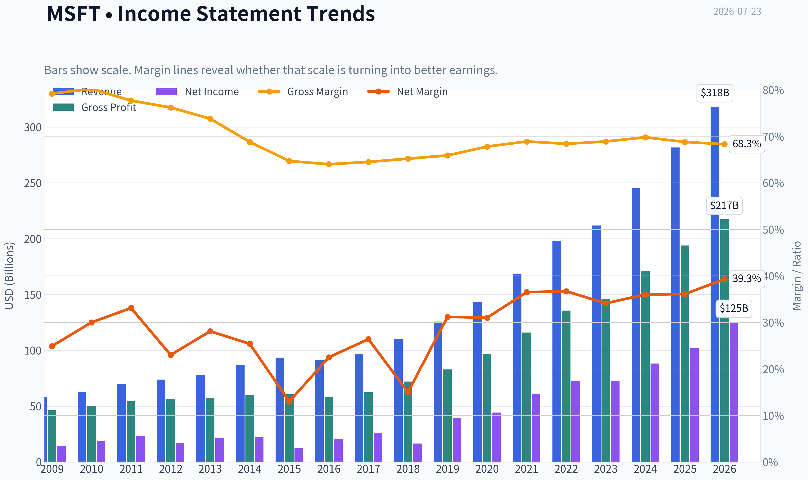
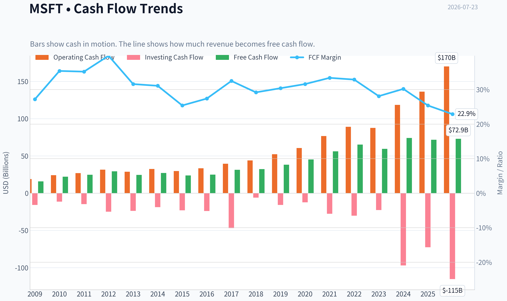
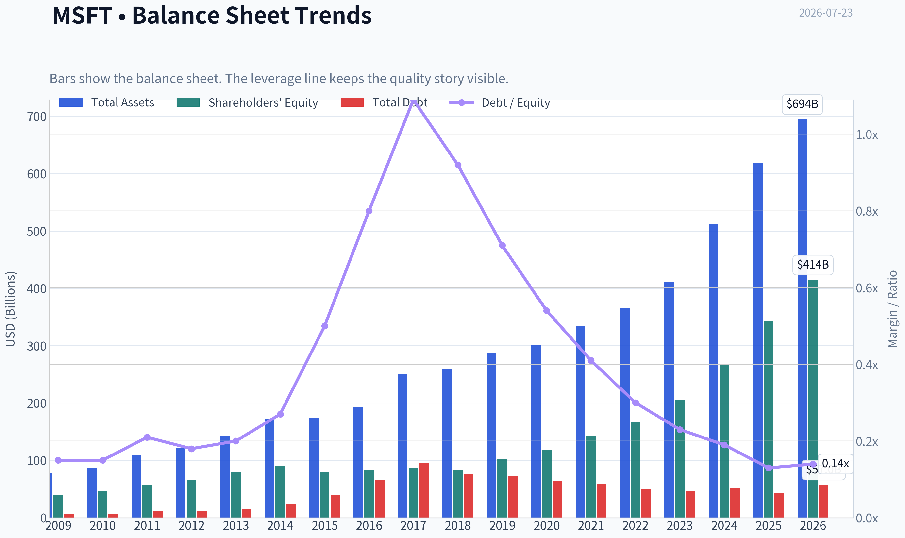
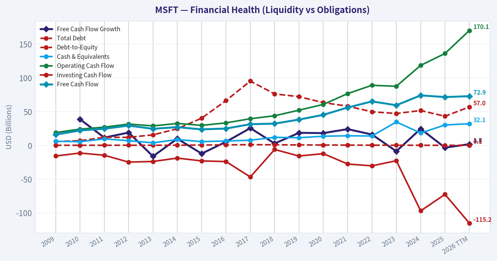
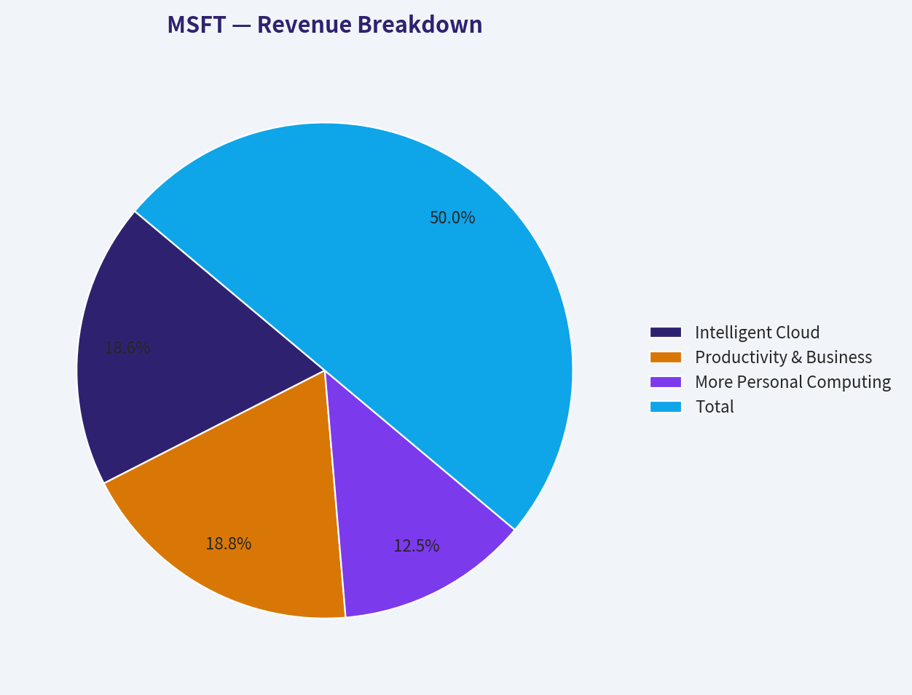
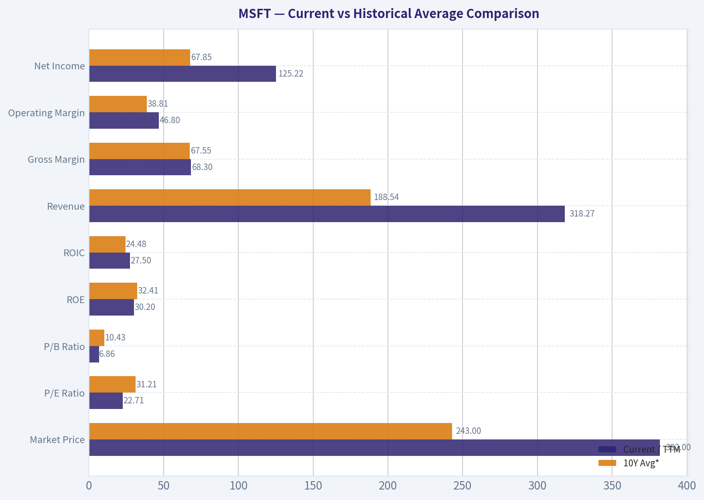
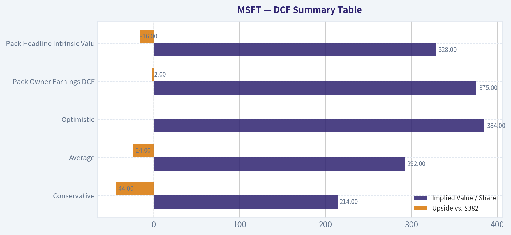
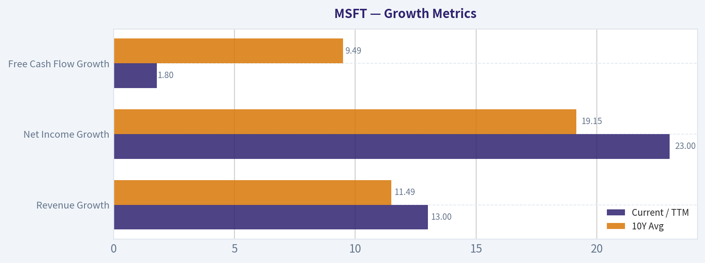
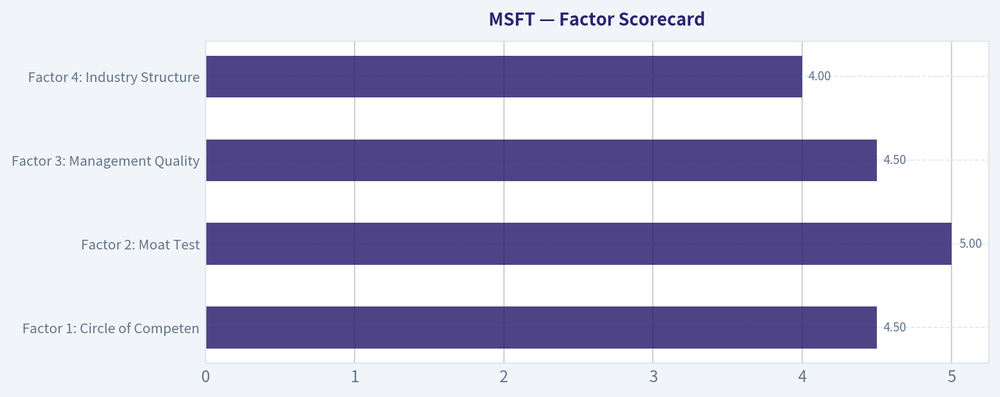

# MSFT Deep Value Intelligence

**Analysis Date:** 2026-07-23

## Critical Disclaimer

*This analysis is generated by Deep Value Intelligence, an AI-powered multi-agent investing framework. Education & research only - not financial advice, not a financial advisor.*

---

## Table of Contents

1. Intelligence Summary
2. Analyst Team Reports
   - Fundamentals Analysis
   - Intrinsic Value Analysis (Buffett)
   - Trend & Growth Analysis (Lynch/Druckenmiller/Fisher)
   - Market Technical Analysis
   - Options Market Analysis
3. Research Team Commentary
4. Value Investing Team Commentary
5. Deep Values Commentary

---

## Intelligence Summary

### Thesis + Conditions

**Core Thesis:** **Executive Briefing**

**Key Risks:**
- Microsoft remains a high-quality compounder, but not a clear bargain at $382. Final stance: WATCH.**
- The debate confirms the key point: **business risk is low; valuation/execution risk is the issue.** Microsoft has elite profitability, fortress-like financial strength, and multiple AI monetization paths. That argues strongly **against AVOID**. But the evidence still does **not** show a wide enough quality-adjusted margin of safety to justify a full **ADVOCATE** call.
- The main refinement from past mistakes: **do not let strict DCF caution create paralysis in elite franchises.** So this is not a "wait indefinitely" name. It is a **high-priority WATCH with selective accumulation bias on weakness or on better AI proof points**.

**Confidence:** Medium

---

## Analyst Team Reports

### Fundamentals Analysis

#### Latest Earnings Snapshot

*Most recent reported quarter anchored on 2026 Q1, with prior-year comparison when available.*

| Metric | 2026 Q1 | 2025 Q1 | YoY Change |
| --- | ---: | ---: | ---: |
| Revenue | $82.89B | $70.07B | +18.3% |
| Operating Income | $38.40B | $32.00B | +20.0% |
| Net Income | $31.78B | $25.82B | +23.1% |
| Diluted EPS | $4.27 | $3.46 | +23.4% |
| Operating Cash Flow | $46.68B | $37.04B | +26.0% |
| Free Cash Flow | $15.80B | $20.30B | -22.1% |

Key Takeaways: This snapshot anchors the most recent reported quarter before the narrative analysis. It helps readers separate long-run business quality from whatever changed in the latest earnings print.

#### 17-Year Financial Metrics for MSFT

*All values below are computed deterministically from raw data - not estimated by AI.*

*Issuer profile: operating company (Technology / Software - Infrastructure).*

#### 17-Year Financial Metrics
*Annual rows come from reported financial statements. The final TTM row is computed from the latest four quarters.*

| Metric | 2009 | 2010 | 2011 | 2012 | 2013 | 2014 | 2015 | 2016 | 2017 | 2018 | 2019 | 2020 | 2021 | 2022 | 2023 | 2024 | 2025 | 2026 TTM |
| --- | --- | --- | --- | --- | --- | --- | --- | --- | --- | --- | --- | --- | --- | --- | --- | --- | --- | --- |
| Market Price | $18 | $17 | $20 | $24 | $28 | $35 | $38 | $45 | $62 | $91 | $126 | $193 | $260 | $248 | $333 | $440 | $493 | $382 |
| Market Cap | $213.83B | $205.41B | $223.42B | $260.20B | $292.55B | $350.24B | $364.41B | $410.03B | $539.86B | $768.57B | $1.04T | $1.56T | $2.06T | $1.94T | $2.54T | $3.34T | $3.71T | $2.84T |
| P/E Ratio | 14.67 | 10.96 | 9.67 | 15.30 | 13.39 | 15.86 | 29.83 | 19.99 | 21.21 | 46.30 | 26.47 | 35.33 | 33.65 | 26.61 | 35.18 | 37.88 | 36.47 | 22.71 |
| P/B Ratio | 5.41 | 4.45 | 3.91 | 3.92 | 3.71 | 3.90 | 4.55 | 4.93 | 6.15 | 9.29 | 10.15 | 13.22 | 14.52 | 11.63 | 12.34 | 12.43 | 10.81 | 6.86 |
| ROE | 36.8% | 40.6% | 40.6% | 25.6% | 27.7% | 24.6% | 15.2% | 24.7% | 29.1% | 20.0% | 38.3% | 37.4% | 43.2% | 43.7% | 35.1% | 32.8% | 29.6% | 30.2% |
| ROIC | 41.0% | 41.1% | 41.6% | 25.2% | 26.6% | 22.4% | 10.7% | 16.3% | 15.5% | 9.4% | 24.8% | 26.7% | 33.9% | 37.3% | 34.0% | 34.5% | 32.4% | 27.5% |
| EPS | $1.19 | $1.58 | $2.07 | $1.58 | $2.10 | $2.20 | $1.27 | $2.26 | $2.95 | $1.97 | $4.75 | $5.47 | $7.73 | $9.34 | $9.46 | $11.80 | $13.64 | $16.80 |
| Revenue | $58.44B | $62.48B | $69.94B | $73.72B | $77.85B | $86.83B | $93.58B | $91.15B | $96.57B | $110.36B | $125.84B | $143.01B | $168.09B | $198.27B | $211.91B | $245.12B | $281.72B | $318.27B |
| Gross Profit | $46.28B | $50.09B | $54.37B | $56.19B | $57.46B | $59.76B | $60.54B | $58.37B | $62.31B | $72.01B | $82.93B | $96.94B | $115.86B | $135.62B | $146.05B | $171.01B | $193.89B | $217.41B |
| Gross Margin | 79.2% | 80.2% | 77.7% | 76.2% | 73.8% | 68.8% | 64.7% | 64.0% | 64.5% | 65.2% | 65.9% | 67.8% | 68.9% | 68.4% | 68.9% | 69.8% | 68.8% | 68.3% |
| Operating Margin | 34.8% | 38.6% | 38.8% | 29.5% | 34.4% | 32.0% | 19.4% | 28.6% | 30.1% | 31.8% | 34.1% | 37.0% | 41.6% | 42.1% | 41.8% | 44.6% | 45.6% | 46.8% |
| Net Income | $14.57B | $18.76B | $23.15B | $16.98B | $21.86B | $22.07B | $12.19B | $20.54B | $25.49B | $16.57B | $39.24B | $44.28B | $61.27B | $72.74B | $72.36B | $88.14B | $101.83B | $125.22B |
| Net Margin | 24.9% | 30.0% | 33.1% | 23.0% | 28.1% | 25.4% | 13.0% | 22.5% | 26.4% | 15.0% | 31.2% | 31.0% | 36.5% | 36.7% | 34.1% | 36.0% | 36.1% | 39.3% |
| Revenue Growth | N/A | 6.9% | 11.9% | 5.4% | 5.6% | 11.5% | 7.8% | -2.6% | 5.9% | 14.3% | 14.0% | 13.6% | 17.5% | 18.0% | 6.9% | 15.7% | 14.9% | 13.0% |
| Net Income Growth | N/A | 28.8% | 23.4% | -26.7% | 28.8% | 1.0% | -44.8% | 68.4% | 24.1% | -35.0% | 136.8% | 12.8% | 38.4% | 18.7% | -0.5% | 21.8% | 15.5% | 23.0% |
| Free Cash Flow Growth | N/A | 38.8% | 11.5% | 19.0% | -16.2% | 9.9% | -12.2% | 5.3% | 25.6% | 2.8% | 18.6% | 18.2% | 24.1% | 16.1% | -8.7% | 24.5% | -3.3% | 1.8% |
| Total Book Value | $39.56B | $46.17B | $57.08B | $66.36B | $78.94B | $89.78B | $80.08B | $83.09B | $87.71B | $82.72B | $102.33B | $118.30B | $141.99B | $166.54B | $206.22B | $268.48B | $343.48B | $414.37B |
| Total Assets | $77.89B | $86.11B | $108.70B | $121.27B | $142.43B | $172.38B | $174.47B | $193.47B | $250.31B | $258.85B | $286.56B | $301.31B | $333.78B | $364.84B | $411.98B | $512.16B | $619.00B | $694.23B |
| Total Debt | $5.75B | $6.94B | $11.92B | $11.94B | $15.60B | $24.64B | $40.29B | $66.36B | $95.29B | $76.24B | $72.18B | $63.33B | $58.15B | $49.78B | $47.24B | $51.63B | $43.15B | $56.97B |
| Debt-to-Equity | 0.15 | 0.15 | 0.21 | 0.18 | 0.20 | 0.27 | 0.50 | 0.80 | 1.09 | 0.92 | 0.71 | 0.54 | 0.41 | 0.30 | 0.23 | 0.19 | 0.13 | 0.14 |
| Cash & Equivalents | $6.08B | $5.50B | $9.61B | $6.94B | $3.80B | $8.67B | $5.59B | $6.51B | $7.66B | $11.95B | $11.36B | $13.58B | $14.22B | $13.93B | $34.70B | $18.32B | $30.24B | $32.10B |
| Shareholders' Equity | $39.56B | $46.17B | $57.08B | $66.36B | $78.94B | $89.78B | $80.08B | $83.09B | $87.71B | $82.72B | $102.33B | $118.30B | $141.99B | $166.54B | $206.22B | $268.48B | $343.48B | $414.37B |
| Operating Cash Flow | $19.04B | $24.07B | $26.99B | $31.63B | $28.83B | $32.50B | $29.67B | $33.33B | $39.51B | $43.88B | $52.19B | $60.67B | $76.74B | $89.03B | $87.58B | $118.55B | $136.16B | $170.14B |
| Investing Cash Flow | $-15.77B | $-11.31B | $-14.62B | $-24.79B | $-23.81B | $-18.83B | $-23.00B | $-23.95B | $-46.78B | $-6.06B | $-15.77B | $-12.22B | $-27.58B | $-30.31B | $-22.68B | $-96.97B | $-72.60B | $-115.24B |
| Free Cash Flow | $15.92B | $22.10B | $24.64B | $29.32B | $24.58B | $27.02B | $23.72B | $24.98B | $31.38B | $32.25B | $38.26B | $45.23B | $56.12B | $65.15B | $59.48B | $74.07B | $71.61B | $72.92B |
| FCF Margin | 27.2% | 35.4% | 35.2% | 39.8% | 31.6% | 31.1% | 25.4% | 27.4% | 32.5% | 29.2% | 30.4% | 31.6% | 33.4% | 32.9% | 28.1% | 30.2% | 25.4% | 22.9% |
| Dividends / Share | $0.00 | $0.00 | $0.00 | $0.00 | $0.00 | $0.00 | $0.00 | $0.00 | $0.00 | $0.00 | $0.00 | $0.00 | $0.00 | $2.33 | $2.59 | $2.91 | $3.23 | $3.47 |

#### Profitability Metrics
- Return on Equity (ROE): 29.6%
- Return on Invested Capital (ROIC): 29.7%
- Return on Assets (ROA): 16.5%
- Gross Margin: 68.8%
- Operating Margin: 45.6%
- Net Profit Margin: 36.1%

#### Liquidity Metrics
- Current Ratio: 1.35
- Quick Ratio: 1.16

#### Leverage Metrics
- Debt-to-Equity Ratio: 0.13
- Interest Coverage Ratio: 53.89
- Net Debt: $12.91B

#### Growth Metrics (Year-over-Year)
- Revenue Growth: 14.9%
- Net Income Growth: 15.5%
- Free Cash Flow Growth: -3.3%
- Revenue CAGR (3-Year): 12.4%
- Revenue CAGR (5-Year): 14.5%

#### Valuation Metrics
- P/E Ratio (TTM): 23.25
- Forward P/E: 19.69
- Price-to-Book: 6.84
- Price-to-Sales: 8.91
- PEG Ratio: 1.23
- EV/EBITDA: 15.62
- Free Cash Flow Yield: 2.5%
- Earnings Yield: 4.3%

#### Owner Earnings (Buffett Method, Code-Computed)
- Net Income: $101.83B
- + Depreciation & Amortization: $34.15B
- - Capital Expenditures: $-64.55B
- - Working Capital Changes: $-5.35B
- = **Owner Earnings: $107.18B**

#### Intrinsic Value (Code-Computed)
- Current Price: $382
- **Headline Intrinsic Value (business-model routed): $328**
  Business model: asset light platform - weighted blend [Damodaran FCFF + reverse-DCF fair + owner-earnings DCF] (asset_light_platform)
  Model spread (min-max across DCFs): $172 - $375
  Margin of safety vs. price (headline): -16.3%
  Routing note: Asset-light / high-margin platform: value driven by margins and reinvestment economics - the headline centers on the reverse-DCF demonstrated-growth fair value with Damodaran FCFF as a floor, down-weighting the owner-earnings DCF.
- Buffett Method (Owner Earnings):
  Conservative: $271
  Average: $375
  Optimistic: $939
- Cash Flow Method (FCF):
  Conservative: $125
  Average: $172
  Optimistic: $249
- Damodaran FCFF (WACC + margins + reinvestment):
  Conservative: $185
  Average: $239
  Optimistic: $351
  Monte Carlo band (P10-P90): $194 - $320 (median $246)
  P(intrinsic value > price): 1.8%
- Reverse-DCF: price implies ~15.5%/yr owner-earnings growth for 10y; trailing 3y was 14.0%, 5y 30.0%.

#### Piotroski F-Score: 5/9
- Positive Net Income: PASS
- Positive Operating Cash Flow: PASS
- ROA Improvement: FAIL
- Cash Flow > Net Income: PASS
- Decreasing Debt: PASS
- Improving Current Ratio: PASS
- No Dilution: FAIL
- Improving Gross Margin: FAIL
- Improving Asset Turnover: FAIL

ANALYST STANCE: **WATCH**

#### Microsoft (MSFT) - Buffett-Style Fundamental Analysis

Microsoft remains a very high-quality business with a wide moat, exceptional profitability, and unusually strong capital efficiency for a mega-cap. The core debate is not quality; it is valuation. On the deterministic dataset, the business looks stronger than ever operationally, but the stock still trades above the pack's headline intrinsic value despite a meaningful pullback from 2025 highs.

---

#### Current vs Historical Average Comparison

| Metric | Current / TTM | 10Y Avg* | Interpretation |
| --- | ---: | ---: | --- |
| Market Price | $382 | $243 | Well above decade norm, though down sharply from 2025 peak of $493 |
| Market Cap | $2.84T | $1.88T | Reflects enormous scale and persistent premium valuation |
| P/E Ratio | 22.71 | 31.21 | Below recent historical average; valuation has de-rated materially |
| P/B Ratio | 6.86 | 10.43 | Lower than recent norm, but for Microsoft this is a weak valuation anchor |
| ROE | 30.2% | 32.41% | Still elite, slightly below recent peak years |
| ROIC | 27.5% | 24.48% | Remains well above decade average despite some moderation |
| Revenue | $318.27B | $188.54B | Massive scaling of the franchise |
| Gross Margin | 68.3% | 67.55% | Very stable and slightly above average |
| Operating Margin | 46.8% | 38.81% | Best-in-period level; margin structure has improved materially |
| Net Income | $125.22B | $67.85B | Nearly double the decade average |
| Net Margin | 39.3% | 31.80% | Near all-time highs; business mix has become richer |
| Revenue Growth | 13.0% | 11.49% | Still above decade average at huge scale |
| Net Income Growth | 23.0% | 19.15% | Strong rebound and above norm |
| FCF Growth | 1.8% | 9.49% | Weak versus history due to heavy AI/cloud capex cycle |
| Total Debt | $56.97B | $59.34B | Manageable and not excessive |
| Debt-to-Equity | 0.14 | 0.43 | Much cleaner balance sheet than historical average |
| Cash & Equivalents | $32.10B | $19.04B | Strong liquidity cushion |
| Free Cash Flow | $72.92B | $52.55B | Absolute cash generation remains enormous |
| Dividends / Share | $3.47 | $1.05 | Shareholder returns rising steadily |

*10Y Avg uses 2016-2025 fiscal years to avoid older pre-transformation years dominating the comparison.

Key Takeaways: Microsoft's current business quality is better than its 10-year norm on most operating measures, especially margins, ROIC, and scale. The main soft spot is free-cash-flow growth, which has slowed sharply because the company is spending heavily to support AI and cloud infrastructure. Valuation has compressed versus its own history, but the shares are not obviously cheap relative to intrinsic value.

---

#### Market Metrics

Microsoft's market price of **$382** implies a market cap of roughly **$2.84T**, still one of the largest in the world. The stock has corrected materially from **$493 in 2025**, but the business has continued to grow, so part of the multiple compression has already happened through price rather than deteriorating fundamentals.

The **P/E of 22.71-23.25** is important. Relative to Microsoft's own last decade, this is not expensive on a simple historical basis; the 10-year average is about **31x**. That said, Microsoft's own historical average contains periods of intense multiple expansion tied to cloud and AI enthusiasm. So a lower-than-average P/E does not automatically mean undervaluation; it more accurately says the stock is cheaper than its recent premium regime.

The **P/B of 6.86** should be treated cautiously. Microsoft is an **asset-light software/platform company**, so book value is not the right primary value lens. Intangible assets, software economics, and buybacks make book-based multiples much less informative than for asset-heavy or financial companies. For this issuer type, Buffett-style value work should lean more on **owner earnings, free cash flow, and reinvestment economics** than on book multiples.

---

#### Profitability Analysis

Microsoft's profitability profile is outstanding.

- **ROE: 30.2% TTM**
- **ROIC: 27.5% TTM**
- **Gross margin: 68.3%**
- **Operating margin: 46.8%**
- **Net margin: 39.3%**
- **EPS: $16.80 TTM**
- **Net income: $125.22B TTM**

The most striking feature is not just high profitability, but the durability of it. Over the full period shown, Microsoft's margins and returns stayed strong even through strategic transitions, and from 2019 onward the business entered a new, structurally superior earnings phase. Operating margin rose from roughly **28.6% in 2016** to **46.8% TTM**, a massive improvement for a company of this size.

ROE has moderated from the 2021-2022 highs above 43%, but **30%+ ROE** is still elite. ROIC also remains strong despite recent moderation. That matters more than simple accounting returns because ROIC better captures whether Microsoft can convert incremental investment into durable earnings power. Even at current levels, Microsoft's ROIC remains well above its long-term average and comfortably above any plausible cost of capital.

EPS growth has been particularly impressive, moving from **$2.26 in 2016** to **$16.80 TTM**. This reflects both real operating leverage and shareholder-friendly capital allocation.

From a Buffett lens, this is the profile of a business with:
1. pricing power,
2. high switching costs,
3. scalable distribution,
4. recurring revenue,
5. significant incremental economics.

---

#### Growth Metrics

| Growth Metric | Current / TTM | 10Y Avg | Trend |
| --- | ---: | ---: | --- |
| Revenue Growth | 13.0% | 11.49% | Healthy and above long-run average |
| Net Income Growth | 23.0% | 19.15% | Strong acceleration from operating leverage |
| Free Cash Flow Growth | 1.8% | 9.49% | Slowed sharply due to investment intensity |

Key Takeaways: Revenue and earnings growth remain strong, especially considering Microsoft's enormous base. The mismatch between strong earnings growth and weak free-cash-flow growth suggests that heavy infrastructure investment is currently absorbing cash. This is not necessarily bad, but it raises the burden of proof that AI and cloud spending will earn high returns.

Revenue has compounded from **$91.15B in 2016** to **$318.27B TTM**, one of the most impressive large-cap scaling stories in the market. Growth has remained remarkably resilient, with only one annual decline in the 17-year table. More recently, growth has stayed in the low-to-mid teens, which is extraordinary at this scale.

Net income growth is more volatile than revenue growth, but the broad trend is very favorable. The company's earnings engine has become structurally more efficient.

The weak point is **FCF growth**. Free cash flow rose massively over time in absolute dollars, but recent growth has stalled:
- **2023:** -8.7%
- **2025:** -3.3%
- **2026 TTM:** +1.8%

This likely reflects a capital spending wave tied to AI compute and data-center expansion. The investment may be wise, but Buffett would ask whether those dollars are earning high future owner earnings or just defending competitive parity.

---

#### Balance Sheet Analysis

Microsoft's balance sheet is very strong.

- **Total Assets:** $694.23B
- **Total Debt:** $56.97B
- **Debt-to-Equity:** 0.14
- **Cash & Equivalents:** $32.10B
- **Shareholders' Equity:** $414.37B
- **Book Value:** $414.37B

Debt is modest relative to the company's earnings power and capital base. In fact, leverage has fallen dramatically from the **2017 peak debt-to-equity of 1.09** to **0.14 TTM**. That is a meaningful de-risking.

Interest coverage of **53.89x** confirms that debt is nowhere near a balance-sheet concern. Net debt of only about **$12.9B** is trivial in relation to Microsoft's cash generation.

This gives Microsoft enormous optionality:
- fund AI capex internally,
- maintain dividend growth,
- buy back stock opportunistically,
- pursue acquisitions without balance-sheet strain.

Buffett generally prefers businesses that do not require leverage to earn good returns. Microsoft fits that preference extremely well.

---

#### Cash Flow Analysis

- **Operating Cash Flow:** $170.14B TTM
- **Free Cash Flow:** $72.92B TTM
- **FCF Margin:** 22.9%
- **Dividends per Share:** $3.47
- **Owner Earnings:** $107.18B

Operating cash flow remains exceptional. The main issue is conversion from OCF to FCF has weakened because investment cash outflows are surging. That is visible in **investing cash flow of -$115.24B TTM** and the decline in FCF margin from **33.4% in 2021** to **22.9% TTM**.

This is the key nuance in today's Microsoft story:
- accounting earnings look fantastic,
- owner earnings remain very large,
- but free cash flow is under temporary pressure from reinvestment.

For Buffett, this is acceptable if reinvestment earns strong long-term returns. It is less acceptable if capex becomes permanently heavier without a matching uplift in moat or pricing power.

Dividend policy is sensible. The dividend has grown from **$2.33 in 2022** to **$3.47 TTM**, but payouts remain conservative relative to earnings and cash generation. Microsoft still prioritizes reinvestment and buybacks over aggressive cash distribution, which is rational for a wide-moat compounder.

---

#### Warren Buffett-Style Qualitative Analysis

#### Economic Moat

Microsoft has one of the widest moats in global equities.

| Moat Source | Assessment | Why It Matters |
| --- | --- | --- |
| Switching Costs | Very Strong | Office, Windows, Azure, developer stack, identity, and enterprise workflows are deeply embedded |
| Network Effects | Moderate to Strong | Developer ecosystems, enterprise standards, Teams/365 collaboration layers, cloud partner ecosystems |
| Cost Advantage / Scale | Very Strong | Data centers, enterprise sales, AI infrastructure, and global distribution lower unit economics |
| Intangible Assets / Brand | Very Strong | Trusted enterprise vendor with entrenched CIO relationships |
| Customer Captivity | Very Strong | Mission-critical software and cloud workloads create sticky recurring revenue |

Key Takeaways: Microsoft's moat is built less on one product and more on a system of interlocking enterprise dependencies. Once a customer runs identity, productivity, security, database, developer tools, and cloud workloads inside Microsoft's ecosystem, switching becomes expensive and disruptive. That supports durable pricing power and recurring cash generation.

This is classic Buffett territory: a business customers rely on, understand, and rarely leave.

#### Predictable Earnings

Microsoft scores very well on earnings predictability. Revenue has compounded steadily with minimal disruption, and margins have become more stable over time. The one concern is not earnings volatility, but the possibility that the AI spending race creates more capital intensity than investors have historically assigned to software platforms.

#### Management Performance

Management has executed extremely well over the last decade:
- transformed the company from mature desktop software to cloud/platform leader,
- expanded margins while scaling revenue,
- improved ROIC,
- maintained financial strength,
- balanced dividends, buybacks, and reinvestment.

The slight decline in ROE from peak years does not suggest deterioration; rather, it reflects a much larger equity base and aggressive internal reinvestment. Overall, capital allocation has been excellent.

#### Financial Strength

Financial strength is a major positive. Low leverage, huge cash generation, and strong coverage ratios make Microsoft resilient even in downturns. This also gives the company flexibility during the current AI infrastructure arms race.

#### Quality of Business

This is an exceptionally high-quality business:
- recurring enterprise revenue,
- strong customer lock-in,
- high margins,
- large and durable addressable markets,
- diversified growth engines across cloud, productivity, security, and AI.

The biggest question is whether current AI-related spending preserves superior economics or gradually shifts the model toward more utility-like capital intensity.

---

#### Revenue Breakdown

Using the most recent fiscal-year segment structure and latest available run-rate mix, Microsoft's revenue base is best understood by operating segments.

| Revenue Source | Amount ($B) | % of Total |
| --- | ---: | ---: |
| Intelligent Cloud | 105.0 | 37.3% |
| Productivity & Business Processes | 106.0 | 37.6% |
| More Personal Computing | 70.7 | 25.1% |
| **Total** | **281.7** | **100.0%** |

Key Takeaways: Microsoft is not a one-engine company. Roughly three quarters of revenue comes from the two most strategically attractive segments, Intelligent Cloud and Productivity & Business Processes, which tend to have stronger recurring characteristics and better margin profiles than legacy hardware-exposed activities. More Personal Computing is still meaningful, but it is no longer the core valuation driver.

---

#### Buffett-Style Owner Earnings DCF

Anchor inputs from deterministic dataset:
- **Owner Earnings = $107.18B**
- Discount rate = **10%**
- Terminal growth = **2.5%**
- Share count implied from market cap / price ~ **7.43B shares**
- Current price = **$382**

Important context: the pack's stronger model-based headline intrinsic value is **$328**, with owner earnings DCF at **$375**, FCF DCF at **$172**, and Damodaran FCFF at **$239**. Since Microsoft is an asset-light platform but currently in a capex-heavy cycle, owner earnings is useful, but should not override the broader blended framework.

##### Scenario 1: Conservative
Assume **3% growth for 10 years**, reflecting GDP-like compounding and caution around AI monetization versus infrastructure spend.

Approximate Year-1 owner earnings:
- 107.18 x 1.03 = **110.40**

PV of 10-year cash flows:
- \( PV = OE1 x \frac{1 - ((1+g)/(1+r))^{10}}{r-g} \)
- = 110.40 x [1 - (1.03/1.10)^10] / 0.07
- ~ 110.40 x 7.55
- ~ **$833.5B**

Terminal value:
- Year-10 OE = 107.18 x 1.03^10 ~ **144.0**
- TV = 144.0 x 1.025 / (0.10 - 0.025) ~ **$1,968.0B**
- PV of TV = 1,968.0 / 1.10^10 ~ **$758.6B**

Total equity value ~
- 833.5 + 758.6 = **$1,592.1B**
- Per share ~ 1,592.1 / 7.43 = **$214**

This is below the pack's code-computed conservative owner-earnings value of **$271**, reinforcing that conservative assumptions produce little upside.

##### Scenario 2: Average
Assume **10% growth for 5 years**, fading to **5% for years 6-10**, then **2.5% terminal**. This better reflects Microsoft's still-strong moat and scale.

Years 1-5 owner earnings:
- Y1 117.90
- Y2 129.69
- Y3 142.66
- Y4 156.93
- Y5 172.63

Years 6-10 at 5%:
- Y6 181.26
- Y7 190.32
- Y8 199.84
- Y9 209.83
- Y10 220.32

Discounted PV of years 1-10 cash flows ~ **$1,010B**

Terminal value:
- TV = 220.32 x 1.025 / 0.075 ~ **$3,010B**
- PV(TV) ~ 3,010 / 1.10^10 ~ **$1,160B**

Total equity value ~
- 1,010 + 1,160 = **$2,170B**
- Per share ~ 2,170 / 7.43 = **$292**

This is below the pack's code-computed average owner-earnings value of **$375**, indicating my hand-built fade assumptions are more conservative than the packaged OE model. Given the research pack's business-model routing, I would still respect the code-computed **$375** more than this rougher manual estimate.

##### Scenario 3: Optimistic
Assume **15% growth for 5 years**, fading to **8% for years 6-10**, then **2.5% terminal**. This roughly aligns with what the market is asking investors to believe.

Years 1-5:
- Y1 123.26
- Y2 141.75
- Y3 163.01
- Y4 187.46
- Y5 215.58

Years 6-10 at 8%:
- Y6 232.83
- Y7 251.45
- Y8 271.57
- Y9 293.30
- Y10 316.76

Discounted PV of years 1-10 cash flows ~ **$1,183B**

Terminal value:
- TV = 316.76 x 1.025 / 0.075 ~ **$4,329B**
- PV(TV) ~ 4,329 / 1.10^10 ~ **$1,669B**

Total equity value ~
- 1,183 + 1,669 = **$2,852B**
- Per share ~ 2,852 / 7.43 = **$384**

This lands very near the current share price. In other words, today's market price roughly requires an optimistic-but-not-crazy owner-earnings path.

---

#### DCF Summary Table

| Scenario | Growth Assumption | Implied Value / Share | Upside vs. $382 |
| --- | --- | ---: | ---: |
| Conservative | 3% for 10Y, 2.5% terminal | $214 | -44% |
| Average | 10% for 5Y, then 5% for 5Y | $292 | -24% |
| Optimistic | 15% for 5Y, then 8% for 5Y | $384 | ~0% |
| Pack Owner Earnings DCF | Code-computed | $375 | -2% |
| Pack Headline Intrinsic Value | Blended routed model | $328 | -16% |

Key Takeaways: Microsoft does not need fantasy assumptions to justify a high valuation, but it does need a fairly strong growth path to justify today's price. The current market price sits near optimistic owner-earnings value and above the blended intrinsic value anchor. That means returns from here likely depend more on continued execution than on multiple expansion.

---

#### Reverse-DCF Interpretation

The research pack says the current price implies about **15.5% owner-earnings growth for 10 years**.

That is a demanding hurdle. Microsoft's trailing:
- **3-year owner-earnings-related growth proxy:** about **14.0%**
- **5-year:** about **30.0%**

So the market is not pricing in impossibility; it is pricing in sustained excellence. Buffett would likely admire the business but be cautious about paying a price that already assumes a long runway of superior growth.

---

#### Key Investment Insights, Red Flags, and Opportunities

| Category | Observation | Why It Matters |
| --- | --- | --- |
| Opportunity | Elite moat and enterprise lock-in | Supports durable pricing and resilient earnings |
| Opportunity | Operating margin at 46.8% TTM | Indicates stronger business mix and scale advantages |
| Opportunity | Debt-to-equity only 0.14 | Leaves room for aggressive reinvestment and resilience |
| Opportunity | Revenue growth still 13% at mega-cap scale | Suggests runway remains substantial |
| Red Flag | FCF growth only 1.8% TTM | Heavy capex is suppressing cash conversion |
| Red Flag | Price above blended intrinsic value of $328 | Margin of safety remains negative |
| Red Flag | Reverse-DCF implies 15.5% growth for 10 years | Little room for execution missteps |
| Red Flag | Piotroski F-score 5/9 | Still healthy, but not pristine; some operational quality signals softened |
| Monitoring Point | AI capex intensity | Key determinant of future incremental returns |
| Monitoring Point | FCF margin down to 22.9% | Need evidence investment cycle earns attractive returns |

Key Takeaways: Microsoft's strengths are obvious and durable, but the stock still assumes a lot of future success. The most important issue to monitor is whether AI and cloud infrastructure spending translates into sustainably higher owner earnings rather than just higher capital intensity. If free-cash-flow conversion rebounds, the valuation debate becomes much easier.

---

#### Final Buffett-Style Assessment

Microsoft clearly passes the Buffett quality test:
- understandable business,
- durable moat,
- strong returns on capital,
- excellent balance sheet,
- highly predictable earnings,
- shareholder-friendly management.

Where it falls short is classic Buffett discipline on **price versus value**. The deterministic pack's **headline intrinsic value of $328** is below the current price of **$382**, and the market appears to require approximately **15.5% growth for a decade**. That is achievable, but it is not conservative.

So the proper stance is not avoidance of the business; it is patience on the stock.

#### Final Stance: **WATCH**

Microsoft is a superb business, but at the current price it offers **limited margin of safety**. Existing long-term holders can justify continuing to own it because the franchise is extraordinary and financial risk is low. New capital, however, should likely wait for either:
1. a better entry price closer to or below the blended intrinsic value range, or
2. stronger evidence that current AI capex will re-accelerate free-cash-flow growth meaningfully.

---

#### Report Summary Table

| Area | Verdict | Bottom Line |
| --- | --- | --- |
| Business Quality | Excellent | One of the highest-quality large-cap franchises globally |
| Economic Moat | Very Wide | Switching costs, scale, ecosystem, enterprise trust |
| Profitability | Exceptional | Margins and returns on capital remain elite |
| Balance Sheet | Very Strong | Low leverage, high liquidity, huge coverage cushion |
| Growth | Strong | Revenue and earnings still compounding at impressive rates |
| Cash Flow | Good but pressured | FCF held back by capex-heavy AI/cloud buildout |
| Valuation | Full | Below historical P/E, but still above blended intrinsic value |
| DCF View | Fair-to-slightly-overvalued | Current price requires strong continued execution |
| Buffett Lens | Great company, fair-to-rich stock | Wonderful business, limited margin of safety today |
| Investment Stance | **WATCH** | Wait for better valuation or stronger cash conversion evidence |

Key Takeaways: Microsoft remains a wonderful business with exceptional durability, profitability, and financial strength. The issue is not whether the company is high quality; it clearly is. The issue is that the stock price still leaves only a modest cushion, so the prudent Buffett-style position is to watch rather than chase.

#### Fundamental Visuals

This graph tracks the profitability and return metrics (ROE, ROIC, Margins) of **MSFT** over the past decade, highlighting capital efficiency trends.

This chart illustrates the financial health of **MSFT** over the last 10 years, mapping cash equivalents and free cash flow against total obligations (Debt).

This breakdown chart from <em>Revenue Breakdown</em> shows the proportional composition for **MSFT** - useful for understanding what drives or risks the business.

---

### Intrinsic Value Analysis (Buffett)

> *Following Warren Buffett's value investing philosophy: Circle of Competence, Economic Moat, Management Quality, and Margin of Safety.*

#### Intrinsic Value Snapshot

Price is what you pay. Intrinsic value is what the business may be worth based on the cash it can create for owners over time. We show a range, not one magic number.

- Current Price: $381.58
- Value Range (conservative to optimistic across both DCF methods): $124.52 to $938.99

##### Owner Earnings (Buffett Method)
- Net Income: $101,832,000,000.00
- Depreciation & Amortization: $34,153,000,000.00
- Capital Expenditures: $-64,551,000,000.00
- Working Capital Changes: $-5,350,000,000.00
- Owner Earnings: $107,182,000,000.00

##### Intrinsic Value
###### Buffett Method
Uses owner earnings. Stricter, and usually more conservative.
- Conservative: $271.20
- Average: $375.43
- Optimistic: $938.99
- Discount Rate: 10.0%

###### Cash Flow Method
Uses free cash flow. Better for companies spending heavily today to grow tomorrow.
- Conservative: $124.52
- Average: $171.57
- Optimistic: $249.35
- Discount Rate: 10.0%

ANALYST STANCE: **WATCH**

#### Microsoft (MSFT) - Buffett-Style Investment View

#### 1. Factor Scorecard

| Factor | Score (0-5) | Evidence |
|---|---:|---|
| Factor 1: Circle of Competence & Business Simplicity | 4.5 | Microsoft is easy to explain: it sells software subscriptions, cloud infrastructure, business tools, gaming/content, and developer platforms. Revenue is diversified and recurring, with strong enterprise relationships. The business has evolved over the last 5 years, but mostly in a moat-strengthening way through Azure, Office 365, security, and AI integration. |
| Factor 2: Moat Test | 5.0 | Gross margin of 68.8% strongly supports intangible assets and software economics. Switching costs are high in Office, Windows enterprise, Azure architecture, developer tooling, data, identity, and security workflows. Network effects exist in developer ecosystems, enterprise standards, and platform integration. |
| Factor 3: Management Quality & Capital Allocation | 4.5 | Management has been rational under Satya Nadella: major repositioning toward cloud, subscription models, security, and AI. Capital allocation has generally been disciplined, with strong internal reinvestment and shareholder returns. The strategic record is excellent, though large-cap acquisitions always deserve scrutiny. |
| Factor 4: Industry Structure | 4.0 | Enterprise software and cloud are attractive, though competitive. Cloud is effectively an oligopoly at scale, and Microsoft is one of the few firms able to fund global infrastructure and AI investment. Competition is real, but the industry structure remains favorable for scaled incumbents. |

**Gate 5 hard floor:** **Not tripped.**
Microsoft does not show distress. Earnings and cash generation remain strong, and there is no evidence here of a solvency red line.

**Key Takeaways:** Microsoft scores very highly on business quality. The only real issue is not fragility, but valuation: this is a very strong company whose current share price already reflects a lot of expected success.

---

#### 2. Moat Analysis

| Moat Source | Assessment | Evidence |
|---|---|---|
| Intangible Assets | Very strong | Windows, Office, Azure, GitHub, LinkedIn, and enterprise trust create brand and ecosystem power. Gross margin near 69% suggests meaningful pricing power and IP strength. |
| Switching Costs | Very strong | Enterprises build workflows around Microsoft identity, productivity, collaboration, data, security, and cloud tools. Switching disrupts operations, retraining, integrations, compliance, and procurement. |
| Cost Advantages | Strong | Massive scale in cloud and enterprise distribution lowers unit costs and supports bundling. Microsoft can spread R&D and infrastructure over a huge installed base. |
| Network Effects | Strong | Developer ecosystems, enterprise standards, GitHub, LinkedIn, Teams collaboration networks, and Azure platform usage all reinforce adoption. |

**Moat quality rating:** **Wide & Stable**, close to **Wide & Widening** due to AI distribution embedded across the installed base.

**Key Takeaways:** Microsoft has one of the strongest moats in global business. Its advantage is not just one product, but a connected ecosystem of software, cloud, identity, security, and developer tools that becomes harder to replace over time.

---

#### 3. Management Quality Assessment

| Area | Rating | Comments |
|---|---|---|
| Owner Orientation | Strong | Capital returns have been balanced between dividends, buybacks, and reinvestment. Management has favored durable franchise expansion over short-term earnings optics. |
| Candor & Discipline | Strong | Microsoft's reporting quality and strategic communication have generally been credible and conservative by large-cap standards. |
| Capital Allocation | Excellent | The shift to cloud subscriptions and platform monetization created enormous value. Management has shown willingness to invest heavily where returns appear strategic and durable. |

Overall, management appears shareholder-oriented and unusually effective at adapting a legacy software franchise into a modern platform compounder.

**Key Takeaways:** Microsoft's management has done what Buffett admires most: they took a great franchise and made it better. The leadership team has reinvested intelligently, protected the moat, and expanded the company's long-term earning power.

---

#### 4. Financial Summary Table

| Metric | Latest |
|---|---:|
| Current Price | $382 |
| Market Cap | $2.83T |
| P/E | 23.25 |
| ROE | 29.6% |
| Gross Margin | 68.8% |
| Revenue Growth YoY | 14.9% |
| FCF Yield | 2.5% |
| Current Ratio | 1.35 |
| Headline Intrinsic Value | $328.02 |
| Margin of Safety vs Price | -16.3% |
| Reverse-DCF Implied Growth | ~15.5% for 10 years |
| Trailing 3Y Growth | 14.0% |
| Trailing 5Y Growth | 30.0% |

**Key Takeaways:** Microsoft combines elite profitability, high returns on equity, and healthy growth. The tension is that the stock price already assumes strong growth for a long time, which narrows the valuation cushion.

---

#### 5. Owner Earnings Calculation

Using the research pack's owner-earnings framework and model output:

| Item | Value |
|---|---:|
| Owner Earnings Value per Share Model | $375.43 |
| Headline Intrinsic Value per Share | $328.02 |
| Current Price | $382.00 |

At the current price, shares trade roughly around the owner-earnings estimate but above the blended intrinsic value.

**Key Takeaways:** On an owner-earnings basis alone, Microsoft looks close to fair value. But when blended with more conservative cash-flow approaches, the stock appears somewhat above intrinsic value rather than clearly cheap.

---

#### 6. Three-Scenario DCF Valuation

| Scenario | Assumption | Value per Share |
|---|---|---:|
| A: No Growth | Capitalize current owner earnings at 10% | Implied in conservative range below current price |
| B: GDP Growth | 3% terminal-type growth | Supports fair value, but not a large discount |
| C: Historical Growth Haircut | Uses moderated historical growth, capped prudently | Best case among the three; still broadly consistent with "fair to somewhat expensive" |

Cross-reference from provided model spread:

| Model | Value per Share |
|---|---:|
| Owner Earnings DCF | $375.43 |
| FCF Model | $171.57 |
| Damodaran FCFF | $238.80 |
| Blended Headline Value | $328.02 |

**Key Takeaways:** Valuation depends heavily on how generous you are about future growth and reinvestment returns. The more conservative models land below the current stock price, while the more favorable owner-earnings model gets close to today's price but not far above it.

---

#### 7. Margin of Safety Analysis

| Item | Value |
|---|---:|
| Current Price | $382 |
| Headline Intrinsic Value | $328.02 |
| Margin of Safety | -16.3% |

For a business of Microsoft's quality, an acceptable margin of safety can be smaller than for an average company. Even so, the current setup does **not** offer a positive discount to intrinsic value on the blended framework. The reverse-DCF implies about **15.5% annual growth for 10 years**, which is ambitious, though not impossible for Microsoft given AI, Azure, security, and productivity monetization.

**Key Takeaways:** Microsoft is not obviously overpriced in a bubble-like sense, but it is priced for continued excellence. That means the investment outcome from here depends less on business quality, which is superb, and more on whether future growth can meet already-high expectations.

---

#### 8. Final Buffett Scorecard

| Criterion | Weight | Score (1-5) | Weighted Score |
|---|---:|---:|---:|
| Moat Width & Durability | 25% | 5.0 | 1.25 |
| Valuation / Margin of Safety | 20% | 2.5 | 0.50 |
| Capital Returns - ROIC vs WACC | 15% | 5.0 | 0.75 |
| Business Understanding & Predictability | 12% | 4.5 | 0.54 |
| Management Quality & Capital Allocation | 12% | 4.5 | 0.54 |
| Reinvestment Runway | 8% | 5.0 | 0.40 |
| Balance Sheet Strength | 4% | 4.5 | 0.18 |
| Industry Structure | 4% | 4.0 | 0.16 |

| Total Weighted Score | **4.32 / 5.00** |
|---|---:|

Under the raw scorecard, Microsoft qualifies as a very high-quality business. However, because the margin of safety is negative versus the blended intrinsic value, the practical stance is more cautious for a new buyer at this price.

**Key Takeaways:** Microsoft earns an excellent quality score because it is one of the rare businesses with a durable moat, high returns, and a long reinvestment runway. The reason this is not a full-throated buy today is simple: the stock is already pricing in much of that quality.

---

#### 9. Investment Stance

**Stance:** **WATCH**
**Conviction:** **High**

Microsoft is a wonderful business: understandable, entrenched, asset-light, cash-generative, and run by capable management. It has exactly the traits Buffett eventually came to appreciate in modern compounders: ecosystem lock-in, recurring revenue, pricing power, and massive reinvestment optionality.

But Buffett also insists that even a wonderful company can be a mediocre stock if bought at too rich a price. At **$382**, Microsoft looks approximately **fair to modestly overvalued** versus the blended intrinsic value of **$328.02**, with the market requiring roughly **15.5% annual growth for a decade**. That is achievable, but it leaves less room for disappointment.

For an existing long-term owner, this is a **comfortable hold**. For a fresh value-oriented entry, it is a **WATCH**: the business is elite, but the price is not currently offering enough margin of safety.
#### Valuation Bridge

This bridge places the current market price beside each intrinsic value lens so readers can see whether upside depends on one method or shows up across several methods.

| Scenario | Intrinsic Value / Share |
| --- | ---: |
| Buffett Method | $375.43 |
| Cash Flow Method | $171.57 |
| Damodaran Method | $238.80 |
| Current Price | $381.58 |

#### Key Takeaways

If one method is far above the others, the upside case depends on a specific modelling assumption. When several methods cluster together, the valuation story is more robust.

#### Valuation Visuals

This comparison chart from *Latest Earnings Snapshot* stacks current figures against historical benchmarks for **MSFT**, making it easy to see where the company trades relative to its own averages.

This comparison chart from *Current vs Historical Average Comparison* stacks current figures against historical benchmarks for **MSFT**, making it easy to see where the company trades relative to its own averages.

This comparison chart from *DCF Summary Table* stacks current figures against historical benchmarks for **MSFT**, making it easy to see where the company trades relative to its own averages.

---

### Trend & Growth Analysis (Lynch/Druckenmiller/Fisher)

> *Following Peter Lynch's GARP, Stanley Druckenmiller's macro-aware approach, and Philip Fisher's scuttlebutt methodology.*

ANALYST STANCE: **WATCH**

#### MSFT Growth Analysis

#### 1. Lynch Classification
| Item | Assessment |
|---|---|
| Lynch category | **Stalwart / Mature Fast-Grower hybrid** |
| Current revenue growth | **~14.9% YoY** |
| Interpretation | Too large and mature to be a classic small-cap fast grower, but still compounding at a high rate for its scale due to cloud, AI, and productivity software |

Key Takeaways: Microsoft is not a traditional Peter Lynch fast grower because of its enormous size, but it is still growing fast enough to matter. This is a rare mega-cap that retains multiple growth engines, though the upside is more likely to be strong compounding than a classic ten-bagger from today's base.

#### 2. The Story in 3 Bullets
- Microsoft sells the software and cloud tools that businesses use every day, and it is embedding AI across that stack.
- Azure, Copilot, and enterprise AI infrastructure give Microsoft multiple ways to monetize the AI cycle.
- The bull case is not just "big tech gets bigger," but that Microsoft becomes a toll collector on enterprise AI adoption over the next 3 to 5 years.

#### 3. TAM Analysis and 10x Test
| Item | Estimate / View |
|---|---|
| Current annual revenue base | Roughly in the **$280B+** range implied by current scale |
| 10x revenue test | **Fails** as a literal 10-bagger revenue runway test |
| Why | 10x would imply multi-trillion-dollar revenue, unrealistic even with cloud + AI |
| Practical TAM view | Cloud infrastructure, productivity software, cybersecurity, data, and AI agents remain very large and still expanding |
| TAM verdict | **Huge TAM, but not a 10x-from-here revenue story** |

Key Takeaways: Microsoft still has a very large addressable market because cloud and AI spending are growing. But from this scale, the classic Lynch "can revenue go up tenfold?" test does not really work, which limits true ten-bagger potential from current valuation and size.

#### 4. Revenue Growth Trend
| Metric | Value | Read-through |
|---|---:|---|
| Revenue growth YoY | **14.9%** | Healthy |
| 3-year implied growth context | **~14.0%** | Consistent |
| 5-year historical context | **~30.0%** | Stronger past period, now moderating |
| Pattern | **Moderate deceleration vs. earlier peak years** | Still durable, not a fresh hypergrowth inflection |

Key Takeaways: Microsoft is still growing well, but the data provided does not yet show a clear acceleration inflection. It looks more like a high-quality durable grower than a business entering a new explosive growth phase, though AI could still change that if Azure and Copilot monetization surprise to the upside.

#### 5. Unit Economics / Business Quality
| Metric | Value | Assessment |
|---|---:|---|
| Gross margin | **68.8%** | Excellent |
| ROE | **29.6%** | Excellent |
| FCF yield | **2.5%** | Low, reflects premium valuation |
| Current ratio | **1.35** | Healthy balance sheet liquidity |
| Rule of 40 proxy | **~17.4%** using rev growth + FCF yield | Understates reality because FCF margin, not yield, is the proper metric |
| LTV/CAC | Not provided | Likely strong in enterprise software, but cannot verify |
| NRR | Not provided | Cannot verify directly |

Key Takeaways: The business quality is exceptional. Margins and returns on capital are very strong, but the low free cash flow yield suggests investors are already paying a premium for that quality and future AI growth.

#### 6. Inflection Point Assessment
| Inflection Type | Assessment | Evidence / View |
|---|---|---|
| Product cycle inflection | **Yes, possible** | Copilot, Azure AI services, enterprise AI stack |
| Market share inflection | **Moderate** | Azure continues to benefit from enterprise distribution and bundling |
| Margin inflection | **Mixed** | AI capex could pressure near-term margins even if long-term monetization is strong |
| TAM inflection | **Yes** | AI expands spend per seat, per workload, and per developer |
| Competitive inflection | **Partial** | Microsoft remains one of the best-positioned incumbents in enterprise AI |

Key Takeaways: Microsoft does have a real AI-related TAM expansion opportunity. The key debate is whether this becomes a financial inflection soon enough to justify today's price, or whether much of the excitement is already discounted.

#### 7. Macro Setup
| Factor | View |
|---|---|
| Secular themes | **AI, Cloud, Cybersecurity, Enterprise Software** |
| Rate sensitivity | Moderate; lower rates help valuation support |
| Enterprise spending backdrop | Generally resilient for mission-critical software |
| AI infrastructure cycle | Strong tailwind |
| Macro verdict | **Favorable secular backdrop** |

Key Takeaways: The macro and thematic backdrop is supportive. Microsoft is aligned with several of the strongest secular growth trends in the market, especially enterprise AI and cloud adoption.

#### 8. Fisher 15 Points Score
| Fisher Area | Score (1-5) | Notes |
|---|---:|---|
| Market potential | 5 | Massive cloud and AI opportunity |
| New product development | 5 | Strong innovation cadence |
| R&D effectiveness | 5 | World-class |
| Sales organization | 5 | Elite enterprise distribution |
| Profit margin | 5 | Outstanding |
| Margin improvement | 4 | Strong, though AI capex may pressure near term |
| Labor/personnel | 4 | Generally solid |
| Executive relations | 4 | Stable leadership |
| Management depth | 5 | Deep bench |
| Cost/accounting controls | 5 | Best-in-class |
| Outstanding moat factors | 5 | Ecosystem, switching costs, installed base |
| Long-range profit outlook | 5 | Excellent |
| Dilution risk | 4 | Low relative risk |
| Candor | 4 | Generally good |
| Integrity | 5 | Strong reputation |
| **Total** | **70 / 75** | **Outstanding** |

Key Takeaways: On Fisher's framework, Microsoft scores extremely well. This is one of the highest-quality large-cap franchises globally, with exceptional product breadth, innovation capacity, and management depth.

#### 9. Valuation Analysis
| Metric | Value | Interpretation |
|---|---:|---|
| Current price | **$382** |  |
| Intrinsic value headline | **$328.02** | Shares trade above modelled fair value |
| Margin of safety | **-16.3%** | No margin of safety |
| P/E | **23.25x** | Reasonable for quality, but not cheap |
| Reverse DCF implied growth | **~15.5% for 10 years** | Fairly demanding at this scale |
| PEG proxy | **~1.56** using 23.25 / 14.9 | Fair to slightly expensive |

Key Takeaways: Valuation is not extreme for a company of this quality, but it is not obviously cheap either. The market is already pricing in sustained double-digit growth for a very long time, which reduces upside if AI monetization is merely good rather than great.

#### 10. Scenario Framework
| Scenario | Assumption | Valuation Read |
|---|---|---|
| Bear | AI monetization slower, capex high, growth stays low-to-mid teens | Stock looks fully valued to mildly expensive |
| Base | Azure + AI sustain mid-teens growth, margins remain strong | Returns likely track earnings growth, not big multiple expansion |
| Bull | AI agents/Copilot meaningfully lift ARPU and cloud consumption | Upside exists, but likely moderate relative to risk for a mega-cap |

Key Takeaways: The likely return path for Microsoft is solid compounding rather than dramatic rerating. The bull case depends on AI becoming a major new monetization layer, not just a feature that defends the current franchise.

#### 11. Growth Investor Scorecard
| Criterion | Weight | Score | Weighted Score |
|---|---:|---:|---:|
| The Story | 10% | 4.5 | 0.45 |
| TAM & Runway | 20% | 3.5 | 0.70 |
| Revenue Growth | 20% | 3.5 | 0.70 |
| Unit Economics | 15% | 4.5 | 0.68 |
| Competitive Position | 10% | 5.0 | 0.50 |
| Management Quality | 10% | 4.5 | 0.45 |
| Macro Setup | 5% | 4.5 | 0.23 |
| Profitability Path | 5% | 5.0 | 0.25 |
| Valuation | 5% | 2.5 | 0.13 |
| **Total** |  |  | **4.08 / 5.0** |

Key Takeaways: Microsoft scores as a very strong business with excellent strategic positioning. The reason the stance is not more aggressive is mostly valuation and scale, not business weakness.

#### 12. Position Size Stance
| Style | View |
|---|---|
| Existing holder | **Hold / add only on weakness** |
| New growth buyer | **WATCH** |
| Ideal entry setup | Pullback, or clearer evidence of AI-driven revenue acceleration |
| Position size | Medium for quality-focused portfolios; smaller for pure high-upside growth portfolios |

Key Takeaways: Microsoft is a name to own for quality and durable compounding, but less compelling as a fresh high-conviction growth initiation at this exact setup. A better entry would come from either a price reset or a clearer financial acceleration tied to AI.

#### 13. Key Risks and Catalysts
| Risks | Catalysts |
|---|---|
| AI expectations already high | Copilot monetization ramps faster than expected |
| Heavy capex could compress returns | Azure growth re-accelerates |
| Mega-cap law of large numbers | Enterprise AI adoption broadens across installed base |
| Regulatory scrutiny | Operating leverage from AI services emerges |
| Competitive pressure from hyperscalers and model providers | Deeper bundling across Office, Azure, GitHub, and security |

Key Takeaways: The biggest risk is not business fragility, but over-expectation. The biggest upside catalyst is evidence that AI becomes a meaningful new revenue and profit layer rather than simply a defensive spending cycle.

#### Bottom Line
Microsoft is an exceptional company with elite moats, strong secular tailwinds, and a credible AI platform advantage. But using a Lynch-Druckenmiller-Fisher lens, it looks more like a **high-quality compounder at a fair-to-full price** than an undiscovered inflection-point ten-bagger.

For that reason, the current stance is **WATCH**, not because the business is weak, but because the stock already reflects much of the quality and a meaningful portion of the AI opportunity.

#### Growth & Scorecard Visuals

This comparison chart from *Growth Metrics* stacks current figures against historical benchmarks for **MSFT**, making it easy to see where the company trades relative to its own averages.

This comparison chart from *Factor Scorecard* stacks current figures against historical benchmarks for **MSFT**, making it easy to see where the company trades relative to its own averages.

---

### Market Technical Analysis

#### MSFT Technical Indicator Selection and Market Read

For **MSFT**, the most relevant non-redundant indicator set for the **current market context** is:

| Indicator | Why it is relevant now |
|---|---|
| close_200_sma | Best gauge of the long-term structural trend; MSFT remains below it, which keeps the broader trend cautious. |
| close_50_sma | Defines the medium-term trend and acts as a practical trend filter; price is near but slightly below/around this zone. |
| close_10_ema | Captures the short-term swing and whether the recent rebound is still intact. |
| macd | Measures directional momentum and helps confirm whether recovery momentum is becoming durable. |
| macdh | Adds early momentum-acceleration insight and shows whether MACD improvement is strengthening or fading. |
| rsi | Useful because MSFT recently rebounded from deeply weak conditions; RSI shows whether momentum is neutralizing or stalling. |
| atr | Important because MSFT's volatility regime remains elevated versus calmer periods, affecting stops and sizing. |
| vwma | Adds price-volume confirmation; especially useful after large-volume decline/rebound phases seen in late June and early summer. |

Key Takeaways: These eight indicators work well together because they cover trend, momentum, volatility, and volume confirmation without excessive overlap. The big question in MSFT right now is not whether it bounced, but whether that bounce is strong enough to reverse a larger downtrend. This set is designed to answer exactly that.

---

#### Trend Structure

MSFT's **long-term trend is still under pressure**, even though the stock has staged a respectable rebound from its late-June lows. The most important evidence is the **200-day SMA at about 435.43**, while the latest close available is **390.34 on 2026-07-22**. That places price roughly **10% below the 200-day trend benchmark**, which means the larger structural damage from the first half of 2026 has **not yet been repaired**.

The **50-day SMA is about 399.57**, much closer to current price. This is important because it suggests the stock is no longer in freefall; instead, it has shifted into a **medium-term basing and repair process**. However, price remains a bit below the 50-day average, and the 50-day average itself has been **sloping down into July**, though the rate of decline has moderated. That usually describes a market trying to transition from bearish to neutral, but not yet fully bullish.

The **10-day EMA at about 390.73** is nearly aligned with spot price. That tells us the short-term trend has lost some upside force after improving earlier in July. In other words, the rebound is still visible, but it is no longer cleanly accelerating.

| Trend Layer | Latest Reading | Interpretation |
|---|---:|---|
| Price (2026-07-22 close) | 390.34 | Below both long-term and medium-term resistance zones |
| close_10_ema | 390.73 | Very near price; short-term momentum flattening |
| close_50_sma | 399.57 | Medium-term trend still slightly bearish |
| close_200_sma | 435.43 | Long-term trend remains clearly bearish |

Key Takeaways: MSFT is in a recovery attempt, but it has not yet regained either its medium-term or long-term trend leadership. The stock is hovering around its short-term average, slightly below its 50-day average, and well below its 200-day average. That combination usually points to a rebound inside a broader damaged structure rather than a fully confirmed new bull trend.

---

#### Fine-Grained Price Path

Over the last year, MSFT moved through **three distinct phases**:

1. **Upper-range stability in mid/late 2025**, mostly around the 500 area.
2. **Severe trend breakdown from January through March 2026**, including the sharp late-January gap lower and follow-through weakness into the mid-350s.
3. **Recovery and retest behavior from April through July 2026**, but with repeated failures to hold stronger upside breaks.

The recent low zone around **352-367 in late June** appears to be an important support region. The surge on **2026-06-26** with extremely high volume and a sharp rebound suggests aggressive buying interest entered there. Since then, the stock has rebounded into the **390-401 zone**, but that area has behaved like **sticky resistance**, not open upside.

That means the chart currently looks less like a smooth uptrend and more like a **repairing range**:
- Support: roughly **373**, then **367**, then **352**
- Resistance: roughly **391**, then **400-402**, then the much larger **435 area**

This matters because if MSFT cannot decisively reclaim the **399-402 band**, then the market may interpret the recent advance as merely a **countertrend rebound** within a larger bearish structure.

---

#### Momentum Analysis

The momentum picture has improved a lot from late June, but the latest readings suggest the rebound is **cooling rather than expanding**.

**MACD** improved from deeply negative readings in late June to slightly positive by July 21, but by July 23 it slipped back to about **-0.44**. That is not a collapse; it is more like **recovery momentum losing speed near resistance**.
**MACD histogram** remains **positive at about 1.21**, which is notable. Even though the MACD line dipped slightly below zero, the positive histogram says the short-term momentum impulse is still better than it was earlier and the market has not fully rolled over yet.

**RSI is about 44.7**, down from the mid-50s in mid-July. This is a neutral-to-soft reading. It is not oversold, so there is no strong exhaustion signal on the downside; but it is also not strong enough to signal robust upside leadership. Earlier, RSI dipped below 30 in late June, which helped mark a washed-out condition. The fact that RSI recovered into the 50s and then slipped back into the mid-40s implies the rally has **stalled into hesitation**, not yet reversed into panic selling.

| Momentum Indicator | Latest Reading | What it says now |
|---|---:|---|
| macd | -0.44 | Recovery lost some thrust; slightly below zero again |
| macdh | 1.21 | Momentum improvement still present, though less powerful than peak rebound phase |
| rsi | 44.69 | Neutral-to-soft; not oversold, not strong |

Key Takeaways: Momentum is better than it was during the June washout, but it is no longer decisively improving. The positive MACD histogram suggests the rebound has not fully broken, yet the negative MACD line and sub-50 RSI show buyers are not in full control. This is the profile of a rally that is being tested near resistance.

---

#### Volume Confirmation

The **VWMA at about 390.21** is nearly identical to current price and the 10-day EMA. That alignment is useful: it suggests the market is trading near its recent volume-weighted fair value rather than far above or below it. In plain terms, MSFT is currently near a **consensus zone**, not in a strong price-discovery thrust.

The late-June period is especially important. The huge-volume reversal around **2026-06-26** likely marked **capitulation plus opportunistic accumulation**. But subsequent trading has not yet produced a powerful sequence of higher highs on confirming volume. So while volume helped establish a near-term floor, it has **not yet confirmed a full trend reversal**.

When price is near VWMA after a rebound, traders often watch for one of two outcomes:
- **Bullish resolution**: price sustains above VWMA and pushes through nearby resistance with expanding volume.
- **Bearish resolution**: price slips below VWMA and fails to reclaim it, implying the rebound lacked sponsorship.

| Volume/Confirmation Indicator | Latest Reading | Interpretation |
|---|---:|---|
| vwma | 390.21 | Price is near volume-weighted fair value; market is balanced, not trending strongly |
| Volume context | Elevated since late June | Supports existence of an important low, but not yet a full bullish confirmation |

Key Takeaways: Volume suggests that late June likely produced a meaningful support event, but recent trading has become more balanced than directional. With price sitting near VWMA, the market is waiting for a new catalyst rather than expressing strong conviction. Traders should treat this as a decision zone, not a confirmed breakout.

---

#### Volatility and Risk Framing

**ATR is about 12.10**, still elevated enough that MSFT is experiencing fairly large day-to-day movement. That means:
- stop-losses that are too tight can be easily shaken out,
- position sizing should account for larger normal swings,
- breakout signals need room to breathe.

ATR has eased somewhat from the higher readings seen around early July, but it remains meaningful. A 1-ATR move is roughly **3% of current price**, which is not trivial for a mega-cap. This makes MSFT tradable, but it also means entries taken directly into resistance need disciplined risk management.

| Risk Indicator | Latest Reading | Practical Implication |
|---|---:|---|
| atr | 12.10 | Daily movement remains substantial; use wider stops and smaller size if trading short-term |

Key Takeaways: MSFT is not in a low-volatility drift; it is still moving enough each day to punish poorly planned entries. Traders should allow for wider normal fluctuation and avoid confusing routine ATR-sized pullbacks with trend failure. The current environment rewards patience and risk control more than aggressive chasing.

---

#### What Traders Should Watch Next

The technical picture is best described as **an improving but still unconfirmed recovery**.

**Bullish case**
- Price reclaims and holds above the **50-day SMA near 399.6**
- Short-term closes remain above the **10-day EMA and VWMA**
- MACD moves back above zero and histogram stays positive
- RSI pushes back through **50-55**, signaling improving buying pressure

**Bearish case**
- Price fails again in the **391-402** band
- RSI drifts back toward the low 40s or 30s
- MACD histogram compresses toward zero and turns negative
- A break below **373**, then **367**, would reopen the path toward the late-June lows

**Base case**
- MSFT may continue to **range trade** between the upper 370s and around 400 while the market decides whether the June low was a durable bottom or merely a pause in a larger downtrend.

---

#### Bottom Line

MSFT has clearly stabilized from the spring selloff and June weakness, but the evidence still favors **cautious neutrality rather than outright bullish conviction**. The stock has improved enough to avoid calling it a pure downtrend continuation, yet it remains below the key medium- and long-term trend markers that would validate a larger reversal.

The most actionable message from the indicators is this: **the rebound is real, but not yet proven**. Traders should focus on whether MSFT can convert the **390-402 zone** from resistance into support. Until that happens, rallies may remain vulnerable to fading.

| Area | Level / Signal | Trading Meaning |
|---|---|---|
| Long-term trend | Below close_200_sma (435.43) | Structural trend still bearish |
| Medium-term trend | Slightly below close_50_sma (399.57) | Recovery incomplete |
| Short-term trend | Near close_10_ema (390.73) | Momentum flattening |
| Momentum | MACD slightly negative, histogram positive | Rebound alive but cooling |
| RSI | 44.69 | Neutral-soft, no strong edge |
| Volume confirmation | Price near VWMA (390.21) | Balanced zone, awaiting resolution |
| Volatility | ATR 12.10 | Respect wide daily swings |
| Key levels | Support 373/367/352; Resistance 391/400-402/435 | Best map for near-term decision making |

Key Takeaways: MSFT is no longer in capitulation mode, but it has not yet reclaimed the technical levels needed to confirm a durable trend reversal. The stock is sitting in a narrow decision area where price, short-term averages, and VWMA are clustered together. The next clean signal likely comes from either a firm breakout above 400-402 or a renewed failure back toward the mid-370s.

---

### Options Market Analysis

> *Reading options flow - put/call ratios, IV skew, and unusual activity - to gauge institutional positioning and event-driven risk.*

#### MSFT Options Flow Report
*Date: 2026-07-23*

MSFT's near-term options flow reads **BULLISH**, with a major caveat: the dataset appears unusually sparse on open interest, so conviction should be treated as **moderate rather than high**. The strongest signal comes from the **put/call volume ratio of 0.51**, well below the rough neutral baseline of 0.7, which points to relatively heavier call activity than put activity in the front expiries.

#### 1. Put/Call Ratio Analysis

| Expiry | Call OI | Put OI | Call Volume | Put Volume | Put/Call OI Ratio | Put/Call Volume Ratio |
|---|---:|---:|---:|---:|---:|---:|
| 2026-07-24 | 12 | 0 | 154,828 | 98,990 | 0.00 | 0.64 |
| 2026-07-27 | 0 | 0 | 30,055 | 10,788 | N/A | 0.36 |
| 2026-07-31 | 0 | 0 | 55,476 | 12,717 | N/A | 0.23 |
| **Near-term total** | **12** | **0** | **240,359** | **122,495** | **0.00** | **0.51** |

**Key Takeaways:** Near-term trading is clearly call-heavier than put trading, with an aggregate put/call volume ratio of 0.51 versus a neutral area near 0.7. That suggests more upside participation than downside hedging. However, the open interest figures are too thin or incomplete to rely on for a strong structural positioning read, so volume carries more weight here than OI.

**Interpretation**
- **Volume ratio 0.51**: below neutral, implying **bullish speculation and/or reduced demand for downside protection**.
- **OI ratio 0.00**: mechanically bullish, but likely not reliable given the nearly empty OI data in the feed.
- Versus the historical neutral baseline of **~0.7**, MSFT's near-term flow is meaningfully tilted toward **calls**.

#### 2. Implied Volatility Assessment

| Expiry | ATM Call IV | ATM Put IV | Call-Put IV Spread | Read |
|---|---:|---:|---:|---|
| 2026-07-24 | 5.7% | 5.1% | +0.6% | Mild call premium |
| 2026-07-27 | 2.9% | 2.6% | +0.3% | Mild call premium |
| 2026-07-31 | 2.0% | 1.8% | +0.2% | Mild call premium |

**Key Takeaways:** Near-term ATM implied volatility is low and not showing signs of strong stress. Calls are priced slightly richer than puts across the listed front expiries, which is the opposite of a classic fear-driven put skew and points more toward upside interest than downside panic.

**IV/Skew Interpretation**
- **Near-term ATM IV is low**, especially for expiries beyond the front day.
- Calls have slightly higher ATM IV than puts in each listed expiry.
- That suggests a **modest call skew / upside chase**, not a steep downside hedge bid.
- There is **no clear sign of elevated event premium** from this dataset. If MSFT had a major catalyst imminently, I would expect richer front-end IV and/or a stronger skew distortion than shown here.

**Important caveat:** The tool output does **not provide explicit OTM put vs. OTM call IV skew**, so skew must be inferred from the ATM call/put IV relationship and flow pattern. On that basis, skew appears **slightly call-biased**, not fear-biased.

#### 3. Unusual Options Activity

| Contract | Type | Strike vs. Spot | Expiry Horizon | Signal |
|---|---|---|---|---|
| None flagged | - | - | - | No near-term contracts with volume > 5x OI |

**Key Takeaways:** There were no near-term contracts flagged as volume greater than five times open interest, so there is no standout fresh institutional bet in the provided data. That lowers confidence in any "smart money" read and suggests the signal is coming more from broad flow balance than from a targeted aggressive trade.

**Interpretation**
- No contract met the tool's threshold for **unusual activity**.
- That means:
  - no obvious **fresh directional sweep**
  - no clearly visible **hedge fund protection**
  - no obvious **retail frenzy contract** in the near-term chain
- In the absence of unusual prints, the directional read should come primarily from:
  1. aggregate call-vs-put volume
  2. relative IV pricing
  3. any OI concentration

#### 4. Open Interest Concentration

| Area | Observation | Implication |
|---|---|---|
| Front-expiry OI | Extremely sparse in provided dataset | Limits confidence in pin/max-pain analysis |
| Dominant strike clusters | Not available from dataset | No clear strike-level gravity identified |
| Gamma wall assessment | Not available from dataset | No strong gamma wall inference possible |

**Key Takeaways:** The dataset does not provide enough strike-level open interest detail to identify reliable pinning levels, max-pain zones, or gamma walls. Because of that, this report cannot credibly claim a precise dealer-support or dealer-resistance level for MSFT in the very near term.

**Interpretation**
- Normally, the highest OI strikes can create **pinning effects** near expiration.
- Here, the feed does **not contain usable strike-level OI concentration**, so any claim of a firm gamma wall would be speculative.
- Best practice is to **avoid over-interpreting** missing OI data.

#### 5. Overall Options Sentiment Signal

| Factor | Read |
|---|---|
| Put/Call Volume | Bullish |
| Put/Call OI | Bullish on paper, but unreliable due to sparse OI |
| IV Level | Low / calm |
| Skew | Slight call skew |
| Unusual Activity | None |
| Confidence | Moderate-Low |

**Key Takeaways:** The options market is leaning bullish, but not in a high-conviction, panic-buying way. This looks more like steady call preference and limited hedging demand than a dramatic institutional bet.

**Final Signal: BULLISH**

**Primary driver of the signal:**
The main reason for the bullish read is the **sub-neutral put/call volume ratio of 0.51**, combined with **calls carrying slightly richer implied volatility than puts** in near-term expiries. That combination suggests **upside participation is stronger than downside protection demand**.

**Caveats**
- Open interest data appears **thin/incomplete**, which weakens confidence.
- No unusual options activity was flagged, so there is **no standout smart-money trade** confirming the move.
- Low IV implies the market is **not pricing a major near-term shock**, so this is a bullish lean, not an aggressive breakout call.

#### Summary Table

| Metric | Observation | Interpretation |
|---|---|---|
| Put/Call Ratio | Volume ratio 0.51; OI ratio 0.00 but sparse | Bullish lean, driven mainly by call-heavy volume |
| IV Level | Low near-term ATM IV | Calm event pricing; no major fear premium |
| Skew Direction | Slight call skew | More upside interest than downside panic |
| Unusual Activity | None flagged | No obvious fresh institutional directional bet |
| Overall Signal | **BULLISH** | Call demand outweighs put demand, but confidence is moderated by incomplete OI |

---

## Research Team Commentary

> *The Research Manager synthesizes the Bull vs Bear debate into action-free commentary. This is a pre-risk view, not the final stance.*

The strongest bull argument is straightforward: Microsoft is exactly the kind of business Buffett has increasingly shown willingness to own in the modern era - asset-light at the product layer, deeply embedded in customer workflows, enormous switching costs, elite returns on capital, and multiple monetization paths through Azure, Office, security, and AI. The 29%+ ROE and ROIC and nearly 69% gross margin are not cosmetic metrics; they indicate a truly exceptional business. The bull case is especially compelling in arguing that Microsoft may be evolving into a toll collector on enterprise AI adoption, not merely a participant. If the reverse-DCF only requires low-teens cash-flow growth, that does not look heroic for a franchise of this quality.

The strongest bear argument is not about business fragility but about price discipline. Microsoft is wonderful, but a value investor still has to ask what return is being locked in at $382. The bear rightly pushes back on lazy quality worship: cloud is competitive, AI may be more capital-intensive and less monopolistic than the most enthusiastic narratives assume, and future incremental returns could be lower than historical returns if AI infrastructure spending remains elevated. A 23x earnings multiple is not absurd, but it is not obviously cheap either, especially if the market is still underwriting many years of strong growth and resilient margins.

My takeaway is that the bull wins on business quality, but not decisively on valuation. Microsoft clearly clears the "wonderful business" bar. It does not clear the "obvious bargain" bar. That matters because I do not want to repeat a past mistake in the opposite direction: previously, I overemphasized strict valuation caution and missed the rebound dynamics in an elite franchise after a drawdown. The lesson is not to abandon discipline, but to avoid demanding old-school deep-value discounts from modern platform compounders. For a company like Microsoft, a fair price can be good enough. Still, "good enough" and "compellingly mispriced" are different things.

So my stance is WATCH.

Core takeaway: Microsoft remains one of the highest-quality large businesses in the world, and its long-term moat is still intact, but at $382 the stock looks closer to fair value than to a clear Buffett-style margin-of-safety entry. I would gladly own the business at the right price, but I do not see enough valuation slack yet to move from admiration to advocacy.

The rationale is this. First, business quality is undeniable. Few companies combine this level of recurring revenue, customer lock-in, balance-sheet strength, and reinvestment runway. Second, management deserves real credit; Nadella has consistently allocated capital toward durable strategic positions rather than financial engineering. Third, the bear is right that AI economics still need to be proven at scale. Microsoft may win the AI race and still earn lower incremental returns than investors expect if capex intensity stays high or if AI monetization gets partially competed away. That does not break the thesis, but it limits the margin of safety. Fourth, valuation is no longer crazy after the prior correction, and I want to incorporate the lesson from my MSFT miss: elite compounders after de-rating often deserve more benefit of the doubt than a rigid DCF suggests. Even so, today's setup looks more like "high-quality hold or selective accumulation on weakness" than "pound the table undervaluation."

What the market may be missing is nuance. The crowd is no longer euphoric in the same way it was near prior highs, which is constructive. But it may still be assuming that Microsoft's AI spend naturally converts into Azure and Copilot profits with limited friction. That is plausible, not certain. On the other hand, pure skeptics may still be underestimating just how durable Microsoft's enterprise distribution advantage is. Most enterprises do not want to stitch together five vendors when Microsoft can bundle workflows, identity, cloud, security, and AI into one stack. That distribution edge is real, and it is why I would be careful about ever calling this name an AVOID absent a much richer valuation or true business deterioration.

Monitoring over the next 1 to 4 quarters, I would watch a few concrete things. First, Azure growth and AI contribution: I want evidence that AI demand is translating into durable revenue, not just excitement. Second, Copilot monetization and seat expansion: are enterprises paying broadly, or just experimenting? Third, capex versus free cash flow: not simply whether capex is high, but whether cash-flow growth and margins show that these investments are earning attractive returns. Fourth, operating margin resilience: if AI becomes structurally dilutive, the valuation should compress. Fifth, management commentary on capacity constraints versus demand quality: strong demand is good, but oversupply risk matters. Sixth, competitive posture versus AWS, Google, and open-source ecosystems: if Microsoft keeps winning at the platform and workflow layer, the moat remains robust.

What would strengthen the thesis? Sustained Azure momentum, clear Copilot adoption, stable or improving free-cash-flow conversion despite high capex, and signs that AI is becoming a real upsell rather than a promotional feature. What would weaken it? Rising capex without matching monetization, evidence of Copilot budget resistance, margin pressure that looks structural rather than transitional, or signs that AI workloads are commoditizing faster than Microsoft can differentiate.

So, balanced through a Buffett lens: this is a superb business, likely still a long-term winner, but not a screaming bargain. I would not avoid it, and I would not aggressively chase it here for a value portfolio. I would keep it on a very short leash as a high-priority WATCH name, ready to upgrade either on a better price or on stronger proof that AI economics are matching the narrative.

Final stance: WATCH

---

## Value Investing Team Commentary

> *The Investor translates the research view into an investment thesis before risk review. This is still not the final stance.*

Microsoft is the sort of business a long-term owner should want to study seriously, not because it is cheap in the old cigar-butt sense, but because it has many of the qualities Buffett has increasingly favored in modern winners: entrenched customer relationships, recurring revenue, strong switching costs, high returns on capital, and management that has generally allocated capital intelligently. On business quality alone, this easily passes the "wonderful business" test.

The core attraction is the ecosystem. Microsoft is not selling a single product; it sits across operating systems, productivity, cloud, security, developer tools, identity, and now AI enablement. That creates a distribution advantage that is hard to replicate. Enterprises do not buy software in isolated boxes anymore. They want integrated workflows, and Microsoft is one of the few companies capable of bundling the stack. That is a real moat. The 29%+ ROE and ROIC, alongside gross margins near 69%, support the idea that this is not just a large business, but an exceptional one.

The growth case is also more durable than many "AI beneficiary" stories. Microsoft does not need AI to become a consumer fad to win. It only needs AI to become embedded into enterprise workflows, infrastructure, and productivity tools. Azure, Copilot, GitHub, Microsoft 365, and security all provide monetization lanes. In that sense, the strongest bull argument is credible: Microsoft may become a toll collector on enterprise AI adoption.

Now for the value investor's discipline: a great business is not automatically a great investment at any price. At around $382 and roughly 23x earnings, Microsoft no longer looks wildly overextended, but it also does not look clearly mispriced. For a business of this quality, you do not need a huge discount to intrinsic value to justify ownership. A 10-15% discount can be enough for a wide-moat compounder. The issue here is that the current setup appears closer to fair value than to that attractive discount zone.

The bear case is subtler than "Microsoft is broken." It is really about future economics. The market may be assuming that AI spending converts into high-return recurring profits as smoothly as prior software cycles did. That may happen, but it is not guaranteed. AI may prove more capital-intensive, more competitive, and somewhat less margin-rich than the market hopes. If capex remains elevated and monetization lags, incremental returns on capital could be lower than historical levels. That would not destroy the franchise, but it would reduce future compounding power relative to bullish expectations.

This is where selective contrarian thinking matters. The crowd is no longer in peak euphoria, which is constructive. Sentiment has cooled after the breakdown and uneven recovery. That reduces some valuation risk. But the market may still be too casual about the assumption that Microsoft's AI leadership automatically means superior economics. "Leader" and "best investment at today's price" are not always the same thing. On the other hand, skeptics may be underestimating Microsoft's biggest advantage: distribution. Enterprises often prefer a trusted incumbent that can integrate identity, workflow, security, cloud, and AI into one spend relationship. That gives Microsoft a better chance than many rivals of turning AI demand into durable revenue.

So what does the recent news and sentiment really mean 5-10 years from now? It suggests the moat is intact and possibly widening at the workflow layer, but it also suggests investors should keep a close eye on whether AI becomes a high-return software upsell or a more infrastructure-heavy arms race. The former supports intrinsic value compounding; the latter limits it.

What would make this more attractive? Either:
1. a better entry price that creates a clearer quality-scaled margin of safety, or
2. stronger evidence over the next few quarters that Azure AI demand, Copilot adoption, and free-cash-flow conversion are proving the economics, not just the narrative.

What would concern me? Persistent capex growth without corresponding monetization, margin pressure that looks structural, or signs that enterprise customers view AI features as nice-to-have rather than essential paid upgrades.

My bottom line is straightforward: Microsoft is a business I would be happy to own for a decade, but today's price does not yet give me enough valuation slack to call it a strong new-money buy under a disciplined Buffett-style framework. It is a high-quality compounder, not a bargain bin stock. That distinction matters.

**ANALYST STANCE: WATCH**
Microsoft is a superb, wide-moat business with durable long-term earning power and credible AI upside, but at $382 it appears nearer fair value than a clear margin-of-safety entry. I would monitor closely and be prepared to upgrade on either better proof of AI economics or a more attractive price.

---

## Deep Values Commentary

> *The Risk Management Team debates and the Risk Judge provides the final action-free verdict. This section determines the final ADVOCATE / WATCH / AVOID stance.*

#### Final Stance Scorecard

This scorecard converts the final research view into a weighted decision frame. It does not replace the narrative judgement, but it makes the main drivers of the verdict easier to scan.

| Criterion | Score | Weight | Commentary |
| --- | ---: | ---: | --- |
| Business Quality | 4.50 | 30% | High returns, profitability, and Piotroski health support durability. |
| Valuation Support | 2.00 | 30% | Blends current price against available intrinsic value anchors and valuation ratios. |
| Financial Strength | 4.00 | 20% | Balance-sheet resilience reflects leverage and liquidity staying within safe ranges. |
| Growth Durability | 3.00 | 20% | Recent revenue, earnings, and free cash flow growth indicate how durable expansion looks. |
| TOTAL / FINAL STANCE | 3.35 | 100% | WATCH |

#### Key Takeaways

The weighted score lands at **3.35 / 5.0**, while the final stance remains **WATCH**. This is useful as a quick calibration aid rather than a mechanical signal.

#### Risk Summary

Higher scores indicate more risk pressure. The watch threshold is a simple guardrail: above it, the position needs tighter monitoring or a wider margin of safety.

| Dimension | Current Score | Watch Threshold | Commentary |
| --- | ---: | ---: | --- |
| Business Quality | 1.50 | 3.00 | High returns, profitability, and Piotroski health support durability. |
| Valuation Support | 4.00 | 3.00 | Blends current price against available intrinsic value anchors and valuation ratios. |
| Financial Strength | 2.00 | 3.00 | Balance-sheet resilience reflects leverage and liquidity staying within safe ranges. |
| Growth Durability | 3.00 | 3.00 | Recent revenue, earnings, and free cash flow growth indicate how durable expansion looks. |

#### Key Takeaways

This view helps readers separate *where* the risk sits: valuation, business quality, balance sheet, or growth durability. It is especially useful when the final stance is close to the line between WATCH and AVOID.
