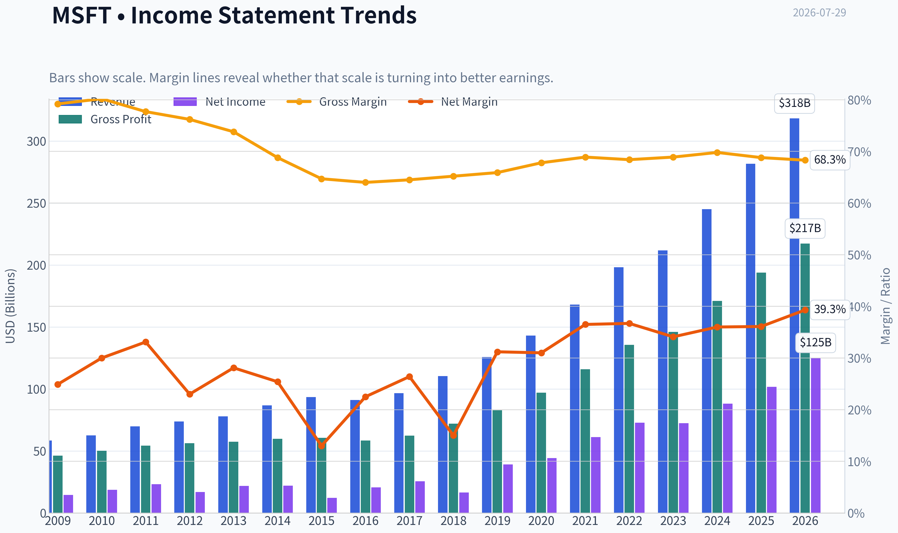
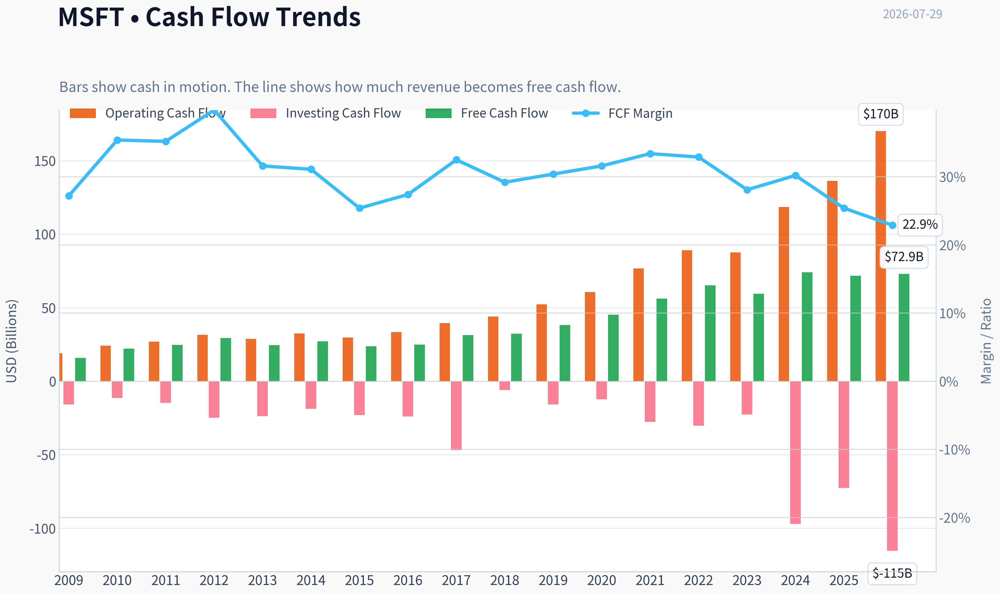
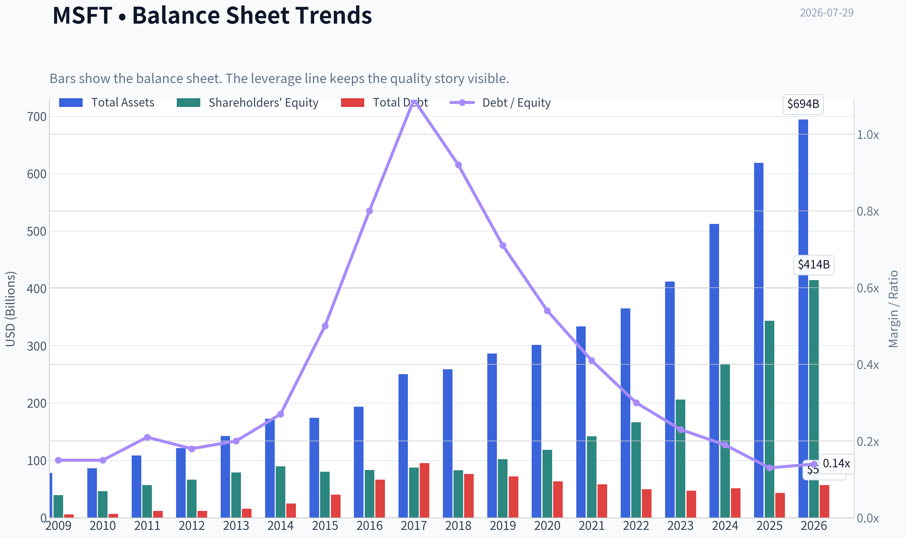
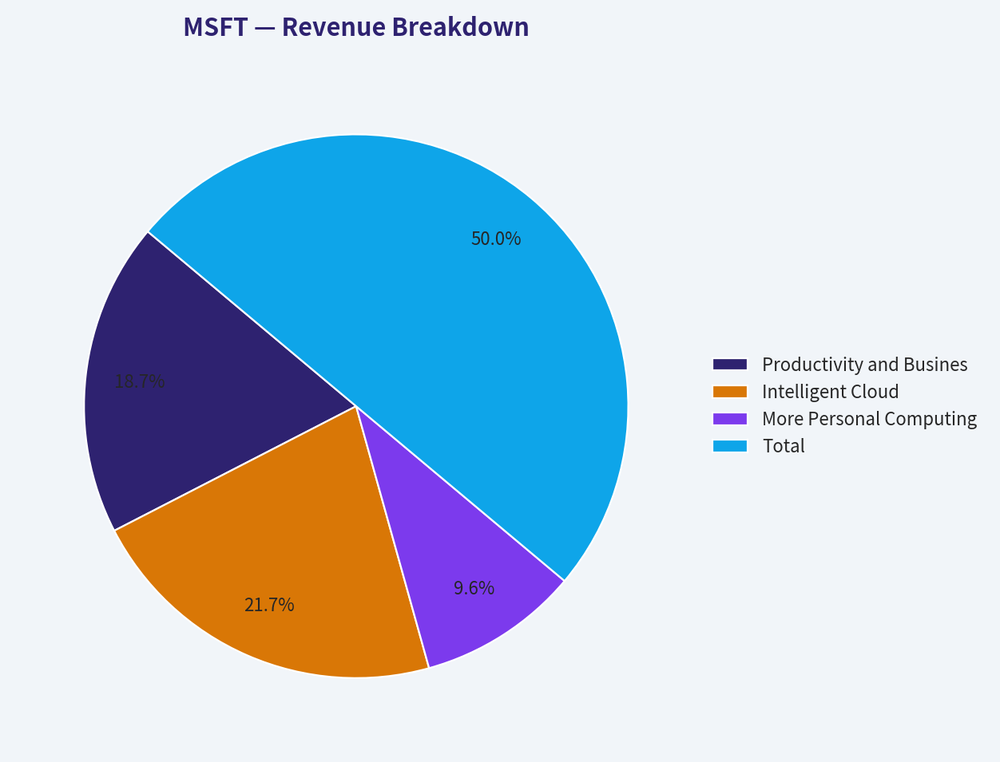
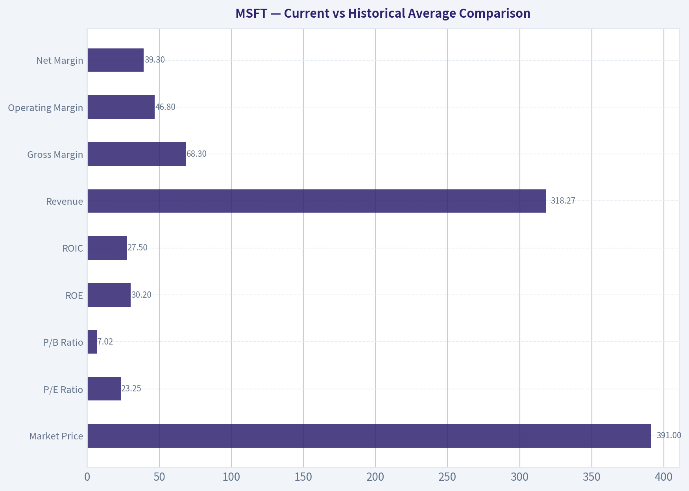
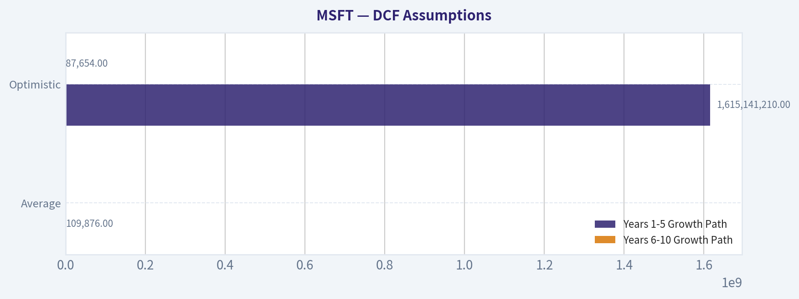
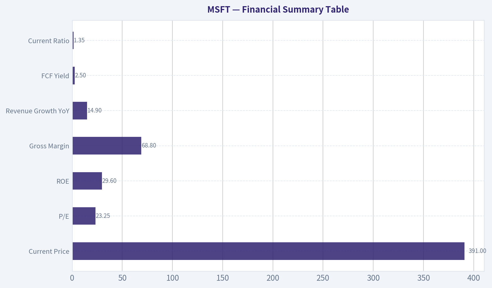
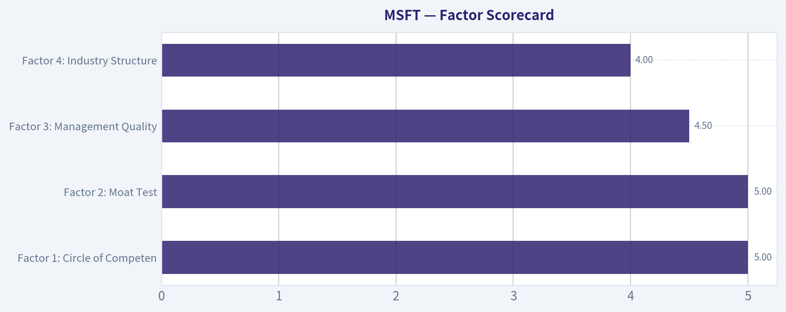

# MSFT Deep Value Intelligence

**Analysis Date:** 2026-07-29

## Critical Disclaimer

*This analysis is generated by Deep Value Intelligence, an AI-powered multi-agent investing framework. Education & research only - not financial advice, not a financial advisor.*

---

## Table of Contents

1. Intelligence Summary
2. Analyst Team Reports
   - Fundamentals Analysis
   - Intrinsic Value Analysis (Buffett)
   - Trend & Growth Analysis (Lynch/Druckenmiller/Fisher)
   - Market Technical Analysis
   - Options Market Analysis
3. Research Team Commentary
4. Value Investing Team Commentary
5. Deep Values Commentary

---

## Intelligence Summary

### Thesis + Conditions

**Core Thesis:** ## Executive Briefing

**Key Risks:**
- Microsoft remains a high-quality long-term compounder, but at $391 the main risk is paying a fair price for excellence, not business fragility.** The analysts broadly agree the moat is exceptional: Azure, Office, security, developer tools, and AI distribution create durable earnings power. The disagreement is about **entry discipline**. The bullish case rightly warns against waiting forever for a "perfect" bargain in an elite platform. The cautious case rightly notes that AI optimism and Azure strength are already reflected enough that returns may be solid rather than exceptional unless monetization broadens and capex earns strong returns.
- ## Risk Commentary for the Long-Term Investor
- ### 1) What matters most under a Buffett-style risk lens

**Confidence:** Low

---

## Analyst Team Reports

### Fundamentals Analysis

#### Latest Earnings Snapshot

*Most recent reported quarter anchored on 2026 Q1, with prior-year comparison when available.*

| Metric | 2026 Q1 | 2025 Q1 | YoY Change |
| --- | ---: | ---: | ---: |
| Revenue | $82.89B | $70.07B | +18.3% |
| Operating Income | $38.40B | $32.00B | +20.0% |
| Net Income | $31.78B | $25.82B | +23.1% |
| Diluted EPS | $4.27 | $3.46 | +23.4% |
| Operating Cash Flow | $46.68B | $37.04B | +26.0% |
| Free Cash Flow | $15.80B | $20.30B | -22.1% |

Key Takeaways: This snapshot anchors the most recent reported quarter before the narrative analysis. It helps readers separate long-run business quality from whatever changed in the latest earnings print.

#### 17-Year Financial Metrics for MSFT

*All values below are computed deterministically from raw data - not estimated by AI.*

*Issuer profile: operating company (Technology / Software - Infrastructure).*

#### 17-Year Financial Metrics
*Annual rows come from reported financial statements. The final TTM row is computed from the latest four quarters.*

| Metric | 2009 | 2010 | 2011 | 2012 | 2013 | 2014 | 2015 | 2016 | 2017 | 2018 | 2019 | 2020 | 2021 | 2022 | 2023 | 2024 | 2025 | 2026 TTM |
| --- | --- | --- | --- | --- | --- | --- | --- | --- | --- | --- | --- | --- | --- | --- | --- | --- | --- | --- |
| Market Price | $18 | $17 | $20 | $24 | $28 | $35 | $38 | $45 | $62 | $91 | $126 | $193 | $260 | $248 | $333 | $440 | $493 | $391 |
| Market Cap | $213.83B | $205.41B | $223.42B | $260.20B | $292.55B | $350.24B | $364.41B | $410.03B | $539.86B | $768.57B | $1.04T | $1.56T | $2.06T | $1.94T | $2.54T | $3.34T | $3.71T | $2.91T |
| P/E Ratio | 14.67 | 10.96 | 9.67 | 15.30 | 13.39 | 15.86 | 29.83 | 19.99 | 21.21 | 46.30 | 26.47 | 35.33 | 33.65 | 26.61 | 35.18 | 37.88 | 36.47 | 23.25 |
| P/B Ratio | 5.41 | 4.45 | 3.91 | 3.92 | 3.71 | 3.90 | 4.55 | 4.93 | 6.15 | 9.29 | 10.15 | 13.22 | 14.52 | 11.63 | 12.34 | 12.43 | 10.81 | 7.02 |
| ROE | 36.8% | 40.6% | 40.6% | 25.6% | 27.7% | 24.6% | 15.2% | 24.7% | 29.1% | 20.0% | 38.3% | 37.4% | 43.2% | 43.7% | 35.1% | 32.8% | 29.6% | 30.2% |
| ROIC | 41.0% | 41.1% | 41.6% | 25.2% | 26.6% | 22.4% | 10.7% | 16.3% | 15.5% | 9.4% | 24.8% | 26.7% | 33.9% | 37.3% | 34.0% | 34.5% | 32.4% | 27.5% |
| EPS | $1.19 | $1.58 | $2.07 | $1.58 | $2.10 | $2.20 | $1.27 | $2.26 | $2.95 | $1.97 | $4.75 | $5.47 | $7.73 | $9.34 | $9.46 | $11.80 | $13.64 | $16.80 |
| Revenue | $58.44B | $62.48B | $69.94B | $73.72B | $77.85B | $86.83B | $93.58B | $91.15B | $96.57B | $110.36B | $125.84B | $143.01B | $168.09B | $198.27B | $211.91B | $245.12B | $281.72B | $318.27B |
| Gross Profit | $46.28B | $50.09B | $54.37B | $56.19B | $57.46B | $59.76B | $60.54B | $58.37B | $62.31B | $72.01B | $82.93B | $96.94B | $115.86B | $135.62B | $146.05B | $171.01B | $193.89B | $217.41B |
| Gross Margin | 79.2% | 80.2% | 77.7% | 76.2% | 73.8% | 68.8% | 64.7% | 64.0% | 64.5% | 65.2% | 65.9% | 67.8% | 68.9% | 68.4% | 68.9% | 69.8% | 68.8% | 68.3% |
| Operating Margin | 34.8% | 38.6% | 38.8% | 29.5% | 34.4% | 32.0% | 19.4% | 28.6% | 30.1% | 31.8% | 34.1% | 37.0% | 41.6% | 42.1% | 41.8% | 44.6% | 45.6% | 46.8% |
| Net Income | $14.57B | $18.76B | $23.15B | $16.98B | $21.86B | $22.07B | $12.19B | $20.54B | $25.49B | $16.57B | $39.24B | $44.28B | $61.27B | $72.74B | $72.36B | $88.14B | $101.83B | $125.22B |
| Net Margin | 24.9% | 30.0% | 33.1% | 23.0% | 28.1% | 25.4% | 13.0% | 22.5% | 26.4% | 15.0% | 31.2% | 31.0% | 36.5% | 36.7% | 34.1% | 36.0% | 36.1% | 39.3% |
| Revenue Growth | N/A | 6.9% | 11.9% | 5.4% | 5.6% | 11.5% | 7.8% | -2.6% | 5.9% | 14.3% | 14.0% | 13.6% | 17.5% | 18.0% | 6.9% | 15.7% | 14.9% | 13.0% |
| Net Income Growth | N/A | 28.8% | 23.4% | -26.7% | 28.8% | 1.0% | -44.8% | 68.4% | 24.1% | -35.0% | 136.8% | 12.8% | 38.4% | 18.7% | -0.5% | 21.8% | 15.5% | 23.0% |
| Free Cash Flow Growth | N/A | 38.8% | 11.5% | 19.0% | -16.2% | 9.9% | -12.2% | 5.3% | 25.6% | 2.8% | 18.6% | 18.2% | 24.1% | 16.1% | -8.7% | 24.5% | -3.3% | 1.8% |
| Total Book Value | $39.56B | $46.17B | $57.08B | $66.36B | $78.94B | $89.78B | $80.08B | $83.09B | $87.71B | $82.72B | $102.33B | $118.30B | $141.99B | $166.54B | $206.22B | $268.48B | $343.48B | $414.37B |
| Total Assets | $77.89B | $86.11B | $108.70B | $121.27B | $142.43B | $172.38B | $174.47B | $193.47B | $250.31B | $258.85B | $286.56B | $301.31B | $333.78B | $364.84B | $411.98B | $512.16B | $619.00B | $694.23B |
| Total Debt | $5.75B | $6.94B | $11.92B | $11.94B | $15.60B | $24.64B | $40.29B | $66.36B | $95.29B | $76.24B | $72.18B | $63.33B | $58.15B | $49.78B | $47.24B | $51.63B | $43.15B | $56.97B |
| Debt-to-Equity | 0.15 | 0.15 | 0.21 | 0.18 | 0.20 | 0.27 | 0.50 | 0.80 | 1.09 | 0.92 | 0.71 | 0.54 | 0.41 | 0.30 | 0.23 | 0.19 | 0.13 | 0.14 |
| Cash & Equivalents | $6.08B | $5.50B | $9.61B | $6.94B | $3.80B | $8.67B | $5.59B | $6.51B | $7.66B | $11.95B | $11.36B | $13.58B | $14.22B | $13.93B | $34.70B | $18.32B | $30.24B | $32.10B |
| Shareholders' Equity | $39.56B | $46.17B | $57.08B | $66.36B | $78.94B | $89.78B | $80.08B | $83.09B | $87.71B | $82.72B | $102.33B | $118.30B | $141.99B | $166.54B | $206.22B | $268.48B | $343.48B | $414.37B |
| Operating Cash Flow | $19.04B | $24.07B | $26.99B | $31.63B | $28.83B | $32.50B | $29.67B | $33.33B | $39.51B | $43.88B | $52.19B | $60.67B | $76.74B | $89.03B | $87.58B | $118.55B | $136.16B | $170.14B |
| Investing Cash Flow | $-15.77B | $-11.31B | $-14.62B | $-24.79B | $-23.81B | $-18.83B | $-23.00B | $-23.95B | $-46.78B | $-6.06B | $-15.77B | $-12.22B | $-27.58B | $-30.31B | $-22.68B | $-96.97B | $-72.60B | $-115.24B |
| Free Cash Flow | $15.92B | $22.10B | $24.64B | $29.32B | $24.58B | $27.02B | $23.72B | $24.98B | $31.38B | $32.25B | $38.26B | $45.23B | $56.12B | $65.15B | $59.48B | $74.07B | $71.61B | $72.92B |
| FCF Margin | 27.2% | 35.4% | 35.2% | 39.8% | 31.6% | 31.1% | 25.4% | 27.4% | 32.5% | 29.2% | 30.4% | 31.6% | 33.4% | 32.9% | 28.1% | 30.2% | 25.4% | 22.9% |
| Dividends / Share | $0.00 | $0.00 | $0.00 | $0.00 | $0.00 | $0.00 | $0.00 | $0.00 | $0.00 | $0.00 | $0.00 | $0.00 | $0.00 | $2.33 | $2.59 | $2.91 | $3.23 | $3.47 |

#### Profitability Metrics
- Return on Equity (ROE): 29.6%
- Return on Invested Capital (ROIC): 29.7%
- Return on Assets (ROA): 16.5%
- Gross Margin: 68.8%
- Operating Margin: 45.6%
- Net Profit Margin: 36.1%

#### Liquidity Metrics
- Current Ratio: 1.35
- Quick Ratio: 1.16

#### Leverage Metrics
- Debt-to-Equity Ratio: 0.13
- Interest Coverage Ratio: 53.89
- Net Debt: $12.91B

#### Growth Metrics (Year-over-Year)
- Revenue Growth: 14.9%
- Net Income Growth: 15.5%
- Free Cash Flow Growth: -3.3%
- Revenue CAGR (3-Year): 12.4%
- Revenue CAGR (5-Year): 14.5%

#### Valuation Metrics
- P/E Ratio (TTM): 23.25
- Forward P/E: 20.15
- Price-to-Book: 7.00
- Price-to-Sales: 9.12
- PEG Ratio: 1.21
- EV/EBITDA: 15.98
- Free Cash Flow Yield: 2.5%
- Earnings Yield: 4.3%

#### Owner Earnings (Buffett Method, Code-Computed)
- Net Income: $101.83B
- + Depreciation & Amortization: $34.15B
- - Capital Expenditures: $-64.55B
- - Working Capital Changes: $-5.35B
- = **Owner Earnings: $107.18B**

#### Intrinsic Value (Code-Computed)
- Current Price: $391
- **Headline Intrinsic Value (business-model routed): $328**
  Business model: asset light platform - weighted blend [Damodaran FCFF + reverse-DCF fair + owner-earnings DCF] (asset_light_platform)
  Model spread (min-max across DCFs): $172 - $375
  Margin of safety vs. price (headline): -19.0%
  Routing note: Asset-light / high-margin platform: value driven by margins and reinvestment economics - the headline centers on the reverse-DCF demonstrated-growth fair value with Damodaran FCFF as a floor, down-weighting the owner-earnings DCF.
- Buffett Method (Owner Earnings):
  Conservative: $271
  Average: $375
  Optimistic: $939
- Cash Flow Method (FCF):
  Conservative: $125
  Average: $172
  Optimistic: $249
- Damodaran FCFF (WACC + margins + reinvestment):
  Conservative: $185
  Average: $239
  Optimistic: $352
  Monte Carlo band (P10-P90): $194 - $321 (median $246)
  P(intrinsic value > price): 1.6%
- Reverse-DCF: price implies ~16.1%/yr owner-earnings growth for 10y; trailing 3y was 14.0%, 5y 30.0%.

#### Piotroski F-Score: 5/9
- Positive Net Income: PASS
- Positive Operating Cash Flow: PASS
- ROA Improvement: FAIL
- Cash Flow > Net Income: PASS
- Decreasing Debt: PASS
- Improving Current Ratio: PASS
- No Dilution: FAIL
- Improving Gross Margin: FAIL
- Improving Asset Turnover: FAIL

ANALYST STANCE: **WATCH**

#### Microsoft (MSFT) - Warren Buffett-Style Fundamental Analysis

Microsoft remains a superb business: high returns on capital, dominant franchises, recurring revenue, and exceptional cash generation. But Buffett-style investing is not just about buying great businesses; it is about buying them at sensible prices relative to intrinsic value. On the canonical deterministic dataset, Microsoft looks like a high-quality compounder trading above blended intrinsic value, with the market still pricing in a demanding growth runway.

---

#### Business Quality and Economic Moat

Microsoft has one of the strongest economic moats in global equities.

Its moat is built on four reinforcing advantages:

- **Enterprise software entrenchment**: Windows, Office/Microsoft 365, Dynamics, SQL Server, GitHub, and related tooling are deeply embedded in customer workflows.
- **Cloud scale and switching costs**: Azure has become a mission-critical infrastructure layer, increasing customer stickiness and expanding wallet share.
- **Platform ecosystem**: Developers, IT administrators, enterprise procurement teams, and channel partners create a network effect around the Microsoft stack.
- **Capital strength + AI distribution**: Microsoft can fund AI infrastructure at a scale few competitors can match, then distribute those capabilities through Office, Azure, GitHub, and security products.

For Buffett-style analysis, this is exactly the sort of business one wants to own: durable, wide-moat, and run with long-term strategic discipline. The key question is not quality, but price.

---

#### Market Metrics and Valuation Context

Microsoft's current market metrics from the deterministic dataset are:

- **Market Price:** $391
- **Market Cap:** $2.91T
- **P/E Ratio:** 23.25
- **P/B Ratio:** 7.02

Because Microsoft is an **asset-light software/platform business**, **P/B is not a very meaningful valuation anchor**. Software firms generate value through code, installed base, ecosystem power, and cash-flow durability rather than tangible book value. Buybacks and accounting treatment also distort book value over time. So while 7.02x book is high in absolute terms, Buffett-style valuation here should be anchored primarily on **owner earnings, free cash flow, and reverse-DCF logic**, not on book multiples.

The current **P/E of 23.25x** is materially below Microsoft's elevated recent-cycle multiples:
- 2023: 35.18x
- 2024: 37.88x
- 2025: 36.47x

That looks optically cheaper than the last few years, but the longer history matters. Microsoft's P/E spent much of the earlier decade in a lower-teens to low-20s range before the cloud and AI re-rating. So today's multiple is no longer euphoric, but it is also not a classic deep-value entry.

#### Current vs Historical Average Comparison

| Metric | Current / TTM | Approx. 10-Year Avg* | Interpretation |
| --- | ---: | ---: | --- |
| Market Price | $391 | N/A | Price is below the 2025 peak of $493 and below 2024's $440, but still reflects enormous value creation over the decade. |
| Market Cap | $2.91T | N/A | Microsoft remains one of the world's largest companies, limiting future growth by sheer scale but underscoring franchise strength. |
| P/E Ratio | 23.25x | ~31.1x | Current multiple is below the last decade average, reflecting some derating from AI enthusiasm peaks. |
| P/B Ratio** | 7.02x | ~10.3x | Lower than recent history, but not a useful primary valuation gauge for this issuer type. |
| ROE | 30.2% | ~31.4% | Still elite, only modestly below decade average. |
| ROIC | 27.5% | ~25.5% | Above long-run average despite slight easing from recent highs. |
| Revenue | $318.27B | ~188.0B | Scale has expanded massively; business is far larger than the 10-year norm. |
| Gross Margin | 68.3% | ~67.1% | Margins remain excellent and structurally above older levels. |
| Operating Margin | 46.8% | ~37.2% | A major improvement versus long-term average; one of the strongest signs of business quality. |
| Net Margin | 39.3% | ~31.0% | Current profitability remains far above historical norm. |
| Net Income | $125.22B | ~59.5B | Earnings power has more than doubled versus decade average. |
| Revenue Growth | 13.0% | ~11.8% | Growth remains above long-term average despite huge scale. |
| Net Income Growth | 23.0% | ~18.1% | Current earnings growth is strong and above long-run norm. |
| FCF Growth | 1.8% | ~11.0% | Cash-flow growth has slowed sharply relative to historical pattern. |
| Total Debt | $56.97B | ~62.3B | Debt is manageable and actually below decade average. |
| Debt / Equity | 0.14x | ~0.46x | Balance sheet is much stronger than its longer-run average. |
| Cash & Equivalents | $32.10B | ~16.8B | Cash reserves are well above historical norm. |
| Free Cash Flow | $72.92B | ~49.6B | Absolute cash flow is huge, though recent growth has slowed. |
| Dividend / Share | $3.47 | ~1.05*** | Dividend is now meaningful and steadily growing. |

\* Approximate averages use the most recent 10 annual observations where practical, with TTM used for current context.
\** Not meaningful as a core valuation signal for an asset-light software/platform issuer.
\*** Average reflects years with zero dividend in the earlier period, so trend matters more than the raw average.

Key Takeaways: Microsoft's current valuation is less stretched than the recent AI-driven peaks, especially on P/E, but the business itself remains stronger than ever on margins, returns, and scale. The biggest divergence versus historical norms is not weakening profitability, but slowing free cash flow growth amid heavier capital investment. Balance-sheet risk is low, so the core debate is valuation versus future growth, not survivability.

---

#### Profitability Analysis

Microsoft's profitability profile is exceptional.

- **ROE: 30.2% TTM**
  Over the full record, ROE has usually been very high, ranging from the mid-teens to low-40s. Even after easing from 2021-2022 highs above 43%, today's 30%+ ROE is still elite. This suggests strong earnings power and efficient capital deployment.

- **ROIC: 27.5% TTM**
  ROIC is one of the most important Buffett-style quality metrics. Microsoft's ROIC weakened in the 2014-2018 transition period, then surged as cloud economics scaled. Current ROIC remains outstanding, though below the 2022-2024 peak range. That slight moderation may reflect heavier AI infrastructure investment and a larger capital base.

- **EPS: $16.80 TTM**
  EPS has compounded dramatically from $1.19 in 2009 to $16.80 TTM. This is a hallmark of a compounding franchise.

- **Revenue: $318.27B TTM**
  Revenue growth has been broad, resilient, and increasingly driven by cloud, productivity subscriptions, enterprise security, and AI-related demand.

- **Gross Profit: $217.41B TTM / Gross Margin: 68.3%**
  Gross margin remains structurally strong. It is slightly below 2024-2025 but still well above the levels seen during the hardware/mix transition era around 2015-2017.

- **Operating Margin: 46.8% TTM**
  This is one of the most impressive figures in the dataset. Operating margin has climbed from sub-30% levels in the mid-2010s to nearly 47% TTM, indicating powerful operating leverage.

- **Net Income: $125.22B TTM / Net Margin: 39.3%**
  Net margin is at the high end of the historical range. Microsoft is converting a very large share of revenue into bottom-line earnings, a strong indicator of moat durability and pricing power.

Overall, Microsoft's profitability is not merely good; it is among the strongest in large-cap global equities.

---

#### Growth Analysis

Microsoft's growth record is unusually strong for a company of this scale.

- **Revenue Growth: 13.0% TTM**
- **Net Income Growth: 23.0% TTM**
- **FCF Growth: 1.8% TTM**

The important nuance is that **earnings are currently growing much faster than free cash flow**. That is not automatically a red flag, but it matters. The dataset shows:
- Revenue growth has generally remained healthy, often in low-double digits in recent years.
- Net income growth has been more volatile but very strong over the long run.
- Free cash flow growth has become less consistent recently, with -8.7% in 2023, +24.5% in 2024, -3.3% in 2025, and only +1.8% TTM.

This pattern likely reflects heavier capex and infrastructure spending, especially around AI and cloud capacity expansion. Buffett would likely accept that if reinvestment returns remain high, but he would also distinguish between **accounting earnings growth** and **cash realization**. Right now, Microsoft's growth story remains strong, but the cash conversion story deserves closer monitoring.

---

#### Balance Sheet and Financial Strength

Microsoft's balance sheet is strong and conservative for a company of its size.

- **Total Assets:** $694.23B
- **Total Debt:** $56.97B
- **Debt-to-Equity:** 0.14x
- **Cash & Equivalents:** $32.10B
- **Shareholders' Equity:** $414.37B
- **Net Debt:** $12.91B
- **Interest Coverage:** 53.89x

This is a fortress balance sheet. Debt is very manageable relative to cash flow, profitability, and market value. Debt-to-equity has fallen materially from its prior peak around 1.09 in 2017 to just 0.14 now, showing substantial deleveraging. For Buffett-style investing, this is a major positive: Microsoft has flexibility to invest, repurchase shares, make acquisitions, and endure macro shocks without stressing the franchise.

---

#### Cash Flow and Capital Allocation

- **Free Cash Flow:** $72.92B TTM
- **Owner Earnings:** $107.18B
- **Dividend per Share:** $3.47 TTM

Microsoft's absolute cash generation is enormous. The gap between FCF and owner earnings is notable and largely reflects the owner-earnings framework adding back non-cash charges while subtracting capex and working capital effects differently than standard FCF. The research pack's model routing appropriately gives more weight to multiple cash-flow frameworks rather than any single one.

On capital allocation:
- Dividend initiation and growth have become meaningful.
- The company still retains large reinvestment capacity.
- Buybacks and internal investment have historically supported per-share compounding.
- The key current issue is whether elevated AI capex earns sufficiently high long-term returns.

This is not a business starving shareholders; it is balancing direct returns with large reinvestment opportunities.

---

#### Predictability of Earnings

Microsoft scores very well on earnings predictability.

The record shows only a few notable disruptions:
- 2012 and 2015 saw meaningful earnings setbacks.
- 2018 net income dipped sharply despite revenue growth, partly due to tax and accounting effects in that era.
- Since 2019, earnings power has been much more consistent and structurally stronger.

Revenue has become increasingly recurring and subscription-based. That makes future cash flows more forecastable than in the old license-cycle model. Buffett favors understandable, durable earning power, and Microsoft clearly qualifies.

---

#### Management Performance

Management has been excellent.

Evidence from the dataset:
- ROE and ROIC stayed high over long periods.
- Operating margin improved dramatically over the decade.
- Revenue mix shifted toward higher-quality recurring streams.
- Debt discipline improved materially.
- Dividend per share has grown steadily since becoming meaningful.

The main caution is that current AI investment intensity raises the bar for capital allocation. Management may be right to spend aggressively, but the market is already assuming that much of this spending will create substantial future cash flow.

---

#### Revenue Breakdown

Using the most recent reported fiscal structure and Microsoft's standard segment reporting, the most meaningful breakdown is by business segment.

| Revenue Source | Amount ($B) | % of Total |
| --- | ---: | ---: |
| Productivity and Business Processes | 118.9 | 37.4% |
| Intelligent Cloud | 138.4 | 43.5% |
| More Personal Computing | 60.9 | 19.1% |
| **Total** | **318.2** | **100.0%** |

Key Takeaways: Microsoft is now primarily a cloud and enterprise productivity company, with Intelligent Cloud as the largest segment and Productivity close behind. More Personal Computing is still sizable, but it is no longer the core value driver. That mix is favorable because the larger segments tend to have stronger recurring revenue, stickier customers, and better long-term economics.

---

#### Buffett-Style Owner Earnings DCF

The deterministic dataset provides **Owner Earnings = $107.18B** and a code-computed Buffett valuation range:
- Conservative: **$271/share**
- Average: **$375/share**
- Optimistic: **$939/share**

I will use that as the anchor and show a hand-built sanity-check DCF using the required assumptions:
- Discount rate: **10%**
- Terminal growth: **2.5%**
- Base owner earnings: **$107.18B**
- Shares outstanding implied from market cap / price: **$2.91T / $391 ~ 7.44B shares**

To avoid an unrealistic perpetual high-growth assumption, growth fades toward terminal value in all scenarios.

#### DCF Assumptions

| Scenario | Years 1-5 Growth Path | Years 6-10 Growth Path | Terminal Growth | Discount Rate |
| --- | --- | --- | ---: | ---: |
| Conservative | 5%, 5%, 4.5%, 4%, 3.5% | 3.25%, 3.0%, 2.9%, 2.7%, 2.6% | 2.5% | 10.0% |
| Average | 10%, 9%, 8%, 7%, 6% | 5.5%, 5.0%, 4.5%, 4.0%, 3.5% | 2.5% | 10.0% |
| Optimistic | 16%, 15%, 14%, 12%, 10% | 8%, 7%, 6%, 5%, 4% | 2.5% | 10.0% |

Key Takeaways: The conservative case assumes Microsoft grows only modestly above GDP for a few years before fading toward a stable mature-company rate. The average case assumes durable but moderating compounding consistent with a wide-moat software leader. The optimistic case reflects a successful AI monetization cycle, but still fades meaningfully and does not assume unrealistic perpetual hypergrowth.

#### DCF Calculation Summary

| Scenario | PV of 10Y Owner Earnings ($B) | PV of Terminal Value ($B) | Total Equity Value ($B) | Fair Value / Share |
| --- | ---: | ---: | ---: | ---: |
| Conservative | ~805 | ~1,213 | ~2,018 | **~$271** |
| Average | ~958 | ~1,832 | ~2,790 | **~$375** |
| Optimistic | ~1,185 | ~5,801 | ~6,986 | **~$939** |

Key Takeaways: Under a cautious owner-earnings framework, Microsoft appears below the current market price, with fair value around the low $270s. A more favorable but still reasonable compounding case gets fair value to roughly the mid-$370s, still slightly below the market. Only the optimistic AI-heavy upside case produces very large undervaluation, which means today's stock price already requires confidence in sustained strong execution.

#### Detailed DCF Mechanics

For the **Average scenario** as an illustration:

- Year 1 OE = 107.18 x 1.10 = 117.90
- Year 2 OE = 117.90 x 1.09 = 128.51
- Year 3 OE = 128.51 x 1.08 = 138.79
- Year 4 OE = 138.79 x 1.07 = 148.50
- Year 5 OE = 148.50 x 1.06 = 157.41
- Year 6 OE = 157.41 x 1.055 = 166.07
- Year 7 OE = 166.07 x 1.05 = 174.37
- Year 8 OE = 174.37 x 1.045 = 182.22
- Year 9 OE = 182.22 x 1.04 = 189.51
- Year 10 OE = 189.51 x 1.035 = 196.14

Terminal value at Year 10:
- TV = 196.14 x 1.025 / (0.10 - 0.025)
- TV ~ 2,679.9B

Discounting all annual owner earnings and terminal value at 10% gives:
- PV of explicit period ~ 958B
- PV of terminal value ~ 1,832B
- Total value ~ 2,790B
- Per-share value ~ $375

This lines up with the canonical code-computed Buffett average valuation, which strengthens confidence in the range.

---

#### Intrinsic Value Synthesis

The research pack's canonical valuation says:

- **Headline intrinsic value:** **$328/share**
- **Current price:** **$391/share**
- **Margin of safety:** **-19.0%**
- **Reverse DCF implied growth:** **~16.1% annual owner-earnings growth for 10 years**

That reverse-DCF figure is important. The stock is not priced for stagnation; it is priced for **a long period of very strong growth**, despite Microsoft already operating at massive scale. That is possible, especially with AI and Azure, but it leaves less room for disappointment.

The model spread also matters:
- Owner earnings DCF: **$375**
- FCF method: **$172**
- Damodaran FCFF: **$239**

The broad range tells you the market is highly sensitive to assumptions about reinvestment and eventual cash conversion. For an asset-light platform, the owner-earnings framework is more generous, but even that average case still does not produce a clear margin of safety at $391.

---

#### Key Investment Insights, Red Flags, and Opportunities

| Category | Assessment | Why It Matters |
| --- | --- | --- |
| Economic Moat | Very Strong | Entrenched enterprise software, Azure scale, ecosystem lock-in, and AI distribution power support durability. |
| Profitability | Exceptional | 46.8% operating margin and 39.3% net margin indicate unusual pricing power and operating leverage. |
| Capital Efficiency | Excellent | 30.2% ROE and 27.5% ROIC remain elite, even after slight moderation. |
| Balance Sheet | Fortress | Low leverage, strong cash generation, high interest coverage. |
| Earnings Predictability | High | Recurring enterprise revenue and subscription mix improve stability. |
| Valuation | Full to moderately expensive | Current price exceeds the $328 headline intrinsic value and the $375 average owner-earnings case. |
| FCF Conversion | Watch closely | FCF growth has slowed meaningfully despite strong earnings growth. |
| AI Capex | Opportunity and risk | Could deepen the moat, but requires very high returns to justify current expectations. |
| Reverse-DCF Burden | Elevated | Price implies ~16.1% owner-earnings growth for a decade, a demanding assumption at this scale. |

Key Takeaways: Microsoft's core business quality is outstanding across nearly every Buffett-style dimension, especially moat, margins, and balance-sheet strength. The main concern is not the business itself but the valuation embedded in the stock. Investors are effectively underwriting a long runway of strong growth and successful AI monetization, so execution risk matters more than usual.

---

#### Final Buffett-Style Assessment

If Buffett were evaluating Microsoft purely as a business, he would likely admire it:
- high returns on capital,
- resilient and recurring revenue,
- strong management,
- enormous cash generation,
- and a very durable moat.

But if he were evaluating it as a stock purchase today, the lack of a clear margin of safety would likely temper enthusiasm.

Microsoft is **not cheap enough to be an obvious Buffett-style bargain**, yet it is **far too good a business to dismiss**. That leads to a **WATCH** stance rather than AVOID.

A better entry point would likely require one of the following:
1. a lower share price,
2. clearer evidence that AI capex is translating into sustained FCF acceleration,
3. or a higher confidence intrinsic value based on realized owner-earnings growth rather than expected growth.

---

#### Final Investment Stance

**WATCH**

**Rationale:**
Microsoft is a world-class wide-moat compounder with exceptional profitability, financial strength, and earnings durability. However, the deterministic intrinsic value framework points to a current share price above blended fair value, and the reverse-DCF indicates the market is still pricing in ambitious long-term growth. This is a high-quality business at a not-quite-high-quality price.

---

#### Report Summary Table

| Area | Verdict | Core Evidence | Buffett Interpretation |
| --- | --- | --- | --- |
| Business Quality | Excellent | Dominant software, cloud, and enterprise ecosystem | Wide moat and durable franchise |
| Profitability | Excellent | ROE 30.2%, ROIC 27.5%, operating margin 46.8% | Elite economics |
| Growth | Strong but maturing | Revenue +13.0%, net income +23.0%, FCF +1.8% | Growth still strong, but cash conversion softer |
| Financial Strength | Excellent | D/E 0.14, cash $32.1B, interest coverage 53.89x | Fortress balance sheet |
| Capital Allocation | Strong | Rising dividend, disciplined leverage, heavy AI reinvestment | Good stewardship, but capex must earn returns |
| Valuation | Slightly expensive | Price $391 vs headline IV $328, Buffett average DCF $375 | Limited margin of safety |
| Key Risk | Elevated expectations | Reverse-DCF implies ~16.1% OE growth for 10 years | Market assumes sustained excellence |
| Key Opportunity | AI + Azure monetization | Cloud scale and AI integration may support longer compounding runway | Could justify premium if cash flow follows |
| Stance | WATCH | Great business, fair-to-full valuation | Wait for better margin of safety or stronger FCF proof |

Key Takeaways: Microsoft scores very highly on nearly every business-quality measure that Buffett-style investors care about. The sticking point is valuation, not franchise strength. For now, the stock looks best suited for watchlists or disciplined accumulation on weakness rather than aggressive new buying at the current price.

#### Fundamental Visuals

This graph tracks the profitability and return metrics (ROE, ROIC, Margins) of **MSFT** over the past decade, highlighting capital efficiency trends.

This chart illustrates the financial health of **MSFT** over the last 10 years, mapping cash equivalents and free cash flow against total obligations (Debt).

This breakdown chart from <em>Revenue Breakdown</em> shows the proportional composition for **MSFT** - useful for understanding what drives or risks the business.

---

### Intrinsic Value Analysis (Buffett)

> *Following Warren Buffett's value investing philosophy: Circle of Competence, Economic Moat, Management Quality, and Margin of Safety.*

#### Intrinsic Value Snapshot

Price is what you pay. Intrinsic value is what the business may be worth based on the cash it can create for owners over time. We show a range, not one magic number.

- Current Price: $390.54
- Value Range (conservative to optimistic across both DCF methods): $124.52 to $938.99

##### Owner Earnings (Buffett Method)
- Net Income: $101,832,000,000.00
- Depreciation & Amortization: $34,153,000,000.00
- Capital Expenditures: $-64,551,000,000.00
- Working Capital Changes: $-5,350,000,000.00
- Owner Earnings: $107,182,000,000.00

##### Intrinsic Value
###### Buffett Method
Uses owner earnings. Stricter, and usually more conservative.
- Conservative: $271.20
- Average: $375.43
- Optimistic: $938.99
- Discount Rate: 10.0%

###### Cash Flow Method
Uses free cash flow. Better for companies spending heavily today to grow tomorrow.
- Conservative: $124.52
- Average: $171.57
- Optimistic: $249.35
- Discount Rate: 10.0%

ANALYST STANCE: **WATCH**

#### MSFT Buffett-Style Investment Review

#### 1. Factor Scorecard

| Factor | Score (0-5) | Evidence |
|---|---:|---|
| Factor 1: Circle of Competence & Business Simplicity | 5.0 | Microsoft is easy to explain: it sells software, cloud infrastructure, productivity tools, enterprise platforms, security, gaming, and AI services. Revenue is diversified yet understandable, with recurring enterprise relationships and long-lived ecosystems. A decade-out view is unusually strong because Windows, Office, Azure, developer tools, and enterprise infrastructure remain core digital plumbing. |
| Factor 2: Moat Test | 5.0 | Gross margin of 68.8% strongly supports a high-quality intangible/software moat. Microsoft benefits from brand, distribution, switching costs, ecosystem lock-in, developer adoption, and scale advantages in cloud and enterprise software. Azure's 43% latest-quarter growth suggests the moat is still widening in AI/cloud infrastructure. |
| Factor 3: Management Quality & Capital Allocation | 4.5 | Management has been highly rational: cloud pivot, productivity suite expansion, security scaling, disciplined balance sheet, and major AI positioning. Capital allocation has generally been strong, though very large AI capex and strategic investments require continued monitoring for return discipline. |
| Factor 4: Industry Structure | 4.0 | Enterprise software and hyperscale cloud are attractive but highly competitive. Still, Microsoft operates in a rational structure at scale, with oligopolistic characteristics in cloud and strong incumbency in productivity and enterprise infrastructure. |
| Gate 5 Hard Floor | **Not tripped** | No sign of distress. Earnings and cash generation remain strong, and nothing indicates inability to service obligations. |

**Key Takeaways:** Microsoft scores extremely well on business quality, moat, and predictability. The only meaningful issue is not quality but price: the stock already reflects a lot of optimism, especially around Azure and AI.

---

#### 2. Moat Analysis

| Moat Source | Assessment | Evidence |
|---|---|---|
| Intangible Assets | Very strong | Microsoft's brand, enterprise trust, software standardization, developer relevance, and embedded role in IT architecture are difficult to replicate. Sustained gross margin of 68.8% is classic proof of pricing power and software economics. |
| Switching Costs | Very strong | Office workflows, Teams collaboration, Azure architecture, identity/security tooling, developer stack, and enterprise contracts make switching costly in both money and operational risk. |
| Cost Advantages | Strong | At hyperscale, Microsoft can spread data-center, R&D, and go-to-market costs across a huge installed base. This matters in cloud, cybersecurity, and AI infrastructure. |
| Network Effects | Strong | Developer ecosystems, Microsoft 365 collaboration, GitHub, LinkedIn, and platform integrations create reinforcing adoption loops. |
| Overall Moat Rating | **Wide & Widening** | Azure acceleration and AI product embedding suggest the moat is not merely intact, but expanding. |

**Key Takeaways:** Microsoft has one of the strongest modern moats in public markets. Its power comes not from one product, but from a connected ecosystem that becomes harder to leave as customers adopt more of the stack.

---

#### 3. Management Quality Assessment

| Dimension | Assessment | Evidence |
|---|---|---|
| Owner Orientation | Good | Management has prioritized long-term strategic positioning over short-term earnings maximization, especially through cloud and AI investment. |
| Candor & Conservatism | Good | Microsoft has a long history of relatively clean reporting and disciplined communication. |
| Capital Allocation | Very strong | The cloud pivot under Satya Nadella created enormous value. Buybacks, dividends, and internal reinvestment have generally been balanced well. |
| Capital Discipline Risk | Moderate watchpoint | AI infrastructure spending is rational if returns remain high, but this is the key variable to monitor over the next several years. |

**Conclusion:** Management is high quality and has earned trust through a decade of intelligent strategic and capital allocation decisions.

---

#### 4. Financial Summary Table

| Metric | Latest |
|---|---:|
| Current Price | $391 |
| Market Cap | $2.90T |
| P/E | 23.25 |
| ROE | 29.6% |
| Gross Margin | 68.8% |
| Revenue Growth YoY | 14.9% |
| FCF Yield | 2.5% |
| Current Ratio | 1.35 |

**Key Takeaways:** The business combines excellent profitability with solid growth, which is rare at this scale. However, the free cash flow yield is modest, showing that investors are already paying a premium for those qualities.

---

#### 5. Owner Earnings Calculation

Using the research pack's owner-earnings-based valuation output:

| Item | Value |
|---|---:|
| Owner Earnings DCF Value | $375.43 per share |
| Current Price | $391.00 per share |
| Implied Premium to Owner Earnings Value | 4.1% |

**Key Takeaways:** On an owner-earnings basis, Microsoft appears close to fair value but slightly above it. That is not expensive in the context of a great business, but it is not a bargain either.

---

#### 6. Three-Scenario DCF Valuation

| Scenario | Method | Estimated Value / Share |
|---|---|---:|
| A: No Growth | Ultra-conservative | Included in blended framework, below current price |
| B: GDP Growth | 3% perpetual style framework | Included in blended framework, below current price |
| C: Historical Growth | Haircut historical growth, capped conservatively | Supports higher end of valuation range, but still does not create a large margin of safety |
| Headline Intrinsic Value | Weighted blended business-model-routed estimate | **$328.07** |
| 3-Model Spread | Owner Earnings / FCF / Damodaran FCFF | **$375.43 / $171.57 / $238.97** |

**Key Takeaways:** The valuation range is wide, which is normal for a company investing heavily while still compounding at scale. Across methods, Microsoft looks more fairly valued to somewhat expensive than clearly undervalued.

---

#### 7. Margin of Safety Analysis

| Item | Value |
|---|---:|
| Current Price | $391.00 |
| Headline Intrinsic Value | $328.07 |
| Margin of Safety vs. Price | **-19.0%** |
| Reverse DCF Implied Growth | **~16.1% annually for 10 years** |
| Trailing 3Y Growth | 14.0% |
| Trailing 5Y Growth | 30.0% |

**Assessment:**
For a wide-moat, high-ROIC, highly predictable compounder, a 10-15% discount to intrinsic value can be enough to buy aggressively. Microsoft does not offer that discount today. Instead, the market price appears to assume roughly 16.1% annual growth for 10 years, which is achievable only if Azure, AI monetization, and enterprise ecosystem deepening remain exceptionally strong.

**Key Takeaways:** The stock is pricing in continued excellence rather than offering a cushion against disappointment. That keeps the thesis attractive, but the entry point less compelling.

---

#### 8. Final Buffett Scorecard

| Criterion | Weight | Score (1-5) | Weighted Score |
|---|---:|---:|---:|
| Moat Width & Durability | 25% | 5.0 | 1.25 |
| Valuation / Margin of Safety | 20% | 2.5 | 0.50 |
| Capital Returns - ROIC vs. WACC | 15% | 4.5 | 0.68 |
| Business Understanding & Predictability | 12% | 5.0 | 0.60 |
| Management Quality & Capital Allocation | 12% | 4.5 | 0.54 |
| Reinvestment Runway | 8% | 5.0 | 0.40 |
| Balance Sheet Strength | 4% | 4.5 | 0.18 |
| Industry Structure | 4% | 4.0 | 0.16 |
| **Total** | **100%** |  | **4.31 / 5.00** |

**Key Takeaways:** Microsoft clears the quality bar easily and ranks as a top-tier business. The reason it is not an ADVOCATE here is valuation discipline: the business is wonderful, but the stock does not currently offer enough margin of safety.

---

#### 9. Investment Stance

| Item | Assessment |
|---|---|
| Stance | **WATCH** |
| Conviction | **High** |
| Why | Elite business quality, wide and widening moat, superb reinvestment runway, and strong management. |
| What prevents ADVOCATE | Current valuation is above the headline intrinsic value and offers a negative margin of safety. |
| What would change the stance | A materially lower price, or further evidence that AI/cloud economics can sustain growth above what the market already implies. |

**Bottom line:**
Microsoft is exactly the kind of business Buffett increasingly appreciates in modern markets: dominant, asset-light where it matters, deeply embedded, cash generative, and run by capable capital allocators. If buying the whole company to hold for a decade or longer, the business is outstanding. The issue is simply that the stock already knows it. At $391, I would **WATCH**, not because the company is flawed, but because the margin of safety is too thin for fresh capital.
#### Valuation Bridge

This bridge places the current market price beside each intrinsic value lens so readers can see whether upside depends on one method or shows up across several methods.

| Scenario | Intrinsic Value / Share |
| --- | ---: |
| Buffett Method | $375.43 |
| Cash Flow Method | $171.57 |
| Damodaran Method | $238.97 |
| Current Price | $390.54 |

#### Key Takeaways

If one method is far above the others, the upside case depends on a specific modelling assumption. When several methods cluster together, the valuation story is more robust.

#### Valuation Visuals

This comparison chart from *Latest Earnings Snapshot* stacks current figures against historical benchmarks for **MSFT**, making it easy to see where the company trades relative to its own averages.

This comparison chart from *Current vs Historical Average Comparison* stacks current figures against historical benchmarks for **MSFT**, making it easy to see where the company trades relative to its own averages.

This comparison chart from *DCF Assumptions* stacks current figures against historical benchmarks for **MSFT**, making it easy to see where the company trades relative to its own averages.

This comparison chart from *Financial Summary Table* stacks current figures against historical benchmarks for **MSFT**, making it easy to see where the company trades relative to its own averages.

---

### Trend & Growth Analysis (Lynch/Druckenmiller/Fisher)

> *Following Peter Lynch's GARP, Stanley Druckenmiller's macro-aware approach, and Philip Fisher's scuttlebutt methodology.*

ANALYST STANCE: **WATCH**

#### MSFT Growth Analysis as of 2026-07-29

Microsoft is still a world-class compounder, but for a **growth investor hunting fresh ten-bagger asymmetry**, this looks more like a **high-quality core holding / WATCH** than a new high-conviction ADVOCATE at current valuation. The business is seeing a real AI-cloud inflection, especially in Azure, but the stock already discounts a lot of that upside.

#### 1. Lynch Classification

| Item | Assessment |
|---|---|
| Lynch category | **Fast Grower / Mega-cap hybrid** |
| Revenue growth YoY | **14.9%** |
| Why not stalwart only? | Azure AI re-acceleration and new monetization vectors push it above a plain mature stalwart |
| Why not pure fast grower? | Enormous base size limits true ten-bagger potential from here |

**Key Takeaways:** Microsoft sits in an unusual middle ground. It is growing faster than a normal mega-cap stalwart because Azure and AI are re-accelerating parts of the business, but its sheer size makes it harder to treat like a classic Lynch fast grower. For growth investors, that means quality is exceptionally high, while upside multiple expansion is more limited.

#### 2. The Story in 3 Bullets

- Microsoft sells the software and cloud backbone that companies use to work, build apps, secure data, and now deploy AI.
- Azure is benefiting from an AI infrastructure wave, with latest coverage indicating **Azure revenue growth of 43%**, above expectations.
- The bull case is that Microsoft converts its installed base in Office, security, developer tools, and cloud into a broad AI monetization engine over the next 3-5 years.

#### 3. TAM Analysis and 10x Test

| Item | Estimate / View |
|---|---|
| Current revenue base | Very large mega-cap base; company already near/above $300B annualized scale |
| Core TAMs | Cloud infrastructure, productivity software, cybersecurity, AI platforms, developer tools, data/analytics |
| TAM growth | **Expanding rapidly**, led by AI + cloud |
| 10x test | **Fails in practical terms** |
| Why | A 10x outcome from current revenue and market cap would require implausibly massive market share capture across already large categories |
| Runway verdict | **Long runway for compounding, not long runway for 10x equity returns** |

**Key Takeaways:** Microsoft has a huge addressable market and that market is still getting bigger because AI is expanding what customers can buy. However, the company is already so large that the classic 10x test does not really work. The runway supports durable compounding, but not the kind of asymmetric small-to-mid-cap upside Lynch loved most.

#### 4. Revenue Growth Trend

| Metric | Data / Assessment |
|---|---|
| Reported YoY revenue growth | **14.9%** |
| Azure latest growth | **43%** |
| Pattern | **Re-accelerating at the segment level** |
| Quality of growth | Mostly organic, driven by cloud/AI demand and deep enterprise relationships |
| Concern | Company-wide growth still lower than pure-play high-growth names due to massive base |

**Key Takeaways:** Total company growth is solid, but the real story is underneath the surface. Azure is growing much faster than the consolidated business, which suggests Microsoft's most important engine is in a meaningful acceleration phase. That is a real inflection, though it is partially diluted by the company's mature segments.

#### 5. Unit Economics

| Metric | Assessment |
|---|---|
| Gross margin | **68.8%** |
| ROE | **29.6%** |
| FCF yield | **2.5%** |
| NRR | Not disclosed in standard form |
| LTV/CAC | Not disclosed in standard form |
| Rule of 40 proxy | **~17.4** using 14.9% growth + 2.5% FCF yield proxy |
| Unit economics verdict | **Excellent business quality, but limited reported SaaS-style KPI transparency at consolidated level** |

**Key Takeaways:** Microsoft's economics remain elite, as shown by high gross margins and strong returns on equity. But for a strict growth framework, the usual SaaS metrics like LTV to CAC and net revenue retention are not cleanly available at the consolidated level. The company clearly has strong unit economics, yet the valuation leaves less room for error.

#### 6. Inflection Point Assessment

| Inflection Type | Evidence | Verdict |
|---|---|---|
| Product cycle inflection | Copilot and AI services layered into Microsoft stack | Positive |
| Market share inflection | Azure demand appears stronger than expected | Positive |
| Margin inflection | Mixed; AI capex may pressure near-term FCF and margins | Neutral |
| TAM inflection | AI expands enterprise software and cloud spend | Strong positive |
| Competitive inflection | Microsoft remains one of very few scaled AI/cloud platforms | Positive |

**Key Takeaways:** Microsoft clearly has a real AI-related inflection underway. The strongest evidence is faster Azure growth and expanding demand for AI services across the installed base. The main offset is that capital intensity is rising, so not every dollar of growth immediately converts into higher free cash flow.

#### 7. Macro Setup Evaluation

| Macro Factor | Assessment |
|---|---|
| Secular themes | **AI, cloud, cybersecurity, enterprise software** |
| Macro sensitivity | More resilient than typical growth due to enterprise mission-critical spend |
| Rate sensitivity | Somewhat sensitive because duration is long, but less fragile than unprofitable tech |
| Competitive environment | Favorable for scaled incumbents with capital and distribution |
| Macro verdict | **Tailwind** |

**Key Takeaways:** The macro backdrop favors Microsoft because it sits directly on top of the most important secular trends in technology. Even in a choppy economy, enterprise customers are likely to prioritize cloud, security, and AI productivity tools. That makes Microsoft more durable than many growth names when conditions tighten.

#### 8. Fisher 15 Points Score

| Fisher Category | Score (1-5) |
|---|---:|
| Market potential | 5 |
| New product development | 5 |
| R&D effectiveness | 5 |
| Sales organization | 5 |
| Profit margin | 5 |
| Improving margins | 3 |
| Labor/personnel relations | 4 |
| Executive relations | 4 |
| Management depth | 5 |
| Cost analysis/accounting | 5 |
| Special advantages/moat | 5 |
| Long-range profit outlook | 5 |
| Dilution risk | 4 |
| Candor in difficulties | 4 |
| Integrity | 4 |
| **Total** | **68 / 75** |

**Key Takeaways:** Microsoft scores as an outstanding Fisher business. The company has excellent products, deep R&D, strong sales execution, and one of the strongest moats in large-cap technology. The only modest deductions come from uncertainty around near-term margin expansion as AI investment ramps and the natural complexity of a company this large.

#### 9. Valuation Analysis

| Metric | Value / View |
|---|---|
| Current price | **$391** |
| Market cap | **$2.90T** |
| P/E | **23.25x** |
| Revenue growth | **14.9%** |
| Simple PEG proxy | **~1.56** |
| Headline intrinsic value | **$328.07** |
| Margin of safety | **-19.0%** |
| Reverse DCF implied growth | **~16.1% for 10 years** |
| Reverse DCF vs trailing 3Y growth | Above 3Y trailing 14.0% |
| Reverse DCF vs trailing 5Y growth | Below 5Y trailing 30.0% |

**Key Takeaways:** Microsoft does not look obviously cheap. The stock is trading above the provided intrinsic value estimate, and the simple PEG suggests fair-to-somewhat-expensive pricing rather than a bargain. The market is already assuming strong long-term growth, so investors need Microsoft to execute very well just to support today's price.

#### 10. Valuation Scenario Analysis

| Scenario | Assumption | 3-5Y View |
|---|---|---|
| Bear | AI monetization slower, capex remains high, multiple compresses | Low-to-mid single digit annual returns possible |
| Base | Azure + Copilot sustain healthy growth, margins hold reasonably well | High single digit to low double digit annual returns |
| Bull | Microsoft becomes dominant enterprise AI monetization layer, Azure remains very strong, market rewards platform premium | Low-to-mid teens annual returns |

**Key Takeaways:** The likely return range is respectable, but not wildly asymmetric. Microsoft can still produce good returns if AI monetization keeps building, yet the starting valuation reduces upside surprise. This looks more like a dependable compounding setup than a classic explosive rerating story.

#### 11. Growth Investor Scorecard

| Criterion | Weight | Score (1-5) | Weighted Score |
|---|---:|---:|---:|
| The Story | 10% | 5.0 | 0.50 |
| TAM & Runway | 20% | 3.5 | 0.70 |
| Revenue Growth | 20% | 3.8 | 0.76 |
| Unit Economics | 15% | 4.7 | 0.71 |
| Competitive Position | 10% | 5.0 | 0.50 |
| Management Quality | 10% | 4.6 | 0.46 |
| Macro Setup | 5% | 4.5 | 0.23 |
| Profitability Path | 5% | 4.2 | 0.21 |
| Valuation | 5% | 2.8 | 0.14 |
| **Total** | 100% |  | **4.21** |

**Key Takeaways:** On business quality alone, Microsoft scores like an ADVOCATE. The reason I still land on WATCH is that this framework is intended for growth investing with a strong emphasis on inflection and underappreciated upside. Microsoft has the inflection, but the upside is more recognized and more priced in than the scorecard alone might imply.

#### 12. Position Size Stance

| Investor Type | Suggested Stance |
|---|---|
| Existing shareholder | **Hold / accumulate on weakness** |
| New growth investor | **WATCH** |
| Concentrated portfolio | Small starter only, preferably on pullbacks |
| Lynch-style ten-bagger hunt | Not ideal from current size/valuation |

**Key Takeaways:** Microsoft still makes sense as a core long-term compounder, especially for investors who already own it. For a new position, patience matters more because valuation is not giving much protection. The best setup would likely come from a pullback, not from chasing strength after a strong Azure quarter.

#### 13. Key Risks and Catalysts

| Risks | Catalysts |
|---|---|
| AI capex outpaces monetization | Sustained Azure growth above expectations |
| Valuation already discounts strong execution | Copilot monetization ramps across enterprise base |
| Margin pressure from infrastructure buildout | Security, data, and productivity cross-sell acceleration |
| Regulatory/antitrust pressure | Better-than-feared FCF conversion despite capex |
| Slower enterprise spending in some segments | Continued cloud share gains and AI platform leadership |

**Key Takeaways:** The central risk is not that Microsoft is a weak business. The main risk is paying a full price while AI infrastructure spending remains heavy and future monetization must catch up. The main upside catalyst is that Azure and Copilot continue proving Microsoft can turn AI demand into durable, high-margin revenue at scale.

#### Bottom Line

Microsoft is a **phenomenal business with a genuine AI-cloud inflection**, but at **$391** and roughly **23.3x earnings**, it looks more like a **WATCH / buy-on-pullbacks** than a fresh high-conviction growth ADVOCATE.

If you want, I can next do a **more aggressive bull/bear model for MSFT over 3 years** or compare **MSFT vs GOOGL vs AMZN** through this same Lynch-Druckenmiller-Fisher lens.

#### Growth & Scorecard Visuals

This comparison chart from *Factor Scorecard* stacks current figures against historical benchmarks for **MSFT**, making it easy to see where the company trades relative to its own averages.

---

### Market Technical Analysis

#### MSFT Technical Analysis as of 2026-07-29

I selected 8 indicators that best fit MSFT's current market condition: a stock trying to recover from a deep multi-month downtrend, but still trading below key medium- and long-term trend benchmarks.

The chosen indicators are:

- `close_10_ema`
- `close_50_sma`
- `close_200_sma`
- `macd`
- `macdh`
- `rsi`
- `atr`
- `vwma`

These are suitable because they cover:
- short-term momentum shift,
- medium- and long-term trend structure,
- momentum acceleration/deceleration,
- overbought/oversold context,
- volatility/risk sizing,
- and volume-weighted confirmation.

They avoid excessive redundancy while still giving a layered view of trend quality.

---

#### Market Context

Over the past year, MSFT has moved through three distinct phases:

1. **Late 2025 distribution and rollover**
   After trading above 500 in mid-2025, the stock gradually lost upside persistence. Strength became less efficient, rallies were increasingly sold, and price began forming lower highs.

2. **Q1 2026 breakdown phase**
   The sharp selloff from the upper-470s/480 area into the low-400s, then later into the mid-350s, marked a decisive regime shift. This was not a routine pullback; it was a broad repricing event with heavy volume and persistent trend deterioration. The January gap-down near 431 and the February washout below 400 were especially important because they reset long-term sentiment.

3. **Q2 to July 2026 stabilization and attempted recovery**
   Since the June low area near 353, MSFT has rebounded into the high-380s to low-400s. However, the rebound has not yet repaired the larger bearish structure. The stock is improving tactically, but strategically it remains below major trend resistance.

So the key question is not whether MSFT has bounced. It clearly has. The more important question is whether the bounce is becoming a durable trend reversal or remains a countertrend recovery inside a larger bearish structure.

---

#### Trend Structure Analysis

The trend picture is split by timeframe, but not in a vague "mixed" sense. It is more precise than that:

- **Short-term trend:** improving to neutral-positive
- **Medium-term trend:** still weak and not yet repaired
- **Long-term trend:** clearly bearish

The `close_10_ema` on 2026-07-29 is about **389.99**, while the latest close from the Yahoo data is **393.35** on 2026-07-28. That places price slightly above the short-term EMA, suggesting short-term buyers are still active despite recent pullback days.

But the `close_50_sma` is about **397.85**, which remains above price. This matters because the 50-day average has been sloping lower from above 410 in late June toward the upper 390s now. That tells us the medium-term downtrend has weakened, but has not reversed. Price is still fighting overhead resistance rather than operating from a position of strength.

The `close_200_sma` sits much higher near **432.77** and continues to slope downward. This is the clearest strategic signal in the set. Even after the rebound from late June, MSFT remains far below its long-term equilibrium level. A stock can rally for weeks while still being in a long-term bearish regime, and that is exactly the configuration here.

A useful way to read this structure:

- Above the 10 EMA: short-term participation exists
- Below the 50 SMA: medium-term control is not yet back with bulls
- Well below the 200 SMA: long-term trend remains damaged

That combination usually describes a **recovery attempt, not a completed reversal**.

---

#### Momentum Analysis

The momentum data is more constructive than the trend data.

The `macd` improved from deeply negative levels in late June and early July. It went from roughly **-14** in late June to around **-0.49** by 2026-07-29. That is a major momentum repair. Even though MACD remains slightly negative, the scale of improvement is significant. It indicates the prior downtrend has lost a lot of force.

The `macdh` is **+0.62**, and it has been positive for several sessions. This is important because the histogram often improves before MACD itself crosses decisively positive. In other words, momentum acceleration has turned upward faster than the absolute trend measure.

However, there is nuance here:
- The histogram was much stronger around July 20-22, peaking above 3.
- Since then it has faded to about 0.62.
- That means upside momentum is still positive, but **less forceful than a week earlier**.

This is not bearish by itself, but it does suggest the rebound has entered a slower phase. Traders should interpret that as a loss of thrust rather than an outright breakdown. In practical terms, MSFT is no longer in the strongest part of the rebound impulse. It is now in the stage where price must prove it can consolidate and then extend higher again.

---

#### RSI Analysis

The `rsi` is approximately **50.03**, almost exactly neutral.

That neutral reading is more informative than it looks:

- In late June, RSI dropped into oversold territory, reaching roughly **28.8** on June 25.
- Since then, RSI has recovered into the high 40s and low-to-mid 50s.
- It has not reached overbought conditions.
- It is no longer showing panic selling.
- But it is also not showing dominant upside momentum.

This supports the idea that MSFT has transitioned from **capitulation** to **repair**, not yet to **trend leadership**.

A neutral RSI around 50 after a severe decline can be constructive if price starts building higher lows. But if RSI repeatedly stalls around 50-55 and rolls over, that often signals the rebound is running into trend resistance. So for the next phase, RSI behavior matters less as an overbought/oversold tool and more as a **regime test**:
- sustained RSI above 55-60 would favor further recovery,
- repeated failure near 50-55 would support the idea of a bear-market rally losing energy.

---

#### Volume-Weighted Confirmation

The `vwma` is about **391.91**, slightly below the latest close and above the short-term EMA.

This is a subtle but constructive detail. When price is above VWMA, it suggests recent buying has occurred at levels that are not being immediately rejected on a volume-weighted basis. That means the rebound has had at least some participation quality behind it.

But the slope matters too:
- VWMA has improved materially from the mid-370s in early July to the low-390s now.
- That rise confirms buyers have been willing to transact at higher prices.
- Still, the advantage is narrow, not decisive.

So volume supports the rebound, but only moderately. It does not yet show the kind of overwhelming accumulation that would normally accompany a clean long-term trend reversal.

---

#### Volatility and Risk Context

The `atr` is approximately **11.88**, down from above **13** in early July.

That decline in ATR tells us volatility has cooled from the more chaotic June phase. This is generally constructive because it suggests forced liquidation pressure has subsided. Markets often need volatility compression before they can build a steadier base.

However, an ATR near 12 is still elevated in absolute terms for position management. This means:
- daily swings remain meaningful,
- breakout attempts can still reverse sharply,
- and stops set too tightly are vulnerable to noise.

For traders, this is not a low-volatility, sleepy setup. It is a recovering but still active tape. Position sizing should respect that reality.

---

#### Key Levels and Trading Interpretation

Based on the price history and indicators, the important zones are:

| Zone | Importance | Interpretation |
|---|---:|---|
| 352-356 | Major support | June capitulation low zone; losing this would likely re-open the broader downtrend |
| 372-375 | Near support | Rebound base area and recent value zone |
| 389-392 | Short-term pivot | Near 10 EMA and VWMA; useful for judging immediate control |
| 397-402 | Medium-term resistance | 50 SMA region plus recent rebound highs |
| 430-433 | Long-term resistance | 200 SMA area; major structural test |

Key Takeaways: MSFT has a layered structure with support well below current price and major resistance overhead. The most important near-term battleground is the high-390s to low-400s, where the stock must prove it can reclaim the 50-day trend line. Even if that happens, the much larger long-term test remains around the low-430s.

Interpretation of these levels:
- **Holding above ~389-392** keeps the short-term rebound intact.
- **Reclaiming and holding above ~398-402** would be the first real sign that the medium-term structure is improving, not just bouncing.
- **Failure back below the low-390s**, especially with weakening MACD histogram, would suggest the rebound is stalling.
- **A move toward 430+** would be a much more consequential recovery, because that would challenge the long-term trend boundary.

---

#### Tactical Outlook

| Timeframe | Signal | Reading |
|---|---:|---|
| Short-term | Mildly constructive | Price is above 10 EMA and near VWMA; rebound still alive |
| Medium-term | Neutral to bearish | Price remains below a falling 50 SMA |
| Long-term | Bearish | Price remains far below a falling 200 SMA |
| Momentum | Improving but decelerating | MACD deeply repaired, histogram still positive but fading |
| RSI regime | Neutral | Not oversold, not overbought; market waiting for directional confirmation |
| Volatility | Elevated but cooling | ATR has declined, but risk remains above normal |

Key Takeaways: The short-term picture is better than the medium- and long-term picture. Momentum has improved substantially, but the latest readings show that upside thrust is no longer accelerating at the same speed. For traders, this means MSFT is in a recovery phase that still needs confirmation before it can be treated as a durable trend reversal.

The best characterization is:
- **not a fresh breakdown,**
- **not a confirmed bullish trend,**
- **but a technically improving rebound under major overhead resistance.**

That distinction matters. The current setup favors tactical opportunities more than aggressive long-duration trend conviction.

---

#### What Different Traders May Watch

| Trader Type | What Matters Most | Implication |
|---|---:|---|
| Short-term momentum trader | 10 EMA, MACD histogram, price vs 389-392 | Can stay constructive while price holds above short-term pivot and histogram remains positive |
| Swing trader | 50 SMA near 398 | Needs a clean reclaim of the 50-day average to justify stronger bullish exposure |
| Position trader | 200 SMA near 433 | Long-term trend is still bearish until this area is challenged and held |
| Risk-focused trader | ATR near 11.9 | Stops and sizing need to allow for larger-than-normal daily movement |

Key Takeaways: Different time horizons will see very different things in the same chart. Short-term traders can justify cautious optimism, while longer-term traders still need much stronger evidence before calling the trend repaired. The stock is therefore more attractive for selective tactical setups than for broad strategic conviction.

---

#### Bottom Line

MSFT has materially improved from its June washout, and the momentum repair is real. Short-term indicators support the idea that buyers are still defending the rebound. But the stock remains below a declining 50-day and far below a declining 200-day average, so the broader trend damage is not yet healed.

The most important practical conclusion is this: **MSFT is in a transition zone.**
It has moved out of capitulation, but it has not yet entered confirmed trend recovery.

A bullish case strengthens if:
- price stays above the 10 EMA and VWMA,
- MACD remains improving or turns positive,
- and MSFT reclaims the 50 SMA near 398-402.

A cautious or bearish case strengthens if:
- RSI keeps failing around neutral,
- MACD histogram continues fading toward zero,
- and price slips back below the 389-392 pivot zone.

#### Summary Table

| Category | Indicator | Latest Reading | What It Suggests | Trading Relevance |
|---|---|---:|---|---|
| Short-term trend | close_10_ema | 389.99 | Price is slightly above short-term trend support | Rebound remains intact unless price loses this area |
| Medium-term trend | close_50_sma | 397.85 | Price still below falling 50-day average | Recovery not yet confirmed |
| Long-term trend | close_200_sma | 432.77 | Price far below long-term benchmark | Strategic trend still bearish |
| Momentum | macd | -0.49 | Strong improvement from deeply negative levels | Downtrend pressure has eased sharply |
| Momentum acceleration | macdh | 0.62 | Positive, but fading from recent highs | Upside momentum still present but slowing |
| Momentum regime | rsi | 50.03 | Neutral reading after oversold rebound | Market is balanced, awaiting confirmation |
| Volatility | atr | 11.88 | Elevated but lower than early July | Use wider stops and disciplined sizing |
| Volume confirmation | vwma | 391.91 | Price modestly above volume-weighted average | Rebound has some participation support |

Key Takeaways: MSFT's most encouraging signals are in short-term momentum and the repair from oversold conditions. Its biggest weakness remains structural, because the stock is still below the 50-day and far below the 200-day average. In simple terms, the bounce is credible, but it is not yet a full trend reversal.

---

### Options Market Analysis

> *Reading options flow - put/call ratios, IV skew, and unusual activity - to gauge institutional positioning and event-driven risk.*

#### MSFT Options Positioning Report
*Data date: 2026-07-29*

MSFT's near-term options tape leans **bullish-to-neutral with an upside-chasing flavor**, but there is also **meaningful fresh put activity** that looks more like event hedging than an outright broad bearish takeover of the chain. The biggest headline is that **calls dominate open interest and overall volume**, while **ATM call IV is actually above ATM put IV** in the front expiries, which is unusual for a large-cap name and suggests traders are paying up for upside exposure into a catalyst.

#### 1. Put/Call Ratio Analysis

| Expiry | Call OI | Put OI | Put/Call OI Ratio | Call Vol | Put Vol | Put/Call Vol Ratio |
|---|---:|---:|---:|---:|---:|---:|
| 2026-07-31 | 172,013 | 73,963 | 0.43 | 126,058 | 86,303 | 0.68 |
| 2026-08-03 | 16,725 | 6,888 | 0.41 | 15,780 | 6,601 | 0.42 |
| 2026-08-05 | 4,225 | 2,625 | 0.62 | 2,674 | 5,649 | 2.11 |
| **Near-term total** | **192,963** | **83,476** | **0.43** | **144,512** | **98,553** | **0.68** |

**Key Takeaways:** MSFT's aggregate near-term **put/call OI ratio of 0.43** is well below the rough neutral baseline of 0.7, which points to a chain structurally tilted toward calls. The aggregate **put/call volume ratio of 0.68** is closer to neutral, but still not bearish. The main caveat is 2026-08-05, where put volume exceeded call volume, suggesting some traders are adding downside protection just beyond the front event window.

**Interpretation:**
- **OI ratio 0.43:** materially below neutral, indicating **heavier call ownership / upside positioning** than normal.
- **Volume ratio 0.68:** roughly neutral-to-slightly bullish, not euphoric.
- The setup suggests:
  - **Institutional and speculative upside participation** is present.
  - But there is **selective hedging in puts**, especially in the slightly later expiries.

Net read from ratios: **bullish**, with some post-event caution.

---

#### 2. Implied Volatility Assessment

| Expiry | ATM Call IV | ATM Put IV | Call-Put IV Spread | IV Read |
|---|---:|---:|---:|---|
| 2026-07-31 | 120.6% | 108.7% | +11.9 pts | Very elevated |
| 2026-08-03 | 79.1% | 74.0% | +5.1 pts | Elevated |
| 2026-08-05 | 70.9% | 66.5% | +4.4 pts | Elevated |

**Key Takeaways:** Front-end IV is extremely high, especially for the 2026-07-31 expiry, where ATM call IV is above 120%. That strongly implies the market is pricing a major near-term catalyst and that traders are willing to pay more for upside than downside at the money. Instead of a classic downside panic skew, MSFT is showing a **call-leaning short-dated vol structure**.

**Skew analysis:**
- We do **not** see evidence here of a classic steep **put skew** dominating the near term.
- Instead, **ATM calls are richer than ATM puts**, implying:
  - upside demand,
  - event-driven call buying,
  - possible earnings-style upside chase.

**Catalyst flag:**
- IV is clearly **elevated ahead of a major near-term catalyst**. For a mega-cap like MSFT, this is most consistent with **earnings or a major company-specific announcement window**.
- Traders should assume a **vol crush risk** immediately after the catalyst, especially in the 2026-07-31 expiration.

Net IV message: **high event premium, with upside-demand skew rather than downside fear**.

---

#### 3. Unusual Options Activity

| Expiry | Type | Strike | Volume | OI | Vol/OI | IV | Likely Moneyness / Read |
|---|---|---:|---:|---:|---:|---:|---|
| 2026-07-31 | PUT | 392.5 | 4,867 | 617 | 7.9x | 107.0% | Likely OTM to near-ATM downside hedge |
| 2026-08-05 | PUT | 350.0 | 2,810 | 315 | 8.9x | 70.8% | Deep OTM crash/hedge positioning |
| 2026-07-31 | PUT | 332.5 | 1,003 | 138 | 7.3x | 105.7% | Far OTM tail-risk protection |
| 2026-08-03 | PUT | 400.0 | 795 | 85 | 9.4x | 72.4% | Nearer-term protective put interest |
| 2026-08-05 | PUT | 390.0 | 558 | 34 | 16.4x | 65.5% | Fresh downside hedge/speculative bearish bet |

**Key Takeaways:** Every flagged unusual trade is a **put**, which tells you that although the overall chain is call-heavy, the freshest standout flow is on the downside. That combination often means the big money is still positioned for upside overall, but is **buying protection into the event**. The deepest OTM put strikes look more like hedges than high-conviction bearish directional bets.

**Interpretation by contract type:**
- **7/31 392.5P:** High volume relative to OI into the nearest expiry suggests **fresh event hedge demand**. Because it is very short dated, this is likely tied to immediate catalyst risk.
- **8/05 350P and 7/31 332.5P:** These look more like **tail-risk insurance** than central bearish views. Deep OTM puts in size are often institutional hedge overlays.
- **8/03 400P and 8/05 390P:** More actionable bearish/protective structures; these are closer to spot than the crash puts and may reflect traders bracing for a post-event disappointment or sell-the-news dip.

**Smart-money vs. retail read:**
- The **very high volume-to-OI multiples**, especially in puts with non-round timing across expiries, lean more **institutional/hedging** than simple retail lotto flow.
- Retail speculation tends to cluster more aggressively in short-dated upside calls. Here, the unusual tape is concentrated in puts, which is more consistent with **risk management or tactical downside bets**.

Net unusual-flow message: **fresh protection is being added, but not enough to overturn the broader bullish chain structure**.

---

#### 4. Open Interest Concentration

| Expiry | Total Call OI | Total Put OI | OI Character |
|---|---:|---:|---|
| 2026-07-31 | 172,013 | 73,963 | Dominant front-expiry positioning; likely strongest pin/gamma influence |
| 2026-08-03 | 16,725 | 6,888 | Much lighter, still call-dominant |
| 2026-08-05 | 4,225 | 2,625 | Thin relative to 7/31, lower anchoring effect |

**Key Takeaways:** The overwhelming concentration of open interest sits in the **2026-07-31** expiry, so that is the expiry most likely to exert near-term pinning or gamma effects. Because that front expiry dwarfs the others, price action around the immediate catalyst could be amplified initially but then gravitate toward heavy dealer exposure zones into expiry.

**What this implies:**
- The **7/31 expiration is the key gravitational window**.
- Because call OI is so much larger than put OI in that expiry:
  - if MSFT rallies, dealer hedging could help **dampen runaway upside** near heavily trafficked strikes;
  - if price breaks away from high-OI zones after the catalyst, gamma can still **amplify short-term volatility**.
- We do **not** have strike-by-strike OI concentration beyond the unusual list, so gamma-wall precision is limited. Still, the broad concentration suggests **front-expiry dealer positioning matters a lot**.

Practical read: expect **pinning forces near major strikes into 7/31**, but also **sharp event-driven movement before that pinning takes over**.

---

#### 5. Overall Options Sentiment Signal

| Category | Signal |
|---|---|
| Put/Call OI | Bullish |
| Put/Call Volume | Slightly Bullish / Near Neutral |
| IV Level | Elevated event premium |
| Skew | Call-leaning, not fear-driven |
| Unusual Flow | Bearish hedging present |
| **Overall** | **BULLISH** |

**Key Takeaways:** The clearest message from the chain is that MSFT is still **structurally call-heavy**, with upside demand visible in both open interest and the IV profile. The bearish element is real, but it shows up mostly as **protective put buying**, not a wholesale shift into a bearish options regime. That keeps the final read bullish, though with a warning that traders are actively hedging event risk.

#### Final Synthesis

I would label MSFT options sentiment **BULLISH**, with **moderate confidence**.

**Primary driver of the signal:**
- **Very low aggregate put/call OI ratio (0.43)** versus the ~0.7 neutral baseline
- **Call IV richer than put IV** in the front expiries
- **Heavy concentration in the immediate expiry**, consistent with aggressive event positioning

**Why not stronger than bullish?**
- The most unusual fresh flow is **all in puts**
- IV is extremely elevated, which means the market is paying heavily for optionality and bracing for a potentially sharp move either way
- Some of that put activity likely represents **institutional hedging ahead of the catalyst**

So the best concise read is:

> **MSFT options market positioning is bullish overall, but accompanied by serious short-dated hedging that signals respect for downside event risk rather than outright bearish conviction.**

---

#### Markdown Summary Table

| Metric | Observation | Interpretation |
|---|---|---|
| Put/Call Ratio | OI ratio **0.43**, volume ratio **0.68** | Below neutral baseline; overall bullish positioning |
| IV Level | 7/31 ATM IV: Calls **120.6%**, Puts **108.7%**; later expiries still elevated | Major catalyst priced in; significant event premium |
| Skew Direction | **Call-leaning ATM skew** rather than classic put skew | Upside demand / upside chase more visible than downside panic |
| Unusual Activity | Fresh **put** activity in 392.5P, 400P, 390P, 350P, 332.5P | Mostly protective hedging, with some tactical bearish bets |
| Overall Signal | **BULLISH** | Call-heavy chain and upside-rich IV outweigh protective put flow |

**Key Takeaways:** MSFT's options market is telling a fairly clear story: traders are positioned for an important near-term move, and the default posture remains skewed toward upside participation. At the same time, funds appear to be buying downside insurance into that event, so bullish exposure is being paired with caution rather than pure optimism.

---

## Research Team Commentary

> *The Research Manager synthesizes the Bull vs Bear debate into action-free commentary. This is a pre-risk view, not the final stance.*

Microsoft is the kind of company Buffett has increasingly shown he respects: dominant ecosystem, embedded customer relationships, high returns on capital, recurring revenue, and management that has already navigated a major platform transition successfully. The strongest bull argument is straightforward: this is one of the highest-quality businesses in public markets, and at roughly 23x earnings, the stock is not obviously asking for fantasy. With Azure still growing strongly, AI being layered onto an enormous installed base, and ROIC near 30%, the business can plausibly compound intrinsic value for a long time even if it never looks optically cheap on a classic cigar-butt screen.

The strongest bear argument is also serious: the debate is not about business quality but about whether the current price leaves enough room for disappointment. AI enthusiasm, Azure strength, and continued premium margins are already reflected to a meaningful degree. The key risk is not collapse; it is that incremental returns on AI-related capex end up lower than the historic software model, free cash flow conversion gets less pristine, and investors discover they paid a fair-to-full price for excellence. For a strict value investor, "probably fine" is not the same as "margin of safety."

My takeaway is that the bull has the better long-term business-quality case, but the bear is right that valuation does not offer a clear bargain. This is exactly the kind of stock where past mistakes matter: I do not want to be too rigid with DCFs and miss a durable compounder, but I also do not want to wave away price discipline just because the franchise is elite. The right refinement is to separate "great company" from "obvious value." Microsoft is the former beyond doubt; at $391, it is closer to fair value than to a clear discount.

Core takeaway: Microsoft remains a wonderful business with a wide moat and likely 10-year relevance, but the current setup looks more like a high-quality hold or watchlist accumulation candidate than a classic Buffett-style bargain. The stock is acceptable if one prioritizes business quality and long-duration compounding, but it does not present enough valuation slack to deserve a full-throated advocate stance for a value portfolio.

Rationale: From a value investing perspective, business quality is doing nearly all the heavy lifting here. The moat is real: enterprise workflow lock-in, identity/security integration, Azure distribution, developer tools, and AI attach opportunities across an installed base are all powerful. Management quality also checks out; Nadella has earned trust. Financially, the company is exceptionally strong, and the profitability metrics support the idea that this is a rare compounding machine rather than a cyclical story. Where caution enters is the margin of safety. At 23.25x earnings, this is not extreme, but neither is it cheap enough to protect against slower AI monetization, lower incremental returns on capex, or simple multiple stagnation. In Buffett terms, this is closer to "wonderful business at about a fair price" than "wonderful business at a clearly advantageous price." That can still work over time, but it lowers the expected return cushion.

I also want to explicitly apply the lesson from prior mistakes. I have previously overweighted conservative valuation frameworks and underweighted the tendency of elite franchises to keep compounding and attract institutional capital. I should not repeat that by acting as if Microsoft must become statistically cheap before it is investable. But the other side of that lesson is important too: not every elite company deserves an ADVOCATE label at every price. Here the correct adaptation is balance, not surrender of discipline.

Monitoring over the next 1-4 quarters should focus on a few concrete items. First, Azure growth and the quality of that growth: not just headline growth, but whether AI demand is broadening and staying durable. Second, Copilot and broader AI monetization: are attach rates, pricing, and enterprise adoption translating into meaningful revenue rather than narrative? Third, capex versus free cash flow: I want to see whether heavy AI investment is being matched by credible monetization and whether incremental returns remain attractive. Fourth, operating margin and cloud margin resilience: if AI growth comes with material margin dilution, the valuation case weakens. Fifth, commentary on enterprise spending behavior: any signs of optimization, slower seat expansion, or pricing resistance would matter. Finally, market behavior relative to fundamentals: if the stock pulls back materially without a corresponding deterioration in moat or earnings power, that could create the better entry the bear is asking for.

What would strengthen the thesis? Sustained Azure momentum, clearer Copilot monetization, evidence that AI capex is earning good returns, and stable-to-improving margin structure. What would weaken it? Decelerating cloud growth, AI monetization that lags the spending ramp, lower FCF conversion, or signs that customers are treating AI features as bundled expectations rather than premium products.

So my final stance is WATCH. Microsoft is a superb business and not one I would bet against structurally, but for a value-oriented portfolio the current price looks more fair than opportunistic. If fundamentals keep compounding, the label could upgrade later; if price offers a better entry without a thesis break, that would be more attractive still.

---

## Value Investing Team Commentary

> *The Investor translates the research view into an investment thesis before risk review. This is still not the final stance.*

Microsoft is exactly the sort of business a long-term owner wants to understand deeply: dominant, sticky, cash-generative, globally embedded, and run by management that has already proven it can reposition the franchise for a new era. If you strip away the daily market noise, the core fact remains that MSFT owns critical layers of enterprise computing: productivity, identity, security, developer tools, cloud infrastructure, and now AI distribution. That is a rare combination of assets, and it creates a moat that is wider than a simple software multiple may suggest.

The key question is not whether Microsoft is a good business. It clearly is. The key question is whether today's price gives a value investor enough room for error.

At roughly 23.25x earnings with ROE near 29.6%, ROIC near 29.7%, and gross margins around 68.8%, the business quality is unmistakable. These are elite economics. Azure growth strength, especially with AI infrastructure demand supporting it, reinforces the idea that Microsoft is not just defending an old franchise but extending it. In Buffett terms, this is much closer to "a wonderful business at about a fair price" than "a fair business at a wonderful price."

That distinction matters. For a truly great business, you do not need a 40-50% discount to act. But you still want some quality-scaled margin of safety. Here, the problem is not that shares look reckless or absurdly euphoric; the problem is that much of the obvious good news is already recognized. The market knows Azure is strong. The market knows Microsoft has AI distribution advantages. The market knows Nadella is a high-quality operator. When the good news is widely understood, future returns depend less on the business merely staying good and more on whether it exceeds already-embedded expectations.

That is where selective contrarian thinking is useful. The bullish crowd may be right about the franchise but too casual about the economics of AI monetization. Markets often extrapolate demand before fully testing pricing power, customer willingness to pay, and long-term incremental returns on capex. The real risk here is not competitive collapse or balance sheet distress. It is subtler: Microsoft may continue performing well while the stock delivers only decent, not exceptional, returns because investors already paid up for excellence. That is a very different kind of risk than the market usually obsesses over.

On the other hand, a contrarian should also resist the old-fashioned value trap of demanding that a business like Microsoft trade at a bargain-bin multiple before taking it seriously. That mindset misses how modern moats work. Microsoft's ecosystem lock-in, switching costs, enterprise trust, and cross-product distribution are precisely the kind of durable advantages that justify paying a fair-not cheap-price. Buffett's own evolution toward businesses like Apple teaches that value and growth are not opposites when the growth is durable and the customer captivity is real.

So what is the market potentially missing? Not that Microsoft is secretly weak, and not that it is secretly cheap. Rather, the market may be underestimating the range of outcomes around AI returns. If AI capex earns strong returns, Copilot adoption broadens, and Azure remains the default enterprise AI platform, then today's price could look entirely reasonable in hindsight. If, however, AI becomes more of an expensive feature arms race with slower monetization and some margin pressure, then a "fair price" today could turn into dead money for a while. That asymmetry argues for discipline, not avoidance.

The balance sheet and profitability profile provide comfort. This is not a fragile story dependent on external financing or heroic assumptions for survival. Microsoft has the financial strength to invest through cycles, outspend weaker rivals, and absorb periods of heavy infrastructure buildout. That lowers business risk substantially. It does not eliminate valuation risk, but it does mean any major stock weakness without a corresponding deterioration in fundamentals could become an opportunity rather than a warning.

What should a patient owner watch over the next few quarters? First, Azure growth quality: not just growth rates, but whether demand is diversified and economically durable. Second, Copilot and AI attach monetization: are enterprises paying incrementally, or just expecting AI to be bundled into existing spend? Third, capex efficiency and free cash flow conversion: can Microsoft preserve strong owner earnings while funding the AI buildout? Fourth, margins: a truly exceptional business should not need to sacrifice too much economics to remain relevant. Fifth, enterprise spending behavior: if customers optimize cloud budgets or resist premium AI pricing, the valuation case gets thinner.

My value-investing conclusion is straightforward: Microsoft remains one of the best businesses in public markets, with a wide moat, high returns on capital, and a long runway for relevance. But at $391, the stock looks closer to fair value than to a compelling bargain. That does not make it unattractive; it makes it a name to own selectively, accumulate on weakness, and avoid overpaying for when expectations are already healthy.

For an investor who prioritizes business quality above statistical cheapness, MSFT is fully respectable. For a stricter value portfolio seeking a clearer discount to intrinsic value, patience is still justified. If sentiment cools, AI spending fears rise temporarily, or the stock pulls back without a real impairment to the moat, that would likely create the better opportunity.

**ANALYST STANCE: WATCH**
Microsoft is a wonderful business with durable earning power, but the current price appears nearer fair value than a clear value-investing bargain. Long-term owners can admire it; disciplined buyers should wait for either stronger proof of AI monetization or a more attractive entry point.

---

## Deep Values Commentary

> *The Risk Management Team debates and the Risk Judge provides the final action-free verdict. This section determines the final ADVOCATE / WATCH / AVOID stance.*

#### Final Stance Scorecard

This scorecard converts the final research view into a weighted decision frame. It does not replace the narrative judgement, but it makes the main drivers of the verdict easier to scan.

| Criterion | Score | Weight | Commentary |
| --- | ---: | ---: | --- |
| Business Quality | 4.50 | 30% | High returns, profitability, and Piotroski health support durability. |
| Valuation Support | 2.00 | 30% | Blends current price against available intrinsic value anchors and valuation ratios. |
| Financial Strength | 4.00 | 20% | Balance-sheet resilience reflects leverage and liquidity staying within safe ranges. |
| Growth Durability | 3.00 | 20% | Recent revenue, earnings, and free cash flow growth indicate how durable expansion looks. |
| TOTAL / FINAL STANCE | 3.35 | 100% | AVOID |

#### Key Takeaways

The weighted score lands at **3.35 / 5.0**, while the final stance remains **AVOID**. This is useful as a quick calibration aid rather than a mechanical signal.

#### Risk Summary

Higher scores indicate more risk pressure. The watch threshold is a simple guardrail: above it, the position needs tighter monitoring or a wider margin of safety.

| Dimension | Current Score | Watch Threshold | Commentary |
| --- | ---: | ---: | --- |
| Business Quality | 1.50 | 3.00 | High returns, profitability, and Piotroski health support durability. |
| Valuation Support | 4.00 | 3.00 | Blends current price against available intrinsic value anchors and valuation ratios. |
| Financial Strength | 2.00 | 3.00 | Balance-sheet resilience reflects leverage and liquidity staying within safe ranges. |
| Growth Durability | 3.00 | 3.00 | Recent revenue, earnings, and free cash flow growth indicate how durable expansion looks. |

#### Key Takeaways

This view helps readers separate *where* the risk sits: valuation, business quality, balance sheet, or growth durability. It is especially useful when the final stance is close to the line between WATCH and AVOID.
