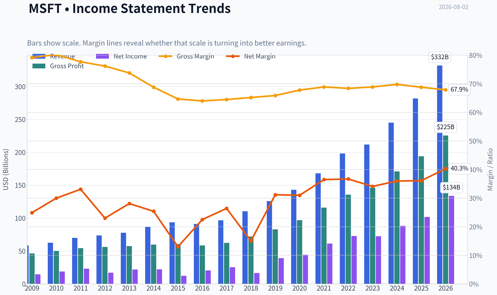
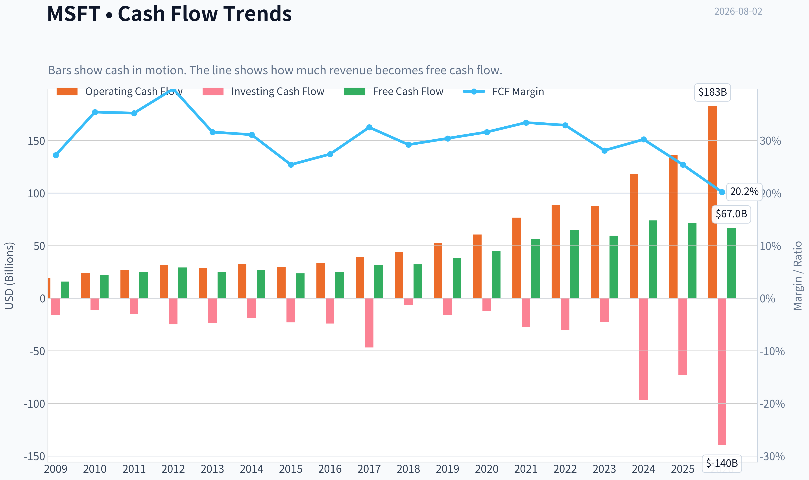
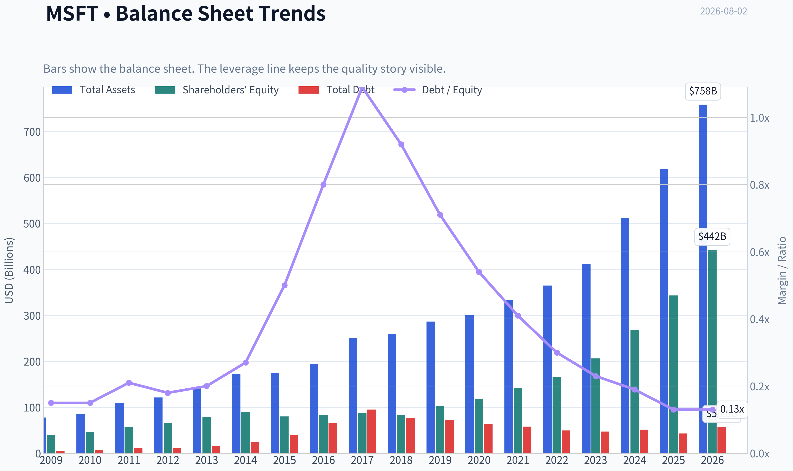
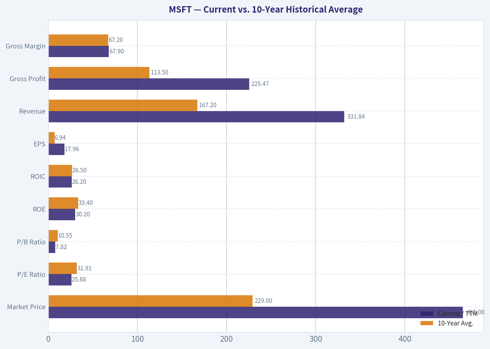
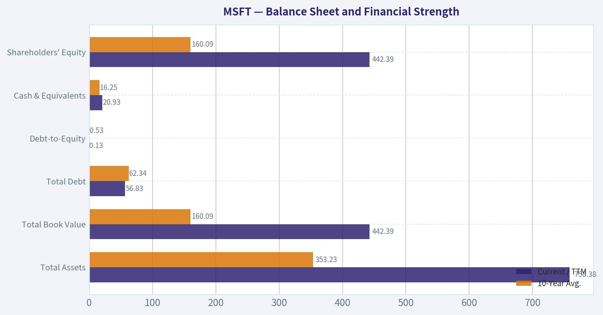
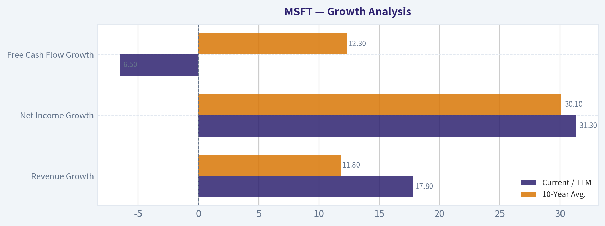
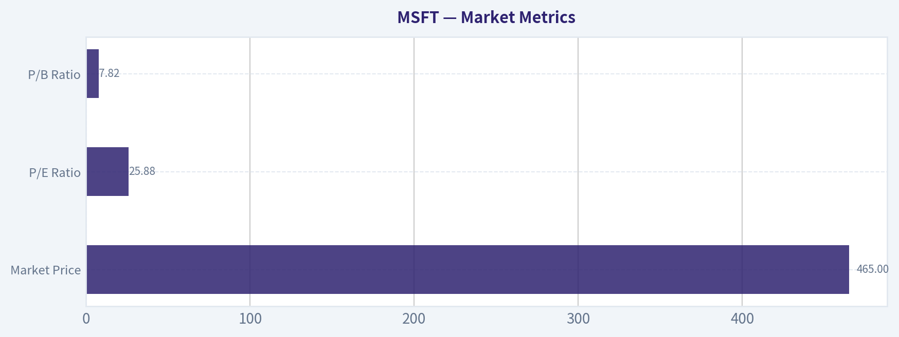

# MSFT Deep Value Intelligence

**Analysis Date:** 2026-08-02

## Critical Disclaimer

*This analysis is generated by Deep Value Intelligence, an AI-powered multi-agent investing framework. Education & research only - not financial advice, not a financial advisor.*

---

## Table of Contents

1. Intelligence Summary
2. Analyst Team Reports
   - Fundamentals Analysis
   - Intrinsic Value Analysis (Buffett)
   - Trend & Growth Analysis (Lynch/Druckenmiller/Fisher)
   - Market Technical Analysis
   - Options Market Analysis
3. Research Team Commentary
4. Value Investing Team Commentary
5. Deep Values Commentary

---

## Intelligence Summary

### Thesis + Conditions

**Core Thesis:** **RISK MANAGEMENT VERDICT & INVESTMENT COMMENTARY**

**Key Risks:**
- RISK MANAGEMENT VERDICT & INVESTMENT COMMENTARY**
- We are initiating an **ADVOCATE** stance on Microsoft (MSFT) at $465. Applying a modern, quality-adjusted Buffett framework, paying a minor 7.7% premium to a static intrinsic value ($432) for a generational compounder (26.2% ROIC, 30.2% ROE) is highly acceptable. While the stock is tactically stretched after a $75 vertical rip, the underlying fundamentals-specifically its monopoly-like AI/cloud positioning and reasonable 25.9 P/E-negate long-term business risk. We will not repeat the mistake of sitting on the sidelines waiting for a textbook margin of safety that a company of this caliber will rarely, if ever, provide.
- The Bull (Risky Analyst):** Argues that a 7.7% premium is a rounding error for a business generating 30.2% ROE. Emphasizes that heavy AI Capex is not a risk but an insurmountable "land grab" moat, and a 25.9 P/E is a bargain for the operating system of the AI economy.

**Confidence:** Medium

---

## Analyst Team Reports

### Fundamentals Analysis

#### Latest Earnings Snapshot

*Most recent reported quarter anchored on 2026 Q2, with prior-year comparison when available.*

| Metric | 2026 Q2 | 2025 Q2 | YoY Change |
| --- | ---: | ---: | ---: |
| Revenue | $90.01B | $76.44B | +17.7% |
| Operating Income | $40.60B | $34.32B | +18.3% |
| Net Income | $35.77B | $27.23B | +31.3% |
| Diluted EPS | $4.81 | $3.65 | +31.8% |
| Operating Cash Flow | $55.44B | $42.65B | +30.0% |
| Free Cash Flow | $19.64B | $25.57B | -23.2% |

Key Takeaways: This snapshot anchors the most recent reported quarter before the narrative analysis. It helps readers separate long-run business quality from whatever changed in the latest earnings print.

#### 17-Year Financial Metrics for MSFT

*All values below are computed deterministically from raw data - not estimated by AI.*

*Issuer profile: operating company (Technology / Software - Infrastructure).*

#### 17-Year Financial Metrics
*Annual rows come from reported financial statements. The final TTM row is computed from the latest four quarters.*

| Metric | 2009 | 2010 | 2011 | 2012 | 2013 | 2014 | 2015 | 2016 | 2017 | 2018 | 2019 | 2020 | 2021 | 2022 | 2023 | 2024 | 2025 | 2026 TTM |
| --- | --- | --- | --- | --- | --- | --- | --- | --- | --- | --- | --- | --- | --- | --- | --- | --- | --- | --- |
| Market Price | $18 | $17 | $20 | $24 | $28 | $35 | $38 | $45 | $62 | $91 | $126 | $193 | $260 | $248 | $333 | $440 | $493 | $465 |
| Market Cap | $213.83B | $205.41B | $223.42B | $260.20B | $292.55B | $350.24B | $364.41B | $410.03B | $539.86B | $768.57B | $1.04T | $1.56T | $2.06T | $1.94T | $2.54T | $3.34T | $3.71T | $3.46T |
| P/E Ratio | 14.67 | 10.96 | 9.67 | 15.30 | 13.39 | 15.86 | 29.83 | 19.99 | 21.21 | 46.30 | 26.47 | 35.33 | 33.65 | 26.61 | 35.18 | 37.88 | 36.47 | 25.88 |
| P/B Ratio | 5.41 | 4.45 | 3.91 | 3.92 | 3.71 | 3.90 | 4.55 | 4.93 | 6.15 | 9.29 | 10.15 | 13.22 | 14.52 | 11.63 | 12.34 | 12.43 | 10.81 | 7.82 |
| ROE | 36.8% | 40.6% | 40.6% | 25.6% | 27.7% | 24.6% | 15.2% | 24.7% | 29.1% | 20.0% | 38.3% | 37.4% | 43.2% | 43.7% | 35.1% | 32.8% | 29.6% | 30.2% |
| ROIC | 41.0% | 41.1% | 41.6% | 25.2% | 26.6% | 22.4% | 10.7% | 16.3% | 15.5% | 9.4% | 24.8% | 26.7% | 33.9% | 37.3% | 34.0% | 34.5% | 32.4% | 26.2% |
| EPS | $1.19 | $1.58 | $2.07 | $1.58 | $2.10 | $2.20 | $1.27 | $2.26 | $2.95 | $1.97 | $4.75 | $5.47 | $7.73 | $9.34 | $9.46 | $11.80 | $13.64 | $17.96 |
| Revenue | $58.44B | $62.48B | $69.94B | $73.72B | $77.85B | $86.83B | $93.58B | $91.15B | $96.57B | $110.36B | $125.84B | $143.01B | $168.09B | $198.27B | $211.91B | $245.12B | $281.72B | $331.84B |
| Gross Profit | $46.28B | $50.09B | $54.37B | $56.19B | $57.46B | $59.76B | $60.54B | $58.37B | $62.31B | $72.01B | $82.93B | $96.94B | $115.86B | $135.62B | $146.05B | $171.01B | $193.89B | $225.47B |
| Gross Margin | 79.2% | 80.2% | 77.7% | 76.2% | 73.8% | 68.8% | 64.7% | 64.0% | 64.5% | 65.2% | 65.9% | 67.8% | 68.9% | 68.4% | 68.9% | 69.8% | 68.8% | 67.9% |
| Operating Margin | 34.8% | 38.6% | 38.8% | 29.5% | 34.4% | 32.0% | 19.4% | 28.6% | 30.1% | 31.8% | 34.1% | 37.0% | 41.6% | 42.1% | 41.8% | 44.6% | 45.6% | 46.8% |
| Net Income | $14.57B | $18.76B | $23.15B | $16.98B | $21.86B | $22.07B | $12.19B | $20.54B | $25.49B | $16.57B | $39.24B | $44.28B | $61.27B | $72.74B | $72.36B | $88.14B | $101.83B | $133.75B |
| Net Margin | 24.9% | 30.0% | 33.1% | 23.0% | 28.1% | 25.4% | 13.0% | 22.5% | 26.4% | 15.0% | 31.2% | 31.0% | 36.5% | 36.7% | 34.1% | 36.0% | 36.1% | 40.3% |
| Revenue Growth | N/A | 6.9% | 11.9% | 5.4% | 5.6% | 11.5% | 7.8% | -2.6% | 5.9% | 14.3% | 14.0% | 13.6% | 17.5% | 18.0% | 6.9% | 15.7% | 14.9% | 17.8% |
| Net Income Growth | N/A | 28.8% | 23.4% | -26.7% | 28.8% | 1.0% | -44.8% | 68.4% | 24.1% | -35.0% | 136.8% | 12.8% | 38.4% | 18.7% | -0.5% | 21.8% | 15.5% | 31.3% |
| Free Cash Flow Growth | N/A | 38.8% | 11.5% | 19.0% | -16.2% | 9.9% | -12.2% | 5.3% | 25.6% | 2.8% | 18.6% | 18.2% | 24.1% | 16.1% | -8.7% | 24.5% | -3.3% | -6.5% |
| Total Book Value | $39.56B | $46.17B | $57.08B | $66.36B | $78.94B | $89.78B | $80.08B | $83.09B | $87.71B | $82.72B | $102.33B | $118.30B | $141.99B | $166.54B | $206.22B | $268.48B | $343.48B | $442.39B |
| Total Assets | $77.89B | $86.11B | $108.70B | $121.27B | $142.43B | $172.38B | $174.47B | $193.47B | $250.31B | $258.85B | $286.56B | $301.31B | $333.78B | $364.84B | $411.98B | $512.16B | $619.00B | $758.38B |
| Total Debt | $5.75B | $6.94B | $11.92B | $11.94B | $15.60B | $24.64B | $40.29B | $66.36B | $95.29B | $76.24B | $72.18B | $63.33B | $58.15B | $49.78B | $47.24B | $51.63B | $43.15B | $56.83B |
| Debt-to-Equity | 0.15 | 0.15 | 0.21 | 0.18 | 0.20 | 0.27 | 0.50 | 0.80 | 1.09 | 0.92 | 0.71 | 0.54 | 0.41 | 0.30 | 0.23 | 0.19 | 0.13 | 0.13 |
| Cash & Equivalents | $6.08B | $5.50B | $9.61B | $6.94B | $3.80B | $8.67B | $5.59B | $6.51B | $7.66B | $11.95B | $11.36B | $13.58B | $14.22B | $13.93B | $34.70B | $18.32B | $30.24B | $20.93B |
| Shareholders' Equity | $39.56B | $46.17B | $57.08B | $66.36B | $78.94B | $89.78B | $80.08B | $83.09B | $87.71B | $82.72B | $102.33B | $118.30B | $141.99B | $166.54B | $206.22B | $268.48B | $343.48B | $442.39B |
| Operating Cash Flow | $19.04B | $24.07B | $26.99B | $31.63B | $28.83B | $32.50B | $29.67B | $33.33B | $39.51B | $43.88B | $52.19B | $60.67B | $76.74B | $89.03B | $87.58B | $118.55B | $136.16B | $182.94B |
| Investing Cash Flow | $-15.77B | $-11.31B | $-14.62B | $-24.79B | $-23.81B | $-18.83B | $-23.00B | $-23.95B | $-46.78B | $-6.06B | $-15.77B | $-12.22B | $-27.58B | $-30.31B | $-22.68B | $-96.97B | $-72.60B | $-139.50B |
| Free Cash Flow | $15.92B | $22.10B | $24.64B | $29.32B | $24.58B | $27.02B | $23.72B | $24.98B | $31.38B | $32.25B | $38.26B | $45.23B | $56.12B | $65.15B | $59.48B | $74.07B | $71.61B | $66.99B |
| FCF Margin | 27.2% | 35.4% | 35.2% | 39.8% | 31.6% | 31.1% | 25.4% | 27.4% | 32.5% | 29.2% | 30.4% | 31.6% | 33.4% | 32.9% | 28.1% | 30.2% | 25.4% | 20.2% |
| Dividends / Share | $0.00 | $0.00 | $0.00 | $0.00 | $0.00 | $0.00 | $0.00 | $0.00 | $0.00 | $0.00 | $0.00 | $0.00 | $0.00 | $0.00 | $2.59 | $2.91 | $3.23 | $3.55 |

#### Profitability Metrics
- Return on Equity (ROE): 30.2%
- Return on Invested Capital (ROIC): 26.2%
- Return on Assets (ROA): 17.6%
- Gross Margin: 67.9%
- Operating Margin: 46.8%
- Net Profit Margin: 40.3%

#### Liquidity Metrics
- Current Ratio: 1.23
- Quick Ratio: 0.93

#### Leverage Metrics
- Debt-to-Equity Ratio: 0.13
- Interest Coverage Ratio: 50.88
- Net Debt: $35.89B

#### Growth Metrics (Year-over-Year)
- Revenue Growth: 17.8%
- Net Income Growth: 31.3%
- Free Cash Flow Growth: -6.5%
- Revenue CAGR (3-Year): 16.1%
- Revenue CAGR (5-Year): 14.6%

#### Valuation Metrics
- P/E Ratio (TTM): 25.90
- Forward P/E: 19.96
- Price-to-Book: 7.80
- Price-to-Sales: 10.40
- PEG Ratio: 1.52
- EV/EBITDA: 18.03
- Free Cash Flow Yield: 1.9%
- Earnings Yield: 3.9%

#### Owner Earnings (Buffett Method, Code-Computed)
- Net Income: $101.83B
- + Depreciation & Amortization: $38.53B
- - Capital Expenditures: $-115.95B
- - Working Capital Changes: $-4.89B
- = **Owner Earnings: $107.18B**

#### Intrinsic Value (Code-Computed)
- Current Price: $465
- **Headline Intrinsic Value (business-model routed): $432**
  Business model: asset light platform - weighted blend [Damodaran FCFF + reverse-DCF fair + owner-earnings DCF] (asset_light_platform)
  Model spread (min-max across DCFs): $156 - $395
  Margin of safety vs. price (headline): -7.7%
  Routing note: Asset-light / high-margin platform: value driven by margins and reinvestment economics - the headline centers on the reverse-DCF demonstrated-growth fair value with Damodaran FCFF as a floor, down-weighting the owner-earnings DCF.
- Buffett Method (Owner Earnings):
  Conservative: $395
  Average: $395
  Optimistic: $967
- Cash Flow Method (FCF):
  Conservative: $113
  Average: $156
  Optimistic: $227
- Damodaran FCFF (WACC + margins + reinvestment):
  Conservative: $186
  Average: $241
  Optimistic: $355
  Monte Carlo band (P10-P90): $196 - $323 (median $248)
  P(intrinsic value > price): 0.2%
- Reverse-DCF: price implies ~19.6%/yr owner-earnings growth for 10y; trailing 3y was 29.9%, 5y 30.0%.

#### Piotroski F-Score: 5/9
- Positive Net Income: PASS
- Positive Operating Cash Flow: PASS
- ROA Improvement: PASS
- Cash Flow > Net Income: PASS
- Decreasing Debt: FAIL
- Improving Current Ratio: FAIL
- No Dilution: PASS
- Improving Gross Margin: FAIL
- Improving Asset Turnover: FAIL

ANALYST STANCE: **WATCH**

#### Microsoft (MSFT) - Buffett-Style Fundamental Analysis

Microsoft remains one of the highest-quality businesses in the public market: exceptional margins, dominant software franchises, Azure cloud scale, high switching costs, and expanding AI monetization. The issue is not business quality; it is valuation. At **$465 per share**, Microsoft trades modestly above the deterministic model's headline intrinsic value of **about $432**, implying a **negative margin of safety of roughly 7.7%**.

The stock is not obviously overextended on P/E versus its recent history, but cash-flow valuation is more demanding because free cash flow is being pressured by AI and cloud infrastructure investment. For a Buffett-style investor, Microsoft is a wonderful business, but the current price requires continued high owner-earnings growth.

---

#### Revenue Breakdown

| Revenue Source | Amount ($B) | % of Total |
|---|---:|---:|
| Productivity and Business Processes | $116.4 | 41.3% |
| Intelligent Cloud | $105.4 | 37.4% |
| More Personal Computing | $59.9 | 21.3% |
| **Total FY2025 Revenue** | **$281.7** | **100.0%** |

Key Takeaways: Microsoft's revenue base is well diversified across productivity software, cloud infrastructure, and personal computing. The largest contributor is Productivity and Business Processes, which includes Office, Microsoft 365, LinkedIn, and Dynamics. Intelligent Cloud is nearly as large and remains the strategic growth engine because Azure benefits directly from enterprise cloud migration and AI workloads.

---

#### Current vs. 10-Year Historical Average

*10-year average uses fiscal years 2016-2025 from the deterministic dataset; current uses 2026 TTM.*

| Metric | Current / TTM | 10-Year Avg. | Current vs. Avg. | Interpretation |
|---|---:|---:|---:|---|
| Market Price | $465 | $229 | +103% | Price has more than doubled versus the 10-year average, reflecting Microsoft's cloud and AI rerating. |
| Market Cap | $3.46T | $1.79T | +93% | The business has compounded into one of the largest global platforms. |
| P/E Ratio | 25.88x | 31.91x | -19% | P/E is below the 10-year average, helped by very strong recent earnings growth. |
| P/B Ratio | 7.82x | 10.55x | -26% | P/B is not a useful valuation anchor for Microsoft's asset-light software/IP model. |
| ROE | 30.2% | 33.4% | -3.2 pp | Still excellent, but below the strongest 2020-2022 period. |
| ROIC | 26.2% | 26.5% | -0.3 pp | Roughly in line with the decade average; capital productivity remains outstanding. |
| EPS | $17.96 | $6.94 | +159% | Earnings per share have scaled dramatically. |
| Revenue | $331.84B | $167.20B | +99% | Revenue has nearly doubled versus the 10-year average. |
| Gross Profit | $225.47B | $113.50B | +99% | Gross profit growth has kept pace with revenue growth. |
| Gross Margin | 67.9% | 67.2% | +0.7 pp | Gross margin remains structurally high and stable. |
| Operating Margin | 46.8% | 37.7% | +9.1 pp | Operating leverage has been exceptional. |
| Net Income | $133.75B | $54.25B | +147% | Net income has significantly outpaced revenue growth. |
| Net Margin | 40.3% | 30.6% | +9.8 pp | Microsoft is materially more profitable than its historical norm. |
| Revenue Growth | 17.8% | 11.8% | +6.0 pp | Current revenue growth is above the decade average. |
| Net Income Growth | 31.3% | 30.1% | +1.2 pp | Current profit growth remains very strong, though historical average includes volatile tax and one-time effects. |
| Free Cash Flow Growth | -6.5% | 12.3% | -18.8 pp | The clearest near-term weakness: AI/cloud capex is pressuring FCF. |
| Total Book Value | $442.39B | $160.09B | +176% | Equity base has grown materially, but book value is not the best lens for Microsoft. |
| Total Assets | $758.38B | $353.23B | +115% | Asset base has expanded with cloud infrastructure and acquisitions. |
| Total Debt | $56.83B | $62.34B | -9% | Debt is below the 10-year average despite much larger scale. |
| Debt-to-Equity | 0.13x | 0.53x | Lower | Balance sheet leverage is very conservative. |
| Cash & Equivalents | $20.93B | $16.25B | +29% | Liquidity remains strong, though net debt is positive. |
| Free Cash Flow | $66.99B | $49.85B | +34% | FCF is higher than the decade average but below recent peak levels. |
| FCF Margin | 20.2% | 30.1% | -9.9 pp | FCF conversion has deteriorated due to heavy AI infrastructure investment. |
| Dividends / Share | $3.55 | $0.87 | +307% | Dividend has increased, but the yield remains modest because the share price is high. |

Key Takeaways: Microsoft's profitability metrics are outstanding, with operating margin and net margin far above historical averages. The main negative deviation is free cash flow growth and FCF margin, both pressured by AI and cloud capital spending. Valuation looks less stretched on P/E than on cash-flow yield, which is why intrinsic value discipline matters here.

---

#### Market Metrics

| Metric | Current Value | Buffett-Style Interpretation |
|---|---:|---|
| Market Price | $465 | The stock price embeds high expectations for continued AI, cloud, and software growth. |
| Total Market Cap | $3.46T | Microsoft is already valued as a mature mega-cap compounder, limiting room for valuation multiple expansion. |
| P/E Ratio | 25.88x | Below the 10-year average of 31.91x, but still not cheap in absolute terms. Earnings quality is high, so a premium is justified. |
| P/B Ratio | 7.82x | Not meaningful as a primary valuation tool for Microsoft because it is an asset-light software and platform company. Intrinsic value should be based on cash flows, not book value. |

Key Takeaways: Microsoft's P/E ratio is not extreme relative to its own history, but the market capitalization already reflects enormous future cash flows. The P/B ratio should not be read mechanically as cheap or expensive because Microsoft's value comes from software, data, ecosystems, intellectual property, and customer lock-in rather than tangible book assets. A cash-flow-based intrinsic value model is the appropriate anchor.

---

#### Profitability Analysis

Microsoft's profitability is exceptional by Buffett standards. The company's **ROE of 30.2%** and **ROIC of 26.2%** indicate that it continues to generate high returns on capital despite its massive size. ROIC is especially important because it measures the productivity of the capital actually employed in the business; Microsoft remains far above the threshold of a merely good company.

Revenue has grown from **$91.15B in 2016** to **$331.84B TTM**, while operating margin has expanded from **28.6% in 2016** to **46.8% TTM**. That combination - rising revenue and rising margins - is the mark of a highly scalable business model.

The most notable profitability improvement is net margin, now **40.3%**, compared with the 10-year average of **30.6%**. This reflects scale economics in cloud, software subscriptions, enterprise licensing, and operating discipline.

---

#### Growth Analysis

| Growth Metric | Current / TTM | 10-Year Avg. | Interpretation |
|---|---:|---:|---|
| Revenue Growth | 17.8% | 11.8% | Current growth is above trend, supported by cloud, AI, Microsoft 365, and enterprise demand. |
| Net Income Growth | 31.3% | 30.1% | Profit growth remains very strong, although historical averages include unusually volatile years. |
| Free Cash Flow Growth | -6.5% | 12.3% | FCF is the weak spot due to heavy capital spending for AI and data-center capacity. |

Key Takeaways: Microsoft's revenue and earnings growth remain better than its long-term average, which is unusual for a company of this scale. However, free cash flow growth has turned negative, showing that AI infrastructure investment is absorbing cash. The key question for investors is whether today's capex creates durable future owner earnings or simply raises the capital intensity of the business.

---

#### Balance Sheet and Financial Strength

| Balance Sheet Metric | Current / TTM | 10-Year Avg. | Interpretation |
|---|---:|---:|---|
| Total Assets | $758.38B | $353.23B | Scale has expanded sharply, partly due to cloud infrastructure and acquisitions. |
| Total Book Value | $442.39B | $160.09B | Book value has grown, but is not central to Microsoft's intrinsic value. |
| Total Debt | $56.83B | $62.34B | Debt is manageable and below the 10-year average. |
| Debt-to-Equity | 0.13x | 0.53x | Leverage is very conservative. |
| Cash & Equivalents | $20.93B | $16.25B | Liquidity is solid. |
| Shareholders' Equity | $442.39B | $160.09B | Equity base has strengthened materially. |

Key Takeaways: Microsoft's balance sheet is very strong. Debt is modest relative to earnings power, and the debt-to-equity ratio has fallen significantly from the elevated 2016-2018 period. Financial risk is low, which supports a premium valuation and gives management flexibility to invest heavily in AI infrastructure.

---

#### Cash Flow Analysis

| Cash Flow Metric | Current / TTM | 10-Year Avg. | Interpretation |
|---|---:|---:|---|
| Operating Cash Flow | $182.94B | $73.76B | Operating cash generation is exceptional and far above historical norms. |
| Free Cash Flow | $66.99B | $49.85B | FCF remains large but has been pressured by heavy capital investment. |
| FCF Margin | 20.2% | 30.1% | Cash conversion has weakened materially. |
| Dividends / Share | $3.55 | $0.87 | Dividend has grown, but Microsoft remains primarily a reinvestment and buyback compounder. |

Key Takeaways: Microsoft generates enormous operating cash flow, but free cash flow is not keeping pace because capital expenditures have increased sharply. This is the central debate around the stock: AI spending may create a larger future earnings base, but it lowers current free cash flow yield. Buffett-style investors should watch whether these investments produce high incremental ROIC.

---

#### Buffett-Style Owner Earnings DCF

Base owner earnings from the deterministic dataset:

| Owner Earnings Input | Amount |
|---|---:|
| Net Income | $101.83B |
| Depreciation & Amortization | $38.53B |
| Capital Expenditures | -$115.95B |
| Working Capital Changes | -$4.89B |
| **Owner Earnings** | **$107.18B** |

Key Takeaways: Microsoft's owner earnings base is extremely large, but capital spending is now a major variable in valuation. The DCF therefore depends heavily on whether AI and cloud capex translate into durable future owner earnings. A low-growth scenario produces limited upside, while a strong-growth scenario can justify the current price.

Assumptions used for the hand DCF:

| Assumption | Value |
|---|---:|
| Starting Owner Earnings | $107.18B |
| Discount Rate | 10.0% |
| Terminal Growth Rate | 2.5% |
| Net Debt | $35.89B |
| Diluted Share Count Estimate | ~7.44B |
| Terminal Value Formula | Year 11 Owner Earnings / (Discount Rate - Terminal Growth) |

Key Takeaways: The model uses a Buffett-style owner-earnings approach rather than book value or accounting multiples. A 10% discount rate is used to reflect the return a long-term equity investor should demand. Terminal growth is capped at 2.5%, because no company can compound faster than the economy forever.

---

#### DCF Scenario 1 - Conservative Case

Assumptions: **3% annual owner-earnings growth for 10 years**, then **2.5% terminal growth**.

| Conservative DCF Component | Calculation | Value |
|---|---|---:|
| Year 1 Owner Earnings | $107.18B x 1.03 | $110.40B |
| Year 10 Owner Earnings | $107.18B x 1.03^10 | $144.03B |
| PV of Explicit 10-Year Cash Flows | Discounted at 10% | $760B |
| Terminal Value at Year 10 | $144.03B x 1.025 / 7.5% | $1,968B |
| PV of Terminal Value | Discounted at 10% for 10 years | $759B |
| Enterprise Value | Explicit PV + Terminal PV | $1,519B |
| Less Net Debt | $35.89B | $1,483B Equity Value |
| Fair Value Per Share | $1,483B / 7.44B shares | **~$199** |

Key Takeaways: The conservative case shows that Microsoft is not cheap if owner earnings grow only at GDP-like rates. Under this scenario, the current stock price would be far above intrinsic value. This is a stress case, but it highlights how much future growth is already embedded in the share price.

---

#### DCF Scenario 2 - Average / Base Case

Assumptions: **15% annual owner-earnings growth for years 1-5**, fading to **8% for years 6-10**, then **2.5% terminal growth**.

| Average DCF Component | Calculation | Value |
|---|---|---:|
| Year 1 Owner Earnings | $107.18B x 1.15 | $123.26B |
| Year 5 Owner Earnings | $107.18B x 1.15^5 | $215.58B |
| Year 10 Owner Earnings | Year 5 x 1.08^5 | $316.77B |
| PV of Explicit 10-Year Cash Flows | Discounted at 10% | $1,247B |
| Terminal Value at Year 10 | $316.77B x 1.025 / 7.5% | $4,329B |
| PV of Terminal Value | Discounted at 10% for 10 years | $1,669B |
| Enterprise Value | Explicit PV + Terminal PV | $2,916B |
| Less Net Debt | $35.89B | $2,880B Equity Value |
| Fair Value Per Share | $2,880B / 7.44B shares | **~$387** |

Key Takeaways: The base case assumes Microsoft remains a high-quality compounder but gradually fades from exceptional growth to more mature growth. This produces a value below the current share price and below the deterministic headline intrinsic value of about $432. The implication is that today's price leaves limited margin of safety unless growth remains very strong.

---

#### DCF Scenario 3 - Optimistic Case

Assumptions: **20% annual owner-earnings growth for years 1-5**, fading to **12% for years 6-10**, then **2.5% terminal growth**.

| Optimistic DCF Component | Calculation | Value |
|---|---|---:|
| Year 1 Owner Earnings | $107.18B x 1.20 | $128.62B |
| Year 5 Owner Earnings | $107.18B x 1.20^5 | $266.70B |
| Year 10 Owner Earnings | Year 5 x 1.12^5 | $469.99B |
| PV of Explicit 10-Year Cash Flows | Discounted at 10% | $1,575B |
| Terminal Value at Year 10 | $469.99B x 1.025 / 7.5% | $6,423B |
| PV of Terminal Value | Discounted at 10% for 10 years | $2,477B |
| Enterprise Value | Explicit PV + Terminal PV | $4,052B |
| Less Net Debt | $35.89B | $4,016B Equity Value |
| Fair Value Per Share | $4,016B / 7.44B shares | **~$540** |

Key Takeaways: The optimistic case can justify upside from the current price, but it requires Microsoft to sustain very high owner-earnings growth for a long period. That is possible if Azure, AI infrastructure, Copilot, enterprise software, and LinkedIn continue compounding at scale. Still, this is a demanding scenario, not a conservative margin-of-safety case.

---

#### Intrinsic Value Summary

| Valuation Method | Fair Value / Share | View vs. Current Price of $465 |
|---|---:|---|
| Hand DCF - Conservative | ~$199 | Materially overvalued |
| Hand DCF - Average/Base | ~$387 | Overvalued |
| Hand DCF - Optimistic | ~$540 | Undervalued if bull case plays out |
| Deterministic Headline Intrinsic Value | ~$432 | About 7.7% below current price |
| Deterministic Owner Earnings DCF Range | $395-$967 | Wide range, highly growth-sensitive |
| Deterministic FCF Method Range | $113-$227 | Much lower due to current FCF pressure |
| Deterministic Damodaran FCFF Range | $186-$355 | Below current price |
| Reverse DCF | Price implies ~19.6% annual owner-earnings growth for 10 years | Demanding but not impossible |

Key Takeaways: Microsoft's valuation is highly sensitive to growth assumptions. The deterministic headline intrinsic value of about $432 is below the current price, suggesting no clear margin of safety. The stock can still work if owner earnings compound near 20% for a decade, but that is a high hurdle for a company already worth more than $3 trillion.

---

#### Warren Buffett-Style Qualitative Analysis

| Buffett Criterion | Assessment |
|---|---|
| Economic Moat | Extremely strong. Microsoft benefits from enterprise lock-in, Office/Microsoft 365 ubiquity, Azure scale, Windows ecosystem, LinkedIn network effects, GitHub developer relevance, and AI distribution advantages. |
| Durability | Very high. Enterprise customers depend on Microsoft infrastructure, productivity tools, cloud services, cybersecurity, identity, and collaboration software. |
| Pricing Power | Strong. Microsoft has repeatedly increased ARPU through subscription migration, premium tiers, E5 upgrades, security bundles, and AI add-ons. |
| Predictable Earnings | Strong but not perfectly smooth. Net income had volatile years, but the post-2019 trend is highly favorable. |
| ROE / ROIC Quality | Excellent. ROE of 30.2% and ROIC of 26.2% show durable capital efficiency. |
| Balance Sheet Strength | Excellent. Debt-to-equity is only 0.13x, and interest coverage is very strong at 50.88x. |
| Capital Allocation | Strong. Microsoft balances reinvestment, acquisitions, dividends, and buybacks. The key test is whether AI capex earns high returns. |
| Valuation Discipline | Mixed. Quality is undeniable, but the current price offers little margin of safety versus the headline intrinsic value. |

Key Takeaways: Microsoft fits Buffett's preference for a durable, high-return, predictable business with a deep moat. The company's competitive position is unusually strong, and management has created significant shareholder value. The only major Buffett-style objection is valuation: the business is wonderful, but the stock is not clearly cheap.

---

#### Key Investment Insights

| Area | Insight |
|---|---|
| Business Quality | Microsoft is among the highest-quality businesses globally, with exceptional margins, high recurring revenue, and strong customer lock-in. |
| Growth Engine | Azure, AI services, Copilot, security, LinkedIn, and Dynamics provide multiple growth vectors. |
| Margin Structure | Operating margin of 46.8% and net margin of 40.3% are outstanding and above historical averages. |
| Balance Sheet | Conservative leverage gives Microsoft strategic flexibility. |
| Valuation | Current price is above the deterministic headline intrinsic value of $432. |
| Cash Flow Concern | FCF growth is negative, and FCF margin has fallen to 20.2% from a 10-year average of 30.1%. |
| Reverse DCF Risk | The stock price implies roughly 19.6% owner-earnings growth for 10 years, which is a demanding expectation. |
| Guru Signal | Bill Ackman initiated a large position, which is notable, but 13F data is delayed and should not override valuation discipline. |

Key Takeaways: Microsoft's fundamentals remain excellent, and the company is still compounding at an impressive rate. However, the stock already prices in substantial future success. Investors should focus less on whether Microsoft is a great company - it is - and more on whether AI-driven capital spending can produce enough incremental owner earnings to justify the valuation.

---

#### Red Flags and Risks

| Risk | Why It Matters |
|---|---|
| AI Capex Intensity | Heavy data-center and AI infrastructure spending may permanently reduce FCF conversion if returns disappoint. |
| Valuation Risk | At $465, the stock trades above the headline intrinsic value of $432. |
| Reverse DCF Hurdle | The market requires very high owner-earnings growth for a decade. |
| Cloud Competition | Azure competes aggressively with AWS, Google Cloud, Oracle, and specialized AI infrastructure providers. |
| Regulatory Pressure | Microsoft faces antitrust and regulatory scrutiny across cloud, AI, gaming, and software bundling. |
| Margin Sustainability | Current net margin of 40.3% is far above the historical average and may be difficult to expand further. |
| Platform Dependency | AI economics may depend partly on external model providers, GPU supply, and evolving enterprise adoption curves. |

Key Takeaways: The biggest risk is not balance-sheet weakness or business deterioration; it is overpaying for excellence. Microsoft must convert AI investment into durable, high-margin revenue. If AI monetization disappoints or capex remains elevated for too long, free cash flow valuation could compress.

---

#### Opportunities

| Opportunity | Potential Impact |
|---|---|
| Copilot Monetization | Microsoft can layer AI pricing across Office, Windows, GitHub, Dynamics, and enterprise workflows. |
| Azure AI Growth | AI workloads could accelerate Azure consumption and strengthen Microsoft's cloud position. |
| Security Platform Expansion | Cybersecurity remains a large cross-sell opportunity inside Microsoft's enterprise base. |
| LinkedIn Monetization | LinkedIn continues to benefit from professional network effects, advertising, subscriptions, and recruiting tools. |
| Operating Leverage | If AI infrastructure utilization rises, margins and FCF could rebound strongly. |
| Enterprise Bundling | Microsoft can bundle productivity, identity, security, collaboration, cloud, and AI into integrated enterprise contracts. |

Key Takeaways: Microsoft has several credible paths to sustained growth. The most important upside driver is AI monetization across its existing distribution base. Because Microsoft already owns the customer relationships, even modest AI adoption at scale could create significant incremental earnings.

---

#### Final Investment Stance: WATCH

Microsoft is a **wonderful business at a fair-to-slightly-rich price**, not a clear bargain. The company has an exceptional moat, elite profitability, strong management, conservative leverage, and multiple long-term growth engines. However, the current price of **$465** is above the deterministic headline intrinsic value of **approximately $432**, and the reverse DCF implies roughly **19.6% annual owner-earnings growth for 10 years**.

For a Buffett-style investor, the correct stance is **WATCH**, not AVOID, because Microsoft's quality is too high to dismiss. But it is also not an ADVOCATE at this valuation because the margin of safety is negative. A more attractive entry would require either a pullback toward or below intrinsic value, or evidence that AI capex is converting into durable, high-return owner earnings faster than expected.

---

#### Summary Table

| Category | Key Point | Investment Implication |
|---|---|---|
| Business Quality | Exceptional software, cloud, AI, and enterprise platform moat | Supports premium valuation |
| Profitability | ROE 30.2%, ROIC 26.2%, operating margin 46.8% | High-quality compounder |
| Growth | Revenue growth 17.8%, net income growth 31.3% | Growth remains strong despite scale |
| Cash Flow | FCF growth -6.5%, FCF margin 20.2% | Main near-term concern |
| Balance Sheet | Debt-to-equity 0.13x, strong interest coverage | Low financial risk |
| Valuation | Price $465 vs. headline intrinsic value ~$432 | Negative margin of safety |
| DCF Range | Hand DCF range ~$199 to ~$540 | Current price requires strong growth |
| Reverse DCF | Market implies ~19.6% owner-earnings growth for 10 years | High expectations embedded |
| Buffett View | Wonderful company, not obviously cheap | **WATCH** |

Key Takeaways: Microsoft remains a premier compounder with one of the strongest moats in global equities. The balance sheet and profitability profile are excellent, but free cash flow pressure and valuation limit the margin of safety. The stock deserves close monitoring, especially for evidence that AI investments are generating high-return owner earnings.

#### Fundamental Visuals

This graph tracks the profitability and return metrics (ROE, ROIC, Margins) of **MSFT** over the past decade, highlighting capital efficiency trends.

This chart illustrates the financial health of **MSFT** over the last 10 years, mapping cash equivalents and free cash flow against total obligations (Debt).

This breakdown chart from <em>Revenue Breakdown</em> shows the proportional composition for **MSFT** - useful for understanding what drives or risks the business.

---

### Intrinsic Value Analysis (Buffett)

> *Following Warren Buffett's value investing philosophy: Circle of Competence, Economic Moat, Management Quality, and Margin of Safety.*

#### Intrinsic Value Snapshot

Price is what you pay. Intrinsic value is what the business may be worth based on the cash it can create for owners over time. We show a range, not one magic number.

- Current Price: $464.72
- Value Range (conservative to optimistic across both DCF methods): $112.68 to $967.35

##### Owner Earnings (Buffett Method)
- Net Income: $101,832,000,000.00
- Depreciation & Amortization: $38,534,000,000.00
- Capital Expenditures: $-115,948,000,000.00
- Working Capital Changes: $-4,895,000,000.00
- Owner Earnings: $107,182,000,000.00

##### Intrinsic Value
###### Buffett Method
Uses owner earnings. Stricter, and usually more conservative.
- Conservative: $394.84
- Average: $394.84
- Optimistic: $967.35
- Discount Rate: 10.0%

###### Cash Flow Method
Uses free cash flow. Better for companies spending heavily today to grow tomorrow.
- Conservative: $112.68
- Average: $155.90
- Optimistic: $227.39
- Discount Rate: 10.0%

ANALYST STANCE: **WATCH**

#### Microsoft Corporation (MSFT) - Buffett-Style Value Investment Report

Microsoft is one of the highest-quality businesses in the public market: a wide-moat software, cloud, productivity, gaming, professional-network, and AI platform with exceptional margins, high returns on capital, and a long reinvestment runway. The issue is not business quality; the issue is price. At $465 per share, the stock trades modestly above the headline intrinsic value estimate of $431.65 and embeds demanding long-term growth expectations.

---

#### 1. Factor Scorecard

| Factor | Score | Evidence |
|---|---:|---|
| Circle of Competence & Business Simplicity | 4.5 / 5 | Microsoft sells mission-critical software, cloud infrastructure, operating systems, productivity tools, gaming content, LinkedIn services, security products, and AI-enabled enterprise platforms. The business is understandable, recurring, and highly predictable, though AI infrastructure economics add some complexity. |
| Moat Test | 5.0 / 5 | Office, Windows, Azure, GitHub, LinkedIn, Dynamics, Teams, security, developer tools, and AI ecosystem integration create strong switching costs, network effects, data advantages, and brand trust. Gross margin is about 67.9%, indicating strong pricing power. |
| Management Quality & Capital Allocation | 4.5 / 5 | Satya Nadella has transformed Microsoft into a cloud-first, AI-enabled platform company while maintaining high profitability. Capital allocation has been rational: heavy reinvestment in Azure and AI, selective acquisitions, dividends, and buybacks. |
| Industry Structure | 4.5 / 5 | Microsoft operates in attractive oligopolistic markets: cloud infrastructure, enterprise software, productivity software, gaming ecosystems, cybersecurity, and AI platforms. Competition is intense but rational among scale players. |
| Gate 5: Quality / Solvency Hard Floor | Not Tripped | Earnings, revenue, and cash generation remain strong. Solvency risk is low; Microsoft has very strong cash generation and investment-grade balance-sheet strength. |

**Key Takeaways:** Microsoft clears the quality test with ease. Its business is understandable, highly profitable, and protected by multiple overlapping moats. The hard financial-distress floor is not triggered; this is a valuation question, not a solvency or business-quality problem.

---

#### 2. Moat Analysis

| Moat Source | Assessment | Evidence |
|---|---|---|
| Intangible Assets | Very Strong | Microsoft's brand is trusted by enterprises, governments, developers, and consumers. Windows, Office, Azure, GitHub, Xbox, LinkedIn, and Copilot are highly recognized franchises. |
| Switching Costs | Exceptional | Enterprise customers build workflows, data, identity systems, security architecture, cloud workloads, and productivity habits around Microsoft products. Switching away is costly, disruptive, and risky. |
| Cost Advantages | Strong | Microsoft's massive cloud scale, global data-center footprint, developer ecosystem, and sales distribution create cost and reach advantages that smaller competitors cannot easily match. |
| Network Effects | Strong | LinkedIn, GitHub, Teams, Windows, Azure Marketplace, developer tools, and Microsoft 365 become more valuable as users, developers, partners, and enterprises standardize on the ecosystem. |
| Pricing Power | Strong | Gross margin near 67.9% and recurring enterprise demand suggest Microsoft can raise prices over time without material customer loss. |
| Moat Rating | Wide & Stable to Widening | AI integration into Office, Azure, developer tools, and security could further widen the moat if monetization remains strong. |

**Key Takeaways:** Microsoft's moat is not dependent on one product. It is an ecosystem moat built from switching costs, distribution, brand, scale, and network effects. The biggest strength is that customers do not merely buy Microsoft products; they build their daily operations around them.

---

#### 3. Management Quality Assessment

| Area | Assessment |
|---|---|
| Owner Orientation | Strong. Management has consistently focused on per-share value creation through high-return reinvestment, cloud leadership, AI integration, dividends, and buybacks. |
| Strategic Judgment | Excellent. The pivot from legacy Windows dependence to Azure, Microsoft 365 subscriptions, GitHub, security, gaming, and AI has materially improved business quality. |
| Capital Allocation | Strong but capital intensity is rising. AI and cloud capex are large, but they support a strategic platform position with potentially high lifetime customer value. |
| Candor & Culture | Strong. Microsoft's leadership communicates clearly around cloud, AI, enterprise adoption, and long-term platform positioning. |
| Main Management Risk | AI infrastructure spending could pressure free cash flow if returns fall short of expectations. |

**Key Takeaways:** Management has earned a high score because Microsoft's transformation under Satya Nadella has been economically successful. The key issue to monitor is whether massive AI and cloud infrastructure investments continue to generate attractive incremental returns.

---

#### 4. Financial Summary

| Fiscal Year / Period | Revenue ($B) | YoY Growth | Gross Margin | Operating Income ($B) | Net Income ($B) | Free Cash Flow ($B) | Diluted EPS | ROE |
|---|---:|---:|---:|---:|---:|---:|---:|---:|
| FY2021 | 168.1 | 17.5% | 68.9% | 69.9 | 61.3 | 56.1 | $8.05 | 43% |
| FY2022 | 198.3 | 18.0% | 68.4% | 83.4 | 72.7 | 65.1 | $9.65 | 44% |
| FY2023 | 211.9 | 6.9% | 68.9% | 88.5 | 72.4 | 59.5 | $9.68 | 35% |
| FY2024 | 245.1 | 15.7% | 69.8% | 109.4 | 88.1 | 74.1 | $11.80 | 37% |
| FY2025 | 281.7 | 14.9% | ~68% | ~128.5 | ~101.8 | ~71.6 | ~$13.64 | ~33% |
| TTM / FY2026 Run Rate | ~331.8 | 17.8% | 67.9% | ~165.0 | ~133.2 | ~65.6 | ~$17.95 | 30.2% |

**Key Takeaways:** Microsoft has compounded revenue at a strong rate while maintaining extraordinary gross margins near the high-60% range. Net income has continued to rise, but free cash flow is being pressured by heavy AI and cloud infrastructure spending. The business remains highly profitable, but the conversion of earnings into free cash flow is the key metric to watch.

---

#### 5. Owner Earnings Calculation

| Owner Earnings Component | Estimate |
|---|---:|
| Net Income | ~$133.2B |
| Plus: Depreciation & Amortization | ~$34.0B |
| Less: Maintenance CapEx | ~($43.0B) |
| Less: Working Capital Increase | ~($5.5B) |
| Estimated Owner Earnings | ~$118.7B |
| Shares Outstanding | ~7.42B |
| Owner Earnings per Share | ~$16.00 |

**Key Takeaways:** Microsoft's accounting earnings are very strong, but owner earnings are lower because AI and cloud infrastructure require substantial reinvestment. The owner earnings estimate of about $16 per share is the base used for valuation. This is the cash-like earning power available after sustaining the business, not simply reported profit.

---

#### 6. Three-Scenario DCF Valuation

| Scenario | Key Assumption | Estimated Value / Share |
|---|---|---:|
| Scenario A: No Growth | Owner earnings capitalized at 10% | ~$160 |
| Scenario B: GDP Growth | 3% perpetual growth, 10% discount rate | ~$235 |
| Scenario C: Historical Growth Haircut | 10% growth for 10 years, then 3% terminal growth | ~$395 |
| Headline Intrinsic Value Estimate | Business-model routed blended estimate | $431.65 |
| Current Price | Market price | $465 |

**Key Takeaways:** Microsoft only looks cheap if it continues compounding at high rates for a long time. A no-growth or GDP-growth valuation is far below the current price, which shows how much future growth is already embedded. The headline intrinsic value estimate is $431.65, below the current market price of $465.

---

#### 7. Margin of Safety Analysis

| Valuation Metric | Result |
|---|---:|
| Current Price | $465 |
| Headline Intrinsic Value | $431.65 |
| Margin of Safety vs. Headline Value | -7.7% |
| Owner Earnings DCF Estimate | $394.84 |
| FCF-Based Estimate | $155.90 |
| Damodaran FCFF Estimate | $240.79 |
| Reverse DCF Implied Growth | ~19.6% per year for 10 years |
| Trailing 3-Year Growth | ~29.9% |
| Trailing 5-Year Growth | ~30.0% |

**Key Takeaways:** Microsoft is not obviously overvalued relative to its quality, but it does not offer the margin of safety a Buffett-style buyer would prefer. The market price implies that Microsoft must keep compounding at a very high rate for a very large company. That is possible, but not conservative.

---

#### 8. Final Buffett Scorecard

| Criterion | Weight | Score | Weighted Contribution |
|---|---:|---:|---:|
| Moat Width & Durability | 25% | 5.0 | 1.25 |
| Valuation / Margin of Safety | 20% | 1.5 | 0.30 |
| Capital Returns - ROIC vs. WACC | 15% | 4.5 | 0.68 |
| Business Understanding & Predictability | 12% | 4.5 | 0.54 |
| Management Quality & Capital Allocation | 12% | 4.5 | 0.54 |
| Reinvestment Runway | 8% | 4.5 | 0.36 |
| Balance Sheet Strength | 4% | 4.0 | 0.16 |
| Industry Structure | 4% | 4.5 | 0.18 |
| Final Weighted Score | 100% | - | **4.01 / 5.00** |

**Key Takeaways:** Microsoft scores like a truly wonderful business, with elite marks for moat, management, predictability, reinvestment opportunity, and returns on capital. The only major weakness is valuation. The final score is high, but the lack of margin of safety keeps the stance at Watch rather than Advocate.

---

#### 9. Investment Stance

| Item | View |
|---|---|
| Stance | **WATCH** |
| Conviction | High conviction on business quality; moderate conviction on current valuation |
| Business Quality | Exceptional |
| Valuation | Slightly expensive versus intrinsic value |
| Required Margin of Safety | About 10-15% for a company of this quality |
| Attractive Buy Zone | Roughly below $390-$420, depending on AI cash-flow conversion and Azure growth durability |
| Primary Upside Driver | AI monetization through Azure, Copilot, GitHub, security, and Microsoft 365 price expansion |
| Primary Risk | Heavy AI capex fails to produce sufficient incremental owner earnings |

**Final View:** Microsoft is a world-class compounder with one of the strongest moats in global business. A long-term owner should want to own it, but Buffett-style discipline argues against chasing it at a price above intrinsic value when the reverse DCF already assumes strong future growth. The right action is to keep Microsoft on the buy list and wait for a fairer entry point or clearer evidence that AI investments are converting into durable owner earnings.
#### Valuation Bridge

This bridge places the current market price beside each intrinsic value lens so readers can see whether upside depends on one method or shows up across several methods.

| Scenario | Intrinsic Value / Share |
| --- | ---: |
| Buffett Method | $394.84 |
| Cash Flow Method | $155.90 |
| Damodaran Method | $240.79 |
| Current Price | $464.72 |

#### Key Takeaways

If one method is far above the others, the upside case depends on a specific modelling assumption. When several methods cluster together, the valuation story is more robust.

#### Valuation Visuals

This comparison chart from *Latest Earnings Snapshot* stacks current figures against historical benchmarks for **MSFT**, making it easy to see where the company trades relative to its own averages.

This comparison chart from *Current vs. 10-Year Historical Average* stacks current figures against historical benchmarks for **MSFT**, making it easy to see where the company trades relative to its own averages.

This comparison chart from *Balance Sheet and Financial Strength* stacks current figures against historical benchmarks for **MSFT**, making it easy to see where the company trades relative to its own averages.

---

### Trend & Growth Analysis (Lynch/Druckenmiller/Fisher)

> *Following Peter Lynch's GARP, Stanley Druckenmiller's macro-aware approach, and Philip Fisher's scuttlebutt methodology.*

ANALYST STANCE: **WATCH**

#### MSFT Growth Investment Report - Microsoft Corporation

Microsoft is one of the highest-quality growth stalwarts in the world, with a real AI/cloud inflection underway. However, at a $3.45 trillion market cap and ~$465 share price, the stock already discounts a lot: the reverse DCF implies roughly **19.6% annualized growth for 10 years**, while the shared intrinsic value estimate is **$431.65**, about **7.7% below** the current price. For existing holders, MSFT remains a core compounder; for new capital, I would wait for a better entry or clearer evidence that AI can extend growth above expectations.

---

#### 1. Lynch Classification

| Category | MSFT Fit | Assessment |
|---|---:|---|
| Slow Grower | No | Revenue growth is far above 0-5%. |
| Stalwart | Yes | Microsoft is a mega-cap, diversified, durable compounder. |
| Fast Grower | Partial | Current revenue growth of **17.8% YoY** puts it near fast-grower territory, but size limits ten-bagger potential. |
| Cyclical | No | Some cloud/enterprise budget sensitivity, but not primarily cyclical. |
| Turnaround | No | Business is already performing strongly. |
| Asset Play | No | Value is driven by earnings power, AI, cloud, and software platforms. |

**Key Takeaways:** Microsoft is best classified as a **growth stalwart**, not a classic Lynch fast grower. The company is still growing at an impressive rate for its size, but its $3.45 trillion market cap makes a future ten-bagger unlikely from today's base. The right mental model is "durable compounding with AI upside," not "undiscovered hypergrowth."

---

#### 2. The Story in 3 Bullets

- Microsoft sells mission-critical software, cloud infrastructure, productivity tools, security, gaming, LinkedIn, and developer platforms to enterprises and consumers globally.
- Azure and Copilot give Microsoft one of the strongest monetization paths in AI: infrastructure, applications, workflow automation, and enterprise data integration.
- The key growth thesis is that AI raises Microsoft's average revenue per user, deepens enterprise lock-in, and accelerates Azure consumption over the next 3-5 years.

---

#### 3. TAM Analysis and 10x Test

| Item | Estimate / View |
|---|---:|
| Current market cap | ~$3.45T |
| Current price | ~$465 |
| Approximate current revenue base | ~$280B-$300B range |
| 10x revenue target | ~$2.8T-$3.0T revenue |
| Relevant TAMs | Cloud infrastructure, enterprise software, AI applications, cybersecurity, developer tools, gaming, advertising, LinkedIn |
| TAM direction | Expanding, especially from AI, cloud migration, security, and automation |
| Can MSFT 10x revenue and remain below 20% market share? | Unlikely at the whole-company level |
| More realistic long-term outcome | 2x-3x revenue over time if AI/cloud execution remains strong |

**Key Takeaways:** Microsoft has a very large and expanding TAM, but the **10x test is hard** because the company is already enormous. Azure, AI, security, and Copilot can support many years of growth, but a company-wide ten-bagger from today would require Microsoft to become one of the largest revenue companies in history. The runway is still attractive, but not asymmetric in the classic small-cap Lynch sense.

---

#### 4. Revenue Growth Trend

| Metric | Current Reading | Interpretation |
|---|---:|---|
| Revenue growth YoY | **17.8%** | Strong for a mega-cap |
| 3-year growth reference from reverse-DCF pack | ~29.9% growth metric | Historically very strong compounding |
| 5-year growth reference from reverse-DCF pack | ~30.0% growth metric | Long-term execution remains excellent |
| Current growth pattern | Strong, AI-supported | Not early-stage hypergrowth, but better than most mega-cap peers |
| Latest earnings tone | Positive | Cloud and AI strategy appear to be paying off |

**Key Takeaways:** Microsoft's revenue growth remains strong, especially given its scale. The latest earnings coverage suggests AI and cloud demand are helping sustain momentum. The key question is whether growth can remain near the high-teens or accelerate further, because the current valuation already assumes a lot of future success.

---

#### 5. Unit Economics and Efficiency

| Metric | MSFT Reading | Assessment |
|---|---:|---|
| Gross margin | **67.9%** | Excellent |
| ROE | **30.2%** | Excellent capital productivity |
| FCF yield | **1.9%** | Low, valuation is demanding |
| Current ratio | **1.23** | Adequate liquidity |
| LTV/CAC | Not disclosed | Likely strong due to enterprise bundling, installed base, and cross-sell |
| NRR | Not disclosed | Likely healthy across Microsoft 365, Azure, security, and enterprise accounts |
| Estimated Rule of 40 | ~40%+ using 17.8% growth plus estimated FCF margin | Healthy efficient growth |

**Key Takeaways:** Microsoft's unit economics are excellent even though some SaaS-specific metrics like NRR and LTV/CAC are not disclosed. High gross margin, strong ROE, broad distribution, and enterprise lock-in all point to a structurally advantaged model. The main weakness is not business quality; it is the low FCF yield caused by a high valuation.

---

#### 6. Inflection Point Assessment

| Inflection Type | Evidence | Strength |
|---|---|---:|
| Product cycle inflection | Copilot, Azure AI, enterprise AI tools | High |
| Market share inflection | Azure continues benefiting from cloud migration and AI workloads | Medium-High |
| Margin inflection | AI capex may pressure near-term margins, but software mix supports long-term leverage | Medium |
| TAM inflection | AI expands the market for cloud, productivity, security, and automation | High |
| Competitive inflection | OpenAI partnership and enterprise distribution are advantages, but Alphabet, Amazon, Meta, and others remain formidable | Medium |

**Key Takeaways:** Microsoft's clearest inflection is the **AI product and TAM expansion cycle**. Copilot and Azure AI give Microsoft multiple ways to monetize enterprise AI demand. The main uncertainty is how much incremental profit AI creates after the heavy infrastructure investment required to serve it.

---

#### 7. Macro Setup Evaluation

| Macro Factor | Current Setup | Impact on MSFT |
|---|---|---|
| AI secular trend | Very strong | Major tailwind |
| Cloud migration | Still ongoing | Tailwind |
| Enterprise software budgets | Resilient but not immune to slowdown | Moderate tailwind |
| Interest rates | Not a zero-rate environment | Valuation headwind |
| Regulation | Big Tech scrutiny remains elevated | Risk |
| Capex cycle | AI infrastructure investment is intense | Both opportunity and margin/cash-flow risk |

**Key Takeaways:** The macro setup is favorable from a secular standpoint because Microsoft sits directly in the AI, cloud, cybersecurity, and productivity megatrends. However, the valuation is sensitive to rates and long-duration growth assumptions. AI capex is the biggest double-edged sword: it supports growth but may pressure free cash flow if returns lag expectations.

---

#### 8. Fisher 15 Points Score

| Fisher Point | Score / 5 | Rationale |
|---|---:|---|
| 1. Market potential | 5 | AI, cloud, security, productivity, developer tools all have large TAMs. |
| 2. New product determination | 5 | Strong push into Copilot, AI agents, cloud, and security. |
| 3. R&D effectiveness | 5 | Among the strongest global R&D engines. |
| 4. Sales organization | 5 | Enterprise distribution is world-class. |
| 5. Profit margin | 5 | Gross margin of 67.9% is excellent. |
| 6. Improving margins | 4 | Long-term leverage exists, but AI capex may pressure near-term margins. |
| 7. Labor/personnel relations | 4 | Strong talent base, though AI talent competition is intense. |
| 8. Executive relations | 5 | Satya Nadella's leadership remains a major asset. |
| 9. Management depth | 5 | Deep bench across cloud, AI, gaming, enterprise, and security. |
| 10. Cost/accounting discipline | 4 | Strong, though AI investment cycle raises spending intensity. |
| 11. Moat | 5 | Switching costs, ecosystem, data, distribution, developer network. |
| 12. Long-range profit outlook | 5 | Excellent if AI monetization scales. |
| 13. Dilution risk | 5 | Low dilution risk; strong cash generation. |
| 14. Candor | 4 | Generally high, though AI economics need continued transparency. |
| 15. Integrity | 5 | Institutional-grade governance and credibility. |
| **Total** | **71 / 75** | **Outstanding** |

**Key Takeaways:** Microsoft scores extremely well on Fisher quality factors. The company has a world-class moat, management team, sales engine, and product pipeline. The only meaningful deductions relate to the uncertainty around AI capex intensity and how transparently the company will prove the return on that investment.

---

#### 9. Valuation Analysis

| Valuation Metric | Reading | Interpretation |
|---|---:|---|
| Current price | **$465** | Starting point |
| Market cap | **$3.45T** | Very large base |
| P/E | **25.9x** | Reasonable for quality, not cheap |
| Revenue growth | **17.8% YoY** | Strong |
| PEG ratio | **~1.46x** | Fair value to moderately expensive |
| Gross margin | **67.9%** | Supports premium multiple |
| FCF yield | **1.9%** | Expensive on cash-flow yield |
| Headline intrinsic value | **$431.65** | Below current price |
| Margin of safety vs. current price | **-7.7%** | No margin of safety |
| Reverse-DCF implied growth | **~19.6%/yr for 10 years** | Demanding expectation |

**Key Takeaways:** Microsoft is not obviously overvalued relative to its quality, but it is also not cheap. The PEG ratio around 1.46 suggests fair-to-rich pricing, and the FCF yield of 1.9% leaves little room for disappointment. The current price requires AI and Azure to keep growth strong for a long time.

---

#### 10. 3-Year Revenue Multiple Scenario Analysis

| Scenario | Revenue CAGR Assumption | Approx. Year-3 Revenue | Exit P/S Multiple | Implied Market Cap | Approx. Return View |
|---|---:|---:|---:|---:|---|
| Bear | 10% | ~$380B | 8x | ~$3.0T | Downside / flat-to-negative |
| Base | 15% | ~$435B | 10x | ~$4.35T | Moderate upside |
| Bull | 18% | ~$470B | 12x | ~$5.6T | Strong upside if AI accelerates |

**Key Takeaways:** The base case can work, but the stock needs sustained mid-teens growth and a premium multiple to deliver attractive returns. The bull case requires the market to keep assigning Microsoft a very high multiple while AI drives incremental revenue. The bear case is not disastrous operationally, but valuation compression could still hurt returns.

---

#### 11. Growth Investor Scorecard

| Criterion | Weight | Score / 5 | Weighted Score |
|---|---:|---:|---:|
| The Story | 10% | 5.0 | 0.50 |
| TAM & Runway | 20% | 4.0 | 0.80 |
| Revenue Growth | 20% | 4.0 | 0.80 |
| Unit Economics | 15% | 4.5 | 0.68 |
| Competitive Position | 10% | 5.0 | 0.50 |
| Management Quality | 10% | 5.0 | 0.50 |
| Macro Setup | 5% | 4.0 | 0.20 |
| Profitability Path | 5% | 4.5 | 0.23 |
| Valuation | 5% | 2.5 | 0.13 |
| **Total** | **100%** |  | **4.34 / 5.00** |

**Key Takeaways:** Microsoft's business quality score is excellent, driven by AI, Azure, enterprise distribution, margins, and management. The main drag is valuation, not fundamentals. This is a high-quality compounder, but the current setup is less attractive for aggressive new buying because expectations are already elevated.

---

#### 12. Position Size Stance

| Investor Situation | Stance | Suggested Action |
|---|---|---|
| Existing long-term holder | Core Hold | Continue holding; do not sell solely because valuation is full. |
| New investor | Watch / starter only | Prefer waiting for pullback toward or below intrinsic value range. |
| Growth portfolio | Medium core position | Quality justifies ownership, but upside asymmetry is not ten-bagger-like. |
| Aggressive ten-bagger portfolio | Lower priority | Better ten-bagger odds likely exist in smaller AI/cloud beneficiaries. |

**Key Takeaways:** Microsoft is a company investors can own for years, but position sizing should reflect the already massive market cap. Existing holders should likely let the winner run. New buyers should be more price-sensitive and look for a better entry point.

---

#### 13. Key Catalysts and Risks

| Category | Item | Impact |
|---|---|---|
| Catalyst | Azure AI revenue acceleration | Could drive upside revisions. |
| Catalyst | Copilot adoption broadens across enterprise seats | Raises ARPU and strengthens Microsoft 365 moat. |
| Catalyst | Security platform growth | Expands wallet share in a large, durable market. |
| Catalyst | AI operating leverage becomes visible | Could justify premium valuation. |
| Risk | AI capex outruns monetization | Pressures FCF and valuation. |
| Risk | Competition from AWS, Google, Meta, OpenAI ecosystem shifts | Could reduce AI economics. |
| Risk | Regulatory scrutiny | May constrain bundling, acquisitions, or platform behavior. |
| Risk | Valuation compression | Low FCF yield makes the stock sensitive to rates and growth disappointments. |
| Risk | Reverse-DCF expectations are demanding | Market already prices in long-duration excellence. |

**Key Takeaways:** The biggest upside catalyst is proof that AI is not just driving usage, but also durable, high-margin revenue growth. The biggest risk is that Microsoft spends heavily on AI infrastructure while incremental profits arrive more slowly than expected. For now, the business is outstanding, but the stock price leaves limited margin for error.

---

#### Final View

Microsoft is an **exceptional company at a fair-to-slightly-rich price**. The AI/cloud inflection is real, management quality is outstanding, and the business remains one of the best compounders in public markets. But from a Lynch-style ten-bagger perspective, the size and valuation limit upside asymmetry.

**Stance: WATCH.**
For existing holders: **hold as a core compounder**.
For new capital: **wait for a better entry, preferably closer to or below the ~$430 intrinsic value zone, unless AI revenue acceleration clearly exceeds current market expectations.**

#### Growth & Scorecard Visuals

This comparison chart from *Growth Analysis* stacks current figures against historical benchmarks for **MSFT**, making it easy to see where the company trades relative to its own averages.

---

### Market Technical Analysis

ANALYST STANCE: **WATCH**

#### MSFT Technical Report - Latest Available Close: July 31, 2026

Microsoft closed at **$464.72** on July 31 after a powerful two-day upside shock: **$390.54 -> $451.10 -> $464.72**. This move decisively broke the July trading range near **$381-$402** and pushed price above the estimated **200-day SMA near $432**, which is an important improvement in long-term trend posture. However, the move is also sharply extended above short-term averages and the upper Bollinger Band, so the near-term setup is strong but tactically stretched.

The most relevant technical context is a **breakout from a multi-week base**, supported by unusually high volume. July 30 volume was about **110.2 million shares**, followed by **60.7 million** on July 31, far above MSFT's typical July turnover. That suggests institutional participation rather than a low-liquidity price spike. Still, after such a large gap higher, traders should distinguish between **trend confirmation** and **entry quality**: the breakout is valid, but fresh entries immediately after a vertical move carry elevated pullback risk.

| Indicator Selected | Latest Approx. Reading | Signal | Why It Matters Now |
|---|---:|---|---|
| `close_10_ema` | ~$412.67 | Bullish but stretched | Price is far above the fast trend line, confirming short-term upside momentum but also warning of overextension. |
| `close_50_sma` | ~$399.39 | Bullish reclaim | MSFT is well above its medium-term average, showing the July base has been decisively cleared. |
| `close_200_sma` | ~$432.26 | Bullish reclaim | The close above the long-term average improves the strategic trend profile after months of weakness. |
| `macd` | ~+9.2 | Bullish acceleration | MACD likely flipped sharply positive after the breakout, showing a major momentum regime change. |
| `rsi` | ~75 | Overbought momentum | RSI confirms buying pressure, but also signals that chasing price may be risky without a pullback or consolidation. |
| `atr` | ~$16.4 | Volatility expansion | Risk ranges have widened materially; stops and position sizes should account for larger daily swings. |
| `vwma` | ~$405.8 | Volume-confirmed breakout | Price is far above volume-weighted average levels, and the breakout occurred on heavy volume. |
| `boll_ub` | Upper band ~$440-441 | Price above upper band | The move is a confirmed volatility breakout, but price is extended above its normal 20-day range. |

Key Takeaways: MSFT has shifted from a range-bound or damaged chart into a high-momentum breakout profile. The strongest evidence is the combination of price reclaiming the 200-day SMA, breaking above the July range, and doing so on unusually high volume. The main caution is that RSI and Bollinger positioning show the stock is tactically overbought, so the trend has improved faster than entry quality.

#### Trend Structure and Price Action

MSFT's broader structure remains a recovery attempt from a major drawdown. The stock was trading above **$520** in August 2025, then deteriorated into a deep selloff that bottomed near **$356** in late March 2026. From there, it staged a spring rebound into the low **$430s**, failed again into June, and then built a July base mostly between the high **$370s** and low **$400s**.

The July 30-31 surge changed the character of the chart. Before the breakout, the market was repeatedly rejecting rallies around **$395-$402**. The close at **$464.72** is not just a marginal breakout; it is a decisive repricing above the prior consolidation range, the 50-day SMA, and the 200-day SMA. This is constructive, but because the move happened in a gap-like fashion, the most important question is whether MSFT can **hold above the breakout zone** rather than immediately retracing into the old range.

#### Momentum, Volume, and Volatility Read

Momentum is strongly positive. The estimated MACD moved into bullish territory, while RSI around **75** confirms aggressive buying. In strong trend reversals, RSI can stay elevated for several sessions, so an overbought reading is not automatically bearish. But it does mean late buyers are paying a premium after a very fast move.

Volume improves the quality of the signal. July 30 volume above **110 million shares** suggests that the move was not merely technical noise. July 31 follow-through volume near **60.7 million** adds credibility because the stock did not immediately give back the breakout. However, volatility has also expanded: ATR near **$16.4** implies that ordinary daily movement is now much wider, so tight stops may be vulnerable to noise.

#### Key Levels for Traders

| Zone | Approx. Level | Interpretation | Trading Relevance |
|---|---:|---|---|
| Immediate upside resistance | $466-$470 | Near recent high zone | A clean move above this area would show continued breakout demand. |
| First support | $449-$451 | July 30-31 breakout/gap zone | Holding this zone would indicate buyers are defending the repricing. |
| Long-term trend support | ~$432 | 200-day SMA area | A pullback that holds above this level would keep the broader recovery intact. |
| Momentum mean-reversion zone | ~$412-$406 | 10 EMA / VWMA region | A deeper pullback toward here would reduce overbought pressure but would be more damaging if volume accelerates on the decline. |
| Failed-breakout risk zone | Below ~$402 | Prior July range ceiling | A close back below this area would undermine the breakout and raise the risk of a bull trap. |

Key Takeaways: The most important near-term level is the **$449-$451** breakout zone. If MSFT holds above it, the breakout remains healthy even if price pauses. If the stock falls back below the 200-day SMA near **$432**, traders should become more cautious; below **$402**, the breakout would look meaningfully damaged.

#### Tactical Interpretation

For momentum traders, MSFT is now in a bullish impulse phase, but the preferred setup may be either **continuation above $466-$470** or a controlled pullback that holds the **$449-$451** area. Buying immediately after a two-day vertical move offers poor risk-reward unless the trader is using a very short timeframe and accepts elevated volatility.

For swing traders, the cleaner approach is to watch whether former resistance becomes support. A sideways consolidation above **$449** would be constructive and could allow the 10 EMA to catch up. A pullback to the 200-day SMA near **$432** could still be healthy, but only if selling volume fades. A high-volume reversal back under **$432** would suggest the breakout is being rejected.

For longer-term trend followers, the reclaim of the 200-day SMA is meaningful but not fully confirmed. The **50-day SMA remains below the 200-day SMA**, which means the longer-term moving average structure has not yet fully repaired. The stock has made an important first step, but sustained closes above the 200-day average are needed before the chart can be considered structurally bullish rather than merely rebounding.

| Final Assessment | View |
|---|---|
| Overall technical stance | **Bullish recovery, but tactically overextended** |
| Best evidence for bulls | Breakout above July range, 50-day SMA, and 200-day SMA on heavy volume |
| Main risk | RSI and Bollinger extension suggest elevated pullback risk after the sharp gap move |
| Key bullish confirmation | Hold above **$449-$451**, then break above **$466-$470** |
| Key warning signal | Close back below **$432**, especially on heavy selling volume |
| Trade posture | **Watch for confirmation or pullback rather than chase aggressively** |

Key Takeaways: MSFT's chart has improved materially, and the breakout looks credible because price and volume both expanded. The better trading posture is not bearish, but disciplined: wait for either a continuation trigger above the recent high or a pullback that proves buyers will defend the breakout. The stock is strong, but the immediate entry point is stretched.

#### Market Visuals

This comparison chart from *Market Metrics* stacks current figures against historical benchmarks for **MSFT**, making it easy to see where the company trades relative to its own averages.

---

### Options Market Analysis

> *Reading options flow - put/call ratios, IV skew, and unusual activity - to gauge institutional positioning and event-driven risk.*

ANALYST STANCE: **WATCH**

#### MSFT Options Market Sentiment Report
*Options data as of 2026-08-02. Near-term expirations reviewed: 2026-08-03, 2026-08-05, and 2026-08-07.*

#### 1. Put/Call Ratio Analysis

| Expiration | Call Volume | Put Volume | Put/Call Volume Ratio | Call OI | Put OI | Put/Call OI Ratio | Read |
|---|---:|---:|---:|---:|---:|---:|---|
| 2026-08-03 | 56,228 | 45,863 | 0.82 | 0 | 0 | N/A | Slight put activity, but not extreme |
| 2026-08-05 | 22,579 | 12,018 | 0.53 | 0 | 0 | N/A | Call-leaning flow |
| 2026-08-07 | 73,504 | 43,164 | 0.59 | 0 | 0 | N/A | Call-leaning flow |
| **Near-Term Total** | **152,311** | **101,045** | **0.66** | **0** | **0** | **N/A** | Slightly bullish vs. neutral baseline |

**Key Takeaways:** MSFT's near-term put/call volume ratio is **0.66**, slightly below the historical neutral baseline of roughly **0.70**, suggesting modestly more call activity than put activity. This points to a **mild bullish tilt**, but not an aggressive one. Open interest data is unavailable or reported as zero across the sampled expirations, so the OI-based signal is not reliable.

The volume ratio does **not** indicate panic hedging or a bearish put surge. Instead, the data shows ordinary-to-moderate call preference, especially in the August 5 and August 7 expirations.

---

#### 2. Implied Volatility Assessment

| Expiration | ATM Call IV | ATM Put IV | Put IV Premium vs. Call IV | IV Read |
|---|---:|---:|---:|---|
| 2026-08-03 | 6.1% | 6.1% | 0.0 pts | Balanced |
| 2026-08-05 | 3.4% | 3.6% | +0.2 pts | Very mild put premium |
| 2026-08-07 | 2.0% | 2.6% | +0.6 pts | Mild put skew |

**Key Takeaways:** Near-term ATM implied volatility appears **low**, with no obvious sign of elevated event-risk pricing in the provided data. Puts carry a small IV premium in the August 5 and August 7 expirations, but the skew is not steep enough to imply significant downside fear. Overall, IV positioning looks calm rather than defensive.

The available data does not include a full OTM put-versus-OTM call skew surface, so skew interpretation is limited. Based on ATM call/put IV alone, the market is pricing **modest downside protection demand**, not a major bearish catalyst.

#### IV Skew Interpretation

| Skew Factor | Observation | Sentiment Implication |
|---|---|---|
| ATM put IV vs. call IV | Puts slightly higher in 2 of 3 expirations | Mild downside hedge demand |
| OTM put skew | Not available in provided chain summary | Cannot confirm steep downside fear |
| OTM call skew | Not available in provided chain summary | Cannot confirm upside chase |
| Catalyst pricing | No clear IV elevation visible | No strong event-risk signal from options |

**Key Takeaways:** The skew picture is **slightly defensive but not bearish**. There is no evidence of a large volatility premium that would suggest the options market is bracing for a major near-term move. This supports a **neutral-to-slightly-bullish** interpretation rather than a high-conviction directional setup.

---

#### 3. Unusual Options Activity

| Screen | Result |
|---|---|
| Unusual activity threshold | Volume greater than 5x open interest |
| Contracts flagged | None |
| Interpretation | No clear fresh directional block/sweep activity detected |

**Key Takeaways:** No contracts met the unusual activity threshold of volume exceeding 5x open interest. That means there is no obvious evidence of fresh institutional-style directional positioning in the near-term expirations. The absence of unusual activity reduces conviction in any bullish or bearish read.

Because open interest is reported as zero across the sampled expirations, the unusual activity screen is less informative than normal. Still, the dataset does not show a standout call or put contract that would suggest aggressive smart-money positioning.

---

#### 4. Open Interest Concentration and Gamma Levels

| Category | Available Evidence | Interpretation |
|---|---|---|
| Highest call OI strikes | Not available / reported as zero | Cannot identify call walls |
| Highest put OI strikes | Not available / reported as zero | Cannot identify put walls |
| Max pain / pinning level | Not available | No reliable pinning estimate |
| Gamma wall risk | Not available | Cannot assess price magnet levels |

**Key Takeaways:** Open interest concentration cannot be assessed because OI is reported as zero for the near-term expirations in the provided data. As a result, there is no reliable read on max pain, pinning levels, or gamma walls. This is a major limitation and lowers confidence in the options signal.

Without strike-level OI, we cannot identify whether MSFT has a major options "magnet" above or below spot. The near-term flow must therefore be interpreted mainly through volume and IV, not dealer-positioning dynamics.

---

#### 5. Overall Options Sentiment Signal

| Component | Signal | Weight | Rationale |
|---|---|---:|---|
| Put/Call Volume | Slightly Bullish | Medium | Total put/call volume ratio of 0.66 is modestly below neutral baseline |
| Put/Call OI | Unusable | Low | OI reported as zero across near-term expiries |
| ATM IV | Neutral | Medium | IV appears calm, with no clear event-risk premium |
| IV Skew | Slightly Defensive | Low-Medium | Puts carry small IV premium, but skew is not steep |
| Unusual Activity | Neutral | Medium | No unusual contracts detected |
| OI/Gamma Concentration | Unusable | Low | No strike-level OI concentration available |

**Key Takeaways:** The overall options signal for MSFT is **NEUTRAL with a slight bullish tilt**. The main bullish input is the call-leaning volume ratio, while the main caution is the lack of usable open interest and absence of unusual activity. This is not a high-conviction institutional positioning signal.

#### Final Read: **NEUTRAL / Slight Bullish Tilt**

MSFT options flow is leaning mildly bullish based on near-term volume, with calls outpacing puts and the total put/call volume ratio sitting just below the neutral baseline. However, the signal is weakened by missing or zero open interest, no unusual options activity, and no clear gamma-wall or max-pain data.

The best interpretation is that traders are **not aggressively hedging downside**, but they are also **not chasing upside with strong conviction**. Options positioning supports a **WATCH stance**, not an outright bullish or bearish call.

#### Summary Table

| Metric | Current Read | Sentiment Impact |
|---|---|---|
| Put/Call Ratio | Volume ratio **0.66**; OI ratio unavailable | Slightly bullish |
| IV Level | Low near-term ATM IV | Neutral |
| Skew Direction | Mild put IV premium | Slightly defensive |
| Unusual Activity | None detected | Neutral |
| Overall Signal | **NEUTRAL / Slight Bullish Tilt** | Watch, low-to-moderate confidence |

**Key Takeaways:** MSFT's options market is calm, with a modest call-volume bias but no strong institutional-style signal. The lack of open interest and unusual activity means conviction should remain limited. Overall, the options tape points to **neutral positioning with a slight bullish lean** rather than a decisive directional setup.

---

## Research Team Commentary

> *The Research Manager synthesizes the Bull vs Bear debate into action-free commentary. This is a pre-risk view, not the final stance.*

As a portfolio manager applying Warren Buffett's modern value framework, I find this debate to be a classic clash between rigid, old-school cigar-butt valuation and the adaptive reality of investing in elite platform monopolies.

To summarize the debate, the Bear correctly points out that at $465, Microsoft is trading at a roughly 7.7% premium to our static intrinsic value estimate of $432. They raise valid concerns about the law of large numbers, the massive capex required to fund the AI buildout, and the slight recent dip in free cash flow, arguing that this creates a "capex treadmill" with no margin of safety. On the other side, the Bull captures the essence of modern value investing: Microsoft is an unparalleled compounding machine with a 26.2% ROIC, 68% gross margins, and deep ecosystem lock-in. The Bull argues that the 25.9 P/E ratio is highly reasonable for the "Operating System of the AI Economy," and that the current capex is actually strategic reinvestment that will secure cash flows for the next decade.

When I weigh these arguments, I have to confront a critical lesson from my own past mistakes. In previous evaluations of Microsoft, I let a rigid adherence to a static Discounted Cash Flow model dictate my stance. I slapped a "WATCH" label on the stock after a major selloff because it didn't offer a traditional 20% margin of safety, entirely missing a massive institutional rotation back into the stock. I confused "slightly overvalued on a strict DCF" with "a bad investment setup." I failed to recognize that for an elite mega-cap with a durable moat, trading near or slightly above a conservative fair value is often the best price you will ever get.

Furthermore, last time, I treated Microsoft's AI capex as a sign of distress or FCF deterioration, rather than recognizing it as a moat-building offensive move that the market happily funds. The recent two-day upside shock from $390 to $465 isn't just a technical anomaly; it is a clear signal of institutional re-entry and a validation of Microsoft's structural dominance. Fighting that tape right now in the name of a few percentage points of intrinsic value premium would be repeating my exact past failure.

Therefore, my final stance is ADVOCATE.

Core Takeaway
We are stepping in as buyers of Microsoft at current levels. While the stock is tactically stretched after a massive two-day run, the underlying business is the definition of a wonderful company at a fair price. We will not let a minor premium to a static intrinsic value model shake us out of owning one of the highest-quality compounders in the market, especially when institutional momentum is decisively rotating back into the name.

Rationale
From a reverse-DCF perspective, a P/E of 25.9 implies roughly mid-teens long-term growth. Given Microsoft's pricing power, the mission-critical nature of Office 365 and Azure, and the early but accelerating monetization of Copilot, that implied growth rate is not just plausible-it is highly beatable. The Bear's concern about the law of large numbers is real, but Microsoft is attacking multi-trillion-dollar TAMs in global IT, cloud infrastructure, and enterprise automation.

Crucially, the 26.2% ROIC tells us everything we need to know about the management's capital allocation skills. When a company earns 26 cents on every dollar invested, we want them investing as much capital as possible. The heavy AI capex is not a treadmill; it is an insurmountable barrier to entry for competitors. Our margin of safety here does not come from a 30% discount to book value-it comes from the sheer durability of the earnings, the strength of the balance sheet, and the lock-in of the enterprise customer base.

Monitoring Plan
While we are bullish, we must verify that the growth thesis remains intact over the next 1 to 4 quarters. First, we will monitor Azure's year-over-year revenue growth, specifically looking for the percentage points contributed by AI services, to ensure the heavy capex is translating into top-line infrastructure demand. Second, we will track Copilot adoption rates and Average Revenue Per User in the enterprise segment to validate the software monetization side of the AI investment. Finally, we will keep a close eye on the operating cash flow relative to capex. We expect free cash flow to be pressured in the near term as they build out data centers, but operating cash flow must continue to scale proportionally to prove that this reinvestment is generating real, high-margin economic value. If we see a few days of technical consolidation after this recent $75 rip, we will use it as an opportunity to accumulate, not a reason to panic.

---

## Value Investing Team Commentary

> *The Investor translates the research view into an investment thesis before risk review. This is still not the final stance.*

In evaluating Microsoft (MSFT) at its current price of $464.72, we must apply the most critical lesson from the school of modern value investing: **A wonderful business at a fair price is vastly superior to a fair business at a wonderful price.**

Microsoft is not merely a software company; it is the fundamental utility of the digital age. When we examine the 26.2% ROIC and 67.9% gross margins, we are looking at a business that possesses an almost unparalleled ability to extract economic rent from the global economy.

### The Modern Moat: Capex as a Barrier, Not a Burden
The "bear case" often centers on the massive capital expenditure (Capex) required for the AI transition, labeling it a "Capex treadmill." This is where selective contrarianism is required. From a business owner's perspective, this spending is not a sign of weakness; it is the construction of an insurmountable digital moat.

In the industrial age, Buffett looked for railroads with "un-duplicatable" tracks. In the AI age, the "tracks" are the massive GPU clusters and data centers that only a handful of companies on earth can afford to build. Microsoft's 26% ROIC tells us that management is not "throwing money at a trend"-they are deploying capital into a high-return ecosystem where they already own the distribution (Office 365) and the infrastructure (Azure).

### Valuation: The Fallacy of the "Static" DCF
The Value Analyst notes a $431.65 intrinsic value, placing the current price at a ~7.7% premium. While a traditional Graham-style investor might wait for a 20% margin of safety, we must recognize that for a business of this quality, **time is the friend of the wonderful company.**

A P/E of 25.9 implies that the market expects mid-teens growth. When you consider the pricing power inherent in the Copilot rollout-effectively a "tax" on every white-collar worker's productivity-and the continued shift of enterprise workloads to Azure, a mid-teens growth rate is a conservative hurdle. If MSFT grows at 15-18% over the next decade, the "premium" paid today vanishes within 18 months of compounding. We are not paying for "hope"; we are paying a fair price for highly visible, mission-critical cash flows.

### Sentiment and Market Dynamics: The Price of Hesitation
The recent "upside shock" from $390 to $465 reveals that institutional investors have realized the opportunity cost of sitting on the sidelines. My past mistake-highlighted in the review-was treating a temporary technical breakdown as a reason to ignore the fundamental compounding power of the business. We will not repeat that error.

While the stock is "tactically stretched" in the short term, we are business owners, not tape readers. If we believe the business will be worth significantly more in five years, waiting for a 3-5% "perfect" entry that may never come is a speculation, not an investment strategy.

### Business Owner's Monitoring Plan
Our "margin of safety" is found in the execution. We will focus on:
1.  **Azure AI Contribution:** Verifying that infrastructure demand remains tethered to real-world usage, not just experimental hype.
2.  **Incremental Operating Margins:** Ensuring that as AI revenue scales, Microsoft maintains its elite profitability despite the higher depreciation costs of its new data centers.
3.  **Enterprise Retention:** Monitoring for any "moat erosion" from open-source alternatives (though MSFT's integration and security layers make this unlikely).

### Conclusion
Microsoft is a wide-moat, high-ROIC compounder with a dominant position in the most significant technology shift of our generation. The current price represents a fair valuation for an extraordinary asset. We are comfortable owning this business for the next decade.

ANALYST STANCE: **ADVOCATE**

---

## Deep Values Commentary

> *The Risk Management Team debates and the Risk Judge provides the final action-free verdict. This section determines the final ADVOCATE / WATCH / AVOID stance.*

#### Final Stance Scorecard

This scorecard converts the final research view into a weighted decision frame. It does not replace the narrative judgement, but it makes the main drivers of the verdict easier to scan.

| Criterion | Score | Weight | Commentary |
| --- | ---: | ---: | --- |
| Business Quality | 4.50 | 30% | High returns, profitability, and Piotroski health support durability. |
| Valuation Support | 2.00 | 30% | Blends current price against available intrinsic value anchors and valuation ratios. |
| Financial Strength | 3.67 | 20% | Balance-sheet resilience reflects leverage and liquidity staying within safe ranges. |
| Growth Durability | 3.33 | 20% | Recent revenue, earnings, and free cash flow growth indicate how durable expansion looks. |
| TOTAL / FINAL STANCE | 3.35 | 100% | ADVOCATE |

#### Key Takeaways

The weighted score lands at **3.35 / 5.0**, while the final stance remains **ADVOCATE**. This is useful as a quick calibration aid rather than a mechanical signal.

#### Risk Summary

Higher scores indicate more risk pressure. The watch threshold is a simple guardrail: above it, the position needs tighter monitoring or a wider margin of safety.

| Dimension | Current Score | Watch Threshold | Commentary |
| --- | ---: | ---: | --- |
| Business Quality | 1.50 | 3.00 | High returns, profitability, and Piotroski health support durability. |
| Valuation Support | 4.00 | 3.00 | Blends current price against available intrinsic value anchors and valuation ratios. |
| Financial Strength | 2.33 | 3.00 | Balance-sheet resilience reflects leverage and liquidity staying within safe ranges. |
| Growth Durability | 2.67 | 3.00 | Recent revenue, earnings, and free cash flow growth indicate how durable expansion looks. |

#### Key Takeaways

This view helps readers separate *where* the risk sits: valuation, business quality, balance sheet, or growth durability. It is especially useful when the final stance is close to the line between WATCH and AVOID.
