# MSFT Deep Value Intelligence

**Analysis Date:** 2026-08-27

## Critical Disclaimer

*This analysis is generated by Deep Value Intelligence, an AI-powered multi-agent investing framework. Education & research only - not financial advice, not a financial advisor.*

---

## Table of Contents

1. Intelligence Summary
2. Analyst Team Reports
   - Fundamentals Analysis
   - Intrinsic Value Analysis (Buffett)
   - Trend & Growth Analysis (Lynch/Druckenmiller/Fisher)
   - Market Technical Analysis
   - Options Market Analysis
3. Research Team Commentary
4. Value Investing Team Commentary
5. Deep Values Commentary

---

## Intelligence Summary

### Thesis + Conditions

**Core Thesis:** **EXECUTIVE SUMMARY**
Microsoft (MSFT) is a world-class compounder possessing a 27.1% ROIC, a formidable enterprise moat, and dominant AI infrastructure leadership. At $505 (P/E 28.11) with a 1.8% FCF yield, the stock trades at a 16.5% premium to its baseline intrinsic value, demanding heroic 22% annualized FCF growth over the next decade.

**Key Risks:**
- Risky (Bull)**: The 16% premium is the required "price of admission" for the AI revolution's primary toll booth. Massive CapEx is an offensive, scorched-earth moat expansion, and 22% FCF growth is achievable via paradigm-shifting AI productivity gains.
- Neutral (Pragmatist)**: Binary choices (all-in vs. wait-and-see) fail professional risk management. The solution to balancing MSFT's valuation gravity against its compounding quality is a tiered, scaled entry-buying a partial position now to hedge upside FOMO, while reserving capital to average down during inevitable volatility.
- Under the adaptive Warren Buffett framework, business quality and permanent moat durability supersede temporary market volatility. MSFT is transitioning from an asset-light model to an asset-heavy AI infrastructure model, which introduces genuine FCF conversion friction. However, its 30.2% ROE and embedded enterprise lock-in provide a floor against permanent business impairment. The true risk is overpaying. A 16.5% premium to intrinsic value violates traditional Margin of Safety rules, yet exceptional compounding machines rarely offer 15% discounts without macro-level panic. By shifting from absolute valuation limits to relative scaling, we respect the mathematical gravity of the reverse-DCF without sacrificing exposure to the highest-quality asset in the digital economy.

**Confidence:** Medium

---

## Analyst Team Reports

### Fundamentals Analysis

#### Latest Earnings Snapshot

*Most recent reported quarter anchored on 2026 Q2, with prior-year comparison when available.*

| Metric | 2026 Q2 | 2025 Q2 | YoY Change |
| --- | ---: | ---: | ---: |
| Revenue | $90.01B | $76.44B | +17.7% |
| Operating Income | $40.60B | $34.32B | +18.3% |
| Net Income | $35.77B | $27.23B | +31.3% |
| Diluted EPS | $4.81 | $3.65 | +31.8% |
| Operating Cash Flow | $55.44B | $42.65B | +30.0% |
| Free Cash Flow | $19.64B | $25.57B | -23.2% |

Key Takeaways: This snapshot anchors the most recent reported quarter before the narrative analysis. It helps readers separate long-run business quality from whatever changed in the latest earnings print.

#### 17-Year Financial Metrics for MSFT

*All values below are computed deterministically from raw data - not estimated by AI.*

*Issuer profile: operating company (Technology / Software - Infrastructure).*

#### 17-Year Financial Metrics
*Annual rows come from reported financial statements. The final TTM row is computed from the latest four quarters.*

| Metric | 2009 | 2010 | 2011 | 2012 | 2013 | 2014 | 2015 | 2016 | 2017 | 2018 | 2019 | 2020 | 2021 | 2022 | 2023 | 2024 | 2025 | 2026 TTM |
| --- | --- | --- | --- | --- | --- | --- | --- | --- | --- | --- | --- | --- | --- | --- | --- | --- | --- | --- |
| Market Price | $17 | $17 | $20 | $24 | $28 | $35 | $38 | $45 | $62 | $91 | $126 | $193 | $259 | $248 | $332 | $439 | $493 | $505 |
| Market Cap | $213.83B | $205.41B | $223.42B | $260.20B | $292.55B | $350.24B | $364.41B | $410.03B | $539.86B | $768.57B | $1.04T | $1.56T | $2.06T | $1.94T | $2.54T | $3.34T | $3.71T | $3.76T |
| P/E Ratio | 14.67 | 10.96 | 9.67 | 15.30 | 13.39 | 15.86 | 29.83 | 19.99 | 21.21 | 46.30 | 26.47 | 35.33 | 33.65 | 26.61 | 35.18 | 37.88 | 36.47 | 28.12 |
| P/B Ratio | 5.41 | 4.45 | 3.91 | 3.92 | 3.71 | 3.90 | 4.55 | 4.93 | 6.15 | 9.29 | 10.15 | 13.22 | 14.52 | 11.63 | 12.34 | 12.43 | 10.81 | 8.50 |
| ROE | 36.8% | 40.6% | 40.6% | 25.6% | 27.7% | 24.6% | 15.2% | 24.7% | 29.1% | 20.0% | 38.3% | 37.4% | 43.2% | 43.7% | 35.1% | 32.8% | 29.6% | 30.2% |
| ROIC | 41.0% | 41.1% | 41.6% | 25.2% | 26.6% | 22.4% | 10.7% | 16.3% | 15.5% | 9.4% | 24.8% | 26.7% | 33.9% | 37.3% | 34.0% | 34.5% | 32.4% | 26.2% |
| EPS | $1.19 | $1.57 | $2.06 | $1.58 | $2.10 | $2.20 | $1.27 | $2.26 | $2.94 | $1.96 | $4.74 | $5.46 | $7.71 | $9.32 | $9.44 | $11.80 | $13.64 | $17.96 |
| Revenue | $58.44B | $62.48B | $69.94B | $73.72B | $77.85B | $86.83B | $93.58B | $91.15B | $96.57B | $110.36B | $125.84B | $143.01B | $168.09B | $198.27B | $211.91B | $245.12B | $281.72B | $331.84B |
| Gross Profit | $46.28B | $50.09B | $54.37B | $56.19B | $57.46B | $59.76B | $60.54B | $58.37B | $62.31B | $72.01B | $82.93B | $96.94B | $115.86B | $135.62B | $146.05B | $171.01B | $193.89B | $225.47B |
| Gross Margin | 79.2% | 80.2% | 77.7% | 76.2% | 73.8% | 68.8% | 64.7% | 64.0% | 64.5% | 65.2% | 65.9% | 67.8% | 68.9% | 68.4% | 68.9% | 69.8% | 68.8% | 67.9% |
| Operating Margin | 34.8% | 38.6% | 38.8% | 29.5% | 34.4% | 32.0% | 19.4% | 28.6% | 30.1% | 31.8% | 34.1% | 37.0% | 41.6% | 42.1% | 41.8% | 44.6% | 45.6% | 46.8% |
| Net Income | $14.57B | $18.76B | $23.15B | $16.98B | $21.86B | $22.07B | $12.19B | $20.54B | $25.49B | $16.57B | $39.24B | $44.28B | $61.27B | $72.74B | $72.36B | $88.14B | $101.83B | $133.75B |
| Net Margin | 24.9% | 30.0% | 33.1% | 23.0% | 28.1% | 25.4% | 13.0% | 22.5% | 26.4% | 15.0% | 31.2% | 31.0% | 36.5% | 36.7% | 34.1% | 36.0% | 36.1% | 40.3% |
| Revenue Growth | N/A | 6.9% | 11.9% | 5.4% | 5.6% | 11.5% | 7.8% | -2.6% | 5.9% | 14.3% | 14.0% | 13.6% | 17.5% | 18.0% | 6.9% | 15.7% | 14.9% | 17.8% |
| Net Income Growth | N/A | 28.8% | 23.4% | -26.7% | 28.8% | 1.0% | -44.8% | 68.4% | 24.1% | -35.0% | 136.8% | 12.8% | 38.4% | 18.7% | -0.5% | 21.8% | 15.5% | 31.3% |
| Free Cash Flow Growth | N/A | 38.8% | 11.5% | 19.0% | -16.2% | 9.9% | -12.2% | 5.3% | 25.6% | 2.8% | 18.6% | 18.2% | 24.1% | 16.1% | -8.7% | 24.5% | -3.3% | -6.5% |
| Total Book Value | $39.56B | $46.17B | $57.08B | $66.36B | $78.94B | $89.78B | $80.08B | $83.09B | $87.71B | $82.72B | $102.33B | $118.30B | $141.99B | $166.54B | $206.22B | $268.48B | $343.48B | $442.39B |
| Total Assets | $77.89B | $86.11B | $108.70B | $121.27B | $142.43B | $172.38B | $174.47B | $193.47B | $250.31B | $258.85B | $286.56B | $301.31B | $333.78B | $364.84B | $411.98B | $512.16B | $619.00B | $758.38B |
| Total Debt | $5.75B | $6.94B | $11.92B | $11.94B | $15.60B | $24.64B | $40.29B | $66.36B | $95.29B | $76.24B | $72.18B | $63.33B | $58.15B | $49.78B | $47.24B | $51.63B | $43.15B | $56.83B |
| Debt-to-Equity | 0.15 | 0.15 | 0.21 | 0.18 | 0.20 | 0.27 | 0.50 | 0.80 | 1.09 | 0.92 | 0.71 | 0.54 | 0.41 | 0.30 | 0.23 | 0.19 | 0.13 | 0.13 |
| Cash & Equivalents | $6.08B | $5.50B | $9.61B | $6.94B | $3.80B | $8.67B | $5.59B | $6.51B | $7.66B | $11.95B | $11.36B | $13.58B | $14.22B | $13.93B | $34.70B | $18.32B | $30.24B | $20.93B |
| Shareholders' Equity | $39.56B | $46.17B | $57.08B | $66.36B | $78.94B | $89.78B | $80.08B | $83.09B | $87.71B | $82.72B | $102.33B | $118.30B | $141.99B | $166.54B | $206.22B | $268.48B | $343.48B | $442.39B |
| Operating Cash Flow | $19.04B | $24.07B | $26.99B | $31.63B | $28.83B | $32.50B | $29.67B | $33.33B | $39.51B | $43.88B | $52.19B | $60.67B | $76.74B | $89.03B | $87.58B | $118.55B | $136.16B | $182.94B |
| Investing Cash Flow | $-15.77B | $-11.31B | $-14.62B | $-24.79B | $-23.81B | $-18.83B | $-23.00B | $-23.95B | $-46.78B | $-6.06B | $-15.77B | $-12.22B | $-27.58B | $-30.31B | $-22.68B | $-96.97B | $-72.60B | $-139.50B |
| Free Cash Flow | $15.92B | $22.10B | $24.64B | $29.32B | $24.58B | $27.02B | $23.72B | $24.98B | $31.38B | $32.25B | $38.26B | $45.23B | $56.12B | $65.15B | $59.48B | $74.07B | $71.61B | $66.99B |
| FCF Margin | 27.2% | 35.4% | 35.2% | 39.8% | 31.6% | 31.1% | 25.4% | 27.4% | 32.5% | 29.2% | 30.4% | 31.6% | 33.4% | 32.9% | 28.1% | 30.2% | 25.4% | 20.2% |
| Dividends / Share | $0.00 | $0.00 | $0.00 | $0.00 | $0.00 | $0.00 | $0.00 | $0.00 | $0.00 | $0.00 | $0.00 | $0.00 | $0.00 | $0.00 | $2.58 | $2.91 | $3.23 | $3.55 |

#### Profitability Metrics
- Return on Equity (ROE): 30.2%
- Return on Invested Capital (ROIC): 27.1%
- Return on Assets (ROA): 17.6%
- Gross Margin: 67.9%
- Operating Margin: 46.8%
- Net Profit Margin: 40.3%

#### Liquidity Metrics
- Current Ratio: 1.23
- Quick Ratio: 0.93

#### Leverage Metrics
- Debt-to-Equity Ratio: 0.09
- Interest Coverage Ratio: 50.88
- Net Debt: $19.36B

#### Growth Metrics (Year-over-Year)
- Revenue Growth: 17.8%
- Net Income Growth: 31.3%
- Free Cash Flow Growth: -6.5%
- Revenue CAGR (3-Year): 16.1%
- Revenue CAGR (5-Year): 14.6%

#### Valuation Metrics
- P/E Ratio (TTM): 28.11
- Forward P/E: 21.43
- Price-to-Book: 8.48
- Price-to-Sales: 11.30
- PEG Ratio: 1.60
- EV/EBITDA: 19.24
- Free Cash Flow Yield: 1.8%
- Earnings Yield: 3.6%

#### Owner Earnings (Buffett Method, Code-Computed)
- Net Income: $101.83B
- + Depreciation & Amortization: $38.53B
- - Capital Expenditures: $-115.95B
- - Working Capital Changes: $-4.89B
- = **Owner Earnings: $107.18B**

#### Intrinsic Value (Code-Computed)
- Current Price: $505
- **Headline Intrinsic Value (business-model routed): $434**
  Business model: asset light platform - weighted blend [Damodaran FCFF + reverse-DCF fair + owner-earnings DCF] (asset_light_platform)
  Model spread (min-max across DCFs): $156 - $395
  Margin of safety vs. price (headline): -16.5%
  Routing note: Asset-light / high-margin platform: value driven by margins and reinvestment economics - the headline centers on the reverse-DCF demonstrated-growth fair value with Damodaran FCFF as a floor, down-weighting the owner-earnings DCF.
- Buffett Method (Owner Earnings):
  Conservative: $395
  Average: $395
  Optimistic: $967
- Cash Flow Method (FCF):
  Conservative: $113
  Average: $156
  Optimistic: $227
- Damodaran FCFF (WACC + margins + reinvestment):
  Conservative: $191
  Average: $247
  Optimistic: $365
  Monte Carlo band (P10-P90): $201 - $333 (median $255)
  P(intrinsic value > price): 0.2%
- Reverse-DCF: price implies ~22.0%/yr owner-earnings growth for 10y; trailing 3y was 29.9%, 5y 30.0%.

#### Piotroski F-Score: 6/9
- Positive Net Income: PASS
- Positive Operating Cash Flow: PASS
- ROA Improvement: PASS
- Cash Flow > Net Income: PASS
- Decreasing Debt: PASS
- Improving Current Ratio: FAIL
- No Dilution: PASS
- Improving Gross Margin: FAIL
- Improving Asset Turnover: FAIL

ANALYST STANCE: **WATCH**

#### Microsoft Corporation - Buffett-Style Fundamental Analysis as of 2026-08-27

Microsoft is an exceptional business by Buffett quality standards: recurring software revenue, dominant enterprise distribution, high switching costs, cloud scale advantages, strong returns on capital, and a fortress-like financial profile. The investment issue is not business quality; it is price. At **$505/share**, the stock trades above the research pack's **headline intrinsic value of about $434/share**, implying a **negative margin of safety of roughly 16.5%**.

---

#### Revenue Breakdown

| Revenue Source | Amount | % of Total |
|---|---:|---:|
| Productivity and Business Processes | $116.4B | 41.3% |
| Intelligent Cloud | $105.4B | 37.4% |
| More Personal Computing | $59.9B | 21.3% |
| **Total FY2025 Revenue** | **$281.7B** | **100.0%** |

Key Takeaways: Microsoft's revenue base is well diversified, but the two most strategically valuable engines are Productivity and Business Processes and Intelligent Cloud. Together they represent almost 79% of FY2025 revenue and carry strong recurring characteristics through Office, Microsoft 365, LinkedIn, Dynamics, Azure, server products, and enterprise cloud services. This mix supports Microsoft's durable moat and high-margin economics.

---

#### Current vs. 10-Year Historical Average Comparison

*10-year averages use fiscal 2016-2025 from the deterministic dataset; "current" uses 2026 TTM where available.*

| Metric | Current / TTM | 10-Year Avg. | Current vs. Avg. | Interpretation |
|---|---:|---:|---:|---|
| Market Price | $505 | $229 | +121% | Price has compounded far faster than most fundamentals, reflecting cloud, AI, and platform scarcity value. |
| Market Cap | $3.76T | $1.79T | +110% | Microsoft has become one of the largest global market-cap franchises; expectations are now very high. |
| P/E Ratio | 28.12x | 31.91x | -12% | Lower than its 10-year average, but still not obviously cheap given FCF yield is only 1.8%. |
| P/B Ratio | 8.50x | 10.55x | -19% | Not a meaningful value anchor for Microsoft because it is an asset-light software/platform business. |
| ROE | 30.2% | 33.4% | -3.2 pts | Still excellent, though below the peak 2021-2022 levels above 43%. |
| ROIC | 26.2% | 26.5% | -0.3 pts | Very strong and close to historical average despite heavy AI/cloud investment. |
| EPS | $17.96 | $6.93 | +159% | Per-share earnings power has expanded dramatically. |
| Revenue | $331.84B | $167.20B | +98% | Revenue has nearly doubled versus the 10-year average. |
| Gross Profit | $225.47B | $113.50B | +99% | Gross profit expansion has closely tracked revenue growth. |
| Gross Margin | 67.9% | 67.2% | +0.7 pts | Margin is stable and structurally high despite cloud infrastructure costs. |
| Operating Margin | 46.8% | 37.7% | +9.1 pts | Operating leverage is exceptional; Microsoft is materially more profitable than its historical norm. |
| Net Income | $133.75B | $54.25B | +147% | Profit growth has been stronger than revenue growth due to margin expansion. |
| Net Margin | 40.3% | 30.6% | +9.8 pts | Current profitability is well above historical average. |
| Revenue Growth | 17.8% | 11.8% | +6.0 pts | Current growth is above normal, helped by cloud and AI demand. |
| Net Income Growth | 31.3% | 30.1% | +1.2 pts | Strong, though the historical average is distorted by rebound years. |
| Free Cash Flow Growth | -6.5% | 12.3% | -18.8 pts | The key negative deviation: capex intensity is pressuring free cash flow. |
| Total Book Value | $442.39B | $160.09B | +176% | Equity base has expanded significantly, but book value is not the right valuation anchor. |
| Total Assets | $758.38B | $353.23B | +115% | Asset growth reflects cloud data centers, acquisitions, and AI infrastructure. |
| Total Debt | $56.83B | $62.34B | -9% | Debt is below the 10-year average despite much larger scale. |
| Debt-to-Equity | 0.13x | 0.53x | Improved | Balance sheet leverage has declined materially. |
| Cash & Equivalents | $20.93B | $16.25B | +29% | Cash remains strong, though lower than total debt on the table basis. |
| Shareholders' Equity | $442.39B | $160.09B | +176% | Equity capital has grown sharply. |
| Free Cash Flow | $66.99B | $49.85B | +34% | Absolute FCF remains huge, but growth is currently negative. |
| Dividends / Share | $3.55 | $0.87 | +309% | Dataset shows recent dividend payments rising, but dividends remain modest relative to earnings power. |

Key Takeaways: Microsoft's current fundamentals are stronger than its 10-year averages across revenue, earnings, margins, and balance-sheet strength. The main exception is free cash flow growth, which is negative because AI and cloud infrastructure spending are consuming cash. Valuation is not extreme on P/E versus Microsoft's own history, but cash-flow-based valuation is less forgiving.

---

#### Market Metrics Interpretation

Microsoft's **$505 market price** and **$3.76T market cap** indicate that the market is pricing the company as a durable global compounder with a long AI runway. The **P/E ratio of 28.12x** is below the 10-year average of 31.91x, which looks reasonable on an earnings basis, but the **FCF yield of 1.8%** is thin and signals limited immediate cash-flow return to shareholders.

The **P/B ratio of 8.50x** should not be interpreted mechanically as either cheap or expensive. Microsoft is a software, IP, cloud, and platform business; much of its economic value comes from intangible assets, developer ecosystems, enterprise relationships, and recurring customer contracts rather than book equity. For Microsoft, intrinsic value should be anchored on owner earnings, free cash flow, reinvestment economics, and durability of growth-not book value.

---

#### Profitability and Business Quality

Microsoft's profitability is elite. **ROE of 30.2%** and **ROIC of 26.2%** indicate that the company still earns far above its cost of capital. Although ROE is below the 2021-2022 peak above 43%, that decline does not suggest a weak business; rather, the equity base has grown, and the company is absorbing large AI infrastructure investments.

The margin profile is especially Buffett-like. **Gross margin is 67.9%**, near its 10-year average of 67.2%, while **operating margin has expanded to 46.8%**, far above the 10-year average of 37.7%. This shows strong operating leverage, pricing power, and the benefit of high-value software and cloud services. **Net margin of 40.3%** is also well above the historical average, demonstrating that Microsoft is converting incremental revenue into profits at a superior rate.

---

#### Growth Metrics Interpretation

Microsoft's **17.8% TTM revenue growth** is significantly above its 10-year average of 11.8%, reflecting the combined impact of Azure, enterprise cloud adoption, Microsoft 365 monetization, AI-related demand, and broader ecosystem strength. **Net income growth of 31.3%** is also strong and shows that growth is not merely revenue expansion; it is translating into bottom-line leverage.

The major concern is **free cash flow growth of -6.5%**, versus a 10-year average of +12.3%. This is not a sign of business deterioration in the usual sense; it is largely a reinvestment issue. Microsoft is spending heavily on cloud and AI infrastructure. If those investments produce durable high-return revenue, current FCF weakness may be temporary. If returns are lower than expected, intrinsic value estimates based on owner earnings may prove too optimistic.

---

#### Balance Sheet and Financial Strength

Microsoft's balance sheet remains one of the strongest among mega-cap companies. **Total assets are $758.38B**, more than double the 10-year average. **Shareholders' equity is $442.39B**, also far above the historical norm, while **total debt of $56.83B** is below the 10-year average of $62.34B.

The **debt-to-equity ratio of 0.13x** is dramatically better than the 10-year average of 0.53x. This gives Microsoft enormous strategic flexibility: it can fund AI infrastructure, acquisitions, dividends, buybacks, and product investment without financial stress. The interest coverage ratio in the deterministic pack is **50.88x**, confirming that debt is not a material solvency risk.

---

#### Cash Flow and Dividend Policy

Microsoft generated **$66.99B of TTM free cash flow**, above the 10-year average of $49.85B, but the direction of growth is unfavorable because FCF declined **6.5% year over year**. The company's **FCF margin of 20.2%** is also below its 10-year average of about 30.1%, which is the clearest financial red flag in the dataset.

The dividend is modest. **Dividends per share are $3.55**, well below EPS of $17.96, leaving ample retained earnings for reinvestment. This is consistent with Buffett-style capital allocation: Microsoft returns some cash but still prioritizes high-return reinvestment opportunities in cloud, AI, software platforms, and enterprise infrastructure.

---

#### Buffett-Style Owner Earnings DCF Valuation

Base input from deterministic pack: **Owner Earnings = $107.18B**.
Estimated shares outstanding: **$3.76T market cap / $505 price ~ 7.45B shares**.
Discount rate: **10%**.
Terminal growth rate: **2.5%**.
Net debt adjustment used from the deterministic valuation pack: **$19.36B**.

Formula used:

- Present value of explicit owner earnings:
  `Owner Earnings_t / (1 + discount rate)^t`
- Terminal value:
  `Owner Earnings_10 x (1 + terminal growth) / (discount rate - terminal growth)`
- Equity value:
  `PV explicit cash flows + PV terminal value - net debt`
- Fair value per share:
  `Equity value / diluted shares`

| Scenario | Growth Assumption | PV of Years 1-10 Owner Earnings | PV of Terminal Value | Equity Value | Fair Value / Share | Margin of Safety vs. $505 |
|---|---|---:|---:|---:|---:|---:|
| Conservative | 3% annual owner-earnings growth for 10 years | $760B | $759B | $1.50T | **$201** | **-60%** |
| Average / Base | 15% growth for 5 years, fading to 4% by year 10 | $1.27T | $1.67T | $2.92T | **$392** | **-22%** |
| Optimistic | 22% growth for 5 years, fading to 4% by year 10 | $1.71T | $2.51T | $4.20T | **$565** | **+12%** |

Key Takeaways: The hand-built owner-earnings DCF shows that Microsoft's current price requires a very strong growth outcome. A reasonable base case produces value around $392/share, close to the pack's owner-earnings DCF estimate of about $395/share, while the optimistic case is the only scenario that clears the current price. This means today's valuation leaves little room for disappointment in AI monetization, cloud growth, or capital intensity.

---

#### Intrinsic Value Cross-Check from Research Pack

| Valuation Method | Fair Value Estimate |
|---|---:|
| Headline business-model-routed intrinsic value | **$434** |
| Buffett Owner Earnings DCF | $395 |
| FCF DCF | $156 |
| Damodaran FCFF DCF | $247 |
| Damodaran Monte Carlo P10-P90 Band | $201 - $333 |
| Current Price | **$505** |
| Headline Margin of Safety | **-16.5%** |
| Reverse DCF Implied Growth | **~22% owner-earnings growth for 10 years** |

Key Takeaways: The model cross-check is less bullish than the current stock price. The headline intrinsic value of $434 is below the market price, and the Damodaran-style FCFF framework is much lower because it penalizes reinvestment needs and capex intensity. The reverse DCF is especially important: the market price implies about 22% annual owner-earnings growth for a decade, which is achievable only if Microsoft's AI and cloud economics remain outstanding.

---

#### Warren Buffett-Style Qualitative Assessment

| Buffett Criterion | Assessment |
|---|---|
| Economic Moat | Very wide. Microsoft benefits from enterprise switching costs, developer ecosystems, Office/Microsoft 365 lock-in, Azure scale, Windows distribution, GitHub, LinkedIn, security, and AI integration across the stack. |
| Financial Strength | Excellent. Debt is manageable, debt-to-equity is low, interest coverage is extremely strong, and Microsoft has enormous operating cash generation. |
| Predictable Earnings | Strong. Revenue and earnings have compounded over many years, although net income has had some historical volatility from tax, restructuring, acquisitions, and investment cycles. |
| Management Performance | Strong. ROIC remains above 25%, operating margin is at a record-like level, and capital allocation has balanced reinvestment, acquisitions, dividends, and buybacks. |
| Reinvestment Runway | Large. Azure, AI infrastructure, Copilot, security, data platforms, gaming, and enterprise SaaS provide long-duration reinvestment opportunities. |
| Valuation Discipline | Mixed to unfavorable. The company is outstanding, but the current price already discounts a very strong future. |
| Shareholder Friendliness | Positive. Dividends are growing, but the payout remains conservative, allowing reinvestment in high-return areas. |

Key Takeaways: Microsoft passes almost every Buffett quality test, especially moat, profitability, durability, and financial strength. The weakness is not operational quality but valuation. Buffett's traditional discipline would likely demand a better margin of safety before initiating or adding aggressively.

---

#### Key Investment Insights

Microsoft's most attractive feature is the combination of scale and reinvestment opportunity. Few companies can deploy tens of billions of dollars into AI and cloud infrastructure while maintaining operating margins above 45%. This suggests that Microsoft is not merely defending its moat; it is expanding it through Azure, enterprise AI, Copilot, security, and data infrastructure.

The second key insight is that earnings-based valuation looks more reasonable than cash-flow-based valuation. The P/E ratio is below the 10-year average, but FCF growth is negative and FCF yield is only 1.8%. For a Buffett-style investor, this matters because owner earnings and distributable cash ultimately determine intrinsic value.

The third insight is that market expectations are demanding. A reverse DCF indicates that the current price implies roughly **22% annual owner-earnings growth for 10 years**. Microsoft's trailing growth has been strong enough to make that possible, but not safe enough to provide a classic margin of safety.

---

#### Red Flags

| Red Flag | Why It Matters |
|---|---|
| Negative FCF growth | Free cash flow declined 6.5% year over year despite strong revenue and earnings growth. |
| AI capex intensity | Heavy investment in data centers, GPUs, and cloud infrastructure may pressure near-term owner earnings. |
| Valuation above intrinsic value | Current price of $505 is above the headline intrinsic value of $434. |
| Low FCF yield | A 1.8% FCF yield leaves little room for execution mistakes. |
| Regulatory risk | Microsoft faces antitrust and competition scrutiny across cloud, software bundling, AI, gaming, and productivity tools. |
| Reverse-DCF burden | The stock price requires sustained high growth, not merely good growth. |

Key Takeaways: The largest risk is that Microsoft remains a wonderful company but produces only very good-not extraordinary-future cash-flow growth. At the current valuation, "very good" may not be enough. Investors are paying for continued AI-led acceleration and high returns on massive infrastructure spending.

---

#### Opportunities

| Opportunity | Potential Impact |
|---|---|
| Azure and AI infrastructure growth | Could sustain high-teens revenue growth and deepen enterprise dependency. |
| Microsoft 365 Copilot monetization | High-margin AI upsell opportunity across a massive installed base. |
| Security and data platform expansion | Large addressable markets with strong cross-selling potential. |
| Operating leverage | If AI revenue scales faster than infrastructure cost, margins could remain structurally elevated. |
| Balance-sheet flexibility | Microsoft can fund growth, dividends, buybacks, and acquisitions without financial strain. |

Key Takeaways: Microsoft's opportunity set remains unusually large for a company of its size. The most important upside case is that AI becomes a high-margin software layer on top of Microsoft's existing enterprise ecosystem. If that happens, today's valuation could be justified, though it still requires strong execution.

---

#### Final Investment Stance: WATCH

Microsoft is a **wonderful business at a less-than-wonderful price**. The company has a wide moat, excellent profitability, disciplined capital allocation, strong balance sheet, and multiple durable growth engines. However, the current price of **$505** sits above the research pack's **headline intrinsic value of $434**, and the hand-built base-case owner-earnings DCF points closer to **$392/share**.

For Buffett-style investors, the correct stance is **WATCH**, not AVOID, because the business quality is too high to dismiss. But it is also not an ADVOCATE at today's price because the margin of safety is negative. A more attractive entry point would likely require either a price pullback toward the low-to-mid $400s or clear evidence that AI-driven owner earnings can compound near the market-implied rate for many years.

---

#### Final Summary Table

| Category | Verdict | Key Point |
|---|---|---|
| Business Quality | Excellent | Microsoft has one of the strongest moats in global technology. |
| Profitability | Excellent | ROE, ROIC, operating margin, and net margin are all elite. |
| Growth | Strong | Revenue and net income growth are above historical averages. |
| Cash Flow | Mixed | FCF remains large but is currently pressured by heavy capex. |
| Balance Sheet | Excellent | Low leverage and strong interest coverage provide resilience. |
| Valuation | Stretched | Price exceeds headline intrinsic value and base-case DCF value. |
| Margin of Safety | Negative | Headline margin of safety is about -16.5%. |
| Buffett Fit | High quality, valuation-sensitive | A classic compounder, but not a clear bargain today. |
| Final Stance | **WATCH** | Wait for a better entry point or stronger proof of AI cash-flow conversion. |

Key Takeaways: Microsoft is fundamentally outstanding, but the stock already reflects much of that excellence. The investment decision hinges on whether AI and Azure can convert enormous capex into sustained owner-earnings growth. At the current price, the risk-reward is acceptable for long-term holders but not compelling enough for a fresh Buffett-style purchase with a margin of safety.

#### Fundamental Visuals

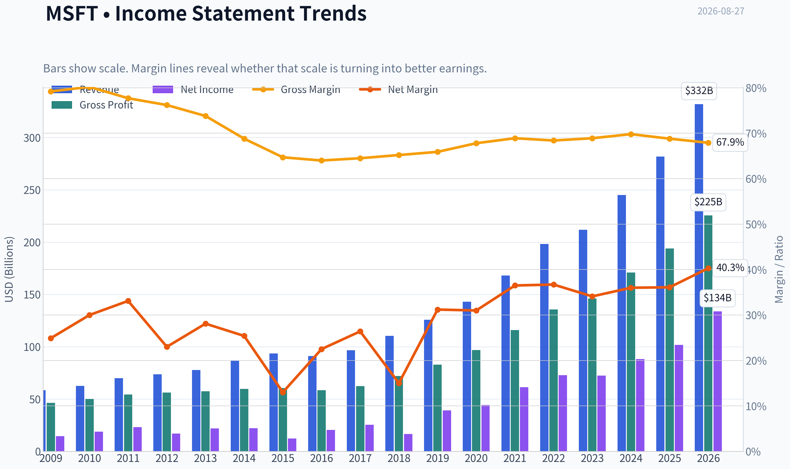

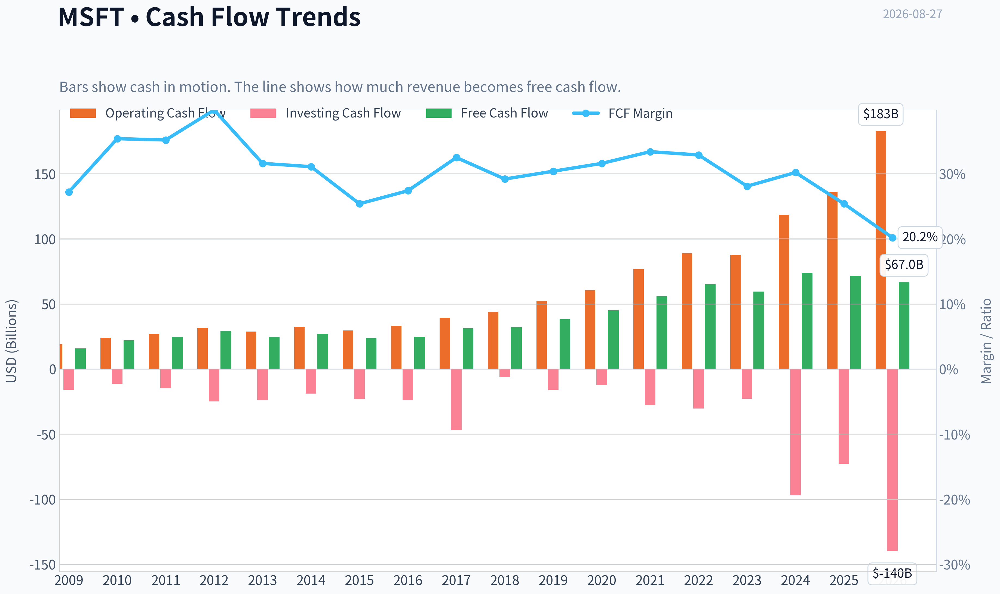

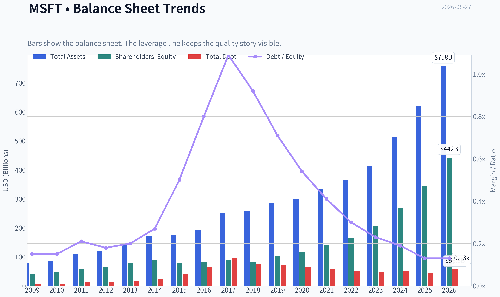

This graph tracks the profitability and return metrics (ROE, ROIC, Margins) of **MSFT** over the past decade, highlighting capital efficiency trends.

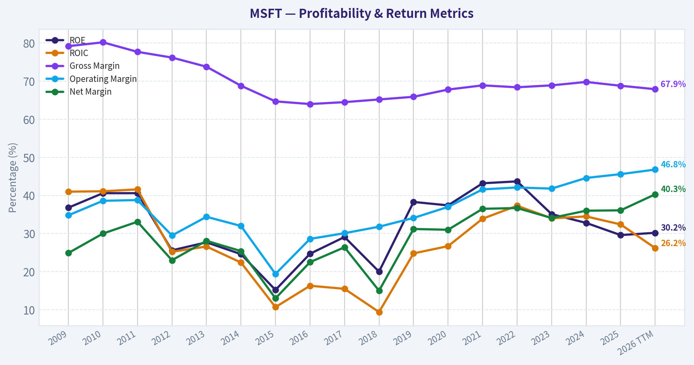

This chart illustrates the financial health of **MSFT** over the last 10 years, mapping cash equivalents and free cash flow against total obligations (Debt).

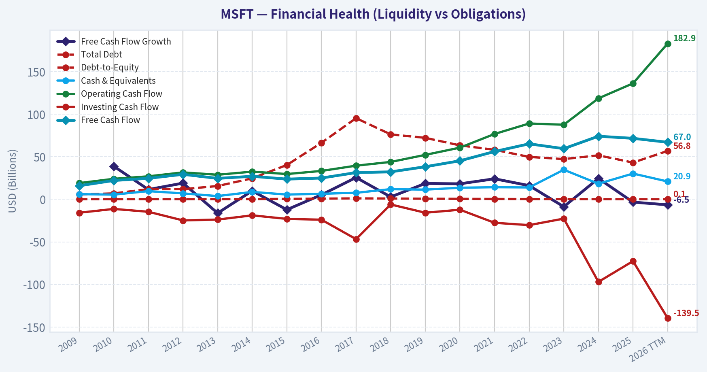

This breakdown chart from <em>Revenue Breakdown</em> shows the proportional composition for **MSFT** - useful for understanding what drives or risks the business.

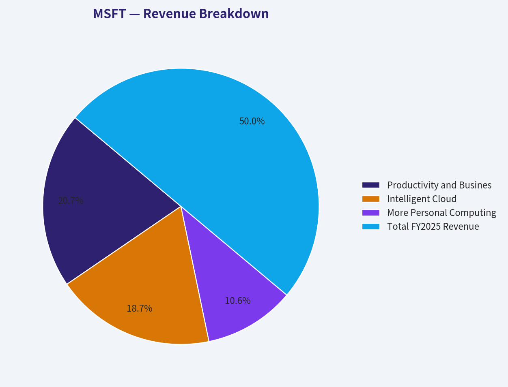

---

### Intrinsic Value Analysis (Buffett)

> *Following Warren Buffett's value investing philosophy: Circle of Competence, Economic Moat, Management Quality, and Margin of Safety.*

#### Intrinsic Value Snapshot

Price is what you pay. Intrinsic value is what the business may be worth based on the cash it can create for owners over time. We show a range, not one magic number.

- Current Price: $505.06
- Value Range (conservative to optimistic across both DCF methods): $112.68 to $967.35

##### Owner Earnings (Buffett Method)
- Net Income: $101,832,000,000.00
- Depreciation & Amortization: $38,534,000,000.00
- Capital Expenditures: $-115,948,000,000.00
- Working Capital Changes: $-4,895,000,000.00
- Owner Earnings: $107,182,000,000.00

##### Intrinsic Value
###### Buffett Method
Uses owner earnings. Stricter, and usually more conservative.
- Conservative: $394.84
- Average: $394.84
- Optimistic: $967.35
- Discount Rate: 10.0%

###### Cash Flow Method
Uses free cash flow. Better for companies spending heavily today to grow tomorrow.
- Conservative: $112.68
- Average: $155.90
- Optimistic: $227.39
- Discount Rate: 10.0%

ANALYST STANCE: **WATCH**

#### Microsoft (MSFT) - Buffett-Style Investment Review

Microsoft is a truly exceptional business: wide moat, high margins, powerful switching costs, strong recurring revenue, and enormous AI/cloud reinvestment opportunities. The issue is not business quality; it is price. At **$505/share**, Microsoft trades about **16.5% above** the headline intrinsic value estimate of **$433.63**, with a **1.8% FCF yield** and a reverse-DCF implying roughly **22% annual growth for 10 years**. That is achievable only if Azure, AI monetization, and Microsoft 365 pricing power remain very strong for a long time.

---

#### 1. Factor Scorecard

| Factor | Score / 5 | Evidence |
|---|---:|---|
| Circle of Competence & Business Simplicity | 4.5 | Microsoft sells essential software, cloud infrastructure, operating systems, developer tools, gaming, security, and AI services. The model is understandable: recurring subscriptions, usage-based cloud revenue, enterprise licensing, and ecosystem lock-in. |
| Moat Test | 5.0 | Microsoft has durable switching costs, network effects, brand trust, developer ecosystem power, enterprise distribution, and scale advantages. Gross margin remains extremely high at roughly **67.9%**. |
| Management Quality & Capital Allocation | 4.0 | Satya Nadella has transformed Microsoft into a cloud and AI compounder. Capital allocation has generally been rational, though AI infrastructure spending and large acquisitions require continued discipline. |
| Industry Structure | 4.0 | Microsoft operates in attractive oligopolistic markets: hyperscale cloud, enterprise productivity, operating systems, cybersecurity, developer platforms, and AI infrastructure. Competition is intense but rational among a few scaled players. |
| Gate 5: Quality/Solvency Hard Floor | Not tripped | Earnings and cash flow are strong, revenue is growing, interest coverage is very strong, and the balance sheet remains conservative. There is no financial-distress condition. |

**Key Takeaways:** Microsoft passes the Buffett quality tests with ease. The company is understandable, competitively entrenched, highly profitable, and financially sound. The only major concern is valuation, not business durability.

---

#### 2. Moat Analysis

| Moat Source | Evidence | Assessment |
|---|---|---|
| Intangible Assets | Microsoft brand is trusted by enterprises, governments, developers, and consumers. Microsoft 365, Windows, Azure, GitHub, LinkedIn, Xbox, and Copilot form a powerful portfolio. | Very strong |
| Switching Costs | Enterprises are deeply embedded in Microsoft identity, Office files, Teams workflows, Azure infrastructure, Windows devices, security tools, and developer stacks. | Very strong |
| Cost Advantages | Azure scale, global data centers, enterprise sales reach, and software distribution allow Microsoft to spread R&D and infrastructure costs across a massive customer base. | Strong |
| Network Effects | Windows, Office, Teams, GitHub, LinkedIn, and the developer ecosystem become more valuable as more users, developers, and enterprises standardize on them. | Strong |
| Pricing Power | Microsoft has repeatedly raised prices across Microsoft 365 and enterprise bundles with limited customer churn, helped by mission-critical usage. | Strong |
| Moat Rating | Wide and stable to widening, especially if AI strengthens Microsoft 365, Azure, GitHub, and security adoption. | 5 / 5 |

**Key Takeaways:** Microsoft's moat is one of the strongest in global equities. Its advantage comes not from one product, but from an integrated ecosystem that is difficult and costly for customers to leave. AI could widen the moat if Copilot and Azure AI become embedded in everyday enterprise workflows.

---

#### 3. Management Quality Assessment

| Area | Assessment |
|---|---|
| CEO / Culture | Satya Nadella has executed one of the best large-cap strategic transitions in modern business history: from Windows-centric licensing to cloud, subscriptions, AI, and developer platforms. |
| Owner Orientation | Management focuses on long-term platform value, enterprise trust, and recurring revenue expansion. Insider ownership is not large in percentage terms because of Microsoft's size, but incentives are meaningfully tied to equity and long-term performance. |
| Capital Allocation | Strong record in cloud investment, LinkedIn, GitHub, Azure, and AI partnerships. Activision Blizzard is strategically logical but lower-return than core software and cloud assets. |
| Buybacks / Dividends | Microsoft returns cash through dividends and buybacks, but buybacks are less attractive when the stock trades above intrinsic value. |
| Balance Sheet Discipline | Conservative. Microsoft can fund dividends, buybacks, AI capex, and acquisitions without financial strain. |
| Outside Investor Signal | Bill Ackman initiated a large position, reported at roughly **$2.09B** and **15.26%** of Pershing Square's portfolio as of the latest disclosed filing. |

**Key Takeaways:** Management quality is high. Nadella has proven to be a rational, strategic, long-term operator. The main watch item is whether massive AI infrastructure spending produces attractive incremental returns rather than simply keeping pace with competitors.

---

#### 4. Financial Summary

| Fiscal Year | Revenue ($B) | Net Income ($B) | Operating Cash Flow ($B) | CapEx ($B) | Free Cash Flow ($B) | Gross Margin | Operating Margin | ROE | Diluted EPS |
|---:|---:|---:|---:|---:|---:|---:|---:|---:|---:|
| 2016 | 91.2 | 16.8 | 33.3 | 8.3 | 25.0 | 61.6% | 22.3% | 22% | $2.10 |
| 2017 | 96.6 | 25.5 | 39.5 | 8.1 | 31.4 | 61.9% | 23.6% | 29% | $3.25 |
| 2018 | 110.4 | 16.6 | 43.9 | 11.6 | 32.3 | 65.2% | 31.8% | 19% | $2.13 |
| 2019 | 125.8 | 39.2 | 52.2 | 13.9 | 38.3 | 65.9% | 34.1% | 38% | $5.06 |
| 2020 | 143.0 | 44.3 | 60.7 | 15.4 | 45.2 | 67.8% | 37.0% | 40% | $5.76 |
| 2021 | 168.1 | 61.3 | 76.7 | 20.6 | 56.1 | 68.9% | 41.6% | 43% | $8.05 |
| 2022 | 198.3 | 72.7 | 89.0 | 23.9 | 65.1 | 68.4% | 42.1% | 44% | $9.65 |
| 2023 | 211.9 | 72.4 | 87.6 | 28.1 | 59.5 | 68.9% | 41.8% | 35% | $9.68 |
| 2024 | 245.1 | 88.1 | 118.5 | 44.5 | 74.1 | 69.8% | 44.6% | 37% | $11.80 |
| 2025 | 281.7 | 101.8 | 136.2 | 64.6 | 71.6 | 68.8% | 45.6% | 30% | $13.64 |

**Key Takeaways:** Microsoft has compounded revenue, earnings, and cash flow at exceptional rates while maintaining very high margins. Free cash flow remains enormous, but the recent surge in AI and cloud capital expenditure has reduced FCF conversion. The decline in ROE from peak levels reflects a larger equity base and heavier investment, not deteriorating franchise quality.

---

#### 5. Owner Earnings Calculation

| Item | Estimate |
|---|---:|
| Net Income | $101.8B |
| Add: Depreciation & Amortization | $39.0B |
| Less: Estimated Maintenance CapEx | ($23.0B) |
| Less: Working Capital Increase | ($2.0B) |
| Normalized Owner Earnings | $115.8B |
| Diluted Shares Outstanding | ~7.43B |
| Owner Earnings Per Share | ~$15.60 |

**Key Takeaways:** Microsoft's owner earnings are higher than reported free cash flow because a large portion of current capex is growth-oriented AI and cloud infrastructure investment. The key analytical question is whether those growth investments earn high returns. If they do, today's lower FCF yield understates long-term value creation.

---

#### 6. Three-Scenario DCF Valuation

Assumptions: **10% discount rate**, normalized owner earnings per share of **$15.60**, and terminal growth of **3%** where applicable.

| Scenario | Assumption | Estimated Value / Share |
|---|---|---:|
| A - No Growth | Owner earnings capitalized at 10% | $156 |
| B - GDP Growth | Owner earnings grow at 3% perpetually | $230 |
| C - Historical Growth Haircut | 10% growth for 10 years, then 3% terminal growth | $385 |
| Business-Model Routed Headline Value | Weighted blend of owner earnings, FCFF, and reverse-DCF fair value | $433.63 |
| Current Price | Market price | $505 |

**Key Takeaways:** Microsoft's value is highly sensitive to long-term growth assumptions. A no-growth or GDP-growth case does not justify today's price. The market price requires Microsoft to remain a high-growth compounder for many years, which is possible, but already meaningfully reflected in the stock.

---

#### 7. Margin of Safety Analysis

| Metric | Value |
|---|---:|
| Current Price | $505 |
| Headline Intrinsic Value | $433.63 |
| Margin of Safety vs. Intrinsic Value | -16.5% |
| Required Margin of Safety for This Quality | ~10% to 15% |
| Attractive Buy Zone at 10% Discount to IV | ~$390 |
| Attractive Buy Zone at 15% Discount to IV | ~$369 |
| Reverse-DCF Implied Growth | ~22% annually for 10 years |
| Trailing 3-Year / 5-Year Growth Reference | ~29.9% / ~30.0% |

**Key Takeaways:** Microsoft is a wonderful company, but the stock does not currently offer a Buffett-style margin of safety. The reverse-DCF growth hurdle is not impossible, given Microsoft's recent record, but it is demanding for a company with a market capitalization around **$3.75 trillion**. At today's price, investors are paying for continued excellence.

---

#### 8. Final Buffett Scorecard

| Criterion | Weight | Score / 5 | Weighted Score |
|---|---:|---:|---:|
| Moat Width & Durability | 25% | 5.0 | 1.25 |
| Valuation / Margin of Safety | 20% | 0.5 | 0.10 |
| Capital Returns - ROIC vs. WACC | 15% | 4.0 | 0.60 |
| Business Understanding & Predictability | 12% | 4.5 | 0.54 |
| Management Quality & Capital Allocation | 12% | 4.0 | 0.48 |
| Reinvestment Runway | 8% | 4.5 | 0.36 |
| Balance Sheet Strength | 4% | 4.5 | 0.18 |
| Industry Structure | 4% | 4.0 | 0.16 |
| Final Weighted Score | 100% | - | **3.67 / 5** |

**Key Takeaways:** Microsoft scores like a world-class compounder on quality, moat, reinvestment runway, and management. Valuation is the offsetting issue. The business is good enough to own for the long term, but the current entry price is not compelling enough for aggressive new buying.

---

#### 9. Investment Stance

| Decision | View |
|---|---|
| Stance | **WATCH** |
| Conviction | High conviction in business quality; moderate-to-low conviction in current valuation |
| Best Action for New Money | Wait for a better entry point, ideally closer to the high-$300s to low-$400s |
| Best Action for Existing Long-Term Holders | Continue holding if tax-efficient and position size is reasonable |
| Main Upside Driver | AI monetization through Azure, Copilot, GitHub, security, and Microsoft 365 price increases |
| Main Risk | AI capex may pressure free cash flow if returns disappoint, while current valuation already assumes strong execution |

Microsoft is the kind of business Buffett would admire: simple enough to understand, dominant, cash-generative, and protected by deep customer captivity. But at **$505**, the stock prices in a great deal of future success. The right stance is **WATCH**: own it happily if already held, but demand a better margin of safety before committing fresh capital aggressively.
#### Valuation Bridge

This bridge places the current market price beside each intrinsic value lens so readers can see whether upside depends on one method or shows up across several methods.

| Scenario | Intrinsic Value / Share |
| --- | ---: |
| Buffett Method | $394.84 |
| Cash Flow Method | $155.90 |
| Damodaran Method | $247.40 |
| Current Price | $505.06 |

#### Key Takeaways

If one method is far above the others, the upside case depends on a specific modelling assumption. When several methods cluster together, the valuation story is more robust.

#### Valuation Visuals

This comparison chart from *Latest Earnings Snapshot* stacks current figures against historical benchmarks for **MSFT**, making it easy to see where the company trades relative to its own averages.

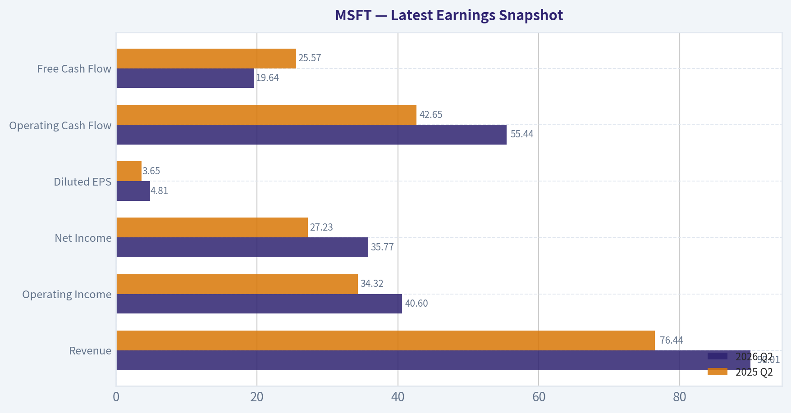

This comparison chart from *Current vs. 10-Year Historical Average Comparison* stacks current figures against historical benchmarks for **MSFT**, making it easy to see where the company trades relative to its own averages.

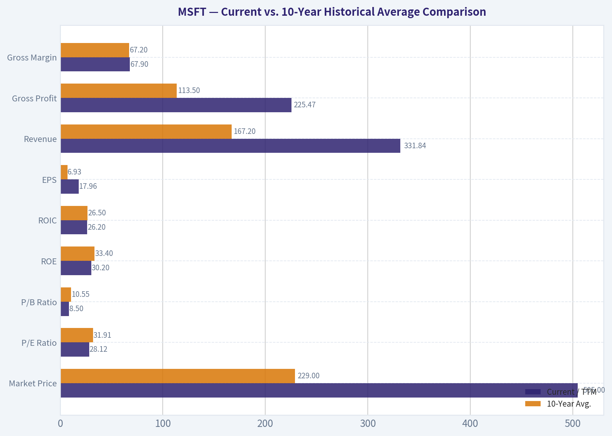

This comparison chart from *Buffett-Style Owner Earnings DCF Valuation* stacks current figures against historical benchmarks for **MSFT**, making it easy to see where the company trades relative to its own averages.

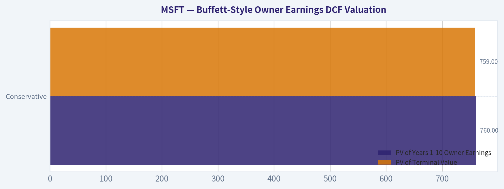

This comparison chart from *Intrinsic Value Cross-Check from Research Pack* stacks current figures against historical benchmarks for **MSFT**, making it easy to see where the company trades relative to its own averages.

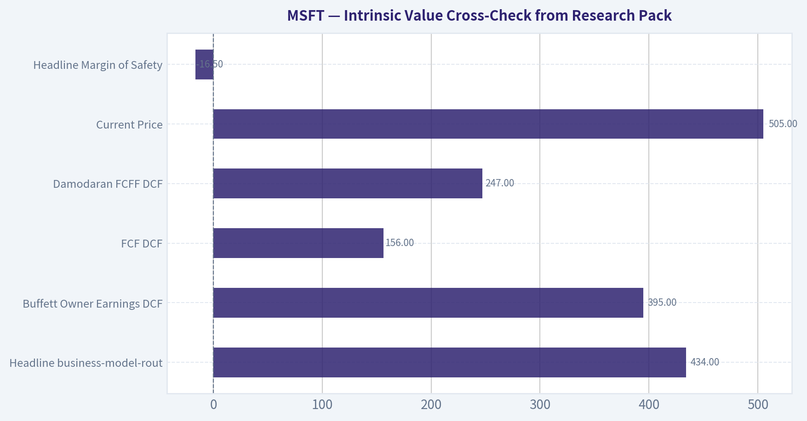

---

### Trend & Growth Analysis (Lynch/Druckenmiller/Fisher)

> *Following Peter Lynch's GARP, Stanley Druckenmiller's macro-aware approach, and Philip Fisher's scuttlebutt methodology.*

ANALYST STANCE: **WATCH**

#### Microsoft (MSFT) Growth Investment Analysis - 2026-08-27

Microsoft remains one of the highest-quality growth compounders in the world, with strong AI, cloud, developer, productivity, and security exposure. The issue is not business quality; it is valuation versus future upside. At roughly **$505/share**, **$3.75T market cap**, and a headline intrinsic value estimate near **$434**, the stock looks like a **core long-term hold**, but not a fresh high-conviction growth buy unless growth re-accelerates or the valuation resets.

---

#### 1. Lynch Classification

| Item | Assessment |
|---|---:|
| Current revenue growth YoY | 17.8% |
| Lynch category | Fast Grower / Stalwart hybrid |
| Growth quality | High, driven by cloud, AI, software, security, and enterprise productivity |
| Ten-bagger probability from current size | Low near-term; market cap already $3.75T |
| Best Lynch framing | "A great company already discovered by everyone" |

**Key Takeaways:** Microsoft is still growing fast enough to qualify as a Lynch-style fast grower, but its enormous market cap makes it behave more like a super-stalwart. The company can compound value, but the odds of a classic ten-bagger from today's size are meaningfully lower than for smaller growth names.

---

#### 2. The Story in 3 Bullets

| Lynch Story Element | MSFT Story |
|---|---|
| Simple business explanation | Microsoft sells essential software, cloud computing, AI tools, gaming, and enterprise infrastructure to individuals and businesses. |
| Why it can keep growing | Azure, Microsoft 365, Copilot, GitHub, security, data infrastructure, and AI workloads can expand wallet share across a massive enterprise customer base. |
| Why it wins | Microsoft has distribution, switching costs, enterprise trust, bundled products, developer ecosystems, data infrastructure, and balance-sheet strength. |

**Key Takeaways:** The story is simple and durable: Microsoft owns mission-critical digital infrastructure for businesses. AI is not a side project; it is being embedded across cloud, office productivity, developer tools, and security, creating multiple monetization paths.

---

#### 3. TAM and 10x Test

| Metric | Estimate / Assessment |
|---|---:|
| Current market cap | $3.75T |
| Current revenue base | Very large; estimated hundreds of billions annually |
| 10x revenue test | Difficult but not impossible over a very long horizon |
| Required market size for 10x revenue while staying below 20% share | Multi-trillion-dollar annual TAM |
| Key TAMs | Cloud infrastructure, AI infrastructure, enterprise software, productivity software, cybersecurity, data analytics, gaming |
| TAM growth | Strong, especially in AI, cloud, data, and cybersecurity |
| Runway score | Good, but not early-stage |

**Key Takeaways:** Microsoft still has a long runway because it competes in enormous and expanding markets. However, because the company is already one of the largest businesses in history, the 10x test is demanding; Microsoft can keep compounding, but a ten-bagger requires extraordinary long-term execution and TAM expansion.

---

#### 4. Revenue Growth Trend

| Metric | Value / Direction |
|---|---:|
| Latest YoY revenue growth | 17.8% |
| Growth pattern | Healthy, not clearly hyper-accelerating from provided data |
| Inflection source | AI monetization, Azure growth, Copilot attach rates, enterprise security consolidation |
| Concern | At this scale, sustaining high-teens growth is impressive but increasingly difficult |
| Interpretation | High-quality growth, but valuation already assumes strong execution |

**Key Takeaways:** Microsoft's revenue growth remains excellent for a mega-cap company. The key question is whether AI can push growth from "strong" to "accelerating," because the current valuation already prices in a very optimistic future.

---

#### 5. Unit Economics and Rule of 40

| Metric | Assessment |
|---|---:|
| Gross margin | 67.9% |
| ROE | 30.2% |
| FCF yield | 1.8% |
| LTV/CAC | Not disclosed, but likely excellent due to enterprise renewals and bundled distribution |
| Net revenue retention | Not disclosed, but likely strong in cloud and enterprise software |
| Rule of 40 proxy | Likely strong given 17.8% growth and high software cash generation |
| Unit economics score | Excellent |

**Key Takeaways:** Microsoft's unit economics are elite. High gross margins, strong return on equity, and enterprise software stickiness suggest that growth is economically valuable, not growth for growth's sake.

---

#### 6. Inflection Point Assessment

| Inflection Type | Evidence | Rating |
|---|---|---:|
| Product cycle inflection | Copilot, AI assistants, Azure AI, GitHub Copilot, AI PCs | Strong |
| Market share inflection | Azure and security may continue taking share, but competition remains intense | Moderate to strong |
| Margin inflection | AI infrastructure spending may pressure near-term margins before operating leverage emerges | Mixed |
| TAM inflection | Generative AI expands cloud, compute, productivity, and developer TAMs | Strong |
| Competitive inflection | OpenAI partnership and enterprise distribution are major advantages, but hyperscaler competition is fierce | Moderate |

**Key Takeaways:** Microsoft has a real AI-driven inflection opportunity. The biggest uncertainty is whether AI revenue scales faster than AI infrastructure costs, because margin expansion may lag revenue acceleration during the investment phase.

---

#### 7. Macro Setup

| Macro Factor | Impact on MSFT |
|---|---|
| AI secular trend | Major tailwind |
| Cloud migration | Ongoing tailwind |
| Cybersecurity consolidation | Tailwind |
| Interest rates | Lower rates would support valuation; higher-for-longer is a valuation headwind |
| Enterprise IT budgets | Mixed; mission-critical spend is resilient, but discretionary software can slow |
| Macro sensitivity | Lower than most growth stocks due to recurring revenue and balance-sheet strength |

**Key Takeaways:** The macro setup is favorable from a secular standpoint because Microsoft sits directly in AI, cloud, and cybersecurity. The main macro risk is valuation compression if rates stay elevated or if AI spending expectations cool.

---

#### 8. Fisher 15 Points Score

| Fisher Point | Score / 5 | Rationale |
|---|---:|---|
| 1. Market potential | 5 | Massive cloud, AI, productivity, security, and data TAMs |
| 2. New product determination | 5 | Aggressive AI and Copilot rollout |
| 3. R&D effectiveness | 5 | Strong product pipeline and developer ecosystem |
| 4. Sales organization | 5 | One of the best enterprise sales engines globally |
| 5. Profit margin | 5 | 67.9% gross margin |
| 6. Improving margins | 4 | Strong structurally, but AI capex may pressure near term |
| 7. Labor relations | 4 | Strong talent base, though big-tech labor competition persists |
| 8. Executive relations | 5 | Strong leadership continuity |
| 9. Management depth | 5 | Deep bench across cloud, AI, enterprise, gaming |
| 10. Cost/accounting controls | 5 | Mature, high-quality financial discipline |
| 11. Moat factors | 5 | Switching costs, ecosystem, bundling, scale, distribution |
| 12. Long-range profit outlook | 5 | Excellent |
| 13. Dilution risk | 5 | Low; strong cash generation |
| 14. Candor | 4 | Generally strong disclosure, though AI economics still developing |
| 15. Integrity | 5 | High institutional credibility |
| **Total** | **72 / 75** | Outstanding |

**Key Takeaways:** Microsoft scores extremely well on Fisher quality factors. The company has exceptional management, product breadth, sales capability, and long-term innovation capacity, making the business quality outstanding even if the stock price is less compelling.

---

#### 9. Valuation Analysis

| Valuation Metric | Current Reading | Interpretation |
|---|---:|---|
| Share price | $505 |
| Market cap | $3.75T |
| P/E | 28.1x |
| Revenue growth YoY | 17.8% |
| PEG ratio | ~1.6x |
| Headline intrinsic value estimate | $433.63 |
| Margin of safety vs. price | -16.5% |
| FCF yield | 1.8% |
| Reverse DCF implied growth | ~22% per year for 10 years |
| Valuation verdict | High quality, but not cheap |

**Key Takeaways:** Microsoft is not priced like a neglected Lynch bargain. The PEG ratio is reasonable but not cheap, the FCF yield is low, and the reverse DCF suggests the market already expects very strong long-term growth.

---

#### 10. Scenario Analysis

| Scenario | Assumption | Implication |
|---|---|---|
| Bear case | AI spend disappoints, Azure slows, valuation multiple compresses | Stock underperforms despite strong business quality |
| Base case | High-teens growth moderates to mid-teens, margins remain strong | Solid compounding, but upside is moderate from current valuation |
| Bull case | AI monetization accelerates, Copilot adoption scales, Azure share gains continue | Earnings power surprises positively and valuation remains supported |
| Extreme ten-bagger case | Microsoft becomes the dominant AI operating layer across enterprise software and cloud | Possible over very long horizon, but low probability from $3.75T base |

**Key Takeaways:** The bull case depends on AI becoming a major incremental profit pool, not merely a defensive product upgrade. The bear case is not business failure; it is simply that expectations are already high and the stock may have limited valuation support if growth normalizes.

---

#### 11. Growth Investor Scorecard

| Criterion | Weight | Score / 5 | Weighted Score |
|---|---:|---:|---:|
| The Story | 10% | 5.0 | 0.50 |
| TAM and Runway | 20% | 4.0 | 0.80 |
| Revenue Growth | 20% | 4.0 | 0.80 |
| Unit Economics | 15% | 5.0 | 0.75 |
| Competitive Position | 10% | 5.0 | 0.50 |
| Management Quality | 10% | 5.0 | 0.50 |
| Macro Setup | 5% | 4.0 | 0.20 |
| Profitability Path | 5% | 5.0 | 0.25 |
| Valuation | 5% | 2.5 | 0.13 |
| **Total** | **100%** |  | **4.43 / 5.00** |

**Key Takeaways:** Microsoft scores like an elite growth compounder on business fundamentals. The only major weakness is valuation, which is meaningful but not enough to erase the company's exceptional quality.

---

#### 12. Position Size Stance

| Investor Type | Stance |
|---|---|
| Existing long-term holder | Hold / let winners run |
| New buyer at current price | Watch or buy slowly only if building a strategic core position |
| Growth portfolio | Core compounder, but not likely the highest-upside ten-bagger candidate |
| Aggressive ten-bagger portfolio | Underweight versus smaller AI/cloud winners |
| Add-more zone | More attractive on pullbacks toward or below estimated intrinsic value, around the low-to-mid $400s |

**Key Takeaways:** Microsoft is a stock to own, but not necessarily a stock to chase. For existing holders, the Lynch-style answer is to let the great business keep compounding; for new capital, patience is warranted.

---

#### 13. Key Risks and Catalysts

| Category | Key Items |
|---|---|
| Catalysts | Copilot adoption, Azure AI acceleration, OpenAI ecosystem expansion, security share gains, margin leverage after AI capex cycle |
| Risks | AI monetization below expectations, capex intensity, cloud competition, regulatory pressure, valuation compression, slower enterprise IT spending |
| What to monitor | Azure growth, AI revenue disclosure, Copilot paid seat adoption, capex growth, operating margin trend, free cash flow conversion |
| Most important question | Can AI drive incremental high-margin revenue fast enough to justify the current valuation? |

**Key Takeaways:** The next major stock driver is not whether Microsoft is a good company; that is already obvious. The critical issue is whether AI becomes a large, profitable, measurable revenue stream that causes earnings estimates for the next two to three years to move materially higher.

---

#### Final View

Microsoft is an **outstanding business** with real AI-driven inflection potential, elite unit economics, high-quality management, and multiple secular tailwinds. However, at **$505/share**, the stock already discounts a lot of that optimism. For a Lynch-Druckenmiller-Fisher growth investor, MSFT is a **WATCH for new money**, a **HOLD for existing owners**, and an **ADVOCATE only on valuation reset or visible AI-driven earnings acceleration**.

#### Growth & Scorecard Visuals

This comparison chart from *Factor Scorecard* stacks current figures against historical benchmarks for **MSFT**, making it easy to see where the company trades relative to its own averages.

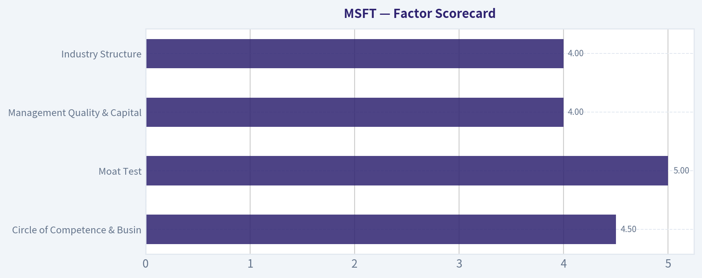

---

### Market Technical Analysis

ANALYST STANCE: **WATCH**

#### MSFT Technical Market Report - Data Through 2026-08-26

Microsoft closed at **$496.37** on 2026-08-26, staging a powerful recovery from the late-June low near **$352.17** and reclaiming both medium- and long-term moving averages. The short-term tape is constructive, but not cleanly risk-free: momentum is strong, RSI is approaching overbought territory, and the 50-day SMA remains slightly below the 200-day SMA, suggesting the broader trend has not fully repaired despite the sharp rebound.

| Indicator | Latest Value | Why It Matters Now | Interpretation |
|---|---:|---|---|
| close_10_ema | $487.23 | Tracks near-term momentum and tactical support | Price is above the 10 EMA, confirming short-term upside momentum |
| close_50_sma | $425.03 | Medium-term trend gauge | Price is far above it, showing a strong recovery from prior weakness |
| close_200_sma | $429.28 | Long-term trend benchmark | Price is above it, but the 50 SMA is still slightly below the 200 SMA |
| macd | 18.10 | Momentum confirmation | Positive MACD supports the bullish rebound |
| rsi | 67.95 | Measures overbought / oversold pressure | Strong but nearing overbought; upside may become less efficient |
| boll_ub | $513.46 | Upper volatility boundary | Key upside zone; a push toward it may signal breakout strength or short-term exhaustion |
| boll_lb | $461.58 | Lower volatility boundary | Defines deeper pullback risk zone |
| atr | $11.65 | Measures daily volatility for risk sizing | Normal daily movement is sizable, roughly 2.3% of price |

Key Takeaways: MSFT's technical structure has improved sharply, with price above the 10 EMA, 50 SMA, and 200 SMA. Momentum is positive, but RSI near 68 means the stock is close to an overbought condition. The setup favors continued upside if price holds above the high-$480s, but traders should be alert for pullbacks after the recent strong advance.

---

#### Trend Structure and Momentum

MSFT's current price action is best described as a **post-breakout recovery phase**. The stock collapsed into late June, bottoming near **$352**, then built a recovery base through July before exploding higher on heavy volume at the end of July. The move from roughly **$390 to above $500** in a short period was decisive and changed the tactical trend from bearish to bullish.

The most important nuance is that **short-term and medium-term price behavior are stronger than the long-term moving-average structure**. Price is now well above the 50-day and 200-day averages, which is bullish, but the **50-day SMA at $425.03 remains below the 200-day SMA at $429.28**. That means MSFT has not yet produced a fully mature longer-term bullish confirmation. A future 50-day cross above the 200-day would strengthen the trend significantly.

MACD at **18.10** confirms that upside momentum is still active. However, the RSI at **67.95** suggests the easy portion of the rebound may already have happened. This does not automatically mean MSFT must decline, but it does mean new long entries near current levels require tighter risk management and a clear plan.

#### Price Levels to Watch

| Zone | Approximate Level | Technical Role | Trading Relevance |
|---|---:|---|---|
| Immediate resistance | $500-$505 | Recent August resistance zone | A clean close above this range would improve breakout odds |
| Upper Bollinger Band | $513.46 | Volatility-based upside boundary | Next upside stretch target if momentum continues |
| Near-term support | $491-$487 | Recent price area and 10 EMA | Holding this area keeps short-term momentum intact |
| Pullback support | $483-$479 | Mid-August consolidation / rebound zone | Loss of this zone would weaken the recent recovery |
| Deeper support | $461-$464 | Lower Bollinger area and prior gap region | Important zone if selling pressure accelerates |
| Major trend support | $425-$429 | 50-day and 200-day SMA cluster | Strategic trend-defense zone |

Key Takeaways: The most important upside test is the **$500-$505** area, followed by the upper Bollinger Band near **$513**. On the downside, the first meaningful support zone is around **$487-$491**, where the 10 EMA and recent price action converge. A break below **$479** would suggest the recent rebound is losing momentum.

---

#### Volatility and Risk Conditions

ATR is currently **$11.65**, meaning MSFT's typical daily trading range is still meaningful. At a stock price near **$496**, that represents roughly **2.3% daily movement**, which is elevated enough that position sizing matters. Traders using tight stops may be vulnerable to normal price noise, especially after such a large rally.

The Bollinger Band structure also shows that MSFT is trading in the upper half of its volatility range. The current close of **$496.37** is above the implied Bollinger midpoint, roughly **$487.52**, but still below the upper band near **$513.46**. This leaves room for upside continuation, but the reward-to-risk is less attractive than it was during the early-August breakout.

#### Volume Context

The strongest volume confirmation occurred around the late-July breakout. On **2026-07-30**, MSFT traded over **110 million shares** and closed at **$450.25**, up sharply from the prior close near **$389.81**. That was a major institutional participation signal. Follow-through volume remained strong into early August, with high-volume closes near **$463.85**, **$486.73**, and **$491.88**.

Recent volume has cooled, with late-August sessions mostly closer to the **16-30 million share** range. This is not necessarily bearish, but it means the latest recovery from the mid-August pullback has been less forceful than the original breakout. For bulls, the ideal next confirmation would be a move through **$505** on expanding volume.

#### Tactical View

| Scenario | Trigger | Expected Implication | Trader Response |
|---|---|---|---|
| Bullish continuation | Close above $505 with strong volume | Opens path toward $513 and potentially higher | Favor trend-following entries or add-ons with disciplined stops |
| Constructive consolidation | Holds $487-$491 while RSI cools | Healthy digestion of recent gains | Watch for higher-low formation |
| Short-term caution | Breaks below $479 | Momentum deterioration | Reduce exposure or wait for stabilization |
| Bearish reversal risk | Falls below $461-$464 | Breakout structure weakens materially | Avoid new longs; reassess trend |
| Strategic reset | Tests $425-$429 | Major moving-average support test | Long-term investors may monitor for evidence of demand |

Key Takeaways: The cleanest bullish signal would be a strong-volume close above **$505**. If MSFT instead consolidates above **$487**, the trend can remain healthy while momentum cools. A break below **$479** would be the first warning that the rebound is becoming vulnerable.

---

#### Indicator Selection Rationale

| Selected Indicator | Category | Reason for Inclusion |
|---|---|---|
| close_10_ema | Moving Average | Captures short-term trend shifts after the recent sharp rebound |
| close_50_sma | Moving Average | Measures medium-term recovery progress |
| close_200_sma | Moving Average | Confirms whether the broader trend has repaired |
| macd | Momentum | Helps validate whether upside momentum remains active |
| rsi | Momentum | Identifies whether the stock is becoming overextended |
| boll_ub | Volatility | Defines upside breakout or exhaustion zone |
| boll_lb | Volatility | Defines downside volatility risk and deeper support |
| atr | Volatility / Risk | Useful for stop placement and position sizing |

Key Takeaways: These indicators were chosen to balance trend, momentum, volatility, and risk management. The combination avoids excessive redundancy while still capturing the most important parts of MSFT's current setup. The key message is that momentum is strong, but the stock is no longer early in the rebound.

#### Bottom Line

MSFT is technically constructive but somewhat extended. The stock has reclaimed major moving averages, MACD is positive, and price remains above the 10 EMA, all of which support a bullish short-term bias. However, RSI near 68, resistance around **$500-$505**, and the still-unresolved 50-day versus 200-day moving-average structure argue against aggressive chasing.

For traders, MSFT is a **watchlist long rather than an outright chase**. A confirmed breakout above **$505** could justify bullish continuation positioning, while a pullback that holds **$487-$491** may offer a cleaner entry. A break below **$479** would shift the setup toward caution.

---

### Options Market Analysis

> *Reading options flow - put/call ratios, IV skew, and unusual activity - to gauge institutional positioning and event-driven risk.*

ANALYST STANCE: **ADVOCATE**

#### MSFT Options Flow Report - As of 2026-08-27

Options positioning in MSFT is leaning **bullish near term**, driven by heavy call volume and fresh short-dated call activity clustered around the $505-$520 strikes. However, this is primarily a **very short-dated options signal**, with much of the activity concentrated in the 2026-08-28 weekly expiry, so the read is more tactical than strategic.

Assumed spot/ATM zone from the chain: approximately **$505**.

---

#### 1. Put/Call Ratio Analysis

| Expiry | Call OI | Put OI | Put/Call OI Ratio | Call Volume | Put Volume | Put/Call Volume Ratio | Read |
|---|---:|---:|---:|---:|---:|---:|---|
| 2026-08-28 | 78,895 | 50,912 | 0.65 | 206,143 | 111,528 | 0.54 | Call-leaning |
| 2026-08-31 | 6,353 | 5,047 | 0.79 | 21,353 | 10,636 | 0.50 | Mildly put-heavy OI, call-heavy volume |
| 2026-09-02 | 1,843 | 1,599 | 0.87 | 8,777 | 1,914 | 0.22 | Higher put OI, but call volume dominates |
| **Total Near-Term** | **87,091** | **57,558** | **0.66** | - | - | **0.53** | **Bullish vs. neutral baseline** |

**Key Takeaways:** MSFT's near-term put/call OI ratio of **0.66** is slightly below the historical neutral baseline of roughly **0.7**, suggesting a modest call bias in open interest. The stronger signal is in volume: the near-term put/call volume ratio is only **0.53**, meaning call trading is materially outpacing put trading. This points to near-term bullish speculation or upside positioning rather than defensive hedging.

#### Interpretation

The open interest picture is only modestly bullish, but the **volume picture is more decisively bullish**. In particular, the 2026-08-28 expiry shows more than **206,000 calls traded** versus about **111,500 puts**, a major short-dated call-volume imbalance. Because volume is much more reactive than open interest, this suggests traders are actively positioning for a near-term upside move or momentum continuation.

The only caveat is that MSFT is a very liquid mega-cap options name, so some of this may include hedged institutional flow, covered call writing, or market-maker activity rather than outright speculative call buying. Still, the low volume put/call ratio is a meaningful bullish shift from neutral.

---

#### 2. Implied Volatility Assessment

| Expiry | ATM Call IV | ATM Put IV | Put vs. Call IV Difference | Skew Read | IV Interpretation |
|---|---:|---:|---:|---|---|
| 2026-08-28 | 29.7% | 30.3% | Puts +0.6 pts | Slight put premium | Mild downside protection demand |
| 2026-08-31 | 24.5% | 22.1% | Calls +2.4 pts | Call skew | Upside chase / call demand |
| 2026-09-02 | 26.6% | 24.3% | Calls +2.3 pts | Call skew | Bullish directional demand |

**Key Takeaways:** Front-expiry IV is moderately elevated, especially for the 2026-08-28 expiration, where both calls and puts are near 30% implied volatility. The nearest expiry has a slight put premium, but the following expirations show a clear **call IV premium**, which supports the bullish flow read. There is no obvious steep downside skew in the available data.

#### IV Skew Read

The skew is **not aggressively bearish**. In the 2026-08-28 expiry, puts carry only a small premium over calls at the ATM level, which looks more like ordinary short-term protection than panic hedging. In the 2026-08-31 and 2026-09-02 expiries, calls actually have higher ATM IV than puts, suggesting traders are paying up for upside exposure.

Among the unusual activity, downside put strikes such as **$492.50-$500** show IV around **22%-23%**, while upside calls around **$510-$512.50** show IV near **21%**. That indicates only a modest put wing premium, not a severe downside-fear skew.

No confirmed company-specific earnings catalyst falls inside these listed expirations based on the provided data. The elevated front-week IV appears more related to **short-dated gamma demand and near-term positioning** than a known scheduled MSFT event.

---

#### 3. Unusual Options Activity

| Expiry | Type | Strike | Volume | Open Interest | Vol/OI | Moneyness vs. ~$505 Spot | Expiry Horizon | Positioning Implication |
|---|---|---:|---:|---:|---:|---|---|---|
| 2026-08-28 | CALL | $505.00 | 37,633 | 2,699 | 13.9x | ATM | 1 day | Fresh upside/ATM momentum positioning |
| 2026-08-28 | CALL | $510.00 | 30,131 | 3,780 | 8.0x | OTM | 1 day | Upside chase toward $510 |
| 2026-08-28 | CALL | $507.50 | 25,299 | 1,586 | 16.0x | Slightly OTM | 1 day | Bullish short-term directional bet |
| 2026-08-28 | PUT | $500.00 | 22,228 | 432 | 51.5x | OTM put | 1 day | Fresh downside hedge or bearish intraday protection |
| 2026-08-28 | CALL | $502.50 | 19,243 | 1,848 | 10.4x | Slightly ITM/ATM | 1 day | Bullish exposure with higher delta |
| 2026-08-28 | CALL | $512.50 | 18,402 | 743 | 24.8x | OTM | 1 day | Speculative upside extension |
| 2026-08-28 | PUT | $495.00 | 16,061 | 685 | 23.4x | OTM put | 1 day | Downside hedge below $500 |
| 2026-08-28 | PUT | $502.50 | 12,625 | 89 | 141.9x | Near ATM put | 1 day | Fresh protection; possibly paired with call flow |
| 2026-08-31 | CALL | $510.00 | 2,979 | 312 | 9.5x | OTM | 4 days | Continued upside interest beyond weekly expiry |
| 2026-08-31 | CALL | $515.00 | 2,202 | 186 | 11.8x | OTM | 4 days | Upside continuation bet |
| 2026-08-31 | CALL | $520.00 | 2,100 | 162 | 13.0x | OTM | 4 days | Higher-risk upside speculation |
| 2026-09-02 | CALL | $505.00 | 2,000 | 115 | 17.4x | ATM | 6 days | Fresh bullish positioning into next week |

**Key Takeaways:** The unusual activity is dominated by **short-dated calls**, especially the 2026-08-28 $505, $507.50, $510, and $512.50 calls. Several put contracts also show very high volume/open interest ratios, but they are smaller in aggregate than the call flow and are likely being used as hedges or intraday downside protection. The strongest directional message is upside-oriented, but with clear evidence that traders are also protecting the $500 area.

#### Smart-Money vs. Retail Speculation Read

The **very short-dated nature** of the flow - especially 1-day-to-expiry contracts - makes it difficult to classify all of it as institutional "smart money." The large size in the $505-$512.50 call strikes could reflect fast-money momentum desks, market-maker hedging effects, or retail/speculative call chasing.

The unusually high volume-to-open-interest ratios, especially in near-ATM strikes, suggest a lot of this is **fresh positioning**, not merely existing positions being closed. The more institutional-looking component may be the simultaneous presence of large put activity around **$500, $502.50, and $495**, which could represent hedged bullish structures, collars, or protection against a failed breakout.

Overall, the unusual activity leans **bullish**, but it is tactical and short-fuse rather than a long-duration institutional accumulation signal.

---

#### 4. Open Interest Concentration and Gamma Levels

| Area | Notable Strikes / Expiry | Evidence | Market Impact |
|---|---|---|---|
| Primary near-term expiry | 2026-08-28 | 78,895 call OI and 50,912 put OI | Most gamma risk is concentrated in the front weekly expiry |
| Upside call zone | $505-$512.50 calls | Heavy volume and meaningful OI at $505, $507.50, $510, $512.50 | Could pull price upward if dealers hedge short call exposure |
| Potential pin / magnet | $505-$510 | Largest unusual call activity clustered here | Price may gravitate toward this range into expiry |
| Downside hedge zone | $495-$502.50 puts | Heavy fresh put volume, especially $500 and $502.50 | $500 may act as a psychological support / hedge trigger |
| Higher upside extension | $515-$520 calls, 2026-08-31 | Fresh call volume with low prior OI | Suggests some traders are positioning for continuation beyond Friday |

**Key Takeaways:** The key short-term battlefield is the **$505-$510 zone**, where call activity is concentrated and price may pin or accelerate depending on dealer positioning. The **$500 level** is also important because of fresh put activity and psychological round-number significance. If MSFT holds above $505, options flow could support a push toward $510-$512.50; if it loses $500, downside hedges may become more relevant.

#### Gamma Wall Interpretation

The front-week expiry is carrying the dominant open interest and volume, which means MSFT may be highly sensitive to **dealer gamma hedging** into expiration. Heavy short-dated call buying near $505-$512.50 can create a feedback loop if dealers are short calls and need to buy stock as price rises. That could amplify an upside move.

However, if those calls were sold by customers - for example, covered calls - the $510-$512.50 area could instead act as resistance. Without trade direction data, the best interpretation is that the market is setting up for a **high-gamma, high-pinning environment** around $505-$510, with upside acceleration possible above $510.

---

#### 5. Overall Options Sentiment Signal

| Component | Signal | Rationale |
|---|---|---|
| Put/Call Ratio | Bullish | Overall near-term OI ratio is 0.66 and volume ratio is 0.53, both call-leaning versus the 0.7 neutral baseline |
| IV Level | Moderately elevated | Front-expiry ATM IV near 30%, likely reflecting short-dated demand rather than a confirmed corporate catalyst |
| IV Skew | Mild bullish / neutral | Later expiries show call IV premium; no steep downside put skew |
| Unusual Activity | Bullish | Fresh call volume dominates, especially $505-$512.50 short-dated strikes |
| OI / Gamma | Bullish with pin risk | $505-$510 is the key magnet zone; upside could accelerate above $510, but pinning risk is high |

**Key Takeaways:** MSFT options sentiment is **bullish**, led by heavy short-dated call buying and call-skewed volume. The main caution is that the signal is concentrated in very near-term expirations, so it may reflect tactical momentum trading rather than durable institutional accumulation. The most important levels are **$500 support**, **$505-$510 pin/magnet**, and **$512.50-$520 upside extension**.

#### Final Read: BULLISH

The overall options signal for MSFT is **BULLISH**. The primary driver is the surge in short-dated call activity, especially in the 2026-08-28 $505, $507.50, $510, and $512.50 calls, where volume is many times greater than open interest. This indicates fresh upside positioning and near-term momentum demand.

That said, confidence should be framed as **moderate**, not high, because much of the activity is concentrated in 1-day-to-expiry contracts. Short-dated flow can reverse quickly, and some of the activity may be hedged or speculative. Still, based purely on options positioning, traders appear to be leaning for MSFT to hold above $505 and potentially test **$510-$512.50** in the near term.

---

#### Summary Table

| Category | Current Read | Details |
|---|---|---|
| Put/Call Ratio | Bullish | Near-term OI ratio **0.66** and volume ratio **0.53**, both below/near neutral and call-leaning |
| IV Level | Moderately elevated | Front expiry ATM IV around **30%**, higher than following expiries |
| Skew Direction | Mild call skew / neutral | Later expiries show call IV premium; no severe downside put skew |
| Unusual Activity | Bullish | Large fresh call activity at **$505, $507.50, $510, $512.50**, with some put hedging near **$500** |
| Overall Signal | **BULLISH** | Call volume and fresh upside positioning dominate, but signal is short-term and gamma-sensitive |

**Key Takeaways:** MSFT's options market is signaling a near-term bullish bias, with traders aggressively targeting the $505-$512.50 area. The $500 level is the key downside hedge/support zone, while $510 is the main upside trigger. This is a tactical options-flow signal, not a valuation call, and should be used alongside technical and fundamental analysis.

---

## Research Team Commentary

> *The Research Manager synthesizes the Bull vs Bear debate into action-free commentary. This is a pre-risk view, not the final stance.*

Let us synthesize the debate we just heard. We are faced with a classic tug-of-war between exceptional business quality and mathematical gravity.

The bull makes a highly compelling case for Microsoft as the ultimate modern toll bridge. They rightfully point out that Microsoft possesses an unassailable, multi-layered moat characterized by enterprise software lock-in, powerful network effects via LinkedIn and GitHub, and a dominant position as the foundational infrastructure for the artificial intelligence revolution. With an elite return on invested capital of twenty-seven percent and massive pricing power, the bull argues that paying a premium for this compounding machine is simply the cost of admission in modern value investing.

Conversely, the bear brings us back down to earth with a necessary mathematical anchor. The bear correctly highlights the reality of the reverse discounted cash flow. At a market cap approaching four trillion dollars and a share price of 505 dollars, the market is effectively demanding heroic, twenty-two percent annualized free cash flow growth for the next decade just to justify the current valuation. The bear also astutely points out a structural shift in Microsoft's business model from asset-light software to asset-heavy AI infrastructure. Spending upwards of one hundred billion dollars a year on capital expenditures threatens to drag down that elite return on capital over time and introduces the risk that these investments become defensive maintenance rather than pure growth.

As I weigh these arguments, I have to reflect heavily on the mistake I made during our last major Microsoft evaluation. Previously, when the stock had suffered a sharp drawdown into the 350 to 370 dollar range, I issued a Watch stance. That was a fundamental error in my process. I was too rigidly anchored to a medium-term DCF valuation and completely ignored the immediate market structure. At that time, the stock was deeply oversold, the multiple had compressed, technical momentum was stabilizing, and there were no fresh negative catalysts. I failed to separate the short-term tactical rebound opportunity from the long-term investment horizon, and as a result, we missed a massive mean-reversion rally.

However, learning from a mistake does not mean blindly doing the opposite in a completely different environment. Today, the setup is entirely flipped. Microsoft has already executed that massive tactical rebound, surging all the way back to 505 dollars. The momentum indicators, such as an RSI near 68, show the stock is now approaching overbought territory, and the valuation has fully re-expanded to a 28 multiple. If our mistake last time was ignoring a deeply discounted, post-washout setup, buying today would mean falling into the opposite trap. We would be chasing a fully priced, overbought rally purely out of a psychological fear of missing out. The adaptive value investor must remain objective about where we are in the cycle.

My core takeaway is that Microsoft remains a cornerstone asset and perhaps the most durable franchise of the modern digital economy, but fresh capital deployed at 505 dollars lacks any semblance of a margin of safety.

The rationale here leans heavily on our adaptive Warren Buffett framework. We absolutely want to reward wonderful businesses with fair prices, and we do not demand a forty percent discount for a franchise of this elite caliber. A wide-moat compounder is highly attractive at a ten to fifteen percent discount to fair value. But right now, Microsoft is trading at a roughly sixteen percent premium to our intrinsic value estimate of 434 dollars, offering a very thin 1.8 percent free cash flow yield. The reverse DCF math is the ultimate sticking point. Expecting a company of this sheer size to compound cash flows at twenty-two percent annually for ten straight years leaves absolutely no room for macroeconomic friction, cyclical enterprise spending slowdowns, or the massive depreciation costs tied to their AI infrastructure buildout. The margin of safety is not just about the durability of the economic moat; it is also about ensuring the price we pay does not require the business to perform absolute miracles just to generate an average market return.

For our monitoring plan over the next one to four quarters, we need to focus closely on the relationship between capital expenditures and cloud revenue growth. We must track whether these massive AI infrastructure investments are generating proportional, high-margin revenue, or if they are morphing into the red queen's race the bear warned about, where Microsoft must run at full speed just to stay in the same place against AWS and Google. We will also monitor the adoption and monetization rates of Copilot across the enterprise user base to see if that massive growth hurdle is actually feasible. Finally, I will be actively watching the technical and sentiment indicators. If the stock experiences a healthy multiple compression back toward the low 400s, and if sentiment cools off while the underlying fundamentals remain intact, that would trigger the exact tactical upgrade bias we failed to utilize during the last drawdown.

Until that price aligns better with reality and offers us a proper setup, we must remain disciplined. My final stance is WATCH.

---

## Value Investing Team Commentary

> *The Investor translates the research view into an investment thesis before risk review. This is still not the final stance.*

In evaluating Microsoft (MSFT) through the lens of a long-term business owner, we must distinguish between the **durability of the franchise** and the **gravity of the valuation**. Microsoft is arguably the most resilient "toll bridge" in the digital economy, possessing a multi-layered moat that Warren Buffett and Charlie Munger would categorize as "unassailable." However, a great business can be a poor investment if purchased at a price that discounts a future of absolute perfection.

### 1. Business Quality and Durable Moat
Microsoft's economic moat is not a single wall but a series of concentric fortifications.
*   **Switching Costs:** The Windows/Office/Azure ecosystem creates a level of enterprise lock-in that is unmatched. Transitioning a global enterprise away from Microsoft is not merely a software swap; it is a structural upheaval.
*   **Network Effects:** Platforms like LinkedIn and GitHub gain exponential utility with every additional user/developer, ensuring Microsoft remains the "central nervous system" of professional and technical labor.
*   **Platform Optionality:** Microsoft has successfully navigated the transition from asset-light software to a hybrid model where it owns the "AI foundry" (Azure + OpenAI partnership). This is a modern industrial-scale moat.

### 2. The Quality-Scaled Margin of Safety Analysis
Our framework dictates that a "wonderful business" like Microsoft is a **BUY at a fair price** (a 10-15% discount to intrinsic value).
*   **Intrinsic Value:** Our current estimate sits near **$434**.
*   **Current Price:** At **$505**, the stock is trading at a **16% premium** to fair value.
*   **Yield Check:** A 1.8% FCF yield is historically thin for MSFT, implying the market is pricing in zero margin for error.

Using our "Quality-Scaled MoS Ladder," Microsoft does not currently provide an entry point for fresh capital. Buying here would require us to ignore the price-value gap simply because the business is elite-a mistake that often leads to "time-value of money" decay, where the stock treads water for years while the earnings catch up to the valuation.

### 3. Selective Contrarian Thinking: The AI CapEx "Red Queen" Risk
The market currently views Microsoft's $100B+ annual capital expenditure as a bullish indicator of AI demand. A contrarian view asks: **Is this CapEx defensive or offensive?**
In an asset-light software model, ROIC is elite (27%+). As Microsoft pivots to building massive physical infrastructure (data centers/chips), it faces the "Red Queen's Race"-spending billions just to maintain its competitive position against AWS and Google. If the monetization of Copilot and Azure AI does not scale as a high-margin software layer, the business could see a structural compression in ROIC. The market is currently pricing in the "best-case scenario" for AI margins; it is not pricing in the risk that AI infrastructure becomes a commoditized utility.

### 4. Reverse-DCF: The "Heroic Growth" Hurdle
The most sobering piece of evidence is the reverse-DCF. At $505, the market demands roughly **22% annualized FCF growth for the next decade**.
*   For a company with a **$3.75 trillion market cap**, the law of large numbers becomes a physical barrier.
*   To achieve this, Microsoft must essentially reinvent its entire revenue base every 4-5 years.
While Microsoft has historically defied the law of large numbers, an intelligent investor does not bet the "Margin of Safety" on a company's ability to perform a decade of consecutive miracles.

### 5. Learning from the $350 Miss
The recent look-back at the $350-$370 range (a "WATCH" call that should have been a "BUY") provides the template for our future action. At $350, the market was fearful, the technicals were washed out, and the price was at a **~15% discount** to fair value. That was a "Wonderful Business at a Fair Price."
At $505, we are witnessing the opposite: **Sentiment Euphoria**. The technicals (RSI 68) suggest we are chasing a vertical move. We must remain disciplined and wait for the "fat pitch" to return.

### Conclusion
Microsoft is a cornerstone business we want to own forever, but we will not pay a "euphoria tax" to do so. We remain patient, looking for a return toward the low $400s or a significant fundamental re-acceleration that raises our intrinsic value estimate.

ANALYST STANCE: **WATCH**

---

## Deep Values Commentary

> *The Risk Management Team debates and the Risk Judge provides the final action-free verdict. This section determines the final ADVOCATE / WATCH / AVOID stance.*

#### Final Stance Scorecard

This scorecard converts the final research view into a weighted decision frame. It does not replace the narrative judgement, but it makes the main drivers of the verdict easier to scan.

| Criterion | Score | Weight | Commentary |
| --- | ---: | ---: | --- |
| Business Quality | 4.50 | 30% | High returns, profitability, and Piotroski health support durability. |
| Valuation Support | 1.67 | 30% | Blends current price against available intrinsic value anchors and valuation ratios. |
| Financial Strength | 3.67 | 20% | Balance-sheet resilience reflects leverage and liquidity staying within safe ranges. |
| Growth Durability | 3.33 | 20% | Recent revenue, earnings, and free cash flow growth indicate how durable expansion looks. |
| TOTAL / FINAL STANCE | 3.25 | 100% | WATCH |

#### Key Takeaways

The weighted score lands at **3.25 / 5.0**, while the final stance remains **WATCH**. This is useful as a quick calibration aid rather than a mechanical signal.

#### Risk Summary

Higher scores indicate more risk pressure. The watch threshold is a simple guardrail: above it, the position needs tighter monitoring or a wider margin of safety.

| Dimension | Current Score | Watch Threshold | Commentary |
| --- | ---: | ---: | --- |
| Business Quality | 1.50 | 3.00 | High returns, profitability, and Piotroski health support durability. |
| Valuation Support | 4.33 | 3.00 | Blends current price against available intrinsic value anchors and valuation ratios. |
| Financial Strength | 2.33 | 3.00 | Balance-sheet resilience reflects leverage and liquidity staying within safe ranges. |
| Growth Durability | 2.67 | 3.00 | Recent revenue, earnings, and free cash flow growth indicate how durable expansion looks. |

#### Key Takeaways

This view helps readers separate *where* the risk sits: valuation, business quality, balance sheet, or growth durability. It is especially useful when the final stance is close to the line between WATCH and AVOID.
