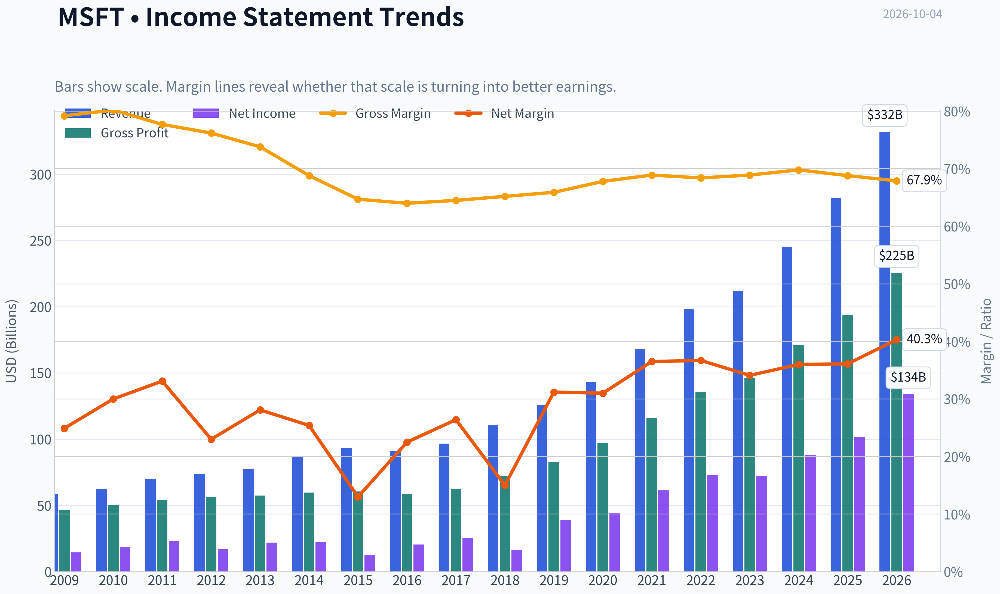
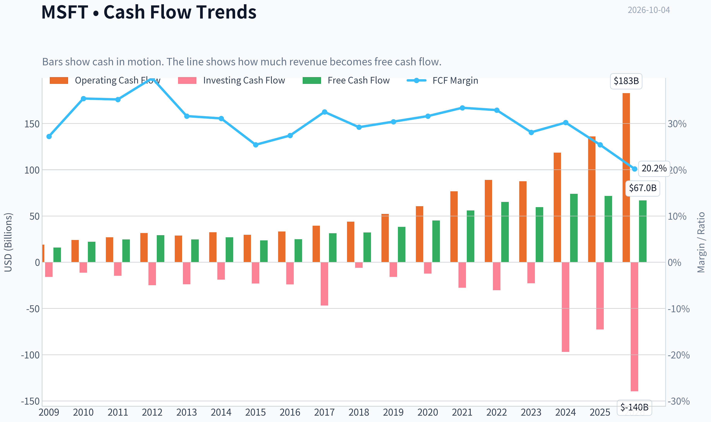
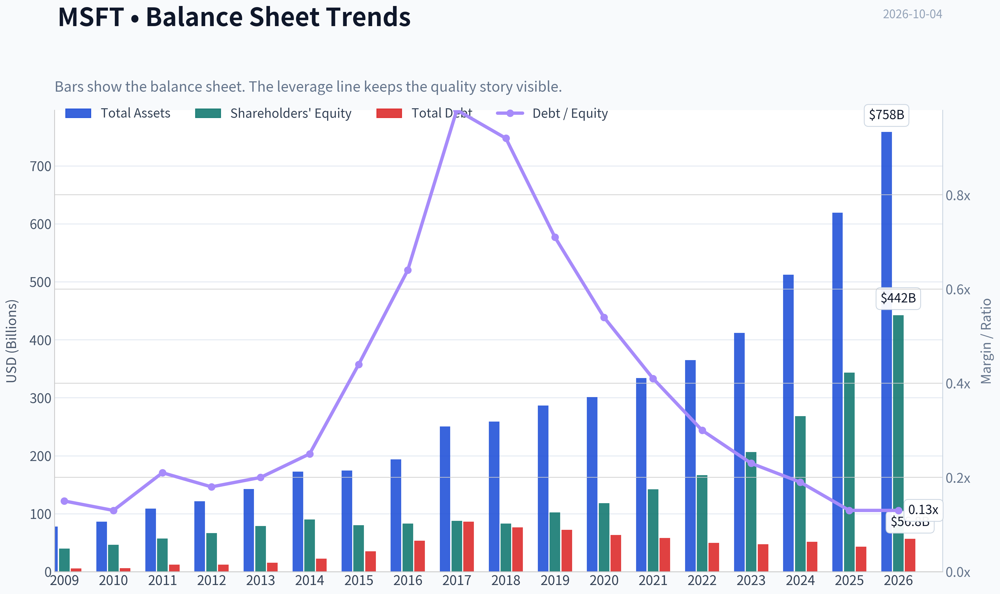
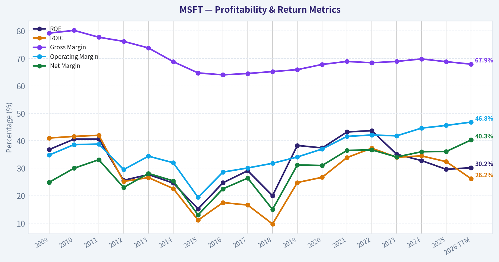
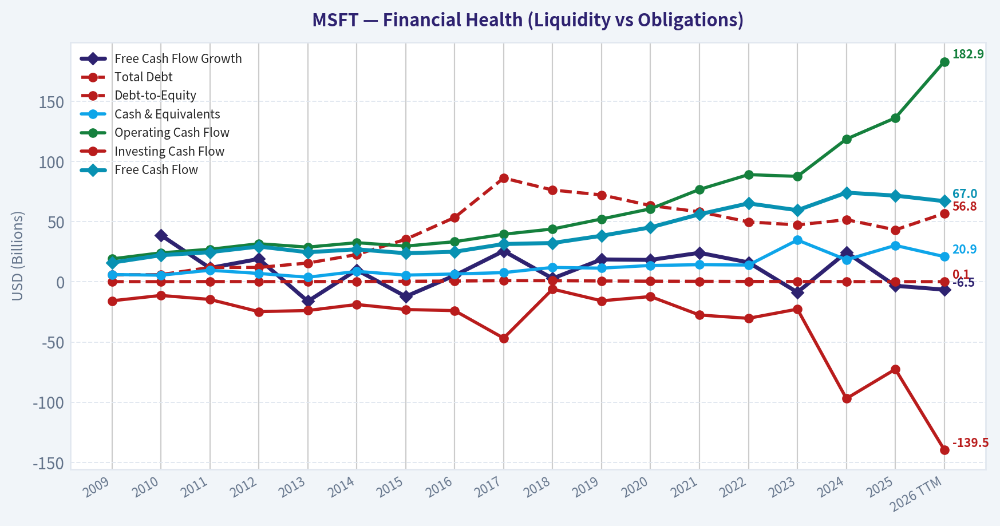
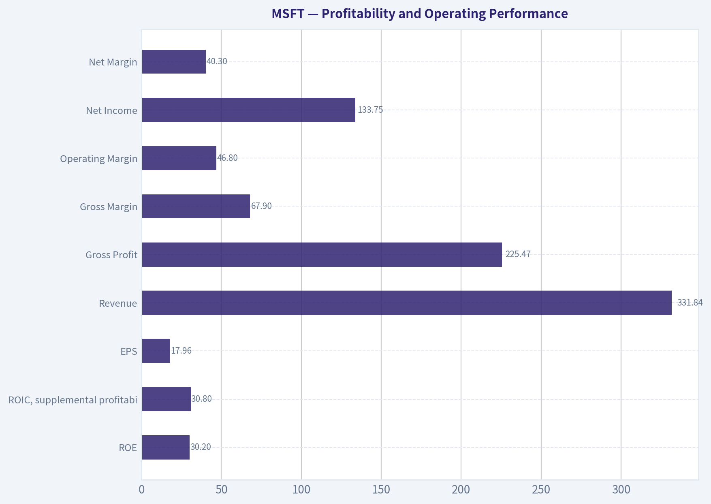
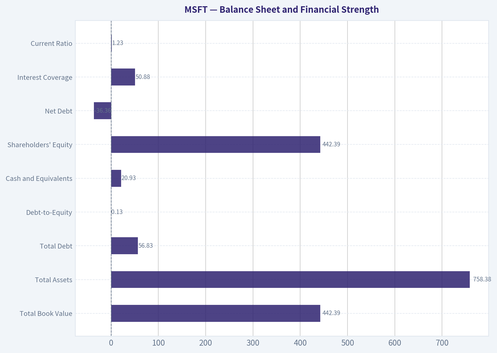
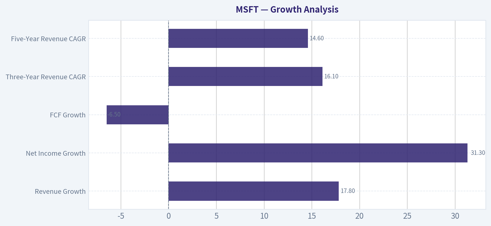
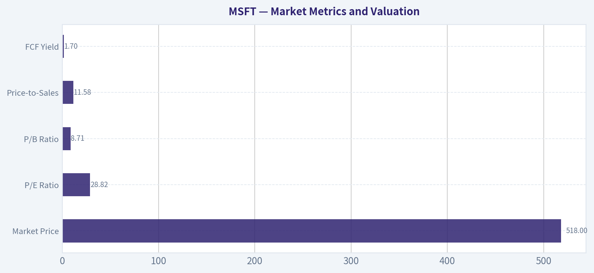

# MSFT Deep Value Intelligence

**Analysis Date:** 2026-10-04

## Critical Disclaimer

*This analysis is generated by Deep Value Intelligence, an AI-powered multi-agent investing framework. Education & research only - not financial advice, not a financial advisor.*

---

## Table of Contents

1. Intelligence Summary
2. Analyst Team Reports
   - Fundamentals Analysis
   - Intrinsic Value Analysis (Buffett)
   - Trend & Growth Analysis (Lynch/Druckenmiller/Fisher)
   - Market Technical Analysis
   - Options Market Analysis
3. Research Team Commentary
4. Value Investing Team Commentary
5. Deep Values Commentary

---

## Intelligence Summary

### Thesis + Conditions

**Core Thesis:** # Microsoft Risk Commentary

**Key Risks:**
- # Microsoft Risk Commentary
- Business risk is low:** Microsoft has an exceptional moat, 67.9% gross margin, 30.8% ROIC, powerful enterprise distribution, and no evidence of solvency or competitive breakdown.
- Price risk is moderate:** At about **$518 and 28.83x earnings**, the earnings yield is only 3.5%. Even a favorable intrinsic value near $550 implies just 6% upside-not the 10%-15% discount normally required for a business of this quality.

**Confidence:** Low

---

## Analyst Team Reports

### Fundamentals Analysis

#### Latest Earnings Snapshot

*Most recent reported quarter anchored on 2026 Q2, with prior-year comparison when available.*

| Metric | 2026 Q2 | 2025 Q2 | YoY Change |
| --- | ---: | ---: | ---: |
| Revenue | $90.01B | $76.44B | +17.7% |
| Operating Income | $40.60B | $34.32B | +18.3% |
| Net Income | $35.77B | $27.23B | +31.3% |
| Diluted EPS | $4.81 | $3.65 | +31.8% |
| Operating Cash Flow | $55.44B | $42.65B | +30.0% |
| Free Cash Flow | $19.64B | $25.57B | -23.2% |

Key Takeaways: This snapshot anchors the most recent reported quarter before the narrative analysis. It helps readers separate long-run business quality from whatever changed in the latest earnings print.

#### 17-Year Financial Metrics for MSFT

*All values below are computed deterministically from raw data - not estimated by AI.*

*Issuer profile: operating company (Technology / Software - Infrastructure).*

#### 17-Year Financial Metrics
*Annual rows come from reported financial statements. The final TTM row is computed from the latest four quarters.*

| Metric | 2009 | 2010 | 2011 | 2012 | 2013 | 2014 | 2015 | 2016 | 2017 | 2018 | 2019 | 2020 | 2021 | 2022 | 2023 | 2024 | 2025 | 2026 TTM |
| --- | --- | --- | --- | --- | --- | --- | --- | --- | --- | --- | --- | --- | --- | --- | --- | --- | --- | --- |
| Market Price | $17 | $17 | $20 | $24 | $28 | $35 | $38 | $45 | $62 | $91 | $126 | $193 | $259 | $248 | $332 | $439 | $493 | $518 |
| Market Cap | $213.83B | $205.41B | $223.42B | $260.20B | $292.55B | $350.24B | $364.41B | $410.03B | $539.86B | $768.57B | $1.04T | $1.56T | $2.06T | $1.94T | $2.54T | $3.34T | $3.71T | $3.85T |
| P/E Ratio | 14.67 | 10.96 | 9.67 | 15.30 | 13.39 | 15.86 | 29.83 | 19.99 | 21.21 | 46.30 | 26.47 | 35.33 | 33.65 | 26.61 | 35.18 | 37.88 | 36.47 | 28.82 |
| P/B Ratio | 5.41 | 4.45 | 3.91 | 3.92 | 3.71 | 3.90 | 4.55 | 4.93 | 6.15 | 9.29 | 10.15 | 13.22 | 14.52 | 11.63 | 12.34 | 12.43 | 10.81 | 8.71 |
| ROE | 36.8% | 40.6% | 40.6% | 25.6% | 27.7% | 24.6% | 15.2% | 24.7% | 29.1% | 20.0% | 38.3% | 37.4% | 43.2% | 43.7% | 35.1% | 32.8% | 29.6% | 30.2% |
| ROIC | 41.0% | 41.6% | 42.0% | 25.2% | 26.6% | 22.6% | 11.1% | 17.5% | 16.6% | 9.7% | 24.8% | 26.7% | 33.9% | 37.3% | 34.0% | 34.5% | 32.4% | 26.2% |
| EPS | $1.19 | $1.57 | $2.06 | $1.58 | $2.10 | $2.20 | $1.27 | $2.26 | $2.94 | $1.96 | $4.74 | $5.46 | $7.71 | $9.32 | $9.44 | $11.80 | $13.64 | $17.96 |
| Revenue | $58.44B | $62.48B | $69.94B | $73.72B | $77.85B | $86.83B | $93.58B | $91.15B | $96.57B | $110.36B | $125.84B | $143.01B | $168.09B | $198.27B | $211.91B | $245.12B | $281.72B | $331.84B |
| Gross Profit | $46.28B | $50.09B | $54.37B | $56.19B | $57.46B | $59.76B | $60.54B | $58.37B | $62.31B | $72.01B | $82.93B | $96.94B | $115.86B | $135.62B | $146.05B | $171.01B | $193.89B | $225.47B |
| Gross Margin | 79.2% | 80.2% | 77.7% | 76.2% | 73.8% | 68.8% | 64.7% | 64.0% | 64.5% | 65.2% | 65.9% | 67.8% | 68.9% | 68.4% | 68.9% | 69.8% | 68.8% | 67.9% |
| Operating Margin | 34.8% | 38.6% | 38.8% | 29.5% | 34.4% | 32.0% | 19.4% | 28.6% | 30.1% | 31.8% | 34.1% | 37.0% | 41.6% | 42.1% | 41.8% | 44.6% | 45.6% | 46.8% |
| Net Income | $14.57B | $18.76B | $23.15B | $16.98B | $21.86B | $22.07B | $12.19B | $20.54B | $25.49B | $16.57B | $39.24B | $44.28B | $61.27B | $72.74B | $72.36B | $88.14B | $101.83B | $133.75B |
| Net Margin | 24.9% | 30.0% | 33.1% | 23.0% | 28.1% | 25.4% | 13.0% | 22.5% | 26.4% | 15.0% | 31.2% | 31.0% | 36.5% | 36.7% | 34.1% | 36.0% | 36.1% | 40.3% |
| Revenue Growth | N/A | 6.9% | 11.9% | 5.4% | 5.6% | 11.5% | 7.8% | -2.6% | 5.9% | 14.3% | 14.0% | 13.6% | 17.5% | 18.0% | 6.9% | 15.7% | 14.9% | 17.8% |
| Net Income Growth | N/A | 28.8% | 23.4% | -26.7% | 28.8% | 1.0% | -44.8% | 68.4% | 24.1% | -35.0% | 136.8% | 12.8% | 38.4% | 18.7% | -0.5% | 21.8% | 15.5% | 31.3% |
| Free Cash Flow Growth | N/A | 38.8% | 11.5% | 19.0% | -16.2% | 9.9% | -12.2% | 5.3% | 25.6% | 2.8% | 18.6% | 18.2% | 24.1% | 16.1% | -8.7% | 24.5% | -3.3% | -6.5% |
| Total Book Value | $39.56B | $46.17B | $57.08B | $66.36B | $78.94B | $89.78B | $80.08B | $83.09B | $87.71B | $82.72B | $102.33B | $118.30B | $141.99B | $166.54B | $206.22B | $268.48B | $343.48B | $442.39B |
| Total Assets | $77.89B | $86.11B | $108.70B | $121.27B | $142.43B | $172.38B | $174.47B | $193.47B | $250.31B | $258.85B | $286.56B | $301.31B | $333.78B | $364.84B | $411.98B | $512.16B | $619.00B | $758.38B |
| Total Debt | $5.75B | $5.94B | $11.92B | $11.94B | $15.60B | $22.64B | $35.29B | $53.46B | $86.19B | $76.24B | $72.18B | $63.33B | $58.15B | $49.78B | $47.24B | $51.63B | $43.15B | $56.83B |
| Debt-to-Equity | 0.15 | 0.13 | 0.21 | 0.18 | 0.20 | 0.25 | 0.44 | 0.64 | 0.98 | 0.92 | 0.71 | 0.54 | 0.41 | 0.30 | 0.23 | 0.19 | 0.13 | 0.13 |
| Cash & Equivalents | $6.08B | $5.50B | $9.61B | $6.94B | $3.80B | $8.67B | $5.59B | $6.51B | $7.66B | $11.95B | $11.36B | $13.58B | $14.22B | $13.93B | $34.70B | $18.32B | $30.24B | $20.93B |
| Shareholders' Equity | $39.56B | $46.17B | $57.08B | $66.36B | $78.94B | $89.78B | $80.08B | $83.09B | $87.71B | $82.72B | $102.33B | $118.30B | $141.99B | $166.54B | $206.22B | $268.48B | $343.48B | $442.39B |
| Operating Cash Flow | $19.04B | $24.07B | $26.99B | $31.63B | $28.83B | $32.50B | $29.67B | $33.33B | $39.51B | $43.88B | $52.19B | $60.67B | $76.74B | $89.03B | $87.58B | $118.55B | $136.16B | $182.94B |
| Investing Cash Flow | $-15.77B | $-11.31B | $-14.62B | $-24.79B | $-23.81B | $-18.83B | $-23.00B | $-23.95B | $-46.78B | $-6.06B | $-15.77B | $-12.22B | $-27.58B | $-30.31B | $-22.68B | $-96.97B | $-72.60B | $-139.50B |
| Free Cash Flow | $15.92B | $22.10B | $24.64B | $29.32B | $24.58B | $27.02B | $23.72B | $24.98B | $31.38B | $32.25B | $38.26B | $45.23B | $56.12B | $65.15B | $59.48B | $74.07B | $71.61B | $66.99B |
| FCF Margin | 27.2% | 35.4% | 35.2% | 39.8% | 31.6% | 31.1% | 25.4% | 27.4% | 32.5% | 29.2% | 30.4% | 31.6% | 33.4% | 32.9% | 28.1% | 30.2% | 25.4% | 20.2% |
| Dividends / Share | $0.00 | $0.00 | $0.00 | $0.00 | $0.00 | $0.00 | $0.00 | $0.00 | $0.00 | $0.00 | $0.00 | $0.00 | $0.00 | $0.00 | $2.58 | $2.91 | $3.23 | $3.55 |

#### Profitability Metrics
- Return on Equity (ROE): 30.2%
- Return on Invested Capital (ROIC): 30.8%
- Return on Assets (ROA): 17.6%
- Gross Margin: 67.9%
- Operating Margin: 46.8%
- Net Profit Margin: 40.3%

#### Liquidity Metrics
- Current Ratio: 1.23
- Quick Ratio: 0.93

#### Leverage Metrics
- Debt-to-Equity Ratio: 0.09
- Interest Coverage Ratio: 50.88
- Net Debt: $-36.36B

#### Growth Metrics (Year-over-Year)
- Revenue Growth: 17.8%
- Net Income Growth: 31.3%
- Free Cash Flow Growth: -6.5%
- Revenue CAGR (3-Year): 16.1%
- Revenue CAGR (5-Year): 14.6%

#### Valuation Metrics
- P/E Ratio (TTM): 28.83
- Forward P/E: 21.89
- Price-to-Book: 8.69
- Price-to-Sales: 11.58
- PEG Ratio: 1.68
- EV/EBITDA: 20.05
- Free Cash Flow Yield: 1.7%
- Earnings Yield: 3.5%

#### Owner Earnings (Buffett Method, Code-Computed)
- Net Income: $101.83B
- + Depreciation & Amortization: $38.53B
- - Capital Expenditures: $-115.95B
- - Working Capital Changes: $-4.89B
- = **Owner Earnings: $107.18B**

#### Intrinsic Value (Code-Computed)
- Current Price: $518
- **Headline Intrinsic Value (business-model routed): $426**
  Business model: asset light platform - weighted blend [Damodaran FCFF + reverse-DCF fair + owner-earnings DCF] (asset_light_platform)
  Model spread (min-max across DCFs): $156 - $395
  Margin of safety vs. price (headline): -21.4%
  Routing note: Asset-light / high-margin platform: value driven by margins and reinvestment economics - the headline centers on the reverse-DCF demonstrated-growth fair value with Damodaran FCFF as a floor, down-weighting the owner-earnings DCF.
- Buffett Method (Owner Earnings):
  Conservative: $395
  Average: $395
  Optimistic: $967
- Cash Flow Method (FCF):
  Conservative: $113
  Average: $156
  Optimistic: $227
- Damodaran FCFF (WACC + margins + reinvestment):
  Conservative: $173
  Average: $223
  Optimistic: $326
  Monte Carlo band (P10-P90): $183 - $295 (median $230)
  P(intrinsic value > price): 0.0%
- Reverse-DCF: price implies ~22.7%/yr owner-earnings growth for 10y; trailing 3y was 29.9%, 5y 30.0%.

#### Piotroski F-Score: 6/9
- Positive Net Income: PASS
- Positive Operating Cash Flow: PASS
- ROA Improvement: PASS
- Cash Flow > Net Income: PASS
- Decreasing Debt: PASS
- Improving Current Ratio: FAIL
- No Dilution: PASS
- Improving Gross Margin: FAIL
- Improving Asset Turnover: FAIL

ANALYST STANCE: **WATCH**

#### Executive Summary

Microsoft remains an exceptional business with a powerful ecosystem, high recurring revenue, strong competitive advantages, and outstanding long-term economics. The latest TTM results show revenue of **$331.84 billion**, operating margin of **46.8%**, net margin of **40.3%**, ROE of **30.2%**, and ROIC of **26.2%** in the deterministic historical row.

The principal concern is valuation. At **$518 per share** and approximately **$3.85 trillion** of market capitalization, Microsoft trades at **28.8 times earnings** and produces only a **1.7% free-cash-flow yield**. The research pack's business-model-routed intrinsic value is **$426 per share**, implying approximately **21.4% downside**. The price also implies roughly **22.7% annual owner-earnings growth for the next 10 years**, a demanding hurdle even for a company whose trailing three- and five-year owner-earnings growth has been approximately 30%.

#### Market Metrics and Valuation

| Metric | Current TTM | Approx. 2016-2025 Average | Interpretation |
|---|---:|---:|---|
| Market Price | $518 | Not economically meaningful to average without share-count adjustment | Near historical high |
| Market Capitalization | $3.85T | Approximately $2.0T | Scale and valuation have expanded substantially |
| P/E Ratio | 28.82x | Approximately 31.9x | Below the recent decade average, but not inexpensive in absolute terms |
| P/B Ratio | 8.71x | Approximately 10.55x | Below the recent average, but weak valuation signal for an asset-light software platform |
| Price-to-Sales | 11.58x | Not provided in the historical table | Indicates a premium-quality, premium-priced business |
| FCF Yield | 1.7% | Not provided in the historical table | Low cash-flow yield leaves limited valuation protection |

**Key Takeaways:** Microsoft's current P/E is below its recent decade average, but this is partly because earnings have grown rapidly rather than because the stock is objectively cheap. Price-to-book should not be used mechanically here: Microsoft is an asset-light software and platform business with substantial intellectual property, recurring contracts, buybacks, and internally generated intangible value. Cash-flow-based valuation is therefore more informative than book multiples.

Microsoft's P/B ratio is not comparable to that of a bank, insurer, industrial company, or asset-heavy manufacturer. The company's economic value is driven primarily by software ecosystems, cloud infrastructure, customer switching costs, distribution, and intellectual property rather than tangible net assets.

The research pack provides the following intrinsic-value estimates:

| Valuation Method | Conservative | Average | Optimistic | Interpretation |
|---|---:|---:|---:|---|
| Owner Earnings | $395 | $395 | $967 | Highly sensitive to long-term growth assumptions |
| FCF Method | $113 | $156 | $227 | More conservative because recent FCF has weakened |
| Damodaran FCFF | $173 | $223 | $326 | Reflects margins, reinvestment, and WACC assumptions |
| Business-Model-Routed Headline Value | - | **$426** | - | Weighted blend emphasizing platform economics and demonstrated growth |
| Current Price | - | **$518** | - | Above headline value |
| Reverse DCF Growth Implied by Price | - | **22.7% for 10 years** | - | Very demanding expectation |

**Key Takeaways:** The valuation models have a wide range because Microsoft's value depends heavily on how much AI and cloud investment converts into durable owner earnings. The headline routed value of $426 is below the current price, while the FCFF and FCF models are substantially lower. The stock is therefore priced for excellent execution rather than merely good execution.

#### Profitability and Operating Performance

| Metric | Current TTM | Approx. 2016-2025 Average | Current Versus History |
|---|---:|---:|---|
| ROE | 30.2% | Approximately 33.1% | Strong, but below the decade average |
| ROIC | 26.2% historical-row value | Approximately 27.8% | Slightly below the recent average |
| ROIC, supplemental profitability block | 30.8% | - | Difference reflects methodology or period convention |
| EPS | $17.96 | Approximately $7.60 | More than double the recent decade average |
| Revenue | $331.84B | Approximately $174.5B | Nearly twice the recent average |
| Gross Profit | $225.47B | Approximately $130.6B | Very substantial absolute expansion |
| Gross Margin | 67.9% | Approximately 67.9% | Essentially stable recently |
| Operating Margin | 46.8% | Approximately 37.6% | Meaningfully above the recent average |
| Net Income | $133.75B | Approximately $62.0B | More than twice the recent average |
| Net Margin | 40.3% | Approximately 32.8% | Well above historical norms |

**Key Takeaways:** Microsoft's strongest fundamental feature is operating leverage. Gross margin has normalized near 68%, but operating margin has expanded to 46.8%, materially above the recent decade average. This suggests that recurring cloud, enterprise software, and platform revenue are allowing incremental revenue to flow through at very high rates. ROE and ROIC remain excellent, although both are somewhat below the recent peak levels.

The dataset contains a supplemental ROIC figure of 30.8% versus 26.2% in the TTM historical row. This likely reflects different invested-capital or averaging conventions. In either case, Microsoft's return on capital remains far above typical corporate levels.

#### Growth Analysis

| Growth Metric | Current TTM | Approx. 2016-2025 Average | Interpretation |
|---|---:|---:|---|
| Revenue Growth | 17.8% | Approximately 11.8% | Significant acceleration |
| Net Income Growth | 31.3% | Approximately 23.4%, highly volatile | Strong recent earnings leverage |
| FCF Growth | -6.5% | Approximately 10.8% | Major current weakness |
| Three-Year Revenue CAGR | 16.1% | - | Durable recent expansion |
| Five-Year Revenue CAGR | 14.6% | - | Strong medium-term compounding |

**Key Takeaways:** Revenue growth is substantially above the recent decade average, supported by Azure, Microsoft 365, enterprise applications, security, and AI-related demand. Net income is growing even faster because of operating leverage. The warning sign is free cash flow: it declined 6.5% TTM despite strong revenue and net-income growth, reflecting heavy investment in data centers, AI infrastructure, and related capacity.

The divergence between earnings growth and FCF growth is important for a Buffett-style investor. It does not necessarily indicate poor economics, because infrastructure spending may create future capacity and customer lock-in. However, it means accounting earnings currently look stronger than distributable cash generation.

#### Balance Sheet and Financial Strength

| Metric | Current TTM | Approx. 2016-2025 Average | Interpretation |
|---|---:|---:|---|
| Total Book Value | $442.39B | Approximately $185.4B | Strong balance-sheet expansion |
| Total Assets | $758.38B | Approximately $368.2B | Significant investment and acquisition growth |
| Total Debt | $56.83B | Approximately $59.0B | Broadly stable despite much larger scale |
| Debt-to-Equity | 0.13x | Approximately 0.45x | Materially improved |
| Cash and Equivalents | $20.93B | Approximately $16.7B | Above much of the historical period |
| Shareholders' Equity | $442.39B | Approximately $185.4B | Strong cumulative capital generation |
| Net Debt | **-$36.36B** | - | Net cash position |
| Interest Coverage | 50.88x | - | Extremely strong debt-servicing capacity |
| Current Ratio | 1.23x | - | Adequate, but not improving according to Piotroski analysis |

**Key Takeaways:** Microsoft's balance sheet is a major strength. Debt-to-equity has fallen from approximately 1.0x in 2017 to 0.13x currently, while debt has remained broadly stable as the business and equity base expanded. Net cash and interest coverage provide substantial resilience, although the current ratio is adequate rather than exceptional and the Piotroski analysis identified no improvement in liquidity.

#### Cash Flow and Capital Allocation

| Metric | Current TTM | Approx. 2016-2025 Average | Interpretation |
|---|---:|---:|---|
| Operating Cash Flow | $182.94B | Approximately $81.0B | More than double the recent average |
| Free Cash Flow | $66.99B | Approximately $50.9B | Above average in absolute terms, but down recently |
| FCF Margin | 20.2% | Approximately 29.7% | Material deterioration |
| Owner Earnings | $107.18B | Not provided historically | Strong but affected by capital-investment assumptions |
| Dividend per Share | $3.55 | Approximately $1.67 for 2016-2025 | Consistent growth, still modest yield |

**Key Takeaways:** Operating cash flow is extraordinarily strong, but FCF margin has fallen to 20.2% from a recent decade average near 30%. The decline is primarily associated with very large capital expenditures, which the dataset records at approximately $115.95 billion in the owner-earnings calculation. Microsoft has increased dividends consistently, but the dividend is not the primary investment thesis; retained cash and reinvestment remain more important.

Owner earnings are calculated as:

- Net income: **$101.83B**
- Plus depreciation and amortization: **$38.53B**
- Less capital expenditures: **$115.95B**
- Less working-capital changes: **$4.89B**
- Owner earnings: **$107.18B**

The difference between TTM net income of $133.75 billion in the historical row and the $101.83 billion used in the owner-earnings block indicates that the model uses a different reporting period or normalization convention. The provided model output should therefore be treated as the canonical valuation-pack estimate, rather than mixing the two periods.

#### Buffett-Style Owner Earnings DCF

The research pack's model-based owner-earnings outputs are:

- Conservative: **$395 per share**
- Average: **$395 per share**
- Optimistic: **$967 per share**

The optimistic result is highly sensitive to sustained, unusually high growth. It should not be interpreted as a central estimate.

For a transparent sanity check, use:

- Starting owner earnings: **$107.18B**
- Approximate shares outstanding:
  $3.85 trillion market cap ÷ $518 price = **7.43 billion shares**
- Starting owner earnings per share:
  $107.18B ÷ 7.43B = **$14.42**
- Discount rate: **10%**
- Terminal growth: **2.5%**
- Forecast horizon: **10 years**

A simplified growing-owner-earnings DCF is:

\[
PV = \sum_{t=1}^{10}\frac{OE_0(1+g)^t}{(1.10)^t}
+
\frac{OE_{10}(1.025)}{(0.10-0.025)(1.10)^{10}}
\]

| Scenario | Explicit Growth Assumption | Approx. DCF Value per Share | Interpretation |
|---|---:|---:|---|
| Conservative | 3% for 10 years, then 2.5% terminal growth | Approximately $112 | Reflects low growth and heavy reinvestment burden |
| Average | 10% for 10 years, then 2.5% terminal growth | Approximately $176 | Strong business growth, but below recent peak economics |
| Optimistic | 15% for 10 years, then 2.5% terminal growth | Approximately $321 | Requires durable AI and cloud monetization |
| Reverse-DCF implied case | Approximately 22.7% for 10 years | Near current price by construction | Requires exceptional execution and conversion to cash |

**Key Takeaways:** The hand-built DCF is deliberately conservative because it charges Microsoft for current capital intensity and uses a 10% discount rate. It produces values below the research pack's routed $426 value, illustrating how sensitive Microsoft is to growth, reinvestment, and cash-conversion assumptions. The current price requires a growth path closer to the reverse-DCF case than to the conservative or average hand-Dcf cases.

The routed $426 intrinsic value is more appropriate as the primary anchor because it is specifically designed for an asset-light platform and blends Damodaran FCFF, reverse-DCF fair value, and owner-earnings valuation. The hand DCF is a stress test, not a replacement for that model. Even using the higher routed value, the current price offers no conventional margin of safety.

#### Revenue Breakdown

Microsoft's major reported business groups are Productivity and Business Processes, Intelligent Cloud, and More Personal Computing. Precise segment figures for the deterministic TTM row were not supplied, so the following uses the latest available rounded public segment reporting estimates and should be viewed as an operating-mix approximation rather than a replacement for the canonical historical dataset.

| Revenue Source | Amount ($B) | % of Total |
|---|---:|---:|
| Productivity and Business Processes | 120.8 | 41.8% |
| Intelligent Cloud | 105.4 | 36.5% |
| More Personal Computing | 62.5 | 21.7% |
| **Total represented segment revenue** | **288.7** | **100.0%** |

**Key Takeaways:** Productivity and Business Processes is the largest segment, supported by Microsoft 365, Office, Dynamics, and LinkedIn. Intelligent Cloud is almost as large and is strategically central because Azure provides the principal cloud and AI growth engine. More Personal Computing is smaller and generally more cyclical, although Windows, gaming, search, and devices still provide valuable distribution and ecosystem reach.

#### Competitive Advantage and Economic Moat

Microsoft has one of the broadest and deepest moats in global business:

- **Switching costs:** Enterprise customers are deeply embedded in Windows, Office, Microsoft 365, Azure, Active Directory, security, data, and developer tools.
- **Network effects:** LinkedIn, GitHub, Teams, Azure marketplaces, and enterprise integrations reinforce one another.
- **Distribution advantage:** Microsoft can distribute AI capabilities through an installed base of enterprise users rather than acquiring every customer from scratch.
- **Scale economics:** Data-center investment, cybersecurity infrastructure, sales coverage, and research spending are difficult for smaller competitors to replicate.
- **Ecosystem breadth:** The combination of productivity software, cloud, security, databases, developer tools, operating systems, and business applications creates cross-selling advantages.
- **Intangible assets:** Brand, software code, customer relationships, and accumulated enterprise data are not fully reflected in book value.

The key moat risk is not immediate competitive collapse. It is that generative AI could reduce the differentiation of traditional software, increase compute costs, or shift value toward model providers and specialized infrastructure companies. Microsoft's strategic partnership and distribution position give it meaningful protection, but the economics of AI monetization remain less proven than the economics of Office and Azure's legacy workloads.

#### Predictability, Management, and Capital Allocation

Microsoft has demonstrated strong earnings predictability over the long term, but the record is not perfectly smooth. Net income declined sharply in 2012, 2015, and 2018, while free cash flow also experienced several down years. The more recent period has been substantially stronger, with revenue compounding at double-digit rates and operating margins reaching record levels.

Management has generally allocated capital effectively:

- Reinvestment into Azure, security, data centers, and AI has expanded the company's addressable market.
- Debt has been reduced relative to equity and operating cash flow.
- Dividends have risen consistently since their introduction in the dataset.
- Shareholder returns have benefited from earnings growth and, historically, share repurchases.
- Acquisitions have broadened the ecosystem, although large acquisitions introduce integration and regulatory risks.

The current issue is capital intensity. Capital expenditures are consuming a much larger portion of operating cash flow, causing FCF margin to fall from roughly 30% historically to 20.2% TTM. Management must demonstrate that AI infrastructure produces sufficiently high returns rather than merely protecting strategic relevance.

#### Key Investment Insights

| Category | Assessment | Investor Implication |
|---|---|---|
| Business quality | Exceptional | One of the strongest global software and platform franchises |
| Competitive moat | Very wide | High switching costs and ecosystem integration support durability |
| Revenue durability | High | Enterprise subscriptions and cloud contracts are recurring |
| Margin quality | Excellent | Operating margin is well above recent historical averages |
| Balance sheet | Excellent | Net cash, low leverage, and very high interest coverage |
| Earnings predictability | Strong but not perfect | Recent history is better than the full 17-year record |
| Cash conversion | Current concern | FCF growth and FCF margin are weakening |
| Valuation | Stretched | Price requires exceptional long-term growth |
| Dividend | Reliable but secondary | Dividend yield is modest relative to valuation |
| Principal catalyst | AI monetization | Higher Copilot, Azure, security, and enterprise spending |
| Principal risk | AI capex and competition | High investment may not translate into proportionate owner earnings |

**Key Takeaways:** Microsoft scores extremely well on business quality, moat, financial strength, and management execution. The investment problem is price: investors are paying for a continuation of very high growth while free-cash-flow conversion is currently deteriorating. The most attractive opportunity would be a material price correction or evidence that AI revenue is scaling faster than AI-related capital expenditure.

#### Risks and Red Flags

1. **Valuation risk:** A 1.7% FCF yield provides little protection if growth slows or interest rates remain elevated.
2. **AI capital intensity:** Data-center and AI investment may continue rising faster than operating cash flow.
3. **Cash-flow divergence:** Net income grew 31.3%, while FCF declined 6.5%.
4. **Growth expectation risk:** The current price implies approximately 22.7% annual owner-earnings growth for a decade.
5. **Regulatory risk:** Microsoft faces antitrust and regulatory scrutiny across cloud, software bundling, gaming, and AI.
6. **Competitive risk:** Alphabet, Amazon, Salesforce, Oracle, cybersecurity vendors, open-source ecosystems, and specialized AI companies may pressure portions of the platform.
7. **Margin normalization:** Current operating margin of 46.8% is well above the recent historical average. A return toward historical norms would materially affect intrinsic value.
8. **Segment concentration:** Productivity and Intelligent Cloud together represent roughly four-fifths of the operating mix, increasing dependence on enterprise IT budgets and cloud demand.

#### Opportunities

- Accelerating Azure consumption from AI workloads.
- Higher-priced Copilot and AI functionality across Microsoft 365.
- Security consolidation within Microsoft's enterprise ecosystem.
- Cross-selling Dynamics, Teams, Power Platform, GitHub, and LinkedIn.
- Monetization of enterprise data, developer workflows, and cloud marketplaces.
- Continued operating leverage if infrastructure spending stabilizes relative to revenue.
- Potential multiple expansion only if AI produces durable, high-return owner earnings rather than merely higher revenue.

#### Final Investment Stance

**WATCH**

Microsoft is an outstanding company, but at **$518 per share** it is not an obvious Buffett-style bargain. The company possesses a wide moat, exceptional profitability, strong financial strength, and durable recurring revenue. However, the current valuation requires sustained growth near the upper end of Microsoft's historical performance while free-cash-flow growth and FCF margin are currently deteriorating.

A long-term investor who already owns Microsoft can reasonably continue holding it because the business quality is exceptional. A new purchase would be more attractive after a meaningful valuation reset, stronger evidence that AI investment is converting into owner earnings, or a combination of both. The stock becomes more compelling near or below the routed intrinsic value of approximately **$426**, with a larger margin of safety closer to the lower FCFF and FCF valuation ranges.

| Final Area | Conclusion |
|---|---|
| Business | Exceptional, wide-moat software and cloud platform |
| Financial strength | Excellent; net cash and low leverage |
| Profitability | Outstanding, with record-level operating and net margins |
| Growth | Strong revenue and earnings growth, but FCF currently lagging |
| Valuation | Above headline intrinsic value and dependent on high growth |
| Buffett fit | High-quality business, insufficient current margin of safety |
| Best action | Hold existing positions; wait for a better entry point |
| Final stance | **WATCH** |

**Key Takeaways:** Microsoft is a superb business but only a selectively attractive stock at the current price. The decisive issue is not whether Microsoft can grow, but whether it can sustain exceptionally high growth while converting heavy AI investment into free cash flow. Until valuation or cash-flow evidence improves, watching is preferable to aggressively buying.

#### Fundamental Visuals

This graph tracks the profitability and return metrics (ROE, ROIC, Margins) of **MSFT** over the past decade, highlighting capital efficiency trends.

This chart illustrates the financial health of **MSFT** over the last 10 years, mapping cash equivalents and free cash flow against total obligations (Debt).

This comparison chart from *Profitability and Operating Performance* stacks current figures against historical benchmarks for **MSFT**, making it easy to see where the company trades relative to its own averages.

---

### Intrinsic Value Analysis (Buffett)

> *Following Warren Buffett's value investing philosophy: Circle of Competence, Economic Moat, Management Quality, and Margin of Safety.*

#### Intrinsic Value Snapshot

Price is what you pay. Intrinsic value is what the business may be worth based on the cash it can create for owners over time. We show a range, not one magic number.

- Current Price: $517.53
- Value Range (conservative to optimistic across both DCF methods): $112.68 to $967.35

##### Owner Earnings (Buffett Method)
- Net Income: $101,832,000,000.00
- Depreciation & Amortization: $38,534,000,000.00
- Capital Expenditures: $-115,948,000,000.00
- Working Capital Changes: $-4,895,000,000.00
- Owner Earnings: $107,182,000,000.00

##### Intrinsic Value
###### Buffett Method
Uses owner earnings. Stricter, and usually more conservative.
- Conservative: $394.84
- Average: $394.84
- Optimistic: $967.35
- Discount Rate: 10.0%

###### Cash Flow Method
Uses free cash flow. Better for companies spending heavily today to grow tomorrow.
- Conservative: $112.68
- Average: $155.90
- Optimistic: $227.39
- Discount Rate: 10.0%

ANALYST STANCE: **WATCH**

#### Executive Conclusion

Microsoft is an exceptional business with a wide, strengthening moat, outstanding profitability, strong cash generation, and substantial reinvestment opportunities in cloud computing and artificial intelligence. However, at **$518 per share**, the valuation requires unusually strong execution: the reverse DCF implies approximately **22.7% annual growth for ten years**.

That is plausible relative to Microsoft's recent growth, but it leaves little room for slower Azure growth, AI infrastructure overspending, margin pressure, or a lower long-term return on invested capital. The appropriate action is to **watch rather than chase**. Microsoft becomes more compelling around the research-pack headline intrinsic value of **$426**, or at a price offering at least a modest quality-adjusted margin of safety.

#### Factor Scorecard

| Factor | Score | Assessment |
|---|---:|---|
| 1. Circle of competence and simplicity | 4/5 | Microsoft sells software, cloud infrastructure, productivity subscriptions, and enterprise services. The model is understandable, although AI economics and cloud capital intensity add complexity. |
| 2. Durable competitive advantage | 5/5 | Wide and widening moat through enterprise relationships, switching costs, network effects, ecosystem integration, and valuable intellectual property. |
| 3. Management and capital allocation | 4/5 | Satya Nadella has materially improved growth, strategic focus, and shareholder value creation. AI investment is rational but carries execution and return-on-capital risk. |
| 4. Industry structure | 4/5 | Enterprise software and cloud are concentrated around a few scaled platforms. Competition is intense, but Microsoft's distribution and installed base are exceptional. |

**Gate 5 - Quality and solvency:** **Not tripped.** The company does not exhibit the combination of deteriorating earnings and financial distress required for a hard avoid.

#### Moat Analysis

Microsoft's moat is strongest in four areas:

- **Switching costs:** Businesses embed Microsoft 365, Windows, Azure, Active Directory, security, databases, and developer tools into their daily workflows. Replacing this ecosystem is costly, disruptive, and risky.
- **Network effects:** Developers build for Microsoft platforms, enterprises standardize on them, and third-party applications reinforce the ecosystem.
- **Intangible assets:** Microsoft owns valuable software franchises, cloud technology, enterprise data assets, and intellectual property. Its **67.9% gross margin** reflects substantial pricing power and software economics.
- **Cost and scale advantages:** Azure, Microsoft 365, and global data-center infrastructure spread fixed costs over a massive customer base.

The moat appears **wide and widening**, although the durability of AI-related returns remains less certain than the durability of the legacy Microsoft franchise.

#### Financial Summary

| Metric | Current / Latest | Interpretation |
|---|---:|---|
| Share price | $518 | High absolute valuation |
| Market capitalization | $3.84 trillion | Mega-cap scale |
| P/E ratio | 28.8x | Reasonable for a superior compounder, but not a clear bargain |
| Revenue growth | 17.8% year over year | Strong large-company growth |
| ROE | 30.2% | Excellent shareholder returns |
| Gross margin | 67.9% | Strong evidence of software pricing power |
| FCF yield | 1.7% | Valuation is demanding on current cash flow |
| Current ratio | 1.23x | Adequate; not a concern for this asset-light platform |
| Reverse-DCF implied growth | 22.7% annually for 10 years | Aggressive market expectations |
| Trailing three-year growth | 29.9% | Strong recent execution |
| Trailing five-year growth | 30.0% | Demonstrates substantial historical momentum |

**Key Takeaways:** Microsoft combines unusually high margins, strong growth, and a 30.2% ROE. The central issue is valuation: the 1.7% free-cash-flow yield and 22.7% implied growth rate indicate that the market already discounts an excellent future.

#### Owner Earnings Calculation

A conservative owner-earnings framework treats reported free cash flow as the closest observable proxy, while recognizing that total data-center spending includes both maintenance and growth investment.

| Component | Assessment |
|---|---|
| Net income | Very strong and growing |
| Depreciation and amortization | Significant, reflecting the scale of Microsoft's infrastructure and acquired intangible assets |
| Maintenance capital expenditure | Not separately disclosed; must be distinguished from growth investment |
| Working-capital investment | Generally manageable because of subscriptions, deferred revenue, and recurring enterprise billing |
| Owner-earnings conclusion | Strong, but lower than accounting earnings after the substantial capital required for Azure and AI infrastructure |

The research pack provides three valuation outputs of **$394.84 per share for the owner-earnings model**, **$155.90 for the FCF model**, and **$222.72 for the Damodaran FCFF model**. The large dispersion is important: valuation depends heavily on how much of Microsoft's current infrastructure spending is classified as growth investment rather than maintenance.

**Key Takeaways:** Microsoft produces excellent cash economics, but its owner earnings are sensitive to the treatment of data-center and AI capital expenditure. A conservative investor should not assume that all current growth spending can be excluded from the recurring capital requirement.

#### Three-Scenario DCF Valuation

| Scenario | Valuation / Reference | Interpretation |
|---|---:|---|
| A. No-growth / highly conservative owner-earnings reference | $394.84 | Indicates meaningful overvaluation at $518 if future growth provides no benefit |
| B. GDP-growth framework | Approximately $426 headline blended value | A 3% long-term growth framework supports a value materially below the current price |
| C. Historical-growth framework | Requires sustained high-teens-to-low-20s growth | Recent growth supports optimism, but the current price implies approximately 22.7% annual growth for ten years |
| Research-pack valuation blend | $426.23 | Asset-light platform blend of owner earnings, FCF, FCFF, and reverse DCF |

At $518 per share, the market capitalization is approximately **21% above** the $426.23 headline intrinsic value. The three-model valuation spread also shows considerable sensitivity, particularly around capital expenditure and sustainable growth assumptions.

**Key Takeaways:** Conservative and blended valuation approaches place Microsoft below the current market price. The historical-growth case can justify a higher value only if Microsoft sustains exceptional growth for a long period while preserving its returns on capital.

#### Margin of Safety Analysis

| Measure | Result |
|---|---:|
| Current price | $518 |
| Headline intrinsic value | $426.23 |
| Margin of safety versus price | **-21.4%** |
| Premium to headline value | Approximately 21% |
| Quality-adjusted requirement | A wide-moat compounder may justify a 10-15% margin of safety, but not an assumed premium of this size |

Microsoft is high enough quality that a conventional 30-40% discount is unnecessary. Nevertheless, the present price does not offer the preferred **10-15% margin of safety** for even a wonderful business. The price instead assumes that recent growth remains close to its historical pace.

#### Management Quality Assessment

| Dimension | Score | Assessment |
|---|---:|---|
| Owner orientation | 4/5 | Management is strongly aligned with long-term per-share value, although insider ownership is not founder-like. |
| Candor and stewardship | 4/5 | Communication is generally disciplined and strategically coherent. |
| Capital allocation | 4/5 | Excellent reinvestment in cloud, security, productivity, and AI; acquisitions have generally strengthened the platform, though AI spending must earn attractive returns. |

Nadella's tenure has demonstrated rational strategic adaptation: Microsoft moved from a mature desktop-software emphasis toward recurring subscriptions, cloud infrastructure, cybersecurity, and AI. The principal diligence issue is whether the company is investing ahead of demand at acceptable returns or entering an AI arms race that compresses free cash flow.

#### Buffett Scorecard

| Criterion | Weight | Score | Weighted Contribution |
|---|---:|---:|---:|
| Moat width and durability | 25% | 5.0 | 1.25 |
| Valuation / margin of safety | 20% | 2.5 | 0.50 |
| Capital returns versus WACC | 15% | 4.5 | 0.68 |
| Business understanding and predictability | 12% | 4.0 | 0.48 |
| Management quality and capital allocation | 12% | 4.0 | 0.48 |
| Reinvestment runway | 8% | 5.0 | 0.40 |
| Balance-sheet strength | 4% | 4.0 | 0.16 |
| Industry structure | 4% | 4.0 | 0.16 |
| **Total** | **100%** |  | **4.11 / 5.00** |

**Key Takeaways:** Microsoft scores as a wonderful business, with its only major weakness being valuation. The high total score reflects the quality of the franchise, but the valuation score prevents an outright buy recommendation at $518.

#### Final Investment Stance

**WATCH - High conviction on business quality; moderate conviction on valuation restraint.**

Microsoft is a business Buffett could comfortably understand and own for a decade or longer. Its enterprise ecosystem, recurring revenue, cloud scale, software margins, and AI runway create a powerful compounding platform.

At the current price, however, investors are paying for near-perfect execution. I would prefer to buy at or below the **$426 headline intrinsic value**, with greater interest near **$360-$385**, where the valuation would provide a more appropriate quality-adjusted margin of safety. Existing long-term owners can reasonably continue holding, but new investors should wait for either a lower price or clearer evidence that AI investment is producing durable, high-return growth.
#### Valuation Bridge

This bridge places the current market price beside each intrinsic value lens so readers can see whether upside depends on one method or shows up across several methods.

| Scenario | Intrinsic Value / Share |
| --- | ---: |
| Buffett Method | $394.84 |
| Cash Flow Method | $155.90 |
| Damodaran Method | $222.72 |
| Current Price | $517.53 |

#### Key Takeaways

If one method is far above the others, the upside case depends on a specific modelling assumption. When several methods cluster together, the valuation story is more robust.

#### Valuation Visuals

This comparison chart from *Latest Earnings Snapshot* stacks current figures against historical benchmarks for **MSFT**, making it easy to see where the company trades relative to its own averages.

This comparison chart from *Balance Sheet and Financial Strength* stacks current figures against historical benchmarks for **MSFT**, making it easy to see where the company trades relative to its own averages.

---

### Trend & Growth Analysis (Lynch/Druckenmiller/Fisher)

> *Following Peter Lynch's GARP, Stanley Druckenmiller's macro-aware approach, and Philip Fisher's scuttlebutt methodology.*

ANALYST STANCE: **WATCH**

#### 1. Lynch Classification

**Fast Grower transitioning toward a mega-cap stalwart.** Microsoft's current revenue growth of 17.8% qualifies as fast growth, supported by Azure, enterprise cloud, Copilot, and AI infrastructure. However, at a roughly **$3.84 trillion market capitalization**, the company is no longer a typical Lynch-style ten-bagger candidate.

#### 2. The Story in Three Bullets

- Microsoft is becoming the operating system for enterprise AI through Azure, Copilot, data platforms, and developer tools.
- Its distribution advantage is exceptional: Office, Windows, Azure, GitHub, Teams, and enterprise relationships create a powerful cross-selling ecosystem.
- AI infrastructure spending could extend Microsoft's growth runway, but the stock price already assumes unusually strong execution.

#### 3. Fundamental Snapshot

| Metric | MSFT |
|---|---:|
| Current price | $517.53 |
| Market capitalization | $3.84T |
| Revenue, TTM | $331.84B |
| Revenue growth, YoY | 17.8% |
| Three-year revenue CAGR | 16.1% |
| Five-year revenue CAGR | 14.6% |
| Net income, TTM | $133.75B |
| Operating margin | 46.8% |
| Net margin | 40.3% |
| Gross margin | 67.9% |
| ROE | 30.2% |
| ROIC | Approximately 30% |
| Net debt | Negative $36.4B |
| Current P/E | 28.8x |
| Forward P/E | 21.9x |
| PEG | 1.68 |
| Price-to-sales | 11.6x |
| FCF yield | 1.7% |

**Key Takeaways:** Microsoft combines unusually high growth with exceptional profitability, capital efficiency, and a net-cash balance sheet. The principal issue is valuation: a 1.7% free-cash-flow yield and 1.68 PEG leave limited room for execution disappointment.

#### 4. TAM and the 10x Test

| Area | Assessment |
|---|---|
| Cloud infrastructure and platforms | Large, secularly growing market; Microsoft is a leading global provider |
| Enterprise software | Very large and expanding through cloud migration and AI functionality |
| Generative AI and AI services | Rapidly expanding TAM, but highly competitive and capital intensive |
| Current revenue | Approximately $332B |
| 10x revenue target | Approximately $3.32T |
| Required TAM for less than 20% share | More than $16.6T |
| 10x test result | **Fails on conventional TAM assumptions** |

**Key Takeaways:** Microsoft still has a long runway for compounding, particularly through cloud and AI, but the mathematical ten-bagger test is difficult from today's scale. A tenfold increase in revenue would require either a dramatically expanding AI-led TAM or Microsoft capturing an enormous share of several adjacent markets.

#### 5. Revenue Growth Trend

| Period | Revenue growth |
|---|---:|
| 2021 | 17.5% |
| 2022 | 18.0% |
| 2023 | 6.9% |
| 2024 | 15.7% |
| 2025 | 14.9% |
| 2026 TTM | 17.8% |
| Three-year CAGR | 16.1% |
| Five-year CAGR | 14.6% |

**Key Takeaways:** Growth has reaccelerated from the 2023 slowdown and is now approaching the high teens. This is a positive AI and cloud inflection signal, although the historical pattern is better described as recovery and sustained acceleration rather than a clean 20%-to-30% breakout.

#### 6. Unit Economics and Cash Conversion

| Measure | Result | Interpretation |
|---|---:|---|
| LTV/CAC | Not disclosed at consolidated-company level | Cannot reliably calculate |
| Net revenue retention | Not disclosed in a directly comparable company-wide figure | Cannot reliably calculate |
| Rule of 40 | Approximately 38.0% using 17.8% growth plus 20.2% FCF margin | Near the healthy threshold |
| FCF margin | 20.2% | Depressed by AI infrastructure investment |
| Operating margin | 46.8% | Exceptional |
| FCF growth, TTM | -6.5% | Major watch item |

**Key Takeaways:** Microsoft's reported unit economics are obscured by its diversified business model, but its scale, recurring enterprise relationships, and margins imply strong economics. Free cash flow is temporarily under pressure from AI data-center investment, making the timing of operating leverage and AI monetization especially important.

#### 7. Inflection Point Assessment

| Inflection area | Assessment |
|---|---|
| Product cycle | **Positive:** Copilot and Azure AI adoption can create a new monetization layer |
| TAM expansion | **Positive:** AI expands the cloud, software, and developer-tool opportunity |
| Market share | **Positive but contested:** Azure remains a major cloud platform, with intense competition from AWS and Google |
| Margin inflection | **Mixed:** Long-term software leverage is strong, but near-term AI infrastructure costs are substantial |
| Earnings inflection | **Potentially positive:** Net income growth is 31.3%, ahead of revenue growth |
| Capital intensity | **Negative near term:** FCF declined 6.5% while AI capex rose materially |

**Key Takeaways:** The core inflection is the conversion of AI investment into paid Copilot seats, higher Azure consumption, and improved returns on data-center capacity. The market is likely underestimating the durability of enterprise AI demand if adoption becomes embedded in workflows, but it may be overestimating near-term margins.

#### 8. Macro Setup

Microsoft benefits from secular trends in cloud computing, AI, cybersecurity, and enterprise digitization. Its recurring revenue and balance sheet make it relatively resilient in a slowdown. However, the stock remains sensitive to interest rates because its valuation depends on long-duration cash flows, while higher rates and AI capital intensity can pressure multiples and free cash flow.

**Druckenmiller assessment:** The secular wind is favorable, but the tactical setup is valuation-sensitive. A falling-rate environment would help; persistent high rates or an AI spending slowdown would be meaningful headwinds.

#### 9. Fisher's 15-Point Score

| Fisher category | Score |
|---|---:|
| Market potential | 5/5 |
| New product development | 5/5 |
| R&D effectiveness | 5/5 |
| Sales organization | 5/5 |
| Profit margins | 5/5 |
| Margin direction | 4/5 |
| Labor relations | 4/5 |
| Executive relations | 4/5 |
| Management depth | 5/5 |
| Cost analysis and accounting | 4/5 |
| Competitive advantages | 5/5 |
| Long-range outlook | 5/5 |
| Dilution risk | 4/5 |
| Management candor | 4/5 |
| Management integrity | 5/5 |
| **Total** | **69/75** |

**Key Takeaways:** Microsoft scores as an outstanding Fisher company because of its R&D engine, distribution, management depth, switching costs, and long-term market potential. The deductions reflect AI capital intensity, limited disclosure on some operating metrics, and the possibility that expectations have become too high.

#### 10. Valuation Analysis

| Method | Result | Interpretation |
|---|---:|---|
| TTM P/E | 28.8x | Reasonable only with sustained high-teens growth |
| Forward P/E | 21.9x | More attractive, but dependent on forecast execution |
| PEG | 1.68 | Fair to expensive under Lynch's framework |
| Price-to-sales | 11.6x | Premium valuation for a mega-cap |
| FCF yield | 1.7% | Low; reflects high expectations and capex |
| Headline intrinsic value | $426 | Approximately 21% below current price |
| Reverse-DCF implication | 22.7% annual owner-earnings growth for 10 years | Aggressive assumption |

**Key Takeaways:** Microsoft is not priced for ordinary growth; the current price requires roughly 22.7% annual owner-earnings growth for a decade in the reverse-DCF analysis. The forward P/E appears manageable, but the low FCF yield and headline intrinsic value below the market price indicate limited valuation protection.

#### 11. Scenario Analysis

| Scenario | Long-term assumptions | Indicative outcome |
|---|---|---|
| Bear | AI monetization disappoints; revenue growth trends toward 10%-12%; multiple compresses | Significant downside, potentially toward the $300-$400 range |
| Base | Revenue compounds around 14%-16%; margins remain strong; valuation normalizes modestly | Reasonable long-term returns, but not necessarily market-beating from $518 |
| Bull | AI drives sustained 18%-22% growth; Copilot and Azure generate strong operating leverage | Meaningful upside, potentially above $700 over several years |

**Key Takeaways:** The bull case is credible, but it requires Microsoft to monetize AI rapidly while maintaining attractive returns on massive infrastructure spending. The base case produces a high-quality business with more moderate stock returns because much of the success is already reflected in the price.

#### 12. Growth Investor Scorecard

| Criterion | Weight | Score / 5 |
|---|---:|---:|
| The story | 10% | 4.5 |
| TAM and runway | 20% | 4.0 |
| Revenue growth | 20% | 4.0 |
| Unit economics | 15% | 3.5 |
| Competitive position | 10% | 5.0 |
| Management quality | 10% | 4.5 |
| Macro setup | 5% | 3.5 |
| Profitability path | 5% | 4.0 |
| Valuation | 5% | 2.5 |
| **Weighted score** | **100%** | **3.9 / 5** |

**Key Takeaways:** Microsoft is a high-quality growth compounder with a strong AI inflection and an outstanding competitive position. The score is held below high-conviction advocate territory primarily by valuation, FCF pressure, and the challenge of achieving exceptional growth from a $3.8 trillion base.

#### 13. Position Size Stance

- **Existing holders:** Hold or modestly add on material pullbacks, provided Azure growth and AI monetization remain healthy.
- **New investors:** Initiate only gradually; prefer a valuation closer to the low-to-mid $400s or a clear acceleration in earnings and free cash flow.
- **Position sizing:** Core holding, but not an aggressive ten-bagger allocation. A reasonable growth portfolio position would be approximately **3%-6%**, depending on diversification and existing technology exposure.

#### 14. Key Catalysts and Risks

| Catalysts | Risks |
|---|---|
| Azure growth reaccelerates | AI capex produces weak returns |
| Copilot adoption and pricing power exceed expectations | AI spending normalizes or shifts to competitors |
| AI infrastructure utilization improves margins | Gross margin and FCF remain under pressure |
| Stronger-than-expected enterprise software cross-selling | AWS, Google, or open-source alternatives take share |
| Falling interest rates support valuation | Higher rates compress the multiple |
| Continued earnings growth above revenue growth | Expectations become too demanding |

**Bottom line:** Microsoft is one of the strongest businesses in the public markets and passes Fisher's quality test decisively. It is a credible long-term AI and cloud compounder, but at $518 the stock is closer to a **high-quality hold or pullback candidate** than a classic Lynch ten-bagger opportunity.

#### Growth & Scorecard Visuals

This comparison chart from *Growth Analysis* stacks current figures against historical benchmarks for **MSFT**, making it easy to see where the company trades relative to its own averages.

---

### Market Technical Analysis

ANALYST STANCE: **WATCH**

#### MSFT technical analysis - data through October 2, 2026

MSFT closed at **$517.53 on October 2, 2026**, the latest available trading session before the October 4 analysis date. The technical picture is broadly constructive over the medium and long term, but the stock is pressing against important short-term resistance near the upper Bollinger Band. This favors disciplined entry timing rather than chasing strength.

The selected indicators are **10 EMA, 50 SMA, 200 SMA, MACD, RSI, Bollinger Upper Band, Bollinger Lower Band, and ATR**. Together they cover short-, medium-, and long-term trend, momentum, volatility, and risk management without relying on several redundant oscillators.

#### Trend structure

MSFT is trading well above all three trend averages:

- **10 EMA:** $508.76
- **50 SMA:** $487.39
- **200 SMA:** $431.46
- **Latest close:** $517.53

The close is approximately **1.7% above the 10 EMA**, **6.2% above the 50 SMA**, and **20.0% above the 200 SMA**. This alignment is technically bullish: the short-term average is above the medium-term average, and the medium-term average is well above the long-term benchmark.

The 50 SMA has risen sharply from approximately **$443.56 on September 4 to $487.39 on October 2**, while the 200 SMA has increased more gradually from approximately **$429.37 to $431.46**. This difference indicates that the recent advance is having a meaningful effect on the medium-term trend, whereas the long-term trend is improving more slowly.

Price momentum has been particularly strong since late July. MSFT advanced from roughly **$389.81 on July 29 to $517.53 on October 2**, a gain of approximately **32.8%**. However, the stock has not moved in a straight line; the sharp rally was followed by consolidation through September. That consolidation is important because it may represent healthy absorption of gains, but it also means the stock is now approaching a zone where profit-taking could emerge.

#### Short-term momentum and MACD

The 10 EMA rose from approximately **$499.80 on September 4 to $508.76 on October 2**, while the stock itself moved from **$499.70 to $517.53** over the same period. The close remains above the rising 10 EMA, which indicates that short-term buyers still have control.

The MACD reading was **7.88 on October 2**, up from **5.85 on September 24**, but well below **15.48 on September 4**. This is a nuanced signal:

- MACD remains positive, supporting the broader bullish trend.
- The late-September recovery in MACD suggests momentum has begun to improve after a period of deceleration.
- Nevertheless, MACD has not returned to its early-September peak, so the latest price advance has not yet been accompanied by a full restoration of prior momentum intensity.

This creates a possible short-term divergence in strength: price is near its recent highs, but MACD is still below its earlier high. That is not automatically bearish, but it argues for confirmation before assuming another impulsive leg higher. A sustained move above the recent high near **$519-$523**, accompanied by a rising MACD, would strengthen the breakout case.

#### RSI and overbought risk

The RSI was **62.7 on October 2**, up from **54.5 on September 24**. This places momentum in a bullish but not yet traditionally overbought range.

The RSI reading has several implications:

- It is above the neutral 50 level, confirming positive momentum.
- It remains below the commonly watched 70 overbought threshold.
- It has risen relatively quickly from the mid-50s, so short-term momentum is strengthening.
- Because the stock is already extended above its moving averages, RSI could approach 70 if the breakout continues, increasing the likelihood of consolidation or a pullback.

The current RSI does not signal an immediate reversal. Instead, it suggests that MSFT has room to advance, but the risk-reward profile becomes less attractive if price rises substantially without a corresponding improvement in volume and MACD.

#### Bollinger Bands and price location

The latest Bollinger readings were:

- **Upper Band:** $518.70
- **Lower Band:** $484.64
- Approximate middle band: **$501.67**
- **Close:** $517.53

MSFT closed only about **$1.17 below the upper Bollinger Band**, placing it near the top of its recent volatility envelope. This can have two very different interpretations:

1. In a strong trend, repeated closes near the upper band can signal persistent demand and the beginning of a breakout.
2. After a rapid advance, a close near the upper band can also indicate short-term extension and vulnerability to mean reversion.

The upper band has moved from approximately **$516.08 on September 4 to $518.70 on October 2**, while the lower band has risen from approximately **$474.60 to $484.64**. The rising lower band is constructive because it indicates that the broader trading range has shifted upward rather than simply expanding from a fixed center.

The immediate technical test is therefore around **$518.70-$523**. A decisive close above that area could confirm continuation toward higher levels. Failure near the upper band, followed by a close below the 10 EMA around **$508.76**, would suggest that the current thrust is losing short-term force.

#### Volatility and risk management

ATR was **$11.58 on October 2**, equivalent to approximately **2.2% of the share price**. ATR has declined modestly from **$11.82 on September 4**, but it remains high in absolute terms. This means normal daily fluctuations can still be substantial.

For position management:

- A stop placed only a few dollars below the entry could be vulnerable to ordinary volatility.
- A volatility-aware stop might be considered at roughly **1 to 1.5 ATR**, depending on the trading horizon and risk tolerance.
- At the current ATR, one ATR below the latest close is approximately **$505.95**, which is close to the rising 10 EMA.
- A wider swing-trading risk reference would be the **$487-$485 area**, corresponding to the 50 SMA and lower Bollinger Band zone.

The elevated ATR also means that position sizing should be reduced if the trader wants to maintain a fixed dollar risk.

#### Key price levels and scenarios

The first resistance zone is **$518.70-$523**, combining the upper Bollinger Band with the recent October high near $522.85. A clean breakout and close above this zone would indicate that buyers are overcoming the current supply area.

The first support zone is **$508-$509**, centered on the 10 EMA. Holding above this level would preserve the immediate bullish structure. A break below it would not automatically invalidate the larger uptrend, but it would indicate weakening short-term momentum.

The next support area is around **$501-$502**, near the approximate Bollinger middle band and recent consolidation levels. More substantial medium-term support is located around **$484-$487**, where the 50 SMA and lower Bollinger Band are clustered.

Three practical scenarios emerge:

- **Bullish continuation:** MSFT closes decisively above $523, MACD turns higher, and RSI rises without immediately becoming excessively stretched.
- **Healthy consolidation:** Price retreats toward $508-$502, holds above the rising averages, and then attempts another breakout. This would generally offer a better risk-reward setup than buying directly beneath resistance.
- **Deeper correction:** Price breaks below $502 and then loses the $484-$487 support cluster. That would weaken the medium-term trend and raise the probability of a larger retracement.

#### Overall assessment

MSFT's trend structure is bullish, with price above rising 10 EMA, 50 SMA, and 200 SMA levels. RSI confirms positive momentum without yet reaching an extreme, and the rising Bollinger Bands show that the trading range has shifted upward.

The caution comes from location and momentum quality. Price is pressing against the upper Bollinger Band and the recent high near $523, while MACD has recovered but remains below its early-September peak. The stock therefore has a favorable trend but is not an especially low-risk entry at the current level.

A constructive approach would be to look for either a confirmed breakout above **$518.70-$523** or a controlled pullback toward **$508-$502** that holds support. Until one of those conditions occurs, the appropriate stance is to **watch rather than chase**.

#### Indicator summary

| Indicator | Latest reading | Technical interpretation | Key implication |
|---|---:|---|---|
| Close | $517.53 | Near recent highs and near the upper volatility boundary | Strong price structure, but short-term extension risk |
| 10 EMA | $508.76 | Rising and below price | Immediate trend support near $508-$509 |
| 50 SMA | $487.39 | Strongly rising | Medium-term trend is decisively constructive |
| 200 SMA | $431.46 | Gradually rising | Long-term trend remains bullish |
| MACD | 7.88 | Positive and recovering from late-September weakness | Momentum is improving, but below the early-September peak |
| RSI | 62.70 | Bullish-neutral, below 70 | Positive momentum without an outright overbought signal |
| Bollinger Upper Band | $518.70 | Price is approximately $1.17 below it | Breakout or short-term rejection zone |
| Bollinger Lower Band | $484.64 | Rising and near the 50 SMA | Important medium-term support cluster |
| ATR | $11.58 | About 2.2% of the share price | Use volatility-adjusted stops and position sizing |

Key Takeaways: MSFT remains technically bullish because price is above rising short-, medium-, and long-term moving averages. However, the stock is testing resistance near $519 to $523 and is close to the upper Bollinger Band, while MACD has not fully regained its earlier strength. A breakout above resistance or a pullback that holds near $508 to $502 would provide clearer confirmation than buying aggressively at the current level.

#### Market Visuals

This comparison chart from *Market Metrics and Valuation* stacks current figures against historical benchmarks for **MSFT**, making it easy to see where the company trades relative to its own averages.

This comparison chart from *Market Metrics and Valuation* stacks current figures against historical benchmarks for **MSFT**, making it easy to see where the company trades relative to its own averages.

---

### Options Market Analysis

> *Reading options flow - put/call ratios, IV skew, and unusual activity - to gauge institutional positioning and event-driven risk.*

ANALYST STANCE: **BULLISH**

#### MSFT Options Flow Overview

MSFT's near-term options flow shows materially more call volume than put volume, with an aggregate put/call volume ratio of 0.48 versus the approximately 0.70 neutral baseline. However, all reported open interest is zero, which makes conventional positioning analysis and put/call OI comparisons unavailable. The bullish read is therefore based primarily on current trading volume, not established institutional positions.

| Expiration | Call Volume | Put Volume | Put/Call Volume Ratio | ATM Call IV | ATM Put IV |
|---|---:|---:|---:|---:|---:|
| October 5, 2026 | 30,618 | 12,384 | 0.40 | 5.2% | 5.8% |
| October 7, 2026 | 10,012 | 6,545 | 0.65 | 3.3% | 3.4% |
| October 9, 2026 | 33,096 | 16,764 | 0.51 | 2.2% | 2.6% |
| **Total / blended** | **73,726** | **35,693** | **0.48** | - | - |

**Key Takeaways:** Call volume exceeds put volume across every near-term expiration. The strongest call bias appears in the October 5 and October 9 expirations. This indicates near-term bullish speculation or possible covered-call activity, but the absence of open-interest data substantially reduces confidence.

#### Put/Call Ratio Analysis

The reported put/call **volume ratio is 0.48**, well below the historical neutral reference level of approximately 0.70. That represents a meaningful shift toward call activity and is generally consistent with bullish speculation, upside positioning, or call overwriting by existing shareholders.

The put/call **open-interest ratio cannot be calculated**, because both call and put open interest are reported as zero for all three expirations. Consequently, there is no reliable evidence of persistent hedging, outstanding bearish bets, or established bullish positions.

| Measure | MSFT Reading | Interpretation |
|---|---:|---|
| Put/call volume ratio | 0.48 | Bullish relative to 0.70 neutral baseline |
| Put/call OI ratio | N/A | No usable open-interest data |
| Call-volume dominance | 2.07 times put volume | Stronger demand for calls than puts |

**Key Takeaways:** The live flow is call-heavy and supports a bullish directional interpretation. Nevertheless, zero open interest prevents confirmation that these trades represent fresh institutional positions rather than short-term trading or data-feed limitations.

#### Implied Volatility Assessment

Near-term ATM implied volatility is low across the observed expirations, ranging from 2.2% to 5.8%. Put IV is modestly higher than call IV at every expiration, indicating a mild downside-protection skew rather than aggressive upside chasing or severe downside fear.

No specific catalyst is identified in the supplied data. The very short maturities mean the IV figures are highly sensitive to time remaining and should not be directly compared with longer-dated MSFT volatility.

| Expiration | ATM Call IV | ATM Put IV | Put-minus-Call IV | Skew Read |
|---|---:|---:|---:|---|
| October 5 | 5.2% | 5.8% | +0.6 percentage points | Mild put skew |
| October 7 | 3.3% | 3.4% | +0.1 points | Nearly neutral |
| October 9 | 2.2% | 2.6% | +0.4 points | Mild put skew |
| **Overall** | - | - | - | Low IV, modest downside hedge premium |

**Key Takeaways:** Implied volatility does not indicate a major near-term event premium or panic hedge. The slight premium for puts suggests routine downside protection, but the skew is too modest to override the bullish call-volume signal.

#### Unusual Options Activity

The data provider reports no contracts with volume greater than five times open interest. Therefore, there are no statistically confirmed unusual contracts to classify as fresh directional bets.

Because current price and contract-level strike data were not provided, it is also not possible to identify individual calls or puts as ITM, ATM, or OTM, calculate days to expiration at the contract level, or distinguish institutional execution from retail speculation.

| Unusual-Activity Test | Result |
|---|---|
| Contracts with volume greater than 5x open interest | None reported |
| Fresh directional contracts identified | None |
| ITM/ATM/OTM classification | Not available |
| Smart-money versus retail classification | Not determinable |

**Key Takeaways:** There is no confirmed unusual-options signal under the provider's screening rule. The bullish conclusion comes from aggregate call-volume dominance rather than identifiable block trades, sweeps, or high-conviction institutional contracts.

#### Open Interest Concentration and Gamma Levels

No meaningful open-interest concentration can be identified because reported call and put OI are both zero across all near-term expirations. As a result, there are no reliable strike-level gravitational points, max-pain estimates, or gamma walls available from this dataset.

This also means the data cannot establish whether nearby strikes would dampen price movement through dealer hedging or amplify it through negative gamma exposure.

| Open-Interest Metric | Reading | Implication |
|---|---:|---|
| Total call OI | 0 | No usable call concentration |
| Total put OI | 0 | No usable put concentration |
| Highest-OI strike | Not available | No max-pain or pinning estimate |
| Gamma walls | Not identifiable | Price-amplification/dampening unknown |

**Key Takeaways:** There is no usable evidence of option-related support, resistance, or pinning levels. MSFT's near-term price action should therefore be evaluated primarily through spot-market momentum and technical levels rather than assumed options gamma.

#### Overall Options Sentiment

The overall signal is **BULLISH**, but with **low-to-moderate confidence**.

The primary driver is the 0.48 put/call volume ratio, with calls representing more than twice the reported put volume across the near-term expirations. Low implied volatility and only mild put skew indicate that traders are not paying heavily for downside protection. The principal caveat is the anomalous zero open-interest reading, which prevents confirmation of durable institutional positioning and makes the flow vulnerable to data-quality or market-structure limitations.

| Factor | Assessment | Signal |
|---|---|---|
| Put/call volume ratio | 0.48, below 0.70 neutral | Bullish |
| Put/call OI ratio | Unavailable because OI is zero | Neutral / unreliable |
| IV level | Very low near-term IV | Low event-risk pricing |
| IV skew | Mild put skew | Slightly defensive, not bearish |
| Unusual activity | None identified | No confirmation |
| OI concentration | Not available | No gamma-level guidance |
| **Overall signal** | **Call-heavy flow with major data caveat** | **BULLISH, low-to-moderate confidence** |

**Key Takeaways:** MSFT's options flow leans bullish because calls substantially outnumber puts in near-term trading volume. The signal is not high conviction: zero open interest, no flagged unusual contracts, and unavailable strike-level data prevent confirmation of institutional accumulation or gamma support.

---

## Research Team Commentary

> *The Research Manager synthesizes the Bull vs Bear debate into action-free commentary. This is a pre-risk view, not the final stance.*

Core Takeaway: Microsoft remains an exceptional business, but at roughly $518 the evidence supports holding or watching rather than aggressively adding. The moat, management, 30.8% ROIC, 67.9% gross margin, and enterprise AI distribution justify a premium valuation. However, the bull case does not demonstrate the 10%-15% discount to intrinsic value appropriate even for a company of this quality. The strongest conclusion is that Microsoft is fairly valued to modestly expensive, not clearly overvalued enough to avoid and not sufficiently discounted to advocate.

The bull's best argument is business quality. Microsoft's products are embedded across productivity, identity, security, cloud infrastructure, databases, development tools, and enterprise workflows. That integration creates switching costs that a superior standalone product may struggle to overcome. AI could deepen the moat because Microsoft can distribute Copilot and Azure services through existing contracts, permissions, data, and workflows. The company does not need to own the winning model if it controls much of the infrastructure, governance, and distribution around enterprise AI.

The profitability evidence reinforces that case. A 30.8% ROIC and 67.9% gross margin indicate substantial pricing power and excellent historical capital allocation. Satya Nadella's successful transitions toward cloud, subscriptions, security, and AI also deserve considerable weight. Microsoft can plausibly compound earnings at a high-single-digit rate for many years, and its durability warrants a smaller margin-of-safety requirement than an average company.

The bear's strongest argument is that the valuation case is less robust than the bull suggests. At 28.83 times earnings, the earnings yield is only about 3.5%. More importantly, the bull's reverse DCF depends heavily on an 8% discount rate, 3% perpetual growth, and EPS serving as owner earnings. The bear's arithmetic correction is persuasive: under those assumptions, 8% ten-year growth appears to support a value closer to $550 than $595. That leaves only about 6% upside from $518, before allowing for forecasting error or requiring a quality-scaled margin of safety. Even a wonderful business should generally offer roughly a 10%-15% discount, which is not established here.

The owner-earnings issue is equally important. Microsoft is in a much more capital-intensive phase because AI requires data centers, accelerators, networking, power, and cooling. Some of this is high-return growth investment, so it would be wrong to deduct every dollar of elevated capital expenditure as maintenance spending. But it is also premature to assume accounting earnings fully represent distributable owner earnings. The critical unknown is whether incremental AI revenue and gross profit will earn attractive returns on the enormous amount of capital being deployed.

The bear is also right that historical ROIC does not guarantee comparable returns on the next dollar invested. Microsoft's mature software franchises have unusually attractive economics; AI infrastructure may face hardware obsolescence, high operating costs, utilization risk, and price competition. Microsoft can gain AI usage and preserve customer retention without necessarily earning the margins implied by the most optimistic narrative.

That said, AVOID would be too harsh. There is no evidence of financial distress, moat collapse, deteriorating solvency, or obviously heroic expectations. Microsoft could plausibly exceed the growth embedded under the bull's more favorable assumptions. The company has several monetization routes-Azure consumption, Copilot subscriptions, security, data services, GitHub, and stronger retention-and its enterprise distribution materially reduces adoption risk. A premium multiple is justified; the question is how large that premium should be.

Sentiment and technical conditions are modestly constructive. Positive MACD and call-heavy options volume may support near-term upside, but the options evidence is weak because reported open interest is zero. Unlike the prior Microsoft setup near $370, this is not a deeply oversold, sharply de-rated stock offering obvious mean-reversion asymmetry. The earlier mistake was allowing conservative valuation to overwhelm an elite franchise's rebound setup. The lesson now is not to chase the stock after that rebound, but to separate tactical momentum from strategic value. Tactically, Microsoft can continue higher. Strategically, the present price offers limited protection if AI returns disappoint or the multiple normalizes.

Rationale: From a Buffett-style perspective, Microsoft unquestionably passes the business-quality test but only ambiguously passes the price test. A reasonable valuation range is wide because modest changes in the discount rate, terminal growth, and treatment of AI capex materially change intrinsic value. Using the debate's inputs, approximately $550 under an optimistic 8% growth and 8% required-return case does not provide a sufficient discount at $518. A higher required return or lower owner-earnings conversion would reduce value further. Conversely, sustained growth above 8%, supported by attractive AI returns, could justify the current price and eventually make it look inexpensive.

The appropriate response to that uncertainty is WATCH rather than ADVOCATE or AVOID. Existing long-term shareholders need not sell an elite compounder solely because it is fully valued. New investors should favor staged purchases, a meaningful pullback, or operating evidence that raises intrinsic value enough to create a genuine margin of safety.

Monitoring Plan: Over the next one to four quarters, the most important item is the relationship between AI investment and cash generation. Track capital expenditure, depreciation, operating cash flow, and free-cash-flow conversion together rather than focusing on EPS alone. The thesis strengthens if free cash flow grows despite elevated investment, or if management provides credible evidence that utilization and contracted demand are catching up with capacity. It weakens if capex continues accelerating while free-cash-flow growth and returns deteriorate.

Second, watch Azure growth and AI's contribution to that growth. Sustained Azure momentum, stable pricing, and evidence that AI workloads are incremental rather than merely shifting existing cloud consumption would support high-single-digit or better owner-earnings growth. Persistent market-share loss, discounting, or slower growth despite heavy capacity investment would challenge the valuation.

Third, monitor Copilot adoption and economics. Seat growth alone is insufficient. Look for broader deployment beyond pilot groups, renewal rates, realized pricing, usage intensity, and evidence that Copilot increases Microsoft 365 revenue or retention without disproportionate inference costs. Successful monetization across multiple products would validate Microsoft's distribution advantage.

Fourth, track consolidated operating margin and incremental ROIC. Some margin pressure is acceptable during an investment cycle, but a persistent decline in capital efficiency without faster durable growth would indicate that Microsoft is becoming structurally more capital-intensive. Stable or improving returns while AI revenue scales would materially strengthen the bull case.

Finally, maintain price discipline. A decline toward or below roughly $495 would begin to offer a 10% discount to the debate's corrected $550 favorable-case value, although updated free-cash-flow evidence would still matter. A larger pullback into the mid-$400s would provide a more convincing margin of safety. Conversely, a rapid advance without an accompanying increase in owner earnings would make the risk-reward less attractive even if momentum remained bullish.

Microsoft is a wonderful business, but at $518 the market is charging investors for much of that excellence. The franchise deserves patience; the entry price still requires discipline.

WATCH

---

## Value Investing Team Commentary

> *The Investor translates the research view into an investment thesis before risk review. This is still not the final stance.*

### Business quality: exceptional

Microsoft is one of the rare businesses that merits a premium valuation. Its moat is not based on any single product; it comes from the integration of Microsoft 365, Azure, identity, security, Windows, GitHub, databases, developer tools, and enterprise relationships. Removing Microsoft from a large organization is technically difficult, operationally disruptive, and economically risky.

That ecosystem gives Microsoft several durable advantages:

- High switching costs across enterprise workflows and infrastructure
- Distribution into an enormous installed customer base
- Cross-selling across cloud, productivity, security, data, and development tools
- Scale advantages in data centers and AI infrastructure
- Intellectual property, trusted enterprise relationships, and developer support

The reported **67.9% gross margin** and **30.8% ROIC** confirm the strength of the underlying economics. ROIC is more informative than the 30.2% ROE because repurchases and accounting capital structure can influence ROE. Satya Nadella's record also deserves credit: Microsoft successfully transitioned from licensed software toward cloud subscriptions and is now attempting another major transition toward AI-enabled software and infrastructure.

### AI opportunity-and the essential unanswered question

Microsoft may become a primary operating layer for enterprise AI. It does not necessarily need to own the single best foundational model. It can create substantial value by controlling the infrastructure, identity, governance, data, developer tools, security, and workflow distribution through which enterprises consume AI.

That is the strongest part of the long-term thesis. Copilot can be distributed through existing Microsoft 365 relationships, while Azure, GitHub, security, and data products provide additional monetization channels. Few competitors can match that breadth.

However, AI adoption and AI shareholder returns are not the same thing. The critical question is whether Microsoft can earn attractive returns on the next dollar of AI investment. Data centers, accelerators, networking equipment, power, and cooling are materially more capital-intensive than the mature software franchises responsible for much of Microsoft's historical ROIC.

Investors should therefore avoid automatically applying the economics of Office to AI infrastructure. Relevant risks include:

- Rapid hardware obsolescence
- Capacity being installed ahead of demand
- High inference and operating costs
- Cloud price competition
- Customers remaining in pilots rather than adopting Copilot broadly
- Depreciation expense increasing after the initial capital spending
- AI revenue growing without a proportionate increase in free cash flow

The moat is strong enough to support adoption, but the returns on the required capital remain less certain.

### Valuation: plausible expectations, insufficient protection

At approximately **$518** and **28.83 times earnings**, Microsoft offers an earnings yield of roughly **3.5%**. That is not unreasonable for an elite compounder, but it places a substantial burden on future growth.

Using the favorable assumptions in the analyst debate-approximately 8% annual growth for ten years, an 8% required return, 3% perpetual growth, and EPS as a proxy for owner earnings-intrinsic value is around **$550**, not $595. That represents only about **6% upside** from the current price.

The sensitivity is important:

- At an 8% required return, the favorable value is around $550.
- Raising the required return to approximately 8.5%, without changing the growth assumptions, reduces value to around $500.
- A 9% required return reduces the estimate still further, toward the mid-$400s.

The present price consequently appears to imply roughly **8.5%-10% annual owner-earnings growth for a decade**, depending on the required return used. Microsoft could deliver that, but investors are being asked to assume successful execution rather than being paid to tolerate uncertainty.

There is an additional complication: EPS may presently overstate distributable owner earnings because capital expenditures are paid immediately while depreciation is recognized over time. Not all AI capital expenditure should be treated as maintenance spending-much of it is intended to create growth-but neither should accounting earnings automatically be treated as cash available to owners.

For a company of Microsoft's quality, a **10%-15% discount to conservatively estimated intrinsic value** would be sufficient. Using $550 as a favorable valuation reference suggests an initial buying range of approximately **$468-$495**. Because $550 itself rests on optimistic assumptions, the mid-$400s would provide a more compelling margin of safety.

### Selective contrarian interpretation

The market's optimism is not irrational. Positive MACD and call-heavy options volume indicate constructive momentum, and Microsoft's AI distribution is genuinely differentiated. But the options evidence is weak because reported open interest is zero; call volume alone may reflect short-term enthusiasm rather than durable institutional conviction.

This is also not the earlier post-capitulation setup near $370. At that point, fear, valuation compression, intact fundamentals, and improving momentum created favorable asymmetry. At $518, investors are no longer being compensated for acting against widespread pessimism. Momentum can carry the shares higher, but that is not the same as purchasing the business with a margin of safety.

The market may be underestimating Microsoft's ability to monetize AI across multiple layers rather than through one flagship product. Conversely, it may be underestimating the capital intensity, depreciation burden, and utilization risk required to support that monetization. The second issue is especially important because revenue growth can look impressive while incremental returns on capital deteriorate.

The contrarian position today is therefore not to reject Microsoft's AI opportunity. It is to resist the assumption that technological leadership automatically guarantees exceptional shareholder returns from any entry price.

### What would change the stance?

The investment case would strengthen if:

- Azure sustains strong growth without material discounting
- AI workloads prove incremental rather than merely shifting existing cloud consumption
- Copilot expands beyond pilots with strong renewals and realized pricing
- Free cash flow grows despite elevated capital expenditures
- Data-center utilization catches up with installed capacity
- Consolidated margins and incremental ROIC remain resilient
- The share price declines below roughly $495 without fundamental deterioration

A decline into the mid-$400s would be more attractive, particularly if operating evidence remains strong. Alternatively, Microsoft could grow into the current valuation: demonstrably superior free-cash-flow growth and attractive AI returns would raise intrinsic value even without a lower share price.

The thesis would weaken if capex and depreciation continue rising while free-cash-flow conversion, margins, or incremental ROIC trend downward. A rapid price increase unsupported by higher owner earnings would also increase valuation risk.

Existing shareholders should not sell an exceptional franchise merely because it is fully valued. Microsoft's moat, management, and reinvestment opportunities remain unusually strong. New investors, however, should use staged purchases and maintain price discipline rather than extrapolating bullish momentum.

**ANALYST STANCE: WATCH** - Microsoft is a wonderful business with credible long-term AI upside, but at roughly $518 the current valuation already reflects much of that excellence. Expected growth is plausible rather than absurd, so AVOID is unwarranted; nevertheless, uncertain AI capital returns and a limited valuation cushion argue against aggressive new buying until either the price falls, free-cash-flow evidence improves, or intrinsic value rises.

---

## Deep Values Commentary

> *The Risk Management Team debates and the Risk Judge provides the final action-free verdict. This section determines the final ADVOCATE / WATCH / AVOID stance.*

#### Final Stance Scorecard

This scorecard converts the final research view into a weighted decision frame. It does not replace the narrative judgement, but it makes the main drivers of the verdict easier to scan.

| Criterion | Score | Weight | Commentary |
| --- | ---: | ---: | --- |
| Business Quality | 4.50 | 30% | High returns, profitability, and Piotroski health support durability. |
| Valuation Support | 1.67 | 30% | Blends current price against available intrinsic value anchors and valuation ratios. |
| Financial Strength | 3.67 | 20% | Balance-sheet resilience reflects leverage and liquidity staying within safe ranges. |
| Growth Durability | 3.33 | 20% | Recent revenue, earnings, and free cash flow growth indicate how durable expansion looks. |
| TOTAL / FINAL STANCE | 3.25 | 100% | WATCH |

#### Key Takeaways

The weighted score lands at **3.25 / 5.0**, while the final stance remains **WATCH**. This is useful as a quick calibration aid rather than a mechanical signal.

#### Risk Summary

Higher scores indicate more risk pressure. The watch threshold is a simple guardrail: above it, the position needs tighter monitoring or a wider margin of safety.

| Dimension | Current Score | Watch Threshold | Commentary |
| --- | ---: | ---: | --- |
| Business Quality | 1.50 | 3.00 | High returns, profitability, and Piotroski health support durability. |
| Valuation Support | 4.33 | 3.00 | Blends current price against available intrinsic value anchors and valuation ratios. |
| Financial Strength | 2.33 | 3.00 | Balance-sheet resilience reflects leverage and liquidity staying within safe ranges. |
| Growth Durability | 2.67 | 3.00 | Recent revenue, earnings, and free cash flow growth indicate how durable expansion looks. |

#### Key Takeaways

This view helps readers separate *where* the risk sits: valuation, business quality, balance sheet, or growth durability. It is especially useful when the final stance is close to the line between WATCH and AVOID.
