# MSFT Deep Value Intelligence

**Analysis Date:** 2026-11-26

## Critical Disclaimer

*This analysis is generated by Deep Value Intelligence, an AI-powered multi-agent investing framework. Education & research only - not financial advice, not a financial advisor.*

---

## Table of Contents

1. Intelligence Summary
2. Analyst Team Reports
   - Fundamentals Analysis
   - Intrinsic Value Analysis (Buffett)
   - Trend & Growth Analysis (Lynch/Druckenmiller/Fisher)
   - Market Technical Analysis
   - Options Market Analysis
3. Research Team Commentary
4. Value Investing Team Commentary
5. Deep Values Commentary

---

## Intelligence Summary

### Thesis + Conditions

**Core Thesis:** Microsoft is an exceptional franchise, supported by a deeply integrated enterprise ecosystem, a strong balance sheet, a 67.9% gross margin, and 30.8% ROIC. The principal risk is not solvency, short-term volatility, or technological obsolescence.

**Key Risks:**
- Microsoft is an exceptional franchise, supported by a deeply integrated enterprise ecosystem, a strong balance sheet, a 67.9% gross margin, and 30.8% ROIC. The principal risk is not solvency, short-term volatility, or technological obsolescence. It is **overpaying before the economics of the AI investment cycle are proven**.
- This distribution advantage matters. Microsoft does not need every AI feature to earn legacy software margins independently if AI increases customer lifetime value across the ecosystem. Heavy infrastructure spending may also deepen barriers involving scale, energy access, compliance, and capacity.
- The conservative case identifies the key risk: **historical profitability may not represent the return on the next dollar invested**.

**Confidence:** Medium

---

## Analyst Team Reports

### Fundamentals Analysis

#### Latest Earnings Snapshot

*Most recent reported quarter anchored on 2026 Q3, with prior-year comparison when available.*

| Metric | 2026 Q3 | 2025 Q3 | YoY Change |
| --- | ---: | ---: | ---: |
| Revenue | $92.28B | $77.67B | +18.8% |
| Operating Income | $45.91B | $37.96B | +21.0% |
| Net Income | $36.63B | $27.75B | +32.0% |
| Diluted EPS | $4.92 | $3.72 | +32.3% |
| Operating Cash Flow | $58.00B | $45.06B | +28.7% |
| Free Cash Flow | $18.63B | $25.66B | -27.4% |

Key Takeaways: This snapshot anchors the most recent reported quarter before the narrative analysis. It helps readers separate long-run business quality from whatever changed in the latest earnings print.

#### 17-Year Financial Metrics for MSFT

*All values below are computed deterministically from raw data - not estimated by AI.*

*Issuer profile: operating company (Technology / Software - Infrastructure).*

#### 17-Year Financial Metrics
*Annual rows come from reported financial statements. The final TTM row is computed from the latest four quarters.*

| Metric | 2009 | 2010 | 2011 | 2012 | 2013 | 2014 | 2015 | 2016 | 2017 | 2018 | 2019 | 2020 | 2021 | 2022 | 2023 | 2024 | 2025 | 2026 TTM |
| --- | --- | --- | --- | --- | --- | --- | --- | --- | --- | --- | --- | --- | --- | --- | --- | --- | --- | --- |
| Market Price | $17 | $17 | $20 | $24 | $28 | $35 | $38 | $45 | $62 | $91 | $125 | $193 | $259 | $248 | $331 | $438 | $492 | $490 |
| Market Cap | $213.83B | $205.41B | $223.42B | $260.20B | $292.55B | $350.24B | $364.41B | $410.03B | $539.86B | $768.57B | $1.04T | $1.56T | $2.06T | $1.94T | $2.54T | $3.34T | $3.71T | $3.65T |
| P/E Ratio | 14.67 | 10.96 | 9.67 | 15.30 | 13.39 | 15.86 | 29.83 | 19.99 | 21.21 | 46.30 | 26.47 | 35.33 | 33.65 | 26.61 | 35.18 | 37.88 | 36.47 | 25.57 |
| P/B Ratio | 5.41 | 4.45 | 3.91 | 3.92 | 3.71 | 3.90 | 4.55 | 4.93 | 6.15 | 9.29 | 10.15 | 13.22 | 14.52 | 11.63 | 12.34 | 12.43 | 10.81 | 7.75 |
| ROE | 36.8% | 40.6% | 40.6% | 25.6% | 27.7% | 24.6% | 15.2% | 24.7% | 29.1% | 20.0% | 38.3% | 37.4% | 43.2% | 43.7% | 35.1% | 32.8% | 29.6% | 30.3% |
| ROIC | 41.0% | 41.6% | 42.0% | 25.2% | 26.6% | 22.6% | 11.1% | 17.5% | 16.6% | 9.7% | 24.8% | 26.7% | 33.9% | 37.3% | 34.0% | 34.5% | 32.4% | 25.8% |
| EPS | $1.19 | $1.57 | $2.06 | $1.57 | $2.09 | $2.20 | $1.27 | $2.25 | $2.93 | $1.96 | $4.73 | $5.45 | $7.70 | $9.30 | $9.42 | $11.80 | $13.64 | $19.16 |
| Revenue | $58.44B | $62.48B | $69.94B | $73.72B | $77.85B | $86.83B | $93.58B | $91.15B | $96.57B | $110.36B | $125.84B | $143.01B | $168.09B | $198.27B | $211.91B | $245.12B | $281.72B | $346.44B |
| Gross Profit | $46.28B | $50.09B | $54.37B | $56.19B | $57.46B | $59.76B | $60.54B | $58.37B | $62.31B | $72.01B | $82.93B | $96.94B | $115.86B | $135.62B | $146.05B | $171.01B | $193.89B | $234.39B |
| Gross Margin | 79.2% | 80.2% | 77.7% | 76.2% | 73.8% | 68.8% | 64.7% | 64.0% | 64.5% | 65.2% | 65.9% | 67.8% | 68.9% | 68.4% | 68.9% | 69.8% | 68.8% | 67.7% |
| Operating Margin | 34.8% | 38.6% | 38.8% | 29.5% | 34.4% | 32.0% | 19.4% | 28.6% | 30.1% | 31.8% | 34.1% | 37.0% | 41.6% | 42.1% | 41.8% | 44.6% | 45.6% | 47.1% |
| Net Income | $14.57B | $18.76B | $23.15B | $16.98B | $21.86B | $22.07B | $12.19B | $20.54B | $25.49B | $16.57B | $39.24B | $44.28B | $61.27B | $72.74B | $72.36B | $88.14B | $101.83B | $142.63B |
| Net Margin | 24.9% | 30.0% | 33.1% | 23.0% | 28.1% | 25.4% | 13.0% | 22.5% | 26.4% | 15.0% | 31.2% | 31.0% | 36.5% | 36.7% | 34.1% | 36.0% | 36.1% | 41.2% |
| Revenue Growth | N/A | 6.9% | 11.9% | 5.4% | 5.6% | 11.5% | 7.8% | -2.6% | 5.9% | 14.3% | 14.0% | 13.6% | 17.5% | 18.0% | 6.9% | 15.7% | 14.9% | 23.0% |
| Net Income Growth | N/A | 28.8% | 23.4% | -26.7% | 28.8% | 1.0% | -44.8% | 68.4% | 24.1% | -35.0% | 136.8% | 12.8% | 38.4% | 18.7% | -0.5% | 21.8% | 15.5% | 40.1% |
| Free Cash Flow Growth | N/A | 38.8% | 11.5% | 19.0% | -16.2% | 9.9% | -12.2% | 5.3% | 25.6% | 2.8% | 18.6% | 18.2% | 24.1% | 16.1% | -8.7% | 24.5% | -3.3% | -16.3% |
| Total Book Value | $39.56B | $46.17B | $57.08B | $66.36B | $78.94B | $89.78B | $80.08B | $83.09B | $87.71B | $82.72B | $102.33B | $118.30B | $141.99B | $166.54B | $206.22B | $268.48B | $343.48B | $470.51B |
| Total Assets | $77.89B | $86.11B | $108.70B | $121.27B | $142.43B | $172.38B | $174.47B | $193.47B | $250.31B | $258.85B | $286.56B | $301.31B | $333.78B | $364.84B | $411.98B | $512.16B | $619.00B | $779.40B |
| Total Debt | $5.75B | $5.94B | $11.92B | $11.94B | $15.60B | $22.64B | $35.29B | $53.46B | $86.19B | $76.24B | $72.18B | $63.33B | $58.15B | $49.78B | $47.24B | $51.63B | $43.15B | $57.20B |
| Debt-to-Equity | 0.15 | 0.13 | 0.21 | 0.18 | 0.20 | 0.25 | 0.44 | 0.64 | 0.98 | 0.92 | 0.71 | 0.54 | 0.41 | 0.30 | 0.23 | 0.19 | 0.13 | 0.12 |
| Cash & Equivalents | $6.08B | $5.50B | $9.61B | $6.94B | $3.80B | $8.67B | $5.59B | $6.51B | $7.66B | $11.95B | $11.36B | $13.58B | $14.22B | $13.93B | $34.70B | $18.32B | $30.24B | $20.28B |
| Shareholders' Equity | $39.56B | $46.17B | $57.08B | $66.36B | $78.94B | $89.78B | $80.08B | $83.09B | $87.71B | $82.72B | $102.33B | $118.30B | $141.99B | $166.54B | $206.22B | $268.48B | $343.48B | $470.51B |
| Operating Cash Flow | $19.04B | $24.07B | $26.99B | $31.63B | $28.83B | $32.50B | $29.67B | $33.33B | $39.51B | $43.88B | $52.19B | $60.67B | $76.74B | $89.03B | $87.58B | $118.55B | $136.16B | $195.88B |
| Investing Cash Flow | $-15.77B | $-11.31B | $-14.62B | $-24.79B | $-23.81B | $-18.83B | $-23.00B | $-23.95B | $-46.78B | $-6.06B | $-15.77B | $-12.22B | $-27.58B | $-30.31B | $-22.68B | $-96.97B | $-72.60B | $-146.91B |
| Free Cash Flow | $15.92B | $22.10B | $24.64B | $29.32B | $24.58B | $27.02B | $23.72B | $24.98B | $31.38B | $32.25B | $38.26B | $45.23B | $56.12B | $65.15B | $59.48B | $74.07B | $71.61B | $59.96B |
| FCF Margin | 27.2% | 35.4% | 35.2% | 39.8% | 31.6% | 31.1% | 25.4% | 27.4% | 32.5% | 29.2% | 30.4% | 31.6% | 33.4% | 32.9% | 28.1% | 30.2% | 25.4% | 17.3% |
| Dividends / Share | $0.00 | $0.00 | $0.00 | $0.00 | $0.00 | $0.00 | $0.00 | $0.00 | $0.00 | $0.00 | $0.00 | $0.00 | $0.00 | $0.00 | $2.58 | $2.91 | $3.23 | $3.63 |

#### Profitability Metrics
- Return on Equity (ROE): 30.2%
- Return on Invested Capital (ROIC): 30.8%
- Return on Assets (ROA): 17.6%
- Gross Margin: 67.9%
- Operating Margin: 46.8%
- Net Profit Margin: 40.3%

#### Liquidity Metrics
- Current Ratio: 1.23
- Quick Ratio: 0.93

#### Leverage Metrics
- Debt-to-Equity Ratio: 0.09
- Interest Coverage Ratio: 50.88
- Net Debt: $-36.36B

#### Growth Metrics (Year-over-Year)
- Revenue Growth: 17.8%
- Net Income Growth: 31.3%
- Free Cash Flow Growth: -6.5%
- Revenue CAGR (3-Year): 16.1%
- Revenue CAGR (5-Year): 14.6%

#### Valuation Metrics
- P/E Ratio (TTM): 25.57
- Forward P/E: 20.24
- Price-to-Book: 7.73
- Price-to-Sales: 10.50
- PEG Ratio: 1.56
- EV/EBITDA: 18.03
- Free Cash Flow Yield: 1.8%
- Earnings Yield: 3.9%

#### Owner Earnings (Buffett Method, Code-Computed)
- Net Income: $101.83B
- + Non-cash, non-recurring items excluded (fair-value changes on convertibles/derivatives/SAFEs, impairments): $943.0M
- + Depreciation & Amortization: $38.53B
- - Capital Expenditures: $-115.95B
- + Working Capital (cash-flow statement; negative = cash tied up): $-4.89B
- = **Owner Earnings: $79.88B**

#### Intrinsic Value (DeepValues app - SEC filings pipeline)
- **Intrinsic value (DeepValues app, the headline): $284.48** - Owner Earnings (Buffett), method buffett-1986-v2, as of 2026-11-26 (FY2026)
  Range (conservative - optimistic): $199.14 - $323.91
  Margin of safety vs. price: -72.2% (price $489.93)
  Inputs the app used (ttm_2027Q1): after-tax operating income $133.4B (operating income $163.2B, tax 18.2%) + D&A $42.5B - capex charge $87.8B (three-year average capex/revenue x trailing revenue; reported capex $135.9B) - working capital $0.0B = owner earnings $88.2B.
  Growth 10.0% fading to 2.5% terminal (min(owner-earnings CAGR, 5-year revenue CAGR), clamped [0, 10%]); discount rate 8.2% (30Y Treasury 5.24% + 3 pts (as of 2026-11-25)); net cash $29.0B (cash $20.3B + marketable securities $44.2B - debt $35.5B); 7,446M shares.
- Owner Earnings (Buffett): $199.14 / $284.48 / $323.91 (conservative / base / optimistic) ← headline
- Free cash flow DCF: $107.77 / $213.78 / $301.08 (conservative / base / optimistic)
- Damodaran two-stage FCFF: $188.59 / $249.94 / $374.02 (conservative / base / optimistic)
  This is THE intrinsic value: quote it as the intrinsic value and measure margin of safety against it. Any DVI scenario figures elsewhere are a secondary cross-check, not the value.

#### DVI scenario model (secondary cross-check - NOT the intrinsic value)
DVI's own Yahoo-based scenarios, shown only as a sensitivity check. Do not quote these as the intrinsic value; the intrinsic value is the DeepValues app value above.
- Current Price: $490
- DVI scenario value (business-model routed): $430
  Business model: asset light platform - weighted blend [Damodaran FCFF + reverse-DCF fair + owner-earnings DCF] (asset_light_platform)
  Model spread (min-max across DCFs): $145 - $372
  Margin of safety vs. price (headline): -13.8%
  Routing note: Asset-light / high-margin platform: value driven by margins and reinvestment economics - the headline centers on the reverse-DCF demonstrated-growth fair value with Damodaran FCFF as a floor, down-weighting the owner-earnings DCF.
- Buffett Method (Owner Earnings):
  Conservative: $348
  Average: $372
  Optimistic: $748
- Cash Flow Method (FCF):
  Conservative: $106
  Average: $145
  Optimistic: $209
- Damodaran FCFF (WACC + margins + reinvestment):
  Conservative: $187
  Average: $240
  Optimistic: $352
  Monte Carlo band (P10-P90): $197 - $319 (median $247)
  P(intrinsic value > price): 0.1%
- Reverse-DCF: price implies ~19.6%/yr owner-earnings growth for 10y; trailing 3y was 23.8%, 5y 24.8%.

#### Piotroski F-Score: 6/9
- Positive Net Income: PASS
- Positive Operating Cash Flow: PASS
- ROA Improvement: PASS
- Cash Flow > Net Income: PASS
- Decreasing Debt: PASS
- Improving Current Ratio: FAIL
- No Dilution: PASS
- Improving Gross Margin: FAIL
- Improving Asset Turnover: FAIL

ANALYST STANCE: **Neutral**

#### Executive Summary

Microsoft remains an exceptionally high-quality operating business, with durable competitive advantages, strong recurring revenue, very high returns on capital, and substantial net cash. The latest deterministic data show revenue of **$346.44 billion**, net income of **$142.63 billion**, operating margin of **47.1%**, ROE of **30.3%**, and ROIC of **25.8%**.

The central issue is valuation. At approximately **$490 per share**, Microsoft trades at **25.57 times trailing earnings** and has only a **1.8% free-cash-flow yield**. The DeepValues Buffett Owner Earnings model produces a headline intrinsic value of **$284.48 per share**, with a conservative-to-optimistic range of **$199.14 to $323.91**. The market price therefore embeds exceptionally strong future growth, particularly in artificial intelligence and cloud infrastructure.

The evidence supports a **Neutral** stance: business quality is outstanding, but the current valuation leaves limited tolerance for slower growth, higher capital intensity, margin pressure, or weaker AI monetization.

#### Current Versus Historical Averages

The historical averages below are arithmetic averages of the annual rows in the deterministic dataset from 2009 through 2025. Growth averages exclude the initial "N/A" observation.

| Metric | Current / 2026 TTM | Historical Average | Interpretation |
|---|---:|---:|---|
| Market Price | $490 | $145 | 3.4 times the historical average, reflecting major earnings and valuation expansion |
| Market Capitalization | $3.65T | $1.17T | More than triple the historical average |
| P/E Ratio | 25.57 | 25.22 | Approximately in line with the long-run average |
| P/B Ratio | 7.75 | 7.96 | Numerically near average, but not meaningful for this asset-light software issuer |
| ROE | 30.3% | 32.1% | Slightly below the long-run average but still excellent |
| ROIC | 25.8% | Approximately 27.6% | Below the long-run average, partly reflecting heavier AI infrastructure investment |
| Revenue Growth | 23.0% | 10.5% | More than twice the historical average |
| Net Income Growth | 40.1% | 22.0% | Well above average, helped by operating leverage and strong cloud demand |
| Free Cash Flow Growth | -16.3% | 9.9% | Materially below average because capital expenditures have risen sharply |
| Gross Margin | 67.7% | Approximately 70.4% | Below the historical level, consistent with greater cloud and infrastructure intensity |
| Operating Margin | 47.1% | Approximately 34.8% | At a historical high, demonstrating powerful operating leverage |
| Net Margin | 41.2% | Approximately 28.7% | At a historical high |
| Free-Cash-Flow Margin | 17.3% | Approximately 30.6% | Significant deterioration from the historical norm |
| Debt-to-Equity | 0.12 | Approximately 0.41 | Much lower than the historical average |
| Cash and Equivalents | $20.28B | Approximately $13.66B | Above the historical average, excluding additional marketable securities |
| Dividends per Share | $3.63 | Approximately $0.85 | Consistent long-term dividend growth, though the payout remains modest relative to earnings |

Key Takeaways: Microsoft's profitability and revenue growth are currently stronger than historical norms, while free-cash-flow conversion is substantially weaker. The main divergence is between reported earnings, which are accelerating, and free cash flow, which is being compressed by AI-related capital expenditure. The P/E ratio is not materially above the long-run average, but that apparent reasonableness depends on unusually strong future earnings growth.

#### Market Metrics

- **Market price:** approximately **$490**.
- **Market capitalization:** approximately **$3.64-$3.65 trillion**.
- **P/E ratio:** **25.57**, close to the calculated historical average of approximately **25.22**.
- **P/B ratio:** approximately **7.75-7.73**.

The P/E ratio does not look extreme relative to Microsoft's own historical average, but the comparison requires context. Microsoft's current earnings base is unusually strong, while free cash flow is under pressure from infrastructure spending. A stable P/E multiple would therefore not automatically imply attractive value if the earnings-to-cash-flow conversion deteriorates.

P/B should not be used as a primary valuation signal here. Microsoft is an asset-light, intellectual-property-heavy software and platform business. Its accounting book value does not capture the full economic value of Azure, Office, Windows, GitHub, developer ecosystems, distribution, customer relationships, or proprietary AI capabilities. The analysis should therefore be anchored on owner earnings, free cash flow, and reinvestment returns rather than book value.

#### Profitability and Operating Performance

Microsoft's latest profitability profile is unusually strong:

- **Revenue:** $346.44 billion.
- **Gross profit:** $234.39 billion.
- **Gross margin:** 67.7%.
- **Operating margin:** 47.1%.
- **Net income:** $142.63 billion.
- **Net margin:** 41.2%.
- **EPS:** $19.16.
- **ROE:** 30.3%.
- **ROIC:** 25.8%.

The long-term trend shows a major transformation from a mature packaged-software company into a cloud and platform compounder. Operating margin has risen from the 20%-35% range in much of the earlier period to above 45% recently. This reflects Azure scale, recurring enterprise subscriptions, favorable software economics, cost discipline, and operating leverage.

ROE has remained consistently high, averaging approximately 32% over the historical period. The current 30.3% is slightly below that average but remains excellent. ROIC has also remained very strong, although the current 25.8% is below the earlier levels above 30% and 40%. The decline is economically important: Microsoft is investing heavily in data centers, AI infrastructure, networking equipment, and related capacity. If those assets generate durable revenue and pricing power, the temporary reduction in ROIC may be justified. If utilization or monetization disappoints, the lower ROIC could become more permanent.

The gross margin decline from roughly 70% historically to 67.7% currently is not necessarily a structural deterioration. It may indicate a changing revenue mix toward infrastructure-heavy cloud services. However, the combination of lower gross margin and sharply lower FCF margin means that growth is becoming more capital intensive.

#### Balance Sheet and Financial Strength

Microsoft's balance sheet remains a major strength.

- **Total assets:** $779.40 billion.
- **Total book value and shareholders' equity:** $470.51 billion.
- **Total debt:** $57.20 billion.
- **Debt-to-equity ratio:** 0.12 in the deterministic historical table; the latest leverage summary reports approximately 0.09.
- **Cash and equivalents:** $20.28 billion.
- **Marketable securities:** approximately $44.2 billion according to the intrinsic-value model.
- **Net debt:** approximately **negative $36.36 billion**, meaning net cash.
- **Interest coverage:** approximately **50.88 times**.
- **Current ratio:** 1.23.
- **Quick ratio:** 0.93.

The balance sheet is materially stronger than the historical average leverage profile. Debt-to-equity has declined from a peak near 0.98 in 2017 to approximately 0.12 currently. Microsoft can fund substantial infrastructure investment internally and has considerable financial flexibility even if capital expenditures remain elevated.

The Piotroski F-score of **6 out of 9** is constructive but not perfect. The failed factors include current-ratio improvement, gross-margin improvement, and asset-turnover improvement. Those failures align with the current investment cycle: Microsoft is adding assets and infrastructure faster than those assets are immediately translating into free cash flow.

#### Cash Flow and Capital Allocation

The deterministic dataset reports:

- **Operating cash flow:** $195.88 billion.
- **Free cash flow:** $59.96 billion.
- **Free-cash-flow margin:** 17.3%.
- **Owner earnings using the code-computed method:** $79.88 billion.
- **Dividends per share:** $3.63.

The latest free cash flow is below the historical trend despite substantially higher operating cash flow. The reason is elevated investment spending. The dataset shows investing cash flow of **-$146.91 billion**, while the owner-earnings calculation uses approximately **$115.95 billion** of capital expenditures. The DeepValues model uses a normalized capex charge of **$87.8 billion**, based on a three-year average capex-to-revenue ratio, rather than the full reported capex figure.

This distinction is central to valuation. If AI and cloud infrastructure spending is mostly growth investment, current reported FCF may understate normalized owner earnings. If a significant portion is required merely to maintain Microsoft's competitive position, then the higher capex burden should be treated as a recurring economic cost.

Dividend policy has been disciplined rather than aggressive. Dividends per share increased from zero in the early historical period to $3.63 currently. The low payout relative to earnings leaves Microsoft with substantial capital for infrastructure, acquisitions, research, and share repurchases. The principal capital-allocation question is not dividend sustainability; it is whether incremental AI and cloud investment earns returns comparable to the company's historical economics.

#### Growth and Earnings Predictability

Revenue growth of **23.0%** in the deterministic TTM row is far above the approximately **10.5%** historical average. The latest summary reports year-over-year revenue growth of approximately **17.8%**, while the dataset's annualized TTM comparison shows 23.0%; both indicate unusually strong expansion.

Net income growth of **40.1%** is also substantially above the historical average of approximately 22.0%. This reflects a combination of revenue acceleration, operating leverage, and a very strong operating margin.

Free-cash-flow growth of **-16.3%** is the important countertrend. The latest summary also reports negative FCF growth of approximately **-6.5%**. Although the precise percentage differs because of period definitions, the direction is consistent: cash generation is lagging accounting earnings.

Over the full period, earnings have not been perfectly smooth. There were meaningful declines in 2012, 2015, and 2018, including a 44.8% net-income decline in 2015 and a 35.0% decline in 2018. Since the cloud transition gained momentum, the pattern has become more reliable, with strong revenue growth and high margins. Nevertheless, the current AI investment cycle introduces a new uncertainty: revenue can grow rapidly while free cash flow remains constrained.

#### Economic Moat and Business Durability

Microsoft's moat is unusually broad:

1. **Enterprise ecosystem:** Microsoft controls critical workplace software, identity, collaboration, developer tools, databases, and operating systems.
2. **Switching costs:** Enterprise customers embed Microsoft products into workflows, security architecture, compliance processes, and employee productivity systems.
3. **Azure scale and distribution:** Azure benefits from global infrastructure, enterprise relationships, hybrid-cloud capability, and integration with Microsoft's software stack.
4. **Network effects:** Office, Teams, GitHub, LinkedIn, Windows, Azure, and developer tools reinforce one another.
5. **Intellectual property and data:** The company possesses valuable software assets, proprietary technology, distribution reach, and access to enterprise usage data.
6. **Financial capacity:** Strong cash generation and net cash allow Microsoft to fund large investments without balance-sheet stress.

The moat is durable, but not invulnerable. Competition from Amazon Web Services, Google Cloud, Salesforce, Oracle, cybersecurity vendors, open-source software, and emerging AI platforms could pressure pricing or increase customer choice. The more immediate economic question is whether AI expands Microsoft's total addressable market faster than it increases infrastructure and energy costs.

#### Management and Capital Allocation

Management performance has been strong based on the combination of:

- Sustained ROE above 30% for much of the recent period.
- ROIC generally well above the cost of capital.
- Large-scale growth without excessive leverage.
- Successful transition toward cloud and recurring subscription revenue.
- Continued dividend growth.
- Preservation of financial flexibility.

The weaker recent indicators are declining FCF margin, lower asset turnover, and lower ROIC relative to the earlier peak. These do not establish poor management; rather, they show that the company is making a very large reinvestment commitment. The quality of that decision will be judged by future incremental returns on AI infrastructure.

#### Revenue Breakdown

Precise FY2026 segment figures are not separately provided in the deterministic dataset. The table below uses an approximate latest-period allocation based on Microsoft's reported segment structure and the $346.44 billion TTM revenue total.

| Revenue Source | Amount ($B) | % of Total |
|---|---:|---:|
| Intelligent Cloud, including Azure and server products | Approximately $160.0B | Approximately 46% |
| Productivity and Business Processes, including Microsoft 365, Office, LinkedIn, and Dynamics | Approximately $127.5B | Approximately 37% |
| More Personal Computing, including Windows, gaming, and search advertising | Approximately $58.9B | Approximately 17% |
| **Total** | **Approximately $346.4B** | **100%** |

Key Takeaways: Intelligent Cloud is the largest estimated contributor and is the primary growth and capital-intensity engine. Productivity and Business Processes provides recurring subscription revenue and ecosystem stability, while More Personal Computing is smaller but diversifies the business through Windows, gaming, and advertising. The mix is increasingly oriented toward cloud infrastructure, which supports growth but helps explain lower recent free-cash-flow conversion.

#### Buffett-Style Owner Earnings DCF

The DeepValues app's headline intrinsic value is the canonical valuation measure for this analysis:

- **Intrinsic value:** $284.48 per share.
- **Conservative-to-optimistic range:** $199.14 to $323.91.
- **Current market price:** approximately $490.
- **Margin of safety relative to headline intrinsic value:** approximately **-72.2%**.

The model's principal inputs are:

- After-tax operating income: **$133.4 billion**.
- Depreciation and amortization: **$42.5 billion**.
- Normalized capex charge: **$87.8 billion**.
- Working-capital charge: approximately **$0.0 billion**.
- Implied owner earnings: approximately **$88.2 billion**.
- Net cash: approximately **$29.0 billion**.
- Shares outstanding: approximately **7.446 billion**.
- Discount rate: **8.2%**.
- Terminal growth rate: **2.5%**.

The valuation framework is:

\[
\text{Equity Value}
=
\sum_{t=1}^{10}
\frac{\text{Owner Earnings}_t}{(1+r)^t}
+
\frac{\text{Owner Earnings}_{10}(1+g)}{(r-g)(1+r)^{10}}
+
\text{Net Cash}
\]

where \(r\) is the discount rate and \(g\) is the terminal growth rate.

| Scenario | Growth Assumption | Discount Rate | Terminal Growth | Owner Earnings DCF Value |
|---|---|---:|---:|---:|
| Conservative | Low growth, reflecting elevated capex and possible normalization | 8.2% | 2.5% | $199.14 per share |
| Average / Base | Approximately 10% initial growth, fading toward terminal growth | 8.2% | 2.5% | $284.48 per share |
| Optimistic | Strong AI and Azure monetization, with growth fading over time | 8.2% | 2.5% | $323.91 per share |

Key Takeaways: Even the optimistic Owner Earnings scenario remains materially below the current price of approximately $490. The base case requires strong growth and assumes normalized capital spending rather than simply extrapolating the latest depressed FCF. The valuation gap means that the market is pricing Microsoft closer to a high-growth continuation scenario than to a conventional mature large-cap software valuation.

A hand sanity check using the deterministic owner-earnings figure of **$79.88 billion** leads to the same conclusion. At a 10% initial growth rate, first-year owner earnings would be approximately:

\[
79.88 \times 1.10 = \$87.87\text{ billion}
\]

Using a 10-year forecast that fades toward a 2.5% terminal growth rate, discounting at approximately 8%-10%, and adding net cash produces a valuation materially below the market capitalization implied by $490 per share. The precise result depends heavily on whether the normalized owner-earnings base is $79.9 billion or the model's $88.2 billion, and whether capex is treated as growth or maintenance spending. Both approaches nevertheless identify capital intensity as the key valuation sensitivity.

For cross-checking purposes, the pack reports the following secondary models:

- Free-cash-flow DCF: **$107.77 / $213.78 / $301.08**.
- Damodaran FCFF model: **$188.59 / $249.94 / $374.02**.
- Reverse DCF: the current price implies approximately **19.6% annual owner-earnings growth for ten years**.

The reverse-DCF result is demanding. Microsoft's trailing three-year and five-year owner-earnings growth rates were reported near 23.8% and 24.8%, respectively, so the implied growth rate is not impossible. However, sustaining nearly 20% owner-earnings growth for a decade while also funding large infrastructure requirements would require exceptional execution.

#### Key Investment Insights, Opportunities, and Red Flags

| Category | Evidence | Significance |
|---|---|---|
| Opportunity | Azure, AI services, and enterprise subscriptions are driving unusually high growth | The company may possess a long reinvestment runway if AI monetization exceeds infrastructure costs |
| Opportunity | Operating margin has reached 47.1% and net margin 41.2% | Demonstrates substantial operating leverage and pricing power |
| Opportunity | Net cash, low leverage, and 50.88 times interest coverage | Provides resilience and capacity to fund infrastructure internally |
| Opportunity | Strong ecosystem across Office, Azure, GitHub, LinkedIn, Windows, and security | Reinforces switching costs and cross-selling |
| Red flag | FCF declined while revenue and net income accelerated | Accounting earnings are currently converting into cash less efficiently |
| Red flag | FCF margin fell to 17.3% from a historical level near 30% | Capital intensity is materially changing the economics of growth |
| Red flag | ROIC declined to 25.8% from earlier levels above 30% | Incremental investment returns require monitoring |
| Red flag | Gross margin declined to 67.7% | Infrastructure-heavy growth may dilute software economics |
| Red flag | Current price is well above the Buffett intrinsic-value range | The valuation depends on very strong long-term execution |
| Risk | AI competition and rapid technology shifts | Product leadership may require continuing, expensive investment |
| Risk | Regulatory scrutiny and cybersecurity exposure | Could raise costs or constrain bundling and distribution advantages |
| Risk | Cloud price competition | Could limit monetization even if usage volumes remain strong |

Key Takeaways: The opportunity is a durable, high-return ecosystem with substantial AI and cloud optionality. The red flags are concentrated in valuation and cash economics rather than solvency: FCF conversion, gross margin, asset turnover, and ROIC have weakened as infrastructure spending has accelerated. The current valuation requires the opportunity set to convert into sustained owner-earnings growth rather than merely higher reported revenue.

#### Final Assessment

Microsoft qualifies as a high-quality Buffett-style business based on:

- A broad and durable economic moat.
- High and generally predictable recurring revenue.
- Exceptional operating and net margins.
- Strong ROE and ROIC.
- Low leverage and substantial net cash.
- A long record of effective reinvestment and capital allocation.

The valuation is less compelling. The headline intrinsic value of **$284.48** is substantially below the market price of approximately **$490**, and even the optimistic Owner Earnings value of **$323.91** remains below the market. The reverse DCF indicates that the current price requires approximately **19.6% annual owner-earnings growth for ten years**, while current FCF growth is negative and FCF margins are well below historical levels.

**Final stance: Neutral.** Microsoft's business quality merits close attention, but the evidence does not support the valuation at approximately $490 unless AI and cloud investments produce sustained, very high owner-earnings growth with eventual recovery in free-cash-flow margins. The key monitoring variables are Azure growth, AI revenue monetization, capital-expenditure intensity, FCF margin recovery, incremental ROIC, and the spread between reported earnings and owner earnings.

| Key Point | Current Evidence | Valuation Implication |
|---|---|---|
| Business quality | ROE 30.3%, ROIC 25.8%, operating margin 47.1% | Strong economic moat and durable profitability |
| Growth | Revenue growth 23.0%, net-income growth 40.1% | Supports premium valuation if durable |
| Cash generation | FCF $59.96B and FCF margin 17.3% | Main concern; cash conversion trails earnings |
| Balance sheet | Net cash approximately $36.36B; low leverage | Very strong financial resilience |
| Market valuation | P/E 25.57; FCF yield 1.8% | Requires continued exceptional execution |
| Buffett intrinsic value | $284.48 base; $199.14-$323.91 range | Below the current price of approximately $490 |
| Reverse DCF | Approximately 19.6% owner-earnings growth for ten years implied | High expectations are embedded in the market price |
| Overall stance | **Neutral** | Exceptional company, but valuation and cash-flow assumptions remain demanding |

#### Fundamental Visuals

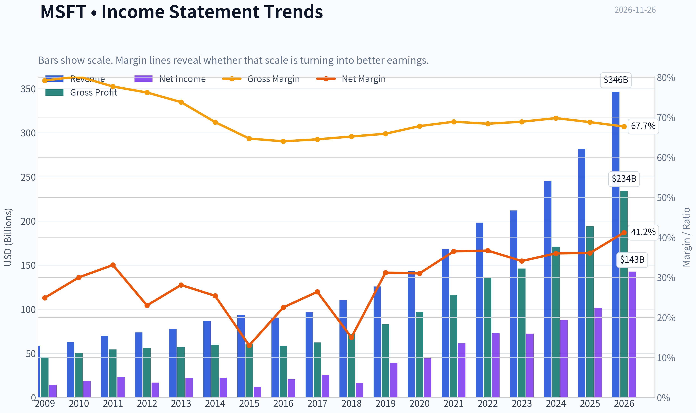

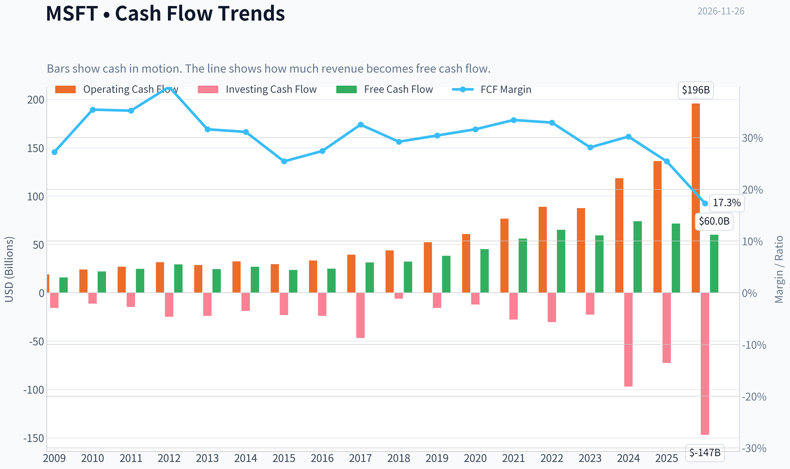

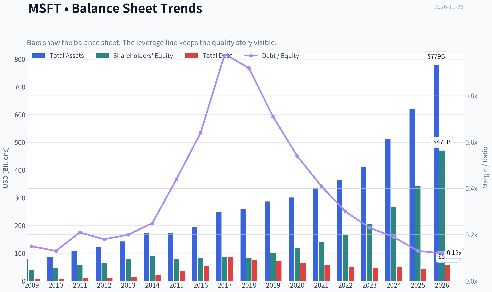

This graph tracks the profitability and return metrics (ROE, ROIC, Margins) of **MSFT** over the past decade, highlighting capital efficiency trends.

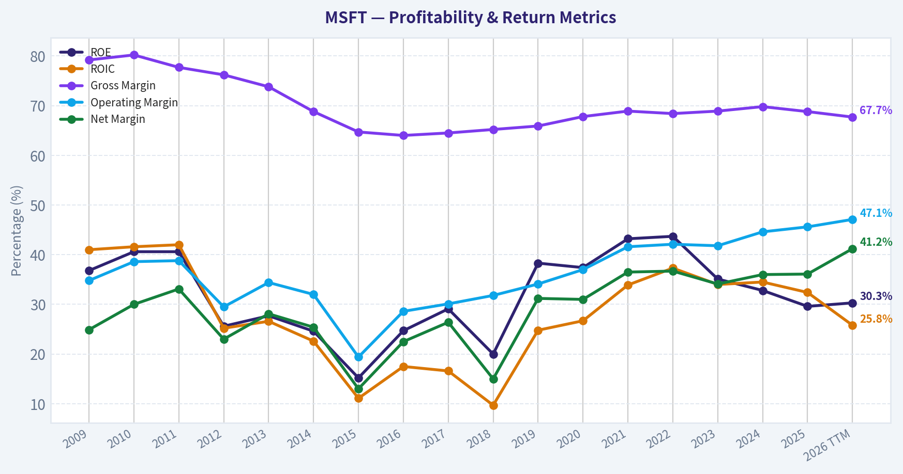

This chart illustrates the financial health of **MSFT** over the last 10 years, mapping cash equivalents and free cash flow against total obligations (Debt).

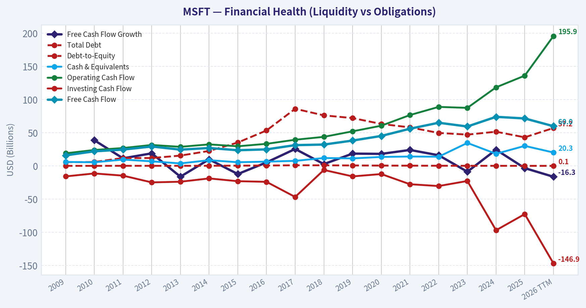

---

### Intrinsic Value Analysis (Buffett)

> *Following Warren Buffett's value investing philosophy: Circle of Competence, Economic Moat, Management Quality, and Margin of Safety.*

#### Intrinsic Value Snapshot

Price is what you pay. Intrinsic value is what the business may be worth based on the cash it can create for owners over time. We show a range, not one magic number.

- Current Price: $489.93
- Value Range (conservative to optimistic across both DCF methods): $107.77 to $323.91

##### Owner Earnings (Buffett Method)
- Net Income: $101,832,000,000.00
- Depreciation & Amortization: $38,534,000,000.00
- Capital Expenditures: $-115,948,000,000.00
- Working Capital Changes: $-4,895,000,000.00
- Owner Earnings: $79,883,178,528.75

##### Intrinsic Value
###### Buffett Method
Uses owner earnings. Stricter, and usually more conservative.
- Conservative: $199.14
- Average: $284.48
- Optimistic: $323.91
- Discount Rate: 8.2%

###### Cash Flow Method
Uses free cash flow. Better for companies spending heavily today to grow tomorrow.
- Conservative: $107.77
- Average: $213.78
- Optimistic: $301.08
- Discount Rate: 9.0%

ANALYST STANCE: **Neutral**

#### Executive Summary

Microsoft is an exceptional business with a broad and durable moat across enterprise software, cloud infrastructure, developer tools, productivity applications, and distribution. Its 67.9% gross margin, 30.2% ROE, 17.8% revenue growth, and strong net cash position indicate a high-quality compounder.

The valuation is the central issue. At approximately $490 per share, Microsoft trades well above the DeepValues Buffett-method intrinsic value of $284.48, implying a negative margin of safety of 72.2%. The business quality supports a premium valuation, but the current price requires materially stronger future cash-flow realization than the base valuation assumes.

#### 1. Factor Scorecard

| Factor | Score | Evidence |
|---|---:|---|
| Circle of competence and simplicity | 4/5 | Revenue comes primarily from software subscriptions, cloud services, enterprise products, and advertising. The business is understandable, although its AI infrastructure economics and cloud competition add complexity. |
| Durable competitive advantage | 5/5 | Strong enterprise switching costs, ecosystem integration, intellectual property, distribution, brand, and cloud scale. Gross margin is 67.9%. |
| Management and capital allocation | 4/5 | Microsoft has demonstrated disciplined reinvestment in cloud, security, data centers, and AI while maintaining strong profitability and balance-sheet flexibility. |
| Industry structure | 4/5 | Enterprise software and cloud are concentrated around a small number of scaled platforms. Competition is intense, but scale and embedded workflows favor Microsoft. |
| Gate 5: quality and solvency floor | Not tripped | The available evidence shows strong profitability, positive net cash, and no indication of deteriorating earnings combined with financial distress. |

**Key Takeaways:** Microsoft scores highly on business quality, moat, and industry structure. The only material weakness in the factor analysis is complexity around AI capital intensity and the long-term economics of cloud investment. The financial distress floor is not tripped.

#### 2. Moat Analysis

| Moat source | Assessment | Specific evidence |
|---|---|---|
| Intangible assets | Very strong | Windows, Office, Azure, GitHub, LinkedIn, and enterprise security products are globally recognized and deeply embedded in business workflows. |
| Switching costs | Very strong | Enterprise data, identity systems, compliance processes, productivity workflows, and developer tools create meaningful migration costs. |
| Cost advantages | Strong | Azure, software distribution, data-center scale, and centralized research and development spread fixed costs across a massive customer base. |
| Network effects | Strong | Azure benefits from developer and enterprise adoption; Microsoft 365, Teams, LinkedIn, GitHub, and marketplace ecosystems reinforce one another. |
| Competitive durability | Wide and widening | AI investment, cloud scale, distribution, and enterprise integration may further strengthen the platform if returns on infrastructure spending remain attractive. |

**Key Takeaways:** Microsoft's moat is not dependent on a single product. Its strongest defenses are switching costs, distribution, ecosystem integration, and scale. The key question is whether AI-related capital spending expands long-term owner earnings or merely raises the cost of defending market share.

#### 3. Management Quality and Capital Allocation

Management appears strong on long-term reinvestment. Microsoft has redirected substantial resources toward cloud computing, cybersecurity, enterprise applications, and artificial intelligence while continuing to grow revenue and maintain high margins.

The company's capital allocation profile is generally favorable:

- Reinvestment is concentrated in areas with large addressable markets.
- Acquisitions such as LinkedIn, GitHub, and Activision Blizzard expanded the ecosystem, though acquisition quality must be judged over long periods.
- The balance sheet provides flexibility without relying on excessive leverage.
- The primary concern is the scale of AI and data-center spending, including the possibility that depreciation and infrastructure requirements rise faster than monetization.

The available data do not establish that management ownership exceeds 20% of personal net worth, so the owner-orientation assessment is based mainly on operating decisions, reinvestment history, and capital discipline.

#### 4. Financial Summary

| Metric | Latest reported figure |
|---|---:|
| Share price | $490 |
| Market capitalization | $3.64 trillion |
| Price-to-earnings ratio | 25.6x |
| Revenue growth, year over year | 17.8% |
| Gross margin | 67.9% |
| Return on equity | 30.2% |
| Owner earnings used in valuation | $88.2 billion |
| After-tax operating income | $133.4 billion |
| Reported operating income | $163.2 billion |
| Depreciation and amortization | $42.5 billion |
| Reported capital expenditures | $135.9 billion |
| Valuation capex charge | $87.8 billion |
| Net cash | $29.0 billion |
| Cash and marketable securities | $64.5 billion |
| Debt | $35.5 billion |
| Shares outstanding used in valuation | 7.446 billion |
| Free-cash-flow yield | 1.8% |
| Current ratio | 1.23x |

**Key Takeaways:** Microsoft combines rapid growth with unusually high gross profitability and a strong balance sheet. The main tension is between very large capital expenditures and the lower owner-earnings figure after a normalized capex charge. The 1.8% free-cash-flow yield signals that the market already assigns substantial value to future growth.

#### 5. Owner Earnings Calculation

| Owner-earnings component | Amount |
|---|---:|
| After-tax operating income | $133.4B |
| Add: depreciation and amortization | $42.5B |
| Less: normalized capital-expenditure charge | $(87.8B) |
| Less: working-capital investment | $0.0B |
| Estimated owner earnings | **$88.2B** |

Owner earnings per share are approximately **$11.85**, based on 7.446 billion shares.

**Key Takeaways:** The valuation framework treats owner earnings as substantially below operating income because Microsoft must reinvest heavily in data centers and related infrastructure. This adjustment is important: reported earnings alone make the valuation appear more attractive than a cash-flow measure that recognizes the ongoing cost of maintaining and expanding the platform.

#### 6. Three-Scenario DCF Cross-Check

These scenarios are secondary valuation checks. The DeepValues application value remains the primary intrinsic-value reference.

| Scenario | Key assumptions | Estimated value per share |
|---|---|---:|
| A. No growth | $88.2B owner earnings, 10% discount rate, no growth | $118 |
| B. GDP growth | 3% perpetual growth, 10% discount rate | $174 |
| C. Historical-growth cross-check | 7.5% growth for 10 years, 2.5% terminal growth, 10% discount rate | $223 |
| DeepValues Buffett-method value | 10% growth fading to 2.5%, 8.2% discount rate, $29B net cash | **$284** |

**Key Takeaways:** Even a relatively favorable growth scenario produces a value below the current price. The DeepValues application's more optimistic assumptions produce a higher intrinsic value of $284.48, but that still represents a substantial gap from approximately $490.

#### 7. Intrinsic Value and Margin of Safety

| Valuation reference | Value per share |
|---|---:|
| DeepValues conservative case | $199.14 |
| DeepValues base intrinsic value | **$284.48** |
| DeepValues optimistic case | $323.91 |
| Current price | $490.00 |
| Margin of safety versus base value | **-72.2%** |

The DeepValues base valuation uses:

- Owner earnings: $88.2 billion
- Growth: 10% initially, fading to 2.5% terminal growth
- Discount rate: 8.2%
- Net cash: $29.0 billion
- Shares: 7.446 billion

The current market price is approximately 1.72 times the stated base intrinsic value. For the current price to be justified, Microsoft would need stronger owner-earnings growth, a lower long-term discount rate, higher AI monetization, lower normalized infrastructure requirements, or some combination of these factors.

**Key Takeaways:** Microsoft qualifies as a wonderful business, but the quoted valuation does not provide a conventional margin of safety against the stated intrinsic value. The valuation depends heavily on successful monetization of AI and continued high returns on massive infrastructure investment.

#### 8. Final Buffett Scorecard

| Criterion | Weight | Score | Weighted contribution |
|---|---:|---:|---:|
| Moat width and durability | 25% | 5/5 | 1.25 |
| Valuation and margin of safety | 20% | 1/5 | 0.20 |
| Capital returns versus WACC | 15% | 4/5 | 0.60 |
| Business understanding and predictability | 12% | 4/5 | 0.48 |
| Management and capital allocation | 12% | 4/5 | 0.48 |
| Reinvestment runway | 8% | 5/5 | 0.40 |
| Balance-sheet strength | 4% | 4/5 | 0.16 |
| Industry structure | 4% | 4/5 | 0.16 |
| **Total** | **100%** |  | **3.73/5** |

**Key Takeaways:** Microsoft's operating quality would support an Advocate classification if valuation were reasonable. The valuation score of 1 out of 5 materially reduces the total score, resulting in a Watch classification despite excellent moat, management, reinvestment runway, and balance-sheet characteristics.

#### 9. Investment Stance

**ANALYST STANCE: Neutral**

**Conviction: High on business quality; high on valuation concern.**

Microsoft is a wide-moat, high-return, asset-light-to-infrastructure hybrid compounder with an unusually strong strategic position. The evidence supports confidence in the business, but not in the current valuation relative to the stated intrinsic value of $284.48 per share.

The central analytical variable is whether AI and cloud investments generate owner earnings materially above the $88.2 billion valuation input. Until the cash returns from those investments are demonstrated at sufficient scale, the price reflects demanding expectations rather than an adequate margin of safety.
#### Valuation Bridge

This bridge places the current market price beside each intrinsic value lens so readers can see whether upside depends on one method or shows up across several methods.

| Scenario | Intrinsic Value / Share |
| --- | ---: |
| Buffett Method | $284.48 |
| Cash Flow Method | $213.78 |
| Damodaran Method | $249.94 |
| Current Price | $489.93 |

#### Key Takeaways

If one method is far above the others, the upside case depends on a specific modelling assumption. When several methods cluster together, the valuation story is more robust.

#### Valuation Visuals

This comparison chart from *Latest Earnings Snapshot* stacks current figures against historical benchmarks for **MSFT**, making it easy to see where the company trades relative to its own averages.

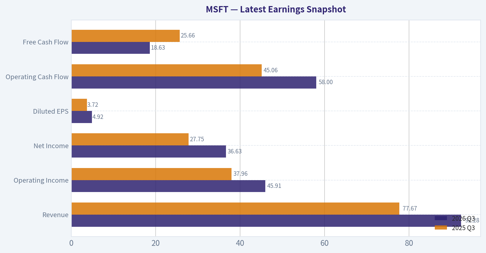

This comparison chart from *Current Versus Historical Averages* stacks current figures against historical benchmarks for **MSFT**, making it easy to see where the company trades relative to its own averages.

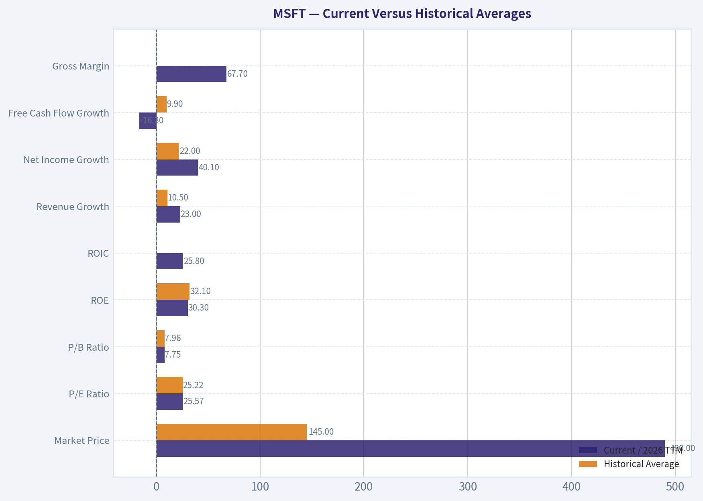

This comparison chart from *Buffett-Style Owner Earnings DCF* stacks current figures against historical benchmarks for **MSFT**, making it easy to see where the company trades relative to its own averages.

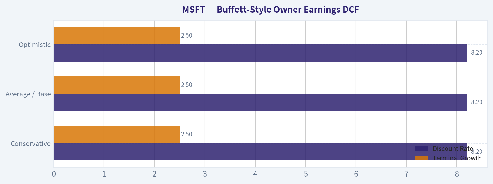

This comparison chart from *Financial Summary* stacks current figures against historical benchmarks for **MSFT**, making it easy to see where the company trades relative to its own averages.

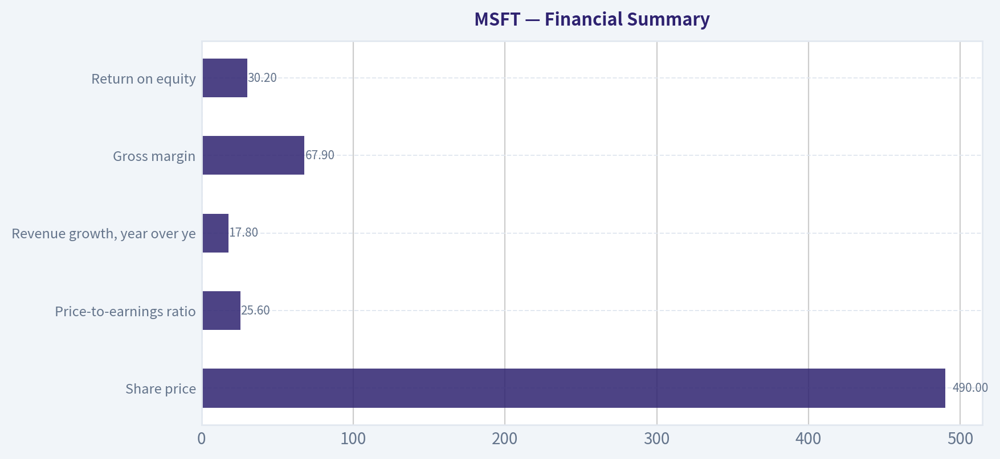

This comparison chart from *Owner Earnings Calculation* stacks current figures against historical benchmarks for **MSFT**, making it easy to see where the company trades relative to its own averages.

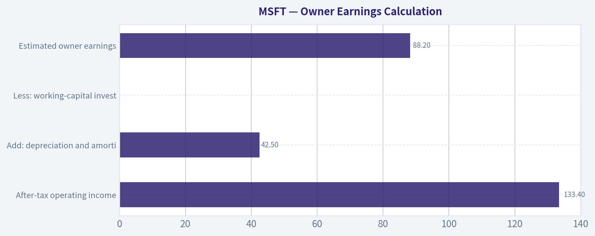

The following chart maps the **MSFT** Owner Earnings DCF valuation scenarios (Conservative, Average, Optimistic) to visually represent the margin of safety based on intrinsic value calculations.

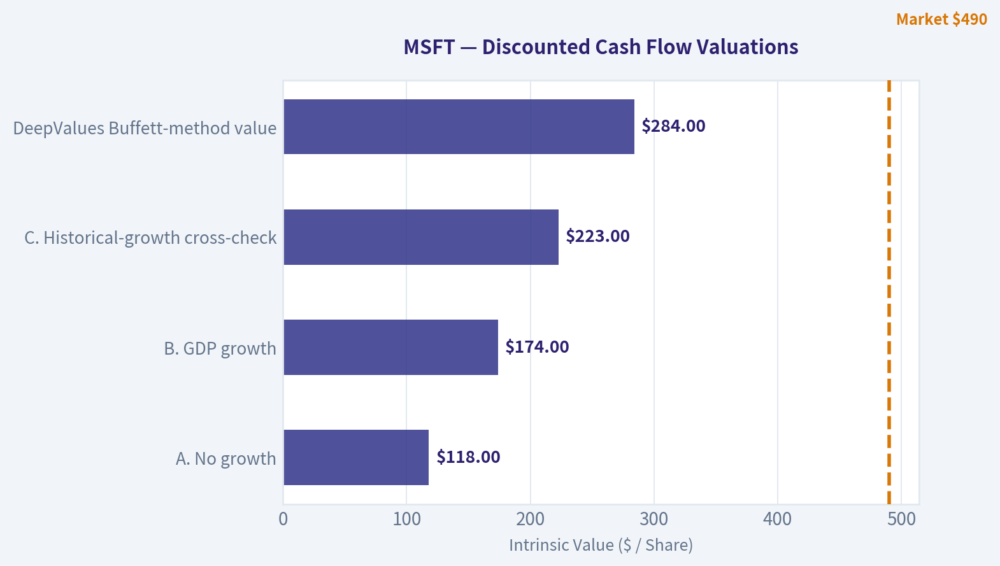

---

### Trend & Growth Analysis (Lynch/Druckenmiller/Fisher)

> *Following Peter Lynch's GARP, Stanley Druckenmiller's macro-aware approach, and Philip Fisher's scuttlebutt methodology.*

ANALYST STANCE: **Neutral**

#### Executive View

Microsoft is a high-quality, secular-growth compounder benefiting from cloud computing, enterprise software, cybersecurity, and artificial intelligence. Revenue growth of approximately 18%, a 30% return on equity, and strong operating margins indicate durable business strength.

However, the valuation embeds aggressive expectations while capital expenditure is reducing free-cash-flow conversion. The headline intrinsic value is **$284.48**, versus a market price near **$490**, implying that the evidence does not support the current valuation without sustained AI-driven acceleration and roughly 20% annual owner-earnings growth for an extended period.

#### 1. Lynch Classification

**Fast Grower transitioning toward Stalwart characteristics.**

Microsoft's recent revenue growth is firmly in fast-grower territory, but its enormous scale means the company cannot be evaluated like a small emerging growth company. The business has multiple growth engines rather than dependence on a single product, which improves durability but limits the probability of a classic ten-bagger from the current market capitalization.

#### 2. The Story in Three Bullets

- Microsoft monetizes enterprise technology spending through Azure, Microsoft 365, Dynamics, cybersecurity, gaming, and AI tools.
- AI is expanding the addressable market for cloud infrastructure, software subscriptions, developer tools, and enterprise automation.
- The central debate is whether AI revenue growth and pricing power will exceed the substantial infrastructure investment required to support it.

#### 3. TAM and Runway Analysis

| Area | Current evidence | Long-run implication |
|---|---:|---|
| Revenue base | Approximately $346B TTM | Very large installed base |
| Cloud and AI | Azure, data centers, Copilots, developer ecosystem | Expanding secular opportunity |
| Enterprise software | Microsoft 365, Dynamics, security, Windows | Recurring and cross-sell-oriented |
| 10x revenue test | $3.46T revenue would be required for 10x | Not plausible within the currently defined software market alone |
| TAM quality | Expanding, but competitive and capital-intensive | Long runway, lower ten-bagger probability at current scale |

**Key Takeaways:** Microsoft has a substantial runway because cloud, AI, cybersecurity, and enterprise automation markets are still expanding. However, a tenfold revenue outcome would require either major market creation or a much broader definition of the company's addressable markets. The runway supports continued compounding, but Microsoft's existing scale makes a ten-bagger from today's valuation a demanding outcome.

#### 4. Revenue Growth Trend

| Period | Revenue growth |
|---|---:|
| 3-year revenue CAGR | 16.1% |
| 5-year revenue CAGR | 14.6% |
| Latest reported YoY growth | 17.8% |
| 2025 annual growth | 14.9% |
| 2026 TTM growth in supplied series | 23.0% |
| Latest net-income growth | 31.3% |
| Latest FCF growth | -6.5% |

**Key Takeaways:** Revenue growth has accelerated relative to the five-year average, and earnings growth is stronger than revenue growth. The important offset is falling free cash flow, reflecting elevated AI infrastructure investment. This is a quality growth pattern operationally, but not yet a clean cash-flow inflection.

#### 5. Unit Economics and Operating Efficiency

| Metric | Microsoft evidence | Assessment |
|---|---:|---|
| Gross margin | 67.9% | Excellent, though slightly below historical highs |
| Operating margin | 46.8% | Exceptional |
| Net margin | 40.3% | Exceptional |
| ROE | 30.2% | Strong |
| Net debt | Approximately negative $36B | Balance-sheet strength |
| NRR | Not disclosed for the consolidated company | Not directly applicable |
| LTV/CAC | Not disclosed | Cannot be calculated reliably |
| Rule of 40 | Revenue growth 17.8% + FCF margin approximately 17.3% = 35.1% | Acceptable, below best-in-class |

**Key Takeaways:** Microsoft has outstanding profitability and balance-sheet quality. The Rule of 40 result is acceptable but not elite because infrastructure spending has compressed free-cash-flow margins. Segment-level cloud retention and customer economics would be more informative than consolidated company data.

#### 6. Inflection Point Assessment

| Inflection area | Evidence | Status |
|---|---|---|
| Product cycle | Copilot and AI services expanding across Microsoft's ecosystem | Positive, still developing |
| TAM expansion | AI increases demand for cloud compute and enterprise software | Positive |
| Market share | Azure remains a major cloud platform with broad enterprise distribution | Positive, but competitive |
| Margin inflection | Operating margin is very high | Positive |
| Cash-flow inflection | FCF growth is negative while capex rises sharply | Unconfirmed |
| Competitive landscape | Strong ecosystem, but hyperscaler and AI competition remains intense | Mixed |

**Key Takeaways:** The strongest inflection is TAM expansion through AI and the distribution advantage created by Microsoft's enterprise ecosystem. The unresolved issue is whether AI monetization will outpace the cost of data-center expansion. Confirmation would require sustained revenue acceleration alongside recovering free-cash-flow growth.

#### 7. Macro Setup

| Macro factor | Assessment | Effect on Microsoft |
|---|---|---|
| Long-term secular trend | AI, cloud, cybersecurity, enterprise digitization | Strong tailwind |
| Interest rates | 30-year Treasury around 5.24% in the supplied valuation framework | Valuation headwind |
| Economic cycle | Growth-sensitive technology exposure | Sensitive to enterprise spending |
| Capital intensity | AI infrastructure requires substantial investment | Near-term cash-flow pressure |
| Balance sheet | Strong liquidity and manageable leverage | Risk mitigant |

**Key Takeaways:** The secular macro backdrop is favorable, especially for AI and cloud adoption. The discount-rate environment is less supportive for a high-duration technology asset, while elevated capital expenditure creates a second near-term headwind. Microsoft's balance sheet materially reduces financial risk but does not eliminate valuation risk.

#### 8. Fisher's 15-Point Score

| Fisher criterion | Score / 5 | Rationale |
|---|---:|---|
| Market potential | 5 | Cloud, AI, security, and enterprise software |
| New-product determination | 5 | Strong AI and platform expansion |
| R&D effectiveness | 5 | Deep technical ecosystem and distribution |
| Sales organization | 5 | Exceptional enterprise reach |
| Profit margins | 5 | Very high margins |
| Margin direction | 4 | Strong operating leverage, FCF under pressure |
| Labor relations | 3 | Limited evidence in supplied data |
| Executive relations | 4 | Generally strong organizational depth |
| Management depth | 5 | Broad leadership and technical bench |
| Cost analysis/accounting | 4 | High-quality reporting, complex AI investment cycle |
| Outstanding aspects | 5 | Ecosystem, switching costs, network effects |
| Long-range outlook | 5 | Strong secular demand |
| Dilution | 4 | No major dilution concern indicated |
| Management candor | 4 | Generally credible communication |
| Management integrity | 4 | No major issue identified in supplied data |
| **Total** | **66 / 75** | **Outstanding** |

**Key Takeaways:** Microsoft scores in Fisher's outstanding range. Its strongest attributes are market potential, R&D, enterprise distribution, ecosystem effects, and management depth. The principal deduction relates to uncertainty around the profitability and cash-return profile of the AI infrastructure cycle.

#### 9. Valuation Analysis

| Valuation measure | Result | Interpretation |
|---|---:|---|
| Current P/E | 25.57x | Reasonable for a mature quality company, but not inexpensive |
| Forward P/E | 20.24x | Reflects expected earnings growth |
| PEG ratio | 1.56 | Fair rather than clearly attractive under Lynch's framework |
| Price-to-sales | 10.50x | Premium multiple for a company of this scale |
| FCF yield | 1.8% | Low current cash-flow yield |
| Headline intrinsic value | $284.48 | Below current price |
| Intrinsic-value range | $199.14-$323.91 | Wide downside sensitivity |
| Current market price | Approximately $490 | Well above the headline intrinsic value |

**Key Takeaways:** Conventional earnings valuation is not extreme for a dominant technology company, but the free-cash-flow yield and price-to-sales ratio show that expectations remain elevated. The PEG ratio of 1.56 indicates fair valuation rather than a classic GARP opportunity. The supplied intrinsic-value framework produces a substantial gap between estimated value and market price.

#### 10. Valuation Sensitivity

| Scenario | Key assumptions | Implied value |
|---|---|---:|
| Conservative owner earnings | Lower growth and higher sensitivity to capex | $199 |
| Base owner earnings | 10% initial growth fading toward 2.5% terminal growth | $284 |
| Optimistic owner earnings | Stronger monetization and cash-flow conversion | $324 |
| Damodaran FCFF base cross-check | Alternative margin and reinvestment assumptions | $250 |
| FCF DCF base cross-check | Cash-flow-oriented framework | $214 |
| Market-implied case | Approximately 19.6% annual owner-earnings growth for 10 years | Approximately $490 current price |

**Key Takeaways:** The valuation is highly sensitive to AI monetization, terminal growth, discount rates, and capital intensity. Even the optimistic owner-earnings case in the supplied framework remains below the current market price. The market appears to require prolonged near-20% owner-earnings growth, making execution and cash-flow conversion critical.

#### 11. Growth Investor Scorecard

| Criterion | Weight | Score / 5 | Weighted contribution |
|---|---:|---:|---:|
| The Story | 10% | 4.8 | 0.48 |
| TAM and runway | 20% | 4.3 | 0.86 |
| Revenue growth | 20% | 4.2 | 0.84 |
| Unit economics | 15% | 3.8 | 0.57 |
| Competitive position | 10% | 4.8 | 0.48 |
| Management quality | 10% | 4.5 | 0.45 |
| Macro setup | 5% | 3.2 | 0.16 |
| Profitability path | 5% | 3.8 | 0.19 |
| Valuation | 5% | 2.0 | 0.10 |
| **Total** | **100%** |  | **4.13 / 5.00** |

**Key Takeaways:** Microsoft scores as a high-quality growth compounder with a strong strategic position and excellent long-term economics. The valuation score is the clear constraint, preventing a higher-conviction classification despite strong business fundamentals. The overall score supports monitoring the company for evidence that AI growth is translating into durable free-cash-flow acceleration.

#### 12. Key Catalysts and Risks

| Catalysts | Risks |
|---|---|
| Azure AI demand exceeds expectations | AI infrastructure spending remains structurally elevated |
| Copilot adoption expands across enterprise seats | AI monetization fails to cover incremental costs |
| Azure growth accelerates | Cloud competition pressures pricing |
| Free-cash-flow growth reaccelerates | High interest rates compress valuation multiples |
| Security and Dynamics cross-selling improves | Enterprise technology budgets weaken |
| Operating leverage resumes | Regulatory and antitrust pressure increases |

#### Conclusion

Microsoft is an **outstanding business with a favorable secular backdrop**, strong competitive advantages, and an excellent Fisher score. Revenue growth is healthy and has potentially accelerated through AI, but the crucial cash-flow inflection remains unconfirmed.

At approximately **$490**, valuation requires sustained and unusually strong owner-earnings growth. The supplied intrinsic-value estimate of **$284.48**, with a range of **$199 to $324**, indicates that the market is pricing in a highly successful AI monetization scenario. The appropriate research stance is therefore **Neutral**: the business quality is compelling, while the valuation and free-cash-flow burden require further confirmation.

---

### Market Technical Analysis

ANALYST STANCE: **Neutral**

#### Microsoft Corporation - Technical Market Report

**Security:** MSFT, Microsoft Corporation, Nasdaq
**Data through:** November 25, 2026, the latest available trading session. November 26 was not a trading day.
**Method:** Price action and eight complementary indicators: 50-day SMA, 200-day SMA, MACD, RSI, Bollinger upper and lower bands, ATR, and VWMA.

#### Price Structure and Trend

MSFT closed at **$489.93** on November 25, down from **$496.13** on November 24 and **$520.90** on October 30. The recent decline has been characterized by lower highs and lower lows, including a drop from the November 4 intraday high of **$558.07** to a November 20 low of **$481.03**.

The broader trend remains more constructive than the recent momentum. The close is approximately **10.5% above the 200-day SMA of $443.23**, indicating that the long-term price structure has not broken down. However, the close is roughly **5.5% below the 50-day SMA of $518.64**, showing that the intermediate-term trend has weakened materially.

The separation between the two moving averages remains positive: the 50-day SMA is approximately **$75.41 above** the 200-day SMA. That configuration still reflects a long-term bullish structure, but the declining price relative to the 50-day average indicates a meaningful correction within that structure rather than a healthy short-term advance.

#### Momentum Signals

MACD has deteriorated sharply. It declined from **+6.63 on October 27** to **-8.35 on November 25**, crossing below zero and continuing lower. This is a clear loss of short- and medium-term momentum. The sequence suggests that the recent weakness is not merely a one-day fluctuation; selling pressure has persisted across several weeks.

RSI stood at **38.99**, below the neutral 50 level but above the conventional oversold threshold of 30. This indicates weak momentum without showing an extreme oversold reading. RSI did briefly reach **35.02 on November 20**, but the subsequent rebound was limited, implying that downside momentum has moderated somewhat without producing a confirmed momentum reversal.

#### Volatility and Price Bands

The Bollinger lower band fell from approximately **$510.50 on November 6** to **$479.04 on November 25**. This sharp downward movement in the lower band reflects expanding volatility and a weakening recent price distribution. The November 25 close of $489.93 was only about **$10.89 above** the lower band and substantially below the upper band of **$553.72**.

Price remaining near the lower half of the Bollinger range is consistent with continued downside pressure. At the same time, the close was not decisively below the lower band, so the data do not establish an unusually extended downside condition based on this indicator alone.

ATR increased from **$10.92 on October 27** to **$16.86 on November 25**. Current average daily trading range is therefore elevated, at roughly **3.4% of the share price**. This rise confirms that the recent decline has been accompanied by materially greater price variability, making short-term readings less stable and increasing the importance of confirmation across multiple indicators.

#### Volume-Weighted Price Context

VWMA declined from **$531.78 on October 27** to **$511.67 on November 25**. The latest close is approximately **4.2% below VWMA**, indicating that recent volume has been concentrated at prices meaningfully above the current market level.

This gap is important because it shows that the weakness is not occurring around a stable volume-weighted equilibrium. Instead, the volume-weighted reference price has also been trending lower, suggesting that recent trading activity has reinforced the intermediate-term deterioration. The decline in VWMA has slowed compared with the sharpest portion of the selloff, but it has not yet turned upward.

#### Integrated Interpretation

The indicators present a two-layered picture:

1. **Long-term structure remains above the 200-day SMA.** This prevents the data from being classified as a confirmed long-term bearish breakdown.
2. **Intermediate and short-term conditions are clearly weak.** Price is below both VWMA and the 50-day SMA, MACD is negative and declining, RSI is below neutral, and volatility is elevated.
3. **The market is weak but not technically capitulated.** RSI remains above 30, and the close remains above the lower Bollinger band. These conditions suggest pressure and vulnerability rather than an unambiguous exhaustion signal.
4. **The evidence is unfavorable for valuation support based solely on recent technical behavior.** A price near $490 is being accompanied by negative MACD, a declining VWMA, and a close below the 50-day trend reference. The long-term average provides some structural support to the valuation framework, but the recent momentum profile does not yet validate a strong near-term re-rating.

The most important technical question is whether MSFT can stabilize above the lower Bollinger region while recovering toward the 50-day SMA, or whether the decline continues with the price remaining below volume-weighted and intermediate-term trend measures. Until momentum and volume-weighted conditions improve together, the evidence remains mixed across horizons but decisively weak in the near term.

| Indicator / Measure | Latest Reading | Recent Direction | Interpretation |
|---|---:|---|---|
| Closing price | **$489.93** on Nov. 25 | Lower than $520.90 on Oct. 30 | Recent lower-high/lower-low pattern |
| 50-day SMA | **$518.64** | Rising slowly, while price declined below it | Intermediate trend pressure |
| 200-day SMA | **$443.23** | Gradually rising | Long-term structure remains above its benchmark |
| MACD | **-8.35** | Fell from +6.63 on Oct. 27 | Strong deterioration in momentum |
| RSI | **38.99** | Below neutral 50; above 30 | Weak momentum, not conventionally oversold |
| Bollinger upper band | **$553.72** | Elevated relative to price | Significant distance from recent volatility ceiling |
| Bollinger lower band | **$479.04** | Declined sharply | Price is near the lower volatility boundary |
| ATR | **$16.86** | Increased from $10.92 | Elevated daily volatility |
| VWMA | **$511.67** | Declining | Volume-weighted trading center remains above price |
| Overall technical stance | **Watch** | Long-term strength versus near-term weakness | Evidence does not currently support a strong near-term valuation re-rating |

**Key Takeaways:** MSFT remains above its rising 200-day SMA, so the long-term trend has not been technically invalidated. However, price is below the 50-day SMA and VWMA, MACD is deeply negative, RSI is weak, and ATR shows elevated volatility. The evidence supports a watch stance: the long-term structure is resilient, but recent price action does not yet provide strong technical support for a near-term valuation expansion.

---

### Options Market Analysis

> *Reading options flow - put/call ratios, IV skew, and unusual activity - to gauge institutional positioning and event-driven risk.*

ANALYST STANCE: **Neutral**

#### MSFT Options Flow Snapshot

Data is dated November 26, 2026. The near-term chain covers expirations from November 27 through December 2. A major limitation is that reported open interest is zero across all listed expirations, which makes standard open-interest analysis and fresh-flow identification unreliable.

| Expiration | Approx. Time to Expiry | Call Volume | Put Volume | Volume Put/Call Ratio | Call ATM IV | Put ATM IV |
|---|---:|---:|---:|---:|---:|---:|
| Nov. 27, 2026 | 1 day | 32,721 | 31,226 | 0.95 | 5.4% | 5.4% |
| Nov. 30, 2026 | 4 days | 4,498 | 8,788 | 1.95 | 2.7% | 2.7% |
| Dec. 2, 2026 | 6 days | 1,643 | 1,592 | 0.97 | 2.2% | 2.1% |
| **Combined** | Near term | **38,862** | **41,606** | **1.07** | - | - |

**Key Takeaways:** Near-term put volume modestly exceeds call volume, with a combined volume ratio of 1.07 versus the approximately 0.7 neutral reference level. The imbalance is concentrated in the November 30 expiration, where put volume is nearly twice call volume. However, zero reported open interest prevents confirmation that this reflects new bearish exposure rather than closing trades, hedges, or a data-quality issue.

#### Put/Call Ratio Analysis

The volume-based put/call ratio of 1.07 indicates a modestly defensive near-term tone. It is meaningfully above the historical neutral reference of approximately 0.7, but not extreme enough by itself to establish strong bearish conviction.

The open-interest put/call ratio is unavailable because both call and put open interest are reported as zero for every expiration. Consequently, there is no reliable evidence of persistent multi-day positioning or of a meaningful change in open-interest-based sentiment.

#### Implied Volatility and Skew

| Expiration | ATM Call IV | ATM Put IV | Put-Call IV Difference | Interpretation |
|---|---:|---:|---:|---|
| Nov. 27 | 5.4% | 5.4% | 0.0 percentage points | Flat ATM pricing |
| Nov. 30 | 2.7% | 2.7% | 0.0 percentage points | Flat ATM pricing |
| Dec. 2 | 2.2% | 2.1% | -0.1 percentage points | Slight call-side premium |

**Key Takeaways:** At-the-money implied volatility is reported as very low and nearly identical for calls and puts. The available data does not show a meaningful put skew or call skew. These unusually low IV readings, combined with zero open interest, may indicate incomplete or unreliable option-chain data rather than genuinely minimal event risk.

The tool does not provide out-of-the-money volatility by strike, so a full put-versus-call skew assessment is not possible. No catalyst is identified in the supplied data; therefore, the report cannot determine whether IV is elevated ahead of earnings, a product event, or a macro announcement.

#### Unusual Options Activity

No contracts meet the supplied unusual-activity threshold of volume greater than five times open interest. This result should be treated cautiously because open interest is reported as zero throughout the chain.

| Finding | Assessment |
|---|---|
| Contracts with volume greater than 5x OI | None reported |
| Fresh directional bets | Cannot be confirmed |
| Smart-money versus retail activity | Not determinable |
| Strike-level moneyness | Not available because no unusual contracts were returned |
| Current underlying price | Not supplied |

**Key Takeaways:** There are no tool-identified unusual contracts. Because open interest is zero across the dataset, the absence of flagged contracts is more likely a limitation of the data than proof that institutional activity is absent. Strike-level interpretation, including ITM, ATM, or OTM classification, cannot be performed from the returned results.

#### Open Interest Concentration and Gamma Levels

| Metric | Result |
|---|---|
| Highest call open interest | None reported |
| Highest put open interest | None reported |
| Dominant expiration | Cannot determine from OI |
| Max-pain calculation | Not available |
| Gamma walls | Cannot identify |
| Pinning or gravitational strikes | Cannot identify |

**Key Takeaways:** No open-interest concentration is visible, so there are no defensible max-pain, pinning, or gamma-wall conclusions. The November 27 expiration has the largest trading volume, but volume alone does not establish a durable support or resistance level.

#### Overall Options Sentiment

**Overall signal: NEUTRAL, with a defensive bias and low confidence.**

The primary directional clue is the 1.07 near-term volume put/call ratio, particularly the heavy put volume in the November 30 expiry. That suggests some near-term hedging or bearish speculation, but the evidence is insufficient to distinguish new bearish bets from closing activity or protective transactions.

The flat call-put ATM IV relationship provides no meaningful directional skew, while the extremely low reported IV and zero open interest materially reduce data reliability. As a result, the options market does not provide strong confirmation for either bullish or bearish valuation implications for MSFT at this time.

#### Summary

| Category | Assessment |
|---|---|
| Put/Call Ratio | Volume ratio 1.07, above the ~0.7 neutral baseline; OI ratio unavailable |
| IV Level | Reported near-term ATM IV is very low, ranging from 2.2% to 5.4%; reliability is questionable |
| Skew Direction | Essentially flat; no meaningful put or call skew available |
| Unusual Activity | None reported; zero OI makes the result inconclusive |
| Overall Signal | **NEUTRAL**, with a modest defensive bias and low confidence |

**Key Takeaways:** MSFT's near-term options flow leans modestly defensive because put volume exceeds call volume, but there is no reliable open-interest evidence of sustained bearish positioning. Flat skew and missing strike-level data further weaken the directional signal. The evidence supports a neutral options read rather than a strong directional conclusion.

---

## Research Team Commentary

> *The Research Manager synthesizes the Bull vs Bear debate into action-free commentary. This is a pre-risk view, not the final stance.*

Core Takeaway: Microsoft is a wonderful business, but the evidence provided does not establish that $490 offers the roughly 10-15% discount to intrinsic value appropriate even for a wide-moat compounder. Its ecosystem, recurring revenue, balance-sheet strength, and 30.8% ROIC support a premium valuation. The unresolved issue is whether the current AI investment cycle can preserve those exceptional economics after accounting for data-center spending, depreciation, and serving costs. At 25.57 times earnings, the valuation appears plausible rather than clearly compelling or clearly excessive.

The strongest bull argument is Microsoft's integrated enterprise ecosystem. Microsoft 365, Azure, identity, security, GitHub, Dynamics, and LinkedIn reinforce one another through switching costs, distribution, shared data, compliance, and established procurement relationships. This is much more durable than a moat based on a single application. Microsoft can monetize AI through infrastructure, developer tools, workplace software, security, and business automation, while its existing customer relationships reduce customer-acquisition costs. Gross margin of 67.9%, ROE of 30.2%, and ROIC of 30.8% confirm that the historical franchise has produced excellent economics.

Management also deserves credit. Satya Nadella repositioned Microsoft around cloud services and subscriptions, and acquisitions such as GitHub and LinkedIn broadened the ecosystem in strategically coherent ways. The balance sheet provides room to invest through technology cycles without creating a solvency concern. Near-term technical weakness does not alter these conclusions: price below the 50-day average, negative MACD, and elevated volatility describe sentiment rather than long-term earning power. The reported options data are similarly inconclusive because zero open interest makes flow interpretation unreliable.

The strongest bear argument is not that Microsoft lacks a moat. It is that historical returns may not transfer to the next dollar invested. Mature software licenses have extremely attractive incremental economics, whereas AI requires accelerators, networking, electricity, cooling, model development, capacity reserves, and recurring infrastructure replacement. AI revenue can grow rapidly while incremental returns and free-cash-flow conversion deteriorate. Distribution improves Microsoft's odds, but it does not prove that customers will pay enough to cover the full economic cost of AI services.

Competition also matters differently across the portfolio. Switching costs are formidable in productivity, identity, and integrated enterprise workflows, but less absolute in cloud compute, where large customers can use multiple providers and negotiate on price and performance. AI may strengthen Microsoft's stack, but open-source models, competing clouds, and increasingly interchangeable model capabilities could direct more of the economic profit toward semiconductor suppliers, infrastructure providers, or customers.

Valuation is therefore the deciding uncertainty. At $490 and 25.57 times earnings, implied earnings per share are about $19.16, although the data do not specify whether the multiple is trailing or forward. The corresponding earnings yield is roughly 3.9%. That is defensible if Microsoft compounds earnings around the low double digits for an extended period, maintains strong cash conversion, and continues earning returns well above its cost of capital. It becomes much less forgiving if growth settles in the mid-single digits or if capital expenditure persistently outruns monetization.

This does not look like a valuation that necessarily requires an impossible AI outcome. Equally, the supplied evidence does not demonstrate a discount to intrinsic value because there is no DeepValues appraisal, complete free-cash-flow history, net debt adjustment, or explicit DCF. A P/E ratio alone cannot capture the growing gap that may emerge between accounting earnings and free cash flow during a capital-intensive buildout. The market appears to assume continued cloud growth, meaningful AI commercialization, resilient margins, and satisfactory returns on new infrastructure. Those assumptions are credible, but not yet conservative enough to establish a clear margin of safety.

Rationale: From a Buffett-style perspective, business quality is not in dispute. Microsoft has the durability, pricing power, reinvestment runway, financial strength, and management record expected of an elite compounder. The correct analytical discipline is not to demand a distressed multiple from such a company. It is to separate Microsoft's excellent historical ROIC from the still-unproven incremental ROIC of its AI investments.

The most important lesson from analogous analytical mistakes is to avoid equating strategic importance with shareholder economics. AI can be necessary for defending Microsoft's franchise and still generate lower returns than legacy software. Likewise, recurring revenue does not automatically mean recurring margins, and a strategically sensible acquisition is not proven successful until it produces adequate cash returns. Conversely, it would also be a mistake to let short-term price weakness or rising capital expenditures obscure a durable ecosystem that may monetize AI better than most competitors.

Monitoring Plan: Over the next one to four quarters, the first priority is the relationship between capital expenditure, depreciation, and monetization. The thesis strengthens if Azure and AI-related revenue, operating profit, and free cash flow begin growing in proportion to infrastructure investment. It weakens if capital expenditure and depreciation continue rising materially faster than revenue while free-cash-flow conversion deteriorates.

Second, watch Azure growth after adjusting for currency and capacity constraints, along with management's commentary on how much growth comes from durable production workloads rather than experimentation. Stable or improving cloud margins alongside AI growth would be particularly persuasive. Slowing growth combined with margin pressure would suggest weaker incremental economics.

Third, monitor Microsoft 365 Copilot adoption, paid-seat expansion, renewal rates, and average revenue per user. Evidence that customers accept distinct AI pricing without offsetting seat reductions or broad discounting would validate the distribution advantage. Heavy bundling, limited paid adoption, or high serving costs would weaken the pricing-power argument.

Fourth, compare operating cash flow and free cash flow with reported earnings. A temporary divergence during capacity construction is understandable; a persistent divergence would indicate that the business is becoming structurally more capital-intensive than the earnings multiple suggests.

Finally, watch remaining performance obligations, commercial bookings, security performance, regulatory developments, and acquisition economics. Durable contract growth, cross-selling, and disciplined integration would support the moat. A major cybersecurity failure, restrictions on bundling, weakening bookings, or limited returns from acquired assets would increase the required valuation discount.

Overall, the bull case wins on franchise quality, while the bear case retains the advantage on valuation proof and incremental AI economics. Microsoft may justify its premium, but the supplied record does not yet demonstrate the quality-scaled margin of safety required to move beyond observation.

Neutral

---

## Value Investing Team Commentary

> *The Investor translates the research view into an investment thesis before risk review. This is still not the final stance.*

Microsoft remains an unusually high-quality business, but the valuation evidence is less complete than the franchise evidence. Its ecosystem spans productivity software, cloud infrastructure, identity, cybersecurity, developer tools, business applications, professional networking, and gaming. These businesses reinforce one another through common procurement relationships, data flows, technical integration, and switching costs. That breadth makes Microsoft less dependent on any single product cycle and gives it multiple channels through which to monetize enterprise technology spending.

The historical economics are excellent. A 67.9% gross margin, 30.2% ROE, and 30.8% ROIC indicate substantial pricing power and efficient capital deployment. Microsoft's balance sheet also gives management strategic flexibility without making leverage a central risk. Satya Nadella's cloud transition was a major example of effective capital allocation, while LinkedIn and GitHub appear strategically coherent because they strengthen distribution, developer engagement, and enterprise integration. The long-term question is whether the next phase of investment can reproduce the returns generated by the legacy software model.

That is where the AI debate becomes more nuanced than the headline growth narrative. AI can deepen Microsoft's moat by making Azure, Microsoft 365, GitHub, security, and Dynamics more valuable as an integrated platform. The company's existing enterprise relationships are a major advantage: distribution, compliance infrastructure, identity integration, and procurement access can reduce the friction of introducing new AI products.

However, the same infrastructure creates a less favorable cost structure than traditional software. Accelerators, networking, electricity, cooling, data-center construction, model training, capacity reservations, and ongoing serving costs can cause depreciation and operating expenses to rise faster than reported revenue. Current earnings may therefore overstate normalized free-cash-flow economics if the infrastructure cycle remains unusually intense. The key distinction is between revenue growth and value-creating growth. AI revenue can expand rapidly while incremental returns on invested capital decline.

A selective contrarian view cuts in both directions. Short-term technical weakness, negative momentum, and elevated volatility say little about Microsoft's decade-long earning power. If sentiment is focusing excessively on quarterly capital expenditure, the market may underappreciate the strategic value of securing scarce capacity and embedding Microsoft's tools into enterprise workflows. A temporary decline in free-cash-flow conversion could be economically rational if it creates durable customer dependence and future pricing power.

The contrary risk is that enthusiasm around AI may be treating strategic importance as proof of attractive shareholder economics. Management may need to invest heavily simply to remain competitive, rather than because every infrastructure dollar will generate exceptional returns. Cloud customers retain negotiating leverage, multi-cloud adoption limits absolute switching costs in infrastructure, and open-source models could reduce differentiation at the model layer. In that environment, some of the economic surplus may accrue to chip suppliers, data-center operators, or customers rather than Microsoft.

At $490 and a stated P/E of 25.57, the implied earnings per share are approximately $19.16 and the earnings yield is about 3.9%. That valuation is plausible for a durable, high-ROIC compounder if earnings continue compounding around the low double digits, cash conversion remains strong, and AI investments produce acceptable incremental returns. It is less compelling if growth settles toward the mid-single digits or if capital expenditure and depreciation permanently absorb a larger share of operating cash flow.

The supplied information does not establish a DeepValues intrinsic-value estimate, clarify whether the P/E is trailing or forward, or provide a complete free-cash-flow and net-cash analysis. Consequently, the approximately 10-15% quality-adjusted discount appropriate for a wide-moat compounder cannot be demonstrated. The multiple is not obviously excessive, but neither does it provide a clearly documented margin of safety. A reverse-DCF framework would need to test whether the current valuation requires durable Azure growth, successful Copilot monetization, resilient margins, and sustained high returns on new infrastructure simultaneously.

The most important evidence over the next several quarters will be the relationship between AI-related revenue, capital expenditure, depreciation, operating margins, and free cash flow. Particularly persuasive signals would include Azure growth that remains strong after capacity constraints fade, stable cloud margins, paid Copilot adoption with limited discounting, rising average revenue per user, and cash-flow growth that begins to catch up with reported earnings. Persistent deterioration in free-cash-flow conversion, weak paid AI adoption, or lower returns on incremental infrastructure would challenge the valuation more than temporary share-price weakness would.

The options data add no meaningful information because zero reported open interest prevents reliable interpretation of positioning or flow. Technical indicators likewise describe current sentiment and liquidity conditions rather than durable business value.

**ANALYST STANCE: Neutral** - Microsoft's franchise quality, balance sheet, management record, and ecosystem moat are compelling. The unresolved issue is valuation relative to the incremental economics of AI infrastructure. At $490, the evidence supports a credible premium valuation, but it does not yet demonstrate the quality-scaled margin of safety required for a stronger stance.

---

## Deep Values Commentary

> *The Risk Management Team debates and the Risk Judge provides the final action-free verdict. This section determines the final Bullish / Neutral / Bearish stance.*

#### Final Stance Scorecard

This scorecard converts the final research view into a weighted decision frame. It does not replace the narrative judgement, but it makes the main drivers of the verdict easier to scan.

| Criterion | Score | Weight | Commentary |
| --- | ---: | ---: | --- |
| Business Quality | 4.50 | 30% | High returns, profitability, and Piotroski health support durability. |
| Valuation Support | 2.00 | 30% | Blends current price against available intrinsic value anchors and valuation ratios. |
| Financial Strength | 3.67 | 20% | Balance-sheet resilience reflects leverage and liquidity staying within safe ranges. |
| Growth Durability | 3.33 | 20% | Recent revenue, earnings, and free cash flow growth indicate how durable expansion looks. |
| TOTAL / FINAL STANCE | 3.35 | 100% | Neutral |

#### Key Takeaways

The weighted score lands at **3.35 / 5.0**, while the final stance remains **Neutral**. This is useful as a quick calibration aid rather than a mechanical signal.

#### Risk Summary

Higher scores indicate more risk pressure. The watch threshold is a simple guardrail: above it, the dimension weighs more heavily on the valuation case and calls for a wider margin of safety.

| Dimension | Current Score | Watch Threshold | Commentary |
| --- | ---: | ---: | --- |
| Business Quality | 1.50 | 3.00 | High returns, profitability, and Piotroski health support durability. |
| Valuation Support | 4.00 | 3.00 | Blends current price against available intrinsic value anchors and valuation ratios. |
| Financial Strength | 2.33 | 3.00 | Balance-sheet resilience reflects leverage and liquidity staying within safe ranges. |
| Growth Durability | 2.67 | 3.00 | Recent revenue, earnings, and free cash flow growth indicate how durable expansion looks. |

#### Key Takeaways

This view helps readers separate *where* the risk sits: valuation, business quality, balance sheet, or growth durability. It is especially useful when the final stance is close to the line between Neutral and Bearish.
