# MSFT Deep Value Intelligence

**Analysis Date:** 2026-11-28

## Critical Disclaimer

*This analysis is generated by Deep Value Intelligence, an AI-powered multi-agent investing framework. Education & research only - not financial advice, not a financial advisor.*

---

## Table of Contents

1. Intelligence Summary
2. Analyst Team Reports
   - Fundamentals Analysis
   - Intrinsic Value Analysis (Buffett)
   - Trend & Growth Analysis (Lynch/Druckenmiller/Fisher)
   - Market Technical Analysis
   - Options Market Analysis
3. Research Team Commentary
4. Value Investing Team Commentary
5. Deep Values Commentary

---

## Intelligence Summary

### Thesis + Conditions

**Core Thesis:** Microsoft is an exceptional, financially resilient compounder. Its embedded enterprise ecosystem, recurring revenue, **67.9% gross margin**, **30.8% ROIC**, **17.8% revenue growth**, and net-cash balance sheet make permanent business impairment relatively unlikely.

**Key Risks:**
- The unresolved risk is valuation rather than franchise quality. At **$493 and 25.72x earnings**, the evidence does not demonstrate the roughly **10-15% intrinsic-value discount** appropriate for a business of this caliber. Historical returns also do not prove that heavy AI infrastructure spending will earn comparable incremental returns.
- The ecosystem argument is also persuasive. Microsoft can distribute AI through Azure, Microsoft 365, identity, security, GitHub, Teams, Dynamics, and existing enterprise contracts. Switching costs include migration, retraining, compliance, security, and workflow integration. AI therefore need not succeed as a separate product if it raises subscription revenue, Azure consumption, retention, or security adoption.
- The conservative analyst identifies the central risk correctly: **the next dollar invested may earn less than Microsoft's historical blended ROIC**.

**Confidence:** Low

---

## Analyst Team Reports

### Fundamentals Analysis

#### Latest Earnings Snapshot

*Most recent reported quarter anchored on 2026 Q3, with prior-year comparison when available.*

| Metric | 2026 Q3 | 2025 Q3 | YoY Change |
| --- | ---: | ---: | ---: |
| Revenue | $92.28B | $77.67B | +18.8% |
| Operating Income | $45.91B | $37.96B | +21.0% |
| Net Income | $36.63B | $27.75B | +32.0% |
| Diluted EPS | $4.92 | $3.72 | +32.3% |
| Operating Cash Flow | $58.00B | $45.06B | +28.7% |
| Free Cash Flow | $18.63B | $25.66B | -27.4% |

Key Takeaways: This snapshot anchors the most recent reported quarter before the narrative analysis. It helps readers separate long-run business quality from whatever changed in the latest earnings print.

#### 17-Year Financial Metrics for MSFT

*All values below are computed deterministically from raw data - not estimated by AI.*

*Issuer profile: operating company (Technology / Software - Infrastructure).*

#### 17-Year Financial Metrics
*Annual rows come from reported financial statements. The final TTM row is computed from the latest four quarters.*

| Metric | 2009 | 2010 | 2011 | 2012 | 2013 | 2014 | 2015 | 2016 | 2017 | 2018 | 2019 | 2020 | 2021 | 2022 | 2023 | 2024 | 2025 | 2026 TTM |
| --- | --- | --- | --- | --- | --- | --- | --- | --- | --- | --- | --- | --- | --- | --- | --- | --- | --- | --- |
| Market Price | $17 | $17 | $20 | $24 | $28 | $35 | $38 | $45 | $62 | $91 | $125 | $193 | $259 | $248 | $331 | $438 | $492 | $493 |
| Market Cap | $213.83B | $205.41B | $223.42B | $260.20B | $292.55B | $350.24B | $364.41B | $410.03B | $539.86B | $768.57B | $1.04T | $1.56T | $2.06T | $1.94T | $2.54T | $3.34T | $3.71T | $3.67T |
| P/E Ratio | 14.67 | 10.96 | 9.67 | 15.30 | 13.39 | 15.86 | 29.83 | 19.99 | 21.21 | 46.30 | 26.47 | 35.33 | 33.65 | 26.61 | 35.18 | 37.88 | 36.47 | 25.72 |
| P/B Ratio | 5.41 | 4.45 | 3.91 | 3.92 | 3.71 | 3.90 | 4.55 | 4.93 | 6.15 | 9.29 | 10.15 | 13.22 | 14.52 | 11.63 | 12.34 | 12.43 | 10.81 | 7.80 |
| ROE | 36.8% | 40.6% | 40.6% | 25.6% | 27.7% | 24.6% | 15.2% | 24.7% | 29.1% | 20.0% | 38.3% | 37.4% | 43.2% | 43.7% | 35.1% | 32.8% | 29.6% | 30.3% |
| ROIC | 41.0% | 41.6% | 42.0% | 25.2% | 26.6% | 22.6% | 11.1% | 17.5% | 16.6% | 9.7% | 24.8% | 26.7% | 33.9% | 37.3% | 34.0% | 34.5% | 32.4% | 25.8% |
| EPS | $1.19 | $1.57 | $2.06 | $1.57 | $2.09 | $2.20 | $1.27 | $2.25 | $2.93 | $1.96 | $4.73 | $5.45 | $7.70 | $9.30 | $9.42 | $11.80 | $13.64 | $19.16 |
| Revenue | $58.44B | $62.48B | $69.94B | $73.72B | $77.85B | $86.83B | $93.58B | $91.15B | $96.57B | $110.36B | $125.84B | $143.01B | $168.09B | $198.27B | $211.91B | $245.12B | $281.72B | $346.44B |
| Gross Profit | $46.28B | $50.09B | $54.37B | $56.19B | $57.46B | $59.76B | $60.54B | $58.37B | $62.31B | $72.01B | $82.93B | $96.94B | $115.86B | $135.62B | $146.05B | $171.01B | $193.89B | $234.39B |
| Gross Margin | 79.2% | 80.2% | 77.7% | 76.2% | 73.8% | 68.8% | 64.7% | 64.0% | 64.5% | 65.2% | 65.9% | 67.8% | 68.9% | 68.4% | 68.9% | 69.8% | 68.8% | 67.7% |
| Operating Margin | 34.8% | 38.6% | 38.8% | 29.5% | 34.4% | 32.0% | 19.4% | 28.6% | 30.1% | 31.8% | 34.1% | 37.0% | 41.6% | 42.1% | 41.8% | 44.6% | 45.6% | 47.1% |
| Net Income | $14.57B | $18.76B | $23.15B | $16.98B | $21.86B | $22.07B | $12.19B | $20.54B | $25.49B | $16.57B | $39.24B | $44.28B | $61.27B | $72.74B | $72.36B | $88.14B | $101.83B | $142.63B |
| Net Margin | 24.9% | 30.0% | 33.1% | 23.0% | 28.1% | 25.4% | 13.0% | 22.5% | 26.4% | 15.0% | 31.2% | 31.0% | 36.5% | 36.7% | 34.1% | 36.0% | 36.1% | 41.2% |
| Revenue Growth | N/A | 6.9% | 11.9% | 5.4% | 5.6% | 11.5% | 7.8% | -2.6% | 5.9% | 14.3% | 14.0% | 13.6% | 17.5% | 18.0% | 6.9% | 15.7% | 14.9% | 23.0% |
| Net Income Growth | N/A | 28.8% | 23.4% | -26.7% | 28.8% | 1.0% | -44.8% | 68.4% | 24.1% | -35.0% | 136.8% | 12.8% | 38.4% | 18.7% | -0.5% | 21.8% | 15.5% | 40.1% |
| Free Cash Flow Growth | N/A | 38.8% | 11.5% | 19.0% | -16.2% | 9.9% | -12.2% | 5.3% | 25.6% | 2.8% | 18.6% | 18.2% | 24.1% | 16.1% | -8.7% | 24.5% | -3.3% | -16.3% |
| Total Book Value | $39.56B | $46.17B | $57.08B | $66.36B | $78.94B | $89.78B | $80.08B | $83.09B | $87.71B | $82.72B | $102.33B | $118.30B | $141.99B | $166.54B | $206.22B | $268.48B | $343.48B | $470.51B |
| Total Assets | $77.89B | $86.11B | $108.70B | $121.27B | $142.43B | $172.38B | $174.47B | $193.47B | $250.31B | $258.85B | $286.56B | $301.31B | $333.78B | $364.84B | $411.98B | $512.16B | $619.00B | $779.40B |
| Total Debt | $5.75B | $5.94B | $11.92B | $11.94B | $15.60B | $22.64B | $35.29B | $53.46B | $86.19B | $76.24B | $72.18B | $63.33B | $58.15B | $49.78B | $47.24B | $51.63B | $43.15B | $57.20B |
| Debt-to-Equity | 0.15 | 0.13 | 0.21 | 0.18 | 0.20 | 0.25 | 0.44 | 0.64 | 0.98 | 0.92 | 0.71 | 0.54 | 0.41 | 0.30 | 0.23 | 0.19 | 0.13 | 0.12 |
| Cash & Equivalents | $6.08B | $5.50B | $9.61B | $6.94B | $3.80B | $8.67B | $5.59B | $6.51B | $7.66B | $11.95B | $11.36B | $13.58B | $14.22B | $13.93B | $34.70B | $18.32B | $30.24B | $20.28B |
| Shareholders' Equity | $39.56B | $46.17B | $57.08B | $66.36B | $78.94B | $89.78B | $80.08B | $83.09B | $87.71B | $82.72B | $102.33B | $118.30B | $141.99B | $166.54B | $206.22B | $268.48B | $343.48B | $470.51B |
| Operating Cash Flow | $19.04B | $24.07B | $26.99B | $31.63B | $28.83B | $32.50B | $29.67B | $33.33B | $39.51B | $43.88B | $52.19B | $60.67B | $76.74B | $89.03B | $87.58B | $118.55B | $136.16B | $195.88B |
| Investing Cash Flow | $-15.77B | $-11.31B | $-14.62B | $-24.79B | $-23.81B | $-18.83B | $-23.00B | $-23.95B | $-46.78B | $-6.06B | $-15.77B | $-12.22B | $-27.58B | $-30.31B | $-22.68B | $-96.97B | $-72.60B | $-146.91B |
| Free Cash Flow | $15.92B | $22.10B | $24.64B | $29.32B | $24.58B | $27.02B | $23.72B | $24.98B | $31.38B | $32.25B | $38.26B | $45.23B | $56.12B | $65.15B | $59.48B | $74.07B | $71.61B | $59.96B |
| FCF Margin | 27.2% | 35.4% | 35.2% | 39.8% | 31.6% | 31.1% | 25.4% | 27.4% | 32.5% | 29.2% | 30.4% | 31.6% | 33.4% | 32.9% | 28.1% | 30.2% | 25.4% | 17.3% |
| Dividends / Share | $0.00 | $0.00 | $0.00 | $0.00 | $0.00 | $0.00 | $0.00 | $0.00 | $0.00 | $0.00 | $0.00 | $0.00 | $0.00 | $0.00 | $2.58 | $2.91 | $3.23 | $3.63 |

#### Profitability Metrics
- Return on Equity (ROE): 30.2%
- Return on Invested Capital (ROIC): 30.8%
- Return on Assets (ROA): 17.6%
- Gross Margin: 67.9%
- Operating Margin: 46.8%
- Net Profit Margin: 40.3%

#### Liquidity Metrics
- Current Ratio: 1.23
- Quick Ratio: 0.93

#### Leverage Metrics
- Debt-to-Equity Ratio: 0.09
- Interest Coverage Ratio: 50.88
- Net Debt: $-36.36B

#### Growth Metrics (Year-over-Year)
- Revenue Growth: 17.8%
- Net Income Growth: 31.3%
- Free Cash Flow Growth: -6.5%
- Revenue CAGR (3-Year): 16.1%
- Revenue CAGR (5-Year): 14.6%

#### Valuation Metrics
- P/E Ratio (TTM): 25.72
- Forward P/E: 20.36
- Price-to-Book: 7.78
- Price-to-Sales: 10.56
- PEG Ratio: 1.56
- EV/EBITDA: 18.13
- Free Cash Flow Yield: 1.8%
- Earnings Yield: 3.9%

#### Owner Earnings (Buffett Method, Code-Computed)
- Net Income: $101.83B
- + Non-cash, non-recurring items excluded (fair-value changes on convertibles/derivatives/SAFEs, impairments): $943.0M
- + Depreciation & Amortization: $38.53B
- - Capital Expenditures: $-115.95B
- + Working Capital (cash-flow statement; negative = cash tied up): $-4.89B
- = **Owner Earnings: $79.88B**

#### Intrinsic Value (DeepValues app - SEC filings pipeline)
- **Intrinsic value (DeepValues app, the headline): $280.01** - Owner Earnings (Buffett), method buffett-1986-v2, as of 2026-11-28 (FY2026)
  Range (conservative - optimistic): $196.00 - $318.97
  Margin of safety vs. price: -76.0% (price $492.85)
  Inputs the app used (ttm_2027Q1): after-tax operating income $133.4B (operating income $163.2B, tax 18.2%) + D&A $42.5B - capex charge $87.8B (three-year average capex/revenue x trailing revenue; reported capex $135.9B) - working capital $0.0B = owner earnings $88.2B.
  Growth 10.0% fading to 2.5% terminal (min(owner-earnings CAGR, 5-year revenue CAGR), clamped [0, 10%]); discount rate 8.3% (30Y Treasury 5.33% + 3 pts (as of 2026-11-27)); net cash $29.0B (cash $20.3B + marketable securities $44.2B - debt $35.5B); 7,446M shares.
- Owner Earnings (Buffett): $196.00 / $280.01 / $318.97 (conservative / base / optimistic) ← headline
- Free cash flow DCF: $105.83 / $209.57 / $294.95 (conservative / base / optimistic)
- Damodaran two-stage FCFF: $188.59 / $249.94 / $374.02 (conservative / base / optimistic)
  This is THE intrinsic value: quote it as the intrinsic value and measure margin of safety against it. Any DVI scenario figures elsewhere are a secondary cross-check, not the value.

#### DVI scenario model (secondary cross-check - NOT the intrinsic value)
DVI's own Yahoo-based scenarios, shown only as a sensitivity check. Do not quote these as the intrinsic value; the intrinsic value is the DeepValues app value above.
- Current Price: $493
- DVI scenario value (business-model routed): $424
  Business model: asset light platform - weighted blend [Damodaran FCFF + reverse-DCF fair + owner-earnings DCF] (asset_light_platform)
  Model spread (min-max across DCFs): $145 - $366
  Margin of safety vs. price (headline): -16.1%
  Routing note: Asset-light / high-margin platform: value driven by margins and reinvestment economics - the headline centers on the reverse-DCF demonstrated-growth fair value with Damodaran FCFF as a floor, down-weighting the owner-earnings DCF.
- Buffett Method (Owner Earnings):
  Conservative: $342
  Average: $366
  Optimistic: $735
- Cash Flow Method (FCF):
  Conservative: $106
  Average: $145
  Optimistic: $209
- Damodaran FCFF (WACC + margins + reinvestment):
  Conservative: $187
  Average: $240
  Optimistic: $352
  Monte Carlo band (P10-P90): $197 - $319 (median $247)
  P(intrinsic value > price): 0.1%
- Reverse-DCF: price implies ~20.3%/yr owner-earnings growth for 10y; trailing 3y was 23.8%, 5y 24.8%.

#### Piotroski F-Score: 6/9
- Positive Net Income: PASS
- Positive Operating Cash Flow: PASS
- ROA Improvement: PASS
- Cash Flow > Net Income: PASS
- Decreasing Debt: PASS
- Improving Current Ratio: FAIL
- No Dilution: PASS
- Improving Gross Margin: FAIL
- Improving Asset Turnover: FAIL

ANALYST STANCE: **Bearish**

#### Executive Summary

Microsoft remains an exceptionally high-quality operating business, with a durable enterprise software ecosystem, strong cloud position, high recurring revenue, and outstanding profitability. The latest deterministic dataset shows revenue of **$346.44 billion**, net income of **$142.63 billion**, operating margin of **47.1%**, ROE of approximately **30%**, and ROIC of approximately **26%**.

The central issue is valuation. At approximately **$493 per share** and a market capitalization near **$3.66 trillion**, Microsoft trades materially above the deterministic DeepValues intrinsic value of **$280.01 per share**. The model's conservative-to-optimistic range is **$196 to $318.97**, leaving the current market price above even the optimistic case.

The business quality supports a premium valuation, but the current price appears to require sustained owner-earnings growth near **20.3% annually for ten years**, while recent free cash flow has weakened because of extraordinary AI infrastructure investment.

#### Current Metrics Versus Ten-Year Averages

The comparison below uses the ten annual observations from 2016 through 2025. The 2026 TTM figure is the current observation.

| Metric | 10-Year Average | Current / 2026 TTM | Difference | Interpretation |
|---|---:|---:|---:|---|
| Market Price | $238.40 | $493 | +107% | Share price has more than doubled relative to the recent historical average |
| Market Cap | $1.79T | $3.67T | +105% | Scale and valuation have expanded substantially |
| P/E Ratio | 31.91 | 25.72 | -19% | Current earnings multiple is below the ten-year average |
| P/B Ratio | 10.55 | 7.80 | -26% | Lower than historical average, but not meaningful for this asset-light software issuer |
| ROE | 33.4% | 30.3% | -3.1 pts | Still excellent, but below the recent decade's average |
| ROIC | 26.7% | 25.8% | -0.9 pts | Remains very strong and broadly consistent with history |
| Revenue | $167.20B | $346.44B | +107% | Revenue has more than doubled |
| Net Income | $54.25B | $142.63B | +163% | Earnings growth has substantially exceeded revenue growth |
| Operating Margin | 37.7% | 47.1% | +9.4 pts | Major improvement in operating economics |
| Net Margin | 30.6% | 41.2% | +10.6 pts | Profit conversion is substantially above historical norms |
| Revenue Growth | 11.8% | 23.0% | +11.2 pts | Current growth is unusually strong |
| Net Income Growth | 30.1% | 40.1% | +10.0 pts | Current earnings growth is above the historical average, though the average is distorted by volatile rebound years |
| Free Cash Flow | $49.85B | $59.96B | +20% | Absolute FCF is higher, but growth and margin have deteriorated |
| FCF Margin | 30.1% | 17.3% | -12.8 pts | AI infrastructure investment has sharply reduced current FCF conversion |
| Total Debt | $60.14B | $57.20B | -5% | Debt is slightly below the recent average |
| Debt-to-Equity | 0.51 | 0.12 | -0.39 | Balance-sheet leverage has declined substantially |
| Cash & Equivalents | $16.25B | $20.28B | +25% | Cash remains strong, excluding additional marketable securities |
| Dividends per Share | $0.87 | $3.63 | +317% | Dividends have become a meaningful and steadily rising distribution |

**Key Takeaways:** Microsoft's current profitability, revenue growth, and margins are substantially better than their ten-year averages. The main deterioration is in free cash flow margin and free cash flow growth, reflecting heavy AI-related capital expenditure. The P/E is below its historical average, but that apparent discount is offset by the unusually demanding absolute valuation and the reduced quality of current cash conversion.

#### Market Metrics and Valuation

| Metric | Current Value | Historical Context |
|---|---:|---|
| Market Price | $493 | More than twice the 2016-2025 average of approximately $238 |
| Total Market Capitalization | $3.66T-$3.67T | Approximately twice the 2016-2025 average of $1.79T |
| P/E Ratio | 25.72 | Below the ten-year average of approximately 31.91 |
| Forward P/E | 20.36 | Indicates significant expected earnings growth |
| P/B Ratio | 7.80 | Not meaningful as a generic value measure for an asset-light software and platform company |
| Price-to-Sales | 10.56 | Indicates a very substantial valuation premium to revenue |
| EV/EBITDA | 18.13 | Consistent with a high-quality, high-margin compounder valuation |
| FCF Yield | 1.8% | Low relative to the cash-flow risk created by elevated capital expenditure |
| Earnings Yield | 3.9% | Implies a demanding valuation despite the lower-than-average P/E |

**Key Takeaways:** The lower current P/E is not sufficient evidence of undervaluation because Microsoft's earnings are benefiting from strong growth and because the market capitalization has expanded dramatically. Price-to-book is not a useful valuation anchor for Microsoft: its economics are driven by software, intellectual property, network effects, and recurring customer relationships rather than tangible book assets. Cash-flow-based intrinsic value is therefore more relevant.

#### Profitability and Growth

Microsoft's profitability remains exceptional:

- **ROE:** 30.3% current, versus approximately 33.4% over 2016-2025.
- **ROIC:** 25.8% current, versus approximately 26.7% over 2016-2025.
- **Gross margin:** 67.7%, essentially equal to the ten-year average of approximately 67.6%.
- **Operating margin:** 47.1%, substantially above the ten-year average of approximately 37.7%.
- **Net margin:** 41.2%, versus approximately 30.6% over the ten-year period.
- **EPS:** $19.16, compared with a ten-year average of approximately $6.92.
- **Revenue:** $346.44 billion, compared with a ten-year average of approximately $167.20 billion.
- **Gross profit:** $234.39 billion.
- **Net income:** $142.63 billion.

The margin trajectory is especially important. Gross margin has stabilized near 68% after declining from the exceptionally high levels seen in 2009-2012. Meanwhile, operating and net margins have expanded significantly because of cloud scale, recurring software revenue, pricing power, and operating leverage.

Revenue growth of **23.0%** is far above the 2016-2025 average of approximately **11.8%**. Net income growth of **40.1%** is also above the historical average, although that average is distorted by unusually large rebound years and occasional earnings declines.

The weaker point is cash flow. Current FCF of **$59.96 billion** is above the ten-year average in absolute terms, but FCF growth is **negative 16.3%**, and FCF margin has fallen to **17.3%** from a ten-year average near **30.1%**. The difference between earnings growth and cash-flow growth is a critical valuation consideration.

#### Balance Sheet and Financial Strength

| Metric | Current Value | Historical Comparison |
|---|---:|---|
| Total Book Value | $470.51B | Substantially above the 2016-2025 average of approximately $155B |
| Total Assets | $779.40B | Reflects major investment in infrastructure, acquisitions, and securities |
| Total Debt | $57.20B | Slightly below the 2016-2025 average of approximately $60.14B |
| Debt-to-Equity | 0.12 | Far below the ten-year average of approximately 0.51 |
| Cash & Equivalents | $20.28B | Above the recent historical average |
| Shareholders' Equity | $470.51B | Strongly expanded over the decade |
| Net Debt | Negative $36.36B | Net cash position according to the supplied dataset |
| Interest Coverage | 50.88 | Indicates substantial capacity to service debt |
| Current Ratio | 1.23 | Adequate but below the level of a highly liquid industrial balance sheet |
| Quick Ratio | 0.93 | Near 1.0, with liquidity partly dependent on operating cash generation and marketable securities |

**Key Takeaways:** Microsoft has substantial financial strength, modest leverage, a net cash position, and very high interest coverage. The balance sheet can support continued investment in cloud and AI infrastructure. The key risk is not solvency; it is whether the capital deployed into infrastructure generates sufficient incremental returns and future free cash flow.

#### Cash Flow and Capital Allocation

Current reported figures include:

- Operating cash flow: **$195.88 billion**
- Free cash flow: **$59.96 billion**
- FCF margin: **17.3%**
- Dividends per share: **$3.63**
- Code-computed Owner Earnings: **$79.88 billion**
- DeepValues Owner Earnings input: **$88.2 billion**

The difference between reported operating cash flow and free cash flow is unusually large because capital expenditure has risen sharply. The supplied DeepValues inputs use:

- After-tax operating income: **$133.4 billion**
- Depreciation and amortization: **$42.5 billion**
- Normalized capital expenditure charge: **$87.8 billion**
- Working capital investment: approximately **$0 billion**
- Owner earnings: approximately **$88.2 billion**

The dataset's separate code-computed Owner Earnings figure is lower at **$79.88 billion**, using reported capital expenditures and working-capital effects. This discrepancy reinforces that Microsoft's valuation is highly sensitive to the treatment of AI infrastructure spending.

Dividend per share has risen from zero in the early historical period to $3.63 currently. The dividend is well supported by earnings, although the business has historically created more value through reinvestment, acquisitions, buybacks, and platform expansion than through direct dividend yield.

#### Revenue Breakdown

The following uses Microsoft's latest publicly reported annual segment structure, with amounts rounded and reconciled to approximately the 2025 revenue level in the deterministic dataset.

| Revenue Source | Amount ($B) | % of Total |
|---|---:|---:|
| Productivity and Business Processes | $120.8B | 42.9% |
| Intelligent Cloud | $106.3B | 37.7% |
| More Personal Computing | $54.7B | 19.4% |
| **Total** | **$281.8B** | **100.0%** |

**Key Takeaways:** Productivity and Business Processes is the largest segment, providing a substantial recurring software base through Microsoft 365, Office, LinkedIn, and related services. Intelligent Cloud is nearly as large and is the primary growth and infrastructure engine. More Personal Computing is smaller and generally more cyclical, making the consolidated business increasingly dependent on enterprise software, cloud, and AI economics.

#### Buffett-Style Business Quality Assessment

| Buffett Criterion | Assessment | Evidence |
|---|---|---|
| Economic moat | Very strong | Enterprise switching costs, Microsoft 365 integration, Azure scale, developer ecosystem, distribution, and data advantages |
| Predictability | Strong but changing | Recurring software revenue is predictable; AI infrastructure returns and capital intensity are less certain |
| Pricing power | Strong | Mission-critical enterprise software and bundled services support retention and monetization |
| Return on capital | Excellent | Current ROIC near 26%, with a long history of high returns |
| Balance-sheet strength | Excellent | Net cash, low debt-to-equity, and interest coverage above 50 times |
| Margin durability | Strong | Operating margin has expanded to 47.1%; gross margin remains near 68% |
| Capital allocation | Generally strong | Reinvestment in cloud and AI has strategic logic, but current capex reduces FCF |
| Valuation | Weak | Current price substantially exceeds the supplied intrinsic-value range |
| Key uncertainty | AI economics | Scale of AI investment, depreciation, energy costs, and monetization pace |

**Key Takeaways:** Microsoft satisfies most qualitative Buffett criteria: moat, management scale, predictable recurring revenue, strong returns, and financial resilience. The main weakness is not the company but the price paid for that quality. The investment case depends on AI and cloud investments producing returns high enough to justify both the capital expenditure and the current valuation.

#### Buffett-Style Owner Earnings DCF

The canonical DeepValues model uses Buffett-style Owner Earnings and reports the following intrinsic value:

- Base intrinsic value: **$280.01 per share**
- Conservative value: **$196.00 per share**
- Optimistic value: **$318.97 per share**
- Current price: approximately **$493**
- Margin of safety versus base intrinsic value: approximately **negative 76%**

The model inputs are:

- Owner Earnings: approximately **$88.2 billion**
- Shares outstanding: approximately **7.446 billion**
- Net cash: approximately **$29.0 billion**
- Discount rate: **8.3%**
- Terminal growth rate: **2.5%**
- Base explicit growth rate: **10.0%**, fading toward the terminal rate

The per-share net cash contribution is approximately:

\[
\$29.0B \div 7.446B \approx \$3.90 \text{ per share}
\]

The DCF structure is:

\[
\text{Equity Value}
=
\sum_{t=1}^{10}
\frac{\text{Owner Earnings}_t}{(1+r)^t}
+
\frac{\text{Terminal Value}}{(1+r)^{10}}
+
\text{Net Cash}
\]

where:

\[
\text{Terminal Value}
=
\frac{\text{Owner Earnings}_{10}\times(1+g)}
{r-g}
\]

with a discount rate of approximately **8.3%** and terminal growth of **2.5%**.

| Scenario | Growth Framework | Discount Rate | Terminal Growth | Per-Share Value |
|---|---|---:|---:|---:|
| Conservative | Lower normalized Owner Earnings growth and higher reinvestment burden | 8.3% | 2.5% | $196.00 |
| Base | 10% initial growth, fading toward terminal growth | 8.3% | 2.5% | $280.01 |
| Optimistic | Stronger near-term monetization and sustained cloud/AI economics, with fade | 8.3% | 2.5% | $318.97 |

**Key Takeaways:** Even the optimistic Buffett-style Owner Earnings value is well below the current market price. The valuation gap is not explained by modest changes in the discount rate or terminal growth; it requires exceptional long-duration growth and successful conversion of AI investment into durable cash flow.

#### DCF Cross-Checks and Reverse DCF

Other supplied valuation methods produce the following cross-checks:

| Valuation Method | Conservative | Base | Optimistic |
|---|---:|---:|---:|
| Buffett Owner Earnings DCF | $196.00 | $280.01 | $318.97 |
| Free Cash Flow DCF | $105.83 | $209.57 | $294.95 |
| Damodaran Two-Stage FCFF | $188.59 | $249.94 | $374.02 |

**Key Takeaways:** The three approaches produce a broad range, but all central estimates remain below $493. The spread reflects uncertainty about normalized capital expenditure and the future cash-flow contribution of AI investments. The Owner Earnings model is the canonical valuation in this analysis, while the other approaches reinforce the conclusion that the market price embeds demanding assumptions.

The supplied reverse-DCF analysis indicates that the current price implies approximately **20.3% annual Owner Earnings growth for ten years**. That is demanding but not mathematically impossible: Microsoft's trailing three-year and five-year Owner Earnings growth rates are reported near **23.8% and 24.8%**, respectively.

However, sustaining approximately 20% growth for a decade would require:

1. Continued Azure growth at a large scale.
2. Successful monetization of Copilot and other AI products.
3. Strong enterprise retention despite emerging competitive tools.
4. Returns on AI infrastructure that offset sharply higher depreciation and capital expenditure.
5. Limited compression in the valuation multiple.

The reverse DCF therefore identifies the critical issue: the market price is not merely discounting strong growth; it is discounting strong growth that persists for a very long period while maintaining high returns on incremental invested capital.

#### Economic Moat and Competitive Risks

Microsoft's moat is unusually broad:

- **Enterprise integration:** Microsoft 365, Azure, Teams, security, data, and identity products reinforce each other.
- **Switching costs:** Large organizations face significant operational and training costs when changing core software systems.
- **Distribution:** Microsoft has direct access to nearly every large enterprise and government organization.
- **Cloud scale:** Azure benefits from infrastructure scale, technical talent, and enterprise relationships.
- **Developer ecosystem:** Windows, GitHub, Visual Studio, Azure, and related tools create ecosystem reinforcement.
- **Recurring revenue:** Subscription software and cloud contracts improve visibility and retention.

The principal threats are:

- AI-native productivity competitors reducing the value of traditional Office workflows.
- Cloud infrastructure competition from Amazon and Google.
- Open-source and lower-cost software alternatives.
- AI model commoditization reducing pricing power.
- Increasing regulatory scrutiny.
- Rising infrastructure intensity, including data centers, chips, networking, and energy.
- Depreciation expense eventually catching up with today's capital expenditure.

Recent coverage specifically highlights the possibility that new AI productivity tools could challenge Microsoft Office's entrenched position. The risk is not necessarily immediate customer loss; it is that Microsoft must spend heavily to defend and extend its moat, reducing incremental returns and free cash flow.

#### Management and Capital Allocation

Management has demonstrated strong strategic execution:

- Transition from a primarily desktop software company toward cloud and subscriptions.
- Expansion of Azure into a major global cloud platform.
- Integration of LinkedIn, GitHub, security, gaming, and enterprise applications.
- Large-scale investment in AI partnerships and infrastructure.
- Sustained improvement in operating and net margins.

The quantitative evidence supports effective management:

- Operating margin increased from approximately 28.6% in 2016 to 47.1% currently.
- ROIC recovered from a low of 9.7% in 2018 to approximately 25.8% currently.
- Debt-to-equity declined from 0.98 in 2017 to 0.12 currently.
- Dividends increased steadily.
- Piotroski F-Score is **6 out of 9**, indicating generally healthy fundamentals but weaker scores for current-ratio improvement, gross-margin improvement, and asset turnover.

The primary management question is capital intensity. Capital expenditure of approximately **$115.95 billion** in the code-computed Owner Earnings calculation is a major claim on future cash flow. Management must convert that investment into AI and cloud revenue at attractive returns for the current valuation to be justified.

#### Key Investment Insights, Red Flags, and Opportunities

| Category | Insight |
|---|---|
| Strongest positive | Microsoft combines a wide moat, recurring revenue, high margins, high ROIC, and a net cash balance sheet |
| Growth opportunity | Azure, Copilot, cybersecurity, data platforms, and AI services can extend the company's runway |
| Profitability opportunity | Continued software mix and operating leverage could preserve unusually high margins |
| Valuation red flag | Current price of approximately $493 is substantially above the $280.01 base intrinsic value |
| Cash-flow red flag | FCF growth is negative and FCF margin has dropped to 17.3% |
| Capital intensity red flag | AI infrastructure spending may remain elevated for several years |
| Competitive risk | AI-native productivity tools could weaken Microsoft's historical Office moat |
| Multiple risk | A lower P/E than the historical average does not eliminate the risk of valuation compression |
| Accounting interpretation | P/B is not meaningful for Microsoft because tangible book value does not capture its intellectual property and network effects |
| Scenario risk | The market price implies approximately 20.3% Owner Earnings growth for ten years |

**Key Takeaways:** The opportunity is a rare combination of scale, moat, recurring revenue, high returns, and multiple secular growth engines. The red flags are concentrated in valuation and cash-flow conversion rather than financial stability. The evidence supports the quality of Microsoft's business but does not support the valuation implied by approximately $493 per share under the supplied intrinsic-value framework.

#### Final Investment Stance

**Bearish**

This stance refers strictly to valuation evidence, not to Microsoft's business quality. Microsoft is one of the strongest businesses in the dataset, with a wide moat, excellent management execution, strong financial strength, and highly attractive long-term economics.

Nevertheless, the deterministic valuation evidence is unfavorable:

- Current price: approximately **$493**
- Base intrinsic value: **$280.01**
- Optimistic intrinsic value: **$318.97**
- Current price premium to base intrinsic value: approximately **76%**
- Reverse-DCF required growth: approximately **20.3% annually for ten years**
- Current FCF growth: **negative 16.3%**
- Current FCF margin: **17.3%**, well below the ten-year average near **30.1%**

The evidence therefore indicates that the company is excellent but the valuation requires a highly favorable combination of sustained growth, successful AI monetization, strong returns on infrastructure, and limited multiple compression.

| Final Assessment Area | Conclusion |
|---|---|
| Business quality | Exceptional |
| Economic moat | Very wide |
| Revenue durability | Strong |
| Profitability | Exceptional |
| Balance-sheet risk | Low |
| Earnings predictability | Strong, with increasing AI-investment uncertainty |
| Cash-flow quality | Temporarily pressured by heavy capital expenditure |
| Current valuation | High relative to intrinsic-value estimates |
| Required future performance | Very demanding |
| Overall stance | **Bearish on valuation grounds** |

**Key Takeaways:** Microsoft's operating business remains high quality and financially powerful. The valuation analysis, however, indicates that the current price requires unusually strong and sustained owner-earnings growth. The final stance is therefore **Bearish**, because the evidence does not support the valuation at approximately $493 despite the company's exceptional competitive position.

#### Fundamental Visuals

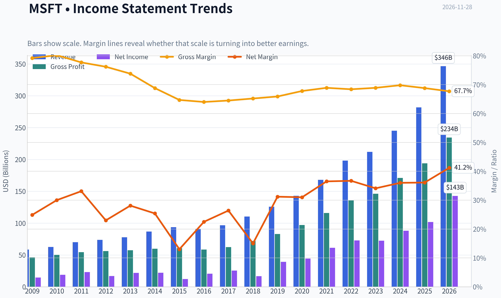

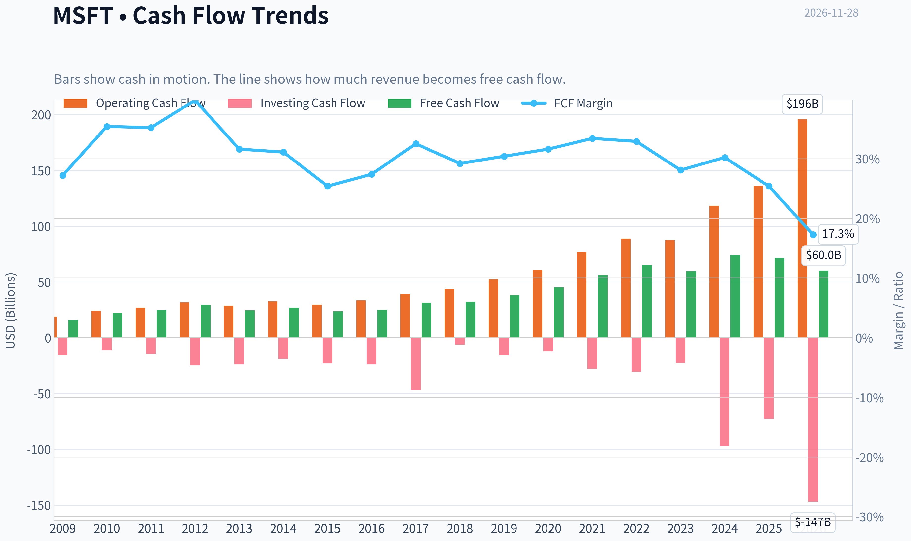

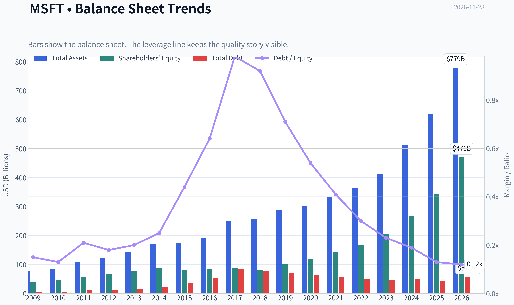

This graph tracks the profitability and return metrics (ROE, ROIC, Margins) of **MSFT** over the past decade, highlighting capital efficiency trends.

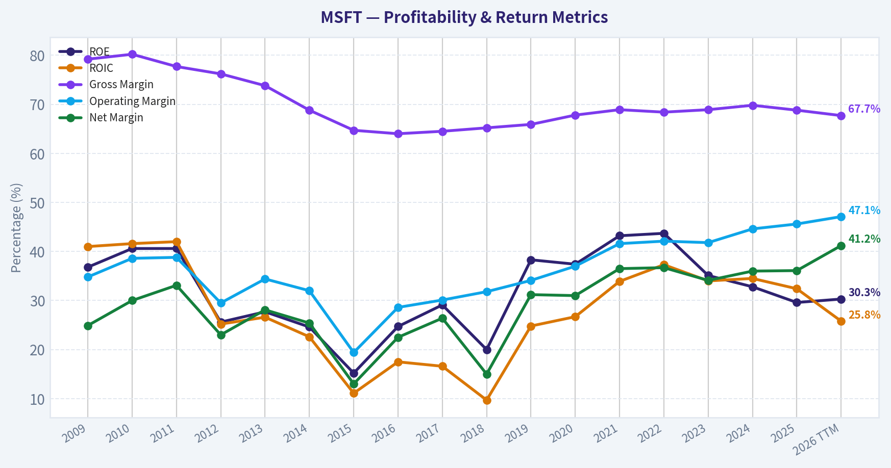

This chart illustrates the financial health of **MSFT** over the last 10 years, mapping cash equivalents and free cash flow against total obligations (Debt).

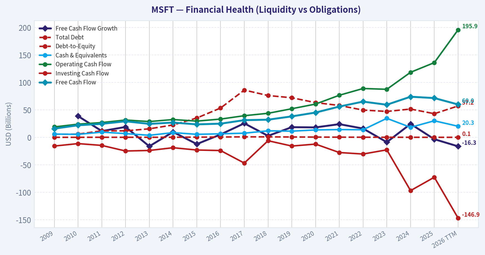

This breakdown chart from <em>Revenue Breakdown</em> shows the proportional composition for **MSFT** - useful for understanding what drives or risks the business.

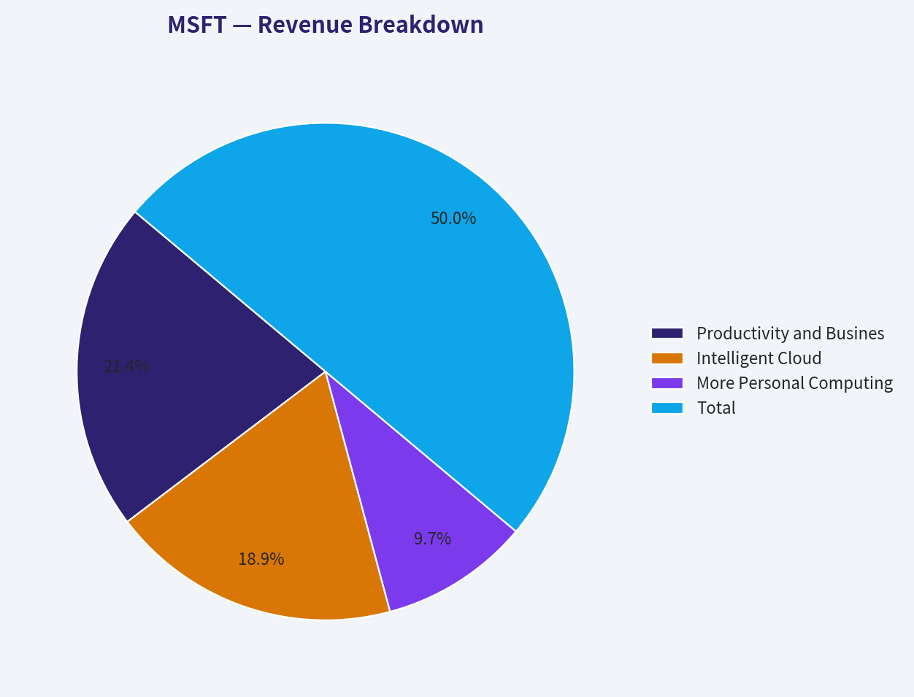

---

### Intrinsic Value Analysis (Buffett)

> *Following Warren Buffett's value investing philosophy: Circle of Competence, Economic Moat, Management Quality, and Margin of Safety.*

#### Intrinsic Value Snapshot

Price is what you pay. Intrinsic value is what the business may be worth based on the cash it can create for owners over time. We show a range, not one magic number.

- Current Price: $492.85
- Value Range (conservative to optimistic across both DCF methods): $105.83 to $318.97

##### Owner Earnings (Buffett Method)
- Net Income: $101,832,000,000.00
- Depreciation & Amortization: $38,534,000,000.00
- Capital Expenditures: $-115,948,000,000.00
- Working Capital Changes: $-4,895,000,000.00
- Owner Earnings: $79,883,178,528.75

##### Intrinsic Value
###### Buffett Method
Uses owner earnings. Stricter, and usually more conservative.
- Conservative: $196.00
- Average: $280.01
- Optimistic: $318.97
- Discount Rate: 8.3%

###### Cash Flow Method
Uses free cash flow. Better for companies spending heavily today to grow tomorrow.
- Conservative: $105.83
- Average: $209.57
- Optimistic: $294.95
- Discount Rate: 9.1%

ANALYST STANCE: **Neutral**

#### Executive Summary

Microsoft is an exceptional business with a broad and durable moat across enterprise software, cloud infrastructure, productivity applications, developer tools, and distribution. Its 67.9% gross margin, 30.2% ROE, 17.8% revenue growth, and net cash position reflect outstanding economics.

The central issue is valuation. At approximately **$493 per share**, Microsoft trades substantially above the DeepValues intrinsic value of **$280.01 per share**, implying a **negative 76.0% margin of safety** relative to that estimate. The business quality is high enough to merit continued scrutiny, but the evidence does not support the current valuation under conservative owner-earnings assumptions.

#### Factor Scorecard

| Factor | Score | Evidence |
|---|---:|---|
| 1. Circle of Competence & Simplicity | 4.0/5 | Microsoft sells recurring software, cloud capacity, infrastructure, and enterprise services. The model is understandable, although AI infrastructure economics and capital intensity add complexity. |
| 2. Moat | 5.0/5 | Office, Windows, Azure, developer tools, enterprise contracts, identity, and data integration create switching costs, ecosystem effects, and scale advantages. |
| 3. Management & Capital Allocation | 4.0/5 | Satya Nadella's tenure has materially improved cloud execution and capital allocation. The main concern is whether the scale of AI infrastructure spending will earn attractive long-term returns. |
| 4. Industry Structure | 4.0/5 | Microsoft operates in attractive oligopolistic markets, though cloud, AI, and cybersecurity remain highly competitive and capital-intensive. |
| **Gate 5: Quality/Solvency** | **Not tripped** | There is no evidence of simultaneous deteriorating earnings or cash flow and financial distress. Net cash is positive, and reported debt is manageable. |

**Key Takeaways:** Microsoft scores very highly on business quality and competitive advantage. The primary weakness is not solvency or business durability, but the substantial gap between the market price and owner-earnings-based intrinsic value.

#### Moat Analysis

| Moat Source | Assessment | Specific Evidence |
|---|---|---|
| Intangible assets | Very strong | Microsoft owns globally embedded brands and intellectual property in Office, Windows, Azure, GitHub, Dynamics, and security. |
| Switching costs | Very strong | Enterprise workflows, identity systems, data, compliance processes, and employee familiarity make migration costly and disruptive. |
| Cost advantages | Strong | Azure's scale, global data-center footprint, procurement power, and integration across products support competitive economics. |
| Network effects | Strong | Microsoft benefits from developer ecosystems, enterprise standards, cloud integrations, LinkedIn, GitHub, and partner networks. |

Microsoft's moat is best characterized as **wide and durable**, with several mutually reinforcing layers. Office and Azure do not merely operate as standalone products; they form an enterprise technology stack that increases customer dependence as more workflows, data, security controls, and applications are integrated.

The key threat is not ordinary product competition. It is whether artificial intelligence changes how users interact with software, weakens the importance of traditional applications, or forces Microsoft to spend heavily to preserve its ecosystem. Microsoft's distribution and enterprise relationships provide meaningful defenses, but AI may alter the economics of cloud services and productivity software before the long-term winners are fully clear.

**Key Takeaways:** Microsoft's moat is unusually broad because switching costs, scale, ecosystem effects, and brand strength reinforce one another. AI is more likely to reshape the moat than immediately eliminate it, but the required infrastructure investment introduces greater uncertainty around future returns.

#### Financial Summary

| Metric | Latest Available Figure |
|---|---:|
| Current price | $493 |
| Market capitalization | $3.66 trillion |
| P/E ratio | 25.7x |
| Revenue growth, year over year | 17.8% |
| Gross margin | 67.9% |
| ROE | 30.2% |
| Free-cash-flow yield | 1.8% |
| After-tax operating income | $133.4 billion |
| Operating income | $163.2 billion |
| Reported capital expenditures | $135.9 billion |
| Owner-earnings capital-expenditure charge | $87.8 billion |
| Cash and marketable securities | $64.5 billion |
| Debt | $35.5 billion |
| Net cash | $29.0 billion |
| Shares outstanding used in valuation | 7.446 billion |

**Key Takeaways:** Microsoft combines strong growth, very high gross margins, and a strong balance sheet. However, the 1.8% free-cash-flow yield indicates that the market is already assigning substantial value to future growth, while capital expenditures have become a major deduction from owner earnings.

#### Owner Earnings Calculation

Using the Buffett-style owner-earnings framework supplied in the research pack:

| Owner-Earnings Component | Amount |
|---|---:|
| After-tax operating income | $133.4B |
| Plus: depreciation and amortization | $42.5B |
| Less: maintenance-capex charge | $(87.8B) |
| Less: working-capital investment | $0.0B |
| **Estimated owner earnings** | **$88.2B** |
| Owner earnings per share | **$11.85** |

The calculation uses a normalized capital-expenditure charge rather than simply treating all reported growth investment as maintenance spending. That distinction is important: if AI infrastructure spending is highly productive, reported free cash flow may understate long-term economic value; if returns are weaker than expected, current cash-flow valuation is more representative.

Owner earnings of $88.2 billion correspond to an owner-earnings yield of approximately **2.4%** at the current market capitalization. That yield requires substantial and durable growth to justify the market price.

#### Returns, Cash Flow, and Balance Sheet

| Area | Assessment | Interpretation |
|---|---|---|
| ROE | 30.2% | Excellent, though ROE can overstate economic returns for an asset-light company with significant accumulated intangible value. |
| Gross margin | 67.9% | Strong evidence of pricing power, software economics, and differentiated products. |
| Operating cash flow versus earnings | Positive economic profile | Microsoft has historically converted accounting earnings into substantial cash, although current AI investment reduces free cash flow. |
| Net cash | $29.0B | Provides financial flexibility and reduces solvency risk. |
| Debt | $35.5B | Moderate relative to Microsoft's earnings power and cash resources. |
| Interest coverage | Not specifically supplied | The balance sheet does not indicate a distress-level interest burden. |

**Balance-sheet strength score: 4.0/5.** Microsoft is financially robust, but the company's balance sheet is not the main source of investment appeal; the thesis depends primarily on future cash generation and reinvestment returns.

**Key Takeaways:** Microsoft's high ROE and gross margin indicate powerful economics, while net cash limits financial risk. The main analytical question is whether current AI-related capital spending will produce returns that preserve or expand the historical spread between operating returns and the cost of capital.

#### Management Quality and Capital Allocation

| Management Dimension | Assessment |
|---|---|
| Owner orientation | Strong institutional and executive alignment, though no evidence is supplied that the chief executive personally owns more than 20% of net worth in Microsoft stock. |
| Strategic execution | Strong; the shift toward Azure, subscriptions, enterprise cloud, security, and AI has expanded Microsoft's relevance. |
| Candor and accounting | No restatement or credibility issue is identified in the supplied information. |
| Reinvestment | Strategically compelling, but AI infrastructure spending must be monitored for returns on invested capital. |
| Acquisitions and ecosystem expansion | Generally supportive of the broader platform, particularly in developer tools, security, and enterprise software. |

**Management score: 4.0/5.** Nadella's leadership has demonstrated effective reinvention and strong strategic judgment. The reservation is valuation discipline around the current AI investment cycle: even excellent management can destroy shareholder value if large investments earn less than their opportunity cost.

#### Three-Scenario DCF Valuation

These scenarios are sensitivity cross-checks. The official intrinsic value is the DeepValues app estimate shown below.

| Scenario | Key Assumptions | Estimated Value per Share |
|---|---|---:|
| A. No growth | $11.85 owner earnings per share divided by a 10% discount rate | $118.50 |
| B. GDP-like growth | 3% perpetual growth and 10% discount rate | $174.50 |
| C. Historical/high-growth case | Approximately 10% growth for a decade, fading toward 2.5% terminal growth | Approximately $280 |
| **DeepValues app intrinsic value** | Owner earnings of $88.2B; 10% growth fading to 2.5%; 8.3% discount rate; $29B net cash | **$280.01** |

The DeepValues app range is **$196.00 to $318.97 per share**, with $280.01 as the headline value. Its assumptions include a relatively favorable growth trajectory, yet the resulting value remains well below the current market price.

**Key Takeaways:** Even a strong-growth owner-earnings scenario produces a value near $280 per share, not $493. The market price requires either materially higher owner earnings, substantially better returns on AI investment, a lower discount rate, or growth that remains above the app's already optimistic assumptions for longer.

#### Margin of Safety Analysis

| Measure | Result |
|---|---:|
| Current price | $493 |
| DeepValues intrinsic value | $280.01 |
| Premium to intrinsic value | Approximately 76% |
| Margin of safety versus intrinsic value | **-76.0%** |
| Current free-cash-flow yield | 1.8% |
| Current owner-earnings yield | Approximately 2.4% |

For a wide-moat, high-ROIC compounder, a modest premium to conservative intrinsic value can be acceptable. Microsoft's premium is not modest under the supplied owner-earnings framework. The valuation requires exceptional execution and sustained reinvestment success, particularly in AI infrastructure.

#### Final Buffett Scorecard

| Criterion | Weight | Score | Weighted Contribution |
|---|---:|---:|---:|
| Moat width and durability | 25% | 5.0 | 1.25 |
| Valuation and margin of safety | 20% | 1.0 | 0.20 |
| Capital returns versus WACC | 15% | 3.5 | 0.53 |
| Business understanding and predictability | 12% | 4.0 | 0.48 |
| Management quality and capital allocation | 12% | 4.0 | 0.48 |
| Reinvestment runway | 8% | 4.0 | 0.32 |
| Balance-sheet strength | 4% | 4.0 | 0.16 |
| Industry structure | 4% | 4.0 | 0.16 |
| **Total** | **100%** |  | **3.58/5** |

#### Investment Stance

**Neutral - Moderate conviction.**

Microsoft is a high-quality compounder with a wide, durable moat, strong management, excellent margins, and a healthy balance sheet. The valuation, however, embeds demanding assumptions: the current price is approximately 76% above the DeepValues intrinsic value, and the owner-earnings yield is only about 2.4%.

The evidence supports the quality of Microsoft's franchise but does not support the valuation at approximately $493 under the supplied cash-flow assumptions. The central monitoring variables are AI infrastructure returns, free-cash-flow conversion, Azure profitability, and whether the company can sustain high growth without permanently increasing capital intensity.
#### Valuation Bridge

This bridge places the current market price beside each intrinsic value lens so readers can see whether upside depends on one method or shows up across several methods.

| Scenario | Intrinsic Value / Share |
| --- | ---: |
| Buffett Method | $280.01 |
| Cash Flow Method | $209.57 |
| Damodaran Method | $249.94 |
| Current Price | $492.85 |

#### Key Takeaways

If one method is far above the others, the upside case depends on a specific modelling assumption. When several methods cluster together, the valuation story is more robust.

#### Valuation Visuals

This comparison chart from *Latest Earnings Snapshot* stacks current figures against historical benchmarks for **MSFT**, making it easy to see where the company trades relative to its own averages.

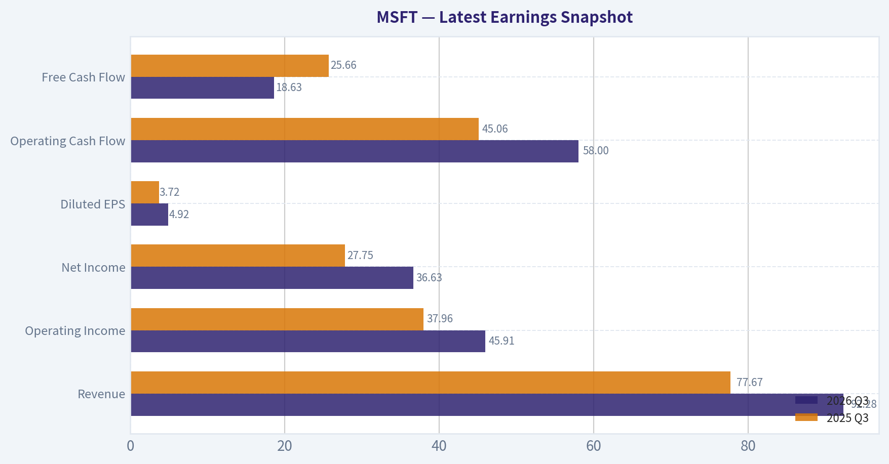

This comparison chart from *Current Metrics Versus Ten-Year Averages* stacks current figures against historical benchmarks for **MSFT**, making it easy to see where the company trades relative to its own averages.

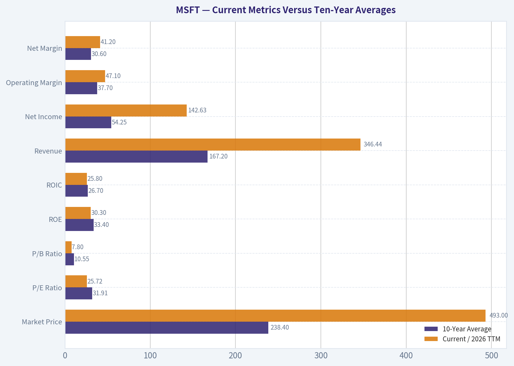

This comparison chart from *Balance Sheet and Financial Strength* stacks current figures against historical benchmarks for **MSFT**, making it easy to see where the company trades relative to its own averages.

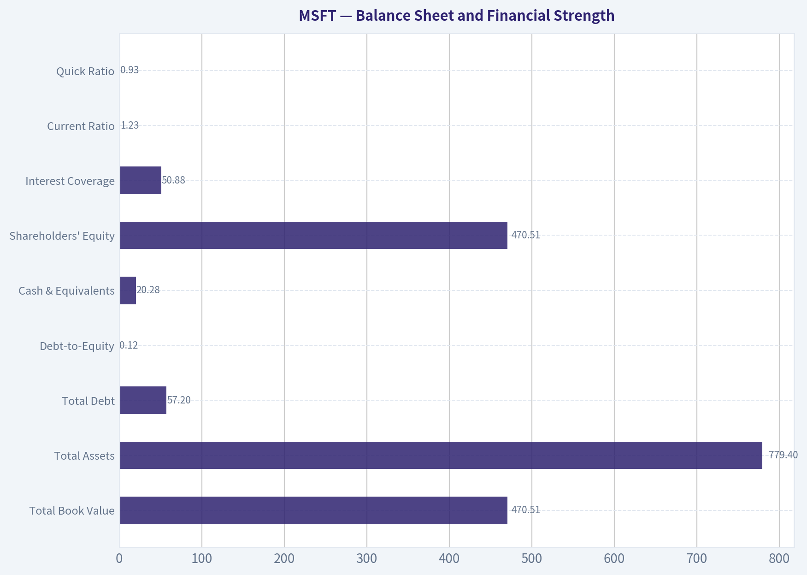

This comparison chart from *Buffett-Style Owner Earnings DCF* stacks current figures against historical benchmarks for **MSFT**, making it easy to see where the company trades relative to its own averages.

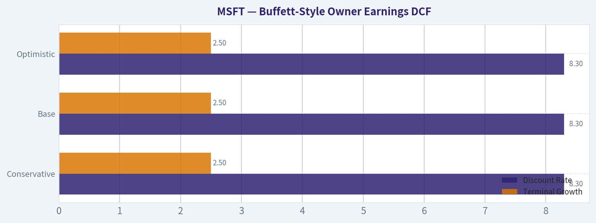

---

### Trend & Growth Analysis (Lynch/Druckenmiller/Fisher)

> *Following Peter Lynch's GARP, Stanley Druckenmiller's macro-aware approach, and Philip Fisher's scuttlebutt methodology.*

ANALYST STANCE: **Neutral**

#### 1. Lynch Classification

Microsoft is a **stalwart with fast-grower characteristics**. Its 17.8% year-over-year revenue growth places it near the fast-grower range, but its enormous $3.66 trillion market capitalization and mature core businesses make sustained 25%-plus growth increasingly difficult.

#### 2. The Story in Three Bullets

- Microsoft monetizes enterprise software, cloud infrastructure, cybersecurity, and artificial intelligence through a deeply embedded ecosystem.
- Azure and AI are expanding Microsoft's addressable market beyond traditional Office and Windows software.
- The central debate is not business quality; it is whether AI growth and operating earnings can justify a $493 share price.

#### 3. Key Fundamental Snapshot

| Metric | MSFT |
|---|---:|
| Current price | $493 |
| Market capitalization | $3.66T |
| Revenue growth, year over year | 17.8% |
| P/E ratio | 25.7x |
| Gross margin | 67.9% |
| ROE | 30.2% |
| FCF yield | 1.8% |
| Current ratio | 1.23 |
| Net cash in valuation model | $29.0B |

**Key Takeaways:** Microsoft combines strong growth, high gross margins, and a 30.2% return on equity with a relatively low 1.8% free-cash-flow yield. The business is financially robust, but the market is assigning a premium valuation to a company already producing extraordinary scale.

#### 4. TAM and the 10x Test

Microsoft's relevant opportunity set includes public cloud, AI infrastructure and applications, productivity software, cybersecurity, gaming, business applications, and digital commerce.

| Test | Assessment |
|---|---|
| Approximate current revenue scale | More than $300B annually, based on the company's operating scale |
| 10x revenue implication | More than $3T annual revenue |
| Potential supporting markets | Cloud, AI, enterprise software, cybersecurity, gaming, digital services |
| Can revenue grow 10x while remaining below 20% share of TAM? | Possible only under a very broad TAM definition |
| TAM growth | Strongest in AI and cloud; mature in Windows and core Office |

**Key Takeaways:** A broad AI-and-cloud TAM can support continued expansion, but the 10x test is demanding at Microsoft's current scale. The realistic runway is more likely to come from sustained share gains, higher monetization per customer, and new AI workloads than from simple market expansion alone.

#### 5. Revenue Growth Trend

| Indicator | Reading | Interpretation |
|---|---:|---|
| Latest revenue growth | 17.8% year over year | Healthy large-cap growth |
| Growth classification | Near fast-grower threshold | Strong, but not clear acceleration |
| Evidence of acceleration | Not established in the supplied data | Inflection remains unconfirmed |
| Growth quality | Cloud and AI-led, with diversified enterprise exposure | Higher quality than a single-product story |

**Key Takeaways:** Microsoft is growing quickly for its size, but the available data does not establish an accelerating revenue pattern. The key evidence still needed is several quarters of Azure and AI growth that exceed expectations without materially weakening margins.

#### 6. Unit Economics and Profitability

| Metric | Assessment |
|---|---|
| LTV/CAC | Not disclosed in the supplied data |
| Net revenue retention | Not disclosed |
| Rule of 40 | Not calculable from verified data because current FCF margin is unavailable |
| Gross margin | 67.9% |
| ROE | 30.2% |
| Operating income used in valuation model | $163.2B |
| Owner earnings used in valuation model | $88.2B |

**Key Takeaways:** Microsoft's gross margin, operating income, and return on equity indicate exceptional economics. SaaS-style LTV, CAC, and NRR metrics are less useful for a diversified platform with cloud consumption, enterprise licensing, advertising, gaming, and hardware revenue.

#### 7. Inflection Point Assessment

| Inflection area | Evidence | Rating |
|---|---|---|
| Product cycle | Copilot, Azure AI, and AI infrastructure expansion | Positive |
| Market share | Strong enterprise distribution and cloud position | Positive |
| Margin inflection | Large AI infrastructure investment may delay near-term leverage | Mixed |
| TAM expansion | AI materially broadens Microsoft's opportunity set | Positive |
| Competitive position | OpenAI relationships, Azure distribution, and enterprise integration | Positive but contested |

**Key Takeaways:** The strongest inflection is TAM expansion through AI. The main counterweight is capital intensity: AI infrastructure spending can produce substantial future revenue while temporarily reducing free-cash-flow conversion.

#### 8. Macro Setup

| Macro factor | Implication for MSFT |
|---|---|
| AI secular trend | Strong tailwind |
| Cloud adoption | Strong tailwind |
| Enterprise IT budgets | Generally supportive but economically sensitive |
| Long-term Treasury yield | Approximately 5.33% in the supplied valuation assumptions |
| Discount-rate environment | Headwind to high-duration valuations |
| Competitive environment | Intensifying across AI assistants, cloud, and productivity software |

**Key Takeaways:** Microsoft has powerful secular tailwinds, particularly AI and cloud adoption. However, elevated long-term rates increase the discount applied to distant cash flows, making valuation more demanding even when the operating outlook remains favorable.

#### 9. Fisher 15-Point Assessment

| Fisher criterion group | Score |
|---|---:|
| Market potential and long-range outlook | 5/5 |
| R&D and product development | 5/5 |
| Sales organization and distribution | 5/5 |
| Profit margins and financial quality | 5/5 |
| Competitive advantages and switching costs | 5/5 |
| Management depth and execution | 4/5 |
| Cost control and accounting quality | 4/5 |
| Labor and executive relations | 4/5 |
| Management candor and integrity | 4/5 |
| Dilution and capital allocation | 4/5 |
| **Estimated total** | **65/75** |

**Key Takeaways:** Microsoft scores in the "outstanding" Fisher range because of its market potential, distribution, R&D capabilities, and ecosystem advantages. The deductions reflect the difficulty of evaluating AI returns, ongoing capital intensity, and rising competition rather than a demonstrated structural weakness.

#### 10. Valuation Analysis

| Method | Value or proxy | Comparison with $493 |
|---|---:|---:|
| P/E | 25.7x | Premium absolute multiple |
| PEG proxy using revenue growth | 1.44x | Fair-to-full on a revenue-growth proxy |
| Owner earnings, conservative | $196 | 60% below price |
| Owner earnings, base | $280 | 43% below price |
| Owner earnings, optimistic | $319 | 35% below price |
| FCFF, conservative | $189 | 62% below price |
| FCFF, base | $250 | 49% below price |
| FCFF, optimistic | $374 | 24% below price |
| Damodaran FCFF midpoint | $250 | 49% below price |

**Key Takeaways:** The 25.7x P/E is not extreme for Microsoft's quality, but it requires continued execution. The supplied intrinsic-value models, including the headline owner-earnings value of $280.01, all fall below the current $493 price, indicating that the valuation assumes substantial future AI monetization and durable growth.

#### 11. Valuation Sensitivity

The supplied owner-earnings model uses an 8.3% discount rate, 10% initial growth fading to 2.5% terminal growth, and $88.2B of owner earnings.

| Scenario | Intrinsic value | Difference from current price |
|---|---:|---:|
| Conservative owner earnings | $196 | -60% |
| Base owner earnings | $280 | -43% |
| Optimistic owner earnings | $319 | -35% |
| Secondary DVI cross-check | $424 | -14% |

**Key Takeaways:** Even the optimistic owner-earnings case remains materially below the current market price. The secondary DVI cross-check narrows the gap but still does not fully support the valuation, so the investment case depends on stronger-than-modeled growth, higher future cash flows, or lower discount rates.

#### 12. Growth Investor Scorecard

| Criterion | Weight | Score |
|---|---:|---:|
| The story | 10% | 4.7/5 |
| TAM and runway | 20% | 4.4/5 |
| Revenue growth | 20% | 4.0/5 |
| Unit economics | 15% | 4.5/5 |
| Competitive position | 10% | 4.8/5 |
| Management quality | 10% | 4.3/5 |
| Macro setup | 5% | 3.5/5 |
| Profitability path | 5% | 4.4/5 |
| Valuation | 5% | 2.2/5 |
| **Weighted score** | **100%** | **4.2/5** |

**Key Takeaways:** Microsoft's operating profile scores strongly, particularly in competitive position, TAM, margins, and management depth. Valuation is the decisive weakness, keeping the overall conclusion at Neutral rather than a higher-conviction stance.

#### 13. Catalysts and Risks

| Catalysts | Risks |
|---|---|
| Azure AI usage accelerates | AI infrastructure spending depresses cash-flow conversion |
| Copilot monetization exceeds expectations | Anthropic, Google, Amazon, and open-source competition |
| Higher-value enterprise contracts | Office productivity moat faces new AI-native tools |
| AI improves cross-selling across Microsoft's ecosystem | Elevated interest rates compress valuation multiples |
| Operating leverage emerges after infrastructure investment | Antitrust and regulatory pressure |
| Cloud market share continues to rise | Growth decelerates because of Microsoft's scale |

**Key Takeaways:** The most important catalyst is evidence that AI is becoming a high-margin, recurring revenue engine rather than only a capital-intensive expansion program. The principal risk is a combination of slower growth and sustained infrastructure spending while the valuation remains demanding.

#### Conclusion

Microsoft is a high-quality, AI-enabled enterprise platform with an outstanding Fisher profile and a credible long-term growth runway. Its current 17.8% growth rate is strong but does not yet prove acceleration, while the supplied intrinsic-value estimates are substantially below $493. The evidence therefore supports **Neutral**: the business quality is compelling, but the valuation requires unusually strong AI monetization and continued execution.

---

### Market Technical Analysis

ANALYST STANCE: **Neutral**

#### MSFT technical analysis

**Data scope:** Microsoft Corporation (Nasdaq: MSFT), using Yahoo Finance data from November 28, 2025 through November 27, 2026. November 27 is the latest trading session; November 28 was a non-trading day.

The selected indicators are **close_10_ema, close_50_sma, close_200_sma, macd, macdh, rsi, atr, and vwma**. Together, they cover short-, medium-, and long-term trend, momentum, volatility, and volume-confirmed price behavior without adding several highly redundant oscillators or Bollinger-band measures.

#### Price structure and trend

MSFT closed at **$492.85** on November 27. The recent price structure is materially weaker than it was in early November: the stock closed at $554.73 on November 4, then declined to $484.52 on November 20 before recovering modestly. From the November 4 close to November 27, the decline was approximately **11.2%**.

The decline has not yet invalidated the longer-term uptrend. MSFT remains about **11.1% above its 200-day SMA of $443.69**, and the 200-day average is still rising gradually. This indicates that the long-duration trend remains constructive despite the recent correction.

The shorter and medium-term signals are less favorable. The latest close is approximately **1.5% below the 10-day EMA**, **5.0% below the 50-day SMA**, and **3.3% below the volume-weighted moving average**. The 50-day SMA is still rising, but price has moved decisively beneath it, showing that recent selling pressure has overwhelmed the prevailing medium-term average.

The distance between the 50-day and 200-day averages remains positive, with the 50-day SMA well above the 200-day SMA. That is consistent with a still-positive long-term trend, but it does not eliminate the possibility of a deeper intermediate-term retracement.

#### Momentum: MACD and RSI

Momentum has deteriorated sharply since late October.

The **MACD** moved from **+5.85 on October 29** to **-8.65 on November 27**. This is a substantial negative reversal rather than a minor fluctuation. The MACD histogram is also negative at **-3.61**, indicating that the MACD line remains below its signal line and that downside momentum is still present.

There is one modestly constructive detail: the histogram has improved from **-5.17 on November 20** to **-3.61 on November 27**. This suggests that the rate of downside momentum has eased somewhat during the recent rebound. However, the histogram remains below zero, so the data show decelerating weakness rather than a confirmed momentum reversal.

The **RSI is 40.65**, up from 35.02 on November 20 but still below the neutral 50 area. This places MSFT in a weak-momentum regime without reaching the conventional oversold threshold near 30. The reading is therefore consistent with selling pressure that has moderated, but not with a technically established bullish recovery.

#### Volume and volatility

The **VWMA is $509.77**, materially above the latest close. Because the VWMA incorporates trading volume, the gap indicates that higher-volume trading occurred at prices above the current market level. This provides additional evidence that recent price weakness has not been fully repaired.

Trading activity has been uneven, with several unusually high-volume sessions accompanying large price moves. Examples include the heavy-volume decline on January 29, the large-volume rebound and reversal around late May and June, and the high-volume price movements in early November. These episodes suggest that event-driven repricing has been an important feature of MSFT's recent behavior, rather than a smooth, low-volatility trend.

The **ATR is $16.49**, equivalent to approximately **3.3% of the latest close**. ATR has risen from $11.55 on October 29, a roughly 43% increase. This confirms that daily price variability has expanded considerably. The wider trading range makes short-term signals less stable and increases the importance of distinguishing genuine trend changes from sharp countertrend rebounds.

#### Valuation implications of the technical evidence

Technical indicators do not determine fundamental value, but they do describe whether the current market price is being supported by trend and momentum. At approximately $492.85, MSFT remains well above its long-term trend benchmark, so the long-run price structure has not broken down. However, the price is below the 10-day EMA, 50-day SMA, and VWMA, while MACD and RSI remain weak.

The evidence therefore does **not independently validate a premium valuation based solely on near-term technical strength**. A more favorable technical interpretation would require improved momentum, recovery above the volume-weighted and medium-term averages, and stabilization in volatility. Conversely, continued weakness while the stock remains above the 200-day SMA would represent a correction within a still-positive long-term structure rather than definitive long-term trend failure.

#### Selected indicators

- **close_10_ema:** Captures the recent loss of short-term momentum.
- **close_50_sma:** Measures the current medium-term trend and shows that price has fallen below its intermediate benchmark.
- **close_200_sma:** Preserves the longer-term trend perspective and remains materially below price.
- **macd:** Identifies the substantial reversal from positive to negative momentum.
- **macdh:** Shows that downside momentum has moderated slightly but remains negative.
- **rsi:** Places momentum below neutral without indicating conventional oversold conditions.
- **atr:** Quantifies the sharp expansion in daily volatility.
- **vwma:** Confirms that volume-weighted traded prices remain above the latest close.

| Indicator / measure | Latest reading | Interpretation |
|---|---:|---|
| Latest close | $492.85 | Modest rebound from the $484.52 November 20 low, but still well below early-November levels |
| close_10_ema | $500.40 | Price is about 1.5% below the short-term average; near-term momentum remains weak |
| close_50_sma | $518.57 | Price is about 5.0% below the medium-term average; intermediate trend pressure is negative |
| close_200_sma | $443.69 | Price is about 11.1% above the long-term average; the broader trend remains constructive |
| MACD | -8.65 | Momentum has reversed decisively into negative territory |
| MACD histogram | -3.61 | Still bearish, though less negative than at the November 20 trough |
| RSI | 40.65 | Weak and below neutral, but not conventionally oversold |
| ATR | $16.49 | Elevated volatility, equivalent to roughly 3.3% of the latest close |
| VWMA | $509.77 | Volume-weighted price remains above the market, implying incomplete recovery |
| Overall technical reading | Mixed by timeframe | Long-term trend is positive, while short- and medium-term momentum are bearish |

**Key Takeaways:** MSFT's long-term trend remains constructive because the price is well above its rising 200-day average. However, the stock is below its short-term EMA, 50-day SMA, and VWMA, while MACD and RSI continue to signal weak momentum. The recent rebound has reduced the intensity of selling but has not yet established a confirmed technical recovery, leaving the evidence insufficient to validate a premium valuation on near-term technical strength alone.

#### Market Visuals

This comparison chart from *Market Metrics and Valuation* stacks current figures against historical benchmarks for **MSFT**, making it easy to see where the company trades relative to its own averages.

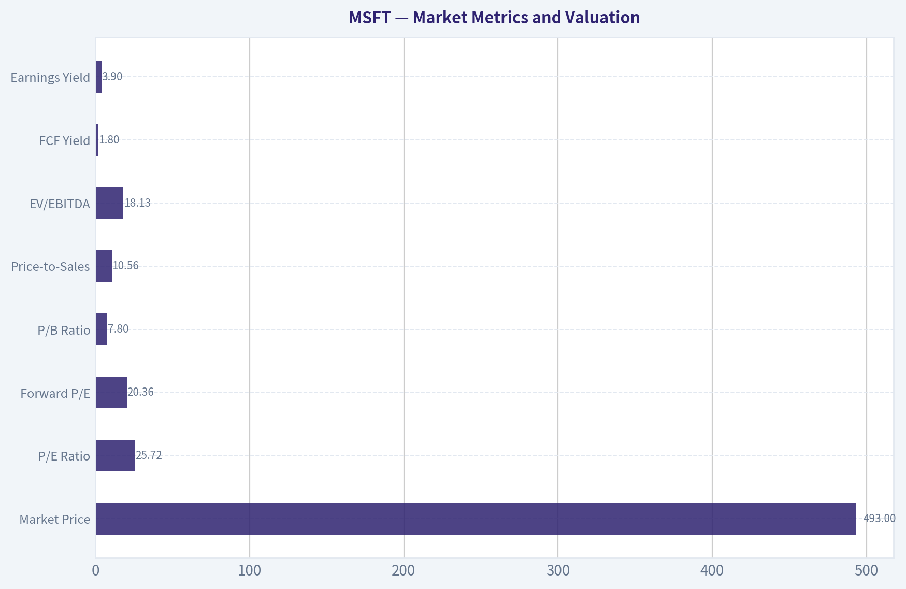

---

### Options Market Analysis

> *Reading options flow - put/call ratios, IV skew, and unusual activity - to gauge institutional positioning and event-driven risk.*

ANALYST STANCE: **Bullish**

#### MSFT Options Snapshot

The data covers the November 30, December 2, and December 4, 2026 expirations. Since the supplied chain does not state the exact stock price, strikes around $500 are treated as approximately at-the-money.

| Expiration | Call OI | Put OI | Put/Call OI Ratio | Call Volume | Put Volume | Put/Call Volume Ratio | ATM Call IV | ATM Put IV |
|---|---:|---:|---:|---:|---:|---:|---:|---:|
| Nov. 30 | 6,506 | 11,113 | 1.71 | 14,588 | 13,472 | 0.92 | 31.7% | 31.2% |
| Dec. 2 | 2,319 | 2,427 | 1.05 | 5,386 | 3,480 | 0.65 | 36.6% | 34.1% |
| Dec. 4 | 37,828 | 22,647 | 0.60 | 16,229 | 12,628 | 0.78 | 39.3% | 37.0% |
| **Combined** | **46,653** | **36,187** | **0.78** | **36,203** | **29,580** | **0.82** | - | - |

**Key Takeaways:** Combined put/call ratios are modestly below the historical neutral reference of approximately 0.70 only when considering volume, while the open-interest ratio of 0.78 remains close to neutral. The December 4 expiration is distinctly call-heavy, offsetting the put-heavy November 30 expiration. Overall, the aggregate data leans mildly bullish but does not indicate an extreme directional imbalance.

#### Put/Call Ratio Analysis

The November 30 expiration has a high put/call open-interest ratio of 1.71, indicating substantial short-dated put protection or bearish exposure. However, its volume ratio is closer to balance at 0.92, suggesting that the existing put open interest may not represent aggressive new bearish activity.

The December 4 expiration has the strongest bullish tilt, with a 0.60 put/call open-interest ratio and a 0.78 volume ratio. Because it also contains the largest concentration of open interest, this expiration has the greatest influence on the combined reading.

The aggregate 0.78 open-interest ratio is above the approximate 0.70 neutral baseline, while the 0.82 volume ratio is also somewhat above neutral. This indicates a mild residual demand for downside protection, but the call-heavy December 4 structure prevents the overall picture from becoming bearish.

#### Implied Volatility Assessment

| Expiration | ATM Call IV | ATM Put IV | Call-Put IV Difference | Interpretation |
|---|---:|---:|---:|---|
| Nov. 30 | 31.7% | 31.2% | +0.5 percentage points | Nearly balanced |
| Dec. 2 | 36.6% | 34.1% | +2.5 percentage points | Moderate call premium |
| Dec. 4 | 39.3% | 37.0% | +2.3 percentage points | Elevated event-window uncertainty |

**Key Takeaways:** Near-term IV rises from roughly 31% at the November 30 expiry to approximately 39% for December 4, indicating increasing uncertainty across the expiration window. Calls trade at a modest IV premium to puts at the December expirations, which is more consistent with upside-demand or upside-event speculation than with pronounced downside fear. The supplied data does not identify a specific catalyst, so the IV increase should not be attributed definitively to earnings or another event.

The broad IV curve is elevated for such short-dated options, especially in the December 4 expiry. The moderate call skew suggests upside interest, while the November 30 expiry remains nearly balanced.

#### Unusual Options Activity

The following contracts had volume greater than five times open interest. Their strikes are classified relative to an approximate $500 reference level implied by the chain.

| Expiration | Type | Strike | Approx. Moneyness | Days to Expiry | Volume/OI | IV | Inferred Market Message |
|---|---|---:|---|---:|---:|---:|---|
| Nov. 30 | Call | $495 | Slightly ITM | 2 | 11.1x | 27.4% | Fresh upside exposure or short-dated call spread activity |
| Nov. 30 | Call | $500 | Approximately ATM | 2 | 8.5x | 25.3% | Near-term upside speculation or hedging |
| Nov. 30 | Call | $502.50 | Slightly OTM | 2 | 7.7x | 24.5% | Upside continuation expectations |
| Nov. 30 | Call | $505 | OTM | 2 | 9.5x | 24.7% | More speculative upside exposure |
| Nov. 30 | Call | $507.50 | OTM | 2 | 5.6x | 24.0% | Higher-strike upside speculation |
| Nov. 30 | Put | $490 | OTM | 2 | 7.8x | 27.2% | Short-dated downside hedge or bearish protection |
| Nov. 30 | Put | $470 | Far OTM | 2 | 5.2x | 34.1% | Tail-risk insurance; potentially institutional hedging |
| Nov. 30 | Put | $475 | Far OTM | 2 | 5.2x | 31.8% | Downside protection below the main trading range |
| Dec. 2 | Call | $517.50 | OTM | 4 | 23.9x | 29.8% | Largest volume/OI imbalance; aggressive upside speculation |
| Dec. 4 | Call | $537.50 | OTM | 6 | 10.5x | 31.6% | Higher-conviction upside optionality, though potentially speculative |
| Dec. 4 | Put | $457.50 | Far OTM | 6 | 6.7x | 43.2% | Tail-risk hedge with a substantial downside-volatility premium |

**Key Takeaways:** Unusual activity is dominated by short-dated calls, particularly the December 2 $517.50 call and December 4 $537.50 call. The simultaneous activity in $470, $475, and $457.50 puts shows that some market participants are also paying for downside protection. High volume relative to open interest suggests potentially fresh activity, but without trade-side information it cannot be conclusively classified as institutional buying rather than spreads, rolls, or closing transactions.

The call strikes above $500 are consistent with upside speculation, while the far OTM puts appear more suited to tail-risk hedging. The December 2 $517.50 call has the strongest volume/OI ratio at 23.9 times, making it the clearest unusual directional signal in the supplied data.

#### Open Interest Concentration and Gamma Levels

| Expiration | Highest Relevant OI Areas | Structural Interpretation |
|---|---|---|
| Nov. 30 | 11,113 puts versus 6,506 calls overall | Put-heavy near-term protection; downside strikes may act as hedging reference points |
| Dec. 2 | 2,319 calls and 2,427 puts | Relatively light open interest; limited pinning influence |
| Dec. 4 | 37,828 calls and 22,647 puts overall | Dominant expiration with a call-heavy structure |
| Combined | 46,653 calls and 36,187 puts | Call open interest exceeds put open interest by 10,466 contracts |

**Key Takeaways:** December 4 is the main open-interest concentration and is likely to exert the greatest pinning or gamma influence among the listed expirations. Its call-heavy structure may dampen declines near heavily populated call strikes if dealer hedging creates supportive flows, although the exact gamma direction cannot be determined without contract-level gamma and trade-side data. The November 30 put concentration could amplify sensitivity to a sharp decline close to expiry.

The December 2 expiry has comparatively little open interest and is less likely to determine the broader near-term price structure. The largest potential gravitational area appears to be around the high-open-interest strikes near the approximate $500 region, but exact max-pain and gamma-wall levels are unavailable from the supplied summary.

#### Overall Options Sentiment

**Overall signal: BULLISH, with moderate confidence.**

The primary bullish drivers are:

- Aggregate call open interest exceeds put open interest.
- December 4, the dominant expiration, has a 0.60 put/call open-interest ratio.
- Unusual activity is concentrated in calls above the approximate $500 reference level.
- Call IV exceeds put IV in the December expirations, indicating greater demand for upside exposure.

The main caveats are the 1.71 put/call open-interest ratio for November 30 and the presence of far OTM downside hedges with elevated implied volatility. These indicate meaningful short-term protection demand and could increase downside sensitivity around the nearest expiry. The evidence supports a mildly bullish options-market interpretation, but not a high-conviction or low-risk signal.

#### Summary Table

| Category | Reading | Interpretation |
|---|---|---|
| Put/Call Ratio | 0.78 OI; 0.82 volume | Slightly more call-oriented than neutral overall, though near-term puts remain significant |
| IV Level | Approximately 31% to 39% ATM | Elevated short-dated uncertainty, rising into December 4 |
| Skew Direction | Moderate call skew at later expirations; steep far OTM put IV | Upside demand coexists with tail-risk hedging |
| Unusual Activity | Calls dominate, led by Dec. 2 $517.50 and Dec. 4 $537.50 calls | Favors upside speculation, with downside hedges also active |
| Overall Signal | **BULLISH** | Call-heavy dominant expiry and unusual call activity outweigh the near-term put concentration |

**Key Takeaways:** MSFT's near-term options structure is mildly bullish, led by call concentration and unusual upside activity in the December expirations. Elevated IV and far OTM put demand show that downside risk remains actively priced, limiting confidence in the signal. The options data supports a bullish interpretation of market expectations, not a valuation conclusion by itself.

---

## Research Team Commentary

> *The Research Manager synthesizes the Bull vs Bear debate into action-free commentary. This is a pre-risk view, not the final stance.*

Core Takeaway: Microsoft is an exceptional business, but the evidence provided does not demonstrate that $493 offers the required quality-scaled margin of safety. Its ecosystem, recurring revenue, roughly 68% gross margin, approximately 31% ROIC, net cash, and management record support long-term compounding. Nevertheless, the valuation depends on Microsoft converting heavy AI and cloud investment into durable free cash flow without materially weakening incremental returns. The appropriate stance is Neutral rather than Bullish or a hard Bearish.

The strongest bull argument is the breadth and reinforcement of Microsoft's moat. Microsoft 365, Azure, identity, security, GitHub, Teams, Dynamics, and developer tools are embedded in critical enterprise workflows. Switching involves retraining, migration, security, compliance, and integration costs-not merely replacing an application. Microsoft can also distribute new products through established enterprise relationships, giving it lower customer-acquisition costs and more monetization paths than most AI competitors.

The financial evidence supports that quality assessment. Revenue growth of roughly 17.8%, a 67.9% gross margin, 30.8% ROIC, 30.2% ROE, and a net cash balance sheet are outstanding. Satya Nadella's record of shifting Microsoft toward cloud, subscriptions, developers, security, and AI further strengthens the case that management can adapt the franchise. AI does not need to become a standalone winner if it increases Azure usage, subscription pricing, developer productivity, security revenue, or customer retention across the ecosystem.

The strongest bear argument is not that Microsoft's moat is disappearing. It is that the economics of its next investment cycle may be less attractive than those of its historical software business. Data centers, accelerators, networking, energy, depreciation, and model-operating costs require substantial capital before demand and pricing are fully proven. AI adoption can therefore increase revenue while free-cash-flow conversion and returns on incremental capital deteriorate. Microsoft's current 30.8% ROIC describes the combined existing franchise; it does not establish that the next dollar invested in AI infrastructure will earn a similar return.

Valuation consequently remains the unresolved issue. At $493 and approximately 25.7 times earnings, Microsoft is not priced like a speculative or obviously euphoric company, but neither is it demonstrably discounted. The quotation appears to assume an extended period of high-single-digit to low-double-digit per-share cash-flow growth, resilient margins, and successful AI commercialization. Those assumptions are plausible for Microsoft, but they require several favorable outcomes to occur together.

The bear's illustrative low-$400s valuation is too assumption-dependent to prove clear overvaluation because it uses earnings as a rough cash-flow proxy and lacks detailed free cash flow, capital expenditure, dilution, net cash, and terminal-value inputs. Conversely, the bull case does not establish the approximately 10-15% discount that would ordinarily support an Bullish label for a franchise of this quality. Calling the price "defensible" is not the same as demonstrating a margin of safety.

From a Buffett-style perspective, this distinction matters. Microsoft qualifies as a wonderful business, and its intangible assets make book-value comparisons largely irrelevant. Its quality deserves a lower valuation discount than an average company would require. But quality cannot substitute indefinitely for cash-flow evidence. The critical question is whether AI-related reinvestment extends Microsoft's moat while preserving superior economic returns, or merely raises the capital required to defend that moat.

Short-term momentum and options activity add little to this conclusion. Trading below the 50-day average while remaining above the 200-day average says more about recent market psychology than intrinsic value. Call-heavy options positioning above $500 suggests optimism, but not whether future cash flows justify that optimism.

The main analytical lesson is to avoid two opposite mistakes. One is rejecting an asset-light technology compounder simply because it trades at a premium multiple. The other is treating high historical ROIC and a compelling AI narrative as proof that future investment will earn similarly high returns. The absence of a precise intrinsic-value estimate should widen the uncertainty range rather than encourage false confidence in either direction.

Rationale: Microsoft's competitive position, financial strength, and management quality make permanent impairment substantially less likely than for an ordinary business. That prevents the valuation uncertainty alone from supporting a hard Bearish. At the same time, the supplied data do not show enough free-cash-flow detail or valuation discount to justify Bullish. The evidence currently points to a high-quality franchise at a fair-to-demanding valuation, with the outcome increasingly dependent on incremental AI economics.

Monitoring Plan: Over the next one to four quarters, the most important evidence will be Azure growth excluding currency effects and whether AI services contribute measurable, sustained growth rather than temporary capacity demand. Copilot adoption should be evaluated through paid seats, renewal behavior, revenue per customer, and evidence of pricing power-not product announcements.

Capital expenditures, depreciation, operating cash flow, and free cash flow should be compared with revenue and operating-income growth. The thesis strengthens if free cash flow per share grows despite elevated infrastructure spending, utilization improves, and incremental ROIC remains comfortably above Microsoft's cost of capital. It weakens if capital expenditures continue rising much faster than monetization, free-cash-flow conversion deteriorates, or management signals that infrastructure constraints require another prolonged spending step-up.

Gross and operating margins should also be watched for evidence that AI inference and cloud infrastructure are structurally dilutive. Additional indicators include Azure market-share trends, enterprise AI renewals, stock-based compensation and diluted share count, regulatory restrictions on bundling or cloud licensing, and any change in the economics or strategic stability of the OpenAI relationship.

Final stance: Neutral.

---

## Value Investing Team Commentary

> *The Investor translates the research view into an investment thesis before risk review. This is still not the final stance.*

Microsoft's underlying business quality is exceptional. Its moat spans enterprise productivity, cloud infrastructure, identity, cybersecurity, developer tools, and business applications. These products are deeply embedded in workflows where switching costs include data migration, employee retraining, security validation, compliance work, and integration risk. That ecosystem gives Microsoft distribution advantages that many standalone AI companies lack.

The financial profile reinforces this conclusion. A gross margin near 68%, ROIC around 31%, ROE around 30%, strong revenue growth, and a net-cash balance sheet indicate a highly profitable and financially resilient franchise. Satya Nadella's capital allocation and strategic repositioning toward cloud, subscriptions, developers, and AI also provide evidence of capable management.

The important distinction is between the quality of Microsoft's existing franchise and the economics of its next phase of investment. Historical ROIC measures the combined profitability of Office, Windows, Azure, and other established assets. It does not prove that incremental spending on accelerators, data centers, networking, energy, depreciation, and model inference will produce comparable returns. AI may expand revenue and customer engagement while temporarily reducing free-cash-flow conversion or incremental margins.

The contrarian bull case is that the market may be underestimating Microsoft's ability to monetize AI through its existing distribution system. AI does not need to become a standalone consumer phenomenon to create substantial value. Greater Azure consumption, higher-value Microsoft 365 tiers, security adoption, developer-tool usage, and improved customer retention could collectively generate attractive economics. Microsoft's ability to bundle AI into existing enterprise relationships may also produce lower acquisition costs and stronger renewal rates than those available to less-distributed competitors.

The contrarian bear case is that enthusiasm around AI may obscure the difference between demand for scarce infrastructure and durable customer willingness to pay. Capacity shortages can create impressive near-term growth without proving long-term returns on the required capital. Copilot adoption should therefore be judged by paid-seat expansion, sustained usage, renewal behavior, revenue per customer, and measurable customer productivity-not by announcements or trial activity alone.

At $493 and approximately 25.7 times earnings, Microsoft does not appear to represent speculative excess on the basis of the supplied figures. However, the multiple is not sufficiently low by itself to establish a quality-scaled margin of safety. A 10-15% discount could be reasonable for a business of this quality, but the available information does not provide a sufficiently precise free-cash-flow-based intrinsic value to demonstrate such a discount.

The valuation also depends on several assumptions working together: continued high-single-digit or low-double-digit per-share earnings growth, durable cloud demand, successful AI monetization, stable or improving margins, disciplined dilution, and capital expenditure eventually growing more slowly than operating cash flow. Each assumption is plausible. The issue is that the quotation appears to require a favorable combination of them rather than providing clear protection if one or two disappoint.

Technical and options data have limited relevance to intrinsic value. Trading below a short-term moving average while remaining above a longer-term average describes sentiment and momentum, not the earning power of the company. Call-heavy options activity may reveal optimism, but it does not establish that future cash flows justify the prevailing valuation.

The most important evidence over the next several quarters is the relationship between AI-related investment and economic output. Strengthening evidence would include Azure growth that remains robust beyond temporary capacity constraints, rising utilization, durable Copilot monetization, resilient operating margins, and free cash flow per share growth despite elevated capital expenditure. Conversely, a prolonged rise in capital spending without corresponding monetization, weaker free-cash-flow conversion, lower incremental returns, increasing dilution, or regulatory pressure on bundling and cloud licensing would make the valuation more demanding.

Overall, Microsoft remains a wonderful business with a durable moat, strong management, and low permanent-impairment risk. The unresolved question is not whether the company is high quality, but whether the current quotation adequately compensates for uncertainty around incremental AI economics. The supplied evidence supports confidence in the business while falling short of proving a compelling valuation discount.

**ANALYST STANCE: Neutral** - Microsoft's franchise quality supports a favorable long-term business outlook, but the evidence currently indicates a fair-to-demanding valuation rather than a clearly demonstrated margin of safety.

---

## Deep Values Commentary

> *The Risk Management Team debates and the Risk Judge provides the final action-free verdict. This section determines the final Bullish / Neutral / Bearish stance.*

#### Final Stance Scorecard

This scorecard converts the final research view into a weighted decision frame. It does not replace the narrative judgement, but it makes the main drivers of the verdict easier to scan.

| Criterion | Score | Weight | Commentary |
| --- | ---: | ---: | --- |
| Business Quality | 4.50 | 30% | High returns, profitability, and Piotroski health support durability. |
| Valuation Support | 2.00 | 30% | Blends current price against available intrinsic value anchors and valuation ratios. |
| Financial Strength | 3.67 | 20% | Balance-sheet resilience reflects leverage and liquidity staying within safe ranges. |
| Growth Durability | 3.33 | 20% | Recent revenue, earnings, and free cash flow growth indicate how durable expansion looks. |
| TOTAL / FINAL STANCE | 3.35 | 100% | Neutral |

#### Key Takeaways

The weighted score lands at **3.35 / 5.0**, while the final stance remains **Neutral**. This is useful as a quick calibration aid rather than a mechanical signal.

#### Risk Summary

Higher scores indicate more risk pressure. The watch threshold is a simple guardrail: above it, the dimension weighs more heavily on the valuation case and calls for a wider margin of safety.

| Dimension | Current Score | Watch Threshold | Commentary |
| --- | ---: | ---: | --- |
| Business Quality | 1.50 | 3.00 | High returns, profitability, and Piotroski health support durability. |
| Valuation Support | 4.00 | 3.00 | Blends current price against available intrinsic value anchors and valuation ratios. |
| Financial Strength | 2.33 | 3.00 | Balance-sheet resilience reflects leverage and liquidity staying within safe ranges. |
| Growth Durability | 2.67 | 3.00 | Recent revenue, earnings, and free cash flow growth indicate how durable expansion looks. |

#### Key Takeaways

This view helps readers separate *where* the risk sits: valuation, business quality, balance sheet, or growth durability. It is especially useful when the final stance is close to the line between Neutral and Bearish.
