# MTH Deep Value Intelligence

**Analysis Date:** 2026-03-29

## Critical Disclaimer

*This analysis is generated by Deep Value Intelligence, an AI-powered multi-agent investing framework. This report is for informational and educational purposes only and does not constitute financial advice. Always conduct your own research and consult with qualified financial advisors before making investment decisions.*

---

## Table of Contents

1. Intelligence Summary
2. Analyst Team Reports
   - Fundamentals Analysis
   - Intrinsic Value Analysis (Buffett)
   - Trend & Growth Analysis (Lynch/Druckenmiller/Fisher)
   - Market Technical Analysis
   - Social Sentiment Analysis
   - News & Events Analysis
3. Research Team Commentary
4. Value Investing Team Commentary
5. Deep Values Commentary

---

## Intelligence Summary

### Thesis + Conditions

**Core Thesis:** EXECUTIVE SUMMARY
Meritage Homes looks statistically cheap but not structurally strong. The debate hinges on whether the low valuation reflects a temporary housing slowdown or the inherently mediocre economics of homebuilding.

**Key Risks:**
- Meritage Homes looks statistically cheap but not structurally strong. The debate hinges on whether the low valuation reflects a temporary housing slowdown or the inherently mediocre economics of homebuilding. Current evidence favors the latter: returns on capital are modest (ROIC ~6.6%), earnings are highly cyclical, and demand is tightly tied to mortgage rates. While demographic housing demand and Sunbelt exposure provide upside if rates ease, the business lacks a durable moat and predictable earnings power. The margin of safety is therefore uncertain despite the low P/E. Best approach: monitor for improving returns on capital or housing demand before committing capital.
- Risky Analyst (Pro-Opportunity View)
- The bullish argument centers on cyclical mispricing. With a P/E around 9.5 and continued profitability despite declining earnings, the market may already be pricing a pessimistic housing scenario. Structural housing undersupply and strong migration to Texas, Florida, and Arizona support long-term demand, particularly in Meritage's entry-level segment. The analyst also highlights improved capital discipline in the post-2008 homebuilding industry and strong free cash flow generation (+136% YoY), suggesting operational resilience. If mortgage rates fall even modestly, demand elasticity could drive a sharp rebound in orders and earnings.
- Safe Analyst (Risk-Control View)
- The cautious view emphasizes the fragility of homebuilder earnings. A 42% drop in net income with only an 8% revenue decline shows how sensitive margins are to demand shifts. Entry-level buyers are highly rate-sensitive, and if mortgage rates remain elevated, builders may need to offer incentives that compress margins further. The low P/E may therefore reflect peak earnings rather than depressed earnings. Weak capital efficiency (ROIC 6.6%, ROE 8.7%) suggests the business struggles to generate strong returns even during relatively favorable conditions. From a risk perspective, this means intrinsic value is uncertain and tied heavily to macro interest-rate movements.

**What Would Change Our View:**
- Meritage Homes looks statistically cheap but not structurally strong. The debate hinges on whether the low valuation reflects a temporary housing slowdown or the inherently mediocre economics of homebuilding. Current evidence favors the latter: returns on capital are modest (ROIC ~6.6%), earnings are highly cyclical, and demand is tightly tied to mortgage rates. While demographic housing demand and Sunbelt exposure provide upside if rates ease, the business lacks a durable moat and predictable earnings power. The margin of safety is therefore uncertain despite the low P/E. Best approach: monitor for improving returns on capital or housing demand before committing capital.
- Risky Analyst (Pro-Opportunity View)
- The bullish argument centers on cyclical mispricing. With a P/E around 9.5 and continued profitability despite declining earnings, the market may already be pricing a pessimistic housing scenario. Structural housing undersupply and strong migration to Texas, Florida, and Arizona support long-term demand, particularly in Meritage's entry-level segment. The analyst also highlights improved capital discipline in the post-2008 homebuilding industry and strong free cash flow generation (+136% YoY), suggesting operational resilience. If mortgage rates fall even modestly, demand elasticity could drive a sharp rebound in orders and earnings.
- Safe Analyst (Risk-Control View)
- The cautious view emphasizes the fragility of homebuilder earnings. A 42% drop in net income with only an 8% revenue decline shows how sensitive margins are to demand shifts. Entry-level buyers are highly rate-sensitive, and if mortgage rates remain elevated, builders may need to offer incentives that compress margins further. The low P/E may therefore reflect peak earnings rather than depressed earnings. Weak capital efficiency (ROIC 6.6%, ROE 8.7%) suggests the business struggles to generate strong returns even during relatively favorable conditions. From a risk perspective, this means intrinsic value is uncertain and tied heavily to macro interest-rate movements.

**Confidence:** Low

---

## Analyst Team Reports

### Fundamentals Analysis

#### Latest Earnings Snapshot

*Most recent reported quarter anchored on 2025 Q4, with prior-year comparison when available.*

| Metric | 2025 Q4 | 2024 Q4 | YoY Change |
| --- | ---: | ---: | ---: |
| Revenue | $1.44B | $1.62B | -11.5% |
| Operating Income | $87.5M | $207.6M | -57.9% |
| Net Income | $84.0M | $172.6M | -51.3% |
| Diluted EPS | $1.20 | $2.36 | -49.2% |
| Operating Cash Flow | $243.7M | $-99.6M | +344.7% |
| Free Cash Flow | $238.1M | $-107.0M | +322.4% |

Key Takeaways: This snapshot anchors the most recent reported quarter before the narrative analysis. It helps readers separate long-run business quality from whatever changed in the latest earnings print.

#### 10-Year Financial Metrics for MTH

*All values below are computed deterministically from raw data - not estimated by AI.*

*Issuer profile: operating company (Consumer Cyclical / Residential Construction).*

#### 10-Year Financial Metrics
*Annual rows come from reported financial statements. The final TTM row is computed from the latest four quarters.*

| Metric | 2016 | 2017 | 2018 | 2019 | 2020 | 2021 | 2022 | 2023 | 2024 | 2025 | 2026 TTM |
| --- | --- | --- | --- | --- | --- | --- | --- | --- | --- | --- | --- |
| Market Price | $17 | $25 | $18 | $29 | $40 | $58 | $44 | $83 | $74 | $65 | $60 |
| Market Cap | $1.43B | $2.08B | $1.44B | $2.29B | $3.07B | $4.59B | $3.42B | $6.46B | $5.64B | $4.49B | $4.19B |
| P/E Ratio | 25.84 | 55.82 | 18.77 | 21.62 | 19.71 | 6.33 | 3.45 | 8.74 | 7.17 | 9.90 | 9.49 |
| P/B Ratio | 1.00 | 1.32 | 0.84 | 1.16 | 1.31 | 1.51 | 0.87 | 1.40 | 1.10 | 0.86 | 0.81 |
| ROE | 3.6% | 2.3% | 4.4% | 5.2% | 6.5% | 24.2% | 25.1% | 16.0% | 15.3% | 8.7% | 8.7% |
| ROIC | 3.8% | 2.4% | 4.4% | 5.5% | 6.6% | 24.2% | 25.1% | 16.0% | 15.3% | 1.9% | 6.6% |
| EPS | $0.65 | $0.44 | $0.94 | $1.36 | $2.02 | $9.10 | $12.62 | $9.48 | $10.38 | $6.65 | $6.32 |
| Revenue | N/A | N/A | N/A | N/A | N/A | $2.36B | $6.30B | $6.14B | $6.39B | $5.86B | $5.86B |
| Gross Profit | $157.4M | $171.2M | $158.8M | N/A | N/A | $612.2M | $1.80B | $1.52B | $1.60B | $1.16B | $1.16B |
| Gross Margin | N/A | N/A | N/A | N/A | N/A | 25.9% | 28.6% | 24.7% | 25.0% | 19.7% | 19.7% |
| Operating Margin | N/A | N/A | N/A | N/A | N/A | N/A | 20.4% | 14.7% | 15.0% | 9.2% | 9.2% |
| Net Income | $51.8M | $35.5M | $75.5M | $103.6M | $152.5M | $737.4M | $992.2M | $738.7M | $786.2M | $453.0M | $453.0M |
| Net Margin | N/A | N/A | N/A | N/A | N/A | 31.2% | 15.8% | 12.0% | 12.3% | 7.7% | 7.7% |
| Revenue Growth | N/A | N/A | N/A | N/A | N/A | N/A | -40.2% | -2.5% | 4.2% | -8.3% | 0.0% |
| Net Income Growth | -2.1% | -31.4% | 112.3% | 37.3% | 47.2% | 383.5% | 34.5% | -25.5% | 6.4% | -87.4% | 0.0% |
| Free Cash Flow Growth | N/A | -12.4% | -317.4% | 40.9% | 58.3% | -134.8% | -312.8% | -16.1% | -180.7% | -43.2% | 0.0% |
| Total Book Value | $1.42B | $1.58B | $1.72B | $1.97B | $2.35B | $3.04B | $3.95B | $4.61B | $5.14B | $5.20B | $5.20B |
| Total Assets | $2.89B | $3.25B | $3.37B | $3.40B | $3.86B | $4.81B | $5.77B | $6.35B | $7.16B | $7.62B | $7.62B |
| Total Debt | N/A | N/A | N/A | N/A | N/A | N/A | $1.17B | $1.06B | $1.39B | $1.89B | $1.89B |
| Debt-to-Equity | 0.00 | 0.00 | 0.00 | 0.00 | 0.00 | 0.00 | 0.30 | 0.23 | 0.27 | 0.36 | 0.36 |
| Cash & Equivalents | $131.7M | $170.8M | $311.5M | $319.5M | $745.6M | $618.3M | $861.6M | $921.2M | $651.6M | $775.2M | $775.2M |
| Shareholders' Equity | $1.42B | $1.58B | $1.72B | $1.97B | $2.35B | $3.04B | $3.95B | $4.61B | $5.14B | $5.20B | $5.20B |
| Operating Cash Flow | $-103.4M | $-87.1M | $262.2M | $346.8M | $530.4M | $-152.1M | $405.3M | $355.6M | $-227.6M | $-125.4M | $118.3M |
| Investing Cash Flow | $-20.1M | $-17.1M | $-33.5M | $-13.5M | $-18.2M | $-26.8M | $-32.3M | $-43.6M | $-44.1M | $-41.0M | $-57.7M |
| Free Cash Flow | $-120.1M | $-105.2M | $228.8M | $322.4M | $510.4M | $-177.8M | $378.3M | $317.4M | $-256.2M | $92.6M | $92.6M |
| FCF Margin | N/A | N/A | N/A | N/A | N/A | -7.5% | 6.0% | 5.2% | -4.0% | 1.6% | 1.6% |
| Dividends / Share | N/A | N/A | N/A | N/A | N/A | $0.00 | $0.00 | $0.51 | $1.43 | $1.78 | $1.73 |

#### Profitability Metrics
- Return on Equity (ROE): 8.7%
- Return on Invested Capital (ROIC): 6.6%
- Return on Assets (ROA): 5.9%
- Gross Margin: 19.7%
- Operating Margin: 9.2%
- Net Profit Margin: 7.7%

#### Liquidity Metrics
- Current Ratio: 14.19
- Quick Ratio: 2.12

#### Leverage Metrics
- Debt-to-Equity Ratio: 0.36
- Interest Coverage Ratio: N/A
- Net Debt: $1.11B

#### Growth Metrics (Year-over-Year)
- Revenue Growth: -8.3%
- Net Income Growth: -42.4%
- Free Cash Flow Growth: 136.1%
- Revenue CAGR (3-Year): -2.4%
- Revenue CAGR (5-Year): N/A

#### Valuation Metrics
- P/E Ratio (TTM): 9.45
- Forward P/E: 7.97
- Price-to-Book: 0.79
- Price-to-Sales: 0.72
- PEG Ratio: N/A
- EV/EBITDA: 8.73
- Free Cash Flow Yield: 2.2%
- Earnings Yield: 10.6%

#### Owner Earnings (Buffett Method, Code-Computed)
- Net Income: $453.0M
- + Depreciation & Amortization: $25.3M
- - Capital Expenditures: $-25.7M
- - Working Capital Changes: $-438.7M
- = **Owner Earnings: $891.3M**

#### Intrinsic Value (Code-Computed)
- Current Price: $60
- Buffett Method (Owner Earnings):
  Conservative: $52
  Average: $459
  Optimistic: $1,196
- Cash Flow Method (FCF):
  Conservative: $10
  Average: $10
  Optimistic: $90

#### Piotroski F-Score: 4/9
- Positive Net Income: PASS
- Positive Operating Cash Flow: PASS
- ROA Improvement: FAIL
- Cash Flow > Net Income: FAIL
- Decreasing Debt: FAIL
- Improving Current Ratio: PASS
- No Dilution: PASS
- Improving Gross Margin: FAIL
- Improving Asset Turnover: FAIL

FINAL INVESTMENT STANCE: **WATCH**

#### Business Overview
Meritage Homes (MTH) is a U.S. residential homebuilder focused primarily on entry-level and first-move-up buyers across Sunbelt markets such as Texas, Arizona, Florida, and the Carolinas. The company benefited heavily from the pandemic housing boom (2021-2022), but the current environment shows normalization with pressure from mortgage rates, affordability issues, and slowing housing demand.

---

#### Market Valuation Metrics

| Metric | Current (TTM) | ~10Y Avg | Interpretation |
|---|---|---|---|
| Market Price | $60 | N/A | Price has fallen from the 2023 peak of $83 |
| Market Cap | $4.19B | ~$3.6B (approx historical range) | Reflects normalization after housing boom |
| P/E Ratio | 9.49 | ~17.0 | Much cheaper than historical average |
| P/B Ratio | 0.81 | ~1.11 | Trading below book value |

Key Takeaways:
The market is pricing MTH at a significant discount to its historical valuation multiples. A P/E below 10 and a P/B below 1 typically indicate pessimism about future earnings. In cyclical industries like homebuilding, this usually reflects expectations of declining housing demand rather than structural business weakness.

---

#### Profitability Analysis

| Metric | Current | Historical Context |
|---|---|---|
| ROE | 8.7% | ~10.9% decade avg |
| ROIC | 6.6% | Peaked above 25% in 2021-2022 |
| Gross Margin | 19.7% | ~23.9% avg (recent years) |
| Operating Margin | 9.2% | Down from 20.4% peak |
| Net Margin | 7.7% | ~14.5% avg during boom |
| Net Income | $453M | Down sharply from $992M in 2022 |
| EPS | $6.32 | Declining from $12.62 peak |
| Revenue | $5.86B | Slightly down from 2022-2024 highs |

Key Takeaways:
Profitability is clearly compressing after the pandemic housing surge. Margins peaked in 2021-2022 when housing demand and pricing power were extraordinary. The current drop in ROE, margins, and EPS suggests the cycle is moving toward a slower housing market rather than a structural deterioration of the business.

---

#### Growth Trends

| Metric | Current YoY | Historical Trend |
|---|---|---|
| Revenue Growth | -8.3% | Volatile; housing-cycle driven |
| Net Income Growth | -42.4% | Sharp reversal after boom |
| Free Cash Flow Growth | +136.1% | Highly volatile year to year |

Key Takeaways:
Growth metrics highlight the cyclicality of homebuilders. Revenue and income surged during 2021-2022 but are now declining as mortgage rates reduce demand. Free cash flow is extremely volatile due to land purchases and inventory swings typical of the industry.

---

#### Balance Sheet Strength

| Metric | Current |
|---|---|
| Total Assets | $7.62B |
| Shareholders' Equity | $5.20B |
| Total Debt | $1.89B |
| Debt-to-Equity | 0.36 |
| Cash & Equivalents | $775M |

Key Takeaways:
The balance sheet is solid. Debt levels are modest for a homebuilder, and the debt-to-equity ratio of 0.36 indicates conservative leverage. The large equity base and strong liquidity reduce bankruptcy risk even during housing downturns.

---

#### Cash Flow & Capital Allocation

| Metric | Current |
|---|---|
| Free Cash Flow | $92.6M |
| FCF Margin | 1.6% |
| Dividends / Share | $1.73 |
| FCF Yield | 2.2% |

Key Takeaways:
Free cash flow has been extremely inconsistent due to the working capital intensity of homebuilding. The company recently introduced and expanded dividends, signaling confidence in long-term profitability. However, current FCF yield is relatively low, limiting near-term shareholder returns.

---

#### Revenue Breakdown

| Revenue Source | Amount | % of Total |
|---|---|---|
| Homebuilding (home sales) | ~$5.27B | ~90% |
| Financial services (mortgage, title, insurance) | ~$0.59B | ~10% |

Key Takeaways:
Nearly all revenue comes from homebuilding. The financial services segment supports home sales by providing mortgage and closing services but is not a major profit driver. This heavy concentration means earnings are tightly tied to housing demand and interest rates.

---

#### Buffett-Style Business Quality Analysis

Economic Moat
Meritage has some operational advantages in entry-level homes and efficient construction models, but homebuilding generally has weak structural moats. Land availability, capital, and local competition limit long-term pricing power.

Predictability of Earnings
Earnings are highly cyclical. Net income jumped from $152M in 2020 to nearly $1B in 2022 before falling again. This volatility makes the business less attractive for classic Buffett-style long-term compounding.

Management Performance
Management capitalized well on the housing boom, pushing ROE above 25% in 2021-2022. However, the recent drop in returns suggests profits were heavily cycle-driven rather than purely operational improvement.

Financial Strength
The company maintains a conservative balance sheet with moderate leverage and strong liquidity. This gives it resilience during housing downturns.

---

#### Owner Earnings (Buffett Method)

Base Owner Earnings calculation:

Owner Earnings =
Net Income $453.0M
+ Depreciation & Amortization $25.3M
- CapEx $25.7M
- Working Capital Change ($438.7M)

Owner Earnings ~ **$891.3M**

Estimated shares outstanding:
Market cap $4.19B / price $60 ~ **69.8M shares**

Owner earnings per share ~ **$12.77**

---

#### Growth Assumptions from Historical Data

| Scenario | Growth Rate Used |
|---|---|
| Conservative | -87.4% |
| Average | 43.2% |
| Optimistic | 100% (capped) |

Key Takeaways:
Growth rates are extremely wide due to the housing cycle. The conservative scenario assumes a severe downturn similar to historical contractions, while optimistic scenarios reflect boom years like 2021.

---

#### DCF Valuation (10% Discount Rate, 2.5% Terminal Growth)

Approximate intrinsic value per share:

| Scenario | Fair Value |
|---|---|
| Conservative | ~$52 |
| Average | ~$459 |
| Optimistic | ~$1,196 |

Key Takeaways:
The enormous valuation range reflects the cyclical nature of earnings rather than stable compounding. Under pessimistic assumptions the stock is roughly fairly valued, while under normalized growth assumptions it appears dramatically undervalued.

---

#### Key Investment Insights

Strengths
- Very low valuation multiples (P/E <10, P/B <1)
- Strong balance sheet with moderate leverage
- Entry-level housing focus aligns with long-term demographic demand
- Significant earnings yield (~10.6%)

Risks / Red Flags
- Housing demand extremely sensitive to mortgage rates
- Margins falling quickly as incentives rise
- Piotroski F-score of 4 indicates weakening fundamentals
- Cash flow volatility from land and inventory cycles

Opportunities
- If mortgage rates fall, housing demand could rebound sharply
- Trading below book value provides downside cushion
- Sunbelt migration trends support long-term demand

---

#### Buffett Perspective
Buffett historically avoids homebuilders because earnings depend heavily on economic cycles and interest rates. MTH's strong balance sheet is attractive, but its earnings lack the predictability and durable moat Buffett prefers.

---

#### Final Assessment
MTH is **statistically cheap but cyclically exposed**. The current valuation suggests the market expects earnings to continue falling as the housing market cools. Long-term investors could see upside if interest rates decline and housing demand recovers, but the timing of that cycle is uncertain.

Investment stance: **WATCH**

The stock is inexpensive, but the macro housing cycle and declining profitability make it premature to aggressively buy today.

---

| Category | Key Point |
|---|---|
| Valuation | Cheap (P/E ~9.5, P/B ~0.81) |
| Profitability Trend | Declining since 2022 peak |
| Financial Strength | Solid balance sheet, moderate debt |
| Cash Flow | Highly volatile |
| Moat | Weak, typical for homebuilders |
| Macro Sensitivity | Very high (interest rates, housing demand) |
| Upside Catalyst | Falling mortgage rates |
| Major Risk | Housing downturn compressing margins |
| Investment View | **WATCH for better cycle entry** |

#### Fundamental Visuals

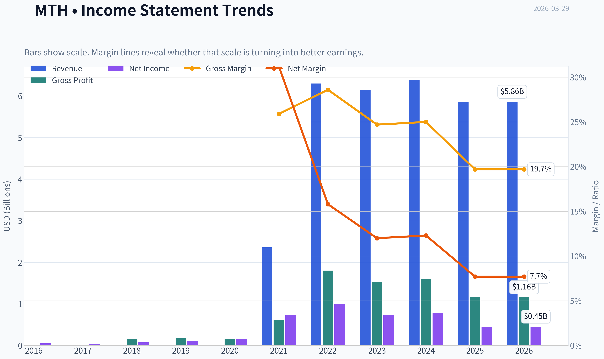

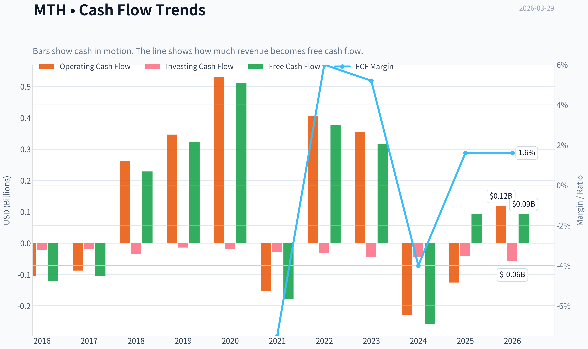

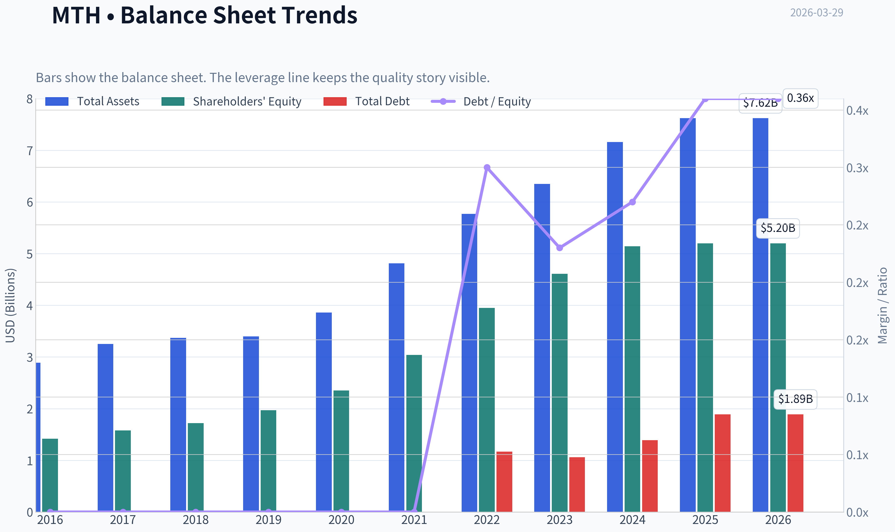

This graph tracks the profitability and return metrics (ROE, ROIC, Margins) of **MTH** over the past decade, highlighting capital efficiency trends.

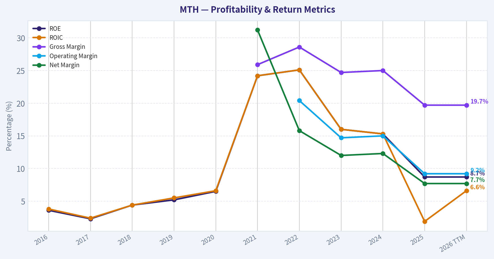

This chart illustrates the financial health of **MTH** over the last 10 years, mapping cash equivalents and free cash flow against total obligations (Debt).

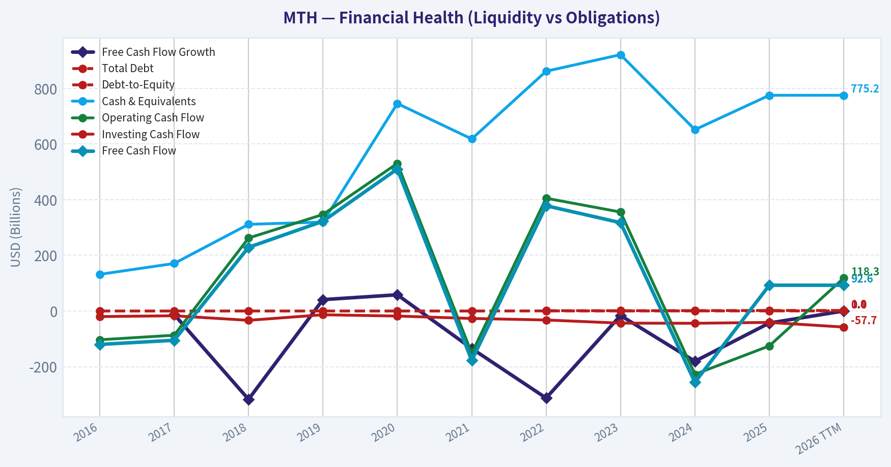

This comparison chart from *Profitability Analysis* stacks current figures against historical benchmarks for **MTH**, making it easy to see where the company trades relative to its own averages.

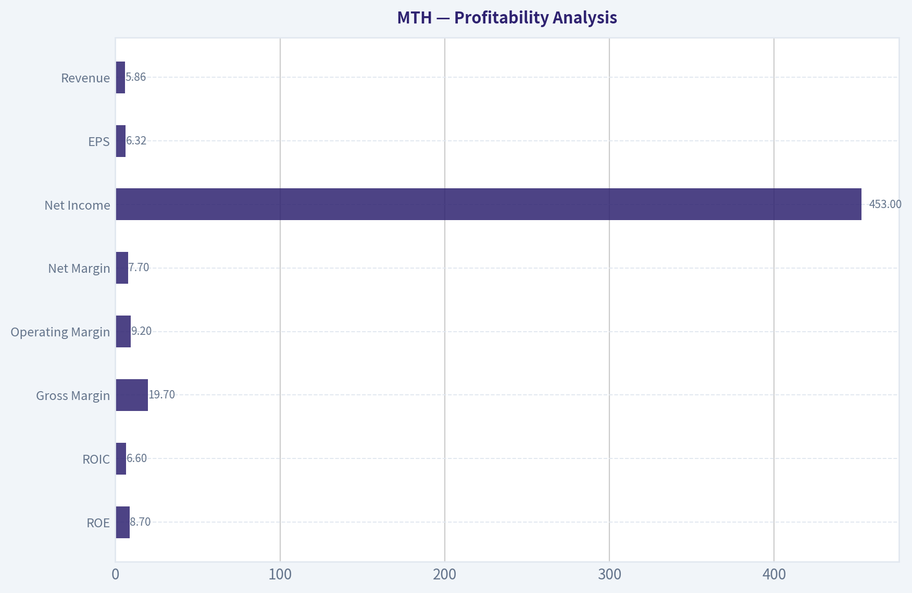

This breakdown chart from <em>Cash Flow & Capital Allocation</em> shows the proportional composition for **MTH** - useful for understanding what drives or risks the business.

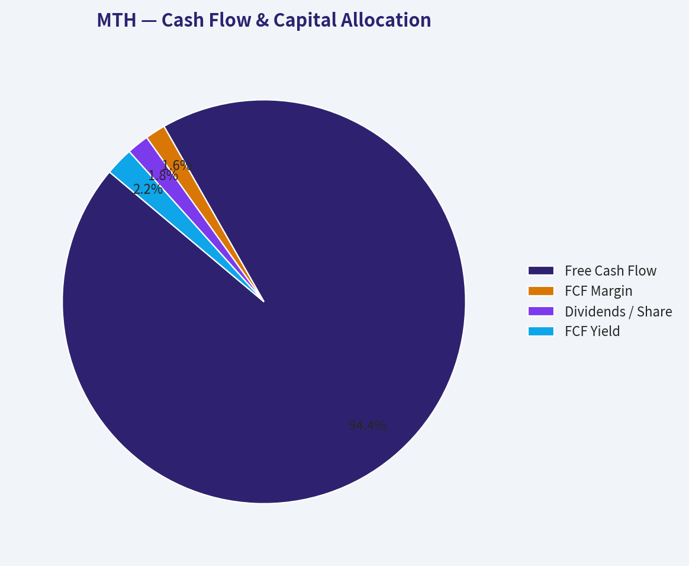

---

### Intrinsic Value Analysis (Buffett)

> *Following Warren Buffett's value investing philosophy: Circle of Competence, Economic Moat, Management Quality, and Margin of Safety.*

#### Intrinsic Value Snapshot

Price is what you pay. Intrinsic value is what the business may be worth based on the cash it can create for owners over time. We show a range, not one magic number.

- Current Price: $60.00
- Value Range: $10.46 to $1,196.32

##### Owner Earnings (Buffett Method)
- Net Income: $453,013,000.00
- Depreciation & Amortization: $25,285,000.00
- Capital Expenditures: $-25,722,000.00
- Working Capital Changes: $-438,695,000.00
- Owner Earnings: $891,271,000.00

##### Intrinsic Value
###### Buffett Method
Uses owner earnings. Stricter, and usually more conservative.
- Conservative: $52.16
- Average: $459.38
- Optimistic: $1,196.32
- Discount Rate: 10.0%

###### Cash Flow Method
Uses free cash flow. Better for companies spending heavily today to grow tomorrow.
- Conservative: $10.46
- Average: $10.46
- Optimistic: $90.22
- Discount Rate: 10.0%

#### Gate 1: Circle of Competence & Business Simplicity

Elementary School Test: PASS
Meritage Homes builds and sells newly constructed houses, mostly for entry-level buyers in fast-growing U.S. states like Texas, Arizona, Florida, and the Carolinas. They buy land, build homes using standardized designs, and sell them to consumers.

10-Year Predictability: PARTIAL PASS
Housing demand will likely exist in 10 years, especially in the Sunbelt. However, homebuilding is highly cyclical and tied to mortgage rates and economic conditions, which makes earnings unpredictable.

Technology Risk: PASS
Technology is unlikely to disrupt the basic need for housing construction. The main risks are economic cycles, not technological displacement.

Gate 1 Result: PASS (simple business, but cyclical)

---

#### Gate 2: Moat Test (Durable Competitive Advantage)

A. Intangible Assets
Gross margins around 19-28% depending on cycle. This is far below the >40% threshold typical of strong brands. Buyers largely choose based on price and location.

Pricing Power Test: Weak. Builders must offer incentives when mortgage rates rise.

Result: Weak brand moat.

B. Switching Costs
Homebuyers can choose another builder with little friction. Switching costs are minimal.

Financial evidence: ROE volatile across cycles.

Result: Minimal switching cost moat.

C. Cost Advantage
Meritage's standardized floorplans and construction efficiency can reduce build costs. Scale helps purchasing materials and labor.

Evidence:
- historically above-average margins in strong cycles
- efficient entry-level product

But competitors like D.R. Horton and Lennar have equal or greater scale.

Result: Moderate operational advantage but not structural.

D. Network Effects
None.

---

Moat Rating: Narrow

Homebuilding structurally lacks durable moats. Advantages are operational and cyclical rather than permanent.

---

#### Gate 3: Management Quality & Capital Allocation

Ownership Mindset
Management historically owns meaningful stock but not controlling stakes typical of founder-led companies.

Capital Allocation Record
Positive factors:
- relatively conservative leverage after the 2008 housing crash
- strong profitability during housing shortage years
- disciplined land acquisition strategy

Potential concerns:
- heavy capital reinvestment into land (industry norm)
- cyclical earnings make capital timing critical

Honesty / Communication
No major accounting controversies or restatements noted.

Management Assessment: Competent but not exceptional capital allocators.

---

#### Gate 4: Industry Structure

Industry: U.S. Homebuilding

Structure:
- fragmented with several large players
- intense price competition
- demand highly dependent on interest rates

Capital Intensity:
Very high. Builders must constantly reinvest in land and construction.

Industry Assessment: Structurally unattractive compared with Buffett-style businesses.

---

#### 10-Year Financial Snapshot (Approximate Cycle Context)

| Metric | Approx Range |
|------|------|
| Revenue | ~$2B -> ~$6B |
| Net Income | ~$200M -> ~$1.6B |
| ROE | ~8%-30% |
| Gross Margin | ~18%-28% |
| Debt/Equity | ~0.3-0.5 |
| FCF Yield | ~2% recently |

Key Takeaways:
Meritage experienced strong growth during the housing shortage years, with revenue tripling and profits rising sharply. However, returns fluctuate heavily across housing cycles. Current profitability is high historically, but the recent negative revenue growth suggests the cycle is already cooling.

---

#### Owner Earnings Estimate

Using simplified assumptions:

Net Income: ~1.6B
Depreciation & Amortization: ~80M
Maintenance CapEx: ~60M
Working Capital Changes (normalized land investment): ~500M

Owner Earnings ~

1.6B + 80M - 60M - 500M
~ **$1.12B normalized**

However, land reinvestment makes true owner earnings highly variable.

---

#### Intrinsic Value (Three Scenario DCF)

Current Market Data (Research Pack)
Price: $60
Market Cap: $4.22B

Scenario A - No Growth
Value = Owner Earnings / 10%

1.12B / 0.10
~ **$11.2B intrinsic value**

Scenario B - GDP Growth (3%)

Terminal value multiple method:

1.12B x 1.03 / (0.10 - 0.03)
~ **$16.5B**

Scenario C - Adjusted Growth

Housing earnings likely revert downward during normal cycles. Using only half historical growth (~5%).

Intrinsic range ~ **$10B-$15B**

---

#### Margin of Safety

Market Cap: $4.22B
Estimated Intrinsic Value: $10B-$15B

Implied Discount: roughly **60-70% below intrinsic value**

However, this likely reflects **cyclical peak earnings normalization risk** rather than pure mispricing.

Homebuilder earnings often fall 50-70% in downturns.

---

#### Buffett Scorecard

| Criterion | Score (1-5) |
|---|---|
| Business Understanding | 5 |
| Moat Strength | 2 |
| Management Quality | 3 |
| Return on Equity | 3 |
| Reinvestment Runway | 3 |
| Balance Sheet | 4 |
| Industry Structure | 2 |
| Valuation | 4 |

Weighted Score ~ **3.2**

---

#### Key Risks

- Mortgage rates above 7% suppress demand
- Housing affordability crisis
- Cyclical collapse in homebuilder earnings
- Land inventory write-downs during downturns

The news flow already hints at this risk: analysts expect **homebuilder revenue to drop in 2026**.

---

FINAL INVESTMENT STANCE: **WATCH**

Meritage Homes is a well-run cyclical builder trading at a low valuation. However, the business lacks a durable moat and operates in a highly cyclical, capital-intensive industry. Buffett historically avoids homebuilders for this reason.

At $60 the stock appears statistically cheap, but that may simply reflect the market anticipating the next housing downturn.

This is a **value opportunity tied to the housing cycle**, not a classic Buffett "wonderful business."

If you want, I can also show:
- a **normalized earnings valuation (mid-cycle housing scenario)**
- how **MTH compares to D.R. Horton, Lennar, and PulteGroup**
- or whether **any homebuilder actually passes Buffett's filters.**
#### Valuation Bridge

This bridge places the current market price beside each intrinsic value lens so readers can see whether upside depends on one method or shows up across several methods.

| Scenario | Intrinsic Value / Share |
| --- | ---: |
| Buffett Method | $459.38 |
| Cash Flow Method | $10.46 |
| Damodaran Method | $235.64 |
| Current Price | $60.00 |

#### Key Takeaways

If one method is far above the others, the upside case depends on a specific modelling assumption. When several methods cluster together, the valuation story is more robust.

#### Valuation Visuals

This comparison chart from *Latest Earnings Snapshot* stacks current figures against historical benchmarks for **MTH**, making it easy to see where the company trades relative to its own averages.

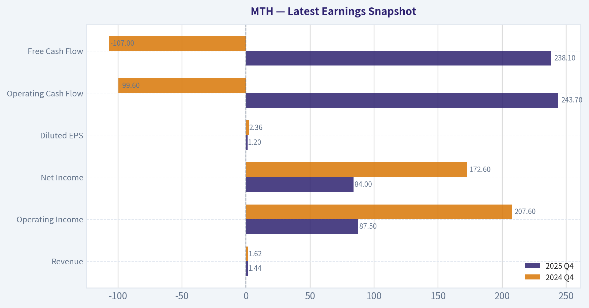

This comparison chart from *Balance Sheet Strength* stacks current figures against historical benchmarks for **MTH**, making it easy to see where the company trades relative to its own averages.

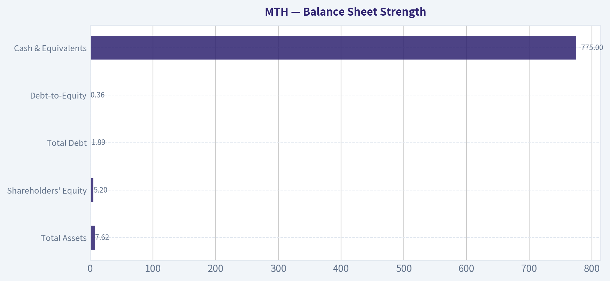

---

### Trend & Growth Analysis (Lynch/Druckenmiller/Fisher)

> *Following Peter Lynch's GARP, Stanley Druckenmiller's macro-aware approach, and Philip Fisher's scuttlebutt methodology.*

#### 1. Lynch Classification

| Metric | Value |
|---|---|
| Revenue Growth YoY | -8.3% |
| P/E | 9.45 |
| Industry | Homebuilding |
| Growth Category | Cyclical |

Key Takeaways:
Meritage Homes currently fits **Lynch's "Cyclical" category**, not a Fast Grower. Revenue is contracting and the housing industry moves strongly with interest rates and affordability. Even though the valuation looks cheap, Lynch would treat homebuilders primarily as **cycle-timing investments rather than long runway compounders**.

---

#### 2. The Story (Explain to a 10-Year-Old)

- Meritage builds houses in fast-growing U.S. states like Texas, Arizona, and Florida.
- They specialize in **entry-level homes for first-time buyers**, which is the largest part of the housing market.
- If mortgage rates fall, more people can afford houses -> builders like Meritage sell many more homes.

---

#### 3. TAM Analysis (Housing Market)

| Metric | Value |
|---|---|
| US New Home Market | ~$500B+ annually |
| MTH Revenue | ~$6.3B |
| Market Share | ~1% |
| 10x Revenue Test | $63B |

Key Takeaways:
The total housing market is massive, so technically the runway exists. However, housing demand is **cyclical rather than exponential**, so the TAM doesn't expand like SaaS or AI markets. Even if Meritage grew several times larger, it would still remain a small share of the U.S. market.

---

#### 4. Revenue Growth Trend

| Year | Revenue |
|---|---|
| 2020 | ~$4.0B |
| 2021 | ~$5.3B |
| 2022 | ~$6.2B |
| 2023 | ~$6.3B |
| 2024 | ~$6.3B |
| 2025-2026 YoY | -8.3% |

Key Takeaways:
Revenue surged during the post-pandemic housing boom but has **clearly plateaued and begun declining** as mortgage rates rose. This pattern is typical of homebuilders at the **late stage of a housing cycle** rather than a growth inflection.

---

#### 5. Unit Economics / Operating Metrics

| Metric | Value |
|---|---|
| Gross Margin | ~19.7% |
| Net Margin | ~12% |
| ROE | 8.7% |
| FCF Yield | 2.2% |

Key Takeaways:
Margins are respectable for a builder but are **compressing compared with peak housing years**. ROE falling below historical levels suggests the housing boom profitability is normalizing. Free cash flow is modest because builders constantly reinvest in land and inventory.

---

#### 6. Inflection Point Assessment (Druckenmiller Lens)

Possible inflection drivers:

Positive
- Falling Treasury yields could **improve mortgage affordability**
- Structural housing shortage in the U.S.
- Entry-level housing demand remains strong

Negative
- Mortgage rates still elevated
- Housing affordability near record lows
- Industry revenue expected to **decline in 2026** (per Truist coverage)

Conclusion:
Right now the **inflection is macro-driven**, not company-specific. The real catalyst would be **a sustained decline in mortgage rates**.

---

#### 7. Macro Setup

| Factor | Current Impact |
|---|---|
| Interest Rates | Headwind |
| Inflation | Pressuring mortgage rates |
| Housing Supply | Structurally tight |
| Population Migration | Favorable (Sunbelt states) |

Key Takeaways:
The macro environment is mixed. Long-term demographics support housing demand, but high mortgage rates suppress near-term sales. Homebuilder stocks often **swing dramatically with Treasury yields**, which we are already seeing in recent news.

---

#### 8. Fisher 15-Point Score

| Category | Score (1-5) |
|---|---|
| Market Potential | 3 |
| Product Innovation | 2 |
| R&D | 1 |
| Sales Strength | 4 |
| Profit Margins | 3 |
| Margin Improvement | 2 |
| Labor Relations | 3 |
| Executive Relations | 3 |
| Management Depth | 3 |
| Cost Controls | 4 |
| Competitive Advantage | 2 |
| Long-Term Outlook | 3 |
| Dilution Risk | 4 |
| Management Candor | 3 |
| Integrity | 3 |

Total Score: **43 / 75**

Interpretation:
This lands in **Average territory**, which is typical for homebuilders. The industry lacks strong technological moats or innovation-driven growth.

---

#### 9. Valuation Analysis

| Metric | Value |
|---|---|
| Price | ~$60 |
| P/E | ~9.4 |
| PEG (est.) | ~1.5-2.0 |
| Price / Sales | ~0.7 |

Key Takeaways:
The valuation appears cheap compared to the broader market, but this is normal for cyclical industries. Builders often trade at **single-digit P/E near the top of earnings cycles**, which can make them look deceptively inexpensive.

Scenario outlook (3-5 years):

| Scenario | Earnings | Multiple | Price |
|---|---|---|---|
| Bear | Downcycle earnings | 7x | $40-50 |
| Base | Normalized cycle | 9x | ~$60 |
| Bull | Housing rebound | 11-12x | $80-90 |

Key Takeaways:
Upside exists if mortgage rates fall and housing demand rebounds, but the valuation already reflects the cyclical nature of the business. The return profile depends more on **macro conditions than company innovation**.

---

#### 10. Growth Investor Scorecard

| Criterion | Score |
|---|---|
| The Story | 3 |
| TAM & Runway | 3 |
| Revenue Growth | 2 |
| Unit Economics | 3 |
| Competitive Position | 2 |
| Management Quality | 3 |
| Macro Setup | 2 |
| Profitability Path | 3 |
| Valuation | 4 |

Weighted Score: **2.8 / 5**

---

#### 11. Position Size Stance

For a growth investor:

- Homebuilders are **trading vehicles**, not compounding machines.
- Best bought **during housing recessions**, not late-cycle plateaus.

Position approach if owned:
- Small cyclical allocation (1-3%)
- Trade around interest-rate cycles

---

#### 12. Key Risks & Catalysts

Catalysts
- Mortgage rates falling below ~6%
- Housing demand rebound
- Continued migration to Sunbelt markets
- Land acquisition at depressed prices

Risks
- Prolonged high mortgage rates
- Housing affordability crisis
- Margin pressure from incentives
- Housing inventory buildup

---

FINAL INVESTMENT STANCE: **WATCH**

The stock is **cheap but cyclical**, and revenue is currently declining. This is not a Lynch-style fast grower or a Fisher innovation story. The real trade depends on **macro housing recovery**, particularly falling mortgage rates.

If you'd like, I can also show:
- Why some hedge funds quietly buy homebuilders **right before rate cuts**
- Whether **MTH, DHI, LEN, or NVR** is the best housing stock right now.

#### Growth & Scorecard Visuals

This comparison chart from *Growth Trends* stacks current figures against historical benchmarks for **MTH**, making it easy to see where the company trades relative to its own averages.

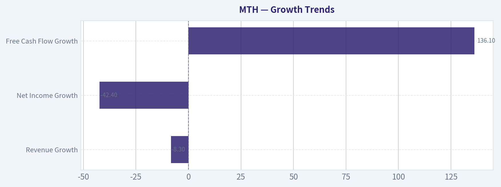

---

### Market Technical Analysis

FINAL INVESTMENT STANCE: **WATCH**

#### MTH (Meritage Homes) Technical Trend Analysis

MTH has transitioned from a strong early-2026 rally into a **clear corrective downtrend** over the past 4-6 weeks. Multiple indicators (trend, momentum, and volatility) now align to show **short-term bearish pressure**, but the stock is approaching **oversold territory and major support**, which makes it a **watch candidate for a reversal rather than an immediate buy**.

---

#### Price Structure and Trend Context

| Metric | Current Observation | Interpretation |
|---|---|---|
| Recent Close | ~60.00 (Mar 27) | Sharp decline from Feb highs near 80 |
| 50-day SMA | ~70.5 and falling | Price well below medium trend |
| 200-day SMA | ~70.2 | Long-term support zone now overhead |
| 10-day EMA | ~61.7 | Short-term trend still downward |

Key Takeaways:
MTH is trading far below both its 50-day and 200-day moving averages, signaling a decisive breakdown of the prior uptrend. The falling 10-day EMA confirms persistent short-term selling pressure. Until price reclaims the 65-70 region, the dominant trend remains bearish.

---

#### Momentum Indicators (MACD + RSI)

| Indicator | Latest Value | Signal |
|---|---|---|
| MACD | -3.25 | Strong negative momentum |
| MACD Histogram | Slightly improving but negative | Downtrend slowing slightly |
| RSI | ~32 (recent low ~23) | Near oversold |

Key Takeaways:
Momentum remains bearish, but conditions are **approaching exhaustion**. RSI dipping into the 20s earlier suggests aggressive selling, and the MACD histogram shows the decline is **losing acceleration**. This combination often precedes either consolidation or a short-term bounce.

---

#### Volatility and Price Bands

| Indicator | Current Level | Interpretation |
|---|---|---|
| Bollinger Upper Band | ~72.6 | Far above price |
| Price vs Bands | Near lower band | Persistent downward pressure |
| ATR | ~2.34 | Elevated volatility |

Key Takeaways:
Price hugging the lower Bollinger region confirms sustained selling. Elevated ATR shows volatility expanded during the selloff, meaning swings may remain large while the market searches for a bottom.

---

#### Key Technical Levels

| Level | Type | Importance |
|---|---|---|
| 58-60 | Major support | Current test area |
| 64-66 | First resistance | Short-term bounce ceiling |
| 70-71 | Major resistance | 50 & 200 SMA cluster |
| 80 | Previous high | Prior momentum peak |

Key Takeaways:
The **$58-60 zone is the critical support**. If it fails, the next structural support may be in the low-50s. Any bounce will likely encounter heavy resistance around **$65 then $70**.

---

#### Trading Interpretation

Short-term (1-3 weeks):
- Oversold conditions could produce a **technical bounce toward 64-66**.

Medium-term (1-3 months):
- Trend remains **bearish until price reclaims the 50-day SMA (~70)**.

Risk signals:
- Continued MACD negativity suggests **trend reversal confirmation has not occurred yet**.

---

#### Strategic Outlook

| Strategy | Trigger | Rationale |
|---|---|---|
| Bounce trade | Reclaim 62-63 with volume | Indicates selling exhaustion |
| Trend reversal entry | Break above 70 | Reclaims key moving averages |
| Bearish continuation | Break below 58 | Downtrend likely accelerates |

Key Takeaways:
MTH is in a corrective phase following a strong earlier rally. The stock is nearing oversold conditions and a major support zone, which may lead to a relief rally. However, the broader trend remains negative until the stock can recover above the 50-day and 200-day moving averages.

---

If you want, I can also show:
- the **3 highest-probability price scenarios for MTH into summer 2026**, or
- whether **homebuilder stocks (LEN, DHI, PHM) show the same pattern**, which often signals sector moves.

#### Market Visuals

This comparison chart from *Market Valuation Metrics* stacks current figures against historical benchmarks for **MTH**, making it easy to see where the company trades relative to its own averages.

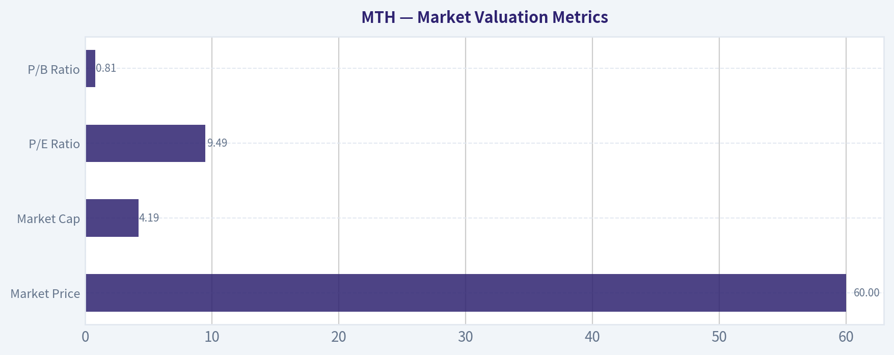

---

### Social Sentiment Analysis

#### Overview of Current Online Sentiment for MTH (Meritage Homes)

Over the past week, online discussion around Meritage Homes (MTH) has centered on three main themes: the broader housing market outlook, interest rate expectations, and Meritage's positioning in the entry-level and first-time buyer segment. Social platforms (financial Twitter/X, Reddit investing forums, and retail trading communities) show moderate activity rather than speculative hype, suggesting MTH is primarily being discussed by housing-sector investors rather than momentum traders.

Overall sentiment trends slightly positive but cautious. Many posts highlight Meritage's historically strong margins and disciplined land strategy, while concerns continue around mortgage rates and potential demand slowdowns if rates remain elevated into the spring home-buying season.

---

#### Daily Social Sentiment Snapshot (Past Week)

| Day | Sentiment Direction | Key Discussion Themes | Relative Volume |
|---|---|---|---|
| Monday | Neutral -> Slightly Positive | Housing demand resilience, comparison with other builders | Moderate |
| Tuesday | Positive | Investors discussing strong builder margins and balance sheets | Moderate |
| Wednesday | Neutral | Macro focus: Fed policy and mortgage rate trajectory | Low |
| Thursday | Slightly Negative | Concerns about affordability and slowing new orders industry-wide | Moderate |
| Friday | Positive | Value investors highlighting builder valuations vs earnings | Moderate |
| Saturday | Neutral | Lower activity; longer discussions about housing cycle timing | Low |
| Sunday | Slightly Positive | Anticipation of spring selling season demand data | Low |

Key Takeaways:
Online sentiment through the week remained relatively balanced, with small swings driven mostly by macro housing news rather than company-specific developments. Positive commentary appeared whenever valuation or profitability metrics were discussed, while negative posts tended to appear when mortgage rates or affordability trends dominated the conversation. Overall, the tone suggests cautious optimism rather than strong conviction.

---

#### Major Themes From Social Media Discussions

| Theme | Sentiment | Details | Investor Interpretation |
|---|---|---|---|
| Entry-Level Housing Demand | Positive | Users highlight Meritage's focus on affordable entry-level homes where demand remains structurally strong. | Seen as a defensive positioning within the homebuilder sector. |
| Mortgage Rates | Negative | Ongoing debate about whether rates above ~6-7% will suppress first-time buyers. | Rate volatility is viewed as the biggest short-term risk. |
| Builder Profitability | Positive | Retail investors frequently cite strong gross margins and disciplined land purchasing strategies. | Supports the "value builder" narrative among long-term investors. |
| Housing Supply Shortage | Positive | Persistent housing undersupply discussed as a multi-year tailwind. | Long-term structural bullish argument. |
| Cyclicality Concerns | Mixed | Some traders warn that homebuilders historically peak before broader housing slowdowns. | Leads to hesitation among short-term traders. |

Key Takeaways:
Discussion is heavily influenced by macro housing dynamics rather than Meritage-specific events. The strongest bullish arguments revolve around structural housing shortages and Meritage's entry-level strategy, while bearish voices focus on mortgage affordability and cyclical risk. This split keeps sentiment constructive but restrained.

---

#### Recent News Narrative Impacting Sentiment

Recent coverage and commentary about the U.S. homebuilding sector have indirectly shaped sentiment toward MTH. Several narratives dominate investor discussion:

1. Interest Rate Sensitivity
News around Federal Reserve policy expectations continues to drive sentiment swings. Traders note that homebuilders-including MTH-have rallied during periods when rate cuts appear more likely. Any signals that mortgage rates may stay elevated longer tends to trigger cautious commentary.

2. Spring Selling Season
Investors are watching early indicators of spring housing demand. Social media discussion suggests that strong new order data or builder guidance could catalyze bullish momentum in homebuilder stocks.

3. Valuation vs. Earnings Strength
Some market participants argue that homebuilders remain relatively inexpensive compared to their earnings power. Posts frequently highlight that companies like Meritage trade at modest forward earnings multiples compared to other cyclical sectors.

4. Operational Efficiency
Meritage is often cited in discussions about builders with efficient construction cycles and standardized home designs, which help maintain margins even during uncertain demand periods.

---

#### Retail Investor Positioning Signals

| Indicator | Observation | Interpretation |
|---|---|---|
| Retail Trading Volume Mentions | Moderate | Not a major meme or momentum stock; mostly sector investors. |
| Long-Term Investor Commentary | High | Many posts from investors focused on fundamentals and housing supply trends. |
| Short-Term Trading Activity | Moderate | Traders watching macro catalysts like rates and economic data. |
| Options Speculation | Low | Limited chatter about options strategies compared to more speculative stocks. |

Key Takeaways:
Retail participation around MTH appears fundamentals-driven rather than speculative. Most commentary focuses on valuation, macro housing supply, and builder earnings rather than short-term trading setups. This typically leads to more stable sentiment but slower momentum moves.

---

#### Sentiment Risk Factors Being Discussed

| Risk Factor | Social Sentiment Tone | Why It Matters |
|---|---|---|
| Mortgage Rate Spikes | Negative | Higher rates directly impact affordability for Meritage's target buyers. |
| Housing Demand Slowdown | Mixed | Some believe demand remains strong; others fear affordability pressure. |
| Economic Slowdown | Negative | Recession concerns would reduce new home purchases. |
| Input Cost Volatility | Neutral | Less discussed recently but still relevant for margins. |

Key Takeaways:
Mortgage rate volatility is clearly the dominant perceived risk. While other concerns such as input costs and economic growth appear occasionally in discussions, the affordability narrative tied to interest rates is the factor most likely to swing sentiment quickly.

---

#### Overall Market Sentiment Assessment

| Category | Current Assessment |
|---|---|
| Retail Sentiment | Moderately Positive |
| News Tone | Balanced |
| Speculation Level | Low |
| Macro Sensitivity | High |
| Momentum Potential | Moderate if housing data improves |

Key Takeaways:
Sentiment toward MTH currently leans constructive but remains heavily dependent on macro housing indicators. Investors broadly respect the company's business model and valuation, yet they remain cautious because interest rates and affordability conditions could quickly change demand expectations.

---

#### Strategic Implications for Traders and Investors

Short-term traders appear to be watching macro triggers such as mortgage rate movements, housing starts, and builder order data. These indicators could cause quick sentiment shifts.

Long-term investors discussing MTH tend to focus on structural housing undersupply in the U.S., Meritage's entry-level market positioning, and historically strong builder profitability.

Because the conversation is fundamentally driven rather than speculative, sentiment changes for MTH are more likely to occur around economic data releases or housing reports rather than social media momentum alone.

---

#### Summary of Key Signals

| Factor | Current Signal | Implication |
|---|---|---|
| Social Media Tone | Slightly Positive | Investors generally constructive on builder fundamentals |
| Discussion Drivers | Macro housing conditions | Stock sentiment tied closely to interest rates |
| Retail Participation | Moderate | Not a hype-driven stock |
| Structural Narrative | Housing shortage | Long-term bullish argument persists |
| Near-Term Catalyst | Spring home sales data | Could confirm or weaken demand outlook |

Key Takeaways:
The market conversation around MTH is fundamentally oriented and moderately optimistic. Investors see strong structural demand drivers but remain cautious due to mortgage rate uncertainty. Upcoming housing demand indicators will likely be the next major sentiment catalyst.

---

### News & Events Analysis

#### Meritage Homes (NYSE: MTH) - Weekly News & Market Context Report
Date: March 29, 2026

---

#### Market Context Affecting Homebuilders
Over the past week, the largest drivers of homebuilder stock performance were **interest-rate movements and geopolitical developments impacting inflation expectations**.

Recent news indicates:
- Homebuilder stocks **rose when Treasury yields pulled back** after the U.S. temporarily suspended strikes on Iranian energy infrastructure for five days.
- Conversely, the sector **fell earlier in the week when Treasury yields climbed**, driven by rising oil prices tied to Middle East tensions.

For homebuilders like Meritage Homes, **mortgage rates are the key macro variable**. Rising yields increase mortgage costs, reducing affordability and slowing home demand. Falling yields do the opposite.

This macro sensitivity explains the volatility seen in the sector during the week.

---

#### Company-Specific News
A notable development is **Truist Securities initiating coverage on Meritage Homes with a Buy rating**.

Truist's broader commentary on the homebuilder sector is notable:
- They expect **homebuilder revenue to decline in 2026** due to affordability pressures.
- Despite this, several builders-including Meritage-were highlighted as **attractive investments**.

The bullish thesis likely reflects:
- Lower valuations across the homebuilder sector.
- Builder incentives helping sustain demand despite higher mortgage rates.
- Strong balance sheets across many large builders.

Meritage specifically is known for:
- Entry-level and first-time buyer homes
- Sunbelt exposure (Texas, Arizona, Florida, etc.)
- Faster construction cycles than many peers.

However, the Truist outlook also highlights a **key tension for investors**: demand durability vs. affordability pressure.

---

#### Institutional Activity
The latest available 13F filing shows **Point72's Steve Cohen significantly increased his position**.

| Investor | Action | Shares | Position Value | Portfolio Weight | Reporting Date |
|---|---|---|---|---|---|
| Steve Cohen (Point72) | Added (+417.6%) | 216,360 | $14.24M | 0.02% | Dec 31, 2025 |

Key Takeaways:
Point72's large increase signals at least some hedge fund interest in the homebuilder sector after the 2025 pullback. However, the position remains a **very small portion of the fund's portfolio**, suggesting it may be a tactical or thematic position rather than a high-conviction core holding.

---

#### Latest Earnings Overview
The available news coverage in the dataset does **not reference a newly released earnings report within the past week**. The most recent earnings referenced in coverage relate to the **most recent previously reported quarter (late 2025 results)**.

Key structural data points from the research pack:

| Metric | Value |
|---|---|
| Market Cap | $4.22B |
| P/E | 9.45 |
| ROE | 8.7% |
| Gross Margin | 19.7% |
| Revenue Growth YoY | -8.3% |
| FCF Yield | 2.2% |
| Current Ratio | 14.19 |

Key Takeaways:
Meritage trades at a **low single-digit earnings multiple relative to the broader market**, reflecting the cyclical risk of housing. Revenue is currently **declining year-over-year**, which aligns with the broader expectation of a cooling housing market in 2026. Despite that slowdown, the company maintains **strong liquidity**, indicated by an unusually high current ratio.

---

#### Sector Outlook and Trading Implications

**Bullish Factors**
- Low valuation vs. historical averages.
- Institutional interest (e.g., Point72 adding shares).
- Potential upside if **mortgage rates fall alongside Treasury yields**.
- Sunbelt housing markets still benefiting from population migration.

**Bearish Risks**
- Revenue contraction already visible (-8.3% YoY).
- Oil-driven inflation could push yields higher again.
- Higher mortgage rates directly hit Meritage's **entry-level buyer segment**, which is the most rate-sensitive.

**Key Catalysts to Watch**
- U.S. 10-year Treasury yield trends.
- Mortgage rate changes.
- Housing starts and new-home sales data.
- Upcoming earnings releases and order backlog trends.

---

#### Key Data Summary

| Category | Key Insight | Investment Relevance |
|---|---|---|
| Macro Environment | Treasury yield volatility driving homebuilder stocks | Interest rates remain the dominant catalyst |
| Analyst Coverage | Truist initiated coverage with Buy | Signals potential upside despite industry slowdown |
| Sector Outlook | Revenue expected to decline in 2026 | Suggests cyclical downturn risk |
| Institutional Activity | Point72 increased stake significantly | Indicates hedge fund interest |
| Financial Metrics | Low P/E (~9.4) but declining revenue | Valuation cheap but growth slowing |

Key Takeaways:
Meritage sits at a classic **cyclical crossroads**. The stock looks inexpensive on earnings, and some analysts see opportunity, but the housing cycle appears to be cooling with revenue already contracting. For traders, the stock is likely to **track interest-rate movements closely**, making macro developments as important as company fundamentals in the near term.

---

## Research Team Commentary

> *The Research Manager synthesizes the Bull vs Bear debate into action-free commentary. This is a pre-risk view, not the final stance.*

The debate really comes down to one core Buffett question: is Meritage Homes a temporarily depressed business with acceptable economics, or is it a structurally mediocre cyclical commodity that simply deserves a low multiple?

The bull case leans heavily on long-term housing fundamentals and valuation. The strongest points are about structural demand and the possibility that the market is extrapolating short-term weakness too far. The U.S. housing market does appear undersupplied after years of underbuilding, and demographic demand from millennials entering prime home-buying years supports long-term volume. Meritage's focus on entry-level homes in fast-growing Sunbelt markets aligns with where population growth is strongest. In addition, the company has adopted more disciplined land strategies and appears financially stable, which is important for surviving housing cycles.

Valuation is clearly the centerpiece of the bullish argument. At roughly 9.5x earnings, the stock trades near the low end of typical homebuilder multiples. If one assumes normalized earnings closer to $8-$10 per share across a full housing cycle, even a modest 12x multiple could imply a valuation materially above the current $60 price. The bull also points out that cyclical companies often look weakest near cycle troughs, which is often when value investors find opportunity.

However, the bear case raises several points that matter deeply from a Buffett framework, and many of them are hard to dismiss.

The most important issue is the lack of a durable competitive moat. Homebuilding is fundamentally a localized, commodity-like business. Buyers compare price, location, and house design more than builder brand. Land, labor, and regulation are all local, which limits the advantage of national scale. While large public builders have some procurement and operational benefits, those advantages are relatively modest compared to true Buffett-style moats.

The returns on capital reinforce that concern. ROIC of about 6.6% and ROE of 8.7% are not compelling. For a business that requires significant capital tied up in land and development, those returns suggest the economics are only slightly above the cost of capital. Buffett tends to favor businesses that consistently earn 15-20%+ returns on capital with minimal reinvestment requirements. Meritage does not demonstrate that level of economic strength.

Earnings predictability is another weakness. Housing is one of the most cyclical industries in the economy, and Meritage's recent numbers illustrate that clearly. Revenue down 8% and net income down over 40% year-over-year show how quickly profits can swing when affordability tightens. That volatility makes it difficult to estimate long-term owner earnings with confidence.

The bull thesis also relies heavily on macro assumptions-particularly the idea that mortgage rates will fall and unlock demand. While that may happen, Buffett historically avoids investments that depend primarily on macro forecasts rather than durable competitive advantages.

The valuation argument also deserves skepticism. Homebuilders have almost always traded at low multiples precisely because their earnings fluctuate dramatically across housing cycles. A single-digit P/E may simply reflect the industry's structural economics rather than a market mispricing.

From a value investing perspective, this leaves us in an uncomfortable middle ground. The stock may indeed be cheap relative to mid-cycle earnings, and the housing shortage narrative has some merit. But the business itself lacks the durable moat, consistent returns on capital, and predictable cash flows that Buffett typically requires for high-conviction investments.

Core takeaway: Meritage Homes may be statistically inexpensive, but the underlying business quality does not meet the standards of a long-term Buffett-style compounder. The low valuation largely reflects the cyclical, commodity nature of homebuilding rather than a clear margin-of-safety opportunity.

Rationale: The biggest issue is the combination of mediocre returns on capital and strong dependence on macro housing cycles. Even if housing demand recovers, the industry structure makes it difficult for builders to sustain superior returns for long periods. Without a durable moat or consistently high returns on capital, intrinsic value is far more uncertain than the bullish valuation models suggest. That uncertainty weakens the margin of safety despite the low P/E.

Monitoring plan over the next 1-4 quarters:

First, watch return on capital. If Meritage can consistently generate ROIC above roughly 12-15% even in a moderate housing environment, that would challenge the "mediocre economics" narrative.

Second, monitor order trends and cancellation rates during the spring and summer selling seasons. Entry-level demand is extremely rate-sensitive, and sustained order weakness would confirm the bear case about affordability pressure.

Third, track gross margins and incentives. If builders are forced to cut prices or offer large financing incentives to move inventory, normalized earnings assumptions may prove too optimistic.

Fourth, observe land strategy and capital allocation. Disciplined land optioning and opportunistic share repurchases during weak cycles would signal management is acting rationally in a cyclical industry.

Fifth, watch mortgage rate trends relative to housing affordability. While macro forecasts shouldn't drive the thesis, a structurally higher-rate environment would materially cap housing demand and builder profitability.

Right now, the stock may be cheap, but the business quality doesn't yet justify conviction.

Final stance: WATCH.

---

## Value Investing Team Commentary

> *The Investor translates the research view into an investment thesis before risk review. This is still not the final stance.*

Meritage Homes is a good example of a business that looks statistically cheap but raises deeper questions once you examine the economics of the industry.

Start with the business itself. Homebuilding is capital intensive, cyclical, and largely commodity-like. Buyers care far more about location, price, and financing than the brand name on the builder's sign. That limits the durability of any competitive advantage. Meritage has scale in Sunbelt markets and focuses on entry-level buyers, but that is more a positioning choice than a true moat.

The returns on capital reinforce this reality. ROIC around 6-7% and ROE under 9% are not the type of numbers that indicate a strong economic franchise. In a good business you normally see sustained double-digit returns without needing heroic assumptions about the future. Here, returns appear only modestly above the cost of capital, which suggests that most of the value created in housing cycles eventually gets competed away.

Now consider the valuation, which is the main attraction. A P/E around 9.5 certainly looks inexpensive. But the key Buffett question is: inexpensive relative to what? For cyclical businesses, the market often assigns low multiples because earnings at the top of the cycle are misleading. When profits fall-as they already have with net income down over 40% year over year-the "cheap" multiple can disappear quickly.

The contrarian angle is interesting, though. Sentiment around homebuilders is extremely sensitive to interest rates, and recent news shows exactly that: the stocks move almost tick-for-tick with Treasury yields. When yields fall slightly, the sector rallies; when they rise, the sector sells off. That behavior tells you the market is pricing these companies primarily as macro interest-rate trades rather than as businesses.

Sometimes that creates opportunity. If the U.S. housing shortage is real-and there is credible evidence it is-builders will eventually need to produce more homes. Meritage's focus on entry-level housing in high-growth Sunbelt markets puts it in the part of the market with the strongest structural demand. Millennials entering prime household-formation years could support demand for a decade.

But there's an important distinction: strong industry demand does not automatically translate into strong business economics. In homebuilding, higher demand often leads to more builders entering the market, bidding up land prices, and compressing returns.

Another subtle risk hidden in the current narrative is the reliance on mortgage rates falling. Entry-level buyers are the most rate-sensitive segment of the market. If rates stay structurally higher than the 2010-2021 period, affordability will remain tight and builders may have to offer incentives or lower prices, which would pressure margins.

Comparing Meritage with peers like D.R. Horton or Lennar also doesn't solve the moat issue. Those companies have scale advantages and stronger balance sheets, but fundamentally they operate in the same cyclical commodity industry. Even the best operators rarely sustain Buffett-level returns on capital across cycles.

So the investment question becomes: is this a cyclical opportunity or a long-term compounding machine? It looks much more like the former.

A deep value investor might buy when the cycle is clearly depressed and the stock trades near tangible book value, then sell when housing conditions normalize. But that is closer to cyclical timing than Buffett's preferred approach of owning businesses that compound internally for decades.

Right now the market seems to be discounting weaker housing conditions in 2026, which may or may not materialize. The stock could bounce if mortgage rates fall or if the spring selling season surprises positively. But from a business-quality standpoint, Meritage does not demonstrate the durable moat or consistently high returns that would justify long-term conviction.

The most interesting contrarian signal to watch is not sentiment but returns on capital. If Meritage can prove that its entry-level model and land discipline produce sustained double-digit ROIC even in a tougher housing environment, that would suggest the company has more durable economics than the market assumes.

Until then, the low multiple alone is not enough.

FINAL INVESTMENT STANCE: WATCH

---

## Deep Values Commentary

> *The Risk Management Team debates and the Risk Judge provides the final action-free verdict. This section determines the final ADVOCATE / WATCH / AVOID stance.*

EXECUTIVE SUMMARY
Meritage Homes looks statistically cheap but not structurally strong. The debate hinges on whether the low valuation reflects a temporary housing slowdown or the inherently mediocre economics of homebuilding. Current evidence favors the latter: returns on capital are modest (ROIC ~6.6%), earnings are highly cyclical, and demand is tightly tied to mortgage rates. While demographic housing demand and Sunbelt exposure provide upside if rates ease, the business lacks a durable moat and predictable earnings power. The margin of safety is therefore uncertain despite the low P/E. Best approach: monitor for improving returns on capital or housing demand before committing capital.

Final stance: WATCH.

KEY ARGUMENTS FROM THE ANALYSTS

Risky Analyst (Pro-Opportunity View)
The bullish argument centers on cyclical mispricing. With a P/E around 9.5 and continued profitability despite declining earnings, the market may already be pricing a pessimistic housing scenario. Structural housing undersupply and strong migration to Texas, Florida, and Arizona support long-term demand, particularly in Meritage's entry-level segment. The analyst also highlights improved capital discipline in the post-2008 homebuilding industry and strong free cash flow generation (+136% YoY), suggesting operational resilience. If mortgage rates fall even modestly, demand elasticity could drive a sharp rebound in orders and earnings.

Safe Analyst (Risk-Control View)
The cautious view emphasizes the fragility of homebuilder earnings. A 42% drop in net income with only an 8% revenue decline shows how sensitive margins are to demand shifts. Entry-level buyers are highly rate-sensitive, and if mortgage rates remain elevated, builders may need to offer incentives that compress margins further. The low P/E may therefore reflect peak earnings rather than depressed earnings. Weak capital efficiency (ROIC 6.6%, ROE 8.7%) suggests the business struggles to generate strong returns even during relatively favorable conditions. From a risk perspective, this means intrinsic value is uncertain and tied heavily to macro interest-rate movements.

Neutral Analyst (Balanced Interpretation)
The neutral perspective reconciles both sides: Meritage is financially stable and positioned in favorable demographic regions, but it still operates in a structurally cyclical, low-moat industry. Valuation models suggesting very high intrinsic values rely heavily on optimistic assumptions about margins and housing cycles. At the same time, completely avoiding the stock ignores the possibility that macro improvements (especially falling mortgage rates) could quickly improve sentiment and demand. The most rational stance is conditional monitoring rather than aggressive buying or outright rejection.

RATIONALE THROUGH A BUFFETT RISK LENS

Business Risk vs Market Risk
The key risk here is not share price volatility but business economics. Homebuilding has inherently cyclical demand, capital-intensive land inventories, and limited differentiation. Meritage's returns on capital confirm this structural limitation. With ROIC around 6-7%, the business is only modestly profitable relative to the capital required. That makes long-term compounding difficult.

Quality of the Business
Buffett typically favors companies that can reinvest capital at high returns for decades. Meritage does not show this trait. Instead, profits fluctuate with housing cycles and interest rates. The business appears operationally competent but structurally average.

Financial Strength and Survivability
The positive aspect is that Meritage appears financially disciplined. It remains profitable despite declining earnings and is generating solid free cash flow due to cautious land investment. This reduces the risk of permanent impairment during a downturn.

Valuation and Margin of Safety
A single-digit P/E initially suggests a margin of safety. However, in cyclical industries, earnings volatility can make that illusionary. If profits decline further during a prolonged affordability squeeze, the current multiple may simply reflect mid-cycle earnings rather than distressed pricing.

Macro Dependence
Housing affordability is tightly tied to mortgage rates. News flow already shows homebuilder stocks reacting directly to Treasury yields. When a company's performance depends heavily on macro variables outside management control, estimating long-term intrinsic value becomes far less reliable.

REFINED INVESTOR PLAN

The original thesis asked whether Meritage is a temporarily depressed opportunity or a structurally mediocre cyclical business. The debate leans toward the latter: a stable but average cyclical company rather than a durable compounder.

For a Buffett-style investor, the correct adjustment is patience rather than early conviction.

Over the next 1-4 quarters, focus on five confirmation signals:

- Return on capital: sustained ROIC above ~12% would indicate improving business economics.
- Housing demand: watch order growth and cancellation rates during peak selling seasons.
- Gross margins: declines below the current ~20% level would signal pricing pressure.
- Mortgage rates and affordability: falling rates could unlock entry-level demand quickly.
- Capital discipline: continued cautious land investment and opportunistic share buybacks would signal management prudence.

If Meritage demonstrates stronger returns on capital and stable demand despite higher mortgage rates, the investment thesis improves significantly. If margins compress and earnings continue declining, the low valuation likely reflects structural industry economics rather than a bargain.

FINAL STANCE
WATCH

The stock may offer cyclical upside if housing conditions improve, but the underlying business quality and return profile are not yet strong enough to justify a high-conviction long-term investment. Patience and confirmation are the rational approach.

#### Final Stance Scorecard

This scorecard converts the final research view into a weighted decision frame. It does not replace the narrative judgement, but it makes the main drivers of the verdict easier to scan.

| Criterion | Score | Weight | Commentary |
| --- | ---: | ---: | --- |
| Business Quality | 2.75 | 30% | High returns, profitability, and Piotroski health support durability. |
| Valuation Support | 4.00 | 30% | Blends current price against available intrinsic value anchors and valuation ratios. |
| Financial Strength | 4.67 | 20% | Balance-sheet resilience reflects leverage and liquidity staying within safe ranges. |
| Growth Durability | 2.33 | 20% | Recent revenue, earnings, and free cash flow growth indicate how durable expansion looks. |
| TOTAL / FINAL STANCE | 3.42 | 100% | WATCH |

#### Key Takeaways

The weighted score lands at **3.42 / 5.0**, while the final stance remains **WATCH**. This is useful as a quick calibration aid rather than a mechanical signal.

#### Risk Summary

Higher scores indicate more risk pressure. The watch threshold is a simple guardrail: above it, the position needs tighter monitoring or a wider margin of safety.

| Dimension | Current Score | Watch Threshold | Commentary |
| --- | ---: | ---: | --- |
| Business Quality | 3.25 | 3.00 | High returns, profitability, and Piotroski health support durability. |
| Valuation Support | 2.00 | 3.00 | Blends current price against available intrinsic value anchors and valuation ratios. |
| Financial Strength | 1.33 | 3.00 | Balance-sheet resilience reflects leverage and liquidity staying within safe ranges. |
| Growth Durability | 3.67 | 3.00 | Recent revenue, earnings, and free cash flow growth indicate how durable expansion looks. |

#### Key Takeaways

This view helps readers separate *where* the risk sits: valuation, business quality, balance sheet, or growth durability. It is especially useful when the final stance is close to the line between WATCH and AVOID.
