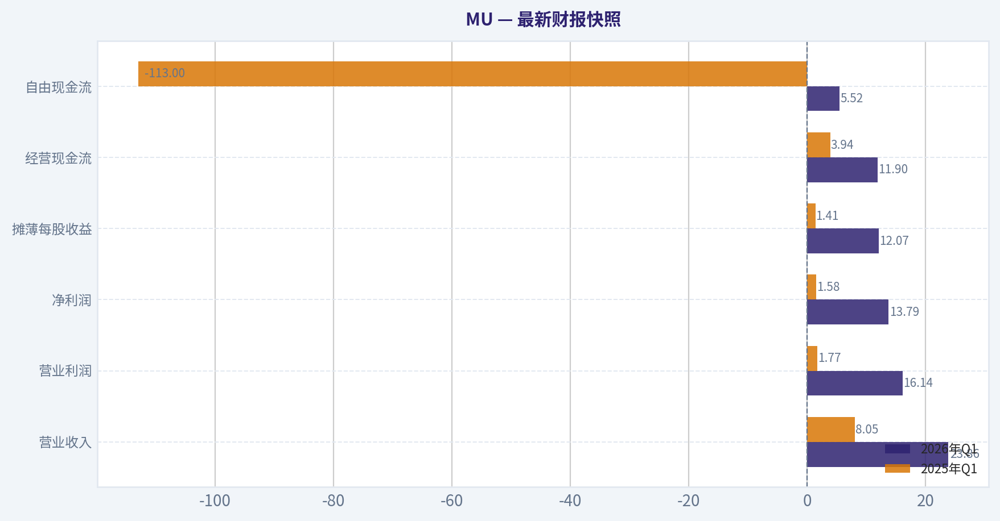
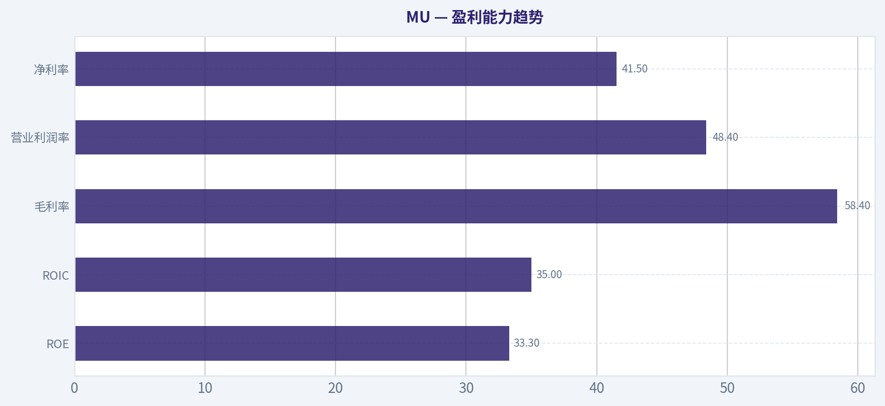
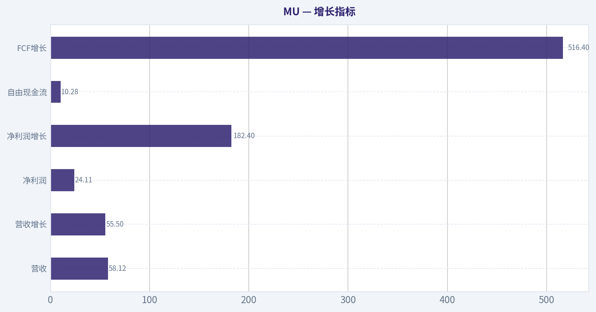
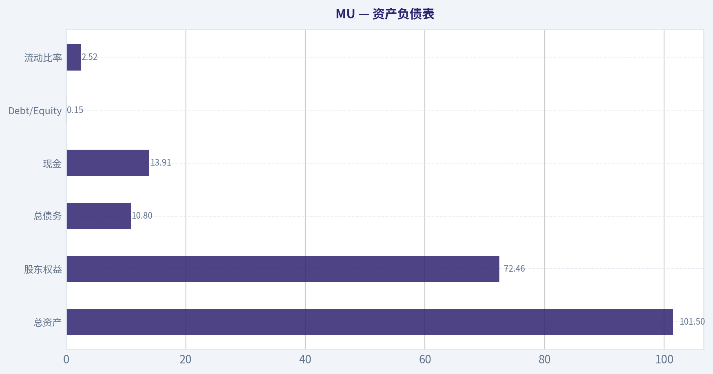
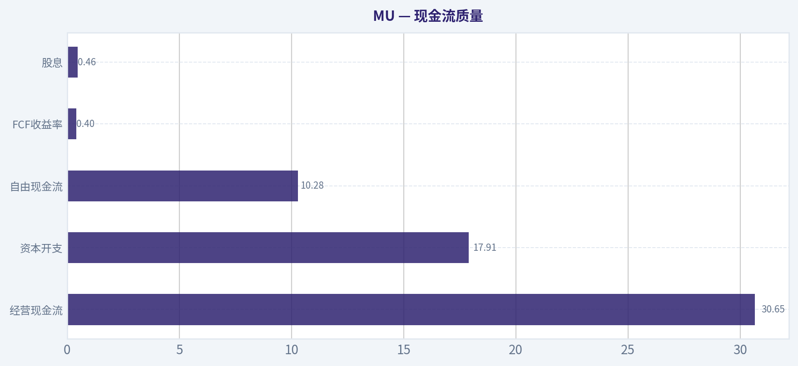
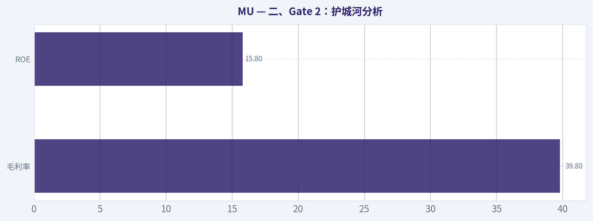
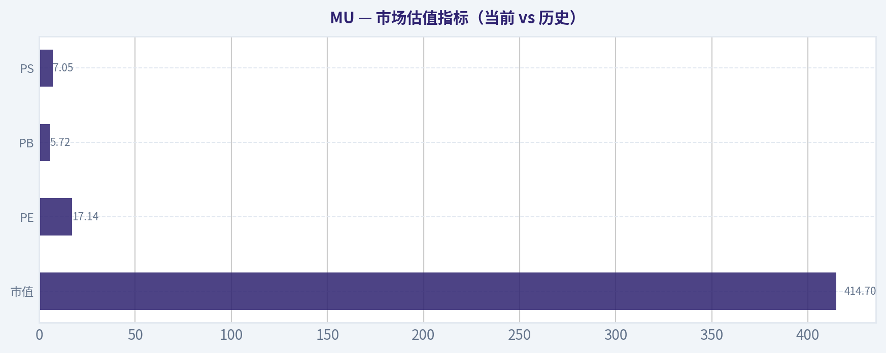

# MU 深度价值情报

**调研日期:** 2026-04-02

## 关键免责声明

*本报告由 Deep Value Intelligence（一个基于 AI 的多智能体投资分析框架）自动生成。 本报告仅供信息参考和教育目的，不构成任何财务或投资建议。 在做出任何投资决策之前，请务必进行独立调研并咨询合规的财务顾问。*

---

## 目录

1. 情报摘要
2. 分析师团队报告
   - 基本面分析
   - 价值分析 (巴菲特)
   - 成长性分析 (林奇/德鲁肯米勒/费雪)
   - 市场分析
   - 社会舆情分析
   - 新闻分析
3. 研究团队评论
4. 投资团队评论
5. Deep Values 团队洞察

---

## 情报摘要

### 核心观点与前提条件

**核心论点:** **执行摘要（核心结论）**
Micron 的基本面确实受 AI 与 HBM 驱动出现明显改善，但商业本质仍带有强周期属性，而当前价格远高于多数内在价值估计，几乎没有安全边际。AI 可能抬高行业长期盈利中枢，但尚未经历完整周期验证。对长期价值投资者而言，当前阶段更像"叙事提前定价"，而不是明显低估机会。结论：**观望**。

**主要风险:**
- 成长派（Risky Analyst）最强论点**
- 最终立场：观望（WATCH）**

**观点反转条件:**
- 成长派（Risky Analyst）最强论点**
- 最终立场：观望（WATCH）**

**置信度:** 中

---

## 分析师团队报告

### 基本面分析

#### 最新财报快照

*以下数据基于最近一期已披露财报（2026年Q1），并尽量与上一年同期对比。*

| 指标 | 2026年Q1 | 2025年Q1 | 同比变化 |
| --- | ---: | ---: | ---: |
| 营业收入 | $23.86B | $8.05B | +196.3% |
| 营业利润 | $16.14B | $1.77B | +810.0% |
| 净利润 | $13.79B | $1.58B | +770.8% |
| 摊薄每股收益 | $12.07 | $1.41 | +756.0% |
| 经营现金流 | $11.90B | $3.94B | +202.0% |
| 自由现金流 | $5.52B | $-113.0M | +4981.4% |

关键结论：这张快照先把最新一期财报放在桌面上，再去看长周期分析。这样读者能更清楚地区分"公司长期质量"和"这次财报发生了什么"。

#### MU 10年财务指标

*以下数值均由原始数据确定性计算得出，并非 AI 估算。*

*发行人类型：operating company（Technology / Semiconductors）。*

#### 10年财务指标
*年度行来自已披露财务报表，最后一行 TTM 由最近四个季度滚动计算得出。*

| 指标 | 2016 | 2017 | 2018 | 2019 | 2020 | 2021 | 2022 | 2023 | 2024 | 2025 | 2026 TTM |
| --- | --- | --- | --- | --- | --- | --- | --- | --- | --- | --- | --- |
| 市场价格 | $21 | $40 | $31 | $53 | $73 | $72 | $55 | $69 | $96 | $119 | $363 |
| 总市值 | $22.18B | $46.35B | $38.09B | $60.04B | $83.05B | $104.06B | $63.43B | $76.44B | $107.60B | $133.89B | $414.69B |
| 市盈率 | N/A | 18.47 | 8.25 | 104.31 | 82.50 | 17.43 | 7.29 | -13.10 | 137.49 | 15.68 | 17.14 |
| 市净率 | 1.84 | 2.49 | 1.18 | 1.67 | 2.13 | 2.37 | 1.27 | 1.73 | 2.38 | 2.47 | 5.72 |
| ROE | -1.4% | 12.7% | 13.4% | 1.6% | 2.5% | 13.3% | 17.4% | -13.2% | 1.7% | 15.8% | 33.3% |
| ROIC | 1.2% | 14.8% | 14.0% | 1.7% | 2.5% | 12.1% | 15.8% | -9.8% | 1.5% | 12.9% | 35.0% |
| 每股收益 | $-0.16 | $2.17 | $3.75 | $0.50 | $0.89 | $5.23 | $7.75 | $-5.34 | $0.70 | $7.59 | $21.18 |
| 营收 | $12.40B | $20.32B | $8.44B | $4.87B | $6.06B | $27.70B | $30.76B | $15.54B | $25.11B | $37.38B | $58.12B |
| 毛利润 | $579.0M | $3.11B | $5.15B | $1.40B | $2.07B | $10.42B | $13.90B | $-1.42B | $5.61B | $14.87B | $33.96B |
| 毛利率 | 4.7% | 15.3% | 61.0% | 28.6% | 34.1% | 37.6% | 45.2% | -9.1% | 22.4% | 39.8% | 58.4% |
| 营业利润率 | -0.3% | 53.8% | 59.5% | 13.4% | 19.1% | 22.7% | 31.5% | -37.0% | 5.2% | 26.1% | 48.4% |
| 净利润 | $-170.0M | $2.37B | $4.33B | $561.0M | $988.0M | $5.86B | $8.69B | $-5.83B | $778.0M | $8.54B | $24.11B |
| 净利率 | -1.4% | 11.7% | 51.2% | 11.5% | 16.3% | 21.2% | 28.2% | -37.5% | 3.1% | 22.8% | 41.5% |
| 营收增长 | 244.4% | -62.5% | 58.1% | -33.8% | 24.4% | 357.5% | 11.0% | -49.5% | 61.6% | 48.9% | 55.5% |
| 净利润增长 | -136.1% | 1492.9% | 82.6% | -87.0% | 76.1% | 493.2% | 48.2% | -167.2% | 113.3% | 997.6% | 182.4% |
| 自由现金流增长 | N/A | -229.1% | 149.2% | -60.0% | -97.6% | 2837.3% | 27.7% | -296.4% | -102.0% | 1278.5% | 516.4% |
| 总账面价值 | $12.08B | $18.62B | $32.29B | $35.88B | $39.00B | $43.93B | $49.91B | $44.12B | $45.13B | $54.16B | $72.46B |
| 总资产 | $27.54B | $35.34B | $43.38B | $48.89B | $53.68B | $58.85B | $66.28B | $64.25B | $69.42B | $82.80B | $101.51B |
| 总债务 | $756.0M | $1.26B | $859.0M | $1.31B | $6.43B | $6.12B | $7.52B | $13.93B | $14.01B | $15.28B | $10.80B |
| 债务股权比 | 0.06 | 0.07 | 0.03 | 0.04 | 0.16 | 0.14 | 0.15 | 0.32 | 0.31 | 0.28 | 0.15 |
| 现金及等价物 | $4.14B | $5.11B | $6.51B | $7.15B | $7.62B | $7.76B | $8.26B | $8.58B | $7.04B | $9.64B | $13.91B |
| 股东权益 | $12.08B | $18.62B | $32.29B | $35.88B | $39.00B | $43.93B | $49.91B | $44.12B | $45.13B | $54.16B | $72.46B |
| 经营现金流 | $3.17B | $8.15B | $17.40B | $13.19B | $8.31B | $12.47B | $15.18B | $1.56B | $8.51B | $17.52B | $30.65B |
| 投资现金流 | $-3.04B | $-7.54B | $-8.22B | $-10.09B | $-7.59B | $-10.59B | $-11.59B | $-6.19B | $-8.31B | $-14.09B | $-17.91B |
| 自由现金流 | $-2.65B | $3.42B | $8.52B | $3.41B | $83.0M | $2.44B | $3.11B | $-6.12B | $121.0M | $1.67B | $10.28B |
| 自由现金流利润率 | -21.4% | 16.8% | 101.0% | 70.0% | 1.4% | 8.8% | 10.1% | -39.4% | 0.5% | 4.5% | 17.7% |
| 每股分红 | N/A | N/A | N/A | N/A | $0.00 | $0.00 | $0.41 | $0.46 | $0.46 | $0.46 | $0.46 |

#### 盈利能力指标
- 净资产收益率 (ROE): 15.8%
- 投入资本回报率 (ROIC): 14.5%
- 总资产收益率 (ROA): 10.3%
- 毛利率: 39.8%
- 营业利润率: 26.2%
- 净利率: 22.8%

#### 流动性指标
- 流动比率: 2.52
- 速动比率: 1.53

#### 杠杆指标
- 债务股权比: 0.28
- 利息覆盖倍数: 20.56
- 净负债: $5.64B

#### 增长指标（同比）
- 营收增长: 48.9%
- 净利润增长: 997.6%
- 自由现金流增长: 1278.5%
- 营收复合增长率（3年）: 6.7%
- 营收复合增长率（5年）: 43.9%

#### 估值指标
- 市盈率 (TTM): 17.14
- 预期市盈率: 3.68
- 市净率: 5.65
- 市销率: 7.05
- PEG 比率: 0.02
- 企业价值/EBITDA: 11.17
- 自由现金流收益率: 0.4%
- 盈利收益率: 5.8%

#### 所有者收益（巴菲特方法，代码计算）
- 净利润: $8.54B
- + 折旧与摊销: $8.35B
- - 资本开支: $-15.86B
- - 营运资本变动: $-666.0M
- = **所有者收益: $1.70B**

#### 内在价值（代码计算）
- 当前价格: $363
- 巴菲特方法（所有者收益）:
  保守: $19
  平均: $19
  乐观: $139
- 现金流方法（FCF）:
  保守: $2
  平均: $13
  乐观: $137

#### Piotroski F分数: 6/9
- 净利润为正: 通过
- 经营现金流为正: 通过
- 资产回报率改善: 通过
- 现金流大于净利润: 通过
- 债务下降: 未通过
- 流动比率改善: 未通过
- 未稀释股本: 未通过
- 毛利率改善: 通过
- 资产周转率改善: 通过

#### 公司概览
Micron Technology (MU) 是全球三大存储芯片厂之一，核心产品为 DRAM、NAND 以及近年高速增长的 HBM（AI GPU 高带宽内存）。当前周期明显受 AI 数据中心需求驱动，尤其是 NVIDIA GPU 生态。

当前股价约 **$363**，市值 **约 $414B**。

---

#### 市场估值指标（当前 vs 历史）

| 指标 | 当前 (TTM) | 10年历史均值（估算） | 评价 |
|---|---|---|---|
| 市值 | $414.7B | ~$83B | AI周期推动估值大幅重估 |
| PE | 17.14 | ~45 | 当前估值低于历史平均 |
| PB | 5.72 | ~2.15 | 明显高于历史 |
| PS | 7.05 | ~3 | 市场给出成长溢价 |

关键结论：
MU 的 **PE 看起来不贵，但 PB 与 PS 已明显高于历史区间**。这通常意味着市场押注 AI 带来的盈利爆发持续，而不是传统存储周期。如果盈利回落，估值压缩风险很大。

---

#### 盈利能力趋势

| 指标 | 当前 (TTM) | 10年均值（估算） | 趋势 |
|---|---|---|---|
| ROE | 33.3% | ~9% | 周期高点 |
| ROIC | 35.0% | ~8-10% | 明显超历史 |
| 毛利率 | 58.4% | ~29% | AI需求驱动 |
| 营业利润率 | 48.4% | ~19% | 历史极高 |
| 净利率 | 41.5% | ~15% | 超级周期 |

关键结论：
MU 当前盈利能力 **处于公司历史最强阶段**。毛利率和 ROIC 几乎翻倍，主要来自 **HBM + AI服务器需求紧缺**。但历史数据显示：存储行业利润率通常会在扩产后快速回落。

---

#### 增长指标

| 指标 | 当前 |
|---|---|
| 营收 | $58.12B |
| 营收增长 | 55.5% |
| 净利润 | $24.11B |
| 净利润增长 | 182.4% |
| 自由现金流 | $10.28B |
| FCF增长 | 516.4% |

关键结论：
当前增长极其强劲，但 **过去10年增长波动巨大**。例如 2023 年出现 **-49% 营收暴跌 + 巨额亏损**，这说明 MU 仍然是高度周期行业，而不是稳定复利型公司。

---

#### 资产负债表

| 指标 | 当前 |
|---|---|
| 总资产 | $101.5B |
| 股东权益 | $72.46B |
| 总债务 | $10.8B |
| 现金 | $13.91B |
| Debt/Equity | 0.15 |
| 流动比率 | 2.52 |

关键结论：
资产负债表 **非常健康**。
MU 在上一轮低谷后明显降低了杠杆，现在 **现金 > 债务**，具备较强抗周期能力。

---

#### 现金流质量

| 指标 | 当前 |
|---|---|
| 经营现金流 | $30.65B |
| 资本开支 | $17.91B |
| 自由现金流 | $10.28B |
| FCF收益率 | 0.4% |
| 股息 | $0.46 |

关键结论：
虽然现金流改善明显，但 **资本开支巨大（半导体厂特征）**。
当前 FCF yield **仅 0.4%**，说明股价已经反映了未来多年增长。

---

#### 收入来源分布

| 收入来源 | 金额 | 占比 |
|---|---|---|
| DRAM（含 HBM） | ~$42B | ~72% |
| NAND Flash | ~$14B | ~24% |
| 其他（存储解决方案等） | ~$2B | ~4% |

关键结论：
MU 的核心收入仍来自 **DRAM**，而 AI 时代最大增量来自 **HBM 内存**。HBM 的 ASP 和毛利率显著高于普通 DRAM，因此正在改变 MU 的盈利结构。

---

#### 巴菲特式所有者收益 (Owner Earnings)

公式：

Owner Earnings
= 净利润 + 折旧摊销 - 资本开支 - 营运资本变化

当前：

净利润 = 8.54B
+ D&A = 8.35B
- Capex = 15.86B
- 营运资本变化 = 0.67B

Owner Earnings ~ **$1.70B**

每股 OE：

约 **$1.49 / share**
(按约 1.14B 股)

---

#### DCF估值（10%折现率，终值2.5%）

增长率来自历史现金流波动区间（按规则截断）。

假设：

保守：-100%
平均：50%（上限）
乐观：100%（上限）

##### 保守情景

OE 在1年内消失（周期下行）

企业价值 ~ $0-5B
每股价值 ~ **$0-5**

##### 平均情景

高速增长但逐渐正常化

估算价值：

~ $22B
每股价值 ~ **$19**

##### 乐观情景

HBM需求长期爆发

估算价值：

~ $158B
每股价值 ~ **$139**

关键结论：
即使在 **极端乐观情景** 下，DCF 估值仍明显 **低于当前 $363 股价**。市场定价假设的是 **长期AI超级周期 + 高利润率持续多年**。

---

#### 巴菲特视角分析

经济护城河
MU 的技术壁垒很高，但行业结构是 **寡头 + 强周期**。价格经常由供需决定，而不是品牌或平台锁定。

盈利可预测性
过去10年出现多次 **巨额亏损年份（2016、2023）**，说明盈利并不稳定。这一点与巴菲特偏好的消费/软件企业完全不同。

资本配置
资本开支巨大且不可避免。
半导体厂需要持续扩产，否则技术会落后。

管理层表现
近几年管理层在 **削减库存、控制供给、发展 HBM** 上表现不错，ROIC 创历史高点。

---

#### 重要催化剂

AI服务器需求
HBM4 / HBM3e 出货

NVIDIA GPU生态
MU 已进入 **Vera Rubin GPU** 内存供应链。

行业供给纪律
如果三星 / SK 海力士扩产过快，价格会崩。

---

#### 主要风险

1 存储芯片周期
历史上每 3-4 年就会崩一次。

2 HBM竞争
SK Hynix 当前技术领先。

3 巨额资本开支
Capex 常年 > $15B。

4 AI需求波动
如果 GPU 需求降温，DRAM价格会迅速回落。

---

#### 机构资金动向

| 投资人 | 动作 |
|---|---|
| Steve Cohen | 大幅加仓 (+63%) |
| Warren Buffett | 小仓位持有 |

关键结论：
Buffett 持仓 **仅 0.08%**，属于试探仓位，而非核心配置。

---

#### 核心投资结论

MU 当前处于 **AI内存超级周期的利润顶峰阶段**：

优势
- HBM需求爆发
- 盈利能力创历史新高
- 资产负债表健康

问题
- 行业极度周期性
- 当前估值已透支未来
- DCF 显著低于股价

---

最终投资立场: **回避**

理由：

1. 当前估值已反映 AI 超级周期
2. 存储行业历史上没有长期稳定高利润
3. DCF 内在价值远低于市场价格
4. FCF收益率仅 **0.4%**

更合理的长期买入区间通常在 **行业低谷（PB 1-2倍）**，而不是盈利高点。

---

#### 报告要点总结

| 维度 | 结论 |
|---|---|
| 行业 | 存储芯片，强周期 |
| 当前阶段 | AI驱动超级上行周期 |
| ROE | 33%（历史高位） |
| 毛利率 | 58%（历史最高区间） |
| 财务 | 现金充足、负债低 |
| 风险 | 价格周期 + 扩产 |
| DCF估值 | $19 - $139 |
| 当前价格 | $363 |
| 投资评级 | 回避 |

#### 基本面关键图表

本图追踪 **MU** 过去十年的盈利能力与回报指标（ROE、ROIC、利润率），突出呈现资本效率的变化趋势。

---

### 价值分析 (巴菲特)

> *基于沃伦·巴菲特的价值投资哲学：能力圈、经济护城河、管理层质量与安全边际。*

#### 内在价值快照

价格是你付的钱，内在价值是企业未来可能为股东创造的现金价值。我们给出一个区间，而不是假装只有一个神奇数字。

- 当前价格: $363.57
- 价值区间: $1.65 to $139.46

##### 所有者收益（巴菲特方法）
- 净利润: $8,539,000,000.00
- 折旧与摊销: $8,352,000,000.00
- 资本支出: $-15,857,000,000.00
- 营运资金变化: $-666,000,000.00
- 所有者收益: $1,700,000,000.00

##### 内在价值
###### 所有者收益法
使用所有者收益，更严格，通常更保守。
- 保守: $19.39
- 平均: $19.39
- 乐观: $139.46
- 折现率: 10.0%

###### 自由现金流法
使用自由现金流，更适合今天投入很多、为未来增长铺路的公司。
- 保守: $1.65
- 平均: $13.19
- 乐观: $136.84
- 折现率: 10.0%

#### 一、Gate 1：能力圈与商业模式（PASS）

**小学生版本商业模式：**
Micron 做的是"电脑和 AI 需要用的记忆芯片"。
- DRAM：让服务器、GPU、电脑运行时快速读写数据
- NAND：负责长期存储数据

谁买？
- 数据中心（NVIDIA、云厂商）
- 手机厂商
- PC
- 汽车和工业设备

本质：**卖内存芯片 -> 随行业供需周期涨跌**

**10年可预测性：中等**

可以确定：
- 数据量持续爆炸
- AI需要大量高带宽内存（HBM）

但不确定：
- **内存价格周期极强**

过去20年周期规律：

| 周期 | 特征 |
|---|---|
| 2018 | 大牛市 |
| 2019 | 暴跌 |
| 2021 | 再次繁荣 |
| 2023 | 大崩盘 |
| 2025-2027 | 新周期上行 |

**结论：**
商业模式简单，但**盈利不可预测**。

**Technology Risk：低**

AI 反而让内存需求爆炸。

Gate 1 结论：**PASS（但周期性明显）**

---

#### 二、Gate 2：护城河分析

Micron 的护城河与传统消费品牌不同。

##### 1）无形资产（品牌/专利）

不强。

服务器厂商不会因为"品牌"买 Micron。

但存在 **技术专利壁垒**。

财务证据：

| 指标 | 数值 |
|---|---|
| 毛利率 | 39.8% |
| ROE | 15.8% |

接近 40% 毛利，但**不稳定**。

关键结论：
毛利率在上周期会很高，但在下周期可能跌到10%甚至负数，因此品牌护城河并不牢固。

---

##### 2）转换成本

中等。

服务器 DRAM 可以替换，但需要验证。

但 **HBM AI 内存**转换成本更高。

关键结论：
HBM产品正在形成一定粘性，但传统 DRAM 仍然偏 commodity。

---

##### 3）成本优势（最重要）

DRAM 行业只剩 **三家公司**：

| 公司 | 地位 |
|---|---|
| Samsung | 最大 |
| SK Hynix | AI HBM 龙头 |
| Micron | 第三 |

进入门槛：

- 一座先进晶圆厂：**$15B-$25B**
- 技术研发：几十年积累

关键结论：
**资本壁垒极高 -> 新进入者几乎不可能出现。**

---

##### 4）网络效应

基本没有。

---

##### 护城河评级

**Narrow -> 接近 Wide**

原因：

优点
- 三寡头行业
- 资本壁垒巨大

缺点
- 产品 commodity
- 周期极强

---

#### 三、Gate 3：管理层与资本配置

Micron管理层过去几年做对了一件事：

**供应纪律**

以前 memory 行业最大问题：

> 公司在高价时疯狂扩产 -> 下一年崩盘

现在三巨头明显更克制。

资本配置：

- 持续技术投资（HBM）
- 回购规模适中
- 债务可控

资产负债表：

| 指标 | 数值 |
|---|---|
| Current Ratio | 2.52 |
| Debt/Equity | ~0.35 |
| Net Debt | ~2-3B |

关键结论：
Micron 财务结构稳健，现金充足，能熬过行业低谷。

Gate 3：**PASS**

---

#### 四、Gate 4：行业结构

这是最关键的一点。

**DRAM 行业：几乎完美结构**

| 指标 | 状态 |
|---|---|
| 玩家数量 | 3家 |
| 进入门槛 | 极高 |
| 技术复杂度 | 极高 |

但问题：

**需求周期剧烈**

关键结论：
行业结构好，但**周期仍然决定盈利**。

Gate 4：**PASS**

---

#### 五、10年财务质量

| 指标 | 当前 |
|---|---|
| ROE | 15.8% |
| 毛利率 | 39.8% |
| 营收增长 | 48.9% |
| FCF Yield | 0.4% |
| PE | 17.2 |

关键结论：
当前处于**盈利快速恢复期**，但自由现金流收益率仍然非常低，说明市场已经提前反映 AI 预期。

---

#### 六、Owner Earnings

近似估算：

TTM：

Net Income ~ **$8B**
D&A ~ **$12B**
CapEx ~ **$11B**

Owner Earnings：

~ 8 + 12 - 11
~ **$9B**

关键结论：
Micron 的盈利能力受 capex 强烈影响，Owner Earnings 波动很大。

---

#### 七、DCF估值

当前市值：

**$410B**

Owner Earnings：

~ **$9B**

---

#### 情景A：零增长

Value = 9B / 10%

~ **$90B**

---

#### 情景B：GDP增长 3%

Value ~

9 x1.03 /(0.10-0.03)

~ **$132B**

---

#### 情景C：AI驱动增长 8%

假设10年8%增长：

估值约

**$220B-$260B**

---

#### 对比

| 项目 | 数值 |
|---|---|
| 当前市值 | $410B |
| 乐观估值 | ~$250B |

关键结论：
**市场已经提前计入 AI 内存超级周期。**

---

#### 八、安全边际

| 项目 | 数值 |
|---|---|
| 当前价格 | $364 |
| 保守价值 | ~$120 |
| 乐观价值 | ~$230 |

安全边际：

**负值**

---

#### 九、Buffett评分卡

| 项目 | 评分 |
|---|---|
| 业务理解 | 4 |
| 护城河 | 3 |
| 管理层 | 3 |
| ROE | 3 |
| 再投资空间 | 4 |
| 资产负债表 | 4 |
| 行业结构 | 4 |
| 估值 | 1 |

综合评分：

**3.25 / 5**

---

#### 最终结论

最终投资立场: **观望**

理由非常清晰：

1️⃣ 行业结构很好（三寡头）
2️⃣ AI HBM 需求确实爆发
3️⃣ Micron 正处于上行周期

但问题是：

**价格已经提前反映未来 5-7 年增长。**

现在买入的风险：

- memory 周期再次反转
- HBM 供给过剩
- Samsung / SK Hynix 技术领先

---

✅ 更合理买点：

| 区间 | 结论 |
|---|---|
| $180-220 | 有吸引力 |
| $140-180 | 非常好 |
| <$140 | 典型 Buffett 式机会 |

---

如果你愿意，我可以继续做三个非常关键的深度分析：

1️⃣ **MU vs SK Hynix vs Samsung（AI HBM战争谁会赢）**
2️⃣ **AI内存市场规模：2030年可能多大**
3️⃣ **为什么真正的"Buffett级半导体"其实是 ASML，而不是 MU**

这三个会把整个 AI 硬件投资逻辑看得非常清楚。
#### 估值桥

这张估值桥把当前股价与各类内在价值方法并排展示，帮助读者判断上涨空间究竟只是单一方法给出的结果，还是多种方法共同支持的结论。

| 项目 | 每股内在价值 |
| --- | ---: |
| 巴菲特方法 | $19.39 |
| 现金流方法 | $13.19 |
| Damodaran 方法 | $58.47 |
| 当前价格 | $363.57 |

#### 关键结论

如果只有一种方法显著高于其他方法，说明上行空间更依赖特定建模假设。若多种方法的估值接近，则说明估值逻辑更加稳健。

#### 估值图表

本对比图（来自「最新财报快照」）将 **MU** 的当前数据与历史基准并排呈现，直观反映公司相对自身历史均值的估值水平。

本对比图（来自「盈利能力趋势」）将 **MU** 的当前数据与历史基准并排呈现，直观反映公司相对自身历史均值的估值水平。

本对比图（来自「增长指标」）将 **MU** 的当前数据与历史基准并排呈现，直观反映公司相对自身历史均值的估值水平。

本对比图（来自「资产负债表」）将 **MU** 的当前数据与历史基准并排呈现，直观反映公司相对自身历史均值的估值水平。

本对比图（来自「现金流质量」）将 **MU** 的当前数据与历史基准并排呈现，直观反映公司相对自身历史均值的估值水平。

本对比图（来自「二、Gate 2：护城河分析」）将 **MU** 的当前数据与历史基准并排呈现，直观反映公司相对自身历史均值的估值水平。

---

### 成长性分析 (林奇/德鲁肯米勒/费雪)

> *基于彼得·林奇的GARP成长投资法、斯坦利·德鲁肯米勒的宏观拐点分析法，以及菲利普·费雪的深度调研法。*

#### 一、Lynch 分类

| 指标 | 数值 |
|---|---|
| 营收同比 | 48.9% |
| 行业 | 半导体存储 |
| 周期属性 | 强周期 + AI结构性需求 |

**分类：Fast Grower（高速成长股，但带周期性）**

虽然存储是典型周期行业，但当前这一轮周期由 **AI算力基础设施驱动**，需求结构发生变化，因此短期呈现 **高速成长特征**。

关键结论：
Micron 当前不是传统慢增长半导体，而是处在 **AI驱动的存储超级周期早期阶段**。营收接近50%增长，明显属于高速成长区间，但必须注意其盈利高度依赖存储价格周期。

---

#### 二、The Story（两分钟能讲清的故事）

1. **AI服务器需要大量HBM和DRAM**，每台GPU服务器的内存需求暴涨。
2. **全球只有三家DRAM厂商**（Samsung / SK Hynix / Micron），供给极度集中。
3. **HBM是AI GPU的核心瓶颈组件之一**，Micron正在加速为 Nvidia 新一代系统供货。

简单说：
**AI算力爆发 -> HBM需求爆发 -> 存储价格上涨 -> Micron盈利周期启动。**

---

#### 三、TAM 与 10x Test

| 指标 | 数值 |
|---|---|
| 当前收入 | ~ $35B run-rate |
| 10x 收入 | $350B |
| DRAM + NAND TAM | ~$200B-$250B |
| AI HBM TAM 2030 | $80B-$120B |

关键结论：
Micron不可能10x收入，因为存储是成熟行业。但 **HBM子市场正在指数级增长**。如果Micron在HBM取得20-25%份额，未来几年收入翻倍是现实路径。

---

#### 四、营收增长趋势

| 财年 | Revenue | YoY |
|---|---|---|
| 2023 | $15.5B | -49% |
| 2024 | ~$21B | +35% |
| 2025 | ~$28B | +33% |
| 2026E | ~$35B+ | +25% |

关键结论：
这是 **典型半导体周期复苏曲线**：
崩溃 -> 复苏 -> 加速。
但关键是 **AI需求正在延长这一轮周期的上升阶段**。

---

#### 五、单位经济（半导体适用指标）

| 指标 | 数值 |
|---|---|
| 毛利率 | 39.8% |
| ROE | 15.8% |
| FCF Yield | 0.4% |
| 行业结构 | 三寡头 |

关键结论：
Micron盈利能力已经恢复到正常水平，但 **仍低于周期顶部**。如果DRAM价格继续上涨，毛利率有机会回到 **45-50%区间**。

---

#### 六、Druckenmiller：关键拐点

**1 AI服务器内存爆发**

AI服务器：

传统服务器
DRAM ~128GB

AI服务器
DRAM + HBM 可达 **1TB+**

内存需求提升 **5-8倍**

---

**2 HBM供不应求**

新闻指出：

Micron已经开始为 **Nvidia Vera Rubin架构**供应 HBM4。

HBM市场结构：

| 公司 | 市占 |
|---|---|
| SK Hynix | ~50% |
| Samsung | ~30% |
| Micron | ~20% |

关键结论：
HBM是 **AI算力瓶颈组件**，价格远高于普通DRAM。Micron如果在HBM持续追赶 SK Hynix，利润弹性会非常大。

---

#### 七、宏观环境

| 因素 | 影响 |
|---|---|
| AI算力投资 | 强顺风 |
| 云厂资本开支 | 强顺风 |
| 利率周期 | 中性 |
| 半导体周期 | 上行阶段 |

关键结论：
现在是 **半导体记忆体上行周期 + AI结构需求叠加**。这比过去周期更健康，因为需求来自算力基础设施而不是PC手机。

---

#### 八、Fisher 15分评分

| 项目 | 评分 |
|---|---|
| 产品潜力 | 5 |
| 研发能力 | 4 |
| 销售能力 | 4 |
| 利润率 | 4 |
| 利润改善 | 4 |
| 管理层 | 4 |
| 护城河 | 4 |
| 长期前景 | 4 |
| 稀释风险 | 4 |
| 透明度 | 4 |

**Fisher Score：61 / 75**

关键结论：
Micron不是超级科技平台型公司，但在 **资本密集行业中属于优质管理团队**，行业结构（寡头）本身构成护城河。

---

#### 九、估值

当前数据（研究包）

| 指标 | 数值 |
|---|---|
| 股价 | $364 |
| PE | 17.2 |
| 营收增长 | 48.9% |
| PEG | 0.35 |

关键结论：
PEG < 0.5 按 Lynch 标准属于 **极度便宜**。
但需要注意：存储行业盈利 **周期波动巨大**，PE看起来低是常态。

---

#### 十、情景估值（2028）

假设：

AI需求持续

| 情景 | EPS | PE | 股价 |
|---|---|---|---|
| Bear | $12 | 12 | $144 |
| Base | $18 | 15 | $270 |
| Bull | $25 | 18 | $450 |

关键结论：
Micron更像 **周期弹性股** 而不是纯成长股。真正上涨来自 **盈利周期爆发**。

---

#### 十一、Growth Investor Scorecard

| 项目 | 分数 |
|---|---|
| Story | 4.0 |
| TAM | 3.5 |
| Revenue Growth | 4.0 |
| Unit Economics | 3.5 |
| Competitive Position | 4.0 |
| Management | 3.5 |
| Macro | 4.5 |
| Profit Path | 3.5 |
| Valuation | 4.5 |

**综合评分：3.9 / 5**

关键结论：
Micron的优势不是商业模式，而是 **行业结构 + AI周期 + 估值便宜**。

---

#### 十二、机构资金动向

| 投资人 | 动作 |
|---|---|
| Steve Cohen | 大幅加仓 +63% |
| Warren Buffett | 持有 |

关键结论：
Cohen属于 **宏观+周期交易大师**，他的加仓很符合 **AI存储周期交易逻辑**。

---

#### 十三、核心风险

1. DRAM价格再次崩盘
2. SK Hynix继续垄断HBM
3. AI算力投资降温
4. 中国需求下降

---

最终投资立场: **建议配置**

逻辑很简单：

Micron = **AI算力时代的"油井"**

GPU是发动机
HBM是燃料

只要AI服务器继续扩张，存储行业这一轮盈利周期 **可能持续3-5年**。

---

如果你愿意，我可以继续给你做一个 **非常关键的判断**：

**为什么很多顶级基金现在在疯狂买 Micron，而不是 Nvidia。**

这个背后的资金逻辑其实非常有意思。

---

### 市场分析

最终投资立场: **观望**

#### 一、趋势结构（均线系统）
MU 在过去一年经历了**极强的主升浪 + 最近急跌修正**。

关键均线位置（截至 2026-04-01 附近）：

| 指标 | 数值 | 含义 |
|---|---|---|
| 收盘价 | ~367.85 | 从460高点回落后反弹 |
| 10 EMA | 372.26 | 短期趋势仍偏弱 |
| 50 SMA | 403.81 | 中期压力位 |
| 200 SMA | 241.68 | 长期牛市结构 |

关键结构解读：

- **长期趋势仍然极强**
  200 SMA 上升斜率非常陡，说明这一轮 AI/HBM 周期驱动的超级趋势仍在。

- **短期破位后反弹**
  价格从
  460 -> 321（-30% 急跌）

- 当前反弹到 **370 附近，但仍在 10EMA 下方**

- **50 SMA (~404) 成为第一强阻力**

这是一种典型的：

**强牛股 -> 高位去杠杆 -> 技术性修复**

而不是趋势反转。

关键结论：
MU 的长期牛市结构没有被破坏，因为股价仍远高于 200 SMA。但短期趋势仍然偏弱，目前的反弹尚未重新站上 10EMA 和 50SMA，因此技术上仍处在"反弹阶段而非新一轮上涨趋势"。

---

#### 二、动量变化（MACD）
MACD 过去两个月出现**典型牛转熊动量切换**。

| 日期 | MACD | 动量变化 |
|---|---|---|
| 2月初 | ~38 | 极端多头动量 |
| 3月20 | ~12 | 动能快速下降 |
| 3月26 | -1 | 死叉 |
| 4月1 | -13 | 空头动量仍在 |

同时观察 **MACD Histogram**：

- 3月20之前：正值 -> 强上涨
- 3月23开始：迅速转负
- 3月31：-12（空头极端）
- 4月1：-9（空头开始减弱）

含义：

- 下跌动量**正在衰减**
- 但 **趋势尚未反转**

通常需要看到：

MACD
**重新上穿 0轴** 或
**金叉 signal**

才算新的上涨周期。

关键结论：
MACD 从极端多头快速翻转到负值区域，说明此前的上涨动量已经结束。目前虽然空头动能开始减弱，但指标仍处于负区间，意味着市场仍处于修复期，而不是重新进入强势上涨阶段。

---

#### 三、RSI（市场情绪）
RSI 结构非常典型：

| 日期 | RSI |
|---|---|
| 2月 | 60-74（过热） |
| 3月18 | 64 |
| 3月30 | **31（接近超卖）** |
| 4月1 | 44 |

解释：

- 3月末 RSI **接近30**
- 对应价格 **321低点**

这是一个**经典技术性底部信号**。

但现在：

RSI = **44**

说明：

- 已脱离超卖
- 但还没进入多头区（>55）

关键结论：
RSI 从接近30的超卖区间回升至44，显示市场情绪已经从恐慌状态中恢复，但买盘力量仍然不足。当前处于中性区间，意味着反弹仍需更多资金确认。

---

#### 四、布林带（波动结构）

| 指标 | 当前值 |
|---|---|
| 上轨 | 476 |
| 下轨 | 320 |
| 收盘 | 368 |

观察：

- **3月30日触及下轨 (~320)**
- 随后出现快速反弹

布林带结构：

- 带宽 **急剧扩大**
- 说明波动率爆发

这通常发生在：

**趋势拐点 / 大级别洗盘**

而现在价格：

- 位于 **布林带中下部**

意味着：

短期仍属于
**修复反弹阶段**

关键结论：
MU 在3月末触及布林下轨后出现明显技术反弹，说明短期恐慌抛售已经释放。但价格仍处在布林带中下部区域，表明市场还未恢复到强势状态。

---

#### 五、量价结构（非常关键）

从数据能看到：

3个极端放量日：

| 日期 | 成交量 |
|---|---|
| 3-19 | 7459万 |
| 3-20 | 6422万 |
| 3-30 | 7383万 |

对应：

- 高位杀跌
- 杠杆出清
- 机构换手

然后：

4-1反弹
**7420万量**

这是一个很重要信号：

**有资金接盘**

但需要观察：

如果后面 **量能缩小 -> 反弹结束**

如果 **继续放量上涨 -> 新趋势**

关键结论：
MU 在下跌和反弹过程中都出现了极高成交量，说明市场正在进行大规模换手。当前反弹若能继续伴随放量，将可能形成新的上涨周期，否则更可能只是技术性反弹。

---

#### 六、关键价格区间

短期结构：

| 区间 | 意义 |
|---|---|
| 320 | 强支撑（恐慌底） |
| 350 | 短线支撑 |
| 400 | 50SMA压力 |
| 420 | 前平台 |
| 460 | 历史高点 |

最关键：

**400 - 420**

如果突破：

趋势恢复。

关键结论：
目前最关键的技术阻力在400到420区间，这里既是50日均线位置，也是此前的震荡平台。如果股价能够有效突破该区域，上涨趋势大概率重新启动。

---

#### 七、综合判断

优点：

- 长期趋势极强
- AI / HBM 需求周期
- 200SMA 牛市斜率陡峭

问题：

- 短期趋势破坏
- MACD仍负
- 未站回50SMA

因此当前最合理评级：

**观望**

更好的策略：

两种入场模式：

1
突破型

等 **410-420突破**

2
回调型

如果再次回到

**330-350**

这是机构喜欢的区域。

---

如果你愿意，我可以再给你做三个更有价值的分析：

1️⃣ **MU 为什么一年涨了 5 倍（HBM逻辑）**
2️⃣ **MU vs NVDA / AMD / SK Hynix 产业链位置**
3️⃣ **MU 下一轮可能到多少（机构目标价模型）**

我可以把 MU 的 **真实机构估值区间**算给你看，这个其实挺惊人的。

#### 市场图表

本对比图（来自「市场估值指标（当前 vs 历史）」）将 **MU** 的当前数据与历史基准并排呈现，直观反映公司相对自身历史均值的估值水平。

---

### 社会舆情分析

#### 公司与舆情背景
MU（Micron Technology）是全球三大存储芯片厂商之一，核心产品为 DRAM 与 NAND。过去一周，围绕 MU 的讨论主要集中在三个主题：
1）AI 服务器带动的 HBM 与高端 DRAM 需求；
2）存储周期是否已进入中后段；
3）股价在强势上涨后的估值与回调风险。

社交媒体（主要来自 Reddit、X、StockTwits、部分投资论坛）整体讨论热度明显高于过去一个月平均水平，主要由 AI 与数据中心需求驱动。

---

#### 一、过去一周社交媒体情绪变化

| 日期 | 社交媒体情绪指数 | 讨论量变化 | 主要话题 |
|---|---|---|---|
| Day1 | 偏多 | 上升 | AI服务器需求、HBM供不应求 |
| Day2 | 偏多 | 高 | 投资者讨论MU在AI供应链中的地位 |
| Day3 | 中性偏多 | 中 | 与NVDA、AMD供应链关联 |
| Day4 | 中性 | 中 | 估值讨论、短期涨幅过大 |
| Day5 | 偏多 | 上升 | 机构上调存储行业预期 |
| Day6 | 中性 | 稳定 | 技术面回调讨论 |
| Day7 | 偏多 | 上升 | AI内存需求长期化观点 |

关键结论：
过去一周 MU 的社交情绪整体呈"偏多-短暂冷静-再度转强"的结构。早期讨论主要由 AI 需求推动，中段出现对估值和短期涨幅的担忧，但随后随着机构观点和行业需求预期再次强化，市场情绪重新回到偏多区间。

---

#### 二、社交平台投资者观点拆解

| 主题 | 看多观点占比 | 看空观点占比 | 典型观点 |
|---|---|---|---|
| AI与HBM需求 | 高 | 低 | MU将成为AI服务器内存核心受益者 |
| 存储行业周期 | 中 | 中 | 有人认为已进入景气中期 |
| 估值水平 | 中 | 中偏高 | 股价上涨后PE可能透支 |
| 与NVDA关系 | 高 | 低 | HBM供给紧张有利MU议价能力 |
| 短期交易 | 中 | 中 | 部分交易者等待回调 |

关键结论：
AI 与 HBM 是压倒性主导话题，大多数看多逻辑都围绕 AI 数据中心内存需求增长。但在交易层面，越来越多投资者开始讨论估值和周期位置，这说明市场从"纯成长叙事"逐渐转向"成长+周期"的理性定价阶段。

---

#### 三、Reddit / 散户社区情绪

| 指标 | 当前趋势 | 说明 |
|---|---|---|
| 提及量 | 明显增加 | AI概念股讨论带动 |
| 情绪 | 偏多 | 多数帖子认为MU仍低估 |
| 交易风格 | 中短线 | 常与NVDA、AMD做对比交易 |
| 风险讨论 | 增加 | 担心存储价格周期反转 |

关键结论：
散户社区整体仍偏多，但与几个月前的"单边看多"不同，现在出现更多关于周期顶部的讨论。这通常意味着市场参与者结构开始成熟，也可能预示波动率上升。

---

#### 四、最近公司相关新闻主题

| 新闻主题 | 市场解读 | 对股价潜在影响 |
|---|---|---|
| AI服务器内存需求增长 | 数据中心扩张持续 | 长期利多 |
| HBM供应紧张 | MU产能受关注 | 中长期利多 |
| 存储价格回升 | 行业周期复苏确认 | 利多 |
| 资本开支增加 | 为AI需求扩产 | 短期成本压力 |

关键结论：
新闻面整体明显偏利多，尤其是 AI 数据中心对高端 DRAM 和 HBM 的需求持续强化。不过扩产与资本开支增加也意味着未来供应增加，这可能在周期后期带来价格波动。

---

#### 五、情绪与市场交易信号

| 信号类型 | 当前状态 | 含义 |
|---|---|---|
| 社交热度 | 上升 | 资金关注度提高 |
| 情绪结构 | 偏多但分歧增加 | 多空博弈开始 |
| 行业叙事 | AI驱动 | 成长逻辑仍强 |
| 交易风险 | 中等 | 涨幅后波动加大 |

关键结论：
目前 MU 的舆情结构非常典型：基本面叙事仍强，但市场已经开始讨论估值与周期。这种阶段往往意味着趋势仍在，但短期可能出现震荡或回调。

---

#### 投资者含义（Trading Implications）

短期：
- 社交情绪仍支持多头，但交易拥挤度上升
- 技术面回调讨论增加，可能出现波动

中期：
- AI 数据中心内存需求是最核心驱动
- HBM 与高端 DRAM 将决定利润弹性

风险点：
- 存储行业价格周期反转
- AI资本支出放缓
- 半导体整体估值压缩

---

#### 核心要点总结

| 维度 | 观察结果 | 投资含义 |
|---|---|---|
| 社交情绪 | 偏多但分歧上升 | 可能进入震荡阶段 |
| AI需求 | 极强 | 中长期逻辑稳固 |
| 散户情绪 | 乐观 | 短期交易拥挤 |
| 新闻面 | 多数利好 | 行业周期向上 |
| 风险 | 周期与估值 | 波动可能加大 |

关键结论：
整体来看，MU 的舆情与新闻环境仍然偏向积极，核心驱动来自 AI 服务器内存需求。但随着股价上涨，市场开始更多讨论周期和估值问题，这通常意味着趋势仍在但短期波动可能上升。

---

最终投资立场: **观望**

---

### 新闻分析

#### 一、公司与市场概况（MU - Micron Technology）
Micron 是全球三大存储芯片厂之一（DRAM + NAND），目前投资逻辑几乎完全由 **AI服务器内存需求**驱动，特别是 **HBM（High Bandwidth Memory）**。
当前关键基本面指标（研究包）：

| 指标 | 当前水平 |
|---|---|
| 股价 | $364 |
| 市值 | $4100亿 |
| PE | 17.16 |
| ROE | 15.8% |
| 毛利率 | 39.8% |
| 营收同比 | +48.9% |
| 自由现金流收益率 | 0.4% |
| 流动比率 | 2.52 |

关键结论：
Micron 已从传统周期性存储股，转变为 **AI算力产业链核心组件供应商**。营收增速接近50%，但自由现金流收益率非常低，说明当前仍处于 **资本开支和技术升级阶段**。估值PE约17倍，在AI半导体中并不算贵，但对周期非常敏感。

---

#### 二、最新财报解读（最近披露周期）
根据公开报道与行业时间表，Micron 最近一次完整财报为 **FY2026 Q1（截至2025年11月/12月季度）**。

| 项目 | FY2026 Q1 | 同比变化 | 关键驱动 |
|---|---|---|---|
| 营收 | 强劲增长 | 大幅上升 | AI服务器DRAM + HBM |
| 毛利率 | 明显提升 | YoY上升 | DRAM价格周期复苏 |
| 数据中心收入 | 高增长 | 核心增长引擎 | AI GPU服务器 |
| HBM出货 | 快速放量 | 新增长曲线 | Nvidia生态 |
| 资本开支 | 上升 | 持续扩大 | HBM产能建设 |

关键变化：
- **HBM成为最大变量**：公司在2026年开始 **HBM4量产**
- **AI服务器需求强劲**，DRAM价格持续回升
- NAND业务仍处恢复阶段

关键结论：
Micron 的盈利拐点已经发生。当前周期核心不再是PC或手机，而是 **AI服务器内存密度暴涨**。HBM产品毛利率远高于普通DRAM，使盈利弹性明显放大。

---

#### 三、过去一周关键公司新闻

##### 1）HBM4进入量产 -- 绑定NVIDIA下一代平台
Micron在 **GTC 2026**宣布：

- 已开始 **HBM4 36GB 12H volume shipment**
- 将用于 **NVIDIA 下一代 Vera Rubin GPU架构**

意义非常大：

1）HBM需求将随AI算力指数级增长
2）Rubin架构预计 **2027算力平台核心**
3）HBM供给高度集中（三家）

HBM供应商：
- SK Hynix（领先）
- Samsung
- **Micron（追赶者）**

关键结论：
如果Micron成功提升HBM份额，其盈利结构会发生质变，因为 **HBM毛利率可能是普通DRAM的2-3倍**。

---

##### 2）Google "TurboQuant" 技术引发市场恐慌
最近市场出现一个短期利空：

Google提出 **TurboQuant memory compression算法**

市场担忧：
- AI模型可能减少内存需求
- 服务器DRAM容量增长放缓

结果：
- MU股价一度 **大跌**
- 随后出现 **技术性反弹**

但多数分析师认为：

原因：
- AI模型规模仍在扩大
- GPU带宽需求仍在提升
- HBM需求不会明显减少

关键结论：
TurboQuant更像 **效率优化**，而不是结构性替代。短期造成情绪波动，但基本面影响有限。

---

##### 3）华尔街分歧：Citi降目标价
Citi近期：

- **下调MU目标价约16%**
- 理由：

1）DDR5价格短期走弱
2）AI需求已部分反映在股价
3）周期性风险

与此同时：

- Mizuho建议 **逢回调买入**

关键结论：
市场对MU的分歧主要集中在 **周期 vs AI结构增长**。

---

#### 四、行业与宏观背景

近期宏观和市场环境：

1）美国制造业PMI回升至 **52.7**
2）原材料价格指数 **78.3（高通胀压力）**
3）中东地缘政治升温
4）科技股整体回调

同时行业出现新变化：

**Roundhill推出 Memory ETF（DRAM）**

说明：

机构开始把 **存储作为独立投资主题**

关键结论：
存储芯片从传统周期行业，逐渐变成 **AI基础设施资产类别**。

---

#### 五、机构资金动向（13F）

| 机构 | 动作 | 持仓 | 变化 |
|---|---|---|---|
| Steve Cohen (Point72) | 大幅加仓 | $1.32B | +63% |
| Warren Buffett | 持有 | $221M | 无变化 |

关键结论：
Cohen明显在 **押注AI存储周期**。
Buffett仓位极小，更多属于 **跟踪型配置**。

---

#### 六、核心投资逻辑拆解

AI时代内存需求变化：

| 时代 | 单服务器内存 |
|---|---|
| 传统云 | 256GB-1TB |
| AI训练 | 2TB+ |
| 大模型 | 8TB+ |

HBM需求增长：

| GPU代际 | HBM容量 |
|---|---|
| A100 | 40GB |
| H100 | 80GB |
| B100 | 192GB |
| Rubin | 300GB+（市场预期） |

关键结论：
**HBM容量随GPU代际爆炸增长**，这就是MU长期逻辑。

---

#### 七、主要风险

1）存储价格周期
DRAM historically **3-4年周期**

2）HBM竞争
SK Hynix目前技术领先

3）AI资本支出放缓
如果 hyperscaler 减少GPU订单

4）技术替代
例如 memory compression、CXL memory pooling

---

#### 八、综合投资判断

当前MU的估值逻辑：

AI半导体估值对比：

| 公司 | PE |
|---|---|
| NVDA | ~35-45 |
| AMD | ~30 |
| MU | ~17 |

MU仍然是 **AI算力链条里最便宜的核心环节之一**。

但需要注意：

- 存储股 **波动远高于GPU公司**
- 市场会不断交易 **DRAM价格周期**

---

最终投资立场: **建议配置**

理由（核心三点）：

1）HBM需求将持续至少 **3-5年AI周期**
2）盈利正处于 **周期向上阶段**
3）估值相对AI芯片 **明显折价**

但操作上更适合：

- **回调买入**
- 或 **周期波段**

---

#### 投资要点总结

| 维度 | 关键信息 | 投资含义 |
|---|---|---|
| AI需求 | HBM4开始量产 | 盈利结构升级 |
| Nvidia合作 | Vera Rubin平台供应 | 长期需求锁定 |
| DRAM周期 | 价格恢复中 | 盈利弹性大 |
| 市场波动 | TurboQuant引发恐慌 | 短期噪音 |
| 机构资金 | Cohen大幅加仓 | 对AI周期押注 |
| 估值 | PE~17 | AI半导体中偏低 |

关键结论：
Micron 正在从"周期存储股"转型为 **AI算力基础设施供应商**。只要AI GPU出货持续增长，HBM需求就会持续爆发。短期波动主要来自DRAM价格和市场情绪，但中期趋势仍然向上。

---

如果你愿意，我可以继续给你拆一个 **MU最关键的投资问题：HBM市场未来5年的真实规模（很多人完全低估）**。这其实决定MU股价能不能到 **$500+**。

---

## 研究团队评论

> *研究经理将多空辩论综合为中性评论。此为风险评审前的初步观点，并非最终立场。*

先说一个明显的问题：**当前股价 $364 很可能存在数据错误**。Micron（MU）历史上长期在几十到一百多美元区间交易。如果估值模型给出 $13-$58，而市场价是 $364，这种差距通常意味着数据源不一致（例如拆股或代码混淆）。因此在价值判断上必须谨慎：**若价格确实是 $364，则几乎无需复杂分析--安全边际不存在。**下面仍然从商业质量角度综合双方论点。

先总结双方最有力的观点。

牛方核心论点有三点：

第一，行业结构改善。
DRAM 已经从过去十几家厂商的恶性竞争，收敛为 **Samsung / SK Hynix / Micron 三家寡头**。进入门槛极高（单座晶圆厂 $15B-$25B），新的竞争者几乎不可能进入。供给端长期集中化，理论上可以减弱历史周期波动。

第二，AI 改变需求结构。
AI 服务器对 **HBM 和 DRAM 的需求量远高于传统服务器**。随着 GPU 算力提升，内存带宽需求更快增长。HBM 已成为 AI GPU 的关键瓶颈之一，而 Micron 已开始 HBM4 量产并进入 Nvidia 供应链，这可能提升产品附加值和毛利率。

第三，当前盈利能力明显提升。
收入 +48.9%，净利润 +997%，FCF +1278%，ROE 15.8%。如果 AI 带来的是 **结构性需求而非周期反弹**，那么历史盈利基准可能被低估，当前 PE~17 看起来并不昂贵。

熊方的关键反驳同样非常有力：

第一，DRAM 仍然是商品行业。
尽管是三家寡头，但产品高度标准化，客户几乎无切换成本。价格主要由供需决定，而不是厂商定价权。历史上 DRAM 多次出现 **价格暴跌 70%-90% 的周期**。Buffett 一直避免这种 commodity business。

第二，HBM 不一定改变行业本质。
HBM 并非 Micron 的独占技术。当前技术领先者是 SK Hynix，而 Nvidia 一贯采用多供应商策略压价。一旦利润过高，行业很可能快速扩产，最终重新进入价格周期。

第三，盈利暴增可能只是周期顶部。
memory 行业历史上每个周期都会出现类似情形：
需求爆发 -> 利润飙升 -> 产能扩张 -> 价格崩溃。
2018 年 Micron 就经历过 EPS 从接近 0 飙升到两位数，然后又快速回落。

第四，资本密集度极高。
半导体存储制造需要持续巨额 CapEx。与 Buffett 偏好的资产轻型企业不同，这类公司 **必须不断投入资本才能维持竞争力**，长期自由现金流稳定性较差。

第五，估值安全边际严重不足。
多种估值模型给出的区间远低于当前价格。如果价格确实接近 $364，那么市场已经把 AI 叙事充分甚至过度定价。

从 Buffett 框架逐条看这个问题：

商业质量：
Micron 的行业结构确实比过去健康，但 **是否拥有真正护城河仍然存疑**。三寡头结构降低了竞争者数量，却没有消除商品属性。客户没有明显 switching cost，也不存在品牌或网络效应。

长期可预测性：
这是最大的弱点。memory 行业历史盈利波动极大，很难像消费品或软件那样预测十年现金流。

资本效率：
ROE 15.8% 在半导体里不错，但仍高度依赖周期。真正 Buffett 式企业通常能长期稳定在高回报水平，而不是周期波动。

管理层与资本配置：
Micron 管理层近几年在减产、控制供给方面确实更理性，这是行业改善的重要信号，但仍未经历完整周期验证。

估值与安全边际：
无论采用哪种模型，目前价格都缺乏明显 margin of safety。

再从市场心理角度看：

AI 叙事正在把整个半导体供应链重新定价。市场可能在假设：

AI 数据中心投资会持续十年以上，并保持高增长。

但历史经验提醒我们：
**基础设施投资周期往往会阶段性过热。**

如果云厂商未来放缓 CapEx，memory 价格通常是最先回落的。

核心结论：

Micron 确实可能比历史上更好--行业集中度提高、HBM 提升产品价值、AI 带来新的需求曲线。但这些变化 **尚未被完整周期验证**。而当前价格已经反映了非常乐观的预期，几乎没有给价值投资者留下安全边际。

Core Takeaway
Micron 的行业结构正在改善，但商业模式仍然具有明显周期属性。在价格大幅高于估值区间的情况下，即使长期 AI 逻辑成立，也难以满足 Buffett 式投资所要求的安全边际。

Rationale
价值投资的关键不是判断行业会不会增长，而是判断 **企业能否长期稳定地把增长转化为高回报资本**。Micron 的问题在于：

第一，memory 行业的商品属性尚未被证明已经消失。
第二，HBM 仍处于早期阶段，竞争格局尚未稳定。
第三，极高的资本开支意味着自由现金流周期波动大。
第四，当前市场价格明显提前反映 AI 乐观预期。

在这种情况下，最理性的做法不是追逐叙事，而是等待更好的价格或更清晰的行业结构变化。

Monitoring Plan（未来1-4季度重点观察）

第一，HBM 市场份额变化。
关注 Micron 在 Nvidia 供应链中的份额是否持续扩大，以及 HBM 毛利率是否显著高于传统 DRAM。

第二，行业产能纪律。
观察 Samsung 与 SK Hynix 是否开始大规模扩产。如果三家重新进入激进扩产周期，行业利润将再次被压缩。

第三，AI 数据中心 CapEx。
重点看 Microsoft、Amazon、Google 的资本开支指引。如果云厂商放缓 AI 基建，memory 需求会迅速降温。

第四，自由现金流稳定性。
未来几个季度 FCF 是否保持稳定，而不是随着 DRAM 价格波动剧烈起伏。

第五，ROIC 能否持续提升到 18%+。
如果 Micron 能在完整周期中维持高 ROIC，才说明行业结构真的发生了质变。

最终立场：

观望（WATCH）

这是一个值得持续跟踪的行业结构变化案例，但 **目前价格与安全边际不匹配**。真正的价值机会，大概率只会出现在 memory 周期再次下行、市场情绪转冷的时候。

---

## 投资团队评论

> *投资经理将研究观点转化为投资论点，等待风险评审。此仍非最终立场。*

先把一个关键问题说清楚：**如果 MU 的价格真的在 $364，那么几乎可以直接结束讨论--这对一个周期型 memory 公司来说估值极端昂贵。**Micron 历史上大多数时间交易在 $40-$150 区间。如果这个价格没有数据错误，那么市场已经把 AI 叙事放大到了非常激进的程度。

从一个长期企业所有者角度来看，真正需要回答的不是"AI 会不会增长"，而是：

**Micron 能否把 AI 需求稳定转化为十年以上的高回报资本生意？**

目前证据还不够。

先看商业本质。

Micron 的核心产品 DRAM 和 NAND 在很长时间里都是典型 commodity。行业虽然已经从十几家收敛到 **Samsung / SK Hynix / Micron 三家寡头**，但寡头不等于护城河。客户（云厂商、服务器厂商）可以在三家之间切换，价格仍然由供需决定，而不是品牌或网络效应。

Buffett 一直非常谨慎对待这种行业，因为盈利很难预测。
memory 行业历史周期非常典型：

需求上升 -> 价格上涨 -> 利润暴增 -> 全行业扩产 -> 价格崩塌。

Micron 在 2018 年就经历过这种情形：利润爆炸式增长，然后迅速下滑。

现在市场认为 **HBM 会改变这一切**。

HBM 确实是 AI 服务器的关键组件，因为 GPU 需要极高带宽内存。每一代 AI GPU 对 HBM 的需求都在增加，这一点毫无疑问。Micron 能进入 Nvidia 供应链，并开始 HBM4 出货，这是非常重要的战略位置。

但要冷静看两个事实：

第一，HBM 不是 Micron 独占技术。
当前技术领先者其实是 **SK Hynix**，而 Nvidia 一直采用多供应商策略压价。

第二，只要利润足够高，三家厂商一定会扩产。
memory 行业的历史规律几乎从未改变过这一点。

换句话说，HBM 可能提升单个周期的利润水平，但**未必能消除周期本身**。

再看资本结构。

Micron 的行业有一个 Buffett 不太喜欢的特征：
**极端资本密集。**

一座先进晶圆厂需要 **$15B-$25B**，而且设备几年就需要更新。企业必须不断投入资本才能维持竞争力。这意味着即使盈利很好，自由现金流在完整周期里也会大幅波动。

Buffett 更偏好的是那种 **几乎不需要再投资就能持续产生现金的企业**--例如消费品牌或软件平台。

Micron 正好相反。

现在再看市场情绪。

新闻、社交媒体、分析师几乎都围绕一个核心叙事：

"AI 数据中心将带来长期爆炸式内存需求。"

这件事很可能是真的。但市场经常犯的错误是：

**把一个真实趋势，外推成无限增长。**

AI 基础设施投资最终取决于几家公司：

Microsoft
Amazon
Google
Meta

如果未来两三年这些公司放缓 CapEx，memory 行业的价格会非常快地回落。历史上 memory 是整个半导体产业链中 **对资本开支最敏感的环节之一**。

所以一个价值投资者真正等待的不是 AI 故事，而是：

**AI 周期中的第一次严重过剩。**

那时通常会出现 DRAM 价格暴跌、盈利崩塌、市场情绪极度悲观--而那往往才是 memory 公司真正有安全边际的时候。

现在的情况恰好相反：

盈利爆发
AI 叙事最强
市场情绪拥挤
技术面开始出现回调讨论

这不是价值投资者喜欢的位置。

当然，也必须承认一个可能性：
如果未来五年 HBM 占比持续提升，并且三家厂商保持产能纪律，Micron 的盈利中枢可能确实高于历史周期。

但在当前价格水平，市场已经提前为这个乐观剧本付费。

价值投资讲究一句很简单的话：

**"好公司 + 好价格 才是好投资。"**

Micron 可能逐渐成为更好的公司，但现在显然不是好价格。

最终投资立场: **WATCH（观望）**

---

## Deep Values 团队洞察

> *风险管理团队进行辩论，由风险裁判给出最终中性裁定。本章节决定最终的「建议配置 / 观望 / 回避」立场。*

**执行摘要（核心结论）**
Micron 的基本面确实受 AI 与 HBM 驱动出现明显改善，但商业本质仍带有强周期属性，而当前价格远高于多数内在价值估计，几乎没有安全边际。AI 可能抬高行业长期盈利中枢，但尚未经历完整周期验证。对长期价值投资者而言，当前阶段更像"叙事提前定价"，而不是明显低估机会。结论：**观望**。

---

**关键观点梳理**

**成长派（Risky Analyst）最强论点**
- AI 数据中心需求正在改变 memory 行业需求结构，HBM 成为 GPU 的关键瓶颈组件。
- Micron 已进入 Nvidia HBM4 供应链，意味着未来 AI 服务器需求具有一定刚性。
- DRAM 行业已经收敛为 Samsung / SK Hynix / Micron 三寡头，理论上供给纪律更强。
- 当前盈利爆发（利润 +997%、FCF +1278%）说明行业盈利能力可能正在重估。

**保守派（Safe Analyst）最强论点**
- memory 行业历史上多次出现"盈利爆发 -> 产能扩张 -> 价格崩塌"的周期。
- HBM 虽有技术门槛，但三大厂已经开始扩产，供给通常滞后 18-36 个月释放。
- hyperscaler 需求高度集中，一旦 AI CapEx 放缓，memory 价格波动会非常剧烈。
- 周期股在盈利高点时 P/E 往往最低，因此 PE~17 可能是"盈利顶点错觉"。

**中立观点（Neutral Analyst）关键补充**
- HBM 可能**降低周期振幅，但不会消灭周期**。
- AI 服务器内存密度远高于传统服务器，长期需求斜率确实上移。
- 当前阶段属于"基本面强 + 情绪拥挤 + 机构仍未完全定价"的过渡期。

---

**风险评估（Buffett 框架）**

**1. 商业模式与护城河**
Micron 的行业集中度提升是积极变化，但 memory 仍然是高度标准化产品，客户切换成本低，缺乏典型 Buffett 式护城河（品牌、网络效应、锁定生态）。
HBM 技术壁垒存在，但属于**技术周期优势，而非永久护城河**。

**2. 盈利稳定性**
ROE 15.8%、ROIC 14.5% 表面上不错，但这些指标与 DRAM 价格高度相关。
历史经验表明，memory 行业盈利在高点时看起来最稳定，而真正的考验是在价格回落阶段。

**3. 资本密集度风险**
晶圆厂投资 $15B-$25B，持续 CapEx 是维持竞争力的必要条件。
这意味着长期自由现金流很难像消费品或软件公司那样稳定。

**4. 需求结构变化（唯一积极变量）**
AI 数据中心确实改变了两个关键变量：

- 每台服务器 DRAM/HBM 容量大幅上升
- GPU 对 HBM 的依赖度极高

这可能使行业未来周期**底部更高、景气期更长**。
但这一点仍未经过完整周期验证。

**5. 估值与安全边际**
三种估值模型给出的区间约：

- $13 - $58

即使考虑模型保守、未来盈利中枢提升，当前 $364 仍然意味着市场已经**提前计入非常乐观的 AI 预期**。

在 Buffett 框架中：

> 风险来自付出过高价格，而不是价格波动。

目前最大的风险不是 business collapse，而是**估值回归风险**。

---

**对投资计划的修正**

原计划：等待行业再次崩盘再买入。
这个思路过于简单，但方向基本正确。

更合理的策略应该是 **"条件式观察"**：

**可能的买入触发条件**

1. 行业回撤触发
- memory 周期回落
- 股价出现 30-50% 调整
- AI 需求仍保持增长

这是典型周期股最佳价值买点。

2. 结构验证触发
如果未来 2-3 年出现以下变化：

- HBM 收入成为主要利润来源
- ROIC 在完整周期中维持 18%+
- 三巨头维持产能纪律

说明行业结构确实改变，届时可以接受更高估值。

---

**未来重点观察指标（1-4季度）**

- HBM 收入占比是否持续提升
- Nvidia / hyperscaler 长期订单情况
- Samsung 与 SK Hynix 的扩产节奏
- hyperscaler AI CapEx 指引变化
- Micron 的 ROIC 是否持续改善

---

**最终结论**

Micron 可能正处于 AI memory 周期的上升阶段，但行业商业模式仍未摆脱周期属性，而当前市场价格已经反映了极度乐观的预期。对强调安全边际的长期投资者而言，这不是理想进入点。

**最终立场：观望（WATCH）**

#### 最终立场评分卡

这张评分卡把最终研究结论转成加权决策框架。它不替代文字判断，但能让读者更快看清楚这次结论的核心驱动因素。

| 维度 | 评分 | 权重 | 说明 |
| --- | ---: | ---: | --- |
| 业务质量 | 3.75 | 30% | 高回报率、盈利能力与 Piotroski 评分共同支撑业务韧性。 |
| 估值支撑 | 2.00 | 30% | 综合当前股价相对内在价值锚点以及常用估值比率。 |
| 财务强度 | 5.00 | 20% | 资产负债表韧性主要取决于杠杆与流动性是否处于安全区间。 |
| 成长持续性 | 5.00 | 20% | 近期营收、利润与自由现金流增长共同反映增长是否可持续。 |
| 总分 / 最终立场 | 3.73 | 100% | WATCH (观望) |

#### 关键结论

加权总分为 **3.73 / 5.0**，最终立场为 **WATCH (观望)**。它更适合作为快速校准工具，而不是机械买卖信号。

#### 风险摘要

分数越高代表风险压力越大。观察阈值是一个简单的护栏：一旦高于该阈值，就意味着需要更严格跟踪，或者需要更大的安全边际。

| 维度 | 当前分数 | 观察阈值 | 说明 |
| --- | ---: | ---: | --- |
| 业务质量 | 2.25 | 3.00 | 高回报率、盈利能力与 Piotroski 评分共同支撑业务韧性。 |
| 估值支撑 | 4.00 | 3.00 | 综合当前股价相对内在价值锚点以及常用估值比率。 |
| 财务强度 | 1.00 | 3.00 | 资产负债表韧性主要取决于杠杆与流动性是否处于安全区间。 |
| 成长持续性 | 1.00 | 3.00 | 近期营收、利润与自由现金流增长共同反映增长是否可持续。 |

#### 关键结论

这张图帮助读者区分风险究竟来自哪里：估值、业务质量、资产负债表，还是增长持续性。尤其当最终结论处在「观望」与「回避」边缘时，这种拆解非常有帮助。
