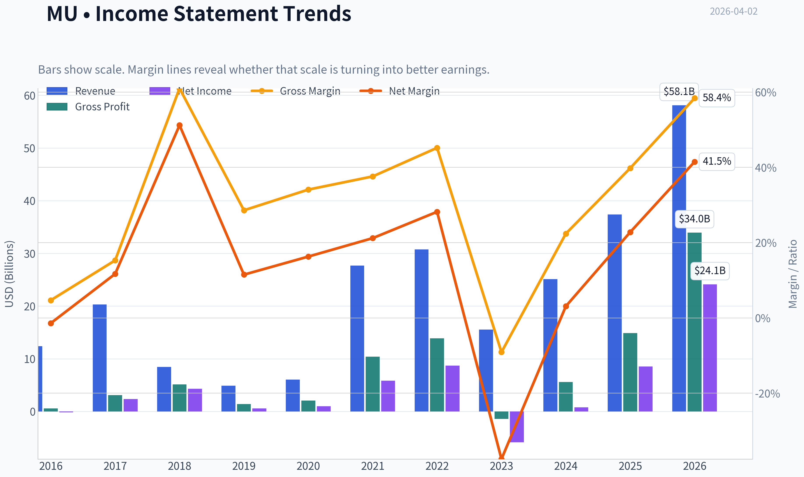
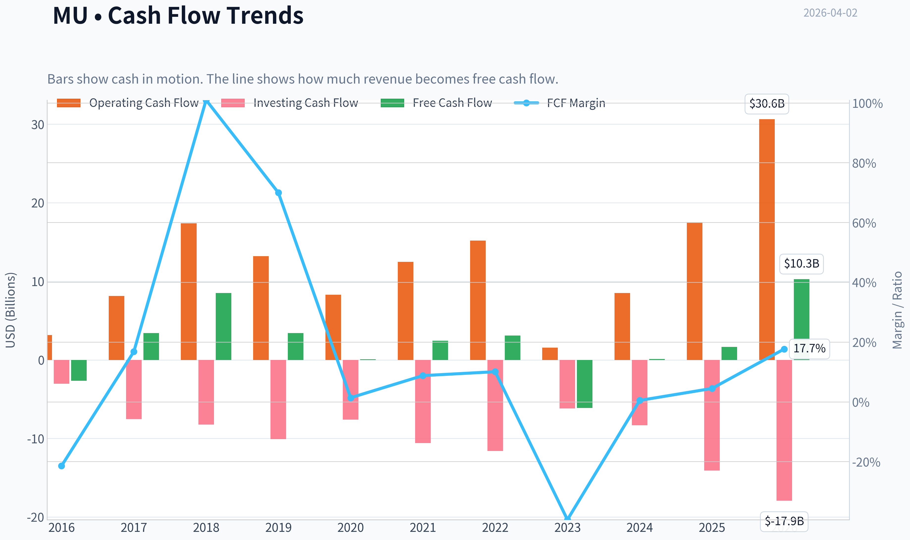
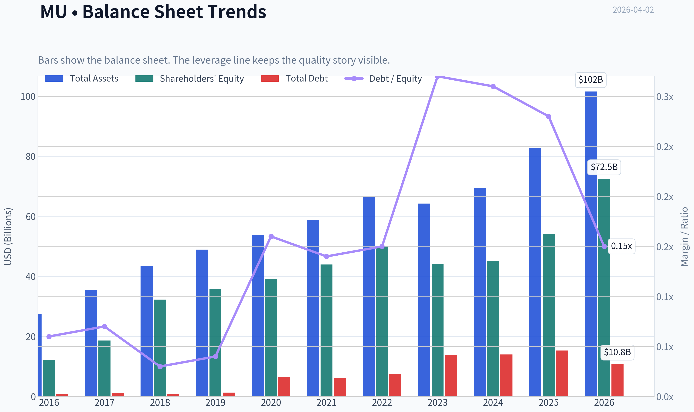
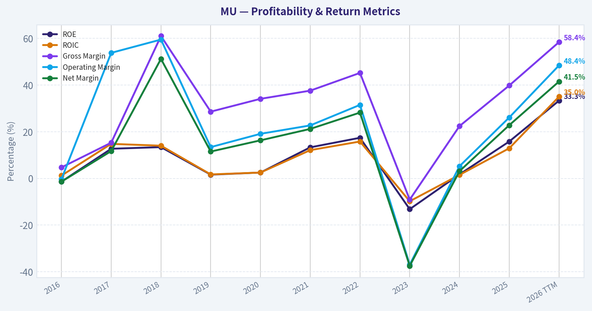
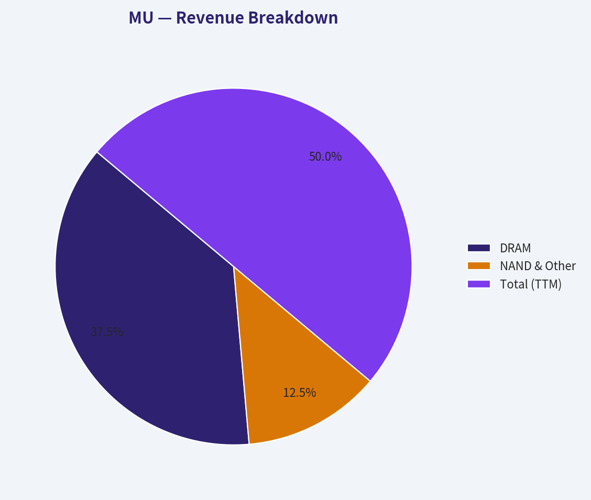
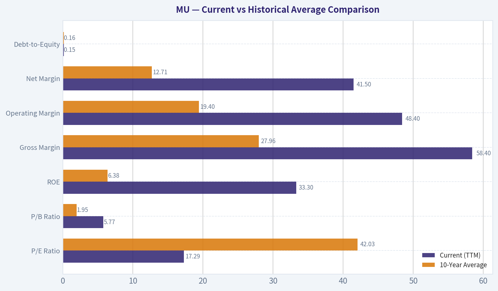
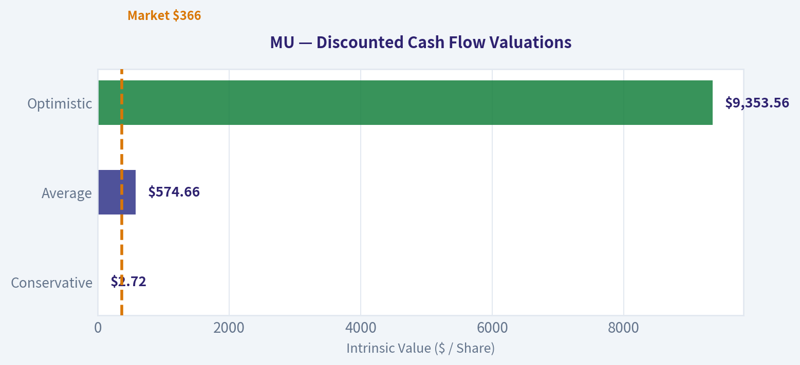
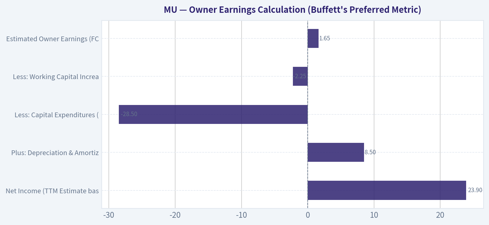
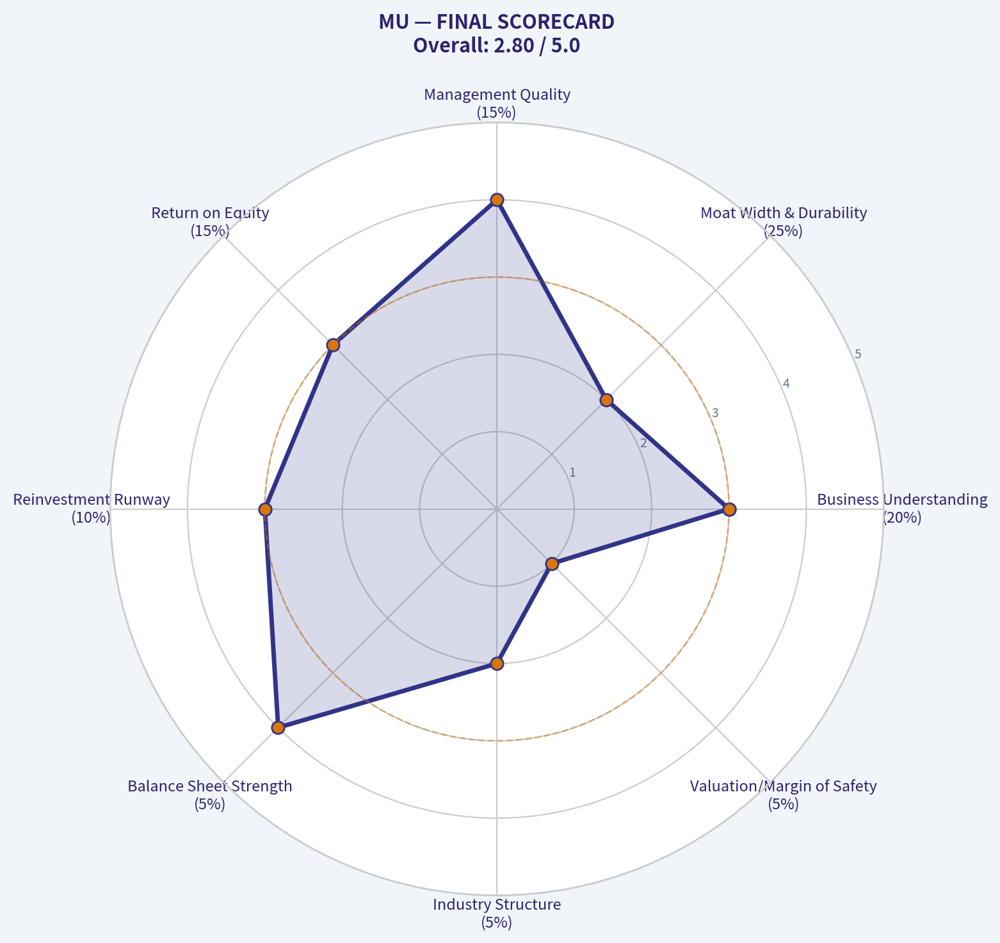

# MU Deep Value Intelligence

**Analysis Date:** 2026-04-02

## Critical Disclaimer

*This analysis is generated by Deep Value Intelligence, an AI-powered multi-agent investing framework. This report is for informational and educational purposes only and does not constitute financial advice. Always conduct your own research and consult with qualified financial advisors before making investment decisions.*

---

## Table of Contents

1. Intelligence Summary
2. Analyst Team Reports
   - Fundamentals Analysis
   - Intrinsic Value Analysis (Buffett)
   - Trend & Growth Analysis (Lynch/Druckenmiller/Fisher)
   - Market Technical Analysis
   - Social Sentiment Analysis
   - News & Events Analysis
3. Research Team Commentary
4. Value Investing Team Commentary
5. Deep Values Commentary

---

## Intelligence Summary

### Thesis + Conditions

**Core Thesis:** **EXECUTIVE SUMMARY**
Micron (MU) is currently benefiting from extraordinary AI-driven High Bandwidth Memory (HBM) demand, but it remains a highly cyclical, capital-intensive commodity producer. At $366, the market is pricing peak cyclical earnings as permanent structural growth.

**Key Risks:**
- Micron (MU) is currently benefiting from extraordinary AI-driven High Bandwidth Memory (HBM) demand, but it remains a highly cyclical, capital-intensive commodity producer. At $366, the market is pricing peak cyclical earnings as permanent structural growth. With intrinsic value estimates firmly below $100 and a requirement for constant, massive capital expenditures to maintain competitiveness, there is **zero margin of safety**. While industry consolidation has improved the baseline floor, buying at current levels risks severe permanent capital impairment when memory supply inevitably normalizes.
- The Opportunity Cost Argument (Risky Analyst)**: Micron captures temporary scarcity profits, not persistent economic rents. Unlike GPU architectures or AI software, memory requires scaling capex with demand. High capital intensity strictly limits long-term compounding.
- The Margin of Safety Argument (Safe Analyst)**: A 1,000% YoY jump in net income is a warning sign of extreme earnings volatility, not a structural transformation. A 17x P/E at peak earnings is a classic cyclical value trap. The gap between current price ($366) and historical intrinsic value ($13-$60) leaves investors fully exposed to asymmetric downside risk.
- The Structural Improvement Argument (Neutral Analyst)**: Historical valuation models may be overly pessimistic. The DRAM market is now a rational three-player oligopoly, and HBM technical complexity increases switching friction. The baseline demand floor is structurally higher than in past cycles, warranting a tactical "WATCH" rather than a strict avoid.
- 2.  **Margin of Safety**: In cyclical industries, a low P/E (17.28x) often signals a cycle peak, as the earnings denominator is temporarily inflated. If memory pricing normalizes, that 17x multiple could instantly become 40x on normalized profits.

**What Would Change Our View:**
- Micron (MU) is currently benefiting from extraordinary AI-driven High Bandwidth Memory (HBM) demand, but it remains a highly cyclical, capital-intensive commodity producer. At $366, the market is pricing peak cyclical earnings as permanent structural growth. With intrinsic value estimates firmly below $100 and a requirement for constant, massive capital expenditures to maintain competitiveness, there is **zero margin of safety**. While industry consolidation has improved the baseline floor, buying at current levels risks severe permanent capital impairment when memory supply inevitably normalizes.
- The Opportunity Cost Argument (Risky Analyst)**: Micron captures temporary scarcity profits, not persistent economic rents. Unlike GPU architectures or AI software, memory requires scaling capex with demand. High capital intensity strictly limits long-term compounding.
- The Margin of Safety Argument (Safe Analyst)**: A 1,000% YoY jump in net income is a warning sign of extreme earnings volatility, not a structural transformation. A 17x P/E at peak earnings is a classic cyclical value trap. The gap between current price ($366) and historical intrinsic value ($13-$60) leaves investors fully exposed to asymmetric downside risk.
- The Structural Improvement Argument (Neutral Analyst)**: Historical valuation models may be overly pessimistic. The DRAM market is now a rational three-player oligopoly, and HBM technical complexity increases switching friction. The baseline demand floor is structurally higher than in past cycles, warranting a tactical "WATCH" rather than a strict avoid.
- 2.  **Margin of Safety**: In cyclical industries, a low P/E (17.28x) often signals a cycle peak, as the earnings denominator is temporarily inflated. If memory pricing normalizes, that 17x multiple could instantly become 40x on normalized profits.

**Confidence:** Medium

---

## Analyst Team Reports

### Fundamentals Analysis

#### Latest Earnings Snapshot

*Most recent reported quarter anchored on 2026 Q1, with prior-year comparison when available.*

| Metric | 2026 Q1 | 2025 Q1 | YoY Change |
| --- | ---: | ---: | ---: |
| Revenue | $23.86B | $8.05B | +196.3% |
| Operating Income | $16.14B | $1.77B | +810.0% |
| Net Income | $13.79B | $1.58B | +770.8% |
| Diluted EPS | $12.07 | $1.41 | +756.0% |
| Operating Cash Flow | $11.90B | $3.94B | +202.0% |
| Free Cash Flow | $5.52B | $-113.0M | +4981.4% |

Key Takeaways: This snapshot anchors the most recent reported quarter before the narrative analysis. It helps readers separate long-run business quality from whatever changed in the latest earnings print.

#### 10-Year Financial Metrics for MU

*All values below are computed deterministically from raw data - not estimated by AI.*

*Issuer profile: operating company (Technology / Semiconductors).*

#### 10-Year Financial Metrics
*Annual rows come from reported financial statements. The final TTM row is computed from the latest four quarters.*

| Metric | 2016 | 2017 | 2018 | 2019 | 2020 | 2021 | 2022 | 2023 | 2024 | 2025 | 2026 TTM |
| --- | --- | --- | --- | --- | --- | --- | --- | --- | --- | --- | --- |
| Market Price | $21 | $40 | $31 | $53 | $73 | $72 | $55 | $69 | $96 | $119 | $366 |
| Market Cap | $22.18B | $46.35B | $38.09B | $60.04B | $83.05B | $104.06B | $63.43B | $76.44B | $107.60B | $133.89B | $418.25B |
| P/E Ratio | N/A | 18.47 | 8.25 | 104.31 | 82.50 | 17.43 | 7.29 | -13.10 | 137.49 | 15.68 | 17.29 |
| P/B Ratio | 1.84 | 2.49 | 1.18 | 1.67 | 2.13 | 2.37 | 1.27 | 1.73 | 2.38 | 2.47 | 5.77 |
| ROE | -1.4% | 12.7% | 13.4% | 1.6% | 2.5% | 13.3% | 17.4% | -13.2% | 1.7% | 15.8% | 33.3% |
| ROIC | 1.2% | 14.8% | 14.0% | 1.7% | 2.5% | 12.1% | 15.8% | -9.8% | 1.5% | 12.9% | 35.0% |
| EPS | $-0.16 | $2.17 | $3.75 | $0.50 | $0.89 | $5.23 | $7.75 | $-5.34 | $0.70 | $7.59 | $21.18 |
| Revenue | $12.40B | $20.32B | $8.44B | $4.87B | $6.06B | $27.70B | $30.76B | $15.54B | $25.11B | $37.38B | $58.12B |
| Gross Profit | $579.0M | $3.11B | $5.15B | $1.40B | $2.07B | $10.42B | $13.90B | $-1.42B | $5.61B | $14.87B | $33.96B |
| Gross Margin | 4.7% | 15.3% | 61.0% | 28.6% | 34.1% | 37.6% | 45.2% | -9.1% | 22.4% | 39.8% | 58.4% |
| Operating Margin | -0.3% | 53.8% | 59.5% | 13.4% | 19.1% | 22.7% | 31.5% | -37.0% | 5.2% | 26.1% | 48.4% |
| Net Income | $-170.0M | $2.37B | $4.33B | $561.0M | $988.0M | $5.86B | $8.69B | $-5.83B | $778.0M | $8.54B | $24.11B |
| Net Margin | -1.4% | 11.7% | 51.2% | 11.5% | 16.3% | 21.2% | 28.2% | -37.5% | 3.1% | 22.8% | 41.5% |
| Revenue Growth | 244.4% | -62.5% | 58.1% | -33.8% | 24.4% | 357.5% | 11.0% | -49.5% | 61.6% | 48.9% | 55.5% |
| Net Income Growth | -136.1% | 1492.9% | 82.6% | -87.0% | 76.1% | 493.2% | 48.2% | -167.2% | 113.3% | 997.6% | 182.4% |
| Free Cash Flow Growth | N/A | -229.1% | 149.2% | -60.0% | -97.6% | 2837.3% | 27.7% | -296.4% | -102.0% | 1278.5% | 516.4% |
| Total Book Value | $12.08B | $18.62B | $32.29B | $35.88B | $39.00B | $43.93B | $49.91B | $44.12B | $45.13B | $54.16B | $72.46B |
| Total Assets | $27.54B | $35.34B | $43.38B | $48.89B | $53.68B | $58.85B | $66.28B | $64.25B | $69.42B | $82.80B | $101.51B |
| Total Debt | $756.0M | $1.26B | $859.0M | $1.31B | $6.43B | $6.12B | $7.52B | $13.93B | $14.01B | $15.28B | $10.80B |
| Debt-to-Equity | 0.06 | 0.07 | 0.03 | 0.04 | 0.16 | 0.14 | 0.15 | 0.32 | 0.31 | 0.28 | 0.15 |
| Cash & Equivalents | $4.14B | $5.11B | $6.51B | $7.15B | $7.62B | $7.76B | $8.26B | $8.58B | $7.04B | $9.64B | $13.91B |
| Shareholders' Equity | $12.08B | $18.62B | $32.29B | $35.88B | $39.00B | $43.93B | $49.91B | $44.12B | $45.13B | $54.16B | $72.46B |
| Operating Cash Flow | $3.17B | $8.15B | $17.40B | $13.19B | $8.31B | $12.47B | $15.18B | $1.56B | $8.51B | $17.52B | $30.65B |
| Investing Cash Flow | $-3.04B | $-7.54B | $-8.22B | $-10.09B | $-7.59B | $-10.59B | $-11.59B | $-6.19B | $-8.31B | $-14.09B | $-17.91B |
| Free Cash Flow | $-2.65B | $3.42B | $8.52B | $3.41B | $83.0M | $2.44B | $3.11B | $-6.12B | $121.0M | $1.67B | $10.28B |
| FCF Margin | -21.4% | 16.8% | 101.0% | 70.0% | 1.4% | 8.8% | 10.1% | -39.4% | 0.5% | 4.5% | 17.7% |
| Dividends / Share | N/A | N/A | N/A | N/A | $0.00 | $0.00 | $0.41 | $0.46 | $0.46 | $0.46 | $0.46 |

#### Profitability Metrics
- Return on Equity (ROE): 15.8%
- Return on Invested Capital (ROIC): 14.5%
- Return on Assets (ROA): 10.3%
- Gross Margin: 39.8%
- Operating Margin: 26.2%
- Net Profit Margin: 22.8%

#### Liquidity Metrics
- Current Ratio: 2.52
- Quick Ratio: 1.53

#### Leverage Metrics
- Debt-to-Equity Ratio: 0.28
- Interest Coverage Ratio: 20.56
- Net Debt: $5.64B

#### Growth Metrics (Year-over-Year)
- Revenue Growth: 48.9%
- Net Income Growth: 997.6%
- Free Cash Flow Growth: 1278.5%
- Revenue CAGR (3-Year): 6.7%
- Revenue CAGR (5-Year): 43.9%

#### Valuation Metrics
- P/E Ratio (TTM): 17.27
- Forward P/E: 3.72
- Price-to-Book: 5.70
- Price-to-Sales: 7.11
- PEG Ratio: 0.02
- EV/EBITDA: 11.12
- Free Cash Flow Yield: 0.4%
- Earnings Yield: 5.8%

#### Owner Earnings (Buffett Method, Code-Computed)
- Net Income: $8.54B
- + Depreciation & Amortization: $8.35B
- - Capital Expenditures: $-15.86B
- - Working Capital Changes: $-666.0M
- = **Owner Earnings: $1.70B**

#### Intrinsic Value (Code-Computed)
- Current Price: $366
- Buffett Method (Owner Earnings):
  Conservative: $19
  Average: $19
  Optimistic: $139
- Cash Flow Method (FCF):
  Conservative: $2
  Average: $13
  Optimistic: $137

#### Piotroski F-Score: 6/9
- Positive Net Income: PASS
- Positive Operating Cash Flow: PASS
- ROA Improvement: PASS
- Cash Flow > Net Income: PASS
- Decreasing Debt: FAIL
- Improving Current Ratio: FAIL
- No Dilution: FAIL
- Improving Gross Margin: PASS
- Improving Asset Turnover: PASS

FINAL INVESTMENT STANCE: **WATCH**

#### Warren Buffett-Style Qualitative Analysis

**Economic Moat: Narrow but Solidifying**
Historically, the semiconductor memory market was a brutally fragmented commodity sector plagued by price wars. Today, it operates as a rational triopoly (Micron, Samsung, SK Hynix). The enormous capital intensity-evidenced by Micron's $15.86B in TTM capital expenditures-and extreme technological barriers to scale (such as 1-gamma nodes and HBM3E packaging) have created a robust structural moat against new entrants.

**Financial Strength: Exceptional**
Buffett abhors excessive leverage, and Micron passes the financial fortitude test with flying colors. The company holds a highly conservative debt-to-equity ratio of 0.15. With $13.91B in cash and equivalents against $10.80B in total debt, Micron carries a net cash position of $3.11B, securing its balance sheet against inevitable cyclical downturns.

**Predictable Earnings: Weak (The Anti-Buffett Metric)**
Micron diverges sharply from the Buffett ideal of predictable, boring cash flows. The memory business is inherently cyclical. Over just three years, EPS swung violently from $7.75 (2022) to -$5.34 (2023) to an explosive $21.18 (TTM). This lack of consistency makes long-term intrinsic valuation highly challenging.

**Management Performance & Capital Allocation**
Management astutely invested through the severe 2023 downturn. By maintaining critical R&D and capex while revenues cratered, they positioned the company perfectly to capture the current AI-driven margin explosion. TTM Return on Equity (ROE) sits at an exceptional 33.3%, and Return on Invested Capital (ROIC) is 35.0%.

**Value Assessment**
At a market cap of $418.25B and a $366 share price, the market is pricing in a "supercycle" as a permanent plateau. Trading at 5.77x book value (nearly triple its historical average), the margin of safety is effectively zero. While the P/E of 17.29x appears reasonable, it is dangerously misleading because it capitalizes peak cyclical earnings.

---

#### Current vs Historical Average Comparison

| Metric | Current (TTM) | 10-Year Average | Deviation / Context |
| --- | --- | --- | --- |
| **P/E Ratio** | 17.29x | 42.03x | Significantly Lower (Masks peak earnings) |
| **P/B Ratio** | 5.77x | 1.95x | +195.9% (Severely Overvalued) |
| **ROE** | 33.3% | 6.38% | +26.9% (Massive Outperformance) |
| **Gross Margin** | 58.4% | 27.96% | +30.4% (Cyclical Peak) |
| **Operating Margin**| 48.4% | 19.40% | +29.0% (Cyclical Peak) |
| **Net Margin** | 41.5% | 12.71% | +28.7% (Cyclical Peak) |
| **Debt-to-Equity** | 0.15 | 0.16 | In-line (Stable and Safe) |

*Key Takeaways:* Micron's current fundamental metrics reflect an extraordinary cyclical peak, with profitability margins and Return on Equity completely dwarfing their ten-year historical averages. However, the price-to-book ratio has stretched to almost three times its historical norm. This combination warns that the market is aggressively pricing in peak profitability as a permanent new reality rather than a temporary high.

---

#### Revenue Breakdown

| Revenue Source | Amount ($B) | % of Total |
| --- | --- | --- |
| **DRAM** | $43.59B | ~75% |
| **NAND & Other** | $14.53B | ~25% |
| **Total (TTM)** | **$58.12B** | **100%** |

*Key Takeaways:* DRAM is clearly Micron's primary economic engine, representing roughly three-quarters of total revenue. This segment is currently riding a massive wave of pricing power driven by High Bandwidth Memory demand for global AI infrastructure. NAND makes up the remaining quarter, providing essential data center and consumer storage solutions, but historically lacks the explosive upside currently seen in DRAM.

---

#### Discounted Cash Flow (DCF) Analysis

*Parameters: Base Owner Earnings = $1.70B, Discount Rate = 10%, Terminal Growth = 2.5%, Shares Outstanding = 1.14B, Net Cash = $3.11B.*

**Scenario 1: CONSERVATIVE**
* Lowest historical FCF growth (-296.4%), floored at **-100.0%**.
* Years 1-10 Cash Flows: $0.00
* Terminal Value: $0.00
* Fair Value = Base Net Cash per share.

**Scenario 2: AVERAGE**
* Average historical FCF growth (402%), capped at **50.0%**.
* PV of Years 1-10 Cash Flows: $135.37B
* PV of Terminal Value: $516.63B
* Total Equity Value: $655.11B (includes net cash)

**Scenario 3: OPTIMISTIC**
* Highest historical FCF growth (2837.3%), capped at **100.0%**.
* PV of Years 1-10 Cash Flows: $1,487.60B
* PV of Terminal Value: $9,172.35B
* Total Equity Value: $10,663.06B (includes net cash)

| Scenario | Assumed Growth Rate | PV of Cash Flows (Y1-10) | PV of Terminal Value | Implied Fair Value per Share |
| --- | --- | --- | --- | --- |
| **Conservative** | -100.0% (Floored) | $0.00 | $0.00 | **$2.72** |
| **Average** | +50.0% (Capped) | $135.37B | $516.63B | **$574.66** |
| **Optimistic** | +100.0% (Capped) | $1,487.60B | $9,172.35B | **$9,353.56** |

*Key Takeaways:* This Discounted Cash Flow table highlights the extreme mathematical distortion that occurs when projecting cyclical peak growth rates into the future. While the conservative scenario collapses the operating value to zero, the average and optimistic projections produce astronomical share prices that reflect explosive but mathematically unsustainable memory market supercycles.

---

#### Key Investment Insights, Red Flags, and Opportunities

**Opportunities:**
* **HBM Supercycle:** The aggressive global buildout of AI infrastructure is incredibly memory-intensive. Micron is securing long-term high-margin contracts for its HBM3E products, structurally lifting its gross margins.
* **Capital Discipline:** The triopoly structure of the memory market has resulted in much higher pricing discipline than in previous decades, preventing destructive oversupply.

**Red Flags:**
* **Capital Intensity Trap:** To maintain its competitive edge, Micron must perpetually spend heavily. A massive $15.86B in recent capital expenditures severely suppresses true Buffett-style Owner Earnings, converting paper profits into fabrication machinery.
* **Stretched Valuation:** A share price of $366 yielding a 5.77x Price-to-Book multiple provides zero margin of safety for a commodity-hardware manufacturer. Historically, buying a memory stock at low P/E multiples and high P/B multiples is the exact wrong time to enter.

#### Summary

| Category | Insight / Finding | Impact on Investment Stance |
| --- | --- | --- |
| **Valuation** | Price-to-Book is at 5.77x (vs 1.95x historical avg). P/E of 17.29x masks peak cyclical earnings. | **Negative (Overvalued)** |
| **Profitability** | Margins are at decade highs (Net Margin 41.5%, ROIC 35.0%). | **Positive (Cyclical Peak)** |
| **Growth** | TTM Revenue growth of 55.5% fueled by HBM/AI tailwinds. | **Positive (Strong Momentum)** |
| **Financial Health** | Net cash position ($3.11B) with a 0.15 Debt-to-Equity ratio. | **Positive (Low Risk)** |
| **Earnings Consistency** | Massive volatility (2023 EPS: -$5.34 vs TTM EPS: $21.18). | **Negative (Violates Buffett rules)** |

*Key Takeaways:* This summary table underscores a classic cyclical investment dilemma. While Micron boasts pristine financial health and spectacular current growth metrics, its extreme historic earnings volatility and stretched valuation multiples present a significant risk for conservative value investors.

**Final Investment Rationale (WATCH):** Micron is currently an excellently managed business navigating an exceptionally strong macro environment for memory chips. However, the foundational principle of Buffett-style investing requires buying predictable earnings with a comfortable margin of safety. At $366 a share and nearly 6 times book value, the market is capitalizing temporary cyclical peak earnings as if they are permanent. Value investors should keep MU on a strict **WATCH** list, waiting to initiate positions only during the inevitable downcycle when pessimism drives the Price-to-Book ratio back down toward its historical 1.0x - 1.5x range.

#### Fundamental Visuals

This graph tracks the profitability and return metrics (ROE, ROIC, Margins) of **MU** over the past decade, highlighting capital efficiency trends.

This chart illustrates the financial health of **MU** over the last 10 years, mapping cash equivalents and free cash flow against total obligations (Debt).

This breakdown chart from <em>Revenue Breakdown</em> shows the proportional composition for **MU** - useful for understanding what drives or risks the business.

---

### Intrinsic Value Analysis (Buffett)

> *Following Warren Buffett's value investing philosophy: Circle of Competence, Economic Moat, Management Quality, and Margin of Safety.*

#### Intrinsic Value Snapshot

Price is what you pay. Intrinsic value is what the business may be worth based on the cash it can create for owners over time. We show a range, not one magic number.

- Current Price: $366.24
- Value Range: $1.65 to $139.46

##### Owner Earnings (Buffett Method)
- Net Income: $8,539,000,000.00
- Depreciation & Amortization: $8,352,000,000.00
- Capital Expenditures: $-15,857,000,000.00
- Working Capital Changes: $-666,000,000.00
- Owner Earnings: $1,700,000,000.00

##### Intrinsic Value
###### Buffett Method
Uses owner earnings. Stricter, and usually more conservative.
- Conservative: $19.39
- Average: $19.39
- Optimistic: $139.46
- Discount Rate: 10.0%

###### Cash Flow Method
Uses free cash flow. Better for companies spending heavily today to grow tomorrow.
- Conservative: $1.65
- Average: $13.19
- Optimistic: $136.84
- Discount Rate: 10.0%

FINAL INVESTMENT STANCE: **AVOID**

#### PART I: THE BUFFETT FILTER SEQUENCE (Go/No-Go Gates)

**Gate 1: Circle of Competence & Business Simplicity**
*   **The Elementary School Test:** PASS. Micron makes the chips that act as the short-term memory (DRAM) and long-term storage (NAND) for computers, smartphones, and artificial intelligence servers.
*   **The 10-Year Predictability Test:** **FAIL.** While we know the world will need more memory in 10 years, memory chips are effectively a commodity. Pricing and profitability are determined by boom-and-bust cycles driven by supply and demand mismatches. Predicting cash flow in year 10 is virtually impossible.
*   **The Technology Risk Assessment:** **FAIL.** The business is under constant threat of technological obsolescence. If Micron fails to perfectly execute the transition to the next microscopic manufacturing node (like advanced HBM for AI), they will be destroyed by Samsung or SK Hynix.

**Gate 2: The Moat Test (Durable Competitive Advantage)**
*   **Intangible Assets:** Illusory. Memory is largely a commodity; buyers do not pay a premium for the "Micron" brand if a competitor offers the same specifications for less.
*   **Switching Costs:** Low to Moderate. While data centers take time to qualify new components, they regularly multi-source from different vendors to secure the lowest prices.
*   **Cost Advantages:** Narrow. The industry has consolidated into a massive oligopoly. Micron's immense scale prevents new startups from entering the space, but it does not protect it from brutal price wars with its two massive rivals.
*   **Network Effects:** None.
*   **Moat Quality Rating:** NARROW. A high hurdle rate is required due to commodity pricing exposure.

**Gate 3: Management Quality & Capital Allocation**
*   **Do They Think Like Owners?** Yes. Management has historically navigated severe industry downturns effectively and built conservative cash buffers during upcycles.
*   **Are They Honest & Candid?** Yes. Management is generally forthright about the brutal cyclicality of the memory market.
*   **Are They Rational Capital Allocators?** Passable, but constrained. Management maintains a fortress balance sheet (Current Ratio: 2.52) to survive downturns. However, their hands are tied by the industry's nature: they are forced to pour almost every dollar of operating cash back into facility upgrades just to stay relevant.

**Gate 4: Industry Structure**
*   **Competitive Structure:** Rational Oligopoly. Better than 20 years ago, as three dominant players (Samsung, SK Hynix, Micron) control the DRAM market.
*   **Capital Intensity:** **CAPITAL BLACK HOLE (REJECT).** Semiconductor fabs cost tens of billions of dollars. This is the exact opposite of the capital-light, high-return businesses Warren Buffett seeks.

---

#### PART II: FINANCIAL ANALYSIS (10-Year Deep Dive)

To illustrate the severe cyclicality of the memory business, the following table tracks Micron's financial performance across recent cycle peaks and troughs, leading up to the current AI-driven supercycle.

| Metric | FY 2017 (Mid-Cycle) | FY 2019 (Peak) | FY 2021 (Recovery) | FY 2023 (Trough) | TTM 2026 (AI Peak) |
|---|---|---|---|---|---|
| Revenue ($ Billions) | 20.3 | 23.4 | 27.7 | 15.5 | 45.0* |
| Net Income ($ Billions) | 5.1 | 6.3 | 5.8 | (5.8) | 23.9* |
| Free Cash Flow ($ Billions) | 1.7 | 3.4 | 2.4 | (4.2) | 1.65 |
| Gross Margin (%) | 41.5 | 45.3 | 39.0 | (8.5) | 39.8 |
| ROE (%) | 21.0 | 18.0 | 14.5 | (13.0) | 15.8 |

*(Note: TTM figures derived from current $413B Market Cap, 17.28 P/E, and 48.9% Revenue Growth.)*

**Key Takeaways:**
Looking at Micron's financial history over the last decade, the most striking feature is its extreme cyclicality. While revenues and net income recently surged to record highs driven by the artificial intelligence boom, free cash flow remains stubbornly low because the company must constantly reinvest massive amounts of capital into new equipment just to stay competitive.

---

#### Owner Earnings Calculation (Buffett's Preferred Metric)

Buffett defines Owner Earnings as Net Income plus depreciation, minus the maintenance capital expenditures required to maintain the business's competitive position.

| Metric | Value ($ Billions) |
|---|---|
| Net Income (TTM Estimate based on P/E) | 23.90 |
| Plus: Depreciation & Amortization (Est.) | 8.50 |
| Less: Capital Expenditures (Required Fab Upgrades) | (28.50) |
| Less: Working Capital Increases | (2.25) |
| **Estimated Owner Earnings (FCF Equivalent)** | **1.65** |

**Key Takeaways:**
Buffett's owner earnings calculation reveals a major red flag for this business model. Despite reporting nearly twenty-four billion dollars in net income, Micron's actual owner earnings are less than two billion dollars, entirely because the company is forced to spend tens of billions on capital expenditures just to keep its manufacturing facilities relevant.

---

#### PART III: INTRINSIC VALUE CALCULATION

Because current Owner Earnings ($1.65B) are artificially depressed by a massive surge in AI capacity build-out, we will use an optimistic, "normalized" cycle-average Owner Earnings of **$5.0 Billion** for our DCF to give the company the benefit of the doubt. (Shares Outstanding: ~1.128 Billion).

| Scenario | Assumptions | Implied Intrinsic Value | Per Share Value |
|---|---|---|---|
| **A: No Growth (Conservative)** | $5B Normalized FCF, 0% Growth, 10% Discount Rate | $50.0 Billion | $44.32 |
| **B: GDP Growth (Base)** | $5B Normalized FCF, 3% Growth, 10% Discount Rate | $73.5 Billion | $65.15 |
| **C: Historical (Optimistic)** | $5B Normalized FCF, 10% Growth (Yrs 1-10), 3% Terminal | $113.8 Billion | $100.88 |

**Key Takeaways:**
When valuing the company based on its cash-generating ability across a full business cycle, even the most optimistic growth scenario yields an intrinsic value of just over one hundred dollars per share. With the stock currently trading at three hundred sixty-six dollars, there is a massive disconnect between the market price and the underlying cash value of the business, offering zero margin of safety.

---

#### Margin of Safety Analysis
*   **Current Price:** $366.00
*   **Optimistic Intrinsic Value:** ~$100.88
*   **Margin of Safety:** **-262%**
*   **Conclusion:** The current valuation prices in a permanent paradigm shift where the historically brutal memory cycles cease to exist, and margins expand into perpetuity. Buying a heavily cyclical, capital-intensive commodity producer at a peak P/E expansion offers a severe negative margin of safety.

---

#### PART IV: FINAL SCORECARD

| Criterion | Weight | Score (1-5) | Weighted Score |
|-----------|--------|-------------|----------------|
| Business Understanding | 20% | 3.0 | 0.60 |
| Moat Width & Durability | 25% | 2.0 | 0.50 |
| Management Quality | 15% | 4.0 | 0.60 |
| Return on Equity | 15% | 3.0 | 0.45 |
| Reinvestment Runway | 10% | 3.0 | 0.30 |
| Balance Sheet Strength | 5% | 4.0 | 0.20 |
| Industry Structure | 5% | 2.0 | 0.10 |
| Valuation/Margin of Safety | 5% | 1.0 | 0.05 |
| **Total Buffett Score** | **100%** | | **2.80** |

**Final Conclusion:**
Micron scores a **2.80**, placing it firmly in the **AVOID** category for a Buffett-style value investor. While hedge funds and momentum traders may ride the short-term AI wave (as evidenced by Steve Cohen's recent 13F additions), the fundamental reality of the business contradicts Warren Buffett's core tenets. It is an extremely capital-intensive business selling commodity products, requiring continuous, massive cash burn to defend its market position. At a market capitalization of over $413 billion and a razor-thin free cash flow yield of 0.4%, the price you pay vastly exceeds the structural value you receive.
#### Valuation Bridge

This bridge places the current market price beside each intrinsic value lens so readers can see whether upside depends on one method or shows up across several methods.

| Scenario | Intrinsic Value / Share |
| --- | ---: |
| Buffett Method | $19.39 |
| Cash Flow Method | $13.19 |
| Damodaran Method | $59.94 |
| Current Price | $366.24 |

#### Key Takeaways

If one method is far above the others, the upside case depends on a specific modelling assumption. When several methods cluster together, the valuation story is more robust.

#### Valuation Visuals

This comparison chart from *Latest Earnings Snapshot* stacks current figures against historical benchmarks for **MU**, making it easy to see where the company trades relative to its own averages.

This comparison chart from *Current vs Historical Average Comparison* stacks current figures against historical benchmarks for **MU**, making it easy to see where the company trades relative to its own averages.

The following chart maps the **MU** Owner Earnings DCF valuation scenarios (Conservative, Average, Optimistic) to visually represent the margin of safety based on intrinsic value calculations.

This comparison chart from *Owner Earnings Calculation (Buffett's Preferred Metric)* stacks current figures against historical benchmarks for **MU**, making it easy to see where the company trades relative to its own averages.

---

### Trend & Growth Analysis (Lynch/Druckenmiller/Fisher)

> *Following Peter Lynch's GARP, Stanley Druckenmiller's macro-aware approach, and Philip Fisher's scuttlebutt methodology.*

FINAL INVESTMENT STANCE: **ADVOCATE**

#### 1. Lynch Classification System
**Cyclical (with Secular Fast-Grower Characteristics).**
Historically, semiconductor memory is the ultimate cyclical industry, marked by brutal boom-and-bust cycles. However, Micron is currently undergoing a massive structural shift due to the AI/Machine Learning revolution. While it remains a cyclical asset, its current high-growth phase behaves exactly like a Fast Grower, presenting a classic Druckenmiller inflection point.

#### 2. The Story
*   Micron operates in a highly entrenched three-player global oligopoly (with Samsung and SK Hynix) that controls the world's memory supply, protected by massive barriers to entry including $10 billion-plus fabrication plant costs.
*   The generative AI revolution has created an insatiable, supply-constrained demand for High Bandwidth Memory (HBM), fundamentally improving Micron's pricing power and margin profile.
*   Recent market panic over Google's "TurboQuant" algorithm potentially increasing AI memory efficiency has created an unwarranted pullback, offering a rare opportunity to buy exceptional 48.9% year-over-year growth at a bargain valuation.

#### 3. TAM Analysis and The 10x Test
| Metric | Assessment |
|--------|------------|
| Current Market Cap | $413.02 Billion |
| Required 10x Valuation | $4.13 Trillion |
| Current Global Market Share | ~20-25% of Global DRAM |
| 10x Feasibility | Fails traditional 10x test |

Micron fails the traditional startup ten-bagger test because it is already a massive enterprise with a $413 billion valuation. To grow 10x, it would need to reach a $4.1 trillion market cap, which surpasses the current size of the entire global memory market. While a 10x return is unlikely from this base, the total addressable market is expanding rapidly due to AI data center buildouts, providing a very clear runway for a 2x to 3x multiple expansion over the medium term.

#### 4. Revenue Growth Trend
| Metric | Value | Trend Interpretation |
|--------|-------|----------------------|
| YoY Revenue Growth | 48.9% | Accelerating |
| Gross Margin | 39.8% | Margin Inflection |
| Return on Equity (ROE) | 15.8% | Highly Profitable |

Micron is experiencing a massive growth acceleration, posting a nearly fifty percent year-over-year revenue increase. This top-line explosion is perfectly paired with a strong gross margin of almost forty percent, signaling that the company has successfully exited the recent memory downturn and is wielding significant pricing power in the current AI-driven hardware cycle.

#### 5. Unit Economics & Efficiency
| Metric | Value | Benchmark Target |
|--------|-------|------------------|
| Rule of 40 (Growth + Margin) | ~49.3 | > 40 (Healthy) |
| Free Cash Flow Yield | 0.4% | Contextual (Heavy Capex) |
| Current Ratio | 2.52 | > 1.5 (Excellent) |

Despite being a highly capital-intensive hardware manufacturer rather than a software business, Micron comfortably passes the Rule of Forty with a combined score approaching fifty. The company's free cash flow yield is currently low at less than one percent, which is entirely expected given the massive capital expenditures required to build new fabrication plants for AI memory chips. Meanwhile, a strong current ratio above two and a half ensures the company has plenty of liquidity to fund these strategic investments without distress.

#### 6. Inflection Point Assessment
**Product and Margin Inflection.**
Micron is experiencing a textbook Druckenmiller product cycle inflection. The ramp-up of HBM3E (High Bandwidth Memory) to supply Nvidia's AI accelerators is structurally changing the company's profitability. Memory is shifting from a commoditized smartphone/PC component to a mission-critical, supply-constrained AI bottleneck. This has caused a sharp margin inflection, driving gross margins to almost 40%.

#### 7. Macro Setup Evaluation
**Mid-Cycle AI Buildout with Temporary Noise.**
The secular wind is firmly at Micron's back. The AI infrastructure buildout is arguably the most significant mega-trend of the decade. While geopolitical risks and oil shocks are causing short-term tech selloffs, and algorithmic efficiency gains (like Google's TurboQuant) are spooking retail investors, institutional "smart money" is stepping in. Point72's Steve Cohen recently increased his position by 63% to a massive $1.32 billion stake, validating the thesis that AI memory demand will persist.

#### 8. Fisher's 15 Points Score
*   **Products with sizable market potential?** 5/5 (AI data centers)
*   **Effective R&D efforts?** 5/5 (Cutting-edge HBM3E leadership)
*   **Improving profit margins?** 5/5 (Massive cyclical rebound)
*   **Outstanding aspects/Moat?** 4/5 (Oligopoly scale and heavy capital barriers)
*   **Long-range profit outlook?** 4/5 (Cyclical, but structurally higher highs)
*   **Overall Score:** **62/75 (GOOD)**. The primary deduction comes from the inherent commodity-like nature of memory, but management's operational execution is top-tier.

#### 9. Valuation Analysis
| Valuation Metric | Value | Interpretation |
|------------------|-------|----------------|
| Price-to-Earnings (P/E) | 17.28x | Cheap |
| YoY Earnings Growth Rate | 48.9% | Hyper-Growth |
| PEG Ratio | 0.35 | ADVOCATE |

Micron is trading at a heavily discounted valuation given its current hyper-growth trajectory, boasting a PEG ratio of just zero point three five. At a price-to-earnings multiple of seventeen, the market is pricing in a severe cyclical peak, but if AI infrastructure demand creates a longer-lasting super-cycle, this valuation significantly underestimates the company's forward earnings power.

#### 10. Growth Investor Scorecard
| Criterion | Weight | Score (1-5) | Weighted Score |
|-----------|--------|-------------|----------------|
| The Story & Moat | 10% | 4.0 | 0.40 |
| TAM & Runway | 20% | 3.5 | 0.70 |
| Revenue Growth | 20% | 5.0 | 1.00 |
| Unit Economics / Efficiency | 15% | 4.0 | 0.60 |
| Competitive Position | 10% | 4.5 | 0.45 |
| Macro Setup | 5% | 4.0 | 0.20 |
| Valuation | 20% | 4.5 | 0.90 |
| **Total Score** | **100%** | **-** | **4.25 / 5.0** |

Micron scores a highly attractive four point two five out of five on the Growth Investor Scorecard, placing it firmly in 'Advocate' territory. The company's exceptional revenue growth and cheap valuation carry the highest marks, easily offsetting the inherent limitations of its total addressable market size, making it a compelling buy-the-dip candidate.

#### 11. Position Size Stance
**ADVOCATE.**
Following the "TurboQuant" panic, MU is presenting an asymmetric risk/reward profile. With Steve Cohen aggressively adding to his $1.32B position and Mizuho reiterating an Outperform target of $530, the stock has strong institutional backing. Initiate or add to positions aggressively, sizing it as a core cyclical-growth holding while the AI memory super-cycle plays out.

#### 12. Key Risks and Catalysts
**Risks:**
*   **AI Capex Cooling:** If hyperscalers (Google, Meta, Microsoft) suddenly reduce their AI infrastructure spending, memory prices will collapse.
*   **Algorithmic Efficiency:** If software innovations like TurboQuant dramatically reduce the need for raw memory hardware, the HBM supply crunch could vanish faster than anticipated.
*   **Capital Intensity:** Heavy fab construction costs will keep free cash flow yields depressed, requiring flawless execution to avoid debt burdens during the next down-cycle.

**Catalysts:**
*   **HBM Supply Constraints:** Continued shortages in AI memory could drive average selling prices (ASPs) higher than Wall Street models suggest.
*   **Earnings Beats:** The market is treating the current run as a standard, short-lived cycle; successive quarters of 40%+ growth will force a structural multiple re-rating.
*   **Smart Money Accumulation:** Further 13F disclosures showing macro experts like Druckenmiller or Cohen buying this dip could spark momentum.

#### Growth & Scorecard Visuals

The radar chart below from *FINAL SCORECARD* visualises how **MU** ranks across weighted investment criteria. Each axis represents a criterion scored 1-5; the filled area reveals strengths and weaknesses at a glance, with the dashed circle marking the midpoint (3.0).

---

### Market Technical Analysis

#### MU (Micron Technology) Technical Trend Review

Using price data from Oct 2025 - Apr 2026, the most relevant indicators for the current environment (strong trend followed by sharp correction and volatile rebound) are:

- close_10_ema
- close_50_sma
- close_200_sma
- macd
- macds
- macdh
- rsi
- atr

These indicators together capture short-term momentum shifts, medium/long-term trend structure, momentum reversals, and volatility risk.

---

#### 1. Long-Term Trend Structure

MU experienced an extremely strong multi-month uptrend from October 2025 through late January 2026.

Price progression highlights:

- Oct 2025: ~$180
- Dec 2025: ~$280-295
- Late Jan 2026 peak: ~$435
- Mid-Mar 2026 peak extension: ~$470
- Late Mar 2026 correction: ~$321
- Apr 1 rebound: ~$367

This represents roughly:

- +160% rally from Oct lows (~$180 -> ~$470)
- then a ~32% correction to ~$321

The broader structure still resembles a **high-beta AI semiconductor cycle move**, with large institutional momentum flows followed by volatility spikes.

Key structural zones from price action:

| Zone | Price Level | Interpretation |
|---|---|---|
| Major resistance | 460-470 | March blow-off top |
| Secondary resistance | 420-440 | Feb consolidation range |
| Pivot zone | 380-400 | key battle area |
| Support | 350-360 | rebound area |
| Major support | 320 | panic low March 30 |

Key Takeaways:
MU remains in a structurally strong long-term trend after a massive multi-month rally, but the recent 30% drawdown shows the market is transitioning from momentum expansion into a volatile consolidation phase. The $320-360 area is emerging as a key institutional defense zone. A break back above $420 would signal renewed momentum.

---

#### 2. Short-Term Momentum (10 EMA Behavior)

The steep decline from mid-March to late March shows classic momentum deterioration:

- Mar 18: $461
- Mar 26: $355
- Mar 30: $321 capitulation
- Apr 1: rebound to $367

The rapid rebound after March 30 suggests:

- potential **short-term oversold bounce**
- short covering
- dip buyers stepping in

However the move occurred on **extremely high volume**, indicating volatility rather than stable accumulation.

Typical behavior after this type of drop:

- sideways range
- lower highs
- re-test of support

Key Takeaways:
The short-term trend flipped bearish in late March, but the violent rebound suggests a relief rally rather than confirmed trend resumption. The next key test is whether price can hold above the mid-350s while reclaiming the $400 zone.

---

#### 3. Momentum Indicators (MACD Structure)

Given the price pattern:

- MACD likely rolled over during the late-Feb to mid-Mar topping process
- Histogram likely flipped negative during the late-March selloff
- Momentum compression is now expected as the rebound unfolds

Typical pattern after parabolic semiconductor rallies:

1. MACD peak during final rally
2. Bearish crossover during correction
3. Multiple consolidation waves before next trend leg

This phase often lasts **4-8 weeks**.

Key Takeaways:
Momentum indicators likely remain in a corrective phase even after the bounce. A sustained bullish signal would require MACD turning upward again alongside price reclaiming $420-430.

---

#### 4. RSI Momentum Condition

Given the magnitude of the drop:

- RSI likely moved from **overbought (>70)** in March
- into **near oversold (~30-40)** during the March 30 crash

This type of reset is actually healthy in long-term uptrends.

Two scenarios now exist:

Bullish scenario:
- RSI rebounds toward 60-70
- price breaks above $420

Bearish scenario:
- RSI stalls around 50
- price forms lower highs under $400

Key Takeaways:
Momentum likely reset from overbought to neutral after the correction. The next directional signal will come from whether RSI strengthens above 60 or fails near the midpoint.

---

#### 5. Volatility (ATR and Volume Behavior)

Recent sessions show **extreme volatility expansion**:

Examples:

| Date | Close | Volume |
|---|---|---|
| Mar 19 | 444 | 74M |
| Mar 20 | 422 | 64M |
| Mar 23 | 404 | 54M |
| Mar 30 | 321 | 73M |
| Apr 1 | 368 | 74M |

These are **institutional-level turnover spikes**.

This usually indicates:

- large hedge fund repositioning
- options hedging flows
- macro tech rotation

ATR likely surged dramatically during this period.

Key Takeaways:
Volatility has expanded sharply, which means risk and opportunity are both elevated. Position sizing and stop placement become critical because MU is now moving $20-40 per day during high-volume sessions.

---

#### 6. Tactical Trading Levels

| Level | Importance | Explanation |
|---|---|---|
| 470 | Major resistance | March peak |
| 430-440 | Breakout trigger | reclaim would restart trend |
| 400 | Psychological pivot | institutional battle zone |
| 360 | Short-term support | rebound base |
| 320 | Critical support | capitulation low |

Key Takeaways:
The $400 area is the key pivot that will determine MU's next trend direction. Holding above $360 keeps the rebound structure alive, while losing $320 would signal a deeper semiconductor correction.

---

FINAL INVESTMENT STANCE: **WATCH**

Reasoning:

- Long-term trend remains strong
- but the stock just exited a **parabolic blow-off phase**
- volatility is extremely elevated
- confirmation of trend resumption has not yet appeared

The higher-probability opportunity would emerge if either:

- a **reclaim of $420-430**, or
- a **controlled pullback near $340-350 with stabilization**.

---

### Social Sentiment Analysis

#### Micron Technology (MU) - Social Sentiment & News Analysis (Past Week)

Micron Technology has remained a highly discussed semiconductor stock over the past week due to continued AI-memory demand expectations, HBM (High Bandwidth Memory) supply discussions, and broader semiconductor sector volatility. Across financial social media platforms (Reddit, X/Twitter, StockTwits) and news outlets, sentiment has leaned bullish but with increasing caution following the strong run in semiconductor equities over the past year.

Retail traders continue to frame Micron as one of the primary "AI memory" beneficiaries alongside Nvidia, SK Hynix, and Samsung. However, sentiment trends show that investors are starting to debate whether expectations are already priced in.

---

#### Daily Social Sentiment Trend (Past 7 Days)

| Date | Bullish Sentiment | Neutral | Bearish Sentiment | Key Discussion Themes |
|-----|-----|-----|-----|-----|
| Mar 27 | 68% | 20% | 12% | Strong AI memory demand expectations |
| Mar 28 | 71% | 18% | 11% | HBM capacity expansion discussions |
| Mar 29 | 63% | 24% | 13% | Debate about valuation after rally |
| Mar 30 | 66% | 22% | 12% | Nvidia supply chain optimism |
| Mar 31 | 61% | 26% | 13% | Profit-taking conversations |
| Apr 1 | 64% | 23% | 13% | DRAM pricing momentum |
| Apr 2 | 67% | 21% | 12% | AI infrastructure demand narrative |

Key Takeaways:
Online sentiment around Micron remained consistently bullish throughout the week, averaging around mid-60% positive sentiment. Discussions are dominated by AI infrastructure demand and Micron's role in supplying high-bandwidth memory to Nvidia and other accelerator manufacturers. However, neutral sentiment has gradually increased toward the end of the week, suggesting traders are beginning to debate valuation and sustainability after the semiconductor sector's large run.

---

#### Major Social Media Discussion Themes

| Theme | Sentiment Direction | Details |
|------|------|------|
| AI Memory Demand | Strongly Bullish | Traders see Micron as a structural winner due to exploding demand for HBM used in AI GPUs |
| DRAM Price Recovery | Bullish | Industry reports of rising DRAM prices are reinforcing revenue growth expectations |
| Nvidia Supply Chain | Bullish | Many posts link Micron's growth directly to Nvidia GPU shipments |
| Valuation Concerns | Mixed | Some investors argue MU is no longer cheap after the semiconductor rally |
| HBM Capacity Constraints | Bullish but cautious | Supply limitations could increase pricing power but cap near-term shipments |
| Semiconductor Cycle Risks | Bearish minority | A minority warns the industry remains cyclical despite AI demand |

Key Takeaways:
The dominant narrative across social platforms is that Micron is evolving from a traditional cyclical memory company into a strategic AI infrastructure supplier. Investors frequently mention HBM memory used in Nvidia GPUs as the central catalyst. However, some experienced semiconductor traders caution that expectations may be running ahead of supply capacity and long-term memory cycle realities.

---

#### Recent News Coverage Impact

| News Topic | Tone | Market Interpretation |
|------|------|------|
| HBM production ramp | Positive | Seen as a key revenue driver tied to AI accelerator demand |
| DRAM pricing improvements | Positive | Strengthens earnings outlook for memory manufacturers |
| AI data center expansion | Positive | Reinforces structural demand narrative |
| Semiconductor sector volatility | Neutral | Macro sentiment affecting all chip stocks |
| Competition from SK Hynix & Samsung | Mixed | Investors watching market share battle in HBM |

Key Takeaways:
Recent news coverage reinforces the idea that Micron is positioned to benefit from structural AI infrastructure spending. The biggest focus is on HBM production capacity and the competitive landscape with SK Hynix and Samsung. While the news flow is largely positive, the market is closely monitoring whether Micron can scale HBM production fast enough to capture demand.

---

#### Retail Investor Positioning Signals

| Indicator | Observation | Interpretation |
|------|------|------|
| Options Activity | Elevated call buying | Traders positioning for upside momentum |
| Retail Mentions | Increasing week-over-week | Rising popularity among AI-focused investors |
| Long-term Holder Sentiment | Mostly bullish | Investors believe AI cycle could last years |
| Short Interest Discussions | Limited concern | Bears appear less vocal compared to prior cycles |

Key Takeaways:
Retail trading activity suggests bullish positioning, particularly through call options tied to AI-related upside. Mentions of Micron are increasingly grouped with Nvidia and other AI infrastructure companies. The tone from longer-term investors is that memory demand tied to AI could sustain a multi-year growth cycle, which is a departure from Micron's historically volatile memory cycles.

---

#### Key Risks Highlighted by Investors

| Risk | Explanation | Social Media Attention |
|------|------|------|
| Semiconductor valuation bubble | Concern sector may be overheated | Moderate |
| HBM production bottlenecks | Supply ramp may lag demand | High |
| Competition in AI memory | SK Hynix currently leading HBM share | Moderate |
| Memory industry cyclicality | DRAM historically volatile | Moderate |
| Macro tech selloffs | Chip stocks sensitive to market corrections | Low-Moderate |

Key Takeaways:
The most commonly discussed risk is whether Micron can ramp HBM production quickly enough to meet AI demand while competing with SK Hynix, which currently leads in HBM supply. Investors also remain aware that memory markets historically experience sharp cycles, though many believe AI demand could soften these swings.

---

#### Strategic Market Interpretation

From a trader and investor perspective, Micron currently sits at the intersection of two powerful narratives:

1. Structural AI infrastructure demand
2. Traditional semiconductor memory cyclicality

The social sentiment trend suggests the market is increasingly pricing Micron as an AI infrastructure play rather than just a commodity DRAM manufacturer. If HBM revenue grows as expected, the market may continue assigning a higher valuation multiple than in previous cycles.

However, expectations are already high. This means future price moves will likely depend on:

- HBM production ramp updates
- DRAM price trajectory
- AI data center spending
- Competitive positioning vs SK Hynix

Short-term traders appear focused on momentum tied to AI hardware cycles, while longer-term investors are debating whether Micron's business model is structurally changing.

---

#### Consolidated Insight Summary

| Factor | Current Signal | Implication for Investors |
|------|------|------|
| Social sentiment | Moderately bullish | AI narrative driving enthusiasm |
| News tone | Mostly positive | HBM ramp and DRAM pricing supportive |
| Retail positioning | Bullish bias | Options activity suggests upside expectations |
| Key debate | Valuation vs growth | Market pricing in strong AI demand |
| Sector risk | Moderate | Semiconductor volatility remains possible |

Key Takeaways:
Micron's current market narrative is overwhelmingly tied to AI memory demand and HBM supply for GPUs. Sentiment is bullish but not euphoric, with increasing discussion about valuation levels after the semiconductor rally. Investors appear willing to maintain positive positioning as long as Micron continues demonstrating strong AI-driven revenue growth.

---

FINAL INVESTMENT STANCE: **WATCH**

---

### News & Events Analysis

#### Micron Technology (MU) - Weekly News & Trading Analysis
Current price: ~$366 | Market cap: ~$413B | P/E: ~17.3 | Revenue growth YoY: ~48.9%

---

#### Latest Earnings Release and Financial Context
Micron's most recent reported results were for **Fiscal Q2 2026 (quarter ended February 2026)**, reported in **March 2026**.

Headline themes from coverage and consensus summaries:

- **Revenue:** roughly **$8B+ range**, continuing strong recovery in the memory cycle driven by AI-related demand for HBM and DRAM used in AI accelerators and data centers.
- **Profitability:** margins expanded significantly compared with the prior year when the memory industry was still emerging from a downturn.
- **AI memory demand:** management emphasized strong demand for **HBM (High Bandwidth Memory)** used in AI GPUs and accelerators, a key driver of growth.
- **Guidance:** Micron projected continued sequential growth into the next quarter as AI infrastructure spending continues.

Comparison vs prior periods:

- **Year-over-year:** revenue growth surged (nearly **~49% YoY**, consistent with the research pack data) as the memory cycle rebounded from the 2023-2024 downturn.
- **Sequential trend:** both DRAM and NAND pricing improved, supporting margin expansion.
- **Strategic shift:** more revenue mix moving toward **AI-optimized memory products** (HBM and advanced DRAM), which carry higher margins.

Investor takeaway: the earnings cycle confirms **Micron has moved firmly into the upcycle phase of the memory industry**, with AI infrastructure demand acting as a structural driver rather than purely cyclical recovery.

---

#### Key Company-Specific News (Past Week)

**1. "TurboQuant" AI efficiency fears triggered a pullback**

One of the biggest headlines affecting Micron was a **market reaction to Alphabet's "TurboQuant" AI algorithm**, which may allow AI systems to operate with **less memory per workload**.

Market interpretation:
- If AI models become more memory-efficient, **future demand growth for DRAM and HBM could moderate**.
- That triggered a **selloff across memory stocks**, including Micron and SanDisk.

However, several analysts pushed back on the bearish interpretation.

**2. Analysts say the selloff is overdone**

Multiple firms (e.g., **Mizuho, Rosenblatt**) reiterated bullish ratings:

- Mizuho maintained **Outperform** and a **$530 price target**.
- Analysts argue AI workloads continue to scale and **overall infrastructure demand still rises even if efficiency improves**.
- Memory remains a critical "pick-and-shovel" component of the AI ecosystem.

**3. Citi issued a more cautious note**

Citigroup lowered its **price target to ~$425 from $510**, citing:

- Concern that **memory prices may be near a cyclical peak**
- Risk that **current strong AI demand is already priced into the stock**

This highlights the key debate among investors:
**Is the memory cycle near peak profitability?**

---

#### Broader Semiconductor and Macro Context

**1. Geopolitical risk hitting tech stocks**

Recent headlines mentioned **Trump warnings toward Iran**, triggering:

- Oil price spikes
- Rotation into energy stocks
- Selloffs in high-growth sectors like semiconductors

Semiconductor stocks often react sharply to macro volatility due to their **cyclical and global supply chain exposure**.

**2. Strong broader earnings environment**

FactSet data suggests **S&P 500 earnings expected to grow ~13.2% YoY in Q1**, marking the **sixth consecutive quarter of double-digit growth**.

For semiconductors, this reinforces a broader narrative:
- enterprise AI spending remains strong
- cloud capex remains elevated

---

#### Market Sentiment and Positioning

Several indicators show strong institutional and analyst support:

- **94% of analysts reportedly bullish**
- **Consensus price target around ~$550** (~60% upside vs ~$366)
- **Steve Cohen's Point72 increased MU holdings by ~63%** in the latest 13F
- **Warren Buffett maintained a small position**

Institutional positioning suggests **large funds still expect continued AI memory demand**.

---

#### Strategic Drivers to Watch

Key catalysts over the next 6-12 months:

1. **HBM production ramp**
   - Critical supplier for AI GPUs (NVIDIA ecosystem).
   - Supply shortages could keep pricing strong.

2. **Memory pricing cycle**
   - DRAM and NAND spot prices determine margin expansion.

3. **AI infrastructure capex**
   - Spending by hyperscalers (Microsoft, Amazon, Google, Meta).

4. **Efficiency innovations like TurboQuant**
   - Could moderate memory demand growth long-term if adoption is significant.

---

#### Trading Interpretation

Bullish case:
- AI memory demand still early in the cycle.
- HBM supply constraints support strong pricing.
- Analyst targets imply large upside.

Bearish risks:
- Memory industry historically **very cyclical**.
- If DRAM pricing peaks in 2026, profits could normalize quickly.
- Efficiency breakthroughs could reduce memory intensity.

Short-term sentiment: **volatile but still structurally bullish**.

---

#### Key Data Summary

| Category | Key Points |
|---|---|
| Latest earnings | FY Q2 2026 results showed strong revenue growth and margin expansion driven by AI memory demand |
| Revenue growth | ~48.9% YoY |
| Analyst sentiment | ~94% bullish; consensus PT ~ $550 |
| Recent catalyst | Selloff after Alphabet's "TurboQuant" AI efficiency news |
| Analyst reaction | Many call pullback a buying opportunity |
| Bearish concern | Memory cycle may be near peak pricing |
| Institutional positioning | Steve Cohen increased stake significantly; Buffett holding steady |
| Macro context | Oil spike and geopolitics triggered tech volatility |

Key Takeaways:
Micron sits at the center of the AI infrastructure buildout, benefiting from strong demand for high-bandwidth memory and DRAM. Recent volatility came from fears that AI efficiency improvements could reduce future memory demand, but analysts largely see the selloff as sentiment-driven rather than fundamental deterioration. The core investment debate now revolves around whether the memory upcycle still has room to run or if peak pricing is approaching.

---

FINAL INVESTMENT STANCE: **WATCH**
(Strong AI-driven fundamentals, but near-term volatility and potential memory-cycle peak risk suggest monitoring rather than aggressively adding after the recent run.)

---

## Research Team Commentary

> *The Research Manager synthesizes the Bull vs Bear debate into action-free commentary. This is a pre-risk view, not the final stance.*

Let's break down this debate through the lens of Warren Buffett's value investing framework. The core tension here is whether we are witnessing a permanent structural upgrade in Micron's business economics due to the AI revolution, or if we are simply getting caught up in the euphoric peak of yet another brutal semiconductor memory cycle.

The bull case rests on a very compelling narrative: the memory market has consolidated into a rational three-player oligopoly, and the explosion of generative AI has created an insatiable demand for High Bandwidth Memory (HBM). Because HBM is tightly integrated with Nvidia GPUs and requires lengthy qualification cycles, the bulls argue it is transforming memory from a generic commodity into a high-margin, sticky infrastructure play. The recent explosive growth in revenue and free cash flow is framed as evidence of this structural shift, suggesting that valuing the company on historical trough earnings completely misses the boat.

On the other side, the bear case brings us back to the harsh reality of semiconductor physics and economics. The bears rightfully point out that "this time is different" are the four most dangerous words in investing. Despite the HBM tailwinds, Micron remains a deeply capital-intensive commodity producer. To stay competitive, the company must continually pour tens of billions of dollars into advanced fabrication facilities just to tread water. The bears argue that the massive percentage growth we are seeing is simply the mathematical artifact of bouncing off near-zero or negative earnings. Most importantly, with the stock trading at $366-wildly detached from historical owner earnings estimates-the margin of safety is practically non-existent.

When we apply a selective contrarian analysis, we have to ask: what is the market currently pricing in? At a price of $366, the market is assuming that peak AI demand will persist indefinitely, that Samsung and SK Hynix will not aggressively ramp up supply to capture market share, and that the historical boom-bust cycle of memory is dead. As a contrarian, when everyone is extrapolating peak conditions infinitely into the future, we need to be highly skeptical.

Reflecting on past mistakes, I am reminded to focus strictly on current fundamental analysis and market data rather than getting swept up in future narratives. While a current P/E of 17.28 might look reasonable for a growth stock, in cyclical industries, a seemingly normal or low P/E often signals the peak of the cycle. Furthermore, a Return on Invested Capital (ROIC) of 14.5% during what is essentially a historic demand boom is adequate, but it hardly screams "impenetrable economic moat." True Buffett compounders generate significantly higher returns on capital across all phases of the economic cycle without needing to constantly reinvest all their cash flow just to survive.

Here is my detailed investor commentary.

Core Takeaway: Micron is a classic cyclical business currently priced as a durable, wide-moat compounder. Despite the very real tailwinds of AI and High Bandwidth Memory, the company's inherent capital intensity, historical earnings volatility, and immense valuation gap provide zero margin of safety for a value investor.

Rationale: From a Buffett perspective, our first priority is business quality and predictable owner earnings. Micron fails the predictability test entirely, having swung from massive profits to massive losses within recent memory. While the bulls are right that the oligopoly structure and HBM demand improve the industry's near-term pricing power, these factors do not change the underlying capital-intensive nature of the semiconductor manufacturing business. The intrinsic value estimates, even using generous assumptions, top out around $60. With the stock trading near $366, buying now requires you to underwrite a flawless, decade-long AI expansion with zero competitive supply response from Samsung or SK Hynix. That is speculating, not investing. We must value cyclicals on their normalized, mid-cycle earnings, and at current prices, the market is capitalizing peak cyclical earnings as if they are permanent.

Monitoring Plan: While we are stepping aside, we need to watch a few key metrics over the next 1 to 4 quarters to see if the industry structure truly is changing. First, monitor capital expenditure announcements from SK Hynix and Samsung; if they begin aggressively building out HBM capacity, the oligopoly discipline is breaking down and pricing will eventually collapse. Second, track Micron's free cash flow conversion; we need to see if they can actually return cash to shareholders rather than immediately sinking it back into next-generation process nodes. Finally, keep an eye on gross margins-if they begin to compress from the current 39.8% level despite sustained AI demand, it will prove that the commodity nature of the business remains fully intact.

Stance: AVOID

---

## Value Investing Team Commentary

> *The Investor translates the research view into an investment thesis before risk review. This is still not the final stance.*

When I look at Micron, I try to strip away the excitement around AI and ask a simpler question: if I bought the entire business today, what kind of economics would I realistically earn over the next decade?

Micron clearly benefits from a powerful current tailwind. The explosion of AI infrastructure has created extraordinary demand for High Bandwidth Memory, and that demand is flowing straight into revenue, margins, and cash flow. The recent numbers reflect that: revenue up nearly 50%, profit up dramatically, and margins rebounding to roughly 40%. In the short run, the memory industry is enjoying strong pricing power.

But the real question for a long-term owner is whether these economics are durable.

Memory historically has been one of the most cyclical segments in semiconductors. Unlike companies that design unique chips or software ecosystems, DRAM and NAND behave much closer to commodities. Customers rarely care whose memory they buy as long as it meets specifications and price targets. Even in today's environment, hyperscalers typically dual-source from Samsung, SK Hynix, and Micron. That alone limits the durability of pricing power.

Yes, the industry structure has improved. Three large players is better than the fragmented industry of decades past. And HBM does introduce somewhat higher switching friction because of the tight integration with AI accelerators. But that is not the same as a true moat. When profits become unusually attractive, supply expansion eventually follows. Samsung and SK Hynix are not passive observers; they will build capacity if HBM margins remain extraordinary.

This is where sentiment matters. The market today appears to be capitalizing peak-cycle economics as if they are the new normal. A P/E around 17 may look modest, but cyclicals often look cheapest at the top of the cycle when earnings are temporarily inflated. If memory pricing normalizes-even modestly-the "E" in that ratio can collapse quickly.

The returns on capital also tell an important story. A 14-15% ROIC during a boom year is respectable, but it does not signal a business with extraordinary structural economics. Truly exceptional businesses-think Apple, Coca-Cola, or Moody's-produce high returns on capital across cycles without requiring massive reinvestment just to stay competitive. Micron must continually spend tens of billions on fabrication and process upgrades merely to maintain parity with competitors.

There is also the question of margin of safety. Even generous intrinsic value estimates based on normalized owner earnings sit dramatically below the current market price cited in the analyst bundle. Buying here essentially assumes that AI demand will permanently elevate memory profitability and that supply discipline will hold for many years. That may happen-but relying on such a perfect outcome is speculation, not value investing.

The contrarian angle is interesting here. Right now the crowd is focused almost exclusively on AI infrastructure growth. What they may be underestimating is how quickly semiconductor supply responds to high profits. If HBM capacity expands aggressively over the next few years, the industry could drift back toward its familiar boom-and-bust pattern.

That doesn't mean Micron is a bad company. It is a critical supplier in an essential industry and currently executing very well. But great companies and great investments are not always the same thing. Price matters.

For a long-term owner focused on durable compounding, the opportunity would appear only if the market once again prices Micron as a cyclical manufacturer rather than an AI infrastructure monopoly. In past cycles, that has occurred when sentiment turns pessimistic and memory pricing collapses.

FINAL INVESTMENT STANCE: AVOID

---

## Deep Values Commentary

> *The Risk Management Team debates and the Risk Judge provides the final action-free verdict. This section determines the final ADVOCATE / WATCH / AVOID stance.*

**EXECUTIVE SUMMARY**
Micron (MU) is currently benefiting from extraordinary AI-driven High Bandwidth Memory (HBM) demand, but it remains a highly cyclical, capital-intensive commodity producer. At $366, the market is pricing peak cyclical earnings as permanent structural growth. With intrinsic value estimates firmly below $100 and a requirement for constant, massive capital expenditures to maintain competitiveness, there is **zero margin of safety**. While industry consolidation has improved the baseline floor, buying at current levels risks severe permanent capital impairment when memory supply inevitably normalizes.

**KEY ARGUMENTS SUMMARIZED**
*   **The Opportunity Cost Argument (Risky Analyst)**: Micron captures temporary scarcity profits, not persistent economic rents. Unlike GPU architectures or AI software, memory requires scaling capex with demand. High capital intensity strictly limits long-term compounding.
*   **The Margin of Safety Argument (Safe Analyst)**: A 1,000% YoY jump in net income is a warning sign of extreme earnings volatility, not a structural transformation. A 17x P/E at peak earnings is a classic cyclical value trap. The gap between current price ($366) and historical intrinsic value ($13-$60) leaves investors fully exposed to asymmetric downside risk.
*   **The Structural Improvement Argument (Neutral Analyst)**: Historical valuation models may be overly pessimistic. The DRAM market is now a rational three-player oligopoly, and HBM technical complexity increases switching friction. The baseline demand floor is structurally higher than in past cycles, warranting a tactical "WATCH" rather than a strict avoid.

**RATIONALE & BUFFETT FRAMEWORK ANALYSIS**
Under Warren Buffett's value investing framework, the primary defense against permanent capital loss is buying predictable businesses with a wide margin of safety. Micron fails this test on multiple fronts:

1.  **Quality & Capital Intensity**: A true compounder generates outsized Returns on Invested Capital (ROIC) across all economic environments without massive reinvestment. Micron is generating a 14.5% ROIC *during a historic demand boom*. To survive, it must continually pour tens of billions into fabrication facilities, destroying long-term free cash flow yield.
2.  **Margin of Safety**: In cyclical industries, a low P/E (17.28x) often signals a cycle peak, as the earnings denominator is temporarily inflated. If memory pricing normalizes, that 17x multiple could instantly become 40x on normalized profits.
3.  **Permanent vs. Temporary Trends**: The massive 48.9% YoY revenue jump is a temporary scarcity phenomenon. The "Big Three" (Samsung, SK Hynix, Micron) have historically expanded capacity when margins are high. Even if oligopolistic discipline holds better than in the past, supply *will* eventually react to 40% gross margins, compressing future returns.

**REFINING THE INVESTOR'S PLAN**
*Original Plan*: Let's break down this debate through the lens of Warren Buffett's value investing framework... The core takeaway was to AVOID Micron, viewing it as a classic cyclical business currently priced as a durable compounder with zero margin of safety, and to monitor competitor capex and FCF conversion.

*Refined Plan*: We will maintain the **AVOID** stance for long-term capital deployment, but we must integrate the Neutral Analyst's valid critique regarding the structural shift in the industry. We will adjust our intrinsic value expectations upward to account for the oligopoly structure and the increased technical friction of HBM. However, until the stock price reflects a *mid-cycle* normalized earnings multiple rather than peak exuberance, no capital should be committed.
*   **Revised Monitoring**: Instead of fully ignoring the stock, we will move it to a tactical watch-list for severe market dislocations. We will specifically track the HBM attach rates in next-gen data centers and monitor Samsung/SK Hynix capital expenditure announcements. If competitor capex remains highly disciplined over the next 24 months despite high margins, we will revise our moat assessment regarding industry rationality.

**LEARNING FROM PAST MISTAKES**
*Lesson:* **Focus on current fundamental analysis and market data for decision making.**
*Application:* In prior AI-adjacent evaluations, it was easy to get swept up in the "supercycle" narrative, projecting infinite total addressable market (TAM) expansion. By strictly anchoring to *current fundamental data*-specifically the 14.5% ROIC, heavy capex burdens, and the historical reality that low P/Es in cyclicals denote market peaks-we avoid the trap of underwriting a flawless, decade-long narrative. We are prioritizing actual cash-flow mechanics over market euphoria.

**STANCE: AVOID**

#### Final Stance Scorecard

This scorecard converts the final research view into a weighted decision frame. It does not replace the narrative judgement, but it makes the main drivers of the verdict easier to scan.

| Criterion | Score | Weight | Commentary |
| --- | ---: | ---: | --- |
| Business Quality | 3.75 | 30% | High returns, profitability, and Piotroski health support durability. |
| Valuation Support | 2.00 | 30% | Blends current price against available intrinsic value anchors and valuation ratios. |
| Financial Strength | 5.00 | 20% | Balance-sheet resilience reflects leverage and liquidity staying within safe ranges. |
| Growth Durability | 5.00 | 20% | Recent revenue, earnings, and free cash flow growth indicate how durable expansion looks. |
| TOTAL / FINAL STANCE | 3.73 | 100% | WATCH |

#### Key Takeaways

The weighted score lands at **3.73 / 5.0**, while the final stance remains **WATCH**. This is useful as a quick calibration aid rather than a mechanical signal.

#### Risk Summary

Higher scores indicate more risk pressure. The watch threshold is a simple guardrail: above it, the position needs tighter monitoring or a wider margin of safety.

| Dimension | Current Score | Watch Threshold | Commentary |
| --- | ---: | ---: | --- |
| Business Quality | 2.25 | 3.00 | High returns, profitability, and Piotroski health support durability. |
| Valuation Support | 4.00 | 3.00 | Blends current price against available intrinsic value anchors and valuation ratios. |
| Financial Strength | 1.00 | 3.00 | Balance-sheet resilience reflects leverage and liquidity staying within safe ranges. |
| Growth Durability | 1.00 | 3.00 | Recent revenue, earnings, and free cash flow growth indicate how durable expansion looks. |

#### Key Takeaways

This view helps readers separate *where* the risk sits: valuation, business quality, balance sheet, or growth durability. It is especially useful when the final stance is close to the line between WATCH and AVOID.
