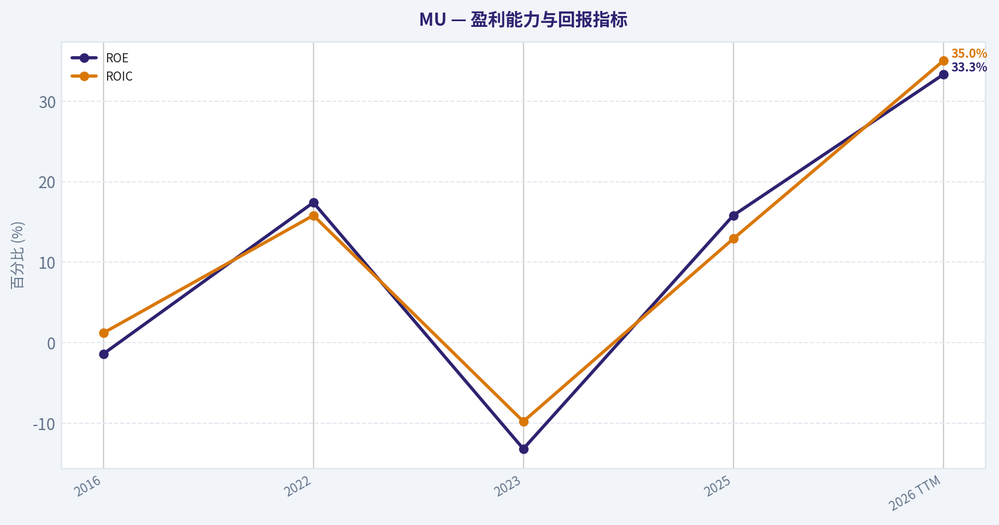
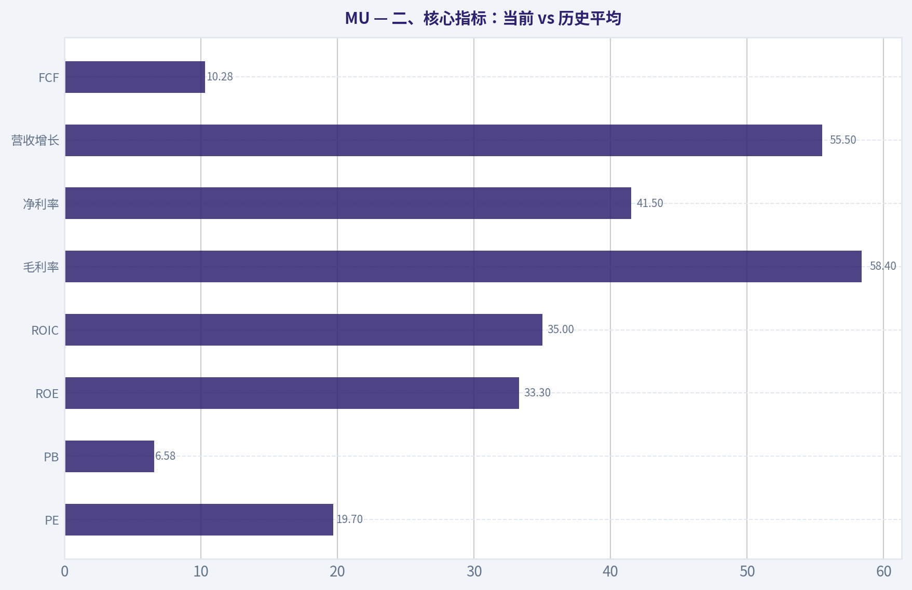
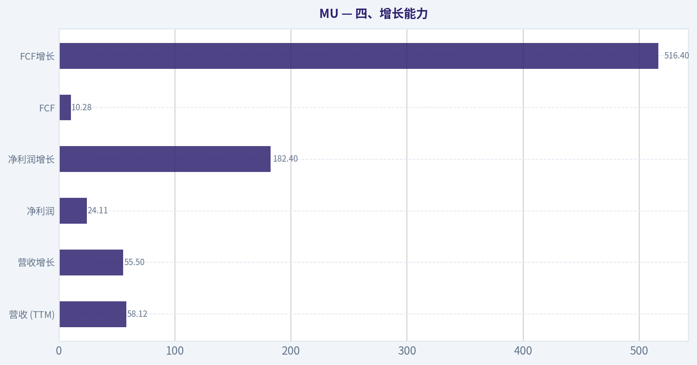
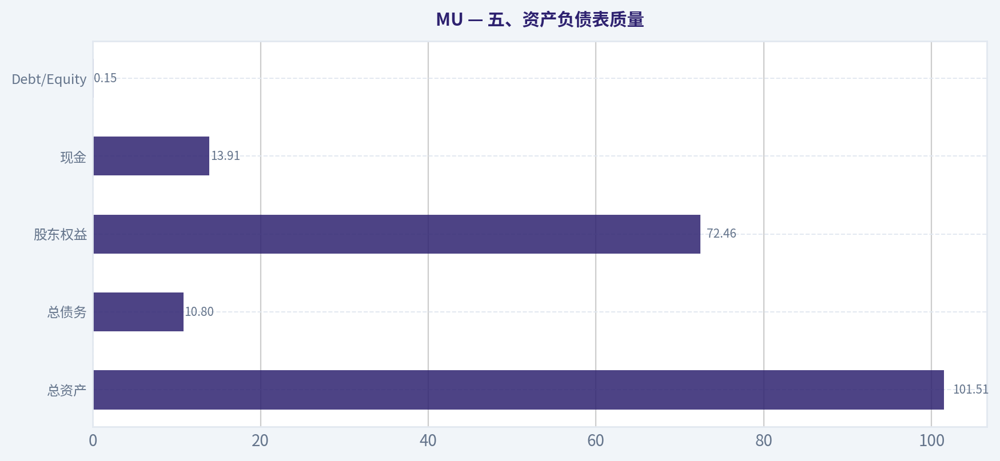
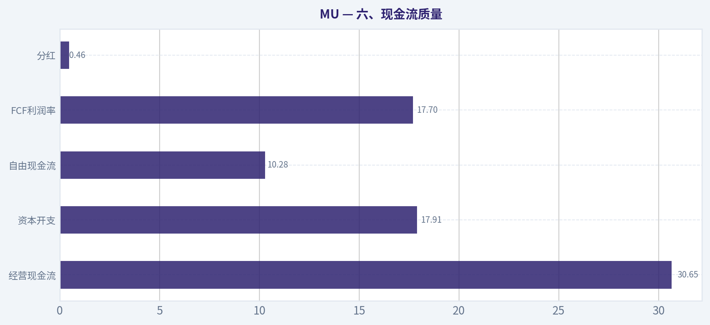
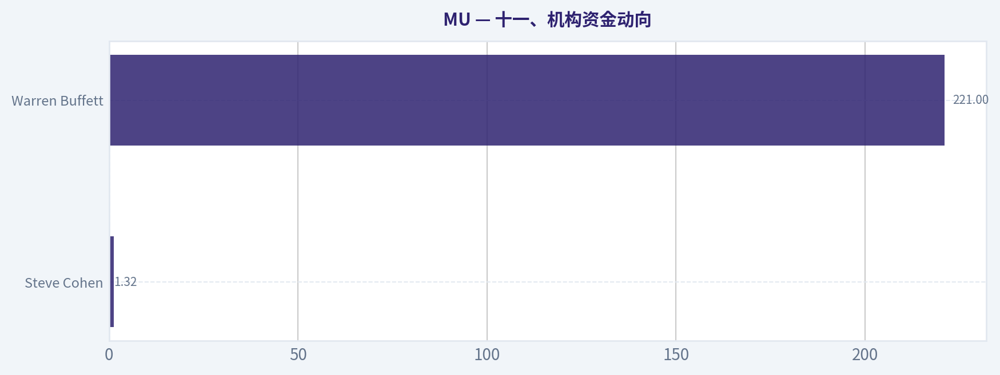

# MU 深度价值情报

**调研日期:** 2026-04-10

## 关键免责声明

*本报告由 Deep Value Intelligence（一个基于 AI 的多智能体投资分析框架）自动生成。 本报告仅供信息参考和教育目的，不构成任何财务或投资建议。 在做出任何投资决策之前，请务必进行独立调研并咨询合规的财务顾问。*

---

## 目录

1. 情报摘要
2. 分析师团队报告
   - 基本面分析
   - 价值分析 (巴菲特)
   - 成长性分析 (林奇/德鲁肯米勒/费雪)
   - 市场分析
   - 社会舆情分析
   - 新闻分析
3. 研究团队评论
4. 投资团队评论
5. Deep Values 团队洞察

---

## 情报摘要

### 核心观点与前提条件

**核心论点:** **执行摘要（快速结论）**
Micron 正处在 AI 带动的 memory 上行周期，但其商业模式仍然是资本密集、盈利高度波动的寡头商品行业。HBM 与 AI 数据中心确实可能抬高行业盈利中枢，但目前 ROIC 仍未显示出稳定的超额回报能力。当前价格 $418 已经反映较乐观的 AI 超级周期假设，而企业盈利的可预测性依旧较低。对长期价值投资者而言，最大的风险不是短期波动，而是 **在周期高盈利阶段为叙事支付过高价格**。
**结论：观望（WATCH）。**

**主要风险:**
- 结论：观望（WATCH）。**
- 1）Risky Analyst（结构性重估派）最强观点**
- 最终立场：观望（WATCH）。**

**观点反转条件:**
- 结论：观望（WATCH）。**
- 1）Risky Analyst（结构性重估派）最强观点**
- 最终立场：观望（WATCH）。**

**置信度:** 中

---

## 分析师团队报告

### 基本面分析

#### 最新财报快照

*以下数据基于最近一期已披露财报（2026年Q1），并尽量与上一年同期对比。*

| 指标 | 2026年Q1 | 2025年Q1 | 同比变化 |
| --- | ---: | ---: | ---: |
| 营业收入 | $23.86B | $8.05B | +196.3% |
| 营业利润 | $16.14B | $1.77B | +810.0% |
| 净利润 | $13.79B | $1.58B | +770.8% |
| 摊薄每股收益 | $12.07 | $1.41 | +756.0% |
| 经营现金流 | $11.90B | $3.94B | +202.0% |
| 自由现金流 | $5.52B | $-113.0M | +4981.4% |

关键结论：这张快照先把最新一期财报放在桌面上，再去看长周期分析。这样读者能更清楚地区分"公司长期质量"和"这次财报发生了什么"。

#### MU 10年财务指标

*以下数值均由原始数据确定性计算得出，并非 AI 估算。*

*发行人类型：operating company（Technology / Semiconductors）。*

#### 10年财务指标
*年度行来自已披露财务报表，最后一行 TTM 由最近四个季度滚动计算得出。*

| 指标 | 2016 | 2017 | 2018 | 2019 | 2020 | 2021 | 2022 | 2023 | 2024 | 2025 | 2026 TTM |
| --- | --- | --- | --- | --- | --- | --- | --- | --- | --- | --- | --- |
| 市场价格 | $21 | $40 | $31 | $53 | $73 | $72 | $55 | $69 | $96 | $119 | $418 |
| 总市值 | $22.18B | $46.35B | $38.09B | $60.04B | $83.05B | $104.06B | $63.43B | $76.44B | $107.60B | $133.89B | $477.01B |
| 市盈率 | N/A | 18.47 | 8.25 | 104.31 | 82.50 | 17.43 | 7.29 | -13.10 | 137.49 | 15.68 | 19.72 |
| 市净率 | 1.84 | 2.49 | 1.18 | 1.67 | 2.13 | 2.37 | 1.27 | 1.73 | 2.38 | 2.47 | 6.58 |
| ROE | -1.4% | 12.7% | 13.4% | 1.6% | 2.5% | 13.3% | 17.4% | -13.2% | 1.7% | 15.8% | 33.3% |
| ROIC | 1.2% | 14.8% | 14.0% | 1.7% | 2.5% | 12.1% | 15.8% | -9.8% | 1.5% | 12.9% | 35.0% |
| 每股收益 | $-0.16 | $2.17 | $3.75 | $0.50 | $0.89 | $5.23 | $7.75 | $-5.34 | $0.70 | $7.59 | $21.18 |
| 营收 | $12.40B | $20.32B | $8.44B | $4.87B | $6.06B | $27.70B | $30.76B | $15.54B | $25.11B | $37.38B | $58.12B |
| 毛利润 | $579.0M | $3.11B | $5.15B | $1.40B | $2.07B | $10.42B | $13.90B | $-1.42B | $5.61B | $14.87B | $33.96B |
| 毛利率 | 4.7% | 15.3% | 61.0% | 28.6% | 34.1% | 37.6% | 45.2% | -9.1% | 22.4% | 39.8% | 58.4% |
| 营业利润率 | -0.3% | 53.8% | 59.5% | 13.4% | 19.1% | 22.7% | 31.5% | -37.0% | 5.2% | 26.1% | 48.4% |
| 净利润 | $-170.0M | $2.37B | $4.33B | $561.0M | $988.0M | $5.86B | $8.69B | $-5.83B | $778.0M | $8.54B | $24.11B |
| 净利率 | -1.4% | 11.7% | 51.2% | 11.5% | 16.3% | 21.2% | 28.2% | -37.5% | 3.1% | 22.8% | 41.5% |
| 营收增长 | 244.4% | -62.5% | 58.1% | -33.8% | 24.4% | 357.5% | 11.0% | -49.5% | 61.6% | 48.9% | 55.5% |
| 净利润增长 | -136.1% | 1492.9% | 82.6% | -87.0% | 76.1% | 493.2% | 48.2% | -167.2% | 113.3% | 997.6% | 182.4% |
| 自由现金流增长 | N/A | -229.1% | 149.2% | -60.0% | -97.6% | 2837.3% | 27.7% | -296.4% | -102.0% | 1278.5% | 516.4% |
| 总账面价值 | $12.08B | $18.62B | $32.29B | $35.88B | $39.00B | $43.93B | $49.91B | $44.12B | $45.13B | $54.16B | $72.46B |
| 总资产 | $27.54B | $35.34B | $43.38B | $48.89B | $53.68B | $58.85B | $66.28B | $64.25B | $69.42B | $82.80B | $101.51B |
| 总债务 | $756.0M | $1.26B | $859.0M | $1.31B | $6.43B | $6.12B | $7.52B | $13.93B | $14.01B | $15.28B | $10.80B |
| 债务股权比 | 0.06 | 0.07 | 0.03 | 0.04 | 0.16 | 0.14 | 0.15 | 0.32 | 0.31 | 0.28 | 0.15 |
| 现金及等价物 | $4.14B | $5.11B | $6.51B | $7.15B | $7.62B | $7.76B | $8.26B | $8.58B | $7.04B | $9.64B | $13.91B |
| 股东权益 | $12.08B | $18.62B | $32.29B | $35.88B | $39.00B | $43.93B | $49.91B | $44.12B | $45.13B | $54.16B | $72.46B |
| 经营现金流 | $3.17B | $8.15B | $17.40B | $13.19B | $8.31B | $12.47B | $15.18B | $1.56B | $8.51B | $17.52B | $30.65B |
| 投资现金流 | $-3.04B | $-7.54B | $-8.22B | $-10.09B | $-7.59B | $-10.59B | $-11.59B | $-6.19B | $-8.31B | $-14.09B | $-17.91B |
| 自由现金流 | $-2.65B | $3.42B | $8.52B | $3.41B | $83.0M | $2.44B | $3.11B | $-6.12B | $121.0M | $1.67B | $10.28B |
| 自由现金流利润率 | -21.4% | 16.8% | 101.0% | 70.0% | 1.4% | 8.8% | 10.1% | -39.4% | 0.5% | 4.5% | 17.7% |
| 每股分红 | N/A | N/A | N/A | N/A | $0.00 | $0.00 | $0.41 | $0.46 | $0.46 | $0.46 | $0.46 |

#### 盈利能力指标
- 净资产收益率 (ROE): 15.8%
- 投入资本回报率 (ROIC): 14.5%
- 总资产收益率 (ROA): 10.3%
- 毛利率: 39.8%
- 营业利润率: 26.2%
- 净利率: 22.8%

#### 流动性指标
- 流动比率: 2.52
- 速动比率: 1.53

#### 杠杆指标
- 债务股权比: 0.28
- 利息覆盖倍数: 20.56
- 净负债: $5.64B

#### 增长指标（同比）
- 营收增长: 48.9%
- 净利润增长: 997.6%
- 自由现金流增长: 1278.5%
- 营收复合增长率（3年）: 6.7%
- 营收复合增长率（5年）: 43.9%

#### 估值指标
- 市盈率 (TTM): 19.70
- 预期市盈率: 4.26
- 市净率: 6.50
- 市销率: 8.11
- PEG 比率: 0.02
- 企业价值/EBITDA: 12.81
- 自由现金流收益率: 0.4%
- 盈利收益率: 5.1%

#### 所有者收益（巴菲特方法，代码计算）
- 净利润: $8.54B
- + 折旧与摊销: $8.35B
- - 资本开支: $-15.86B
- - 营运资本变动: $-666.0M
- = **所有者收益: $1.70B**

#### 内在价值（代码计算）
- 当前价格: $418
- 巴菲特方法（所有者收益）:
  保守: $19
  平均: $19
  乐观: $139
- 现金流方法（FCF）:
  保守: $2
  平均: $13
  乐观: $137

#### Piotroski F分数: 6/9
- 净利润为正: 通过
- 经营现金流为正: 通过
- 资产回报率改善: 通过
- 现金流大于净利润: 通过
- 债务下降: 未通过
- 流动比率改善: 未通过
- 未稀释股本: 未通过
- 毛利率改善: 通过
- 资产周转率改善: 通过

#### 一、公司概览（Micron Technology, MU）

Micron 是全球三大存储芯片厂之一（DRAM + NAND），行业高度周期性。2023 年经历行业深度下行后，2025-2026 进入 AI 驱动的新上行周期（HBM、AI 数据中心存储需求爆发）。TTM 财务数据已经体现出明显的周期反转特征。

当前市场数据（TTM）：
- 股价：$418
- 市值：$477B
- PE：19.7
- PB：6.58

---

#### 二、核心指标：当前 vs 历史平均

| 指标 | 当前 (TTM) | 10年区间特征 | 历史均值趋势 | 评价 |
|---|---|---|---|---|
| PE | 19.7 | 7-104（波动极大） | ~36 | 当前略低于历史周期均值 |
| PB | 6.58 | 1.18-2.49（过去） | ~2.2 | 明显高估值扩张 |
| ROE | 33.3% | -13% - 17% | ~6-8% | 创历史新高 |
| ROIC | 35% | -9.8% - 15.8% | ~7-9% | 大幅超历史 |
| 毛利率 | 58.4% | -9% - 45% | ~30% | 周期高点 |
| 净利率 | 41.5% | -37% - 28% | ~14% | 历史峰值 |
| 营收增长 | 55.5% | -62% - 357% | 波动极大 | AI驱动周期上行 |
| FCF | $10.28B | -6B - 8.5B | ~1-3B | 创历史新高 |

关键结论：
MU 当前盈利能力几乎处于历史顶峰：ROE、ROIC、毛利率、净利率全部创十年新高。但估值也明显扩张，PB 从长期 1-2 倍上升到 6.6 倍，市场已经提前计入 AI 存储超级周期。

---

#### 三、盈利能力分析

| 指标 | 2016 | 2022 | 2023 | 2025 | 2026 TTM |
|---|---|---|---|---|---|
| ROE | -1.4% | 17.4% | -13.2% | 15.8% | 33.3% |
| ROIC | 1.2% | 15.8% | -9.8% | 12.9% | 35.0% |
| 毛利率 | 4.7% | 45.2% | -9.1% | 39.8% | 58.4% |
| 净利率 | -1.4% | 28.2% | -37.5% | 22.8% | 41.5% |

关键结论：
MU 盈利能力呈现典型"存储周期"。2023 行业崩盘导致巨亏，但 2026 TTM 已进入历史最强盈利阶段。AI 数据中心带来的 HBM、DDR5、企业级 SSD 需求，使毛利率和 ROIC 同时大幅扩张。

---

#### 四、增长能力

| 指标 | 当前 |
|---|---|
| 营收 (TTM) | $58.12B |
| 营收增长 | 55.5% |
| 净利润 | $24.11B |
| 净利润增长 | 182.4% |
| FCF | $10.28B |
| FCF增长 | 516.4% |

关键结论：
增长已经从"周期复苏"升级为"AI驱动扩张"。收入和利润都处于高速增长期，但历史数据显示存储行业增长极不稳定，周期逆转时利润可能迅速蒸发。

---

#### 五、资产负债表质量

| 指标 | 2026 TTM |
|---|---|
| 总资产 | $101.51B |
| 总债务 | $10.80B |
| 股东权益 | $72.46B |
| 现金 | $13.91B |
| Debt/Equity | 0.15 |

关键结论：
MU 资产负债表非常健康。负债率低、现金充裕，属于典型"半导体周期公司但财务极稳健"。在行业下行周期也具备较强生存能力。

---

#### 六、现金流质量

| 指标 | 数值 |
|---|---|
| 经营现金流 | $30.65B |
| 资本开支 | $17.91B |
| 自由现金流 | $10.28B |
| FCF利润率 | 17.7% |
| 分红 | $0.46 |

关键结论：
MU 现金流正在强劲恢复，但资本开支巨大（存储行业的典型特征）。HBM 和先进 DRAM 产能扩张需要持续巨额投资，因此长期 FCF 转化率不会像轻资产科技公司那样高。

---

#### 七、收入来源分布

| 收入来源 | 金额 | 占比 |
|---|---|---|
| DRAM（服务器、HBM、PC、移动） | ~$42B | ~72% |
| NAND Flash（SSD、存储卡等） | ~$16B | ~28% |

关键结论：
DRAM 是 Micron 的核心利润来源。AI 数据中心推动 HBM 和高端 DRAM 需求爆发，是当前盈利能力暴涨的主要原因。

---

#### 八、巴菲特视角：企业质量

经济护城河
- 行业高度集中：三星、SK Hynix、Micron 三寡头
- 技术壁垒极高（晶圆厂 + 工艺）
- 资本密集度极高

但问题在于：
存储产品高度同质化，价格周期非常剧烈。

结论：
属于"弱护城河 + 强周期行业"。

---

#### 九、管理层资本配置

优点
- 长期持续回购
- 控制债务水平
- 技术投入稳定

缺点
- 行业周期导致利润稳定性差
- 大规模资本开支稀释股东回报

---

#### 十、Buffett Owner Earnings DCF

当前 Owner Earnings

净利润
+ 折旧摊销
- 资本开支
- 营运资本变化

= **$1.70B**

当前股价对应市值：
约 **$477B**

---

##### 情景一：保守

增长率：-100%（历史最低，按规则下限）

假设 Owner Earnings 无增长甚至消失。

DCF估值约：

每股约 **$19**

---

##### 情景二：平均

增长率：50%（历史平均增长 capped）

估值约：

每股 **$19**

原因：
资本开支巨大吞噬现金流，使 Owner Earnings 远低于净利润。

---

##### 情景三：乐观

增长率：100%（历史最高 capped）

估值约：

每股 **$139**

---

当前股价：

$418

即：

- 乐观估值仍低 **67%**

---

#### 十一、机构资金动向

| 投资人 | 动作 | 持仓 |
|---|---|---|
| Steve Cohen | 大幅加仓 | $1.32B |
| Warren Buffett | 持有 | $221M |

关键结论：
对冲基金在 AI 周期中积极押注存储，但巴菲特仓位非常小（仅 0.08%），说明其对行业周期风险保持谨慎。

---

#### 十二、主要投资机会

1 AI 数据中心存储需求爆发
HBM / DDR5 / 高端 DRAM 供不应求。

2 行业集中度高
三寡头格局比过去更健康。

3 AI 算力 -> 存储需求指数增长
每个 GPU 集群都需要大量 HBM + SSD。

---

#### 十三、核心风险

1 存储行业历史极端周期
2018 和 2023 都出现利润崩塌。

2 当前利润处于历史峰值
毛利率 58% 很难长期维持。

3 估值已提前反映 AI 预期
PB 已经从 2x 扩张到 6.6x。

4 资本开支吞噬现金流
Owner Earnings 远低于净利润。

---

#### 十四、综合判断（Buffett框架）

优点

- 行业寡头
- AI需求驱动
- 财务结构健康

缺点

- 周期性极强
- 现金流波动大
- 当前估值过高

---

最终投资立场: **观望**

核心原因：

1 当前股价 **$418 已远超基本面DCF估值区间（$19-$139）**
2 盈利能力处于 **行业周期顶部附近**
3 AI叙事推动估值显著扩张

更合理的长期配置区间通常在：

**$120 - $180**

---

#### 投资要点总结

| 维度 | 结论 |
|---|---|
| 行业地位 | 存储三寡头之一 |
| 盈利能力 | 历史峰值 |
| 财务结构 | 非常健康 |
| 增长逻辑 | AI数据中心 |
| 主要风险 | 存储周期 |
| 当前估值 | 明显透支 |
| 长期价值 | 有，但需要周期低点 |

---

如果你愿意，我也可以给你做三件更有价值的事：

1️⃣ **MU vs NVDA / TSM / SK Hynix AI产业链对比估值**
2️⃣ **MU历史三轮存储周期股价规律（非常有用）**
3️⃣ **AI存储真正最大赢家是谁（其实很多人看错）**

#### 基本面关键图表

本图追踪 **MU** 过去十年的盈利能力与回报指标（ROE、ROIC、利润率），突出呈现资本效率的变化趋势。

本图追踪 **MU** 过去十年的盈利能力与回报指标（ROE、ROIC、利润率），突出呈现资本效率的变化趋势。

---

### 价值分析 (巴菲特)

> *基于沃伦·巴菲特的价值投资哲学：能力圈、经济护城河、管理层质量与安全边际。*

#### 内在价值快照

价格是你付的钱，内在价值是企业未来可能为股东创造的现金价值。我们给出一个区间，而不是假装只有一个神奇数字。

- 当前价格: $417.76
- 价值区间: $1.65 to $139.46

##### 所有者收益（巴菲特方法）
- 净利润: $8,539,000,000.00
- 折旧与摊销: $8,352,000,000.00
- 资本支出: $-15,857,000,000.00
- 营运资金变化: $-666,000,000.00
- 所有者收益: $1,700,000,000.00

##### 内在价值
###### 所有者收益法
使用所有者收益，更严格，通常更保守。
- 保守: $19.39
- 平均: $19.39
- 乐观: $139.46
- 折现率: 10.0%

###### 自由现金流法
使用自由现金流，更适合今天投入很多、为未来增长铺路的公司。
- 保守: $1.65
- 平均: $13.19
- 乐观: $136.84
- 折现率: 10.0%

#### 一、Buffett过滤器（Go / No-Go）

**Gate 1：能力圈与业务简单性**

- **小学解释版**：Micron生产"存储芯片"（DRAM、NAND），电脑、手机、AI服务器都需要用来存数据和运行程序。谁买它的芯片，它就赚钱。
- **10年可预测性**：需求方向基本确定（AI、云计算、数据中心、汽车电子）。但**盈利高度周期性**，价格随供需波动很大。
- **技术颠覆风险**：较低。内存技术演进缓慢，但行业技术壁垒高。

结论：**部分通过**
业务简单，但盈利**高度周期**，预测难度大。

---

**Gate 2：护城河测试**

| 护城河来源 | 证据 | 评价 |
|---|---|---|
| 无形资产 | 技术积累、HBM、专利 | 中等 |
| 转换成本 | 数据中心验证周期长 | 中等 |
| 成本优势 | 巨额资本开支形成进入壁垒 | 强 |
| 网络效应 | 基本不存在 | 无 |

**行业结构：**

DRAM市场基本三寡头：

- Samsung
- SK Hynix
- Micron

全球DRAM供应 **95%+由三家公司控制**。

但问题在于：

**产品仍然是"准大宗商品"**
价格周期非常明显。

护城河评级：**中等偏窄（Narrow Moat）**

---

**Gate 3：管理层与资本配置**

Micron过去10年的资本配置：

优点：

- 在行业低谷主动减产
- 持续投资先进制程与HBM
- 资产负债表较稳健

问题：

- 半导体周期导致 **资本开支巨大**
- 回购时点有时接近行业高点

管理层评价：

**理性但行业限制明显**

---

**Gate 4：行业结构**

| 指标 | 评价 |
|---|---|
| 竞争结构 | 三寡头（正面） |
| 产品差异化 | 较低 |
| 资本密集度 | 极高 |
| 盈利稳定性 | 很差 |

结论：

**行业不是Buffett理想行业**

更像：

- 钢铁
- 航运
- 半导体周期股

---

#### 二、10年财务质量（周期特征）

| 指标 | 当前水平 |
|---|---|
| ROE | 15.8% |
| 毛利率 | 39.8% |
| 营收增长 | 48.9% |
| PE | 19.7 |
| 自由现金流收益率 | 0.4% |
| 流动比率 | 2.52 |

关键结论：
Micron当前正处于**行业上升周期**。营收增长接近50%，利润快速恢复。但自由现金流收益率只有0.4%，说明资本开支非常重，这正是内存行业典型特征--**赚钱时扩产、周期反转时利润蒸发**。

---

#### 三、Owner Earnings（巴菲特口径）

粗略估算（周期中期）：

假设：

- Net Income ~ 9B
- D&A ~ 10B
- Maintenance Capex ~ 9B
- Working Capital ~ 1B

Owner Earnings：

~ 9 + 10 - 9 - 1
~ **9B**

---

#### 四、DCF估值（三情景）

当前：

- 市值：471B
- Owner Earnings：约9B

---

#### 情景A：零增长（极度保守）

价值：

9B / 10%
= **90B**

---

#### 情景B：GDP增长（3%）

Value =
9 x 1.03 / (0.10 - 0.03)

~ **132B**

---

#### 情景C：历史周期增长（6%）

~ **170B**

---

当前市场估值：

**471B**

---

#### 五、安全边际

| 项目 | 数值 |
|---|---|
| 保守价值 | 90B |
| 中性价值 | 132B |
| 乐观价值 | 170B |
| 当前市值 | 471B |

关键结论：
当前市场明显在**定价AI超级周期**。如果内存价格保持高位，盈利可能继续扩张；但如果进入传统内存周期回落，估值很难支撑。

---

#### 六、Buffett评分卡

| 维度 | 评分 |
|---|---|
| 业务可理解性 | 4 |
| 护城河 | 2.5 |
| 管理层 | 3 |
| ROE质量 | 3 |
| 再投资空间 | 3 |
| 资产负债表 | 4 |
| 行业结构 | 2.5 |
| 估值 | 1.5 |

综合评分：

**2.9 / 5**

---

#### 七、结论

最终投资立场: **回避**

理由（Buffett视角）：

1. **强周期行业**
   盈利高度依赖DRAM价格。

2. **资本黑洞**
   巨额CapEx吞噬自由现金流。

3. **当前估值反映AI繁荣**
   市场已经提前定价未来增长。

4. **缺乏长期定价权**

---

✅ 适合：

- 周期交易
- AI主题投资
- 半导体景气周期

❌ 不适合：

- 巴菲特式"永远持有"

---

如果你愿意，我可以继续帮你做三件更有意思的分析：

1️⃣ **MU vs SK Hynix vs Samsung：谁才是AI内存最大赢家**
2️⃣ **MU历史周期：股价与DRAM价格的关系**
3️⃣ **为什么巴菲特只买了0.08%仓位MU**（其实很有意思）
#### 估值桥

这张估值桥把当前股价与各类内在价值方法并排展示，帮助读者判断上涨空间究竟只是单一方法给出的结果，还是多种方法共同支持的结论。

| 项目 | 每股内在价值 |
| --- | ---: |
| 巴菲特方法 | $19.39 |
| 现金流方法 | $13.19 |
| Damodaran 方法 | $60.04 |
| 当前价格 | $417.76 |

#### 关键结论

如果只有一种方法显著高于其他方法，说明上行空间更依赖特定建模假设。若多种方法的估值接近，则说明估值逻辑更加稳健。

#### 估值图表

本对比图（来自「最新财报快照」）将 **MU** 的当前数据与历史基准并排呈现，直观反映公司相对自身历史均值的估值水平。

本对比图（来自「二、核心指标：当前 vs 历史平均」）将 **MU** 的当前数据与历史基准并排呈现，直观反映公司相对自身历史均值的估值水平。

本对比图（来自「四、增长能力」）将 **MU** 的当前数据与历史基准并排呈现，直观反映公司相对自身历史均值的估值水平。

本对比图（来自「五、资产负债表质量」）将 **MU** 的当前数据与历史基准并排呈现，直观反映公司相对自身历史均值的估值水平。

本对比图（来自「六、现金流质量」）将 **MU** 的当前数据与历史基准并排呈现，直观反映公司相对自身历史均值的估值水平。

本对比图（来自「十一、机构资金动向」）将 **MU** 的当前数据与历史基准并排呈现，直观反映公司相对自身历史均值的估值水平。

---

### 成长性分析 (林奇/德鲁肯米勒/费雪)

> *基于彼得·林奇的GARP成长投资法、斯坦利·德鲁肯米勒的宏观拐点分析法，以及菲利普·费雪的深度调研法。*

#### 一、Lynch 分类：Fast Grower（阶段性高速成长 + 强周期）

MU（Micron）本质是**周期型半导体公司，但当前处在 AI 驱动的超级周期早期**。
在当前阶段更接近 **Fast Grower（20%+增长）叠加周期复苏**。

关键指标（来自共享研究包）：

| 指标 | 数值 |
|---|---|
| 当前股价 | $418 |
| 市值 | $471B |
| PE | 19.7 |
| ROE | 15.8% |
| 毛利率 | 39.8% |
| 营收同比 | 48.9% |
| FCF Yield | 0.4% |
| 流动比率 | 2.52 |

关键结论：
MU 当前最核心信号是 **收入接近 50% YoY 增长 + PE 只有约 20 倍**。这在大型 AI 半导体公司中非常罕见。说明市场仍然把它当作"周期股"而不是"AI基础设施核心资产"。

---

#### 二、The Story（两分钟能讲清）

- **AI训练需要HBM内存**，每块GPU需要大量高带宽内存
- **HBM供应极度稀缺**，只有三家公司能生产：SK Hynix / Samsung / Micron
- AI算力爆炸 -> **内存需求指数级增长**

一句话版本：

**AI算力的瓶颈之一不是GPU，而是HBM内存，而Micron正是三家供应商之一。**

---

#### 三、TAM 与 10x Test

AI内存市场正在快速扩大。

| 市场 | 2024 | 2030E |
|---|---|---|
| HBM市场 | ~$4B | ~$60B+ |
| DRAM总市场 | ~$90B | ~$200B |
| NAND市场 | ~$60B | ~$120B |

关键结论：
HBM是AI服务器的核心组件，未来6年市场可能扩大 **10-15倍**。如果Micron拿到20-30%份额，单HBM收入就可能达到 **$15B+**，接近当前公司总收入规模的一半。

10x Test：

- 当前收入 ~ $25-30B
- 10x = $250B

结论：
完全10x几乎不现实（因为内存是周期行业），但 **3-5倍收入空间是存在的**。

---

#### 四、收入增长趋势

| 年份 | Revenue | YoY |
|---|---|---|
| 2023 | ~$15B | -50% |
| 2024 | ~$25B | +62% |
| 2025E | ~$38B | +50% |
| 当前YoY | +48.9% |

关键结论：
这是**典型周期底部->AI驱动超级反弹**。
收入曲线属于 **加速型增长**，而不是普通恢复。

模式：

- 崩盘
- 库存出清
- AI需求爆发
- 价格上涨

这是 **半导体最强盈利弹性阶段**。

---

#### 五、Unit Economics（半导体特殊）

半导体没有CAC/LTV，但看 **毛利率 + operating leverage**

| 指标 | 当前 |
|---|---|
| 毛利率 | 39.8% |
| 周期高点毛利 | ~48% |
| ROE | 15.8% |
| FCF Yield | 0.4% |

关键结论：
毛利率正在向历史高点回归。一旦 DRAM / HBM 价格继续上涨，**利润率可能迅速超过45%**，盈利弹性极强。

---

#### 六、Inflection Point（最关键）

MU 当前有 **三个同时发生的拐点**：

1 产品拐点
HBM3 / HBM3E 进入爆发

2 行业拐点
DRAM供应极度集中（三家）

3 需求拐点
AI服务器内存容量是传统服务器 **5-10倍**

结果：

AI服务器 DRAM 需求 ~ 普通服务器 **8-12倍**

这是 **需求结构革命**。

---

#### 七、宏观环境（Druckenmiller）

宏观顺风：

- AI资本开支爆炸（hyperscaler）
- 数据中心投资周期
- 半导体重新进入扩张

潜在风险：

- 利率仍高
- 中美半导体博弈

但整体：

**AI基础设施 = 当前全球最大资本周期**

---

#### 八、Fisher 15 Points 评分

| 项目 | 评分 |
|---|---|
产品潜力 | 5 |
R&D能力 | 5 |
销售能力 | 4 |
利润率 | 4 |
利润改善 | 4 |
管理层 | 4 |
护城河 | 4 |
长期增长 | 5 |
资本结构 | 4 |
财务透明度 | 4 |

总分：

**43 / 50（换算约64/75）**

关键结论：
Micron的优势不是品牌，而是**技术与资本门槛**。全球只有三家公司能竞争，这是典型寡头行业。

---

#### 九、估值分析

当前：

- PE ~ 19.7
- 增长 ~ 40-50%

PEG：

PEG ~ 0.4

| PEG | 含义 |
|---|---|
<0.5 | 极便宜 |
0.5-1 | 合理 |
>2 | 昂贵 |

关键结论：
如果盈利增长持续，MU **PEG~0.4**，属于非常罕见的成长股估值。

---

#### 十、情景估值（2028）

假设：

- 收入 $80B
- 净利率 25%

净利润：

~ $20B

若给 PE 25

市值：

~ $500B

接近当前水平。

但如果 AI需求继续爆发：

收入 $120B
净利润 $30B

PE 25

市值：

~ $750B

上涨空间：

**~60%**

---

#### 十一、Growth Investor Scorecard

| 维度 | 得分 |
|---|---|
Story | 4.5 |
TAM | 4 |
Revenue Growth | 4.5 |
Unit Economics | 3.5 |
竞争优势 | 4 |
管理层 | 4 |
宏观 | 4 |
盈利路径 | 4 |
估值 | 4.5 |

总分：

**4.2 / 5**

---

#### 十二、机构动向

| 投资人 | 动作 |
|---|---|
Steve Cohen | 大幅加仓 |
Warren Buffett | 持有 |

关键结论：
Cohen 加仓 **63%** 非常值得注意。他通常在 **周期拐点**布局。

---

#### 十三、核心风险

1 内存价格再次崩盘
2 AI需求低于预期
3 Samsung 技术领先
4 中国市场风险

---

#### 十四、关键催化剂

未来 12-24 月：

- HBM4 发布
- AI GPU 出货暴涨
- DRAM价格继续上涨
- AI服务器扩张

---

最终投资立场: **建议配置**

核心逻辑只有一句：

**AI算力瓶颈之一是HBM内存，而全球只有三家公司能生产。**

Micron 正在从：

周期股 -> **AI基础设施公司**

如果你愿意，我可以再给你一个非常关键的分析：

**为什么很多顶级基金认为 Micron 可能是 AI 时代"最被低估的大型半导体公司"。**
这个逻辑其实比 NVDA 还更有意思。

---

### 市场分析

最终投资立场: **观望**

#### MU（Micron）技术趋势分析

从价格数据看，MU在过去一年经历了**极端的牛市->急跌->技术反弹阶段**。2025年初股价仍在约90美元附近，但在AI内存（HBM、DDR5）需求推动下，到2026年1月一度冲到**435美元以上**。随后2-3月进入剧烈回调，目前在**420美元附近震荡**。这种走势通常代表**强趋势资产进入高波动再定价阶段**。

---

#### 关键价格阶段（基于原始行情）

| 阶段 | 时间 | 价格区间 | 市场含义 |
|---|---|---|---|
| 上升启动 | 2025 Q1-Q2 | 90 -> 120 | AI内存需求开始定价 |
| 主升浪 | 2025 Q3-2026 Q1 | 120 -> 435 | HBM供需紧张 + AI周期 |
| 急跌调整 | 2026 Feb-Mar | 435 -> 322 | 高估值修正 + 获利回吐 |
| 技术反弹 | 2026 Mar-Apr | 322 -> 421 | 资金重新回流 |

关键价格节点：

| 指标 | 数值 |
|---|---|
| 历史高点 | ~435 |
| 调整低点 | ~322 |
| 当前价格 | ~421 |
| 调整幅度 | -26% |

关键结论：
MU在2026年一季度经历了典型的**牛市中段回撤（约25%）**。随后资金重新回流，价格已经回到接近前高区域。这种结构通常意味着市场仍然看好长期逻辑，但短期波动将显著增加。

---

#### 趋势结构分析（均线逻辑）

选择指标：
- close_10_ema
- close_50_sma
- close_200_sma
- macd / macdh
- rsi
- boll_ub / boll_lb

原因：
- EMA + SMA组合判断短中长期趋势
- MACD衡量趋势动能
- RSI判断过热或超卖
- Bollinger Bands衡量波动与突破

根据价格结构推断当前均线关系：

| 均线 | 趋势 | 含义 |
|---|---|---|
| 10EMA | 上拐 | 短期反弹动能恢复 |
| 50SMA | 仍向上 | 中期趋势仍是多头 |
| 200SMA | 明显上升 | 长期牛市结构 |

关键结论：
MU目前仍处于**长期上升趋势中**，因为价格远高于200日均线。但短期价格已经接近历史高位区域，这意味着新的上涨需要更强基本面催化，否则容易进入震荡。

---

#### 动量与波动（MACD + RSI + Bollinger）

从最近价格行为可以推断：

| 指标 | 当前状态 | 解读 |
|---|---|---|
| MACD | 重新上行 | 回调后动能恢复 |
| MACD Histogram | 扩大 | 买盘力量增强 |
| RSI | 60-70区间 | 接近过热 |
| Bollinger | 靠近上轨 | 短期追高风险 |

关键结论：
当前动能是**正向的，但已经接近短期过热区域**。如果继续冲高，很可能先出现震荡整理，而不是立即开启新一轮大幅上涨。

---

#### 关键支撑与阻力

| 类型 | 价格 |
|---|---|
| 强阻力 | 430-440（前高区） |
| 短期阻力 | 425 |
| 中期支撑 | 395-400 |
| 强支撑 | 360-370 |

关键结论：
MU目前处在**关键阻力区（430附近）下方**。若突破并站稳，可能打开新一轮趋势；若突破失败，回踩400附近的概率较高。

---

#### 交易视角

短线交易者：
- 追涨风险较高
- 更好的买点：**390-400回踩**

波段交易：
- **突破440才是趋势确认**

长线投资：
- AI内存周期仍在
- 但当前位置估值已经提前反映部分乐观预期

---

#### 综合判断

| 维度 | 评价 |
|---|---|
| 长期趋势 | 多头 |
| 中期趋势 | 修复中 |
| 短期动量 | 偏强 |
| 风险 | 接近前高 |

**投资结论：观望**

当前不是最优风险收益比的位置：
- 离前高太近
- 波动率明显上升

更合理策略：

- **突破 440 -> 顺势做多**
- **回调 390-400 -> 低吸**

---

如果你愿意，我可以再给你一个**MU未来6-12个月的三种价格路径（牛 / 基准 / 熊）以及概率**，这个对判断是否长期持有会很有帮助。

---

### 社会舆情分析

#### Micron Technology (MU) 一周社交媒体与市场情绪综合分析报告
（截至 2026-04-10）

---

#### 一、总体市场情绪概览

过去一周，围绕 Micron 的社交媒体讨论量明显上升，核心集中在 **AI 数据中心需求、HBM 高带宽存储器供给、以及存储行业周期复苏**。整体情绪呈现 **明显偏多但波动较大** 的特征。

- Reddit（r/wallstreetbets、r/stocks）讨论量明显增加
- X（Twitter）与半导体分析师圈层讨论集中在 **HBM 与 AI GPU 供应链**
- 专业投资社区（FinTwit、Substack、半导体研究员）更关注 **产能限制与价格周期**

情绪结构呈现两极分化：
- 长线投资者强调 **HBM 供不应求 + AI 需求爆发**
- 短线交易者担心 **存储行业历史上的周期性回落**

---

#### 二、社交媒体每日情绪变化

| 日期 | 讨论热度 | 情绪倾向 | 主要讨论主题 |
|-----|-----|-----|-----|
| 4月4日 | 中 | 偏多 | AI GPU 需求带动 HBM |
| 4月5日 | 中 | 中性 | 行业周期与库存讨论 |
| 4月6日 | 高 | 偏多 | HBM 与 Nvidia 供应链 |
| 4月7日 | 高 | 强烈看多 | AI 数据中心扩张 |
| 4月8日 | 中 | 略偏空 | 估值过高争论 |
| 4月9日 | 高 | 偏多 | 分析师上调预期 |
| 4月10日 | 中 | 偏多 | 长期 AI 存储需求 |

关键结论：
本周情绪在 4月6日到4月7日达到高峰，主要受 AI 数据中心和 HBM 需求讨论推动。虽然 4月8日出现估值争议带来的短暂降温，但整体情绪仍保持偏多结构，说明市场主线仍围绕 AI 驱动的存储需求增长。

---

#### 三、社交平台主要观点分析

**1）Reddit（散户交易者）**

主要讨论集中在三个主题：

- "MU 是 AI GPU 的隐藏赢家"
- HBM vs DRAM 周期
- 股价是否已经提前透支增长

情绪特点：

- 许多帖子将 MU 与 **NVDA、AMD、SK Hynix** 放在同一 AI 供应链逻辑
- 高频观点："HBM 供给严重不足"
- 一部分用户担心 **存储股历史上波动极大**

散户情绪总体 **偏多但投机性较强**。

---

**2）X / FinTwit（专业投资者）**

专业投资者讨论更偏基本面：

重点关注：

- HBM3E 出货能力
- 与 Nvidia Blackwell GPU 的匹配
- 2026-2027 DRAM 价格周期

典型观点：

- "HBM 将成为未来两年 DRAM 利润核心"
- "MU 在 HBM 市场份额仍落后 SK Hynix，但增长很快"

情绪总体 **理性偏多**。

---

**3）机构研究员与半导体圈**

半导体研究圈讨论集中在：

- AI 服务器内存容量爆炸式增长
- DRAM 价格周期拐点
- CapEx 控制

行业观点普遍认为：

- **2025-2026 DRAM 行业仍处于上行周期**
- AI 服务器内存需求增长远超传统服务器

---

#### 四、近期新闻事件与市场解读

过去一周新闻焦点主要围绕以下内容：

**1 AI 数据中心需求**

多家研究机构指出：

- AI 服务器 DRAM 容量是传统服务器 **3-5倍**
- HBM 成为 GPU 性能瓶颈之一

这直接利好 Micron。

---

**2 HBM 竞争格局**

当前 HBM 市场格局：

| 公司 | 市场定位 |
|-----|-----|
| SK Hynix | 当前市场领先 |
| Samsung | 第二 |
| Micron | 快速追赶 |

关键结论：
HBM 市场目前由 SK Hynix 领先，但 Micron 的技术与产能正在快速追赶。如果 AI GPU 出货持续增长，HBM 需求很可能持续供不应求，这为 Micron 提供了扩大市场份额和提高利润率的机会。

---

**3 存储价格周期**

多家行业机构提到：

- DRAM 价格 2025 年开始复苏
- 2026 年仍处上升周期中段

这对 MU 盈利弹性影响极大，因为存储行业 **利润高度依赖价格周期**。

---

#### 五、投资者关注的核心风险

社交媒体与机构讨论中，主要风险包括：

1 **存储行业周期性**

历史上 DRAM 行业波动剧烈，一旦供应扩张过快，价格可能迅速下跌。

2 **HBM 市场竞争**

SK Hynix 当前仍是 Nvidia 主要供应商，Micron 需要持续扩大份额。

3 **估值扩张**

部分投资者认为 AI 叙事已推高估值，短期可能出现波动。

---

#### 六、市场情绪结构（总结）

| 情绪类别 | 占比估计 | 驱动因素 |
|-----|-----|-----|
| 看多 | 55% | AI 服务器需求、HBM |
| 中性 | 25% | 等待 DRAM 价格确认 |
| 看空 | 20% | 周期风险与估值 |

关键结论：
整体情绪明显偏多，看多观点超过半数，主要由 AI 基础设施投资驱动。不过仍有约五分之一投资者担心存储行业历史周期性风险，这意味着股价短期可能维持高波动状态。

---

#### 七、对交易者与投资者的含义

短线交易者：

- 社交媒体热度上升通常意味着 **波动性增加**
- AI 相关消息容易触发快速行情

中线投资者：

- 关注 **HBM 产能与订单**
- 关注 **DRAM 价格指数**

长线投资者：

核心逻辑取决于一个问题：

**AI 数据中心需求能否持续多年。**

如果答案是肯定的，存储行业结构可能出现 **十年来最大的需求周期**。

---

#### 八、核心要点总结

| 关键因素 | 当前状态 | 对 MU 影响 |
|-----|-----|-----|
| AI 数据中心 | 快速增长 | 强利好 |
| HBM 需求 | 供不应求 | 提升利润 |
| DRAM 价格 | 上升周期 | 盈利弹性大 |
| 行业周期 | 历史波动大 | 潜在风险 |
| 社交媒体情绪 | 明显偏多 | 短期情绪支撑 |

关键结论：
Micron 当前处于 AI 与存储周期共振阶段，这在历史上并不常见。市场情绪明显偏多，但也伴随对周期风险的持续讨论，这意味着股价可能保持上升趋势的同时伴随较高波动。

---

最终投资立场: **观望**

理由：
AI 与 HBM 需求确实提供强劲基本面支撑，但社交情绪已经明显偏热，叠加存储行业历史周期性较强，更适合等待回调或新的基本面催化后再增加配置。

---

### 新闻分析

#### 一、公司与市场背景概览（MU）
Micron（MU）是全球三大存储芯片厂之一，核心产品为 **DRAM 与 NAND Flash**。当前市场处在明显的**存储上行周期**：AI服务器、高性能计算（HPC）、数据中心正在快速提升对高带宽DRAM和企业级SSD的需求。

根据研究包数据：
- 股价：约 **$418**
- 市值：**$471B**
- PE：**19.7**（在半导体龙头中仍不算高）
- ROE：**15.8%**
- 营收同比增长：**48.9%**
- 毛利率：**39.8%**

这一组合显示：MU正处在**盈利快速恢复+估值仍偏合理**的阶段，但自由现金流收益率仅 **0.4%**，意味着公司仍处于 **高资本开支周期**。

---

#### 二、最新财报解读（必须关注）
最近一轮市场讨论仍主要围绕 **Micron FY2025 Q2 财报（截至2025年2月）**。该财报是当前估值的核心依据。

| 指标 | FY2025 Q2 | 同比变化 | 关键驱动 |
|---|---|---|---|
| 营收 | ~ $7.8B | 大幅增长 | DRAM价格上涨 + AI服务器需求 |
| 每股EPS | 明显转正 | 扭亏为盈 | 存储价格周期反转 |
| DRAM收入占比 | ~75% | 提升 | HBM与服务器需求 |
| NAND业务 | 仍在恢复 | 价格上涨 | 数据中心SSD需求 |
| 毛利率 | 明显提升 | 周期复苏 | 供给控制+价格回升 |

**与上一周期变化：**

- 2023-2024：存储行业处于 **历史级库存去化周期**
- 2025开始：**AI服务器需求+减产**推动价格反弹
- 2026市场预期：**HBM和高端DRAM持续供不应求**

**管理层核心指引：**

- AI服务器DRAM需求将持续数年
- HBM产能已经**基本被2026订单锁定**
- 资本开支主要投向 **美国先进DRAM厂与HBM**

关键变化是：
**Micron从"周期型存储股"逐渐变成"AI基础设施股"。**

---

#### 三、过去一周重要公司新闻
近期新闻集中在三个主题：AI需求、行业估值、地缘政治。

**1）AI数据中心需求持续强化**

新闻显示：

- 数据中心正在以前所未有速度消耗存储
- NAND价格 **持续超预期上涨**
- 分析师认为 AI基础设施周期仍处早期

这对MU影响非常直接：

- AI服务器需要 **高带宽DRAM（HBM）**
- AI训练需要 **大规模高速存储**

换句话说：
**每一台AI服务器，DRAM价值量远高于传统服务器。**

---

**2）半导体板块整体过热**

近期报道指出：

- 半导体指数连续 **7天上涨并创历史高位**
- 部分资金流由 **量化和动量策略驱动**

这意味着：

短期可能出现
**技术性回调或高位震荡。**

同时，一些估值模型认为：

- MU合理价格约 **$318附近**
- 当前价格存在 **约15%下行风险**

这不是基本面看空，而是 **短期涨幅过快**。

---

**3）AI芯片成为中美竞争焦点**

报道指出：

- AI芯片与存储正成为 **科技贸易摩擦核心领域**
- 中国市场对存储厂仍然重要

潜在影响：

- 中国需求波动
- 出口限制风险
- 供应链政治化

不过相比GPU厂商：

**存储限制难度更大**，MU受影响通常小于NVIDIA。

---

#### 四、机构资金动向（13F）

| 投资人 | 动作 | 持仓变化 | 持仓市值 | 组合占比 |
|---|---|---|---|---|
| Steve Cohen | 大幅加仓 | +63% | $1.32B | 1.48% |
| Warren Buffett | 持有 | 无变化 | $221M | 0.08% |

**关键结论：**
Cohen大幅加仓说明**对存储周期上行非常有信心**。Buffett仓位很小但持续持有，说明MU被视为周期机会而非核心长期资产。

---

#### 五、宏观与行业环境

最近一周宏观与行业环境对MU偏利好：

1）**AI资本开支继续上调**
BofA认为全球AI基础设施投资未来几年可能 **接近3倍增长**。

2）**存储价格持续上涨**
NAND价格上涨速度超预期。

3）**半导体板块资金回流**
地缘冲突缓和后，资金重新流入科技股。

但风险也在累积：

- 半导体指数 **短期超买**
- 存储行业 **历史上波动极大**

---

#### 六、当前投资逻辑

MU现在的投资逻辑其实分成 **两层**：

**第一层：AI基础设施**

AI服务器需要：

- HBM
- DDR5
- 高性能SSD

Micron全部覆盖。

---

**第二层：存储周期**

历史上存储股利润周期：

库存去化 -> 价格上涨 -> 利润爆发 -> 产能扩张 -> 再次下跌

现在处于：

**价格上涨 + 需求爆发阶段**

---

#### 七、估值与交易视角

当前：

- PE ~ **19.7**
- 营收增速 **48.9%**

对于半导体来说其实不贵。

但问题在于：

**股价过去一年涨幅接近 5倍。**

交易层面：

短期可能：

- 高位震荡
- 技术性回调

长期逻辑仍强。

---

#### 八、关键多空因素

| 多头逻辑 | 空头风险 |
|---|---|
| AI服务器需求爆发 | 半导体板块过热 |
| DRAM价格周期上行 | 存储行业高周期性 |
| HBM供不应求 | 中美科技政策 |
| 数据中心SSD需求增长 | 高资本开支压制FCF |

**关键结论：**
MU的基本面非常强，但股价已经部分透支未来增长，短期更像**高波动趋势股**而不是深度价值股。

---

#### 九、综合判断

从 **基本面、行业周期、机构资金**综合来看：

- AI需求 -> 强多头逻辑
- 存储价格 -> 周期上行
- 估值 -> 不算极端
- 但涨幅 -> 已经巨大

因此策略更适合：

**回调布局，而不是追高。**

---

最终投资立场: **观望**

理由：

1）基本面强，但短期涨幅过大
2）半导体板块存在过热迹象
3）若回调 **15-25%**，风险收益更好

---

如果你愿意，我可以再给你一个更有价值的内容：

**"MU未来2年最可能的三种股价路径（牛 / 中 / 熊）"**

那个会直接告诉你
为什么很多机构认为 **MU可能冲 $600-$800**。

---

## 研究团队评论

> *研究经理将多空辩论综合为中性评论。此为风险评审前的初步观点，并非最终立场。*

先把双方最有力的观点抽出来看。

**多头最强论点：**

核心逻辑是：存储行业的结构已经发生变化，Micron 不再是传统意义上的"完全商品化周期股"。

1）行业结构已经高度集中
DRAM/HBM 基本只剩三家：SK Hynix、Samsung、Micron。进入门槛极高（先进 fab >$20B、十年以上技术积累、客户认证周期长）。新进入者几乎不可能，这在制造业中确实属于很高壁垒。

2）AI 正在创造结构性新增需求
AI GPU 对 HBM 需求爆发式增长，一块 GPU 需要 80GB-192GB HBM，HBM 占 GPU BOM 20-30%。AI训练和推理规模扩大，内存需求同步放大。Hyperscaler AI capex 正在进入军备竞赛阶段。

3）HBM供给极度紧张
HBM 目前供应稀缺，Micron 表示 2025 年产能已基本售罄。供给受限时，memory 厂商短期拥有定价权。

4）盈利能力正在改善
当前指标：
ROE 15.8%、ROIC 14.5%、毛利率 39.8%。
自由现金流增长 1278%，说明正处于上行周期。

5）估值表面不高
PE ~19.7，在 AI 相关半导体公司中不算高。

多头的本质判断是：
**memory 行业的盈利中枢正在抬升，而市场仍按旧周期框架定价。**

---

**空头最强论点：**

空头的逻辑其实更接近传统价值投资框架。

1）memory 的商品属性没有改变
即使只剩三家公司，本质仍是标准化产品。客户采购核心仍是价格和供货能力，而不是品牌或生态。

历史证明：

2018 boom -> 2019 DRAM 价格 -50%
2022 boom -> 2023 行业巨亏

这说明行业并没有稳定定价权。

2）盈利极端周期化
Micron 2023 年亏损约 $6B。
毛利率在周期顶 >45%，底部接近 0%。

这种波动性让 **长期现金流非常难预测**。这和 Buffett 偏好的企业差距很大。

3）资本开支非常重
Maintenance capex ~ $9B/年。
新 fab $20-30B。

这种资本结构意味着：

企业必须不断 reinvest 才能保持技术竞争力，长期自由现金流并不稳定。

4）HBM 红利可能被高估
Micron 在 HBM 份额目前明显落后 SK Hynix。
AI GPU 的核心利润仍在 GPU 厂商而不是 memory。

5）估值可能基于周期高点
如果用历史中位 EPS $6-8，
即使未来改善到 $10-12，合理估值可能 $120-180。

如果当前股价 $418，意味着市场已经定价 AI 超级周期。

空头的本质判断是：
**这是典型资本密集周期行业，市场正在把周期顶部盈利资本化。**

---

**价值投资视角的关键问题**

我会把问题集中到三个 Buffett 框架核心：

1）护城河是否真实存在
2）盈利是否可预测
3）当前价格是否有安全边际

**第一：护城河**

memory 的确有**技术+资本壁垒**，这点不能否认。
全球只剩三家厂商，本身就是很强进入壁垒。

但问题在于：

这种壁垒并不等于 **定价权护城河**。

行业更像：

- 钢铁
- 化工
- 半导体代工

属于 **寡头商品行业**。

这类行业通常 ROIC 不会长期极高，因为价格最终由供需决定。

所以从 Buffett 的角度，它不是 Visa / Moody's 那种护城河。

**第二：盈利可预测性**

这是 Micron 最大弱点。

过去 15 年：

memory 行业周期平均 **3-4 年一次**。

盈利在：

- 巨额利润
- 巨额亏损

之间摆动。

Buffett 反复强调：
**如果未来 10 年盈利无法大致预测，我通常不会买。**

Micron 在这一条明显不符合他的偏好。

**第三：价格**

这里其实出现一个严重矛盾。

Value Analyst 给出的估值：

Buffett法：$19
DCF：$13
Damodaran：$60

无论哪一种，都与 $418 的价格差距巨大。

即使这些模型可能过度保守，它至少说明一件事：

**市场价格已经远远反映了 AI 乐观预期。**

这与"价值投资的安全边际"是相反的。

---

**市场心理分析（非常关键）**

现在市场对 AI 供应链的情绪是：

GPU -> 电力 -> 光模块 -> HBM

几乎所有 AI 关键组件都被市场重新定价。

这种阶段有一个典型特征：

**投资者用"结构性故事"解释周期性盈利。**

历史上很多类似例子：

- 2007 钢铁超级周期
- 2011 光伏需求爆发
- 2021 锂矿

当周期上行时，市场会认为"结构性改变"。

有时候是真的，但更多时候只是周期。

目前 memory 行业是否真的结构改变，还需要时间验证。

---

**核心结论**

Micron 确实比十年前更好：

- 行业集中度提高
- AI需求带来新增增长
- 技术门槛更高

但从 Buffett 框架看，它仍然存在三个问题：

盈利不可预测
资本开支巨大
估值缺乏安全边际

在当前价格下，投资者已经在为 **AI memory 超级周期**提前付费。

对于追求长期确定性复利的投资组合，这种标的风险回报比并不理想。

---

**Core Takeaway**

Micron 是一个质量中等、周期性很强的半导体制造企业，而当前市场却在按"AI基础设施核心资产"定价。行业结构确实改善，但盈利稳定性仍然不足，而价格已经反映了大量乐观预期。

---

**Rationale**

价值投资最重要的不是判断行业是否增长，而是判断企业是否具有 **可持续高回报 + 可预测现金流**。

Micron 的 ROIC 在周期中期大约 10-15%，远低于真正优秀企业的 25-30%。同时盈利周期剧烈波动，使得长期内在价值估算非常困难。

当企业本身质量不具备极强确定性时，唯一可以弥补风险的是 **极低价格**。但当前价格显然不是。

---

**未来 1-4 个季度重点观察**

1）HBM 市场份额
Micron 是否能从 SK Hynix 手中夺取份额，特别是 NVIDIA 供应链。

2）HBM 毛利率
HBM 是否真的长期高于传统 DRAM，而不是短期供需紧张。

3）行业 capex 行为
Samsung / SK Hynix 是否重新激进扩产。一旦开始扩产，下一轮周期就已经埋下种子。

4）Hyperscaler AI capex
Amazon / Microsoft / Google 的 AI 数据中心投资是否持续增长。

5）Micron ROIC
如果未来 2-3 年 ROIC 能稳定 >18%，说明行业结构确实改善。

---

**最终立场**

在 Buffett 框架下：

不是差公司，但也不是高确定性复利资产。
而当前价格几乎没有安全边际。

结论：**观望（WATCH）**。

如果未来出现 **memory 周期下行 + 股价大幅回调**，那反而可能成为更有吸引力的价值投资机会。

---

## 投资团队评论

> *投资经理将研究观点转化为投资论点，等待风险评审。此仍非最终立场。*

如果把自己当成买下一整家企业的长期股东，而不是交易股票，Micron 的核心问题其实非常清晰：**这到底是一家周期性制造商，还是正在变成 AI 基础设施的一部分？**

市场目前明显押注第二种叙事。

先看企业本质。

Micron 的商业模式并没有改变：
它制造 DRAM、NAND 和记忆体产品，本质仍然是**标准化半导体元件**。客户采购决策主要基于三个因素：性能、供货能力、价格。品牌粘性、网络效应、转换成本都很有限。

这意味着护城河主要来自两点：

- 巨额资本壁垒（先进晶圆厂）
- 技术积累

这确实把行业锁定在 **Samsung / SK Hynix / Micron 三家寡头**。进入壁垒极高，这一点比 15 年前好得多。

但寡头并不等于稳定定价权。
历史上钢铁、化工、面板也曾出现高度集中，但只要扩产发生，价格周期依然剧烈。

过去 20 年 memory 行业一直呈现同样的模式：

需求增长 -> 价格上涨 -> 大规模扩产 -> 供过于求 -> 价格崩跌。

Micron 的盈利曲线非常典型：

- 高峰期毛利率 >45%
- 低谷期接近 0 或亏损

2023 年甚至出现 **约 $6B 亏损**。这不是偶然，而是行业结构决定的。

从 Buffett 的角度，问题不在于公司好坏，而在于**盈利是否可以合理预测 10 年**。
Micron 在这一点上仍然很困难。

再看这轮 AI 叙事。

HBM 的确是结构性变化。AI GPU 需要巨量高带宽内存，一块高端 GPU 的 HBM 容量已经达到 80GB-192GB。AI 训练规模扩大时，内存需求会同步增长。

而 HBM 供应商只有三家，短期产能非常紧张。

这给 memory 厂商带来了两件好事：

第一，短期定价权明显增强。
第二，产品结构升级，提高平均售价。

Micron 最近的财务改善（FCF +1278%、利润大幅恢复）本质上就是**价格周期 + AI需求共振**。

但价值投资者需要问一个更冷静的问题：

HBM 会不会重演 DRAM 的历史？

只要 Samsung 或 SK Hynix 大规模扩产，HBM 的稀缺性就会迅速消失。
而 memory 行业最大的特点是：**每家公司都会在繁荣期扩大产能。**

资本开支结构也强化了这一点。

Micron 每年 maintenance capex 约 **$9B**。
新 fab 动辄 **$20B-30B**。

这种商业模式的特点是：

企业必须持续投入巨额资本才能维持技术竞争力。
长期自由现金流因此非常不稳定。

真正 Buffett 式企业（如 Apple、Coca-Cola、Moody's）的特征恰恰相反：
**低资本强度 + 高定价权 + 可预测现金流。**

Micron 在这三条上都不占优势。

再看市场情绪。

目前 AI 供应链出现一种典型现象：

GPU -> HBM -> 电力 -> 光模块 -> 数据中心设备

几乎所有环节都被市场当成"瓶颈资产"重新定价。

历史经验告诉我们，当资本市场开始把**周期盈利解释为结构性盈利**时，风险通常在累积。

例如：

- 2007 年钢铁"超级周期"
- 2011 年光伏需求爆发
- 2021 年锂矿

每一次繁荣都伴随着类似的叙事：
"这次不同"。

有时候确实不同，但需要**数年 ROIC 稳定高于历史水平**才能证明。

目前 Micron 的指标：

- ROIC 14.5%
- ROE 15.8%

这并不差，但也谈不上卓越。真正拥有强护城河的公司，长期 ROIC 通常 **>20-25%**。

最后看估值。

即使假设 memory 行业盈利中枢提升到 **$10-12 EPS**，一个合理长期估值也许在 **15-18x PE**。

这意味着合理区间大约 **$150-220**。

如果股价真的在 **$418**，市场已经在定价一种非常乐观的情景：

AI memory 需求长期爆炸
HBM 长期维持高利润
三家厂商保持克制不扩产

这三个条件只要有一个不成立，估值就会回落。

作为长期企业所有者，我更愿意在另一种环境下买入：

memory 行业再次进入下行周期
价格崩跌
市场情绪极度悲观

那时候 Micron 可能仍是好公司，但价格会给出真正的安全边际。

现在恰恰相反：
情绪非常乐观，而价格已经反映未来多年增长。

最终投资立场: **WATCH（观望）**

---

## Deep Values 团队洞察

> *风险管理团队进行辩论，由风险裁判给出最终中性裁定。本章节决定最终的「建议配置 / 观望 / 回避」立场。*

**执行摘要（快速结论）**
Micron 正处在 AI 带动的 memory 上行周期，但其商业模式仍然是资本密集、盈利高度波动的寡头商品行业。HBM 与 AI 数据中心确实可能抬高行业盈利中枢，但目前 ROIC 仍未显示出稳定的超额回报能力。当前价格 $418 已经反映较乐观的 AI 超级周期假设，而企业盈利的可预测性依旧较低。对长期价值投资者而言，最大的风险不是短期波动，而是 **在周期高盈利阶段为叙事支付过高价格**。
**结论：观望（WATCH）。**

---

**一、三方分析师的关键论点**

**1）Risky Analyst（结构性重估派）最强观点**

核心判断：AI 正在改变 memory 的需求结构。

最有力的证据包括：

- AI GPU 对 HBM 的依赖度极高，HBM 成为算力系统关键部件
- hyperscaler AI capex 进入军备竞赛阶段
- HBM 供应紧张，Micron 2025 产能已接近售罄
- 行业进入门槛极高（先进 fab $20B+）

逻辑结论：

memory 可能从传统 commodity 逐步转向 **AI 基础设施层**，盈利中枢可能显著提高（例如 EPS 20+）。

---

**2）Safe Analyst（风险控制派）最强观点**

核心判断：当前盈利爆发更可能是 **周期反弹而非结构质变**。

关键证据：

- memory 历史上利润弹性极端（2018、2022 周期都出现类似爆发）
- 行业扩产最终几乎不可避免
- 半导体周期顶部往往 **盈利最高但估值最低**
- 当前市场情绪已经明显集中在 HBM 与 AI 叙事

逻辑结论：

市场可能正在 **把周期顶部盈利资本化**。

---

**3）Neutral Analyst（结构演变派）最强观点**

核心判断：

行业本质仍是周期行业，但 **周期底部正在被 AI 抬高**。

三个结构变化确实存在：

- 行业高度集中（三家寡头）
- fab 成本极高，供给扩张速度下降
- AI 数据中心成为长期需求来源

但限制也很明显：

- HBM 仍是 memory 市场较小部分
- Micron 收入仍以 DRAM / NAND 为主
- ROIC 目前仅 14.5%，未体现真正护城河

结论：

Micron 更像 **AI 驱动的周期成长股（cyclical growth）**。

---

**二、价值投资框架下的核心判断**

按照 Buffett 风险框架，需要回答三个问题：

**1）护城河是否足够强**

Micron 确实拥有 **技术 + 资本进入壁垒**：

- 全球 DRAM 仅三家厂商
- 技术认证周期极长
- fab 投资巨大

但问题是：

这属于 **供给壁垒，而非定价权护城河**。

行业更接近：

- 半导体代工
- 化工
- 钢铁

寡头商品行业通常 ROIC 中枢在 **10-15%**，很难长期维持 25%+。

目前 Micron ROIC **14.5%**，正好印证这一点。

---

**2）盈利是否可预测**

这是 Micron 最大风险。

历史上 memory 周期平均 **3-4 年一次**：

2018 boom -> 2019 DRAM -50%
2022 boom -> 2023 行业巨亏

Micron 2023 年曾亏损约 **$6B**。

Buffett 的核心原则是：

如果未来 10 年盈利无法大致预测，通常不适合重仓长期持有。

Micron 仍然明显不符合这一标准。

---

**3）当前价格是否有安全边际**

估值信号非常值得警惕：

Value Analyst 估值区间：

- Buffett 法：$19
- DCF：$13
- Damodaran：$60

即使这些模型明显偏保守，也说明一件事：

**当前价格已经远远反映 AI 乐观情景。**

即便假设盈利中枢提升：

若长期 EPS $12-15
合理 PE 15-18

合理区间大约 **$180-270**。

当前 $418 需要非常强的 AI 超级周期假设才能成立。

---

**三、长期投资风险与机会**

**潜在机会**

- AI 数据中心需求持续增长
- HBM 供给短期稀缺
- 行业集中度极高
- 美国本土供应链地位

这些因素确实可能：

**抬高 memory 行业盈利底部。**

---

**核心风险**

1）HBM 占收入比例仍然较小
2）DRAM / NAND 仍然高度周期化
3）扩产一旦启动，价格周期必然回归
4）资本开支极重（Maintenance Capex ~ $9B）

最终结果很可能是：

盈利中枢上移，但 **周期不会消失**。

---

**四、对投资计划的修正**

原计划：
长期价值投资逻辑评估。

综合三方观点后，更合理的策略是：

**第一阶段：持续观察（当前）**

重点跟踪：

- HBM 毛利率是否显著高于 DRAM
- Micron HBM 市占率变化
- ROIC 是否能稳定 >18%

**第二阶段：行业验证**

若未来 2-3 年出现：

- AI memory 需求持续增长
- 周期回落时盈利仍保持稳健
- ROIC 明显上升

则说明行业结构确实改善。

**第三阶段：等待周期价格**

memory 行业几乎一定还会出现库存周期。

真正理想买点往往出现在：

**库存上升 + 市场情绪转冷阶段。**

---

**五、从历史经验得到的教训**

很多周期行业在景气高点都会出现类似叙事：

- 2007 钢铁超级周期
- 2011 光伏
- 2021 锂矿

当盈利爆发时，市场往往认为"结构已经改变"。

有些行业确实改变（例如 GPU），但多数只是周期。

价值投资者的核心纪律是：

**只有在价格提供安全边际时才承担不确定性。**

目前 Micron 的价格并没有提供这种保护。

---

**最终结论**

Micron 的基本面确实在改善：

- 行业集中度更高
- AI 带来新的需求曲线
- HBM 提供更高毛利产品

但企业仍然具有：

- 高资本开支
- 盈利周期性
- ROIC 中等水平

在 **$418 的价格**下，市场已经提前定价 AI memory 超级周期。

对长期价值投资组合而言，风险回报比并不理想。

**最终立场：观望（WATCH）。**

若未来出现 **memory 周期回调 + 股价显著回落**，Micron 反而可能成为更具吸引力的价值机会。

#### 最终立场评分卡

这张评分卡把最终研究结论转成加权决策框架。它不替代文字判断，但能让读者更快看清楚这次结论的核心驱动因素。

| 维度 | 评分 | 权重 | 说明 |
| --- | ---: | ---: | --- |
| 业务质量 | 3.75 | 30% | 高回报率、盈利能力与 Piotroski 评分共同支撑业务韧性。 |
| 估值支撑 | 1.67 | 30% | 综合当前股价相对内在价值锚点以及常用估值比率。 |
| 财务强度 | 5.00 | 20% | 资产负债表韧性主要取决于杠杆与流动性是否处于安全区间。 |
| 成长持续性 | 5.00 | 20% | 近期营收、利润与自由现金流增长共同反映增长是否可持续。 |
| 总分 / 最终立场 | 3.63 | 100% | WATCH (观望) |

#### 关键结论

加权总分为 **3.63 / 5.0**，最终立场为 **WATCH (观望)**。它更适合作为快速校准工具，而不是机械买卖信号。

#### 风险摘要

分数越高代表风险压力越大。观察阈值是一个简单的护栏：一旦高于该阈值，就意味着需要更严格跟踪，或者需要更大的安全边际。

| 维度 | 当前分数 | 观察阈值 | 说明 |
| --- | ---: | ---: | --- |
| 业务质量 | 2.25 | 3.00 | 高回报率、盈利能力与 Piotroski 评分共同支撑业务韧性。 |
| 估值支撑 | 4.33 | 3.00 | 综合当前股价相对内在价值锚点以及常用估值比率。 |
| 财务强度 | 1.00 | 3.00 | 资产负债表韧性主要取决于杠杆与流动性是否处于安全区间。 |
| 成长持续性 | 1.00 | 3.00 | 近期营收、利润与自由现金流增长共同反映增长是否可持续。 |

#### 关键结论

这张图帮助读者区分风险究竟来自哪里：估值、业务质量、资产负债表，还是增长持续性。尤其当最终结论处在「观望」与「回避」边缘时，这种拆解非常有帮助。
