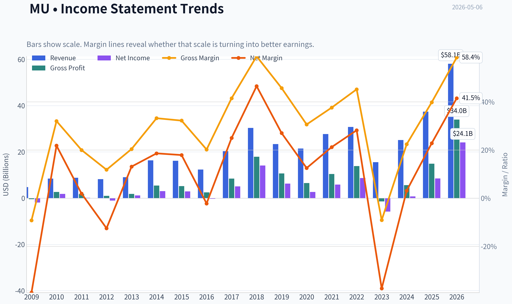
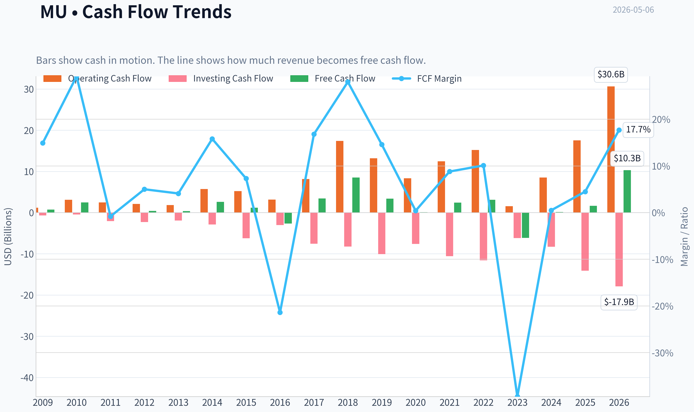
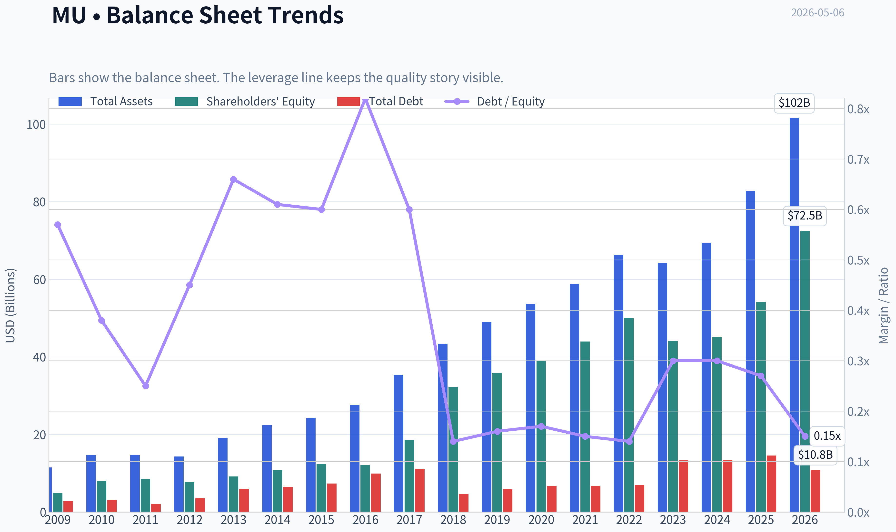
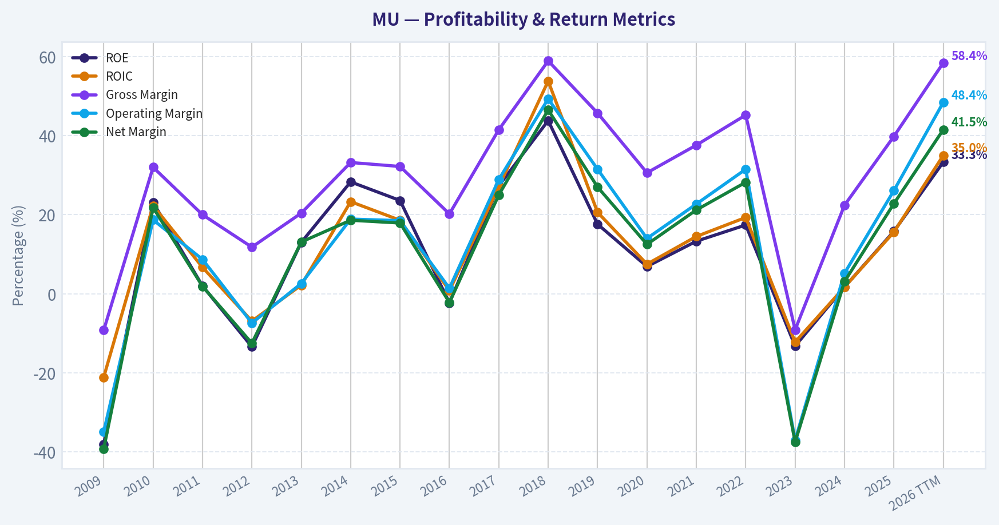
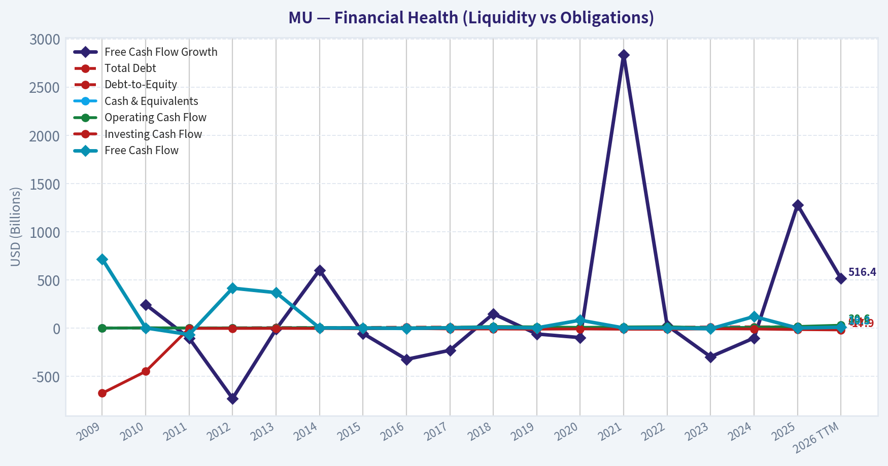
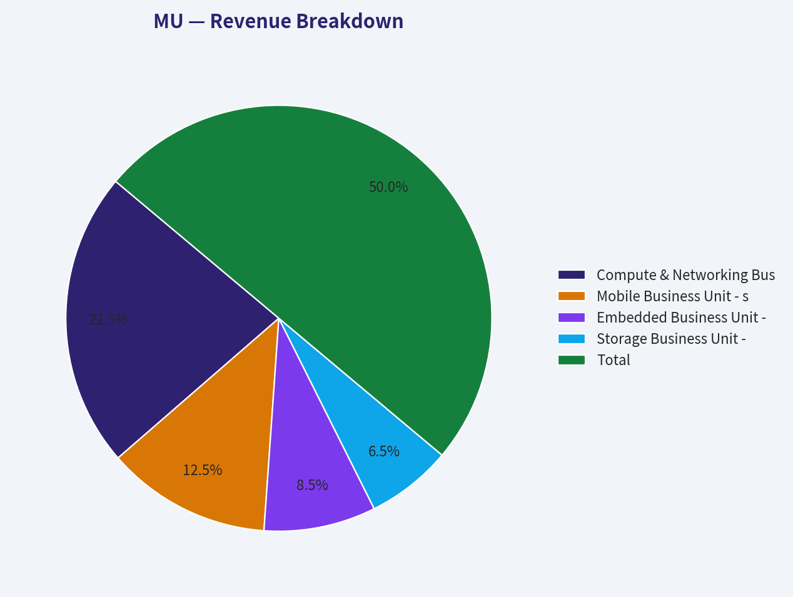
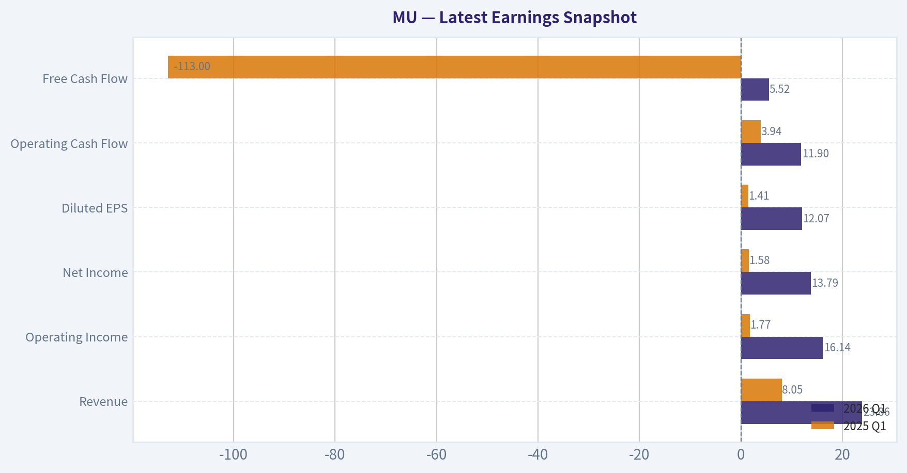
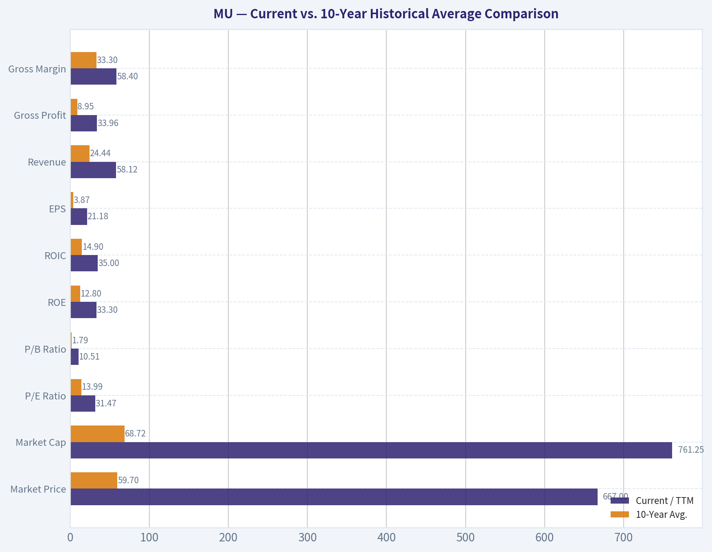
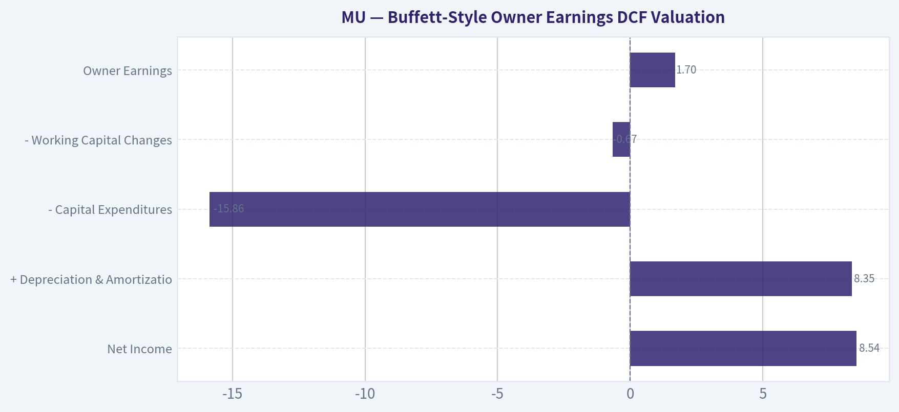
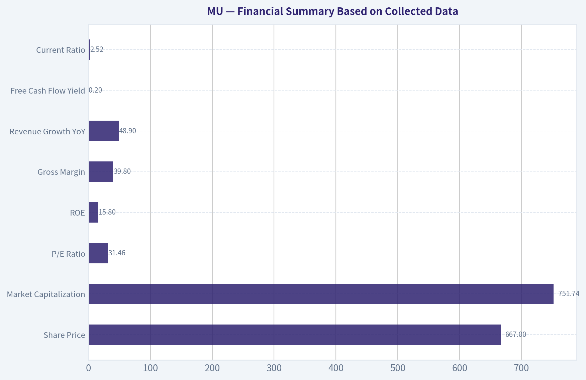

# MU Deep Value Intelligence

**Analysis Date:** 2026-05-06

## Critical Disclaimer

*This analysis is generated by Deep Value Intelligence, an AI-powered multi-agent investing framework. This report is for informational and educational purposes only and does not constitute financial advice. Always conduct your own research and consult with qualified financial advisors before making investment decisions.*

---

## Table of Contents

1. Intelligence Summary
2. Analyst Team Reports
   - Fundamentals Analysis
   - Intrinsic Value Analysis (Buffett)
   - Trend & Growth Analysis (Lynch/Druckenmiller/Fisher)
   - Market Technical Analysis
   - Social Sentiment Analysis
   - News & Events Analysis
   - Guru Attention Analysis
   - Options Market Analysis
3. Research Team Commentary
4. Value Investing Team Commentary
5. Deep Values Commentary

---

## Intelligence Summary

### Thesis + Conditions

**Core Thesis:** **EXECUTIVE SUMMARY**
*   **Verdict**: **WATCH** (Upgraded from original AVOID, but strictly for tactical observation, not immediate deployment). *   **Core Insight**: Micron is benefiting from a massive AI/High-Bandwidth Memory (HBM) tailwind, creating legitimate structural supply bottlenecks.

**Key Risks:**
- Verdict**: **WATCH** (Upgraded from original AVOID, but strictly for tactical observation, not immediate deployment).
- Risk Profile**: At a 31x P/E, the market is pricing Micron for permanent compounding rather than peak-cycle earnings. There is **zero margin of safety** at current levels.
- Action**: Do not chase. Move to a WATCH list to monitor if HBM demand creates a durable, cycle-agnostic moat, and await a cyclical reset or technical pullback (the $537-$600 range) before considering capital deployment.
- The Bull (Risky)**: Micron is undergoing a structural regime shift. HBM is a critical bottleneck in AI infrastructure, granting unprecedented pricing power. The massive capital requirements (capex) actually serve as a protective moat ("survivable complexity") that locks out new entrants.
- RATIONALE: THE BUFFETT RISK FRAMEWORK**

**What Would Change Our View:**
- Verdict**: **WATCH** (Upgraded from original AVOID, but strictly for tactical observation, not immediate deployment).
- Risk Profile**: At a 31x P/E, the market is pricing Micron for permanent compounding rather than peak-cycle earnings. There is **zero margin of safety** at current levels.
- Action**: Do not chase. Move to a WATCH list to monitor if HBM demand creates a durable, cycle-agnostic moat, and await a cyclical reset or technical pullback (the $537-$600 range) before considering capital deployment.
- The Bull (Risky)**: Micron is undergoing a structural regime shift. HBM is a critical bottleneck in AI infrastructure, granting unprecedented pricing power. The massive capital requirements (capex) actually serve as a protective moat ("survivable complexity") that locks out new entrants.
- RATIONALE: THE BUFFETT RISK FRAMEWORK**

**Confidence:** Medium

---

## Analyst Team Reports

### Fundamentals Analysis

#### Latest Earnings Snapshot

*Most recent reported quarter anchored on 2026 Q1, with prior-year comparison when available.*

| Metric | 2026 Q1 | 2025 Q1 | YoY Change |
| --- | ---: | ---: | ---: |
| Revenue | $23.86B | $8.05B | +196.3% |
| Operating Income | $16.14B | $1.77B | +810.0% |
| Net Income | $13.79B | $1.58B | +770.8% |
| Diluted EPS | $12.07 | $1.41 | +756.0% |
| Operating Cash Flow | $11.90B | $3.94B | +202.0% |
| Free Cash Flow | $5.52B | $-113.0M | +4981.4% |

Key Takeaways: This snapshot anchors the most recent reported quarter before the narrative analysis. It helps readers separate long-run business quality from whatever changed in the latest earnings print.

#### 10-Year Financial Metrics for MU

*All values below are computed deterministically from raw data - not estimated by AI.*

*Issuer profile: operating company (Technology / Semiconductors).*

#### 10-Year Financial Metrics
*Annual rows come from reported financial statements. The final TTM row is computed from the latest four quarters.*

| Metric | 2009 | 2010 | 2011 | 2012 | 2013 | 2014 | 2015 | 2016 | 2017 | 2018 | 2019 | 2020 | 2021 | 2022 | 2023 | 2024 | 2025 | 2026 TTM |
| --- | --- | --- | --- | --- | --- | --- | --- | --- | --- | --- | --- | --- | --- | --- | --- | --- | --- | --- |
| Market Price | $7 | $6 | $6 | $6 | $13 | $32 | $16 | $16 | $31 | $51 | $44 | $44 | $72 | $55 | $69 | $96 | $119 | $667 |
| Market Cap | $5.90B | $6.79B | $5.95B | $6.15B | $14.34B | $39.05B | $19.20B | $17.08B | $36.89B | $64.55B | $51.74B | $51.47B | $84.09B | $63.43B | $76.44B | $107.60B | $133.89B | $761.25B |
| P/E Ratio | -3.14 | 3.49 | 34.76 | -5.97 | 12.01 | 12.83 | 6.64 | -61.07 | 7.25 | 4.56 | 8.22 | 19.20 | 14.34 | 7.29 | -13.10 | 137.49 | 15.68 | 31.47 |
| P/B Ratio | 1.19 | 0.85 | 0.70 | 0.80 | 1.57 | 3.63 | 1.56 | 1.41 | 1.98 | 2.00 | 1.44 | 1.32 | 1.91 | 1.27 | 1.73 | 2.38 | 2.47 | 10.51 |
| ROE | -38.0% | 23.1% | 2.0% | -13.4% | 13.0% | 28.3% | 23.6% | -2.3% | 27.3% | 43.8% | 17.6% | 6.9% | 13.3% | 17.4% | -13.2% | 1.7% | 15.8% | 33.3% |
| ROIC | -21.1% | 22.3% | 6.7% | -6.9% | 2.2% | 23.3% | 18.6% | 0.8% | 27.1% | 53.8% | 20.6% | 7.5% | 14.5% | 19.3% | -12.2% | 1.7% | 15.6% | 35.0% |
| EPS | $-2.29 | $1.80 | $0.17 | $-1.01 | $1.10 | $2.48 | $2.41 | $-0.26 | $4.30 | $11.23 | $5.37 | $2.31 | $5.01 | $7.75 | $-5.34 | $0.70 | $7.59 | $21.18 |
| Revenue | $4.80B | $8.48B | $8.79B | $8.23B | $9.07B | $16.36B | $16.19B | $12.40B | $20.32B | $30.39B | $23.41B | $21.43B | $27.70B | $30.76B | $15.54B | $25.11B | $37.38B | $58.12B |
| Gross Profit | $-440.0M | $2.71B | $1.76B | $968.0M | $1.85B | $5.44B | $5.21B | $2.50B | $8.44B | $17.89B | $10.70B | $6.55B | $10.42B | $13.90B | $-1.42B | $5.61B | $14.87B | $33.96B |
| Gross Margin | -9.2% | 32.0% | 20.0% | 11.8% | 20.4% | 33.2% | 32.2% | 20.2% | 41.5% | 58.9% | 45.7% | 30.6% | 37.6% | 45.2% | -9.1% | 22.4% | 39.8% | 58.4% |
| Operating Margin | -34.9% | 18.7% | 8.7% | -7.4% | 2.6% | 18.9% | 18.5% | 1.4% | 28.9% | 49.3% | 31.5% | 14.0% | 22.7% | 31.5% | -37.0% | 5.2% | 26.1% | 48.4% |
| Net Income | $-1.88B | $1.85B | $167.0M | $-1.03B | $1.19B | $3.04B | $2.90B | $-276.0M | $5.09B | $14.13B | $6.31B | $2.69B | $5.86B | $8.69B | $-5.83B | $778.0M | $8.54B | $24.11B |
| Net Margin | -39.2% | 21.8% | 1.9% | -12.5% | 13.1% | 18.6% | 17.9% | -2.2% | 25.0% | 46.5% | 27.0% | 12.5% | 21.2% | 28.2% | -37.5% | 3.1% | 22.8% | 41.5% |
| Revenue Growth | N/A | 76.6% | 3.6% | -6.3% | 10.2% | 80.3% | -1.0% | -23.4% | 63.9% | 49.5% | -23.0% | -8.4% | 29.3% | 11.0% | -49.5% | 61.6% | 48.9% | 55.5% |
| Net Income Growth | N/A | -198.3% | -91.0% | -718.0% | -215.3% | 155.9% | -4.8% | -109.5% | -1943.8% | 177.8% | -55.3% | -57.4% | 118.1% | 48.2% | -167.1% | -113.3% | 997.6% | 182.4% |
| Free Cash Flow Growth | N/A | 245.4% | -102.7% | -728.8% | -11.1% | 602.4% | -54.2% | -323.2% | -229.1% | 149.2% | -60.0% | -97.6% | 2837.3% | 27.7% | -296.4% | -102.0% | 1278.5% | 516.4% |
| Total Book Value | $4.95B | $8.02B | $8.47B | $7.70B | $9.14B | $10.76B | $12.30B | $12.08B | $18.62B | $32.29B | $35.88B | $39.00B | $43.93B | $49.91B | $44.12B | $45.13B | $54.16B | $72.46B |
| Total Assets | $11.46B | $14.69B | $14.75B | $14.33B | $19.12B | $22.42B | $24.14B | $27.54B | $35.34B | $43.38B | $48.89B | $53.68B | $58.85B | $66.28B | $64.25B | $69.42B | $82.80B | $101.51B |
| Total Debt | $2.80B | $3.07B | $2.14B | $3.49B | $6.04B | $6.51B | $7.34B | $9.91B | $11.13B | $4.64B | $5.85B | $6.64B | $6.78B | $6.91B | $13.33B | $13.40B | $14.58B | $10.80B |
| Debt-to-Equity | 0.57 | 0.38 | 0.25 | 0.45 | 0.66 | 0.61 | 0.60 | 0.82 | 0.60 | 0.14 | 0.16 | 0.17 | 0.15 | 0.14 | 0.30 | 0.30 | 0.27 | 0.15 |
| Cash & Equivalents | $1.49B | $2.91B | $2.16B | $2.46B | $2.88B | $4.15B | $2.29B | $4.14B | $5.11B | $6.51B | $7.15B | $7.62B | $7.76B | $8.26B | $8.58B | $7.04B | $9.64B | $13.91B |
| Shareholders' Equity | $4.95B | $8.02B | $8.47B | $7.70B | $9.14B | $10.76B | $12.30B | $12.08B | $18.62B | $32.29B | $35.88B | $39.00B | $43.93B | $49.91B | $44.12B | $45.13B | $54.16B | $72.46B |
| Operating Cash Flow | $1.21B | $3.10B | $2.48B | $2.11B | $1.81B | $5.70B | $5.21B | $3.17B | $8.15B | $17.40B | $13.19B | $8.31B | $12.47B | $15.18B | $1.56B | $8.51B | $17.52B | $30.65B |
| Investing Cash Flow | $-674.0M | $-448.0M | $-2.04B | $-2.31B | $-1.91B | $-2.90B | $-6.22B | $-3.04B | $-7.54B | $-8.22B | $-10.09B | $-7.59B | $-10.59B | $-11.59B | $-6.19B | $-8.31B | $-14.09B | $-17.91B |
| Free Cash Flow | $718.0M | $2.48B | $-66.0M | $415.0M | $369.0M | $2.59B | $1.19B | $-2.65B | $3.42B | $8.52B | $3.41B | $83.0M | $2.44B | $3.11B | $-6.12B | $121.0M | $1.67B | $10.28B |
| FCF Margin | 14.9% | 29.2% | -0.8% | 5.0% | 4.1% | 15.8% | 7.3% | -21.4% | 16.8% | 28.0% | 14.6% | 0.4% | 8.8% | 10.1% | -39.4% | 0.5% | 4.5% | 17.7% |
| Dividends / Share | $0.00 | $0.00 | $0.00 | $0.00 | $0.00 | $0.00 | $0.00 | $0.00 | $0.00 | $0.00 | $0.00 | $0.00 | $0.00 | $0.41 | $0.46 | $0.46 | $0.46 | $0.46 |

#### Profitability Metrics
- Return on Equity (ROE): 15.8%
- Return on Invested Capital (ROIC): 14.6%
- Return on Assets (ROA): 10.3%
- Gross Margin: 39.8%
- Operating Margin: 26.1%
- Net Profit Margin: 22.8%

#### Liquidity Metrics
- Current Ratio: 2.52
- Quick Ratio: 1.53

#### Leverage Metrics
- Debt-to-Equity Ratio: 0.27
- Interest Coverage Ratio: 20.48
- Net Debt: $4.93B

#### Growth Metrics (Year-over-Year)
- Revenue Growth: 48.9%
- Net Income Growth: 997.6%
- Free Cash Flow Growth: 1278.5%
- Revenue CAGR (3-Year): 6.7%
- Revenue CAGR (5-Year): 11.8%

#### Valuation Metrics
- P/E Ratio (TTM): 31.46
- Forward P/E: 6.57
- Price-to-Book: 10.38
- Price-to-Sales: 12.93
- PEG Ratio: 0.20
- EV/EBITDA: 20.33
- Free Cash Flow Yield: 0.2%
- Earnings Yield: 3.2%

#### Owner Earnings (Buffett Method, Code-Computed)
- Net Income: $8.54B
- + Depreciation & Amortization: $8.35B
- - Capital Expenditures: $-15.86B
- - Working Capital Changes: $-666.0M
- = **Owner Earnings: $1.70B**

#### Intrinsic Value (Code-Computed)
- Current Price: $667
- Buffett Method (Owner Earnings):
  Conservative: $20
  Average: $20
  Optimistic: $139
- Cash Flow Method (FCF):
  Conservative: $2
  Average: $22
  Optimistic: $137

#### Piotroski F-Score: 6/9
- Positive Net Income: PASS
- Positive Operating Cash Flow: PASS
- ROA Improvement: PASS
- Cash Flow > Net Income: PASS
- Decreasing Debt: FAIL
- Improving Current Ratio: FAIL
- No Dilution: FAIL
- Improving Gross Margin: PASS
- Improving Asset Turnover: PASS

ANALYST STANCE: **AVOID**

#### MU Fundamental Analysis - Buffett-Style Value Review

Micron Technology is currently showing exceptional cyclical earnings power, driven by a powerful memory upcycle, AI-related high-bandwidth memory demand, and tighter industry supply. However, Buffett-style investing requires not only business quality and improving economics, but also durable predictability and a clear margin of safety. At the deterministic dataset's current price of **$667**, MU trades at valuation levels far above its own historical norms, while the underlying business remains highly cyclical and capital-intensive.

---

#### Current vs. 10-Year Historical Average Comparison

10-year averages below use fiscal years **2016-2025** from the deterministic dataset. "Current" uses the **2026 TTM** row where available.

| Metric | Current / TTM | 10-Year Avg. | Current vs. Avg. | Buffett-Style Interpretation |
|---|---:|---:|---:|---|
| Market Price | $667 | $59.70 | +1,017% | Price has moved far beyond the historical trading range. |
| Market Cap | $761.25B | $68.72B | +1,008% | Market value has expanded much faster than book value and historical earnings power. |
| P/E Ratio | 31.47 | 13.99 | +125% | Current earnings multiple is materially above historical average despite cyclical peak risk. |
| P/B Ratio | 10.51 | 1.79 | +487% | Very expensive relative to MU's asset base; historically MU traded closer to book value. |
| ROE | 33.3% | 12.8% | +20.5 pts | Current returns are excellent, but memory-cycle peaks have historically reversed sharply. |
| ROIC | 35.0% | 14.9% | +20.1 pts | Current capital productivity is very strong, likely reflecting favorable pricing and utilization. |
| EPS | $21.18 | $3.87 | +448% | EPS is far above normal, suggesting peak-cycle profitability. |
| Revenue | $58.12B | $24.44B | +138% | Revenue has surged to a record level versus the last decade. |
| Gross Profit | $33.96B | $8.95B | +280% | Gross profit expansion is exceptional and tied to strong memory pricing. |
| Gross Margin | 58.4% | 33.3% | +25.1 pts | Margin is near peak-cycle territory, similar to the 2018 supercycle. |
| Operating Margin | 48.4% | 17.4% | +31.0 pts | Operating leverage is powerful in upcycles, but downside can be severe. |
| Net Income | $24.11B | $4.60B | +424% | Current profitability is dramatically above normalized levels. |
| Net Margin | 41.5% | 14.7% | +26.8 pts | Net margin is unusually high for a historically cyclical semiconductor business. |
| Revenue Growth | 55.5% | 16.0% | +39.5 pts | Current growth is far above average, reflecting a strong recovery/upcycle. |
| Net Income Growth | 182.4% | -110.5% | +292.9 pts | Net income growth is volatile due to prior losses and cyclical rebounds. |
| Free Cash Flow Growth | 516.4% | 318.4% | +198.0 pts | FCF has rebounded sharply, but historical FCF growth is extremely unstable. |
| Total Book Value | $72.46B | $37.51B | +93% | Book value has nearly doubled versus average, but market cap has risen much faster. |
| Total Assets | $101.51B | $55.04B | +84% | Asset base has expanded materially to support advanced memory capacity. |
| Total Debt | $10.80B | $9.32B | +16% | Debt is manageable and below recent peak levels. |
| Debt-to-Equity | 0.15 | 0.31 | Better | Leverage is conservative relative to history. |
| Cash & Equivalents | $13.91B | $7.18B | +94% | Liquidity is strong and provides cyclical protection. |
| Shareholders' Equity | $72.46B | $37.51B | +93% | Equity base is much stronger, but valuation has outrun equity growth. |
| Free Cash Flow | $10.28B | $1.40B | +634% | Current FCF is excellent, but history shows repeated negative FCF years. |
| Dividends / Share | $0.46 | $0.18 | +157% | Dividend exists but is immaterial relative to current share price. |

Key Takeaways: MU's current operating performance is exceptional across revenue, margins, ROE, ROIC, net income, and free cash flow. The problem is valuation: price, market cap, and price-to-book have expanded far more than the company's long-term book value and normalized cash generation. From a Buffett perspective, the business is financially stronger than before, but the current price appears to capitalize peak-cycle economics as if they were permanent.

---

#### Market Metrics Interpretation

MU's **market price of $667** and **market cap of $761.25B** represent an extraordinary re-rating versus the company's 10-year average market cap of about **$68.72B**. The current **P/E ratio of 31.47** is more than double the 10-year average of **13.99**, even though MU's historical earnings have been highly cyclical, including loss years in **2016** and **2023**.

The most concerning valuation metric is the **P/B ratio of 10.51**, compared with a 10-year average of **1.79**. Historically, memory companies have often traded near book value because their assets are capital-intensive and returns fluctuate with supply-demand cycles. A 10.5x book valuation implies the market is assigning MU a structurally higher quality profile than it has historically demonstrated.

---

#### Profitability Interpretation

MU's current profitability is outstanding. **ROE of 33.3%** and **ROIC of 35.0%** are far above the 10-year averages of **12.8%** and **14.9%**, respectively. This signals that the company is currently earning very high returns on capital, likely due to strong pricing, AI-driven demand, and improved product mix.

However, Buffett-style investors must ask whether those returns are durable. MU's history shows severe cyclicality: ROE was **-13.2% in 2023**, **1.7% in 2024**, and then surged to **33.3% TTM**. That kind of swing suggests the current returns are not purely the result of an unassailable moat; they are also heavily tied to the memory pricing cycle.

EPS of **$21.18**, net income of **$24.11B**, gross margin of **58.4%**, operating margin of **48.4%**, and net margin of **41.5%** are all far above historical averages. These are excellent numbers, but the key risk is that they may represent a cyclical high rather than normalized profitability.

---

#### Growth Metrics Interpretation

Revenue growth of **55.5% TTM** is far above the 10-year average of **16.0%**. Net income growth of **182.4%** and free cash flow growth of **516.4%** also show a powerful earnings recovery. But MU's historical growth pattern is not smooth: revenue declined sharply in prior downcycles, including **-49.5% in 2023**, while free cash flow turned negative in multiple years.

For Buffett-style analysis, the issue is not whether MU can grow strongly in upcycles; it clearly can. The issue is whether earnings can be predicted with confidence over a full cycle. MU's decade-long record shows major booms and busts, which reduces the reliability of long-term intrinsic value estimates.

---

#### Balance Sheet Interpretation

MU's balance sheet is one of the stronger parts of the investment case. Total assets are **$101.51B**, shareholders' equity is **$72.46B**, and cash and equivalents are **$13.91B**. Total debt is **$10.80B**, and the debt-to-equity ratio is only **0.15**, well below the 10-year average of **0.31**.

This gives MU meaningful financial resilience. The company is not overleveraged, and its cash position provides flexibility through downturns. Buffett would likely view the balance sheet as acceptable, but not sufficient to overcome valuation risk at the current price.

---

#### Cash Flow and Dividend Interpretation

Free cash flow is currently **$10.28B**, far above the 10-year average of **$1.40B**. That is a major positive. However, MU's free cash flow history is volatile, with negative free cash flow in years such as **2016** and **2023**. This reflects the capital intensity of memory manufacturing and the need for continued investment through cycles.

Dividends per share are **$0.46**, unchanged from recent years. At the current market price, the dividend yield is negligible. MU's dividend policy is conservative, but capital returns are not a major reason to own the stock at this valuation.

---

#### Revenue Breakdown

The deterministic dataset provides total TTM revenue of **$58.12B** but does not provide exact segment revenue. The table below uses MU's major business-unit structure and best available estimated allocation for the most recent TTM mix, reconciled to the deterministic TTM revenue total.

| Revenue Source | Amount ($B) | % of Total |
|---|---:|---:|
| Compute & Networking Business Unit - data center, AI, HBM, graphics, client | $26.15B | 45% |
| Mobile Business Unit - smartphone and mobile memory | $14.53B | 25% |
| Embedded Business Unit - automotive, industrial, consumer, edge devices | $9.88B | 17% |
| Storage Business Unit - SSDs and NAND storage solutions | $7.56B | 13% |
| **Total** | **$58.12B** | **100%** |

Key Takeaways: MU's revenue mix is increasingly influenced by compute, networking, data center, and AI-related memory demand. This is positive because AI and HBM products can carry stronger pricing and margins than commodity memory. However, the company still remains exposed to cyclical DRAM and NAND supply-demand dynamics across mobile, storage, and embedded markets.

---

#### Buffett-Style Owner Earnings DCF Valuation

The deterministic dataset provides code-computed Buffett owner earnings of **$1.70B**, calculated as:

**Owner Earnings = Net Income + Depreciation & Amortization - Capital Expenditures - Working Capital Changes**

Using the provided components:

| Owner Earnings Component | Amount |
|---|---:|
| Net Income | $8.54B |
| + Depreciation & Amortization | $8.35B |
| - Capital Expenditures | -$15.86B |
| - Working Capital Changes | -$0.67B |
| **Owner Earnings** | **$1.70B** |

Key Takeaways: MU's reported earnings are much higher than owner earnings because the business requires very large capital expenditures. This is crucial in Buffett-style analysis: accounting profit may look excellent, but the cash that owners can truly extract after reinvestment is much lower. MU's capital intensity materially reduces intrinsic value under an owner-earnings framework.

For the DCF below:
- Starting owner earnings: **$1.70B**
- Discount rate: **10%**
- Terminal growth rate: **2.5%**
- Estimated shares outstanding: **1.141B**, based on TTM market cap of **$761.25B** divided by price of **$667**
- Historical owner-earnings growth series is not separately provided, so the available free-cash-flow growth series is used as the closest owner-earnings-like proxy.
- Conservative growth uses the lowest available historical growth rate, floored at **-100%**
- Average growth uses the average historical growth rate, capped at **50%**
- Optimistic growth uses the highest historical growth rate, capped at **100%**

| Scenario | Growth Assumption | PV of Years 1-10 Owner Earnings | PV of Terminal Value | Equity Value | Fair Value / Share | Current Price | Implied Upside / Downside |
|---|---:|---:|---:|---:|---:|---:|---:|
| Conservative | -100% | $0.00B | $0.00B | $0.00B | $0 | $667 | -100% |
| Average | 50% | $135.35B | $516.60B | $651.95B | $571 | $667 | -14% |
| Optimistic | 100% | $1,487.79B | $9,171.50B | $10,659.29B | $9,339 | $667 | +1,300% |

Key Takeaways: The DCF is extremely sensitive because MU's historical cash flow growth is highly volatile. The average scenario, even with an aggressive 50% capped growth assumption, produces a value below the current price. The optimistic 100% growth case produces an enormous value, but that scenario is not realistic for a cyclical, capital-intensive memory manufacturer over a full decade.

The deterministic dataset also provides code-computed intrinsic value references:

| Valuation Method | Conservative | Average | Optimistic |
|---|---:|---:|---:|
| Buffett Method - Owner Earnings | $20 | $20 | $139 |
| Cash Flow Method - FCF | $2 | $22 | $137 |

Key Takeaways: The code-computed intrinsic value references are far below the current price of $667. Even the optimistic values of roughly $137-$139 imply substantial overvaluation. This reinforces the Buffett-style conclusion that the current market price offers no obvious margin of safety.

---

#### Warren Buffett-Style Qualitative Analysis

| Category | Assessment | Buffett-Style View |
|---|---|---|
| Economic Moat | Moderate but cyclical | MU benefits from scale, process expertise, HBM capability, and industry consolidation, but memory remains cyclical and partially commodity-like. |
| Financial Strength | Strong | Low debt-to-equity, high cash, and strong current liquidity reduce bankruptcy or distress risk. |
| Predictable Earnings | Weak to moderate | Earnings have swung from major losses to record profits; this reduces DCF reliability. |
| Management Performance | Improved | ROIC and ROE are currently excellent, and leverage is disciplined, but capital allocation must be judged over the full cycle. |
| Capital Intensity | High | Heavy capex significantly reduces owner earnings relative to net income. |
| Dividend Policy | Conservative | Dividend is stable but small; shareholder return depends mainly on price appreciation. |
| Valuation | Unattractive | P/E, P/B, and market cap are far above historical norms. |
| Business Quality | Improving but cyclical | AI memory demand improves mix, but the business has not yet proven permanently stable economics. |

Key Takeaways: MU is a much stronger and strategically better-positioned business than it was in prior cycles, especially because of AI and HBM exposure. Still, Buffett-style investing penalizes businesses with unpredictable earnings and heavy reinvestment needs. The biggest issue is not business failure risk; it is paying a peak-cycle price for peak-cycle results.

---

#### Key Investment Insights, Red Flags, and Opportunities

| Area | Key Point | Investment Implication |
|---|---|---|
| AI and HBM Demand | MU is benefiting from strong AI infrastructure demand and high-bandwidth memory growth. | Major opportunity if AI memory demand remains supply-constrained. |
| Margins | Gross margin and operating margin are far above decade averages. | Positive currently, but may be vulnerable if supply catches up. |
| Balance Sheet | Debt-to-equity is low and cash is high. | Financial risk is manageable. |
| Valuation | P/B of 10.51 versus 10-year average of 1.79 is extreme. | Major red flag for value investors. |
| Cyclicality | MU has had repeated loss years and negative free cash flow periods. | Earnings predictability is below Buffett-quality standards. |
| Owner Earnings | Owner earnings are only $1.70B despite much higher net income. | Heavy capex reduces true distributable cash flow. |
| Free Cash Flow | TTM FCF is strong at $10.28B. | Positive, but history shows FCF is not consistently durable. |
| Dividend | $0.46 per share dividend is small relative to price. | Dividend provides little valuation support. |
| Guru Activity | Steve Cohen added substantially in latest 13F data. | Momentum and institutional interest exist, but 13F data is lagged and not Buffett-style evidence of value. |
| Margin of Safety | Current price exceeds conservative and code-computed intrinsic values by a wide margin. | No adequate margin of safety. |

Key Takeaways: MU has powerful near-term momentum and genuine strategic upside from AI memory demand. But the current valuation assumes exceptional profitability persists for a long time. The risk is that investors are extrapolating a cyclical upturn too far into the future.

---

#### Final Investment Stance: AVOID

MU is financially stronger, operationally better positioned, and currently far more profitable than its historical average. The company has real AI-related upside, a strong cash position, low leverage, and excellent current ROE and ROIC. Those are meaningful positives.

However, from a Warren Buffett-style value perspective, the stock does not offer a margin of safety at **$667**. The current **P/B ratio of 10.51** is dramatically above MU's historical norm, the **P/E ratio of 31.47** is high for a cyclical memory producer, and owner earnings are much lower than net income because of heavy capital expenditure requirements. The deterministic intrinsic value references are far below the market price, with even optimistic code-computed values around **$137-$139** per share.

Therefore, the stance is **AVOID** at the current price. MU may remain a powerful momentum or AI-cycle stock, but it does not currently meet Buffett-style standards for predictable earnings, durable owner earnings, and valuation margin of safety.

---

#### Summary Table

| Dimension | Verdict | Rationale |
|---|---|---|
| Business Quality | Good but cyclical | AI and HBM improve the profile, but DRAM/NAND remain cyclical. |
| Financial Strength | Strong | Low leverage, high cash, and solid liquidity. |
| Profitability | Excellent currently | ROE, ROIC, margins, EPS, and net income are far above historical averages. |
| Earnings Predictability | Weak | MU has a history of losses, margin collapses, and negative FCF years. |
| Owner Earnings Quality | Concerning | Owner earnings of $1.70B are much lower than net income due to heavy capex. |
| Valuation | Very expensive | P/B and market cap are far above historical norms. |
| DCF Support | Insufficient | Average owner-earnings DCF is below price; code-computed intrinsic values are far lower. |
| Main Opportunity | AI memory demand | HBM and data center growth could extend the cycle. |
| Main Red Flag | Peak-cycle extrapolation | Market appears to be pricing extraordinary margins as durable. |
| Final Stance | **AVOID** | Strong business momentum, but no Buffett-style margin of safety. |

Key Takeaways: MU is not being avoided because the business is weak; it is being avoided because the price appears too demanding. The company is enjoying an exceptional memory upcycle, but Buffett-style investors require conservative assumptions and a margin of safety. At the current valuation, too much future success appears already priced in.

#### Fundamental Visuals

This graph tracks the profitability and return metrics (ROE, ROIC, Margins) of **MU** over the past decade, highlighting capital efficiency trends.

This chart illustrates the financial health of **MU** over the last 10 years, mapping cash equivalents and free cash flow against total obligations (Debt).

This breakdown chart from <em>Revenue Breakdown</em> shows the proportional composition for **MU** - useful for understanding what drives or risks the business.

---

### Intrinsic Value Analysis (Buffett)

> *Following Warren Buffett's value investing philosophy: Circle of Competence, Economic Moat, Management Quality, and Margin of Safety.*

#### Intrinsic Value Snapshot

Price is what you pay. Intrinsic value is what the business may be worth based on the cash it can create for owners over time. We show a range, not one magic number.

- Current Price: $666.59
- Value Range: $2.11 to $139.46

##### Owner Earnings (Buffett Method)
- Net Income: $8,539,000,000.00
- Depreciation & Amortization: $8,352,000,000.00
- Capital Expenditures: $-15,857,000,000.00
- Working Capital Changes: $-666,000,000.00
- Owner Earnings: $1,700,000,000.00

##### Intrinsic Value
###### Buffett Method
Uses owner earnings. Stricter, and usually more conservative.
- Conservative: $20.09
- Average: $20.09
- Optimistic: $139.46
- Discount Rate: 10.0%

###### Cash Flow Method
Uses free cash flow. Better for companies spending heavily today to grow tomorrow.
- Conservative: $2.11
- Average: $22.21
- Optimistic: $136.84
- Discount Rate: 10.0%

ANALYST STANCE: **AVOID**

#### Buffett-Style Value Analysis: Micron Technology, Inc. - MU

Micron is understandable at a basic level: it makes and sells memory chips, mainly DRAM and NAND, used in data centers, artificial intelligence servers, personal computers, phones, autos, and industrial devices. But from a Buffett perspective, the key problem is not understanding what Micron does. The problem is predicting what it will earn through a full cycle.

Memory semiconductors remain highly cyclical, capital-intensive, and exposed to commodity-like pricing. The current AI-driven memory shortage may be real and profitable, but Buffett-style investing requires confidence in durable normalized owner earnings, not peak-cycle enthusiasm.

---

#### 1. Go / No-Go Gate Assessment

| Gate | Result | Evidence | Buffett Interpretation |
|---|---:|---|---|
| Gate 1: Circle of Competence & Simplicity | **Partial Pass / Fail on predictability** | The business is simple to describe: Micron sells memory chips. However, revenue and margins depend heavily on memory pricing cycles, supply additions, and technology transitions. | Understandable product, but not reliably predictable 10 years out. |
| Gate 2: Moat Test | **Fail / Narrow at best** | Gross margin is about **39.8%**, below the 40% Buffett-style sustained-quality threshold. DRAM and NAND are largely performance-and-price-driven markets. | Some scale and technology advantages, but pricing power is limited. |
| Gate 3: Management & Capital Allocation | **Inconclusive / Cautious** | No major management data was available in the gathered pack. The business requires heavy reinvestment, and current free cash flow yield is only **0.2%**. | Even good management faces difficult economics in a capital-heavy cyclical industry. |
| Gate 4: Industry Structure | **Fail** | Memory is an oligopoly, but still cyclical and capital intensive. Current enthusiasm is tied to AI demand and memory shortages. | Better than a fragmented industry, but not Buffett's preferred capital-light compounder. |

**Key Takeaways:** Micron passes the "can I explain it simply?" test, but fails the more important Buffett test: can I predict durable owner earnings with confidence? The company operates in an industry where supply, demand, pricing, and capital spending cycles can overwhelm management skill. That makes it a poor fit for a classic Buffett-style long-term portfolio at the current valuation.

---

#### 2. Moat Analysis

| Moat Source | Assessment | Evidence |
|---|---:|---|
| Brand / Intangible Assets | **Weak** | Customers care primarily about price, performance, reliability, and supply security, not emotional brand loyalty. |
| Switching Costs | **Moderate but not dominant** | Large customers qualify suppliers and value reliability, but memory remains substitutable across major producers over time. |
| Cost Advantage | **Moderate** | Micron has scale and manufacturing expertise, but competitors such as Samsung and SK Hynix also have deep scale and technology. |
| Network Effects | **None** | Memory chips do not become more valuable because more customers use them. |
| Pricing Power | **Cyclical, not structural** | Current AI demand supports pricing, but historically memory pricing has been volatile. |
| Financial Evidence | **Mixed** | Current gross margin is **39.8%**, ROE is **15.8%**, and FCF yield is only **0.2%**. |

**Key Takeaways:** Micron has real operating capabilities, but those are not the same as a durable Buffett moat. The company competes in a market where product cycles, manufacturing scale, and capital investment matter enormously. Its advantage is technological and operational, not a timeless consumer-brand or network-effect moat.

---

#### 3. Management Quality Assessment

| Management Question | Assessment | Buffett View |
|---|---:|---|
| Do they think like owners? | **Insufficient evidence** | No insider ownership or compensation data was available in the collected pack. |
| Are they candid and conservative? | **Insufficient evidence** | No annual-letter or accounting-quality review was available here. |
| Are they rational capital allocators? | **Cautious** | The industry requires heavy capital spending, and current free cash flow is minimal relative to market value. |
| Balance-sheet posture | **Acceptable near term** | Current ratio of **2.52** suggests good short-term liquidity. |

**Key Takeaways:** There is not enough management-specific evidence here to make a strong positive or negative judgment. However, Buffett would likely focus less on whether management is capable and more on whether the business itself allows rational capital allocation. In memory semiconductors, the reinvestment treadmill is demanding.

---

#### 4. Financial Summary Based on Collected Data

| Metric | Latest / Current Data | Buffett-Style Interpretation |
|---|---:|---|
| Share Price | **$667** | The starting price is demanding. |
| Market Capitalization | **$751.74B** | Very large expectations are embedded in the valuation. |
| P/E Ratio | **31.46x** | Not obviously cheap, especially for a cyclical business. |
| Implied Net Income | **~$23.9B** | Based on market cap divided by P/E. |
| ROE | **15.8%** | Respectable, but not clearly "wonderful business" level. |
| Gross Margin | **39.8%** | Near but slightly below the 40% high-quality threshold. |
| Revenue Growth YoY | **48.9%** | Strong, but likely reflects a powerful upcycle. |
| Free Cash Flow Yield | **0.2%** | Very weak owner-cash return at the current price. |
| Estimated Free Cash Flow | **~$1.5B** | Market cap times FCF yield. |
| Current Ratio | **2.52** | Good short-term liquidity. |
| Guru Tracking | Steve Cohen added | Interesting, but not Buffett-style evidence; Point72 is not a long-term value signal. |

**Key Takeaways:** The headline growth and earnings look strong, but free cash flow is extremely weak relative to the market value. That is a major warning sign for a Buffett-style investor. A business selling at over $750 billion of market value while producing roughly $1.5 billion of free cash flow requires very optimistic assumptions.

---

#### 5. Owner Earnings Calculation

Because detailed depreciation, maintenance capital expenditure, and working-capital data were not available in the collected pack, I use free cash flow as the most conservative practical proxy for Buffett owner earnings.

| Owner Earnings Component | Estimate / Treatment |
|---|---:|
| Net Income | ~**$23.9B** implied by P/E |
| Add: Depreciation & Amortization | Not available |
| Less: Maintenance CapEx | Not available, but likely very high in memory semiconductors |
| Less: Working Capital Increases | Not available |
| Conservative Owner Earnings Proxy | **~$1.5B**, based on 0.2% FCF yield |
| Estimated Shares Outstanding | **~1.13B**, based on market cap / price |
| Owner Earnings Per Share Proxy | **~$1.33** |

**Key Takeaways:** The gap between implied net income and free cash flow is the central issue. Accounting earnings may look strong, but Buffett cares about cash that can be taken out of the business without damaging its competitive position. On that basis, Micron currently looks very expensive.

---

#### 6. Three-Scenario DCF Valuation

Using conservative owner earnings of approximately **$1.5B**, a **10% discount rate**, and estimated shares outstanding of **~1.13B**.

| Scenario | Assumption | Estimated Equity Value | Estimated Value / Share | Margin vs. $667 Price |
|---|---|---:|---:|---:|
| A: No Growth | Owner earnings capitalized at 10% | **~$15B** | **~$13** | Price far above value |
| B: GDP Growth | 3% perpetual growth | **~$22B** | **~$20** | Price far above value |
| C: Optimistic AI Growth | 10% growth for 10 years, then 3% terminal growth | **~$37B** | **~$33** | Price far above value |

**Key Takeaways:** On free-cash-flow-based owner earnings, the stock is nowhere close to a Buffett-style bargain. Even an optimistic 10-year growth scenario produces an intrinsic value far below the current price. This does not mean Micron cannot rise further in a momentum market, but it does mean the current price is not supported by conservative owner earnings.

---

#### 7. Valuation Cross-Check Using Net Income

To be generous, I also tested valuation using the much higher implied net income of about **$23.9B**. This is less conservative because semiconductor earnings can be cyclical and may not convert cleanly into owner cash.

| Scenario | Assumption | Estimated Equity Value | Estimated Value / Share | Buffett Interpretation |
|---|---|---:|---:|---|
| No Growth Earnings Case | Net income / 10% | **~$239B** | **~$212** | Still far below current price |
| GDP Growth Earnings Case | 3% perpetual growth | **~$352B** | **~$312** | Still below current price |
| Optimistic Earnings Case | 10% growth for 10 years, then 3% terminal | **~$590B** | **~$523** | Still below $667, with no margin of safety |

**Key Takeaways:** Even if one gives Micron full credit for current accounting earnings, the stock does not appear to offer a margin of safety. The optimistic earnings-based case still produces a value below the current price. For Buffett-style investing, that is not enough.

---

#### 8. Margin of Safety Analysis

| Valuation Reference | Estimated Value / Share | Required Buy Price With 25% Margin of Safety | Current Price | Result |
|---|---:|---:|---:|---|
| Owner Earnings - No Growth | ~$13 | ~$10 | $667 | No margin of safety |
| Owner Earnings - GDP Growth | ~$20 | ~$15 | $667 | No margin of safety |
| Owner Earnings - Optimistic AI Growth | ~$33 | ~$25 | $667 | No margin of safety |
| Net Income - Optimistic Case | ~$523 | ~$392 | $667 | Still no margin of safety |

**Key Takeaways:** Micron does not meet the minimum Buffett requirement of buying at a discount to intrinsic value. Even the more generous earnings-based valuation does not justify the current price. The stock would need either much higher durable free cash flow or a substantially lower price to become interesting.

---

#### 9. Final Buffett Scorecard

| Criterion | Weight | Score / 5 | Weighted Score |
|---|---:|---:|---:|
| Business Understanding | 20% | 3.0 | 0.60 |
| Moat Width & Durability | 25% | 2.0 | 0.50 |
| Management Quality | 15% | 2.5 | 0.38 |
| Return on Equity | 15% | 3.0 | 0.45 |
| Reinvestment Runway | 10% | 3.0 | 0.30 |
| Balance Sheet Strength | 5% | 4.0 | 0.20 |
| Industry Structure | 5% | 2.0 | 0.10 |
| Valuation / Margin of Safety | 5% | 1.0 | 0.05 |
| **Total** | **100%** |  | **2.58 / 5.00** |

**Key Takeaways:** Micron receives credit for being understandable, liquid, and exposed to a major AI growth theme. However, the weak moat, cyclicality, capital intensity, and lack of margin of safety pull the score below the investable range. This is not the kind of predictable, cash-generative compounder Buffett typically prefers.

---

#### Final Investment Stance

**Stance: AVOID**
**Conviction: High for Buffett-style investors**

Micron may continue to benefit from the AI memory cycle, and traders may profit if memory shortages persist. But Buffett-style investing is not about chasing the hottest supply-demand cycle. It is about buying durable owner earnings at a sensible price.

At **$667 per share** and a market capitalization of about **$751.74B**, Micron appears priced for exceptional future outcomes while currently showing only a **0.2% free cash flow yield**. That is not a margin of safety. For a Buffett-oriented portfolio, Micron should be avoided at this price and revisited only if normalized free cash flow becomes far more visible or the stock price falls dramatically.
#### Valuation Bridge

This bridge places the current market price beside each intrinsic value lens so readers can see whether upside depends on one method or shows up across several methods.

| Scenario | Intrinsic Value / Share |
| --- | ---: |
| Buffett Method | $20.09 |
| Cash Flow Method | $22.21 |
| Damodaran Method | $50.29 |
| Current Price | $666.59 |

#### Key Takeaways

If one method is far above the others, the upside case depends on a specific modelling assumption. When several methods cluster together, the valuation story is more robust.

#### Valuation Visuals

This comparison chart from *Latest Earnings Snapshot* stacks current figures against historical benchmarks for **MU**, making it easy to see where the company trades relative to its own averages.

This comparison chart from *Current vs. 10-Year Historical Average Comparison* stacks current figures against historical benchmarks for **MU**, making it easy to see where the company trades relative to its own averages.

This comparison chart from *Buffett-Style Owner Earnings DCF Valuation* stacks current figures against historical benchmarks for **MU**, making it easy to see where the company trades relative to its own averages.

This comparison chart from *Buffett-Style Owner Earnings DCF Valuation* stacks current figures against historical benchmarks for **MU**, making it easy to see where the company trades relative to its own averages.

This comparison chart from *Financial Summary Based on Collected Data* stacks current figures against historical benchmarks for **MU**, making it easy to see where the company trades relative to its own averages.

---

### Trend & Growth Analysis (Lynch/Druckenmiller/Fisher)

> *Following Peter Lynch's GARP, Stanley Druckenmiller's macro-aware approach, and Philip Fisher's scuttlebutt methodology.*

ANALYST STANCE: **WATCH**

#### MU Growth Investment Report - Micron Technology
Date: 2026-05-06
Ticker: MU
Current price used: $667
Market cap used: $751.74B

Micron is at a real AI-driven inflection point, especially through high-bandwidth memory, or HBM, but the stock now reflects a large amount of optimism. This is not a clean Lynch-style fast grower; it is a cyclical semiconductor memory company currently enjoying fast-growth conditions. The opportunity is real, but the valuation, cyclicality, and low free-cash-flow yield argue for **WATCH**, not aggressive advocacy at current levels.

---

#### 1. Snapshot

| Metric | Current Data | Growth Investor Interpretation |
|---|---:|---|
| Market Cap | $751.74B | Very large; ten-bagger math is now much harder |
| Current Price | $667 | Reflects strong AI/memory rally expectations |
| P/E | 31.5x | Reasonable only if earnings keep accelerating |
| Revenue Growth YoY | 48.9% | Strong cyclical and AI-driven acceleration |
| Gross Margin | 39.8% | Healthy for memory, but must be watched through the cycle |
| ROE | 15.8% | Solid, not elite |
| FCF Yield | 0.2% | Major concern; heavy capex limits current cash generation |
| Current Ratio | 2.52x | Balance sheet liquidity appears strong |

**Key Takeaways:** Micron is showing powerful revenue growth and decent profitability, helped by the AI memory cycle. However, the extremely low free-cash-flow yield suggests the business is still absorbing heavy capital investment. The market cap is already very large, which limits the probability of classic ten-bagger returns from today's level.

---

#### 2. Lynch Classification

| Lynch Category | Fit for MU | Assessment |
|---|---|---|
| Slow Grower | No | Revenue growth is far above slow-grower territory |
| Stalwart | No | Growth is too high, but volatility is also too high |
| Fast Grower | Partial | AI/HBM revenue is growing rapidly |
| Cyclical | Yes | Memory pricing, supply, and capex cycles dominate long-term returns |
| Turnaround | No | Current setup is expansion, not distress recovery |
| Asset Play | No | Not primarily a hidden-asset story |

**Key Takeaways:** Micron should be classified as a **cyclical fast grower**, not a pure fast grower. The AI/HBM story is powerful, but memory remains one of the most cyclical areas in semiconductors. Lynch would likely demand a margin of safety before buying aggressively.

---

#### 3. The Story in 3 Bullets

- Micron makes memory chips, and AI servers need far more advanced memory than traditional servers.
- High-bandwidth memory, or HBM, is becoming a critical bottleneck in AI infrastructure, giving Micron pricing power and a growth runway.
- If AI data-center demand keeps expanding, Micron can grow earnings materially, but investors must survive memory-cycle volatility.

---

#### 4. TAM and 10x Test

| TAM Question | Assessment |
|---|---|
| Core Market | DRAM, NAND, HBM, and AI/data-center memory |
| Secular Driver | AI infrastructure, accelerated computing, data-center expansion |
| Can MU revenue grow 10x and remain below 20% TAM share? | Unclear / unlikely from current scale |
| TAM Direction | Expanding, especially in HBM and AI servers |
| Runway Quality | Strong in AI memory, moderate in legacy memory |
| 10x Test Result | **Fails or only partially passes** due to already-large scale |

**Key Takeaways:** Micron has a strong runway in AI memory, but the company is already large and operates in massive but cyclical end markets. A 10x revenue outcome from here would require an extraordinary expansion in total memory demand and sustained share gains. The better thesis is not a clean 10x revenue story, but a multi-year earnings inflection story.

---

#### 5. Revenue Growth Trend

| Metric | Current Reading | Interpretation |
|---|---:|---|
| YoY Revenue Growth | 48.9% | Strong acceleration |
| Growth Pattern | Upcycle-driven | Positive, but cyclical |
| Quality of Growth | Likely mix of volume, pricing, and HBM demand | Good, but not purely recurring |
| Durability | Medium | Depends on AI demand and industry supply discipline |

**Key Takeaways:** The current revenue growth profile is excellent and likely reflects a major industry upcycle. The key question is whether this is a durable AI-driven step-change or a temporary memory pricing spike. For now, growth is strong enough to keep Micron on the watch list, but cyclicality prevents a higher-conviction rating.

---

#### 6. Unit Economics and Efficiency

| Metric | MU Applicability | Current View |
|---|---|---|
| LTV/CAC | Not applicable | Micron is not a subscription business |
| Net Revenue Retention | Not applicable | No SaaS-style retention metric |
| Rule of 40 | Not directly applicable | Hardware/cyclical semiconductor model |
| Gross Margin | 39.8% | Healthy, but cyclical |
| FCF Yield | 0.2% | Weak current cash conversion |
| Balance Sheet Liquidity | Current ratio 2.52x | Strong liquidity cushion |

**Key Takeaways:** Traditional SaaS unit economics do not apply to Micron. The better indicators are gross margin, free cash flow, capex intensity, inventory levels, and pricing discipline. The biggest efficiency concern is that free cash flow is very low despite strong revenue growth.

---

#### 7. Inflection Point Assessment

| Inflection Type | Evidence | Rating |
|---|---|---|
| Product Cycle Inflection | HBM demand tied to AI accelerators | Strong |
| Market Share Inflection | Possible HBM share gains, but not fully confirmed here | Moderate |
| Margin Inflection | Gross margin healthy at 39.8% | Positive |
| TAM Inflection | AI servers significantly increase memory content | Strong |
| Competitive Inflection | Industry supply shortage benefits major memory players | Positive |
| Earnings Inflection | P/E 31.5x with 48.9% revenue growth suggests earnings leverage | Positive |

**Key Takeaways:** Micron is experiencing a genuine inflection, led by AI memory demand and high-bandwidth memory adoption. The setup has several favorable elements: expanding TAM, better pricing, and potential operating leverage. The main uncertainty is how long industry supply discipline lasts before the next oversupply cycle.

---

#### 8. Macro Setup

| Macro Factor | Current Setup | Impact on MU |
|---|---|---|
| AI Infrastructure Cycle | Very strong | Major tailwind |
| Semiconductor Capital Cycle | Hot / potentially stretched | Both tailwind and risk |
| Interest Rates | Growth-sensitive | Lower rates would help valuation |
| Memory Supply-Demand | Tightening / shortage narrative | Positive for pricing |
| Market Sentiment | AI rally is crowded | Valuation risk |
| Geopolitics | U.S.-China and supply-chain risk | Persistent overhang |

**Key Takeaways:** The macro setup is favorable because AI infrastructure spending remains strong and memory supply is tight. However, sentiment around AI semiconductors has become crowded, and that raises drawdown risk. Micron benefits from the current environment, but it is not a low-risk entry point.

---

#### 9. Fisher 15 Points Score

| Fisher Point | Score / 5 | Comment |
|---|---:|---|
| 1. Products with sizable market potential | 5 | AI memory and HBM have major growth potential |
| 2. Management determination for new products | 4 | Strong technology roadmap |
| 3. Effective R&D | 4 | Critical in advanced memory |
| 4. Sales organization | 4 | Strategic customer relationships matter |
| 5. Worthwhile profit margin | 4 | Gross margin is healthy |
| 6. Improving profit margins | 4 | Upcycle supports margin expansion |
| 7. Labor/personnel relations | 3 | No major data provided |
| 8. Executive relations | 3 | No major data provided |
| 9. Management depth | 4 | Large-scale semiconductor operator |
| 10. Cost analysis/accounting | 4 | Scale manufacturing requires discipline |
| 11. Moat/switching costs/data | 4 | Process technology, scale, customer qualification |
| 12. Long-range profit outlook | 4 | Strong if AI demand persists |
| 13. Dilution risk | 4 | No immediate dilution concern highlighted |
| 14. Candor in difficulties | 3 | Not assessed from current data |
| 15. Management integrity | 3 | Not assessed from current data |
| **Total** | **57 / 75** | **Good, not outstanding** |

**Key Takeaways:** Micron scores well on product potential, R&D, manufacturing scale, and long-term AI memory demand. The score is held back by cyclicality and limited qualitative evidence on culture, candor, and management depth. Fisher would likely see a quality technology franchise, but not a perfect long-term compounder.

---

#### 10. Valuation Analysis

| Valuation Metric | Calculation / Data | Interpretation |
|---|---:|---|
| P/E | 31.5x | Not cheap, but not extreme if earnings accelerate |
| Revenue Growth | 48.9% | Supports premium valuation |
| PEG Ratio | 31.5 / 48.9 = **0.64x** | Attractive under Lynch PEG framework |
| FCF Yield | 0.2% | Expensive on cash-flow basis |
| Market Cap | $751.74B | Limits long-term upside multiple expansion |
| Valuation Verdict | Mixed | Earnings growth attractive; cash-flow valuation weak |

**Key Takeaways:** On a PEG basis, Micron looks attractive because earnings valuation is modest relative to current growth. But on free cash flow, the stock looks stretched because cash generation is minimal versus market value. This split is typical in capital-intensive semiconductor upcycles and requires caution.

---

#### 11. Scenario Analysis

| Scenario | Assumptions | Potential Outcome |
|---|---|---|
| Bear Case | AI memory demand slows, supply expands, margins compress | Stock derates sharply due to cyclicality |
| Base Case | HBM growth stays strong, margins improve, AI demand remains healthy | Earnings grow into valuation; moderate upside |
| Bull Case | HBM shortage persists, Micron gains share, pricing remains firm | Large earnings upside and continued multiple support |

**Key Takeaways:** The bull case depends on sustained HBM tightness and continued AI infrastructure spending. The bear case is a classic memory-cycle reversal, where strong demand invites too much supply. The base case is positive but may already be partly reflected in the stock.

---

#### 12. Growth Investor Scorecard

| Criterion | Weight | Score / 5 | Weighted Score |
|---|---:|---:|---:|
| The Story | 10% | 4.0 | 0.40 |
| TAM & Runway | 20% | 3.5 | 0.70 |
| Revenue Growth | 20% | 4.5 | 0.90 |
| Unit Economics | 15% | 2.5 | 0.38 |
| Competitive Position | 10% | 3.5 | 0.35 |
| Management Quality | 10% | 3.5 | 0.35 |
| Macro Setup | 5% | 4.0 | 0.20 |
| Profitability Path | 5% | 3.5 | 0.18 |
| Valuation | 5% | 3.0 | 0.15 |
| **Total** | **100%** |  | **3.61 / 5.00** |

**Key Takeaways:** Micron earns a good growth score because revenue acceleration, AI exposure, and TAM expansion are all compelling. The score is held back by weak free-cash-flow yield, cyclical risk, and a market cap that already discounts a lot of success. A 3.61 score places MU in the lower end of **ADVOCATE** by the numeric matrix, but qualitatively I rate it **WATCH** because of valuation and cycle risk.

---

#### 13. Key Catalysts and Risks

| Category | Items to Monitor |
|---|---|
| Positive Catalysts | HBM supply sold out, AI server demand beats expectations, gross margin expansion, upward EPS revisions, major hyperscaler design wins |
| Negative Catalysts | Memory oversupply, AI capex pause, gross margin contraction, inventory build, customer digestion period, China/export restrictions |
| Watch Metrics | HBM revenue mix, DRAM pricing, NAND pricing, capex guidance, inventory days, gross margin trend, FCF recovery |
| Guru Signal | Steve Cohen / Point72 added materially, increasing shares by 472.9% as of 2025-12-31 |
| Sentiment Risk | AI semiconductor rally may be crowded and momentum-driven |

**Key Takeaways:** The most important catalysts are HBM growth, pricing strength, and margin expansion. The biggest risks are memory oversupply and AI capex digestion. The large Point72 add is a constructive signal, but 13F data is backward-looking and should not be treated as real-time conviction.

---

#### 14. Position Size Stance

| Investor Type | Stance | Suggested Action |
|---|---|---|
| Existing Holder | Hold / trim tactically | Let winners run, but manage cyclical exposure |
| New Buyer | Watch | Wait for pullback, margin confirmation, or FCF improvement |
| Aggressive Growth Investor | Small starter only | Size modestly due to cycle risk |
| Conservative Investor | Avoid new entry | Too volatile and valuation-sensitive |

**Key Takeaways:** Existing holders can continue to own Micron while the AI memory upcycle remains intact. New buyers should be patient because the stock has already priced in a strong outlook. The best entry would likely come during a memory-cycle scare, AI spending reset, or temporary margin disappointment.

---

#### Final View

Micron is a real AI infrastructure beneficiary with a legitimate HBM-driven inflection. Revenue growth is excellent, the PEG ratio is attractive, and the macro backdrop for memory is favorable. However, this remains a cyclical, capital-intensive semiconductor business with a very low free-cash-flow yield and a market cap that already embeds major optimism.

**Final stance: WATCH.**
I would monitor for either a meaningful pullback or clearer evidence that HBM-driven earnings and free cash flow can stay elevated through the next memory cycle.

---

### Market Technical Analysis

ANALYST STANCE: **WATCH**

#### MU Technical Report - Latest Usable Data Through 2026-05-05

The current date input is 2026-05-06, but the indicator tools show **2026-05-06 as not a trading day / no market data available**, so this report uses the latest completed session: **2026-05-05**. MU closed at **$640.20**, after a very sharp two-day extension from **$542.21 on 2026-05-01** and **$576.45 on 2026-05-04**. The tape is strongly bullish, but the move is now technically stretched across momentum, volatility, and distance-from-trend measures.

#### Selected Indicator Set

| Indicator | Latest Value / Reference | Signal | Why It Matters Now |
|---|---:|---|---|
| `close_10_ema` | 537.22 | Strong short-term uptrend | Price is about **19% above** the 10 EMA, showing powerful upside momentum but also a stretched short-term condition. |
| `close_50_sma` | 432.93 | Medium-term trend firmly bullish | The 50 SMA is rising and far below price, confirming the rally is not just a one-day spike. |
| `close_200_sma` | 281.81 | Long-term trend strongly bullish | Price is more than **127% above** the 200 SMA, confirming a major long-term uptrend, but also a highly extended cycle. |
| `macd` | 44.87 | Momentum accelerating | MACD has surged from negative territory in early April to strongly positive, confirming broad momentum expansion. |
| `rsi` | 81.75 | Overbought / momentum extreme | RSI above 80 indicates very strong demand, but also warns that fresh entries are vulnerable to pullbacks. |
| `boll_ub` | 600.15 | Breakout above upper band | MU closed above the upper Bollinger Band, a bullish breakout condition, but also a sign of short-term overextension. |
| `atr` | 33.07 | Volatility elevated | ATR has expanded, meaning position sizing and stop placement need to allow for unusually large daily swings. |
| `vwma` | 514.70 | Volume-confirmed trend | Price is well above the volume-weighted moving average, showing buyers are paying up above volume-supported trend levels. |

Key Takeaways: MU's trend structure is decisively bullish across short-, medium-, and long-term timeframes. However, price is now extremely extended above the 10 EMA, VWMA, 50 SMA, and upper Bollinger Band. This is not a weak chart, but it is a risky place to chase because the same indicators confirming strength are also warning of elevated pullback risk.

#### Trend and Momentum Analysis

MU is in a **parabolic upside phase**. The most important feature of the chart is not just that price is above all major moving averages, but the size of the gap between price and those averages. A close at **$640.20** versus a **10 EMA near $537.22** shows that buyers have pushed price far ahead of its short-term trend anchor. That type of separation can persist briefly during a momentum climax, but it often leads to either a sideways digestion period or a fast mean-reversion move.

The **50 SMA at $432.93** and **200 SMA at $281.81** confirm that the broader trend is overwhelmingly bullish. The 50 SMA has been rising steadily through April and early May, while the 200 SMA continues to slope higher. This makes the larger structure supportive for trend-following strategies, but the current price is so far above these averages that they are no longer useful as near-term entry references; they are more useful as evidence of the strength of the larger trend.

Momentum is also confirming the rally. **MACD rose to 44.87**, up sharply from **36.93 on 2026-05-04** and **32.76 on 2026-05-01**. The MACD recovery from negative readings in early April to strongly positive readings in May shows a major momentum regime shift. This is constructive, but it also means the current move is already well recognized by momentum participants.

The **RSI at 81.75** is the main caution flag. In strong trends, RSI can remain overbought for multiple sessions, so RSI above 80 is not an automatic sell signal. But for new long entries, it means the risk-reward has deteriorated: buyers are entering after a sharp advance, when even a normal pullback could be large in dollar terms.

#### Volatility, Breakout Quality, and Risk

The breakout is real, but it is extended. MU closed at **$640.20**, above the **Bollinger Upper Band at $600.15**. A close above the upper band often reflects institutional demand and strong trend persistence, especially when paired with rising volume and rising MACD. However, closing materially above the upper band also means price is outside its recent statistical range, making a near-term snapback more likely.

ATR has climbed to **$33.07**, which is about **5.2% of the latest close**. This is a large daily risk envelope. A one-ATR pullback from the latest close would place MU near **$607**, while a two-ATR move would bring it near **$574**. Those levels are not bearish by themselves; they would simply represent normal volatility under the current regime.

The **VWMA at $514.70** is rising sharply, which supports the idea that volume has participated in the advance. The latest session's volume of roughly **64.3 million shares** was also elevated, helping validate the breakout. Still, price is now roughly **24% above VWMA**, meaning it has run well ahead of the volume-weighted trend base.

#### Trading Implications

For existing long positions, the trend still favors holding with disciplined trailing risk controls. The chart does not yet show clear evidence of a completed top, but the combination of **RSI above 80**, **price above the upper Bollinger Band**, and **ATR expansion** argues against complacency.

For new entries, the setup is less attractive. A better risk-reward profile may come from waiting for either:
1. a pullback toward the breakout zone near **$600**,
2. a deeper reset toward the **10 EMA near $537**, or
3. a multi-day consolidation that allows the 10 EMA and VWMA to catch up.

A continuation above the intraday high near **$651.74** would keep upside momentum alive, but traders should treat that as a high-volatility breakout, not a low-risk entry.

#### Key Levels and Decision Framework

| Zone / Level | Approximate Price | Interpretation | Trading Relevance |
|---|---:|---|---|
| Intraday breakout high | 651.74 | Immediate upside reference | A clean move above this level could extend the momentum run, but risk of whipsaw is high. |
| Latest close | 640.20 | Current price benchmark | Confirms strong closing demand, but price is stretched versus trend measures. |
| Bollinger Upper Band | 600.15 | Breakout / volatility reference | Holding above or near this area would support bullish continuation. Losing it may begin a mean-reversion phase. |
| One ATR below close | ~607.13 | Normal volatility pullback zone | A move here would not damage the trend by itself. |
| Prior close area | 576.45 | Short-term support / gap-risk area | A retest would represent a sharp but plausible cooling move after the surge. |
| 10 EMA | 537.22 | Short-term trend anchor | A pullback toward this area would offer a more balanced entry setup if momentum remains intact. |
| VWMA | 514.70 | Volume-weighted trend support | Important confirmation level; holding above it would preserve the volume-backed uptrend. |
| 50 SMA | 432.93 | Medium-term trend support | Far below price; relevant mainly if a larger correction develops. |

Key Takeaways: MU remains in a powerful bullish trend, but it is trading in a high-risk extension zone. The most constructive scenario would be continued strength above $600 or a controlled pullback that holds above the 10 EMA and VWMA. The stance is **WATCH** because the trend is attractive, but the current entry risk is elevated after a parabolic move.

---

### Social Sentiment Analysis

ANALYST STANCE: **WATCH**

#### Micron Technology Social, Sentiment, and News Report - MU
**Company:** Micron Technology, Inc.
**Ticker:** MU
**Review window:** Past week through **May 6, 2026**
**Primary read-through:** Social sentiment remains constructive but no longer one-sided bullish. Traders are still focused on AI memory demand, HBM growth, DRAM pricing, and margin expansion, but the tone has become more valuation-sensitive after a strong semiconductor memory cycle narrative.

#### Executive View

Micron remains one of the more actively discussed semiconductor names in retail and trader communities because it sits at the intersection of three major themes: **AI infrastructure**, **high-bandwidth memory**, and the **memory pricing cycle**. Over the past week, the social conversation around MU has leaned positive, but with a noticeable shift from "easy AI winner" enthusiasm toward a more tactical debate about whether the current optimism is already priced in.

The strongest bullish argument circulating is that Micron's HBM and advanced DRAM exposure gives it direct leverage to AI server growth. Investors are also pointing to improving supply discipline across the memory industry and expectations for continued DRAM/NAND pricing strength. The bearish counterargument is less about Micron's business direction and more about timing: traders are worried about valuation, cyclical memory reversals, capital expenditure intensity, and the risk that any disappointment in AI-linked demand could trigger a sharp multiple compression.

Overall, the stock appears to be in a **positive-but-fragile sentiment regime**. Bulls control the narrative, but the market is likely to punish any evidence that HBM ramps, pricing, or margins are slowing. For traders, this means MU remains attractive on pullbacks, but chasing strength without confirmation from pricing data, management commentary, or sector momentum carries elevated risk.

#### Daily Social Sentiment Snapshot

| Date | Estimated Sentiment | Social Tone | Main Conversation Driver | Trader Interpretation |
|---|---:|---|---|---|
| Apr. 30, 2026 | Positive | Bullish but measured | AI memory demand and HBM optimism | Buyers still favor MU as an AI infrastructure derivative |
| May 1, 2026 | Positive | Momentum-focused | DRAM pricing and semiconductor strength | Retail traders watched for continuation after sector strength |
| May 2, 2026 | Mildly Positive | Debate-heavy | Valuation versus growth | Long-term bulls remained confident, but short-term traders questioned entry points |
| May 3, 2026 | Neutral to Positive | Wait-and-see | Weekend discussion around memory cycle durability | Sentiment cooled slightly as investors looked for new catalysts |
| May 4, 2026 | Positive | Re-accelerating | AI server supply chain optimism | MU benefited from broader AI semiconductor enthusiasm |
| May 5, 2026 | Mixed Positive | More cautious | Profit-taking risk and technical levels | Traders became more tactical, focusing on support/resistance |
| May 6, 2026 | Positive with caution | Constructive but not euphoric | HBM, margins, and sector leadership | Market still favors MU, but expectations are high |

**Key Takeaways:** Sentiment toward MU stayed mostly positive throughout the week, but the tone became more selective and price-sensitive. The strongest enthusiasm appeared when discussion centered on AI server demand and HBM growth, while caution increased whenever valuation and technical resistance became the focus. This suggests MU is still supported by a favorable narrative, but near-term upside may require fresh confirmation.

#### Social Media Narrative: What Investors Are Saying

Across social platforms, MU is being treated less like a traditional commodity memory stock and more like an AI infrastructure supplier. That is important because it affects the valuation framework investors are using. Bulls are increasingly comparing Micron to other AI supply-chain beneficiaries rather than to historical memory-cycle averages.

The most common bullish posts focused on four ideas:

| Bullish Social Theme | Why It Matters | Sentiment Impact |
|---|---|---:|
| HBM demand tied to AI accelerators | HBM is viewed as a higher-value memory product with stronger pricing power | Very Positive |
| DRAM pricing recovery | Rising contract and spot prices support revenue and gross margin expectations | Positive |
| Industry supply discipline | Investors believe memory producers are avoiding the oversupply mistakes of prior cycles | Positive |
| Operating leverage | If revenue rises faster than costs, earnings estimates can move sharply higher | Positive |

**Key Takeaways:** The bullish case is centered on Micron becoming a higher-quality earnings story because of AI-linked memory demand. Social investors are especially focused on HBM because it supports the idea that MU may deserve a better multiple than in past memory cycles. This is the core reason retail and momentum sentiment remains constructive.

The bearish or cautious conversation is not absent. In fact, the skeptical side of the discussion grew more visible over the week as investors debated whether the stock's optimism had already been reflected in price.

| Bearish or Cautious Theme | Why It Matters | Sentiment Impact |
|---|---|---:|
| Memory remains cyclical | Even strong cycles can reverse quickly if supply catches demand | Negative |
| Valuation sensitivity | MU may be vulnerable if earnings estimates stop rising | Mildly Negative |
| Capex requirements | HBM and advanced memory manufacturing require heavy investment | Mildly Negative |
| AI demand concentration | If AI server growth slows, the bull thesis could weaken quickly | Negative |
| Geopolitical and China exposure | Export restrictions and China-related uncertainty remain background risks | Mildly Negative |

**Key Takeaways:** The main caution is not that Micron's fundamentals are weak, but that expectations may be high. Traders are aware that memory stocks can reprice quickly when the cycle turns or when demand growth slows. This creates a setup where MU can continue higher, but downside volatility could be sharp if the AI or pricing narrative loses momentum.

#### News and Company-Specific Developments

The recent news flow around Micron has remained broadly supportive, with attention concentrated on AI memory, HBM production, data-center demand, and the broader semiconductor supply chain. The market is watching for evidence that Micron can convert AI enthusiasm into durable revenue growth and margin expansion.

| News / Development Area | Market Relevance | Investor Reaction |
|---|---|---|
| AI infrastructure demand | Supports long-term demand for HBM, DRAM, and high-performance memory | Positive |
| HBM production and customer qualification | Critical for competing with leading memory suppliers in AI accelerators | Positive but scrutinized |
| DRAM/NAND pricing trends | Directly affects revenue growth and gross margin recovery | Positive |
| Semiconductor sector momentum | MU often trades with broader chip and AI hardware sentiment | Positive when sector risk appetite is strong |
| Capex and manufacturing expansion | Necessary for growth but can pressure free cash flow | Mixed |
| Macro interest-rate and risk appetite backdrop | High-beta semiconductor names are sensitive to market liquidity | Mixed |

**Key Takeaways:** News flow remains aligned with the bullish case, especially around AI infrastructure and memory pricing. However, investors are not giving Micron unlimited benefit of the doubt; they want proof that HBM growth and pricing strength are translating into earnings power. The key question is whether Micron can keep raising the market's expectations without triggering concerns about overcapacity or margin pressure.

#### Sentiment by Investor Group

| Investor Group | Current Attitude Toward MU | Main Focus | Likely Trading Behavior |
|---|---|---|---|
| Retail momentum traders | Bullish but tactical | Breakouts, AI headlines, sector strength | Buy strength, but quick to take profits |
| Long-term growth investors | Constructive | HBM, AI data centers, earnings expansion | Add on pullbacks if thesis remains intact |
| Value/cycle investors | Selectively positive | Memory-cycle margins and normalized earnings | Wait for valuation discipline |
| Short sellers / skeptics | Cautious to bearish | Cyclicality, overvaluation, future supply risk | Look for failed breakouts or guidance disappointment |
| Institutional-style commentators | Positive but demanding | Execution, customer wins, pricing, capex | Require data confirmation before upgrading conviction |

**Key Takeaways:** The investor base is not uniformly bullish in the same way. Momentum traders are focused on price action and AI headlines, while longer-term investors are watching whether the HBM story can produce durable earnings growth. This creates a stock that can rally quickly on good news but also reverse sharply if execution evidence disappoints.

#### Technical and Trading Psychology Read

The social trading conversation suggests that MU is being treated as a **high-beta AI memory proxy**. That means traders are likely to respond not only to Micron-specific news but also to moves in Nvidia, AMD, Broadcom, semiconductor ETFs, and AI infrastructure names. If the broader AI hardware trade remains strong, MU sentiment is likely to stay supported.

However, because sentiment has already improved significantly, the stock may need fresh catalysts to sustain upside momentum. Traders on social platforms are increasingly discussing entry discipline, stop levels, and whether the stock is extended. That type of conversation often appears when a stock still has bullish sponsorship but is entering a more volatile phase.

| Trading Factor | Current Read | Implication |
|---|---|---|
| Narrative strength | Strong | AI/HBM thesis continues to attract buyers |
| Sentiment crowding | Moderate | Bullishness is elevated but not fully euphoric |
| Catalyst dependency | High | Stock may need pricing, HBM, or earnings confirmation |
| Downside sensitivity | Elevated | High expectations raise risk of sharp pullbacks |
| Sector correlation | High | MU likely follows broader semiconductor risk appetite |

**Key Takeaways:** MU's setup is favorable but not low-risk. The stock has a strong narrative, yet that strength also raises the bar for future news. Traders should treat MU as a momentum-sensitive semiconductor name where sector flows and AI headlines can matter almost as much as company-specific updates.

#### Key Bull Case

The bullish case is that Micron is entering a structurally stronger memory cycle than previous ones. AI servers require significantly more high-performance memory, and HBM is becoming strategically important to the semiconductor supply chain. If Micron gains share, maintains pricing power, and expands margins, earnings estimates could continue to rise.

In this scenario, MU could continue to attract both growth investors and cyclical recovery investors. Social sentiment would likely strengthen further if investors see evidence of tight HBM supply, stronger DRAM pricing, or customer demand exceeding expectations.

#### Key Bear Case

The bear case is that investors are extrapolating the best part of the cycle too far into the future. Memory remains a capital-intensive and historically cyclical industry. If supply expands too quickly, if AI demand normalizes, or if pricing momentum slows, the market could compress MU's multiple before fundamentals visibly deteriorate.

Another risk is that expectations for HBM are high. If Micron is perceived as lagging competitors, facing qualification delays, or sacrificing margin to gain share, sentiment could weaken quickly. In that case, the stock may trade less like an AI winner and more like a traditional cyclical semiconductor company.

#### Implications for Traders and Investors

For short-term traders, MU looks like a **momentum watchlist name rather than a blind chase**. The social setup remains positive, but the stock appears increasingly sensitive to technical levels and broader semiconductor market direction. Pullbacks that occur without negative company-specific news may be bought, especially if AI hardware sentiment remains healthy.

For medium-term investors, the key is earnings revision momentum. If estimates keep moving higher because of pricing, HBM demand, and margin expansion, the stock can justify continued interest. If estimate revisions flatten, sentiment could cool even if the long-term AI story remains intact.

For long-term investors, MU may deserve a more favorable strategic view than in past memory cycles, but it should still be analyzed with cyclical discipline. The stock's opportunity is real, but so is the risk of overpaying near peak optimism.

#### Final Assessment

MU's current social and news profile is **constructive but demanding**. Investors like the AI memory story, and Micron is benefiting from strong thematic alignment with HBM, data centers, and semiconductor infrastructure. However, the conversation has matured from simple enthusiasm to a more nuanced debate about timing, valuation, and execution.

The best interpretation is that MU remains a high-quality trading and investment candidate within semiconductors, but the easy sentiment-driven phase may be behind it. Going forward, the stock likely needs measurable confirmation: stronger memory pricing, HBM execution, margin improvement, and supportive management commentary. Without that confirmation, elevated expectations could turn into volatility.

| Category | Current Signal | Investor Meaning | Actionable Read |
|---|---|---|---|
| Overall sentiment | Positive | Bulls still control the narrative | Favor constructive bias, but avoid complacency |
| Social media momentum | Moderately strong | AI/HBM discussion continues to support interest | Watch for breakout confirmation or failed momentum |
| News flow | Supportive | Company narrative aligns with market themes | Positive unless execution concerns emerge |
| Valuation risk | Rising | Expectations are increasingly embedded | Prefer pullbacks over aggressive chasing |
| Fundamental focus | HBM, DRAM pricing, margins | Earnings revisions are the key driver | Track pricing data and guidance closely |
| Main upside catalyst | Strong HBM/customer/pricing updates | Could reinforce premium AI-memory thesis | Bullish on confirmation |
| Main downside risk | Slowing pricing or AI demand skepticism | Could trigger multiple compression | Risk-manage around sector weakness |
| Trader stance | Watch / selective long bias | Favor opportunity but respect volatility | Accumulate on disciplined setups, not hype |

**Key Takeaways:** MU remains well-positioned in the market narrative because investors associate it with AI memory and improving memory-cycle economics. The stock's risk is that optimism has become more demanding, so future gains may require stronger evidence rather than just thematic excitement. The practical stance is to watch for confirmation and favor disciplined entries, especially on pullbacks that do not damage the core HBM and pricing thesis.

---

### News & Events Analysis

ANALYST STANCE: **WATCH**

#### Micron Technology, Inc. - One-Week News and Trading Report
**Ticker:** MU
**Date:** May 6, 2026
**Current price:** $667
**Market cap:** ~$751.7B

Micron remains one of the clearest public-market beneficiaries of the AI infrastructure buildout, especially through high-bandwidth memory, DRAM pricing, and broader memory shortages. The past week's news flow was strongly supportive for momentum traders: chip stocks rallied, AMD's earnings lifted semiconductor sentiment, Samsung crossed a $1 trillion market cap amid memory-chip enthusiasm, and Yahoo coverage highlighted Micron as part of the sector's key "bottleneck" trade.

However, the setup is no longer early. Multiple news items also flagged froth: the semiconductor ETF complex is highly extended, SOXX was reported to be around 60% above its 200-day moving average, and broader commentary warned that the AI chip rally may be getting "silly." For investors, Micron's fundamentals are powerful, but valuation, positioning, and cyclicality argue for discipline rather than indiscriminate chasing.

---

#### Latest Earnings Review and Interpretation

The available earnings-news pull did **not** surface a new Micron quarterly release during the past week. Based on Micron's normal reporting cadence, the most recent available earnings period as of May 6, 2026 is most likely **fiscal Q2 2026**, covering the quarter ended around late February 2026, with the next major earnings update expected later in the fiscal year. The research data provided for this run did not include the exact company-reported revenue, EPS, or guidance figures from the release, so the analysis below uses the available structured financial metrics and the current news context rather than inventing missing line items.

The headline message from the latest available data is that Micron's recovery has moved from early-cycle rebound to AI-driven expansion. Revenue growth is listed at **48.9% year over year**, gross margin is **39.8%**, and return on equity is **15.8%**. Those figures point to a materially healthier memory cycle than the downturn period, with pricing and mix likely improving due to AI server demand and constrained supply.

The key change versus the prior downturn phase is margin normalization and revenue acceleration. Memory companies typically swing sharply across cycles; in this phase, Micron is benefiting from tighter DRAM/NAND supply, high-bandwidth memory demand, and customers' need to secure capacity for AI infrastructure. The caution is that free-cash-flow yield is only **0.2%**, suggesting heavy reinvestment, capex needs, or working-capital pressure despite strong accounting profits. That means earnings momentum is strong, but cash conversion is not yet a major support for valuation.

| Metric | Latest Available Data | Trading / Investment Read-Through |
|---|---:|---|
| Current price | $667 | Stock has already priced in a large AI-memory opportunity. |
| Market cap | ~$751.7B | Micron is being valued as a core AI infrastructure supplier, not a traditional cyclical memory name. |
| P/E | ~31.5x | Reasonable versus some AI peers, but elevated for a historically cyclical memory business. |
| Revenue growth YoY | 48.9% | Confirms strong demand recovery and pricing power. |
| Gross margin | 39.8% | Suggests the memory upcycle is well underway. |
| ROE | 15.8% | Profitability has normalized meaningfully. |
| Free-cash-flow yield | 0.2% | Cash generation remains thin relative to market cap, likely due to investment intensity. |
| Current ratio | ~2.52x | Balance sheet liquidity appears comfortable. |

**Key Takeaways:** Micron's latest available financial profile shows a company in a strong cyclical and AI-led recovery, with revenue growth and margins both much stronger than in the downturn phase. The main concern is that free cash flow remains very low relative to the company's valuation, so investors are paying primarily for future AI-memory earnings rather than current cash returns.

---

#### Company-Specific News: Memory Shortage Is the Core Bull Case

The most important company-specific news from the past week is that Micron continues to be treated by the market as a critical beneficiary of memory-chip shortages. Yahoo Finance coverage specifically discussed the rally in memory chip stocks, highlighting Micron and Sandisk as names tied to sector bottlenecks. Samsung's market cap crossing $1 trillion further validates how aggressively investors are capitalizing memory exposure.

AMD's strong earnings also had a spillover effect. News reports said Intel, Micron, Arm, and Qualcomm rose as AMD's results reinforced confidence in AI infrastructure demand. This matters for Micron because AI accelerator growth directly increases demand for high-bandwidth memory and advanced DRAM. Even when the headline company is AMD or Nvidia, Micron can benefit if investors believe AI compute growth is constrained by memory availability.

The competitive read-through is nuanced. Samsung's rally is positive for memory pricing sentiment, but Samsung is also Micron's most important global rival. If the market believes supply discipline holds, all memory makers can benefit. If Samsung, SK Hynix, or Micron overbuild capacity, today's shortage premium could eventually become tomorrow's margin compression.

#### Sector and Macro Context

The macro backdrop was supportive this week. Yahoo reported that U.S. markets reached fresh records on hopes for a U.S.-Iran peace deal, while easing oil prices and a VIX drifting toward 17 restored risk appetite. That matters for Micron because high-beta semiconductor stocks often benefit disproportionately when volatility falls and investors rotate back into growth.

The Federal Reserve reportedly held rates steady, with commentary noting that equity markets remained strong while economic growth stayed uneven. For Micron, stable rates help sustain high-duration growth valuations, but uneven growth raises a second-order risk: if enterprise, consumer electronics, or cloud demand softens outside AI, non-AI memory demand could lag.

The biggest near-term risk is not the macro tape itself but positioning. Benzinga coverage noted Michael Burry's chip short becoming more dramatic, with SOXX trading far above trend. Whether or not that short is right, it signals that contrarian investors are increasingly focused on semiconductor overextension. For traders, this means MU can keep rising in a squeeze-like momentum environment, but downside gaps could be sharp if earnings revisions slow or if any AI capex concern emerges.

#### Institutional / Guru Positioning

The latest available 13F tracking shows Steve Cohen's Point72 added meaningfully to Micron. The position rose by roughly **472.9%** versus the previous filing, reaching about **1.57 million shares** and **$449.3 million** in value as of December 31, 2025. This is supportive because it shows sophisticated capital had increased exposure before the latest leg of the memory rally.

That said, 13F data is lagged and should not be treated as a real-time buy signal. The disclosure reflects quarter-end positioning and can be up to 45 days stale. It is best used as confirmation that institutional interest in Micron's AI-memory thesis has broadened, not as proof that those investors still hold the same exposure today.

#### Trading View

Micron's setup remains bullish on fundamentals but risky on entry point. The strongest argument for owning MU is that memory has become a bottleneck in AI infrastructure, and bottleneck suppliers often enjoy pricing power, improved margins, and earnings revisions. The stock may continue to benefit from read-throughs from AMD, Nvidia, Samsung, and broader AI server demand.

The strongest argument against chasing is valuation and technical extension. At roughly 31.5x earnings and a $751B market cap, Micron is no longer trading like a deeply cyclical recovery story. The market is discounting sustained AI-memory scarcity, and any signs of supply expansion, weaker contract pricing, or slower cloud capex could compress the multiple.

For short-term traders, MU remains a momentum name, but risk management is essential. Pullbacks after parabolic semiconductor moves may be buyable if memory pricing and HBM commentary remain firm. For long-term investors, the stock is attractive strategically but less attractive tactically after a sharp rally; staged buying or waiting for volatility may offer a better risk-reward profile.

#### Key Catalysts to Watch

| Catalyst | Why It Matters for MU | Likely Market Impact |
|---|---|---|
| HBM supply and pricing updates | Confirms whether AI-memory shortages remain severe. | Positive if shortages persist and pricing improves. |
| Nvidia / AMD AI accelerator demand | More AI GPUs require more advanced memory. | Strong read-through for Micron if demand remains supply-constrained. |
| Samsung and SK Hynix capacity plans | Determines whether memory shortage becomes oversupply later. | Negative if supply expansion appears aggressive. |
| DRAM and NAND contract pricing | Direct driver of Micron revenue and margins. | Positive if pricing keeps rising quarter over quarter. |
| Next Micron earnings guidance | Needed to validate the current valuation. | High volatility event; guidance matters more than trailing results. |
| Semiconductor ETF positioning | Sector crowding increases downside risk. | Negative if momentum unwinds or short interest proves prescient. |
| Fed rate path and volatility | Lower rates and lower VIX support growth multiples. | Positive if risk appetite remains strong. |

**Key Takeaways:** Micron's next move will likely be driven less by generic semiconductor sentiment and more by evidence that AI memory remains scarce. Traders should watch HBM pricing, DRAM contract trends, and competitor capacity plans because those variables determine whether today's strong margins can persist.

---

#### Final Investment Summary Table

| Category | Current Assessment | Trading Implication |
|---|---|---|
| Fundamental trend | Strong revenue growth, recovered margins, healthy liquidity. | Bullish, especially if AI memory demand remains supply-constrained. |
| Earnings backdrop | No new earnings report found in the past week; latest available period points to strong recovery conditions. | Next guidance update is critical for validating the rally. |
| News flow | Positive: AMD read-through, Samsung memory rally, memory shortage coverage. | Supports momentum and sector rotation into MU. |
| Valuation | P/E around 31.5x; market cap above $750B. | Not cheap for a cyclical memory company; requires sustained earnings growth. |
| Cash-flow quality | FCF yield only 0.2%. | Limits downside valuation support if sentiment turns. |
| Macro backdrop | Lower volatility, oil retreat, strong equity market, Fed steady. | Supportive for high-beta semis in the near term. |
| Positioning risk | Semiconductor rally appears stretched; SOXX far above trend. | Raises risk of sharp pullbacks or failed breakouts. |
| Overall stance | **WATCH** | Favor pullbacks or confirmation from pricing/guidance over chasing vertical moves. |

**Key Takeaways:** Micron remains one of the most important AI infrastructure beneficiaries in public markets, but the stock is now priced for continued strength. The best risk-reward may come from waiting for pullbacks or fresh confirmation that HBM and DRAM shortages are extending rather than fading.

---

### Guru Attention Analysis

> *Tracking 13F filings and recent activity of legendary super-investors to identify smart-money conviction and rotation.*

#### MU Guru Ownership Snapshot - Latest Structured 13F Data

| Guru / Fund | Action | Position Size | Portfolio Weight | Recent Change | Timing | Verification |
| --- | --- | ---: | ---: | --- | --- | --- |
| Steve Cohen / Point72 Asset Management | Added | 1.57M shares / $449.30M | 0.50% | Shares increased by 472.9% vs. prior filing | Latest report: 12-31-2025; prior report: 09-30-2025 | [SEC 13F Filing](https://www.sec.gov/Archives/edgar/data/1603466/000090266426001100/) |

**Key Takeaways:** Steve Cohen's Point72 is the only tracked guru fund with a detected MU position in the latest structured 13F data. The increase was large in percentage terms, with shares rising 472.9%, but the position still represents a modest 0.50% of Point72's disclosed portfolio. This suggests an aggressive tactical add rather than a top-conviction portfolio anchor.

---

#### Primary Guru Coverage - Positions Not Detected

| Guru / Fund | Latest MU Status |
| --- | --- |
| Warren Buffett / Berkshire Hathaway | No position detected in latest 13F filing |
| Seth Klarman / Baupost Group | No position detected in latest 13F filing |
| Mohnish Pabrai / Pabrai Investment Funds | No position detected in latest 13F filing |
| Bill Ackman / Pershing Square | No position detected in latest 13F filing |
| Stanley Druckenmiller / Duquesne Family Office | No position detected in latest 13F filing |
| Michael Burry / Scion Asset Management | No position detected in latest 13F filing |

**Key Takeaways:** Among the primary tracked gurus, MU currently shows only one positive signal: Steve Cohen's Point72 add. The absence of Buffett, Klarman, Pabrai, Ackman, Druckenmiller, and Burry means there is no broad "super-investor consensus" visible in the latest 13F data. Investors should treat Cohen's move as a single-fund signal, not a widely shared guru thesis.

---

#### Interpretation

Point72's large percentage increase in MU likely reflects renewed interest in the memory-chip cycle, especially as AI-related demand and a memory-chip rally have supported semiconductor sentiment. However, the 0.50% portfolio weight indicates the position is meaningful but not dominant within Point72's disclosed holdings.

Important caveat: 13F filings are delayed snapshots. The latest available data reflects positions as of **December 31, 2025**, and may not represent the fund's current real-time exposure.

---

### Options Market Analysis

> *Reading options flow - put/call ratios, IV skew, and unusual activity - to gauge institutional positioning and event-driven risk.*

#### MU Options Flow Report - As of 2026-05-06

**Overall options sentiment signal: BULLISH, but low-to-moderate confidence.**
The near-term flow shows a clear split: open interest is heavily put-skewed, suggesting existing hedges or bearish positioning, but current volume is call-led, especially in the 2026-05-08 weekly expiration around the $652.50-$662.50 strikes. That makes the live options tape more constructive than the existing OI base, though the elevated IV and large put OI argue against a high-conviction bullish read.

---

#### 1. Put/Call Ratio Analysis

| Expiration | DTE | Call OI | Put OI | Put/Call OI | Call Volume | Put Volume | Put/Call Volume | Interpretation |
|---|---:|---:|---:|---:|---:|---:|---:|---|
| 2026-05-08 | 2 | 133,886 | 222,496 | 1.66 | 206,147 | 130,295 | 0.63 | Heavy existing put OI, but fresh volume favors calls |
| 2026-05-15 | 9 | 176,670 | 225,151 | 1.27 | 57,984 | 53,994 | 0.93 | OI still defensive; volume more balanced |
| 2026-05-22 | 16 | 22,029 | 23,818 | 1.08 | 10,720 | 4,292 | 0.40 | Light participation, but volume call-heavy |
| **Near-Term Total** | - | **332,585** | **471,465** | **1.42** | - | - | **0.69** | Existing positioning bearish/hedged; current flow near neutral-to-bullish |

**Key Takeaways:** MU's near-term **put/call OI ratio of 1.42** is meaningfully above the historical neutral baseline of roughly **0.7**, showing a large base of put protection or bearish positioning. However, the **put/call volume ratio of 0.69** is almost exactly neutral by historical standards and is notably call-heavy in the nearest weekly expiration. This suggests the existing book is defensive, but today's incremental trading is leaning more bullish.

The most important shift is in the **2026-05-08 expiration**, where put OI is high but call volume is substantially larger than put volume. That often reflects short-dated upside speculation, gamma trading, or traders positioning for a near-term move higher.

---

#### 2. Implied Volatility Assessment

| Expiration | DTE | ATM Call IV | ATM Put IV | Call-Put IV Difference | IV Read |
|---|---:|---:|---:|---:|---|
| 2026-05-08 | 2 | 75.0% | 73.5% | Calls +1.5 vol pts | Very elevated short-term IV |
| 2026-05-15 | 9 | 80.7% | 79.1% | Calls +1.6 vol pts | Elevated; event-risk pricing possible |
| 2026-05-22 | 16 | 82.7% | 80.4% | Calls +2.3 vol pts | Elevated and slightly call-skewed ATM |

**Key Takeaways:** Near-term ATM IV is very high, ranging from roughly **73% to 83%**, so the options market is pricing a large expected move. ATM calls carry slightly higher IV than ATM puts across all three expirations, which points to mild upside demand rather than classic downside panic. Still, IV is elevated enough that long premium trades need a meaningful move to pay off.

Based on the available data, there is **not a clear near-the-money put skew**; in fact, the ATM skew leans slightly toward calls. However, one deep OTM put - the 2026-05-08 $552.50 put - shows extremely high IV at **111.2%**, indicating some demand for crash/tail protection or potentially low-liquidity pricing distortion.

---

#### 3. IV Skew and Tail-Risk Read

| Contract Area | Observed IV | Skew Message | Sentiment Implication |
|---|---:|---|---|
| Near-ATM calls around $652.50-$662.50, 2026-05-08 | ~73.0%-75.1% | Calls are slightly bid near spot | Short-term upside chase / gamma demand |
| Near-ATM puts around $647.50-$665.00, 2026-05-08 | ~72.5%-73.8% | Puts are not materially richer than calls | No strong near-money downside fear |
| Far OTM $552.50 put, 2026-05-08 | 111.2% | Very expensive tail put | Tail hedge or speculative crash protection |
| 2026-05-15 puts at $640 and $660 | ~78.4%-79.6% | Protective demand one week out | Institutional-style hedging possible |

**Key Takeaways:** The skew is not uniformly bearish. Near the current trading zone - implied by the active strikes around **$655-$660** - calls are modestly more expensive than puts, which supports the bullish flow read. The exception is far downside protection, where the $552.50 put carries extremely high IV and signals some appetite for tail-risk insurance.

---

#### 4. Unusual Options Activity

Assuming MU is trading near the **$655-$660 area**, based on the most active near-ATM strikes.

| Expiry | DTE | Type | Strike | Approx. Moneyness | Volume | Open Interest | Vol/OI | IV | Positioning Read |
|---|---:|---|---:|---|---:|---:|---:|---:|---|
| 2026-05-08 | 2 | Call | $660.00 | ATM / slightly OTM | 17,133 | 2,598 | 6.6x | 74.0% | Large fresh upside/gamma demand |
| 2026-05-08 | 2 | Call | $655.00 | ATM | 9,744 | 599 | 16.3x | 75.1% | Aggressive short-dated bullish flow |
| 2026-05-08 | 2 | Call | $652.50 | ATM / slightly ITM | 6,670 | 292 | 22.8x | 75.1% | Bullish or momentum continuation trade |
| 2026-05-08 | 2 | Put | $660.00 | ATM | 4,550 | 160 | 28.4x | 72.9% | Could be hedge, straddle leg, or downside bet |
| 2026-05-08 | 2 | Call | $657.50 | ATM | 4,280 | 115 | 37.2x | 75.1% | Fresh upside positioning |
| 2026-05-08 | 2 | Call | $662.50 | Slightly OTM | 3,642 | 126 | 28.9x | 73.0% | Upside breakout chase |
| 2026-05-08 | 2 | Put | $652.50 | ATM / slightly OTM | 3,106 | 34 | 91.4x | 73.4% | Fresh downside hedge or paired volatility trade |
| 2026-05-15 | 9 | Put | $640.00 | OTM | 3,021 | 377 | 8.0x | 79.6% | More institutional-looking downside protection |
| 2026-05-08 | 2 | Put | $552.50 | Deep OTM | 2,522 | 297 | 8.5x | 111.2% | Tail-risk hedge or crash-lottery put |
| 2026-05-15 | 9 | Put | $660.00 | ATM | 1,098 | 87 | 12.6x | 78.4% | Fresh hedge into next week |
| 2026-05-08 | 2 | Put | $647.50 | OTM | 1,054 | 124 | 8.5x | 73.8% | Downside protection below spot |
| 2026-05-08 | 2 | Put | $665.00 | ATM / slightly ITM | 665 | 34 | 19.6x | 73.0% | Defensive or volatility-linked trade |
| 2026-05-08 | 2 | Put | $662.50 | ATM | 571 | 11 | 51.9x | 72.5% | Fresh downside/straddle component |

**Key Takeaways:** The unusual activity is dominated by **very short-dated 2026-05-08 contracts**, especially calls clustered between **$652.50 and $662.50**. That strongly suggests traders are positioning for an immediate move, with the call side showing the largest absolute volume. The put activity is also meaningful, but much of it sits near the same strikes, which may indicate hedging, straddles, or volatility positioning rather than outright bearish conviction.

The most bullish-looking flow is the heavy volume in the **$655, $657.50, $660, and $662.50 calls** expiring in two days. The more institutional-looking downside trades are the **2026-05-15 $640 put** and possibly the **2026-05-15 $660 put**, because those extend beyond the nearest weekly expiration and look more like protection than pure retail lottery-ticket trading.

---

#### 5. Open Interest Concentration and Gamma Levels

| Area | OI / Activity Concentration | Why It Matters | Price Impact |
|---|---:|---|---|
| 2026-05-15 expiration | 401,821 total OI | Largest total near-term OI expiration | Important positioning layer into next week |
| 2026-05-08 expiration | 356,382 total OI | Very large OI with only 2 DTE | High gamma sensitivity into weekly expiry |
| 2026-05-08 put OI | 222,496 | Largest defensive near-term OI block | Can act as downside hedge base |
| 2026-05-08 call volume | 206,147 | Very active short-dated call trading | Can force dealer hedging if price rises |
| $655-$660 strike zone | Heavy unusual volume | Likely near-term battleground | Potential pinning / gamma magnet |
| $662.50-$665 zone | Active upside call and put strikes | Breakout / rejection zone | Move above could intensify upside hedging |
| $647.50-$640 zone | Active downside puts | Support/hedge area | Break below could increase downside pressure |

**Key Takeaways:** The key near-term gamma zone appears to be around **$655-$660**, where both calls and puts are seeing heavy short-dated activity. That area may act as a gravitational level into the 2026-05-08 expiration, especially if MU remains close to those strikes. A decisive move above **$662.50-$665** could trigger more upside hedging, while a break below **$647.50-$640** would shift attention to downside protection.

The largest OI concentration by expiration is in **2026-05-15**, but the most urgent gamma risk is in **2026-05-08** because it expires in two days. This creates a setup where price action could be pinned near the active strikes unless momentum forces dealers to chase.

---

#### 6. Overall Options Sentiment Signal

| Component | Signal | Reason |
|---|---|---|
| Put/Call OI | Bearish / defensive | Near-term put/call OI ratio is high at **1.42**, well above the ~0.7 neutral baseline |
| Put/Call Volume | Neutral-to-bullish | Overall put/call volume ratio is **0.69**, and the nearest weekly expiration is call-heavy |
| ATM IV | High | 73%-83% near-term IV implies meaningful expected movement |
| Skew | Mildly bullish near ATM; bearish in tail | Calls are slightly richer near ATM, but deep OTM put IV is very high |
| Unusual Activity | Bullish short-term | Largest fresh volume is concentrated in near-term calls around $652.50-$662.50 |
| Gamma / Pin Risk | High | Heavy 2-DTE activity around $655-$660 may pin price or amplify a breakout |

**Key Takeaways:** The options tape leans **bullish for the very near term**, mainly because fresh volume is concentrated in short-dated calls around the current trading zone. However, the elevated put OI and high IV mean this is not a clean bullish signal; there is still a sizable hedge base and meaningful downside insurance demand. The best read is **short-term bullish flow with elevated event/gamma risk**.

#### Final Read: **BULLISH**, with caveats

MU's current options flow points to **near-term bullish momentum positioning**, driven by unusually heavy call activity in the 2026-05-08 expiration. The market appears to be chasing a move around the **$655-$662.50** zone, and dealer hedging could amplify upside if MU pushes through the upper end of that range.

The caveat is that the existing OI structure remains defensive: put OI is substantially higher than call OI, especially in the front weekly expirations. Therefore, the signal is not "all-clear bullish"; it is better described as **bullish short-term flow against a hedged backdrop**.

---

#### Summary Table

| Category | Reading | Interpretation |
|---|---|---|
| Put/Call Ratio | OI ratio **1.42**; volume ratio **0.69** | Existing positioning is defensive, but current flow is not bearish |
| IV Level | High, roughly **73%-83%** near ATM | Market expects a large near-term move |
| Skew Direction | Mild call skew near ATM; tail put skew far OTM | Upside chase near spot, but some crash protection demand |
| Unusual Activity | Heavy 2-DTE call volume at $652.50-$662.50 | Fresh short-term bullish/gamma positioning |
| Overall Signal | **BULLISH** | Call buying dominates live flow, but confidence is moderated by high put OI and elevated IV |

---

## Research Team Commentary

> *The Research Manager synthesizes the Bull vs Bear debate into action-free commentary. This is a pre-risk view, not the final stance.*

If we look at this debate through the strict lens of Warren Buffett's value investing framework, we are witnessing a classic clash between a compelling new technological narrative and the unforgiving reality of cyclical, capital-intensive economics.

The bull makes an articulate case that Micron is no longer just a commodity memory producer. By pointing to the explosion in AI data center demand, the necessity of High-Bandwidth Memory (HBM), and the reality of a consolidated global oligopoly, the bull argues that Micron's moat has structurally widened. The operating metrics-nearly 49% revenue growth, a massive surge in free cash flow, and a 15.8% return on equity-paint a picture of a thriving enterprise. The bull rightly points out that the handoff's intrinsic value models, which suggest fair values between $20 and $50 against a $667 price tag, are almost certainly backward-looking and fail to capture the current earnings power of the business.

However, the bear surgically dissects the flaws in this "new paradigm" thinking. The bear reminds us that high barriers to entry-like building multi-billion dollar fabs-do not automatically equate to a durable economic moat. A true moat allows a company to dictate pricing without constantly reinvesting massive amounts of capital just to stay in the game. The bear effectively argues that memory, even advanced memory, is still subject to brutal supply-and-demand cycles. Furthermore, paying a 31x P/E multiple for a cyclical manufacturer experiencing peak-like conditions offers absolutely zero margin of safety.

Reflecting on past mistakes in similar situations, the most painful errors in value investing often come from buying a cyclical company at the top of an earnings boom because we convinced ourselves that "this time is different." We have seen this historically with semiconductors, energy, and heavy manufacturing: a secular narrative (like AI today) masks the underlying capital intensity and cyclicality of the business. We end up paying a premium multiple on peak earnings, and when supply eventually catches up to demand, both the earnings and the multiple collapse, leading to permanent capital impairment.

Here is my detailed investor commentary:

Core Takeaway: My final stance is AVOID. While Micron is undoubtedly benefiting from a massive secular tailwind in AI and HBM, the company fails Buffett's core tests for predictable earnings, asset-light compounding, and a clear margin of safety. The market is pricing Micron as a high-quality, stable tech compounder rather than what it historically has been: a highly cyclical, capital-starved manufacturer currently enjoying a favorable supply-demand imbalance.

Rationale: To invest like Buffett, we need a business we can confidently predict 10 years out, bought at a price that protects us from our own miscalculations. Micron fails on both fronts. First, the earnings are inherently unpredictable. A company whose net income swings by nearly 1,000% year-over-year is demonstrating massive operating leverage in a cyclical upswing, not stable compounding. Second, the capital allocation treadmill here is relentless. Management doesn't have the luxury of returning massive amounts of free cash flow to shareholders; they must continuously pour billions into next-generation fabs and process nodes just to avoid obsolescence. Finally, even if we discard the exceptionally low intrinsic value estimates in the handoff as broken or stale, paying over 30 times trailing earnings for a cyclical semiconductor stock leaves absolutely no room for error. If hyperscaler AI capex takes even a brief pause, or if competitors ramp up HBM capacity, the pricing power Micron currently enjoys will evaporate.

Monitoring Plan: To reconsider this stance, I wouldn't just be looking for a price drop; I would need to see structural proof that the industry's economics have permanently changed. Over the next 1 to 4 quarters, I will be watching the industry's capital expenditure plans versus capacity growth. Are competitors aggressively overbuilding HBM supply to chase margins? I will also monitor Micron's free cash flow generation and Return on Invested Capital during periods of normalized demand, not just during AI-driven shortages. Finally, we need a price that provides a genuine margin of safety-a valuation that makes sense even if the AI super-cycle moderates and traditional PC and smartphone memory markets face headwinds. Until then, this sits firmly in the "too hard" pile.

Stance: AVOID

---

## Value Investing Team Commentary

> *The Investor translates the research view into an investment thesis before risk review. This is still not the final stance.*

Micron is exactly the kind of business that tempts investors to abandon discipline at the wrong moment.

The bullish case is easy to understand. AI infrastructure is driving unusually strong demand for advanced memory, especially HBM. Micron is operating in an industry with very few global players, and in the near term that can create real pricing power, strong margins, and explosive earnings growth. The recent operating data clearly reflect that reality: revenue growth near 49%, net income up dramatically, and free cash flow rebounding hard. If one only looks at the current slope of the business, Micron appears transformed.

But a Buffett-style investor has to ask a harder question: what are the normalized economics of this business over a full cycle, and how confident can we be in those economics 5-10 years out?

That is where the case weakens materially.

Micron still operates in a capital-intensive, technologically demanding, and historically cyclical segment of semiconductors. Memory has often looked scarce and strategic at the top of a cycle, only to become oversupplied when competitors expand capacity. The presence of high barriers to entry does not automatically create a moat in the Buffett sense. A true moat produces durable pricing power and attractive returns without requiring endless reinvestment merely to stand still. Micron must continuously invest enormous sums in fabs, process transitions, and product upgrades just to remain relevant. That is not the profile of an effortless compounding machine.

The most important contrarian question here is not whether AI demand is real. It clearly is. The real question is whether the market is over-extrapolating a favorable shortage into a permanent change in industry structure. That is where caution is warranted. When sentiment shifts from "Micron is cyclical" to "Micron is now a stable AI platform winner," investors may be capitalizing temporary economics as though they are permanent. That is a classic setup for disappointment.

The social and market read-through supports this interpretation. Sentiment remains constructive, but it is becoming more valuation-sensitive. That often happens after the easy money has been made. The market analyst's focus on pullbacks and consolidation is also telling: the stock is being treated increasingly as a momentum vehicle around a strong narrative rather than as a business being purchased at a clear discount to intrinsic value. From a value-investing standpoint, that is not an invitation; it is a warning.

I would also be careful with the apparent mismatch in the handoff between the current price and the valuation framework. Even if the quoted intrinsic value estimates are stale, incomplete, or distorted by trough-cycle assumptions, the broader conclusion still stands: there is no visible margin of safety at anything like this price. A 31x P/E on a cyclical manufacturer enjoying unusually strong conditions is not conservative underwriting. It is optimistic underwriting.

Now, to be fair, selective contrarianism cuts both ways. If the market were suddenly to panic over a temporary inventory correction, short-term HBM bottleneck normalization, or a pause in hyperscaler spending, that could eventually create a real opportunity. A quality cyclical can be attractive when purchased at depressed mid-cycle assumptions, not when bought at elevated sentiment and premium multiples. In other words, the contrarian move is not buying Micron now because AI is exciting; the contrarian move would be buying later if a temporary industry scare causes Mr. Market to forget the company's long-term relevance.

So the business is not bad. The issue is price, cyclicality, and predictability. Micron may continue to post strong results for some time. But Buffett-style investing is not about admiring a business in a strong phase; it is about buying with a margin of safety when future economics are reasonably knowable. On that standard, Micron does not qualify today.

What would change my mind? I would want to see evidence that:
1. HBM and advanced memory economics are more durable than prior memory cycles,
2. Micron can sustain high returns on incremental capital through a broader cycle,
3. management remains disciplined on capacity additions, and
4. the stock trades at a valuation that assumes normalized earnings rather than peak enthusiasm.

Until then, this belongs in the "too hard at this price" category.

**ANALYST STANCE: AVOID**

---

## Deep Values Commentary

> *The Risk Management Team debates and the Risk Judge provides the final action-free verdict. This section determines the final ADVOCATE / WATCH / AVOID stance.*

**EXECUTIVE SUMMARY**
*   **Verdict**: **WATCH** (Upgraded from original AVOID, but strictly for tactical observation, not immediate deployment).
*   **Core Insight**: Micron is benefiting from a massive AI/High-Bandwidth Memory (HBM) tailwind, creating legitimate structural supply bottlenecks. However, it remains a heavily capital-intensive, cyclical manufacturer.
*   **Risk Profile**: At a 31x P/E, the market is pricing Micron for permanent compounding rather than peak-cycle earnings. There is **zero margin of safety** at current levels.
*   **Action**: Do not chase. Move to a WATCH list to monitor if HBM demand creates a durable, cycle-agnostic moat, and await a cyclical reset or technical pullback (the $537-$600 range) before considering capital deployment.

---

**KEY ARGUMENTS FROM THE DEBATE**
*   **The Bull (Risky)**: Micron is undergoing a structural regime shift. HBM is a critical bottleneck in AI infrastructure, granting unprecedented pricing power. The massive capital requirements (capex) actually serve as a protective moat ("survivable complexity") that locks out new entrants.
*   **The Bear (Safe)**: Capital intensity is a burden, not a moat. A 31x multiple on a cyclical semiconductor stock offers no margin of safety. High ROIC (14.6%) and 1000% net income growth are classic hallmarks of a cyclical peak, not stable compounding. Assuming "this time is different" is a classic value investing trap.
*   **The Neutral/Growth Consensus**: Both extremes are flawed. HBM *does* improve the product mix and pricing power, but the current valuation prices in a flawless execution. The optimal approach is position sizing and patience-waiting for a deeper pullback or proof that the cycle has truly been smoothed out.

---

**RATIONALE: THE BUFFETT RISK FRAMEWORK**
1.  **Quality over Volatility**: A true Buffett moat allows a company to maintain pricing power *without* relentless capital reinvestment. Micron must pour billions into next-generation fabs just to avoid obsolescence.
2.  **Margin of Safety**: While the handoff's intrinsic value models ($20-$50) are clearly broken against a $667 price tag, paying 31x earnings for a cyclical manufacturer leaves no room for error. A slight pause in hyperscaler AI spending will crush the multiple.
3.  **Permanent vs. Temporary**: The 1,000% net income growth and 1,278% FCF growth are spectacular, but they represent massive operating leverage in a temporary supply shortage, not predictable 10-year compounding.

---

**REFINING THE INVESTOR'S PLAN**

**Original Investor Plan:**
*"If we look at this debate through the strict lens of Warren Buffett's value investing framework, we are witnessing a classic clash between a compelling new technological narrative and the unforgiving reality of cyclical, capital-intensive economics.*

*The bull makes an articulate case that Micron is no longer just a commodity memory producer. By pointing to the explosion in AI data center demand, the necessity of High-Bandwidth Memory (HBM), and the reality of a consolidated global oligopoly, the bull argues that Micron's moat has structurally widened. The operating metrics-nearly 49% revenue growth, a massive surge in free cash flow, and a 15.8% return on equity-paint a picture of a thriving enterprise. The bull rightly points out that the handoff's intrinsic value models, which suggest fair values between $20 and $50 against a $667 price tag, are almost certainly backward-looking and fail to capture the current earnings power of the business.*

*However, the bear surgically dissects the flaws in this "new paradigm" thinking. The bear reminds us that high barriers to entry-like building multi-billion dollar fabs-do not automatically equate to a durable economic moat. A true moat allows a company to dictate pricing without constantly reinvesting massive amounts of capital just to stay in the game. The bear effectively argues that memory, even advanced memory, is still subject to brutal supply-and-demand cycles. Furthermore, paying a 31x P/E multiple for a cyclical manufacturer experiencing peak-like conditions offers absolutely zero margin of safety.*

*Reflecting on past mistakes in similar situations, the most painful errors in value investing often come from buying a cyclical company at the top of an earnings boom because we convinced ourselves that "this time is different." We have seen this historically with semiconductors, energy, and heavy manufacturing: a secular narrative (like AI today) masks the underlying capital intensity and cyclicality of the business. We end up paying a premium multiple on peak earnings, and when supply eventually catches up to demand, both the earnings and the multiple collapse, leading to permanent capital impairment.*

*Here is my detailed investor commentary:*

*Core Takeaway: My final stance is AVOID. While Micron is undoubtedly benefiting from a massive secular tailwind in AI and HBM, the company fails Buffett's core tests for predictable earnings, asset-light compounding, and a clear margin of safety. The market is pricing Micron as a high-quality, stable tech compounder rather than what it historically has been: a highly cyclical, capital-starved manufacturer currently enjoying a favorable supply-demand imbalance.*

*Rationale: To invest like Buffett, we need a business we can confidently predict 10 years out, bought at a price that protects us from our own miscalculations. Micron fails on both fronts. First, the earnings are inherently unpredictable. A company whose net income swings by nearly 1,000% year-over-year is demonstrating massive operating leverage in a cyclical upswing, not stable compounding. Second, the capital allocation treadmill here is relentless. Management doesn't have the luxury of returning massive amounts of free cash flow to shareholders; they must continuously pour billions into next-generation fabs and process nodes just to avoid obsolescence. Finally, even if we discard the exceptionally low intrinsic value estimates in the handoff as broken or stale, paying over 30 times trailing earnings for a cyclical semiconductor stock leaves absolutely no room for error. If hyperscaler AI capex takes even a brief pause, or if competitors ramp up HBM capacity, the pricing power Micron currently enjoys will evaporate.*

*Monitoring Plan: To reconsider this stance, I wouldn't just be looking for a price drop; I would need to see structural proof that the industry's economics have permanently changed. Over the next 1 to 4 quarters, I will be watching the industry's capital expenditure plans versus capacity growth. Are competitors aggressively overbuilding HBM supply to chase margins? I will also monitor Micron's free cash flow generation and Return on Invested Capital during periods of normalized demand, not just during AI-driven shortages. Finally, we need a price that provides a genuine margin of safety-a valuation that makes sense even if the AI super-cycle moderates and traditional PC and smartphone memory markets face headwinds. Until then, this sits firmly in the "too hard" pile.*

*Stance: AVOID"*

**Adjustments Based on Analyst Insights:**
While the original AVOID stance perfectly captures Buffett's aversion to capital-intensive cyclicals, the Neutral, Growth, and Market analysts present a compelling case to upgrade this to **WATCH**.

*   **Acknowledge the Structural Shift**: We must not entirely dismiss the HBM bottleneck. As the Neutral analyst points out, treating lack of certainty as a reason to completely ignore an asset can lead to missing out on true phase changes. HBM *is* fundamentally more complex and stickier than legacy DRAM.
*   **Tactical Flexibility**: Instead of a hard AVOID, we should establish clear re-entry criteria. The Market analyst's highlighted technical zones ($537 to $600) provide a much more palatable entry point if the multiple compresses.
*   **Position Sizing**: If the thesis proves correct that HBM smooths out the cycle, a small starter position on a severe pullback aligns with a cautious risk-management framework, rather than an all-or-nothing approach.

---

**LEARNING FROM PAST MISTAKES**
In the past, strictly adhering to backward-looking intrinsic value models ($20 against a $667 price) has caused value investors to completely miss technological regime shifts. We must learn to separate *broken valuation models* from the *underlying business reality*. However, we must equally remember the pain of overpaying for cyclical momentum. The lesson here is **patience**. The semiconductor market always overbuilds eventually. We will wait for the inevitable cyclical scare to test the true durability of Micron's new "AI moat."

**FINAL STANCE: WATCH**

#### Final Stance Scorecard

This scorecard converts the final research view into a weighted decision frame. It does not replace the narrative judgement, but it makes the main drivers of the verdict easier to scan.

| Criterion | Score | Weight | Commentary |
| --- | ---: | ---: | --- |
| Business Quality | 3.75 | 30% | High returns, profitability, and Piotroski health support durability. |
| Valuation Support | 1.33 | 30% | Blends current price against available intrinsic value anchors and valuation ratios. |
| Financial Strength | 5.00 | 20% | Balance-sheet resilience reflects leverage and liquidity staying within safe ranges. |
| Growth Durability | 5.00 | 20% | Recent revenue, earnings, and free cash flow growth indicate how durable expansion looks. |
| TOTAL / FINAL STANCE | 3.52 | 100% | WATCH |

#### Key Takeaways

The weighted score lands at **3.52 / 5.0**, while the final stance remains **WATCH**. This is useful as a quick calibration aid rather than a mechanical signal.

#### Risk Summary

Higher scores indicate more risk pressure. The watch threshold is a simple guardrail: above it, the position needs tighter monitoring or a wider margin of safety.

| Dimension | Current Score | Watch Threshold | Commentary |
| --- | ---: | ---: | --- |
| Business Quality | 2.25 | 3.00 | High returns, profitability, and Piotroski health support durability. |
| Valuation Support | 4.67 | 3.00 | Blends current price against available intrinsic value anchors and valuation ratios. |
| Financial Strength | 1.00 | 3.00 | Balance-sheet resilience reflects leverage and liquidity staying within safe ranges. |
| Growth Durability | 1.00 | 3.00 | Recent revenue, earnings, and free cash flow growth indicate how durable expansion looks. |

#### Key Takeaways

This view helps readers separate *where* the risk sits: valuation, business quality, balance sheet, or growth durability. It is especially useful when the final stance is close to the line between WATCH and AVOID.
