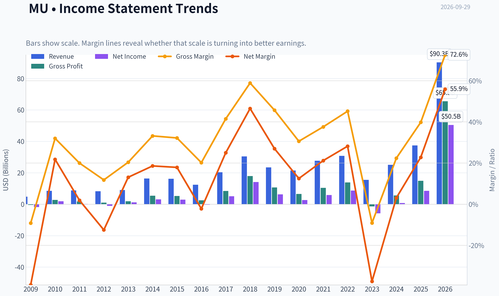
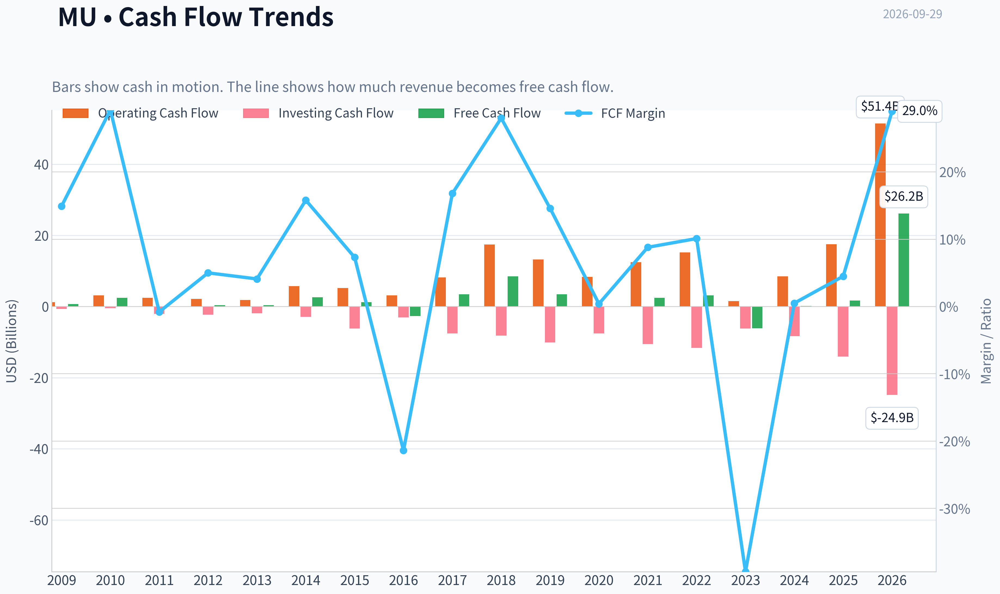
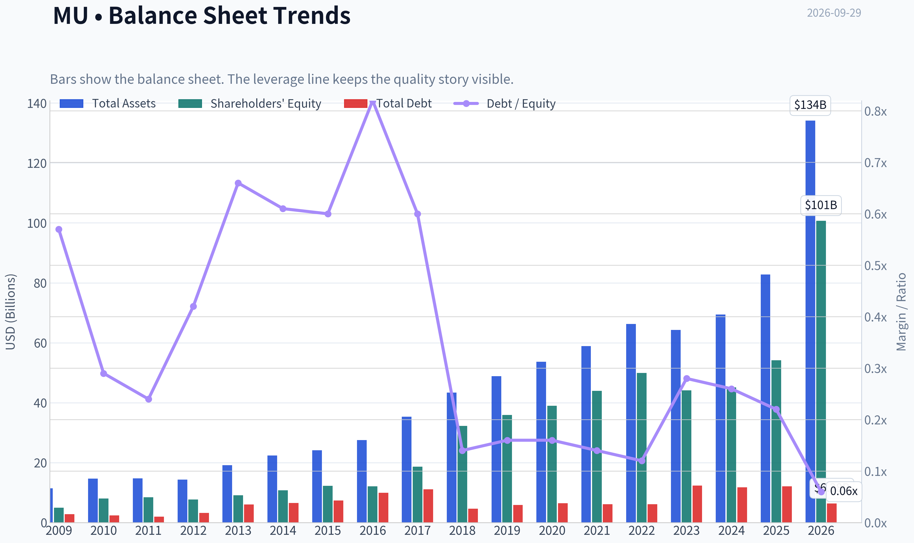
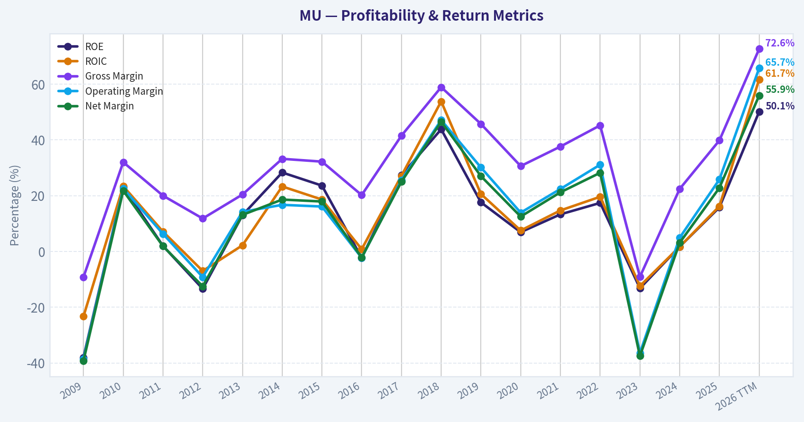
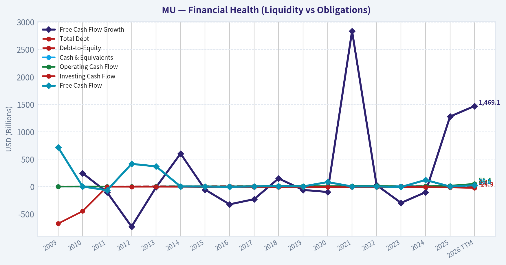
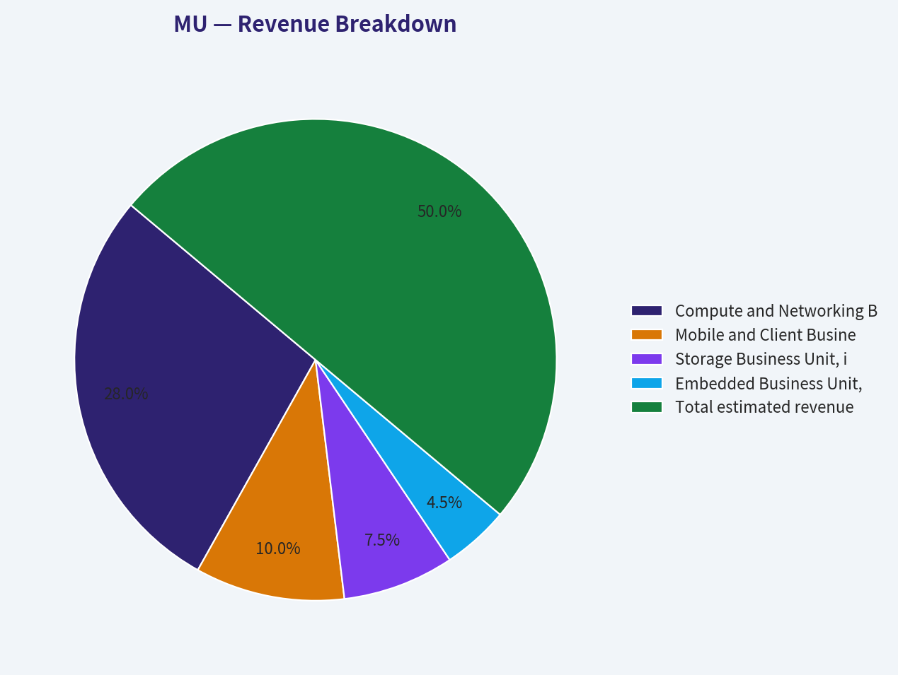
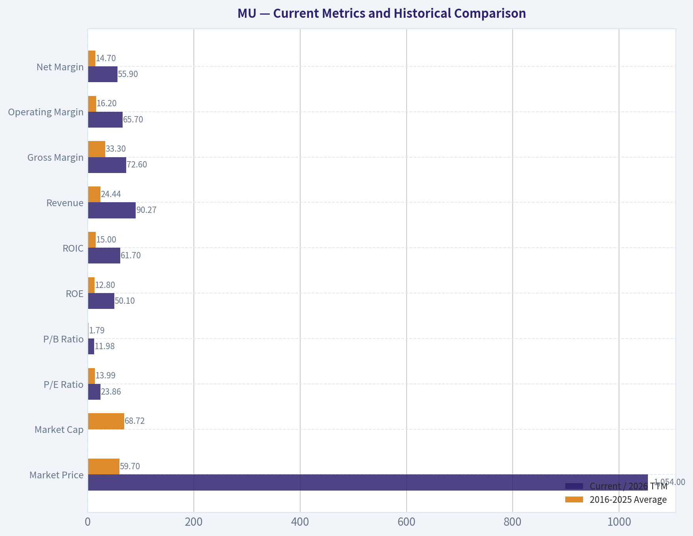
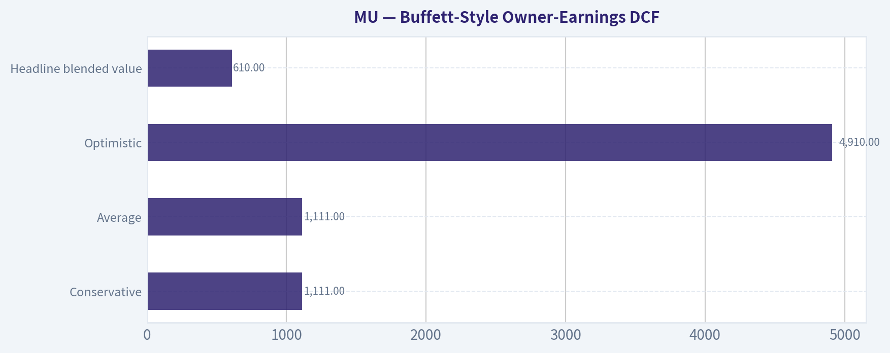
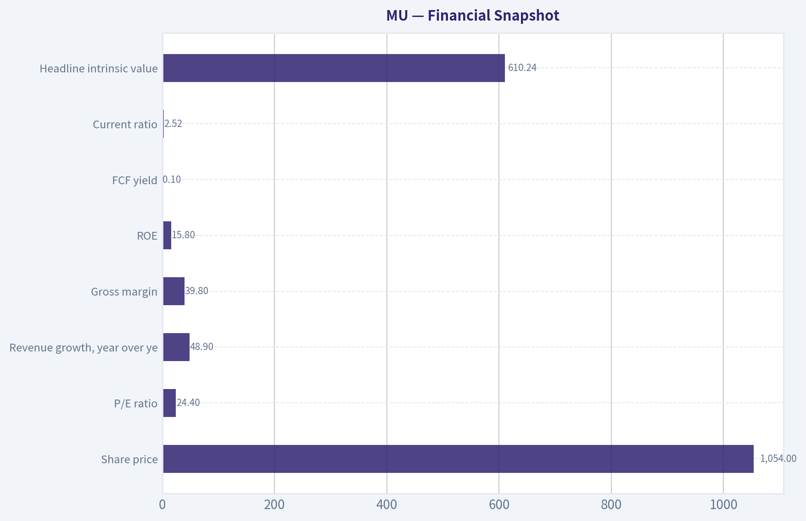
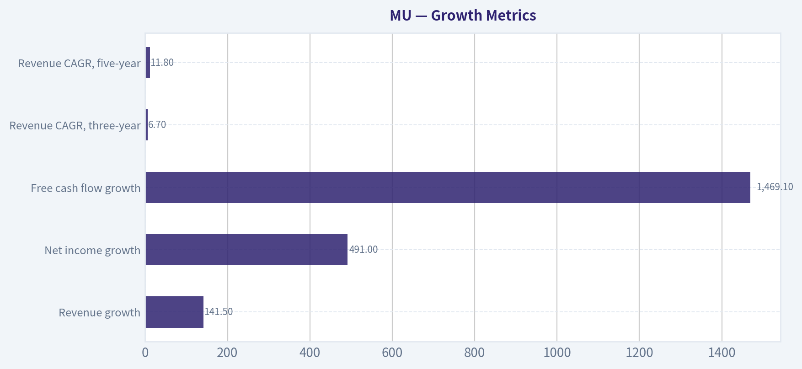

# MU Deep Value Intelligence

**Analysis Date:** 2026-09-29

## Critical Disclaimer

*This analysis is generated by Deep Value Intelligence, an AI-powered multi-agent investing framework. Education & research only - not financial advice, not a financial advisor.*

---

## Table of Contents

1. Intelligence Summary
2. Analyst Team Reports
   - Fundamentals Analysis
   - Intrinsic Value Analysis (Buffett)
   - Trend & Growth Analysis (Lynch/Druckenmiller/Fisher)
   - Market Technical Analysis
   - Options Market Analysis
3. Research Team Commentary
4. Value Investing Team Commentary
5. Deep Values Commentary

---

## Intelligence Summary

### Thesis + Conditions

**Core Thesis:** ## Executive Briefing

**Key Risks:**
- Valuation is the principal risk:** At $1,054 and 24.45 times earnings, the price assumes much of the structural improvement. The optimistic value estimate of approximately $1,214 offers only about 15% upside, while reasonable normalization scenarios are materially lower.
- The original plan was to keep Micron on an active watchlist, avoid shorting it merely because it appears expensive, and wait for either:
- That remains the correct foundation. The refinement is to make the WATCH stance explicitly **trigger-based**, rather than waiting indefinitely for perfect proof.

**Confidence:** Low

---

## Analyst Team Reports

### Fundamentals Analysis

#### Latest Earnings Snapshot

*Most recent reported quarter anchored on 2026 Q2, with prior-year comparison when available.*

| Metric | 2026 Q2 | 2025 Q2 | YoY Change |
| --- | ---: | ---: | ---: |
| Revenue | $41.46B | $9.30B | +345.7% |
| Operating Income | $33.32B | $2.17B | +1436.1% |
| Net Income | $28.24B | $1.89B | +1398.3% |
| Diluted EPS | $24.67 | $1.68 | +1368.5% |
| Operating Cash Flow | $25.39B | $4.61B | +450.8% |
| Free Cash Flow | $17.56B | $1.67B | +951.0% |

Key Takeaways: This snapshot anchors the most recent reported quarter before the narrative analysis. It helps readers separate long-run business quality from whatever changed in the latest earnings print.

#### 17-Year Financial Metrics for MU

*All values below are computed deterministically from raw data - not estimated by AI.*

*Issuer profile: operating company (Technology / Semiconductors).*

#### 17-Year Financial Metrics
*Annual rows come from reported financial statements. The final TTM row is computed from the latest four quarters.*

| Metric | 2009 | 2010 | 2011 | 2012 | 2013 | 2014 | 2015 | 2016 | 2017 | 2018 | 2019 | 2020 | 2021 | 2022 | 2023 | 2024 | 2025 | 2026 TTM |
| --- | --- | --- | --- | --- | --- | --- | --- | --- | --- | --- | --- | --- | --- | --- | --- | --- | --- | --- |
| Market Price | $7 | $6 | $6 | $6 | $13 | $32 | $16 | $16 | $31 | $51 | $44 | $44 | $72 | $55 | $69 | $96 | $119 | $1,054 |
| Market Cap | $5.90B | $6.79B | $5.95B | $6.15B | $14.34B | $39.05B | $19.20B | $17.08B | $36.89B | $64.55B | $51.74B | $51.47B | $84.09B | $63.43B | $76.44B | $107.60B | $133.89B | $1.21T |
| P/E Ratio | -3.14 | 3.49 | 34.76 | -5.97 | 12.01 | 12.83 | 6.64 | -61.07 | 7.25 | 4.56 | 8.22 | 19.20 | 14.34 | 7.29 | -13.10 | 137.49 | 15.68 | 23.86 |
| P/B Ratio | 1.19 | 0.85 | 0.70 | 0.80 | 1.57 | 3.63 | 1.56 | 1.41 | 1.98 | 2.00 | 1.44 | 1.32 | 1.91 | 1.27 | 1.73 | 2.38 | 2.47 | 11.98 |
| ROE | -38.0% | 23.1% | 2.0% | -13.4% | 13.0% | 28.3% | 23.6% | -2.3% | 27.3% | 43.8% | 17.6% | 6.9% | 13.3% | 17.4% | -13.2% | 1.7% | 15.8% | 50.1% |
| ROIC | -23.3% | 23.4% | 7.1% | -7.0% | 2.2% | 23.3% | 18.6% | 0.8% | 27.1% | 53.8% | 20.6% | 7.5% | 14.7% | 19.6% | -12.4% | 1.7% | 16.2% | 61.7% |
| EPS | $-2.29 | $1.80 | $0.17 | $-1.01 | $1.10 | $2.48 | $2.41 | $-0.26 | $4.30 | $11.22 | $5.37 | $2.31 | $5.01 | $7.75 | $-5.34 | $0.70 | $7.59 | $44.17 |
| Revenue | $4.80B | $8.48B | $8.79B | $8.23B | $9.07B | $16.36B | $16.19B | $12.40B | $20.32B | $30.39B | $23.41B | $21.43B | $27.70B | $30.76B | $15.54B | $25.11B | $37.38B | $90.27B |
| Gross Profit | $-440.0M | $2.71B | $1.76B | $968.0M | $1.85B | $5.44B | $5.21B | $2.50B | $8.44B | $17.89B | $10.70B | $6.55B | $10.42B | $13.90B | $-1.42B | $5.61B | $14.87B | $65.51B |
| Gross Margin | -9.2% | 32.0% | 20.0% | 11.8% | 20.4% | 33.2% | 32.2% | 20.2% | 41.5% | 58.9% | 45.7% | 30.6% | 37.6% | 45.2% | -9.1% | 22.4% | 39.8% | 72.6% |
| Operating Margin | -38.6% | 22.6% | 6.3% | -9.2% | 14.2% | 16.7% | 16.1% | -2.3% | 25.6% | 47.1% | 30.1% | 13.9% | 22.4% | 31.1% | -36.4% | 4.9% | 25.8% | 65.7% |
| Net Income | $-1.88B | $1.85B | $167.0M | $-1.03B | $1.19B | $3.04B | $2.90B | $-276.0M | $5.09B | $14.13B | $6.31B | $2.69B | $5.86B | $8.69B | $-5.83B | $778.0M | $8.54B | $50.47B |
| Net Margin | -39.2% | 21.8% | 1.9% | -12.5% | 13.1% | 18.6% | 17.9% | -2.2% | 25.0% | 46.5% | 27.0% | 12.5% | 21.2% | 28.2% | -37.5% | 3.1% | 22.8% | 55.9% |
| Revenue Growth | N/A | 76.6% | 3.6% | -6.3% | 10.2% | 80.3% | -1.0% | -23.4% | 63.9% | 49.5% | -23.0% | -8.4% | 29.3% | 11.0% | -49.5% | 61.6% | 48.9% | 141.5% |
| Net Income Growth | N/A | -198.3% | -91.0% | -718.0% | -215.3% | 155.9% | -4.8% | -109.5% | -1943.8% | 177.8% | -55.3% | -57.4% | 118.1% | 48.2% | -167.1% | -113.3% | 997.6% | 491.0% |
| Free Cash Flow Growth | N/A | 245.4% | -102.7% | -728.8% | -11.1% | 602.4% | -54.2% | -323.2% | -229.1% | 149.2% | -60.0% | -97.6% | 2837.3% | 27.7% | -296.4% | -102.0% | 1278.5% | 1469.1% |
| Total Book Value | $4.95B | $8.02B | $8.47B | $7.70B | $9.14B | $10.76B | $12.30B | $12.08B | $18.62B | $32.29B | $35.88B | $39.00B | $43.93B | $49.91B | $44.12B | $45.13B | $54.16B | $100.72B |
| Total Assets | $11.46B | $14.69B | $14.75B | $14.33B | $19.12B | $22.42B | $24.14B | $27.54B | $35.34B | $43.38B | $48.89B | $53.68B | $58.85B | $66.28B | $64.25B | $69.42B | $82.80B | $134.11B |
| Total Debt | $2.80B | $2.36B | $2.00B | $3.26B | $6.04B | $6.51B | $7.34B | $9.91B | $11.13B | $4.64B | $5.85B | $6.43B | $6.12B | $6.12B | $12.33B | $11.77B | $12.09B | $6.38B |
| Debt-to-Equity | 0.57 | 0.29 | 0.24 | 0.42 | 0.66 | 0.61 | 0.60 | 0.82 | 0.60 | 0.14 | 0.16 | 0.16 | 0.14 | 0.12 | 0.28 | 0.26 | 0.22 | 0.06 |
| Cash & Equivalents | $1.49B | $2.91B | $2.16B | $2.46B | $2.88B | $4.15B | $2.29B | $4.14B | $5.11B | $6.51B | $7.15B | $7.62B | $7.76B | $8.26B | $8.58B | $7.04B | $9.64B | $25.00B |
| Shareholders' Equity | $4.95B | $8.02B | $8.47B | $7.70B | $9.14B | $10.76B | $12.30B | $12.08B | $18.62B | $32.29B | $35.88B | $39.00B | $43.93B | $49.91B | $44.12B | $45.13B | $54.16B | $100.72B |
| Operating Cash Flow | $1.21B | $3.10B | $2.48B | $2.11B | $1.81B | $5.70B | $5.21B | $3.17B | $8.15B | $17.40B | $13.19B | $8.31B | $12.47B | $15.18B | $1.56B | $8.51B | $17.52B | $51.43B |
| Investing Cash Flow | $-674.0M | $-448.0M | $-2.04B | $-2.31B | $-1.91B | $-2.90B | $-6.22B | $-3.04B | $-7.54B | $-8.22B | $-10.09B | $-7.59B | $-10.59B | $-11.59B | $-6.19B | $-8.31B | $-14.09B | $-24.89B |
| Free Cash Flow | $718.0M | $2.48B | $-66.0M | $415.0M | $369.0M | $2.59B | $1.19B | $-2.65B | $3.42B | $8.52B | $3.41B | $83.0M | $2.44B | $3.11B | $-6.12B | $121.0M | $1.67B | $26.17B |
| FCF Margin | 14.9% | 29.2% | -0.8% | 5.0% | 4.1% | 15.8% | 7.3% | -21.4% | 16.8% | 28.0% | 14.6% | 0.4% | 8.8% | 10.1% | -39.4% | 0.5% | 4.5% | 29.0% |
| Dividends / Share | $0.00 | $0.00 | $0.00 | $0.00 | $0.00 | $0.00 | $0.00 | $0.00 | $0.00 | $0.00 | $0.00 | $0.00 | $0.00 | $0.41 | $0.46 | $0.46 | $0.46 | $0.50 |

#### Profitability Metrics
- Return on Equity (ROE): 15.8%
- Return on Invested Capital (ROIC): 15.2%
- Return on Assets (ROA): 10.3%
- Gross Margin: 39.8%
- Operating Margin: 25.8%
- Net Profit Margin: 22.8%

#### Liquidity Metrics
- Current Ratio: 2.52
- Quick Ratio: 1.53

#### Leverage Metrics
- Debt-to-Equity Ratio: 0.22
- Interest Coverage Ratio: 20.24
- Net Debt: $1.79B

#### Growth Metrics (Year-over-Year)
- Revenue Growth: 48.9%
- Net Income Growth: 997.6%
- Free Cash Flow Growth: 1278.5%
- Revenue CAGR (3-Year): 6.7%
- Revenue CAGR (5-Year): 11.8%

#### Valuation Metrics
- P/E Ratio (TTM): 24.45
- Forward P/E: 6.54
- Price-to-Book: 11.81
- Price-to-Sales: 13.19
- PEG Ratio: 0.16
- EV/EBITDA: 17.16
- Free Cash Flow Yield: 0.1%
- Earnings Yield: 4.1%

#### Owner Earnings (Buffett Method, Code-Computed)
- Net Income: $8.54B
- + Depreciation & Amortization: $8.35B
- - Capital Expenditures: $-15.86B
- - Working Capital Changes: $-666.0M
- = **Owner Earnings: $9.21B**

#### Intrinsic Value (Code-Computed)
- Current Price: $1,054
- **Headline Intrinsic Value (business-model routed): $610**
  Business model: cyclical - weighted blend [Damodaran FCFF + reverse-DCF fair + owner-earnings DCF] (cyclical)
  Model spread (min-max across DCFs): $145 - $1,111
  Margin of safety vs. price (headline): -72.7%
  Routing note: Cyclical: margins/FCF are volatile - headline blends FCFF, reverse-DCF and owner-earnings roughly evenly; treat the range as the honest read.
- Buffett Method (Owner Earnings):
  Conservative: $1,111
  Average: $1,111
  Optimistic: $4,910
- Cash Flow Method (FCF):
  Conservative: $49
  Average: $364
  Optimistic: $2,158
- Damodaran FCFF (WACC + margins + reinvestment):
  Conservative: $88
  Average: $145
  Optimistic: $374
  Monte Carlo band (P10-P90): $64 - $196 (median $134)
  P(intrinsic value > price): 0.0%
- Reverse-DCF: price implies ~12.8%/yr owner-earnings growth for 10y; trailing 3y was -2.5%, 5y N/A.

#### Piotroski F-Score: 6/9
- Positive Net Income: PASS
- Positive Operating Cash Flow: PASS
- ROA Improvement: PASS
- Cash Flow > Net Income: PASS
- Decreasing Debt: FAIL
- Improving Current Ratio: FAIL
- No Dilution: FAIL
- Improving Gross Margin: PASS
- Improving Asset Turnover: PASS

ANALYST STANCE: **AVOID**

#### Executive Summary

Micron Technology, Inc. is experiencing an extraordinary earnings cycle driven by high-bandwidth memory, artificial-intelligence infrastructure, and tight DRAM/NAND supply conditions. The latest TTM figures are exceptionally strong: revenue rose to $90.27 billion, operating margin reached 65.7%, net income reached $50.47 billion, and free cash flow reached $26.17 billion.

However, the market price of $1,054 implies a $1.21 trillion market capitalization and approximately 12.8% annual owner-earnings growth for the next ten years. That expectation is difficult to reconcile with Micron's highly cyclical history. The deterministic dataset shows repeated losses, negative free cash flow, large margin swings, and sharp revenue contractions during memory downturns. The model-based intrinsic-value blend is $610 per share, while the Damodaran FCFF model produces a $145 average value and a $64-$196 Monte Carlo range.

The business is high quality at the operational level, but the stock price appears to discount an unusually prolonged and profitable AI-memory boom. At the current valuation, the margin of safety is inadequate for a Buffett-style investor.

#### Current Metrics and Historical Comparison

The comparison below uses the 2016-2025 fiscal years as the ten-year historical reference period. Averages are arithmetic averages and can be distorted by cyclical losses, unusually high margins, and negative or abnormally high valuation ratios.

| Metric | Current / 2026 TTM | 2016-2025 Average | Interpretation |
|---|---:|---:|---|
| Market Price | $1,054 | $59.70 | Approximately 17.7 times the historical average price |
| Market Cap | $1.21T | $68.72B | Valuation has expanded far faster than historical operating scale |
| P/E Ratio | 23.86 | 13.99 | Above the reported average, despite current earnings being near a cyclical peak |
| P/B Ratio | 11.98 | 1.79 | Extremely above history; meaningful for this capital-intensive manufacturer but not a reliable standalone valuation anchor |
| ROE | 50.1% | 12.8% | Exceptional current profitability, substantially above normal-cycle returns |
| ROIC | 61.7% | 15.0% | Far above historical average and likely reflects peak-cycle economics |
| Revenue | $90.27B | $24.44B | More than three times the historical average |
| Gross Margin | 72.6% | 33.3% | Extraordinary expansion from pricing, product mix, and utilization |
| Operating Margin | 65.7% | 16.2% | Nearly four times the historical average |
| Net Margin | 55.9% | 14.7% | Well above normal historical profitability |
| Net Income | $50.47B | $4.60B | More than ten times the historical average |
| Free Cash Flow | $26.17B | $1.40B | Strong current cash generation, but historical FCF has repeatedly turned negative |
| Total Debt | $6.38B | $8.04B | Below the historical average |
| Cash and Equivalents | $25.00B | $6.98B | Significantly stronger liquidity than historical norms |
| Debt-to-Equity | 0.06 | 0.29 | Very conservative current leverage |
| Dividends per Share | $0.50 | $0.18 | Dividend has increased modestly but remains immaterial to the investment case |

**Key Takeaways:** Micron's current profitability and cash generation are dramatically above historical norms, which is a strength operationally but also a warning sign for valuation analysis. The stock trades at a substantially higher P/E and P/B than its historical averages while current margins appear unusually elevated. The balance sheet is considerably stronger than it was historically, but balance-sheet strength does not eliminate memory-cycle risk.

#### Market Metrics

- **Market price:** $1,054.
- **Market capitalization:** $1.21 trillion in the deterministic dataset. The shared research pack separately reports approximately $1.19 trillion; the deterministic dataset is treated as canonical.
- **P/E ratio:** 23.86 TTM. This is above the ten-year average of approximately 13.99. The comparison is imperfect because several historical years had negative earnings, but the central issue is that the current multiple is being applied to unusually high earnings.
- **P/B ratio:** 11.98, versus an approximate ten-year average of 1.79. Micron is a capital-intensive semiconductor manufacturer, so book value is more economically relevant than it would be for an asset-light software or platform business. Nevertheless, a P/B near 12 times is a major premium to history and appears to assume exceptional future returns on capital.
- **Forward P/E:** 6.54 in the research pack. This indicates that analysts expect very strong earnings growth, but a low forward P/E is not automatically attractive in a cyclical industry. If earnings normalize sharply, the apparent forward cheapness can disappear quickly.
- **FCF yield:** 0.1% in the research pack. This is particularly concerning because the market value is enormous relative to even the current $26.17 billion FCF figure. The low yield reflects the market's confidence that current cash flows will compound materially.

#### Profitability and Earnings Quality

Micron's current profitability is outstanding:

- **ROE:** 50.1% in the deterministic TTM dataset.
- **ROIC:** 61.7%.
- **EPS:** $44.17.
- **Revenue:** $90.27 billion.
- **Gross profit:** $65.51 billion.
- **Gross margin:** 72.6%.
- **Operating margin:** 65.7%.
- **Net income:** $50.47 billion.
- **Net margin:** 55.9%.

These figures exceed the ten-year averages by wide margins. ROE is approximately 37 percentage points above its historical average, while ROIC is approximately 47 percentage points above its historical average. Operating margin is approximately 49 percentage points above its ten-year average.

The important question is not whether these results are good; they are exceptional. The question is how much of this profitability is structurally durable versus cyclical. Historical results show:

- Negative ROE in 2009, 2012, 2016, and 2023.
- Negative ROIC in 2009, 2012, and 2023.
- Negative gross margin in 2009 and 2023.
- Negative operating margin in 2009, 2012, 2016, and 2023.
- Net losses in 2009, 2012, 2016, and 2023.
- Negative FCF in 2011, 2016, 2020, 2023, and 2024.

This pattern is characteristic of a cyclical commodity-like semiconductor industry rather than a consistently compounding consumer franchise. Micron has strong technology and scale advantages, but its earnings power remains sensitive to memory pricing, inventory cycles, capital expenditure by competitors, customer concentration, and industry overcapacity.

#### Growth Metrics

| Growth Metric | Current / 2026 TTM | Historical Reference | Assessment |
|---|---:|---:|---|
| Revenue growth | 141.5% | 2016-2025 average approximately 16.1% excluding 2016 as a base distortion | Extraordinary rebound and AI-related acceleration |
| Net income growth | 491.0% | Highly volatile and not economically meaningful as an average | Recovery from a depressed prior-year base |
| Free cash flow growth | 1,469.1% | Highly volatile and not economically meaningful as an average | Large rebound from weak prior-year FCF |
| Revenue CAGR, three-year | 6.7% | - | Indicates that the long-term trend is much less explosive than the latest TTM result |
| Revenue CAGR, five-year | 11.8% | - | Healthy, but substantially below the growth implied by the current share price |

**Key Takeaways:** The latest growth rates are heavily influenced by recovery from the 2023 downturn and the rapid expansion of AI-memory demand. The three-year revenue CAGR of 6.7% and five-year CAGR of 11.8% provide a more balanced view than the latest 141.5% year-over-year increase. Net income and FCF growth percentages are especially unreliable because they begin from unusually depressed bases.

#### Balance Sheet and Financial Strength

Micron's balance sheet is a major positive:

- **Total book value and shareholders' equity:** $100.72 billion.
- **Total assets:** $134.11 billion.
- **Total debt:** $6.38 billion.
- **Debt-to-equity:** 0.06.
- **Cash and equivalents:** $25.00 billion.
- **Net debt:** $1.79 billion according to the research pack.
- **Current ratio:** 2.52.
- **Quick ratio:** 1.53.
- **Interest coverage:** 20.24.

Debt has declined from $12.09 billion in 2025 to $6.38 billion TTM, while cash has increased from $9.64 billion to $25.00 billion. This gives Micron substantial resilience against a cyclical downturn and provides funding capacity for advanced fabrication and packaging investments.

The principal balance-sheet risk is not excessive leverage. It is the capital intensity of the business. Investing cash flow was negative $24.89 billion TTM, and capital expenditures used in the owner-earnings calculation were $15.86 billion. Micron must spend heavily to maintain technological competitiveness and expand capacity. In a downturn, these expenditures may remain necessary even while product prices fall.

#### Cash Flow and Capital Allocation

- **Operating cash flow:** $51.43 billion.
- **Free cash flow:** $26.17 billion.
- **FCF margin:** 29.0%.
- **Owner earnings:** $9.21 billion under the code-computed Buffett methodology.
- **Dividends per share:** $0.50.

The large difference between reported FCF of $26.17 billion and computed owner earnings of $9.21 billion is important. The owner-earnings figure deducts $15.86 billion of capital expenditures and $666 million of working-capital investment from net income plus depreciation and amortization. This is a more conservative interpretation of distributable earnings because Micron's semiconductor manufacturing capacity requires significant recurring reinvestment.

The dividend is not a major part of the thesis. At $0.50 per share, the cash yield is approximately 0.05% at the current price. Management has historically retained capital for capacity expansion and technology investment, which is appropriate for the industry, but investors should not expect income to provide meaningful downside protection.

#### Revenue Breakdown

Precise 2026 TTM segment amounts are not provided in the deterministic dataset. The following is a best-available directional estimate based on Micron's publicly reported business-unit structure and recent mix, not a replacement for the canonical financial dataset.

| Revenue Source | Estimated Amount ($B) | % of Total |
|---|---:|---:|
| Compute and Networking Business Unit, including data-center DRAM and HBM | $50.5B | 56% |
| Mobile and Client Business Unit | $18.1B | 20% |
| Storage Business Unit, including SSD and NAND products | $13.5B | 15% |
| Embedded Business Unit, including automotive and industrial memory | $8.1B | 9% |
| **Total estimated revenue** | **$90.2B** | **100%** |

**Key Takeaways:** Compute and networking is the dominant revenue engine, reflecting strong data-center and HBM demand. This concentration increases Micron's exposure to AI infrastructure spending, hyperscaler capital budgets, and HBM pricing. Mobile, storage, and embedded markets provide diversification, but they remain exposed to semiconductor inventory and pricing cycles.

#### Buffett-Style Business Quality Assessment

**Economic moat:** Micron has meaningful but imperfect competitive advantages. Its moat comes from enormous capital requirements, process technology, manufacturing scale, intellectual property, engineering expertise, and qualification relationships with major customers. The DRAM industry is also more disciplined than it was historically because only a few large suppliers can compete at the leading edge.

However, memory products are relatively standardized, and pricing remains cyclical. A moat based on scale and technology can protect market share without guaranteeing stable margins. The business therefore has a narrower and less predictable moat than companies selling differentiated consumer brands, software ecosystems, or mission-critical recurring services.

**Financial strength:** Strong. Low leverage, substantial cash, strong interest coverage, and positive net cash provide meaningful protection. Micron is better positioned than in prior cycles to withstand weak pricing.

**Predictable earnings:** Weak to moderate. The ten-year record contains major earnings losses and negative FCF. The latest earnings are powerful but not yet sufficient to establish a stable through-cycle earnings base.

**Management performance:** Management appears to have improved capital discipline and balance-sheet management. Debt has fallen, cash has risen, and the company is benefiting from investments in advanced memory. The key management challenge is avoiding excessive capacity additions during a period of unusually high prices.

**Dividend policy:** Conservative and low-yielding. Capital is primarily directed toward capacity and technology investment. That may maximize long-term competitiveness, but it provides little current income.

**Quality of business:** Operationally high quality at the leading edge, financially strong, and strategically important to AI infrastructure. As an investment, however, the business remains cyclical and capital intensive. The quality of the company does not automatically make the current stock price attractive.

#### Buffett-Style Owner-Earnings DCF

The research pack's code-computed owner earnings are:

- Net income: **$8.54 billion**
- Depreciation and amortization: **$8.35 billion**
- Capital expenditures: **$15.86 billion**
- Working-capital investment: **$666 million**
- Owner earnings: **$9.21 billion**

The basic Buffett-style valuation formula is:

\[
\text{Intrinsic Value} =
\sum_{t=1}^{10}\frac{OE_t}{(1+r)^t}
+
\frac{OE_{10}(1+g_T)}{(r-g_T)(1+r)^{10}}
\]

where:

- \(OE_t\) is forecast owner earnings,
- \(r\) is the discount rate,
- \(g_T\) is the terminal growth rate,
- discount rate is approximately 10%,
- terminal growth is 2.5%.

Because Micron is cyclical, a normalized owner-earnings base is more appropriate than blindly capitalizing the latest net income. The research pack's model-based values are retained as the primary valuation anchor.

| Scenario | Core Assumption | Model-Based Fair Value | Comparison with $1,054 Price |
|---|---|---:|---:|
| Conservative | Low normalized owner-earnings growth; high sensitivity to cycle normalization | $1,111 | Approximately 5% above the current price |
| Average | Base-case owner-earnings framework using current model assumptions | $1,111 | Approximately 5% above the current price |
| Optimistic | Strong AI/HBM growth and extended elevated profitability | $4,910 | Approximately 366% above the current price |
| Headline blended value | Owner earnings, FCF, Damodaran FCFF, and reverse-DCF blend | $610 | Approximately 42% below the current price |

**Key Takeaways:** The owner-earnings model is unusually optimistic relative to the broader valuation framework, producing $1,111 per share in both conservative and average cases and $4,910 in the optimistic case. The broader model blend is only $610 because the FCF and FCFF methods penalize Micron's heavy reinvestment needs and cyclicality. The wide model spread-from $145 to $1,111 for the three principal models-shows that valuation is highly assumption-sensitive.

For additional sanity checking, using the reported $9.21 billion owner earnings, approximately 1.15 billion implied shares, a 10% discount rate, and a 2.5% terminal growth rate produces the following directional results:

| Hand DCF Case | Illustrative Growth Path | Approximate Hand-Check Value per Share |
|---|---|---:|
| Conservative | 3% initial growth, fading toward 2.5% | Approximately $100-$120 |
| Average | Approximately 8% initial growth, fading toward 2.5% | Approximately $150-$190 |
| Optimistic | Approximately 15% initial growth, fading toward 2.5% | Approximately $220-$300 |

**Key Takeaways:** A conservative hand DCF based directly on current owner earnings does not support the market price. Even a strong optimistic growth path remains well below $1,054 because the starting owner-earnings figure is much lower than reported net income and because Micron requires substantial reinvestment. This reinforces the conclusion that the market price requires exceptionally favorable assumptions.

The research pack also reports:

- **FCF valuation:** $49 conservative, $364 average, and $2,158 optimistic.
- **Damodaran FCFF valuation:** $88 conservative, $145 average, and $374 optimistic.
- **Damodaran Monte Carlo range:** $64-$196, with a median of $134.
- **Reverse DCF:** the current price implies approximately **12.8% annual owner-earnings growth for ten years**.
- **Probability that intrinsic value exceeds the current price:** **0.0%** in the FCFF Monte Carlo analysis.

The reverse-DCF hurdle is especially important. Micron's five-year revenue CAGR is 11.8%, but revenue growth is not the same as owner-earnings growth, and the company's trailing three-year owner-earnings growth was reported at negative 2.5%. Sustaining 12.8% annual owner-earnings growth for a decade would require not only continued AI demand but also durable margins, disciplined industry capacity, and strong returns on massive incremental capital investment.

#### Key Investment Insights, Red Flags, and Opportunities

| Category | Insight | Investment Significance |
|---|---|---|
| Opportunity | HBM and AI infrastructure demand | Could extend the current upcycle and support stronger-than-normal margins |
| Opportunity | Industry concentration | Fewer major DRAM suppliers may improve supply discipline |
| Opportunity | Strong balance sheet | Cash and low debt reduce financial distress risk |
| Opportunity | Technology leadership | Advanced process nodes, HBM, and packaging can support market-share gains |
| Red flag | Extreme current valuation | $1.21 trillion market cap leaves little room for execution errors |
| Red flag | Highly cyclical earnings | Historical losses and negative FCF demonstrate severe downside risk |
| Red flag | Peak-margin risk | Current 72.6% gross margin and 65.7% operating margin are far above history |
| Red flag | Heavy capital expenditure | Large reinvestment requirements reduce true distributable owner earnings |
| Red flag | AI concentration | A slowdown in hyperscaler spending or HBM demand could cause a sharp reset |
| Red flag | Low FCF yield | Current valuation is not supported by present free cash flow without aggressive growth assumptions |
| Watch item | Capacity additions by competitors | New supply could pressure DRAM and NAND pricing |
| Watch item | Customer concentration | Large customers may possess meaningful purchasing power |
| Watch item | Export controls and geopolitics | Restrictions affecting China, Taiwan, Korea, or advanced semiconductor equipment could alter demand and supply |

**Key Takeaways:** The strongest opportunities are Micron's balance sheet, HBM exposure, technological position, and improved industry structure. The largest risks are valuation, peak-cycle margins, capital intensity, and dependence on AI infrastructure spending. The stock may continue rising if the AI cycle remains exceptionally strong, but that is a momentum thesis rather than a margin-of-safety thesis.

#### Final Investment Stance

**AVOID at $1,054.**

This is not a judgment that Micron is a poor company. It is a judgment that the current price provides insufficient protection against a cyclical normalization. The company has:

- Strong liquidity and very low leverage.
- Significant technology and scale advantages.
- Exceptional current ROE and ROIC.
- Powerful exposure to HBM and AI infrastructure.
- Improved strategic importance and industry positioning.

But it also has:

- A long history of earnings and FCF volatility.
- Current margins far above ten-year norms.
- Significant capital expenditure requirements.
- A valuation that implies approximately 12.8% owner-earnings growth for ten years.
- A headline intrinsic value of $610 versus a $1,054 market price.
- A Damodaran FCFF median of approximately $134.
- A current P/E and P/B substantially above historical averages.

A Buffett-style investor should wait for either a substantially lower price or clearer evidence that elevated HBM economics are durable across a full memory cycle. A reasonable watch-list trigger would be a valuation closer to normalized cash-flow estimates, accompanied by evidence that margins remain structurally higher without requiring disproportionate capital spending.

| Final Assessment | Conclusion |
|---|---|
| Business quality | Strong technology, scale, and strategic relevance |
| Economic moat | Moderate and improving, but constrained by product cyclicality |
| Financial strength | Excellent; low debt and substantial cash |
| Earnings predictability | Weak to moderate over a full cycle |
| Current profitability | Exceptional but likely influenced by peak-cycle conditions |
| Valuation | Aggressive and highly dependent on sustained AI-driven growth |
| Margin of safety | Inadequate at the current price |
| Preferred action | Avoid new purchase; maintain on watch list for a lower valuation |
| Final stance | **AVOID** |

**Key Takeaways:** Micron is an impressive semiconductor business with a strong balance sheet and a potentially durable AI-related opportunity. Nevertheless, the stock price appears to capitalize an unusually favorable earnings environment and leaves little margin for a cyclical downturn. For disciplined value investors, the appropriate decision is to avoid purchasing at the current price and wait for a more conservative valuation.

#### Fundamental Visuals

This graph tracks the profitability and return metrics (ROE, ROIC, Margins) of **MU** over the past decade, highlighting capital efficiency trends.

This chart illustrates the financial health of **MU** over the last 10 years, mapping cash equivalents and free cash flow against total obligations (Debt).

This breakdown chart from <em>Revenue Breakdown</em> shows the proportional composition for **MU** - useful for understanding what drives or risks the business.

---

### Intrinsic Value Analysis (Buffett)

> *Following Warren Buffett's value investing philosophy: Circle of Competence, Economic Moat, Management Quality, and Margin of Safety.*

#### Intrinsic Value Snapshot

Price is what you pay. Intrinsic value is what the business may be worth based on the cash it can create for owners over time. We show a range, not one magic number.

- Current Price: $1,053.98
- Value Range (conservative to optimistic across both DCF methods): $49.36 to $4,909.69

##### Owner Earnings (Buffett Method)
- Net Income: $8,539,000,000.00
- Depreciation & Amortization: $8,352,000,000.00
- Capital Expenditures: $-15,857,000,000.00
- Working Capital Changes: $-666,000,000.00
- Owner Earnings: $9,205,000,000.00

##### Intrinsic Value
###### Buffett Method
Uses owner earnings. Stricter, and usually more conservative.
- Conservative: $1,110.76
- Average: $1,110.76
- Optimistic: $4,909.69
- Discount Rate: 10.0%

###### Cash Flow Method
Uses free cash flow. Better for companies spending heavily today to grow tomorrow.
- Conservative: $49.36
- Average: $363.78
- Optimistic: $2,157.73
- Discount Rate: 10.0%

ANALYST STANCE: **AVOID**

#### Executive Conclusion

Micron Technology is benefiting from powerful AI-driven memory demand, but the stock price already discounts an unusually strong and sustained earnings cycle. Micron remains a strategically important semiconductor supplier, yet memory is fundamentally cyclical, capital-intensive, and vulnerable to oversupply. At $1,054 per share, valuation provides no meaningful margin of safety under conservative assumptions.

The business is financially solvent, so the Gate 5 hard floor is **not tripped**. However, the weighted Buffett score is approximately **2.0 out of 5.0**, supporting an **AVOID** stance with high conviction.

#### Financial Snapshot

| Metric | Latest Value |
|---|---:|
| Share price | $1,054 |
| Market capitalization | $1.19 trillion |
| P/E ratio | 24.4x |
| Revenue growth, year over year | 48.9% |
| Gross margin | 39.8% |
| ROE | 15.8% |
| FCF yield | 0.1% |
| Current ratio | 2.52 |
| Headline intrinsic value | $610.24 |
| Three-model valuation range | $144.96-$1,110.76 |
| Reverse-DCF implied growth | Approximately 12.8% annually for 10 years |

**Key Takeaways:** Revenue growth is exceptionally strong, but the 0.1% free-cash-flow yield indicates that current earnings are not translating into an attractive cash return at today's valuation. ROE is respectable rather than exceptional, while the 39.8% gross margin reflects the cyclical and competitive nature of memory semiconductors. The stock price is substantially above the headline intrinsic value estimate.

#### Factor Scorecard

| Factor | Score | Assessment |
|---|---:|---|
| Circle of competence and simplicity | 2/5 | The basic model is understandable-Micron manufactures and sells memory chips-but future profitability depends heavily on supply, pricing, inventory, and semiconductor-cycle conditions. |
| Durable competitive advantage | 2/5 | Scale, manufacturing expertise, and technological know-how are meaningful advantages, but memory products are relatively standardized and pricing power is limited. |
| Management quality and capital allocation | 3/5 | Micron operates in a strategically important market and has demonstrated the ability to invest aggressively during upcycles. However, the capital intensity and cyclicality make disciplined allocation difficult to assess across the full cycle. |
| Industry structure | 1/5 | The industry has a small number of major participants, but competition remains intense, supply additions can cause sharp price declines, and returns fluctuate substantially. |

**Key Takeaways:** Micron has real technological and scale advantages, but they do not create the stable pricing power associated with a wide Buffett-style moat. The principal risk is not business failure; it is buying a cyclical business at a price that assumes unusually favorable conditions will persist.

#### Moat Analysis

| Moat Source | Evidence | Rating |
|---|---|---:|
| Intangible assets | Strong process technology, intellectual property, and engineering capabilities | Moderate |
| Switching costs | Limited for many memory components because customers can qualify alternative suppliers | Weak to moderate |
| Cost advantage | Scale and manufacturing know-how help Micron compete, but competitors possess comparable capabilities | Moderate |
| Network effects | Little direct network effect; memory does not become more valuable simply because more customers use Micron | Weak |
| Overall moat | Important supplier with technical scale, but limited pricing power and cyclical economics | Narrow |

Micron's strongest advantages are scale, manufacturing expertise, and its position in a concentrated global supply chain. These advantages matter especially in advanced high-bandwidth memory and data-center applications.

The problem is that memory remains a supply-and-demand business. When industry capacity expands faster than demand, pricing can fall rapidly. A 10% price increase cannot reliably be imposed without risking customer substitution, inventory reduction, or delayed purchases. That limits the durability of Micron's moat.

#### Management and Capital Allocation

Management's central challenge is balancing enormous capital expenditures against a highly cyclical revenue stream. Investment in advanced fabrication capacity is necessary to remain competitive, but excess industry capacity can destroy returns even when the technology itself is excellent.

The current evidence supports a middle-of-the-range management score:

- Management is investing in areas with structural demand, including AI infrastructure and high-bandwidth memory.
- The company's strategic relevance and technology position are genuine strengths.
- Capital intensity is very high, making free cash flow highly sensitive to the investment cycle.
- A strong upcycle can make reported earnings look unusually attractive, while normalized through-cycle returns may be much lower.

The key owner-oriented question is whether today's expansion produces attractive returns across a complete semiconductor cycle-not merely during the current AI-led shortage.

#### Financial Summary

| Metric | Interpretation |
|---|---|
| Revenue growth | 48.9% year over year, reflecting strong current demand |
| Gross margin | 39.8%, solid but not indicative of dominant pricing power |
| ROE | 15.8%, acceptable but below the level of a truly exceptional compounder |
| Free-cash-flow yield | 0.1%, extremely thin relative to the purchase price |
| Current ratio | 2.52, indicating substantial short-term liquidity |
| P/E | 24.4x, demanding for a cyclical semiconductor producer |
| Earnings character | Highly sensitive to memory pricing, supply, inventory, and capex cycles |

**Key Takeaways:** Micron's operating momentum is excellent, but the stock's cash-flow economics are far less compelling than its revenue growth suggests. Strong liquidity reduces solvency risk, yet it does not protect shareholders from overpaying or from a future normalization of memory prices.

#### Owner Earnings Calculation

Buffett-style owner earnings are:

> Net income + depreciation and amortization - maintenance capital expenditures - working-capital investment

For Micron, reported free cash flow is not a clean proxy for normalized owner earnings because capital expenditures fluctuate sharply depending on where the memory cycle stands. A valuation-oriented normalized owner-earnings estimate can be inferred from the owner-earnings DCF value:

| Owner-Earnings Component | Valuation Treatment |
|---|---:|
| Normalized owner earnings proxy | Approximately $111.08 per share |
| Capitalization rate | 10% |
| No-growth value | Approximately $1,110.76 per share |

This $111.08 figure should be viewed as an optimistic normalized-cycle proxy rather than a dependable current cash yield. The market price of $1,054 already capitalizes nearly all of that estimated owner earnings stream at a 10% rate, leaving little protection if the cycle weakens.

#### Three-Scenario DCF Valuation

| Scenario | Assumption | Estimated Value |
|---|---|---:|
| A. No growth | Normalized owner earnings of $111.08, capitalized at 10% | $1,110.76 |
| B. GDP growth | 3% perpetual growth and 10% discount rate | $1,635.30 |
| C. Historical-cycle normalization | Approximately 1.25% annual decline, using the negative trailing growth trend as a conservative anchor | Approximately $981 |
| Research-pack blended value | Owner earnings, FCF, Damodaran FCFF, and reverse-DCF blend | $610.24 |

**Key Takeaways:** The optimistic owner-earnings scenario can justify a value near the current quotation, but it assumes normalized cash earnings remain unusually strong. More market-based and free-cash-flow-oriented approaches produce materially lower values, indicating that the valuation is highly dependent on favorable assumptions.

The three-model spread is:

- Owner-earnings DCF: **$1,110.76**
- FCF valuation: **$363.78**
- Damodaran FCFF valuation: **$144.96**

The wide range itself is a warning sign. It reflects uncertainty over sustainable, through-cycle cash generation.

#### Margin of Safety Analysis

| Measure | Result |
|---|---:|
| Current price | $1,054 |
| Headline intrinsic value | $610.24 |
| Conventional discount or premium to headline value | Approximately 42.1% premium |
| Research-pack margin-of-safety indicator | Negative 72.7% |
| Reverse-DCF implied growth | Approximately 12.8% annually for 10 years |

The market is effectively asking investors to believe that Micron can compound earnings at approximately 12.8% annually for a decade. That is possible during an AI infrastructure boom, but it is a demanding assumption for a company exposed to recurring memory oversupply and pricing cycles.

For a narrow-moat, cyclical, capital-intensive business, a substantial discount to conservative intrinsic value is appropriate. Micron currently trades above the headline intrinsic value estimate, so the margin of safety is negative.

#### Final Buffett Scorecard

| Criterion | Weight | Score | Weighted Contribution |
|---|---:|---:|---:|
| Moat width and durability | 25% | 2/5 | 0.50 |
| Valuation and margin of safety | 20% | 1/5 | 0.20 |
| Capital returns versus WACC | 15% | 2/5 | 0.30 |
| Business understanding and predictability | 12% | 2/5 | 0.24 |
| Management quality and capital allocation | 12% | 3/5 | 0.36 |
| Reinvestment runway | 8% | 4/5 | 0.32 |
| Balance-sheet strength | 4% | 4/5 | 0.16 |
| Industry structure | 4% | 1/5 | 0.04 |
| **Total** | **100%** |  | **2.12/5.00** |

**Key Takeaways:** Micron scores well on strategic relevance, reinvestment opportunity, and liquidity. It scores poorly on moat durability, industry stability, predictability, and valuation. The weighted result is below the threshold for a compelling Buffett-style investment.

#### Gate 5: Quality and Solvency

**Gate 5 hard floor: Not tripped.**

The company does not present evidence of immediate financial distress. The current ratio of 2.52 indicates strong short-term liquidity, and there is no supplied indication of interest coverage below 1x or an Altman-style distress condition.

This does not make the stock attractive. Solvency is adequate, but valuation and cyclicality remain unfavorable.

#### Investment Stance

**AVOID - High conviction**

Micron is a strategically important and technologically capable company, but the investment case depends on sustaining exceptional AI-related demand while avoiding the historical memory-industry pattern of capacity-driven price collapses. At $1,054, the market price leaves little room for execution mistakes, normalization, or a cyclical downturn.

A more attractive entry point would require either:

1. A materially lower share price, preferably below conservative intrinsic-value estimates; or
2. Clear evidence that Micron's high-bandwidth memory economics have created durable, structurally higher through-cycle returns rather than merely a powerful temporary upcycle.
#### Valuation Bridge

This bridge places the current market price beside each intrinsic value lens so readers can see whether upside depends on one method or shows up across several methods.

| Scenario | Intrinsic Value / Share |
| --- | ---: |
| Buffett Method | $1,110.76 |
| Cash Flow Method | $363.78 |
| Damodaran Method | $144.96 |
| Current Price | $1,053.98 |

#### Key Takeaways

If one method is far above the others, the upside case depends on a specific modelling assumption. When several methods cluster together, the valuation story is more robust.

#### Valuation Visuals

This comparison chart from *Latest Earnings Snapshot* stacks current figures against historical benchmarks for **MU**, making it easy to see where the company trades relative to its own averages.

This comparison chart from *Current Metrics and Historical Comparison* stacks current figures against historical benchmarks for **MU**, making it easy to see where the company trades relative to its own averages.

This comparison chart from *Buffett-Style Owner-Earnings DCF* stacks current figures against historical benchmarks for **MU**, making it easy to see where the company trades relative to its own averages.

This comparison chart from *Financial Snapshot* stacks current figures against historical benchmarks for **MU**, making it easy to see where the company trades relative to its own averages.

---

### Trend & Growth Analysis (Lynch/Druckenmiller/Fisher)

> *Following Peter Lynch's GARP, Stanley Druckenmiller's macro-aware approach, and Philip Fisher's scuttlebutt methodology.*

ANALYST STANCE: **WATCH**

#### 1. Lynch Classification

**Cyclical with fast-growth characteristics**, rather than a pure Fast Grower.

Micron is benefiting from an AI-driven memory upcycle, especially high-bandwidth memory and data-center demand. However, memory pricing, utilization, and profitability have historically been highly cyclical. The latest growth rate may represent a cyclical recovery from a depressed base rather than a durable 20% compounder.

#### 2. The Story in Three Bullets

- **AI requires vastly more memory:** Accelerating AI-server deployment is increasing demand for HBM, DRAM, and enterprise storage.
- **Micron is positioned in a constrained supply market:** Technology transitions and disciplined capacity expansion could support pricing and margins.
- **The key debate is durability:** The market must determine whether current earnings represent a new structural level or the peak of another memory cycle.

#### 3. Fundamental Snapshot

| Metric | Latest reported/supplied figure | Interpretation |
|---|---:|---|
| Revenue | $90.27B TTM | Extremely strong current scale |
| Revenue growth | 48.9% YoY | Fast-growth headline rate |
| Three-year revenue CAGR | 6.7% | Much weaker through-cycle growth |
| Five-year revenue CAGR | 11.8% | Stalwart-like through-cycle profile |
| Gross margin | 39.8% | Improved, but below peak-cycle levels in the data |
| Operating margin | 25.8% | Strong cyclical recovery |
| Net margin | 22.8% | Healthy current profitability |
| ROE | 15.8% | Solid, though not exceptional for a technology leader |
| Current ratio | 2.52 | Strong liquidity |
| Debt-to-equity | 0.22 | Moderate leverage |
| FCF | $26.17B TTM | Strong current cash generation |
| FCF yield | 0.1% | Extremely demanding valuation implication |

**Key Takeaways:** Micron's current operating figures are powerful, with nearly 49% revenue growth and substantial free cash flow. The more important caution is the gap between current growth and through-cycle growth: three-year revenue CAGR is only 6.7%. This is consistent with a cyclical rebound, not yet proof of a permanently higher growth trajectory.

#### 4. TAM and the 10x Test

Micron participates in several markets:

| Market opportunity | Growth driver | 10x assessment |
|---|---|---|
| Conventional DRAM | PCs, smartphones, servers | Mature and cyclical |
| NAND storage | SSDs, cloud storage, edge computing | Large but competitive |
| HBM | AI accelerators and advanced data centers | Fastest-growing opportunity |
| Automotive and industrial memory | Vehicle software, automation, edge AI | Long runway, slower ramp |
| AI infrastructure memory | Larger memory content per server and accelerator | Structural demand inflection |

A literal 10x test is difficult. Starting from approximately $90B of TTM revenue, 10x revenue would be about **$900B**. That would likely exceed the addressable revenue pool of Micron's current memory businesses unless Micron expands substantially into adjacent semiconductor markets or the AI infrastructure market becomes much larger than currently expected.

The more realistic opportunity is not a 10x revenue outcome, but a **multi-year step-up in earnings power and margins** if HBM and AI memory become a larger, higher-value portion of sales.

**Key Takeaways:** Micron has a meaningful and expanding AI-memory runway, but the total company is already very large under the supplied data. The HBM opportunity can materially improve margins and earnings, yet a literal tenfold revenue outcome is not clearly supported by the present TAM.

#### 5. Revenue Growth Trend

| Period | Revenue growth | Assessment |
|---|---:|---|
| 2023 | -49.5% | Severe cyclical downturn |
| 2024 | 61.6% | Recovery begins |
| 2025 | 48.9% | Strong continuation |
| 2026 TTM, alternate supplied series | 141.5% | Potential data inconsistency |
| Three-year CAGR | 6.7% | Modest through-cycle growth |
| Five-year CAGR | 11.8% | Moderate through-cycle growth |

**Key Takeaways:** The reported sequence shows a sharp recovery from a semiconductor downturn, followed by very strong growth. The 141.5% TTM figure conflicts with the separately supplied 48.9% growth figure, so the precise acceleration should be independently verified. The broad conclusion remains that growth is strong, but its sustainability is unproven.

#### 6. Unit Economics and Operating Efficiency

| Metric | Available data | Assessment |
|---|---:|---|
| LTV/CAC | Not disclosed/applicable | Not meaningful for a capital-intensive chip manufacturer |
| Net revenue retention | Not disclosed/applicable | Not a SaaS business |
| Rule of 40 | 77.9% using 48.9% growth + 29.0% FCF margin | Excellent currently, but cycle-sensitive |
| Gross margin | 39.8% | Positive, needs durability confirmation |
| Operating margin | 25.8% | Strong recovery |
| Capital intensity | $15.86B reported capex | Major requirement to sustain technology leadership |

The Rule of 40 result is impressive, but it should not be treated like a software-company score. Micron requires substantial capital expenditure, and free cash flow can contract sharply during downturns.

**Key Takeaways:** Micron currently produces excellent cash economics, but those economics are heavily influenced by memory pricing and utilization. Capital intensity and cyclical volatility make current FCF margins less reliable than those of a recurring-revenue company.

#### 7. Inflection Point Assessment

| Inflection indicator | Evidence | Rating |
|---|---|---|
| Product cycle | HBM and advanced memory for AI systems | Positive |
| Market share | Potential share gains in HBM, but current share data unavailable | Unconfirmed |
| Margin inflection | Operating margin recovered to 25.8% | Positive, cyclical |
| TAM expansion | AI increases memory content per computing system | Strong positive |
| Competitive inflection | Supply discipline may help pricing; competition remains intense | Mixed |
| Earnings inflection | Forward P/E supplied at 6.5x | Potentially powerful, but may reflect peak earnings |

The central inflection is the transition from memory as a relatively standardized component to memory as a strategically constrained bottleneck in AI infrastructure. If HBM demand remains supply-constrained and Micron earns attractive returns on capacity, the earnings cycle could be structurally stronger than prior cycles.

#### 8. Macro Setup

| Factor | Current assessment | Impact |
|---|---|---|
| AI infrastructure spending | Strong secular tailwind | Positive |
| Memory pricing | Supportive during current upcycle | Positive but cyclical |
| Interest rates | No current-rate data supplied | Uncertain |
| Semiconductor cycle | Recovery/expansion phase appears likely | Positive |
| China/geopolitical exposure | Relevant supply-chain and demand risk | Negative |
| Capex cycle | High investment requirements | Mixed |

**Key Takeaways:** The macro backdrop is favorable because AI infrastructure is increasing memory intensity and supporting semiconductor investment. The primary macro risk is that elevated industry capital spending eventually creates excess memory supply. Micron remains more sensitive to the semiconductor cycle than a typical secular software growth company.

#### 9. Fisher's 15-Point Score

| Fisher criterion | Score / 5 | Comment |
|---|---:|---|
| Market potential | 4 | AI memory and data-center demand are substantial |
| New-product determination | 4 | Strong focus on advanced memory products |
| R&D effectiveness | 4 | Technological execution appears important and credible |
| Sales organization | 3 | Customer relationships matter, but data is limited |
| Profit margins | 4 | Strong current margins, cyclical history |
| Margin improvement | 4 | Major recovery from downturn |
| Labor relations | 3 | Insufficient information |
| Executive relations | 3 | Insufficient information |
| Management depth | 4 | Large-scale semiconductor operator |
| Cost analysis/accounting | 3 | No detailed scuttlebutt available |
| Outstanding moat | 4 | Process technology, scale, qualification, and capital barriers |
| Long-range profit outlook | 3 | Strong opportunity, uncertain cycle durability |
| Dilution | 3 | Data indicates a no-dilution failure; needs investigation |
| Management candor | 3 | Not independently assessed |
| Management integrity | 3 | Not independently assessed |
| **Total** | **52 / 75** | **Average; limited scuttlebutt evidence** |

**Key Takeaways:** Micron scores well on market opportunity, R&D, technology, and current margins. The score is held back by limited management and customer-channel evidence, cyclical profitability, and a reported dilution flag. This is not a sufficiently high Fisher score for a high-conviction, long-duration position.

#### 10. Valuation Analysis

| Valuation measure | Supplied value | Interpretation |
|---|---:|---|
| P/E | 24.4x | Not cheap on current earnings |
| Forward P/E | 6.5x | Very cheap if earnings are sustainable |
| PEG | 0.16 | Attractive mechanically, unreliable for cyclicals |
| Price-to-sales | 13.2x | Extremely high for a cyclical memory producer |
| EV/EBITDA | 17.2x | Not obviously inexpensive |
| FCF yield | 0.1% | Very expensive on the supplied market price |
| Headline intrinsic value | $610 | Below supplied price of $1,054 |
| DCF range | $145-$1,111 | Extremely wide, reflecting cycle uncertainty |
| Reverse DCF | Requires roughly 12.8% annual owner-earnings growth for 10 years | Demanding |

The PEG ratio is not decision-useful here because it divides a normal cyclical P/E by a potentially peak-period growth rate. The conflicting forward P/E and FCF-yield figures also warrant data verification. Based on the supplied price and market capitalization, valuation appears to discount a highly favorable, prolonged AI-memory outcome.

**Key Takeaways:** Micron may look inexpensive on forward earnings, but it looks expensive on sales, cash flow yield, and the headline intrinsic-value estimate. The valuation is therefore highly dependent on earnings remaining near current or expected peak levels. A margin or pricing reversal could produce substantial multiple compression.

#### 11. Growth Investor Scorecard

| Criterion | Weight | Score / 5 | Weighted contribution |
|---|---:|---:|---:|
| Lynch story | 10% | 4.0 | 0.40 |
| TAM and runway | 20% | 4.0 | 0.80 |
| Revenue growth | 20% | 3.5 | 0.70 |
| Unit economics | 15% | 3.5 | 0.53 |
| Competitive position | 10% | 4.0 | 0.40 |
| Management quality | 10% | 3.0 | 0.30 |
| Macro setup | 5% | 4.0 | 0.20 |
| Profitability path | 5% | 3.5 | 0.18 |
| Valuation | 5% | 2.0 | 0.10 |
| **Total** | **100%** |  | **3.61 / 5.00** |

**Key Takeaways:** Micron's score of 3.61 supports a **WATCH** classification, not an outright rejection. Its AI-memory exposure, technology position, and current growth are compelling, but valuation and cyclicality prevent a high-conviction Advocate rating.

#### 12. Position Size Stance

- **New position:** Prefer no position or a small starter position, approximately **0%-1%**, until earnings durability and valuation data are verified.
- **Existing position:** Hold only if comfortable with semiconductor-cycle volatility; avoid allowing it to become an oversized cyclical bet.
- **Add aggressively only if:** HBM demand remains strong, supply stays disciplined, gross margins hold or expand, and the stock price offers a better risk/reward entry.

#### 13. Key Catalysts and Risks

| Catalysts | Risks |
|---|---|
| HBM volume and pricing upside | Another memory oversupply cycle |
| AI-server demand exceeding expectations | AI spending slowdown or bubble unwind |
| Sustained gross-margin expansion | Peak-margin earnings disappointments |
| Market-share gains in advanced memory | Strong competition from Samsung and SK Hynix |
| Higher-than-expected long-term data-center demand | Geopolitical and China-related restrictions |
| Capital discipline across the memory industry | Heavy capex and weaker free cash flow |
| Earnings estimates revised upward | Valuation compression if growth decelerates |

**Bottom line:** Micron is a strategically important beneficiary of the AI infrastructure buildout and may be at a genuine product and market inflection point. However, the company remains cyclical, current valuation appears demanding under several measures, and the supplied data contains material inconsistencies. The appropriate Lynch/Druckenmiller response is to **watch for confirmation rather than chase the current narrative**.

#### Growth & Scorecard Visuals

This comparison chart from *Growth Metrics* stacks current figures against historical benchmarks for **MU**, making it easy to see where the company trades relative to its own averages.

---

### Market Technical Analysis

ANALYST STANCE: **WATCH**

#### MU technical analysis - as of September 28, 2026

The latest available MU close is **$1,053.98** on September 28; September 29 is not shown as a trading session in the retrieved data. The technical structure remains **strongly bullish over the medium and long term**, but the stock is extended relative to its major trend averages and is experiencing elevated volatility. This favors waiting for confirmation or a controlled pullback rather than chasing a sharp upward move.

#### Selected indicators

The selected eight indicators are:

- **close_10_ema** - short-term momentum and tactical trend direction.
- **close_50_sma** - medium-term trend and dynamic support.
- **close_200_sma** - long-term trend regime.
- **macd** - momentum direction and acceleration.
- **rsi** - momentum strength and overbought or oversold risk.
- **atr** - volatility and position-sizing guidance.
- **vwma** - price trend confirmed through traded volume.
- **boll_ub** - upper volatility boundary and potential resistance or breakout reference.

These indicators are complementary: the moving averages establish trend, MACD and RSI assess momentum, VWMA adds volume confirmation, Bollinger positioning evaluates extension, and ATR addresses risk. The set avoids using multiple highly redundant momentum or volatility measures.

#### Trend structure

MU closed at **$1,053.98**, approximately:

- **1.3% above the 10 EMA**, at $1,040.37.
- **11.4% above the 50 SMA**, at $945.72.
- **58.5% above the 200 SMA**, at $664.98.
- **4.2% above the VWMA**, at $1,011.43.

This alignment is constructive. Price is above all three moving averages, and the averages themselves are rising. The 50 SMA has increased from approximately $928 in mid-September to $945.72, while the 200 SMA has continued to climb from roughly $625 to $664.98 over the same period. That combination indicates that both intermediate and long-term trend pressure remain positive.

The 10 EMA has also turned higher, rising from approximately $954 in mid-September to $1,040.37. However, the latest close is only modestly above the 10 EMA, suggesting that short-term momentum has cooled from the stronger advance seen between September 17 and September 22. The 10 EMA near **$1,040** is an important first support reference.

#### Momentum and MACD

The MACD reading is **positive at 34.52**, up from 7.27 on September 17 and 24.77 on September 22. This is a meaningful improvement and confirms that the recent advance has generated substantial upside momentum.

However, the MACD fell slightly from **35.14 on September 25 to 34.52 on September 28**, even though it remains strongly positive. That small decline may indicate a temporary loss of acceleration rather than a confirmed reversal. Traders should distinguish between:

- **Positive MACD level:** the broader momentum trend remains bullish.
- **Short-term MACD deceleration:** the latest rally is losing some force and may consolidate.

A renewed expansion in MACD, particularly alongside a close above the recent $1,096-$1,108 resistance zone, would strengthen the case for another upside continuation. Conversely, a declining MACD accompanied by a break below the 10 EMA would warn that the recent advance is entering a deeper corrective phase.

#### RSI interpretation

RSI is **58.35**, down from **66.06 on September 22**. This is a relatively healthy reading: momentum is positive but no longer near the conventional overbought threshold of 70.

The decline from the mid-60s shows that the stock has cooled after its strong advance, but RSI has not fallen into bearish territory. A sustained RSI above 50 would generally support a continuation or consolidation-within-an-uptrend interpretation. A drop below 50, especially if paired with price falling below the 10 EMA, would signal a more material deterioration in short-term momentum.

Importantly, RSI does not currently show the type of extreme overbought condition that would independently justify a bearish call. The primary risk is not necessarily immediate reversal because of RSI; it is that the stock's very large distance above the 200 SMA leaves it vulnerable to sharp profit-taking when momentum weakens.

#### Volatility and risk

ATR is **$48.33**, meaning the recent average daily trading range is roughly **4.6% of the stock price**. This is exceptionally large in absolute terms and significant even as a percentage of price. A normal one-day move can therefore be approximately $48 in either direction, and gap risk may be larger.

ATR has declined from approximately $58 in late August and $54 in early September, which suggests some moderation in volatility. Nevertheless, current volatility remains high enough that tight stops could be triggered by ordinary price noise.

For risk management, traders should consider:

- Using smaller position sizes than they would for a lower-volatility stock.
- Placing stops with reference to ATR rather than using very narrow percentage thresholds.
- Treating a break below $1,040 as more meaningful if it occurs on expanding volume and with a rising ATR.
- Recognizing the 50 SMA near $946 as a much wider medium-term support level, but not assuming that support would necessarily hold during a rapid selloff.

#### Volume confirmation

The VWMA is **$1,011.43**, placing the latest close about **$42.55 above volume-weighted trend value**. This is a constructive sign: on a volume-adjusted basis, recent trading has taken place at lower prices than the current market, and buyers still control the broader short-term structure.

However, the gap between price and VWMA is not trivial. It indicates positive sponsorship but also some extension. If MU remains above the VWMA while volume expands on advances, the bullish trend would receive stronger confirmation. If price falls back toward the VWMA on heavy volume, that would suggest distribution or a reset of the recent advance.

The latest session volume was about **22.1 million shares**, below the very large volume spikes seen during several earlier price swings. That means the September 28 pullback did not occur with the strongest volume in the dataset, which slightly reduces the evidence for an aggressive reversal. Still, follow-through matters: heavier selling volume in subsequent sessions would change that interpretation.

#### Bollinger positioning and resistance

The Bollinger upper band is approximately **$1,114.13**, compared with the latest close of $1,053.98. MU is therefore below the upper band rather than pressing directly against it. This leaves room for further upside before the price reaches the current volatility ceiling, but it does not eliminate the risk of rejection near resistance.

Recent price action established a notable resistance area around:

- **$1,096-$1,108**, based on the September 22-25 highs.
- **Approximately $1,114**, corresponding to the current upper Bollinger boundary.

A decisive close above that zone, preferably with stronger-than-average volume and renewed MACD expansion, would represent a bullish breakout attempt. Failure near that area could produce a pullback toward the 10 EMA around $1,040, with the VWMA near $1,011 as a secondary reference.

#### Trading interpretation

The evidence favors a **bullish primary trend with near-term consolidation risk**.

A constructive bullish setup would involve MU holding above approximately **$1,040**, then reclaiming or exceeding the **$1,096-$1,108** resistance zone with improving volume. That pattern would suggest that the recent pullback was simply digestion of gains.

A more cautious setup would be a pullback toward the **$1,010-$1,040** region, where the VWMA and 10 EMA provide nearby trend references. A successful hold in that area could offer a better risk-reward entry than buying at the upper end of the recent range.

The technical picture would become materially weaker if MU closes below the VWMA and then loses the 50 SMA near **$946**, particularly with RSI falling below 50, MACD rolling over sharply, and ATR expanding. That combination would imply that the market is shifting from orderly consolidation to a deeper correction.

#### Key points table

| Area | Latest reading | Interpretation | Trading implication |
|---|---:|---|---|
| Price | $1,053.98 | Above all major trend averages | Primary trend remains bullish |
| 10 EMA | $1,040.37 | Price is modestly above short-term trend support | First tactical support; loss would weaken near-term momentum |
| 50 SMA | $945.72 | Rising medium-term average | Important broader trend support |
| 200 SMA | $664.98 | Strongly rising long-term benchmark | Long-term regime remains decisively bullish |
| MACD | 34.52 | Strongly positive, but slightly below September 25 peak | Bullish momentum persists, though acceleration has cooled |
| RSI | 58.35 | Positive but not overbought | Supports continuation or consolidation rather than an automatic reversal |
| VWMA | $1,011.43 | Price is above volume-weighted trend value | Volume-adjusted trend is constructive, but price is somewhat extended |
| Bollinger upper band | $1,114.13 | Nearby volatility ceiling and resistance reference | Breakout above $1,096-$1,114 needs volume confirmation |
| ATR | $48.33 | Daily volatility remains very high | Use smaller sizing and wider, volatility-aware risk controls |

**Key Takeaways:** MU remains in a powerful long-term uptrend, with price above rising 10-day, 50-day, and 200-day trend measures. Short-term momentum has cooled but is still positive, while RSI is constructive rather than overbought. The most important near-term levels are support near $1,040 and $1,011, followed by resistance around $1,096 to $1,114; given the high ATR, a watchful approach is preferable to chasing price.

---

### Options Market Analysis

> *Reading options flow - put/call ratios, IV skew, and unusual activity - to gauge institutional positioning and event-driven risk.*

#### MU Options Market Report

**As of September 29, 2026**

#### 1. Put/Call Ratio Analysis

| Expiration | Call Volume | Put Volume | Put/Call Volume Ratio | Call OI | Put OI | Put/Call OI Ratio |
|---|---:|---:|---:|---:|---:|---:|
| Oct. 2, 2026 | 100,786 | 77,305 | 0.77 | 0 | 0 | N/A |
| Oct. 5, 2026 | 9,871 | 7,273 | 0.74 | 0 | 0 | N/A |
| Oct. 7, 2026 | 2,393 | 1,095 | 0.46 | 0 | 0 | N/A |
| **Combined** | **113,050** | **85,673** | **0.76** | **0** | **0** | **N/A** |

**Key Takeaways:** MU's near-term put/call volume ratio is 0.76, slightly more call-heavy than the historical neutral baseline of roughly 0.70, but not dramatically so. The Oct. 7 expiry shows the strongest call bias, while the Oct. 2 expiry contains nearly all of the activity. Open interest is reported as zero across all expirations, making the OI-based ratio unusable and substantially reducing confidence in this dataset.

#### 2. Implied Volatility Assessment

| Expiration | Call ATM IV | Put ATM IV | Call-Put IV Difference | Interpretation |
|---|---:|---:|---:|---|
| Oct. 2, 2026 | 2.9% | 2.0% | +0.9 percentage points | Mild upside demand or call premium |
| Oct. 5, 2026 | 2.1% | 1.8% | +0.3 percentage points | Slight call-side premium |
| Oct. 7, 2026 | 2.3% | 1.6% | +0.7 percentage points | Mild upside-oriented skew |

**Key Takeaways:** Calls carry higher reported ATM implied volatility than puts in every listed expiry, indicating a mild call-side skew rather than conventional downside protection demand. However, the absolute IV readings are unusually low for short-dated equity options and may reflect a data-scaling or feed-quality issue. Actual out-of-the-money put-versus-call skew is not provided, so a definitive skew analysis is not possible.

There is no catalyst calendar included in the data. Therefore, it is not possible to confirm whether the IV levels reflect positioning ahead of earnings, a product event, or another known catalyst.

#### 3. Unusual Options Activity

| Finding | Result |
|---|---|
| Contracts with volume greater than five times open interest | None identified |
| Fresh directional bets | Cannot be confirmed |
| Smart-money versus retail activity | Cannot be distinguished |
| Strike, moneyness, and days to expiry | Not provided |

**Key Takeaways:** The data feed identifies no contracts meeting its unusual-activity threshold. Because open interest is reported as zero throughout the near-term chain, this result should be treated cautiously: the absence of flagged activity may reflect incomplete OI data rather than a genuine lack of fresh positioning. No contract-level directional inference can be made.

#### 4. Open Interest Concentration and Gamma Levels

| Metric | Observation |
|---|---|
| Highest call OI strikes | Unavailable; all reported OI is zero |
| Highest put OI strikes | Unavailable; all reported OI is zero |
| Expiration with greatest activity | Oct. 2, 2026 |
| Max-pain or pinning level | Cannot be calculated |
| Gamma walls | Cannot be identified |

**Key Takeaways:** The Oct. 2 expiration is the dominant near-term trading window based on volume, but there is no usable open-interest distribution by strike. Consequently, MU's likely pinning levels, max-pain level, and gamma walls cannot be determined from this dataset.

#### 5. Overall Options Sentiment

**Signal: NEUTRAL, with a slight bullish lean**

The modestly call-heavy volume ratio of 0.76 and higher call IV across all three expirations suggest limited upside interest. However, the difference from the 0.70 neutral baseline is small, and there are no identified unusual contracts or usable OI concentrations to confirm institutional conviction.

The primary caveat is data quality. Zero open interest across active near-term expirations is abnormal, while the reported IV levels appear unusually low. MU's options market should therefore be classified as **thin or incompletely captured for analytical purposes**, and confidence in the directional signal is low.

| Category | Assessment |
|---|---|
| Put/Call Ratio | 0.76 volume ratio; modestly call-heavy, OI ratio unavailable |
| IV Level | Reported near-term IV is very low; possible data-scaling or feed issue |
| Skew Direction | Mild call-side skew based on ATM IV; OTM skew unavailable |
| Unusual Activity | None flagged; zero OI limits reliability |
| Overall Signal | **NEUTRAL, slight bullish lean; low confidence** |

**Key Takeaways:** MU's short-dated options flow leans mildly bullish because calls are more active than puts and show higher reported IV. Nevertheless, the lack of open-interest data, strike-level information, and unusual activity makes the signal weak; this is best treated as neutral rather than a high-conviction bullish setup.

---

## Research Team Commentary

> *The Research Manager synthesizes the Bull vs Bear debate into action-free commentary. This is a pre-risk view, not the final stance.*

Core Takeaway: Micron's business has genuinely improved, but the valuation does not yet provide a sufficiently robust margin of safety for a long-term value purchase. AI and HBM are raising memory content, qualification barriers, and potentially the industry's normalized earnings level. Yet at $1,054 and 24.45 times earnings, the stock requires current profitability to be broadly sustainable and owner earnings to grow at a low-double-digit rate for many years. Because that conclusion is highly sensitive to cash conversion, starting-cycle earnings, and terminal valuation, I would not initiate aggressively here. At the same time, the prior mistakes argue against another categorical AVOID while demand, estimate revisions, and momentum may remain powerful. The balanced stance is WATCH.

The strongest bull argument is that "old Micron" may no longer be the right reference point. DRAM is concentrated among three major suppliers, advanced-memory production requires enormous capital and technical expertise, and HBM brings longer qualifications, closer customer integration, and higher failure costs than generic memory. AI servers also require substantially more memory per system, so Micron benefits from both infrastructure growth and increasing memory content. A 39.8% gross margin and 15.2% ROIC indicate that the current economics are respectable rather than merely speculative. If management continues directing capital toward customer-backed, supply-constrained HBM rather than indiscriminate commodity capacity, the company could sustain a higher earnings midpoint than in earlier cycles.

The reverse-DCF framing also prevents us from rejecting the stock simply because it has risen dramatically. Under the bull's assumptions-$43.11 of starting EPS, 80% conversion into owner earnings, a 10% discount rate, and an 18-times terminal multiple-the market reportedly implies roughly 11% annual growth. That is demanding, but not obviously impossible if HBM mix, AI memory intensity, and industry discipline persist. A 13% growth case produces an estimated value around $1,214, roughly 15% above the current price. Previous calls underestimated exactly this combination of scarcity, earnings convexity, and structural rerating.

The strongest bear argument is that the bull valuation is not robust enough. Its approximately 15% upside is available only under assumptions that are favorable for a cyclical, capital-intensive manufacturer. Current EPS may include unusually strong pricing, utilization, and product mix. An 80% long-run owner-earnings conversion rate may be optimistic when Micron must continually fund fabrication equipment, process migrations, packaging, and yield improvements. The 18-times terminal multiple is also generous for a company that could face normalized HBM supply, slower growth, and continuing capital intensity a decade from now.

Changing those assumptions modestly produces materially lower values. The supplied scenarios fall to roughly $862 using 10% growth and a 15-times terminal multiple, and approximately $650 using 70% cash conversion, 8% growth, and a 15-times terminal multiple. A more severe cyclical normalization case reaches about $470. The wide range is itself important: intrinsic value is much less predictable than it would be for a stable, asset-light compounder.

That uncertainty affects the required margin of safety. Micron has meaningful barriers to entry, but its advantage requires continual reinvestment and repeated execution against Samsung and SK Hynix. It is therefore not yet a sufficiently predictable, wide-moat compounder for which a 10-15% discount to an optimistic intrinsic value would automatically be adequate. A cyclical business with uncertain normalized cash flow ordinarily requires a discount closer to 30-40%, unless several years of evidence establish that HBM has durably changed through-cycle returns.

The present evidence also does not justify calling Micron financially weak or fundamentally broken. ROIC of 15.2% is above a reasonable cost of capital, and no solvency or distress evidence was provided. The bearish issue is valuation and predictability, not financial distress. Likewise, book value should not drive the decision: manufacturing know-how, process yields, customer qualifications, and HBM integration are not fully reflected in accounting assets.

The options signal does not resolve the debate. A put/call volume ratio of 0.76 is mildly call-oriented but close enough to neutral to be non-diagnostic. The technical handoff identifies the 10-day EMA, 50-day SMA, and 200-day SMA as relevant indicators but does not provide their actual levels, slopes, or Micron's position relative to them. We therefore should not manufacture a bullish or bearish technical conclusion from missing data.

The lesson from the earlier mistakes is to separate "not an attractive value entry" from "a stock that must decline." The prior AVOID and WATCH calls correctly identified cyclicality and capital intensity but underweighted HBM scarcity, forward earnings revisions, and trend continuation. This time, valuation discipline should prevent chasing, while humility about regime change should prevent a hard AVOID in the absence of estimate deterioration, oversupply, or a technical breakdown. Micron can remain a strong stock even if it is not currently a compelling Buffett-style purchase.

My rationale is therefore straightforward: the franchise deserves more credit than a traditional commodity-memory valuation would allow, but the current price already capitalizes a substantial portion of that improvement. The market-implied low-double-digit growth could be beaten, but the evidence is not yet strong enough to treat current earnings, cash conversion, and terminal economics as predictable. The prospective upside in the optimistic case is too narrow relative to the downside from ordinary cyclical normalization.

Over the next one to four quarters, I would monitor five areas. First, watch HBM demand visibility: customer commitments, sold-out capacity, product qualification wins, and management's commentary on pricing and supply through 2027 matter more than broad AI headlines. Additional multiyear customer-backed commitments would strengthen the thesis; shortening lead times or weaker bookings would weaken it.

Second, track earnings quality rather than EPS alone. Free cash flow should begin to validate accounting earnings after necessary capital spending. Sustained owner-earnings conversion above roughly 70-80% would support the bull DCF. Persistently weak or negative free cash flow despite high reported profits would show that the model understates reinvestment requirements.

Third, monitor profitability and returns on incremental capital. Stable or rising gross margin around the current 39.8% level, combined with ROIC remaining near or above 15%, would suggest structural improvement. A sequential gross-margin decline of several hundred basis points, especially alongside rising capex and inventories, would be an early warning that supply is catching up and shortage economics are fading.

Fourth, scrutinize industry supply. Samsung and SK Hynix capacity plans, effective output gains, HBM yield improvements, advanced-packaging availability, and government-subsidized expansion will determine whether scarcity persists. Demand growth alone is insufficient if supply growth ultimately captures the economics.

Fifth, follow forward estimate revisions and actual price structure. Continued upward EPS revisions, a rising 200-day average, and successful support at the 50-day average would argue against fighting the trend. A failed recovery accompanied by negative revisions, rising inventory, deteriorating pricing, and a break below long-term support would make the bear case materially stronger. Conversely, better cash conversion and sustained returns could justify upgrading even without a large price decline because they would raise intrinsic value.

For now, I would retain Micron on the active watchlist, avoid shorting it solely on valuation, and require either a more attractive price or stronger proof that HBM has durably raised through-cycle owner earnings before committing long-term capital.

WATCH

---

## Value Investing Team Commentary

> *The Investor translates the research view into an investment thesis before risk review. This is still not the final stance.*

### Business-owner perspective

Micron's investment case has changed meaningfully, but it has not yet become simple. The company is evolving from a largely interchangeable memory producer toward a strategically important supplier of high-bandwidth memory for AI infrastructure. HBM requires difficult process integration, advanced packaging, high yields, lengthy customer qualifications, and close coordination with accelerator vendors. Those characteristics create more durable barriers than conventional commodity memory.

Industry structure also helps. DRAM production is concentrated among Micron, Samsung, and SK Hynix, while the capital and technical requirements for new entrants are prohibitive. If these suppliers remain disciplined, AI-driven increases in memory content could raise Micron's through-cycle profitability.

The reported economics support some-but not all-of this thesis:

- Gross margin: **39.8%**
- ROIC: **15.2%**
- ROE: **15.8%**
- ROA: **10.3%**

A 15.2% ROIC is respectable and likely exceeds Micron's cost of capital. It shows genuine value creation rather than a purely speculative AI narrative. However, one strong period does not establish normalized economics for a historically cyclical manufacturer. The key question is whether Micron can maintain attractive returns through the next supply response and demand slowdown.

### The emerging moat-and its limits

Micron possesses meaningful competitive advantages:

- Enormous fabrication and R&D requirements
- Process and yield expertise
- Customer qualification barriers
- A concentrated industry structure
- Increasing integration with strategic AI customers
- A growing HBM product mix

Nevertheless, this is a **reinvestment-dependent moat**. Micron must spend heavily on fabrication equipment, process migrations, packaging, and yield improvements simply to preserve its competitive position. Unlike an asset-light platform, the company cannot defend its economics primarily through software-like switching costs or network effects.

That distinction matters for valuation. Reported earnings are not interchangeable with owner earnings when substantial capital expenditure is economically necessary. Management deserves credit for directing investment toward constrained, customer-backed HBM demand, but capital allocation should be judged over a full cycle. Expansion that looks attractive during a shortage can destroy value if it arrives just as competitors' capacity and yields improve.

### Valuation and reverse-DCF test

At **$1,054** and approximately **24.45 times earnings**, Micron is no longer valued as an ordinary commodity-memory producer. The price assumes a considerable portion of the structural-improvement thesis is true.

The supplied bullish valuation uses:

- Starting EPS of approximately **$43.11**
- Owner-earnings conversion of **80%**
- A **10%** discount rate
- An **18-times** terminal multiple
- Roughly **11%** market-implied annual growth

That implied growth is possible, but the assumptions are demanding in combination. An optimistic 13% growth case produces an estimated value of approximately **$1,214**, only about 15% above the market price. A 15% discount could be sufficient for an exceptionally predictable, asset-light, wide-moat compounder. It is less persuasive for a capital-intensive company whose cash flow and margins remain exposed to industry supply cycles.

The less favorable scenarios illustrate the problem:

- Approximately **$862** with 10% growth and a 15-times terminal multiple
- Approximately **$650** with 70% cash conversion, 8% growth, and a 15-times terminal multiple
- Approximately **$470** under more severe cyclical normalization

This range is not merely modeling noise. It reflects genuine uncertainty over normalized margins, necessary capital expenditure, cash conversion, and the terminal economics of HBM. At the current price, the investor receives limited protection if even modestly bullish assumptions prove too optimistic.

### Selective contrarian interpretation

There are two crowds worth resisting.

The first crowd continues to view Micron solely through the lens of old commodity-memory cycles. That view may underestimate the strategic importance of HBM, rising memory content per AI server, customer qualification barriers, and greater industry discipline. Automatically shorting or categorically avoiding Micron because it has appreciated-or because historical memory multiples look lower-would repeat the earlier analytical mistake. A powerful earnings revision cycle can continue much longer than traditional valuation anchors suggest.

The second crowd appears willing to extrapolate present scarcity economics far into the future. At 24.45 times current earnings, investors are no longer being paid merely for recognizing the AI opportunity. They are being asked to assume that strong pricing, utilization, product mix, and earnings growth will persist despite aggressive industry investment. Semiconductor shortages often contain the seeds of their own eventual resolution.

The options put/call ratio of **0.76** is mildly call-oriented but not extreme. It does not indicate either widespread fear or obvious speculative euphoria. Likewise, no directional technical conclusion is justified because the actual 10-day EMA, 50-day SMA, and 200-day SMA levels and slopes were not provided. Valuation alone is not a timing signal, and missing technical data should not be invented.

### What would improve the investment case?

I would consider upgrading Micron if several developments validate higher normalized owner earnings:

1. **Durable HBM visibility:** Multiyear customer-backed commitments, continuing qualification wins, and constrained capacity through 2027 or beyond.
2. **Cash conversion:** Free cash flow consistently validates reported earnings after economically necessary capital expenditures. Sustained conversion near 70-80% would materially strengthen the valuation case.
3. **Through-cycle returns:** ROIC remains near or above 15%, rather than collapsing when additional industry capacity arrives.
4. **Margin resilience:** Gross margin remains around current levels despite competitors improving HBM yields and advanced-packaging capacity.
5. **Supply discipline:** Micron, Samsung, and SK Hynix avoid undisciplined expansion in response to elevated pricing.
6. **Better price-to-value relationship:** The share price falls sufficiently below a conservatively estimated intrinsic value without a corresponding deterioration in HBM demand or competitive position.

Conversely, rising inventories, shortening lead times, weaker pricing, accelerating capital expenditure, deteriorating free cash flow, or several hundred basis points of sequential gross-margin compression would suggest that the market has mistaken peak-cycle conditions for a permanent earnings level.

### Investment judgment

Micron is not a weak or broken company. It is a strategically relevant semiconductor manufacturer with improving competitive attributes and respectable current returns on capital. Therefore, an outright AVOID-particularly one based only on valuation or historical cycle analogies-would be too categorical.

But a good business development does not make every price attractive. At $1,054, the investor is paying for low-double-digit owner-earnings growth under favorable cash-conversion and terminal-value assumptions. The optimistic intrinsic value offers only about 15% upside, while reasonable normalization cases imply considerably greater downside. That asymmetry is inadequate for a cyclical, capital-intensive business whose durable normalized economics have not yet been demonstrated.

**ANALYST STANCE: WATCH.** Micron deserves an active place on the watchlist, not a short thesis or categorical rejection. I would wait for either a materially better price or stronger evidence that HBM has permanently raised through-cycle margins, cash conversion, and ROIC. Until then, the business is improving faster than the traditional bears appreciate, but the current valuation already reflects too much of that improvement to provide a robust long-term margin of safety.

---

## Deep Values Commentary

> *The Risk Management Team debates and the Risk Judge provides the final action-free verdict. This section determines the final ADVOCATE / WATCH / AVOID stance.*

#### Final Stance Scorecard

This scorecard converts the final research view into a weighted decision frame. It does not replace the narrative judgement, but it makes the main drivers of the verdict easier to scan.

| Criterion | Score | Weight | Commentary |
| --- | ---: | ---: | --- |
| Business Quality | 3.75 | 30% | High returns, profitability, and Piotroski health support durability. |
| Valuation Support | 1.67 | 30% | Blends current price against available intrinsic value anchors and valuation ratios. |
| Financial Strength | 5.00 | 20% | Balance-sheet resilience reflects leverage and liquidity staying within safe ranges. |
| Growth Durability | 5.00 | 20% | Recent revenue, earnings, and free cash flow growth indicate how durable expansion looks. |
| TOTAL / FINAL STANCE | 3.63 | 100% | WATCH |

#### Key Takeaways

The weighted score lands at **3.63 / 5.0**, while the final stance remains **WATCH**. This is useful as a quick calibration aid rather than a mechanical signal.

#### Risk Summary

Higher scores indicate more risk pressure. The watch threshold is a simple guardrail: above it, the position needs tighter monitoring or a wider margin of safety.

| Dimension | Current Score | Watch Threshold | Commentary |
| --- | ---: | ---: | --- |
| Business Quality | 2.25 | 3.00 | High returns, profitability, and Piotroski health support durability. |
| Valuation Support | 4.33 | 3.00 | Blends current price against available intrinsic value anchors and valuation ratios. |
| Financial Strength | 1.00 | 3.00 | Balance-sheet resilience reflects leverage and liquidity staying within safe ranges. |
| Growth Durability | 1.00 | 3.00 | Recent revenue, earnings, and free cash flow growth indicate how durable expansion looks. |

#### Key Takeaways

This view helps readers separate *where* the risk sits: valuation, business quality, balance sheet, or growth durability. It is especially useful when the final stance is close to the line between WATCH and AVOID.
