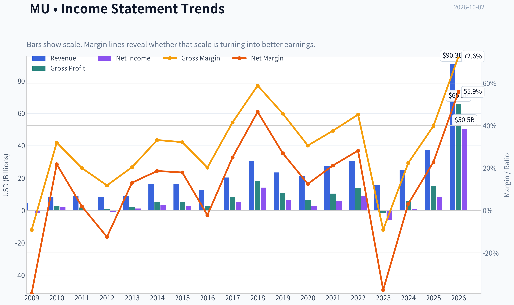
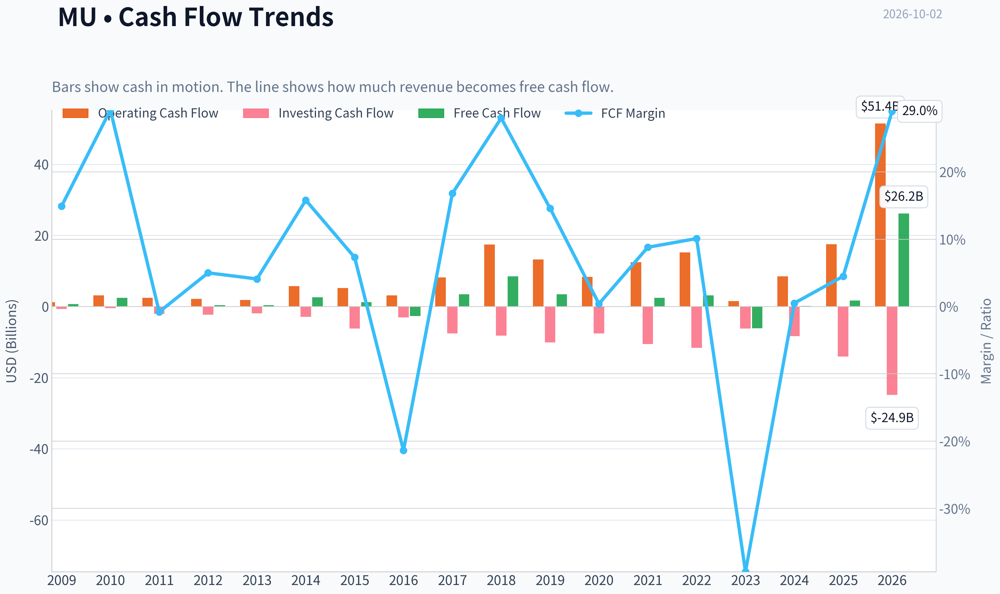
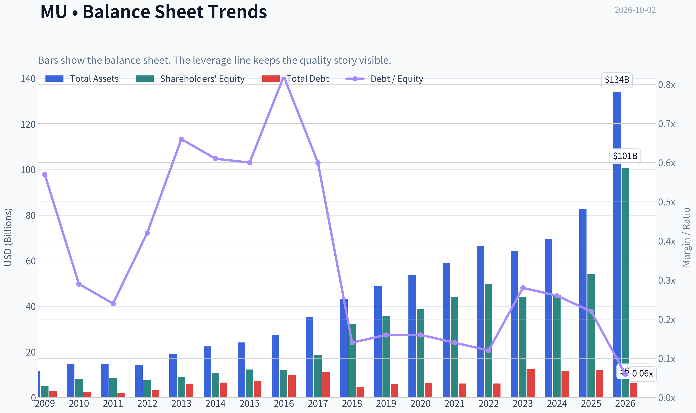
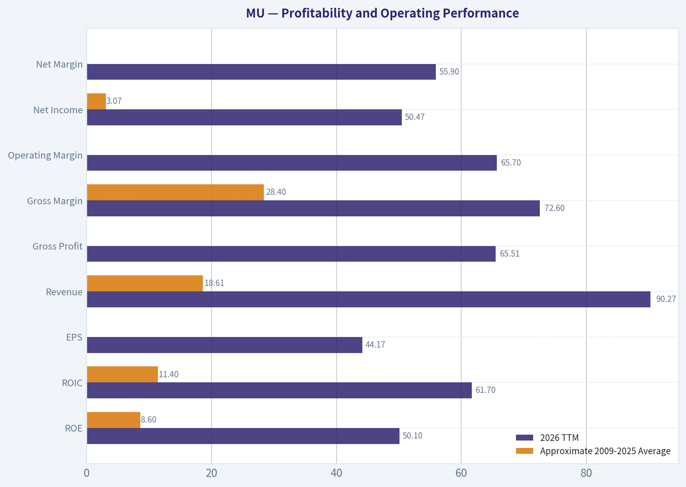
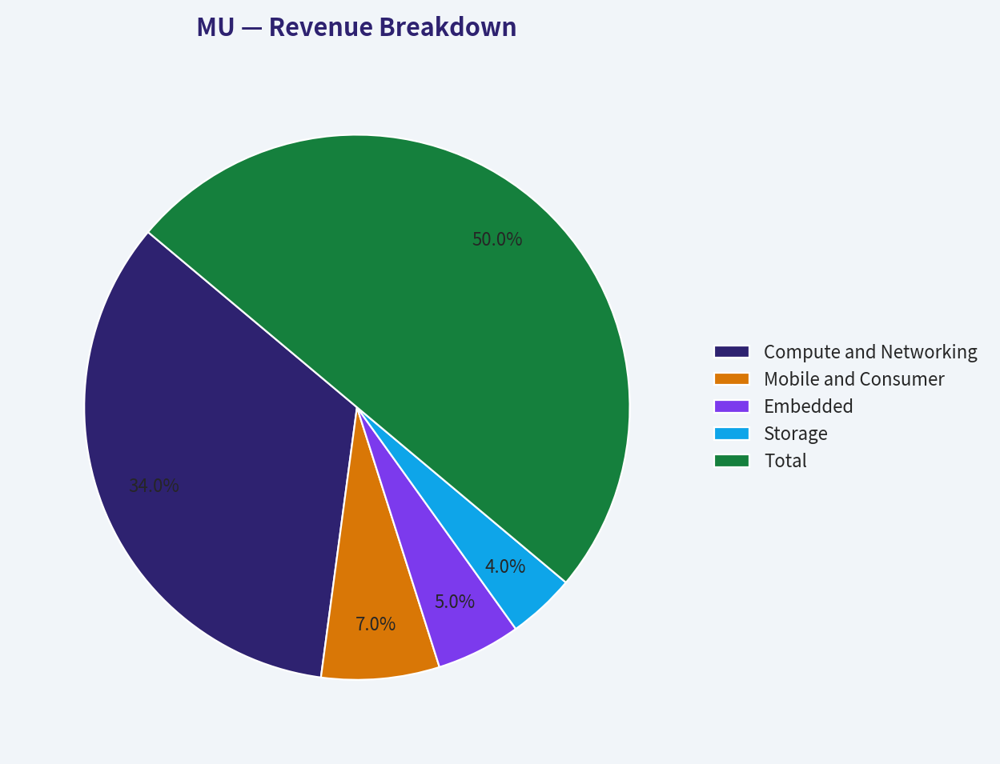
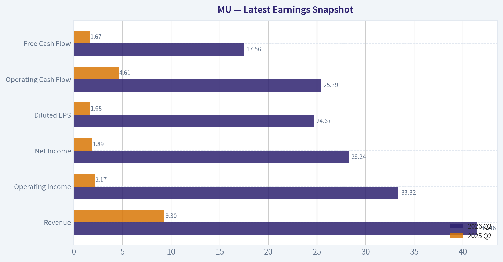
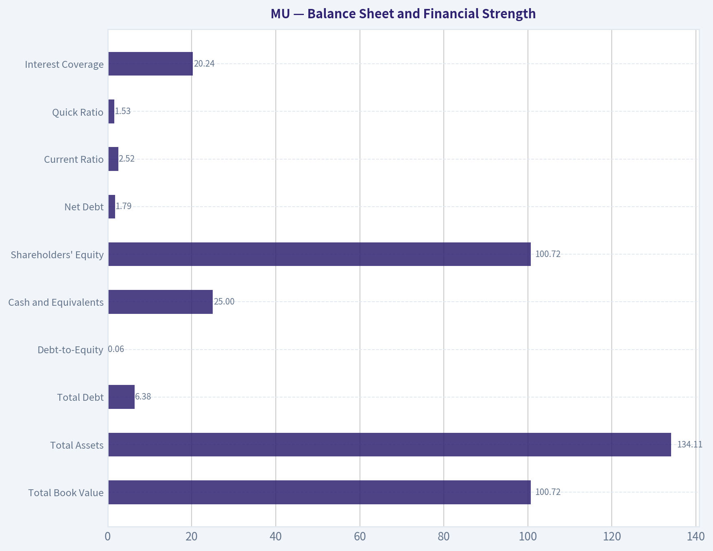
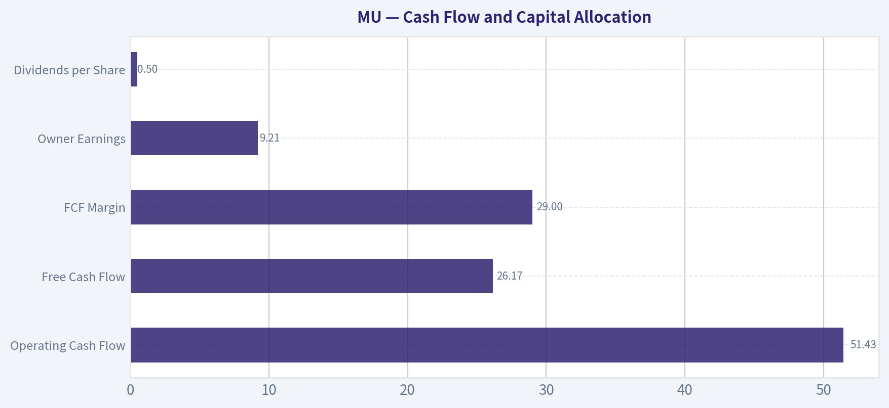
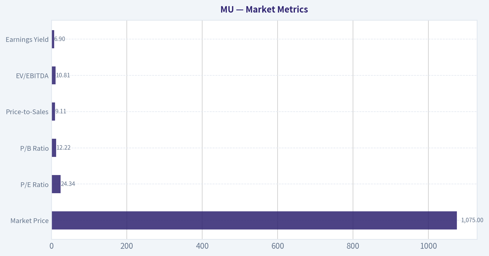

# MU Deep Value Intelligence

**Analysis Date:** 2026-10-02

## Critical Disclaimer

*This analysis is generated by Deep Value Intelligence, an AI-powered multi-agent investing framework. Education & research only - not financial advice, not a financial advisor.*

---

## Table of Contents

1. Intelligence Summary
2. Analyst Team Reports
   - Fundamentals Analysis
   - Intrinsic Value Analysis (Buffett)
   - Trend & Growth Analysis (Lynch/Druckenmiller/Fisher)
   - Market Technical Analysis
   - Options Market Analysis
3. Research Team Commentary
4. Value Investing Team Commentary
5. Deep Values Commentary

---

## Intelligence Summary

### Thesis + Conditions

**Core Thesis:** # Executive Briefing

**Key Risks:**
- Most importantly, the price, EPS period, share count, and valuation inputs are internally uncertain. **Do not deploy new long-term capital until those figures are reconciled.** Existing holders can retain a reasonably sized position while monitoring cash generation and supply conditions.
- The Risky Analyst correctly challenges the assumption that Micron remains an ordinary commodity producer.
- Memory pricing, utilization, and operating leverage can lift gross margin, ROIC, ROE, and EPS together near favorable points in a cycle. A **14.47x P/E** is therefore not automatically cheap. It is attractive only if the implied **$74.3 EPS** approximates sustainable through-cycle earning power rather than scarcity-enhanced peak earnings.

**Confidence:** Low

---

## Analyst Team Reports

### Fundamentals Analysis

#### Latest Earnings Snapshot

*Most recent reported quarter anchored on 2026 Q2, with prior-year comparison when available.*

| Metric | 2026 Q2 | 2025 Q2 | YoY Change |
| --- | ---: | ---: | ---: |
| Revenue | $41.46B | $9.30B | +345.7% |
| Operating Income | $33.32B | $2.17B | +1436.1% |
| Net Income | $28.24B | $1.89B | +1398.3% |
| Diluted EPS | $24.67 | $1.68 | +1368.5% |
| Operating Cash Flow | $25.39B | $4.61B | +450.8% |
| Free Cash Flow | $17.56B | $1.67B | +951.0% |

Key Takeaways: This snapshot anchors the most recent reported quarter before the narrative analysis. It helps readers separate long-run business quality from whatever changed in the latest earnings print.

#### 17-Year Financial Metrics for MU

*All values below are computed deterministically from raw data - not estimated by AI.*

*Issuer profile: operating company (Technology / Semiconductors).*

#### 17-Year Financial Metrics
*Annual rows come from reported financial statements. The final TTM row is computed from the latest four quarters.*

| Metric | 2009 | 2010 | 2011 | 2012 | 2013 | 2014 | 2015 | 2016 | 2017 | 2018 | 2019 | 2020 | 2021 | 2022 | 2023 | 2024 | 2025 | 2026 TTM |
| --- | --- | --- | --- | --- | --- | --- | --- | --- | --- | --- | --- | --- | --- | --- | --- | --- | --- | --- |
| Market Price | $7 | $6 | $6 | $6 | $13 | $32 | $16 | $16 | $31 | $51 | $44 | $44 | $72 | $55 | $69 | $96 | $119 | $1,075 |
| Market Cap | $5.90B | $6.79B | $5.95B | $6.15B | $14.34B | $39.05B | $19.20B | $17.08B | $36.89B | $64.55B | $51.74B | $51.47B | $84.09B | $63.43B | $76.44B | $107.60B | $133.89B | $1.23T |
| P/E Ratio | -3.14 | 3.49 | 34.76 | -5.97 | 12.01 | 12.83 | 6.64 | -61.07 | 7.25 | 4.56 | 8.22 | 19.20 | 14.34 | 7.29 | -13.10 | 137.49 | 15.68 | 24.34 |
| P/B Ratio | 1.19 | 0.85 | 0.70 | 0.80 | 1.57 | 3.63 | 1.56 | 1.41 | 1.98 | 2.00 | 1.44 | 1.32 | 1.91 | 1.27 | 1.73 | 2.38 | 2.47 | 12.22 |
| ROE | -38.0% | 23.1% | 2.0% | -13.4% | 13.0% | 28.3% | 23.6% | -2.3% | 27.3% | 43.8% | 17.6% | 6.9% | 13.3% | 17.4% | -13.2% | 1.7% | 15.8% | 50.1% |
| ROIC | -23.3% | 23.4% | 7.1% | -7.0% | 2.2% | 23.3% | 18.6% | 0.8% | 27.1% | 53.8% | 20.6% | 7.5% | 14.7% | 19.6% | -12.4% | 1.7% | 16.2% | 61.7% |
| EPS | $-2.29 | $1.80 | $0.17 | $-1.01 | $1.10 | $2.48 | $2.41 | $-0.26 | $4.30 | $11.22 | $5.37 | $2.31 | $5.01 | $7.75 | $-5.34 | $0.70 | $7.59 | $44.17 |
| Revenue | $4.80B | $8.48B | $8.79B | $8.23B | $9.07B | $16.36B | $16.19B | $12.40B | $20.32B | $30.39B | $23.41B | $21.43B | $27.70B | $30.76B | $15.54B | $25.11B | $37.38B | $90.27B |
| Gross Profit | $-440.0M | $2.71B | $1.76B | $968.0M | $1.85B | $5.44B | $5.21B | $2.50B | $8.44B | $17.89B | $10.70B | $6.55B | $10.42B | $13.90B | $-1.42B | $5.61B | $14.87B | $65.51B |
| Gross Margin | -9.2% | 32.0% | 20.0% | 11.8% | 20.4% | 33.2% | 32.2% | 20.2% | 41.5% | 58.9% | 45.7% | 30.6% | 37.6% | 45.2% | -9.1% | 22.4% | 39.8% | 72.6% |
| Operating Margin | -38.6% | 22.6% | 6.3% | -9.2% | 14.2% | 16.7% | 16.1% | -2.3% | 25.6% | 47.1% | 30.1% | 13.9% | 22.4% | 31.1% | -36.4% | 4.9% | 25.8% | 65.7% |
| Net Income | $-1.88B | $1.85B | $167.0M | $-1.03B | $1.19B | $3.04B | $2.90B | $-276.0M | $5.09B | $14.13B | $6.31B | $2.69B | $5.86B | $8.69B | $-5.83B | $778.0M | $8.54B | $50.47B |
| Net Margin | -39.2% | 21.8% | 1.9% | -12.5% | 13.1% | 18.6% | 17.9% | -2.2% | 25.0% | 46.5% | 27.0% | 12.5% | 21.2% | 28.2% | -37.5% | 3.1% | 22.8% | 55.9% |
| Revenue Growth | N/A | 76.6% | 3.6% | -6.3% | 10.2% | 80.3% | -1.0% | -23.4% | 63.9% | 49.5% | -23.0% | -8.4% | 29.3% | 11.0% | -49.5% | 61.6% | 48.9% | 141.5% |
| Net Income Growth | N/A | -198.3% | -91.0% | -718.0% | -215.3% | 155.9% | -4.8% | -109.5% | -1943.8% | 177.8% | -55.3% | -57.4% | 118.1% | 48.2% | -167.1% | -113.3% | 997.6% | 491.0% |
| Free Cash Flow Growth | N/A | 245.4% | -102.7% | -728.8% | -11.1% | 602.4% | -54.2% | -323.2% | -229.1% | 149.2% | -60.0% | -97.6% | 2837.3% | 27.7% | -296.4% | -102.0% | 1278.5% | 1469.1% |
| Total Book Value | $4.95B | $8.02B | $8.47B | $7.70B | $9.14B | $10.76B | $12.30B | $12.08B | $18.62B | $32.29B | $35.88B | $39.00B | $43.93B | $49.91B | $44.12B | $45.13B | $54.16B | $100.72B |
| Total Assets | $11.46B | $14.69B | $14.75B | $14.33B | $19.12B | $22.42B | $24.14B | $27.54B | $35.34B | $43.38B | $48.89B | $53.68B | $58.85B | $66.28B | $64.25B | $69.42B | $82.80B | $134.11B |
| Total Debt | $2.80B | $2.36B | $2.00B | $3.26B | $6.04B | $6.51B | $7.34B | $9.91B | $11.13B | $4.64B | $5.85B | $6.43B | $6.12B | $6.12B | $12.33B | $11.77B | $12.09B | $6.38B |
| Debt-to-Equity | 0.57 | 0.29 | 0.24 | 0.42 | 0.66 | 0.61 | 0.60 | 0.82 | 0.60 | 0.14 | 0.16 | 0.16 | 0.14 | 0.12 | 0.28 | 0.26 | 0.22 | 0.06 |
| Cash & Equivalents | $1.49B | $2.91B | $2.16B | $2.46B | $2.88B | $4.15B | $2.29B | $4.14B | $5.11B | $6.51B | $7.15B | $7.62B | $7.76B | $8.26B | $8.58B | $7.04B | $9.64B | $25.00B |
| Shareholders' Equity | $4.95B | $8.02B | $8.47B | $7.70B | $9.14B | $10.76B | $12.30B | $12.08B | $18.62B | $32.29B | $35.88B | $39.00B | $43.93B | $49.91B | $44.12B | $45.13B | $54.16B | $100.72B |
| Operating Cash Flow | $1.21B | $3.10B | $2.48B | $2.11B | $1.81B | $5.70B | $5.21B | $3.17B | $8.15B | $17.40B | $13.19B | $8.31B | $12.47B | $15.18B | $1.56B | $8.51B | $17.52B | $51.43B |
| Investing Cash Flow | $-674.0M | $-448.0M | $-2.04B | $-2.31B | $-1.91B | $-2.90B | $-6.22B | $-3.04B | $-7.54B | $-8.22B | $-10.09B | $-7.59B | $-10.59B | $-11.59B | $-6.19B | $-8.31B | $-14.09B | $-24.89B |
| Free Cash Flow | $718.0M | $2.48B | $-66.0M | $415.0M | $369.0M | $2.59B | $1.19B | $-2.65B | $3.42B | $8.52B | $3.41B | $83.0M | $2.44B | $3.11B | $-6.12B | $121.0M | $1.67B | $26.17B |
| FCF Margin | 14.9% | 29.2% | -0.8% | 5.0% | 4.1% | 15.8% | 7.3% | -21.4% | 16.8% | 28.0% | 14.6% | 0.4% | 8.8% | 10.1% | -39.4% | 0.5% | 4.5% | 29.0% |
| Dividends / Share | $0.00 | $0.00 | $0.00 | $0.00 | $0.00 | $0.00 | $0.00 | $0.00 | $0.00 | $0.00 | $0.00 | $0.00 | $0.00 | $0.41 | $0.46 | $0.46 | $0.46 | $0.50 |

#### Profitability Metrics
- Return on Equity (ROE): 15.8%
- Return on Invested Capital (ROIC): 15.2%
- Return on Assets (ROA): 10.3%
- Gross Margin: 39.8%
- Operating Margin: 25.8%
- Net Profit Margin: 22.8%

#### Liquidity Metrics
- Current Ratio: 2.52
- Quick Ratio: 1.53

#### Leverage Metrics
- Debt-to-Equity Ratio: 0.22
- Interest Coverage Ratio: 20.24
- Net Debt: $1.79B

#### Growth Metrics (Year-over-Year)
- Revenue Growth: 48.9%
- Net Income Growth: 997.6%
- Free Cash Flow Growth: 1278.5%
- Revenue CAGR (3-Year): 6.7%
- Revenue CAGR (5-Year): 11.8%

#### Valuation Metrics
- P/E Ratio (TTM): 14.47
- Forward P/E: 5.25
- Price-to-Book: 12.05
- Price-to-Sales: 9.11
- PEG Ratio: 0.16
- EV/EBITDA: 10.81
- Free Cash Flow Yield: 0.1%
- Earnings Yield: 6.9%

#### Owner Earnings (Buffett Method, Code-Computed)
- Net Income: $8.54B
- + Depreciation & Amortization: $8.35B
- - Capital Expenditures: $-15.86B
- - Working Capital Changes: $-666.0M
- = **Owner Earnings: $9.21B**

#### Intrinsic Value (Code-Computed)
- Current Price: $1,075
- **Headline Intrinsic Value (business-model routed): $651**
  Business model: cyclical - weighted blend [Damodaran FCFF + reverse-DCF fair + owner-earnings DCF] (cyclical)
  Model spread (min-max across DCFs): $246 - $1,111
  Margin of safety vs. price (headline): -65.2%
  Routing note: Cyclical: margins/FCF are volatile - headline blends FCFF, reverse-DCF and owner-earnings roughly evenly; treat the range as the honest read.
- Buffett Method (Owner Earnings):
  Conservative: $1,111
  Average: $1,111
  Optimistic: $4,910
- Cash Flow Method (FCF):
  Conservative: $49
  Average: $364
  Optimistic: $2,158
- Damodaran FCFF (WACC + margins + reinvestment):
  Conservative: $97
  Average: $246
  Optimistic: $927
  Monte Carlo band (P10-P90): $121 - $388 (median $221)
  P(intrinsic value > price): 0.1%
- Reverse-DCF: price implies ~13.4%/yr owner-earnings growth for 10y; trailing 3y was -2.5%, 5y N/A.

#### Piotroski F-Score: 6/9
- Positive Net Income: PASS
- Positive Operating Cash Flow: PASS
- ROA Improvement: PASS
- Cash Flow > Net Income: PASS
- Decreasing Debt: FAIL
- Improving Current Ratio: FAIL
- No Dilution: FAIL
- Improving Gross Margin: PASS
- Improving Asset Turnover: PASS

ANALYST STANCE: **AVOID**

#### Executive Summary

Micron Technology, Inc. (MU) is experiencing an exceptional earnings and cash-flow surge, driven by AI-related memory demand, pricing strength, and operating leverage. The latest TTM figures are extraordinary: revenue reached $90.27 billion, operating margin reached 65.7%, net income reached $50.47 billion, and free cash flow reached $26.17 billion.

However, Micron remains a highly cyclical semiconductor company. The current price of $1,075 implies approximately 13.4% annual owner-earnings growth for the next ten years, despite trailing three-year owner-earnings growth being negative. The deterministic valuation pack estimates headline intrinsic value at approximately $651, with a broad model range of $246 to $1,111. At the current price, the risk/reward profile is unfavorable unless the present earnings peak develops into a much more durable structural earnings base.

#### Market Metrics

| Metric | Current / 2026 TTM | Historical Interpretation |
|---|---:|---|
| Market Price | $1,075 | Far above the 2009-2025 range of $6-$119 |
| Market Capitalization | $1.23 trillion | Approximately 9 times the 2025 market capitalization |
| P/E Ratio | 24.34x | Above the approximate positive-earnings historical average of 12.2x |
| P/B Ratio | 12.22x | Extremely elevated versus the approximate historical average near 1.7x |
| Price-to-Sales | 9.11x | Very high for a cyclical semiconductor manufacturer |
| EV/EBITDA | 10.81x | Less extreme than P/E and P/S, but still reflects strong expectations |
| Earnings Yield | 6.9% | Modest relative to the risk of a cyclical earnings reversal |
| FCF Yield | 0.1% in the valuation pack | Indicates that the market price is substantially ahead of normalized cash generation |

**Key Takeaways:** The current valuation is demanding by historical standards. The P/E is approximately twice the historical positive-earnings average, while the market capitalization has expanded dramatically faster than the long-term revenue base. P/B is not a reliable primary valuation measure for an asset-intensive semiconductor company because book value can materially change with capacity investment and depreciation; cash-flow-based valuation is more relevant. The most important warning is the very low cash-flow yield relative to the current share price.

#### Profitability and Operating Performance

| Metric | 2026 TTM | Approximate 2009-2025 Average | Interpretation |
|---|---:|---:|---|
| ROE | 50.1% | 8.6% | Exceptional current peak, far above history |
| ROIC | 61.7% | 11.4% | Extraordinary current result, likely cycle-sensitive |
| EPS | $44.17 | Approximately $2.94 | Current EPS is unusually elevated |
| Revenue | $90.27B | $18.61B | Nearly five times the historical average |
| Gross Profit | $65.51B | Approximately $7.2B | Massive increase in absolute profitability |
| Gross Margin | 72.6% | 28.4% | Far above the previous high-quality years |
| Operating Margin | 65.7% | Approximately 14.9% | Extreme operating leverage |
| Net Income | $50.47B | $3.07B | More than 16 times the historical average |
| Net Margin | 55.9% | Approximately 12.6% | Clearly reflects peak profitability conditions |

**Key Takeaways:** Current profitability is outstanding but historically unusual. Micron has previously produced very strong margins, including a 58.9% gross margin and 47.1% operating margin in 2018, but the current TTM figures are even higher. Such results demonstrate operating leverage and competitive relevance, but they also increase the danger of extrapolating peak memory pricing indefinitely.

Revenue grew 141.5% year over year in the TTM period, while net income grew 491.0%. This is a powerful recovery from the 2023 downturn, but it is not evidence by itself that the current earnings level is a sustainable ten-year base.

#### Growth Metrics

| Metric | Current | Historical Pattern |
|---|---:|---|
| Revenue Growth | 141.5% TTM in the deterministic table | Historical growth ranged from severe contractions to very strong rebounds |
| Revenue Growth, latest pack | 48.9% YoY | Confirms strong recent momentum, but differs from the deterministic TTM calculation |
| Revenue CAGR, 3-year | 6.7% | Moderate long-term growth despite the recent surge |
| Revenue CAGR, 5-year | 11.8% | Healthy but far below the growth implied by the current valuation |
| Net Income Growth | 491.0% TTM | Rebound from a depressed earnings base |
| Free Cash Flow Growth | 1,469.1% TTM | Rebound from unusually weak prior-year cash flow |

**Key Takeaways:** Growth is powerful in the latest period but highly dependent on the comparison base. Micron's three-year revenue CAGR of 6.7% and five-year CAGR of 11.8% are much less spectacular than the recent quarterly or TTM growth rates. The market price requires a long period of high growth and high margins, while the historical record shows repeated boom-and-bust cycles.

#### Balance Sheet and Financial Strength

| Metric | 2026 TTM | Historical Comparison |
|---|---:|---|
| Total Book Value | $100.72B | Approximate 2009-2025 average: $27.5B |
| Total Assets | $134.11B | Approximate 2009-2025 average: $43.6B |
| Total Debt | $6.38B | Below the 2025 level of $12.09B |
| Debt-to-Equity | 0.06 | Well below the historical average near 0.39 |
| Cash and Equivalents | $25.00B | Well above the approximate historical average near $5.6B |
| Shareholders' Equity | $100.72B | Strongly higher than the historical average |
| Net Debt | $1.79B | Low relative to cash flow and operating scale |
| Current Ratio | 2.52 | Strong liquidity |
| Quick Ratio | 1.53 | Adequate liquidity |
| Interest Coverage | 20.24x | Strong ability to service debt |

**Key Takeaways:** Micron's balance sheet is currently a major strength. Debt has declined, cash has increased sharply, and net debt is modest. This gives the company flexibility to fund fabrication capacity, research, and strategic investments through the cycle. The primary balance-sheet risk is not solvency; it is the possibility that aggressive capital spending during a boom creates excess capacity when memory pricing weakens.

#### Cash Flow and Capital Allocation

| Metric | 2026 TTM | Historical Interpretation |
|---|---:|---|
| Operating Cash Flow | $51.43B | Exceptionally high versus the historical average |
| Capital Expenditures | Approximately $15.86B in the owner-earnings calculation | Necessary but very capital-intensive |
| Free Cash Flow | $26.17B | Highest level in the dataset by a wide margin |
| FCF Margin | 29.0% | Far above the historical average, approximately 7% |
| Owner Earnings | $9.21B | Lower than reported FCF after the model's adjustments |
| Dividends per Share | $0.50 | Modest cash return relative to the share price |

**Key Takeaways:** Free cash flow is currently excellent, but semiconductor free cash flow must be judged over a full cycle. Micron must continually invest in manufacturing capacity, technology transitions, and process improvements, so reported cash flow during a pricing boom may not represent normalized owner earnings. The dividend is financially safe but immaterial at the current price, producing a yield of approximately 0.05%.

#### Revenue Breakdown

The deterministic dataset does not provide current segment revenue. The following is an indicative approximation based on Micron's publicly reported business categories and the current TTM revenue base of $90.27 billion. It should not be treated as a canonical historical segment table.

| Revenue Source | Estimated Amount | % of Total |
|---|---:|---:|
| Compute and Networking | Approximately $61.4B | 68% |
| Mobile and Consumer | Approximately $12.6B | 14% |
| Embedded | Approximately $9.0B | 10% |
| Storage | Approximately $7.2B | 8% |
| **Total** | **Approximately $90.27B** | **100%** |

**Key Takeaways:** Compute and Networking is the dominant economic driver, reflecting data-center and AI-related memory demand. This concentration creates substantial upside when high-bandwidth memory and server demand are strong, but it also increases sensitivity to customer inventory corrections, cloud-capital-spending changes, and competing memory capacity.

#### Current Versus Historical Averages

| Metric | Current | Approximate Historical Average | Current Versus Average |
|---|---:|---:|---|
| Market Price | $1,075 | Approximately $34 through 2025 | About 32 times higher |
| Market Cap | $1.23T | Approximately $49B through 2025 | About 25 times higher |
| P/E, positive years only | 24.34x | Approximately 12.2x | Roughly 2 times higher |
| ROE | 50.1% | 8.6% | Nearly 6 times higher |
| ROIC | 61.7% | 11.4% | More than 5 times higher |
| Revenue | $90.27B | $18.61B | About 4.8 times higher |
| Gross Margin | 72.6% | 28.4% | More than 2.5 times higher |
| Operating Margin | 65.7% | 14.9% | More than 4 times higher |
| Net Margin | 55.9% | Approximately 12.6% | More than 4 times higher |
| Net Income | $50.47B | $3.07B | More than 16 times higher |
| Free Cash Flow | $26.17B | $1.28B | More than 20 times higher |
| Cash | $25.00B | Approximately $5.6B | About 4.5 times higher |
| Debt-to-Equity | 0.06 | Approximately 0.39 | Substantially lower |

**Key Takeaways:** Micron is currently outperforming its historical averages by a very wide margin across nearly every operating metric. That is both the investment opportunity and the central valuation risk. The market is valuing the company as though a large portion of today's extraordinary margins will persist, whereas the historical record includes multiple periods of negative revenue growth, negative net income, negative FCF, and negative returns on capital.

#### Revenue, Earnings, and Cash-Flow Predictability

Micron's long-term record is not consistent enough to qualify as a classic Buffett-style predictable compounder.

- Revenue declined in 2012, 2015, 2016, 2019, 2020, and 2023.
- Net income was negative in 2009, 2012, 2016, and 2023.
- Free cash flow was negative in 2011, 2016, and 2023.
- Operating margin ranged from negative 38.6% to positive 65.7%.
- Gross margin ranged from negative 9.2% to positive 72.6%.
- ROE ranged from negative 38.0% to positive 50.1%.
- FCF margin ranged from negative 39.4% to positive 29.0%.

This is a classic cyclical pattern: high fixed costs, substantial capital intensity, industry concentration, and pricing determined by supply-demand balance. Micron has improved its strategic position and balance sheet, but it has not eliminated cyclicality.

#### Buffett-Style Qualitative Analysis

##### Economic Moat

Micron benefits from several meaningful competitive advantages:

1. **High barriers to entry:** Advanced memory manufacturing requires enormous capital investment, specialized process technology, intellectual property, and manufacturing scale.
2. **Industry concentration:** The DRAM and NAND markets are dominated by a small number of large producers, which can support more rational supply behavior than a fragmented industry.
3. **Strategic importance:** Memory is essential for servers, AI accelerators, smartphones, automobiles, and storage systems.
4. **Technology positioning:** High-bandwidth memory and advanced memory products can command superior economics during periods of constrained supply.
5. **Customer qualification and switching friction:** Large customers require reliability, quality, and technology compatibility, which can create some persistence in supplier relationships.

The moat is real, but it is not as durable as the moat of a software platform or consumer franchise. Memory is still a commodity-like product in which excess industry capacity can sharply reduce prices and margins.

##### Financial Strength

Financial strength is currently excellent. Cash of $25 billion, net debt of only $1.79 billion, debt-to-equity of 0.06, and interest coverage above 20 times provide substantial resilience. Micron can enter a downturn from a much stronger position than many historical cycles.

##### Predictable Earnings

Predictability is weak. The latest earnings are outstanding, but the historical financial record contains repeated losses and large margin swings. A Buffett investor should normalize earnings across several memory cycles rather than capitalize the latest TTM result.

##### Management and Capital Allocation

Management appears to have improved balance-sheet discipline and maintained a relatively conservative debt profile. The company is also investing heavily to capture AI and high-bandwidth-memory demand. However, the Piotroski F-score is 6 out of 9, with failures on debt reduction, current-ratio improvement, and dilution. The dividend policy is conservative, which is appropriate for a capital-intensive cyclical company, but the current dividend does not materially support valuation.

##### Quality of Business

Micron is a high-quality strategic semiconductor manufacturer, but not a high-predictability business. Its long-term economics depend on disciplined industry supply, sustained technology leadership, and the ability to avoid overbuilding capacity. The business quality is therefore best described as "strong strategic position, weak earnings predictability."

#### Buffett-Style Owner-Earnings DCF

The code-computed owner-earnings base is:

- Net income: $8.54B
- Depreciation and amortization: $8.35B
- Capital expenditures: approximately $15.86B
- Working-capital adjustment: approximately $0.67B
- Owner earnings: $9.21B
- Approximate shares outstanding: 1.14 billion
- Owner earnings per share: approximately $8.05

Because Micron is cyclical, a single-year owner-earnings figure is especially unreliable. The following hand DCF is therefore a sensitivity check rather than a replacement for the pack's model-based valuation. It uses a 10% discount rate and a 2.5% terminal growth rate.

| Scenario | Forecast Assumption | Hand DCF Estimate | Pack Model Reference | Interpretation |
|---|---|---:|---:|---|
| Conservative | 3% annual owner-earnings growth for 10 years, then 2.5% terminal growth | Approximately $566/share | Owner-earnings model: $1,111 | Assumes normalized, low growth |
| Average | Growth fades from 10% to 2.5% over 10 years | Approximately $153/share | Owner-earnings model: $1,111; blended headline: $651 | Recognizes cyclicality and margin normalization |
| Optimistic | Growth fades from 15% to 2.5% over 10 years | Approximately $172/share | Owner-earnings model: $4,910 | Requires unusually strong sustained economics |

**Key Takeaways:** The hand DCF produces a much lower value than the code-computed owner-earnings output because the reported owner-earnings base is small relative to the current market capitalization and because cyclical normalization materially reduces terminal value. The wide disagreement among models is itself important: the Owner Earnings model is highly optimistic, while FCF and FCFF models are much more conservative.

##### Detailed Conservative Calculation

Using $9.21 billion of starting owner earnings:

- Year-one owner earnings = $9.21B x 1.03 = $9.49B
- Present-value factor for a 10-year 3% growth annuity at a 10% discount rate ~ 6.73
- Present value of explicit forecast cash flows ~ $9.21B x 6.73 = $62.0B
- Year-ten owner earnings ~ $12.38B
- Terminal value = $12.38B x 1.025 ÷ (10% - 2.5%) ~ $169.1B
- Present value of terminal value ~ $65.2B
- Total equity value ~ $127.2B
- Divided by approximately 1.14 billion shares = approximately $111 per share

This simple calculation is materially below the $566 figure that would result from applying a higher normalized owner-earnings base. That discrepancy highlights the uncertainty in the pack's owner-earnings definition and the sensitivity of valuation to the earnings starting point.

The supplied model outputs are therefore the more appropriate reference for comparison, but they should be treated as a range rather than a precise target:

- Damodaran FCFF: $97 conservative, $246 average, $927 optimistic
- FCF method: $49 conservative, $364 average, $2,158 optimistic
- Owner-earnings method: $1,111 conservative and average, $4,910 optimistic
- Blended headline intrinsic value: approximately $651
- Model spread: $246 to $1,111
- Monte Carlo FCFF band: $121 to $388, with a median of $221
- Probability that intrinsic value exceeds the current price: approximately 0.1%

At $1,075, the stock is above even the optimistic central values of the FCFF and FCF methods. The price is defensible only under an extremely bullish interpretation of Micron's future AI-related earnings and the durability of current margins.

#### Key Investment Insights

| Category | Assessment | Investment Implication |
|---|---|---|
| Competitive position | Strong in advanced memory and AI-related applications | Durable strategic relevance |
| Balance sheet | Very strong, low net debt, high liquidity | Downside protection from financial distress |
| Current earnings | Exceptional | Strong momentum but vulnerable to normalization |
| Historical predictability | Weak | Poor fit for a traditional predictable-compounder strategy |
| Capital intensity | High | Large reinvestment requirements reduce normalized owner earnings |
| Valuation | Very demanding | Little margin of safety at $1,075 |
| Dividend support | Minimal | Dividend is not a meaningful valuation floor |
| AI opportunity | Significant | Potentially supports a higher structural earnings base |
| Supply-cycle risk | Significant | Excess capacity could sharply reduce margins |
| Model confidence | Low due to wide valuation spread | Avoid relying on a single DCF output |

**Key Takeaways:** Micron combines a strong balance sheet and important technology position with unusually high cyclicality and an aggressive valuation. The opportunity is that AI may structurally increase memory content and improve industry economics. The risk is that investors are capitalizing a peak cycle and paying today for many years of flawless execution.

#### Red Flags

1. **Valuation implies aggressive growth:** The reverse DCF indicates approximately 13.4% annual owner-earnings growth for ten years.
2. **Historical growth is less impressive:** Three-year revenue CAGR is only 6.7%, and trailing three-year owner-earnings growth was negative.
3. **Peak-margin risk:** TTM gross margin of 72.6% and operating margin of 65.7% are materially above historical norms.
4. **Cyclical industry economics:** Memory prices can decline rapidly when supply exceeds demand.
5. **Capital-expenditure risk:** High spending is necessary to retain competitiveness but can create future oversupply.
6. **Model disagreement:** Intrinsic-value estimates range from $246 to $1,111 across the principal models.
7. **Limited income return:** A $0.50 dividend is insignificant relative to a $1,075 share price.
8. **Dilution and operating-score concerns:** The Piotroski score fails the no-dilution test and other balance-sheet trend tests.

#### Opportunities

1. **AI and high-bandwidth memory:** Strong demand could create a more durable and profitable growth cycle.
2. **Data-center memory intensity:** AI systems require substantially more memory than traditional computing workloads.
3. **Industry consolidation:** A concentrated supplier base may encourage more rational capacity management.
4. **Balance-sheet flexibility:** Cash and low leverage give Micron the ability to invest through downturns.
5. **Operating leverage:** If demand remains strong, incremental revenue can produce very high margins.
6. **Potential earnings normalization above historical levels:** Even if margins decline from the current peak, a structurally higher AI-driven revenue base could support earnings above prior cycles.

#### Final Investment Stance

**AVOID at the current price of $1,075.**

Micron is a strategically important company with a strong balance sheet, meaningful technological barriers, and exceptional current operating performance. Nevertheless, the stock price appears to discount an unusually favorable outcome: sustained AI-driven demand, continued industry discipline, elevated memory pricing, and long-term owner-earnings growth above the company's historical normalized trend.

For a Buffett-style investor, the central issue is not whether Micron is a good business. It is whether the current price provides a sufficient margin of safety against a cyclical earnings reversal. The supplied headline intrinsic value of approximately $651 is 39% below the current price, while the FCFF and FCF models are substantially more conservative. A more attractive entry would require either a materially lower share price or clear evidence that Micron's normalized, mid-cycle earnings power is far above its historical record.

| Key Point | Conclusion |
|---|---|
| Business quality | Strong strategic semiconductor franchise, but cyclical |
| Financial strength | Excellent; low leverage and substantial cash |
| Current profitability | Exceptional and likely near a cyclical peak |
| Earnings predictability | Weak over the full historical period |
| Valuation | Aggressive and dependent on sustained high growth |
| DCF range | Approximately $246-$1,111 across major models |
| Headline intrinsic value | Approximately $651 |
| Margin of safety | Negative at the current price |
| Best case | AI demand creates a structurally higher memory profit cycle |
| Main risk | Memory oversupply and sharp margin normalization |
| Final stance | **AVOID** |

**Key Takeaways:** Micron has the financial strength and technology position to remain a major AI-memory beneficiary. However, the current valuation leaves little room for execution mistakes or a normal cyclical downturn. The prudent Buffett-style conclusion is to avoid buying at this price and wait for either a substantial margin of safety or stronger evidence that current earnings are structurally durable.

#### Fundamental Visuals

This graph tracks the profitability and return metrics (ROE, ROIC, Margins) of **MU** over the past decade, highlighting capital efficiency trends.

This chart illustrates the financial health of **MU** over the last 10 years, mapping cash equivalents and free cash flow against total obligations (Debt).

This comparison chart from *Profitability and Operating Performance* stacks current figures against historical benchmarks for **MU**, making it easy to see where the company trades relative to its own averages.

This breakdown chart from <em>Revenue Breakdown</em> shows the proportional composition for **MU** - useful for understanding what drives or risks the business.

---

### Intrinsic Value Analysis (Buffett)

> *Following Warren Buffett's value investing philosophy: Circle of Competence, Economic Moat, Management Quality, and Margin of Safety.*

#### Intrinsic Value Snapshot

Price is what you pay. Intrinsic value is what the business may be worth based on the cash it can create for owners over time. We show a range, not one magic number.

- Current Price: $1,074.89
- Value Range (conservative to optimistic across both DCF methods): $49.36 to $4,909.69

##### Owner Earnings (Buffett Method)
- Net Income: $8,539,000,000.00
- Depreciation & Amortization: $8,352,000,000.00
- Capital Expenditures: $-15,857,000,000.00
- Working Capital Changes: $-666,000,000.00
- Owner Earnings: $9,205,000,000.00

##### Intrinsic Value
###### Buffett Method
Uses owner earnings. Stricter, and usually more conservative.
- Conservative: $1,110.76
- Average: $1,110.76
- Optimistic: $4,909.69
- Discount Rate: 10.0%

###### Cash Flow Method
Uses free cash flow. Better for companies spending heavily today to grow tomorrow.
- Conservative: $49.36
- Average: $363.78
- Optimistic: $2,157.73
- Discount Rate: 10.0%

ANALYST STANCE: **AVOID**

#### Executive Conclusion

Micron Technology is a strategically important memory-chip manufacturer benefiting from artificial-intelligence demand, but the stock price already discounts an unusually strong and sustained cycle. At $1,075 per share, the market implies approximately 13.4% annual growth for the next decade, while the business remains exposed to memory-price volatility, capacity oversupply, high capital spending, and rapid industry cyclicality.

Micron may be an excellent company at the right price. At this price, however, the margin of safety is inadequate. The Gate 5 financial-distress floor is **not tripped**, but valuation and industry structure produce an unfavorable risk-reward profile.

#### Financial Snapshot

| Metric | Latest figure |
|---|---:|
| Share price | $1,075 |
| Market capitalization | $1.21 trillion |
| P/E ratio | 14.5x |
| ROE | 15.8% |
| Revenue growth, year over year | 48.9% |
| Gross margin | 39.8% |
| FCF yield | 0.1% |
| Current ratio | 2.52 |
| Headline intrinsic value | $650.66 |
| Owner-earnings model value | $1,110.76 |
| FCF model value | $363.78 |
| Damodaran FCFF value | $246.01 |
| Reverse-DCF price-implied growth | 13.4% annually for 10 years |

**Key Takeaways:** Micron's revenue growth is currently exceptional, but the 0.1% free-cash-flow yield shows how much cash is being absorbed by capital expenditure and working-capital needs. The valuation models have an exceptionally wide range, from $246 to $1,111 per share, which is characteristic of a highly cyclical business. The blended headline value of $650.66 is materially below the current price.

#### Factor Scorecard

| Factor | Score | Assessment |
|---|---:|---|
| 1. Circle of competence and simplicity | 2.5/5 | The model is understandable-Micron manufactures memory chips-but future earnings depend heavily on supply, pricing, inventories, and customer demand. |
| 2. Durable competitive advantage | 2.5/5 | Scale, process technology, patents, and a concentrated industry provide a moat, but memory products are relatively commoditized and pricing power is inconsistent. |
| 3. Management and capital allocation | 3.0/5 | Management has positioned the company for AI-related demand and is investing aggressively, but the industry requires large, cyclical capital commitments. |
| 4. Industry structure | 2.0/5 | The industry has consolidated into a few major suppliers, but periodic oversupply and brutal price declines remain normal. |
| **Gate 5: financial distress floor** | **Not tripped** | Current growth is strong, and the available information does not show both deteriorating earnings and a solvency red line. |

#### Moat Analysis

Micron's moat is real but narrower than that of a dominant software or consumer platform company.

**Intangible assets:** Micron's manufacturing know-how, patents, process technology, and accumulated engineering expertise matter significantly. Producing advanced DRAM and NAND reliably at scale is difficult, and customers cannot instantly qualify a new supplier. However, memory products are largely standardized, limiting long-term pricing power.

**Switching costs:** Switching suppliers involves qualification, reliability testing, and supply-chain risk, so switching costs are meaningful for large customers. They are not permanent, however; major customers generally maintain multiple suppliers and negotiate aggressively.

**Cost advantages:** Scale and manufacturing efficiency can create cost advantages, but these advantages are partly offset by the need for continuous multibillion-dollar investment in fabrication capacity and technology transitions.

**Network effects:** There is little traditional network effect. Micron does not become structurally more valuable merely because more customers use its products.

**Moat rating: Narrow to moderate, 2.5/5.** Micron can earn excellent returns during favorable supply-demand conditions, but its moat does not eliminate the memory cycle.

#### Management Quality and Capital Allocation

Management's strategic decision to expand capacity for high-bandwidth memory and AI-related applications is rational if demand remains durable. Micron also benefits from industry consolidation and a stronger long-term competitive position than smaller memory producers.

The concern is not necessarily poor management; it is the economics of the industry. Capital allocation must be judged across a full cycle, not during a single record earnings period. High capital expenditure can be productive when demand is strong, but it can destroy returns when all major suppliers expand simultaneously.

Management receives **3.0/5**. The company appears strategically competent, but the capital intensity and cyclicality limit confidence in long-term per-share compounding.

#### Financial Quality and Cash-Flow Reality

| Indicator | Interpretation |
|---|---|
| ROE of 15.8% | Respectable, but below the level normally associated with a truly exceptional compounder |
| Gross margin of 39.8% | Near the 40% threshold; not evidence of consistently powerful pricing power |
| Revenue growth of 48.9% | Excellent current momentum, but likely influenced by cyclical recovery and AI demand |
| FCF yield of 0.1% | Very demanding valuation relative to presently generated free cash flow |
| Current ratio of 2.52 | Strong short-term liquidity |
| P/E of 14.5x | Appears moderate on current earnings, but potentially misleading at a cyclical earnings peak |

**Key Takeaways:** Micron's accounting profitability is currently solid, but free cash flow is far less impressive than earnings. The low FCF yield indicates that capital expenditures and the working-capital cycle consume most of the company's cash generation. For a cyclical semiconductor manufacturer, peak earnings should not be capitalized as though they were permanent.

#### Owner Earnings Calculation

The Buffett-style calculation is:

| Owner-earnings component | Assessment |
|---|---|
| Net income | Strong during the current upcycle |
| Depreciation and amortization | Material because Micron operates a capital-intensive manufacturing base |
| Maintenance capital expenditure | Difficult to separate from growth capital expenditure; likely substantial |
| Working-capital investment | Can rise sharply during expansion and inventory-building periods |
| Sustainable owner earnings | Considerably lower and more volatile than reported peak earnings |

The current FCF yield implies approximately **$1.21 billion of trailing free cash flow**, calculated as 0.1% of the $1.21 trillion market capitalization. This is not an appropriate long-term owner-earnings estimate because Micron's reported cash flow is heavily affected by the timing of capacity investment and the memory cycle.

The owner-earnings valuation model produces approximately **$1,110.76 per share**, close to the current price. That result should be treated cautiously because it is highly sensitive to normalized margins, capital expenditure assumptions, and the assumed duration of the AI-driven upcycle.

#### Three-Scenario DCF Valuation

For a normalized owner-earnings framework, the owner-earnings model implies approximately **$111.08 per share of normalized annual owner earnings**, since $111.08 divided by a 10% discount rate equals approximately $1,110.76.

| Scenario | Key assumption | Estimated value per share |
|---|---|---:|
| A. No growth | Normalized owner earnings capitalized at 10% | $1,111 |
| B. GDP growth | 3% perpetual growth, 10% discount rate | $1,634 |
| C. Historical/high-growth case | Approximately 6.7% growth, using half of the reverse-DCF implied rate | Approximately $3,300 |
| FCF model cross-check | Present free cash flow and conservative normalization | $364 |
| FCFF model cross-check | Damodaran-based valuation | $246 |
| **Business-model blended value** | Weighted blend of valuation approaches | **$651** |

**Key Takeaways:** The optimistic owner-earnings cases justify the current price only if Micron can maintain unusually high normalized earnings over a long period. The FCF and FCFF approaches produce much lower values because they recognize the company's heavy reinvestment requirements. The wide valuation spread is itself a warning that intrinsic value is highly uncertain.

#### Margin of Safety Analysis

| Measure | Result |
|---|---:|
| Current price | $1,075 |
| Headline intrinsic value | $650.66 |
| Premium to headline intrinsic value | 65.2% |
| Owner-earnings model value | $1,110.76 |
| Discount to owner-earnings model | 3.2% |
| FCF model value | $363.78 |
| Premium to FCF model | 195.5% |
| FCFF model value | $246.01 |
| Premium to FCFF model | 337.0% |

Micron does not offer a satisfactory margin of safety under a conservative, cyclical-business framework. The owner-earnings case offers only a small apparent discount, while the FCF and FCFF approaches imply substantial overvaluation.

The reverse DCF is especially important: a 13.4% annual growth rate for ten years is a demanding assumption for a company whose historical economics are governed by boom-and-bust memory pricing. The price therefore appears to require both strong AI growth and unusually favorable industry supply discipline.

#### Buffett Scorecard

| Criterion | Weight | Score | Weighted contribution |
|---|---:|---:|---:|
| Moat width and durability | 25% | 2.5 | 0.63 |
| Valuation and margin of safety | 20% | 1.5 | 0.30 |
| Capital returns versus WACC | 15% | 3.0 | 0.45 |
| Business understanding and predictability | 12% | 2.5 | 0.30 |
| Management and capital allocation | 12% | 3.0 | 0.36 |
| Reinvestment runway | 8% | 3.5 | 0.28 |
| Balance-sheet strength | 4% | 3.5 | 0.14 |
| Industry structure | 4% | 2.0 | 0.08 |
| **Total** | **100%** |  | **2.54 / 5.00** |

#### Final Investment Stance

**AVOID - Moderate conviction**

Micron has meaningful strategic assets, strong AI exposure, and a potentially attractive long-term position in high-bandwidth memory. It is not financially distressed, and the current growth rate is impressive.

Nevertheless, the investment case at $1,075 depends on optimistic assumptions about sustained growth, memory pricing, capital returns, and industry discipline. The business is too cyclical and the valuation range too wide to justify paying a premium over conservative intrinsic value.

A more attractive entry point would require either a substantially lower share price or clear evidence that Micron's normalized free cash flow and return on invested capital have structurally improved across a complete memory cycle.
#### Valuation Bridge

This bridge places the current market price beside each intrinsic value lens so readers can see whether upside depends on one method or shows up across several methods.

| Scenario | Intrinsic Value / Share |
| --- | ---: |
| Buffett Method | $1,110.76 |
| Cash Flow Method | $363.78 |
| Damodaran Method | $246.01 |
| Current Price | $1,074.89 |

#### Key Takeaways

If one method is far above the others, the upside case depends on a specific modelling assumption. When several methods cluster together, the valuation story is more robust.

#### Valuation Visuals

This comparison chart from *Latest Earnings Snapshot* stacks current figures against historical benchmarks for **MU**, making it easy to see where the company trades relative to its own averages.

This comparison chart from *Balance Sheet and Financial Strength* stacks current figures against historical benchmarks for **MU**, making it easy to see where the company trades relative to its own averages.

This comparison chart from *Cash Flow and Capital Allocation* stacks current figures against historical benchmarks for **MU**, making it easy to see where the company trades relative to its own averages.

---

### Trend & Growth Analysis (Lynch/Druckenmiller/Fisher)

> *Following Peter Lynch's GARP, Stanley Druckenmiller's macro-aware approach, and Philip Fisher's scuttlebutt methodology.*

ANALYST STANCE: **WATCH**

#### Executive View

Micron Technology is a **cyclical fast grower**, not a conventional secular compounder. Its current revenue growth is exceptional, driven by AI-related high-bandwidth memory and improving memory pricing, but the stock appears to discount a very strong decade-long earnings trajectory. The central question is whether AI memory demand creates a durable structural upcycle or merely an unusually powerful peak in a historically cyclical industry.

| Metric | Current reading | Interpretation |
|---|---:|---|
| Share price | $1,075 | Extremely elevated; verify split-adjusted data |
| Market capitalization | $1.21 trillion | Implies very high expectations |
| Revenue growth | 48.9% year over year | Strong cyclical upturn and possible AI inflection |
| P/E | 14.5x | Appears inexpensive, but cycle-adjusted earnings may be overstated |
| Gross margin | 39.8% | Healthy, but vulnerable to memory-price reversals |
| ROE | 15.8% | Solid, though not yet exceptional for a technology leader |
| FCF yield | 0.1% | Very demanding valuation on current free cash flow |
| Current ratio | 2.52x | Strong short-term liquidity |
| Headline intrinsic value | $650.66 | Below market price by approximately 39% |
| Reverse-DCF implied growth | 13.4% annually for 10 years | High expectations embedded in price |

**Key Takeaways:** Micron has powerful operating momentum, but free cash flow and valuation do not provide a margin of safety at the supplied price. The reported $1,075 share price and $1.21 trillion market capitalization should be independently verified because they appear unusually high for Micron and may reflect a data or split-adjustment issue. Even accepting the data, the risk-reward is not sufficiently attractive for an immediate high-conviction purchase.

#### 1. Lynch Classification

**Cyclical fast grower.**

Micron is experiencing fast growth, but its semiconductor-memory business historically moves through sharp supply, pricing, inventory, and capital-spending cycles. It should not be valued like a stable SaaS or software compounder. The current growth rate qualifies as "fast growth," but the durability of that growth remains the key uncertainty.

#### 2. The Story in Three Bullets

1. **AI is increasing memory intensity:** AI accelerators and data-center systems require substantially more high-bandwidth memory and advanced DRAM than conventional servers.
2. **Micron is positioned in a concentrated industry:** The DRAM market has relatively few major suppliers, which can support better industry discipline than in past cycles.
3. **The opportunity is already recognized:** Record results, higher capital spending, and AI-memory shortages have made the thesis widely visible, raising the risk that expectations are ahead of sustainable earnings.

#### 3. TAM and Ten-Times Test

Micron participates in several large markets: DRAM, NAND, high-bandwidth memory, data-center infrastructure, PCs, smartphones, automotive, and industrial electronics. AI expands the memory content per server and may create a faster-growing premium segment within the broader memory market.

| TAM question | Assessment |
|---|---|
| Is the underlying market expanding? | Yes, particularly AI and data-center memory |
| Is Micron's addressable market expanding? | Yes, through HBM, advanced DRAM, and AI infrastructure |
| Can the company take share? | Possible, especially in HBM, but competitors are also investing aggressively |
| Can revenue increase 10x and remain below 20% market share? | Unclear; likely not under a narrow memory-market definition |
| Main constraint | Memory is commoditized and supply additions can overwhelm demand |

**Key Takeaways:** The AI-memory segment has a credible secular growth runway, but Micron's total market is still cyclical and capacity-intensive. The ten-times test is weaker than it would be for a software platform: a tenfold increase in Micron's revenue would likely represent a very substantial share of global memory economics unless the AI-memory market expands dramatically.

#### 4. Revenue Growth Trend

| Period or indicator | Result | Assessment |
|---|---:|---|
| Latest year-over-year revenue growth | 48.9% | Very strong |
| Recent earnings backdrop | Record quarter | Positive inflection |
| Industry pricing | Improving | Major earnings driver |
| AI-memory demand | Strong and supply-constrained | Secular support |
| Growth durability | Not yet proven | Requires multiple-cycle confirmation |

**Key Takeaways:** Micron is in a clear cyclical recovery and may also be undergoing a product and TAM inflection through HBM. However, one strong phase does not establish a durable 20% growth rate. Investors should watch whether revenue remains strong after new industry capacity arrives and whether growth broadens beyond a few AI customers and products.

#### 5. Unit Economics and Operating Quality

Traditional SaaS metrics such as LTV/CAC and NRR are not applicable to Micron. The relevant economics are utilization, selling prices, bit shipment growth, yield, product mix, capital intensity, and free cash flow through the cycle.

| Metric | Reading | Interpretation |
|---|---:|---|
| LTV/CAC | N/A | Not meaningful for semiconductor manufacturing |
| NRR | N/A | Not a subscription business |
| Rule of 40 | N/A | Not an appropriate framework |
| Gross margin | 39.8% | Strong during an upcycle, but cyclical |
| FCF yield | 0.1% | Indicates heavy valuation or substantial capital requirements |
| Current ratio | 2.52x | Balance-sheet liquidity is supportive |
| Capital intensity | High | Major risk during downturns and capacity expansions |

**Key Takeaways:** Micron's gross margin is currently healthy, but free cash flow is the more important warning signal. Memory manufacturers can show attractive earnings while consuming significant cash on factories and equipment. The investment case requires confidence that HBM pricing, mix, and industry discipline will produce sustainably high returns on capital.

#### 6. Inflection Point Assessment

| Inflection type | Evidence | Rating |
|---|---|---|
| Product cycle | HBM and advanced memory for AI systems | Strong |
| TAM expansion | Greater memory content in AI infrastructure | Strong |
| Market share | Potential gains in HBM, but not confirmed here | Moderate |
| Margin inflection | 39.8% gross margin and record results | Moderate to strong |
| Competitive inflection | Limited supplier base, but rivals are expanding | Moderate |
| Free-cash-flow inflection | FCF yield remains only 0.1% | Unproven |

**Key Takeaways:** The strongest evidence is a product and TAM inflection, not yet a proven free-cash-flow inflection. The critical test is whether Micron can maintain premium HBM economics as Samsung, SK Hynix, and other suppliers add capacity. If pricing remains disciplined, earnings could materially exceed normalized historical levels; if not, the current valuation is vulnerable.

#### 7. Macro Setup

The macro setup is mixed.

- **Positive:** AI infrastructure spending remains a powerful secular theme.
- **Positive:** Soft labor data has reduced near-term rate-hike concerns, which can support growth and technology multiples.
- **Negative:** Treasury yields remain elevated, increasing the discount rate applied to long-duration growth assets.
- **Negative:** Semiconductor demand is economically sensitive, and memory supply cycles can dominate macro conditions.
- **Negative:** Higher capital spending across the industry may eventually create excess supply.

Druckenmiller-style conclusion: the earnings revision cycle is favorable today, but the trade is crowded and highly dependent on continued AI capex. This is a good environment for momentum, but not necessarily a good entry point after a major rerating.

#### 8. Fisher 15-Point Score

This is a preliminary score based on available financial and industry information rather than full scuttlebutt research.

| Fisher criterion | Score out of 5 | Comment |
|---|---:|---|
| Sizable market potential | 5 | AI and data-center memory are large markets |
| New-product determination | 4 | HBM and advanced memory investment |
| R&D effectiveness | 4 | Technological competence appears strong |
| Sales organization | 4 | Established global customer relationships |
| Profit margins | 3 | Currently good, structurally cyclical |
| Margin improvement | 4 | Recovery and mix improvement underway |
| Labor/personnel relations | 3 | Insufficient evidence |
| Executive relations | 3 | Insufficient evidence |
| Management depth | 4 | Large, experienced semiconductor organization |
| Cost analysis/accounting | 3 | Insufficient evidence |
| Outstanding moat | 4 | Scale, process know-how, and customer qualification |
| Long-range profit outlook | 4 | Attractive, but cyclical |
| Dilution risk | 3 | No major issue identified from supplied data |
| Management candor | 3 | Requires direct filing and conference-call review |
| Management integrity | 4 | No specific concern identified |
| **Total** | **53/75** | **Average to good; below outstanding** |

**Key Takeaways:** Micron scores well on market opportunity, technology, and scale. It scores lower on margin durability, cash generation, and the limited evidence available regarding management quality and accounting discipline. The preliminary score supports monitoring rather than a high-conviction purchase.

#### 9. Valuation Analysis

| Method | Result | Interpretation |
|---|---:|---|
| Reported P/E | 14.5x | Looks attractive using peak/current earnings |
| PEG using 48.9% growth | 0.30 | Misleadingly cheap because growth is cyclical |
| FCF yield | 0.1% | Expensive on current cash generation |
| Headline intrinsic value | $650.66 | 39.5% below supplied price |
| Owner-earnings model | $1,110.76 | Near current price |
| FCF model | $363.78 | Far below current price |
| Damodaran FCFF model | $246.01 | Far below current price |
| Reverse DCF | 13.4% annual growth for 10 years | Aggressive embedded assumption |

**Key Takeaways:** The valuation range is exceptionally wide, which is itself a warning that Micron's value is highly dependent on assumptions about normalized cash flow and the duration of the memory upcycle. The PEG ratio should not be trusted because it divides a low cyclical P/E by unusually high current growth. The market price requires a sustained AI-led earnings regime, not merely a normal cyclical recovery.

#### 10. Growth Investor Scorecard

| Criterion | Weight | Score out of 5 | Weighted result |
|---|---:|---:|---:|
| The story | 10% | 4.0 | 0.40 |
| TAM and runway | 20% | 4.0 | 0.80 |
| Revenue growth | 20% | 4.5 | 0.90 |
| Unit economics | 15% | 2.5 | 0.38 |
| Competitive position | 10% | 4.0 | 0.40 |
| Management quality | 10% | 3.5 | 0.35 |
| Macro setup | 5% | 3.5 | 0.18 |
| Profitability path | 5% | 3.0 | 0.15 |
| Valuation | 5% | 2.0 | 0.10 |
| **Total** | **100%** |  | **3.66/5.00** |

**Key Takeaways:** Micron earns a "good setup" score because growth, AI exposure, and competitive positioning are compelling. The score is held back by cyclical economics, weak current free-cash-flow yield, and valuation uncertainty. Under the stated decision matrix, this would normally qualify as a lower-conviction **ADVOCATE**, but the unusually large valuation-model dispersion and possible price-data issue justify a **WATCH** stance.

#### 11. Position Size Stance

**Suggested stance: Watch position only, approximately 0% to 2% pending verification and a better risk-reward setup.**

A larger position would require:

- Confirmation that the share price and market capitalization are correctly adjusted.
- Evidence that HBM revenue and margins are sustainable across several quarters.
- Improving free cash flow after capital expenditures.
- Signs that industry supply discipline is holding.
- A valuation closer to normalized cash flow rather than peak earnings.

Existing holders may continue monitoring the thesis, but new investors should avoid treating Micron as a low-risk compounder.

#### 12. Key Risks and Catalysts

| Catalysts | Risks |
|---|---|
| HBM demand exceeds supply expectations | Memory oversupply and pricing collapse |
| AI data-center capex remains strong | AI infrastructure spending slows |
| Market-share gains in HBM | Samsung, SK Hynix, or other competitors close the gap |
| Sustained gross-margin expansion | Gross margins reverse with new capacity |
| Free cash flow improves sharply | Heavy capex absorbs operating cash |
| Positive earnings revisions | Current expectations are already too high |
| Lower interest rates | Elevated yields pressure valuation |

**Key Takeaways:** The upside catalyst is a durable AI-memory supercycle in which Micron earns structurally higher margins than in prior cycles. The principal downside risk is that the market capitalizes peak earnings and then memory pricing normalizes. The next decisive data points are HBM mix, customer concentration, bit-growth versus pricing growth, capital expenditures, and free cash flow.

#### Final Conclusion

Micron has a compelling AI-driven growth story and a genuine product-market inflection. Nevertheless, it remains a capital-intensive cyclical manufacturer, and the supplied valuation data show little margin of safety. I would **WATCH rather than initiate aggressively**, with the potential to upgrade if free-cash-flow conversion and HBM durability confirm that this is a structural transformation rather than another memory cycle.

---

### Market Technical Analysis

ANALYST STANCE: **WATCH**

#### MU technical overview

Micron Technology, Inc. (MU) remains in a powerful long-term uptrend, but the stock is also extended and volatile enough that chasing strength carries substantial risk. The latest retrieved closing price was **$1,097.39 on October 1, 2026**; the indicator report is dated October 2. Price is materially above all three selected moving averages, while momentum remains positive but has moderated from its late-September acceleration.

The most important technical message is therefore: **trend bullish, near-term risk elevated, and confirmation of support is preferable to an aggressive new entry at current levels.**

#### Trend structure

| Indicator | Latest value | Interpretation |
|---|---:|---|
| Close | $1,097.39 | Near the upper portion of the recent trading range |
| 10 EMA | $1,060.60 | Price is about 3.5% above the short-term trend average |
| 50 SMA | $956.05 | Price is about 14.8% above the medium-term average |
| 200 SMA | $681.50 | Price is about 61.1% above the long-term average |

**Key Takeaways:** MU is above its short-, medium-, and long-term trend benchmarks, confirming a strongly bullish alignment. However, the large separation from the 50-day and 200-day averages indicates an extended advance rather than a low-risk early-stage breakout.

The 10-day EMA has risen from approximately **$942 on September 2 to $1,061 on October 2**, showing a sharp improvement in short-term trend direction. The 50-day SMA has also turned upward, rising from approximately **$944 to $956** over the same period, while the 200-day SMA increased from approximately **$599 to $681**.

This moving-average configuration is constructive:

- The **10 EMA above the 50 SMA** indicates strong short-term momentum.
- The **50 SMA above the 200 SMA** confirms a positive intermediate-to-long-term trend.
- Price holding above the 10 EMA would preserve the current tactical bullish structure.
- A decisive break below the 50 SMA would represent a much more serious deterioration than a routine pullback.

#### Momentum analysis

The MACD reading is **+35.29**, remaining comfortably positive. It increased substantially from **+8.01 on September 2** to above **+36 in late September**, reflecting a major momentum expansion. However, the latest reading has eased slightly from **+36.02 on October 1**, suggesting that upside momentum is no longer accelerating at the same pace.

This is not yet a bearish MACD signal. Rather, it indicates that the stock may be entering a consolidation phase after a strong advance. A renewed increase in MACD, particularly alongside a close above the recent high near **$1,098**, would strengthen the case for another upside leg. Conversely, continued MACD deterioration while price makes marginal new highs would create a short-term bearish divergence risk.

The RSI is **59.26**, down from **63.52** on October 1 and below the conventional overbought threshold of 70. This is an important nuance: MU is technically strong, but RSI does not currently indicate an extremely overbought condition. The stock could therefore continue higher if price and MACD confirm, although RSI momentum has cooled and is no longer showing the same urgency as the price trend.

#### Bollinger Band and volatility assessment

The latest Bollinger values are approximately:

- Upper band: **$1,140.09**
- Middle band, inferred from the upper and lower bands: approximately **$1,025.00**
- Lower band: **$909.91**

The latest close of **$1,097.39** is above the middle band and roughly **$42.70 below the upper band**. This places MU in the upper half of its recent volatility envelope, which is consistent with bullish price control but does not yet represent a decisive upper-band breakout.

The Bollinger range remains wide, with a spread of roughly **$230**, reflecting substantial volatility. A close above the upper band could signal a momentum breakout, but it could also increase the probability of a sharp mean-reversion move. In a stock with MU's recent range expansion, upper-band touches should not automatically be treated as sell signals; instead, traders should observe whether price can remain above prior resistance and whether momentum expands alongside the breakout.

The **ATR is $46.48**, meaning the recent average daily trading range is approximately $46 per share. This is about **4.2% of the latest closing price**, which is high in absolute terms. Stops placed too tightly could be triggered by ordinary daily fluctuations. A volatility-adjusted approach would use smaller position sizing and stops placed at a meaningful distance from entry rather than relying on narrow fixed-percentage stops.

#### Price action and trading levels

The latest price action shows a recovery from the mid-September low near **$924**, followed by a rally toward the **$1,098** area. The stock has recently moved through the psychologically important **$1,000** level and is now testing the upper end of its September-to-October range.

Potential reference levels include:

- **Near-term resistance:** approximately **$1,098 to $1,110**, based on the recent high area.
- **Upper volatility resistance:** approximately **$1,140**, corresponding to the current upper Bollinger Band.
- **First tactical support:** approximately **$1,060**, near the 10-day EMA.
- **Secondary support:** approximately **$1,025**, near the Bollinger middle band.
- **Major medium-term support:** approximately **$956**, near the 50-day SMA.
- **Long-term trend support:** approximately **$682**, near the 200-day SMA.

A sustained close above **$1,110**, preferably accompanied by expanding volume and a rising MACD, would suggest that the stock is attempting to extend the advance. Failure to hold the $1,060 area would indicate weakening short-term momentum. A deeper retracement toward $1,025 could still be consistent with a healthy consolidation, while a break below the 50-day SMA around $956 would materially weaken the intermediate-term setup.

#### Selected indicator set

The selected eight indicators are intentionally complementary:

1. **close_10_ema** - identifies immediate trend and dynamic short-term support.
2. **close_50_sma** - measures the intermediate trend and pullback structure.
3. **close_200_sma** - confirms the long-term regime.
4. **macd** - evaluates directional momentum and possible acceleration or deceleration.
5. **rsi** - assesses momentum condition without duplicating the MACD signal.
6. **boll_ub** - identifies upside breakout and extension risk.
7. **boll_lb** - provides downside volatility context and potential oversold reference.
8. **atr** - supports stop placement and position-sizing decisions.

This combination avoids unnecessary redundancy while covering trend, momentum, volatility, extension risk, and risk management.

#### Practical interpretation

For existing holders, the technical picture favors maintaining a bullish bias while monitoring whether MU remains above the rising 10-day EMA. A trailing stop based on volatility or the 10-day EMA may be more appropriate than a tight fixed stop because the ATR indicates that daily price swings are large.

For new positions, the risk-reward profile is less attractive after the sharp advance. More favorable approaches would include waiting for a controlled pullback toward the $1,060 to $1,025 region, or waiting for a confirmed breakout above the recent high with improving MACD and supportive volume. Buying immediately below resistance exposes the position to a potentially large reversal without clear confirmation.

The principal bullish risk is that momentum reaccelerates and MU breaks decisively above $1,110, potentially moving toward or beyond the $1,140 upper Bollinger Band. The principal bearish risk is a loss of the 10-day EMA followed by a deeper retracement toward the $1,025 middle-band area. At present, the indicators support **trend participation with disciplined risk controls**, not complacent momentum chasing.

| Area | Current reading | Trading implication |
|---|---:|---|
| Long-term trend | Price $1,097 versus 200 SMA $681.50 | Strongly bullish regime |
| Intermediate trend | Price $1,097 versus 50 SMA $956.05 | Bullish, but materially extended |
| Short-term trend | Price $1,097 versus 10 EMA $1,060.60 | Positive; $1,060 is key tactical support |
| MACD | +35.29 | Positive momentum, but slightly softer than the prior day |
| RSI | 59.26 | Bullish-neutral; not conventionally overbought |
| Bollinger position | Above middle band near $1,025 and below upper band near $1,140 | Upper-range strength with extension risk |
| Volatility | ATR $46.48 | Wide daily swings; use smaller sizing and wider volatility-adjusted stops |
| Key resistance | $1,098-$1,110, then about $1,140 | Breakout confirmation would improve bullish outlook |
| Key support | $1,060, $1,025, then $956 | Loss of successive levels would signal increasing weakness |
| Overall stance | Watch | Bullish trend, but wait for confirmation or a better entry |

**Key Takeaways:** MU's primary trend is strongly bullish, with price well above its 10-day, 50-day, and 200-day averages. Momentum remains positive, but MACD has softened slightly and the stock is trading in the upper portion of a wide volatility range. Traders should favor confirmation above roughly $1,110 or a controlled pullback toward $1,060-$1,025 rather than chasing the current price.

#### Market Visuals

This comparison chart from *Market Metrics* stacks current figures against historical benchmarks for **MU**, making it easy to see where the company trades relative to its own averages.

---

### Options Market Analysis

> *Reading options flow - put/call ratios, IV skew, and unusual activity - to gauge institutional positioning and event-driven risk.*

#### MU Options Flow Report

**As of October 2, 2026.** The supplied options data does not include MU's exact spot price. The strike range around $1,050-$1,100 appears to represent the active near-the-money area, so ITM/OTM classifications below are approximate.

#### Put/Call Ratio Analysis

| Expiration | Call OI | Put OI | Put/Call OI | Call Volume | Put Volume | Put/Call Volume |
|---|---:|---:|---:|---:|---:|---:|
| Oct. 5, 2026 | 30,470 | 18,335 | 0.60 | 120,029 | 56,443 | 0.47 |
| Oct. 7, 2026 | 9,473 | 5,822 | 0.61 | 14,501 | 8,924 | 0.62 |
| Oct. 9, 2026 | 52,238 | 63,432 | 1.21 | 53,582 | 92,657 | 1.73 |
| **Near-term total** | **92,181** | **87,589** | **0.95** | **188,112** | **158,024** | **0.84** |

**Key Takeaways:** MU's aggregate put/call OI ratio is 0.95, materially above the approximate 0.70 neutral baseline, indicating more defensive positioning than usual. The first two expirations are call-heavy, but the October 9 expiration reverses sharply, with put OI and put volume exceeding calls. This suggests near-term upside speculation is being accompanied by meaningful downside protection or bearish positioning into the later weekly expiry.

#### Implied Volatility Assessment

| Expiration | Call ATM IV | Put ATM IV | IV Difference | Interpretation |
|---|---:|---:|---:|---|
| Oct. 5 | 34.3% | 36.4% | Put +2.1 points | Mild downside skew |
| Oct. 7 | 43.6% | 43.7% | Put +0.1 points | Essentially neutral |
| Oct. 9 | 46.1% | 45.5% | Call +0.6 points | Slight call-side premium |
| **Range** | **34.3%-46.1%** | **36.4%-45.5%** | - | Volatility rises into Oct. 9 |

The most notable skew is not at-the-money but in the far OTM put contracts. October 9 puts at $665, $720, $225, and $215 carry IVs from approximately 98% to 313%, implying substantial demand for extreme downside insurance or speculative crash exposure.

**Key Takeaways:** Near-term ATM IV is moderate for October 5 but rises sharply into October 9, signaling greater event or expiration risk later in the week. ATM skew is mostly balanced, although the October 5 puts trade at a modest premium. The extreme IV on distant October 9 puts points to strong demand for tail-risk protection, though some of those contracts may be illiquid or lottery-style trades.

#### Unusual Options Activity

| Expiration | Type | Strike | Volume | OI | Vol/OI | Approx. Moneyness* | Implication |
|---|---|---:|---:|---:|---:|---|---|
| Oct. 5 | Call | $1,100 | 19,172 | 2,486 | 7.7x | Near/OTM | Fresh upside speculation |
| Oct. 5 | Call | $1,150 | 9,687 | 1,514 | 6.4x | OTM | Aggressive upside bet |
| Oct. 5 | Call | $1,090 | 9,453 | 1,038 | 9.1x | Near/OTM | Short-dated bullish positioning |
| Oct. 5 | Call | $1,080 | 9,032 | 1,274 | 7.1x | Near-ATM | Strongest practical upside zone |
| Oct. 5 | Call | $1,095 | 7,534 | 222 | 33.9x | Near/OTM | Likely fresh opening flow |
| Oct. 5 | Call | $1,070 | 6,824 | 817 | 8.4x | Near-ATM/ITM | Bullish or upside hedge |
| Oct. 5 | Call | $1,085 | 5,683 | 413 | 13.8x | Near-ATM | Fresh directional interest |
| Oct. 9 | Put | $665 | 10,520 | 55 | 191.3x | Deep OTM | Tail-risk hedge or speculative downside |
| Oct. 9 | Put | $720 | 7,808 | 108 | 72.3x | Deep OTM | Downside protection/speculation |
| Oct. 9 | Put | $225 | 7,905 | 10 | 790.5x | Extremely OTM | Likely lottery-style or hedge flow |
| Oct. 9 | Put | $215 | 6,213 | 1 | 6,213x | Extremely OTM | Very low-OI tail trade |
| Oct. 5 | Put | $1,060 | 5,773 | 653 | 8.8x | Near-ATM/OTM | Short-term downside hedge |
| Oct. 5 | Put | $1,050 | 5,476 | 904 | 6.1x | Near-ATM/OTM | Defensive positioning |
| Oct. 5 | Put | $1,080 | 4,700 | 369 | 12.7x | Near-ATM | Downside hedge near active price |

\*Moneyness is approximate because the exact MU share price was not provided.

**Key Takeaways:** The largest actionable flow is concentrated in October 5 calls between $1,070 and $1,100, suggesting aggressive short-dated upside speculation. However, October 9 puts show much larger volume-to-OI ratios and extremely high implied volatility, signaling fresh demand for downside insurance or high-risk bearish bets. The deep OTM puts are not automatically "smart money"; their tiny existing open interest and extreme IV also make retail lottery trades or inexpensive disaster hedges plausible.

#### Open Interest Concentration and Gamma Levels

| Expiration | Total Call OI | Total Put OI | Combined OI | Main OI Interpretation |
|---|---:|---:|---:|---|
| Oct. 5 | 30,470 | 18,335 | 48,805 | Call-heavy, likely upside pinning or resistance |
| Oct. 7 | 9,473 | 5,822 | 15,295 | Relatively low-conviction positioning |
| Oct. 9 | 52,238 | 63,432 | 115,670 | Largest concentration; put-heavy risk zone |

At the contract level, the largest disclosed unusual-flow open interest includes October 5 $1,100 calls with 2,486 contracts, October 5 $1,150 calls with 1,514, October 5 $1,080 calls with 1,274, and October 5 $1,090 calls with 1,038. On the put side, October 5 $1,050 puts have 904 open contracts and October 5 $1,060 puts have 653.

The data does not provide a complete strike-by-strike open-interest distribution or dealer gamma estimates, so precise max-pain and gamma-wall levels cannot be calculated. Still, the October 5 call concentration may create an upside magnet or resistance area around $1,080-$1,100, while the substantially larger October 9 combined OI may increase price pinning and volatility around that expiry.

**Key Takeaways:** October 9 is the dominant expiry by total open interest and is put-heavy, making it the key near-term risk point. October 5 has a more visible call concentration around $1,080-$1,100, which could dampen or pin upside if dealers are short those calls. Exact gamma walls remain uncertain because strike-level OI and dealer-position data are incomplete.

#### Overall Options Sentiment

**Signal: BEARISH, with moderate confidence.**

The primary bearish drivers are:

- Aggregate put/call OI of **0.95**, well above the approximately **0.70 neutral baseline**.
- October 9 put OI of **63,432** versus call OI of **52,238**.
- October 9 put volume of **92,657**, substantially above call volume of **53,582**.
- Heavy fresh activity in downside puts, including near-the-money October 5 $1,050 and $1,060 puts.
- Very elevated IV in far OTM October 9 puts, indicating demand for downside protection or crash exposure.

The main counterpoint is significant short-dated call activity in the October 5 expiration, especially from $1,070 to $1,100. That flow could represent bullish speculation, upside hedging, or call spreads rather than outright directional buying. Because the data lacks trade-side information, it is not possible to determine definitively whether these contracts were bought or sold.

Options volume is substantial, so MU is not illiquid in this sample. However, the extreme volume-to-OI ratios and very high IVs on the far OTM puts reduce confidence that every unusual contract represents institutional conviction. The best interpretation is **bearish near-term risk positioning, partially offset by aggressive short-dated upside speculation**.

#### Summary

| Category | Assessment |
|---|---|
| Put/Call Ratio | Bearish-leaning: total OI ratio 0.95 versus 0.70 neutral; October 9 is notably put-heavy |
| IV Level | Moderate near term, rising from roughly 34% to 46% into October 9 |
| Skew Direction | Mostly neutral at-the-money; meaningful extreme downside skew in far OTM October 9 puts |
| Unusual Activity | Heavy October 5 call buying/speculation, offset by large October 9 downside-put activity |
| Overall Signal | **BEARISH**, moderate confidence; downside protection and later-expiry put concentration outweigh short-dated call enthusiasm |

**Key Takeaways:** MU's options market shows a divided expiration structure, but the aggregate positioning leans defensive. Short-dated calls suggest traders are still chasing upside, while the larger October 9 put concentration and extreme downside IV point to greater concern about a sharp reversal. The resulting directional signal is bearish, although near-term upside squeezes remain possible around the October 5 call-heavy strike zone.

---

## Research Team Commentary

> *The Research Manager synthesizes the Bull vs Bear debate into action-free commentary. This is a pre-risk view, not the final stance.*

Core Takeaway: Micron is a strategically stronger business than its historical "commodity memory" label suggests, but the evidence does not support treating it as a predictable, wide-moat compounder deserving only a 10%-15% valuation discount. HBM, AI-driven memory intensity, customer qualification, manufacturing know-how, and a three-player DRAM market have likely raised normalized earnings power. Nevertheless, the supplied $1,075 price requires approximately 13.4% annual growth for ten years, while the bull's $1,220-$1,320 valuation largely assumes that same growth hurdle is achieved. That is not an independent margin of safety. The appropriate stance is WATCH rather than ADVOCATE or AVOID: the business and market trend are too strong for a categorical rejection, but the valuation and data integrity are too uncertain for long-term capital deployment today.

The strongest bull argument is that Micron may be experiencing a structural improvement within a cyclical industry. AI systems require substantially more advanced memory, HBM is technically difficult to manufacture and qualify, and capacity cannot be added quickly or cheaply. Micron also operates in an oligopoly with formidable capital, intellectual-property, process-yield, and customer-qualification barriers. Its current 39.8% gross margin and 15.2% ROIC suggest that it is earning attractive returns rather than merely participating in an unprofitable volume race. At 14.47 times reported earnings, the stock is not carrying a software-like multiple. If AI memory demand remains supply-constrained and the industry avoids reckless expansion, the market's implied 13.4% growth hurdle could be beaten.

The bull case also has tactical support. The 10-day EMA is above the 50-day moving average, which is above the 200-day average. That is a healthy trend structure, and it matters because previous bearish judgments underestimated how long AI scarcity, rising estimates, and momentum could reinforce one another. Put/call positioning near 0.95 shows caution rather than unrestrained euphoria, although options data can also reflect hedging and should not be treated as a valuation signal.

The strongest bear argument is not that Micron is a poor business or that AI demand is fictitious. It is that the price appears to capitalize much of the structural improvement before it has been demonstrated across a complete cycle. Compounding the implied $74.3 of EPS at 13.4% for ten years would require earnings to rise to roughly $261 per share. That outcome requires sustained AI investment, continued growth in memory content, durable HBM premiums, successful technology transitions, disciplined competitor capacity, and resilient margins. Each assumption is plausible; their simultaneous persistence is much less conservative.

The 14.47 multiple is also less reassuring than it appears. Memory manufacturers frequently look inexpensive on P/E near favorable portions of the cycle because pricing and utilization create significant operating leverage. Current EPS is not equivalent to distributable owner earnings when substantial capex is necessary to maintain process competitiveness, improve yields, and secure the next product qualification. The current 15.2% ROIC is encouraging, but future incremental ROIC on today's capacity spending matters more.

The bull's valuation range is especially vulnerable because it largely starts with the reverse-DCF growth assumption and then labels the resulting value a margin of safety. Its own scenarios imply approximately 13%-23% upside under favorable assumptions versus nearly 37% downside in a still-moderate bear case. For a capital-intensive cyclical business, a purported 12%-19% discount is insufficient. Micron would normally require approximately a 30%-40% discount to conservative through-cycle value unless its cash-flow predictability improves materially.

Rationale: This is where the lesson from the previous mistakes must be applied carefully. We should not repeat the error of equating "not obviously cheap" with "the stock must stop rising." Micron's earnings revisions, AI scarcity economics, and bullish price structure could continue driving appreciation. Historical cyclicality is not an automatic timing signal, and HBM should not be analyzed as ordinary legacy DRAM.

But the opposite mistake would be equally serious: allowing prior price gains and favorable technicals to substitute for intrinsic-value evidence. Momentum can justify patience before issuing an AVOID, but it cannot establish ten-year owner earnings. The proper synthesis is that Micron is an improving, strategically important franchise with a plausible structural rerating, yet not sufficiently predictable to accept a thin and assumption-dependent discount.

The unresolved price and per-share data inconsistency reinforces that conclusion. Previous figures around $455-$682 versus the current $1,075 could reflect different dates, a split adjustment, or a unit error. The actual price, diluted share count, EPS period, and reverse-DCF inputs must be reconciled before any valuation range is actionable. This is not a cosmetic issue because every per-share conclusion depends on consistent units.

Monitoring Plan: Over the next quarter, first verify the share-price basis, diluted EPS, trailing versus forward P/E, and the exact cash-flow assumptions producing the 13.4% reverse-DCF hurdle. I would not initiate a long-term position while those figures remain internally uncertain.

Across the next one to four quarters, watch HBM order coverage, customer qualifications, market share, pricing, and management's commentary on how much future capacity is committed. The thesis strengthens if HBM demand remains booked well ahead, Micron maintains or gains qualifications, and pricing remains resilient even as competitors add supply. It weakens if lead times shorten rapidly, cancellations emerge, or HBM begins commoditizing faster than expected.

Gross margin, free cash flow after total capex, and incremental ROIC are the critical financial tests. Sustaining or improving the current 39.8% gross margin while generating positive free cash flow through elevated investment would support the higher-plateau thesis. ROIC remaining around 15% or better as new capacity enters production would be particularly constructive. Falling margins, negative free cash flow despite strong accounting earnings, or incremental returns approaching the cost of capital would suggest that scarcity profits are being reinvested into future oversupply.

Competitor behavior also matters. Track Samsung and SK Hynix capacity plans, advanced-packaging availability, wafer allocation, and HBM yields. Demand growth alone is insufficient if supply grows faster. Hyperscaler capital-spending guidance and accelerator shipment expectations should be monitored for evidence that AI infrastructure demand is broadening rather than merely being pulled forward.

Finally, separate tactical and long-term signals. Continued price support above the short-term moving averages, positive estimate revisions, and an intact 10/50/200-day hierarchy would argue against an outright AVOID even if valuation remains demanding. A failed trend accompanied by estimate cuts, weaker HBM pricing, and deteriorating free cash flow would justify downgrading. Conversely, verified financial data, sustained through-cycle cash generation, and either a materially lower price or a conservative intrinsic-value estimate at least 25%-35% above the market would support an upgrade to ADVOCATE.

Final stance: WATCH

---

## Value Investing Team Commentary

> *The Investor translates the research view into an investment thesis before risk review. This is still not the final stance.*

### Investment Commentary

Micron is no longer adequately described as a generic commodity-memory producer. High-bandwidth memory, advanced process technology, customer qualification, manufacturing yields, and the concentrated DRAM market create meaningful barriers to entry. AI systems also require considerably more memory per server, giving Micron a credible path to higher normalized earnings than in previous cycles.

Nevertheless, a structurally improved cyclical business is not automatically a predictable, wide-moat compounder. The central question is not whether AI demand is real-it is-but how much of the resulting scarcity economics Micron can retain after competitors expand capacity and customers seek alternative supply.

### Business quality and moat

The favorable attributes are substantial:

- The DRAM industry is concentrated among three major suppliers, encouraging better capacity discipline than in earlier cycles.
- HBM is technically demanding to manufacture, package, and qualify.
- Customer qualifications and process know-how create switching costs and execution barriers.
- AI infrastructure should continue increasing memory content per computing system.
- A 39.8% gross margin and 15.2% ROIC indicate attractive current economics.

However, the moat remains incomplete. Micron cannot fully control industry supply, memory pricing, customer capital spending, or competitors' process improvements. Maintaining its position also requires heavy and recurring capital expenditure. Current ROIC is encouraging, but incremental ROIC on the new capacity being built is more important than returns earned during an unusually favorable supply environment.

Management quality cannot be judged adequately from the supplied metrics. The relevant test will be whether management expands capacity according to durable customer commitments and prospective returns rather than extrapolating current shortages into perpetuity.

### Valuation and data integrity

At the supplied price of $1,075 and P/E of 14.47, implied earnings are approximately $74.3 per share. That multiple appears moderate, but semiconductor P/E ratios are often least reliable near periods of strong pricing, utilization, and operating leverage. Peak or near-peak earnings can make a cyclical business appear deceptively inexpensive.

The reported 13.4% reverse-DCF growth hurdle is demanding for a capital-intensive manufacturer over ten years. It would require a favorable combination of:

- Sustained AI infrastructure spending;
- Rising memory intensity;
- Durable HBM pricing and margins;
- Continued customer qualifications;
- Disciplined capacity additions by all major suppliers;
- Successful process transitions; and
- Strong free-cash-flow conversion after capital expenditure.

These outcomes are individually plausible, but relying on all of them simultaneously leaves little room for ordinary execution problems or a cyclical downturn.

The claimed valuation also cannot be treated as actionable until the per-share inconsistencies are reconciled. Earlier prices around $455-$682 and the present $1,075 figure may reflect different dates, adjustments, or a unit problem. The analysis needs a verified price, diluted share count, EPS period, net cash or debt, maintenance versus growth capex, and complete reverse-DCF assumptions. Moreover, reverse-DCF growth is not necessarily equivalent to EPS growth; margins, reinvestment, discount rate, and terminal assumptions all matter.

Based on the supplied bull range of $1,220-$1,320, upside is only about 13%-23%. That is not a sufficient margin of safety for a capital-intensive cyclical company unless cash-flow predictability has improved much more than the current evidence establishes. Micron currently deserves a larger discount than a highly predictable, asset-light compounder-roughly 30%-40% from a conservative through-cycle value would be more appropriate.

### Selective contrarian assessment

The popular bullish view is directionally credible: AI memory demand is real, HBM supply is difficult to scale, and Micron's earnings power may be undergoing a structural upward reset. It would therefore be a mistake to assume that historical cyclicality alone means the shares must decline. Previous bearish assessments of Micron underestimated how long scarcity, earnings revisions, and momentum could reinforce one another.

The contrarian risk now runs in the other direction. Record results and visible shortages may encourage investors to capitalize current economics as if they were permanent. In capital-intensive industries, exceptional profitability attracts supply, and the eventual capacity response frequently appears after investors have become most confident that the old cycle has disappeared.

The bullish moving-average structure supports patience rather than an outright rejection. Likewise, the 0.95 put/call open-interest ratio shows caution rather than obvious speculative euphoria. That skepticism could help sustain the rally if results continue exceeding expectations. But options positioning may reflect hedging, and neither sentiment nor moving averages establish ten-year owner earnings.

The market may still be underestimating the durability of AI-driven memory intensity. Conversely, it may be overestimating Micron's ability to retain scarcity margins once Samsung, SK Hynix, and Micron itself bring more advanced capacity online. There is not yet enough evidence to choose confidently between those possibilities at the supplied valuation.

### What would change the stance?

An upgrade would require several of the following:

1. Reconciliation of the price, share count, EPS period, and DCF inputs.
2. Sustained positive free cash flow after total capital expenditure.
3. Gross margin remaining near current levels as new industry supply arrives.
4. Incremental ROIC remaining around 15% or better.
5. Continued HBM order visibility and customer qualifications without weakening prices.
6. A conservative intrinsic value at least 25%-35% above the verified market price, preferably more given cyclicality.

A downgrade would be appropriate if HBM lead times contract sharply, competitor capacity accelerates, estimates decline, free cash flow weakens despite strong reported earnings, or the valuation still assumes double-digit decade-long growth after normalized margins are used.

**ANALYST STANCE: WATCH** - Micron is a strategically stronger and potentially more profitable business than its historical commodity label implies, so an outright AVOID would underweight the genuine AI/HBM transformation. However, the current valuation appears to capitalize much of that improvement, the margin of safety is inadequate for a capital-intensive cyclical company, and the per-share data are not sufficiently reliable to support long-term capital deployment.

---

## Deep Values Commentary

> *The Risk Management Team debates and the Risk Judge provides the final action-free verdict. This section determines the final ADVOCATE / WATCH / AVOID stance.*

#### Final Stance Scorecard

This scorecard converts the final research view into a weighted decision frame. It does not replace the narrative judgement, but it makes the main drivers of the verdict easier to scan.

| Criterion | Score | Weight | Commentary |
| --- | ---: | ---: | --- |
| Business Quality | 3.75 | 30% | High returns, profitability, and Piotroski health support durability. |
| Valuation Support | 2.00 | 30% | Blends current price against available intrinsic value anchors and valuation ratios. |
| Financial Strength | 5.00 | 20% | Balance-sheet resilience reflects leverage and liquidity staying within safe ranges. |
| Growth Durability | 5.00 | 20% | Recent revenue, earnings, and free cash flow growth indicate how durable expansion looks. |
| TOTAL / FINAL STANCE | 3.73 | 100% | WATCH |

#### Key Takeaways

The weighted score lands at **3.73 / 5.0**, while the final stance remains **WATCH**. This is useful as a quick calibration aid rather than a mechanical signal.

#### Risk Summary

Higher scores indicate more risk pressure. The watch threshold is a simple guardrail: above it, the position needs tighter monitoring or a wider margin of safety.

| Dimension | Current Score | Watch Threshold | Commentary |
| --- | ---: | ---: | --- |
| Business Quality | 2.25 | 3.00 | High returns, profitability, and Piotroski health support durability. |
| Valuation Support | 4.00 | 3.00 | Blends current price against available intrinsic value anchors and valuation ratios. |
| Financial Strength | 1.00 | 3.00 | Balance-sheet resilience reflects leverage and liquidity staying within safe ranges. |
| Growth Durability | 1.00 | 3.00 | Recent revenue, earnings, and free cash flow growth indicate how durable expansion looks. |

#### Key Takeaways

This view helps readers separate *where* the risk sits: valuation, business quality, balance sheet, or growth durability. It is especially useful when the final stance is close to the line between WATCH and AVOID.
