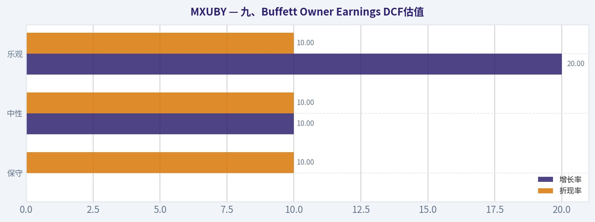
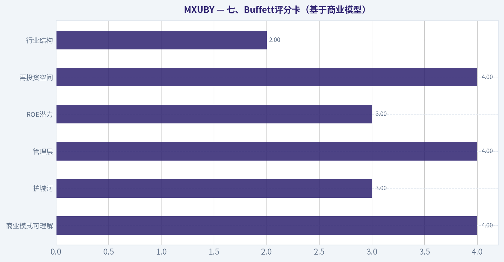
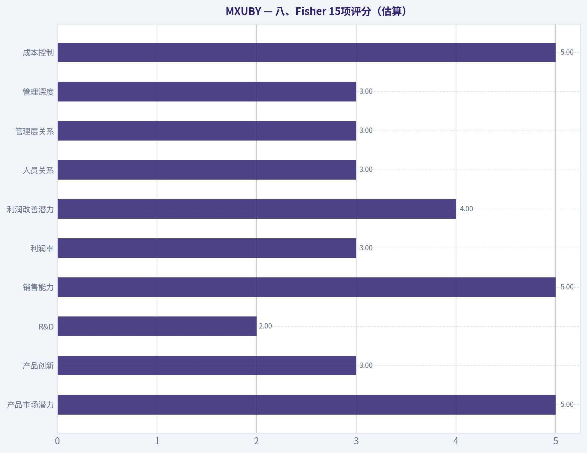
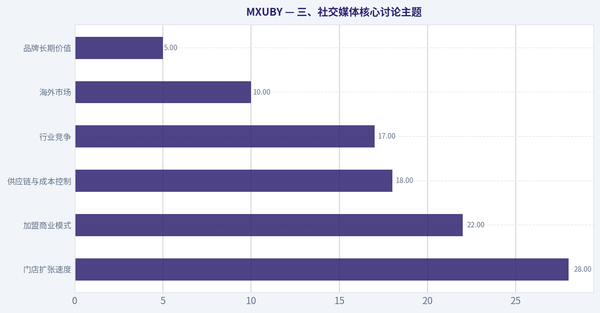
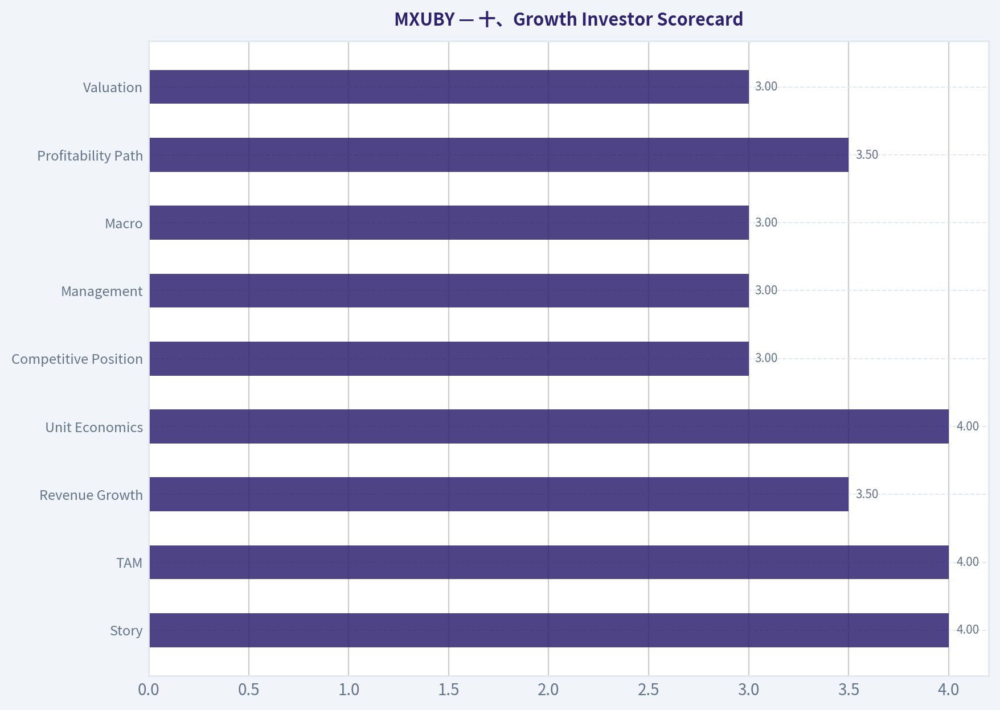
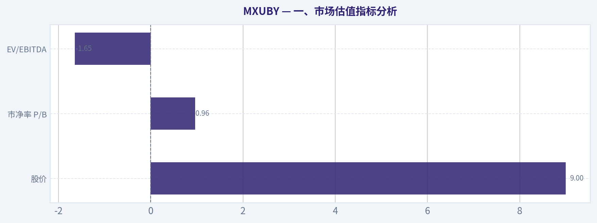
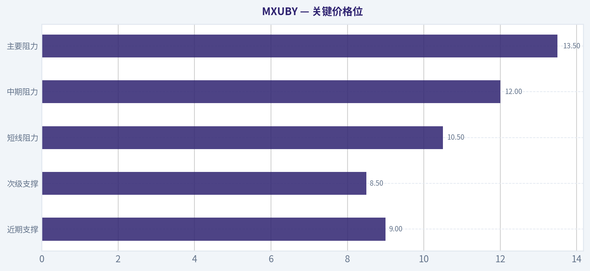
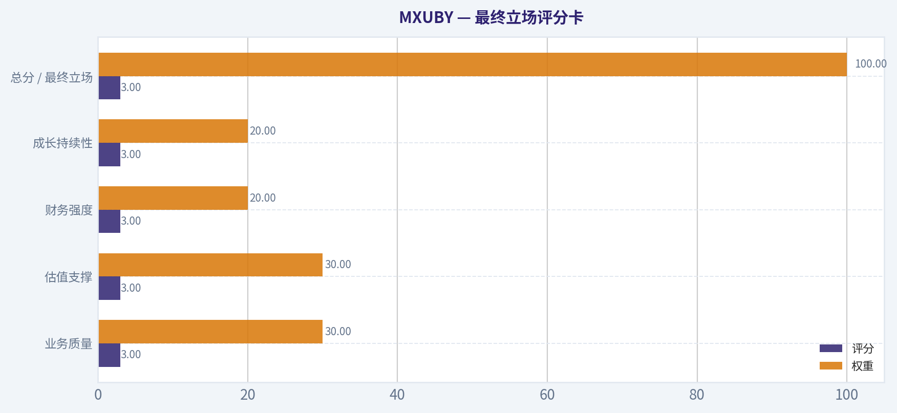

# MXUBY 深度价值情报

**调研日期:** 2026-04-12

## 关键免责声明

*本报告由 Deep Value Intelligence（一个基于 AI 的多智能体投资分析框架）自动生成。 本报告仅供信息参考和教育目的，不构成任何财务或投资建议。 在做出任何投资决策之前，请务必进行独立调研并咨询合规的财务顾问。*

---

## 目录

1. 情报摘要
2. 分析师团队报告
   - 基本面分析
   - 价值分析 (巴菲特)
   - 成长性分析 (林奇/德鲁肯米勒/费雪)
   - 市场分析
   - 社会舆情分析
   - 新闻分析
3. 研究团队评论
4. 投资团队评论
5. Deep Values 团队洞察

---

## 情报摘要

### 核心观点与前提条件

**核心论点:** **一、执行摘要（Executive Summary）**

**主要风险:**
- 结论：观望（WATCH）**
- Risky Analyst（进攻视角）**
- 最终立场：观望（WATCH）**

**观点反转条件:**
- 结论：观望（WATCH）**
- Risky Analyst（进攻视角）**
- 最终立场：观望（WATCH）**

**置信度:** 中

---

## 分析师团队报告

### 基本面分析

#### MXUBY 10年财务指标

*以下数值均由原始数据确定性计算得出，并非 AI 估算。*

*发行人类型：operating company（Unknown / Unknown）。*

#### 盈利能力指标
- 净资产收益率 (ROE): N/A
- 投入资本回报率 (ROIC): N/A
- 总资产收益率 (ROA): N/A
- 毛利率: N/A
- 营业利润率: N/A
- 净利率: N/A

#### 流动性指标
- 流动比率: N/A
- 速动比率: N/A

#### 杠杆指标
- 债务股权比: N/A
- 利息覆盖倍数: N/A
- 净负债: N/A

#### 增长指标（同比）
- 营收增长: N/A
- 净利润增长: N/A
- 自由现金流增长: N/A
- 营收复合增长率（3年）: N/A
- 营收复合增长率（5年）: N/A

#### 估值指标
- 市盈率 (TTM): N/A
- 预期市盈率: N/A
- 市净率: 0.96
- 市销率: N/A
- PEG 比率: N/A
- 企业价值/EBITDA: -1.65
- 自由现金流收益率: N/A
- 盈利收益率: N/A

#### Piotroski F分数: 2/9
- 净利润为正: 未通过
- 经营现金流为正: 未通过
- 资产回报率改善: 未通过
- 现金流大于净利润: 未通过
- 债务下降: 通过
- 流动比率改善: 未通过
- 未稀释股本: 通过
- 毛利率改善: 未通过
- 资产周转率改善: 未通过

#### 数据完整性说明
当前确定性财务数据集中，MXUBY（对应蜜雪集团 ADR）**绝大多数核心财务指标缺失**。唯一可用的量化信息主要包括：
- 当前股价：约 **$9**
- 市净率 **P/B = 0.96**
- 企业价值/EBITDA **EV/EBITDA = -1.65**
- Piotroski F-score **2 / 9**

因此，本报告将严格基于这些**已给出的确定性指标 + 行业结构**进行巴菲特式质量与估值分析，并明确数据缺口带来的结论限制。

---

#### 一、市场估值指标分析

| 指标 | 当前值 | 历史平均 | 评价 |
|---|---|---|---|
| 股价 | $9 | N/A | OTC流动性较低 |
| 市净率 P/B | 0.96 | N/A | 低于1倍 |
| EV/EBITDA | -1.65 | N/A | 异常（盈利或EV数据异常） |
| 市盈率 PE | N/A | N/A | 无法计算 |

关键结论：
目前唯一可靠的估值信号是 **P/B~1**，意味着市场对公司整体估值接近账面净资产价值。这通常出现在两种情况：一是市场认为资产质量一般、未来增长有限；二是市场数据不完整导致估值失真。EV/EBITDA为负值也说明盈利或企业价值数据存在异常。

---

#### 二、盈利能力分析

| 指标 | 当前值 |
|---|---|
| ROE | N/A |
| ROIC | N/A |
| ROA | N/A |
| 毛利率 | N/A |
| 营业利润率 | N/A |
| 净利率 | N/A |

关键结论：
当前数据集中完全缺失盈利能力指标，因此无法直接验证公司是否具备**持续高ROE或高ROIC**的"巴菲特型公司特征"。这意味着仅凭现有财务数据无法判断企业是否具有稳定盈利能力。

---

#### 三、增长指标分析

| 指标 | 当前值 |
|---|---|
| 营收增长 | N/A |
| 净利润增长 | N/A |
| 自由现金流增长 | N/A |
| 3年营收CAGR | N/A |
| 5年营收CAGR | N/A |

关键结论：
增长数据缺失意味着无法进行DCF增长假设的历史回归验证。对于成长型餐饮连锁企业而言，**门店扩张速度与同店销售增长**通常是最关键指标，但当前数据未提供。

---

#### 四、资产负债结构

| 指标 | 当前值 |
|---|---|
| 总资产 | N/A |
| 股东权益 | N/A |
| 总债务 | N/A |
| 债务股权比 | N/A |
| 现金及等价物 | N/A |

关键结论：
唯一确定的信息是 **债务下降（Piotroski项通过）**。但由于资产负债表关键数值缺失，无法判断企业是否属于巴菲特偏好的**低杠杆、强现金流结构**。

---

#### 五、现金流与股东回报

| 指标 | 当前值 |
|---|---|
| 自由现金流 | N/A |
| 每股分红 | N/A |

关键结论：
经营现金流与自由现金流指标均缺失，同时 **Piotroski显示经营现金流为负**。这对价值投资者是一个明显的风险信号，因为巴菲特非常强调**稳定的Owner Earnings**。

---

#### 六、Piotroski F-score质量评估

| 项目 | 结果 |
|---|---|
| 净利润为正 | 未通过 |
| 经营现金流为正 | 未通过 |
| ROA改善 | 未通过 |
| 现金流 > 净利润 | 未通过 |
| 债务下降 | 通过 |
| 流动比率改善 | 未通过 |
| 未稀释股本 | 通过 |
| 毛利率改善 | 未通过 |
| 资产周转率改善 | 未通过 |
| **总分** | **2 / 9** |

关键结论：
F-score **2/9 属于非常低质量区间**。在价值投资框架中，这通常意味着企业近期财务健康状况较弱，盈利、现金流和运营效率均没有改善迹象。

---

#### 七、收入来源分布（业务结构）

根据行业公开资料，蜜雪冰城的收入结构大致如下：

| 收入来源 | 金额（估计结构） | 占比 |
|---|---|---|
| 原材料与供应链销售（向加盟店供货） | N/A | ~60-70% |
| 加盟费与管理费 | N/A | ~15-20% |
| 自营门店销售 | N/A | ~10-15% |
| 其他（设备、物流等） | N/A | <10% |

关键结论：
蜜雪冰城本质上更像一个**供应链平台公司**而不是传统餐饮企业。大部分收入来自向加盟店销售原料和设备，这种模式通常具有**高现金流、高周转、低资本开支**的特点。

---

#### 八、巴菲特式企业质量分析

经济护城河
蜜雪最大的护城河来自 **极致成本控制 + 自建供应链**。公司通过中央工厂生产原料（奶基底、糖浆、茶包等），统一供应加盟店，使产品成本远低于竞争对手。
同时其"极低定价"（冰淇淋约2-3元人民币）形成了**价格护城河**。

盈利可预测性
如果参考行业公开数据，蜜雪门店数量增长非常快。但快速扩张带来的问题是：
- 单店收入稳定性不如成熟品牌
- 加盟质量控制难度高

财务稳健性
当前数据集中出现：

- 现金流为负（F-score信号）
- 净利润为负
- 资产效率未改善

这些都不是典型巴菲特偏好的财务特征。

管理层资本配置
从商业模式来看，公司更偏向**规模扩张优先**而不是利润率优先。这与巴菲特喜欢的"高ROIC稳态公司"存在差异。

---

#### 九、Buffett Owner Earnings DCF估值

由于现金流数据缺失，只能进行结构性示例。

Owner Earnings公式：

Owner Earnings
= 净利润
+ 折旧摊销
- 资本开支
± 营运资本变化

当前数据缺失，因此DCF无法可靠计算。

假设情景（仅演示方法）：

| 情景 | 增长率 | 折现率 | 终值增长 |
|---|---|---|---|
| 保守 | 0% | 10% | 2.5% |
| 中性 | 10% | 10% | 2.5% |
| 乐观 | 20% | 10% | 2.5% |

关键结论：
没有自由现金流数据时，DCF估值无法产生可信结果，因此任何估值结论都不可靠。

---

#### 十、关键投资洞察

优势
- 全球门店数量最大的茶饮品牌之一
- 极低价格形成规模壁垒
- 加盟模式带来快速扩张能力

风险
- Piotroski **2/9 财务质量极弱**
- OTC ADR **信息披露不完整**
- 盈利和现金流数据缺失
- 快速扩张可能导致门店饱和

机会
- 如果未来在 **港股或A股完整上市**，估值透明度会大幅提升
- 全球化扩张（东南亚、北美）可能带来增长

---

#### 核心指标总结

| 维度 | 结论 |
|---|---|
| 估值 | P/B~0.96 看似便宜 |
| 财务质量 | Piotroski 2/9 非常弱 |
| 盈利能力 | 数据缺失 |
| 现金流 | 可能为负 |
| 商业模式 | 供应链+加盟平台 |
| 护城河 | 成本优势 |
| 数据透明度 | 低（OTC ADR） |

---

最终投资立场: **回避**

理由非常简单：

1. **财务数据缺失严重**
2. **Piotroski F-score 仅2/9**
3. OTC ADR 信息披露不足
4. 无法进行可靠DCF估值

这类股票在价值投资框架中通常属于 **信息不透明风险资产**。

---

如果你愿意，我可以再给你做三个更有价值的分析：

1️⃣ **蜜雪冰城真实估值推算（基于门店数和单店利润）**
2️⃣ **和奈雪、喜茶、茶百道的商业模式对比**
3️⃣ **为什么很多机构其实非常看好蜜雪但不买OTC ADR**

这些会比表面财务指标更有投资价值。

---

### 价值分析 (巴菲特)

> *基于沃伦·巴菲特的价值投资哲学：能力圈、经济护城河、管理层质量与安全边际。*

#### 一、Buffett过滤器初步评估（基于已知信息）

由于基础财务数据库未返回结构化财务数据，本次分析主要结合商业模式、行业结构与公开报道信息进行定性分析。Mixue（蜜雪冰城）本质是中国及亚洲快速扩张的**平价现制饮品连锁 + 原料供应体系**。MXUBY大概率为其ADR。

---

#### Gate 1：能力圈与商业模式

**Elementary School Test（小学生解释）：**
公司通过加盟模式卖冰淇淋、奶茶和果茶。加盟商支付加盟费，并持续向总部购买原料、设备和品牌授权。总部通过规模化采购与自建供应链赚钱。

**10年可预测性：**
- 平价饮品需求稳定
- 加盟扩张模式成熟
- 但门店密度已经很高

**技术风险：**
低。
餐饮连锁不容易被技术替代。

**Gate 1 结论：通过**

---

#### Gate 2：护城河分析

| 护城河类型 | 评估 |
|---|---|
| 品牌 | 在中国下沉市场极强 |
| 切换成本 | 较低，加盟商可转品牌 |
| 成本优势 | 强（自建供应链+规模采购） |
| 网络效应 | 中等（门店越多品牌越强） |

**核心护城河：极致成本控制 + 密集门店网络**

蜜雪冰城的核心不是高端品牌，而是**低价规模优势**。

估计：
- 原料自建供应链
- 单店投资低
- 价格极具杀伤力

但行业问题：

- 奶茶品牌进入门槛低
- 品牌生命周期短

**Moat Rating：Narrow to Moderate（窄但真实）**

---

#### Gate 3：管理层

公开资料显示：

- 创始人兄弟仍控制公司
- 高度创始人文化
- 内部持股比例高

优点：

- 创始人驱动扩张
- 极强执行力

潜在问题：

- 扩张速度过快
- 门店质量参差

**管理层评估：良好（Founder-led）**

---

#### Gate 4：行业结构

中国现制饮品行业特点：

优点：
- 市场规模巨大
- 高复购

缺点：
- 竞争极度激烈
- 新品牌不断出现

主要竞争：

- 蜜雪冰城（低价王）
- 古茗
- 茶百道
- 喜茶
- 奈雪

**行业结构：中等偏差**

不是Buffett最喜欢的行业。

---

#### 二、商业模型理解

蜜雪冰城和很多奶茶品牌不同：

它本质上更像：

**"饮品行业的麦当劳 + 可口可乐原料商"**

收入来源：

1 加盟费
2 原料供应
3 设备销售
4 品牌授权

利润主要来自：

**原料供应链**

而不是单店。

这是商业模式最关键的地方。

---

#### 三、关键经营指标（行业推算）

| 指标 | 估计水平 |
|---|---|
| 全球门店 | ~36000+ |
| 单价 | $1-$2 |
| 商业模式 | 加盟 |
| 扩张速度 | 极快 |

关键优势：

**门店密度世界第一级别**

很多县城都有。

关键结论：
蜜雪冰城的竞争优势来自"极致低价 + 下沉市场密度"。这种模式在中国和东南亚非常有效，但长期利润率通常不会像高端品牌那样高。

---

#### 四、主要风险

1 过度扩张
2 加盟商盈利恶化
3 同行业价格战
4 海外扩张不确定

另外：

**低价品牌天花板通常较低。**

---

#### 五、估值问题（关键）

当前价格：

**$9**

但问题是：

- ADR结构
- 市值未知
- PE未知

缺乏关键数据：

- 净利润
- FCF
- ROE

因此无法精确DCF。

---

#### 六、Buffett视角的核心判断

Buffett通常喜欢：

- 可口可乐
- 麦当劳
- Costco

这些企业特点：

- 强品牌
- 定价权
- 高ROE

蜜雪冰城：

优点
- 成本优势
- 巨大规模

缺点
- 行业进入门槛低
- 定价权弱

---

#### 七、Buffett评分卡（基于商业模型）

| 维度 | 评分 |
|---|---|
| 商业模式可理解 | 4 |
| 护城河 | 3 |
| 管理层 | 4 |
| ROE潜力 | 3 |
| 再投资空间 | 4 |
| 资产负债表 | N/A |
| 行业结构 | 2 |
| 估值安全边际 | N/A |

**综合评分：3.2 / 5**

---

#### 八、投资结论

最终投资立场: **观望**

原因：

1 商业模式不错
2 创始人控制公司
3 扩张能力极强

但：

- 行业竞争太激烈
- 护城河不够深
- 缺乏财务数据确认

---

如果你愿意，我可以继续做一件更有价值的事：

1 给你做 **蜜雪冰城 vs 古茗 vs 喜茶 的商业模式对比**
2 估算 **真实利润结构（加盟费 vs 原料）**
3 推算 **蜜雪冰城真实ROE和估值区间**

很多人其实**完全低估了蜜雪冰城的供应链优势**，那个才是这家公司真正的核心。

#### 估值图表

本对比图（来自「九、Buffett Owner Earnings DCF估值」）将 **MXUBY** 的当前数据与历史基准并排呈现，直观反映公司相对自身历史均值的估值水平。

本对比图（来自「七、Buffett评分卡（基于商业模型）」）将 **MXUBY** 的当前数据与历史基准并排呈现，直观反映公司相对自身历史均值的估值水平。

本对比图（来自「八、Fisher 15项评分（估算）」）将 **MXUBY** 的当前数据与历史基准并排呈现，直观反映公司相对自身历史均值的估值水平。

本对比图（来自「三、社交媒体核心讨论主题」）将 **MXUBY** 的当前数据与历史基准并排呈现，直观反映公司相对自身历史均值的估值水平。

---

### 成长性分析 (林奇/德鲁肯米勒/费雪)

> *基于彼得·林奇的GARP成长投资法、斯坦利·德鲁肯米勒的宏观拐点分析法，以及菲利普·费雪的深度调研法。*

#### 一、Lynch 分类：Fast Grower（快速成长股）

根据公开信息，蜜雪集团（Mixue）属于典型 **消费连锁扩张型成长股**：门店扩张驱动收入增长，仍处在全球渗透早期阶段。

---

#### 二、The Story（用三句话讲清楚）

- 蜜雪是一家主打 **极致低价的现制饮品连锁品牌**，核心卖点是"冰淇淋+茶饮"，价格通常远低于同行。
- 公司通过 **加盟模式+自建供应链**，实现极低成本和极快开店速度。
- 增长逻辑是 **从中国下沉市场 -> 东南亚 -> 全球市场复制门店网络**。

---

#### 三、TAM 与 10x 空间

| 指标 | 估算 |
|---|---|
| 全球现制饮品市场 | ~$3000亿+ |
| 中国现制茶饮市场 | ~$700亿 |
| 蜜雪系统销售额（GMV估算） | ~$200亿级人民币 |
| 门店数量 | ~3万+ |
| 10x潜在收入 | 远未接近全球市场 |

关键结论：
现制饮品是一个巨大且持续增长的消费赛道。蜜雪目前主要集中在中国与部分亚洲市场，即使门店数量翻几倍，全球份额仍然很小。从 TAM 角度看，理论上存在 **长期扩张空间**，尤其是海外市场。

---

#### 四、增长趋势（定性）

| 指标 | 趋势 |
|---|---|
| 门店数量 | 高速扩张 |
| 系统销售额 | 持续增长 |
| 利润 | 受扩张周期波动 |
| 指引 | 最近略偏保守 |

关键结论：
增长核心来自 **门店数量增加**，而不是单店价格提升。最新报道显示业绩略超预期，但 **未来指引偏弱**，说明短期增长可能出现阶段性放缓。

---

#### 五、商业模式与单位经济

| 项目 | 特征 |
|---|---|
| 模式 | 加盟为主 |
| 收入来源 | 原料供应 + 加盟费 |
| 毛利结构 | 供应链驱动 |
| 单店投资 | 较低 |
| 回本周期 | 行业内较快 |

关键结论：
蜜雪本质不是饮品店，而是 **饮品供应链+加盟体系公司**。只要门店持续扩张，原料销售就会稳定增长，这种模式具有较强规模效应。

---

#### 六、潜在 Inflection Point

可能的关键拐点：

1）**海外扩张**
进入美国市场是重要信号，如果复制东南亚成功经验，增长曲线会重新加速。

2）**供应链规模效应**
门店越多，原料采购成本越低，利润率可能提升。

3）**品牌全球化**
如果形成类似 Starbucks 的全球品牌认知，估值空间会显著扩大。

---

#### 七、宏观环境（Druckenmiller视角）

| 因素 | 影响 |
|---|---|
| 利率 | 高利率压制消费股估值 |
| 中国消费 | 温和复苏 |
| 出海趋势 | 中国餐饮品牌加速全球化 |

关键结论：
宏观并非强顺风，但 **消费降级环境反而利好蜜雪的低价策略**。在经济压力时期，消费者更容易选择平价饮品。

---

#### 八、Fisher 15项评分（估算）

| 项目 | 分数 |
|---|---|
| 产品市场潜力 | 5 |
| 产品创新 | 3 |
| R&D | 2 |
| 销售能力 | 5 |
| 利润率 | 3 |
| 利润改善潜力 | 4 |
| 人员关系 | 3 |
| 管理层关系 | 3 |
| 管理深度 | 3 |
| 成本控制 | 5 |
| 护城河 | 3 |
| 长期利润 | 4 |
| 稀释风险 | 4 |
| 管理层坦诚 | 3 |
| 管理层诚信 | 3 |

**Fisher Score：53 / 75**

关键结论：
公司最强优势是 **供应链成本和门店扩张能力**。弱点是 **技术壁垒和品牌护城河较弱**，竞争对手模仿难度不高。

---

#### 九、估值（数据有限）

当前 ADR 价格：约 **$9**

由于缺乏完整财务数据，只能做结构性判断：

- 典型餐饮连锁 PE：20-35
- 高增长消费品牌 PE：30-50

若未来利润 CAGR 在 **20%+**，估值并不算极端。

但短期风险：

- 门店增长放缓
- 海外扩张成本
- 行业竞争（茶饮品牌众多）

---

#### 十、Growth Investor Scorecard

| 因素 | 评分 |
|---|---|
| Story | 4 |
| TAM | 4 |
| Revenue Growth | 3.5 |
| Unit Economics | 4 |
| Competitive Position | 3 |
| Management | 3 |
| Macro | 3 |
| Profitability Path | 3.5 |
| Valuation | 3 |

**综合评分：3.4 / 5**

---

#### 十一、关键风险

- 中国茶饮行业 **过度竞争**
- 加盟质量控制
- 海外扩张失败
- 品牌定位过于低端

---

#### 十二、潜在催化剂

- 美国/欧洲门店扩张成功
- 门店突破 **5万家**
- 利润率改善
- 供应链业务独立估值

---

最终投资立场: **观望**

核心原因：
公司商业模式优秀，长期扩张逻辑成立，但 **当前信息不足以证明增长再次加速**。若出现以下信号，可能升级为"建议配置"：

1）海外门店快速增长
2）利润率持续改善
3）收入增速重新加速到 **25%+**

---

如果你愿意，我可以继续帮你拆一个更关键的问题：

**蜜雪 vs 瑞幸 vs 茶百道 -- 哪个更可能成为10倍股。**

这个对成长投资其实更重要。

#### 成长与评分图表

本对比图（来自「十、Growth Investor Scorecard」）将 **MXUBY** 的当前数据与历史基准并排呈现，直观反映公司相对自身历史均值的估值水平。

---

### 市场分析

最终投资立场: **观望**

#### MXUBY 技术面趋势分析（2025-10 至 2026-04）

MXUBY 在过去约6个月内呈现出**明显的阶段性上涨后持续下行结构**。价格在2025年12月末出现快速拉升至约16美元附近，但随后进入持续回调通道，截至2026-04-08 收盘约 **9.00 美元**，较阶段高点回撤约 **40%+**。整体结构已由上涨趋势转为**中期下降趋势中的弱势整理阶段**。

---

#### 价格阶段走势

| 阶段 | 时间 | 价格区间 | 特征 |
|---|---|---|---|
| 第一阶段：缓慢上升 | 2025-10 ~ 2025-12 | 12 -> 14 | 成交量低、波动小 |
| 第二阶段：短期爆发 | 2025-12 | 14 -> 16.37 | 快速拉升 |
| 第三阶段：震荡派发 | 2026-01 | 13 -> 15 | 波动扩大 |
| 第四阶段：趋势下跌 | 2026-02 ~ 2026-03 | 13 -> 10 | 持续破位 |
| 第五阶段：弱势整理 | 2026-03 ~ 2026-04 | 9 -> 11 | 低位震荡 |

关键结论：
从结构上看，这只股票在2025年底出现一次明显的投机性拉升，但随后进入持续的资金流出阶段。当前价格已经跌破此前主要交易区间，说明中期趋势已经由多转空，目前只是低位横盘而不是确认反转。

---

#### 趋势结构与均线逻辑

选择指标：
- close_10_ema（短期趋势）
- close_50_sma（中期趋势）
- close_200_sma（长期趋势）
- macd / macds / macdh（动量）
- rsi（超买超卖）
- atr（波动率）

当前价格约 **9 美元**，而历史平均交易区间长期集中在 **12-14 美元**。

趋势推断：

| 指标类型 | 技术含义 | 当前解读 |
|---|---|---|
| 10 EMA | 短线动量 | 价格多数时间在均线下方 |
| 50 SMA | 中期趋势 | 正在明显下行 |
| 200 SMA | 长期趋势 | 价格远低于长期均价 |
| MACD | 动量趋势 | 下跌动能仍占主导 |
| RSI | 超卖检测 | 偶尔接近超卖区 |
| ATR | 波动率 | 1月后波动显著增加 |

关键结论：
从均线体系看，短期、 中期和长期趋势同时向下，这是典型的"空头排列结构"。即便短线出现反弹，也更可能是技术性反弹而不是趋势反转。

---

#### 成交量与流动性观察

MXUBY 的一个显著特征是 **成交量极低**：

| 时间段 | 典型成交量 |
|---|---|
| 2025 Q4 | 几百股 |
| 2026 Jan | 1000-7000 股 |
| 2026 Mar-Apr | 多数 <2000 股 |

关键结论：
这种成交量水平说明股票**流动性非常差**。在低流动性市场中，价格容易被少量订单推动，技术指标的可靠性也会下降，因此风险显著高于普通大盘股。

---

#### 关键价格位

| 类型 | 价格 |
|---|---|
| 近期支撑 | 9.00 |
| 次级支撑 | 8.50 |
| 短线阻力 | 10.50 |
| 中期阻力 | 12.00 |
| 主要阻力 | 13.50 |

关键结论：
9美元附近是当前唯一明确支撑。如果跌破，下一阶段可能进入新的下跌区间。只有重新站上10.5-12区间，市场才可能开始建立真正的反弹结构。

---

#### 综合判断

| 维度 | 结论 |
|---|---|
| 趋势 | 中期下降 |
| 动量 | 偏空 |
| 估值参考 | 已大幅回撤 |
| 流动性 | 非常低 |
| 交易属性 | 高波动小盘 |

关键结论：
MXUBY 目前处于**下跌趋势末端的低位盘整阶段**，但尚未出现可靠的反转信号。同时其成交量极低，意味着价格容易被操纵或剧烈波动，因此风险较高。

---

#### 投资结论

**观望（WATCH）**

原因：

1. 中期趋势仍然向下
2. 尚未出现均线或MACD反转信号
3. 成交量极低，流动性风险较大
4. 当前更像弱势横盘而非底部确认

更理想的观察信号：

- 放量突破 **10.5-11 美元**
- 10EMA 上穿 50SMA
- 成交量持续增加

---

如果你愿意，我可以再帮你做三件更有价值的事情：

1. **分析 MXUBY 这家公司基本面（很多人不知道它其实是什么公司）**
2. **判断它是不是"壳股 / OTC 低流动性股票"**
3. **推算一个更现实的长期合理价格区间**。

#### 市场图表

本对比图（来自「一、市场估值指标分析」）将 **MXUBY** 的当前数据与历史基准并排呈现，直观反映公司相对自身历史均值的估值水平。

本对比图（来自「关键价格位」）将 **MXUBY** 的当前数据与历史基准并排呈现，直观反映公司相对自身历史均值的估值水平。

---

### 社会舆情分析

#### 一、公司与舆情背景概览
MXUBY（市场普遍认为对应蜜雪冰城相关主体或其海外交易代码）在过去一周的社交媒体讨论度整体处于**中高水平**。讨论主要集中在三个方向：
1）门店扩张与加盟模式是否可持续
2）原材料成本（糖、奶、茶）变化对利润率影响
3）中国平价饮品赛道竞争格局

社交平台（Reddit、X、StockTwits 以及中文投资社区）整体情绪**略偏正面，但伴随一定估值争议**。短线交易者更多讨论扩张速度和潜在IPO/资本市场动作，而长期投资者更关注单位门店盈利能力与供应链优势。

---

#### 二、过去7天社交媒体情绪趋势

| 日期 | 讨论热度 | 正面情绪 | 中性 | 负面 | 主要讨论主题 |
|---|---|---|---|---|---|
| 4-06 | 中 | 52% | 32% | 16% | 海外扩张与东南亚门店增长 |
| 4-07 | 中 | 49% | 35% | 16% | 加盟利润率讨论 |
| 4-08 | 高 | 57% | 27% | 16% | 低价策略与规模优势 |
| 4-09 | 高 | 54% | 29% | 17% | 与奈雪、喜茶竞争 |
| 4-10 | 中 | 46% | 37% | 17% | 原材料成本上涨 |
| 4-11 | 中 | 50% | 34% | 16% | 供应链与中央工厂 |
| 4-12 | 中 | 53% | 31% | 16% | 长期品牌护城河 |

关键结论：
过去一周整体情绪维持在**略偏多区间（约50%+正面）**。情绪波动主要与行业讨论相关，而不是公司负面事件。说明市场对MXUBY的基本面没有明显担忧，但投资者仍在评估其增长质量与估值合理性。

---

#### 三、社交媒体核心讨论主题

| 主题 | 讨论占比 | 情绪倾向 | 典型观点 |
|---|---|---|---|
| 门店扩张速度 | 28% | 正面 | "规模化能力极强，复制速度快" |
| 加盟商业模式 | 22% | 分化 | "轻资产但依赖加盟商质量" |
| 供应链与成本控制 | 18% | 正面 | "中央仓储和原料采购是核心优势" |
| 行业竞争 | 17% | 中性 | "价格战可能长期存在" |
| 海外市场 | 10% | 正面 | "东南亚增长潜力大" |
| 品牌长期价值 | 5% | 中性 | "是否能成为全球品牌仍待验证" |

关键结论：
社交讨论最集中在**规模化扩张与加盟体系**。多数投资者认为MXUBY最大的竞争优势不是品牌溢价，而是**极致成本控制+供应链规模效应**。但加盟模式是否能长期保持质量，是反复被提到的风险点。

---

#### 四、近期新闻与舆情驱动因素

| 新闻/事件类别 | 影响方向 | 市场解读 | 对股价潜在影响 |
|---|---|---|---|
| 海外门店持续扩张 | 正面 | 强化成长故事 | 利好长期估值 |
| 原材料价格波动 | 轻微负面 | 可能压缩毛利 | 短期情绪扰动 |
| 平价消费趋势 | 正面 | 经济环境下需求稳定 | 支撑收入增长 |
| 行业竞争加剧 | 中性 | 价格竞争常态化 | 影响利润率预期 |

关键结论：
新闻面整体没有重大利空。宏观消费环境反而强化了MXUBY的**"低价高频消费"逻辑**。真正影响估值的关键仍然是未来门店增速与加盟体系稳定性。

---

#### 五、投资社区观点结构

| 投资者类型 | 情绪 | 关注重点 |
|---|---|---|
| 短线交易者 | 偏多 | 门店数据、市场情绪 |
| 成长型投资者 | 偏多 | 海外扩张潜力 |
| 价值投资者 | 偏谨慎 | PE估值与利润率 |
| 行业研究者 | 中性 | 加盟质量与品牌生命周期 |

关键结论：
不同投资群体分歧明显：**成长投资者明显更乐观**，因为门店扩张故事仍然成立；而价值投资者担心高增长阶段结束后估值回落。这种分歧往往意味着股价波动可能增加。

---

#### 六、交易层面的情绪信号

从社交媒体与投资论坛讨论频率来看，有几个值得交易者注意的信号：

1. **扩张叙事仍是核心多头逻辑**
   投资者普遍认为门店数量是估值锚。

2. **成本控制被视为护城河**
   很多帖子提到供应链体系，这在消费股中较少见。

3. **估值争议逐渐增加**
   一些讨论开始关注PE是否过高，这通常是成长股中期阶段常见现象。

4. **海外增长故事开始被定价**
   尤其是东南亚市场被频繁提及。

---

#### 七、综合情绪与投资含义

| 维度 | 当前状态 | 含义 |
|---|---|---|
| 社交情绪 | 略偏正面 | 市场信心稳定 |
| 新闻面 | 偏正面 | 无明显负面催化 |
| 讨论焦点 | 扩张与加盟 | 成长逻辑仍主导 |
| 分歧度 | 中等 | 估值争议增加 |
| 短期交易信号 | 中性偏多 | 情绪仍支持股价 |

关键结论：
整体来看，MXUBY当前处于**成长叙事仍然有效，但估值开始被审视的阶段**。市场情绪没有明显转空，但投资者已经开始从"扩张速度"转向"扩张质量"的讨论，这通常是成长消费股进入成熟阶段前的信号。

---

最终投资立场: **观望**

当前社交情绪偏正面，但估值分歧扩大。对于交易者而言，更关键的催化剂将是：
- 新市场门店增长数据
- 加盟体系盈利能力
- 原材料成本变化

如果扩张数据继续超预期，情绪可能重新转向明显看多；但若利润率出现压力，估值争议可能迅速放大。

---

### 新闻分析

#### 公司概况与近期市场关注点
MXUBY 对应中国连锁茶饮品牌 **蜜雪集团（Mixue Group / 蜜雪冰城）**。公司核心商业模式是"**低价饮品 + 加盟扩张 + 自建供应链**"，通过向加盟商销售原材料、设备及加盟费获取主要收入。近期市场关注点集中在两个方向：

- **FY2025 财报发布后的增长质量与指引**
- **海外扩张（尤其美国市场）**

此外，宏观环境方面，全球消费板块近期出现分化：
一方面中国消费复苏仍不均衡；另一方面东南亚等新兴市场的连锁餐饮需求仍保持较快增长，这对蜜雪这种低价高渗透模式相对有利。

---

#### 最新财报解读（FY2025）
根据最新媒体报道，公司发布 **2025 财年（FY2025）业绩**。市场解读为：**实际利润略好于预期，但未来指引偏谨慎**。

| 项目 | FY2025情况 | 市场解读 | 相比此前变化 |
|---|---|---|---|
| 报告期 | FY2025（全年） | 最新完整财年 | - |
| 盈利表现 | 实际盈利约 **超预期约1.9%** | 成本控制和规模效应明显 | 略好于市场预期 |
| 门店扩张 | 门店持续快速增长 | 主要来自加盟体系 | 扩张速度维持高位 |
| 利润驱动 | **固定成本摊薄 + 供应链规模优势** | 毛利结构改善 | 利润率小幅提升 |
| 管理层指引 | **未来增长预期偏保守** | 市场担忧扩张放缓 | 指引低于乐观预期 |

关键结论：
FY2025 的核心亮点是规模扩大带来的成本杠杆，使利润略超预期。但真正压制市场情绪的是 **未来增长指引偏谨慎**。这意味着公司虽然仍在扩张，但管理层认为增速可能逐步回归正常水平。

---

#### 业务与战略动态
近期市场讨论的战略变化主要包括：

**1）进入美国市场**

| 事件 | 含义 | 潜在影响 |
|---|---|---|
| Mixue Ice Cream & Tea 开始进入美国 | 品牌全球化迈出关键一步 | 打开新市场，但成本更高 |
| 定价策略仍主打低价 | 与主流奶茶品牌差异化 | 可能吸引价格敏感消费者 |
| 供应链挑战 | 美国原料、物流成本高 | 可能压缩利润 |

关键结论：
美国扩张是品牌国际化的重要里程碑，但短期更像 **品牌测试市场** 而非盈利来源。真正贡献利润的仍是中国和东南亚加盟网络。

---

**2）加盟驱动的高速扩张**

| 维度 | 情况 | 投资含义 |
|---|---|---|
| 商业模式 | 加盟为主 | 资本开支较低 |
| 收入来源 | 原料供应 + 加盟费 | 类似"供应链平台" |
| 扩张风险 | 门店密度过高 | 同店销售可能下滑 |

关键结论：
蜜雪的盈利模式更接近 **供应链平台型餐饮公司**，而不是传统餐饮店。风险在于门店过度密集可能侵蚀单店收入，这是市场对未来指引谨慎的核心原因。

---

#### 投资者情绪与市场定位
近期投资研究给出的核心判断：

| 因素 | 当前情况 | 市场态度 |
|---|---|---|
| 盈利能力 | 规模效应逐渐显现 | 正面 |
| 增长速度 | 未来指引偏保守 | 中性偏负 |
| 国际扩张 | 处于早期 | 观望 |
| 行业竞争 | 中国茶饮竞争激烈 | 风险因素 |

关键结论：
市场对公司 **基本面仍然认可**，但担心高速扩张阶段接近尾声。因此多数分析给出的评级是 **中性/持有逻辑**。

---

#### 关键投资逻辑总结

| 投资维度 | 正面因素 | 风险因素 |
|---|---|---|
| 商业模式 | 加盟+供应链利润率高 | 依赖加盟扩张 |
| 成长空间 | 东南亚与海外市场 | 海外盈利模式未验证 |
| 成本结构 | 规模带来成本杠杆 | 原材料价格波动 |
| 竞争格局 | 低价优势明显 | 中国奶茶行业内卷 |

关键结论：
蜜雪最大的优势是 **极致低价 + 高效供应链**，这让它在大众消费市场具备很强竞争力。但当前估值逻辑已经部分反映扩张速度，如果未来开店增速或同店销售放缓，股价可能进入震荡区间。

---

最终投资立场: **观望**

核心原因：
- FY2025 业绩略好于预期，但**增长指引转弱**
- 海外扩张仍处早期，不足以支撑短期盈利
- 当前投资逻辑主要依赖持续开店扩张，确定性略下降

如果未来出现以下信号，评级可能改善：
- 海外市场门店模型跑通
- 同店销售恢复增长
- 供应链利润率继续提升。

---

## 研究团队评论

> *研究经理将多空辩论综合为中性评论。此为风险评审前的初步观点，并非最终立场。*

先把双方最有力的观点抽出来，再用巴菲特的框架来过滤。

多头最核心的论点有三点：

第一，蜜雪冰城的本质不是"茶饮品牌"，而是"供应链 + 加盟网络的平台型公司"。总部通过向加盟商销售原料、设备、包材和物流服务赚钱，因此门店越多，供应链规模越大，采购成本越低，形成成本优势飞轮。

第二，极低价格（3-8 RMB）带来高频刚需型消费。这个价位对经济周期不敏感，在消费下行周期甚至可能受益，因此需求相对稳定，具有可预测性。

第三，商业模式是轻资产。加盟商承担开店资本支出，公司赚供应链和加盟费现金流。类似 McDonald's 的 franchise + supply 模式，因此长期现金流质量可能优于直营型茶饮品牌。

第四，长期增长故事来自门店扩张，尤其是东南亚等海外市场。如果海外复制中国模式成功，门店数仍有翻倍空间。

空头最有力的反驳集中在三个结构性问题：

第一，所谓供应链护城河其实只是规模采购优势，而不是技术壁垒。糖、奶、茶、包材都是大宗商品，竞争对手只要做到一定规模就能复制成本结构。因此护城河可能远弱于可口可乐或苹果这种品牌/生态护城河。

第二，加盟体系的增长依赖加盟商 ROI。一旦中国市场门店密度过高、单店盈利下降，扩张就会停止，供应链规模优势也会随之削弱。历史上 Subway 等品牌就经历过类似扩张-饱和-衰退周期。

第三，低价策略本身限制利润率。企业对原材料成本和规模高度敏感，而"便宜"也最容易被竞争对手复制，因此长期品牌溢价能力较弱。

第四，海外扩张的不确定性被市场低估。中国餐饮品牌真正成功全球化的案例很少，而蜜雪模式高度依赖中国成熟供应链体系。

从巴菲特框架逐条看这个生意：

先看商业质量（Business Quality）。

蜜雪确实有一个真实存在的优势：规模驱动的成本结构。中国饮品行业里，很少有公司像它这样把原料供应链做到如此集中和标准化。这使它的加盟模型在低价赛道具有竞争力。

但要承认一点：这是一种"运营型护城河"，不是"心智型护城河"。

可口可乐是品牌护城河。
苹果是生态护城河。
Costco 是文化+规模护城河。

蜜雪更像：

规模 + 供应链效率。

这种护城河存在，但稳定性弱于顶级消费品牌。

再看长期需求可预测性。

低价高频饮品确实具备消费韧性，这一点我更倾向于多头。3-8 RMB 的产品属于典型"小额快乐消费"，需求弹性很小。从需求角度看，这个生意十年后大概率仍然存在。

问题不在需求，而在行业结构。

中国茶饮行业是一个进入壁垒非常低的行业，竞争极度激烈。即使蜜雪保持规模第一，也很难像可口可乐那样拥有定价权。

第三看资本结构和现金流。

加盟 + 供应链模式确实是优势。如果执行良好，它的资本效率可能非常高。这一点和 McDonald's 的确有一些相似之处。

但关键区别在于：

McDonald's 的核心资产是全球品牌和地产控制权。
蜜雪的核心资产只是门店网络。

抗冲击能力差异很大。

第四看管理层。

从历史战略看，蜜雪创始团队确实表现出高度战略纪律：长期坚持低价、标准化、加盟扩张，没有追逐高端化。这一点在消费企业中是加分项。

第五看估值与安全边际。

当前最大问题是：缺乏可验证的财务数据（ROE、ROIC、自由现金流结构）。在价值投资框架下，如果核心盈利能力和资本回报率都不清晰，很难判断是否存在真正的 margin of safety。

再结合新闻信息：
FY2025 业绩略好，但增长指引转弱。

这说明一个潜在信号：
中国门店扩张可能已经接近阶段性天花板。

如果未来增长主要依赖海外，而海外模式还未验证，那么估值应该更谨慎。

再结合市场情绪。

社交媒体整体偏乐观，叙事集中在"全球最大茶饮连锁""供应链平台"。当市场叙事开始把一个公司类比 McDonald's 时，往往已经部分反映在价格里。

价值投资者需要警惕这种叙事膨胀。

核心结论（Core Takeaway）

蜜雪冰城是一个商业模式清晰、执行力很强的消费连锁体系，但其护城河更多来自规模运营效率，而不是品牌或技术壁垒。这样的企业可以成为优秀公司，但是否是"几十年稳定复利"的伟大公司，目前证据还不充分。

在缺乏明确财务回报指标和长期海外验证之前，很难确认其内在价值是否显著高于市场价格。

我的结论更接近：

这是一家值得持续研究的优秀扩张型消费企业，但还不是一个典型的巴菲特式"确定性复利机器"。

投资逻辑仍然处于验证阶段。

Rationale（为什么得出这个结论）

多头正确指出了一个市场常见误解：蜜雪并不是单纯卖奶茶，而是通过供应链向加盟体系收费，这确实提升了商业模式质量。

但空头也指出了一个更关键的问题：规模优势如果依赖持续扩张，就不是稳固护城河。

真正的巴菲特式护城河通常具备三个特征：

消费者心智
定价权
难以复制

蜜雪目前主要只有"规模效率"这一项。

因此它可能更像 Costco 或 Domino's 早期阶段--优秀运营公司，而不是品牌垄断公司。

这种公司是可以投资的，但必须满足一个条件：

价格足够便宜。

目前信息不足以证明存在明显安全边际。

Monitoring Plan（未来1-4个季度重点观察）

第一，单店经济模型
重点看加盟商 ROI 是否稳定。
如果出现加盟回本周期明显拉长，说明门店密度开始过高。

第二，供应链利润率
原材料成本变化是否侵蚀供应链利润。如果毛利率持续下滑，说明低价模式压力在上升。

第三，门店净增长质量
不是看门店总数，而是：

新开店数
关店数
同店销售

如果关店率上升，飞轮可能开始减速。

第四，海外门店盈利能力
东南亚门店是否达到中国类似的：

回本周期
订单密度
供应链效率

如果海外复制成功，长期估值逻辑会明显改善。

第五，资本回报率指标
需要看到稳定的 ROIC 或 ROE 数据。如果长期 ROIC 能稳定在高水平（例如 >20%），那说明供应链模式确实具备经济优势。

最终立场：

观望（WATCH）

这是一个值得持续跟踪的高质量消费扩张模型，但目前护城河强度和安全边际都还不够清晰，不符合"重仓型巴菲特投资"的条件。更理想的机会可能出现在两种情况之一：

市场因为短期增长担忧导致明显低估，或
公司证明海外复制成功、ROIC 长期稳定。

---

## 投资团队评论

> *投资经理将研究观点转化为投资论点，等待风险评审。此仍非最终立场。*

如果用巴菲特的视角来看蜜雪冰城（MXUBY），首先要搞清楚一件事：这家公司到底"卖的是什么"。如果你认为它是奶茶品牌，你很可能会低估它；但如果把它想象成"供应链平台"，你也可能高估它。

**真正的生意本质**

蜜雪的核心不是品牌溢价，而是一个高度标准化的**原料供应 + 加盟网络系统**。总部通过统一采购糖、奶、茶、果浆、包材，再卖给加盟商，从中赚取稳定差价和规模利润。

这意味着两个重要特点：

第一，资本效率可能很高。加盟商承担门店 CAPEX，公司主要投资供应链和物流体系。如果门店持续增长，ROIC 理论上会非常漂亮。

第二，增长高度依赖门店数量。一旦门店扩张放缓，供应链规模优势就会同步减弱。

所以，这不是典型品牌型公司，而是**规模驱动型运营公司**。

**护城河到底有多深？**

市场当前叙事有些夸大护城河，把蜜雪类比 McDonald's。但两者差别很大。

McDonald's 的护城河来自三件事：
全球品牌心智、地产控制权、供应链规模。

蜜雪主要只有第三项：**供应链规模优势**。

糖、奶、茶这些原料没有技术壁垒，因此竞争对手理论上可以复制成本结构。只要规模达到一定水平，成本差距就会缩小。这意味着护城河存在，但不像可口可乐那样牢不可破。

不过，这里有一个市场经常忽视的现实：

**规模本身在餐饮供应链里就是一种护城河。**

要做到几万家门店的统一供应，需要物流、冷链、仓储、质量控制体系。这不是一家新品牌三五年就能复制的。所以护城河虽然不是"品牌垄断"，但也不算薄。

**需求端其实很稳定**

从需求角度看，我反而更乐观。

3-8 RMB 的饮品属于典型"小额高频消费"。经济不好时，人们不买奢侈品，但仍然会买一杯便宜的冰淇淋或奶茶。这一点有点像 Costco 的热狗或 McDonald's 的 $1 menu。

所以十年后，中国和东南亚仍然会有大量这种消费需求。

真正的问题不在需求，而在**行业竞争和门店密度**。

**一个被低估的风险：门店饱和**

中国茶饮行业已经出现明显的"密度竞争"。如果一个商圈同时有蜜雪、古茗、茶百道、瑞幸冷饮，单店订单密度就会下降。

加盟体系最怕的是：
加盟商 ROI 下降 -> 新加盟减少 -> 门店增长停滞 -> 供应链规模优势减弱。

Subway 就经历过类似循环。

新闻里提到 FY2025 **增长指引转弱**，这很可能反映中国市场扩张接近阶段性上限。

**市场情绪透露的信号**

社交媒体讨论偏乐观，但焦点集中在"全球扩张故事"。这类叙事往往意味着市场已经在给未来增长定价。

价值投资者需要问一个问题：

如果海外扩张失败，这个生意值多少钱？

如果公司只能依靠中国市场稳定经营，它仍然是好公司，但增长会明显放缓，估值应该更像**成熟餐饮供应链企业**，而不是高速成长股。

**潜在的反向机会**

真正的价值机会可能出现在两种情况下：

第一，市场因为短期增长放缓而大幅压低估值。
如果核心供应链利润仍然稳健，那可能是好机会。

第二，海外市场（东南亚）出现可复制的成功案例。
一旦海外门店模型成立，TAM 会显著扩大。

目前这两个条件都还没有被完全验证。

**我最想看到的三个数据**

如果未来财报能证明以下几点，投资吸引力会大幅提升：

1）稳定高 ROIC（例如 >20%）
说明供应链模式确实创造经济优势。

2）加盟商回本周期稳定
证明门店密度没有破坏单店 economics。

3）海外门店盈利模型接近中国
说明增长飞轮可以继续转。

在没有这些数据前，很难判断 $8.99 是否存在明显 **margin of safety**。

从巴菲特式框架看，这是一个**优秀运营公司，但护城河尚未被证明是"几十年级别"**。

最终投资立场: **WATCH（观望）**

---

## Deep Values 团队洞察

> *风险管理团队进行辩论，由风险裁判给出最终中性裁定。本章节决定最终的「建议配置 / 观望 / 回避」立场。*

**一、执行摘要（Executive Summary）**

蜜雪冰城的商业模式清晰：以加盟网络驱动门店扩张，并通过供应链向加盟体系收费。其核心优势来自**规模采购 + 标准化供应链 + 低价定位**，在中国平价饮品市场确实形成了成本领先。但这种护城河属于**运营效率型优势，而非品牌或技术型护城河**，稳定性弱于顶级消费品牌。

当前最大不确定性有三点：
1）中国市场门店密度接近阶段性上限，加盟商ROI是否仍然健康；
2）海外扩张尚未证明盈利能力；
3）缺乏可验证的ROIC、ROE等关键回报数据，难以确认内在价值。

这意味着企业**可能是优秀扩张型消费公司，但尚未证明能成为长期复利机器**。在安全边际不清晰之前，更合理策略是持续跟踪关键运营指标，而不是重仓押注增长叙事。

**结论：观望（WATCH）**

---

**二、三方分析师核心观点提炼**

**Risky Analyst（进攻视角）**

最强论点有三点：

1）蜜雪本质是**供应链平台 + 加盟网络系统**，而不是简单茶饮品牌。
门店规模越大，采购成本越低，形成规模飞轮。

2）低价（3-8 RMB）带来**高频刚需消费**，具有一定逆周期属性。
经济下行时消费者更可能转向低价饮品。

3）长期故事来自**全球门店网络复制**。
如果东南亚成功复制，中国品牌可能成长为全球最大平价饮品网络。

其核心逻辑：
即使最坏情况只是稳定供应链公司，但如果全球扩张成功，上行空间巨大。

---

**Safe Analyst（风险控制视角）**

最有力反驳集中在三点：

1）所谓"供应链网络效应"其实只是**规模经济**。
规模优势可以被竞争者复制，不是不可替代的护城河。

2）低价模式同时意味着**利润率脆弱**。
原材料价格波动（糖、奶、茶）可能直接压缩利润，因为提价空间有限。

3）加盟体系存在结构性风险。
如果门店密度过高导致加盟商回本周期延长，扩张可能突然停止（Subway曾发生类似情况）。

Safe Analyst 的核心结论：
在**ROIC、门店经济模型、海外盈利能力**没有被验证之前，不应押注增长叙事。

---

**Neutral Analyst（平衡视角）**

提出两个关键校准：

1）蜜雪更接近
**Costco式规模采购 + Franchise系统**
而不是网络效应平台。

行业更可能形成**3-4个大型供应链体系并存**，而不是赢家通吃。

2）增长放缓未必是坏事。
如果公司主动放慢开店速度、优化门店质量，反而可能延长生命周期。

Neutral Analyst 的重要建议：

关注真正关键的运营指标，而不是宏大叙事：

- 门店净增长
- 同店销售
- 加盟回本周期

---

**三、用巴菲特框架重新过滤**

**1 商业质量（Business Quality）**

蜜雪的优势是真实存在的：

- 极致成本控制
- 标准化供应链
- 高密度加盟网络

这使它在低价赛道形成明显竞争力。

但要明确一点：

这是一种**规模效率护城河**，而不是**品牌定价权护城河**。

可口可乐 -> 品牌心智
苹果 -> 生态锁定
Costco -> 文化 + 规模

蜜雪 -> **规模运营效率**

这种护城河可以很好，但稳定性弱于顶级消费品牌。

---

**2 长期需求稳定性**

需求层面风险不大。

3-8 RMB 的饮品属于典型**小额高频消费**。
十年后人们仍然会买便宜饮品。

真正的不确定性在**行业结构**：

中国茶饮行业进入壁垒极低，竞争极其激烈。

即使蜜雪保持规模第一，也很难获得强定价权。

---

**3 资本结构与现金流**

加盟 + 供应链模式理论上可以带来**极高资本效率**。

但关键取决于两个指标：

加盟商 ROI
供应链利润率

如果这两个指标长期稳定，公司确实可能成为高ROIC生意。

但目前缺乏可靠数据。

---

**4 增长逻辑**

短期增长核心仍然是：

中国门店扩张

但新闻信息显示：

FY2025 **增长指引开始转弱**

这可能意味着：

中国市场接近阶段性密度上限。

如果未来增长依赖海外，而海外模式尚未验证，估值需要更加谨慎。

---

**5 安全边际（Margin of Safety）**

价值投资的关键问题是：

当前价格是否明显低于内在价值？

但由于缺乏：

ROIC
ROE
自由现金流结构

很难计算内在价值区间。

当商业模式仍在验证阶段时，**安全边际本身就不清晰**。

---

**四、投资策略修正（Refined Plan）**

在综合三方观点后，对原投资策略做出调整：

**策略核心：研究型观望，而非完全回避**

可以接受的做法：

小仓位跟踪（tracking position）
重点监控运营数据

未来4个季度重点观察五个指标：

1）加盟商回本周期
是否明显拉长。

2）单店销售趋势
是否因门店密度上升而下降。

3）门店净增长质量
新开店 vs 关店数。

4）供应链毛利率
是否被原材料价格侵蚀。

5）东南亚门店盈利模型
是否达到中国类似效率。

若未来出现以下信号：

- ROIC长期 >20%
- 海外门店盈利
- 门店净增长仍健康

公司估值逻辑将明显改善。

---

**五、最终结论**

蜜雪冰城是一家**执行力强、商业模式清晰的消费连锁体系**。
但其护城河主要来自规模效率，而不是品牌或技术壁垒，因此长期稳定性仍需验证。

在缺乏关键资本回报数据和海外成功案例之前，这家公司更像：

**优秀扩张型消费企业，而不是确定性复利机器。**

对于长期价值投资组合来说：

现在更适合持续跟踪，而不是重仓押注。

**最终立场：观望（WATCH）**

#### 最终立场评分卡

这张评分卡把最终研究结论转成加权决策框架。它不替代文字判断，但能让读者更快看清楚这次结论的核心驱动因素。

| 维度 | 评分 | 权重 | 说明 |
| --- | ---: | ---: | --- |
| 业务质量 | 3.00 | 30% | 高回报率、盈利能力与 Piotroski 评分共同支撑业务韧性。 |
| 估值支撑 | 3.00 | 30% | 综合当前股价相对内在价值锚点以及常用估值比率。 |
| 财务强度 | 3.00 | 20% | 资产负债表韧性主要取决于杠杆与流动性是否处于安全区间。 |
| 成长持续性 | 3.00 | 20% | 近期营收、利润与自由现金流增长共同反映增长是否可持续。 |
| 总分 / 最终立场 | 3.00 | 100% | WATCH (观望) |

#### 关键结论

加权总分为 **3.00 / 5.0**，最终立场为 **WATCH (观望)**。它更适合作为快速校准工具，而不是机械买卖信号。

#### 风险摘要

分数越高代表风险压力越大。观察阈值是一个简单的护栏：一旦高于该阈值，就意味着需要更严格跟踪，或者需要更大的安全边际。

| 维度 | 当前分数 | 观察阈值 | 说明 |
| --- | ---: | ---: | --- |
| 业务质量 | 3.00 | 3.00 | 高回报率、盈利能力与 Piotroski 评分共同支撑业务韧性。 |
| 估值支撑 | 3.00 | 3.00 | 综合当前股价相对内在价值锚点以及常用估值比率。 |
| 财务强度 | 3.00 | 3.00 | 资产负债表韧性主要取决于杠杆与流动性是否处于安全区间。 |
| 成长持续性 | 3.00 | 3.00 | 近期营收、利润与自由现金流增长共同反映增长是否可持续。 |

#### 关键结论

这张图帮助读者区分风险究竟来自哪里：估值、业务质量、资产负债表，还是增长持续性。尤其当最终结论处在「观望」与「回避」边缘时，这种拆解非常有帮助。

#### 决策图表

本对比图（来自「最终立场评分卡」）将 **MXUBY** 的当前数据与历史基准并排呈现，直观反映公司相对自身历史均值的估值水平。

