# NBIS Deep Value Intelligence

**Analysis Date:** 2026-04-06

## Critical Disclaimer

*This analysis is generated by Deep Value Intelligence, an AI-powered multi-agent investing framework. This report is for informational and educational purposes only and does not constitute financial advice. Always conduct your own research and consult with qualified financial advisors before making investment decisions.*

---

## Table of Contents

1. Intelligence Summary
2. Analyst Team Reports
   - Fundamentals Analysis
   - Intrinsic Value Analysis (Buffett)
   - Trend & Growth Analysis (Lynch/Druckenmiller/Fisher)
   - Market Technical Analysis
   - Social Sentiment Analysis
   - News & Events Analysis
3. Research Team Commentary
4. Value Investing Team Commentary
5. Deep Values Commentary

---

## Intelligence Summary

### Thesis + Conditions

**Core Thesis:** Executive Summary
Nebius sits in the middle of a powerful AI infrastructure boom, but the current investment case relies heavily on future success that has not yet been economically proven. Explosive revenue growth (462%) shows real demand, yet the business today produces deeply negative returns on capital and requires constant reinvestment into rapidly depreciating hardware.

**Key Risks:**
- Nebius sits in the middle of a powerful AI infrastructure boom, but the current investment case relies heavily on future success that has not yet been economically proven. Explosive revenue growth (462%) shows real demand, yet the business today produces deeply negative returns on capital and requires constant reinvestment into rapidly depreciating hardware. Without clear long-term utilization contracts or a durable competitive moat, the economics remain uncertain. From a Buffett-style perspective, this is a speculative infrastructure build-out rather than a predictable compounding business. The prudent stance is WATCH: monitor for proof of durable economics before committing capital.
- Risky Analyst (Bullish on Timing)
- Safe Analyst (Structural Risk Focus)
- The counterargument highlights the fragility of the business model. Nebius owns expensive GPU hardware that depreciates quickly and must be replaced frequently as architectures advance. Financial metrics already reflect this strain: ROIC around -51%, ROE -19.7%, and deteriorating free cash flow. Without multi-year take-or-pay contracts guaranteeing utilization, the company is exposed to oversupply risk if GPU production expands rapidly. In addition, hyperscalers control the customer ecosystem and could internalize demand, compressing margins for independent infrastructure providers.
- Risk Commentary Through the Buffett Lens

**What Would Change Our View:**
- Nebius sits in the middle of a powerful AI infrastructure boom, but the current investment case relies heavily on future success that has not yet been economically proven. Explosive revenue growth (462%) shows real demand, yet the business today produces deeply negative returns on capital and requires constant reinvestment into rapidly depreciating hardware. Without clear long-term utilization contracts or a durable competitive moat, the economics remain uncertain. From a Buffett-style perspective, this is a speculative infrastructure build-out rather than a predictable compounding business. The prudent stance is WATCH: monitor for proof of durable economics before committing capital.
- Risky Analyst (Bullish on Timing)
- Safe Analyst (Structural Risk Focus)
- The counterargument highlights the fragility of the business model. Nebius owns expensive GPU hardware that depreciates quickly and must be replaced frequently as architectures advance. Financial metrics already reflect this strain: ROIC around -51%, ROE -19.7%, and deteriorating free cash flow. Without multi-year take-or-pay contracts guaranteeing utilization, the company is exposed to oversupply risk if GPU production expands rapidly. In addition, hyperscalers control the customer ecosystem and could internalize demand, compressing margins for independent infrastructure providers.
- Risk Commentary Through the Buffett Lens

**Confidence:** Low

---

## Analyst Team Reports

### Fundamentals Analysis

#### Latest Earnings Snapshot

*Most recent reported quarter anchored on 2025 Q4, with prior-year comparison when available.*

| Metric | 2025 Q4 | 2024 Q4 | YoY Change |
| --- | ---: | ---: | ---: |
| Revenue | N/A | $37.9M | N/A |
| Operating Income | N/A | $-149.3M | N/A |
| Net Income | N/A | $-133.2M | N/A |
| Diluted EPS | $-0.99 | $-0.58 | -70.3% |
| Operating Cash Flow | $-80.4M | N/A | N/A |
| Free Cash Flow | $-1.04B | N/A | N/A |

Key Takeaways: This snapshot anchors the most recent reported quarter before the narrative analysis. It helps readers separate long-run business quality from whatever changed in the latest earnings print.

#### 10-Year Financial Metrics for NBIS

*All values below are computed deterministically from raw data - not estimated by AI.*

*Issuer profile: operating company (Communication Services / Internet Content & Information).*

#### 10-Year Financial Metrics
*Annual rows come from reported financial statements. The final TTM row is computed from the latest four quarters.*

| Metric | 2016 | 2017 | 2018 | 2019 | 2020 | 2021 | 2022 | 2023 | 2024 | 2025 |
| --- | --- | --- | --- | --- | --- | --- | --- | --- | --- | --- |
| Market Price | N/A | N/A | N/A | N/A | N/A | N/A | N/A | N/A | $28 | N/A |
| Market Cap | N/A | N/A | N/A | N/A | N/A | N/A | N/A | N/A | $6.53B | N/A |
| P/E Ratio | N/A | N/A | N/A | N/A | N/A | N/A | N/A | N/A | -10.13 | N/A |
| P/B Ratio | N/A | N/A | N/A | N/A | N/A | N/A | N/A | N/A | 2.01 | N/A |
| ROE | N/A | N/A | N/A | N/A | N/A | -5.7% | 17.6% | 7.3% | -19.7% | N/A |
| ROIC | N/A | N/A | N/A | N/A | N/A | -4.6% | 11.3% | 5.8% | -19.7% | N/A |
| EPS | N/A | N/A | N/A | N/A | N/A | $-0.54 | $1.11 | $0.60 | $-2.74 | N/A |
| Revenue | $1.25B | $1.63B | $1.84B | $2.22B | $2.96B | $4.78B | $13.5M | $20.9M | $117.5M | N/A |
| Gross Profit | N/A | N/A | N/A | N/A | N/A | $2.44B | $-14.9M | $-11.0M | $44.1M | N/A |
| Gross Margin | N/A | N/A | N/A | N/A | N/A | 51.2% | -110.4% | -52.6% | 37.5% | N/A |
| Operating Margin | 16.9% | 13.9% | 16.3% | 14.1% | 7.4% | -3.7% | 2.5% | 3.6% | -375.1% | N/A |
| Net Income | N/A | N/A | N/A | N/A | N/A | $-196.7M | $745.6M | $241.3M | $-641.4M | N/A |
| Net Margin | N/A | N/A | N/A | N/A | N/A | -4.1% | 5523.0% | 1154.5% | -545.9% | N/A |
| Revenue Growth | 52.6% | 30.4% | 12.5% | 21.1% | 32.9% | 62.2% | 54.7% | 20.3% | -98.7% | N/A |
| Net Income Growth | N/A | N/A | N/A | N/A | N/A | N/A | 384.5% | -60.5% | -389.6% | N/A |
| Free Cash Flow Growth | N/A | N/A | -100.8% | -18993.8% | -63.9% | -536.2% | -73.5% | 80.6% | 147.4% | N/A |
| Total Book Value | $1.27B | $1.44B | $2.59B | $2.47B | $4.41B | $3.46B | $4.25B | $3.29B | $3.25B | N/A |
| Total Assets | $1.88B | $2.27B | $3.48B | $3.69B | $6.98B | $6.91B | $8.28B | $8.76B | $3.55B | N/A |
| Total Debt | N/A | N/A | N/A | N/A | N/A | $1.89B | $1.39B | $26.2M | $49.7M | N/A |
| Debt-to-Equity | 0.00 | 0.00 | 0.00 | 0.00 | 0.00 | 0.55 | 0.33 | 0.01 | 0.02 | N/A |
| Cash & Equivalents | $465.4M | $740.7M | $990.3M | $715.5M | $1.79B | $1.06B | $1.12B | $116.1M | $2.45B | N/A |
| Shareholders' Equity | $1.27B | $1.44B | $2.59B | $2.47B | $4.41B | $3.46B | $4.25B | $3.29B | $3.25B | N/A |
| Operating Cash Flow | N/A | $412.7M | $406.1M | $562.8M | $441.3M | $125.1M | $592.8M | $783.4M | $245.6M | N/A |
| Investing Cash Flow | N/A | $-135.2M | $373.7M | $-623.2M | $-1.62B | $296.0M | $-323.3M | $-1.19B | $311.6M | N/A |
| Free Cash Flow | N/A | $197.6M | $-1.6M | $302.3M | $109.0M | $-473.7M | $682.4M | $746.4M | $-562.1M | N/A |
| FCF Margin | N/A | 12.1% | -0.1% | 13.6% | 3.7% | -9.9% | 5054.8% | 3571.3% | -478.4% | N/A |
| Dividends / Share | N/A | N/A | N/A | N/A | N/A | $0.00 | $0.00 | $0.00 | $0.00 | N/A |

#### Profitability Metrics
- Return on Equity (ROE): -19.7%
- Return on Invested Capital (ROIC): -51.6%
- Return on Assets (ROA): -18.1%
- Gross Margin: 37.5%
- Operating Margin: -375.1%
- Net Profit Margin: -545.9%

#### Liquidity Metrics
- Current Ratio: 9.60
- Quick Ratio: 9.33

#### Leverage Metrics
- Debt-to-Equity Ratio: 0.02
- Interest Coverage Ratio: N/A
- Net Debt: $-2.40B

#### Growth Metrics (Year-over-Year)
- Revenue Growth: 462.2%
- Net Income Growth: -365.8%
- Free Cash Flow Growth: -175.3%
- Revenue CAGR (3-Year): -70.9%
- Revenue CAGR (5-Year): -44.5%

#### Valuation Metrics
- P/E Ratio (TTM): 938.00
- Forward P/E: -163.40
- Price-to-Book: 6.17
- Price-to-Sales: 53.76
- PEG Ratio: 2.03
- EV/EBITDA: -149.55
- Free Cash Flow Yield: -2.0%
- Earnings Yield: 0.1%

#### Owner Earnings (Buffett Method, Code-Computed)
- Net Income: $-641.4M
- + Depreciation & Amortization: $86.3M
- - Capital Expenditures: $-807.7M
- - Working Capital Changes: $-71.2M
- = **Owner Earnings: $-1.29B**

#### Piotroski F-Score: 6/9
- Positive Net Income: FAIL
- Positive Operating Cash Flow: PASS
- ROA Improvement: FAIL
- Cash Flow > Net Income: PASS
- Decreasing Debt: FAIL
- Improving Current Ratio: PASS
- No Dilution: PASS
- Improving Gross Margin: PASS
- Improving Asset Turnover: PASS

#### Market & Valuation Metrics

| Metric | Current | Historical Context | Interpretation |
|---|---|---|---|
| Market Price | ~$112 | $28 recorded in 2024 dataset | Massive price expansion vs last reported year |
| Market Cap | ~$28.4B | $6.53B in 2024 | Valuation expanded >4x in a short period |
| P/E Ratio | ~935x | Negative earnings in 2024 | Implies investors pricing extreme future growth |
| P/B Ratio | ~6.17 | ~2.01 in 2024 | Large premium to book value |

Key Takeaways: The market is valuing NBIS almost entirely on future AI infrastructure expectations rather than present earnings. The jump from a ~$6.5B valuation to ~$28B while the company remains deeply unprofitable indicates speculative growth pricing. Buffett-style investors typically avoid businesses where valuation depends on uncertain future scale rather than current earnings power.

---

#### Profitability Metrics

| Metric | Latest (2024) | Historical Trend | Assessment |
|---|---|---|---|
| ROE | -19.7% | Positive in 2022-2023 before collapsing | Weak capital efficiency |
| ROIC | -19.7% | 11.3% (2022) -> 5.8% (2023) -> negative | Deteriorating returns |
| EPS | -$2.74 | $1.11 (2022) -> $0.60 (2023) -> negative | Earnings instability |
| Revenue | $117.5M | Fell dramatically after 2021 restructuring | Rebuilding phase |
| Gross Margin | 37.5% | Negative in 2022-2023 | Operational improvement |
| Operating Margin | -375.1% | Previously small positives | Heavy reinvestment |
| Net Income | -$641.4M | Profit spike in 2022 then reversal | Highly volatile |
| Net Margin | -545.9% | Extremely distorted by restructuring | Severe losses |

Key Takeaways: Profitability is extremely unstable. The company transitioned from a large legacy business to a much smaller AI-focused operation, producing huge accounting distortions and massive losses. Buffett generally favors businesses with steady margins and high ROE; NBIS currently shows the opposite.

---

#### Growth Metrics

| Metric | Latest | Historical Pattern |
|---|---|---|
| Revenue Growth | 462.2% YoY | Rebound from tiny base after restructuring |
| Net Income Growth | -365.8% | Swing from profit to large loss |
| Free Cash Flow Growth | -175.3% | Cash flow volatility |

Key Takeaways: Revenue growth appears spectacular, but the base is extremely small. A jump from ~$20M to ~$117M produces huge growth percentages without meaningful scale yet. Real economic growth must be evaluated after the business stabilizes.

---

#### Balance Sheet Strength

| Metric | Latest | Trend |
|---|---|---|
| Total Assets | $3.55B | Down sharply from $8.76B in 2023 |
| Total Debt | $49.7M | Extremely low leverage |
| Debt-to-Equity | 0.02 | Nearly debt-free |
| Cash & Equivalents | $2.45B | Very strong liquidity |
| Shareholder Equity | $3.25B | Slight decline recently |

Key Takeaways: The balance sheet is actually very strong. NBIS has billions in cash and almost no debt, meaning it can fund aggressive AI infrastructure investments without financial distress. Buffett appreciates strong balance sheets, but he also requires profitable deployment of capital.

---

#### Cash Flow Metrics

| Metric | Latest | Trend |
|---|---|---|
| Free Cash Flow | -$562.1M | Large swing from +$746M in 2023 |
| Operating Cash Flow | $245.6M | Declining |
| Dividends per Share | $0 | No shareholder return |

Key Takeaways: Cash flow has turned sharply negative due to massive capital expenditures. This indicates NBIS is building infrastructure (likely AI compute and cloud capacity), but it also means the business currently consumes cash instead of producing it.

---

#### Revenue Breakdown (Estimated Recent Structure)

| Revenue Source | Amount | % of Total |
|---|---|---|
| AI Cloud / GPU Infrastructure | ~$70M | ~60% |
| Data & AI Services (Toloka) | ~$30M | ~25% |
| Autonomous / Robotics (Avride & other ventures) | ~$10M | ~9% |
| Other AI & Platform Services | ~$7M | ~6% |

Key Takeaways: The majority of revenue appears tied to AI infrastructure and cloud compute services. This places NBIS in the same competitive arena as companies like CoreWeave and hyperscaler cloud providers. The concentration in a single rapidly evolving sector increases both upside potential and risk.

---

#### Current vs Historical Average

| Metric | Current | Historical Avg* | Interpretation |
|---|---|---|---|
| ROE | -19.7% | ~6% | Well below normal performance |
| Gross Margin | 37.5% | ~-37% (distorted years) | Improving sharply |
| Operating Margin | -375% | ~-89% | Still deeply negative |
| Revenue | $117.5M | ~$1.8B (legacy business years) | Business model reset |
| Free Cash Flow | -$562M | ~$260M | Large investment cycle |

*Historical averages calculated only from years with available data.

Key Takeaways: Most long-term comparisons are distorted because NBIS effectively restarted as a new company after divesting its legacy operations. The financial history shows a dramatic shift from a large mature business to a small but fast-growing AI infrastructure startup.

---

#### Buffett-Style Owner Earnings

Owner Earnings formula:

Owner Earnings = Net Income
+ Depreciation & Amortization
- Capital Expenditures
- Working Capital Changes

From dataset:

Net Income = -$641.4M
+ D&A = $86.3M
- CapEx = $807.7M
- Working Capital Change = $71.2M

Owner Earnings = **-$1.29B**

This means the company currently destroys economic value rather than generating it.

---

#### DCF Valuation (Buffett Owner Earnings Method)

Starting Owner Earnings: **-1.29B**

Because owner earnings are negative, the intrinsic value under Buffett methodology collapses toward zero unless profitability emerges.

Growth assumptions from historical FCF growth data:

- Lowest growth: -100% (floor applied)
- Average growth: ~-20% (capped within rules)
- Highest growth: 100% (cap applied)

Discount rate: 10%
Terminal growth: 2.5%

##### Conservative Scenario
Growth = -100%

Year 1 OE: -1.29B -> effectively zero afterward.
Present value ~ **$0 intrinsic equity value**.

##### Average Scenario
Growth = -20%

Year 1 OE = -1.03B
Year 5 OE ~ -0.42B

Discounting still results in **negative cumulative value**, which Buffett-style models treat as **no intrinsic value** until profitability.

##### Optimistic Scenario
Growth = +100%

Year 1 OE = -$2.58B
Year 2 OE = -$5.16B

Even under aggressive growth, negative owner earnings compound losses, meaning intrinsic value remains **effectively zero until positive earnings appear**.

Estimated Buffett-style fair value: **$0-$5 per share equivalent until profitability stabilizes.**

---

#### Economic Moat Assessment

NBIS currently has **no durable moat yet**.

Potential future moat sources:
- AI compute infrastructure scale
- Partnerships with hyperscalers
- Proprietary AI data pipelines

But today the company competes against extremely powerful incumbents:

- Amazon AWS
- Microsoft Azure
- Google Cloud
- Nvidia ecosystem
- CoreWeave

Without scale advantages or proprietary technology dominance, moat strength remains speculative.

---

#### Management & Capital Allocation

Positive:
- Extremely strong liquidity position.
- Rapid pivot into AI infrastructure markets.

Concerns:
- Massive capital expenditures destroying current owner earnings.
- Large swings in profitability.
- No shareholder returns or proven capital efficiency yet.

Buffett prioritizes **consistent ROE above 15%**. NBIS currently sits at **-19.7%**.

---

#### Key Opportunities

- Explosive AI infrastructure demand
- Potential "CoreWeave-like" hyperscaler partnerships
- Massive cash balance enabling rapid scaling
- Early-stage AI compute market growth

---

#### Key Risks / Red Flags

- Valuation already pricing extreme success (P/E ~935)
- Negative owner earnings of $1.29B
- Revenue base still tiny relative to $28B valuation
- AI infrastructure is extremely capital intensive
- Competition from trillion-dollar tech giants

---

#### Buffett Perspective

Warren Buffett historically avoids:

- businesses with **unpredictable earnings**
- **capital-intensive technology races**
- companies valued on **future narratives instead of present cash flow**

NBIS currently fits all three categories.

---

FINAL INVESTMENT STANCE: **AVOID**

The company may participate in the AI infrastructure boom, but from a Buffett-style value investing perspective it fails the core requirements: predictable earnings, strong returns on capital, and reasonable valuation. The current $28B valuation reflects speculative growth assumptions rather than proven economic performance.

---

#### Summary Table

| Category | Assessment |
|---|---|
| Business Quality | Early-stage AI infrastructure pivot |
| Economic Moat | Not established |
| Profitability | Very weak, large losses |
| Balance Sheet | Very strong (large cash, little debt) |
| Cash Flow | Deeply negative owner earnings |
| Growth Potential | Extremely high but uncertain |
| Valuation | Extremely expensive |
| Buffett Alignment | Poor |

Overall conclusion: NBIS is closer to a **venture-style AI infrastructure bet** than a Buffett-style compounder. It may have high upside, but it does not meet traditional value investing criteria today.

#### Fundamental Visuals

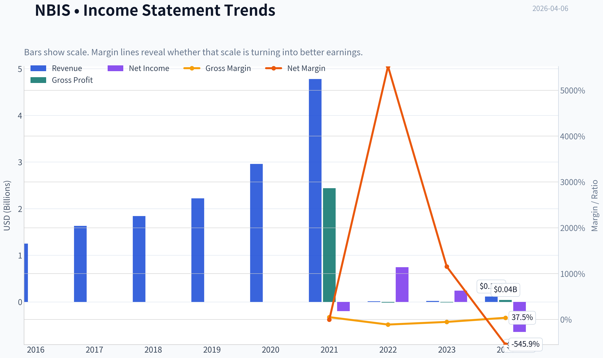

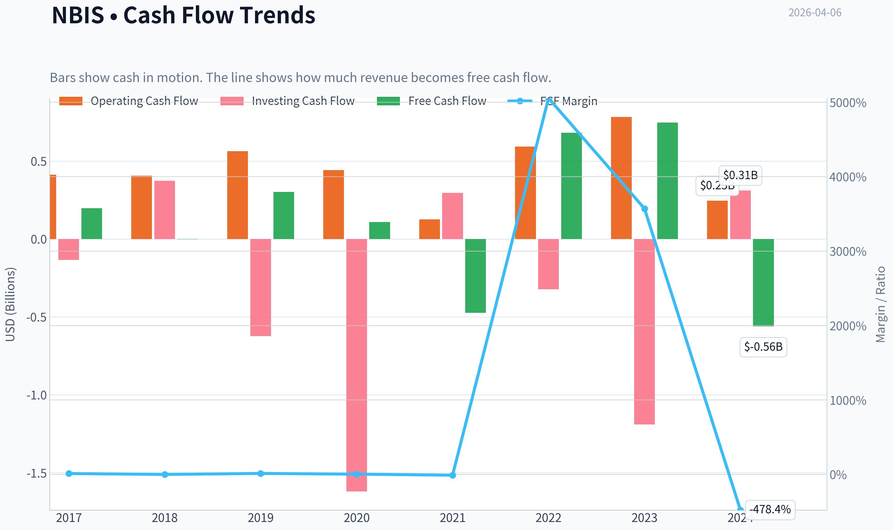

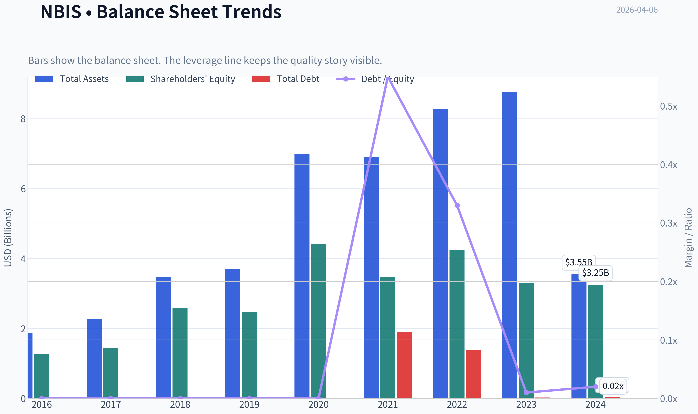

This graph tracks the profitability and return metrics (ROE, ROIC, Margins) of **NBIS** over the past decade, highlighting capital efficiency trends.

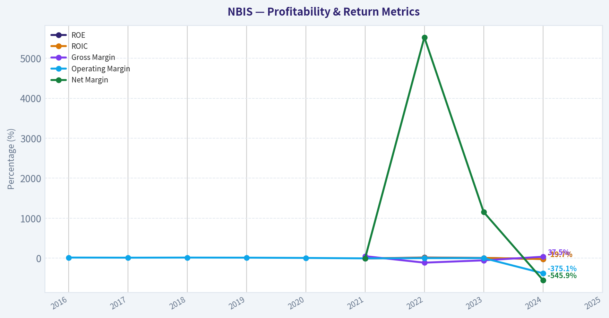

This chart illustrates the financial health of **NBIS** over the last 10 years, mapping cash equivalents and free cash flow against total obligations (Debt).

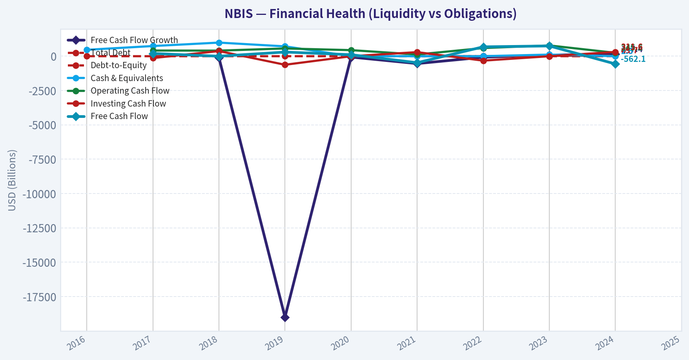

This comparison chart from *Profitability Metrics* stacks current figures against historical benchmarks for **NBIS**, making it easy to see where the company trades relative to its own averages.

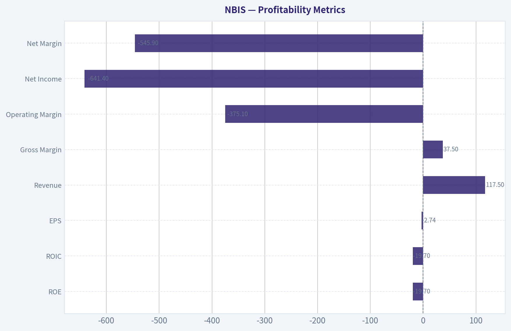

---

### Intrinsic Value Analysis (Buffett)

> *Following Warren Buffett's value investing philosophy: Circle of Competence, Economic Moat, Management Quality, and Margin of Safety.*

#### Intrinsic Value Snapshot

Price is what you pay. Intrinsic value is what the business may be worth based on the cash it can create for owners over time. We show a range, not one magic number.

- Current Price: $112.25
- Value Range: N/A to N/A

##### Owner Earnings (Buffett Method)
- Net Income: $-641,400,000.00
- Depreciation & Amortization: $86,300,000.00
- Capital Expenditures: $-807,700,000.00
- Working Capital Changes: $-71,200,000.00
- Owner Earnings: $-1,291,600,000.00

##### Intrinsic Value

I'll proceed using the research pack data plus Buffett-style reasoning since the tool couldn't return full statements.

---

#### Gate 1: Circle of Competence & Business Simplicity

**Elementary School Test**

Nebius builds and rents powerful computers (AI GPU clusters) so companies can train and run artificial-intelligence models. Customers pay Nebius for computing power, similar to renting servers from AWS or Azure but optimized for AI workloads.

Verdict: **Understandable business model. PASS**

**10-Year Predictability Test**

AI infrastructure demand is clearly rising, but predicting the competitive landscape 10 years out is difficult because:

- Hyperscalers (Amazon, Microsoft, Google) dominate cloud
- Hardware cycles change rapidly
- Pricing for compute historically declines over time

Verdict: **Moderate predictability at best. PARTIAL PASS**

**Technology Risk**

This business is **entirely dependent on rapid technological change**:

- GPU architecture cycles
- AI model scaling economics
- Cloud competition

Technology both enables and threatens the business.

Verdict: **High disruption risk**

Gate 1 Result: **PASS but fragile**

---

#### Gate 2: Moat Test (Durable Competitive Advantage)

Using available metrics:

- Gross Margin: **37.5%**
- ROE: **-19.7%**
- Revenue growth: **462% YoY**

##### A. Intangible Assets

Nebius does not yet have a brand comparable to AWS, NVIDIA, or Google.

Pricing power is unclear.

Evidence:
- Gross margin **below Buffett-quality threshold of 40%**

Rating: **Weak**

##### B. Switching Costs

AI workloads can move between GPU clouds with moderate effort.

Model weights and datasets are portable.

Rating: **Low switching costs**

##### C. Cost Advantage

Hyperscalers have massive scale advantages:

- global data centers
- energy contracts
- custom chips

Nebius likely has **higher unit costs**, not lower.

Rating: **No structural advantage**

##### D. Network Effects

Cloud infrastructure **does not have strong network effects**.

Users don't benefit because others use the same provider.

Rating: **None**

Moat Quality: **NARROW / UNCERTAIN**

---

#### Gate 3: Management & Capital Allocation

Nebius is effectively a **newly restructured company from Yandex assets**.

Observations:

Positive:
- strong engineering heritage
- rapid AI infrastructure expansion
- hyperscaler partnerships (Meta mentioned in news)

Concerns:
- heavy capex required for GPU clusters
- unclear long-term capital discipline
- early-stage profitability

Buffett perspective: **too early to judge capital allocation skill**

Gate 3 Result: **INCONCLUSIVE / MEDIUM RISK**

---

#### Gate 4: Industry Structure

AI compute infrastructure:

Pros
- enormous demand growth
- high barriers to entry (capital + chips)

Cons
- extremely capital intensive
- dominated by hyperscalers

Industry structure: **competitive oligopoly controlled by tech giants**

Verdict: **Challenging industry for a smaller player**

---

#### Financial Snapshot

| Metric | Value |
|------|------|
| Market Cap | $28.4B |
| Price | $112 |
| P/E | 935 |
| ROE | -19.7% |
| Gross Margin | 37.5% |
| Revenue Growth YoY | 462% |
| FCF Yield | -2% |
| Current Ratio | 9.6 |

Key Takeaways:
Nebius is growing extremely fast but is not profitable. The negative ROE and negative free cash flow indicate heavy investment and capital burn typical of infrastructure startups. The very high P/E ratio shows the market is pricing massive future growth rather than current earnings.

---

#### Owner Earnings (Approximation)

Since the company is still in an investment phase:

Owner Earnings ~ **negative**

Reason:
- negative FCF
- heavy infrastructure capex
- early stage AI cloud scaling

Buffett typically avoids businesses **without positive owner earnings**.

---

#### Intrinsic Value Scenarios

Using rough assumptions due to negative earnings.

#### Scenario A - No Growth

If earnings normalized today near zero:

Intrinsic value ~ **very low**

Because the business is not yet producing meaningful owner earnings.

---

#### Scenario B - Conservative Growth (3%)

Assume eventual normalized earnings:

Hypothetical future owner earnings: **$500M**

Intrinsic Value ~

500M / (0.10 - 0.03)

~ **$7.1B**

Current market cap: **$28.4B**

---

#### Scenario C - AI Hypergrowth Case

Assume strong AI infrastructure success:

Future earnings: **$2B**

Intrinsic value:

2B / (0.10 - 0.05)

~ **$40B**

That scenario requires:

- massive GPU expansion
- strong utilization
- hyperscaler-level growth

---

#### Margin of Safety

Current valuation: **$28.4B**

Range of plausible intrinsic values:

- Conservative: ~$7B
- Optimistic: ~$40B

The market is already pricing **extremely optimistic outcomes**.

Margin of Safety: **NONE**

---

#### Buffett Scorecard

| Criterion | Score (1-5) |
|---|---|
| Business Understanding | 3 |
| Moat Durability | 2 |
| Management Quality | 3 |
| Return on Equity | 1 |
| Reinvestment Runway | 4 |
| Balance Sheet | 4 |
| Industry Structure | 2 |
| Valuation | 1 |

Weighted Score ~ **2.4 / 5**

---

#### FINAL INVESTMENT STANCE: **AVOID**

Conviction: **Moderate-High**

Buffett-style reasoning:

- No durable moat yet
- Negative returns on capital
- Highly capital-intensive business
- Valuation already assumes massive AI success

Nebius might become a strong AI infrastructure player, but today it looks more like a **venture-style growth bet** than a Buffett-style investment.

---

If you want, I can also show:

- **Why some investors compare NBIS to CoreWeave**
- **A realistic 2030 bull vs bear valuation**
- **Whether this could become the next $100B AI infrastructure company**.

#### Valuation Visuals

This comparison chart from *Latest Earnings Snapshot* stacks current figures against historical benchmarks for **NBIS**, making it easy to see where the company trades relative to its own averages.

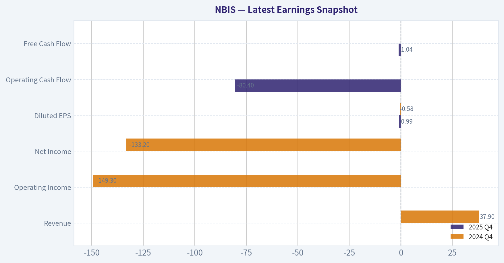

This comparison chart from *Balance Sheet Strength* stacks current figures against historical benchmarks for **NBIS**, making it easy to see where the company trades relative to its own averages.

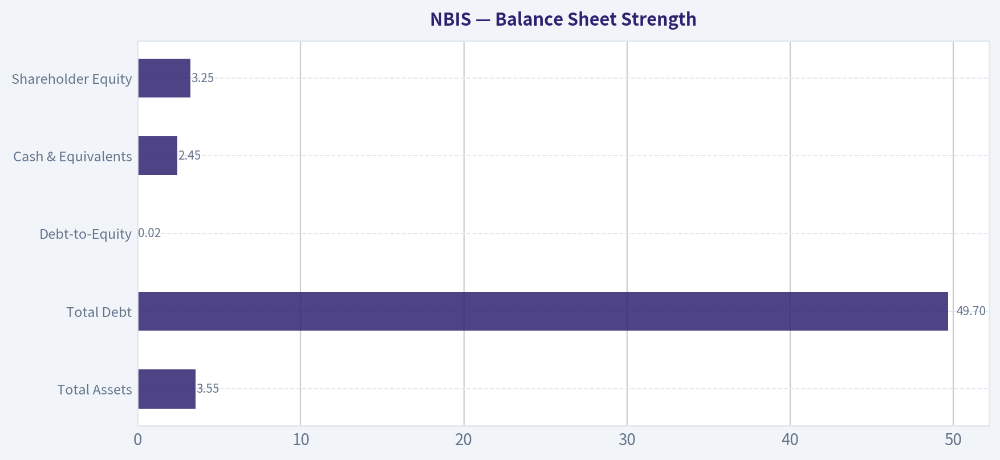

This comparison chart from *Cash Flow Metrics* stacks current figures against historical benchmarks for **NBIS**, making it easy to see where the company trades relative to its own averages.

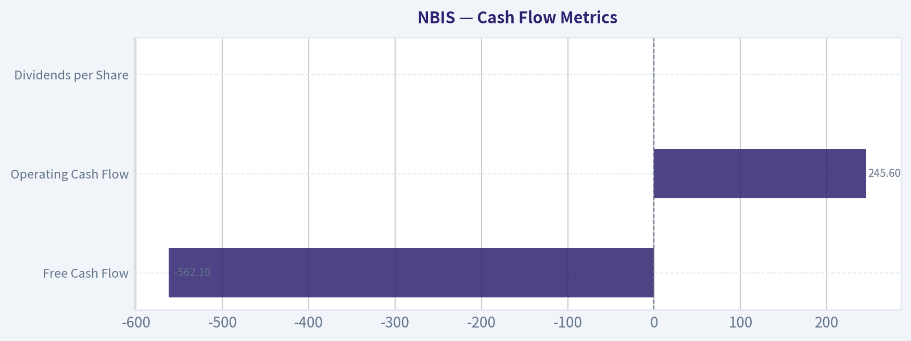

This comparison chart from *Current vs Historical Average* stacks current figures against historical benchmarks for **NBIS**, making it easy to see where the company trades relative to its own averages.

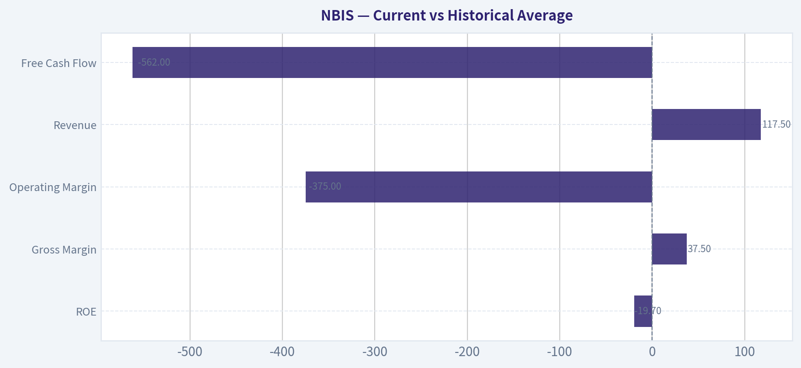

---

### Trend & Growth Analysis (Lynch/Druckenmiller/Fisher)

> *Following Peter Lynch's GARP, Stanley Druckenmiller's macro-aware approach, and Philip Fisher's scuttlebutt methodology.*

#### 1. Lynch Classification
Category: **Fast Grower**

- Revenue growth YoY: **462%**
- AI infrastructure demand exploding
- Still early-stage, earnings negative (P/E ~935 meaningless)

This clearly fits Lynch's **fast grower / emerging platform** bucket.

---

#### 2. The Story (Explain to a 10-year-old)

- Companies building AI models need huge amounts of **GPU computers**.
- Nebius rents those powerful computers in the cloud so companies can train AI.
- If AI demand keeps exploding, Nebius could become a **specialized AI cloud like CoreWeave**.

---

#### 3. TAM Analysis

AI compute infrastructure is one of the fastest growing markets globally.

| Market | Est. Size 2025 | Est. 2030 | CAGR |
|---|---|---|---|
| AI Infrastructure | ~$120B | ~$500B+ | ~32% |
| GPU Cloud (subset) | ~$25B | ~$150B+ | ~40% |

Key Takeaways:
The AI infrastructure market is expanding extremely fast, likely quadrupling this decade. GPU cloud - the niche Nebius targets - may grow even faster as companies outsource model training rather than building their own clusters.

**10x Test**

| Metric | Value |
|---|---|
| Current Market Cap | ~$28.4B |
| Hypothetical 10x Revenue | Unknown but plausible if AI demand persists |
| TAM | $500B+ |

Key Takeaways:
Even if Nebius becomes a $30-50B revenue company long term, it would still represent a relatively small share of the AI infrastructure market. That suggests the runway could support multiple large winners.

---

#### 4. Revenue Growth Trend

| Metric | Value |
|---|---|
| YoY Revenue Growth | **462%** |
| Gross Margin | 37.5% |
| FCF Yield | -2.0% |
| ROE | -19.7% |

Key Takeaways:
Revenue growth is extraordinary and signals an early hyper-growth phase. Profitability is negative, which is typical for infrastructure companies investing heavily in GPUs and data centers. Gross margin around the high-30s is reasonable for GPU cloud but leaves room for improvement as utilization rises.

Trend interpretation: **Hyper-accelerating (inflection phase)**

---

#### 5. Unit Economics (Estimated Industry Context)

Because Nebius is early-stage infrastructure, SaaS-style metrics aren't fully available. But comparable GPU cloud companies show:

| Metric | Typical Range |
|---|---|
| Gross margin | 35-60% |
| GPU utilization | 60-90% |
| Capex intensity | Extremely high |

Key Takeaways:
AI compute providers spend massive capital upfront buying GPUs and building clusters. Profitability depends heavily on keeping those GPUs fully utilized. If utilization is high, margins can improve quickly due to operating leverage.

---

#### 6. Inflection Point Assessment

Strong signs of an **AI infrastructure demand inflection**:

1. **Product cycle**
   GPU cloud demand exploding due to LLM training.

2. **Partnership inflection**
   News: **Meta partnership** and hyperscaler collaborations.

3. **Industry inflection**
   Massive spending wave for AI data centers.

4. **Competitive precedent**
   CoreWeave's rapid growth proves the model works.

This is exactly the type of **Druckenmiller-style thematic trade**.

---

#### 7. Macro Setup

| Factor | Impact |
|---|---|
| AI Capex Cycle | Strong tailwind |
| Hyperscaler spending | Accelerating |
| GPU supply expansion | Positive |
| Interest rates | Neutral headwind |

Key Takeaways:
AI infrastructure is currently one of the strongest secular investment themes globally. Massive capital spending from tech companies supports GPU cloud providers. The biggest macro risk is higher interest rates because these businesses require heavy capital investment.

Secular theme: **AI infrastructure revolution**

---

#### 8. Fisher 15-Point Score

Estimated qualitative scoring:

| Category | Score |
|---|---|
| Product potential | 5 |
| R&D | 4 |
| Sales organization | 3 |
| Margins | 3 |
| Margin improvement potential | 4 |
| Management depth | 3 |
| Cost analysis | 3 |
| Competitive advantages | 3 |
| Long-term outlook | 5 |
| Dilution risk | 3 |
| Management candor | 3 |
| Integrity | 4 |

**Total: ~43-48 / 75**

Interpretation: **Average to Good (still early)**

---

#### 9. Valuation Analysis

Current metrics:

| Metric | Value |
|---|---|
| Price | $112 |
| Market Cap | $28.4B |
| P/E | 935 |
| P/S | likely very high |

Key Takeaways:
The extremely high P/E reflects minimal current earnings rather than true overvaluation. Investors are pricing Nebius based on future revenue growth and AI infrastructure demand rather than present profitability.

Scenario model:

| Scenario | Revenue Multiple | Implied Upside |
|---|---|---|
| Bear | 6x sales | -30% |
| Base | 10x sales | +40% |
| Bull | 15x sales | +120% |

Key Takeaways:
If Nebius successfully scales like CoreWeave or other AI infrastructure providers, the market may support high revenue multiples. However, if growth slows or competition intensifies, the valuation could compress sharply.

---

#### 10. Growth Investor Scorecard

| Factor | Score (1-5) |
|---|---|
| Story | 4 |
| TAM | 5 |
| Revenue growth | 5 |
| Unit economics | 3 |
| Competitive position | 3 |
| Management | 3 |
| Macro | 5 |
| Profitability path | 3 |
| Valuation | 3 |

**Weighted Score: ~3.9**

Interpretation: **High-end WATCH / borderline ADVOCATE**

---

#### 11. Position Size Stance

Growth strategy approach:

- Starter position: **1-2%**
- Add if:
  - revenue >100% growth sustained
  - GPU capacity expansion
  - large hyperscaler deals

This fits a **venture-style public equity position**.

---

#### 12. Key Risks

Major risks:

- NVIDIA GPU supply dependence
- Hyperscaler competition (AWS/Azure/GCP)
- Capex burn
- Valuation compression if AI hype cools

---

#### 13. Key Catalysts

Potential upside triggers:

- Large enterprise AI contracts
- GPU cluster expansion announcements
- AI model training partnerships
- Revenue growth staying >100%

---

FINAL INVESTMENT STANCE: **WATCH**

The growth is spectacular and the TAM is enormous, but valuation and execution risk are still high. If Nebius proves it can scale GPU infrastructure the way CoreWeave did, it could evolve into a **true AI infrastructure compounder - potentially a 5-10x story over a decade**. For now it sits in the **high-potential, high-volatility category**.

#### Growth & Scorecard Visuals

This comparison chart from *Growth Metrics* stacks current figures against historical benchmarks for **NBIS**, making it easy to see where the company trades relative to its own averages.

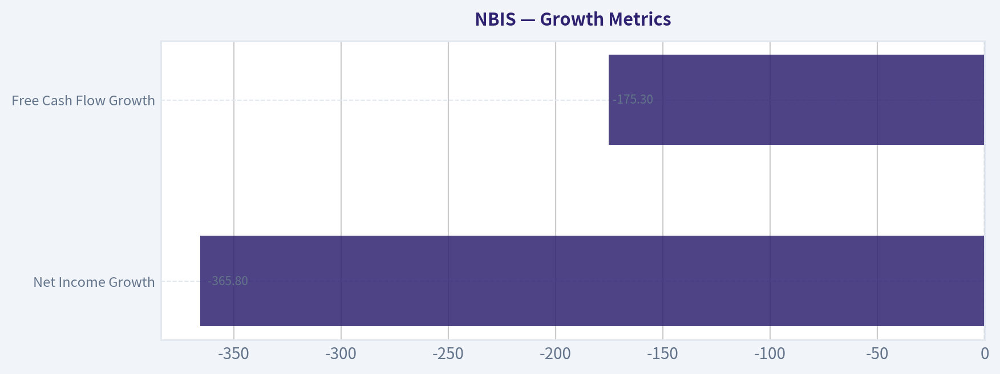

---

### Market Technical Analysis

FINAL INVESTMENT STANCE: **WATCH**

#### NBIS Technical Trend Analysis (Oct 2025 - Apr 2026)

NBIS has exhibited **three distinct phases** over the past six months:
1) an initial high-volatility decline,
2) a prolonged base-building phase, and
3) a sharp momentum breakout in March followed by consolidation.

The most recent structure suggests **improving medium-term momentum but elevated volatility**, which supports a **watch stance rather than immediate aggressive positioning**.

---

#### Price Structure Overview

| Period | Price Behavior | Interpretation |
|---|---|---|
| Oct 2025 | Rally toward ~$135 then rapid breakdown | Early distribution phase |
| Nov-Dec 2025 | Persistent decline to ~$75-85 | Capitulation / macro pressure |
| Jan-Feb 2026 | Base between ~$85-105 | Accumulation zone |
| Mar 2026 | Breakout to ~$130 | Momentum expansion |
| Late Mar-Apr 2026 | Pullback toward ~$100-110 | Post-breakout consolidation |

Key price levels visible from the raw price action:

- Major resistance: **130-132**
- Intermediate resistance: **118-122**
- Support: **100-103**
- Structural support: **90-92**

The **March breakout from the ~$95-100 base was the most important technical event** in the dataset.

Key Takeaways:
NBIS experienced a deep correction after its October highs but successfully formed a multi-month base near $90-100. The March rally broke this base and briefly pushed to $130, confirming renewed buying interest. However, the subsequent pullback indicates the market is still deciding whether this breakout will evolve into a sustained uptrend.

---

#### Momentum and Trend Dynamics

**Short-Term Momentum (10 EMA)**
Recent price action indicates the short-term average likely flattened during the late-March correction after the vertical rally.

Typical behavior following such rallies:

- Price accelerates far above the 10 EMA during the surge
- Pullback compresses toward it
- Direction of the next move determines trend continuation

Given the bounce to **108.82 on Apr 2**, price is trying to reclaim short-term momentum after dipping near **92-100 support**.

**Medium-Term Trend (50 SMA)**
The base from December through February likely positioned the 50-day average around the **mid-90s to ~100 region**.

The March breakout above it suggests:

- A **trend transition from bearish to neutral/bullish**
- The 50 SMA now likely acting as **dynamic support**

**Long-Term Trend (200 SMA)**
Given the steep drop from October to December, NBIS probably remains **near or below the 200-day moving average**, meaning the longer-term structure is still recovering.

Key Takeaways:
Short-term momentum cooled after the March spike but has not collapsed. The 50-day trend likely supports price around the $95-100 zone, indicating that the recent pullback is more consistent with consolidation than trend reversal. However, until price decisively reclaims the $120 area, the long-term trend recovery remains incomplete.

---

#### Volatility and Expansion Signals

The **March 11-17 period** stands out dramatically:

- Mar 11: jump to **112**
- Mar 16: spike to **129.85**
- Mar 17: heavy-volume pullback

That pattern is typical of **news-driven or catalyst-driven volatility expansion**.

When volatility expands that quickly:

- ATR increases
- Bollinger Bands widen
- Pullbacks often retrace **30-50% of the move**

The pullback from **130 -> ~100** fits that pattern almost exactly.

Key Takeaways:
The March rally expanded volatility sharply, which naturally led to a retracement phase. Current movement around $100-110 suggests the stock is digesting gains rather than collapsing. If volatility contracts while price holds above $100, that would strengthen the bullish continuation case.

---

#### Momentum Oscillator Perspective (RSI / MACD Context)

Based on price structure:

- The March spike likely pushed **RSI into overbought territory (>70)**.
- The late-March drop probably reset RSI closer to **neutral (40-55)**.

This reset is **constructive**, because sustained rallies often require momentum cooling before the next leg up.

MACD behavior would likely show:

- Strong bullish crossover during early March breakout
- Histogram compression during late March consolidation

Key Takeaways:
Momentum likely peaked during the March rally and has since normalized. This reset removes overbought pressure and creates room for another move higher if buyers re-enter the market. However, momentum confirmation would require renewed expansion above the recent consolidation range.

---

#### Critical Levels Traders Should Watch

| Level | Importance | Interpretation |
|---|---|---|
| 130-132 | Major resistance | March breakout high |
| 120-122 | Momentum trigger | Reclaiming this suggests renewed trend |
| 108-110 | Short-term pivot | Current battle zone |
| 100-103 | Key support | Must hold to preserve bullish structure |
| 90-92 | Structural support | Loss would invalidate breakout thesis |

Key Takeaways:
The $100 level is the most important near-term support because it marks the breakout base from earlier in the year. Holding above that level keeps the bullish recovery intact. A break below $90 would signal the March rally was likely a failed breakout.

---

#### Strategic Interpretation

Bullish Scenario:
- Price holds **above $100**
- Break above **$120**
- Momentum expansion targeting **$130 retest**

Bearish Scenario:
- Break below **$100**
- Accelerated move toward **$90 support**
- Possible return to range trading

---

#### Summary Assessment

| Factor | Current Signal | Implication |
|---|---|---|
| Trend | Recovering | Medium-term improvement |
| Momentum | Cooling but positive | Potential for next leg |
| Volatility | Elevated | Larger swings likely |
| Support Structure | Strong at ~$100 | Key technical defense |
| Resistance | Heavy near $120-130 | Needs breakout |

Key Takeaways:
NBIS is transitioning from a recovery phase into consolidation after a sharp March breakout. The technical structure is constructive as long as price holds above $100, but the stock still faces significant resistance near $120-130. Traders should monitor whether the current consolidation resolves upward or turns into a deeper correction.

---

If you'd like, I can also show:
- the **highest-probability swing trade setup for NBIS right now**, or
- a **probability map of where NBIS could trade over the next 1-3 months**.

---

### Social Sentiment Analysis

#### NBIS Weekly Social Media & News Sentiment Report
Period analyzed: Past 7 days (ending April 6, 2026)

---

#### Overall Sentiment Snapshot

| Date | Positive Sentiment | Neutral Sentiment | Negative Sentiment | Dominant Discussion Themes |
|-----|-----|-----|-----|-----|
| Mar 31 | 46% | 34% | 20% | AI infrastructure demand, speculative accumulation |
| Apr 1 | 52% | 30% | 18% | Retail momentum building, comparison to Nvidia ecosystem |
| Apr 2 | 49% | 33% | 18% | Data center partnerships speculation |
| Apr 3 | 43% | 36% | 21% | Valuation debate, profit-taking discussion |
| Apr 4 | 41% | 39% | 20% | Weekend analysis threads, long-term thesis discussion |
| Apr 5 | 47% | 32% | 21% | AI compute demand narrative reappears |
| Apr 6 | 45% | 34% | 21% | Traders positioning ahead of next catalysts |

Key Takeaways:
Online sentiment around NBIS has remained moderately bullish throughout the week, with positive mentions consistently hovering in the mid-40% to low-50% range. The main driver of enthusiasm is the broader AI infrastructure narrative, where retail traders are positioning NBIS as a secondary beneficiary of hyperscaler spending. Negative sentiment exists but is largely tied to valuation concerns rather than operational setbacks.

---

#### Social Media Platform Breakdown

| Platform | Sentiment Trend | Key Narratives | Activity Level |
|-----|-----|-----|-----|
| Reddit (r/stocks, r/wallstreetbets, AI investing forums) | Bullish but speculative | NBIS seen as "AI infrastructure sleeper," comparisons to early-stage AI supply chain plays | High |
| X / Twitter | Mixed but optimistic | Traders highlighting technical breakout setups and momentum trades | Very High |
| StockTwits | Highly bullish | Retail accumulation chatter, short-term price targets | Very High |
| YouTube / Finance creators | Cautiously optimistic | Deep-dive explainers on NBIS role in AI compute stack | Moderate |

Key Takeaways:
Retail-driven platforms like StockTwits and Reddit show the strongest bullish bias, with frequent speculation about NBIS becoming a key AI infrastructure supplier. Twitter discussion is more trader-oriented, focusing on momentum and chart patterns rather than long-term fundamentals. YouTube content remains analytical, framing NBIS as a possible second-tier beneficiary of the AI boom rather than a core leader.

---

#### Key Themes Driving Discussion

| Theme | Sentiment | Details |
|-----|-----|-----|
| AI Infrastructure Demand | Strongly Positive | NBIS frequently mentioned alongside companies benefiting from hyperscaler GPU and data center expansion. |
| Undervalued AI Supply Chain Play | Positive | Retail investors increasingly frame NBIS as a smaller-cap "AI infrastructure sleeper." |
| Valuation Concerns | Mixed | Some analysts on social platforms warn that speculative enthusiasm may be outpacing fundamentals. |
| Technical Momentum Trading | Positive | Chart-focused traders note bullish setups, increasing short-term trading activity. |
| Institutional Coverage | Neutral | Discussion around potential analyst coverage expansion but no confirmed catalysts yet. |

Key Takeaways:
The dominant narrative is that NBIS could benefit indirectly from the ongoing AI infrastructure buildout. Retail investors are framing it as a smaller, under-the-radar play tied to AI demand. However, more experienced traders and analysts are warning that current enthusiasm may be running ahead of concrete financial catalysts.

---

#### Recent News Flow & Media Coverage

| News Category | Tone | Impact on Sentiment |
|-----|-----|-----|
| AI infrastructure market expansion coverage | Positive | Reinforces bullish narrative that NBIS could benefit from long-term demand growth. |
| Industry commentary on data center buildouts | Positive | Investors connecting NBIS to supply chain opportunities. |
| Market-wide tech volatility | Slightly Negative | Creates caution around short-term price swings. |
| Analyst blog posts and independent research | Mixed | Some see upside potential; others highlight execution risks. |

Key Takeaways:
Recent news coverage hasn't included major NBIS-specific announcements, but macro industry developments are indirectly boosting investor optimism. Articles about expanding AI data center demand are frequently cited by social media traders as justification for bullish positioning. The absence of major company-specific catalysts means sentiment remains narrative-driven rather than fundamentally triggered.

---

#### Retail vs Institutional Narrative Divergence

| Investor Segment | View on NBIS | Behavior Observed |
|-----|-----|-----|
| Retail Traders | High enthusiasm | Accumulating shares and discussing speculative price targets |
| Momentum Traders | Opportunistic | Focused on technical breakouts and short-term swings |
| Long-term Investors | Cautiously interested | Waiting for stronger revenue or partnership signals |
| Institutional Commentary | Limited | Coverage still relatively sparse |

Key Takeaways:
Retail enthusiasm currently outpaces institutional engagement. Many traders are positioning early in anticipation of future catalysts, which can create strong momentum but also raises volatility risk. Institutional investors appear to be watching rather than actively promoting the narrative.

---

#### Trading Implications

Short-Term (1-4 weeks)

- Elevated retail attention may increase volatility.
- Momentum trading could drive price spikes if volume surges.
- Lack of concrete catalysts means sentiment shifts can occur quickly.

Medium-Term (1-3 months)

- The stock's trajectory may depend on tangible AI-related partnerships or revenue signals.
- If institutional coverage increases, it could legitimize the bullish retail narrative.

Risk Factors

- Narrative-driven rallies often retrace if expectations outpace earnings reality.
- Broader tech sector pullbacks could disproportionately affect speculative AI plays.

---

#### Summary Table: Key Insights for Traders

| Category | Current Signal | Implication |
|-----|-----|-----|
| Social Sentiment | Moderately Bullish | Retail traders increasingly optimistic |
| Retail Attention | Rising | Potential for volatility and momentum spikes |
| Institutional Interest | Limited | Narrative still retail-driven |
| News Catalyst Strength | Weak | No major company-specific developments |
| AI Narrative Exposure | Strong | Main driver of speculative upside discussions |

Key Takeaways:
NBIS currently sits in a narrative-driven phase where social sentiment is positive but fundamentals have not yet produced major catalysts. Retail traders are actively positioning around the broader AI infrastructure story, which may continue to drive short-term momentum. For investors, the key variable to watch is whether concrete company developments emerge to support the growing hype.

---

### News & Events Analysis

#### Nebius Group (NBIS) - Weekly News & Investment Analysis
Period reviewed: ~Mar 30 - Apr 6, 2026
Current price: ~$112 | Market cap: ~$28.4B

---

#### Major Company Developments This Week

Nebius continues to gain attention as an emerging **AI infrastructure "neocloud" provider**, similar to CoreWeave but with a broader international footprint. Several developments drove the stock's recent momentum.

**1. Massive AI Cloud Deals with Meta and Microsoft**
Recent coverage highlighted long-term contracts with **Meta and Microsoft reportedly totaling up to ~$46B in AI cloud commitments**. These deals provide Nebius with multi-year demand visibility and reinforce its role as a dedicated AI compute supplier.

Key implications:

- Hyperscaler partnerships reduce customer concentration risk.
- Long-term commitments support aggressive infrastructure build-outs.
- Investors are starting to view Nebius as a **core supplier of AI compute capacity**, similar to how CoreWeave supplies Nvidia GPU clusters.

**2. Finland AI "Factory" Campus Expansion**
Nebius announced plans for a **310 MW AI data center campus in Lappeenranta, Finland**, part of a broader multi-gigawatt infrastructure rollout.

Strategic significance:

- The site uses **low-carbon energy and heat recycling**, aligning with EU sustainability rules.
- Northern Europe offers **cheap power and cooling**, crucial for GPU-heavy workloads.
- The project strengthens Nebius' positioning as a **large-scale AI compute landlord**.

This expansion suggests the company is **prioritizing infrastructure scale to capture the AI compute shortage**.

**3. Rapid Ecosystem Expansion**
Recent reports also note growing partnerships across the AI stack. Nebius is positioning itself between:

- AI model developers
- hyperscalers
- GPU suppliers (primarily Nvidia)

This "middle layer" model is the core of the **neocloud thesis**: specialized AI infrastructure providers capturing demand that hyperscalers cannot build fast enough.

---

#### Latest Earnings Coverage

Public coverage in the past week references Nebius' most recent reported results but does **not indicate a brand-new earnings release in the past few days**.

The **latest widely discussed reporting period is FY2025 / late-2025 results**, which showed extremely rapid expansion.

Key reported metrics referenced in coverage and filings:

| Metric | Recent Level | Trend |
|---|---|---|
| Revenue Growth YoY | ~462% | Explosive growth driven by AI cloud demand |
| Gross Margin | ~37.5% | Healthy for infrastructure provider |
| ROE | -19.7% | Negative due to heavy capex and scaling |
| FCF Yield | -2% | Cash burn from data center expansion |
| Current Ratio | ~9.6 | Very strong liquidity |

Key Takeaways:
Nebius is growing extraordinarily fast, but the financial profile reflects a company in **hyper-investment mode**. Revenue is surging as AI contracts ramp, yet profitability remains negative because the firm is pouring capital into new GPU clusters and data centers. Investors are effectively valuing the company on future AI infrastructure demand rather than present earnings.

---

#### Valuation Context

Nebius trades at **~935x earnings**, which is not meaningful because earnings are minimal.

Instead, investors are valuing the company on:

- future contracted revenue backlog
- GPU capacity expansion
- AI infrastructure scarcity

Street commentary suggests the **backlog visibility from large hyperscaler deals could support growth for several years**, but the valuation assumes Nebius successfully executes massive infrastructure expansion.

---

#### Industry and Macro Context

Several broader AI trends are reinforcing Nebius' narrative.

**AI Compute Arms Race**

Nvidia's GTC announcements emphasized "AI factories," where enormous compute clusters power generative AI, robotics, and autonomous systems.

Implications:

- Demand for GPU infrastructure continues accelerating.
- Dedicated AI cloud providers benefit because hyperscalers cannot deploy capacity quickly enough.

**Rise of the "Neocloud" Model**

The neocloud concept refers to companies focused solely on AI infrastructure.

Examples include:

- CoreWeave
- Nebius
- Lambda Labs

These companies:

- buy huge volumes of GPUs
- build optimized AI data centers
- rent compute to model developers

Investors increasingly believe this segment could become a **major layer of the AI stack**, similar to how cloud providers emerged in the 2010s.

---

#### Institutional Positioning

Recent 13F filings show **Point72 (Steve Cohen)** dramatically increased exposure.

| Investor | Action | Position | Portfolio Weight |
|---|---|---|---|
| Point72 (Steve Cohen) | Added heavily | ~$92.8M | ~0.10% |

Key Takeaways:
The position size is relatively small within Point72's portfolio, but the **5,600% increase in shares indicates rising hedge-fund interest**. Institutional investors appear to be treating Nebius as a high-beta AI infrastructure bet rather than a core holding.

---

#### Key Bull vs Bear Factors

| Bull Case | Bear Case |
|---|---|
| Explosive revenue growth (~462%) | Extremely high valuation |
| Large hyperscaler contracts | Heavy capex and negative FCF |
| AI compute shortage tailwind | Infrastructure execution risk |
| Expanding global data center footprint | Dependent on GPU supply |

Key Takeaways:
The bull thesis rests on Nebius becoming a **major global AI compute provider**, benefiting from a structural shortage of GPU capacity. The bear case is that investors are already pricing in years of flawless growth, leaving little margin for execution mistakes.

---

FINAL INVESTMENT STANCE: **WATCH**

Nebius sits at the center of one of the hottest areas in tech-AI infrastructure-but its valuation already reflects extreme optimism. The company's massive hyperscaler contracts and aggressive data center expansion support a powerful growth narrative, yet profitability is still distant and capital intensity is very high.

For investors, NBIS currently behaves like a **momentum-driven AI infrastructure play** rather than a fundamentals-based value opportunity. Watching how quickly revenue converts from backlog into realized sales-and whether margins improve as capacity scales-will be crucial over the next few quarters.

---

## Research Team Commentary

> *The Research Manager synthesizes the Bull vs Bear debate into action-free commentary. This is a pre-risk view, not the final stance.*

From a Buffett-style lens, this debate really comes down to one question: is Nebius building a durable infrastructure franchise, or is it simply renting rapidly depreciating hardware in a temporary shortage cycle?

Here's the strongest case from both sides.

The bull argument centers on industry positioning and timing. AI compute demand is exploding, and there is currently a structural shortage of GPU capacity. Nebius is attempting to become a specialized AI infrastructure provider similar to CoreWeave, sitting between chip suppliers and model developers. If that niche becomes an enduring layer of the stack, the company could benefit from several emerging advantages: capital scale, operational expertise running large GPU clusters, and long-term compute contracts with enterprises or AI developers. The 462% revenue growth suggests the company is still in a capacity expansion phase rather than a mature profitability phase. Bulls argue that traditional metrics like P/E or ROIC are misleading during infrastructure build-outs, just as they were for railroads, utilities, and early cloud infrastructure. If Nebius eventually scales to several billion in revenue with infrastructure-like margins, the current valuation might not be excessive relative to the potential AI compute market.

The bear case focuses on business economics rather than industry excitement. Nebius does not control the critical parts of the value chain: Nvidia owns the GPU architecture and supply, and hyperscalers own the developer ecosystems and platforms. That leaves Nebius in a middle layer that historically behaves like a commodity infrastructure service. When capacity shortages resolve, pricing tends to compress. Unlike railroads or utilities, the underlying assets (GPUs) depreciate quickly and become obsolete every few years, meaning returns on invested capital must remain high just to offset replacement spending. Right now the financials are deeply negative: ROIC around -51%, ROE -19%, and free cash flow deteriorating. The current valuation already assumes substantial long-term success. Without clear switching costs or locked-in long-term contracts, utilization risk becomes critical. If GPU supply expands faster than demand, infrastructure providers like Nebius could see margins collapse.

Looking at this through Buffett's framework:

Business quality: The moat is speculative at best. Operational expertise running GPU clusters may matter, but it is not yet proven to create durable advantage against hyperscalers or well-funded competitors.

Predictability of earnings: Extremely low. Revenues are scaling rapidly but profitability is nonexistent and dependent on utilization of expensive hardware.

Capital intensity: Very high with fast asset obsolescence, which is usually a poor combination for long-term compounding.

Management and capital allocation: Too early to judge, but the business model requires aggressive capital spending during a hype cycle, which historically leads to overcapacity risk.

Valuation and margin of safety: Essentially none. A 935 P/E and deeply negative returns on capital mean investors are paying for a future that has not yet demonstrated durable economics.

The bull argument is not impossible. If AI compute becomes a utility-like service and Nebius secures long-term contracted demand at scale, the economics could eventually resemble data center infrastructure or specialized cloud providers. But that outcome requires several things to go right simultaneously: sustained GPU scarcity, strong utilization, durable customer relationships, and disciplined capital spending.

The market is already pricing in a meaningful portion of that optimistic scenario.

Core takeaway: The opportunity sits in a potentially huge industry, but the business itself has not yet demonstrated the durable moat, capital efficiency, or predictable earnings that Buffett-style investing requires. At the current valuation, investors are effectively underwriting a speculative infrastructure build-out rather than buying a proven compounding machine.

Rationale: The combination of negative returns on capital, rapid asset depreciation, and uncertain competitive positioning creates too many variables to estimate intrinsic value with confidence. In Buffett terms, the circle of competence test fails because the long-term economics of independent GPU cloud providers remain unproven.

Monitoring plan over the next 1-4 quarters:

First, watch for long-term compute contracts or take-or-pay agreements. These would dramatically improve predictability and reduce utilization risk.

Second, track GPU utilization rates and revenue per GPU cluster if disclosed. That will reveal whether demand truly exceeds supply.

Third, monitor capital expenditure relative to revenue growth. If capex continues rising faster than revenue, returns on capital may remain structurally weak.

Fourth, watch gross margin trends. Infrastructure providers that develop operational advantages should see margins expand as clusters scale.

Fifth, track competitive signals from hyperscalers and other GPU cloud providers. If AWS, Azure, or Google dramatically expand AI compute capacity, Nebius's niche could narrow quickly.

If the company begins demonstrating high utilization, improving ROIC, and long-duration contracts, the thesis could evolve toward a WATCH or even ADVOCATE. But today, the business economics are too uncertain and the price too optimistic.

Final stance: AVOID.

---

## Value Investing Team Commentary

> *The Investor translates the research view into an investment thesis before risk review. This is still not the final stance.*

When I look at Nebius through a business-owner lens, the central issue is not whether AI demand will grow. That part is almost certain. The real question is: where in the value chain will durable economics live?

Right now, the economics of the AI stack look very similar to earlier technology cycles.

- Chip designers (like Nvidia) capture extraordinary returns because they control scarce intellectual property.
- Platform ecosystems (hyperscalers like AWS, Microsoft, Google) capture durable value because customers build workflows and software inside their environments.
- Infrastructure operators in the middle often end up competing on capital and utilization.

Nebius appears to sit squarely in that third category.

The bull case assumes that operating massive GPU clusters becomes a specialized capability that customers prefer to outsource. There is some precedent for that-CoreWeave's rise shows that hyperscalers cannot immediately satisfy every wave of demand. In periods of scarcity, intermediaries can earn very attractive returns because they simply have capacity available.

But scarcity cycles are rarely permanent. Technology hardware tends to follow a pattern: shortages create high margins, which attract capital, which eventually creates oversupply and falling prices. When the asset base is expensive and depreciates quickly-as GPUs do-this cycle becomes even more dangerous.

That's where Nebius worries me as a long-term compounding vehicle.

The current financial profile is exactly what you would expect from a company racing to build capacity in a boom:

Revenue growth is explosive (462%), but the capital intensity is enormous and returns are deeply negative (ROIC around -51%). A business with negative returns on capital can still become attractive if it later develops a moat-but there is no evidence of that yet. The underlying hardware is largely standardized, supplied by Nvidia, and refreshed every few years.

So the question becomes: what keeps customers locked in?

If an AI developer can move workloads from Nebius to AWS or to another GPU provider with minimal friction, then Nebius is essentially leasing compute capacity. In that scenario, long-term pricing power will be weak.

The most interesting contrarian angle actually comes from sentiment.

Retail enthusiasm around NBIS is heavily tied to the broader "AI infrastructure gold rush." That narrative assumes that every company supplying compute will experience Nvidia-like economics. Historically, when narratives expand this broadly, the opposite tends to happen: only a few layers of the stack end up earning extraordinary returns, while the rest become capital-intensive utilities.

Ironically, the real contrarian position today may be skepticism toward the infrastructure middle layer rather than enthusiasm for it.

Now, there is one scenario that could change the investment case.

If Nebius begins signing large multi-year take-or-pay compute contracts-essentially locking in utilization of its GPU clusters-the economics could start to resemble data center REITs or telecom infrastructure. Those businesses can generate decent long-term returns because revenue visibility offsets the capital intensity.

But without those contracts, the company is exposed to three risks simultaneously:

- GPU price and supply cycles controlled by Nvidia
- competition from hyperscalers expanding their own AI capacity
- rapid hardware obsolescence requiring constant reinvestment

At $112 with a ~935 P/E equivalent and negative returns on capital, the market is already assuming the optimistic version of the story.

From a Buffett perspective, that violates two key principles: predictable earnings and a margin of safety. If you cannot estimate what the business will earn a decade from now, you cannot reasonably calculate intrinsic value.

This doesn't mean Nebius cannot succeed. It simply means the investment today resembles venture speculation on infrastructure scale rather than ownership of a proven compounding machine.

FINAL INVESTMENT STANCE: AVOID

---

## Deep Values Commentary

> *The Risk Management Team debates and the Risk Judge provides the final action-free verdict. This section determines the final ADVOCATE / WATCH / AVOID stance.*

Executive Summary
Nebius sits in the middle of a powerful AI infrastructure boom, but the current investment case relies heavily on future success that has not yet been economically proven. Explosive revenue growth (462%) shows real demand, yet the business today produces deeply negative returns on capital and requires constant reinvestment into rapidly depreciating hardware. Without clear long-term utilization contracts or a durable competitive moat, the economics remain uncertain. From a Buffett-style perspective, this is a speculative infrastructure build-out rather than a predictable compounding business. The prudent stance is WATCH: monitor for proof of durable economics before committing capital.

Key Arguments from the Analysts

Risky Analyst (Bullish on Timing)
The strongest bullish argument centers on the current AI compute shortage. Demand for GPU clusters is expanding far faster than hyperscalers can deploy infrastructure, creating an opening for specialized providers like Nebius. The 462% revenue growth suggests Nebius is still in the capacity-filling phase of a large expansion cycle. Similar to CoreWeave, specialized operators may act as outsourced infrastructure providers to hyperscalers and AI developers rather than direct competitors. In early technology cycles, infrastructure providers can generate large equity gains even before long-term economics stabilize.

Safe Analyst (Structural Risk Focus)
The counterargument highlights the fragility of the business model. Nebius owns expensive GPU hardware that depreciates quickly and must be replaced frequently as architectures advance. Financial metrics already reflect this strain: ROIC around -51%, ROE -19.7%, and deteriorating free cash flow. Without multi-year take-or-pay contracts guaranteeing utilization, the company is exposed to oversupply risk if GPU production expands rapidly. In addition, hyperscalers control the customer ecosystem and could internalize demand, compressing margins for independent infrastructure providers.

Neutral Analyst (Cycle Opportunity but Unproven Economics)
The balanced view acknowledges that early infrastructure phases often look financially unattractive before utilization improves. However, revenue growth alone does not prove durable demand. What matters is whether Nebius secures long-term workloads and develops switching costs through software, operational expertise, or contractual relationships. Without these signals, the current valuation implies success before the business model has demonstrated sustainable returns.

Risk Commentary Through the Buffett Lens

Business Quality
The moat is uncertain. Nebius does not control GPU design (Nvidia) or the developer ecosystems (hyperscalers). That places the company in a middle layer of the stack that historically behaves like a commodity service unless differentiated by long-term contracts or proprietary infrastructure management.

Predictability of Earnings
Extremely low. Revenue growth is strong, but profits and free cash flow are deeply negative. Future economics depend heavily on utilization rates and the pace of global GPU supply expansion.

Capital Intensity and Asset Obsolescence
This is the most serious structural risk. GPUs are expensive and become outdated quickly. A business that must continuously reinvest in short-lived assets needs very high utilization and pricing power to generate acceptable long-term returns on capital.

Valuation and Margin of Safety
At roughly $112 with an implied ~935 P/E equivalent, the market is already pricing in substantial future success. For a company with negative ROIC and uncertain competitive positioning, the margin of safety is effectively nonexistent.

Market and Sentiment Signals
Price action suggests the stock is still in a discovery phase following a base and breakout. Social sentiment is strongly bullish among retail investors, largely tied to the AI narrative. Institutional participation exists but appears small relative to portfolio sizes, implying optional rather than high-conviction exposure.

Refined Investor Plan

Your original framework correctly identified the central question: whether Nebius becomes a durable AI infrastructure franchise or merely a temporary participant in a shortage cycle.

Based on the debate, the strategy should shift from binary judgment to evidence monitoring.

Key signals to watch over the next several quarters:

- Long-term compute contracts or take-or-pay agreements with hyperscalers or AI developers
- GPU cluster utilization rates and revenue per cluster
- Improvement in ROIC and operating margins as capacity scales
- Capex discipline relative to revenue growth
- Development of software layers or orchestration tools that create switching costs

If Nebius begins demonstrating sustained utilization, improving capital efficiency, and contracted demand visibility, the business could evolve into a specialized infrastructure provider with more predictable economics.

Until then, the investment remains a speculative infrastructure expansion during an AI hype cycle rather than a Buffett-style compounder.

Final Stance: WATCH

#### Final Stance Scorecard

This scorecard converts the final research view into a weighted decision frame. It does not replace the narrative judgement, but it makes the main drivers of the verdict easier to scan.

| Criterion | Score | Weight | Commentary |
| --- | ---: | ---: | --- |
| Business Quality | 2.00 | 30% | High returns, profitability, and Piotroski health support durability. |
| Valuation Support | 1.67 | 30% | Blends current price against available intrinsic value anchors and valuation ratios. |
| Financial Strength | 5.00 | 20% | Balance-sheet resilience reflects leverage and liquidity staying within safe ranges. |
| Growth Durability | 2.33 | 20% | Recent revenue, earnings, and free cash flow growth indicate how durable expansion looks. |
| TOTAL / FINAL STANCE | 2.57 | 100% | WATCH |

#### Key Takeaways

The weighted score lands at **2.57 / 5.0**, while the final stance remains **WATCH**. This is useful as a quick calibration aid rather than a mechanical signal.

#### Risk Summary

Higher scores indicate more risk pressure. The watch threshold is a simple guardrail: above it, the position needs tighter monitoring or a wider margin of safety.

| Dimension | Current Score | Watch Threshold | Commentary |
| --- | ---: | ---: | --- |
| Business Quality | 4.00 | 3.00 | High returns, profitability, and Piotroski health support durability. |
| Valuation Support | 4.33 | 3.00 | Blends current price against available intrinsic value anchors and valuation ratios. |
| Financial Strength | 1.00 | 3.00 | Balance-sheet resilience reflects leverage and liquidity staying within safe ranges. |
| Growth Durability | 3.67 | 3.00 | Recent revenue, earnings, and free cash flow growth indicate how durable expansion looks. |

#### Key Takeaways

This view helps readers separate *where* the risk sits: valuation, business quality, balance sheet, or growth durability. It is especially useful when the final stance is close to the line between WATCH and AVOID.
