# NBR Deep Value Intelligence

**Analysis Date:** 2026-10-20

## Critical Disclaimer

*This analysis is generated by Deep Value Intelligence, an AI-powered multi-agent investing framework. Education & research only - not financial advice, not a financial advisor.*

---

## Table of Contents

1. Intelligence Summary
2. Analyst Team Reports
   - Fundamentals Analysis
   - Intrinsic Value Analysis (Buffett)
   - Trend & Growth Analysis (Lynch/Druckenmiller/Fisher)
   - Market Technical Analysis
   - Options Market Analysis
3. Research Team Commentary
4. Value Investing Team Commentary
5. Deep Values Commentary

---

## Intelligence Summary

### Thesis + Conditions

**Core Thesis:** # Executive Briefing

**Key Risks:**
- Decision: Do not initiate NBR at approximately $80.43.** Nabors may be a capable operator, and its 6.1x P/E could produce substantial upside if current earnings persist and cash flow improves. But current earnings have not translated into positive free cash flow, leverage and interest coverage are undisclosed, and the estimated base value of $93 provides only about **16% upside**-insufficient for a capital-intensive cyclical with meaningful earnings and financing risk.
- This is not a prediction of imminent distress. It is a judgment that owner earnings and normalized intrinsic value remain too uncertain. Keep NBR on a watchlist and reconsider after credible cash conversion, balance-sheet evidence, or a materially better price. A tiny speculative position may suit a risk-tolerant trader, but it does not meet Buffett-style requirements for a long-term core investment.
- ## Risky Analyst: the turnaround could rerate before it becomes obvious

**Confidence:** Low

---

## Analyst Team Reports

### Fundamentals Analysis

#### Latest Earnings Snapshot

*Most recent reported quarter anchored on 2026 Q2, with prior-year comparison when available.*

| Metric | 2026 Q2 | 2025 Q2 | YoY Change |
| --- | ---: | ---: | ---: |
| Revenue | $814.8M | $832.8M | -2.2% |
| Operating Income | $61.1M | $73.4M | -16.7% |
| Net Income | $-22.3M | $-30.9M | +27.8% |
| Diluted EPS | $-2.04 | $-2.71 | +24.7% |
| Operating Cash Flow | $135.2M | $151.8M | -10.9% |
| Free Cash Flow | $9.6M | $-27.1M | +135.5% |

Key Takeaways: This snapshot anchors the most recent reported quarter before the narrative analysis. It helps readers separate long-run business quality from whatever changed in the latest earnings print.

#### 17-Year Financial Metrics for NBR

*All values below are computed deterministically from raw data - not estimated by AI.*

*Issuer profile: operating company (Energy / Oil & Gas Drilling).*

#### 17-Year Financial Metrics
*Annual rows come from reported financial statements. The final TTM row is computed from the latest four quarters.*

| Metric | 2009 | 2010 | 2011 | 2012 | 2013 | 2014 | 2015 | 2016 | 2017 | 2018 | 2019 | 2020 | 2021 | 2022 | 2023 | 2024 | 2025 | 2026 TTM |
| --- | --- | --- | --- | --- | --- | --- | --- | --- | --- | --- | --- | --- | --- | --- | --- | --- | --- | --- |
| Market Price | $935 | $1,002 | $741 | $617 | $733 | $566 | $379 | $746 | $315 | $97 | $141 | $58 | $81 | $155 | $82 | $57 | $54 | $80 |
| Market Cap | $313.57B | $340.17B | $253.58B | $211.20B | $251.95B | $188.66B | $120.41B | $226.71B | $95.84B | $669.0M | $1.01B | $411.1M | $617.1M | $1.38B | $747.7M | $526.0M | $783.0M | $1.15B |
| P/E Ratio | -3648.33 | 3554.55 | 1020.00 | 1290.18 | 1807.45 | -284.65 | -329.84 | -225.27 | -179.74 | -1.00 | -1.37 | -0.49 | -1.06 | -3.82 | -14.87 | -2.56 | 3.12 | 5.98 |
| P/B Ratio | 60.68 | 63.84 | 45.38 | 36.21 | 42.21 | 38.43 | 28.11 | 69.82 | 32.91 | 0.25 | 0.51 | 0.36 | 1.04 | 3.74 | 2.29 | 3.90 | 1.33 | 2.11 |
| ROE | -1.7% | 1.8% | 4.4% | 2.8% | 2.3% | -13.7% | -8.7% | -31.7% | -18.8% | -23.7% | -35.4% | -70.0% | -96.4% | -94.9% | -3.6% | -130.4% | 48.5% | 45.4% |
| ROIC | 4.2% | 7.1% | 7.4% | 8.8% | 6.4% | 8.1% | 5.0% | 1.0% | -0.9% | -0.3% | -0.0% | -5.4% | -4.2% | -0.6% | 14.6% | 15.4% | 14.0% | 7.7% |
| EPS | $-0.26 | $0.28 | $0.73 | $0.48 | $0.41 | $-1.99 | $-1.15 | $-3.31 | $-1.75 | $-96.51 | $-102.99 | $-118.69 | $-76.58 | $-40.52 | $-5.49 | $-22.37 | $17.39 | $13.44 |
| Revenue | $3.66B | $4.13B | $6.01B | $6.84B | $6.15B | $6.80B | $3.86B | $2.23B | $2.56B | $3.06B | $3.04B | $2.13B | $2.02B | $2.65B | $3.01B | $2.93B | $3.18B | $3.21B |
| Gross Profit | $1.68B | $1.73B | $2.27B | $2.48B | $2.17B | $2.30B | $1.49B | $883.5M | $846.2M | $1.08B | $1.11B | $801.0M | $730.7M | $987.8M | $1.22B | N/A | N/A | $598.6M |
| Gross Margin | 45.9% | 41.9% | 37.8% | 36.2% | 35.3% | 33.8% | 38.6% | 39.7% | 33.0% | 35.3% | 36.6% | 37.5% | 36.2% | 37.2% | 40.4% | N/A | N/A | 18.6% |
| Operating Margin | 12.0% | 15.7% | 14.4% | 13.3% | 9.1% | 11.7% | 8.2% | -5.3% | -5.5% | 1.9% | 2.9% | -8.0% | -4.0% | 1.7% | 14.4% | 14.2% | 14.8% | 7.7% |
| Net Income | $-85.5M | $94.7M | $248.5M | $164.8M | $140.0M | $-670.7M | $-372.7M | $-1.03B | $-546.8M | $-640.9M | $-702.9M | $-805.6M | $-569.3M | $-350.3M | $-11.8M | $-176.1M | $286.6M | $247.1M |
| Net Margin | -2.3% | 2.3% | 4.1% | 2.4% | 2.3% | -9.9% | -9.6% | -46.2% | -21.3% | -21.0% | -23.1% | -37.8% | -28.2% | -13.2% | -0.4% | -6.0% | 9.0% | 7.7% |
| Revenue Growth | N/A | 12.9% | 45.4% | 13.8% | -10.1% | 10.6% | -43.2% | -42.4% | 15.1% | 19.2% | -0.5% | -29.9% | -5.5% | 31.5% | 13.3% | -2.5% | 8.7% | 0.9% |
| Net Income Growth | N/A | -210.7% | 162.4% | -33.7% | -15.1% | -579.1% | -44.4% | 176.3% | -46.9% | 17.2% | 9.7% | 14.6% | -29.3% | -38.5% | -96.6% | 1394.3% | -262.8% | -13.8% |
| Free Cash Flow Growth | N/A | -66.2% | -431.7% | -107.5% | 444.5% | -116.4% | -73.2% | -1393.4% | -475.0% | -74.0% | -292.9% | -39.9% | 26.3% | -34.5% | -24.0% | -86.1% | -267.9% | -274.8% |
| Total Book Value | $5.17B | $5.33B | $5.59B | $5.83B | $5.97B | $4.91B | $4.28B | $3.25B | $2.91B | $2.70B | $1.98B | $1.15B | $590.7M | $369.0M | $326.6M | $135.0M | $590.7M | $544.1M |
| Total Assets | $10.64B | $11.65B | $12.91B | $13.17B | $12.16B | $11.86B | $9.54B | $8.19B | $8.40B | $7.85B | $6.76B | $5.50B | $5.53B | $4.73B | $5.28B | $4.50B | $4.79B | $4.42B |
| Total Debt | $3.94B | $4.44B | $4.62B | $4.38B | $3.91B | $4.34B | $3.66B | $3.58B | $4.03B | $3.59B | $3.33B | $2.97B | $3.26B | $2.54B | $3.14B | $2.51B | $2.49B | $2.13B |
| Debt-to-Equity | 0.76 | 0.83 | 0.83 | 0.75 | 0.66 | 0.88 | 0.85 | 1.10 | 1.38 | 1.33 | 1.68 | 2.58 | 5.52 | 6.88 | 9.62 | 18.56 | 4.22 | 3.91 |
| Cash & Equivalents | $927.8M | $641.7M | $398.6M | $524.9M | $389.9M | $501.1M | $254.5M | $264.1M | $337.0M | $447.8M | $436.0M | $472.2M | $991.5M | $451.0M | $1.06B | $389.7M | $940.7M | $509.8M |
| Shareholders' Equity | $5.17B | $5.33B | $5.59B | $5.83B | $5.97B | $4.91B | $4.28B | $3.25B | $2.91B | $2.70B | $1.98B | $1.15B | $590.7M | $369.0M | $326.6M | $135.0M | $590.7M | $544.1M |
| Operating Cash Flow | $1.62B | $1.11B | $1.46B | $1.56B | $1.42B | $1.78B | $856.6M | $531.9M | $62.8M | $325.8M | $684.6M | $349.8M | $428.8M | $501.1M | $637.9M | $581.4M | $693.3M | $702.3M |
| Investing Cash Flow | $-1.16B | $-1.67B | $-1.86B | $-1.18B | $-815.5M | $-1.72B | $-227.4M | $-382.2M | $-497.9M | $-367.1M | $-355.9M | $-165.5M | $-117.2M | $-368.7M | $-570.4M | $-555.5M | $97.1M | $15.6M |
| Free Cash Flow | $523.5M | $176.7M | $-586.1M | $44.1M | $240.0M | $-39.4M | $-10.5M | $136.4M | $-511.7M | $-133.2M | $256.8M | $154.2M | $194.7M | $127.6M | $97.0M | $13.5M | $-22.7M | $39.7M |
| FCF Margin | 14.3% | 4.3% | -9.7% | 0.6% | 3.9% | -0.6% | -0.3% | 6.1% | -20.0% | -4.4% | 8.4% | 7.2% | 9.7% | 4.8% | 3.2% | 0.5% | -0.7% | 1.2% |
| Dividends / Share | $0.00 | $0.00 | $0.00 | $0.00 | $0.00 | $0.00 | $0.00 | $0.00 | $0.00 | $0.00 | $0.00 | $0.00 | $0.00 | $0.00 | $0.00 | $0.00 | $0.00 | $0.00 |

#### Profitability Metrics
- Return on Equity (ROE): 48.5%
- Return on Invested Capital (ROIC): 15.3%
- Return on Assets (ROA): 6.0%
- Gross Margin: N/A
- Operating Margin: 14.8%
- Net Profit Margin: 9.0%

#### Liquidity Metrics
- Current Ratio: 1.56
- Quick Ratio: 1.34

#### Leverage Metrics
- Debt-to-Equity Ratio: 4.22
- Interest Coverage Ratio: 2.19
- Net Debt: $1.55B

#### Growth Metrics (Year-over-Year)
- Revenue Growth: 8.7%
- Net Income Growth: 262.8%
- Free Cash Flow Growth: -267.9%
- Revenue CAGR (3-Year): 6.3%
- Revenue CAGR (5-Year): 8.3%

#### Valuation Metrics
- P/E Ratio (TTM): 6.13
- Forward P/E: 17.56
- Price-to-Book: 2.19
- Price-to-Sales: 0.38
- PEG Ratio: 2.90
- EV/EBITDA: 4.19
- Free Cash Flow Yield: -1.9%
- Earnings Yield: 16.3%

#### Owner Earnings (Buffett Method, Code-Computed)
- Net Income: $286.6M
- + Depreciation & Amortization: $649.2M
- - Capital Expenditures: $-715.9M
- - Working Capital Changes: $72.5M
- = **Owner Earnings: $214.1M**

#### Intrinsic Value (Code-Computed)
- Current Price: $80
- **Headline Intrinsic Value (business-model routed): $24**
  Business model: cyclical - Damodaran FCFF (cyclical)
  Model spread (min-max across DCFs): $24 - $24
  Margin of safety vs. price (headline): -233.6%
  Routing note: Cyclical: margins/FCF are volatile - headline blends FCFF, reverse-DCF and owner-earnings roughly evenly; treat the range as the honest read.
- Cash Flow Method (FCF):
  Conservative: $-110
  Average: $-98
  Optimistic: $-98
- Damodaran FCFF (WACC + margins + reinvestment):
  Conservative: $-155
  Average: $24
  Optimistic: $112
  Monte Carlo band (P10-P90): $-224 - $91 (median $-41)
  P(intrinsic value > price): 11.8%
- Reverse-DCF: price implies ~2.3%/yr owner-earnings growth for 10y; trailing 3y was N/A, 5y N/A.

#### Piotroski F-Score: 6/9
- Positive Net Income: PASS
- Positive Operating Cash Flow: PASS
- ROA Improvement: PASS
- Cash Flow > Net Income: PASS
- Decreasing Debt: PASS
- Improving Current Ratio: FAIL
- No Dilution: FAIL
- Improving Gross Margin: FAIL
- Improving Asset Turnover: PASS

ANALYST STANCE: **AVOID**

#### Executive Summary

Nabors Industries is a highly cyclical oilfield-services company showing a sharp operational recovery, but the recovery has not yet translated into durable free cash flow. The latest TTM results include strong earnings, a 48.5% ROE, 15.3% ROIC, and a low reported P/E near 6.1. However, debt remains high, interest coverage is only 2.19 times, free cash flow yield is negative, and the deterministic valuation models produce a headline intrinsic value of approximately $24 versus a market price of $80.

The central investment issue is not whether Nabors can earn money during a favorable drilling cycle. It is whether those earnings can be converted into sustainable, distributable cash flow after maintenance capital expenditures and balance-sheet obligations. The 17-year record is too volatile to establish a Buffett-style predictable earnings profile.

#### Current Fundamental Snapshot

| Metric | Current value | Interpretation |
|---|---:|---|
| Market price | $80 | Near the upper portion of the recent 2024-2026 range |
| Market capitalization | $1.15B-$1.22B | Small-cap cyclical equity |
| P/E ratio | 5.98-6.13 | Appears inexpensive, but earnings are cyclical |
| Price-to-book | 2.11-2.19 | Not a sufficient standalone value signal for this capital-intensive cyclical business |
| ROE | 45.4%-48.5% | Strong current result, partly amplified by a very small equity base |
| ROIC | 7.7% TTM; 15.3% latest reported metric | Improved substantially from the loss-making period |
| Revenue | $3.21B | Up 0.9% TTM and 8.7% year over year under the latest growth dataset |
| Operating margin | 7.7% TTM; 14.8% latest reported metric | Recovery remains below the strongest historical operating periods |
| Net income | $247.1M TTM; $286.6M latest annual figure | Positive, but not yet supported by comparable free cash flow |
| Free cash flow | $39.7M TTM; negative $22.7M latest annual figure | Major weakness |
| Free cash flow yield | -1.9% | The market is not currently receiving a cash-flow return |
| Total debt | $2.13B | Very large relative to market capitalization |
| Net debt | $1.55B | Substantial financial claim ahead of equity holders |
| Debt-to-equity | 3.91 TTM; 4.22 latest reported | High leverage |
| Cash and equivalents | $509.8M | Meaningful liquidity, but not enough to offset total debt |
| Current ratio | 1.56 | Adequate near-term liquidity |
| Interest coverage | 2.19x | Thin protection if oilfield activity weakens |
| Dividends per share | $0.00 | No cash dividend |

**Key Takeaways:** Nabors looks cheap on earnings but expensive relative to sustainable cash generation. Current ROE and net income are encouraging, while negative FCF yield, high leverage, and weak interest coverage materially reduce the margin of safety.

#### Market Metrics and Valuation

The P/E ratio of approximately 6.1 is well below what would normally be considered expensive. However, the historical P/E series is not a reliable benchmark because Nabors recorded losses in most years from 2014 through 2024, producing negative or meaningless P/E ratios. The current low P/E therefore reflects a cyclical earnings rebound rather than a demonstrated long-term earnings power.

The P/B ratio near 2.1 also needs careful treatment. Nabors is an asset-heavy drilling contractor, so book value is more relevant than it would be for a software or platform company. Nevertheless, book value has fallen from approximately $6.0B in 2013 to about $544M TTM, while debt remains above $2B. That combination means the current book multiple is not an obvious bargain. More importantly, book value has been heavily affected by historical losses, impairments, and capital-cycle stress.

Price-to-sales is approximately 0.38 and EV/EBITDA is approximately 4.19. These multiples can look attractive for an oilfield-services company near the bottom of a cycle, but they do not resolve the question of whether EBITDA converts into cash after recurring rig maintenance and replacement capital expenditure.

#### Profitability Analysis

| Metric | Current | 2016-2025 average | Assessment |
|---|---:|---:|---|
| ROE | 45.4% TTM / 48.5% latest | Approximately -45.6% | Dramatic recovery, but current ROE is amplified by depressed equity |
| ROIC | 7.7% TTM / 15.3% latest | Approximately 3.5% | Improved materially, but not consistently high over the decade |
| EPS | $13.44 TTM / $17.39 latest | Generally negative over the decade | Current profitability is a sharp reversal |
| Revenue | $3.21B | Approximately $2.68B | Revenue is above the recent decade average |
| Operating margin | 7.7% TTM / 14.8% latest | Approximately 2.6% | Current margin is well above the recent average |
| Net income | $247.1M TTM / $286.6M latest | Approximately -$455M | Current profits follow years of substantial losses |
| Net margin | 7.7% TTM / 9.0% latest | Approximately -15% to -16% | Strong current improvement, but limited historical reliability |
| Gross margin | 18.6% TTM | Historical average not fully comparable because of missing years | Latest margin is below the 2016-2023 range |

**Key Takeaways:** Profitability has recovered substantially from the 2016-2022 crisis period. However, the comparison is favorable partly because the historical baseline contains very large losses; the evidence does not yet establish that current margins are durable through a complete drilling cycle.

Revenue increased from $2.13B in 2020 to $3.21B TTM, and operating margins recovered from negative levels to positive double digits in the latest annual period. Nevertheless, TTM operating margin of 7.7% is below the latest annual 14.8%, suggesting some normalization or volatility.

ROE deserves particular caution. Shareholders' equity fell from roughly $6B in 2013 to approximately $544M TTM. A moderate amount of profit earned on a severely reduced equity base can produce an exceptionally high ROE. The current ROE is therefore not equivalent to a stable, high-quality 45% return on a growing capital base.

#### Growth Analysis

| Growth metric | Current | Recent historical pattern | Interpretation |
|---|---:|---|---|
| Revenue growth | 0.9% TTM; 8.7% latest reported | Highly volatile, including declines of 29.9%, 43.2%, and 42.4% | Recovery has slowed on a TTM basis |
| Net income growth | -13.8% TTM in the deterministic table; latest reported comparison approximately +262.8% | Extremely distorted by losses and reversals | Not a dependable growth measure |
| Free cash flow growth | -274.8% TTM | Frequently negative and highly erratic | Serious weakness |
| Three-year revenue CAGR | 6.3% | Positive recovery from the pandemic trough | Moderate top-line progress |
| Five-year revenue CAGR | 8.3% | Recovery-led | Does not prove through-cycle growth |

**Key Takeaways:** Revenue growth is positive but slowing, while net income growth is distorted by the comparison with prior losses. Free cash flow growth is clearly negative, making cash generation the weakest part of the current growth profile.

The historical record shows that Nabors' revenue is driven by drilling activity, rig utilization, day rates, commodity prices, customer capital budgets, and regional operating conditions. This is not the type of recurring growth that Buffett typically prefers. A positive revenue CAGR from a depressed base should not be interpreted as a durable secular compounding rate.

#### Balance Sheet and Financial Strength

| Balance-sheet metric | Current | 2016-2025 average | Interpretation |
|---|---:|---:|---|
| Total book value | $544.1M | Approximately $1.94B | Long-term erosion of equity capital |
| Total assets | $4.42B | Approximately $6.32B | Asset base has contracted |
| Total debt | $2.13B | Approximately $3.14B | Debt has declined, but remains high |
| Debt-to-equity | 3.91 | Approximately 6.3 | Better than the recent average, still aggressive |
| Cash and equivalents | $509.8M | Approximately $579M | Adequate but not unusually strong |
| Shareholders' equity | $544.1M | Approximately $1.94B | Thin equity cushion |
| Net debt | $1.55B | Not provided as a consistent historical series | Significant claim ahead of common equity |
| Current ratio | 1.56 | Current only | Adequate short-term liquidity |
| Interest coverage | 2.19x | Current only | Vulnerable during a downturn |

**Key Takeaways:** Debt has declined from the worst recent levels, but leverage remains high relative to the equity base and market capitalization. Cash provides liquidity, but the thin equity cushion and only 2.19 times interest coverage leave shareholders exposed to a downturn in utilization or day rates.

The debt-to-equity ratio improved from 18.56 in 2024 to 4.22 in 2025 and 3.91 TTM, which is a meaningful positive. However, this improvement was driven partly by an increase in equity from a very depressed base, not simply by aggressive debt reduction. Total debt of $2.13B remains almost twice the company's market capitalization.

For a cyclical drilling company, balance-sheet strength should be assessed at the bottom of the cycle, not only during a recovery. Nabors has previously experienced major losses, shrinking book value, and weak cash generation. That history argues for a conservative valuation multiple.

#### Cash Flow and Capital Allocation

| Cash-flow metric | Current/latest | Historical observation |
|---|---:|---|
| Operating cash flow | $702.3M TTM | Positive and relatively strong |
| Capital expenditures | Approximately $715.9M in the owner-earnings calculation | Absorbs most operating cash flow |
| Free cash flow | $39.7M TTM; negative $22.7M latest annual | Weak conversion |
| FCF margin | 1.2% TTM; negative 0.7% latest annual | Very limited cash surplus |
| Owner earnings | $214.1M code-computed | Better than reported FCF, but sensitive to normalization assumptions |
| Dividends per share | $0.00 | No dividend support |

**Key Takeaways:** Nabors generates operating cash flow, but capital intensity consumes nearly all of it. The absence of a dividend is understandable given the balance sheet, but it also means shareholders currently depend almost entirely on future capital appreciation.

The gap between operating cash flow of $702.3M and TTM free cash flow of only $39.7M is important. Nabors must continuously reinvest in its rig fleet and operations to remain competitive. This makes EBITDA and operating cash flow less valuable than they would be for a low-capital-intensity business.

The deterministic owner-earnings calculation is $214.1M, consisting of $286.6M net income plus $649.2M depreciation and amortization, less $715.9M capital expenditure and the specified working-capital adjustment. This is a useful cross-check, but it should not be treated as a stable normalized figure because the company's historical free cash flow has been highly volatile.

#### Revenue Breakdown

The deterministic dataset does not provide a detailed product, geography, or segment revenue split. The best-supported presentation is therefore the consolidated operating business.

| Revenue Source | Amount ($M) | % of Total |
|---|---:|---:|
| Oilfield drilling and related contract services | $3,210M | 100% |
| Total reported revenue | $3,210M | 100% |

**Key Takeaways:** Nabors' revenue is concentrated in oilfield drilling and related services rather than diversified across unrelated business lines. This concentration creates operating leverage during strong drilling markets but also exposes the company to commodity prices, customer budgets, rig utilization, day rates, and regional energy cycles.

#### Buffett-Style Business Assessment

| Buffett criterion | Assessment | Evidence |
|---|---|---|
| Economic moat | Weak to moderate | Specialized rigs, operating expertise, customer relationships, and scale provide some advantages |
| Earnings predictability | Weak | Frequent losses and large swings in revenue, margins, EPS, and net income |
| Financial strength | Weak to moderate | Debt has declined, but leverage and interest burden remain high |
| Management performance | Mixed | Current recovery and debt reduction are positives; long-term shareholder returns have been damaged by losses and dilution |
| Capital allocation | Defensive | No dividend; capital spending is necessary and consumes most operating cash flow |
| Business durability | Cyclical rather than compounding | Dependent on drilling activity and commodity-cycle conditions |
| Valuation quality | Uncertain to unfavorable | Low P/E conflicts with negative FCF yield and model-based intrinsic value near $24 |
| Margin of safety | Insufficient | Current price is well above the headline intrinsic value |

**Key Takeaways:** Nabors has operational assets and technical capabilities, but those advantages do not create a wide moat against commodity cycles or customer spending cuts. The company's historical earnings and cash flows are not predictable enough for a classic Buffett-quality investment.

The strongest qualitative positives are:

- Specialized drilling equipment and operational expertise.
- A recovery in operating margins and ROIC.
- Declining debt from its recent peak.
- Current positive earnings and operating cash flow.
- Potential upside if global drilling activity, rig utilization, and day rates remain strong.

The principal weaknesses are:

- Severe earnings volatility over the 17-year record.
- Free cash flow that is near zero or negative despite positive operating cash flow.
- High debt relative to equity and market value.
- Low interest coverage.
- No dividend.
- Historical dilution and substantial book-value erosion.
- Dependence on a favorable energy-services cycle.

#### Three-Scenario Buffett-Style Owner Earnings DCF

The deterministic owner-earnings base is $214.1M. Estimated diluted shares are approximately 15.25 million, based on the $1.22B market capitalization and $80 share price. The hand-built calculation below uses a 10% discount rate and a 2.5% terminal growth rate.

Because Nabors is cyclical, these results are highly sensitive to whether $214.1M represents normalized owner earnings or a temporary recovery level. The pack's model-based intrinsic value of $24, produced through a cyclical Damodaran FCFF framework, remains the primary valuation anchor.

##### Hand DCF assumptions

| Scenario | Initial owner-earnings growth | Terminal growth | Discount rate | Rationale |
|---|---:|---:|---:|---|
| Conservative | 3% | 2.5% | 10% | GDP-like growth and limited confidence in cyclicality |
| Average | 5% | 2.5% | 10% | Moderate recovery with fading growth |
| Optimistic | 8% | 2.5% | 10% | Strong drilling-cycle continuation, but not perpetual high growth |

**Key Takeaways:** Even a conservative hand DCF can produce a high value if the current $214.1M owner-earnings figure is treated as sustainable. That is precisely the risk: Nabors' historical cash flow does not support high confidence that this figure is normalized.

##### DCF calculation

For the conservative case:

- Year-one owner earnings:
  $214.1M x 1.03 = $220.5M
- Year-ten owner earnings:
  $214.1M x 1.03¹⁰ = approximately $287.9M
- Present value of years 1-10:
  approximately $1.47B
- Terminal value:
  $287.9M x 1.025 ÷ (10% - 2.5%) = approximately $3.94B
- Present value of terminal value:
  approximately $1.52B
- Enterprise/equity value before net debt adjustment:
  approximately $2.99B
- Less net debt of approximately $1.55B:
  equity value of approximately $1.44B
- Implied value per share:
  approximately **$94**

For the average case:

- Year-ten owner earnings:
  $214.1M x 1.05¹⁰ = approximately $349.0M
- Present value of years 1-10:
  approximately $1.53B
- Terminal value:
  $349.0M x 1.025 ÷ 7.5% = approximately $4.77B
- Present value of terminal value:
  approximately $1.84B
- Value before net debt adjustment:
  approximately $3.37B
- Equity value after net debt:
  approximately $1.82B
- Implied value per share:
  approximately **$119**

For the optimistic case:

- Year-ten owner earnings:
  $214.1M x 1.08¹⁰ = approximately $462.5M
- Present value of years 1-10:
  approximately $1.79B
- Terminal value:
  $462.5M x 1.025 ÷ 7.5% = approximately $6.17B
- Present value of terminal value:
  approximately $2.38B
- Value before net debt adjustment:
  approximately $4.17B
- Equity value after net debt:
  approximately $2.62B
- Implied value per share:
  approximately **$172**

| DCF approach | Conservative | Average | Optimistic |
|---|---:|---:|---:|
| Hand owner-earnings DCF before net debt | $196/share | $221/share | $273/share |
| Hand DCF after approximately $1.55B net debt | $94/share | $119/share | $172/share |
| Deterministic cyclical FCFF model | Negative to deeply impaired | $24/share | $112/share |
| Headline model-based intrinsic value | - | **$24/share** | - |
| Current market price | $80/share | $80/share | $80/share |

**Key Takeaways:** The hand DCF produces a wide range because it assumes the latest $214.1M owner-earnings figure is sustainable. The cyclical FCFF framework is more conservative because it normalizes margins, reinvestment, and capital-cycle risk; it produces a $24 average value and a $112 optimistic value.

The hand DCF should therefore be treated as a sensitivity analysis rather than a definitive fair value. If normalized owner earnings are closer to the recent historical FCF median than to the latest calculated owner earnings, intrinsic value falls sharply after debt. This is why the deterministic model's $24 headline value and negative FCF-based values deserve greater weight than the simple unadjusted owner-earnings calculation.

The reverse DCF indicates that the current $80 price implies approximately 2.3% annual owner-earnings growth for ten years. That implied growth rate is not demanding in isolation, but it assumes that owner earnings remain positive and that debt does not materially impair equity value. Given the absence of a reliable three-year or five-year owner-earnings trend, the market's implied growth rate is not necessarily easy to achieve.

#### Historical Comparison and Trend Interpretation

| Metric | Current | 2016-2025 average | Current versus average |
|---|---:|---:|---|
| Revenue | $3.21B | $2.68B | Approximately 20% above average |
| Operating margin | 7.7% TTM / 14.8% latest | 2.6% | Materially above average |
| Net income | $247M TTM | -$455M | Major turnaround from losses |
| ROE | 45.4% TTM | -45.6% | Sharp reversal, but equity base is depressed |
| ROIC | 7.7% TTM / 15.3% latest | 3.5% | Improved, though below the strongest recent figures |
| Total debt | $2.13B | $3.14B | Below average, but still high |
| Cash | $510M | $579M | Slightly below average |
| Free cash flow | $39.7M TTM | $31M | Only modestly above average |
| Debt-to-equity | 3.91 | Approximately 6.3 | Improved, but remains aggressive |
| Revenue growth | 0.9% TTM / 8.7% latest | Approximately 5.5% | TTM growth below average; latest annual growth above average |
| P/E | Approximately 6.1 | Not meaningful | Historical losses make the average unusable |
| P/B | Approximately 2.1 | Distorted by large historical changes | Not a reliable standalone valuation anchor |

**Key Takeaways:** The current recovery is real in revenue, operating margin, net income, ROE, and leverage. However, free cash flow has not improved proportionally, and the historical P/E and P/B averages are too distorted to provide reliable valuation benchmarks.

#### Key Investment Insights, Red Flags, and Opportunities

| Category | Insight |
|---|---|
| Key opportunity | Continued strength in drilling activity could support utilization, pricing, margins, and debt reduction |
| Key opportunity | Current EV/EBITDA and P/E appear inexpensive if earnings remain near current levels |
| Key opportunity | Further balance-sheet improvement could materially increase equity value because the company is highly leveraged |
| Major red flag | Free cash flow yield is negative despite positive earnings |
| Major red flag | Total debt is approximately $2.13B against only $544M of equity |
| Major red flag | Interest coverage of 2.19x leaves limited room for a cyclical downturn |
| Major red flag | Earnings history includes repeated large losses |
| Major red flag | Current ROE is inflated by a severely reduced equity base |
| Major red flag | No dividend and no current cash return to shareholders |
| Valuation risk | Headline intrinsic value of $24 implies approximately 70% downside from $80 |
| Data-quality risk | Historical market-price and market-cap figures contain major discontinuities, so long-term market-multiple averages require caution |
| Catalysts | Higher rig utilization, stronger day rates, international contract wins, asset sales, and debt reduction |
| Downside catalysts | Falling oil prices, customer budget cuts, idle rigs, higher interest costs, capex overruns, or another impairment cycle |

#### Final Investment Stance

Nabors is a recovery-oriented cyclical equity, not a predictable Buffett-style compounder. Its current earnings recovery is encouraging, and the low P/E could generate upside if the drilling cycle remains strong. However, the combination of negative free cash flow yield, high leverage, thin interest coverage, no dividend, historical losses, and a headline intrinsic value near $24 creates an inadequate margin of safety at $80.

The appropriate stance is **AVOID** for a conservative value investor. More speculative investors may place Nabors on a watchlist rather than immediately shorting it, because a sustained energy-services recovery and further debt reduction could support the optimistic valuation case. A more attractive entry would require either a substantially lower share price, several years of positive free cash flow, or clear evidence that owner earnings remain durable through a weaker drilling environment.

| Final assessment | Conclusion |
|---|---|
| Business quality | Cyclical, capital-intensive, and operationally capable but not highly predictable |
| Moat | Limited to specialized assets, expertise, and customer relationships |
| Profitability | Strong current rebound, weak long-term consistency |
| Balance sheet | Improved but still highly leveraged |
| Cash generation | Insufficient and volatile |
| Valuation | Cheap on current earnings, unfavorable on normalized cash flow |
| DCF range | Model-based value approximately negative to $112; headline value approximately $24 |
| Main catalyst | Sustained drilling recovery and debt reduction |
| Main risk | Earnings and cash-flow reversal during the next downcycle |
| Final stance | **AVOID** |

**Key Takeaways:** Nabors offers cyclical upside but does not provide the predictable earnings, durable cash generation, or balance-sheet strength required for a high-confidence Buffett investment. The current price leaves too little protection against a reversal in drilling conditions or a failure of owner earnings to persist.

#### Fundamental Visuals

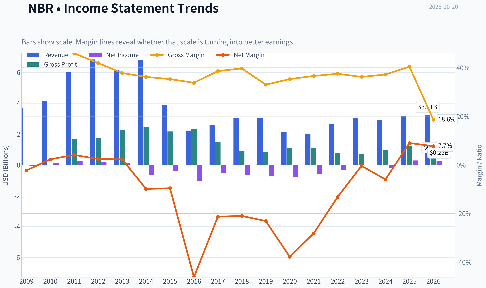

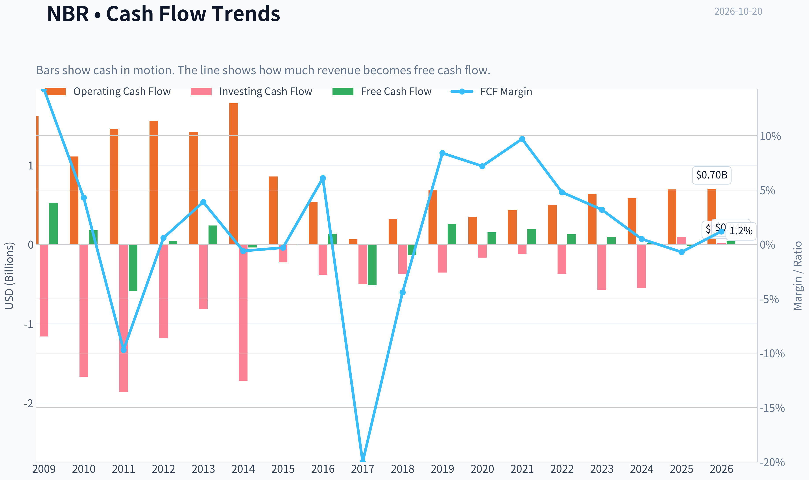

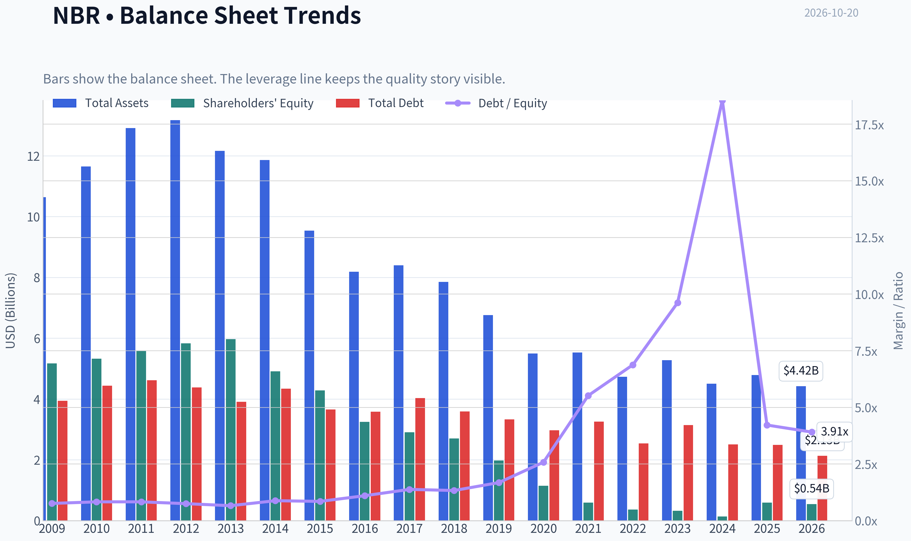

This graph tracks the profitability and return metrics (ROE, ROIC, Margins) of **NBR** over the past decade, highlighting capital efficiency trends.

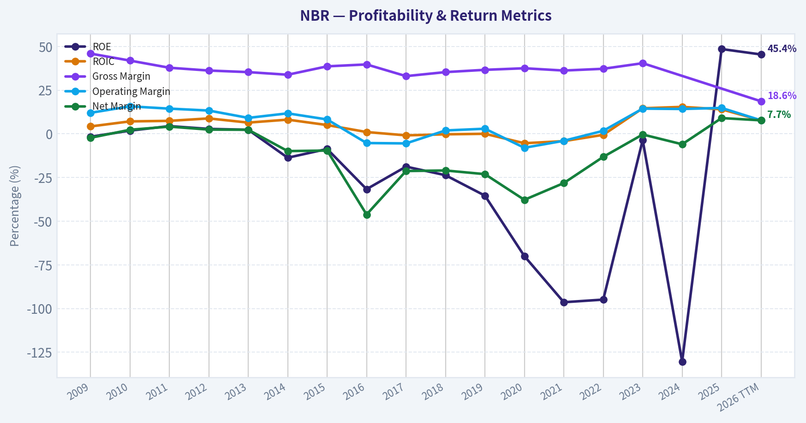

This chart illustrates the financial health of **NBR** over the last 10 years, mapping cash equivalents and free cash flow against total obligations (Debt).

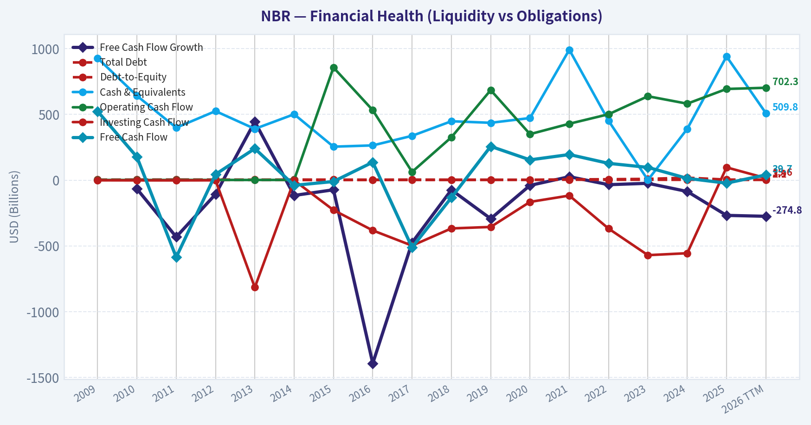

This breakdown chart from <em>Revenue Breakdown</em> shows the proportional composition for **NBR** - useful for understanding what drives or risks the business.

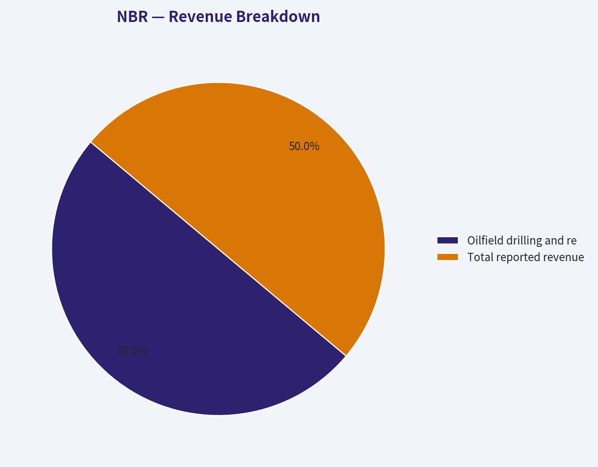

---

### Intrinsic Value Analysis (Buffett)

> *Following Warren Buffett's value investing philosophy: Circle of Competence, Economic Moat, Management Quality, and Margin of Safety.*

#### Intrinsic Value Snapshot

Price is what you pay. Intrinsic value is what the business may be worth based on the cash it can create for owners over time. We show a range, not one magic number.

- Current Price: $80.43
- Value Range (conservative to optimistic across both DCF methods): $-110.22 to $-98.28

##### Owner Earnings (Buffett Method)
- Net Income: $286,624,000.00
- Depreciation & Amortization: $649,234,000.00
- Capital Expenditures: $-715,948,000.00
- Working Capital Changes: $72,527,000.00
- Owner Earnings: $214,097,000.00

##### Intrinsic Value
###### Cash Flow Method
Uses free cash flow. Better for companies spending heavily today to grow tomorrow.
- Conservative: $-110.22
- Average: $-98.28
- Optimistic: $-98.28
- Discount Rate: 10.0%

ANALYST STANCE: **AVOID**

#### Executive Summary

Nabors Industries is an oilfield-services contractor whose earnings depend heavily on drilling activity, rig utilization, day rates, customer capital spending, and oil-and-gas cycles. The company appears statistically inexpensive at approximately 6.1 times earnings, but the more important cash-flow measure is unfavorable: the research pack reports a negative free-cash-flow yield of 1.9% and a three-model valuation headline of only $24.11 against an $80 share price.

The business is not shown to meet the hard financial-distress floor, but the combination of cyclicality, negative cash generation, capital intensity, and a substantial valuation gap makes the stock unattractive for a Buffett-style long-term holding.

#### Factor Scorecard

| Factor | Score | Assessment |
|---|---:|---|
| 1. Circle of competence and simplicity | 3/5 | The model is understandable: Nabors owns and operates drilling rigs and earns revenue from customers' drilling programs. Predictability is limited because activity and pricing follow energy cycles. |
| 2. Durable competitive advantage | 2/5 | Scale, rig technology, customer relationships, and high-specification equipment provide some advantages, but contracts remain exposed to industry oversupply and commodity-driven demand. |
| 3. Management and capital allocation | 3/5 | Recent insider buying and improved contract visibility are modest positives. However, capital allocation must be judged against the company's negative recent cash-flow profile and substantial capital requirements. |
| 4. Industry structure | 2/5 | Oilfield services are cyclical and competitive. Nabors operates in an asset-heavy industry where utilization, pricing, and replacement capital spending can materially change returns. |

**Gate 5 assessment:** The hard floor is **not tripped** based on the available evidence. There is no confirmed combination of clearly worsening earnings or cash flow with interest coverage below 1x or another stated solvency red line. The stock is being avoided for quality, cyclicality, cash-flow, and valuation reasons-not because of a proven imminent solvency crisis.

#### Moat Analysis

Nabors has several potential competitive strengths:

- A global fleet of drilling rigs and associated operating expertise.
- Customer relationships and operating track records that can support contract renewals.
- Technology and high-specification rigs that may be more attractive than older equipment.
- Scale in selected international markets.

These advantages are real but narrow. They do not create the same level of customer captivity or pricing power found in a software platform, dominant payment network, or exceptional consumer brand. Customers can shift spending when drilling economics deteriorate, and industry-wide excess capacity can pressure day rates even for capable operators.

The moat is therefore best classified as **narrow and cyclical**, rather than wide and widening.

#### Management and Capital Allocation

Management's recent narrative emphasizes stronger profitability, improved contract visibility, international growth, and recovery in selected markets. A director's reported acquisition of stock options is directionally positive, as is the initiation of a position by Steve Cohen's Point72, although neither is sufficient evidence of exceptional long-term capital allocation.

The central management question is whether Nabors can earn attractive returns across a full energy cycle-not merely during a favorable drilling environment. Capital-intensive oilfield contractors can destroy value when they add rigs near the top of the cycle or maintain equipment that does not earn its cost of capital. Negative free cash flow makes this question particularly important.

#### Financial Summary

| Metric | Latest reported figure |
|---|---:|
| Share price | $80.00 |
| Market capitalization | $1.22 billion |
| Price-to-earnings ratio | 6.1x |
| Return on equity | 48.5% |
| Revenue growth, year over year | 8.7% |
| Free-cash-flow yield | -1.9% |
| Current ratio | 1.56x |
| Headline intrinsic value | $24.11 |
| Reverse-DCF implied annual growth | Approximately 2.3% for 10 years |

**Key Takeaways:** Nabors looks inexpensive on earnings, but earnings are not the strongest measure for a cyclical drilling contractor. The negative free-cash-flow yield indicates that accounting profitability is not currently translating into attractive cash generation. The 48.5% ROE should also be treated cautiously because cyclical earnings and financial leverage can make ROE look unusually high.

#### Profitability and Cash-Flow Reality Check

The reported 48.5% ROE is impressive in isolation, but it is not enough to establish a durable high-return business. For an asset-heavy contractor, ROE can be inflated by:

- Debt and a relatively small equity base.
- Peak-cycle earnings.
- Asset revaluations or depreciation patterns.
- Temporary improvements in utilization and day rates.

The more concerning figure is the negative free-cash-flow yield. This suggests that capital expenditures, working-capital needs, or other cash demands are absorbing operating cash flow. For a Buffett-style analysis, sustained owner earnings-not headline EPS-must support the valuation.

#### Owner Earnings Calculation

| Owner-earnings component | Assessment |
|---|---:|
| Net income | Not separately provided in the available research pack |
| Depreciation and amortization | Not separately provided |
| Maintenance capital expenditures | Not separately provided |
| Working-capital investment | Not separately provided |
| Free cash flow proxy | Negative; FCF yield reported at -1.9% |
| Owner earnings conclusion | Not demonstrated as positive or durable |

**Key Takeaways:** A reliable positive owner-earnings figure cannot be established from the reported metrics. The negative free-cash-flow yield is a warning that the business may be consuming cash after capital requirements. Until normalized maintenance spending and full-cycle cash generation are demonstrated, Nabors should not be valued on its low P/E alone.

#### Three-Scenario DCF Valuation

The research pack provides a business-model-routed Damodaran FCFF valuation of $24.11. Because owner earnings are not shown as sustainably positive, the no-growth owner-earnings method cannot be responsibly used to produce a positive value.

| Scenario | Method | Value per share |
|---|---|---:|
| A. No growth | Owner earnings divided by 10%; positive owner earnings not established | Not reliably calculable |
| B. GDP growth | Owner earnings grown at 3%; positive owner earnings not established | Not reliably calculable |
| C. Historical or normalized growth | Cyclical Damodaran FCFF framework | $24.11 |
| Current market price | - | $80.00 |

**Key Takeaways:** The available normalized FCFF valuation is approximately $24.11 per share, far below the $80 market price. The absence of demonstrably positive owner earnings prevents a favorable Buffett-style DCF conclusion, even though the market price implies only modest long-term growth.

#### Margin of Safety Analysis

| Measure | Result |
|---|---:|
| Current price | $80.00 |
| Headline intrinsic value | $24.11 |
| Price premium to intrinsic value | Approximately 232% |
| Margin of safety versus price | -233.6% |
| Reverse-DCF implied growth | Approximately 2.3% annually for 10 years |
| Required margin of safety | Approximately 40% for a cyclical, lower-visibility business |
| Conclusion | No margin of safety demonstrated |

**Key Takeaways:** The stock trades at more than three times the headline intrinsic-value estimate. The reverse DCF appears less demanding because it implies only about 2.3% annual growth, but that does not resolve the problem of negative cash flow and cyclical earnings quality. For a cyclical contractor, a meaningful discount to normalized value-not merely a low P/E-is required.

#### Final Buffett Scorecard

| Criterion | Weight | Score | Weighted contribution |
|---|---:|---:|---:|
| Moat width and durability | 25% | 2.0 | 0.50 |
| Valuation and margin of safety | 20% | 1.0 | 0.20 |
| Capital returns: ROIC versus WACC | 15% | 2.0 | 0.30 |
| Business understanding and predictability | 12% | 3.0 | 0.36 |
| Management quality and capital allocation | 12% | 3.0 | 0.36 |
| Reinvestment runway | 8% | 2.0 | 0.16 |
| Balance-sheet strength | 4% | 3.0 | 0.12 |
| Industry structure | 4% | 2.0 | 0.08 |
| **Total** | **100%** | - | **2.08 / 5.00** |

**Key Takeaways:** Nabors is understandable, and it may benefit from an improving drilling cycle, but its moat is narrow and its industry is structurally cyclical. The valuation score is especially weak because the stock price substantially exceeds the available normalized intrinsic-value estimate while free cash flow is negative. The resulting score is below the threshold for a Buffett-style investment.

#### Investment Stance

**AVOID - medium conviction.**

Nabors could perform well if drilling activity, utilization, and day rates improve materially. However, that is a cyclical recovery thesis, not a high-confidence compounding thesis. The stock would become more interesting if normalized owner earnings turned consistently positive, leverage and interest coverage were clearly comfortable, and the share price moved substantially closer to conservative intrinsic value.
#### Valuation Bridge

This bridge places the current market price beside each intrinsic value lens so readers can see whether upside depends on one method or shows up across several methods.

| Scenario | Intrinsic Value / Share |
| --- | ---: |
| Cash Flow Method | $-98.28 |
| Damodaran Method | $24.11 |
| Current Price | $80.43 |

#### Key Takeaways

If one method is far above the others, the upside case depends on a specific modelling assumption. When several methods cluster together, the valuation story is more robust.

#### Valuation Visuals

This comparison chart from *Latest Earnings Snapshot* stacks current figures against historical benchmarks for **NBR**, making it easy to see where the company trades relative to its own averages.

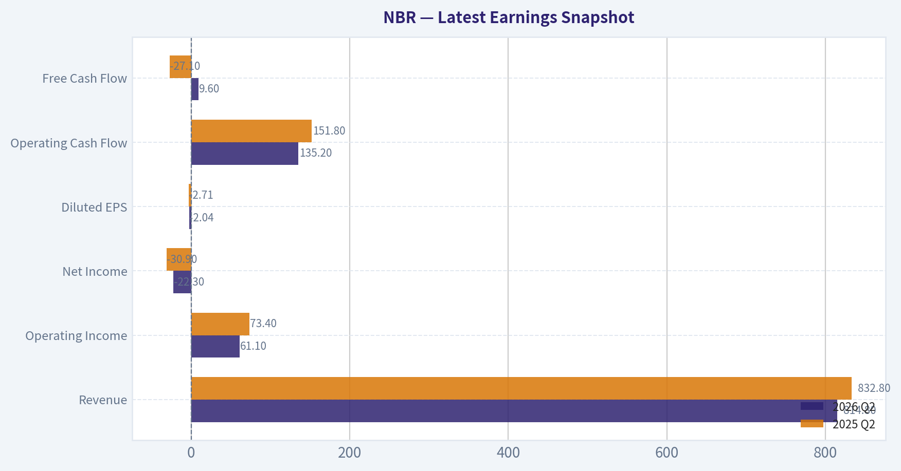

This comparison chart from *Current Fundamental Snapshot* stacks current figures against historical benchmarks for **NBR**, making it easy to see where the company trades relative to its own averages.

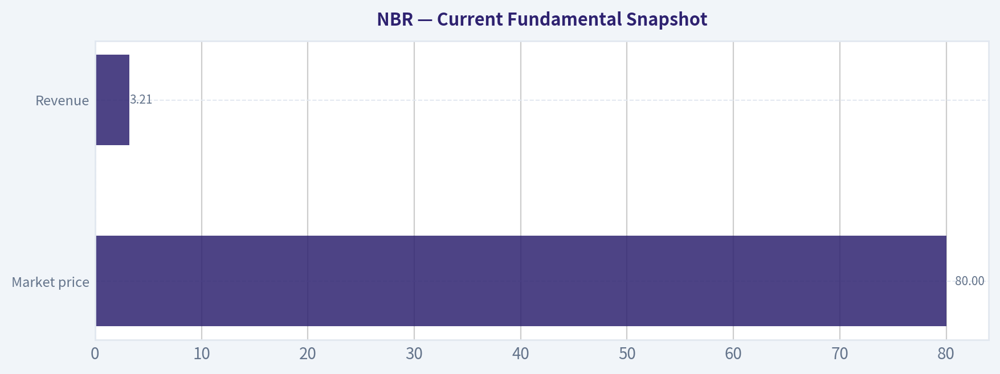

This comparison chart from *Balance Sheet and Financial Strength* stacks current figures against historical benchmarks for **NBR**, making it easy to see where the company trades relative to its own averages.

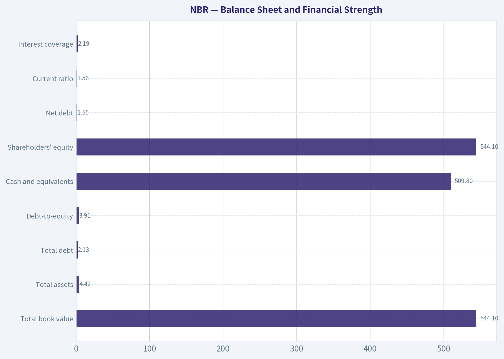

This comparison chart from *Three-Scenario Buffett-Style Owner Earnings DCF* stacks current figures against historical benchmarks for **NBR**, making it easy to see where the company trades relative to its own averages.

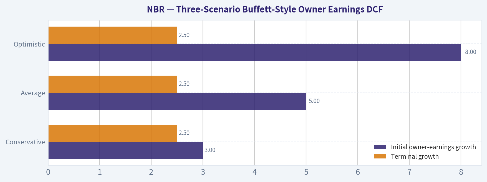

This comparison chart from *Historical Comparison and Trend Interpretation* stacks current figures against historical benchmarks for **NBR**, making it easy to see where the company trades relative to its own averages.

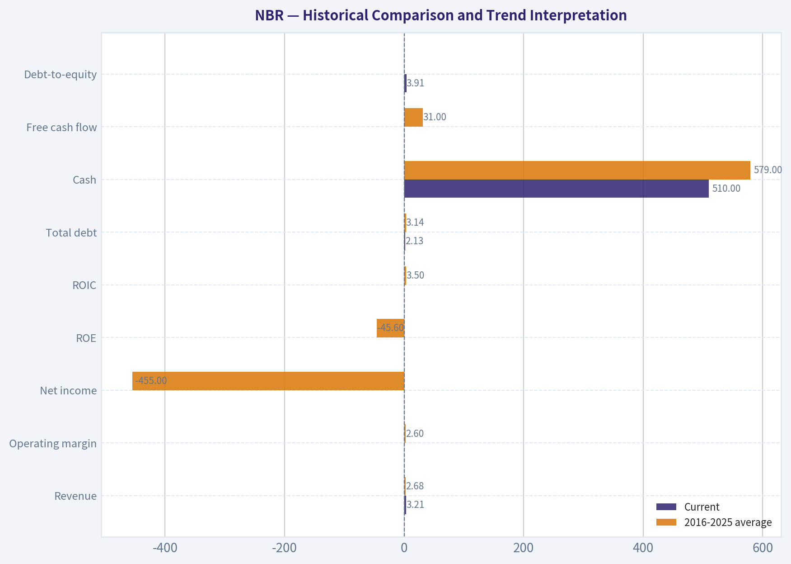

---

### Trend & Growth Analysis (Lynch/Druckenmiller/Fisher)

> *Following Peter Lynch's GARP, Stanley Druckenmiller's macro-aware approach, and Philip Fisher's scuttlebutt methodology.*

ANALYST STANCE: **AVOID**

#### 1. Lynch Classification

**Cyclical**, not a fast grower. Nabors Industries provides land drilling rigs and related services, so results depend heavily on oil and gas capital spending, rig utilization, day rates, and commodity prices.

#### 2. The Story

- Nabors owns and operates drilling equipment that benefits when U.S. and international energy producers increase drilling activity.
- The current investment case is based on improved profitability, stronger contract visibility, and international opportunities-not on a durable 20%-plus growth trajectory.
- The stock appears optically cheap at roughly 6.1 times earnings, but negative free cash flow and cyclicality make the low multiple difficult to interpret.

#### 3. Core Fundamental Snapshot

| Metric | Current data | Interpretation |
|---|---:|---|
| Share price | $80 | High relative to headline intrinsic value |
| Market capitalization | $1.22 billion | Small-cap and potentially volatile |
| Revenue growth, year over year | 8.7% | Stalwart-level, not fast-grower growth |
| P/E | 6.1x | Cheap on reported earnings |
| ROE | 48.5% | Strong, but potentially amplified by leverage and cyclicality |
| Free-cash-flow yield | -1.9% | Cash generation is currently negative |
| Current ratio | 1.56x | Reasonable near-term liquidity |
| Headline intrinsic value | $24.11 | Implies substantial overvaluation at $80 |
| Reverse DCF implied growth | Approximately 2.3% annually for 10 years | Market expectations are not aggressive on growth |

**Key Takeaways:** NBR combines low reported earnings valuation with negative free cash flow, a warning sign for a capital-intensive drilling contractor. Revenue growth of 8.7% is respectable but does not qualify as the 15%-25% growth profile sought for a primary growth investment. The headline intrinsic value is far below the current price, although cyclical valuation models should be treated cautiously.

#### 4. TAM and 10x Test

A reliable company-specific TAM figure was not provided. The relevant market is contract drilling and oilfield services, which is tied to global upstream capital expenditure rather than a rapidly expanding secular market.

| 10x test component | Assessment |
|---|---|
| Current revenue base | Not available in the research pack |
| 10x revenue potential | Theoretically possible only through major market share gains, acquisitions, or a substantial drilling-cycle expansion |
| TAM growth | Cyclical and commodity-dependent; not clearly expanding at 15% or greater |
| Market-share runway | Unclear; limited by fleet capacity, customer budgets, and drilling economics |
| Ten-bagger suitability | Low without a major structural industry transformation |

**Key Takeaways:** NBR does not have the clearly expanding TAM associated with software, AI, digital payments, or other secular growth categories. A 10x outcome would likely require both sustained industry upcycle conditions and meaningful company-specific share gains. That is a lower-quality runway than a business that can compound organically for many years.

#### 5. Revenue Growth Trend

| Indicator | Result | Growth interpretation |
|---|---:|---|
| Latest year-over-year revenue growth | 8.7% | Moderate |
| Evidence of acceleration | Not established | No confirmed inflection |
| Earnings trend | Stronger profitability reported in coverage | Positive but cyclical |
| Cash-flow trend | Negative FCF yield | Not yet supportive |
| Revenue quality | Contract and utilization dependent | Sensitive to customer spending |

**Key Takeaways:** The available data show moderate growth rather than acceleration. Improved profitability and contract visibility are encouraging, but there is not enough evidence of a durable revenue inflection. Negative free cash flow prevents the earnings recovery from being fully validated by cash generation.

#### 6. Unit Economics and Efficiency

Traditional SaaS metrics such as LTV/CAC, NRR, and Rule of 40 are not applicable to a drilling-rig operator.

| Metric | Assessment |
|---|---|
| LTV/CAC | Not applicable |
| Net revenue retention | Not applicable |
| Rule of 40 | Not applicable |
| Asset utilization | Important, but not provided |
| Day rates and backlog | Important catalysts, but not quantified |
| Free cash flow | Negative yield of 1.9% |
| Operating leverage | Potentially significant during an upcycle |

**Key Takeaways:** NBR's economics depend on rig utilization, contract pricing, maintenance spending, and capital intensity rather than subscription retention. Operating leverage can produce rapid earnings growth during a strong drilling cycle, but the same structure can reverse sharply when activity weakens. Current negative free cash flow is the primary fundamental constraint.

#### 7. Inflection Point Assessment

| Potential inflection | Evidence | Assessment |
|---|---|---|
| Product cycle | No major product-cycle evidence provided | Neutral |
| Market share | International opportunities cited | Possible, unproven |
| Margin | Stronger profitability reported | Positive |
| TAM | No structural expansion demonstrated | Weak |
| Competitive landscape | Contract visibility improving | Moderately positive |
| Cash flow | Negative FCF remains | Negative |

**Key Takeaways:** The most credible positive inflection is margin and contract visibility, potentially driven by better utilization and international contracts. However, this looks more like a cyclical earnings recovery than a transformational business inflection. Until free cash flow turns sustainably positive and revenue growth accelerates, the setup does not meet the Druckenmiller standard of a clearly underappreciated two- to three-year earnings trajectory.

#### 8. Macro Setup

NBR is highly exposed to:

- Crude oil and natural gas prices.
- North American and international exploration budgets.
- Rig supply, utilization, and day rates.
- Interest rates and financing costs.
- Geopolitical conditions in international operating regions.

The macro setup is therefore **mixed**. An energy-capital-spending upcycle would help materially, but this is a cyclical trade rather than a clean secular growth investment. A slowing global economy, weaker oil prices, or customer budget reductions could quickly pressure utilization and pricing.

#### 9. Fisher 15-Point Assessment

| Fisher factor group | Score |
|---|---:|
| Market potential and long-term outlook | 3/5 |
| Product and R&D orientation | 3/5 |
| Sales organization and customer positioning | 3/5 |
| Profit margins and margin trajectory | 3/5 |
| Labor, executive depth, and internal quality | 3/5 |
| Accounting, candor, and integrity | 3/5 |
| Competitive advantages | 3/5 |
| Dilution and balance-sheet considerations | 2/5 |
| **Estimated total** | **43/75** |

**Key Takeaways:** The estimated Fisher score is below the 45-point avoid threshold, primarily because NBR lacks a clearly expanding secular market and currently has negative cash-flow characteristics. This is an analytical estimate rather than a substitute for detailed management interviews, customer checks, and full filings. The company may be a viable cyclical operator, but it does not presently look like a superior long-duration compounder.

#### 10. Valuation Analysis

| Valuation method | Result | Interpretation |
|---|---:|---|
| P/E | 6.1x | Appears inexpensive |
| PEG | Not reliable | Sustainable EPS growth rate is unavailable; using 8.7% revenue growth would be invalid |
| P/S | Not calculated | Revenue and share-count detail unavailable in the pack |
| FCF valuation | Weak | Current FCF yield is negative |
| Headline intrinsic value | $24.11 | Approximately 70% below the current price |
| Current price versus intrinsic value | $80 versus $24.11 | Large implied downside |
| Reverse DCF | ~2.3% annual growth implied | Does not indicate extreme growth expectations |

**Key Takeaways:** The low P/E is the strongest bullish valuation argument, but it may reflect peak or mid-cycle earnings rather than normalized earnings power. Negative free cash flow undermines a simple earnings-based valuation. The supplied intrinsic-value estimate indicates substantial downside, while the reverse DCF suggests the market is not pricing aggressive growth; this combination is consistent with a cheap but risky cyclical stock rather than an overlooked compounder.

#### 11. Growth Investor Scorecard

| Criterion | Weight | Score / 5 |
|---|---:|---:|
| Lynch story | 10% | 3.0 |
| TAM and runway | 20% | 2.0 |
| Revenue growth | 20% | 2.5 |
| Unit economics | 15% | 2.0 |
| Competitive position | 10% | 3.0 |
| Management quality | 10% | 3.0 |
| Macro setup | 5% | 2.5 |
| Profitability path | 5% | 2.5 |
| Valuation | 5% | 2.5 |
| **Weighted score** | **100%** | **2.5 / 5.0** |

**Key Takeaways:** NBR scores below the threshold for a growth-investor position. Its strongest features are a low reported P/E, high ROE, and possible cyclical operating leverage. Those positives are outweighed by modest revenue growth, negative free cash flow, uncertain normalized earnings, and the absence of a powerful secular TAM expansion.

#### 12. Position Size Stance

**No new position for a growth portfolio.**

For investors with specialized energy-cycle expertise, NBR could be monitored as a small cyclical trading or value position, but not as a core compounder. A speculative position should generally remain modest until the company demonstrates:

1. Sustained positive free cash flow.
2. Improving rig utilization and day rates.
3. Revenue growth accelerating above 15%.
4. Lower balance-sheet and refinancing risk.
5. A more attractive valuation based on normalized, mid-cycle earnings.

#### 13. Key Risks and Catalysts

| Catalysts | Risks |
|---|---|
| Higher oil and gas capital spending | Oil-price decline |
| Improved rig utilization and day rates | Customer budget cuts |
| International contract wins | Contract cancellations or pricing pressure |
| Sustained margin expansion | Negative free cash flow persists |
| Debt reduction or improved liquidity | High capital intensity |
| Strategic acquisition or asset monetization | Geopolitical and regional operating risks |
| Director or insider buying | Earnings are near a cyclical peak |

**Key Takeaways:** The main upside catalyst is a stronger and longer drilling upcycle that lifts utilization, pricing, and cash flow simultaneously. The main risk is that the low P/E reflects temporarily elevated cyclical earnings rather than genuine undervaluation. Until operating improvement converts into durable free cash flow, NBR remains a watch candidate rather than an investable growth opportunity.

---

### Market Technical Analysis

ANALYST STANCE: **WATCH**

#### NBR technical report

**Data note:** The latest available trading session is October 19, 2026, when NBR closed at **$80.06**. October 20 is listed as a non-trading day in the indicator feed, so the analysis uses October 19 as the effective reference date.

#### Market structure and trend

NBR remains in a **long-term bullish structure but a deteriorating intermediate-term trend**.

The stock is trading at:

- **$80.06**, below the 10-day EMA of **$79.45?** No-the close is actually slightly **above** the 10-day EMA by about $0.61.
- **$6.32 below** the 50-day SMA of **$86.38**
- **$3.52 below** the 200-day SMA of **$83.58**

The price relationship is therefore nuanced. The short-term close has recovered above the 10-day EMA, suggesting that selling pressure may be easing over the last few sessions. However, NBR remains beneath both the 50-day and 200-day averages, which keeps the medium-term trend technically weak and places overhead resistance near **$83.6**, followed by the more important **$86.4** area.

The 200-day SMA is still rising, from approximately $81.0 in late September to $83.6 currently. This indicates that the broader one-year trend has not fully reversed. Nevertheless, price falling below the rising 200-day average is a warning that the stock is testing its long-term trend support rather than trading comfortably above it.

#### Short-term momentum

The 10-day EMA has declined from approximately **$87.5 on September 21** to **$79.45 on October 19**, reflecting the sharp deterioration during late September and early October. It has recently begun flattening, however, and the October 19 close was modestly above the EMA. This is an early stabilization signal, but not yet a confirmed trend reversal.

The MACD remains negative at approximately **-2.00**. That is an improvement from the late-September low near **-2.78**, indicating that downside momentum has moderated. However, a negative MACD still means the short-term exponential trend structure remains bearish. The improvement is better interpreted as **loss of downside acceleration** than as a completed bullish reversal.

A stronger signal would require MACD to continue rising toward zero and ideally cross above its signal line while price reclaims the 200-day and 50-day averages.

#### RSI and reversal potential

The RSI was approximately **45.8** on October 19. It has recovered materially from the deeply weak readings near **29-32** in late September, but remains below the neutral 50 level.

This suggests:

- The stock is no longer technically oversold.
- Momentum has improved from extreme weakness.
- Buyers have not yet established clear control.
- A move above 50 would provide better confirmation of a sustainable short-term recovery.

The earlier oversold condition may have helped produce the rebound from the $77 area, but RSI no longer offers a strong "washed-out" reversal setup. Traders should be careful about chasing a bounce unless price also clears nearby moving-average resistance.

#### Bollinger Bands and price location

On October 19, the Bollinger Bands were approximately:

- Upper band: **$84.23**
- Lower band: **$76.19**
- Implied middle band: roughly **$80.21**

NBR closed at **$80.06**, almost exactly around the Bollinger midpoint. This is a relatively balanced location: the stock is neither pressing the lower band with strong downside extension nor challenging the upper band with strong upside momentum.

The lower band near **$76.2** is important because it sits close to the recent late-September and mid-October lows. A decisive close below that area would indicate renewed downside expansion and could expose the stock to a deeper retracement.

On the upside, the $84.2 upper band overlaps reasonably closely with the rising 200-day SMA at $83.6. That creates a significant resistance cluster around **$83.5-$84.5**. A sustained break above that zone would improve the short-term picture substantially.

#### Volatility and risk management

ATR is approximately **$3.18** per share. This means NBR's typical daily trading range remains large relative to its current price-roughly 4% of the share price.

The ATR has declined from approximately **$3.9** in late September, showing that volatility has cooled from its peak. Even so, the stock remains volatile enough that tight stops may be vulnerable to ordinary daily fluctuations.

For risk management, a stop distance based on approximately **1 to 1.5 ATR**, or roughly **$3.20 to $4.80**, would better reflect current price behavior than a very narrow stop. Position sizing should be adjusted accordingly.

#### Key trading levels

The first meaningful support zone is around **$76-$77**, corresponding to the recent lows and the lower Bollinger Band. A close below this zone would weaken the stabilization thesis.

Near-term resistance appears around **$81-$82**, where recent trading has repeatedly stalled. The more important resistance area is **$83.5-$84.5**, combining the 200-day SMA and upper Bollinger Band. Above that, the 50-day SMA near **$86.4** is the key medium-term recovery hurdle.

A bullish setup would improve if NBR can:

1. Hold above $76-$77.
2. Move decisively above $82.
3. Reclaim $83.5-$84.5 with improving volume and MACD.
4. Eventually recover the 50-day SMA near $86.4.

A bearish continuation signal would be a close below $76, especially if accompanied by rising volume, renewed MACD deterioration, and RSI falling back below 35.

#### Indicator selection

The selected indicators are:

1. **close_10_ema** - captures the immediate short-term trend.
2. **close_50_sma** - identifies intermediate resistance and trend direction.
3. **close_200_sma** - defines the long-term trend regime.
4. **macd** - measures directional momentum and whether the decline is losing force.
5. **rsi** - evaluates momentum extremes and recovery quality.
6. **boll_ub** - identifies upside volatility resistance and breakout zones.
7. **boll_lb** - identifies downside extension and important support.
8. **atr** - supports volatility-adjusted stops and position sizing.

VWMA was not included in the core eight because the moving-average group already provides substantial trend information, while the current priority is to distinguish trend, momentum, volatility, and risk rather than add another overlapping average.

#### Overall assessment

NBR is in a **transition phase rather than a confirmed reversal**. The long-term trend is still supported by a rising 200-day SMA, and the MACD and RSI have improved from late-September weakness. However, the stock remains below both the 200-day and 50-day averages, and RSI is still below neutral.

The most constructive interpretation is that NBR is attempting to form a base around **$76-$80**. The most important confirmation level is **$83.5-$84.5**. Until that zone is reclaimed, the recent rebound should be treated as a tentative recovery within a damaged intermediate trend. Conversely, a break below **$76** would invalidate the stabilization attempt and favor renewed downside.

| Indicator / Area | Latest reading | Interpretation | Trading significance |
|---|---:|---|---|
| Closing price | $80.06 | Rebounded modestly and sits near the Bollinger midpoint | Short-term stabilization, but not yet a confirmed reversal |
| 10-day EMA | $79.45 | Price is slightly above the short-term average | Early improvement; the EMA has recently flattened after a sustained decline |
| 50-day SMA | $86.38 | Price remains well below the medium-term average | Major overhead resistance and evidence of intermediate weakness |
| 200-day SMA | $83.58 | Price is below a still-rising long-term average | Long-term trend is being tested; reclaiming this level would improve structure |
| MACD | -2.00 | Negative, but materially less negative than in late September | Downside momentum is easing, though bullish confirmation is absent |
| RSI | 45.8 | Recovered from oversold conditions but remains below 50 | Neutral-to-bearish momentum; no longer deeply oversold |
| Bollinger upper band | $84.23 | Near the 200-day SMA | Resistance cluster around $83.5-$84.5 |
| Bollinger lower band | $76.19 | Near recent swing lows | Important support; a break would signal renewed downside pressure |
| ATR | $3.18 | Volatility remains elevated despite cooling | Use wider stops and smaller position sizes |
| Primary support | $76-$77 | Recent low and lower-band region | Key level separating stabilization from bearish continuation |
| Primary resistance | $83.5-$84.5 | 200-day SMA and upper Bollinger Band | Breakout confirmation zone |
| Medium-term resistance | Around $86.4 | 50-day SMA | Stronger confirmation that the intermediate trend has turned higher |

**Key Takeaways:** NBR has improved from late-September oversold conditions, but the recovery is not yet confirmed because price remains below the 200-day and 50-day moving averages. The key support zone is $76 to $77, while $83.5 to $84.5 is the main resistance and confirmation area. Until either zone breaks decisively, the most appropriate stance is to watch for confirmation rather than assume that the rebound has become a new uptrend.

---

### Options Market Analysis

> *Reading options flow - put/call ratios, IV skew, and unusual activity - to gauge institutional positioning and event-driven risk.*

#### NBR Options Market Report

*Data as of October 20, 2026. The available chain covers November 20, December 18, 2026, and January 15, 2027 expirations.*

#### 1. Put/Call Ratio Analysis

| Expiration | Call OI | Put OI | Put/Call OI Ratio | Call Volume | Put Volume | Volume Put/Call Ratio |
|---|---:|---:|---:|---:|---:|---:|
| Nov. 20, 2026 | 200 | 41 | 0.20 | 16 | 17 | 1.06 |
| Dec. 18, 2026 | 0 | 320 | N/A | 0 | 320 | N/A |
| Jan. 15, 2027 | 1,524 | 6,466 | 4.24 | 208 | 112 | 0.54 |
| **Total** | **1,724** | **6,827** | **3.96** | **224** | **449** | **2.00** |

**Key Takeaways:** NBR's aggregate put/call open-interest ratio of 3.96 is substantially above the approximately 0.7 neutral baseline, indicating a strong concentration of downside protection or bearish positioning. The elevated ratio is driven primarily by January puts and the December put position. However, current trading flow is less bearish than the OI profile: January call volume exceeded put volume, suggesting some newer bullish interest against a heavily defensive existing book.

#### 2. Implied Volatility Assessment

| Expiration | Call ATM IV | Put ATM IV | IV Difference | Interpretation |
|---|---:|---:|---:|---|
| Nov. 20, 2026 | 58.4% | 62.5% | Put IV +4.1 percentage points | Downside skew |
| Dec. 18, 2026 | N/A | N/A | N/A | No usable ATM IV |
| Jan. 15, 2027 | 53.8% | 51.1% | Call IV +2.7 percentage points | Mild call skew |

**Key Takeaways:** Near-term November put IV is higher than call IV, indicating modest demand for downside protection. January shows a slight reversal, with call IV above put IV, but the difference is small and should not be treated as a strong upside signal. IV in the roughly 51% to 63% range is substantial, although no historical IV percentile or confirmed company catalyst was provided, so it is not possible to determine whether volatility is unusually expensive or tied to earnings.

The available data does not include OTM strike-level IV, so a precise OTM put-versus-call skew calculation cannot be made. The ATM differences provide only a directional indication.

#### 3. Unusual Options Activity

The data provider identified no contracts with volume greater than five times open interest.

| Finding | Assessment |
|---|---|
| Contracts meeting volume greater than 5x OI | None |
| Fresh directional activity | No clearly identifiable unusual contracts |
| December 18 puts | 320 contracts of volume and 320 contracts of OI; active, but not above the provider's unusual-activity threshold |
| January calls | 208 contracts of volume versus 1,524 call OI; notable flow, but not fresh enough to classify as unusual |
| January puts | 112 contracts of volume versus 6,466 put OI; primarily an established positioning base |

**Key Takeaways:** There is no confirmed volume-versus-open-interest anomaly that would clearly indicate an institutional sweep or fresh high-conviction bet. The December put activity deserves attention because volume equals open interest, but the data cannot determine whether those trades were opening positions or closing transactions. Because NBR's overall activity is relatively small, confidence in identifying smart-money positioning is limited.

Strike-level details and the current underlying price were not supplied, so the contracts cannot be classified reliably as ITM, ATM, or OTM, and their exact days to expiration cannot be calculated here.

#### 4. Open Interest Concentration and Potential Gamma Levels

| Expiration | Dominant Position | OI Concentration | Potential Market Effect |
|---|---|---:|---|
| Nov. 20, 2026 | Calls over puts | 200 calls versus 41 puts | Possible call-side positioning, but too small to establish a reliable gamma wall |
| Dec. 18, 2026 | Puts only | 320 puts, no calls | Potential downside hedge concentration |
| Jan. 15, 2027 | Puts heavily exceed calls | 6,466 puts versus 1,524 calls | Largest potential gravitational or hedging level |
| Overall | Puts dominate | 6,827 puts versus 1,724 calls | Defensive positioning is the defining feature |

**Key Takeaways:** January 15 is the key open-interest concentration, with 6,466 puts representing roughly 95% of total put OI in the supplied expirations. This could create a downside hedge zone or influence dealer hedging near major January strikes. However, strike-level OI was not provided, so specific support, resistance, max-pain, or gamma-wall levels cannot be identified.

#### 5. Overall Options Sentiment

**Overall signal: BEARISH**

The primary driver is the exceptionally high aggregate put/call OI ratio of 3.96, well above the 0.7 neutral reference point. The December and January expirations contain substantial put exposure, implying either persistent downside hedging or bearish positioning. The signal is tempered by January call volume exceeding put volume and by the lower January put IV, which suggest some recent stabilization or upside speculation.

NBR's options market appears relatively thin, with low absolute contract volume and no qualifying unusual activity. Therefore, the bearish signal should be treated as **moderate-to-low confidence** rather than a strong directional forecast. The positioning may reflect long-term hedges, structured trades, or illiquidity rather than an outright bearish view.

#### Summary

| Category | Assessment |
|---|---|
| Put/Call Ratio | Bearish: aggregate OI ratio 3.96; volume ratio 2.00 |
| IV Level | Moderate-to-high, approximately 51%-63%; catalyst premium cannot be confirmed |
| Skew Direction | Near-term November put skew; slight January call skew |
| Unusual Activity | None above the 5x volume-to-OI threshold |
| Overall Signal | **BEARISH**, with moderate-to-low confidence due to thin activity and missing strike-level data |

**Key Takeaways:** NBR's options positioning is dominated by puts, especially in January, producing a bearish aggregate signal. Recent January volume is somewhat more constructive because calls traded more actively than puts, but there is no strong unusual activity to override the large defensive open-interest imbalance. Thin liquidity and the absence of strike-level information materially reduce confidence.

---

## Research Team Commentary

> *The Research Manager synthesizes the Bull vs Bear debate into action-free commentary. This is a pre-risk view, not the final stance.*

Core takeaway: Nabors may be operationally competent and optically cheap, but it has not demonstrated the owner earnings, balance-sheet resilience, or through-cycle moat needed to justify buying a capital-intensive cyclical at only a modest estimated discount. At $80.43, the bull's roughly $93 base value offers about 16% upside under assumptions that include 6% EPS growth and a rerating to 8.5 times earnings. That is not enough margin of safety for a business with negative free cash flow, unknown leverage details, and a bull-scenario range that includes value near $38. I would avoid initiating a position at the current price.

The strongest bull argument is that Nabors is more than a collection of commodity rigs. High-specification equipment, automation, operating reliability, safety records, customer qualification, and global scale can improve customers' well economics and support renewals. Revenue growth of 8.7% and reported ROIC of 15.3% suggest that current operations are producing respectable accounting returns. International expansion and better contract visibility could also make earnings somewhat less dependent on the U.S. spot cycle.

The valuation is superficially compelling. A 6.13 times P/E equates to a 16.3% accounting earnings yield, and Nabors would not require technology-like growth to generate an adequate return if current earnings prove sustainable. If free cash flow turns positive, debt declines, and the market eventually awards the company an 8-9 times multiple, the stock could plausibly be worth around $93-$108.

The bear case is more persuasive because those favorable conditions are precisely what remain unproven. The 16.3% figure is not an owner-earnings yield while free cash flow is negative. Rigs require recurring maintenance, upgrades, mobilization, recertification, and technology spending. Without a maintenance-versus-growth capex reconciliation, investors cannot know whether current cash consumption represents temporary high-return expansion or the recurring cost of defending the fleet's competitiveness.

The bull's reverse-valuation exercise also understates the hurdle by relying on multiple expansion. At approximately the current 6 times multiple, its own calculation requires roughly 10.5% annual EPS growth for five years to earn a 10% return. The apparently modest 4.3% growth requirement assumes an eventual 8 times multiple, about 30% above today's valuation. Such a rerating is possible, but it should follow proof of cash conversion and balance-sheet improvement rather than be embedded in a conservative valuation.

Business quality is mixed. Nabors has a narrow industrial advantage, but not a wide moat. Competitors can upgrade fleets, customers retain bargaining power, and productivity improvements may be passed through in lower effective pricing. The advantage must continually be renewed with capital, unlike a platform or brand whose economics strengthen with limited reinvestment. Over ten years, drilling activity should remain economically relevant, but Nabors will still face commodity-sensitive customer budgets, high fixed costs, technological obsolescence, and international execution risk.

The 15.3% ROIC is encouraging but cannot yet be treated as normalized. It may reflect favorable utilization, prior asset impairments that reduced invested capital, or accounting returns that do not fully capture recurring fleet expenditure. ROE of 48.5% is even less informative because leverage and a compressed equity base can inflate it. The more modest 6% ROA better reflects the asset intensity. Management also has not earned a capital-allocation premium from the evidence provided; debt, maturities, interest coverage, and project-level cash returns remain essential missing information.

Applying a quality-scaled margin of safety is decisive. A predictable wide-moat compounder might justify purchase at a 10-15% discount. Nabors is a cyclical, capital-intensive business requiring closer to a 40-50% discount to conservatively normalized intrinsic value. Even accepting the bull's $93 base value, that discipline would imply a substantially lower entry price, roughly in the mid-$40s to mid-$50s, unless improving cash generation materially raises both intrinsic value and business quality. The current price is therefore not clearly excessive in an absolute sense, but it is too high relative to the uncertainty.

Market signals reinforce caution without determining intrinsic value. The stock is slightly above its 10-day EMA but below both its 50-day and 200-day averages, so short-term stabilization has not become durable trend repair. The 3.96 put/call open-interest ratio shows unusually defensive positioning, although it could partly reflect hedging. Unlike prior situations where strong technical momentum argued against excessive near-term caution, there is no comparable bullish confirmation here.

The main lesson from past mistakes is not to declare negative free cash flow permanently structural without decomposing capex. Some spending may be high-return growth investment. But the opposite error-assuming cash conversion will normalize merely because the P/E is low-is more dangerous in a leveraged cyclical. The appropriate response is to demand evidence rather than capitalize hoped-for cash flows.

Over the next one to four quarters, I would monitor operating cash flow and free cash flow after capex, with management separating maintenance, growth, and mobilization spending. Positive FCF for one quarter would be encouraging; sustained full-year cash generation would be much stronger evidence. I would also track net debt, interest coverage, debt maturities, and whether excess cash is used for deleveraging.

Operationally, watch international backlog, contract duration, cancellation provisions, day rates, utilization, cash margins, and returns on recently upgraded rigs. The thesis strengthens if revenue growth produces higher free cash flow per share and stable ROIC without escalating capital requirements. It weakens if revenue grows while cash consumption and debt also rise.

Finally, compare ROIC and cash returns through softer drilling conditions rather than relying on one favorable period. A sustained move above the 50- and 200-day averages could improve the tactical setup, but it would not replace the need for verified owner earnings. I would reconsider after sustained positive free cash flow, demonstrated balance-sheet safety, and either a materially lower price or stronger evidence that normalized intrinsic value is well above $93.

AVOID

---

## Value Investing Team Commentary

> *The Investor translates the research view into an investment thesis before risk review. This is still not the final stance.*

### Investment Commentary

Nabors Industries is a potentially improving drilling contractor, but it does not yet meet the standard for long-term business ownership. The low earnings multiple is enticing, yet the underlying economics remain capital-intensive, cyclical, and insufficiently supported by owner earnings. At **$80.43**, investors are being offered only a modest valuation discount while accepting substantial uncertainty around free cash flow, leverage, and normalized profitability.

### Business quality and moat

Nabors possesses genuine operating advantages:

- High-specification rigs and automation capabilities
- Established customer relationships and qualification records
- Global operating scale and international opportunities
- Safety, reliability, and technical expertise that can support contract renewals

These attributes may produce a **narrow industrial moat**, particularly where customers prioritize execution reliability. However, the advantage requires continual reinvestment. Competitors can upgrade equipment, customers retain meaningful bargaining power, and Nabors remains dependent on producers' commodity-sensitive capital budgets.

This is not the kind of business whose competitive position naturally compounds with little incremental capital. Its fleet must be maintained, upgraded, mobilized, and periodically recertified merely to remain competitive.

### Earnings quality and owner earnings

The reported figures look attractive:

- P/E: **6.13x**
- Revenue growth: **8.7%**
- ROIC: **15.3%**
- ROE: **48.5%**

But the headline metrics require skepticism. At the current price, the P/E implies an accounting earnings yield of approximately **16.3%**. That is not equivalent to a 16.3% owner-earnings yield when free cash flow is negative.

The critical unresolved issue is capital expenditure. Investors need a credible breakdown among:

1. Recurring maintenance and recertification spending
2. Rig mobilization and contract-start costs
3. Growth investments with identifiable incremental returns
4. Technology spending required merely to defend competitiveness

ROIC of 15.3% is encouraging, but it may be elevated by strong current utilization, prior asset impairments, or an invested-capital base that understates the economic cost of maintaining the fleet. ROE of 48.5% is even less useful without leverage details; a thin equity base can mechanically inflate it. The **6% ROA** is more consistent with the economics of a capital-intensive operator.

### Valuation and reverse-valuation test

The bull's approximately **$93 base value** provides only about **15.6% upside** from $80.43. That would be adequate for a wonderful, predictable compounder, but it is not sufficient for a leveraged cyclical with negative free cash flow and limited moat durability.

The implied EPS is approximately:

\[
\$80.43 \div 6.13 \approx \$13.12
\]

If the stock remains valued near six times earnings, delivering a 10% annual return over five years would require EPS growth of roughly **10.5% annually**, absent meaningful distributions. If the exit multiple rises to eight times earnings, the required EPS growth falls to approximately **4.3%**. The latter scenario looks easier only because it assumes substantial multiple expansion.

That rerating should be earned through:

- Sustained positive free cash flow
- Debt reduction
- Improved interest coverage
- Longer and higher-quality contract visibility
- Evidence that international investments earn attractive cash returns

It should not be embedded in a conservative valuation before those developments occur.

For this type of business, a **40-50% margin of safety** against normalized intrinsic value is appropriate. Applying that standard to a $93 estimate produces a prospective purchase range of approximately **$46-$56**. That range could rise if cash conversion and balance-sheet quality improve, but the current evidence does not support relaxing the discount requirement.

### Selective contrarian interpretation

The market is clearly skeptical. NBR is below both its 50-day and 200-day moving averages, while the aggregate put/call open-interest ratio of **3.96** indicates unusually defensive positioning.

A contrarian investor should not automatically treat this pessimism as confirmation of a bargain. Bearish positioning can create a short squeeze if earnings, backlog, or free cash flow surprise positively, but a temporary squeeze would not repair the business economics. In this case, the market may be rationally discounting negative cash conversion, cyclicality, and possible leverage risk.

The potential contrarian opportunity is narrower: investors may be underestimating the value of international contract visibility, automation, and high-specification rigs. If current capital spending is predominantly growth-oriented and tied to attractive long-term contracts, free cash flow could improve sharply once the investment cycle moderates. That would make the low P/E more meaningful.

However, this possibility needs evidence. Being contrarian before cash generation appears would amount to speculating that the market's concerns are temporary rather than demonstrating why they are wrong.

### What could change the conclusion

The investment case would materially improve with:

- Sustained positive free cash flow over several quarters
- Transparent separation of maintenance and growth capital expenditure
- Falling net debt and manageable maturity schedules
- Stronger interest coverage
- International backlog growth with favorable cancellation terms
- Higher utilization and day rates without disproportionate capital spending
- Stable ROIC through a softer drilling environment
- Capital allocation focused on deleveraging rather than aggressive fleet expansion

Conversely, the thesis would weaken if revenue growth continues while free cash flow remains negative, debt increases, or upgraded rigs fail to generate adequate incremental cash returns.

Technical recovery above the 50-day and 200-day averages could improve the tactical setup, but it would not substitute for verified owner earnings.

**ANALYST STANCE: AVOID** - Nabors may be operationally capable and optically inexpensive, but the current price does not provide the margin of safety required for a capital-intensive cyclical with negative free cash flow and insufficiently documented balance-sheet resilience. Reconsider only after durable cash conversion and deleveraging are demonstrated, or at a materially lower valuation.

---

## Deep Values Commentary

> *The Risk Management Team debates and the Risk Judge provides the final action-free verdict. This section determines the final ADVOCATE / WATCH / AVOID stance.*

#### Final Stance Scorecard

This scorecard converts the final research view into a weighted decision frame. It does not replace the narrative judgement, but it makes the main drivers of the verdict easier to scan.

| Criterion | Score | Weight | Commentary |
| --- | ---: | ---: | --- |
| Business Quality | 3.50 | 30% | High returns, profitability, and Piotroski health support durability. |
| Valuation Support | 2.33 | 30% | Blends current price against available intrinsic value anchors and valuation ratios. |
| Financial Strength | 3.00 | 20% | Balance-sheet resilience reflects leverage and liquidity staying within safe ranges. |
| Growth Durability | 3.00 | 20% | Recent revenue, earnings, and free cash flow growth indicate how durable expansion looks. |
| TOTAL / FINAL STANCE | 2.95 | 100% | AVOID |

#### Key Takeaways

The weighted score lands at **2.95 / 5.0**, while the final stance remains **AVOID**. This is useful as a quick calibration aid rather than a mechanical signal.

#### Risk Summary

Higher scores indicate more risk pressure. The watch threshold is a simple guardrail: above it, the position needs tighter monitoring or a wider margin of safety.

| Dimension | Current Score | Watch Threshold | Commentary |
| --- | ---: | ---: | --- |
| Business Quality | 2.50 | 3.00 | High returns, profitability, and Piotroski health support durability. |
| Valuation Support | 3.67 | 3.00 | Blends current price against available intrinsic value anchors and valuation ratios. |
| Financial Strength | 3.00 | 3.00 | Balance-sheet resilience reflects leverage and liquidity staying within safe ranges. |
| Growth Durability | 3.00 | 3.00 | Recent revenue, earnings, and free cash flow growth indicate how durable expansion looks. |

#### Key Takeaways

This view helps readers separate *where* the risk sits: valuation, business quality, balance sheet, or growth durability. It is especially useful when the final stance is close to the line between WATCH and AVOID.
