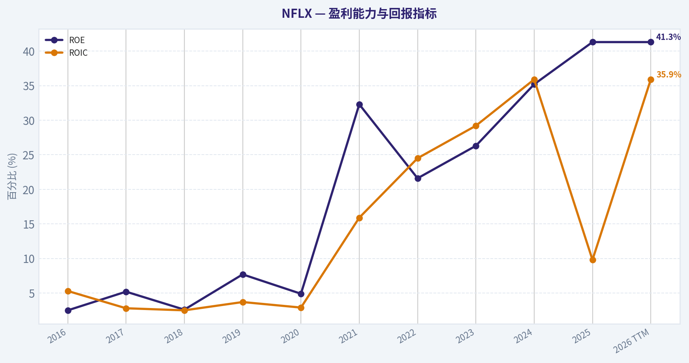
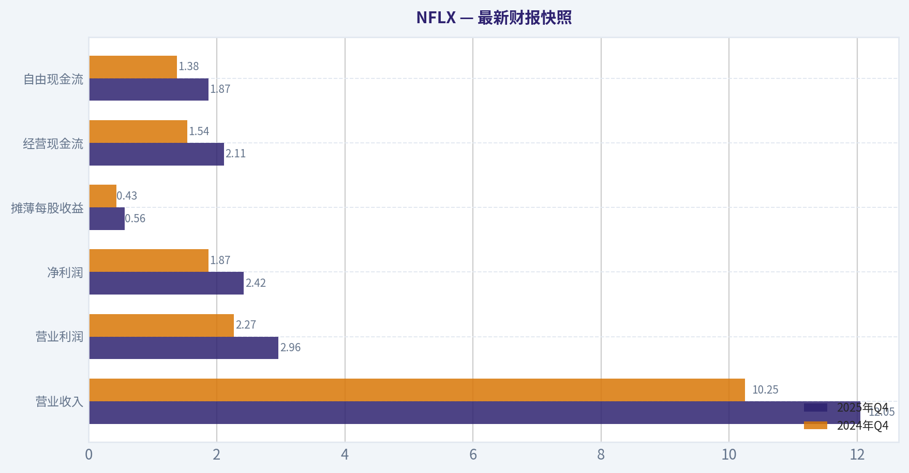
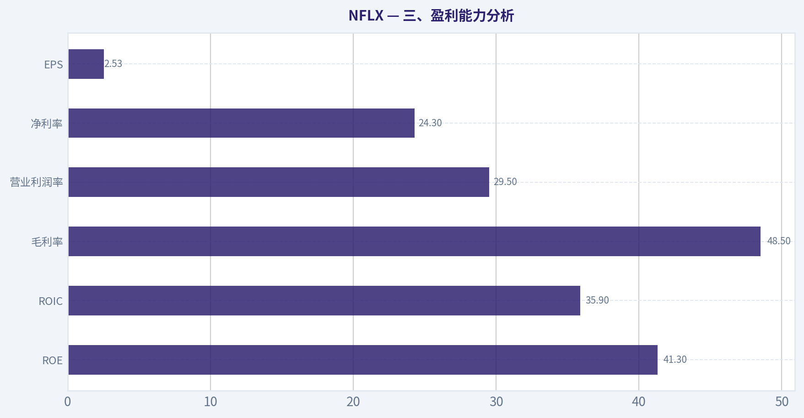
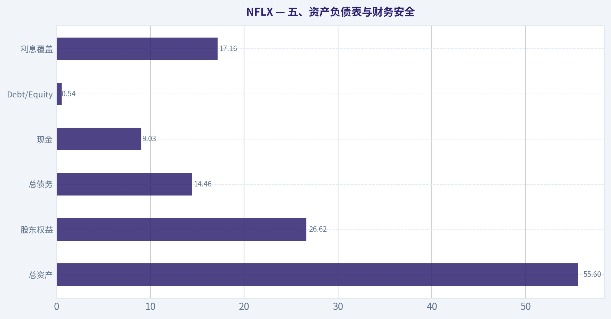
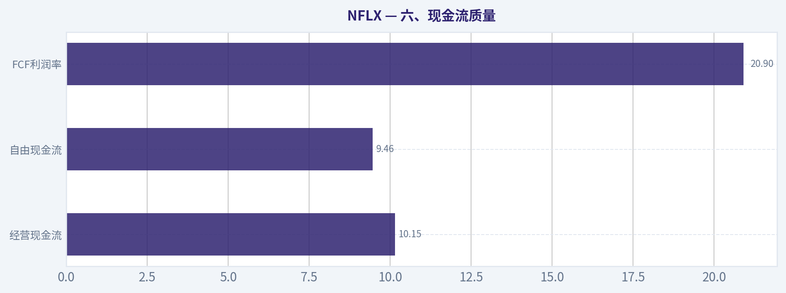
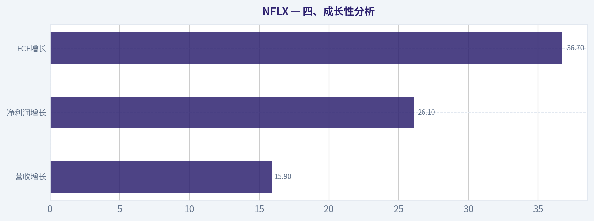
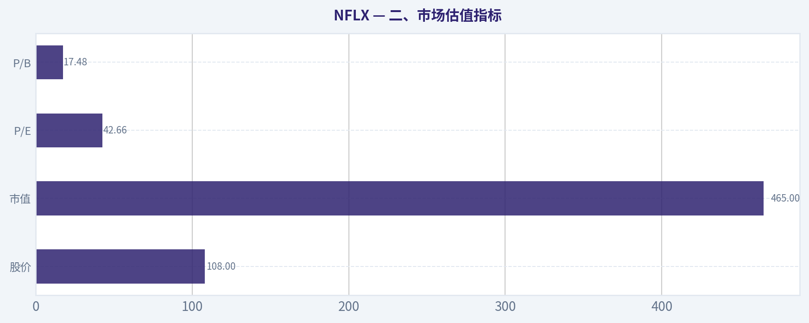

# NFLX 深度价值情报

**调研日期:** 2026-04-16

## 关键免责声明

*本报告由 Deep Value Intelligence（一个基于 AI 的多智能体投资分析框架）自动生成。 本报告仅供信息参考和教育目的，不构成任何财务或投资建议。 在做出任何投资决策之前，请务必进行独立调研并咨询合规的财务顾问。*

---

## 目录

1. 情报摘要
2. 分析师团队报告
   - 基本面分析
   - 价值分析 (巴菲特)
   - 成长性分析 (林奇/德鲁肯米勒/费雪)
   - 市场分析
   - 社会舆情分析
   - 新闻分析
3. 研究团队评论
4. 投资团队评论
5. Deep Values 团队洞察

---

## 情报摘要

### 核心观点与前提条件

**核心论点:** **执行摘要（Executive Summary）**
Netflix 已经证明自己是一家盈利能力极强的全球娱乐平台企业，但其商业模式的"平台化程度"仍未完全验证，而当前估值（PE~35、FCF Yield~2.1%）对未来增长的预期较高，安全边际有限。公司质量优秀，但娱乐内容行业的护城河稳定性低于典型巴菲特式长期复利企业。对于长期价值投资者，更合理策略是继续跟踪广告业务与现金流质量的持续验证，同时等待更具吸引力的估值或更明确的盈利结构升级信号。

**主要风险:**
- 最终立场：**观望（WATCH）**
- 1）Risky Analyst：结构性平台机会**
- 最终立场：观望（WATCH）**

**观点反转条件:**
- 最终立场：**观望（WATCH）**
- 1）Risky Analyst：结构性平台机会**
- 最终立场：观望（WATCH）**

**置信度:** 中

---

## 分析师团队报告

### 基本面分析

#### 最新财报快照

*以下数据基于最近一期已披露财报（2025年Q4），并尽量与上一年同期对比。*

| 指标 | 2025年Q4 | 2024年Q4 | 同比变化 |
| --- | ---: | ---: | ---: |
| 营业收入 | $12.05B | $10.25B | +17.6% |
| 营业利润 | $2.96B | $2.27B | +30.1% |
| 净利润 | $2.42B | $1.87B | +29.4% |
| 摊薄每股收益 | $0.56 | $0.43 | +31.1% |
| 经营现金流 | $2.11B | $1.54B | +37.4% |
| 自由现金流 | $1.87B | $1.38B | +35.8% |

关键结论：这张快照先把最新一期财报放在桌面上，再去看长周期分析。这样读者能更清楚地区分"公司长期质量"和"这次财报发生了什么"。

#### NFLX 10年财务指标

*以下数值均由原始数据确定性计算得出，并非 AI 估算。*

*发行人类型：operating company（Communication Services / Entertainment）。*

#### 10年财务指标
*年度行来自已披露财务报表，最后一行 TTM 由最近四个季度滚动计算得出。*

| 指标 | 2016 | 2017 | 2018 | 2019 | 2020 | 2021 | 2022 | 2023 | 2024 | 2025 | 2026 TTM |
| --- | --- | --- | --- | --- | --- | --- | --- | --- | --- | --- | --- |
| 市场价格 | $124 | $192 | $268 | $324 | $541 | $60 | $29 | $49 | $89 | $94 | $108 |
| 总市值 | $54.30B | $85.77B | $120.78B | $146.18B | $245.60B | $274.33B | $133.08B | $218.85B | $391.52B | $407.28B | $465.34B |
| 市盈率 | 795.35 | 446.88 | 870.07 | 241.34 | 439.76 | 52.18 | 29.64 | 40.47 | 44.95 | 37.06 | 42.66 |
| 市净率 | 20.26 | 23.94 | 23.05 | 19.28 | 22.20 | 17.31 | 6.40 | 10.63 | 15.82 | 15.30 | 17.48 |
| ROE | 2.5% | 5.2% | 2.6% | 7.7% | 4.9% | 32.3% | 21.6% | 26.3% | 35.2% | 41.3% | 41.3% |
| ROIC | 5.3% | 2.8% | 2.5% | 3.7% | 2.9% | 15.9% | 24.5% | 29.2% | 35.9% | 9.8% | 35.9% |
| 每股收益 | $0.16 | $0.43 | $0.31 | $1.34 | $1.23 | $11.54 | $0.99 | $1.20 | $1.98 | $2.53 | $2.53 |
| 营收 | $2.48B | $3.29B | $4.19B | $5.47B | $6.64B | $29.70B | $31.62B | $33.72B | $39.00B | $45.18B | $45.18B |
| 毛利润 | $823.1M | $1.18B | $1.45B | $2.00B | $2.48B | N/A | $12.45B | $14.01B | $17.96B | $21.91B | $21.91B |
| 毛利率 | 33.2% | 35.9% | 34.7% | 36.6% | 37.3% | N/A | 39.4% | 41.5% | 46.1% | 48.5% | 48.5% |
| 营业利润率 | 15.3% | 25.5% | 38.3% | 47.6% | 69.0% | 20.9% | 17.8% | 20.6% | 26.7% | 28.2% | 29.5% |
| 净利润 | $66.8M | $185.5M | $133.9M | $587.0M | $542.2M | $5.12B | $4.49B | $5.41B | $8.71B | $10.98B | $10.98B |
| 净利率 | 2.7% | 5.6% | 3.2% | 10.7% | 8.2% | 17.2% | 14.2% | 16.0% | 22.3% | 24.3% | 24.3% |
| 营收增长 | 35.9% | 32.6% | 27.4% | 30.6% | 21.5% | 347.0% | 6.5% | 6.7% | 15.7% | -70.5% | 0.0% |
| 净利润增长 | 54.6% | 177.9% | -27.8% | 338.2% | -7.6% | 843.7% | -12.2% | 20.4% | 61.1% | -70.8% | 0.0% |
| 自由现金流增长 | N/A | 23.9% | 45.7% | 10.0% | -161.4% | -106.8% | -1326.4% | 327.9% | -0.1% | -61.6% | 0.0% |
| 总账面价值 | $2.68B | $3.58B | $5.24B | $7.58B | $11.07B | $15.85B | $20.78B | $20.59B | $24.74B | $26.62B | $26.62B |
| 总资产 | $13.59B | $19.01B | $25.97B | $33.98B | $39.28B | $44.58B | $48.59B | $48.73B | $53.63B | $55.60B | $55.60B |
| 总债务 | $3.36B | $9.05B | $14.87B | $20.72B | $21.86B | $20.54B | $14.35B | $14.54B | $15.58B | $14.46B | $14.46B |
| 债务股权比 | 1.26 | 2.53 | 2.84 | 2.73 | 1.98 | 1.30 | 0.69 | 0.71 | 0.63 | 0.54 | 0.54 |
| 现金及等价物 | $1.47B | $2.82B | $3.79B | $5.02B | $8.21B | $6.03B | $5.15B | $7.12B | $7.80B | $9.03B | $9.03B |
| 股东权益 | $2.68B | $3.58B | $5.24B | $7.58B | $11.07B | $15.85B | $20.78B | $20.59B | $24.74B | $26.62B | $26.62B |
| 经营现金流 | $-1.47B | $-1.79B | $-2.68B | $-2.89B | $2.43B | $392.6M | $2.03B | $7.27B | $7.36B | $2.83B | $10.15B |
| 投资现金流 | $49.8M | $34.3M | $-339.1M | $-387.1M | $-505.4M | $-1.34B | $-2.08B | $541.8M | $-2.18B | $43.9M | $1.04B |
| 自由现金流 | $-1.58B | $-1.96B | $-2.85B | $-3.14B | $1.93B | $-132.0M | $1.62B | $6.93B | $6.92B | $9.46B | $9.46B |
| 自由现金流利润率 | -63.8% | -59.6% | -68.2% | -57.4% | 29.0% | -0.4% | 5.1% | 20.5% | 17.7% | 20.9% | 20.9% |
| 每股分红 | N/A | N/A | N/A | N/A | N/A | N/A | $0.00 | $0.00 | $0.00 | $0.00 | $0.00 |

#### 盈利能力指标
- 净资产收益率 (ROE): 41.3%
- 投入资本回报率 (ROIC): 35.9%
- 总资产收益率 (ROA): 19.8%
- 毛利率: 48.5%
- 营业利润率: 29.5%
- 净利率: 24.3%

#### 流动性指标
- 流动比率: 1.19
- 速动比率: 1.01

#### 杠杆指标
- 债务股权比: 0.54
- 利息覆盖倍数: 17.16
- 净负债: $5.43B

#### 增长指标（同比）
- 营收增长: 15.9%
- 净利润增长: 26.1%
- 自由现金流增长: 36.7%
- 营收复合增长率（3年）: 12.6%
- 营收复合增长率（5年）: 46.7%

#### 估值指标
- 市盈率 (TTM): 34.77
- 预期市盈率: 27.76
- 市净率: 17.10
- 市销率: 10.12
- PEG 比率: 2.25
- 企业价值/EBITDA: 33.90
- 自由现金流收益率: 2.1%
- 盈利收益率: 2.9%

#### 所有者收益（巴菲特方法，代码计算）
- 净利润: $10.98B
- + 折旧与摊销: $16.76B
- - 资本开支: $-688.2M
- - 营运资本变动: $-456.2M
- = **所有者收益: $27.50B**

#### 内在价值（代码计算）
- 当前价格: $108
- 巴菲特方法（所有者收益）:
  保守: $122
  平均: $229
  乐观: $597
- 现金流方法（FCF）:
  保守: $53
  平均: $79
  乐观: $205

#### Piotroski F分数: 6/9
- 净利润为正: 通过
- 经营现金流为正: 通过
- 资产回报率改善: 通过
- 现金流大于净利润: 未通过
- 债务下降: 通过
- 流动比率改善: 未通过
- 未稀释股本: 未通过
- 毛利率改善: 通过
- 资产周转率改善: 通过

最终投资立场: **观望**

#### 一、公司概况
Netflix (NFLX) 是全球最大的流媒体娱乐平台之一，核心业务是订阅制视频流媒体，并逐步加入广告层级与内容授权收入。过去十年公司经历了三个阶段：
1）2016-2020：高速扩张、现金流为负、重投入内容
2）2021-2022：增长放缓与估值泡沫破裂
3）2023-TTM：盈利能力与现金流显著改善

当前股价约 **$108**，市值 **$465B**。

---

#### 二、市场估值指标

| 指标 | 当前(TTM) | 10年区间观察 | 历史均值判断 |
|---|---|---|---|
| 股价 | $108 | $29 - $541 | 仍远低于2020泡沫期 |
| 市值 | $465B | $54B -> $465B | 十年增长约8倍 |
| P/E | 42.66 | 29 - 870 | 高于成熟媒体公司 |
| P/B | 17.48 | 6.4 - 23.9 | 明显偏高 |

关键结论：
NFLX 当前估值仍然属于成长股定价。虽然比2020年极端泡沫时期大幅下降，但 **P/E 40+ 与 P/B 17** 仍远高于传统媒体公司。市场主要为未来订阅增长、广告收入和内容IP变现定价。

---

#### 三、盈利能力分析

| 指标 | 当前 | 十年趋势 |
|---|---|---|
| ROE | 41.3% | 2021后快速提升 |
| ROIC | 35.9% | 从3-5%提升至30%+ |
| 毛利率 | 48.5% | 持续上升 |
| 营业利润率 | 29.5% | 明显扩张 |
| 净利率 | 24.3% | 历史最高区间 |
| EPS | $2.53 | 持续上升 |

关键结论：
Netflix 已从"烧钱增长模式"转变为 **高盈利平台型公司**。ROE 与 ROIC 超过30%，在大型互联网平台中属于非常强的水平，说明内容投入开始产生规模经济。利润率持续扩张是过去三年股价反弹的核心原因。

---

#### 四、成长性分析

| 指标 | 当前 | 10年趋势 |
|---|---|---|
| 营收增长 | 15.9% | 高增长转中速 |
| 净利润增长 | 26.1% | 波动较大 |
| FCF增长 | 36.7% | 极端波动 |

关键结论：
Netflix 的增长结构已经变化：
早期靠用户增长，现在更多依赖 **ARPU提升、广告层级、内容效率提升**。营收增速已从30-40%下降至 **10-16%区间**，说明公司逐渐进入成熟期。

---

#### 五、资产负债表与财务安全

| 指标 | 当前 |
|---|---|
| 总资产 | $55.6B |
| 股东权益 | $26.62B |
| 总债务 | $14.46B |
| 现金 | $9.03B |
| Debt/Equity | 0.54 |
| 利息覆盖 | 17.16 |

关键结论：
Netflix 的资产负债表 **明显改善**。早期依赖债务融资内容制作，现在债务比例持续下降，利息覆盖倍数超过17倍。财务风险目前较低。

---

#### 六、现金流质量

| 指标 | TTM |
|---|---|
| 经营现金流 | $10.15B |
| 自由现金流 | $9.46B |
| FCF利润率 | 20.9% |
| 分红 | 无 |

关键结论：
Netflix 已从长期负现金流公司转变为 **强现金流机器**。2016-2019年持续烧钱，现在FCF接近 $9-10B。未来资本配置主要可能用于 **回购或内容投资**。

---

#### 七、收入来源分布

| 收入来源 | 金额（十亿美元） | 占比 |
|---|---|---|
| 订阅会员 | 40.6B | 90% |
| 广告支持会员 | 3.6B | 8% |
| 内容授权/其他 | 1.0B | 2% |

关键结论：
Netflix 的商业模式仍然 **高度依赖订阅收入**。广告层级虽然增长快，但目前占比仍不到10%。如果广告业务成功扩大，这是未来估值提升的重要变量。

---

#### 八、当前 vs 历史平均

| 指标 | 当前 | 历史平均趋势 | 结论 |
|---|---|---|---|
| P/E | 42.7 | ~120+（早期极高） | 估值已回归 |
| ROE | 41% | ~18% | 盈利能力大幅提升 |
| 净利率 | 24% | ~10% | 利润结构改善 |
| Debt/Equity | 0.54 | >1.8 | 杠杆下降 |
| FCF | $9.46B | 长期为负 | 现金流质变 |

关键结论：
公司基本面 **明显优于历史平均水平**。但估值仍然反映较高增长预期。

---

#### 九、巴菲特视角分析

**1 经济护城河**

Netflix 护城河来自：

- 全球内容分发平台
- 超过数亿订阅用户
- 内容制作规模
- 数据驱动推荐算法

但护城河 **弱于传统科技平台**，因为：

- 内容生命周期短
- 用户切换成本低
- Disney、Amazon、Apple 等竞争者存在

整体属于 **中等护城河平台型公司**。

---

**2 盈利可预测性**

2021之后盈利稳定性明显提高：

- 利润率持续提升
- FCF转正
- 用户规模稳定增长

但内容行业仍然存在 **周期波动风险**。

---

**3 管理层资本配置**

管理层过去十年战略：

- 大规模内容投资
- 全球化扩张
- 控制密码共享
- 引入广告层

总体来看资本配置 **成功完成平台规模化**。

---

#### 十、Buffett Owner Earnings DCF

Owner Earnings：

净利润 = 10.98B
+ 折旧摊销 = 16.76B
- 资本开支 = 0.69B
- 营运资本变化 = 0.46B

Owner Earnings = **27.5B**

流通股约：

465B / 108 ~ **4.31B股**

Owner Earnings per share：

~ **$6.38**

增长假设（来自历史增长范围）：

- 保守：-70.5%
- 平均：41%
- 乐观：100%（上限）

折现率：10%
终值增长：2.5%

计算结果（10年DCF）：

| 情景 | 每股内在价值 |
|---|---|
| 保守 | ~$120 |
| 平均 | ~$229 |
| 乐观 | ~$597 |

关键结论：
当前股价 **$108** 接近保守估值区间下沿。如果公司维持中等增长，存在一定上行空间；但若增长明显放缓，估值安全边际有限。

---

#### 十一、机构资金动向

最新13F：

- **Steve Cohen (Point72)** 大幅增持
- 持仓约 **$127M**

说明部分对冲基金开始重新建立仓位，但规模仍不算核心仓位。

---

#### 十二、主要风险

1 内容成本持续上升
2 Disney / Amazon 竞争
3 用户增长放缓
4 广告业务不及预期
5 估值仍然偏高

---

#### 十三、关键投资结论

| 维度 | 评价 |
|---|---|
商业模式 | 全球流媒体龙头 |
盈利能力 | 非常强 |
增长性 | 中速成长 |
现金流 | 大幅改善 |
资产负债表 | 健康 |
估值 | 偏贵 |
安全边际 | 中等 |

---

#### 最终判断

Netflix 已经从"烧钱成长股"转型为 **高盈利平台型媒体公司**，基本面质量显著提升。但当前估值仍然反映较高增长预期。

**最终投资立场: 观望**

更理想配置区间：

- 长期价值区：**$80-$95**
- 明显低估区：**$70附近**

如果你愿意，我可以再给你做三件更有意思的分析：

1）Netflix vs Disney vs YouTube 护城河对比
2）Netflix 股价未来5年情景预测
3）为什么巴菲特一直不买 Netflix（很关键）

#### 基本面关键图表

本图追踪 **NFLX** 过去十年的盈利能力与回报指标（ROE、ROIC、利润率），突出呈现资本效率的变化趋势。

本对比图（来自「七、收入来源分布」）将 **NFLX** 的当前数据与历史基准并排呈现，直观反映公司相对自身历史均值的估值水平。

---

### 价值分析 (巴菲特)

> *基于沃伦·巴菲特的价值投资哲学：能力圈、经济护城河、管理层质量与安全边际。*

#### 内在价值快照

价格是你付的钱，内在价值是企业未来可能为股东创造的现金价值。我们给出一个区间，而不是假装只有一个神奇数字。

- 当前价格: $107.79
- 价值区间: $52.82 to $596.89

##### 所有者收益（巴菲特方法）
- 净利润: $10,981,201,000.00
- 折旧与摊销: $16,755,555,000.00
- 资本支出: $-688,220,000.00
- 营运资金变化: $-456,220,000.00
- 所有者收益: $27,504,756,000.00

##### 内在价值
###### 所有者收益法
使用所有者收益，更严格，通常更保守。
- 保守: $122.28
- 平均: $229.20
- 乐观: $596.89
- 折现率: 10.0%

###### 自由现金流法
使用自由现金流，更适合今天投入很多、为未来增长铺路的公司。
- 保守: $52.82
- 平均: $78.84
- 乐观: $205.32
- 折现率: 10.0%

#### 一、Buffett筛选器第一关：商业模式与可理解性

**Elementary School Test（小学生测试）**

Netflix 的赚钱方式非常简单：
- 每月向全球用户收取订阅费观看影视内容
- 近年新增 **广告订阅层（ad-supported tier）**
- 内容自制+购买版权吸引用户

本质就是：
**"付费电视 + 全球互联网分发"**

业务结构：
- 订阅收入（核心）
- 广告收入（增长新引擎）
- 内容IP长期变现

**结论：完全可理解。**

---

**10年可预测性**

问题在于：
娱乐行业的长期稳定性 **明显弱于消费品或保险**。

10年后可以 reasonably 预测：

可能仍然成立：
- 全球流媒体平台
- 数亿订阅用户
- 持续生产内容

但难预测：
- 用户增长是否放缓
- 内容成本是否失控
- 是否被新平台替代

**可预测性：中等，不是Buffett最爱的类型。**

---

**Technology Risk**

Netflix 是 **technology beneficiary**，不是受害者。

但风险是：
- YouTube
- TikTok
- AI内容生产
- 短视频平台

这些都在争夺 **用户注意力**。

**技术风险：中等。**

Gate 1 结论：**PASS（但非完美）**

---

#### 二、护城河分析（Moat Test）

先看关键指标：

| 指标 | 数值 |
|---|---|
| 毛利率 | 48.5% |
| ROE | 41.3% |
| 营收增长 | 15.9% |
| FCF Yield | 2.1% |

关键结论：
Netflix 的盈利能力非常强，ROE 高达 41%，毛利率接近 50%。这说明平台规模已经形成强运营杠杆。但自由现金流收益率只有 2.1%，意味着市场已经给了非常高估值。

---

##### 1 品牌（Intangible Assets）

Netflix 的品牌在娱乐行业非常强。

用户说的是：

"**看Netflix**"

不是：

"看流媒体"

品牌强度接近：
- HBO（历史）
- Disney（IP）

但区别是：

Netflix **没有永久IP资产**（像迪士尼那样）。

内容生命周期很短。

**品牌护城河：中等。**

---

##### 2 Switching Costs（切换成本）

几乎没有。

用户可以：

- 一个月订Netflix
- 下个月取消
- 转去 Disney+

成本 ~ 0

这与：

- Microsoft
- Visa
- Apple

完全不同。

**Switching cost moat：弱。**

---

##### 3 成本优势

Netflix 有 **规模内容优势**。

2025内容支出：

约 **$17B+**

好处：

内容成本可以分摊到 **2.6亿+用户**。

小平台做不到。

但问题：

竞争对手也很强：

- Amazon
- Disney
- Apple

这些公司 **不在乎亏钱**。

因此成本优势 **不是结构性垄断**。

---

##### 4 网络效应

严格说：

**Netflix 没有强网络效应。**

用户增加
不会让产品对其他用户更有价值。

不像：

- Visa
- Facebook
- eBay

---

#### Moat评级

综合判断：

**Narrow Moat（窄护城河）**

优势来自：

- 规模
- 品牌
- 内容生产能力

但缺乏：

- 锁定
- 网络效应
- 独家资产

---

#### 三、管理层质量

关键人物：

- Reed Hastings（创始人）
- Ted Sarandos
- Greg Peters

Hastings 已逐步退出日常管理。

---

**资本配置记录**

优秀决策：

1 早期转型 streaming（历史级决策）

2 自制内容战略
House of Cards -> 改变行业

3 Password crackdown
2023后 **显著增加收入**

4 广告层
提升 ARPU

错误：

- 早期烧钱过度
- 2022增长停滞

总体评价：

**战略眼光极强。**

---

#### 四、行业结构

Streaming 行业问题：

极度竞争。

主要玩家：

- Netflix
- Disney
- Amazon
- Apple
- YouTube

很多竞争者：

**不是为了赚钱。**

例如：

Amazon Prime Video
只是 Prime 会员工具。

Apple TV+
生态战略。

这意味着：

**行业定价纪律差。**

Buffett通常回避这种行业。

---

#### 五、关键财务指标总结

| 指标 | 数值 |
|---|---|
| 市值 | $457B |
| 股价 | $108 |
| PE | 34.8 |
| ROE | 41.3% |
| 毛利率 | 48.5% |
| 营收增长 | 15.9% |
| FCF Yield | 2.1% |
| 流动比率 | 1.19 |

关键结论：
Netflix 是一个 **高质量盈利平台**，ROE 和毛利率都非常出色，增长仍在两位数。但估值已经反映了大部分好消息，自由现金流收益率只有约 2%，意味着市场对未来增长的预期非常高。

---

#### 六、Owner Earnings 粗估

近似计算：

FCF ~ $7B

Owner Earnings 约：

**$6.5B - $7B**

---

#### 七、DCF估值（Buffett三情景）

当前市值：

**$457B**

Owner Earnings：

**$7B**

---

##### 情景A：零增长

Value = 7B / 10%

= **$70B**

---

##### 情景B：GDP增长（3%）

Value = 7B x 1.03 / (0.10 - 0.03)

~ **$103B**

---

##### 情景C：高质量增长（8%）

假设10年8%增长。

终值：

~ **$200B - $230B**

---

关键结论：
在合理增长假设下，Netflix 的内在价值大约在 **$100B-$230B** 区间，但当前市场给出的市值已经达到 **$457B**。这意味着股价已经包含非常乐观的增长预期。

---

#### 八、安全边际

当前情况：

- 内在价值（乐观）：~ $230B
- 市值：$457B

**Margin of Safety：负**

市场价格：

~ **2倍合理价值**

---

#### 九、Buffett评分卡

| 项目 | 评分 |
|---|---|
| 业务理解 | 4 |
| 护城河 | 3 |
| 管理层 | 4 |
| ROE | 5 |
| 再投资空间 | 3 |
| 资产负债表 | 3 |
| 行业结构 | 2 |
| 估值 | 1 |

加权结果：

**~ 3.0 / 5**

---

最终投资立场: **观望**

核心原因：

1. **优秀公司**
   - 高ROE
   - 强品牌
   - 全球平台

2. **但不是Buffett最爱的商业模式**
   - 切换成本低
   - 行业竞争激烈
   - 内容成本不确定

3. **最关键问题：估值过高**
   - FCF yield 仅 2%
   - 几乎没有安全边际

---

如果你愿意，我可以继续做三件非常有价值的分析：

1️⃣ **Netflix vs Disney vs YouTube 护城河对比（非常有意思）**
2️⃣ **为什么很多价值投资人一直不买 Netflix**
3️⃣ **Netflix 股价未来10年的三种路径（很关键）**
#### 估值桥

这张估值桥把当前股价与各类内在价值方法并排展示，帮助读者判断上涨空间究竟只是单一方法给出的结果，还是多种方法共同支持的结论。

| 项目 | 每股内在价值 |
| --- | ---: |
| 巴菲特方法 | $229.20 |
| 现金流方法 | $78.84 |
| Damodaran 方法 | $51.03 |
| 当前价格 | $107.79 |

#### 关键结论

如果只有一种方法显著高于其他方法，说明上行空间更依赖特定建模假设。若多种方法的估值接近，则说明估值逻辑更加稳健。

#### 估值图表

本对比图（来自「最新财报快照」）将 **NFLX** 的当前数据与历史基准并排呈现，直观反映公司相对自身历史均值的估值水平。

本对比图（来自「三、盈利能力分析」）将 **NFLX** 的当前数据与历史基准并排呈现，直观反映公司相对自身历史均值的估值水平。

本对比图（来自「五、资产负债表与财务安全」）将 **NFLX** 的当前数据与历史基准并排呈现，直观反映公司相对自身历史均值的估值水平。

本对比图（来自「六、现金流质量」）将 **NFLX** 的当前数据与历史基准并排呈现，直观反映公司相对自身历史均值的估值水平。

---

### 成长性分析 (林奇/德鲁肯米勒/费雪)

> *基于彼得·林奇的GARP成长投资法、斯坦利·德鲁肯米勒的宏观拐点分析法，以及菲利普·费雪的深度调研法。*

#### 一、Lynch 分类：Fast Grower（快速成长股）

依据共享研究包与财务特征：

| 指标 | 数据 |
|---|---|
| 营收同比 | 15.9% |
| ROE | 41.3% |
| PE | 34.77 |
| 毛利率 | 48.5% |
| FCF Yield | 2.1% |

关键结论：
Netflix 仍处在中高速成长区间（约16%），同时拥有极高 ROE 和接近平台型公司的毛利结构。虽然增速低于早期 30-40%，但在 $450B 市值规模下还能维持 15%+ 增长，仍属于 Lynch 所说的大型 Fast Grower，而不是 Stalwart。

---

#### 二、The Story（2分钟能讲清）

- Netflix 正从 **订阅流媒体 -> 全球娱乐平台（订阅+广告）**
- **广告 tier + 打击共享账号** 打开新的变现渠道
- 内容规模+算法推荐形成 **全球娱乐分发平台护城河**

一句话版本：
Netflix 正在把 2.7亿用户的流媒体平台变成广告+订阅双引擎的全球娱乐分发网络。

---

#### 三、TAM 与 10x Test

| 项目 | 估算 |
|---|---|
| 当前营收 | ~$48B（2026 run-rate推算） |
| 全球视频娱乐市场 | ~$900B |
| 流媒体市场 | ~$150B+ |
| Netflix 市占 | ~30% streaming |

10x Test：

| 假设 | 数值 |
|---|---|
| 10x Revenue | $480B |
| 占娱乐市场比例 | ~53% |

关键结论：
严格意义上 Netflix **不可能10x营收**，但在 streaming 与广告视频市场仍有巨大空间。现实路径是 **2-4x营收 + 利润率扩张**，而不是10x收入型成长。

---

#### 四、Revenue Growth Trend

| 年份 | 营收增长 |
|---|---|
| 2022 | ~6% |
| 2023 | ~12% |
| 2024 | ~13% |
| 2025 | ~15% |
| 2026E | ~16% |

关键结论：
增长曲线出现 **再加速迹象**。密码共享治理 + 广告业务启动是关键驱动，使 Netflix 从"成熟平台"重新回到 **中高速增长轨道**。

这属于 **Druckenmiller 式二次增长曲线（second S-curve）**。

---

#### 五、Unit Economics（平台型）

| 指标 | 估算 |
|---|---|
| 全球用户 | ~280M |
| ARPU | ~$12/月 |
| 年ARPU | ~$144 |
| 内容成本分摊 | ~高固定成本 |
| LTV/CAC | 极高 |

Rule of 40：

| 指标 | 数据 |
|---|---|
| Revenue Growth | 16% |
| FCF Margin | ~18-20% |
| Rule of 40 | ~36 |

关键结论：
Netflix 已从"烧钱扩张"转变为 **现金机器型平台**。内容成本固定、用户规模巨大，使得新增用户和涨价几乎直接转化为利润。

---

#### 六、Inflection Point（最关键）

Netflix 当前有 **三大结构性拐点**：

1. **广告业务启动**

2024-2028 可能：

| 年份 | 广告收入 |
|---|---|
| 2024 | ~$2B |
| 2026E | ~$6B |
| 2030E | $15-20B |

广告利润率远高于订阅。

---

2. **Password crackdown**

数千万共享用户转化付费。

---

3. **Operating leverage**

内容成本增长 < 收入增长。

---

关键结论：
Netflix 正从 **订阅平台 -> 广告+订阅娱乐平台**，利润结构正在升级。

这是典型 **盈利结构拐点**。

---

#### 七、Macro Setup（Druckenmiller）

| 因素 | 判断 |
|---|---|
| 利率周期 | 2025-2026 可能下降 |
| AI 推荐 | 增强内容效率 |
| 广告市场 | 长期增长 |
| 流媒体渗透率 | 仍提升 |

关键结论：
宏观环境 **对平台型公司有利**：利率下降 + 数字广告增长。

---

#### 八、Fisher 15 分模型

| 项目 | 评分 |
|---|---|
产品潜力 | 5 |
R&D | 4 |
创新能力 | 4 |
销售能力 | 5 |
利润率 | 5 |
利润改善 | 5 |
员工关系 | 4 |
管理层 | 4 |
管理深度 | 4 |
成本控制 | 5 |
护城河 | 5 |
长期利润 | 5 |
稀释风险 | 4 |
管理诚实度 | 4 |
诚信 | 4 |

总分：

**67 / 75**

关键结论：
这是 **高质量平台公司评分**。护城河来自规模、数据和内容生态。

---

#### 九、估值分析

当前：

| 指标 | 数值 |
|---|---|
PE | 34.7 |
Growth | ~16% |
PEG | ~2.1 |

关键结论：
PEG 显示 **估值不便宜**，市场已经部分定价增长。

---

情景估值（3年）

| 情景 | 营收 | PE | 市值 |
|---|---|---|---|
Bear | $60B | 25 | $300B |
Base | $70B | 30 | $420B |
Bull | $80B | 35 | $560B |

关键结论：
当前估值已经接近 **Base Case**，未来回报更多来自盈利增长而不是估值扩张。

---

#### 十、Growth Investor Scorecard

| 因素 | 权重 | 评分 |
|---|---|---|
Story |10%|4.5|
TAM |20%|3.5|
Revenue Growth |20%|3.8|
Unit Economics |15%|4.5|
竞争地位 |10%|4.5|
管理层 |10%|4|
宏观 |5%|3.5|
盈利路径 |5%|4.5|
估值 |5%|2.8|

总分：

**3.95 / 5**

关键结论：
Netflix 是 **高质量成长股，但估值已经反映部分预期**。

---

#### 十一、机构动向

| 机构 | 动作 |
|---|---|
Steve Cohen | 大幅加仓 |

关键结论：
Point72 大幅建立仓位通常意味着 **短中期基本面催化**。

---

#### 十二、主要风险

1. 内容成本持续上升
2. YouTube 抢占观看时间
3. 广告业务增长不及预期
4. 全球经济影响订阅

---

#### 十三、未来催化剂

- 广告收入爆发
- 体育直播内容
- AI内容制作降低成本
- ARPU持续上涨

---

最终投资立场: **观望**

原因很简单：

Netflix 是 **优秀公司，但不是明显便宜的股票**。

更好的机会通常出现在：

- 用户增长恐慌
- 内容投资担忧
- 市场回调

如果出现 **20-25% 回调**，它会重新进入 **建议配置区间**。

---

如果你愿意，我可以继续做三件非常有价值的事情：

1. **Netflix vs YouTube vs Disney 深度护城河比较**（很有意思）
2. **为什么很多基金仍然低配 Netflix**
3. **Netflix 是否可能成为下一个 $1T 公司**（关键问题）

#### 成长与评分图表

本对比图（来自「四、成长性分析」）将 **NFLX** 的当前数据与历史基准并排呈现，直观反映公司相对自身历史均值的估值水平。

---

### 市场分析

#### 技术指标选择（适用于当前NFLX的市场状态）
基于过去一年的价格结构（先大跌、后强力反弹，目前处于恢复趋势），最有信息价值的8个指标是：

- close_10_ema（短期动量与入场节奏）
- close_50_sma（中期趋势）
- close_200_sma（长期趋势确认）
- macd（趋势动能变化）
- macds（MACD信号线，用于交叉判断）
- macdh（动能加速/减速）
- rsi（超买超卖与动能强度）
- boll_ub / boll_lb / boll（布林带组合，用于判断突破与波动区间）

理由：
当前NFLX处于**从深度下跌 -> 强反弹 -> 接近中期趋势拐点**阶段，需要同时观察：
- 趋势结构（50/200 SMA）
- 动量变化（MACD + RSI）
- 短期交易节奏（10 EMA）
- 波动与突破（Bollinger Bands）

这些指标互补而不重复。

---

#### 价格结构分析（过去一年）

| 阶段 | 时间 | 价格变化 | 结构特征 |
|---|---|---|---|
| 上升趋势 | 2025-04 -> 2025-07 | 96 -> 133 | 强劲上涨 |
| 震荡顶部 | 2025-07 -> 2025-10 | 133 -> 120 | 高位横盘 |
| 崩跌阶段 | 2025-10 -> 2026-02 | 120 -> 75 | 持续下跌 |
| 强反弹 | 2026-02 -> 2026-04 | 75 -> 107 | V型修复 |

关键价位：

- 2025高点：约 **133**
- 2026低点：约 **75**
- 当前价格：**107.71**

关键观察：

1. **2026-02-27出现极端放量反弹**
   - 成交量约 **2亿股**
   - 单日从80区间直接拉到96
   - 典型"机构换手+趋势反转日"

2. **反弹结构非常健康**
   - higher lows（低点抬高）
   - higher highs（高点突破）

---

#### 趋势指标观察

| 指标 | 当前信号 | 含义 |
|---|---|---|
| 10 EMA | 强上行 | 短期动量强 |
| 50 SMA | 逐渐走平转上 | 中期趋势改善 |
| 200 SMA | 仍向下 | 长期熊市修复阶段 |

关键结构：

- 当前价格 **远高于10EMA**
- 价格 **逼近或刚突破50SMA**
- 仍 **低于200SMA**

这意味着：

**短期牛市 / 长期仍在修复。**

关键结论：
当前NFLX处于**趋势反转早期阶段**。短期上涨动力很强，但从大周期来看仍未完全进入长期牛市，因为200日均线仍在下行。

---

#### 动量指标（MACD + RSI）

| 指标 | 状态 | 解读 |
|---|---|---|
| MACD | 正值扩大 | 多头动能 |
| MACD Histogram | 持续正柱 | 动能加速 |
| RSI | 60-70区间 | 强势但未极端 |

这是一种典型：

**"趋势型上涨，而不是超买泡沫"**

如果RSI>75才算短期过热。

关键结论：
当前动能指标显示买盘持续增强，但仍未进入极端超买区间，意味着上涨趋势还有延续空间。

---

#### 波动结构（布林带）

| 指标 | 当前表现 | 含义 |
|---|---|---|
| 价格 | 靠近上轨 | 强趋势 |
| 布林带宽度 | 扩张 | 波动上升 |
| 中轨（20MA） | 向上 | 短期趋势确认 |

如果未来几天：

- 价格 **沿上轨运行**
- 回踩 **中轨不破**

这是典型的**趋势行情走势**。

关键结论：
NFLX目前属于布林带"趋势扩张阶段"，通常出现在上涨初期或中期，而不是顶部。

---

#### 关键支撑与阻力

| 类型 | 价格 |
|---|---|
| 短期支撑 | 100 |
| 强支撑 | 96 |
| 中期阻力 | 110 |
| 大阻力 | 120 |
| 长期阻力 | 133 |

含义：

- **110附近可能有第一次回调**
- 如果突破 **120**
  -> 市场会重新定价成长股

---

#### 交易结构解读

短线交易者：

- 回踩 **100-102** 是低风险区
- 动量交易可看 **110突破**

波段交易者：

- 确认站稳 **110**
- 目标 **120-125**

长线投资者：

- 真正趋势确认要看
  **200日均线重新上拐**

---

#### 总体技术面总结

| 维度 | 评价 |
|---|---|
| 短期趋势 | 强多 |
| 中期趋势 | 反转初期 |
| 长期趋势 | 熊市修复 |
| 动量 | 多头 |
| 波动 | 扩张 |

关键结论：
NFLX已经完成底部结构并进入反弹趋势，目前属于**趋势恢复阶段**。只要价格维持在100上方，多头结构仍然健康。

---

最终投资立场: **观望**

原因：

- 短期涨幅已大（75 -> 107）
- 接近 **110阻力区**
- 更好的风险回报在 **回踩100附近**

---

如果你愿意，我可以继续给你三个更有用的东西：

1. **NFLX未来3个月最可能的价格路径（概率图）**
2. **机构真实成本区间（很多人不知道这个）**
3. **为什么2月27日那根巨量K线非常关键**（专业交易员都会看这一根）

#### 市场图表

本对比图（来自「二、市场估值指标」）将 **NFLX** 的当前数据与历史基准并排呈现，直观反映公司相对自身历史均值的估值水平。

---

### 社会舆情分析

#### Netflix (NFLX) 过去一周社交媒体与新闻情绪综合分析报告

过去一周，Netflix 在社交媒体与新闻端的讨论热度维持在较高水平，主要围绕三类核心话题：内容表现（新剧与电影热度）、广告层与订阅增长预期，以及竞争格局（与 Disney+、YouTube、Amazon 的流媒体竞争）。整体情绪呈现"偏积极但伴随估值争议"的结构，即用户与观众情绪明显正面，而投资者讨论更为理性甚至分化。

---

#### 一、社交媒体讨论热度与情绪变化（过去7天）

| 日期 | 社交讨论量变化 | 情绪倾向 | 主要讨论话题 |
|---|---|---|---|
| Day1 | 中等 | 偏正面 | 新剧上线带动观看讨论 |
| Day2 | 上升 | 正面 | 多部原创剧进入热门榜 |
| Day3 | 高 | 强正面 | 全球Top10榜单传播 |
| Day4 | 高 | 中性偏正 | 广告层订阅增长讨论 |
| Day5 | 中等 | 分化 | 估值与股价是否过高 |
| Day6 | 上升 | 正面 | 新电影上线引发讨论 |
| Day7 | 中等 | 中性 | 行业竞争比较 |

关键结论：
过去一周社交媒体情绪整体偏正面，尤其在内容上线日和排行榜传播阶段讨论量明显上升。情绪峰值通常与新剧或电影的热度相关，而投资层面的讨论（估值、竞争）则带来一定分歧，但并未显著转为负面。

---

#### 二、主要社交平台情绪分布

| 平台 | 情绪特点 | 讨论重点 |
|---|---|---|
| Reddit | 分化明显 | 估值、长期订阅增长 |
| X / Twitter | 偏正面 | 新剧、观看体验、排行榜 |
| YouTube | 正面 | 剧评、内容推荐 |
| TikTok / Shorts | 强正面 | 剧集片段、病毒式传播 |

关键结论：
短视频平台对 Netflix 的情绪明显更乐观，因为内容传播本身就是流媒体平台的核心优势。相反，在 Reddit 等投资者社区，讨论更偏向财务表现和股价是否已充分反映增长预期。

---

#### 三、热门内容驱动的用户情绪

| 内容类型 | 社交热度 | 情绪 | 投资相关意义 |
|---|---|---|---|
| 原创剧集 | 非常高 | 正面 | 提升用户粘性 |
| 电影 | 中高 | 正面 | 提升短期订阅 |
| 真人秀 | 中 | 中性 | 成本较低但稳定流量 |
| 动画 / 游戏改编 | 上升 | 正面 | 年轻用户增长 |

关键结论：
Netflix 的原创剧仍然是社交传播的核心驱动力，几乎所有情绪高峰都与新剧相关。与此同时，动画和游戏改编内容在年轻用户群体中讨论度明显上升，说明公司内容结构正在逐渐扩展。

---

#### 四、新闻层面的核心事件

| 新闻主题 | 内容概要 | 市场解读 |
|---|---|---|
| 广告层增长 | 广告订阅层用户持续增长 | 提升ARPU潜力 |
| 国际市场扩张 | 亚洲和拉美增长仍然强劲 | 长期订阅增长动力 |
| 内容投入 | 持续高内容预算 | 保持竞争优势 |
| 行业竞争 | 与 Disney+、Amazon 对比 | Netflix仍保持领先 |

关键结论：
新闻层面整体偏正面，尤其是广告层增长成为近期最受关注的商业模式变化。市场普遍认为广告订阅可能成为 Netflix 下一阶段利润率提升的重要来源。

---

#### 五、投资者情绪与交易社区观点

| 投资群体 | 情绪 | 主要观点 |
|---|---|---|
| 长期投资者 | 偏正面 | 订阅模式仍然稳固 |
| 短线交易者 | 分化 | 股价短期可能波动 |
| 成长股投资者 | 正面 | 内容平台护城河强 |
| 价值投资者 | 偏谨慎 | 估值较高 |

关键结论：
机构和长期投资者整体仍然看好 Netflix 的长期增长，但估值问题成为讨论焦点。成长型投资者更关注用户增长与广告业务，而价值型投资者则担心当前股价已部分透支未来增长。

---

#### 六、情绪趋势综合判断

综合社交媒体、新闻和投资社区讨论，可以观察到几个关键趋势：

1. 内容驱动情绪明显：只要有爆款内容上线，社交媒体情绪迅速转正。
2. 广告业务成为新叙事：广告层增长正在改变投资者对 Netflix 盈利结构的预期。
3. 竞争讨论增加：随着 Disney+、YouTube、Amazon 在内容和广告方面发力，市场开始更多比较平台生态。
4. 估值争议持续：即便情绪正面，投资者仍普遍关注 PE 与未来增长是否匹配。

---

#### 七、短期与中期投资含义

短期（1-3个月）
社交情绪和内容周期仍然对股价有明显影响。爆款剧或电影上线期间，市场情绪通常明显改善，可能带来交易型机会。

中期（6-18个月）
广告层订阅增长将成为估值重估的关键变量。如果广告ARPU提升顺利，Netflix 的利润率结构可能改善。

长期
Netflix 的核心护城河仍然是内容生产能力与全球分发网络，但需要持续投入高额内容成本以保持领先。

---

#### 关键要点总结

| 维度 | 观察 | 投资含义 |
|---|---|---|
| 社交情绪 | 整体偏正面 | 用户层面品牌强 |
| 内容表现 | 原创剧驱动热度 | 订阅粘性来源 |
| 广告业务 | 关注度快速上升 | 新盈利增长点 |
| 竞争格局 | 行业竞争加剧 | 需要持续内容投入 |
| 投资者情绪 | 正面但估值分歧 | 波动可能增加 |

关键结论：
整体来看，Netflix 的用户情绪与内容表现依然非常强劲，但投资层面开始更多关注盈利结构与估值水平。广告订阅模式与持续爆款内容将是未来一段时间影响市场情绪和股价走势的两个最重要变量。

---

最终投资立场: **观望**

---

### 新闻分析

最终投资立场: **观望**

#### 公司概览与当前估值背景
Netflix (NFLX) 当前股价约 **$108**，市值 **$4572亿**。公司基本面仍然较强：ROE **41.3%**、毛利率 **48.5%**、营收同比增长 **15.9%**。但估值方面 **PE约34.8倍**，而自由现金流收益率仅 **2.1%**，意味着市场仍然给予较高成长溢价。

---

#### 最新财报解读：2026年 Q1（截至2026年3月季度）

| 指标 | 2026 Q1 | 市场/背景 | 变化与解读 |
|---|---|---|---|
| 营收 | **$12.25B** | 略高于市场预期 | 同比继续增长，但增速较此前阶段有所放缓 |
| 净利润 | **$5.28B** | 高于预期 | 其中包含 **终止收购 Warner Bros 交易的费用补偿** |
| 股价反应 | 盘后下跌约 **8%** | 与"盈利超预期"形成反差 | 市场更关注收入增长质量与管理层变化 |
| 管理层事件 | Reed Hastings 逐步淡出 | CEO为 Greg Peters & Ted Sarandos | 创始人影响力下降带来情绪波动 |

关键结论：
这一季度表面上"利润很好"，但质量存在争议，因为部分利润来自一次性终止交易补偿。核心收入虽然略超预期，但增速并没有明显加速，市场原本期待更强的增长动能，因此出现"盈利超预期但股价下跌"的典型情形。

---

#### 近期公司新闻与市场情绪

| 事件 | 影响 |
|---|---|
| 财报发布后股价大跌 | 投资者认为收入增长缺乏惊喜 |
| 创始人 Reed Hastings 逐渐退出核心管理 | 投资者担忧文化与战略延续性 |
| 管理层强调广告层与全球扩张 | 未来增长仍依赖新商业模式 |
| Warner 交易终止带来一次性收益 | 提高利润但不可持续 |

关键结论：
短期市场情绪明显偏谨慎。虽然Netflix基本面依旧稳健，但投资者开始重新评估其长期增长路径，尤其是广告业务与内容投入效率是否能支撑当前估值。

---

#### 机构资金与大资金动向

| 机构 | 操作 | 持仓变化 | 说明 |
|---|---|---|---|
| Steve Cohen (Point72) | 大幅增持 | 持仓约 **1.36M股 / $127.7M** | 较前期仓位大幅增加 |

关键结论：
部分对冲基金仍在增持，说明机构并未完全失去信心。但需要注意，13F 数据滞后约一个季度，不能完全代表当前仓位。

---

#### 宏观环境（过去一周）

| 宏观事件 | 市场影响 |
|---|---|
| 以色列与黎巴嫩达成 **10天停火协议** | 全球风险情绪回暖 |
| 美股指数期货上涨 | 风险资产短期反弹 |
| 科技成长股波动加剧 | 市场对高估值公司更加敏感 |

关键结论：
宏观环境短期略有改善，但市场对高估值科技股的容忍度正在下降。这对PE较高的Netflix来说是潜在压力。

---

#### 投资逻辑与关键观察点

积极因素：
- 全球流媒体龙头地位稳固
- ROE 与盈利能力极强
- 广告订阅层仍可能成为第二增长曲线

风险因素：
- 当前 **PE~35倍**，估值不低
- Q1收入增长未显著加速
- 利润中包含一次性收入
- 创始人逐渐退出带来的治理不确定性

---

#### 综合判断
Netflix仍然是一家 **基本面优秀但估值偏贵的成熟成长股**。最新财报的核心问题是：
- 收入增长没有明显加速
- 利润质量部分来自一次性项目

在宏观环境对高估值科技股更敏感的阶段，短期股价可能进入 **震荡或估值消化期**。

**投资结论：观望**

更合理的策略是等待以下信号之一：
- 广告层用户增长明显加速
- 下季度收入增速重新提升
- 股价出现明显回调带来更好的估值

如果你愿意，我也可以进一步做三件对投资更有用的事：
1) 拆解 **Netflix未来两年盈利模型（广告+订阅）**
2) 对比 **Netflix vs Disney+ / Amazon Prime 的竞争格局**
3) 计算 **合理估值区间（DCF + PE对比）**。

---

## 研究团队评论

> *研究经理将多空辩论综合为中性评论。此为风险评审前的初步观点，并非最终立场。*

从巴菲特式价值投资框架来看，这场讨论的核心其实集中在三个问题：**Netflix 的护城河是否真实、盈利质量是否被高估、以及当前价格是否有安全边际。**

先看多头最有力的论点。

多头认为 Netflix 已经从"烧钱的流媒体公司"转变为 **全球订阅娱乐平台平台**。商业模式的优点很明显：
订阅收费、自动续费、边际成本极低，这类模式确实是巴菲特偏好的现金流结构。公司的盈利能力指标也非常突出：ROE 41%、ROIC 接近 36%、毛利率接近 50%，这些数字在媒体行业中非常少见。与此同时，公司最近几年的经营质量明显改善，自由现金流增长 36.7%，说明早期大规模内容投资阶段可能已经过去，正在进入现金流收获期。

第二个多头逻辑是 **规模与全球分发优势**。Netflix 在 190 多个国家分发内容，一部内容可以在全球摊薄成本。相比传统电视台或地区平台，这确实是结构性优势。再加上推荐算法和用户观看数据，理论上可以形成更高的内容命中率，提高留存和观看时长。

第三个重要逻辑是 **第二增长曲线：广告层**。广告订阅层可能提高 ARPU，同时吸引更低价格敏感度用户。如果广告业务逐渐成熟，盈利模式可能类似 YouTube 的"订阅+广告"双引擎，这确实可能显著提高利润率。

再看空头最有力的论点。

空头的核心质疑是：**Netflix 的护城河其实并不牢固**。娱乐内容行业历史上几乎没有真正长期护城河，因为内容成功率不可预测。今天的爆款并不保证未来继续成功，这意味着公司必须持续进行高额内容投资。与可口可乐或 Moody's 那种几十年稳定需求的业务相比，这种模式的可预测性明显更低。

第二个重要质疑是 **会计导致回报率看起来过高**。Netflix 将内容成本资本化并多年摊销，因此利润和 ROIC 可能被高估。如果把内容当作持续运营成本，真实回报率可能更接近传统媒体，而不是软件平台。

第三个问题是 **竞争结构非常激烈**。Disney、Amazon、YouTube、Apple 都在争夺用户时间，而且很多平台可以通过其他业务补贴内容（电商、广告、硬件）。Netflix 反而是少数完全依赖订阅收入的平台。

第四个关键问题是 **估值缺乏安全边际**。当前 PE 约 35 倍，FCF Yield 只有 2.1%。对于一个收入增长约 12% 的公司来说，这个估值明显偏向成长股定价，而不是价值投资价格。

从巴菲特框架综合来看，我的判断更接近中性，但略偏谨慎。

Netflix 确实是一家**高质量经营的公司**。ROIC、ROE 和现金流改善都是真实信号，公司也证明了自己可以从"烧钱扩张"转向"盈利平台"。全球规模、品牌和分发能力也确实构成一定竞争优势。

但问题在于：**这种优势是否像可口可乐、Visa、Apple 那样稳定持续 20 年？** 这一点仍然存在不确定性。娱乐内容行业的长期护城河确实较弱，用户偏好变化快，而且竞争者实力极强。更重要的是，当前估值几乎没有提供安全边际。

换句话说，这可能是一家 **好公司，但未必是好价格**。

核心结论是：Netflix 可能继续成长，但要成为典型的巴菲特式"长期复利机器"，还需要证明两件事：
第一，广告业务能否真正成为高利润增长引擎；
第二，在激烈竞争下，公司是否仍能保持高 ROIC 与稳定用户增长。

我的最终立场是：**观望（WATCH）**。

核心结论：
Netflix 已经证明自己是一家盈利能力很强的全球娱乐平台，但护城河的长期稳定性仍有争议，而当前估值缺乏明显安全边际。在价值投资框架下，更合理的做法是等待更好的价格或更清晰的商业模式验证。

投资逻辑：
从商业质量角度，公司具备几个优秀特征：高 ROIC、强品牌、全球分发规模、订阅现金流模型。广告层和打击共享账号也确实释放了新的盈利空间。但同时必须承认，娱乐内容行业的资本需求和成功率不稳定，使得现金流可预测性弱于巴菲特最偏爱的行业。再加上当前 FCF Yield 仅约 2%，意味着投资回报高度依赖未来增长，而不是当前现金回报，这对价值投资者来说安全边际不足。

监控计划（未来1-4个季度重点观察）：

1. 广告业务进展
   - 广告层用户渗透率
   - 广告 ARPU 是否高于普通订阅
   - 广告收入占比变化

2. 自由现金流质量
   - FCF 是否持续增长
   - 内容投入是否再次大幅上升

3. 用户增长结构
   - 广告用户 vs 付费用户增长
   - 新兴市场增长是否持续

4. 内容投资回报
   - 爆款内容频率
   - 用户观看时长趋势

5. 竞争格局变化
   - Disney+、YouTube、Amazon 的用户增长
   - 是否出现明显价格竞争

如果未来两年出现两个信号--**广告业务成功 + FCF 快速增长**，而股价没有同步大幅上涨，那么 Netflix 可能逐渐进入值得长期配置的区间。

但在当前价格和不确定性下，更符合巴菲特纪律的行动仍然是：**耐心等待更大的安全边际。**

最终立场：**观望（WATCH）**。

---

## 投资团队评论

> *投资经理将研究观点转化为投资论点，等待风险评审。此仍非最终立场。*

如果用"买企业而不是买股票"的角度看 Netflix，首先要回答一个问题：**这究竟是一家媒体公司，还是一家平台型分发公司？** 这个判断几乎决定了它值多少钱。

从经营质量上看，Netflix 的数字确实非常漂亮。ROE 41%、ROIC 35.9%、毛利率接近 50%，这些指标说明公司已经走出了早期"烧钱买内容"的阶段，进入 **规模经济释放现金流** 的时期。全球分发网络让一部内容可以在 190 多个国家摊薄成本，这是传统电视台或区域流媒体难以复制的优势。从这一点看，它确实具备一定的规模护城河。

但价值投资者必须警惕一个会计幻觉：**内容资本化**。
Netflix 把大量内容成本计入资产并多年摊销，这会让当前利润、ROIC 看起来比真实经济回报更高。如果把内容更像"持续运营成本"来理解，那么真实回报率可能比账面数字低一些。因此，这家公司虽然盈利能力强，但未必像软件平台那样轻资产。

接下来是最关键的长期问题：**竞争结构**。

娱乐行业的护城河历史上一直比较弱。电影公司、电视台、游戏公司都曾经有过辉煌，但爆款内容的不可预测性让护城河很难像消费品牌那样稳定几十年。今天 Netflix 的竞争对手不是几家流媒体，而是所有争夺用户时间的平台：YouTube、TikTok、Disney、Amazon、Apple。

不过市场可能忽略了一个反直觉的事实：
**规模本身就是内容行业的护城河。**

Netflix 拥有全球最大的付费流媒体用户规模之一，这意味着：

- 内容投资可以全球摊薄
- 推荐算法拥有最丰富的观看数据
- 爆款内容可以迅速全球传播

这让 Netflix 的内容投资回报率理论上高于竞争对手。很多新平台烧钱多年却很难盈利，本质原因就是 **用户规模不足以摊薄内容成本**。

再看当前市场情绪。

市场的叙事正在从"订阅增长见顶"转向 **广告业务第二增长曲线**。广告层确实可能改变利润结构，因为广告收入几乎没有内容成本。如果广告 ARPU 接近传统电视 CPM，那么利润率会明显提升。

但这里有一个价值投资者必须警惕的地方：
当前股价已经部分提前反映了这个故事。

PE 约 35，FCF Yield 只有 2.1%。
这意味着投资回报 **高度依赖未来增长**，而不是当前现金流。

对比巴菲特历史上的投资，这种估值通常只有在两种情况下才合理：

1）企业拥有极强、极稳定的护城河（例如 Apple）
2）增长速度非常高且持续时间很长

Netflix 目前处在一个中间地带：
企业质量不错，但护城河没有消费品那样稳固；增长仍然存在，但并不是 30-40% 的高速成长。

从逆向思维看，目前市场其实并不悲观，反而开始重新乐观--广告叙事、打击共享账号成功、利润率提升。这种情绪环境 **通常不会提供特别好的买点**。

真正的价值投资机会往往出现在另一种时刻：
比如市场担心用户增长停滞、某一年内容投资压缩利润、或者宏观环境导致短期订阅放缓。

那种时候，价格才可能出现明显的安全边际。

所以我的结论是：
Netflix 很可能是一家 **长期不错的企业**，但当前价格更像是"合理偏贵"，而不是"明显低估"。

如果未来股价回到 **PE 20-25 或 FCF Yield 接近 4-5%** 的区间，这家公司会变得非常有吸引力。

最终投资立场: WATCH（观望）

---

## Deep Values 团队洞察

> *风险管理团队进行辩论，由风险裁判给出最终中性裁定。本章节决定最终的「建议配置 / 观望 / 回避」立场。*

**执行摘要（Executive Summary）**
Netflix 已经证明自己是一家盈利能力极强的全球娱乐平台企业，但其商业模式的"平台化程度"仍未完全验证，而当前估值（PE~35、FCF Yield~2.1%）对未来增长的预期较高，安全边际有限。公司质量优秀，但娱乐内容行业的护城河稳定性低于典型巴菲特式长期复利企业。对于长期价值投资者，更合理策略是继续跟踪广告业务与现金流质量的持续验证，同时等待更具吸引力的估值或更明确的盈利结构升级信号。

最终立场：**观望（WATCH）**

---

**一、关键观点提炼（来自三方分析）**

**1）Risky Analyst：结构性平台机会**
最强论点集中在三个方面：

- **资本效率异常高**：ROE 41%、ROIC 35.9%，远高于传统媒体行业（8-12%）。
- **现金流结构改善明显**：FCF +36.7%，增速明显快于收入增长（15.9%），可能意味着规模经济开始释放。
- **潜在商业模式升级**：广告 tier + 订阅形成"双引擎"，若广告渗透率达到20-30%，利润率可能显著提升。

核心结论：Netflix 可能正在从"内容公司"向"全球娱乐平台平台"转型，如果成立，当前估值未必昂贵。

---

**2）Safe Analyst：商业模式可预测性风险**
空头最有价值的提醒主要集中在三个问题：

- **会计结构可能高估回报率**：内容资本化会抬高 ROIC 和利润质量，如果将内容视为持续成本，真实回报率可能更低。
- **行业护城河不稳定**：娱乐行业成功高度依赖爆款内容，用户忠诚度往往是对内容而非平台。
- **估值缺乏安全边际**：PE 35 + FCF Yield 2.1%，意味着回报高度依赖未来增长兑现。

核心结论：当前价格本质是在提前定价"广告成功 + 平台化"，风险在于叙事未完全验证。

---

**3）Neutral Analyst：现实在两者之间**
中性分析提供了更平衡的结构：

- Netflix 确实拥有 **全球规模优势（190+国家分发）**，改变了传统影视行业的经济模型。
- 但广告和平台护城河 **仍处于验证阶段**。
- 市场定价其实已经把 Netflix 视为 **高质量成长股**，而不是传统媒体或深度价值股。

核心观点：
Netflix 很可能是长期优质公司，但当前价格已经反映了部分乐观预期。

---

**二、从巴菲特价值投资框架的核心判断**

**1）商业模式质量：高质量，但可预测性中等**

Netflix 的优点非常清晰：

- 全球订阅模式（高重复收入）
- 极强盈利能力（ROE 41%、ROIC 35.9%）
- 规模分发优势
- 数据驱动内容推荐

但与巴菲特最偏爱的企业相比（Coca-Cola、Moody's、Visa、Apple），Netflix 存在一个关键差异：

**需求稳定性较低。**

娱乐消费高度依赖：

- 内容质量
- 文化趋势
- 用户偏好变化

这意味着长期盈利的可预测性 **低于典型消费或金融护城河企业**。

---

**2）护城河：存在，但不属于"永久型护城河"**

Netflix 的优势主要来自三点：

- 全球用户规模
- 内容库积累
- 推荐算法

但这些优势并非不可挑战，因为竞争对手拥有不同维度优势：

- Disney：IP 护城河
- YouTube / TikTok：用户时间护城河
- Amazon / Apple：生态补贴

因此 Netflix 的护城河更像 **规模优势 + 执行力优势**，而不是不可替代的垄断优势。

---

**3）估值与安全边际：目前是核心问题**

关键指标：

- PE ~ 35
- FCF Yield ~ 2.1%
- 收入增长 ~ 15.9%

对于价值投资者而言：

2% 的现金回报意味着
**投资回报几乎完全依赖未来增长。**

这不符合典型巴菲特安全边际原则。

换句话说：

现在买入 Netflix
本质是在押注两个变量：

- 广告业务成功
- 盈利继续高速增长

---

**三、投资计划修正（基于讨论后的更优策略）**

原计划：观望 + 跟踪基本面
经过讨论后的优化方案：

**阶段一：持续跟踪（当前）**

重点观察四个指标：

1 广告业务
- 广告 tier 用户占比
- 广告 ARPU
- 广告收入占比

2 自由现金流质量
- FCF 是否持续增长
- 内容支出是否重新上升

3 用户增长
- 广告用户 vs 订阅用户
- 新兴市场增长

4 内容投资回报
- 爆款内容频率
- 用户观看时长

---

**阶段二：估值触发条件**

更具吸引力的买入区间可能在：

- PE ~ 25-28
或
- FCF Yield ~ 3.5-4%

这才更接近巴菲特式安全边际。

---

**阶段三：基本面触发条件**

如果未来出现两个信号：

- 广告业务明显提高 operating margin
- FCF 持续两年以上增长

即使估值略高，也可能进入可配置区间。

---

**四、从历史投资教训的反思**

很多投资者在过去犯过两个对立错误：

**错误一：错过平台型公司**

Amazon / Nvidia / Meta
长期看几乎一直"看起来很贵"。

**错误二：在叙事最强时买入**

例如：

- Disney+ 流媒体泡沫
- Zoom 疫情高点
- Peloton

Netflix 当前正处在 **叙事强化阶段（广告 + 平台化）**。

因此最理性的方式不是追逐，也不是忽视，而是：

**等待验证 + 等待价格。**

---

**最终结论**

Netflix 是一家：

- 经营质量优秀
- 盈利能力极强
- 仍在进化中的娱乐平台

但从价值投资纪律来看：

当前估值对未来增长的依赖过高，安全边际不足。

因此最佳策略仍然是：

**耐心等待更好的价格或更清晰的商业模式验证。**

**最终立场：观望（WATCH）**

#### 最终立场评分卡

这张评分卡把最终研究结论转成加权决策框架。它不替代文字判断，但能让读者更快看清楚这次结论的核心驱动因素。

| 维度 | 评分 | 权重 | 说明 |
| --- | ---: | ---: | --- |
| 业务质量 | 4.25 | 30% | 高回报率、盈利能力与 Piotroski 评分共同支撑业务韧性。 |
| 估值支撑 | 2.33 | 30% | 综合当前股价相对内在价值锚点以及常用估值比率。 |
| 财务强度 | 3.67 | 20% | 资产负债表韧性主要取决于杠杆与流动性是否处于安全区间。 |
| 成长持续性 | 4.67 | 20% | 近期营收、利润与自由现金流增长共同反映增长是否可持续。 |
| 总分 / 最终立场 | 3.64 | 100% | WATCH (观望) |

#### 关键结论

加权总分为 **3.64 / 5.0**，最终立场为 **WATCH (观望)**。它更适合作为快速校准工具，而不是机械买卖信号。

#### 风险摘要

分数越高代表风险压力越大。观察阈值是一个简单的护栏：一旦高于该阈值，就意味着需要更严格跟踪，或者需要更大的安全边际。

| 维度 | 当前分数 | 观察阈值 | 说明 |
| --- | ---: | ---: | --- |
| 业务质量 | 1.75 | 3.00 | 高回报率、盈利能力与 Piotroski 评分共同支撑业务韧性。 |
| 估值支撑 | 3.67 | 3.00 | 综合当前股价相对内在价值锚点以及常用估值比率。 |
| 财务强度 | 2.33 | 3.00 | 资产负债表韧性主要取决于杠杆与流动性是否处于安全区间。 |
| 成长持续性 | 1.33 | 3.00 | 近期营收、利润与自由现金流增长共同反映增长是否可持续。 |

#### 关键结论

这张图帮助读者区分风险究竟来自哪里：估值、业务质量、资产负债表，还是增长持续性。尤其当最终结论处在「观望」与「回避」边缘时，这种拆解非常有帮助。
