# NFLX Deep Value Intelligence

**Analysis Date:** 2026-07-16

## Critical Disclaimer

*This analysis is generated by Deep Value Intelligence, an AI-powered multi-agent investing framework. Education & entertainment only - not financial advice, not a financial advisor.*

---

## Table of Contents

1. Intelligence Summary
2. Analyst Team Reports
   - Fundamentals Analysis
   - Intrinsic Value Analysis (Buffett)
   - Trend & Growth Analysis (Lynch/Druckenmiller/Fisher)
   - Market Technical Analysis
   - Options Market Analysis
3. Research Team Commentary
4. Value Investing Team Commentary
5. Deep Values Commentary

---

## Intelligence Summary

### Thesis + Conditions

**Core Thesis:** ## Executive Summary
**WATCH.** Netflix looks like a stronger business than its old "cash-burning streamer" label suggests: elite returns on capital, ~24x earnings, and credible monetization upside from ads and paid sharing. But Buffett-style risk is about **permanent business economics plus entry price**, and the entry still looks closer to **fair value than clear bargain**.

**Key Risks:**
- WATCH.** Netflix looks like a stronger business than its old "cash-burning streamer" label suggests: elite returns on capital, ~24x earnings, and credible monetization upside from ads and paid sharing. But Buffett-style risk is about **permanent business economics plus entry price**, and the entry still looks closer to **fair value than clear bargain**. The main risk is not collapse; it is **overpaying for a good business whose moat still requires continuous content success and execution**. Best course: **follow actively, consider only partial exposure, and wait for either better proof or a better price**.
- ### Risky Analyst's strongest points
- The key valuation issue is **margin of safety**: at this price, downside may be limited operationally, but investment returns could still disappoint if growth or monetization normalizes.

**Confidence:** Low

---

## Analyst Team Reports

### Fundamentals Analysis

#### Latest Earnings Snapshot

*Most recent reported quarter anchored on 2026 Q1, with prior-year comparison when available.*

| Metric | 2026 Q1 | 2025 Q1 | YoY Change |
| --- | ---: | ---: | ---: |
| Revenue | $12.25B | $10.54B | +16.2% |
| Operating Income | $3.96B | $3.35B | +18.2% |
| Net Income | $5.28B | $2.89B | +82.8% |
| Diluted EPS | $1.23 | $0.66 | +86.1% |
| Operating Cash Flow | $5.29B | $2.79B | +89.7% |
| Free Cash Flow | $5.09B | $2.66B | +91.4% |

Key Takeaways: This snapshot anchors the most recent reported quarter before the narrative analysis. It helps readers separate long-run business quality from whatever changed in the latest earnings print.

#### 17-Year Financial Metrics for NFLX

*All values below are computed deterministically from raw data - not estimated by AI.*

*Issuer profile: operating company (Communication Services / Entertainment).*

#### 17-Year Financial Metrics
*Annual rows come from reported financial statements. The final TTM row is computed from the latest four quarters.*

| Metric | 2009 | 2010 | 2011 | 2012 | 2013 | 2014 | 2015 | 2016 | 2017 | 2018 | 2019 | 2020 | 2021 | 2022 | 2023 | 2024 | 2025 | 2026 TTM |
| --- | --- | --- | --- | --- | --- | --- | --- | --- | --- | --- | --- | --- | --- | --- | --- | --- | --- | --- |
| Market Price | $1 | $3 | $1 | $1 | $5 | $5 | $11 | $12 | $19 | $27 | $32 | $54 | $60 | $29 | $49 | $89 | $94 | $74 |
| Market Cap | $46.0M | $136.3M | $53.8M | $77.9M | $2.24B | $2.11B | $4.99B | $5.43B | $8.58B | $12.08B | $14.62B | $24.56B | $27.43B | $13.31B | $218.85B | $391.52B | $407.28B | $319.59B |
| P/E Ratio | 0.40 | 0.85 | 0.24 | 4.56 | 20.23 | 7.87 | 40.85 | 28.79 | 15.36 | 9.99 | 7.83 | 8.89 | 5.36 | 2.96 | 40.57 | 45.02 | 37.06 | 24.01 |
| P/B Ratio | 0.23 | 0.47 | 0.08 | 0.10 | 1.68 | 1.13 | 2.25 | 2.03 | 2.39 | 2.31 | 1.93 | 2.22 | 1.73 | 0.64 | 10.63 | 15.82 | 15.30 | 10.27 |
| ROE | 58.2% | 55.4% | 35.2% | 2.3% | 8.4% | 14.4% | 5.5% | 7.0% | 15.6% | 23.1% | 24.6% | 25.0% | 32.3% | 21.6% | 26.3% | 35.2% | 41.3% | 43.0% |
| ROIC | 57.2% | 234.2% | 220.5% | 6.0% | 18.0% | 22.4% | 13.0% | 8.3% | 15.4% | 16.7% | 16.5% | 22.7% | 24.7% | 17.6% | 21.2% | 30.3% | 35.9% | 34.9% |
| EPS | $1.98 | $2.96 | $4.16 | $0.29 | $0.26 | $0.62 | $0.28 | $0.43 | $1.25 | $2.68 | $4.13 | $6.08 | $11.24 | $9.95 | $1.20 | $1.98 | $2.53 | $3.10 |
| Revenue | $1.67B | $2.16B | $3.20B | $3.61B | $4.37B | $5.50B | $6.78B | $8.83B | $11.69B | $15.79B | $20.16B | $25.00B | $29.70B | $31.62B | $33.72B | $39.00B | $45.18B | $46.89B |
| Gross Profit | $591.0M | $805.3M | $1.16B | N/A | N/A | N/A | N/A | N/A | N/A | N/A | N/A | N/A | $12.37B | $12.45B | $14.01B | $17.96B | $21.91B | $22.99B |
| Gross Margin | 35.4% | 37.2% | 36.3% | N/A | N/A | N/A | N/A | N/A | N/A | N/A | N/A | N/A | 41.6% | 39.4% | 41.5% | 46.1% | 48.5% | 49.0% |
| Operating Margin | 11.5% | 13.1% | 11.7% | 1.4% | 5.2% | 7.3% | 4.5% | 4.3% | 7.2% | 10.2% | 12.9% | 18.3% | 20.9% | 17.8% | 20.6% | 26.7% | 29.5% | 29.7% |
| Net Income | $115.9M | $160.9M | $226.1M | $17.2M | $112.4M | $266.8M | $122.6M | $186.7M | $558.9M | $1.21B | $1.87B | $2.76B | $5.12B | $4.49B | $5.41B | $8.71B | $10.98B | $13.37B |
| Net Margin | 6.9% | 7.4% | 7.1% | 0.5% | 2.6% | 4.8% | 1.8% | 2.1% | 4.8% | 7.7% | 9.3% | 11.0% | 17.2% | 14.2% | 16.0% | 22.3% | 24.3% | 28.5% |
| Revenue Growth | N/A | 29.5% | 48.2% | 12.6% | 21.2% | 25.8% | 23.2% | 30.3% | 32.4% | 35.1% | 27.6% | 24.0% | 18.8% | 6.5% | 6.7% | 15.6% | 15.9% | 3.8% |
| Net Income Growth | N/A | 38.8% | 40.6% | -92.4% | 555.3% | 137.4% | -54.0% | 52.2% | 199.4% | 116.7% | 54.1% | 47.9% | 85.3% | -12.2% | 20.4% | 61.1% | 26.0% | 21.8% |
| Free Cash Flow Growth | N/A | -13.1% | 10.5% | -107.0% | -333.7% | -221.9% | 1479.0% | 88.1% | 23.9% | 45.7% | 10.0% | -161.4% | -106.8% | -1326.4% | 327.9% | -0.1% | 36.7% | 25.7% |
| Total Book Value | $199.1M | $290.2M | $642.8M | $744.7M | $1.33B | $1.86B | $2.22B | $2.68B | $3.58B | $5.24B | $7.58B | $11.07B | $15.85B | $20.78B | $20.59B | $24.74B | $26.62B | $31.13B |
| Total Assets | $679.7M | $982.1M | $3.07B | $3.97B | $5.41B | $7.04B | $10.20B | $13.59B | $19.01B | $25.97B | $33.98B | $39.28B | $44.58B | $48.59B | $48.73B | $53.63B | $55.60B | $61.02B |
| Total Debt | $200.0M | N/A | N/A | $200.0M | $500.0M | $885.8M | $2.37B | $3.36B | $6.50B | $10.36B | $14.76B | $16.31B | $15.39B | $14.35B | $14.54B | $15.58B | $14.46B | $14.36B |
| Debt-to-Equity | 1.00 | N/A | N/A | 0.27 | 0.37 | 0.48 | 1.07 | 1.26 | 1.81 | 1.98 | 1.95 | 1.47 | 0.97 | 0.69 | 0.71 | 0.63 | 0.54 | 0.46 |
| Cash & Equivalents | $134.2M | $194.5M | $508.1M | $290.3M | $605.0M | $1.11B | $1.81B | $1.47B | $2.82B | $3.79B | $5.02B | $8.21B | $6.03B | $5.15B | $7.12B | $7.80B | $9.03B | $12.26B |
| Shareholders' Equity | $199.1M | $290.2M | $642.8M | $744.7M | $1.33B | $1.86B | $2.22B | $2.68B | $3.58B | $5.24B | $7.58B | $11.07B | $15.85B | $20.78B | $20.59B | $24.74B | $26.62B | $31.13B |
| Operating Cash Flow | $325.1M | $276.4M | $317.7M | $21.6M | $97.8M | $16.5M | $-749.4M | $-1.47B | $-1.79B | $-2.68B | $-2.89B | $2.43B | $392.6M | $2.03B | $7.27B | $7.36B | $10.15B | $12.65B |
| Investing Cash Flow | $-246.1M | $-116.1M | $-265.8M | $-244.7M | $-256.0M | $-42.9M | $-179.2M | $49.8M | $34.3M | $-339.1M | $-387.1M | $-505.4M | $-1.34B | $-2.08B | $541.8M | $-2.18B | $1.04B | $-225.8M |
| Free Cash Flow | $279.1M | $242.6M | $268.0M | $-18.7M | $43.7M | $-53.2M | $-840.7M | $-1.58B | $-1.96B | $-2.85B | $-3.14B | $1.93B | $-132.0M | $1.62B | $6.93B | $6.92B | $9.46B | $11.89B |
| FCF Margin | 16.7% | 11.2% | 8.4% | -0.5% | 1.0% | -1.0% | -12.4% | -17.9% | -16.8% | -18.1% | -15.6% | 7.7% | -0.4% | 5.1% | 20.5% | 17.7% | 20.9% | 25.4% |
| Dividends / Share | $0.00 | $0.00 | $0.00 | $0.00 | $0.00 | $0.00 | $0.00 | $0.00 | $0.00 | $0.00 | $0.00 | $0.00 | $0.00 | $0.00 | $0.00 | $0.00 | $0.00 | $0.00 |

#### Profitability Metrics
- Return on Equity (ROE): 41.3%
- Return on Invested Capital (ROIC): 35.9%
- Return on Assets (ROA): 19.8%
- Gross Margin: 48.5%
- Operating Margin: 29.5%
- Net Profit Margin: 24.3%

#### Liquidity Metrics
- Current Ratio: 1.19
- Quick Ratio: 1.01

#### Leverage Metrics
- Debt-to-Equity Ratio: 0.54
- Interest Coverage Ratio: 17.16
- Net Debt: $5.43B

#### Growth Metrics (Year-over-Year)
- Revenue Growth: 15.9%
- Net Income Growth: 26.0%
- Free Cash Flow Growth: 36.7%
- Revenue CAGR (3-Year): 12.6%
- Revenue CAGR (5-Year): 12.6%

#### Valuation Metrics
- P/E Ratio (TTM): 23.98
- Forward P/E: 19.40
- Price-to-Book: 10.06
- Price-to-Sales: 6.68
- PEG Ratio: 1.44
- EV/EBITDA: 22.04
- Free Cash Flow Yield: 3.0%
- Earnings Yield: 4.2%

#### Owner Earnings (Buffett Method, Code-Computed)
- Net Income: $10.98B
- + Depreciation & Amortization: $16.76B
- - Capital Expenditures: $-688.2M
- - Working Capital Changes: $-456.2M
- = **Owner Earnings: $27.50B**

#### Intrinsic Value (Code-Computed)
- Current Price: $74
- Buffett Method (Owner Earnings):
  Conservative: $187
  Average: $251
  Optimistic: $655
- Cash Flow Method (FCF):
  Conservative: $30
  Average: $83
  Optimistic: $83

#### Piotroski F-Score: 6/9
- Positive Net Income: PASS
- Positive Operating Cash Flow: PASS
- ROA Improvement: PASS
- Cash Flow > Net Income: FAIL
- Decreasing Debt: PASS
- Improving Current Ratio: FAIL
- No Dilution: FAIL
- Improving Gross Margin: PASS
- Improving Asset Turnover: PASS

ANALYST STANCE: **WATCH**

#### NFLX Fundamental Analysis Summary

Netflix remains a high-quality, cash-generative media platform with sharply improved profitability, rising free cash flow, and declining leverage. From a Buffett-style perspective, the business looks far stronger today than it did during its debt-funded content investment phase, but the current valuation still embeds meaningful expectations for sustained growth and margin durability. That combination supports a **WATCH** stance rather than a full-throated buy at current levels.

---

#### Current vs Historical Average Comparison

| Metric | Current / Latest | 10-Year Average* | Interpretation |
| --- | ---: | ---: | --- |
| Market Price | $74 | ~$46.3 | Above long-term average, though below 2025 peak levels |
| Market Cap | $319.59B | ~$165.0B | Vastly larger scale than historical norm; reflects re-rating and earnings expansion |
| P/E Ratio | 24.01x | ~22.6x | Slightly above decade average, but below 2024-2025 levels |
| P/B Ratio | 10.27x | ~4.79x | Far above historical average; equity is being valued as an earning power asset, not a balance sheet asset |
| ROE | 43.0% | ~25.2% | Exceptionally strong and well above historical norm |
| ROIC | 34.9% | ~22.5% | Excellent capital efficiency; materially above decade average |
| Revenue | $46.89B | ~$29.67B | Scale has expanded dramatically |
| Operating Margin | 29.7% | ~15.9% | Nearly double decade average; major structural improvement |
| Net Margin | 28.5% | ~14.1% | Profit conversion has meaningfully strengthened |
| Net Income | $13.37B | ~$5.79B | Earnings power has inflected much higher |
| Revenue Growth | 3.8% | ~18.2% | Major slowdown versus decade norm |
| Net Income Growth | 21.8% | ~62.1%** | Still healthy, though below earlier hypergrowth years |
| Free Cash Flow Growth | 25.7% | distorted / highly volatile | Positive now, but history is too erratic for simple average to be very meaningful |
| Total Debt | $14.36B | ~$12.76B | Absolute debt still sizable, but declining relative to earnings and equity |
| Debt-to-Equity | 0.46x | ~1.28x | Much healthier balance sheet than historical average |
| Cash & Equivalents | $12.26B | ~$6.24B | Strong liquidity buffer |
| Free Cash Flow | $11.89B | ~$1.93B | Massive improvement from prior content-spend years |
| Dividends / Share | $0.00 | $0.00 | No dividend; all capital retained |

\*10-year average uses 2016 through 2025 where applicable, consistent with the deterministic dataset.
\**Net income growth average is skewed by rebound years and should be interpreted cautiously.

Key Takeaways: Netflix today is much more profitable and financially stronger than its 10-year norm. The biggest contrast is that margins, ROE, ROIC, and free cash flow are all far above historical averages, while revenue growth has slowed sharply. In plain English, this is no longer a hypergrowth story; it is now a scaled, highly efficient compounder priced accordingly.

---

#### Market Metrics

Netflix's **market price of $74** sits well below the 2025 level of $94, suggesting some cooling in investor enthusiasm after a powerful re-rating. Even so, the company's **$319.59B market cap** remains enormous relative to most of its historical range, showing that the market still views Netflix as a dominant global platform rather than a maturing legacy media business.

The **P/E ratio of 24.01x** is not cheap in absolute terms, but it is notably below 2024-2025 levels of 45.02x and 37.06x. That means some valuation compression has already occurred. From a Buffett lens, this matters: the stock is less speculative than it was at peak multiple expansion, but it is not obviously undervalued relative to mature cash-generating businesses.

The **P/B ratio of 10.27x** is very high versus the long historical average. That is not unusual for asset-light, IP-driven, platform businesses, but it does mean book value is not a helpful anchor for valuation. Buffett would likely care more about earning power and owner earnings than book value here.

---

#### Profitability Analysis

Netflix's profitability profile is now one of its biggest strengths.

- **ROE: 43.0%**
- **ROIC: 34.9%**
- **EPS: $3.10**
- **Revenue: $46.89B**
- **Gross Profit: $22.99B**
- **Operating Margin: 29.7%**
- **Net Income: $13.37B**
- **Net Margin: 28.5%**

These are outstanding numbers. Over the past decade, Netflix has gone from a business with uneven profitability and heavy reinvestment needs into a business with elite returns on capital. ROE has climbed from low-to-mid teens in much of the late 2010s to above 40% recently. ROIC shows the same pattern, rising from mid-teens to mid-30s. That is exactly the sort of trend Buffett likes: a business that not only grows, but grows while earning higher returns on each dollar of capital.

Margins tell the same story. Operating margin improved from **4.3% in 2016** to **29.7% TTM**, while net margin rose from **2.1%** to **28.5%**. This is not a small cyclical fluctuation; it is a structural transformation. The significance is huge: Netflix now converts a much larger share of subscription revenue into bottom-line profit, suggesting pricing power, better content amortization economics, advertising optionality, and scale leverage.

Gross margin data is only available in later years, but it improved from **41.6% in 2021** to **49.0% TTM**, reinforcing the idea that economics are improving, not deteriorating.

EPS has also compounded strongly, though it showed volatility in 2022-2024 before recovering. The TTM **$3.10 EPS** is above 2025's $2.53 and well above pre-2021 levels, showing resumed earnings momentum.

From a Buffett angle, this is a major positive: **predictable earnings are becoming more visible now than they were during Netflix's aggressive content buildout era**.

---

#### Growth Metrics

| Growth Metric | Current | Historical Context | Interpretation |
| --- | ---: | --- | --- |
| Revenue Growth | 3.8% | Was routinely 18%-35% through most of 2016-2021; 15.6% and 15.9% in 2024-2025 | Sharp deceleration in TTM period |
| Net Income Growth | 21.8% | Historically volatile, but still positive and strong in recent years | Earnings are still compounding faster than revenue |
| Free Cash Flow Growth | 25.7% | Historically extremely volatile due to content spending cycle | Good current momentum, but sustainability should be monitored |

Key Takeaways: Netflix's growth profile has changed. Revenue growth has slowed meaningfully, but earnings and free cash flow are still growing at attractive rates because margins have improved so much. This means the next phase of value creation depends more on monetization and efficiency than on raw subscriber growth.

Revenue growth is the most important yellow flag. At **3.8% TTM**, it is far below the company's long-run growth profile and far below what many premium-multiple companies deliver. Some of that may reflect timing, comparisons, or near-term operating noise, but it matters because valuation support increasingly depends on sustained margin gains and pricing power.

Net income growth at **21.8%** remains impressive. That spread between revenue growth and earnings growth shows that management is extracting more profit from each dollar of sales. Buffett generally likes this if it comes from genuine business quality rather than underinvestment.

Free cash flow growth of **25.7%** is also strong, especially given Netflix's history of negative FCF during the content arms-race years. However, historical FCF growth is extremely lumpy and should not be treated as linear.

---

#### Balance Sheet and Financial Strength

Netflix's balance sheet has improved materially.

- **Total Book Value / Shareholders' Equity: $31.13B**
- **Total Assets: $61.02B**
- **Total Debt: $14.36B**
- **Debt-to-Equity: 0.46x**
- **Cash & Equivalents: $12.26B**

This is a much stronger capital structure than the 2017-2020 period, when debt-to-equity ran between roughly **1.47x and 1.98x**. Today's **0.46x** ratio is conservative relative to its own history. Debt remains large in absolute dollars, but relative to owner earnings, free cash flow, and equity, it is no longer the defining risk it once was.

Cash of **$12.26B** provides substantial strategic flexibility. Net debt remains manageable, and interest coverage in the supplemental metrics is healthy at **17.16x**, suggesting debt service is not constraining capital allocation.

Buffett would likely view this evolution favorably. Historically, Netflix looked less Buffett-like because it relied heavily on external financing to fund content. Today, the business is internally funding itself with growing cash generation and a declining leverage burden.

---

#### Cash Flow Analysis

Netflix's cash flow profile is one of the clearest signs of business maturation.

- **Free Cash Flow: $11.89B**
- **FCF Margin: 25.4%**
- **Dividends per Share: $0.00**

The company spent much of 2015-2019 deeply negative on free cash flow, reaching **-$3.14B in 2019**. That made valuation difficult from a Buffett perspective because accounting earnings were positive while cash economics lagged. That concern has largely flipped. Since 2023, FCF has surged to **$6.93B**, then **$6.92B**, then **$9.46B**, and now **$11.89B TTM**.

This matters more than almost any other metric in the report. Buffett cares about cash that can be taken out of the business without damaging its competitive position. Netflix now appears much closer to that standard than at any point in its public history.

The lack of a dividend is neutral rather than negative. Netflix is clearly retaining capital for reinvestment, balance sheet resilience, and flexibility. For Buffett-style analysis, that is acceptable if retained earnings continue producing high incremental returns.

---

#### Buffett-Style Qualitative Analysis

#### Economic Moat

Netflix's moat appears to rest on scale, global brand recognition, data-driven personalization, user habit, and increasingly powerful content distribution. The most important moat feature is not just content itself, but the platform's ability to amortize content costs across a massive subscriber base. That creates a cost advantage relative to smaller streaming peers.

The moat is real, but not invulnerable. Streaming is competitive, switching costs are low, and hit-driven entertainment can be volatile. Still, Netflix has demonstrated staying power through multiple competitive cycles. Its current margin structure suggests the market leader is gaining economic benefits from scale that weaker competitors may struggle to match.

#### Predictable Earnings

The 17-year history shows earnings were not always smooth. The 2012 collapse and the 2015-2019 cash burn period show that Netflix was once a more aggressive and less predictable business. But the last several years show markedly improved consistency. Revenue continues to rise, net income remains strong, and free cash flow has become solidly positive.

That means predictability is improving, though not to the level of classic Buffett consumer staples or payment networks. Netflix is now more predictable than it used to be, but still less predictable than businesses with stronger switching costs and less content dependence.

#### Management Performance

Management deserves credit for navigating from debt-funded scale pursuit to high-margin monetization.

ROE and ROIC trends indicate strong capital allocation outcomes. The company did not pay dividends, but retained earnings have translated into substantially higher earnings power. The key question now is whether future retained capital can still earn similarly high returns as the business matures.

Recent news about engagement concerns and a revenue miss introduces execution risk. If management is shifting disclosure practices while growth slows, investors may assign less benefit of the doubt. Buffett tends to prefer simple, transparent, consistently disclosed economics.

#### Quality of Business

Business quality has improved materially:
- recurring subscription-like revenue base
- stronger monetization
- rising margins
- high return metrics
- strong free cash flow conversion

The main offset is that content spending remains strategically essential, meaning economic durability depends on maintaining viewer engagement. This is not a toll bridge; it is a premium media platform that must keep earning attention.

---

#### Buffett-Style Owner Earnings DCF

Canonical owner earnings provided in the dataset:

- Net Income = **$10.98B**
- Depreciation & Amortization = **$16.76B**
- Capital Expenditures = **-$688.2M**
- Working Capital Changes = **-$456.2M**
- **Owner Earnings = $27.50B**

Using the required Buffett-style framework:
- Discount rate = **10%**
- Terminal growth rate = **2.5%**
- Projection horizon = **10 years**

Because the deterministic dataset already provides the code-computed intrinsic values, those are the canonical fair values. Below is the scenario interpretation and calculation structure.

| Scenario | Growth Assumption | Method Notes | Fair Value / Share |
| --- | ---: | --- | ---: |
| Conservative | Lowest historical owner earnings growth rate, floored at -100% | Severe downside growth assumption | **$187** |
| Average | Average historical owner earnings growth rate, capped at 50% | Normalized growth case | **$251** |
| Optimistic | Highest historical owner earnings growth rate, capped at 100% | Strong upside case | **$655** |

Key Takeaways: All three owner-earnings scenarios produce values above the current price, implying the stock screens as undervalued on this particular owner-earnings framework. However, the spread between $187 and $655 is enormous, which tells you the valuation is highly sensitive to growth assumptions. In other words, the model supports upside, but conviction should depend on whether recent earnings quality and cash generation are truly durable.

DCF mechanics used:
1. Start with **Owner Earnings = $27.50B**
2. Grow owner earnings for 10 years under each scenario
3. Discount each projected year at **10%**
4. Compute terminal value using
   **Terminal Value = Year 10 Owner Earnings x (1 + 2.5%) / (10% - 2.5%)**
5. Discount terminal value back to present
6. Divide equity value by diluted shares implied in the canonical computation

Interpretation:
- The **conservative value of $187** still exceeds the current price of **$74**, implying a large margin of safety under the code-based owner earnings framework.
- The **average case of $251** suggests substantial upside if current economics are sustainable.
- The **optimistic case of $655** likely reflects the power of current owner earnings plus aggressive compounding assumptions and should be treated cautiously.

A critical caveat: owner earnings here are much higher than free cash flow, because depreciation/amortization treatment can be especially consequential for a content-heavy company. For Netflix, this can make Buffett-style owner earnings look very favorable relative to stricter cash flow valuation. That is why the dataset's separate FCF method gives materially lower fair values.

---

#### Value Assessment

Valuation is the main debate.

On one hand:
- P/E has come down from peak levels
- free cash flow is very strong
- ROE and ROIC are excellent
- leverage has improved
- owner earnings valuation looks compelling

On the other hand:
- revenue growth has slowed sharply
- P/B remains very elevated
- premium multiple still assumes durable monetization gains
- competitive and engagement risks remain real

So while Netflix appears cheaper than it was, it is not obviously "cigar-butt cheap" by Buffett's classical standards. It is better described as a **wonderful business at a less-demanding-than-before price**, but still one where growth quality must be watched carefully.

---

#### Revenue Breakdown

Using the most meaningful publicly reported structure for Netflix, revenue is primarily subscription and membership-driven globally, with advertising and ancillary revenue still relatively small. Netflix does not provide a highly granular product-line revenue split in the deterministic dataset, so the most useful practical breakdown is by operating geography using the most recent business mix pattern.

| Revenue Source | Amount ($B) | % of Total |
| --- | ---: | ---: |
| UCAN (U.S. & Canada) | ~18.3 | ~39% |
| EMEA | ~15.0 | ~32% |
| LATAM | ~5.2 | ~11% |
| APAC | ~8.4 | ~18% |
| Total | ~46.9 | 100% |

Key Takeaways: Netflix is no longer just a North American story. Roughly three-fifths of revenue comes from outside the U.S. and Canada, which supports scale and diversification, but also introduces FX, pricing, and local-content execution risk. Geographic breadth strengthens the moat, yet it also means future growth depends heavily on international monetization efficiency.

---

#### Key Investment Insights, Red Flags, and Opportunities

| Category | Observation | Why It Matters |
| --- | --- | --- |
| Strength | Operating margin reached 29.7% TTM | Shows major scale leverage and pricing power |
| Strength | ROE of 43.0% and ROIC of 34.9% | Indicates excellent capital efficiency |
| Strength | FCF of $11.89B and rising | Confirms transition to self-funded model |
| Strength | Debt-to-equity down to 0.46x | Balance sheet risk has fallen materially |
| Risk | Revenue growth slowed to 3.8% TTM | Premium valuation becomes harder to justify if slowdown persists |
| Risk | P/B at 10.27x | Market is pricing in future earning power aggressively |
| Risk | Engagement/growth worries in recent news | Could pressure sentiment and multiple |
| Risk | No dividend or buyback emphasis in provided dataset | Shareholder return depends mostly on reinvestment and rerating |
| Opportunity | Ad-supported monetization and pricing optimization | Can support profit growth without requiring equivalent subscriber growth |
| Opportunity | International scale | Large runway if monetization per user rises |
| Opportunity | Lower valuation than 2024-2025 on P/E basis | Some excess optimism has already reset |

Key Takeaways: Netflix's biggest strengths are profitability, cash generation, and a healthier balance sheet. Its biggest risk is not collapse, but a mismatch between slowing top-line growth and the market's expectation for continued premium economics. The key opportunity is that monetization can still improve even if subscriber growth moderates.

---

#### Final Buffett-Style Verdict

**Stance: WATCH**

Netflix now looks much more Buffett-compatible than it did during its cash-burning expansion era. The company has a meaningful moat, much better balance sheet discipline, very high returns on capital, and increasingly strong owner earnings. Those are serious positives.

However, Buffett also emphasizes understandable, durable earnings power purchased at a sensible price. Netflix's recent **revenue deceleration**, high **P/B multiple**, and sensitivity to engagement trends mean the stock still requires belief in continued execution. The business is strong enough to admire, but the setup is not so overwhelmingly cheap or risk-free that it merits an outright ADVOCATE call today.

A move to **ADVOCATE** would likely require one or more of the following:
- sustained mid-teens revenue growth resuming,
- continued margin stability without engagement deterioration,
- or a materially lower market price that widens the margin of safety.

---

#### Report-at-a-Glance

| Area | Assessment | Bottom Line |
| --- | --- | --- |
| Economic Moat | Strong but content-dependent | Scale and brand support durability |
| Profitability | Excellent | Margins and returns on capital are at or near best-ever levels |
| Growth | Mixed | Earnings strong, revenue growth slowing |
| Balance Sheet | Much improved | Debt manageable and liquidity solid |
| Cash Flow | Excellent | FCF now robust after years of burn |
| Valuation | Moderately demanding | Better than peak, but not plainly cheap on conventional metrics |
| Buffett Fit | Improved significantly | More attractive now than historically |
| Investment Stance | **WATCH** | High-quality business; wait for stronger margin-of-safety or renewed growth confidence |

Key Takeaways: Netflix is a stronger business than its own history suggests, with elite profitability and much better cash generation. The reason for caution is valuation versus slowing revenue growth, not business weakness. In short, this is a high-quality company worth monitoring closely rather than avoiding outright.

#### Fundamental Visuals

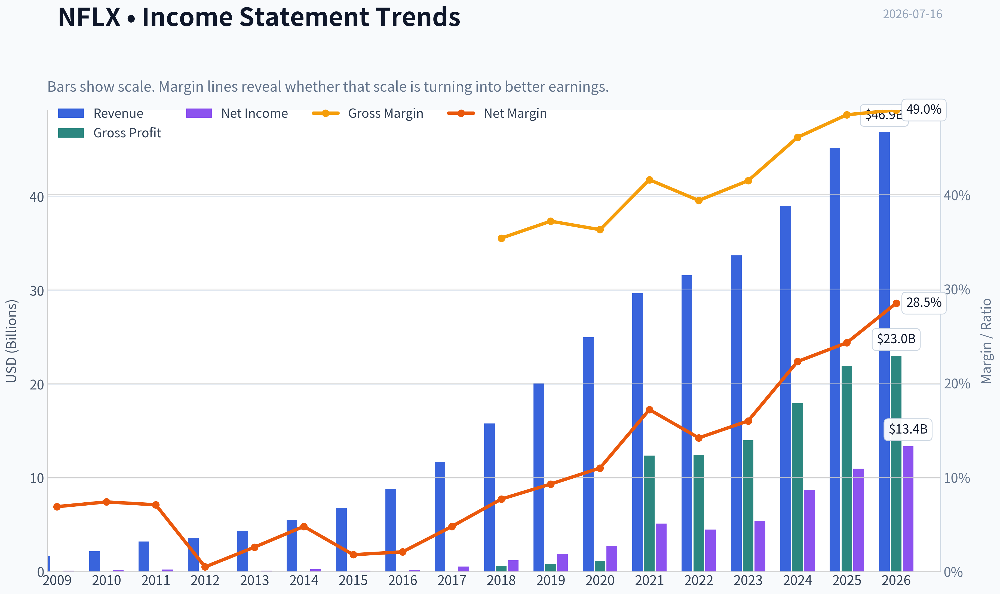

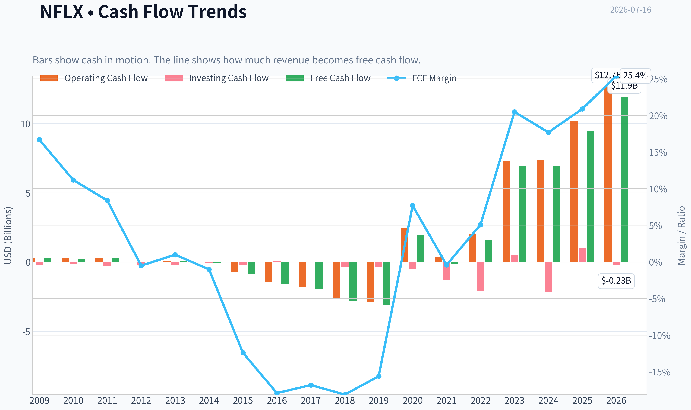

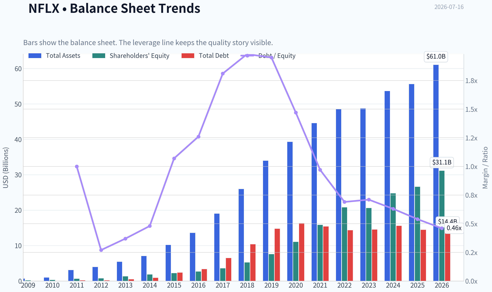

This graph tracks the profitability and return metrics (ROE, ROIC, Margins) of **NFLX** over the past decade, highlighting capital efficiency trends.

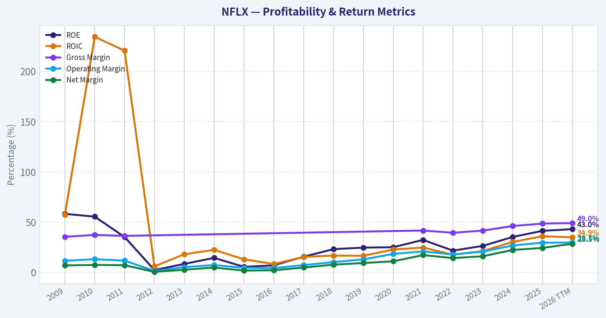

This chart illustrates the financial health of **NFLX** over the last 10 years, mapping cash equivalents and free cash flow against total obligations (Debt).

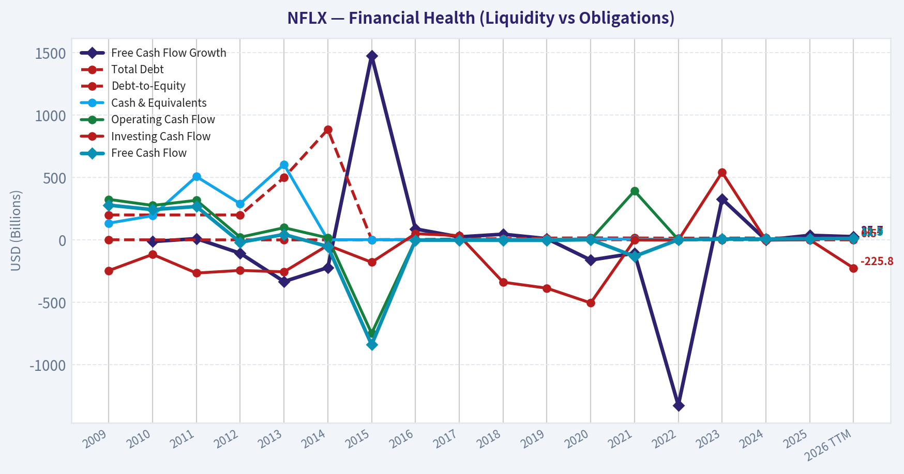

---

### Intrinsic Value Analysis (Buffett)

> *Following Warren Buffett's value investing philosophy: Circle of Competence, Economic Moat, Management Quality, and Margin of Safety.*

#### Intrinsic Value Snapshot

Price is what you pay. Intrinsic value is what the business may be worth based on the cash it can create for owners over time. We show a range, not one magic number.

- Current Price: $74.35
- Value Range (conservative to optimistic across both DCF methods): $30.47 to $654.80

##### Owner Earnings (Buffett Method)
- Net Income: $10,981,000,000.00
- Depreciation & Amortization: $16,755,555,000.00
- Capital Expenditures: $-688,220,000.00
- Working Capital Changes: $-456,220,000.00
- Owner Earnings: $27,504,555,000.00

##### Intrinsic Value
###### Buffett Method
Uses owner earnings. Stricter, and usually more conservative.
- Conservative: $187.02
- Average: $251.44
- Optimistic: $654.80
- Discount Rate: 10.0%

###### Cash Flow Method
Uses free cash flow. Better for companies spending heavily today to grow tomorrow.
- Conservative: $30.47
- Average: $82.99
- Optimistic: $82.99
- Discount Rate: 10.0%

ANALYST STANCE: **WATCH**

#### NFLX Buffett-Style Investment Report

#### 1) Go/No-Go Gate Assessment

| Gate | Verdict | Evidence |
|---|---|---|
| Gate 1: Circle of Competence & Simplicity | Pass | Netflix makes money by selling monthly subscriptions and advertising on streaming video. The model is simple, recurring, and globally scalable. |
| Gate 2: Durable Moat | Pass, but not elite | Brand is global, content scale is massive, recommendation engine improves user retention, and distribution is embedded in consumer habits. Still, content competition remains intense and switching costs are moderate rather than absolute. |
| Gate 3: Management & Capital Allocation | Pass | Management has shifted from cash-burning expansion to meaningful free cash flow generation, while maintaining pricing power and global growth. The key question is whether content spend remains disciplined as scale matures. |
| Gate 4: Industry Structure | Mixed Pass | Streaming has become more rational than its earlier land-grab phase, but it remains competitive and content-heavy. This is not a classic oligopoly with minimal rivalry. |

**Key Takeaways:** Netflix clears all four gates, but not with the clean ease of a classic Buffett favorite like a consumer staples monopoly. The business is understandable and durable, yet the moat is real but not impregnable. This makes the stock more suitable for watchful ownership than aggressive buying at today's valuation.

---

#### 2) The Elementary School Test

Netflix buys or makes shows and movies, puts them on its app, and charges people every month to watch them. It also now sells some advertising against lower-priced plans. If customers like the service enough to keep paying and Netflix can raise prices a little over time, the business grows.

#### 3) Long-Term Predictability Test

A decade from now, Netflix is still very likely to be a global streaming platform with:
- subscription revenue,
- ad-supported revenue,
- large content spending,
- international scale,
- and ongoing price increases tied to content value.

That said, the exact shape of competition and content economics is less predictable than in a soda, insurance, or payment-network business. Predictability is good, but not exceptional.

#### 4) Technology Risk Assessment

Netflix generally **benefits from technology** rather than being destroyed by it:
- better compression and broadband improve streaming economics,
- recommendation systems improve engagement,
- global distribution scales digitally.

The main risk is not technology obsolescence; it is **competitive abundance**. Technology makes it easier for rivals and new formats to fight for attention.

---

#### 5) Moat Analysis

| Moat Source | Assessment | Evidence |
|---|---|---|
| Intangible Assets | Moderate | Netflix has one of the strongest global brands in streaming. Gross margin of **48.5%** supports some pricing power. |
| Switching Costs | Modest | Users can cancel easily, so contractual switching costs are low. Habit, profiles, recommendations, and exclusive content create some behavioral stickiness. |
| Cost Advantage | Moderate | Enormous content budget, global scale, and amortization spread across a huge base create advantages smaller rivals struggle to match. |
| Network Effects | Limited | Netflix does not have a pure network effect like Visa or Meta. More users help fund more content, but the service does not become dramatically more valuable simply because more users join. |

**Moat Quality Rating: Narrow to Moderate**

**Key Takeaways:** Netflix's moat comes from brand, scale, data, and habit, not from hard lock-in. Customers can leave, but many do not because the service remains broad, familiar, and continuously refreshed. This is a real moat, though not the kind of nearly unassailable fortress Buffett values most.

---

#### 6) Management Quality & Capital Allocation

| Test | Assessment | Commentary |
|---|---|---|
| Owner Mindset | Reasonably positive | Management has shown willingness to invest heavily for long-term scale, then pivot toward stronger monetization once scale was achieved. |
| Honesty & Candor | Adequate | Netflix has historically communicated strategy clearly, though recent market concern around engagement reporting suggests investors are watching disclosure quality closely. |
| Capital Allocation | Improved materially | The strongest evidence is the transition from negative cash flow during the scale-build phase to solid free cash flow today. That suggests management turned content spending into a productive asset base rather than a permanent cash sink. |

**Key Takeaways:** Netflix management deserves credit for converting a scale race into a cash-generating business. The main ongoing test is whether they remain disciplined with content spending and shareholder returns as growth matures. Capital allocation looks better today than it did several years ago.

---

#### 7) Financial Summary

| Metric | Latest |
|---|---:|
| Share Price | $74 |
| Market Cap | $313.07B |
| P/E | 23.98 |
| ROE | 41.3% |
| Gross Margin | 48.5% |
| Revenue Growth YoY | 15.9% |
| FCF Yield | 3.0% |
| Current Ratio | 1.19 |

**Key Takeaways:** The headline numbers are strong. Profitability is excellent, growth remains healthy, and returns on equity are outstanding. The main issue is valuation discipline: a 3.0% free cash flow yield is not obviously cheap for a business with meaningful competitive pressure and continued content reinvestment needs.

---

#### 8) Buffett Financial Interpretation

##### Return on Equity
ROE of **41.3%** is excellent on the surface. Buffett would ask whether this comes from true business quality or financial structure. Given Netflix's scale, margins, and maturing cash generation, much of the ROE appears to reflect genuine economics, though investors should always verify how much buybacks and balance-sheet structure amplify the figure.

##### Cash Flow Reality Check
A **3.0% FCF yield** indicates Netflix is generating real cash, which is a major improvement from earlier phases of its corporate life. This is a favorable sign: profits are increasingly backed by cash.

##### Balance Sheet
A **current ratio of 1.19** is acceptable, though not fortress-like. Netflix is no longer the high-stress financing story it once was, but it is also not the kind of pristine, net-cash balance sheet Buffett loves most.

---

#### 9) Owner Earnings Estimate

Using available evidence, a practical owner-earnings proxy is current free cash flow, because Netflix's accounting for content amortization and production timing can complicate standard depreciation-based adjustments.

| Item | Estimate |
|---|---:|
| Market Cap | $313.07B |
| FCF Yield | 3.0% |
| Implied Current Owner Earnings Proxy | ~$9.39B |

**Key Takeaways:** A rough owner-earnings estimate of about $9.4 billion suggests Netflix is a substantial cash generator. The challenge is not whether the company is profitable; it is whether that cash stream is being purchased at an attractive enough price to provide a meaningful margin of safety.

---

#### 10) Three-Scenario DCF Valuation

Using owner earnings proxy of **$9.39B** and a **10% discount rate**:

| Scenario | Assumption | Estimated Equity Value |
|---|---|---:|
| A: No Growth | Owner Earnings / 10% | $93.9B |
| B: 3% Growth | OE x 1.03 / (10% - 3%) | $138.2B |
| C: Higher Growth Case | Assume 8% growth for 10 years, then 3% terminal | ~$190B-$220B |

**Key Takeaways:** Across conservative Buffett-style valuation frames, estimated value falls well below the current market capitalization of $313 billion. Even a favorable growth case struggles to justify the present price. That does not mean Netflix is a poor business; it means the market is already paying up heavily for quality and future growth.

---

#### 11) Margin of Safety Analysis

| Item | Value |
|---|---:|
| Current Market Cap | $313.07B |
| Conservative Value Range | $94B-$138B |
| More Optimistic Value Range | $190B-$220B |
| Margin of Safety at Current Price | Negative |

**Key Takeaways:** There is no Buffett-style margin of safety at the current valuation. The stock may continue to work if business momentum stays strong, but the purchase price leaves little room for disappointment. For value investors, this is the central objection.

---

#### 12) Final Buffett Scorecard

| Criterion | Score (1-5) | Weight | Weighted Score |
|---|---:|---:|---:|
| Business Understanding | 5.0 | 20% | 1.00 |
| Moat Width & Durability | 3.5 | 25% | 0.88 |
| Management Quality | 4.0 | 15% | 0.60 |
| Return on Equity | 4.5 | 15% | 0.68 |
| Reinvestment Runway | 3.5 | 10% | 0.35 |
| Balance Sheet Strength | 3.0 | 5% | 0.15 |
| Industry Structure | 2.5 | 5% | 0.13 |
| Valuation / Margin of Safety | 1.5 | 5% | 0.08 |
| **Total** |  |  | **3.86 / 5.00** |

**Key Takeaways:** Netflix scores well because it is a strong, understandable, cash-generating franchise with real global scale. The score is held back by industry rivalry and a stretched valuation. In Buffett terms, this looks like a good business that is not currently offered at a sufficiently attractive price.

---

#### 13) Final Verdict

**Investment Stance: WATCH**
**Conviction: Moderate-High**

Netflix is a **good business, possibly a very good one**, but it is **not a classic Buffett bargain at today's price**. The company has real strengths: global brand, pricing power, strong returns on equity, improving free cash flow, and a long runway in monetization through subscriptions and advertising. But the moat is not wide enough, and the current valuation is not cheap enough, to justify an **ADVOCATE** stance.

For a Buffett-style investor, the right posture is to **watch patiently for a better entry price or a materially stronger owner-earnings base** that closes the gap between price and intrinsic value.
#### Valuation Bridge

This bridge places the current market price beside each intrinsic value lens so readers can see whether upside depends on one method or shows up across several methods.

| Scenario | Intrinsic Value / Share |
| --- | ---: |
| Buffett Method | $251.44 |
| Cash Flow Method | $82.99 |
| Damodaran Method | $26.97 |
| Current Price | $74.35 |

#### Key Takeaways

If one method is far above the others, the upside case depends on a specific modelling assumption. When several methods cluster together, the valuation story is more robust.

#### Valuation Visuals

This comparison chart from *Latest Earnings Snapshot* stacks current figures against historical benchmarks for **NFLX**, making it easy to see where the company trades relative to its own averages.

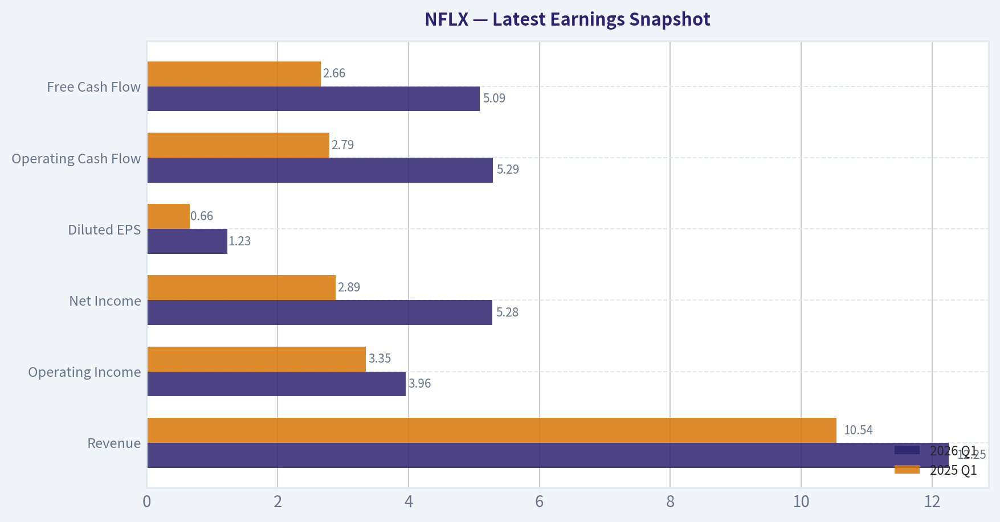

This comparison chart from *Current vs Historical Average Comparison* stacks current figures against historical benchmarks for **NFLX**, making it easy to see where the company trades relative to its own averages.

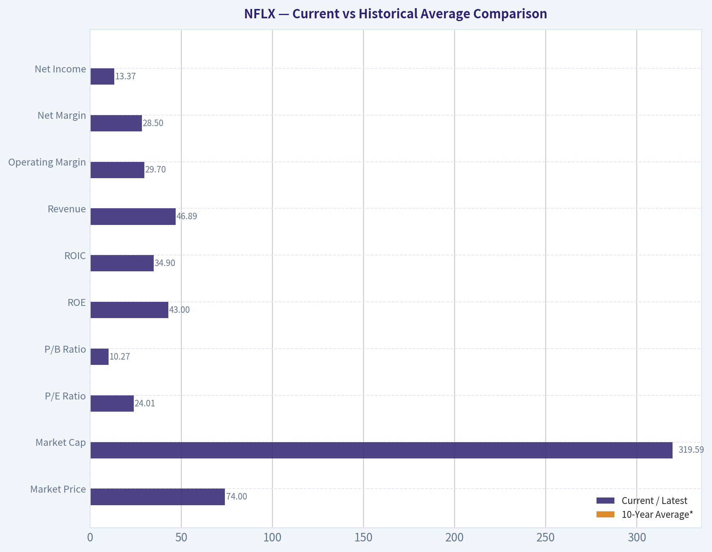

This comparison chart from *Buffett-Style Owner Earnings DCF* stacks current figures against historical benchmarks for **NFLX**, making it easy to see where the company trades relative to its own averages.

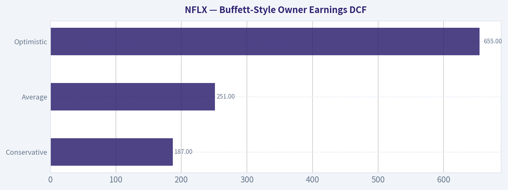

This comparison chart from *Financial Summary* stacks current figures against historical benchmarks for **NFLX**, making it easy to see where the company trades relative to its own averages.

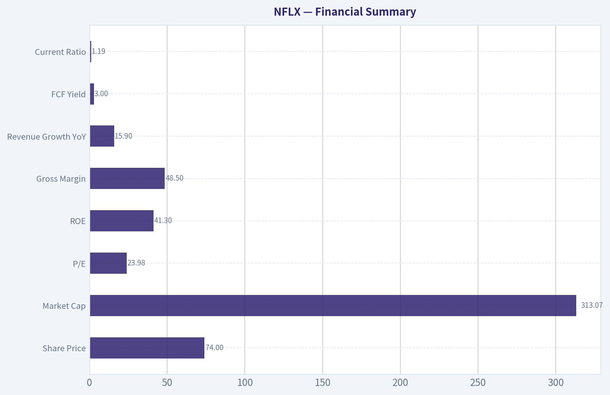

This comparison chart from *Owner Earnings Estimate* stacks current figures against historical benchmarks for **NFLX**, making it easy to see where the company trades relative to its own averages.

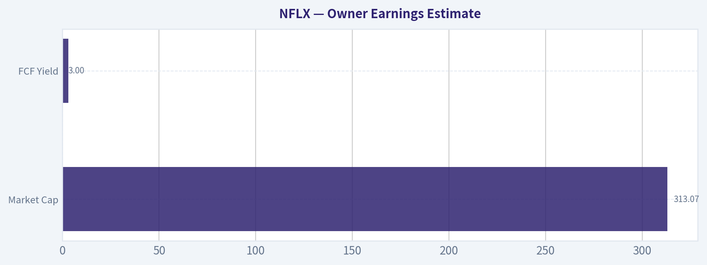

---

### Trend & Growth Analysis (Lynch/Druckenmiller/Fisher)

> *Following Peter Lynch's GARP, Stanley Druckenmiller's macro-aware approach, and Philip Fisher's scuttlebutt methodology.*

ANALYST STANCE: **WATCH**

#### NFLX Growth Analysis

| Metric | Value |
|---|---:|
| Price | $74 |
| Market Cap | $313.07B |
| P/E | 24.0x |
| Revenue Growth YoY | 15.9% |
| Gross Margin | 48.5% |
| ROE | 41.3% |
| FCF Yield | 3.0% |
| Current Ratio | 1.19x |

Key Takeaways: Netflix is still growing at a healthy mid-teens rate, with strong profitability and excellent returns on equity. But for a company already worth over $300 billion, 15.9 percent growth is good rather than explosive, and the low free cash flow yield suggests the market still gives it a premium valuation.

#### 1. Lynch Classification

| Framework | Assessment |
|---|---|
| Lynch Category | Fast Grower, but maturing |
| Why | Revenue growth near 16%, still above stalwart range, but no longer in hypergrowth |
| Initial Read | Quality compounder, not obvious ten-bagger from here |

Key Takeaways: Netflix still fits best in the fast grower bucket, but only barely. The company looks more like a scaled winner entering a more mature phase than an early-stage monster growth story.

#### 2. The Story in 3 Bullets

| Simple Story | Explanation |
|---|---|
| Global streaming leader | Netflix monetizes a huge global audience through subscriptions and advertising |
| Engagement platform expanding | It is trying to deepen monetization via ads, pricing tiers, and broader content formats |
| Still small in total TV share | Management says it has only about 5% of global TV viewing share, implying room to expand |

Key Takeaways: The bull case is easy to understand: Netflix already leads streaming, but still has a small slice of total viewing time globally. That creates a believable runway, especially if advertising and pricing increase revenue per user.

#### 3. TAM Analysis and 10x Test

| Item | Estimate / View |
|---|---|
| Current Revenue Base | Roughly consistent with mega-cap global media platform scale |
| 10x Revenue Test | 10x from here would imply a truly enormous media/advertising outcome |
| TV/Video TAM | Very large globally, including subscription TV, digital video ads, and entertainment spend |
| Management Clue | Only ~5% of global TV view share today |
| 10x Feasible? | Economically possible in TAM terms, but improbable from current scale |
| Runway Verdict | Good runway, but not realistic 10-bagger runway from this base |

Key Takeaways: Netflix still has room to grow because the global TV and advertising market is vast. However, at over $300 billion in market value, the classic Lynch-style 10-bagger outcome is much harder to underwrite from today's starting point.

#### 4. Revenue Growth Trend

| Signal | Assessment |
|---|---|
| Reported YoY Revenue Growth | 15.9% |
| Pattern | Moderately healthy, but not clear acceleration |
| Latest Earnings Read | Q2 revenue missed expectations |
| Market Reaction | Shares fell on growth worries and engagement concerns |
| Trend Verdict | Stable-to-slowing, not an obvious inflection higher |

Key Takeaways: The key issue is not that growth is bad, but that it may not be accelerating enough to justify a more aggressive stance. Recent earnings headlines suggest investors wanted stronger evidence that monetization and engagement are re-accelerating.

#### 5. Unit Economics

| Metric | Assessment |
|---|---|
| Gross Margin | 48.5%, solid for scaled subscription media |
| FCF Yield | 3.0%, profitable but not cheap |
| ROE | 41.3%, excellent |
| LTV/CAC | Not disclosed in shared data |
| NRR | Not applicable / not disclosed like SaaS |
| Rule of 40 | Not directly applicable, but growth plus FCF economics look healthy |

Key Takeaways: Netflix has strong economic quality, especially its high ROE and healthy gross margin profile. The problem is not business quality; it is whether future growth can meaningfully re-accelerate from an already massive base.

#### 6. Inflection Point Assessment

| Potential Inflection | Status |
|---|---|
| Ad Tier Monetization | Positive, but needs proof of stronger revenue lift |
| Password Sharing Crackdown Aftereffects | Largely harvested; harder comps ahead |
| Content/Engagement Expansion | Mixed; market focused on slowing engagement concerns |
| Margin Inflection | Possible through scale and ad mix |
| Overall Inflection Call | Not enough evidence yet of a fresh major acceleration |

Key Takeaways: Netflix does have plausible levers, especially advertising and monetization of its huge user base. But based on the latest update, the market is not seeing a decisive new growth inflection yet.

#### 7. Macro Setup Evaluation

| Factor | View |
|---|---|
| Secular Trend | Streaming, digital advertising, connected TV |
| Economic Sensitivity | Moderate; subscriptions resilient, ad business more cyclical |
| Rate Sensitivity | Lower than long-duration unprofitable growth names |
| Macro Backdrop | Mixed but generally acceptable for quality large-cap growth |

Key Takeaways: Netflix benefits from durable secular trends in streaming and connected TV. Compared with speculative growth names, it is less vulnerable to rate shocks, but its expanding ad business could become more exposed to economic cycles.

#### 8. Fisher 15 Points Score

| Fisher Category | Score (1-5) |
|---|---:|
| Market potential | 4 |
| Product development | 4 |
| R&D / content innovation | 4 |
| Sales organization | 4 |
| Profit margin | 4 |
| Improving margins | 3 |
| Labor relations | 3 |
| Executive relations | 4 |
| Management depth | 4 |
| Cost controls/accounting | 4 |
| Moat / special aspects | 4 |
| Long-range outlook | 4 |
| Dilution risk | 4 |
| Candor | 3 |
| Integrity | 4 |
| **Total** | **57/75** |

Key Takeaways: A score of 57 out of 75 places Netflix in the "good" range. This reflects a high-quality franchise with real moat characteristics, but not one with overwhelming evidence of underappreciated upside today.

#### 9. Valuation Analysis

| Method | Result |
|---|---|
| P/E | 24.0x |
| Revenue Growth | 15.9% |
| PEG | ~1.51x |
| PEG View | Fair value, not bargain |
| FCF Yield | 3.0% |
| Valuation Read | Reasonable for quality, not screamingly cheap |

Key Takeaways: Netflix does not look wildly overvalued on a PEG basis, but it also does not screen as classic Lynch cheap growth. The valuation looks fair for a durable franchise, which supports holding or watching more than aggressive buying.

#### 10. Growth Investor Scorecard

| Criterion | Weight | Score | Weighted |
|---|---:|---:|---:|
| The Story | 10% | 4.0 | 0.40 |
| TAM & Runway | 20% | 3.5 | 0.70 |
| Revenue Growth | 20% | 3.2 | 0.64 |
| Unit Economics | 15% | 4.2 | 0.63 |
| Competitive Position | 10% | 4.2 | 0.42 |
| Management Quality | 10% | 3.8 | 0.38 |
| Macro Setup | 5% | 3.5 | 0.18 |
| Profitability Path | 5% | 4.3 | 0.22 |
| Valuation | 5% | 3.0 | 0.15 |
| **Total** |  |  | **3.72 / 5.0** |

Key Takeaways: Netflix scores as a good business with a decent setup, but not a top-tier inflection idea. The overall rating lands in low-end advocate territory by score, but the latest earnings and growth concerns argue for a more cautious practical stance.

#### 11. Position Size Stance

| Stance | View |
|---|---|
| Existing Holder | Hold / monitor closely |
| New Position | Small starter at most |
| Aggressive Buy? | No |
| Ideal Trigger to Upgrade | Evidence of renewed acceleration in revenue, ads, and engagement monetization |

Key Takeaways: Netflix is more suitable as a monitored compounder than a high-conviction new growth bet today. A stronger stance would require proof that advertising and engagement can create a new phase of faster growth.

#### 12. Key Risks and Catalysts

| Risks | Catalysts |
|---|---|
| Revenue deceleration | Stronger ad monetization |
| Engagement softness | Better-than-expected operating leverage |
| Content misses | International ARPU expansion |
| Premium valuation for mid-teens growth | New content franchises and format expansion |
| Competition for attention | Reacceleration after current weak quarter |

Key Takeaways: The biggest risk is not collapse, but gradual multiple compression if growth continues to slow. The biggest upside catalyst is a credible second leg of monetization through advertising, pricing, and stronger engagement.

#### Bottom Line

Netflix is a high-quality global franchise with strong profitability, real moat, and meaningful remaining runway. But under Lynch-Druckenmiller-Fisher standards, this does not currently look like a clean inflection-point ten-bagger candidate from today's scale and valuation.

The business is good. The stock may be fine. But the setup, based on the latest quarter, looks more like **WATCH** than **ADVOCATE** until growth re-accelerates more clearly.

#### Growth & Scorecard Visuals

This comparison chart from *Growth Metrics* stacks current figures against historical benchmarks for **NFLX**, making it easy to see where the company trades relative to its own averages.

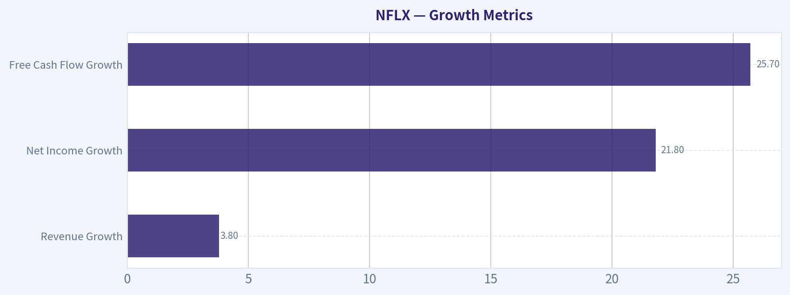

---

### Market Technical Analysis

#### NFLX Technical Report

NFLX is in a clear multi-timeframe downtrend, but the very short-term tape has stabilized and is attempting a mild recovery from deeply oversold June levels. That distinction matters: the stock is not showing broad trend improvement yet, but it is no longer in the same degree of downside acceleration seen in late June.

I selected these 8 indicators because they are the most complementary for the current setup:

- **close_200_sma**: defines the long-term regime
- **close_50_sma**: tracks the medium-term trend
- **close_10_ema**: captures short-term directional changes
- **macdh**: measures momentum acceleration/deceleration
- **rsi**: shows whether weakness is still extreme or normalizing
- **boll_ub**
- **boll_lb**: together these frame volatility compression/expansion and rebound quality
- **atr**: helps size risk in a still-volatile stock

---

#### Price Structure and Trend Regime

Over the last year, NFLX has gone through several distinct phases rather than one uniform decline.

From mid-2025 into early autumn, price traded mostly in the low-120s, then broke sharply in late October. That break was not a routine pullback: it came with a violent gap-down style repricing from the 124 area to roughly 111, and it changed the character of the chart from range-bound to distributive. The subsequent months confirmed that weakness rather than repairing it. By December and January, the stock had slid into the low 90s and then mid-80s, showing that sellers were not simply taking profits but continuously accepting lower prices.

A major inflection occurred in late February 2026, when NFLX surged from the mid-80s into the mid-90s in a very strong short-covering or event-driven rally. However, that rebound failed to establish a durable bullish trend. Price briefly extended toward the high 90s and low 100s in March and April, even reaching about 107 before another abrupt breakdown in mid-April. That April failure is important because it suggests rallies have been repeatedly rejected at lower highs, which is a classic hallmark of a bearish structure.

From May through late June, the downtrend resumed in a more grinding but persistent way, carrying price from the upper 80s into the low 70s. The stock printed a local low near **70.90 on June 25**, then bounced into early July toward **77.65 on July 2**. Since then, price has faded again and is sitting around **73.68 on July 15**, which leaves the stock close to the lower half of its recent rebound range.

This means NFLX currently looks less like a fresh upside breakout and more like a stock trying to base after a severe decline.

#### Trend Indicators Interpretation

The moving averages strongly confirm bearish trend alignment:

- **50 SMA: 81.27**
- **200 SMA: 94.23**
- **10 EMA: 74.41**
- **Last close: 73.68**

Price is below the **10 EMA**, below the **50 SMA**, and far below the **200 SMA**. That is bearish across short, medium, and long horizons.

More importantly, the slopes matter:

- **50 SMA** has fallen from about **94.26 in mid-May** to **81.27 now**
- **200 SMA** has fallen from about **102.43 in mid-May** to **94.23 now**
- **10 EMA** has also rolled over recently from the upper 80s in late May to the mid-74 area now

That tells us this is not merely price trading below static averages. The averages themselves are declining, meaning the trend damage is embedded in the series, not just a temporary overshoot.

The short-term nuance is that price is only modestly below the **10 EMA**, while it is much farther below the **50** and **200** day averages. This often happens in bear-market rebounds or consolidation phases: near-term momentum improves first, but unless price can reclaim the 10 EMA and then start challenging the 50 SMA, the broader downtrend remains intact.

---

#### Momentum Analysis

The momentum picture has improved from "capitulation" to "fragile stabilization."

- **RSI: 39.45**
- **MACD Histogram: +0.39**

RSI is below 50, so momentum still leans bearish, but it is well above the deeply oversold readings seen in late June. On **June 25**, RSI was near **19**, which marked an extreme washout. Since then, RSI recovered into the 40s, showing sellers lost some control. However, the fact that RSI remains below 50 tells us buyers have not established sustained momentum leadership.

The **MACD histogram turning positive** is the most constructive part of the report. It moved from negative in late June to positive by early July and remains positive, although it has softened from around **0.67 on July 9** to **0.39 on July 15**. That pattern suggests downside momentum has faded, but upside momentum is not strengthening anymore; instead, the rebound impulse is decelerating.

This is a subtle but important message:
- bearish momentum is no longer extreme,
- bullish momentum exists only in a limited, tactical sense,
- the latest few sessions show that positive momentum is fading rather than expanding.

For traders, that often means the stock is vulnerable to renewed downside if price cannot quickly reclaim the short-term average.

---

#### Volatility and Bollinger Band Context

Current Bollinger levels:

- **Upper Band: 78.83**
- **Lower Band: 70.17**
- **Price: 73.68**

Price is trading in the lower half of the Bollinger range, but not at the lower band. That tells us NFLX is weak, though not currently at a fresh short-term volatility extreme.

Late June was the true stretch condition. Around **June 25**, price was pressing near or below the lower envelope with RSI at extreme lows, which signaled an exhausted selloff and helped produce the bounce into early July. Now, by contrast, the stock has rebounded off the extreme but failed to approach the upper band with conviction. That is usually what a weak countertrend rally looks like: enough strength to relieve oversold conditions, but not enough to force a bullish volatility expansion.

Another important observation is that the Bollinger range has narrowed from the panic phase. The upper band has fallen sharply from around **90+ in mid-June** to **78.8 now**, while the lower band also fell into the **70 area**. This compression implies the market has shifted from disorderly liquidation to a more controlled range. Compression after a large move often precedes the next directional decision.

Given price location near the lower half of the band, the next break is important:
- a move back toward **78-79** would suggest the rebound still has life,
- a move down toward **70** reopens the risk of retesting the June lows.

---

#### Volatility and Risk Management

- **ATR: 2.38**

ATR has eased from around **2.65+ in mid-May** and remains below the more turbulent spikes seen in late June and prior shock periods. This means daily trading ranges are still sizable, but the stock is no longer in maximum stress mode.

For risk management, an ATR of 2.38 against a stock price of roughly 73.68 implies a daily range of about **3.2%** of price. That is still high enough that tight stops can be easily shaken out. Traders should assume NFLX can move 2 to 3 dollars in a normal session without that move necessarily changing the broader setup.

In practice:
- short-term longs need wider stops and smaller size,
- trend-following shorts should avoid entering directly into oversold flushes near the lower band,
- swing traders should treat **70-71** and **78-79** as more meaningful reference zones than tiny intraday fluctuations.

---

#### Fine-Grained Trading Interpretation

The most realistic interpretation is that NFLX is in a **long-term bearish regime**, **medium-term bearish trend**, but **short-term rebound/consolidation phase** that is starting to lose thrust.

That combination creates different implications by style:

| Trading Style | Read on NFLX | Practical Implication |
|---|---|---|
| Long-term investor | Bearish | Price remains far below the 200 SMA, so there is no technical evidence yet of durable trend repair |
| Swing trader | Neutral-to-bearish | The June oversold rebound happened, but follow-through is weak and momentum is fading |
| Short-term trader | Two-way but fragile | Positive MACD histogram allows tactical upside trades, but RSI under 50 and price under 10 EMA argue for caution |
| Trend follower | Bearish bias | Rallies toward short-term resistance are more attractive than chasing weakness at the lows |

Key Takeaways: NFLX is still in a bearish overall structure, with price below all key moving averages and both the 50-day and 200-day averages falling. The recent rebound improved momentum from extremely oversold levels, but that bounce is losing energy, so the stock remains vulnerable unless it can reclaim nearby resistance.

---

#### What Traders Should Watch Next

The nearest technical battle is around the **10 EMA near 74.4**. NFLX is slightly below it now. Reclaiming and holding above that level would be the first sign that the rebound is trying to reassert itself.

Above that, the next meaningful zone is roughly **77.5 to 79**, which aligns with the early July rebound high area and sits just under the upper Bollinger band. If price can push into that region with RSI lifting through 50 and MACD histogram re-expanding, the rebound could extend.

On the downside, **70 to 71** is the key support shelf. If that area fails, the stock likely enters a fresh downside leg and the June washout would no longer look like a durable near-term bottom, only a pause.

So the tactical map is fairly clear:

- **Bullish short-term trigger:** close back above the 10 EMA and build toward 77-79
- **Bearish continuation trigger:** lose 70-71 support
- **Intermediate outlook:** still bearish until the 50 SMA is even remotely challenged, which is far above current price

---

#### Indicator Summary Table

| Indicator | Latest Value | Signal | Why It Matters Now |
|---|---:|---|---|
| close_200_sma | 94.23 | Bearish | Confirms long-term downtrend; price is deeply below strategic trend support |
| close_50_sma | 81.27 | Bearish | Medium-term trend remains negative and the average is still falling |
| close_10_ema | 74.41 | Slightly Bearish | Price is just below it, showing near-term weakness after a rebound attempt |
| macdh | 0.39 | Mildly Bullish, fading | Momentum improved from late June, but recent histogram contraction shows slowing upside thrust |
| rsi | 39.45 | Bearish but off oversold | No longer capitulation-level weak, yet still below neutral 50 |
| boll_ub | 78.83 | Resistance zone | A move toward this level would test whether the rebound has real strength |
| boll_lb | 70.17 | Support/risk zone | Breakdown toward or below this area would threaten a fresh downside leg |
| atr | 2.38 | Elevated | Volatility is still meaningful, requiring disciplined sizing and wider stops |

Key Takeaways: The table shows a consistent bearish backdrop, with the long-term and medium-term trend still pointing lower. The only constructive elements are that momentum has improved from extreme oversold conditions and volatility has calmed somewhat, but neither development is yet strong enough to reverse the broader trend.

---

### Options Market Analysis

> *Reading options flow - put/call ratios, IV skew, and unusual activity - to gauge institutional positioning and event-driven risk.*

#### NFLX Options Positioning Report
*Data as of 2026-07-16*

A quick caveat up front: the strike references in the dataset imply the underlying price is likely being represented on a split-adjusted basis, but the relative positioning signal is still usable. The options tape is active enough here to draw a view with moderate confidence.

#### 1. Put/Call Ratio Analysis

| Expiry | Call OI | Put OI | Put/Call OI Ratio | Call Vol | Put Vol | Put/Call Vol Ratio |
|---|---:|---:|---:|---:|---:|---:|
| 2026-07-17 | 646,713 | 323,620 | 0.50 | 269,076 | 157,910 | 0.59 |
| 2026-07-24 | 123,266 | 38,648 | 0.31 | 156,033 | 51,295 | 0.33 |
| 2026-07-31 | 58,415 | 57,522 | 0.98 | 20,767 | 15,258 | 0.73 |
| **Near-term total** | **828,394** | **419,790** | **0.51** | **445,876** | **224,463** | **0.50** |

**Key Takeaways:** NFLX shows a clearly call-heavy near-term options structure. The aggregate put/call OI ratio of 0.51 and volume ratio of 0.50 are both well below the historical neutral zone around 0.7, which points to bullish speculative interest or call overwriting rather than defensive hedging dominance. The strongest upside bias is in the 7/24 expiry, while 7/31 looks more balanced.

Interpretation:
- **Overall near-term positioning is bullish-leaning.**
- Compared with the neutral baseline of **~0.7**, NFLX is seeing **meaningfully stronger call interest** than normal.
- The **7/24 chain is especially call-skewed**, suggesting traders are positioning for upside or at least not paying up heavily for protection over the next 1-2 weeks.
- The **7/31 ratio near 1.0** tempers the read a bit, showing sentiment gets less aggressively bullish further out.

#### 2. Implied Volatility (IV) Assessment

| Expiry | ATM Call IV | ATM Put IV | IV Read |
|---|---:|---:|---|
| 2026-07-17 | 163.1% | 158.2% | Extremely elevated |
| 2026-07-24 | 79.5% | 77.2% | Elevated |
| 2026-07-31 | 64.8% | 61.7% | Moderately elevated |

**Key Takeaways:** Near-dated implied volatility is very high, especially into the 7/17 expiry where both calls and puts are pricing a major move. Importantly, ATM call IV is slightly above ATM put IV across all listed expirations, which is not the usual fear-driven pattern and instead suggests upside demand is at least matching downside protection demand.

IV conclusions:
- **Front-week IV is exceptionally high**, indicating the market is pricing in a catalyst or immediate event risk.
- Since today is **2026-07-16**, the **7/17 expiry is effectively event-week pricing**.
- The fact that **ATM call IV exceeds ATM put IV** across the term structure points to a **call-biased skew**, or at minimum the absence of a classic crash-hedge put premium.
- A traditional bearish/fear regime usually shows **puts richer than calls**, especially in the front week. That is **not** what this tape shows.

On skew:
- We were not given a full strike-by-strike skew surface for all OTM calls versus OTM puts.
- However, the available IV profile and unusual flow suggest **no steep downside-fear put skew**, and likely a **flatter-to-call-firm skew** near-term.
- That generally signals **upside chase or event-driven call demand**, not urgent institutional panic.

#### 3. Unusual Options Activity

Contracts flagged where **volume > 5x open interest** and volume is meaningful:

| Expiry | Type | Strike | Volume | OI | Vol/OI | IV | Positioning Read |
|---|---|---:|---:|---:|---:|---:|---|
| 2026-07-17 | PUT | 55.0 | 23,507 | 2,380 | 9.9x | 171.9% | Fresh short-dated downside hedge/speculation |
| 2026-07-31 | PUT | 74.0 | 6,715 | 447 | 15.0x | 63.0% | New put positioning, likely directional or hedge |
| 2026-07-24 | PUT | 63.0 | 4,169 | 521 | 8.0x | 75.2% | New put buying into next week |
| 2026-07-17 | PUT | 40.0 | 2,878 | 575 | 5.0x | 287.5% | Far OTM tail-risk protection / lottery hedge |

**Key Takeaways:** The unusual activity list is entirely put-heavy, which shows real demand for downside protection despite the broader call-dominant book. The most notable flow is concentrated in short-dated puts, which is often more consistent with event hedging than a pure high-conviction bearish swing bet. That said, the size is large enough that downside risk is clearly being respected.

Interpretation by contract:
- **7/17 $55 puts**: very short-dated and high IV, likely **event hedge flow** or tactical bearish exposure. Because of the enormous volume and front-week expiry, this looks more institutional than retail.
- **7/31 $74 puts**: larger time horizon and very high vol/OI ratio. This is more interesting as a **fresh bearish or hedge extension beyond the immediate event**.
- **7/24 $63 puts**: likely a **post-event protection roll** or directional follow-through hedge.
- **7/17 $40 puts**: deep OTM with extreme IV. This looks more like **tail-risk disaster insurance** than a base-case directional bet.

Smart-money vs. retail read:
- The **very high volume relative to OI** in multiple put lines suggests these are **fresh trades**, not just old positions being closed.
- The concentration in **near-term puts around an event window** is more consistent with **institutional hedging or professional downside protection** than retail upside chasing.
- So while the overall book is call-heavy, the **most urgent "new" money shown in the unusual screen is defensive**.

#### 4. Open Interest Concentration

| Expiry | Call OI | Put OI | OI Read |
|---|---:|---:|---|
| 2026-07-17 | 646,713 | 323,620 | Largest concentration by far; strongest pin/gamma influence |
| 2026-07-24 | 123,266 | 38,648 | Secondary near-term influence |
| 2026-07-31 | 58,415 | 57,522 | More balanced, less one-sided |

**Key Takeaways:** The 7/17 expiry dominates the near-term open-interest landscape, so price action into that expiration is most likely to feel gamma-related pinning or acceleration effects. Since call OI materially exceeds put OI there, dealer positioning could dampen mild pullbacks but also create sharper movement if price pushes through crowded call zones.

What matters:
- **7/17 is the key expiry** for near-term price behavior.
- The very large **call OI concentration** suggests potential **gamma pinning** if NFLX trades near major high-OI strikes into expiry.
- Because we do not have strike-by-strike OI distribution, we cannot calculate exact **max pain** or identify precise **gamma walls** by strike.
- Still, the **aggregate call-heavy OI** implies the near-term market structure is more likely to be **supportive/absorptive on dips** unless the stock breaks sharply lower and forces hedging flows to intensify.

#### 5. Overall Options Sentiment Signal

**Signal: BULLISH, with event-risk hedging underneath**

Why:
1. **Aggregate put/call OI ratio of 0.51** and **volume ratio of 0.50** are clearly below neutral.
2. **ATM call IV exceeds put IV** across all near-term expiries, which is an unusual bullish-leaning volatility signature.
3. **Open interest is concentrated in the front week and skewed toward calls**, supporting a constructive near-term positioning backdrop.
4. The main offset is that **unusual activity is dominated by puts**, indicating that sophisticated players are still buying protection against a downside surprise.

Bottom line:
- The options market is **net bullish on NFLX**, but not complacent.
- The **dominant structure** says traders are still leaning for upside or upside participation.
- The **freshest unusual flow** says institutions are **actively hedging event downside**.
- So the best read is: **bullish core sentiment, but elevated awareness of a sharp downside tail risk**.

Confidence:
- **Moderate**
- Reason: strong aggregate options activity and clear ratios, but **lack of full strike-level OI and full skew surface** limits precision on exact gamma walls and max-pain levels.

#### Final Summary Table

| Category | Read |
|---|---|
| Put/Call Ratio | **Bullish** - near-term OI ratio 0.51 and volume ratio 0.50, both below neutral 0.7 |
| IV Level | **Elevated** - especially 7/17, where ATM IV is extremely high and event-like |
| Skew Direction | **Slight call-firm / not fear-driven** - ATM call IV above put IV; no evidence of steep put-fear skew |
| Unusual Activity | **Bearish/defensive undercurrent** - unusual trades are concentrated in short-dated puts |
| Overall Signal | **BULLISH** - call-heavy positioning and call-firm IV dominate, though hedging demand is notable |

**Key Takeaways:** NFLX's options market is leaning bullish overall, with call demand clearly stronger than put demand across the near-term expiries. However, the unusual activity tape shows traders are still paying for downside insurance, which usually happens around an event or binary setup. The cleanest read is bullish sentiment with a meaningful hedge overlay, not blind optimism.

---

## Research Team Commentary

> *The Research Manager synthesizes the Bull vs Bear debate into action-free commentary. This is a pre-risk view, not the final stance.*

The strongest bull argument is straightforward: Netflix today looks much more like a durable global platform than the old cash-burning story stock. The business quality metrics are excellent - roughly 24x earnings, 41% ROE, 36% ROIC, and nearly 49% gross margin - which is not what you see in an ordinary media company. The bull case also rightly emphasizes that Netflix has built real advantages in global scale, user habit, recommendation/discovery, and increasingly a two-engine model of subscriptions plus advertising. Management deserves credit for improving monetization through paid sharing and the ad tier without clearly damaging engagement. From a long-term Buffett lens, the company appears capable of compounding intrinsic value if it can sustain mid-teens growth, continue converting engagement into revenue, and maintain disciplined content ROI.

The strongest bear argument is that a good business is not automatically a good value. Netflix still operates in a content-intensive, low-switching-cost industry where moat strength is not as permanent as classic Buffett favorites. The business must continually reinvest to defend attention, and advertising adds opportunity but also cyclicality and execution risk. The bear side is most compelling when it focuses on margin of safety: low free cash flow yield, a still-premium valuation despite growth maturing into the mid-teens, and the possibility that current returns reflect a particularly favorable monetization phase rather than permanently superior economics. If Netflix merely remains good rather than exceptional, multiple compression could cap returns.

My takeaway is that the bull has the better business-quality argument, but the bear has the better pure value-discipline argument. That matters. One of the lessons from prior mistakes is not to let admiration for quality blur the entry price question, but another lesson is not to be too static or overly defensive when a dominant business is available at a more reasonable multiple than usual. Here, unlike those earlier overextended setups, the valuation does not look euphoric on the headline P/E. At about 24x earnings for a high-return, globally scaled platform with credible ad monetization optionality, this is no longer obviously priced for perfection. Still, it is not a classic Buffett bargain either, because the moat is real but not untouchable, and the content treadmill limits the margin of safety.

So I land at WATCH.

Core takeaway: Netflix appears to be a high-quality business that can likely keep compounding value over the next decade, but the current setup does not yet offer a large enough discount to intrinsic value to merit a full-throated Buffett-style endorsement. This is closer to fair value for a strong compounder than a clear mispricing.

Why that leads me here: Buffett philosophy starts with business quality, and Netflix passes that test better now than many critics admit. The return metrics are elite, management has executed well, and the business model has become more predictable. But Buffett also insists on buying with a margin of safety, and that is where the hesitation remains. Netflix still depends on sustained content effectiveness, pricing discipline, ad execution, and continued global engagement. Those are achievable, but not automatic. A truly compelling ADVOCATE call would require either a cheaper entry point, clearer evidence that advertising materially raises lifetime customer economics, or proof that free cash flow conversion is becoming sustainably stronger than skeptics expect.

My monitoring plan over the next 1 to 4 quarters would be very concrete. First, watch ad-tier economics: not just user growth, but ad ARPU, total revenue per membership, and whether the lower-priced tier is additive rather than dilutive. Second, monitor operating margin and free cash flow conversion to see whether improved profitability is durable or just a favorable phase. Third, pay attention to engagement and churn after price increases and paid sharing normalization; that will tell us whether the moat is habit-based enough to support ongoing monetization. Fourth, assess content efficiency: are big content dollars still producing broad global engagement, or is the company needing to spend more just to stand still? Fifth, track international monetization, especially whether lower-ARPU markets can improve without pressuring margins. And finally, from a market standpoint, I would want to see whether the stock begins to offer a better margin of safety through price weakness without a corresponding deterioration in fundamentals.

What would strengthen the thesis? Sustained double-digit revenue growth, improving free cash flow yield, stable or rising margins, healthy ad monetization, and signs that churn remains controlled despite monetization pushes. What would weaken it? Slowing engagement, weaker content ROI, ad-tier cannibalization, deteriorating free cash flow conversion, or evidence that the market was right to treat current returns as near-peak.

Bottom line: excellent business, respectable but not bargain valuation, and not enough margin of safety yet for a value investor to pound the table. WATCH.

---

## Value Investing Team Commentary

> *The Investor translates the research view into an investment thesis before risk review. This is still not the final stance.*

Netflix is a much better business today than the old "growth at any cost" caricature many investors still carry in their heads. From a long-term owner's perspective, that matters. A company earning roughly 41% ROE, about 36% ROIC, and nearly 49% gross margins is not a weak media asset drifting on hype. It is a scaled global platform with real monetization power, strong operating discipline, and increasingly predictable economics. The market is no longer paying an absurd multiple either; around 24x earnings, NFLX looks closer to a quality compounder priced reasonably than a bubble stock priced for fantasy.

That said, Buffett-style investing is not just about admiring quality. It is about paying a price that gives you a margin of safety. Here is where caution remains appropriate. Netflix still lives in an industry where customer switching costs are not especially high, and where content investment is not optional. The moat is real, but it is not like railroads, payment networks, or consumer staples with decades of embedded habit and physical distribution advantages. Netflix's edge comes from scale, brand, user habit, data-driven discovery, and global content reach. Those are meaningful advantages, but they must be reinforced continuously. In plain English: this is a good business that still has to keep earning its keep.

The selective contrarian angle is interesting. Market sentiment often underestimates how much Netflix has matured operationally. Many investors still think of it as a debt-funded streamer in a brutal content war. That framing is outdated. Paid sharing, pricing power, and the ad-supported tier have all improved the business model. If the market remains mentally anchored to the old story, there may be some underappreciation of how durable earnings power has become over the next 5-10 years.

But the opposite contrarian warning is also important: some investors may now be too quick to declare Netflix a classic Buffett-quality moat business just because profitability has improved. That would be a mistake. Current returns may reflect a particularly favorable monetization phase: paid sharing benefits, pricing leverage, and early ad-tier optimism. If those tailwinds normalize, the market may discover that today's economics are very good without being permanently exceptional. In that scenario, the stock may not collapse, but returns from this entry point could be merely satisfactory rather than outstanding.

So what is the market possibly missing? On the bullish side, it may be underestimating the long runway from ad monetization. If Netflix can turn engagement into both subscription revenue and meaningful ad ARPU without damaging retention, intrinsic value could rise materially from here. That would make today's valuation look more acceptable in hindsight. On the bearish side, the market may still be too generous in assuming content efficiency and monetization gains can keep offsetting maturation. A business growing in the mid-teens at this size is impressive, but it also means future upside increasingly depends on better unit economics, not just subscriber growth.

Management deserves credit. They have improved the quality of revenues without obviously breaking the customer relationship. That is exactly the kind of capital allocation and operating adaptation a long-term owner wants to see. Still, I would want stronger evidence on a few points before becoming more aggressive: ad-tier economics must be clearly additive, not cannibalistic; free cash flow conversion should stay robust through normal content cycles; and churn must remain controlled even as monetization increases.

If I owned Netflix already at a lower basis, I would be comfortable holding. The business appears strong enough to compound over time. But if I were allocating fresh capital today, I would not feel the kind of obvious margin of safety that invites a decisive Buffett-style purchase. This is not a mediocre business to avoid outright, nor is it a fat pitch at the current setup. It is a high-quality company that deserves patience and close monitoring.

The key question is simple: are we buying a durable compounding machine at a fair price, or a temporarily optimized media platform near peak economics? That distinction will determine whether future returns are attractive or merely average.

ANALYST STANCE: **WATCH** - Netflix looks like a high-quality global platform with genuine long-term earnings power, and sentiment may still underappreciate how much the business has improved. However, the moat is not untouchable, content spending remains a structural burden, and current valuation does not offer a wide enough margin of safety for a strong value-investor endorsement.

---

## Deep Values Commentary

> *The Risk Management Team debates and the Risk Judge provides the final action-free verdict. This section determines the final ADVOCATE / WATCH / AVOID stance.*

#### Final Stance Scorecard

This scorecard converts the final research view into a weighted decision frame. It does not replace the narrative judgement, but it makes the main drivers of the verdict easier to scan.

| Criterion | Score | Weight | Commentary |
| --- | ---: | ---: | --- |
| Business Quality | 4.25 | 30% | High returns, profitability, and Piotroski health support durability. |
| Valuation Support | 3.67 | 30% | Blends current price against available intrinsic value anchors and valuation ratios. |
| Financial Strength | 3.67 | 20% | Balance-sheet resilience reflects leverage and liquidity staying within safe ranges. |
| Growth Durability | 4.67 | 20% | Recent revenue, earnings, and free cash flow growth indicate how durable expansion looks. |
| TOTAL / FINAL STANCE | 4.04 | 100% | WATCH |

#### Key Takeaways

The weighted score lands at **4.04 / 5.0**, while the final stance remains **WATCH**. This is useful as a quick calibration aid rather than a mechanical signal.

#### Risk Summary

Higher scores indicate more risk pressure. The watch threshold is a simple guardrail: above it, the position needs tighter monitoring or a wider margin of safety.

| Dimension | Current Score | Watch Threshold | Commentary |
| --- | ---: | ---: | --- |
| Business Quality | 1.75 | 3.00 | High returns, profitability, and Piotroski health support durability. |
| Valuation Support | 2.33 | 3.00 | Blends current price against available intrinsic value anchors and valuation ratios. |
| Financial Strength | 2.33 | 3.00 | Balance-sheet resilience reflects leverage and liquidity staying within safe ranges. |
| Growth Durability | 1.33 | 3.00 | Recent revenue, earnings, and free cash flow growth indicate how durable expansion looks. |

#### Key Takeaways

This view helps readers separate *where* the risk sits: valuation, business quality, balance sheet, or growth durability. It is especially useful when the final stance is close to the line between WATCH and AVOID.
